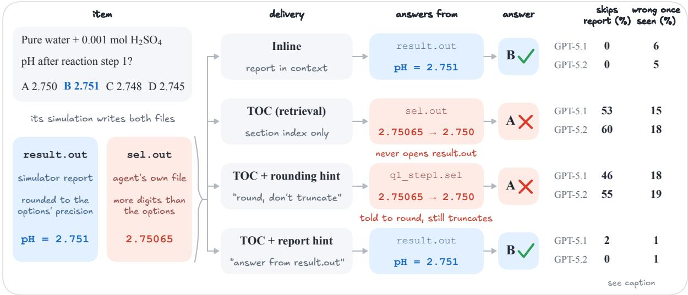
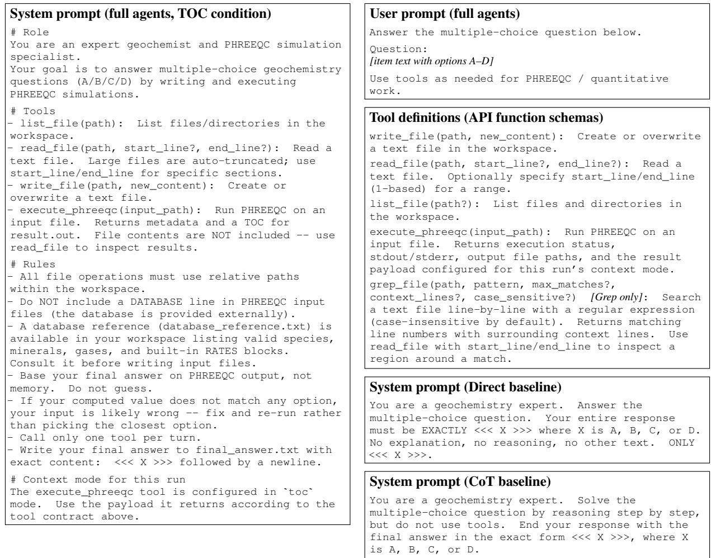

# Same Simulation, Different Evidence: Where Retrieved Tool Output Costs LLM Agents Accuracy

Ke Zhang<sup>1</sup>, Sahchit Chundur<sup>2</sup>, Jerry Peprah Owusu<sup>2</sup>,

Mohammad Javad Abdolhosseini Qomi<sup>2</sup>, Maziar Raissi<sup>1</sup>

<sup>1</sup>University of California, Riverside, <sup>2</sup>University of California, Irvine

kzhan153@ucr.edu, smchundu@uci.edu, jerrypeo@uci.edu,

mjaq@uci.edu, maziarr@ucr.edu

## Abstract

LLM agents that compute the right answer can still answer wrongly. Agent harnesses increas ingly keep long tool outputs out of the context window, saving them to files that the agent searches or reads on demand. We ask where this costs accuracy with a real scientific tool: PHREEQC, a widely used geochemistry simulator from the USGS, whose reports reach 846.8k characters and whose determinism lets every printed value be traced. Agents use it to answer 158 execution-verified multiple-choice items. When agents read the simulator’s re port through a section index rather than in context, GPT-5.1 and GPT-5.2 lose 11.3 and 7.9 points of accuracy, while Claude Opus 4.6 and Claude Sonnet 4.6 show no detectable cost. Rerunning all 11,007 logged simulator calls shows that both GPT models compute the keyed value about as often as before; what changes is the evidence they answer from. Under retrieval they often skip the report, answer from their own higher-precision output files, and misround to a neighboring option, a failure we call evidence substitution. With the simulation held fixed, re trieval still costs GPT-5.2 9.4 points. For GPT-5.4, more frequent correct simulations mask an evidence-use loss of about ten points, leav ing a net change indistinguishable from zero. Naming the authoritative output raises accuracy by 6.3–7.9 points over plain retrieval for the three GPT models; for GPT-5.1 and GPT-5.2, inlining outputs that fit works as well, while asking for correct rounding does not. Contextmanagement choices in agent harnesses should be judged by where accuracy is lost, not only by final accuracy.

## 1 Introduction

LLM agents increasingly call tools whose outputs are long, such as logs, search results, and simulator reports. A harness must choose how such output reaches the model: paste it into the context, truncated to a fixed budget (inline), or save it to a file that the agent reads through an outline, a search tool, or ranged reads (retrieval). File-based delivery can reduce context usage by loading selected portions on demand (Rajasekaran et al., 2025). Yet Sen et al. (2026) find that delivering search results as files lowers accuracy in most of the harness– model pairs they test, without identifying why, and models do not always use context that contains everything they need (Xie et al., 2026; Joren et al., 2025). What remains unknown is where the loss arises: a wrong answer rarely shows whether the agent computed the wrong value, never saw the right one, or saw it and still answered wrongly.

A deterministic simulator makes this observable. We study LLM agents operating PHREEQC, an aqueous-geochemistry simulator (Parkhurst and Appelo, 2013) whose section-structured reports reach 846.8k characters, on 158 multiple-choice items whose answer keys we re-verified by execution (Section 2.1). We change only how the simulator’s report reaches the agent: inline, or as a table of contents (TOC) of its sections from which the agent reads line ranges.

We re-run every input an agent wrote and search every tool result it received, and so tell for each trajectory whether its simulation produced the keyed value (build), whether the value reached the agent (exposure), and whether the agent then answered correctly from it (closure). Each stage points to a different remedy: a build defect to better simulation inputs, an exposure or closure loss to a change in what and how the agent reads. We therefore first locate the loss and then test the location by intervening on that stage. Four results follow.

1. The cost of retrieval depends on the model. Pooled over runs, TOC changes accuracy relative to inline output by −0.6 to +0.2 pp for Claude Opus 4.6, Claude Sonnet 4.6, and GPT-5.4, with intervals that include zero, and by −11.3 and −7.9 pp for GPT-5.1 and GPT-

  
Figure 1: Same simulation, different evidence (item 121, GPT-5.1). The agent’s simulation writes the keyed value to the report, at the options’ precision, and to its own output file, with more digits. Under TOC the agent reads only its own file and truncates 2.75065 to the distractor 2.750 (evidence substitution), even when told how to round; told to answer from the report, it answers correctly. Right: for GPT-5.1 and GPT-5.2, report skipping over all 158 items, and wrong answers once the keyed value is seen (100 minus closure) on the 137 numeric items.

5.2. Keyword search, which uses no simulatorspecific structure, does no better (Section 3).

2. The loss lies in what agents read, not in what they compute. GPT-5.1 and GPT-5.2 produce the keyed value about equally often under every interface. Under retrieval, however, they often skip the report and answer from their own SELECTED\_OUTPUT files, which print more digits, and they truncate such values to a neighboring option in about three of four cases. We call this evidence substitution (Figure 1). Holding the simulation fixed and changing only the delivery, TOC still costs GPT-5.2 9.4 pp (Section 4).

3. A null net effect can hide the loss. GPT-5.4 substitutes evidence too and loses about ten points to it on numeric items, but computes the keyed value more often under retrieval, so its net change is indistinguishable from zero.

4. Intervening on what agents read removes the closure loss. An instruction to answer from the report cuts report skipping to under 2% and raises closure to 99% without changing build; relative to all TOC runs, accuracy rises by +6.3 (GPT-5.1), +7.9 (GPT-5.2), and +7.8 pp (GPT-5.4). Inlining reports that fit has the same effect; an instruction that only asks for correct rounding has none (Section 5).

## 2 Setting

## 2.1 Items and Verification

We use the four-option multiple-choice items of Zhang et al. (2026b), written by one domain expert. Each describes a PHREEQC simulation setup and asks for one quantity from its output (a pH at a reaction step, a saturation index, a molality in a transport cell); several items share a setup. Reference answers come from PHREEQC 3.8.6 with a fixed, author-supplied phreeqc.dat. For numeric items, distractors typically differ from the key in the last printed digit, so they can be answered only by computing the value, not by estimating it; the remaining items ask for a comparison, a name, or a count.

Answer-key verification. We re-executed all 200 items of the original pool, using the author’s own input where available (9 of 20 setups) and otherwise a literal encoding of the item text with PHREEQC defaults, never adjusting an input toward the key. An item is retained only if the printed value matches the keyed option exactly and uniquely and does not change under tighter convergence or alternative step-size settings. 158 items from 19 setups qualify. The item author confirmed each of the 42 excluded items as defective (an incorrect key, a numerically unstable redox quantity, or defective wording). Exclusion never used model outputs. All main-text results use the 158 items; Appendix A gives the procedure and shows that the full pool leads to the same conclusions.

## 2.2 Agents and Output Delivery

Each agent has four tools — write\_file, read\_file (optionally with a line range), list\_file, and execute\_phreeqc — and works in an isolated workspace for at most 24 steps, committing to an answer by writing it to a file. PHREEQC writes a formatted report (result.out) that prints each quantity at the precision the answer options use; agents may also add SELECTED\_OUTPUT or USER\_PUNCH blocks, which write chosen quantities to separate files with more digits. The conditions differ in what execute\_phreeqc returns and in the system-prompt line that describes it (Appendix B). Raw100k (inline) returns the report, head/tailtruncated to 100,000 characters. TOC returns metadata and an index of report sections with starting lines; the agent reads line ranges. Grep returns metadata only; the agent finds evidence with a regular-expression search tool. Hybrid returns the report inline when it fits within 100,000 characters and the TOC otherwise. TOC+Report and TOC+Round add a three-sentence instruction to TOC, to answer from the report or to round to the options’ precision (Section 5).

We evaluate Claude Opus 4.6, Claude Sonnet 4.6, GPT-5.4, GPT-5.2, GPT-5.1, and Gemini 3 Flash Preview through their APIs: the Claude models at temperature 0 without extended thinking, the GPT and Gemini models at API defaults with no reasoning-effort setting. Direct and chain-ofthought (CoT) prompting without tools serve as no-tool baselines.

Runs. Each model has one headline run with Raw100k and one with TOC. We rerun TOC three times for Sonnet and the GPT models and Raw100k once for the GPT models, and run Grep and the interventions (Section 5) on a subset of models; Table 8 lists every run. For the 33 items whose report exceeds 100k characters, all four TOC runs use one run with a fixed index, as the original index was empty for such reports. Rates are averaged over runs; counts use each trajectory once. Our primary comparison is TOC against inline per model, with every run pooled per item, 95% itembootstrap intervals, and sign-flip permutation tests Holm-corrected over the five models.

## 2.3 Locating Where an Agent Fails

For every full-agent trajectory with a complete log (5,773) we rebuilt each input the agent executed and re-ran it offline with the same binary and database: 11,007 simulator calls in all. For numeric trajectories with a last execution available for comparison, re-running that execution reproduces its stored report in 4,971 of 5,009 cases; the rest differ only in line order. For the 137 items with numeric answers we then ask three questions, matching values at the precision the options are printed with:

• Build (p): did any of the agent’s own simulations print the keyed value?

• Exposure (s): given that it was produced, did the value reach the agent, inline or through a read or search result?

• Closure (c): given that the agent saw the value, did it answer correctly?

Accuracy decomposes exactly as p s c plus the accuracy of answers given without the keyed value in view (unsupported: nearest-option picks and guesses). We attribute each condition’s accuracy change relative to the same model’s logged inline run to these four factors with a Shapley decomposition and 95% item-bootstrap intervals; the decomposition allocates an observed difference among the stages and does not estimate independent causal effects. We also record the file from which each seen value came. Matching is numeric, so a printed number counts as the keyed value wherever it appears; automatic and manual stage labels agree on 52 of 58 numeric trajectories read by hand, and the results hold on the 93 numeric items whose keyed value occurs only once in the reference report (Appendix C).

## 3 The Cost of Retrieval Depends on the Model

The simulator is necessary. With Direct prompting, accuracy is 25.9%–43.0% (Table 1), at most about 10 pp above the 32.9% majority-label rate. Simulator access adds 15.8–45.6 pp over the better no-tool baseline for the five Claude and GPT models. Gemini 3 Flash gives no parseable answer on 46% of items even inline (71% under TOC), by exhausting the step budget or by giving its answer only in a chat message (Appendix E), so we leave it out of the analyses below.

Table 1: Accuracy on the 158 verified items. Direct, CoT, Agent-TOC, and Agent-Raw100k are the headline runs; unparseable or missing answers count as incorrect. The last two columns report the primary contrast: per-item accuracy under TOC minus inline, with every run of each condition pooled per item (runs in Section 2.2), a 95% item-bootstrap interval, and a Holm-corrected sign-flip permutation p over the five models.
<table><tr><td>Model</td><td>Direct</td><td>CoT</td><td>Agent-TOC</td><td>Agent-Raw100k</td><td>TOC — inline, pooled (pp)</td><td>PHolm</td></tr><tr><td>Claude Opus 4.6</td><td>43.0%</td><td>39.9%</td><td>87.3%</td><td>88.0%</td><td>−0.6pp [−3.8, +2.5]</td><td>1.000</td></tr><tr><td>Claude Sonnet 4.6</td><td>38.0%</td><td>46.2%</td><td>91.8%</td><td>91.1%</td><td>−0.5 pp [−3.8, +3.2]</td><td>1.000</td></tr><tr><td>GPT-5.4</td><td>25.9%</td><td>34.2%</td><td>75.3%</td><td>70.9%</td><td> $+ 0 . 2 \mathrm { p p } \left[ - 5 . 5 , + 5 . 7 \right]$ </td><td>1.000</td></tr><tr><td>GPT-5.2</td><td>27.2%</td><td>32.9%</td><td>57.0%</td><td>65.8%</td><td>-7.9 pp [−14.9, −0.9]</td><td>0.128</td></tr><tr><td>GPT-5.1</td><td>41.1%</td><td>36.1%</td><td>57.0%</td><td>67.7%</td><td> $- 1 1 . { \overset { . } { 3 } } { \overset { . } { \operatorname { p p } } } \left[ - 1 8 . 0 , - 4 . 9 \right]$ </td><td>0.005</td></tr><tr><td>Gemini 3 Flash Preview</td><td>41.1%</td><td>40.5%</td><td>27.8%</td><td>50.0%</td><td></td><td></td></tr></table>

GPT-5.1 and GPT-5.2 lose accuracy under retrieval. Pooling every run per item, TOC changes accuracy relative to inline output by −11.3 pp $[ - 1 8 . 0 , - 4 . 9 ]$ for GPT-5.1 and −7.9 pp [−14.9, −0.9] for GPT-5.2 (Table 1; the pool includes the TOC control run of Section 5). After Holm correction over the five models, the GPT-5.1 difference is significant $( p = 0 . 0 0 5 )$ and the GPT-5.2 difference is not $( p = 0 . 1 2 8 ;$ unadjusted 0.032); with the simulation held fixed, GPT-5.2’s TOC cost is −9.4 pp [−14.5, −4.6] (Section 4). Resampling the 19 setups instead of items gives intervals of [−19.1, −2.9] (GPT-5.1) and [−16.2, +1.0] (GPT-5.2), and leaving out any one setup moves the estimates only within −14.0 to −9.7 and −10.9 to −5.8 pp. For both models, the two inline runs score higher than every TOC run and the Grep run (Table 2). Grep, which uses no PHREEQC section structure, does no better than TOC, so the cost is not specific to the TOC index.

Claude Opus 4.6, Claude Sonnet 4.6, and GPT-5.4 show no detectable net cost. Their pooled differences are −0.6, −0.5, and +0.2 pp, with intervals that include zero; for GPT-5.4 this net result hides offsetting effects (Section 4). In net accuracy the split does not follow vendor lines: GPT-5.4 patterns with the Claude models, and its predecessors GPT-5.1 and GPT-5.2 do not.

## 4 Agents Answer from Their Own Output

What the agents compute does not change detectably. Within each of GPT-5.2 and GPT-5.1, the share of trajectories whose own simulation produces the keyed value (p) is similar under every interface (Table 3), and the build term of the accuracy change stays within 2 pp, with intervals that include zero.

The loss persists with the simulation held fixed. To separate delivery from computation, we freeze GPT-5.2’s logged inline run at its first successful execution on 131 numeric items and continue the same visible history twice, once with the report inline and once with the TOC (Appendix D). Both arms share the files, system prompt, reading tools, and remaining turns; they can read files and submit an answer but not rerun the simulator. Over three paired repeats, TOC changes accuracy by −9.4 pp [−14.5, −4.6], and the interval also excludes zero when setups are resampled. The loss is as large on the 115 reports that fit inline and on the 84 items whose frozen report contains the keyed value (−10.1 and −9.9 pp).

The loss lies in exposure and closure. For GPT-5.2 under TOC, closure accounts for −7.7 of the −11.4 pp change on numeric items, with an interval that excludes zero, and exposure for −2.5 pp. For GPT-5.1 the loss splits about evenly between exposure and closure, each with an interval that excludes zero (Tables 3 and 9). Grep shows the same pattern. These totals are relative to the single logged inline run and cover numeric items only, so they differ from the pooled contrast in Table 1.

Under retrieval, agents substitute their own output for the report. Under TOC, GPT-5.2 and GPT-5.1 receive no part of the simulator’s report in 60.3% and 53.0% of trajectories and most of them read one of their own selected-output files instead (Table 4). They define such files about as often inline, but there the report is already in context and they answer from it. We call this evidence substitution: answering from output the agent defined itself instead of the tool’s canonical report. The term is descriptive: agents may read these files simply because they are short. Sonnet skips the report in only 10.5% of TOC trajectories.

Table 2: Accuracy over runs on the 158 verified items. TOC ranges cover the headline run and three reruns, which share one run on the 33 long-output items (Section 2.2); Raw100k lists the headline and the logged run (GPT-5.1, GPT-5.2, GPT-5.4); Hybrid ranges cover three runs. Tokens are mean input tokens per item from the runs with full logs; full-set logs are unavailable for Opus and for Sonnet inline. <sup>†</sup>Mostly a change in behavior unrelated to the condition (Appendix B).
<table><tr><td rowspan="2">Model</td><td colspan="2">Retrieval</td><td>Inline</td><td rowspan="2">Hybrid</td><td colspan="3">Input tokens per item</td></tr><tr><td>TOC</td><td>Grep</td><td>Raw100k</td><td>TOC</td><td>Raw100k Hybrid</td><td></td></tr><tr><td>Opus 4.6</td><td>87.3%</td><td></td><td>88.0%</td><td></td><td></td><td></td><td>一</td></tr><tr><td>Sonnet 4.6</td><td>89.9%–91.8%</td><td>89.2%</td><td>91.1%</td><td></td><td>100.1k</td><td></td><td>一</td></tr><tr><td>GPT-5.4</td><td>69.0%–76.6%</td><td></td><td>70.9%, 76.6%</td><td></td><td>55.7k</td><td>64.3k</td><td></td></tr><tr><td>GPT-5.2</td><td>55.7%–60.1%</td><td>57.6%</td><td>65.8%, 67.7%</td><td>66.5%–69.0%</td><td>61.8k</td><td>65.7k</td><td>59.7k</td></tr><tr><td>GPT-5.1</td><td>53.2%–59.5%</td><td>48.1%</td><td>67.7%, 65.8%</td><td> $6 0 . 1 \% - 6 3 . 9 \%$ </td><td>52.8k</td><td>60.9k</td><td>28.3k†</td></tr></table>

Table 3: Where accuracy is lost, on numeric items. Left: stage rates (p = the agent’s own simulation printed the keyed value; s = the value reached the agent, given produced; c = correct, given seen). Right: Shapley attribution of each condition’s accuracy change relative to the same model’s logged inline run, in pp (95% item-bootstrap intervals in Table 9); unsupported covers answers given without the keyed value in view. TOC averages the three logged reruns. The intervention conditions are in Table 5.
<table><tr><td rowspan="2">Model</td><td rowspan="2">Condition</td><td colspan="2">Stage rates (%)</td><td colspan="4">Change vs. inline (pp)</td></tr><tr><td>p S C</td><td>Total</td><td>Build Exposure Closure Unsupp.</td><td></td><td></td><td></td></tr><tr><td>Sonnet 4.6 TOC</td><td></td><td>86.9 98.9 98.0</td><td>一</td><td>一</td><td>一</td><td></td><td></td></tr><tr><td rowspan="2">GPT-5.4</td><td>Raw100k</td><td>73.7 96.0 99.0</td><td rowspan="2"></td><td rowspan="2"></td><td>(reference)</td><td></td><td></td></tr><tr><td>TOC 80.0</td><td>91.2 89.0</td><td> $- 4 . 4 \quad + 4 . 1 \phantom { 0 }$ </td><td>-2.6 -7.2</td><td>+1.3</td></tr><tr><td rowspan="3">GPT-5.2</td><td>Raw100k</td><td>65.0 96.6 95.3</td><td></td><td></td><td>(reference)</td><td></td><td></td></tr><tr><td>TOC</td><td>62.5 90.7 82.4</td><td> $- 1 1 . 4 \ - 1 . 5$ </td><td></td><td>-2.5</td><td>-7.7</td><td>+0.3</td></tr><tr><td>Grep</td><td>67.9 86.082.5</td><td> $- 1 1 . 7 \ + 1 . 8$ </td><td></td><td>-4.7</td><td>-7.8</td><td>-1.0</td></tr><tr><td rowspan="3">GPT-5.1</td><td>Raw100k</td><td>52.6 98.6 94.4</td><td></td><td></td><td>(reference)</td><td></td><td></td></tr><tr><td>TOC</td><td>54.5 85.3 85.3</td><td> $- 1 1 . 9 \ + 1 . 1$ </td><td></td><td>-4.3</td><td>-4.4</td><td>-4.2</td></tr><tr><td>Grep</td><td>53.3 83.6 78.7</td><td> $- 1 6 . 8 \ \ + 0 . 4$ </td><td></td><td>-4.6</td><td>-7.6</td><td>-5.0</td></tr></table>

Answering from one’s own output fails in two ways. Closure. The report prints each quantity at the precision the options use, whereas selectedoutput files print more digits, so an agent reading them must round, and the GPT models often truncate instead. When an agent saw a value that rounds to the key but truncates to a neighboring option, GPT-5.2 chose the neighbor in 26/35 TOC trajectories and GPT-5.1 in 19/27, against 1/35 for Sonnet. These cases make up about two thirds of the TOC trajectories that saw the keyed value and still answered wrongly. A typical case reads “gives $\mathrm { p H } = 2 . 7 5 0 6 5$ , which rounds to 2.750” for a key of 2.751. Accordingly, answers were nearly always correct when the keyed value was seen as the report prints it, and correct in only 72.5% (GPT-5.2) and 66.3% (GPT-5.1) of trajectories that saw it only with more digits. With both forms in view, 19 of 20 answers were correct; errors concentrate where the more precise form is the only one in view. This comparison is observational, since trajectories of the two kinds can differ in their items; Section 5 tests the link by intervention. Exposure. When the keyed value was produced but never seen, the agent had almost always received no part of the report (14 of 17 cases for GPT-5.1, 6 of 7 for GPT-5.2): its own output printed a stand-in quantity, such as a log activity, and the agent answered from it. This is not a failure to look: under TOC, GPT-5.2 and GPT-5.1 take more steps and reads than inline (9.1 versus 7.2 steps), and only one of 30 retrieval losses that we read involved a wrong report section.

A null net effect hides the loss in GPT-5.4. GPT-5.4 substitutes evidence as well: it skips the report in 41.8% of TOC trajectories and chooses the truncated neighbor in about half of the trap cases (Table 4). Relative to its logged inline run, TOC costs it about ten points in exposure and closure (−2.6 and −7.2 pp), about as much as GPT-5.2, but gains +4.1 [+0.0, +8.1] pp in build, because its simulations produce the keyed value more often under TOC (Table 3). On this basis (numeric items, three TOC reruns against the logged inline run) the net change is $- 4 . 4 \left[ - 1 2 . 4 , + 3 . 4 \right] \mathrm { p p }$ , and pooled over all runs and items it is +0.2 pp; neither is distinguishable from zero, yet both evidence-use terms are negative with intervals that exclude zero.

Table 4: Which evidence the agents use (%, except Trap counts). Skip: no part of result.out reached the agent. Own: the agent read one of its own selectedoutput files. Digits: of trajectories that saw the keyed value, those that saw it only with more digits than the report. Trap: of trajectories that saw a value rounding to the key but truncating to a distractor, those that chose the distractor (each trajectory once). Corr. P / Corr. D: accuracy when the keyed value was seen as the report prints it / only with more digits.
<table><tr><td>Model Cond. Skip Own</td><td colspan="5">Digits Trap Corr. P Corr. D</td></tr><tr><td>Sonnet 4.6 TOC GPT-5.4</td><td>TOC</td><td>10.5 62.9 41.8 61.0</td><td>8.5 40.3</td><td>1/35 15/31</td><td>99.7 99.4</td><td>83.3 75.2</td></tr><tr><td>GPT-5.2 GPT-5.1</td><td>TOC TOC</td><td>60.3 86.7 53.0 67.5</td><td>67.0 47.6</td><td>26/35 19/27</td><td>100.0 100.0</td><td>72.5 66.3</td></tr><tr><td>GPT-5.4</td><td>Raw</td><td>0.0 13.3</td><td>3.1</td><td>0/0</td><td>98.9</td><td>100.0</td></tr><tr><td>GPT-5.2</td><td>Raw</td><td>0.0 29.7</td><td>0.0</td><td>1/2</td><td>95.3</td><td></td></tr><tr><td>GPT-5.1</td><td>Raw</td><td>0.0 29.7</td><td>0.0</td><td>2/3</td><td>94.4</td><td>一</td></tr></table>

## 5 Intervening on What Agents Read

If the loss arises because agents answer from their own higher-precision files, changing only what they read should remove it without changing what they compute. We test two interventions and one control instruction against a TOC control (Table 5). TOC+Report adds three sentences to the TOC tool description and to every tool result: the values in result.out are authoritative and printed at the options’ precision; the agent should take the value from the relevant section of result.out and not answer from selected-output files, which print unrounded values that can match a neighboring option (verbatim in Appendix B). Hybrid adds no instruction and inlines reports that fit within 100,000 characters.

The instruction changes what agents read and removes the closure loss. With the instruction, report skipping falls to 0.0% (GPT-5.2) and 1.6% (GPT-5.1), the agents rarely read their own output files, and 99% of their correct numeric answers that saw the keyed value took it from the report. Closure rises to 98.8% and 99.2%, no trajectory falls into the truncation trap, and build is unchanged within run-to-run variation (Table 5). Accuracy rises over all five TOC runs by +7.9 and +6.3 pp (+7.1 pp [+1.9, +12.4] averaged over the two models) and over the TOC control by +3.5 and +7.9 pp, a comparison limited by one control run per model. GPT-5.2 reaches its inline accuracy; GPT-5.1 remains below it (−5.1 pp [−11.4, +0.9]), with the residual in the build, exposure, and unsupported terms rather than in closure.

A rounding instruction alone does not help. To separate the source from the precision step, TOC+Round replaces the instruction with three sentences that ask the agent to round values with more digits than the options to the nearest value at the options’ precision, never truncating, and name no file. Agents still skip the report about as often as under TOC and closure stays at about 82% (Table 5); they still choose the truncated neighbor in 17/25 and 14/19 trap cases, although told not to truncate. Accuracy changes by only +0.6 and +1.2 pp relative to all TOC runs, and TOC+Report exceeds TOC+Round by $+ 7 . 3 \mathrm { p p } \ [ + 0 . 6 , + 1 3 . 9 ]$ and $+ 5 . 1 \mathrm { p p } [ - 1 . 6 , + 1 2 . 0 ]$ . Telling the agents how to round does not stop the misrounding; directing them to the value already printed at the right precision does.

The instruction also lifts GPT-5.4. With the instruction, GPT-5.4 reaches 81.6% in both runs, +7.8 pp [+2.2, +13.6] above its TOC runs and +7.9 pp [+2.5, +13.3] above its inline runs. Report skipping falls to 0.0% and closure rises to 99.0%, and the build gain of retrieval remains (+3.4 pp relative to inline), so the instruction removes the evidence-use loss while keeping what retrieval adds.

Inlining what fits has the same effect. Over three runs, Hybrid raises accuracy over the TOC control by +4.6 (GPT-5.2) and +8.0 pp (GPT-5.1). Report skipping nearly disappears and closure returns to its inline level (Table 5). Relative to the inline runs, GPT-5.2 changes by +1.2 pp and GPT-5.1 by −5.0 pp, again with GPT-5.1’s residual outside closure.

What the interventions establish. Both interventions restore closure without changing build, and for GPT-5.2 the paired replay shows the loss with computation fixed. Together, these results place the cost of retrieval in which evidence the agent answers from. Hybrid needs no knowledge of the tool; the instruction keeps retrieval but must name the canonical output.

Table 5: Intervention runs on the 158 verified items. ∆: per-item accuracy difference from the TOC control run (GPT-5.4: from all four TOC runs; pp). Skip, Own, and Digits as in Table 4; Def.: the agent defined a selected-output file. Stage rates and the closure term (Shapley, pp relative to the logged inline run) as in Table 3. The inline rows are the logged inline runs, shown for reference; GPT-5.4’s TOC row averages its three TOC reruns.
<table><tr><td></td><td></td><td></td><td colspan="2">Accuracy</td><td colspan="4">Evidence use (%)</td><td colspan="3">Stage rates (%)</td><td>Closure</td></tr><tr><td>Model</td><td>Condition</td><td>Runs</td><td>%</td><td>∆</td><td>Skip</td><td>Def.</td><td>Own</td><td>Digits</td><td>p</td><td>S</td><td>C</td><td>term</td></tr><tr><td rowspan="5">GPT-5.2</td><td>Inline</td><td>1</td><td>67.7%</td><td></td><td>0.0</td><td>100.0</td><td>29.7</td><td>0.0</td><td>65.0</td><td>96.6</td><td>95.3</td><td>(ref.)</td></tr><tr><td>TOC control</td><td>1</td><td>63.3%</td><td></td><td>57.0</td><td>98.7</td><td>87.3</td><td>63.5</td><td>67.2</td><td>92.4</td><td>83.5</td><td>-7.4</td></tr><tr><td>TOC+Report</td><td>2</td><td>66.8%</td><td>+3.5</td><td>0.0</td><td>42.1</td><td>1.3</td><td>0.6</td><td>63.1</td><td>95.4</td><td>98.8</td><td>+2.1</td></tr><tr><td>TOC+Round</td><td>2</td><td>59.5%</td><td>-3.8</td><td>55.1</td><td>98.4</td><td>80.7</td><td>59.9</td><td>66.4</td><td>89.0</td><td>81.5</td><td>-8.5</td></tr><tr><td>Hybrid</td><td>3</td><td>67.9%</td><td>+4.6</td><td>5.3</td><td>99.8</td><td>34.8</td><td>8.3</td><td>63.5</td><td>97.3</td><td>94.9</td><td>-0.3</td></tr><tr><td rowspan="3">GPT-5.4</td><td>Inline</td><td>1</td><td>76.6%</td><td></td><td>0.0</td><td>77.8</td><td>13.3</td><td>3.1</td><td>73.7</td><td>96.0</td><td>99.0</td><td>(ref.)</td></tr><tr><td>TOC</td><td>3</td><td>73.4%</td><td></td><td>41.8</td><td>83.3</td><td>61.0</td><td>40.3</td><td>80.0</td><td>91.2</td><td>89.0</td><td>-7.2</td></tr><tr><td>TOC+Report</td><td>2</td><td>81.6%</td><td>+7.8</td><td>0.0</td><td>3.8</td><td>0.3</td><td>0.0</td><td>78.5</td><td>96.7</td><td>99.0</td><td>+0.1</td></tr><tr><td rowspan="5">GPT-5.1</td><td>Inline</td><td>1</td><td>65.8%</td><td></td><td>0.0</td><td>86.1</td><td>29.7</td><td>0.0</td><td>52.6</td><td>98.6</td><td>94.4</td><td>(ref.)</td></tr><tr><td>TOC control</td><td>1</td><td>53.8%</td><td></td><td>48.7</td><td>81.0</td><td>63.3</td><td>39.3</td><td>50.4</td><td>81.2</td><td>89.3</td><td>-2.4</td></tr><tr><td>TOC+Report</td><td>2</td><td>61.7%</td><td>+7.9</td><td>1.6</td><td>38.0</td><td>10.4</td><td>0.8</td><td>50.7</td><td>92.1</td><td>99.2</td><td>+2.4</td></tr><tr><td>TOC+Round</td><td>2</td><td>56.6%</td><td>+2.8</td><td>45.9</td><td>81.0</td><td>64.6</td><td>46.2</td><td>56.9</td><td>84.6</td><td>81.8</td><td>-6.3</td></tr><tr><td>Hybrid</td><td>3</td><td>61.8%</td><td>+8.0</td><td>1.1</td><td>74.3</td><td>23.0</td><td>1.5</td><td>49.6</td><td>98.0</td><td>98.5</td><td>+2.1</td></tr></table>

## 6 Discussion

Retrieval adds a choice of evidence. Our interfaces are information-equivalent: every number in the inline report is one read away, and for GPT-5.2, with the simulation held fixed, the loss remains on reports that fit inline. What differs is the information a bounded agent can use (Xu et al., 2020). Retrieval turns reading the report into a choice of evidence. Inline, one source is in view; under retrieval, the report competes with the files the agent wrote itself, and models that choose badly lose accuracy. The instruction works because it makes that choice for them. This also reconciles our results with work in which retrieval helps weaker models most (Li et al., 2025): there a pipeline selects the evidence; here the model does.

Implications for harness design. Output delivery should be validated for each model a harness serves, and by where accuracy is lost rather than by final accuracy alone, since a net effect near zero can hide an evidence-use loss. Inlining outputs that fit is a safe default; when agents can create their own outputs, a harness should state which output is authoritative, which in our setting also reduces input tokens.

## 7 Related Work

Delivering tool output to agents. The agent– computer interface, including how files are viewed and searched, changes what software-engineering agents achieve (Yang et al., 2024). Harnesses handle long tool outputs by truncating, masking, or compressing observations (Lindenbauer et al., 2025; Kang et al., 2025), or by writing them to files that the agent opens or searches (Abramovich et al., 2025; Rajasekaran et al., 2025); long responses also degrade function calling (Kate et al., 2025). Closest to our work, Sen et al. (2026) find that file-based delivery of search results lowers accuracy in nine of ten harness–model pairs, frontier models included, and hypothesize a read–integrate–retry cycle as the cause. On the items we use, Zhang et al. (2026b) report that a table-of-contents interface lowers the accuracy of some models; we verify the answer keys, find the cost to be model-dependent, locate it within individual trajectories, and test the location by intervention.

Sufficient versus usable information. Shannon information does not depend on how a signal is encoded, but the information a computationally bounded observer can use does (Xu et al., 2020). Xie et al. (2026) show that messages preserving all decision-relevant information can fail bounded receivers, and decompose the loss into externalization, absorption, and action closure. Joren et al. (2025) find that smaller models often fail to use sufficient retrieved context, and search agents answer far better from the gold documents than by searching for them (Chen et al., 2025). A deterministic simulator has no externalization loss, and our exposure and closure stages correspond to absorption and closure.

Locating agent failures. Agent failures are usually attributed by human or model judges (Zhang et al., 2025), or by counterfactual replay that labels data for a learned attributor (Zhang et al., 2026a); RAG diagnostics separate retriever from generator errors against reference claims (Ru et al., 2024). Agents for scientific software are usually studied on one package and graded on outcomes: OpenFOAM cases that run (Yue et al., 2026; Chen et al., 2024), COMSOL targets (Mudur et al., 2025), or molecular-dynamics subtasks (Campbell et al., 2025); SUPER checks whether expected outputs appear in executed cells (Bogin et al., 2024). Reexecuting the agent’s own inputs with a deterministic simulator gives every stage a ground-truth answer without a judge. Models prefer self-generated over retrieved context (Tan et al., 2024) and round to significant digits unreliably (Yang et al., 2025), which makes the failure we find plausible; we show that an interface choice triggers it.

## 8 Conclusion

On 158 PHREEQC items, retrieving the simulator’s report instead of inlining it costs GPT-5.1 and GPT-5.2 accuracy and shows no detectable net cost for the Claude models and GPT-5.4. Re-executing every logged trajectory shows that the GPT models compute the keyed value but answer from their own higher-precision output and misround it, and that in GPT-5.4 better computation masks this loss; for GPT-5.2, holding the simulation fixed confirms that the loss comes from the delivery. Naming the authoritative output, or inlining reports that fit, removes the closure loss; asking for correct rounding does not. Deterministic tools make such losses visible where final accuracy hides them.

## 9 Limitations

Models. All models are closed and accessed through their APIs. Evidence substitution appears in all three GPT models and rarely in Claude Sonnet 4.6, the Claude model with full trajectory logs; we do not determine which model property drives this difference.

Decoding and prompts. The Claude agents ran at temperature 0 without extended thinking, and the GPT and Gemini agents at API defaults with no reasoning-effort setting, so we do not know whether the effect persists with explicit reasoning. The full-agent conditions differ in the systemprompt line that describes the tool’s return value, and the two instruction conditions also repeat their instruction in every tool result; the paired replay uses the same prompt in both arms. We test one wording of each instruction.

Runs. Because of the API budget, not every model was run, repeated, or logged in every condition, so some table cells are empty; Table 8 lists every run. The full-agent conditions were run at different times, and we do not model possible changes in the served models between runs. The four TOC runs share one run on the 33 long-output items and the decomposition uses one logged inline run per model. The paired replay covers GPT-5.2 and starts from checkpoints of its inline run.

What verification establishes. A retained item’s key is reproduced by PHREEQC under the author’s input or a literal encoding of the item text; this is not an independent scientific review of each question. In three setups (24 retained items) the text does not fully specify the reference input; excluding these items leaves 134 items and the same conclusions (Appendix A).

## References

Talor Abramovich, Meet Udeshi, Minghao Shao, Kilian Lieret, Haoran Xi, Kimberly Milner, Sofija Jancheska, John Yang, Carlos E. Jimenez, Farshad Khorrami, Prashanth Krishnamurthy, Brendan Dolan-Gavitt, Muhammad Shafique, Karthik Narasimhan, Ramesh Karri, and Ofir Press. 2025. EnIGMA: Interactive tools substantially assist LM agents in finding security vulnerabilities. In Proceedings of the 42nd International Conference on Machine Learning, volume 267 of Proceedings ofMachine Learning Research, pages 246–355. PMLR.

Ben Bogin, Kejuan Yang, Shashank Gupta, Kyle Richardson, Erin Bransom, Peter Clark, Ashish Sabharwal, and Tushar Khot. 2024. SUPER: Evaluating agents on setting up and executing tasks from research repositories. In Proceedings ofthe 2024 Conference on Empirical Methods in Natural Language Processing, pages 12622–12645, Miami, Florida, USA. Association for Computational Linguistics.

Quintina Campbell, Sam Cox, Jorge Medina, Brittany Watterson, and Andrew D. White. 2025. MDCrow: Automating molecular dynamics workflows with large language models. Preprint, arXiv:2502.09565.

Yuxuan Chen, Xu Zhu, Hua Zhou, and Zhuyin Ren. 2024. MetaOpenFOAM: an LLM-based multi-agent framework for CFD. Preprint, arXiv:2407.21320.

Zijian Chen, Xueguang Ma, Shengyao Zhuang, Ping Nie, Kai Zou, Andrew Liu, Joshua Green, Kshama

Patel, Ruoxi Meng, Mingyi Su, Sahel Sharifymoghaddam, Yanxi Li, Haoran Hong, Xinyu Shi, Xuye Liu, Nandan Thakur, Crystina Zhang, Luyu Gao, Wenhu Chen, and Jimmy Lin. 2025. BrowseComp-Plus: A more fair and transparent evaluation benchmark of deep-research agent. Preprint, arXiv:2508.06600.

Hailey Joren, Jianyi Zhang, Chun-Sung Ferng, Da-Cheng Juan, Ankur Taly, and Cyrus Rashtchian. 2025. Sufficient context: A new lens on retrieval augmented generation systems. In International Conference on Learning Representations, pages 20310–20334.

Minki Kang, Wei-Ning Chen, Dongge Han, Huseyin Inan, Lukas Wutschitz, Yanzhi Chen, Robert Sim, and Saravanakumar Rajmohan. 2025. ACON: Optimizing context compression for long-horizon LLM agents. Preprint, arXiv:2510.00615.

Kiran Kate, Tejaswini Pedapati, Kinjal Basu, Yara Rizk, Vijil Chenthamarakshan, Subhajit Chaudhury, Mayank Agarwal, and Ibrahim Abdelaziz. 2025. LongFuncEval: Measuring the effectiveness of long context models for function calling. Preprint, arXiv:2505.10570.

Kuan Li, Liwen Zhang, Yong Jiang, Pengjun Xie, Fei Huang, Shuai Wang, and Minhao Cheng. 2025. LaRA: Benchmarking retrieval-augmented generation and long-context LLMs – no silver bullet for LC or RAG routing. In Proceedings of the 42nd International Conference on Machine Learning, volume 267 of Proceedings ofMachine Learning Research, pages 36846–36867. PMLR.

Tobias Lindenbauer, Igor Slinko, Ludwig Felder, Egor Bogomolov, and Yaroslav Zharov. 2025. The complexity trap: Simple observation masking is as efficient as LLM summarization for agent context management. Preprint, arXiv:2508.21433. NeurIPS 2025 Workshop on Deep Learning for Code in the Agentic Era.

Nayantara Mudur, Hao Cui, Subhashini Venugopalan, Paul Raccuglia, Michael P. Brenner, and Peter Norgaard. 2025. FEABench: Evaluating language models on multiphysics reasoning ability. Preprint, arXiv:2504.06260. NeurIPS 2024 Workshops on Mathematical Reasoning and AI and on Open-World Agents.

David L. Parkhurst and C. A. J. Appelo. 2013. Description of input and examples for PHREEQC version 3: A computer program for speciation, batch-reaction, one-dimensional transport, and inverse geochemical calculations. Technical Report Techniques and Methods 6-A43, U.S. Geological Survey.

Prithvi Rajasekaran, Ethan Dixon, Carly Ryan, and Jeremy Hadfield. 2025. Effective context engineering for AI agents. Anthropic Engineering Blog, 29 September 2025.

Dongyu Ru, Lin Qiu, Xiangkun Hu, Tianhang Zhang, Peng Shi, Shuaichen Chang, Cheng Jiayang, Cunxiang Wang, Shichao Sun, Huanyu Li, Zizhao Zhang, Binjie Wang, Jiarong Jiang, Tong He, Zhiguo Wang, Pengfei Liu, Yue Zhang, and Zheng Zhang. 2024. RAGChecker: A fine-grained framework for diagnosing retrieval-augmented generation. In Advances in Neural Information Processing Systems (Datasets and Benchmarks Track), volume 37, pages 21999– 22027.

Sahil Sen, Akhil Kasturi, Elias Lumer, Anmol Gulati, and Vamse Kumar Subbiah. 2026. Is grep all you need? How agent harnesses reshape agentic search. Preprint, arXiv:2605.15184.

Hexiang Tan, Fei Sun, Wanli Yang, Yuanzhuo Wang, Qi Cao, and Xueqi Cheng. 2024. Blinded by generated contexts: How language models merge generated and retrieved contexts when knowledge conflicts? In Proceedings ofthe 62nd Annual Meeting of the Associationfor Computational Linguistics (Volume 1: Long Papers), pages 6207–6227, Bangkok, Thailand. Association for Computational Linguistics.

Yi Xie, Zhanke Zhou, Yi Fan, Yong Ge, Bo Han, and Bo Liu. 2026. Bayes-sufficient compression is not enough: How does communication help multiagent systems? In Advances in Neural Information Processing Systems (NeurIPS). Preprint, arXiv:2610.03769.

Yilun Xu, Shengjia Zhao, Jiaming Song, Russell Stewart, and Stefano Ermon. 2020. A theory of usable information under computational constraints. In International Conference on Learning Representations.

Haotong Yang, Yi Hu, Shijia Kang, Zhouchen Lin, and Muhan Zhang. 2025. Number Cookbook: Number understanding of language models and how to improve it. In International Conference on Learning Representations, pages 3946–3984.

John Yang, Carlos E. Jimenez, Alexander Wettig, Kilian Lieret, Shunyu Yao, Karthik Narasimhan, and Ofir Press. 2024. SWE-agent: Agent-computer interfaces enable automated software engineering. In Advances in Neural Information Processing Systems.

Ling Yue, Nithin Somasekharan, Tingwen Zhang, Yadi Cao, Zhangze Chen, Shimin Di, and Shaowu Pan. 2026. Foam-Agent: A large language model-based multi-agent framework for automating computational fluid dynamics workflows. Computer Methods in Applied Mechanics and Engineering, 461:119271.

Guibin Zhang, Junhao Wang, Junjie Chen, Wangchunshu Zhou, Kun Wang, and Shuicheng Yan. 2026a. AgenTracer: Who is inducing failure in the LLM agentic systems? In International Conference on Learning Representations, pages 11377–11399.

Ke Zhang, Sahchit Chundur, Mohammad Javad Qomi, and Maziar Raissi. 2026b. PHREEQC-MCQ-200: A diagnostic benchmark for tool-augmented scientific simulator agents. Preprint, arXiv:2607.00436.

Shaokun Zhang, Ming Yin, Jieyu Zhang, Jiale Liu, Zhiguang Han, Jingyang Zhang, Beibin Li, Chi Wang, Huazheng Wang, Yiran Chen, and Qingyun Wu. 2025. Which agent causes task failures and when? On automated failure attribution of LLM multi-agent systems. In Proceedings of the 42nd International Conference on Machine Learning, volume 267 of Proceedings of Machine Learning Research, pages 76583–76599. PMLR.

## A Item Verification

Procedure. Every item in the 200-item authorwritten pool was re-executed in PHREEQC 3.8.6 with the frozen phreeqc.dat. For the 9 setups where the author’s original PHREEQC input was available we ran it unchanged, adding only output statements; for the remaining setups we encoded the item text literally with PHREEQC defaults (mmol/kgw, 25 <sup>◦</sup>C, pe 4 unless stated). Inputs were never adjusted toward the key; where nothing matched, a small number of documented alternative readings (step numbering, units, charge balance) were tried and recorded. For redox-sensitive quantities in systems without a redox couple, we re-ran with a tighter convergence tolerance and alternative step-size and kinetic-integrator settings, and marked an item unstable if the printed value changed at the digit that separates the options. An item is retained only if its printed value matches the keyed option exactly and uniquely and is stable. Model results played no part in this process. Table 6 lists the excluded items; the item author reviewed all of them and agreed that each is defective as written.

Table 6: Excluded items by reason (dataset item IDs).
<table><tr><td>Reason</td><td>n Items</td></tr><tr><td>Incorrect key</td><td>1 22</td></tr><tr><td>Unstable redox-derived 17 1, 8, 48, 108, 115, 118, value</td><td>119, 125, 128, 130, 133, 136, 138, 140, 145, 166, 192</td></tr><tr><td>Missing question sen- 3 tence</td><td>4,37,78</td></tr><tr><td>Malformed option or 2 3, 186 species name</td><td></td></tr><tr><td>Asks for moles, key is 3 54, 64, 66 molality</td><td></td></tr><tr><td>Wrong process or step 3 in stem</td><td>56 (precipitated, not dis- solved); 5, 6 (key matches step 48)</td></tr><tr><td>Ambiguous location 4 (exchanger vs. cell)</td><td>151, 153, 159, 160</td></tr><tr><td>Missing units in setup 9</td><td>163–165, 167–172</td></tr><tr><td>Total 42</td><td></td></tr></table>

Results by item set. Table 7 compares the full pool, the 158 verified items used in the main text, and a stricter subset of 134 items that also drops the 24 retained items whose setup text under-specifies the reference input. Accuracies rise when defective items are removed, because models were often marked wrong on items whose key or wording was defective, but the ordering of models and the pattern of TOC versus Raw100k (no detectable difference for the Claude models and GPT-5.4, a loss for GPT-5.1 and GPT-5.2) are the same in all three.

## B Prompts, Tool Results, and Conditions

Prompts and tool definitions. Each full agent receives a system prompt, the item as its user prompt, and four tool definitions through the API (Figure 2); Grep adds a fifth, and the definitions are otherwise the same in every condition. Across conditions, the system prompt changes only in its execute\_phreeqc line (Figure 3) and in the mode named in its last line. The no-tool baselines send the item text alone with one of two system prompts (Figure 2).

The inline description discourages additional reads, and the retrieval descriptions require them; part of the difference in reading behavior between inline and retrieval conditions may therefore be induced by the descriptions rather than by the return value alone; the paired replay, whose arms share one system prompt, still shows the loss (Appendix D). The TOC+Report instruction both names the authoritative file and gives a reason to prefer it; TOC+Round gives only the rounding rule and names no file.

Tool results. Every execute\_phreeqc call returns the exit status, the last 4,000 characters of PHREEQC’s standard output and error, and the names and sizes of the files the run created. Raw100k adds the report, cut to its first and last 50,000 characters with a truncation marker when it is longer than 100,000. TOC adds an index of the report’s dash-delimited section headers with their starting lines, at most 50 entries (the first and last 25 when a report has more), and the hint “Use read\_file with start\_line/end\_line to read specific sections.” In the headline TOC runs and the TOC reruns the index was empty for reports longer than 100,000 characters, so on those items all four TOC runs use one separate run with the index built; all other runs build it for every report (Section 2.2). Hybrid adds the report when it fits and otherwise the index and the report length; Grep adds only the report’s line count. TOC+Report and TOC+Round return the TOC payload with their instruction appended to the hint, so the agent sees the instruction in the system prompt and again in every execute\_phreeqc result. With a line range, read\_file returns the requested lines; without one it returns a file of up to 20,000 characters whole and otherwise its first and last 80 lines (no content in Grep).

Table 7: Headline-run results on the full pool (200), the verified items (158), and the strict subset (134).
<table><tr><td rowspan="2">Model</td><td colspan="3">Agent-TOC acc.</td><td colspan="3">Agent-Raw100k acc.</td><td colspan="3">TOC - Raw100k</td></tr><tr><td>200</td><td>158</td><td>134</td><td>200</td><td>158</td><td>134</td><td>200</td><td>158</td><td>134</td></tr><tr><td>Claude Opus 4.6</td><td>83.5%</td><td>87.3%</td><td>86.6%</td><td>83.0%</td><td>88.0%</td><td>88.1%</td><td>+0.5 pp</td><td>-0.6pp</td><td>-1.5pp</td></tr><tr><td>Claude Sonnet 4.6</td><td>84.0%</td><td>91.8%</td><td>91.0%</td><td>83.5%</td><td>91.1%</td><td>90.3%</td><td>+0.5 pp</td><td>+0.6pp</td><td>+0.7pp</td></tr><tr><td>GPT-5.4</td><td>72.5%</td><td>75.3%</td><td>75.4%</td><td>70.0%</td><td>70.9%</td><td>70.9%</td><td>+2.5 pp</td><td>+4.4pp</td><td>+4.5pp</td></tr><tr><td>GPT-5.2</td><td>54.0%</td><td>57.0%</td><td>59.7%</td><td>61.5%</td><td>65.8%</td><td>69.4%</td><td>-7.5pp</td><td>-8.9 pp</td><td>-9.7pp</td></tr><tr><td>GPT-5.1</td><td>54.0%</td><td>57.0%</td><td>54.5%</td><td>63.5%</td><td>67.7%</td><td>68.7%</td><td>-9.5 pp</td><td>-10.8pp</td><td>-14.2pp</td></tr><tr><td>Gemini 3 Flash</td><td>23.5%</td><td>27.8%</td><td>27.6%</td><td>47.0%</td><td>50.0%</td><td>51.5%</td><td></td><td>-22.2pp</td><td></td></tr></table>

An example trajectory. Figure 4 abridges a GPT-5.1 TOC trajectory on item 121, the item of Figure 1. The agent defines a selected-output file in its first input, reads that file after the run, and answers with the truncation of the value it prints. It never opens result.out, although the index points to the section that prints the keyed value.

The intervention runs. The intervention and TOC control runs used the same harness, item file, and step budget, with the index built for every report size. TOC+Round reached 62.0% and 57.0% for GPT-5.2 and 55.7% and 57.6% for GPT-5.1. TOC+Report reached 67.1% and 66.5% for GPT-5.2, 62.7% and 60.8% for GPT-5.1, and 81.6% and 81.6% for GPT-5.4 in its two runs; GPT-5.4’s logged inline run reached 76.6%. With the instruction, GPT-5.4 defined a selected-output file in only 3.8% of trajectories (83.3% under TOC), and 100.0% of its correct numeric answers that saw the keyed value took it from the report (63.9% under TOC). Of the correct numeric answers that saw the keyed value, the share that saw it in the report rather than only in the agent’s own selected-output files was 40.8% (GPT-5.2) and 68.0% (GPT-5.1) in the TOC control, 99.4% and 99.2% with the instruction, 92.5% and 99.0% under Hybrid, and 98.8% and 100.0% in the inline runs. Accuracy gains under the instruction therefore come from answers taken from the report, not from correctly rounded selected-output values. For GPT-5.2, Hybrid used 59.7k input tokens per item, against 61.8k under TOC and 65.7k inline, with the saving relative to inline coming from long outputs. GPT-5.1’s Hybrid runs used far fewer tokens (28.3k per item), mostly because the agent rarely read an optional database reference file that it read in about two thirds of its other TOC and inline runs; the TOC control run also used fewer tokens (34.2k), so we do not claim this as a saving of Hybrid. Mean input tokens per item under the instruction were 58.0k (control) and 49.7k (instruction) for GPT-5.2, and 34.2k and 30.8k for GPT-5.1.

## C Failure Localization

Trajectories. We analyze every full-agent run with complete logs on the 158 verified items: the three TOC reruns per model for Sonnet, GPT-5.4, GPT-5.2, and GPT-5.1 (items whose report exceeds 100k characters come from the run with the fixed index, as in the headline numbers), the logged inline and Grep runs, the Hybrid, TOC+Report, TOC+Round, and TOC control runs, the GPT-5.4 TOC+Report and logged inline runs, the Opus run with the fixed index (33 items), and the Gemini 3 Flash runs. This gives 5,773 distinct trajectories. Each workspace was matched to its item through the question text in the log.

Produced and seen. For every execute\_phreeqc call we rebuilt the input from the agent’s preceding write\_file events and re-ran it with the same PHREEQC 3.8.6 binary and database (11,007 calls, 10,605 distinct inputs). The produced corpus is every output of these executions; the seen corpus is every tool result the agent received that carries simulator output (inline payloads, read\_file results on the report or selected-output files, and search matches). A keyed value counts as present if a printed number equals the option at its precision, or rounds to it when printed with more digits; numbers on a rounding midpoint match both neighbors; for quantities described as dissolved, precipitated, or changed, the sign is ignored; specific-conductance options match only on conductance lines; the echo of the input in the report is excluded. A trajectory is labeled build if the keyed value was never produced, exposure if it was produced but never seen, and closure if it was seen but the answer was wrong; trajectories without a gradable answer and wrong answers on non-numeric items are counted separately.

  
Figure 2: Prompts and tool definitions, verbatim. Left: the system prompt of the full agents, shown for TOC; other conditions replace its execute\_phreeqc line (Figure 3) and the mode name. Right: their user prompt; the tool definitions passed through the API, with parameters abridged (“?”: optional), the same in every condition except that grep\_file is offered only in Grep; and the system prompts of the no-tool baselines, whose user prompt is the item text alone.

Reliability. For numeric trajectories with a last execution available for comparison, re-running that execution reproduces its stored result.out in 4,971 of 5,009 cases; the rest differ only in line order. The keyed value appears in our reference output for all 137 numeric items; for 115 of them no distractor value appears anywhere in that output, and the main results hold on this subset (GPT-5.2 TOC: closure −10.7 pp, exposure −3.2 pp; GPT-

5.1 TOC: closure −5.8 pp, exposure −4.2 pp). Because matching is numeric, a printed number could also match the keyed value on a line that reports a different quantity. On the 93 numeric items whose keyed value occurs only once in the reference report, where this is least likely, the TOC terms are closure −9.8 [−15.4, −4.5] and exposure −3.2 [−6.5, −0.0] for GPT-5.2, closure −6.8 [−11.2, −2.9] and exposure −4.9 [−8.0, −2.5] for GPT-5.1, and closure −7.4 [−11.7, −3.8] and exposure −3.3 [−6.3, −0.2] for GPT-5.4 (pp, 95% itembootstrap intervals). Among correct numeric answers of the Claude and GPT agents, the keyed value was seen in 69–95% of trajectories; the remainder are mostly nearest-option picks when no option value was produced, which we report as unsupported answers. Re-execution moved only 8 trajectories from build to exposure. Of the 1,039 build failures of the Claude and GPT agents, 926 produced none of the four option values, and rerunning the agents’ inputs with PHREEQC’s full default printing recovered the keyed value in 5.

The execute\_phreeqc line of the system prompt, by condition   
Raw100k: “Run PHREEQC on an input file. Returns metadata and raw result.out content inline, truncated if very large. Use   
read\_file only if you need to inspect an additional output file or re-read a specific portion.”   
TOC: “Run PHREEQC on an input file. Returns metadata and a TOC for result.out. File contents are NOT included — use   
read\_file to inspect results.”   
Grep: “Run PHREEQC on an input file. Returns metadata only (status, output file paths and sizes, result.out line count). File   
contents are NOT included — locate evidence with grep\_file, then read specific line ranges with read\_file.” followed by   
“grep\_file(path, pattern, max\_matches?, context\_lines?, case\_sensitive?): Search a text file line-by-line with a regular   
expression (case-insensitive by default). Returns matching line numbers with a few lines of surrounding context. Use it to find   
sections, species, or numeric fields in result.out, then read\_file with start\_line/end\_line to inspect the full region.” and “NOTE:   
In this mode, read\_file on a large file WITHOUT start\_line/end\_line returns no content. Always grep\_file first to find line   
numbers, then read the range you need.”   
Hybrid: “Run PHREEQC on an input file. Returns metadata plus the raw result.out content inline when it is small enough.   
For a large result.out it returns a TOC instead (section names with starting line numbers) and no content; in that case use   
read\_file with start\_line/end\_line to read the sections you need.”   
TOC+Round: the TOC line followed by “IMPORTANT: The answer options give each value at a fixed precision. If a value   
you read has more digits than the options, round it to the options’ precision to the nearest value; do not truncate digits. Choose   
the option that equals the correctly rounded value.”   
TOC+Report: the TOC line followed by “IMPORTANT: The authoritative values are in result.out, printed at the precision the   
answer options use. Before answering, read the section of result.out that contains the quantity you need and take the value   
exactly as printed there. Do not answer from SELECTED\_OUTPUT or USER\_PUNCH files: they print unrounded values that   
can match a neighboring option.”

Figure 3: The condition-specific execute\_phreeqc line of the system prompt, verbatim. TOC+Report and TOC+Round also repeat their instruction in every tool result.  
```eml
Step Agent call → tool result (abridged)
1 write_file(calc.inp): SOLUTION 1 Pure water / pH 7 charge / REACTION 1 / H2SO4
1 / 0.001 / SELECTED_OUTPUT -file sel.out -pH true -solution true / END
2 execute_phreeqc(calc.inp) → ok; output_files: phreeqc.log, result.out (6,957
bytes), sel.out (315 bytes); result_out_toc: 19 entries, among them {line 92:
Reaction step 1}, {line 112: Solution composition}, {line 118: Description
of solution}; hint: Use read_file with start_line/end_line to read specific
sections.
3 read_file(sel.out, 1, 200) → sim state soln ... step pH pe / 1 i_soln 1 ...
6.99738 4 / 1 react 1 ... 1 2.75065 14.6924
4 write_file(final_answer.txt): <<< A >>>
Not read: result.out, line 120 (in “Description of solution” of reaction step 1): pH = 2.751
```  
Figure 4: A GPT-5.1 TOC trajectory on item 121 (pH after the first reaction step; options A 2.750, B 2.751, C 2.748, D 2.745; key B), with tool results abridged and “/” marking line breaks. The agent answers A, the truncation of the 2.75065 in its own selected-output file, and never reads the report, which prints the keyed 2.751.

Manual audit. Independently of the automatic labels, we read 68 trajectories: 12 TOC losses each for GPT-5.1 and GPT-5.2 (items wrong under TOC but correct inline, each read together with the inline trajectory), 6 Grep losses for GPT-5.2, and 8 Sonnet TOC failures. Seven of the 24 TOC losses were caused by the retrieval channel (the inline run had the value in context, while the TOC run never saw it or misread its own selected output), two were mistakes with the value in hand, and fifteen were build failures, seven of which the inline run also had and answered correctly by choosing the nearest option. Losses selected on the outcome are therefore dominated by build failures that churn between runs and net out, which is why we rely on the decomposition rather than on item-level losses. On the 58 numeric trajectories in this sample, the automatic stage (build, exposure, closure, or correct with the keyed value in view) agrees with the manual one in 52 cases. Five of the six disagreements count a matching number printed for another reaction step or solution as the keyed value, which moves a build failure into exposure or closure (or, once, a lucky answer into a supported one); the sixth misses a value the agent saw only as a logarithm. The sample was selected on outcomes, so this agreement rate is indicative rather than a population estimate. Navigating to the wrong report section occurred once. All eight Sonnet failures were build failures. Representative excerpts: “gives pH = 2.75065, which rounds to 2.750” (key 2.751); “Talc: 23.333 mol . . . The mineral that dissolved the most is Talc” (final amount read as amount reacted; the inline run with the same input saw the change column).

<table><tr><td>Model</td><td>Raw100k</td><td>TOC</td><td>Grep</td><td>Hybrid</td><td>TOC+Report</td><td>TOC+Round</td></tr><tr><td>Opus 4.6</td><td>1</td><td>1</td><td>一</td><td>一</td><td>一</td><td>一</td></tr><tr><td>Sonnet 4.6</td><td>1</td><td>4</td><td>1</td><td>一</td><td>一</td><td>一</td></tr><tr><td>GPT-5.4</td><td>2</td><td>4</td><td>一</td><td>一</td><td>2</td><td>一</td></tr><tr><td>GPT-5.2</td><td>2</td><td>4+1</td><td>1</td><td>3</td><td>2</td><td>2</td></tr><tr><td>GPT-5.1</td><td>2</td><td>4+1</td><td>1</td><td>3</td><td>2</td><td>2</td></tr><tr><td>Gemini 3 Flash</td><td>1</td><td>1</td><td>一</td><td></td><td>一</td><td>一</td></tr></table>

Table 8: Full-agent runs per model and condition on the 158 items. Each model has one headline run with Raw100k and one with TOC; the other TOC runs are reruns, and on the 33 items whose report exceeds 100k characters the four TOC runs share one run with a fixed index (Section 2.2). +1: the TOC control run of the interventions, with the index built for every report size.

Table 9: Shapley attribution of each condition’s accuracy change relative to the same model’s logged inline run (pp, numeric items), with 95% item-bootstrap intervals (1,000 resamples, items resampled jointly for both conditions). TOC: the three reruns; TOC (control), TOC+Report, and Hybrid: the intervention runs.
<table><tr><td>Model</td><td>Condition</td><td>Total</td><td>Build</td><td>Exposure</td><td>Closure</td><td>Unsupported</td></tr><tr><td>GPT-5.2</td><td>TOC</td><td>-11.4 [−21.2, −1.5]</td><td>−1.5[−5.6, +2.7]</td><td>-2.5 [−5.3, +0.4]</td><td>-7.7 [−12.6, -2.9]</td><td>+0.3 [−6.1, +6.1]</td></tr><tr><td></td><td>Grep</td><td>-11.7 [−21.2, −2.9]</td><td>+1.8 [−2.7, +6.5]</td><td>-4.7 [−8.7, −1.1]</td><td>-7.8[-13.6, -2.7]</td><td>-1.0 [-6.3, +4.0]</td></tr><tr><td></td><td>TOĆ (control)</td><td>-5.1 [-16.1, +5.8]</td><td>+1.3 [−3.1, +6.0]</td><td>-1.7 [-4.7, +0.6]</td><td>−7.4 [−12.7, −2.2]</td><td>+2.7 [-3.4, +8.7]</td></tr><tr><td></td><td>TOC+Report</td><td>−2.9 [−10.6, +5.5]</td><td>-1.4 [−6.2, +4.3]</td><td>-0.6 [−3.3, +1.6]</td><td>+2.1 [−0.3, +5.0]</td><td>-3.1 [−8.0, +1.6]</td></tr><tr><td></td><td>Hybrid</td><td>−1.0 [-8.0, +5.8]</td><td>−1.0 [−5.2, +2.9]</td><td>+0.3 [−1.2, +2.0]</td><td>−0.3 [−2.3, +2.0]</td><td>+0.0 [−4.8, +4.4]</td></tr><tr><td>GPT-5.4</td><td>TOC</td><td>-4.4 [−12.4, +3.4]</td><td>+4.1 [+0.0, +8.1]</td><td>-2.6 [-4.8, -0.5]</td><td>-7.2 [−11.1, -4.2]</td><td>+1.3 [−3.2, +5.8]</td></tr><tr><td></td><td>TOC+Report</td><td>+4.7 [−1.5, +10.9]</td><td>+3.4 [−0.8, +7.9]</td><td>+0.4 [−1.0, +2.2]</td><td>+0.1 [−2.1, +2.2]</td><td>+0.9 [−3.4, +5.4]</td></tr><tr><td>GPT-5.1</td><td>TOC</td><td>-11.9[-20.7, -2.7]</td><td>+1.1 [−2.9, +5.6]</td><td>-4.3 [−6.9, −2.2]</td><td>−4.4 [−8.4, −0.5]</td><td>−4.2 [−11.0, +2.5]</td></tr><tr><td></td><td>Grep</td><td>-16.8[-26.3, -8.0]</td><td>+0.4[-3.7, +4.9]</td><td>-4.6 [-7.8, -1.9]</td><td>-7.6 [−13.3, -2.2]</td><td>-5.0[-11.3, +1.1]</td></tr><tr><td></td><td>TOC (control)</td><td>−12.4 [−22.6, −2.9]</td><td>-1.2 [−6.1, +3.6]</td><td>−5.5 [−9.2, −2.3]</td><td>−2.4[−6.7, +1.7]</td><td>-3.3 [−10.2, +3.2]</td></tr><tr><td></td><td>TOC+Report</td><td>-3.6[-11.7,+4.7]</td><td>-1.1 [-5.9, +3.4]</td><td>-2.2 [−4.3, −0.3]</td><td>+2.4 [−0.0, +5.2]</td><td>-2.7 [−9.3, +3.5]</td></tr><tr><td></td><td>Hybrid</td><td>-4.6 [−11.9, +2.4]</td><td>-1.9[-6.3, +3.0]</td><td>−0.2 [−1.2, +0.9]</td><td>+2.1 [−0.6, +5.1]</td><td>-4.6 [-9.3, +0.1]</td></tr></table>

Answers without the value in view. GPT-5.1 declines (“none of the options”) in 6.1% of TOC trajectories and 1.9% inline; in 19 of its 22 distinct numeric TOC non-commits the keyed value was never produced. Inline, the same model tends to pick the nearest option instead, which is correct about a third of the time. About half of GPT-5.2’s distinct TOC non-commits (8 of 15) are stepbudget exhaustion.

## D Paired Replay with Computation Held Fixed

Checkpoints. We take the first execution returning exit code zero in GPT-5.2’s logged inline run, before its result reaches the model. Of the 137 numeric items, 131 have such a checkpoint; the remaining six have no successful execution. Selection uses the execution status, independently of the original final answer or whether the output contains the keyed value. We reconstruct the visible history and workspace by replaying the preceding file writes and PHREEQC calls in order, including earlier failed executions. For the 115 untruncated reports, re-execution matches the recorded report after normalizing path and timing lines and separator rules; the other 16 original returns contain only the capped head and tail. Both delivery arms use the same reconstructed files, verified by hashes.

Paired continuations. Only the pending execution result differs: Raw100k returns the report inline with the usual 100,000-character cap, whereas TOC returns its section index, built at every report size. The arms share a common system prompt, the visible history, file-reading tools, and the remaining budget of 24 − s assistant turns, where s is the execution’s turn. They can list or read the frozen files and submit final\_answer.txt; simulation files remain fixed. We run 3 continuations per item and condition with GPT-5.2’s API defaults and a 4,096-completion-token cap per call. Item order and the order of the two arms within each pair are shuffled with a fixed seed (20261011), and the paired arms run consecutively. The first repeat was inspected before the two additional repeats were run. These 786 continuations are counted separately from the full-agent trajectories in Appendix C.

Table 10: GPT-5.2 replay on 131 frozen checkpoints. Correct answers are shown over continuations per condition; ∆ is TOC minus inline accuracy in pp. The mean uses three repeats of the same items.
<table><tr><td>Repeat</td><td>Inline</td><td>TOC</td><td>∆</td></tr><tr><td>1</td><td>92/131</td><td>81/131</td><td>-8.4</td></tr><tr><td>2</td><td>93/131</td><td>79/131</td><td>-10.7</td></tr><tr><td>3</td><td>95/131</td><td>83/131</td><td>-9.2</td></tr><tr><td>All</td><td>280/393</td><td>243/393</td><td>-9.4</td></tr><tr><td>Mean (%)</td><td>71.2</td><td>61.8</td><td></td></tr></table>

Aggregation. For each item we average the three paired accuracy differences, then average across the 131 items. A missing submitted answer counts as incorrect; one TOC continuation in repeat 2 exhausts its remaining turns. We compute a percentile 95% interval with 50,000 paired-item bootstrap resamples (seed 20261011), retaining all three repeats of each sampled item. The mean difference is −9.4 pp, with interval [−14.5, −4.6]. As a sensitivity check for shared setups, we resample the 19 setups with all their items and repeats, retaining the item-weighted mean; the interval is [−13.9, −5.2].

Report size and available values. The 115 frozen reports that fit inline yield 75.4% inline and 65.2% under TOC (−10.1 pp). For the 16 longer reports the corresponding accuracies are 41.7% and 37.5%. Using the matching rule in Appendix C, the keyed value is present in the frozen report for 84 items; accuracy on these items is 93.7% inline and 83.7% under TOC. The fixed outputs therefore retain the same value while the delivery choice changes how often the agent answers correctly.

## E Gemini 3 Flash Outcomes under TOC and Raw100k

On the 158 items, Gemini 3 Flash Preview reaches 27.8% under TOC and 50.0% with Raw100k (Table 1). Most of its failures are missing answers rather than wrong ones (Table 11). Under TOC, 80 trajectories use up the 24-step budget without committing an answer, against 33 inline; navigating the index takes a median of $8 \ \mathtt { r e a d \_ f i l e }$ calls per item, against 2 inline. In another 30 (TOC) and 40 (inline) trajectories the agent stops after giving its answer in a chat message instead of writing the answer file. When it does commit a parseable answer, it is correct about as often under both conditions (44 of 46 and 79 of 85), so the gain from inline delivery comes from committing more often, not from answering better. Counts are from the logs of the headline run for each condition.

<table><tr><td>Outcome (158 items)</td><td>TOC</td><td>Raw100k</td></tr><tr><td>Correct</td><td>44</td><td>79</td></tr><tr><td>Wrong</td><td>2</td><td>6</td></tr><tr><td>Answer only in a chat message</td><td>30</td><td>40</td></tr><tr><td>Answer file unparseable Step budget exhausted, no answer</td><td>1</td><td>0</td></tr><tr><td>Log incomplete</td><td>80 1</td><td>33</td></tr><tr><td></td><td></td><td>0</td></tr><tr><td>Accuracy when committed Median read_file calls</td><td>95.7%</td><td>92.9%</td></tr><tr><td>Median steps</td><td>8</td><td>2</td></tr><tr><td></td><td>24</td><td>17</td></tr></table>

Table 11: Gemini 3 Flash outcomes on the 158 items in the headline TOC and Raw100k runs. Accuracy when committed: correct among correct and wrong answers.