# THE EFFECTIVENESS AND DURABILITY OF PRETRAINING DATA FILTERING IN PROTEIN LANGUAGE MODELS

Aaron Maiwald1,2,\*, Roderick McNeill3,\*, Jaeyoung Lee4,\*, Matthew A. Clarke3,\*, Lennart Justen5, Alejandro Acelas4, Ivo Andrews3, Giles Harper-Donnelly3, Adam Moore3, Sophie Rose3, Oliver M. Crook6,†, Felix Jackson3,†

1Department of Statistics, University of Oxford

2SecureBio

3UK AI Security Institute

4Independent

5Broad Institute of MIT and Harvard

6Department of Chemistry, Kavli Institute for Nanoscience Discovery, University of Oxford

## ABSTRACT

Pretraining filtering is one of the most common safeguards for open-weight language models. Here we study its effectiveness, durability and scalability using the ESM-2 family of protein language models. We find that filtering viral proteins from the pretraining data meaningfully degrades masked language modelling, mutation effect prediction and long-range contact prediction on viral proteins, while largely preserving performance on non-viral proteins. These effects are concentrated among proteins from human-infecting viruses, and grow as we scale models from 8M to 3B parameters. As models increase in size, we find that stringent filtering becomes more effective. However, fine-tuning on sequences from the removed viral families restores the lost performance. Although the cost to recover performance increases with model scale, even for the largest models it costs about 80 USD of H100 time. This work establishes pretraining filtering as moderately effective at selectively degrading performance on viral proteins, but not durable against fine-tuning with modest computational resources and access to relevant data.

## 1 INTRODUCTION

Robustly safeguarding open-weight models is an unsolved problem in AI safety. Given access to a model’s weights and inference code, most safeguards become brittle; post-training can often be cheaply undone through fine-tuning (Zhan et al., 2024; Deeb & Roger, 2024; Łucki et al., 2025; Che et al., 2025), and scaffolds using safety classifiers can simply be removed. Absent better safeguards, open-weight models might continue to increase access to the dual-use capabilities of frontier models a few months after their release.

To be effective, open-weight safeguards have to be “tamper-resistant” (Tamirisa et al., 2025; Qi et al., 2025); that is, it has to be costly to remove them. Of the safeguards developed to date, stringent data filtering prior to pretraining has proven the most tamper-resistant, requiring orders of magnitude more fine-tuning compute to undo than post-training interventions (O’Brien et al., 2026; Rathi & Radford, 2026). O’Brien et al. (2026) showed that filtering pretraining data selectively reduces LLM performance on dual-use queries and that it takes up to 10,000 fine-tuning steps, or 305M tokens, to recover the lost performance on a 6.9B parameter model. However, even with current algorithmic efficiency and compute cost, it would take less than \$100 to reverse this safeguard.1

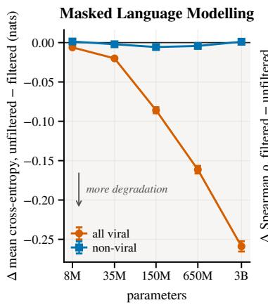

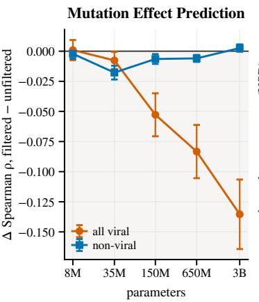

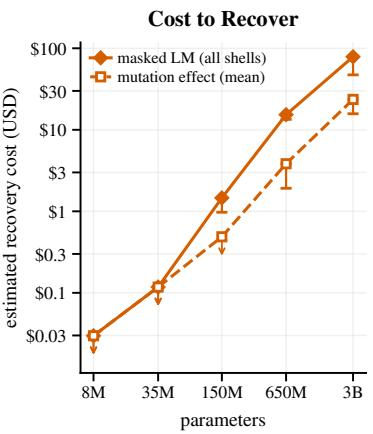  
Figure 1: Filtering viral proteins from the pretraining data selectively degrades performance on tasks related to viral proteins, and more so for larger models. The cost of performance recovery increases with model size. All panels show the tier-0 filtered model, where we exclude all viral proteins and their homologues from the training data, against the unfiltered model of the same size. Left: Comparison of language-modelling performance on held-out viral and non-viral sequences. Middle: Comparison of mutation effect prediction performance for viral and non-viral sequences, on ProteinGym DMS datasets. Intervals represent one standard error of paired differences across sequences (left; $n = 5 ,$ 161 viral, 3,000 non-viral) or assays (middle; $n = 3 1$ viral, 186 non-viral). Right: Estimated fine-tuning cost to recover performance on viral language modelling (solid) or viral mutation effect prediction (mean performance across 45 EVEREST assays (dashed)). Markers show the first recovering checkpoint; bars extend to the preceding checkpoint, and downward arrows mark upper bounds.

This study aims to understand the tamper resistance of data filtering in the case of biological foundation models, using models based on the protein language model family ESM-2 (Lin et al., 2023). Prior work has focused on general-purpose LLMs, but specialised models, such as protein language models, remain understudied. Specialised biological models are driving rapid advances in biotechnology (Jumper et al., 2021; Watson et al., 2023; Notin et al., 2024) and are typically released as open-weight models. They are smaller than frontier AI systems, which makes them easier to train, share and modify. Importantly, misuse of these models can pose substantial dual-use risk in helping with the design of novel hazardous pathogens (Wei et al., 2025).

Here, we pretrain models ranging in size from 8M to 3B parameters, filtering the pretraining data for different sets of proteins: from excluding all viral proteins and homologues, to merely excluding proteins from human-infecting viruses. We evaluate the models on masked language modelling, mutation effect prediction and long-range contact prediction. We subsequently measure the cost of recovering the capability lost through filtering via fine-tuning on the excluded data.

Our main findings are as follows:

1. Across models from 35M to 3B parameters, filtering viral proteins from the pretraining data degrades language modelling performance on viral proteins, without damaging performance on non-viral proteins (Figure 1).

2. Larger models tend to be more strongly affected by filtering across all three of our evaluations.

3. For the filtered models, performance can be entirely restored by fine-tuning on the removed families, with the amount of compute needed increasing as models grow in size.

## 2 RELATED WORK

Approaches to safeguarding open-weight models include: constraining access to an existing capability (e.g. via safety classifiers), removing it after pretraining (post-training interventions), or preventing it from developing during pretraining (pretraining interventions). Post-training interventions include unlearning techniques (Li et al., 2024; Barez et al., 2025; Tamirisa et al., 2025), which attempt to remove capabilities, and training models to refuse dual-use queries, for example, via reinforcement learning from human feedback (RLHF) (Christiano et al., 2017; Ouyang et al., 2022; Bai et al., 2022). These techniques are vulnerable to attacks; jailbreaks or a few hundred steps of adversarial fine-tuning can restore the lost capability at negligible computational cost (Łucki et al., 2025; Deeb & Roger, 2024; Che et al., 2025).

One common pretraining intervention is to filter the pretraining data to remove information relevant to a dual-use capability. This technique is widely used in production models (Grattafiori et al., 2024; Soldaini et al., 2024; Gemma Team, Google DeepMind, 2025) and has been shown to selectively degrade performance on the filtered domain, while leaving performance elsewhere largely intact (Chen et al., 2025; Rathi & Radford, 2026; O’Brien et al., 2026). Compared with post-training interventions, O’Brien et al. (2026) and Rathi & Radford (2026) show that data filtering is more resistant to tampering, requiring orders of magnitude more fine-tuning compute to undo. A second “capability-prevention” technique localises the knowledge relevant to a dual-use capability in a small subset of the model’s parameters during training, so that those parameters can be pruned before deployment (Cloud et al., 2024; Shilov et al., 2025; Roland et al., 2026). An advantage of this technique over data filtering is that it can produce two models: one with the dual-use capability, potentially rolled out only to trusted users, and one without.

For biological foundation models, data filtering has been the safeguard of choice: Evo 2’s training data excludes the genomes of eukaryote-infecting viruses (Brixi et al., 2026), and ESM3-open’s training data excludes a large set of viral proteins (Hayes et al., 2025). For ESM3-open, this has been shown to substantially degrade mutation effect prediction on viral proteins, with little degradation of performance on non-viral proteins (Hayes et al., 2025). What is still untested is how tamper-resistant this safeguard is for biological foundation models, and how that tamper-resistance scales with model size. While Black et al. (2025) show that fine-tuning Evo 2 on excluded viral genomes can improve some dual-use capabilities of the model, we do not know what the model’s performance would have been without filtering. Most relevant to the scaling question, Rathi & Radford (2026) study the scaling properties of data filtering on GPT-2 models up to 1.8B parameters, showing that performance on the forget domain is reduced more by data filtering for larger models. Roland et al. (2026) report the same trend on LLMs from 50M to 5B parameters. Whether these findings will generalise to biological foundation models is still an open question. Our study addresses this gap by pretraining ESM-2 models of varying sizes on datasets with different levels of filtering, and measuring the compute cost of recovering the lost capability through fine-tuning.

## 3 EXPERIMENTAL SETUP

## 3.1 EXCLUSION TIERS

We define six different tiers of viral proteins. These proteins are “viral” in the sense of being UniRef50 cluster representatives annotated to a viral taxon in NCBI Taxonomy. Tiers are progressively numbered Tier 0 through Tier 5, representing increasingly narrow subsets. Tiers 1 through 5 refer to proteins from: (1) all viruses, (2) eukaryote-infecting viruses, (3) human-infecting viruses, (4) viral pathogens of concern, and (5) Influenza A. Tier 0 is defined as all proteins from viruses and their close homologues. Each tier is a strict subset of the previous tier (Figure 2).

## 3.2 MODELS AND PRETRAINING DATA

We train models using the ESM-2 architecture at five different scales: 8M, 35M, 150M, 650M and 3B. ESM-2 is an encoder-only transformer trained with a masked language-modelling objective (Devlin et al., 2019). Following Lin et al. (2023), we derive our data from the 2021 04 version of UniRef50 (Suzek et al., 2015), using only cluster representatives. We hold out a general validation set and a set of per-tier evaluation sequences, and remove training sequences homologous to either. For training, we only use tier0...3 filtered datasets, as well as the unfiltered full dataset. Filtered datasets are constructed by removing the sequences of tier n from the remaining full training set. The exclusion sets are nested so that each filter removes all sequences excluded by the narrower filters (Figure 2). Section A gives the preprocessing pipeline, the homology thresholds, and the size of each corpus.

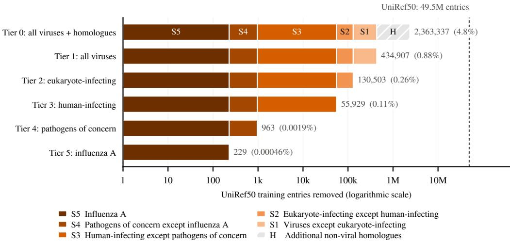  
Figure 2: We exclude nested sets of viral proteins and homologues from the pretraining data. Bars show the number of UniRef50 entries each tier removes from pretraining, on a logarithmic axis. Coloured segments identify shells S1-S5: these are entries that are in one tier but not the next more narrow tier (except S5, which contains influenza A). The hatched segment marks additional non-viral homologues removed by tier 0. We train models on tiers 0 to 3 and evaluate on held-out samples from each of the five viral shells.

## 3.3 PRETRAINING AND FINE-TUNING

We train each model for 150,000 steps with an effective batch size of ≈ 2M tokens and a maximum sequence length of 1024, corresponding to approximately 315B training tokens, batches are built from similar length sequences up to a maximum token count of 2,097,152 using full sequences and padded to a fixed batch size. We use the same number of optimisation steps and the same token budget at all model sizes and datasets. Detailed hyperparameters are stated in Section A. Additionally, for models trained on the tier-1 filtered dataset, we further fine-tune each model on the removed tier 1 sequences in order to measure the ability to recover performance via fine-tuning. Fine-tuning is performed for 5,000 steps, using an effective batch size of 262,144 tokens.

## 3.4 EVALUATION TASKS

We measure the effects of filtering on two domains. The forget domain consists of all viral proteins and represents the domain of inputs on which we seek to degrade performance. The retain domain consists of the remaining non-viral corpus. Filtering succeeds to the extent that it reduces performance on the forget domain without reducing performance on the retain domain.

Model performance is measured in three tasks: language modelling, mutation effect prediction, and long-range contact prediction.

We measure language modelling performance via cross-entropy loss (Salazar et al., 2020) and mutation effect prediction by rank agreement with deep mutational scanning data on ProteinGym substitution assays (Notin et al., 2023) and on EVEREST (Gurev et al., 2025). We score mutations zero-shot by masked marginals (Meier et al., 2021) and report signed Spearman correlations with the benchmark DMS scores, averaged over assays. Negative correlations retain their sign. For long-range contact prediction, we perform a logistic regression mapping a feature representation of each residue pair, its attention weight in each layer and head of the frozen model, to a label expressing whether the pair is in contact or not. We score on length- and assembly-matched viral and non-viral chains from the PDB, and report precision at L over long-range residue pairs. We only consider pairs that are separated by at least 24 residues.

## 3.5 HELD-OUT EVALUATION SETS

For each tier, we create a held-out test set to measure language-modelling performance. Each test set consists of a random sample of sequences unique to a given tier (Figure 2). Each viral entry falls in exactly one of these shells (Figure 8). The language-modelling retain domain set is a 3,000-entry non-viral sample from the same held-out data, which is identical across every training configuration. We drop held-out entries that are near-duplicates of training entries before evaluating a model.

## 3.6 MEASURING RECOVERY

We call a filtered model’s performance “recovered” if it reaches the same performance as the unfiltered model on the metric in question. Because we score models only every few hundred fine-tuning steps, we calculate the compute sufficient for recovery as an interval. We report the cost of recovery in exaFLOPs, and convert it to dollars of H100 time. Section A states the assumptions behind that conversion.

## 4 RESULTS AND DISCUSSION

Our main goal for this study was to understand (i) the effect of filtering viral proteins from the pretraining data on the forget and retain domains, (ii) how recoverable the performance of the unfiltered model is via fine-tuning, and (iii) how those two things change as the models scale.

## 4.1 HOW DOES FILTERING IMPACT RETAIN VS FORGET PERFORMANCE?

Averaging across viral proteins, filtering leads to a statistically significant reduction in masked language-modelling performance for all our models (Table 4). For mutation effect prediction, filtering leads to a significant degradation only for 650M $( - 0 . 0 6 8 , p = 0 . 0 0 3 )$ and 3B (−0.124, $p = 3 \stackrel { - } { \times } 1 0 ^ { - 4 } )$

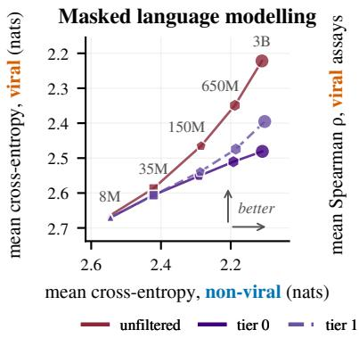

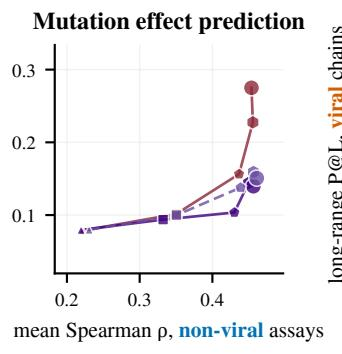

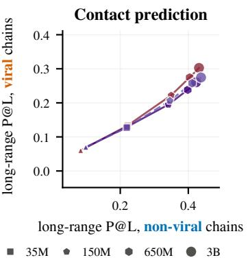  
Figure 3: The degradation of the models’ performance on viral proteins due to filtering grows with scale, while leaving non-viral performance mostly unchanged. All panels show capability evaluations, each with the forget domain vertical and the retain domain horizontal. Each line connects models trained with the same filtering strategy at different scales. The two widest filters, tier 0 and tier 1, are drawn next to the unfiltered model.

The absolute effect of filtering on viral proteins increases for larger models (Figure 3), with the observed effect growing with each step up in scale, consistent with Rathi & Radford (2026). This is because the performance of unfiltered models improves more quickly with scale than the performance of filtered models (Figure 20). On non-viral proteins, performance appears relatively unchanged through filtering (±0.008 nats), and the change is statistically equivalent to zero within a ±0.02 nat margin (two one-sided tests, $p < 3 \times 1 0 ^ { - \cdot \mathrm { { 1 2 } } } ; n = 3 , 0 0 0$ non-viral sequences). This indicates that ESM-2 models’ masked language-modelling capability on non-viral proteins does not improve substantially by training on viral proteins.

On mutation effect prediction, the unfiltered model gains +0.196 Spearman on viral proteins as we scale from 8M to 3B, while the tier-1 filtered model gains +0.071. Performance on non-viral proteins remains roughly the same (+0.232 vs +0.231), meaning that, relative to the unfiltered model, scaling up the tier-1 filtered models captures only a fraction of the improvement on viral mutation effect prediction, and almost all of the performance improvement on non-viral proteins (36% (95% CI 13–60) for viral proteins, 99% (95% CI 96–103) for non-viral proteins Figure 22).

At 650M and 3B, filtering reduces mean Spearman correlation more on viral fitness assays than on viral stability assays (Figures 28 and 29). This is consistent with greater transfer from non-viral to viral tasks depending on the type of prediction.

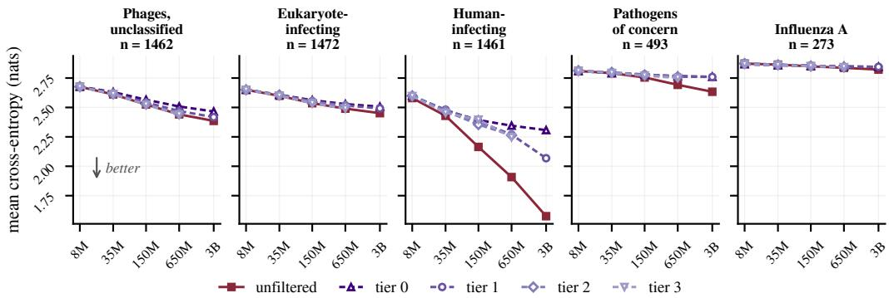  
Figure 4: The filtering effect is concentrated among proteins from human-infecting viruses. Mean cross-entropy on each held-out shell against model size, for the unfiltered model and all four filters. Lower is better. n is the number of held-out entries in that shell (Figure 2). The gap between the filtered and unfiltered models is largest in the human-infecting shell and generally increases with model size. No tier-2 or tier-3 model was trained at 3B.

Most of the effect of filtering on masked language modelling is concentrated among proteins from human-infecting viruses that are not pathogens of concern (Figure 4). This is likely for two reasons: first, this shell is dominated by Retroviridae (Figure 8), which is the viral family on which our unfiltered models perform best (1.05 nats at 3B against 1.64 for the next best, Figure 17). For the tier-1 filtered 3B model, Retroviridae account for most of the total degradation of language modelling performance (≈ 77.5%) among viral families with at least 20 sequences in our test set. Second, a higher baseline level of performance on a viral family is correlated with the absolute degradation for tier 0 at 650M $( \rho = - 0 . 5 0 9 , p = 0 . 0 0 4 )$ and 3B $( \rho = - 0 . 5 2 2 , p = 0 . 0 0 4 )$ , when unfiltered cross-entropy and degradation are estimated on disjoint halves of each family’s held-out sequences (Figure 21).

For mutation effect prediction, most of the effect of filtering is again concentrated on Retroviridae (Figure 5). For 3B filtered at tier-1, Retroviridae is the only family where we can be confident that degradation occurs at all (−0.342 over n = 6 assays, 95% CI [−0.481, −0.203]). Flaviviridae shows the next largest shift (−0.294) but only on three assays, so we cannot be confident in the sign of the change (CI [−0.614, +0.025]). Orthomyxoviridae $( - 0 . 0 1 8 , n = 9 )$ and Siphoviridae $( - 0 . 0 1 0 , n = 5 )$ show almost no degradation. Averaged across the 31 viral assays, the performance degradation is −0.124.

We next test whether filtering is effective on downstream tasks that use the models’ internal representations. Here, we train linear probes on long-range contact prediction: the task of predicting from the model’s attention matrices whether any pair of residues at least 24 amino acids apart in a protein are in contact. The third panel of Figure 3 shows the performance of our unfiltered, tier-1 and tier-0 filtered models. For tier 1, we find that contact prediction performance on viral proteins materially degrades for models with > 35M parameters (−1.58, −1.70 and −2.80 pp at 150M, 650M and 3B), with the absolute effect increasing with model size. For our smallest model (8M) and the two largest models (650M and 3B), we also observe that performance on non-viral proteins improves by filtering (+0.60 pp for 3B and +0.73 pp for 650M). All of these changes are significan at $\dot { p } < 1 0 ^ { - 7 }$ by a one-sample t-test on the per-protein change.

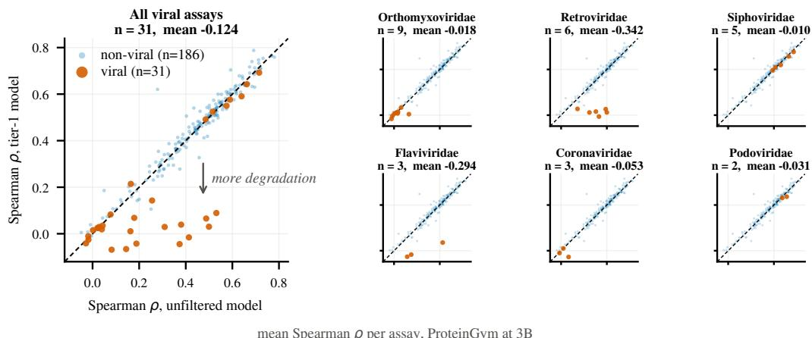  
Figure 5: Filtering lowers rank agreement on viral assays and leaves non-viral assays unchanged. One point per ProteinGym assay at 3B: mean Spearman ρ under the tier-1 model against the unfiltered model. Points below the dashed line were degraded. Viral assays are orange; the same 186 non-viral assays are repeated in blue in every panel. The large panel pools all 31 viral assays, the small ones show one family each. Most of the pooled shift comes from Retroviridae.

## 4.2 HOW TAMPER-RESISTANT IS DATA FILTERING?

We next investigate whether continued fine-tuning recovers the performance lost through filtering. We find that for masked language modelling and mutation effect prediction, a modest computational budget restores performance across model sizes. The most expensive case is recovering masked language modelling at 3B, which takes 14–24 exaFLOPs (1018 FLOPs). At 34% model FLOPs utilisation, that is 12–20 H100-hours, or 47–79 USD at 4 USD per H100-hour.

The cost of full performance recovery increases with model scale on both masked language modelling and mutation effect prediction (Figure 6). Since we score our models every 500 finetuning steps, we report recovery as an interval (Figure 6). On masked language modelling, full recovery for the tier-0 model on the phage and unclassified shell $( n = 1 , 4 6 2 )$ takes 0.29–0.44 exaFLOPs at 150M and 4.1–4.6 exaFLOPs at 650M. At 8M and 35M the filtered model has already recovered by the first checkpoint, placing the cost of recovery below 0.04 exaFLOPs. At 3B, we scored only four checkpoints, and the resulting interval of 14–24 exaFLOPs is wide, although it still does not overlap with 650M. On mutation effect prediction, full recovery takes 0.6–1.2 exaFLOPs at 650M and 4.8–7.1 exaFLOPs at 3B (Figure 24 breaks this down by family), and falls below 0.15 exaFLOPs at 150M and smaller. Since we train all our models on the same pretraining token budget, the fraction of pretraining tokens needed for recovery grows with model size on masked language modelling, contrary to a finding from Rathi & Radford (2026) on GPT-2.

We initially hypothesised that larger models might recover from fewer tokens. While we do find that larger models’ performance improves faster per fine-tuning step (Figure 23), filtering also creates a larger initial performance gap. This larger performance gap more than offsets the greater sample efficiency of larger models, meaning that they require more tokens to recover.

The cost of performance recovery differs between groups of viral proteins (Figure 19): at 650M the pathogens-of-concern shell recovers in 1.2–1.7 exaFLOPs against 4.1–4.6 on the phage and unclassified shell, while the human-infecting and influenza A shells are already at performance parity by the first checkpoint (implying ≤0.6 exaFLOPs). We observe that, of all viral families, our unfiltered model performs best on Retroviridae, and that this family is the single largest contributor to the degradation under filtering. We therefore tested whether recovery of performance on the other families, when withholding it from the fine-tuning corpus, affected our estimates of the compute cost required to match the performance of the unfiltered model. We find that withholding Retroviridae does not make the remaining viral performance harder to recover, fine-tuning restores it at a comparable compute cost across model sizes, up to and including 3B (Figures 25 to 27).

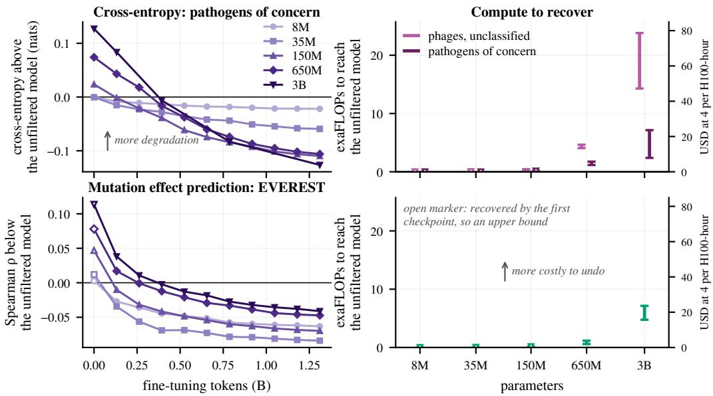  
Figure 6: Continued training on the withheld corpus recovers performance within the first 1.4 billion tokens at every size. Both rows use the tier-0 model. Left: the gap to the same-size unfiltered model, with the same zero line for every size. Right: the fine-tuning compute needed for full recovery, in exaFLOPs, one exaFLOP being $1 0 ^ { \mathsf { { \check { 1 } } 8 } }$ floating-point operations. We report compute rather than tokens because a 3B model spends 4.1 times the FLOPs per token that a 650M model does. We score models every 500 steps. If a bar reaches zero, recovery finished before the first checkpoint. The right-hand scale converts compute to dollars at 34% utilisation and 4 USD per H100-hour.

## 4.3 COMPARING FILTERING STRATEGIES

We train models across four different filtering regimes. In the most stringent regime, we exclude data from all viral proteins and close homologues (tier 0), while in the least stringent, we only exclude human-infecting viral proteins (tier 3). Our goal was to find the filtering strategy that most degrades performance on viral proteins, at the lowest damage to performance elsewhere.

Tier-0 filtered models have higher cross-entropy than tier-3 filtered models on viral proteins $( p < 2 \times 1 0 ^ { - 6 }$ throughout, though no tier-3 model was trained at 3B). At 650M, increasing the number of excluded UniRef entries by $4 2 \times$ (from 0.11% to 4.8%) leads to roughly 1.6× the increase in cross-entropy over the unfiltered model (0.102 to 0.161 nats). The additional measured effect of broader filtering increases for larger models. Importantly, retain performance for tier 0 stays close to the unfiltered model at every size (±0.006 nats).

When filtering only a subset of viral proteins, we observe that the effect of filtering on 650M remains largely limited to those viral families excluded from training, with little general effect on viral language modelling capability for other families (Figure 10).2 Where filtering affects viral families whose training data was not removed, the effect is concentrated in families with few sequences in the held-out set, for which the mean effect for the family is less accurately estimated (Figure 11). This suggests that the effect of data-filtering measures proposed by authors such as Bloomfield et al.

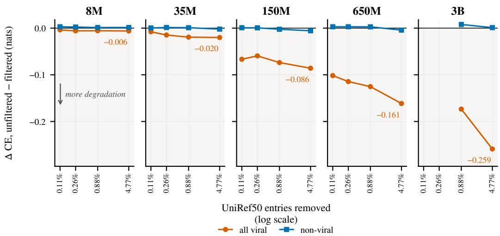  
Figure 7: While the retain performance stays nearly constant, removing more of the corpus leads to more degradation of forget performance for our largest models. All panels plot the unfiltered model’s cross-entropy minus the filtered model’s. The ticks on the x-axis correspond to our filtering tiers 3 (leftmost) to 0 (rightmost).

(2026) could be concentrated on proteins from viral families whose data is controlled, with little effect on performance on other proteins.

## 4.4 LIMITATIONS

Pretraining large protein language models from scratch is expensive. We therefore limited our training runs to a single seed per model, which reduces our confidence about the statistical significance of differences between models at different scales. This computational constraint also limited us to a single model architecture, ESM-2. We do not know how well our claims will apply to other families of models. This is especially the case for retrieval-augmented protein language models, like Protriever (Weitzman et al., 2025) or Tranception (Notin et al., 2022), where in-context learning on viral proteins may make data filtering less effective (as O’Brien et al. (2026) suggests for natural language).

We chose the ESM-2 family because it is one of the most widely used protein language models (Atanasov et al., 2026) and has a relatively well-documented training code. However, ESM-2 models perform relatively poorly on masked language modelling and mutation effect prediction for viral proteins compared to other protein language models (Gurev et al., 2025).

A final limitation is that our measurement of recovery is limited by the checkpoint grid, where we score every 500 fine-tuning steps, or 0.131B tokens. This makes it difficult for us to detect relatively subtle trends in how tamper-resistance changes with model size.

## 5 CONCLUSION

Here we investigated the effectiveness and durability of viral data filtering in protein language models. We found that filtering out all viral proteins substantially degrades performance on three viral prediction tasks: at every model size for masked language modelling, from 150M parameters for long-range contact prediction, and at 650M parameters and above for mutation effect prediction. The effect of filtering increases monotonically with model size. Masked language modelling and mutation effect prediction performance on non-viral proteins is largely preserved. On the matched non-viral controls, the contact prediction performance increased at 8M, 650M, and 3B parameters, with absolute improvements of 0.6–0.7 percentage points at 650M and 3B.

We showed that fine-tuning on excluded viral families recovers the lost performance with at most 24 exaFLOPs, which, at 34% model FLOPs utilisation and 4 USD per H100-hour, costs under 80 USD.

This cost increases with model scale, and so could plausibly become a substantial obstacle for much larger models.

Overall, our findings suggest that data filtering can effectively and selectively suppress capabilities in protein language models, but does not by itself constitute a robust safeguard. Instead, it may be necessary to also control access to the models themselves, or to the data needed to train them on dual-use tasks. For the latter intervention, our findings are encouraging: our models relied on data from a target viral family to become proficient at language modelling, rather than readily generalising that capability from other families.

## REPRODUCIBILITY STATEMENT

The paper and appendix detail all information needed to reproduce our results. Appendix A.1 gives the corpus, the held-out splits, the MMseqs2 homology search and thresholds used to remove evaluation homologues, and the taxonomic rules and manual corrections defining each exclusion tier, and Table 1 gives the resulting corpus sizes. Appendix A.2 and Table 3 give the architecture, full pretraining and fine-tuning hyperparameters, and Table 2 lists every size-corpus pair we trained. Appendix A.3 describes the fine-tuning datasets, and Appendix A.4 states the recovery criterion, the checkpoint grid and the FLOP-counting and cost assumptions behind the dollar figures. Appendix A.5 gives the scoring procedure for each evaluation: the masked-marginals formula and assay counts for mutation effect prediction, and the probe, contact definition and PDB filtering criteria (Table 4) for contact prediction.

## USE OF LARGE LANGUAGE MODELS

Large language models (LLMs) were used for coding, debugging and documentation of the code that supports this work, to produce the figures in this paper, to verify all the results against our data and for minor text edits.

## REFERENCES

David Atanasov, Niccolo Zanichelli, and Jean-Stanislas Denain. Expanding our anal-\` ysis of biological AI models, 2026. URL https://epoch.ai/publications/ expanding-our-analysis-of-biological-ai-models. Accessed: 2026-09-20. (cited on page 9)

Yuntao Bai, Andy Jones, Kamal Ndousse, Amanda Askell, Anna Chen, Nova DasSarma, Dawn Drain, Stanislav Fort, Deep Ganguli, Tom Henighan, Nicholas Joseph, Saurav Kadavath, Jackson Kernion, Tom Conerly, Sheer El-Showk, Nelson Elhage, Zac Hatfield-Dodds, Danny Hernandez, Tristan Hume, Scott Johnston, Shauna Kravec, Liane Lovitt, Neel Nanda, Catherine Olsson, Dario Amodei, Tom Brown, Jack Clark, Sam McCandlish, Chris Olah, Ben Mann, and Jared Kaplan. Training a helpful and harmless assistant with reinforcement learning from human feedback. arXiv preprint arXiv:2204.05862, 2022. (cited on page 3)

Fazl Barez, Tingchen Fu, Ameya Prabhu, Stephen Casper, Amartya Sanyal, Adel Bibi, Aidan O’Gara, Robert Kirk, Ben Bucknall, Tim Fist, Luke Ong, Philip Torr, Kwok-Yan Lam, Robert Trager, David Krueger, Soren Mindermann, Jos ¨ e Hernandez-Orallo, Mor Geva, and Yarin Gal. Open ´ problems in machine unlearning for AI safety. arXiv preprint arXiv:2501.04952, 2025. (cited on page 3)

Helen M. Berman, John Westbrook, Zukang Feng, Gary Gilliland, T. N. Bhat, Helge Weissig, Ilya N. Shindyalov, and Philip E. Bourne. The Protein Data Bank. Nucleic Acids Research, 28(1):235–242, 2000. doi: 10.1093/nar/28.1.235. (cited on page 18)

James R. M. Black, Moritz S. Hanke, Aaron Maiwald, Tina Hernandez-Boussard, Oliver M. Crook, and Jaspreet Pannu. Open-weight genome language model safeguards: Assessing robustness via adversarial fine-tuning. arXiv preprint arXiv:2511.19299, 2025. Submitted 2025-11-24; revised 2026-03-23. (cited on page 3)

Doni Bloomfield, Allison Berke, Moritz S. Hanke, Aaron Maiwald, James R. M. Black, Toby Webster, Tina Hernandez-Boussard, Oliver M. Crook, and Jassi Pannu. Securing dual-use pathogen data of concern, 2026. URL https://arxiv.org/abs/2602.08061. (cited on page 8)

Garyk Brixi, Matthew G. Durrant, Jerome Ku, Mohsen Naghipourfar, Michael Poli, Gwanggyu Sun, et al. Genome modelling and design across all domains of life with Evo 2. Nature, 652:1349–1361, 2026. doi: 10.1038/s41586-026-10176-5. Preprint: bioRxiv 2025.02.18.638918. (cited on page 3)

Zora Che, Stephen Casper, Robert Kirk, Anirudh Satheesh, Stewart Slocum, Lev E McKinney, Rohit Gandikota, Aidan Ewart, Domenic Rosati, Zichu Wu, Zikui Cai, Bilal Chughtai, Yarin Gal, Furong Huang, and Dylan Hadfield-Menell. Model tampering attacks enable more rigorous evaluations of LLM capabilities. Transactions on Machine Learning Research, 2025. (cited on pages 1 and 3)

Yanda Chen, Mycal Tucker, Nina Panickssery, Tony Wang, Francesco Mosconi, Anjali Gopal, Carson Denison, Linda Petrini, Jan Leike, Ethan Perez, and Mrinank Sharma. Enhancing model safety through pretraining data filtering. Anthropic Alignment Science Blog, 2025. URL https:// alignment.anthropic.com/2025/pretraining-data-filtering/. Published 2025-08-19; accessed 2026-09-16. (cited on page 3)

Paul Christiano, Jan Leike, Tom B. Brown, Miljan Martic, Shane Legg, and Dario Amodei. Deep reinforcement learning from human preferences. arXiv preprint arXiv:1706.03741, 2017. (cited on page 3)

Alex Cloud, Jacob Goldman-Wetzler, Evzen Wybitul, Joseph Miller, and Alexander Matt Turner. ˇ Gradient routing: Masking gradients to localize computation in neural networks. arXiv preprint arXiv:2410.04332, 2024. (cited on page 3)

Aghyad Deeb and Fabien Roger. Do unlearning methods remove information from language model weights? arXiv preprint arXiv:2410.08827, 2024. (cited on pages 1 and 3)

Jacob Devlin, Ming-Wei Chang, Kenton Lee, and Kristina Toutanova. BERT: Pre-training of deep bidirectional transformers for language understanding. In Proceedings ofthe 2019 Conference of the North American Chapter of the Association for Computational Linguistics: Human Language Technologies (NAACL-HLT), pp. 4171–4186, 2019. doi: 10.18653/v1/N19-1423. (cited on pages 3 and 15)

Gemma Team, Google DeepMind. Gemma 3 technical report. arXiv preprint arXiv:2503.19786, 2025. (cited on page 3)

Aaron Grattafiori, Abhimanyu Dubey, Abhinav Jauhri, et al. The Llama 3 herd of models. arXiv preprint arXiv:2407.21783, 2024. Llama Team, AI @ Meta; v1 2024-07-31, v3 2024-11-23. (cited on pages 3 and 17)

Sarah Gurev, Noor Youssef, Navami Jain, Aarushi Mehrotra, Sarrah Rose Mikhail Leung, Abigail Jackson, and Debora Marks. Evaluating variant effect prediction across viruses. bioRxiv, 2025. doi: 10.1101/2025.08.04.668549. v1 (Aug 2025) titled “Variant effect prediction with reliability estimation across priority viruses”; introduces the EVEREST benchmark. (cited on pages 4, 9, and 17)

Thomas Hayes, Roshan Rao, Halil Akin, Nicholas J. Sofroniew, Deniz Oktay, Zeming Lin, et al. Simulating 500 million years of evolution with a language model. Science, 387(6736):850–858, 2025. doi: 10.1126/science.ads0018. (cited on page 3)

Fransiskus Xaverius Ivan and Chee Keong Kwoh. Rule-based meta-analysis reveals the major role of PB2 in influencing influenza A virus virulence in mice. BMC Genomics, 20(Suppl 9):973, 2019. doi: 10.1186/s12864-019-6295-8. (cited on page 14)

John Jumper, Richard Evans, Alexander Pritzel, Tim Green, Michael Figurnov, Olaf Ronneberger, Kathryn Tunyasuvunakool, Russ Bates, Augustin Zˇ ´ıdek, Anna Potapenko, et al. Highly accurate protein structure prediction with AlphaFold. Nature, 596(7873):583–589, 2021. doi: 10.1038/ s41586-021-03819-2. (cited on page 2)

Nathaniel Li, Alexander Pan, Anjali Gopal, Summer Yue, Daniel Berrios, Alice Gatti, Justin D. Li, Ann-Kathrin Dombrowski, Shashwat Goel, Long Phan, et al. The WMDP benchmark: Measuring and reducing malicious use with unlearning. In Proceedings ofthe 41st International Conference on Machine Learning (ICML), volume 235 of Proceedings of Machine Learning Research, pp. 28525–28550. PMLR, 2024. (cited on page 3)

Zeming Lin, Halil Akin, Roshan Rao, Brian Hie, Zhongkai Zhu, Wenting Lu, Nikita Smetanin, Robert Verkuil, Ori Kabeli, Yaniv Shmueli, Allan dos Santos Costa, Maryam Fazel-Zarandi, Tom Sercu, Salvatore Candido, and Alexander Rives. Evolutionary-scale prediction of atomic-level protein structure with a language model. Science, 379(6637):1123–1130, 2023. doi: 10.1126/ science.ade2574. (cited on pages 2, 3, 14, and 15)

Ilya Loshchilov and Frank Hutter. Decoupled weight decay regularization. arXiv preprint arXiv:1711.05101, 2017. (cited on page 15)

Jakub Łucki, Boyi Wei, Yangsibo Huang, Peter Henderson, Florian Tramer, and Javier Rando. An\` adversarial perspective on machine unlearning for AI safety. Transactions on Machine Learning Research, 2025. (cited on pages 1 and 3)

Joshua Meier, Roshan Rao, Robert Verkuil, Jason Liu, Tom Sercu, and Alexander Rives. Language models enable zero-shot prediction of the effects of mutations on protein function. bioRxiv, 2021. doi: 10.1101/2021.07.09.450648. Also in Advances in Neural Information Processing Systems 34 (NeurIPS 2021). (cited on pages 4 and 18)

Tomoko Mihara, Yosuke Nishimura, Yugo Shimizu, Hiroki Nishiyama, Genki Yoshikawa, Hideya Uehara, Pascal Hingamp, Susumu Goto, and Hiroyuki Ogata. Linking virus genomes with host taxonomy. Viruses, 8(3):66, 2016. doi: 10.3390/v8030066. (cited on page 15)

Pascal Notin, Mafalda Dias, Jonathan Frazer, Javier Marchena-Hurtado, Aidan Gomez, Debora S. Marks, and Yarin Gal. Tranception: protein fitness prediction with autoregressive transformers and inference-time retrieval. In Proceedings of the 39th International Conference on Machine Learning (ICML), 2022. (cited on page 9)

Pascal Notin, Aaron W. Kollasch, Daniel Ritter, Lood van Niekerk, Steffanie Paul, Hansen Spinner, Nathan Rollins, Ada Shaw, Ruben Weitzman, Jonathan Frazer, Mafalda Dias, Dinko Franceschi, Rose Orenbuch, Yarin Gal, and Debora S. Marks. ProteinGym: Large-scale benchmarks for protein design and fitness prediction. bioRxiv, 2023. doi: 10.1101/2023.12.07.570727. Also NeurIPS 2023 Datasets and Benchmarks Track. (cited on pages 4 and 17)

Pascal Notin, Nathan Rollins, Yarin Gal, Chris Sander, and Debora Marks. Machine learning for functional protein design. Nature Biotechnology, 42(2):216–228, 2024. doi: 10.1038/ s41587-024-02127-0. (cited on page 2)

Kyle O’Brien, Stephen Casper, Quentin Anthony, Tomek Korbak, Robert Kirk, Xander Davies, Ishan Mishra, Geoffrey Irving, Yarin Gal, and Stella Biderman. Deep ignorance: Filtering pretraining data builds tamper-resistant safeguards into open-weight LLMs. In International Conference on Learning Representations (ICLR), 2026. arXiv:2508.06601v2. (cited on pages 1, 2, 3, and 9)

Long Ouyang, Jeff Wu, Xu Jiang, Diogo Almeida, Carroll L. Wainwright, Pamela Mishkin, Chong Zhang, Sandhini Agarwal, Katarina Slama, Alex Ray, John Schulman, Jacob Hilton, Fraser Kelton, Luke Miller, Maddie Simens, Amanda Askell, Peter Welinder, Paul Christiano, Jan Leike, and Ryan Lowe. Training language models to follow instructions with human feedback. arXiv preprint arXiv:2203.02155, 2022. (cited on page 3)

Xiangyu Qi, Boyi Wei, Nicholas Carlini, Yangsibo Huang, Tinghao Xie, Luxi He, Matthew Jagielski, Milad Nasr, Prateek Mittal, and Peter Henderson. On evaluating the durability of safeguards for open-weight LLMs. In International Conference on Learning Representations (ICLR), 2025. (cited on page 1)

Roshan Rao, Joshua Meier, Tom Sercu, Sergey Ovchinnikov, and Alexander Rives. Transformer protein language models are unsupervised structure learners. In International Conference on Learning Representations (ICLR), 2021. doi: 10.1101/2020.12.15.422761. (cited on page 18)

Neil Rathi and Alec Radford. Shaping capabilities with token-level data filtering. arXiv preprint arXiv:2601.21571, 2026. (cited on pages 1, 3, 5, and 7)

Ethan Roland, Murat Cubuktepe, Erick Martinez, Stijn Servaes, Keenan Pepper, Mike Vaiana, Diogo Schwerz de Lucena, Judd Rosenblatt, Addie Foote, Cem Anil, and Alex Cloud. Modular pretraining enables access control. arXiv preprint arXiv:2607.08077, 2026. Submitted 2026-07-09. (cited on page 3)

Julian Salazar, Davis Liang, Toan Q. Nguyen, and Katrin Kirchhoff. Masked language model scoring. In Proceedings of the 58th Annual Meeting of the Association for Computational Linguistics, pp. 2699–2712, 2020. doi: 10.18653/v1/2020.acl-main.240. (cited on pages 4 and 17)

Conrad L. Schoch, Stacy Ciufo, Mikhail Domrachev, Carol L. Hotton, Sivakumar Kannan, Rogneda Khovanskaya, Detlef Leipe, Richard McVeigh, Kathleen O’Neill, Barbara Robbertse, Shobha Sharma, Vladimir Soussov, John P. Sullivan, Lu Sun, Sean Turner, and Ilene Karsch-Mizrachi.´ NCBI Taxonomy: a comprehensive update on curation, resources and tools. Database, 2020: baaa062, 2020. doi: 10.1093/database/baaa062. (cited on page 15)

Igor Shilov, Alex Cloud, Aryo Pradipta Gema, Jacob Goldman-Wetzler, Nina Panickssery, Henry Sleight, Erik Jones, and Cem Anil. Beyond data filtering: Knowledge localization for capability removal in LLMs. arXiv preprint arXiv:2512.05648, 2025. (cited on page 3)

Luca Soldaini, Rodney Kinney, Akshita Bhagia, Dustin Schwenk, David Atkinson, Russell Authur, Ben Bogin, Khyathi Chandu, Jennifer Dumas, Yanai Elazar, Valentin Hofmann, Ananya Jha, Sachin Kumar, Li Lucy, Xinxi Lyu, Nathan Lambert, Ian Magnusson, Jacob Morrison, Niklas Muennighoff, Aakanksha Naik, Crystal Nam, Matthew Peters, Abhilasha Ravichander, Kyle Richardson, Zejiang Shen, Emma Strubell, Nishant Subramani, Oyvind Tafjord, Evan Walsh, Luke Zettlemoyer, Noah Smith, Hannaneh Hajishirzi, Iz Beltagy, Dirk Groeneveld, Jesse Dodge, and Kyle Lo. Dolma: an open corpus of three trillion tokens for language model pretraining research. In Proceedings of the 62nd Annual Meeting of the Association for Computational Linguistics (Volume 1: Long Papers), pp. 15725–15788. Association for Computational Linguistics, 2024. doi: 10.18653/v1/2024.acl-long.840. (cited on page 3)

Baris E. Suzek, Yuqi Wang, Hongzhan Huang, Peter B. McGarvey, Cathy H. Wu, and UniProt Consortium. UniRef clusters: a comprehensive and scalable alternative for improving sequence similarity searches. Bioinformatics, 31(6):926–932, 2015. doi: 10.1093/bioinformatics/btu739. (cited on page 3)

Rishub Tamirisa, Bhrugu Bharathi, Long Phan, Andy Zhou, Alice Gatti, Tarun Suresh, Maxwell Lin, Justin Wang, Rowan Wang, Ron Arel, Andy Zou, Dawn Song, Bo Li, Dan Hendrycks, and Mantas Mazeika. Tamper-resistant safeguards for open-weight LLMs. In International Conference on Learning Representations (ICLR), 2025. (cited on pages 1 and 3)

Joseph L. Watson, David Juergens, Nathaniel R. Bennett, Brian L. Trippe, Jason Yim, Helen E. Eisenach, Woody Ahern, Andrew J. Borst, Robert J. Ragotte, Lukas F. Milles, et al. De novo design of protein structure and function with RFdiffusion. Nature, 620(7976):1089–1100, 2023. doi: 10.1038/s41586-023-06415-8. (cited on page 2)

Boyi Wei, Zora Che, Nathaniel Li, Udari Madhushani Sehwag, Jasper Gotting, Samira Nedungadi,¨ Julian Michael, Summer Yue, Dan Hendrycks, Peter Henderson, Zifan Wang, Seth Donoughe, and Mantas Mazeika. Best practices for biorisk evaluations on open-weight bio-foundation models. arXiv preprint arXiv:2510.27629, 2025. (cited on page 2)

Ruben Weitzman, Peter Mørch Groth, Lood Van Niekerk, Aoi Otani, Yarin Gal, Debora Marks, and Pascal Notin. Protriever: End-to-end differentiable protein homology search for fitness prediction. In Proceedings of the 42nd International Conference on Machine Learning (ICML), 2025. (cited on page 9)

Qiusi Zhan, Richard Fang, Rohan Bindu, Akul Gupta, Tatsunori Hashimoto, and Daniel Kang. Removing RLHF protections in GPT-4 via fine-tuning. In Proceedings ofthe 2024 Conference of the North American Chapter of the Association for Computational Linguistics: Human Language Technologies (Volume 2: Short Papers), pp. 681–687. Association for Computational Linguistics, 2024. doi: 10.18653/v1/2024.naacl-short.59. (cited on page 1)

## APPENDIX

## A EXTENDED EXPERIMENTAL SETUP

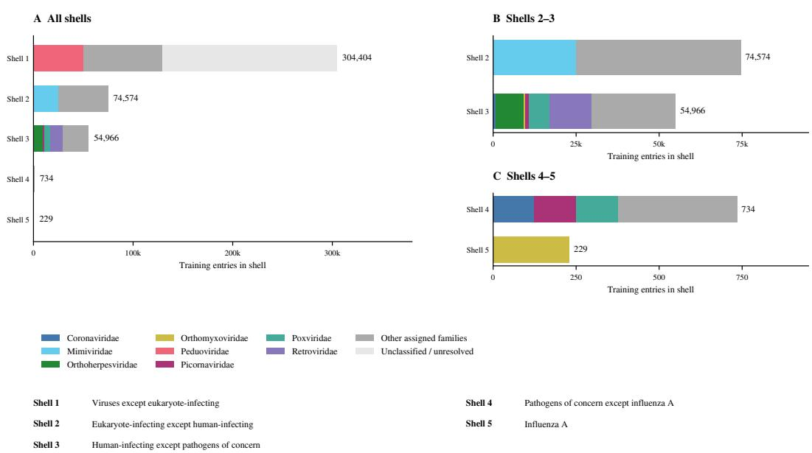  
Figure 8: Distribution of viral families across shells. Each bar is a shell, and its segments show how that shell’s entries are distributed across viral families. This complements the tier-level view in Figure 2.

## A.1 PRETRAINING DATA

## A.1.1 CORPUS AND SPLITS

Following Lin et al. (2023), we use data from UniRef50, 2021 04 to train our models. We use only sequences from the 49,874,565 cluster representatives. We exclude 35,036 sequences with greater than 10% X residues, representing unknown amino acids. We then split the remaining sequences into a training set and held-out sets. The held-out set comprises a random sample of 0.5% of the data (≈ 250,000 sequences), which we use for monitoring validation loss during training and an additional set of proteins from each tier shell. For each tier $k \in \{ 1 , \ldots , 5 \}$ , we draw a fixed number of sequences from those excluded by tier k but by no narrower tier $( k + 1 , \ldots , 5 )$ . This is used in our cross-entropy evaluations. The held-out set is fixed across all models. MMseqs2 is then used to search the training set for homologues to our tier-specific evaluation set, and to wild-type proteins from ProteinGym and an additional set of 917 Influenza A proteins, covering the strains of the mouse-virulence dataset of Ivan & Kwoh (2019), using easy-search -c 0.8 --cov-mode 0. Every training sequence aligning to a query at fident $\geq 0 . 8$ is dropped.

The four filtered training sets each remove one tier’s sequences from the training set. Membership is decided per row from the cluster representative’s taxonomy identifier (Section A.1.2). Because the exclusion sets are nested, so are the corpora: tier0-filtered ⊂ tier1-filtered ⊂ $\mathtt { t i e r 2 - f i l t e r e d C \ t i e r 3 - f i l t e r e d C \ f u l l }$ , which we verify row by row on the materialised datasets. Table 1 gives their sizes.

We run a final search to remove additional viral evaluation homologues from the training data, querying the 5,161 held-out viral sequences, we union search --min-seq-id 0.8 -c 0.8 --cov-mode 1 with --cov-mode 2, accepting $\mathtt { f i d e n t } \ge 0 . 8 \mathrm { a t } \ge 0 . 8$ coverage of either sequence. Applied to viral sequences only, this leaves a full training set of 49,507,711. This is run only on full, after the filtered datasets are generated.

## A.1.2 DATA LABELLING AND TIER ASSIGNMENT

NCBI Taxonomy (Schoch et al., 2020) version 2026-06-01 and Virus-Host DB (Mihara et al., 2016) release 228 are used in determining tier membership. Tier 1 comprises all sequences whose taxonomy identifier is in the NCBI Taxonomy viral subtree rooted at taxid 10239. Since tiers are nested, each additional tier, with the exception of tier 0, is a subset of tier 1. Tier 2 (eukaryote-infecting viruses) comprises every representative whose taxonomy identifier descends from a virus family with at least one eukaryotic host in Virus-Host DB. Tier 3 (human-infecting viruses) applies the same rule with human hosts. Tier 4 (viral pathogens of concern) contains all members of tier 3 (human-infecting) which also appear on at least one of the following biosecurity control lists: the Australia Group’s List of Human and Animal Pathogens and Toxins for Export Control (excluding its warning list), or the U.S. HHS (42 CFR 73), USDA Veterinary Services (9 CFR 121) or USDA Plant Protection and Quarantine (7 CFR 331) select-agent lists. Two manual corrections apply: nine taxa on those lists cannot be matched to an NCBI taxon automatically and are added by hand, and one spurious match is removed. We also add Andes, Choclo and Dobrava orthohantavirus, which cause human disease but carry no human host record in Virus-Host DB.

Tier 0 is constructed by aligning every tier 1 viral sequence against the corpus using MMseqs2 with --min-coverage 0.8 --cov-mode 0 then selecting sequences with 30% identity or greater. The tier 0 filter is the union of this and tier 1 sequences. Table 1 gives the size of the corpora we pretrain on.

Table 1: The pretraining corpora. Each filtered dataset is the unfiltered UniRef50 corpus with that tier’s entries removed. The tiers are nested, so a wider tier removes everything a narrower one does. The full dataset underwent an additional filter, removing 9,766 additional evaluation homologues after the tier-filtered datasets were constructed.
<table><tr><td>Dataset</td><td>Removes</td><td>Sequences</td><td>Removed</td><td>% Removed</td></tr><tr><td>UniRef50 2021_04</td><td></td><td>49,874,565</td><td></td><td></td></tr><tr><td>full</td><td></td><td>49,507,711</td><td>0</td><td>0</td></tr><tr><td>tier0 filtered</td><td>tier 1 + homologues</td><td>47,154,140</td><td>2,363,337</td><td>4.77</td></tr><tr><td>tierl filtered</td><td>all viruses</td><td>49,082,570</td><td>434,907</td><td>0.878</td></tr><tr><td>tier2 filtered</td><td>eukaryote-infecting families</td><td>49,386,974</td><td>130,503</td><td>0.264</td></tr><tr><td>tier3 filtered</td><td>human-infecting families</td><td>49,461,548</td><td>55,929</td><td>0.113</td></tr></table>

## A.2 PRE-TRAINING

We train models across five sizes: 8M, 35M, 150M, 650M and 3B parameters. The model architecture matches that of ESM-2 as described in Lin et al. (2023). Pretraining hyperparameters are identical across all model sizes, except that gradients are clipped to a maximum norm of 1.0 at 3B; no clipping was applied at other sizes. All models are trained for 150,000 steps with a batch size of ≈2M tokens. We use the ESM-2 tokeniser from the facebook/esm2 \* Hugging Face checkpoints. Sequences are truncated to 1024 tokens, including <cls> and <eos> tokens, leaving at most 1022 residues. For the masked language-modelling objective, 15% of residue positions are selected; of these, 80% are replaced with the mask token, 10% with a random token, and 10% are left unchanged, following Devlin et al. (2019).

Model weights are randomly initialised and trained using the AdamW optimiser (Loshchilov & Hutter, 2017) with $\beta _ { 1 } = 0 . 9 , \beta _ { 2 } = 0 . 9 8$ , a weight decay of 0.01, and a peak learning rate of $4 \times 1 0 ^ { - 4 }$ The learning rate follows a linear warmup over 2,000 steps and a linear decay to $\overline { { 2 . 9 3 } } \times 1 0 ^ { - 4 }$ over the remaining steps. This matches the shape of the ESM-2 schedule, but we stop at 150,000 steps rather than the 500,000 ESM-2 uses. We chose to train for 150,000 steps instead of the 500,000 used in Lin et al. (2023) due to compute budget. Figure 9 compares our unfiltered model against the stock ESM-2 checkpoint at each size. We find that mutation effect prediction is largely the same across the two models: mean Spearman over the 217 ProteinGym assays is below ESM-2 at every size, but by at most 0.016. Held-out cross-entropy diverges after 150M, reaching 0.076 nats at 650M and 0.125 at 3B. Table 2 lists the models we pretrained. We train models at bf16 precision, using the PyTorch autocast feature. For every size, we train on the full corpus and on tier exclusions 0 to 3, with the exception that 3B is only trained on the unfiltered, tier-0 and tier-1 corpora.

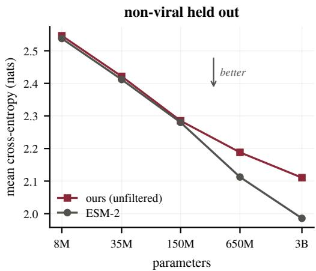

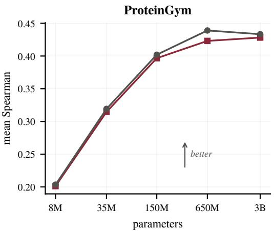  
Figure 9: Our models have similar mutation effect prediction performance to ESM-2 and higher cross-entropy at 650M and 3B parameters. We compare each unfiltered model with the corresponding facebook/esm2 checkpoint. Left: mean cross-entropy over 3,000 non-viral heldout sequences. Right: mean Spearman correlation over 217 ProteinGym substitution assays. These held-out sequences are excluded from our training corpus. ESM-2’s training splits are unpublished, so overlap with these sequences is unknown.

Table 2: Pretrained models. A check marks a model size-corpus pair for which a model was pretrained and evaluated. The corpora are the UniRef50 pretraining corpus and the nested tier exclusions of Figure 2.
<table><tr><td rowspan="2">Size</td><td colspan="5">Training corpus</td></tr><tr><td>Full</td><td>Tier 0</td><td>Tier 1</td><td>Tier 2</td><td>Tier 3</td></tr><tr><td>8M</td><td>√</td><td>√</td><td>√</td><td>√</td><td>√</td></tr><tr><td>35M</td><td>√</td><td>√</td><td>√</td><td>√</td><td>√</td></tr><tr><td>150M</td><td>V</td><td>√</td><td>√</td><td>√</td><td>V</td></tr><tr><td>650M</td><td>√</td><td>V</td><td>V</td><td>V</td><td>V</td></tr><tr><td>3B</td><td>√</td><td>√</td><td>√</td><td>一</td><td>一</td></tr></table>

## A.3 FINE-TUNING

The filtered models are fine-tuned on two different datasets: the 434,907 tier-1 viral sequences excluded during tier-1 filtering and, separately, on the same data with Retroviridae sequences removed (leaving 422,204 sequences). Each fine-tuning run is initialised from the final pre-training checkpoint, producing two new models from each pretrained checkpoint. For every fine-tuning run, we use an effective batch of 262,144 tokens for 5,000 steps, totalling ≈1.31B tokens. The learning rate is $5 \times 1 0 ^ { - 5 }$ , warmed up linearly over 100 steps and decayed linearly to one tenth of that over the remaining steps. All other hyperparameters are identical to the pretraining setup. Table 3 gives both settings in full.

## A.4 MEASURING RECOVERY

We define performance recovered at the first scored checkpoint where the fine-tuned filtered model reaches or exceeds the performance of the unfiltered model on the metric in question. Because we score on a 500-step grid, we report the bracket between the checkpoints on either side of the crossing rather than interpolating inside it. Where a model has already recovered by the first checkpoint, only the upper edge of the bracket is informative.

Table 3: Pretraining and fine-tuning hyperparameters. Values are shared across model sizes except where noted. Effective batchsizes are powers of two: $2 ^ { 2 1 } = 2 , 0 9 7 , 1 5 2$ and $2 ^ { 1 8 } = 2 6 2 ,$ ,144 tokens. The pretraining schedule decays linearly towards a floor of one tenth of the peak learning rate at 500,000 steps, but the run stops at 150,000 steps, where the learning rate is $2 . 9 3 \times 1 0 ^ { - 4 }$ . The fine-tuning schedule reaches its floor at the final step.
<table><tr><td></td><td>Pretraining</td><td>Fine-tuning</td></tr><tr><td>Steps</td><td>150,000</td><td> $5 { , } 0 0 0$ </td></tr><tr><td>Effective batch</td><td> $2 ^ { 2 1 } \mathrm { t o k e n s }$ </td><td> $2 ^ { 1 8 }$  tokens</td></tr><tr><td>Total tokens</td><td> ${ \approx } 3 1 5 \mathrm { B }$ </td><td> ${ \approx } 1 . 3 1 \mathrm { B }$ </td></tr><tr><td>Peak learning rate</td><td> $4 \times 1 0 ^ { - 4 }$ </td><td> $5 \times 1 0 ^ { - 5 }$ </td></tr><tr><td>Warmup steps</td><td>2,000</td><td>100</td></tr><tr><td>Decay horizon</td><td>500,000 steps</td><td>5,000 steps</td></tr><tr><td>Learning-rate floor</td><td>peak/10</td><td>peak/10</td></tr><tr><td>Optimiser</td><td>AdamW</td><td>AdamW</td></tr><tr><td> $( \beta _ { 1 } , \beta _ { 2 } )$ </td><td>(0.9,0.98)</td><td>(0.9,0.98)</td></tr><tr><td>Weight decay</td><td>0.01</td><td>0.01</td></tr><tr><td>Gradient clipping</td><td>1.0 at 3B only</td><td>1.0 at 3B only</td></tr><tr><td>Maximum sequence length</td><td>1024 tokens</td><td>1024 tokens</td></tr><tr><td>Precision</td><td>bf16 mixed</td><td>bf16 mixed</td></tr><tr><td>Parallelism</td><td>DDP; FSDP at 3B</td><td>DDP; FSDP at 3B</td></tr></table>

We count fine-tuning compute as $\left( 6 N + 1 2 L s d \right) D$ for N parameters, L layers, width $d ,$ context $s = 1 0 2 4$ and D tokens: the usual 6ND, plus the attention-matrix term that 6ND omits. Because the mean sequence is far shorter than the context, this overcounts the attention term, so the reported cost is an upper bound.

We convert compute to H100-hours using a conservative estimate of 34% model-FLOPs utilisation against a 989 TFLOP/s bf16 dense peak (compared to measurements of 38-43% reported by Grattafiori et al. (2024)), and convert H100-hours to dollars at a nominal 4 USD per H100-hour (approximated based on market rates for an eight-H100-SXM instance, at the time of writing).

Masked-language-modelling recovery at 3B is read from four checkpoints, at 500, 1,500, 3,000 and 5,000 steps, rather than the ten available at other sizes. Its bracket is correspondingly the widest we report.

## A.5 EVALUATION

## A.5.1 LANGUAGE MODELLING

For each sequence x, we mask one residue at a time and score the original residue given the remaining context (Salazar et al., 2020). Let $A ( x )$ be the positions occupied by standard amino acids after truncation to the first 1,022 residues; two special tokens give a maximum input length of 1,024. With $x ^ { ( i ) }$ denoting the sequence masked at position i, we compute

$$
c _ { \theta } ( x ) = - { \frac { 1 } { \vert A ( x ) \vert } } \sum _ { i \in A ( x ) } \log p _ { \theta } ( x _ { i } \mid x ^ { ( i ) } ) , \qquad \mathrm { C E } _ { \theta } ( D ) = { \frac { 1 } { \vert D \vert } } \sum _ { x \in D } c _ { \theta } ( x ) .\tag{1}
$$

Every eligible residue is scored; nonstandard residues remain in the context but are excluded as targets. Sequences receive equal weight irrespective of length, and individual-sequence pseudo-perplexity is $\exp ( c _ { \theta } ( x ) )$ ). Standard errors are the sample standard deviation of sequence cross-entropies divided by $\sqrt { | D | }$ ; they describe variation across evaluation sequences. Pooled viral results weight shell means by sequence counts and combine within-shell and between-shell sums of squares for the standard error.

## A.5.2 MUTATION EFFECT PREDICTION

We present results from two deep mutational scanning (DMS) benchmarks: ProteinGym (Notin et al., 2023) and EVEREST (Gurev et al., 2025). We score 217 ProteinGym substitution assays, 31 of

which are from viral proteins and 186 from non-viral proteins. EVEREST consists of 45 viral assays, 23 of which appear in ProteinGym. We report results from ProteinGym and EVEREST separately rather than in aggregate.

Mutations are scored zero-shot using masked marginals (Meier et al., 2021). For a mutation from wild-type residue a to mutant residue b at position i, the score is the log-odds of the mutant relative to the wild type when position i is masked:

$$
s ( i , a  b ) = \log p _ { \theta } \Big ( x _ { i } = b \mid x ^ { ( i ) } \Big ) - \log p _ { \theta } \Big ( x _ { i } = a \mid x ^ { ( i ) } \Big ) ,\tag{2}
$$

where $\boldsymbol { x } ^ { ( i ) }$ denotes the sequence with position i masked. Proteins longer than 1022 residues are cropped to a 1022-residue window centred on the mutation site, following ProteinGym; with the <cls> and <eos> tokens, this matches the 1024-token context used in training.

For multi-site substitutions, we sum the site scores. We report the unweighted mean of per-assay signed Spearman correlations, retaining negative correlations, with standard errors across assays. To compare the effect of data filtering on fitness vs stability prediction, we split ProteinGym and EVEREST by assay type, reporting ProteinGym viral, ProteinGym non-viral and EVEREST viral results separately.

## A.5.3 CONTACT PREDICTION

Following Rao et al. (2021), contact prediction is trained over the attention maps of the frozen model. For residue pair (i, j), the probability of a contact is

$$
p ( c _ { i j } ) = \left( 1 + \exp { \left( - \beta _ { 0 } - \sum _ { l = 1 } ^ { L } \sum _ { k = 1 } ^ { K } \beta _ { k l } a _ { i j } ^ { k l } \right) } \right) ^ { - 1 } ,\tag{3}
$$

where $c _ { i j }$ is true when amino acids i and j are in contact.

$a _ { i j } ^ { k l }$ is the symmetrised and average-product-corrected attention between the pair at head k of layer l, and L and K are the model’s layer and head counts. We use an L1-regularised $( C = 0 . 1 5 )$ logistic regression probe and train on 20 non-viral sequence chains that contain 100–400 residues, have complete backbone coverage, have a resolution of 2.0 A˚ or better, and have an assembly size of at most 3.

We use a dataset built from the Protein Data Bank (Berman et al., 2000). Starting from all 552,778 protein polymer entities in the mmCIF archive, we keep those of 32 to 1,022 residues, containing standard residues only, solved by X-ray crystallography or cryo-EM at a resolution of 3.0 A or better,˚ and with at least 80% of the backbone resolved, then deduplicate with RCSB’s 30% identity clusters. This leaves 1,403 viral and 24,922 non-viral cluster representatives. We sample non-viral chains to match the number, sequence lengths and biological-assembly sizes of the viral chains, giving 1,403 of each. A further 20 chains with fully resolved backbones are held out to fit the probe, giving 2,826 chains in total.

As in Rao et al. (2021), we define contacts as pseudo-Cβ distances below 8 A. We report˚ P@L, $P @ L / 2$ and $P @ \dot { L } / 5$ for long-range pairs, separated by at least 24 residues.

## A.5.4 COMPARISON OF DEGRADATION BETWEEN REMOVED AND RETAINED VIRAL FAMILIES

We compare masked-token cross-entropy on held-out viral sequences for 650M models trained on the full corpus and on corpora with tier-2 or tier-3 sequences excluded (Figures 10 and 11). We define $\Delta = \mathrm { C \dot { E } _ { e x c l u d e d } - C \dot { E _ { f u l l } } }$ in nats, so positive values indicate worse predictions after filtering. Tier 2 excludes eukaryote-infecting viral families; Tier 3 excludes human-infecting viral families.

We assign training and held-out sequences to families using NCBI Taxonomy version 2026-09-01, excluding unclassified viral sequences. A family is removed if it has no sequences in the tier’s training corpus and retained otherwise. We average each model’s cross-entropy and $\Delta$ within families over the same held-out sequences. In Figure 11, points show the proportion of families with mean $\Delta > 0 . 0 2$ nats, with 95% Wilson intervals $( z = 1 . 9 6 )$ reported separately for each tier and group.

Removed and retained families differ in host range, which confounds the comparison. Family means estimated from few held-out sequences are noisy. Models trained on corpora with tier-2 or tier-3 sequences excluded were limited to 650M parameters. As viral families recur across tiers, the per-tier estimates are not independent.

## A.6 MEASURING RECOVERY EXCLUDING RETROVIRIDAE

In Figures 25 to 27, we fine-tune tier-0 and tier-1 models from Section A.2 on the viral corpus with Retroviridae removed, using the procedure and hyperparameters in Section A.3 and Table 3. We compare each trajectory with its same-size unfiltered pretrained reference, using the evaluation methods in Section A.5 and recovery criterion and compute conversions in Section A.4.

For the human-infecting sequence evaluation in Figures 26 and 27, removing 926 Retroviridae entries leaves 535 sequences. We score each fine-tuned checkpoint, its pretrained origin and its unfiltered reference on these same identifiers. Other sequence strata are unchanged. EVEREST retains all 45 assays, including the three Retroviridae assays, and uses the signed-Spearman mean defined in Section A.5.2. The scatter in Figure 25 pairs individual-sequence pseudo-perplexities for the 3B unfiltered and tier-0 pretrained models, with disjoint nonviral, other-viral and Retroviridae groups.

## B EXTENDED RESULTS

## B.1 REMOVED AND RETAINED VIRAL FAMILIES

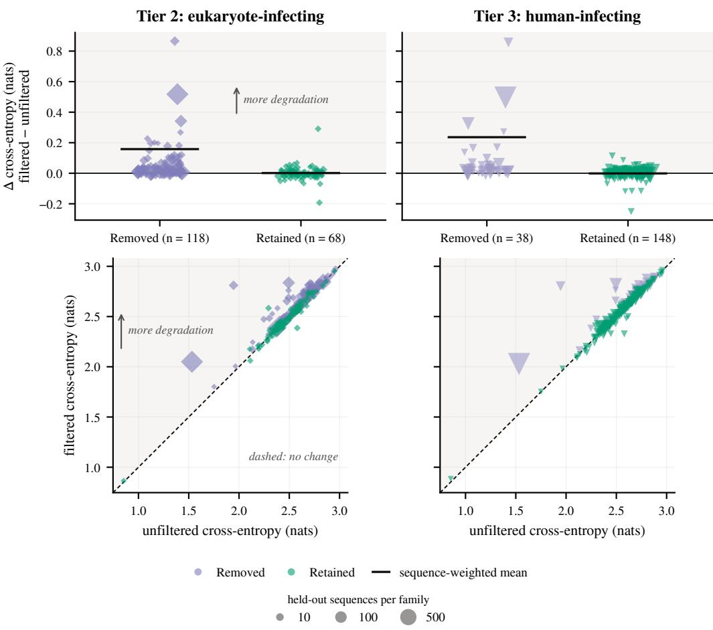  
Figure 10: At 650M, tier-2 and tier-3 filtering increase mean cross-entropy more for removed than retained viral families. Change in cross-entropy, from the unfiltered model, for 650M models after tier 2 and 3 filtering, split by viral families removed by this filter vs those retained. Top: Mean difference in cross-entropy (filtered minus unfiltered), shown separately for removed and retained families. Each point represents the difference in mean cross-entropy for the held-out sequences for this viral family. Counts in brackets give the number of families. Bars represent sequence-weighted group means. Bottom: Unfiltered versus filtered cross-entropy for retained and removed viral families. The diagonal represents equality.

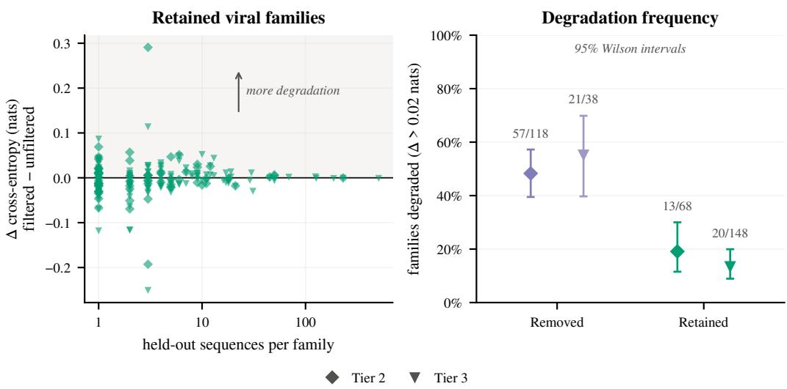  
Figure 11: The largest estimated cross-entropy increases among retained viral families occur in families with few held-out sequences. Cross-entropy changes for 650M models under tier-2 and tier-3 filtering. Left: Scatter plot showing the change in mean cross-entropy for retained viral families against the number of held-out sequences, highlighting that the largest cross-entropy changes in retained families occur in families with few held-out sequences. Right: Points show the fraction of families that show degradation $( \Delta > 0 . 0 2$ nats) separately for each tier. Degradation is more frequent among removed than retained families. Error bars show 95% Wilson intervals, and labels show degraded/total family counts.

## B.2 CONTACT PREDICTION

We measure the filtering effect, the recovery effect, and how each of the two scales with model size. While the main body reports P@L as our metric for long-range precision (sequence separation ≥ 24 residues), here we also report P@L/2 and P@L/5, for short- and medium-range pairs as well as long-range.

We evaluate 650M models across filtering levels and measure precision (P@L, P@L/2, and P@L/5) for all three contact ranges (short, medium, and long; Figure 12). Stronger filtering results in a larger loss of contact-prediction precision on viral proteins. For long-range P@L, the viral change relative to the unfiltered model falls from −0.41 percentage points at Tier 3 to −3.60 at Tier 0; the mean within-protein slope is −1.06 percentage points per ordered filtering level $( 9 5 \% \mathrm { C I } \left[ - 1 . 2 3 , - 0 . 9 0 \right]$ two-sided one-sample t-test, $\overset { \cdot } { p } = 5 . 4 \times 1 \overset { \cdot } { 0 } ^ { - 3 5 } )$ ). Non-viral changes across the four tiers range from −0.57 to +0.73 percentage points. The non-viral-minus-viral change gap also increases with filtering strength: for long-range P@L, its mean slope is +1.16 percentage points per ordered level (95% CI [0.98, 1.34]; two-sided Welch test, $p = 2 . 3 \overset { \cdot } { \times } 1 0 ^ { - 3 5 } )$ . This overall gap trend is significant in all nine range–precision combinations (BH-adjusted $q < 0 . 0 5$ under both Welch and Mann–Whitney tests). The relative effect is largest for long-range contacts and the highest-ranked predictions (P@L/5).

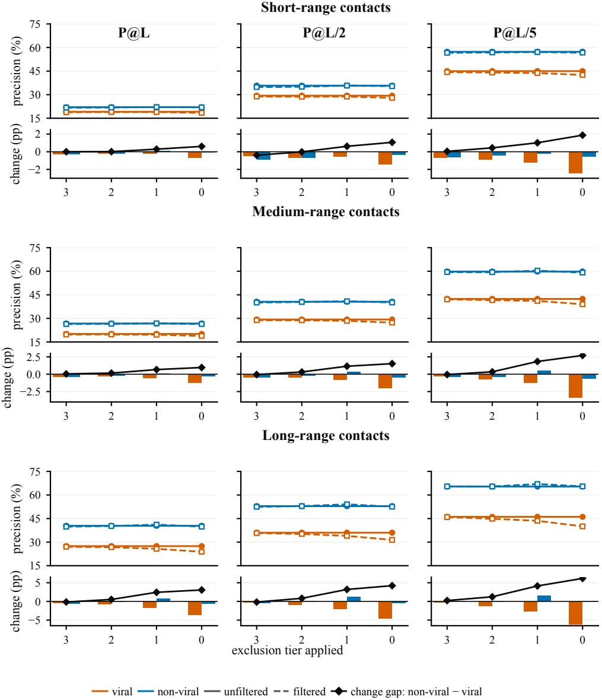  
Figure 12: Filtering effect on contact prediction in short-, medium-, and long-range residueresidue pairs for the 650M model. Each row compares P@L, P@L/2, and P@L/5 across four filtering levels, from Tier 3 to Tier 0, against the unfiltered model. The upper panels show mean precision for viral and non-viral sequences before and after filtering; the lower panels show each domain’s change (filtered minus unfiltered) and the non-viral minus viral change gap, in percentage points.

To measure the recovery effect, we compare 650M models after 5,000 steps of viral-only fine-tuning with their corresponding filtered starting checkpoints (tiers 3–0; Section A.3), using P@L, P@L/2, and P@L/5 across all three contact ranges on viral and non-viral proteins (Figure 13). For long-range P@L, viral gains rise from +1.85 pp at tier 3 to +3.83 pp at tier 0, while non-viral gains across the four tiers range from +0.21 to +0.44 pp. The viral-minus-non-viral gaps are $+ 1 . 6 5 , + 2 . 0 9$ +3.21, and +3.44 pp at tiers 3, 2, 1, and 0, respectively. Viral recovery exceeds non-viral recovery in all 36 tier–range–precision comparisons (BH-adjusted $q < 0 . 0 5$ under both one-sided Welch and Mann–Whitney tests). The gap increases overall as the starting filter strengthens from tier 3 to tier 0 (+0.65 pp per ordered level, 95% CI [0.48, 0.82]; one-sided Welch $p = \bar { 1 . 3 } \times 1 0 ^ { - 1 4 }$ , BH-adjusted $q = 1 . 1 \times \bar { 1 0 ^ { - 1 3 } } )$ ). This overall trend is supported in all nine contact-range × precision combinations (BH-adjusted $q < 0 . 0 5$ under both one-sided Welch and Mann–Whitney tests). The preferential recovery effect is largest for long-range contacts and the highest-ranked predictions (P@L/5).

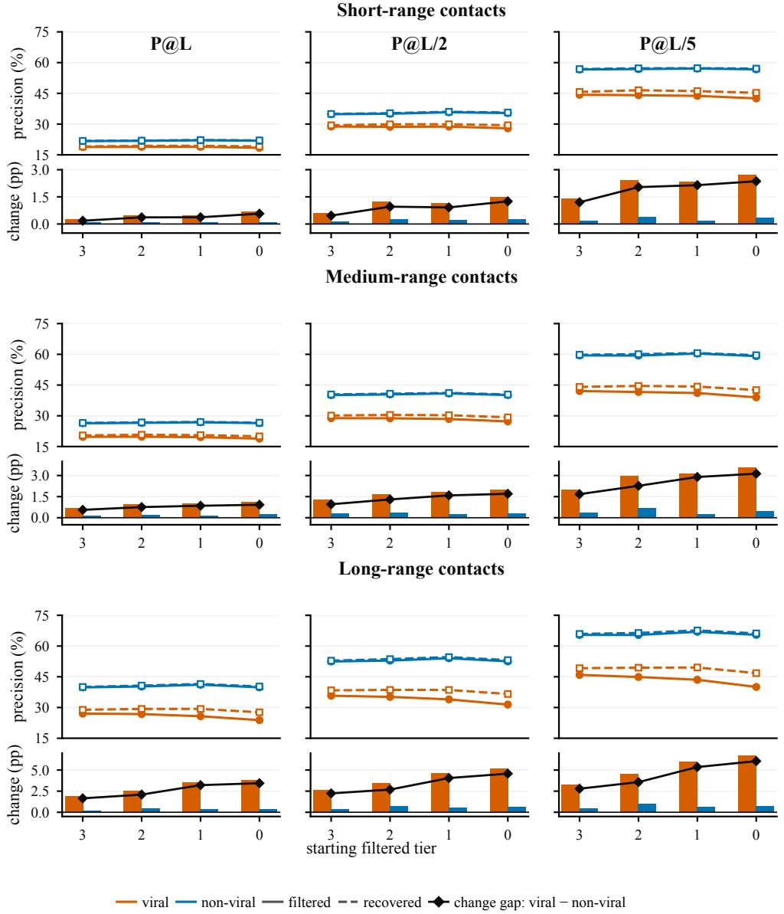  
Figure 13: fine-tuning recovers contact prediction performance across short-, medium-, and long-range residue-residue pairs in the 650M model. Each row compares P@L, P@L/2, and P@L/5 for filtered checkpoints from Tier 3 to Tier 0 with the corresponding models after viral-only fine-tuning (see Section A.3). The upper panels show mean precision for viral and non-viral sequences before and after fine-tuning; the lower panels show each domain’s change (recovered minus filtered) and the viral minus non-viral change gap, in percentage points.

After viral-only fine-tuning from tier 1, mean viral precision increases relative to the filtered starting checkpoint in all 45 size–range–precision combinations, recovering to or surpassing the same-size unfiltered level in 44 of 45 (Figure 14). All 15 P@L recovered-minus-unfiltered gains are significant in paired comparisons of the 1,403 viral chains (BH-adjusted $q < 0 . 0 5$ under both two-sided paired t and Wilcoxon signed-rank tests, correcting across all 45 combinations). For long-range P@L at 650M, the gain over unfiltered is +1.87 pp (95% CI [1.52, 2.22]; two-sided paired t-test $\overline { { p } } = 1 . 7 \times 1 0 ^ { - 2 4 }$ BH-adjusted $q = 8 . 6 \times 1 0 ^ { - 2 4 } )$ . Across all metrics, 43 of 45 recovered-minus-unfiltered differences are positive and significant under both tests; short-range P@L/2 at 8M is positive but not significant, and short-range P@L/5 at 8M has a −0.16 pp mean difference.

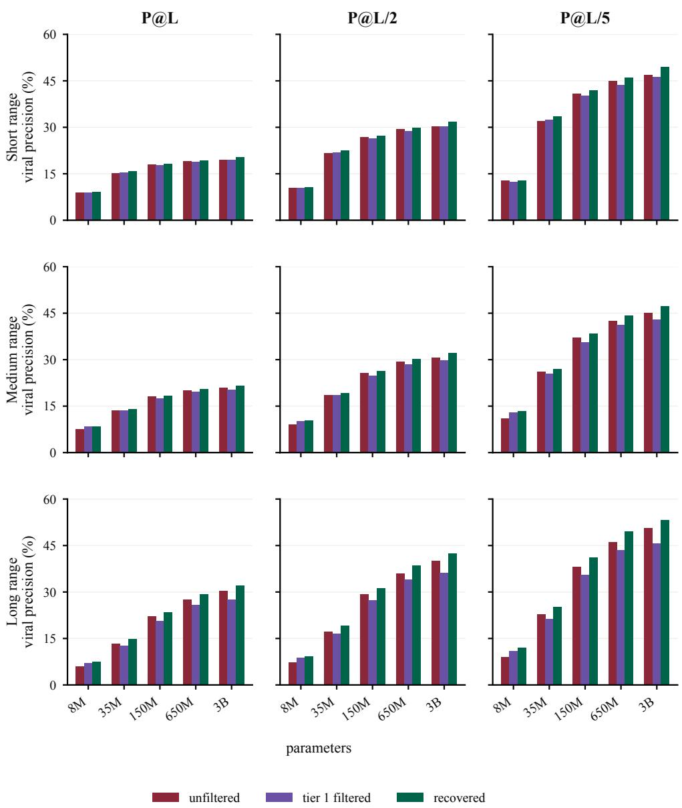  
Figure 14: Viral contact-prediction precision across model sizes before filtering, after tier-1 filtering, and after viral-only fine-tuning. Rows show short-, medium-, and long-range contacts; columns show P@L, P@L/2, and P@L/5. Each panel compares the mean precision of the unfiltered, tier-1 filtered, and recovered models on viral proteins.

To test whether the filtering effect grows with model size, we compare unfiltered and tier-1 filtered models at five sizes (Figure 15). We calculate each protein’s slope of filtered-minus-unfiltered precision against $\log _ { 1 0 }$ parameter count. The non-viral-minus-viral slope difference is positive in all nine contact-range × precision combinations (BH-adjusted $q < 0 . 0 5$ under both two-sided Welch and Mann–Whitney tests); for long-range P@L, it is +1.23 pp per tenfold increase in parameter count (95% CI [1.00, 1.45]; Welch $\bar { q } = 2 . \bar { 1 } \times 1 0 ^ { - 2 5 }$ , Mann–Whitney $q = 2 . 1 \times 1 0 ^ { - 1 7 } )$ . Viral precision loss itself grows with size in seven of nine combinations (BH-adjusted $q < 0 . 0 5$ under both two-sided one-sample t and Wilcoxon signed-rank tests), with short-range P@L and P@L/2 as the exceptions.

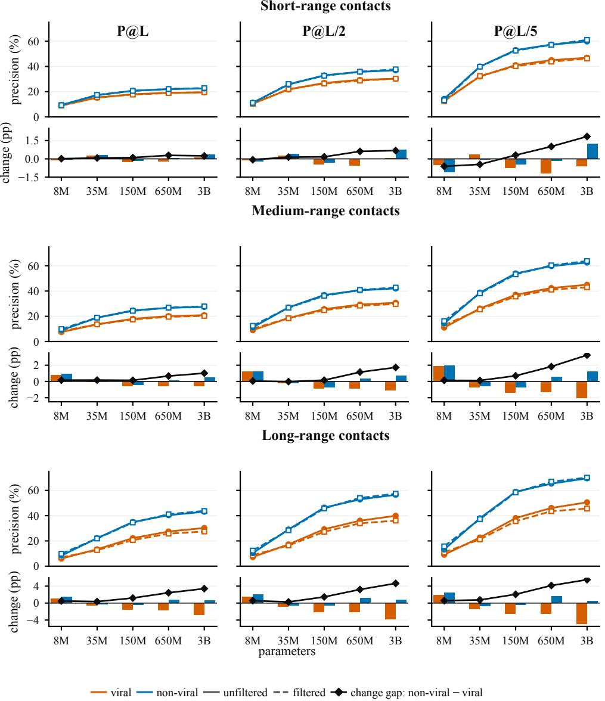  
Figure 15: Scaling of the filtering effect in short-, medium-, and long-range pairs. Each row compares unfiltered and tier-1 filtered models from 8M to 3B using P@L, P@L/2, and P@L/5. The upper panels show mean precision for viral and non-viral sequences; the lower panels show each domain’s change (filtered minus unfiltered) and the non-viral minus viral change gap, in percentage points. The gap is larger for medium- than short-range pairs at 650M and 3B, and larger for longthan medium-range pairs at 150M–3B, across all three metrics.

To test whether the recovery effect grows with model size, we compare each tier-1 filtered model with its counterpart after viral-only fine-tuning (Figure 16). Across the same five sizes, we calculate each protein’s slope of recovered-minus-filtered precision against $\log _ { 1 0 }$ parameter count. The viralminus-non-viral slope difference is positive in all nine contact-range × precision combinations (BH-adjusted $q < 0 . 0 5$ under both two-sided Welch and Mann–Whitney tests); for long-range P@L, it is +1.19 pp per tenfold increase in parameter count (95% CI [0.99, 1.39]; Welch $q = \mathsf { 3 . 4 } \times 1 0 ^ { - 3 0 }$ Mann–Whitney $q = 3 . 0 \times 1 0 ^ { - 1 5 } )$ . Viral recovery itself grows with size in all nine combinations (BH-adjusted $q < 0 . 0 5$ under both two-sided one-sample t and Wilcoxon signed-rank tests). These tests measure variation across protein chains for the evaluated checkpoints, not across independently trained model runs.

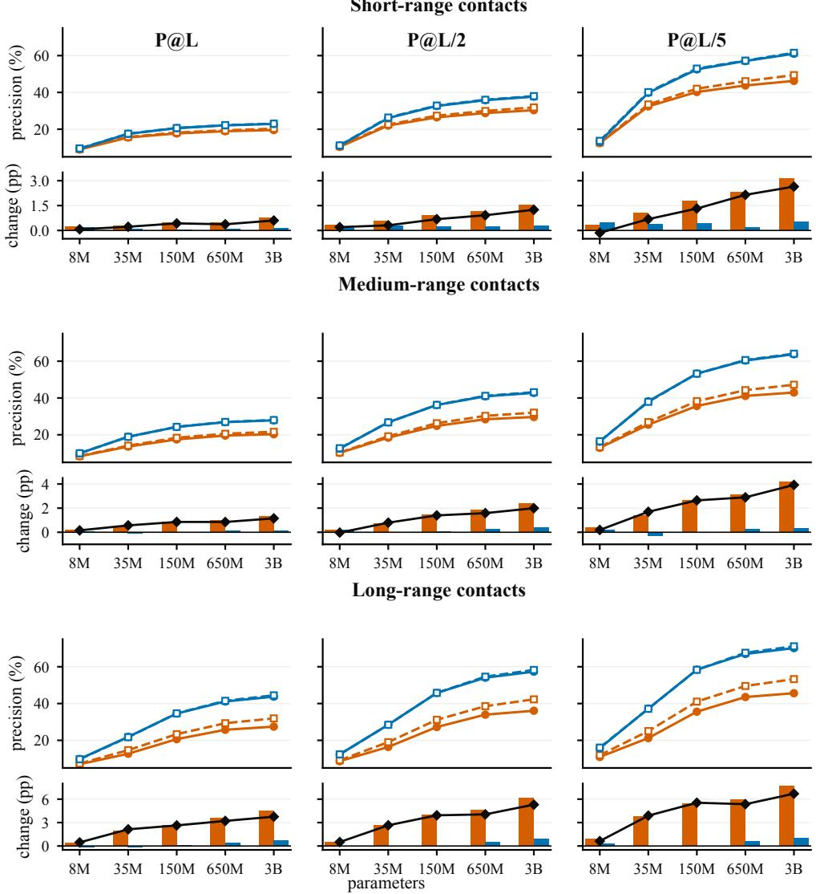  
viral non-viral filtered recovered change gap: viral − non-viral

Figure 16: Scaling of the recovery effect in short-, medium-, and long-range pairs. Each row compares tier-1 filtered models from 8M to 3B with their counterparts after viral-only fine-tuning using P@L, P@L/2, and P@L/5. The upper panels show mean precision for viral and non-viral sequences before and after fine-tuning; the lower panels show each domain’s change (recovered minus filtered) and the viral minus non-viral change gap, in percentage points. For P@L, the gap increases from short to medium to long range at every model size.

## B.3 FILTERING EFFECTS BY VIRAL FAMILY

A small number of viral families account for much of the change in cross-entropy observed after filtering (Figure 17). For those viral families with at least 20 sequences in our test set, we find that in the tier-1 filtered 3B model, Retroviridae accounts for ≈ 77.5% of the summed increase in held-out cross-entropy (weighted by sequence count). This is followed by Picornaviridae (≈ 6.56%), unclassified viruses (≈ 4.11%), Hepaciviridae (≈ 3.25%) and Mimiviridae (≈ 1.17%).

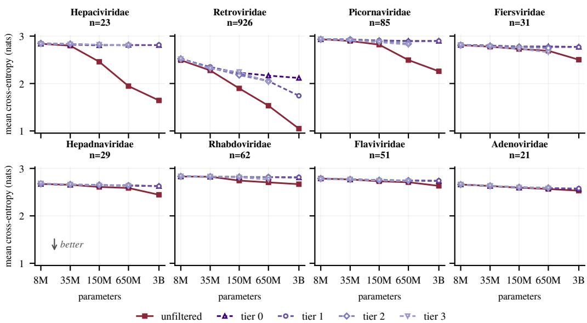  
Figure 17: Filtering differentially degrades language modelling performance across proteins from different viral families. Each plot shows mean cross-entropy on held-out entries for the eight families with the largest tier-1 effect at 3B (among families with at least 20 entries). Each curve shows the unfiltered and tier 0 to tier 3 models for each model size up to 650M, and tier 0 and 1 for 3B.

Table 4: Effects of filtering on masked language-modelling and mutation effect prediction by model size. Left: Mean paired differences between tier 1 filtered and unfiltered models in cross-entropy (nats, 5,161 held-out viral sequences). Positive values indicate that the tier 1 filtered model performs better. Middle: Change in mean Spearman correlation for mutation-effect prediction (Spearman ρ, 31 assays) for tier 1 - unfiltered. Negative values indicate that the tier 1 filtered model performs worse. Right: Difference in cross-entropy (nats) between tier 0 and tier 1 filtered models on paired sequences. p-values are calculated from two-sided paired t-tests, without adjustment for multiple comparisons.
<table><tr><td rowspan="3">Size</td><td colspan="2">Cross-entropy, Tier 1</td><td colspan="2">ProteinGym, Tier 1</td><td colspan="2">Tier 0 – Tier 1</td></tr><tr><td> $\Delta { \ : } ( \mathrm { n a t s } )$ </td><td></td><td> $\Delta \rho$ </td><td>p</td><td>∆(nats)</td><td>p</td></tr><tr><td>8M</td><td>+0.006</td><td> $4 \times 1 0 ^ { - 3 5 }$ </td><td>+0.001</td><td>0.844</td><td>+0.0005</td><td>0.330</td></tr><tr><td>35M</td><td>+0.019</td><td> $< 1 0 ^ { - 9 9 }$ </td><td>-0.002</td><td>0.816</td><td>+0.0007</td><td>0.269</td></tr><tr><td>150M</td><td>+0.074</td><td> $4 \times 1 0 ^ { - 8 1 }$ </td><td>-0.019</td><td>0.264</td><td>+0.0121</td><td> $9 \times 1 0 ^ { - 4 2 }$ </td></tr><tr><td>650M</td><td>+0.125</td><td> $< 1 0 ^ { - 9 9 }$ </td><td>-0.068</td><td>0.003</td><td>+0.0362</td><td> $< 1 0 ^ { - 9 9 }$ </td></tr><tr><td>3B</td><td>+0.173</td><td> $< 1 0 ^ { - 9 9 }$ </td><td>-0.124</td><td> $3 \times 1 0 ^ { - 4 }$ </td><td>+0.0855</td><td> $< 1 0 ^ { - 9 9 }$ </td></tr></table>

Table 5: Per-shell effects of filtering at 650M Left: mean paired cross-entropy differences (tier 1 minus unfiltered, nats) and the share for each shell of the summed difference across all five viral shells. Shares are weighted by the number of held-out sequences in each shell. Right: mean paired cross-entropy differences (tier 0 minus tier 3, nats). Both comparisons pair observations by sequence. p-values are from two-sided paired t-tests, without adjustment for multiple comparisons.
<table><tr><td rowspan="2">Shell</td><td rowspan="2">n</td><td colspan="2">Tier 1 vs unfiltered</td><td colspan="2">Tier 0 – Tier 3</td></tr><tr><td>∆ (nats)</td><td>Share</td><td>∆ (nats)</td><td>p</td></tr><tr><td>1 – phages, unclassified</td><td>1462</td><td>+0.029</td><td>6.5%</td><td>+0.068</td><td> $5 \times 1 0 ^ { - 6 1 }$ </td></tr><tr><td>2 – eukaryote-infecting</td><td>1472</td><td>+0.027</td><td>6.2%</td><td>+0.038</td><td> $1 \times 1 0 ^ { - 4 0 }$ </td></tr><tr><td>3 – human-infecting</td><td>1461</td><td> $+ 0 . 3 6 1$ </td><td>81.6%</td><td>+0.098</td><td> $< 1 0 ^ { - 9 9 }$ </td></tr><tr><td>4 – pathogens of concern</td><td>493</td><td>+0.070</td><td>5.3%</td><td>+0.015</td><td> $2 \times 1 0 ^ { - 5 }$ </td></tr><tr><td>5 – influenza A</td><td>273</td><td>+0.008</td><td>0.3%</td><td>+0.007</td><td>0.003</td></tr></table>

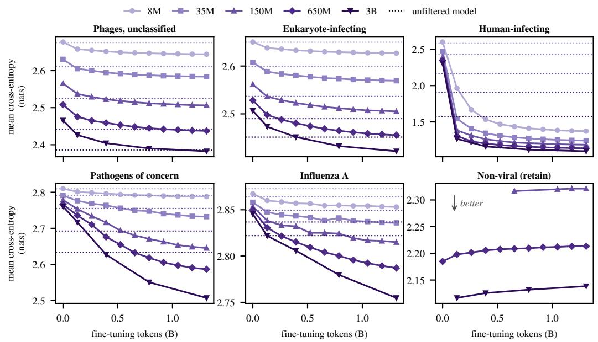  
Figure 18: Viral cross-entropy decreases during fine-tuning, while non-viral cross-entropy increases over the evaluated checkpoints at 650M and 3B. Mean cross-entropy (nats) plotted against fine-tuning tokens (billions) for tier-0-filtered models trained on the withheld viral corpus. Panels show language modelling performance on the five viral shells and the non-viral control. The dotted horizontal lines show the performance of the unfiltered baseline at each model size. Lower cross-entropy indicates better performance. Non-viral cross-entropy increases over the evaluated checkpoints at 650M and 3B.

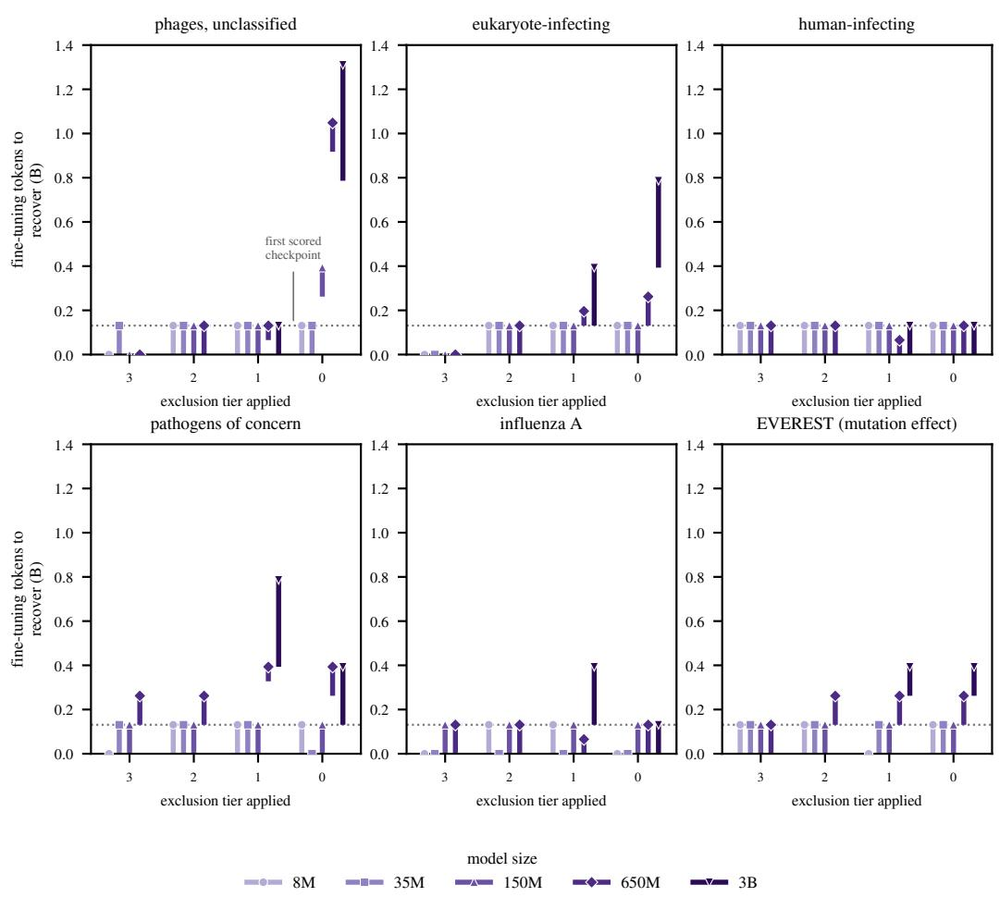  
Figure 19: Mean cross-entropy on the human-infecting shell recovers within 1.4B fine-tuning tokens for every evaluated model size and filtering tier. Recovery of mean cross-entropy on the five viral shells and mean Spearman correlation on EVEREST during viral-only fine-tuning. Exclusion tiers run from tier 3 (narrowest) to tier 0 (widest). Recovery is defined as matching or improving on the mean performance of the same-size unfiltered model. Vertical bars show the bracket of recovery between scored checkpoints, where upper endpoints give the first checkpoint meeting this criterion. Intervals starting at zero indicate recovery before the first scored fine-tuning checkpoint. The dotted line marks 500 fine-tuning steps (approximately 0.131 billion tokens). All available size and filter combinations recover on the human-infecting shell within this fine-tuning budget. No tier-2 or tier-3 filtered model was trained at 3B.

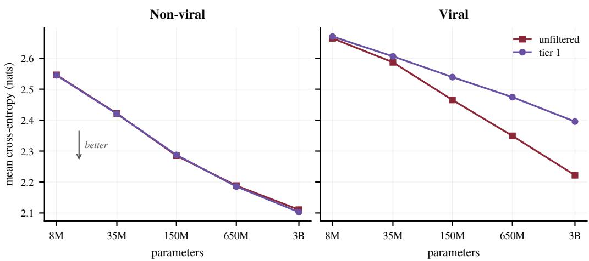  
Figure 20: The increase in viral cross-entropy from tier-1 filtering grows with model size. Mean held-out cross-entropy (nats) for unfiltered and tier-1-filtered models from 8M to 3B parameters, evaluated on non-viral (left) and viral (right) sequences. Lower cross-entropy indicates better performance. Viral cross-entropy decreases with model size under both training conditions, with a larger reduction for the unfiltered model. The filtered-minus-unfiltered performance difference increases from 0.006 nats at 8M to 0.173 nats at 3B. Differences in performance on non-viral remain within ±0.008 nats at all five sizes. Comparisons across filtering tiers are shown in Figure 7.

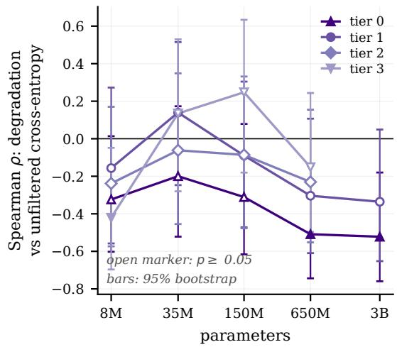

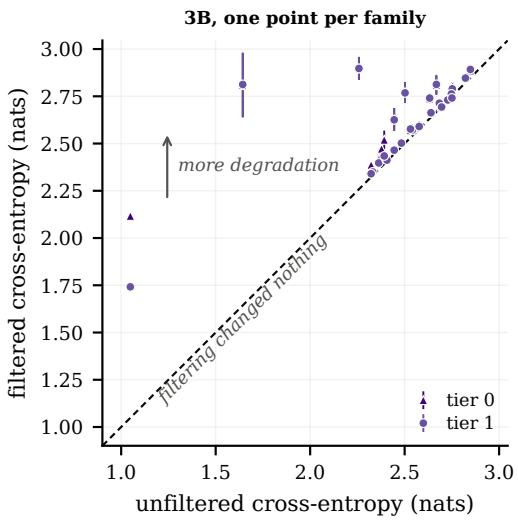  
Figure 21: Tier-0 degradation is negatively correlated with unfiltered cross-entropy at 650M and 3B. Association between unfiltered cross-entropy and the change in cross-entropy after filtering across viral families. Left: Spearman correlation across the 30 families (including unclassified) with at least 20 held-out entries. When performing the statistical analysis, each family’s entries are split into two disjoint halves with the same split used across model sizes and filtering tiers. One half estimates unfiltered cross-entropy and the other estimates the paired filtered-minus-unfiltered difference, so each estimate is calculated from a separate set of held-out sequences. Bars are 95% percentile intervals from 10,000 family bootstrap resamples. Open markers indicate $p \geq 0 . 0 5$ in a two-sided test with 10,000 permutations of family pairings. Intervals and tests are conditional on the fixed sequence split, and p-values are not adjusted for multiple comparisons. Lower cross-entropy is better; therefore, a negative correlation suggests that greater degradation due to filtering occurs in families where the unfiltered performance is higher. Right: filtered versus unfiltered cross-entropy at 3B, using all held-out entries in each family. Each point is a viral family. Dashed line marks equal performance and vertical bars show the paired standard error of the difference.

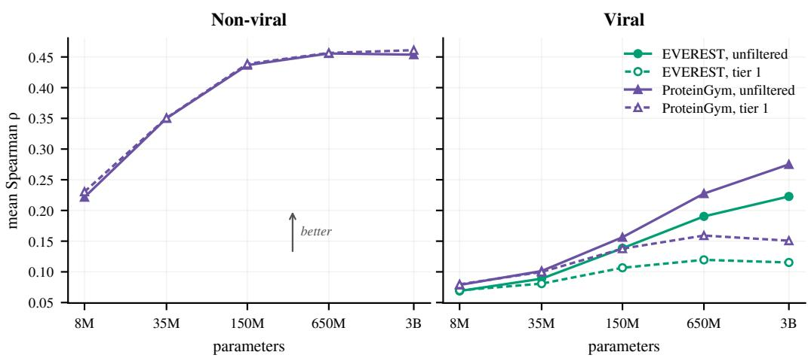

Figure 22: Mean Spearman correlation on viral assays increases more from 150M to 3B in unfiltered models than in tier 1 filtered models. Mean per-assay Spearman ρ between predicted and measured mutation effects, for unfiltered and tier 1 filtered models. Left: 186 non-viral ProteinGym assays. Right: 31 viral ProteinGym assays and 45 EVEREST assays (all EVEREST assays are viral). On viral assays, unfiltered models show larger gains in mean correlation than tier 1 filtered models from 150M onwards. On non-viral assays, the difference in mean correlation between filtering conditions is less than 0.009 in magnitude at every model size.  
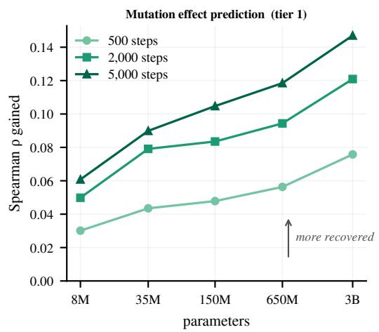

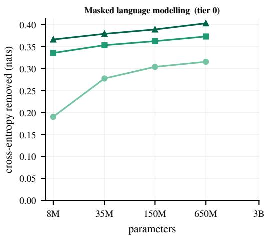  
Figure 23: Larger filtered models show greater performance gains after the same number of fine-tuning steps. Performance recovered after a fixed number of fine-tuning steps for different model sizes. Changes are measured from each model’s filtered starting checkpoint after 500, 2,000 and 5,000 fine-tuning steps. Left: Increase in mean Spearman $\rho$ on EVEREST for tier 1 filtered models. Right: Decrease in mean held-out viral cross-entropy (nats) for tier 0 filtered models up to 650M. The gain rises with model size at all three budgets. The right panel stops at 650M as this analysis was not performed for 3B.

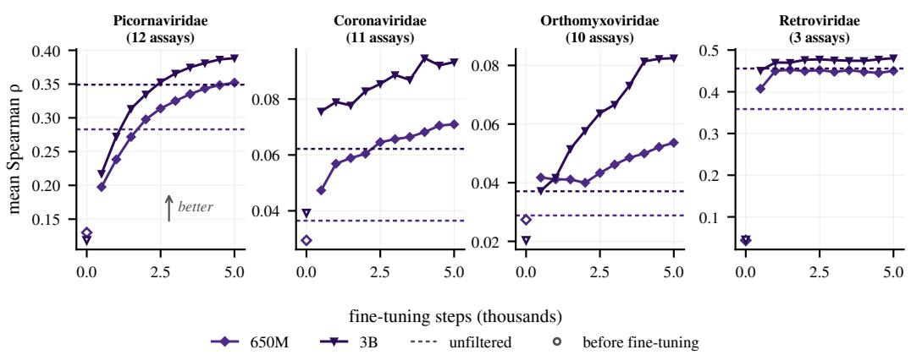  
Figure 24: At 650M and 3B, mean Spearman correlation exceeds the unfiltered reference at 2,500 fine-tuning steps in all four families with at least three EVEREST assays. Mean per-assay Spearman $\rho$ between predicted and measured mutation effects for 650M and 3B tier 1 filtered models during fine-tuning on the withheld viral dataset. Panels show the four viral families with at least three EVEREST assays. Note that vertical scales differ between panels. Fine-tuning steps are shown in thousands. Dashed lines indicate the mean correlation for the same-size unfiltered model while open markers indicate the filtered model before fine-tuning. At both model sizes, the mean correlation for each displayed family is below the corresponding unfiltered reference before fine-tuning and exceeds it at the 2,500-step checkpoint.

## B.4 RECOVERY AFTER FINE-TUNING WITHOUT RETROVIRIDAE

We test how well models fine-tuned without Retroviridae recover performance on held-out data excluding Retroviridae sequences (Figures 25 to 27, as described in Section A.6). Across 8M–650M parameters, models fine-tuned without Retroviridae from both tier-0 and tier-1 starting checkpoints recover mean EVEREST correlation and cross-entropy on the human-infecting non-Retroviridae subset to the same-size unfiltered reference within 2,000 fine-tuning steps. Mean EVEREST correlation reaches or exceeds the reference within the first 500 steps at 8M and 35M, within 1,000 steps at 150M, and within 2,000 steps at 650M. Held-out cross-entropy on the human-infecting non-Retroviridae stratum (535 sequences) follows the same course, i.e., recovery within 500 steps at 8M and 35M, within 1,500 steps at 150M, and within 2,000 steps at 650M. Recovery varies across other sequence strata; the tier-0 650M phage and unclassified stratum recovers between 3,000 and 3,500 steps.

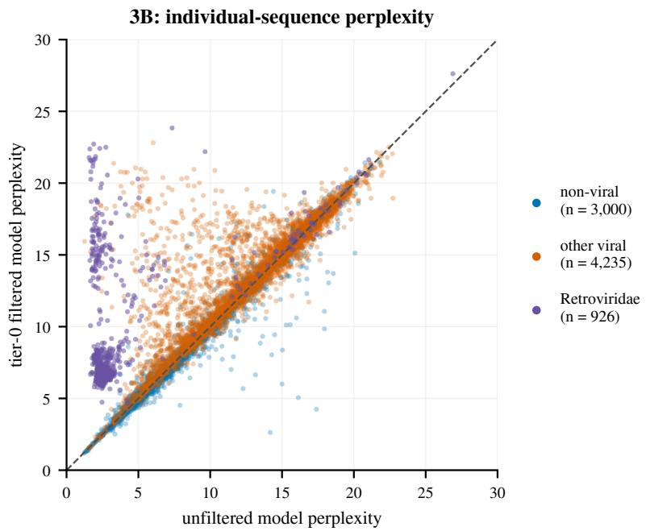

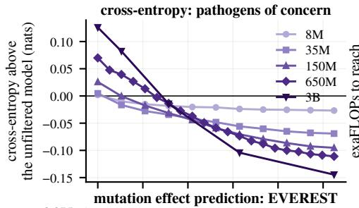

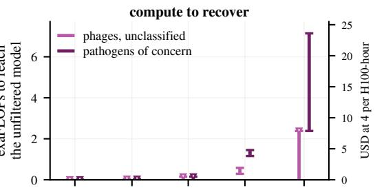

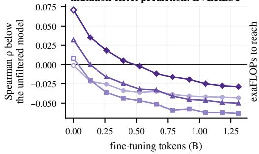

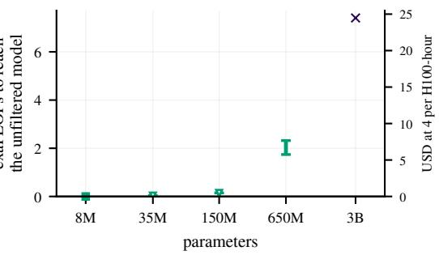  
Figure 25: Sequence perplexity and recovery without Retroviridae. Top: matched 3B unfiltered and tier-0 pretrained models, with one point per sequence, with 3,000 nonviral, 926 Retroviridae and 4,235 other viral sequences. Dashed line marks equal pseudo-perplexity. Bottom: tier-1 starting models fine-tuned without Retroviridae, cross-entropy and mean signed Spearman gaps to the same size unfiltered model (positive means worse), with observed recovery-compute brackets. The dollar axis assumes 34% H100 utilisation and \$4 per H100-hour. EVEREST averages all 45 assays. Recovery brackets span adjacent evaluations; open cost markers denote first-checkpoint upper bounds, squares at zero denote initial parity, and crosses denote unavailable results. Open trajectory markers at zero tokens identify pretrained starting models.

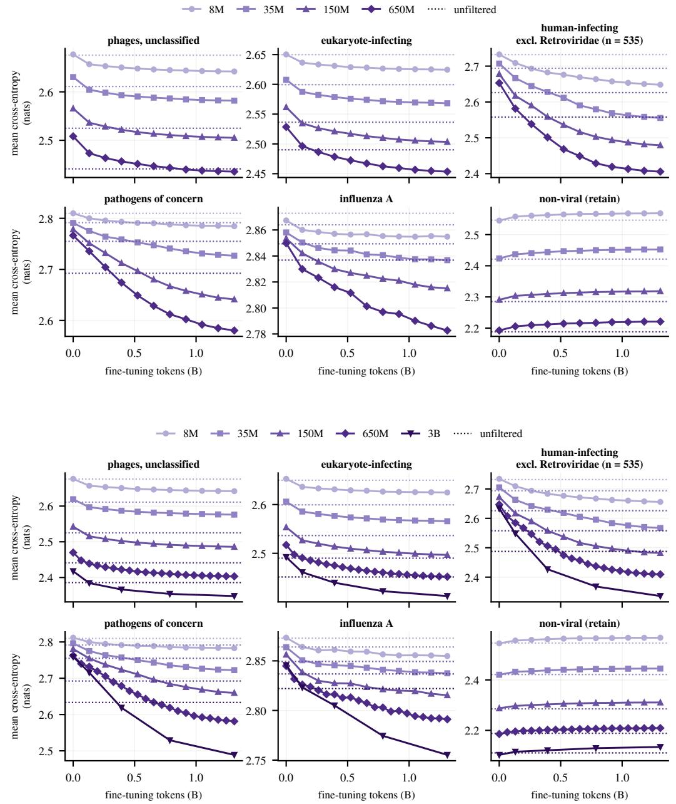  
Figure 26: Cross-entropy after fine-tuning without Retroviridae. Top: tier-0 starting models. Bottom: tier-1 starting models. Dotted lines mark the same-size unfiltered references. The humaninfecting panels use 535 non-Retroviridae sequences; other sequence strata are unchanged.

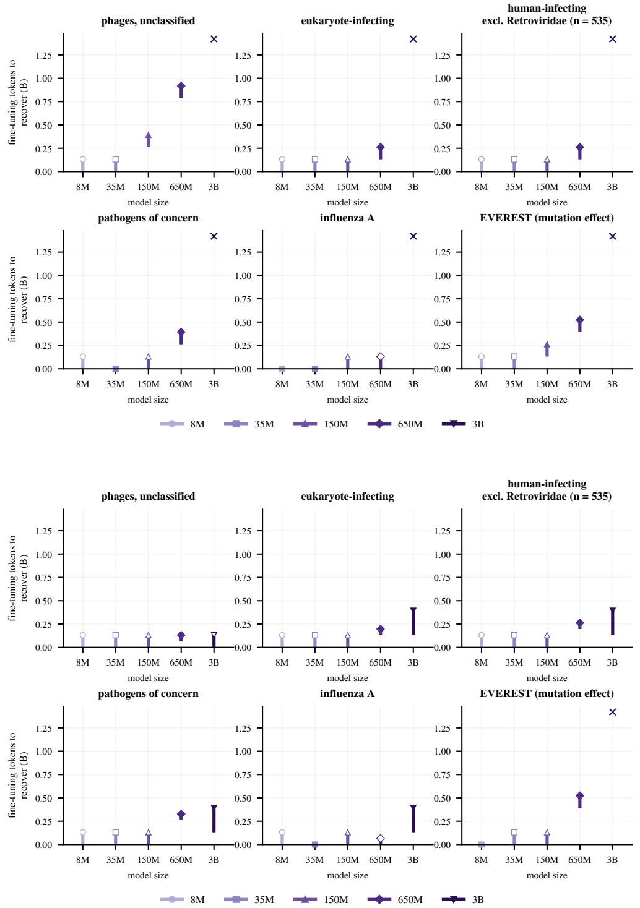  
Figure 27: Tokens to recover performance without Retroviridae. Top: tier-0 starting models. Bottom: tier-1 starting models. Brackets span adjacent evaluations around first attainment of the same-size unfiltered reference, without interpolation. Open markers: first-checkpoint upper bounds; squares at zero: initial parity; NR triangles: target not reached; crosses: not run. The human-infecting panels use 535 non-Retroviridae sequences; EVEREST uses mean signed Spearman over all 45 assays.

## C FITNESS AND STABILITY PREDICTION

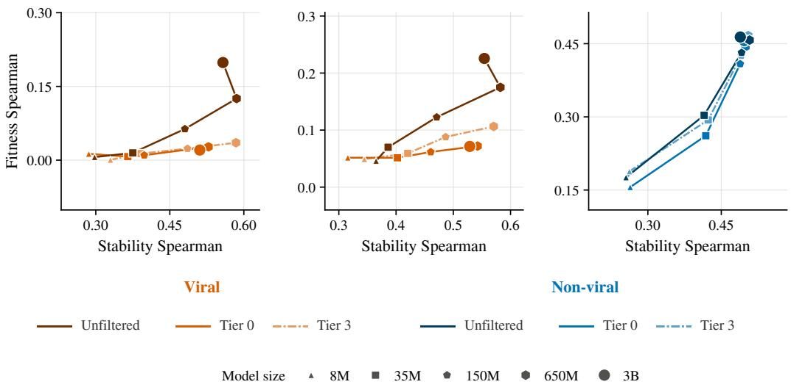  
Figure 28: Data filtering degrades fitness prediction more than stability prediction. Left to right: ProteinGym viral, EVEREST viral and ProteinGym non-viral assays. Each point shows the equally weighted mean Spearman correlation on stability assays (horizontal) and fitness assays (vertical) for one pretrained model (higher is better on both axes). Orange: viral assays, blue non-viral assays. Fitness/stability assay counts are respectively 21/6, 31/5 and 56/60 in the three panels. Fitness and stability use different assay sets; differences in their means may also reflect assay composition and difficulty.

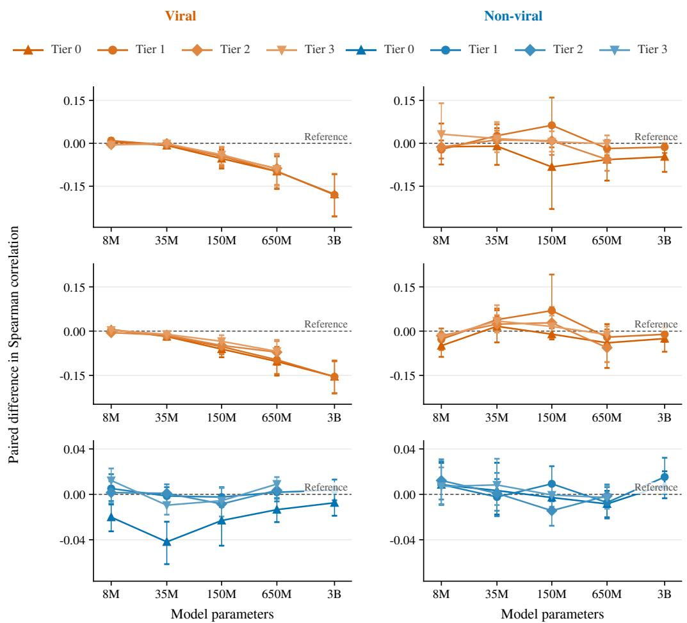  
Figure 29: Filtering effects on fitness and stability prediction per tier. Rows show ProteinGym viral, EVEREST viral and ProteinGym non-viral assays; columns show fitness (left) and stability (right). Points are equally weighted mean Spearman differences, filtered minus the same-size unfiltered reference, paired by assay. Bars are pointwise 95% percentile intervals from 20,000 paired-assay bootstrap resamples (seed 0). Negative values indicate lower predictive performance; the dashed zero line denotes reference performance. Orange: viral assays, blue non-viral assays. Fitness/stability counts are 21/6, 31/5 and 56/60 by row, and the two columns share limits within each row.