# THINK, COMPRESS, ANSWER: REINFORCEMENT LEARNING FOR MULTIMODAL GROUNDING VIA REASONING COMPRESSION

Jinbae Seo1, Hyeongjun Kwon1, Jiyoung Lee2, Hyunsung Jang1,3, Namkoo Ha3, Jungin Park1†, Kwanghoon Sohn1,4†

1Yonsei University 2School of AI and Software, Ewha Womans University 3LIG Defense & Aerospace 4Korea Institute of Science and Technology (KIST)

## ABSTRACT

Extended reasoning has substantially improved multimodal large language models (MLLMs) on tasks requiring compositional and relational inference. However, multimodal grounding imposes a distinct requirement: reasoning must ultimately converge on a target-specific compact representation that supports precise localization. As reasoning trajectories grow longer, they often expand into broad scene narratives and peripheral relational details, which can dilute grounded perceptual evidence and lead to ambiguous or incorrect predictions. Motivated by the information bottleneck principle, we propose Think-Compress-Answer (TCA), a reinforcement learning framework that decomposes multimodal grounding into three phases: free-form reasoning, target-aware context compression, and answer generation conditioned on the compressed context. TCA is optimized through a multi-stage Group Relative Policy Optimization (GRPO) with progressive rewards that establish the structured output protocol, minimize reasoning-specific information while preserving target-relevant content, and directly improve localization accuracy. This staged design enables MLLMs to retain the benefits of extended reasoning while distilling it into the minimal context required for grounding. Experiments across six multimodal grounding benchmarks show that TCA attains substantial zero-shot performance gains, demonstrating the effectiveness of reasoning compression.

## 1 INTRODUCTION

Multimodal grounding requires a model to identify the entity, event, or region in multimodal observations that is referred to by a text query. Although the final output is typically compact (e.g., bounding box, segmentation mask, center point, or temporal interval Yu et al. (2016); Seo et al. (2020); Khoreva et al. (2018); Ding et al. (2023a); Wang et al. (2024)), the model must inter pret the query, distinguish among perceptually similar candidates, resolve spatial or temporal relations, and integrate evidence distributed across entities, observations, and modalities. Recent multimodal large language models (MLLMs) have supported these capabilities through explicit reasoning procedures, including chain-of-thought (CoT) prompting Wei et al. (2022); Zhang et al. (2024b), instruction-following Liu et al. (2023); Dai et al. (2023), process supervision and intermediate verifi cation Zheng et al. (2023a); Shao et al. (2024a), and test-time scaling DeepSeek-AI (2025); OpenAI (2024); Snell et al. (2024) that allocates additional computation to explore and refine reasoning paths. These advances suggest that reasoning is important for grounding targets that cannot be identified through direct query-perception matching alone. However, multimodal grounding also imposes a requirement that differs from open-ended reasoning: the reasoning process must ultimately isolate the compact, target-specific evidence necessary for precise localization. This raises a fundamental question: How can MLLMs retain the benefits of extended reasoning while preserving only the information required for grounding?

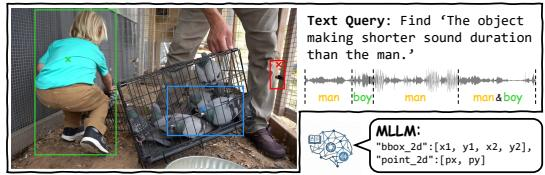  
(a) Multimodal grounding

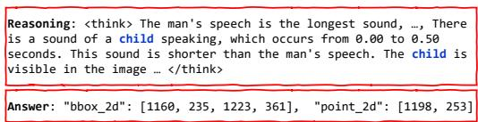  
(b) Prediction through Chain-of-Thought (CoT)

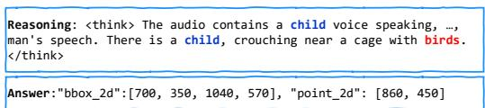

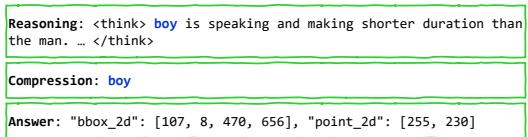  
(c) Prediction through answer-reward-only RL  
(d) Prediction from TCA (Ours)  
Figure 1: Motivation of Think-Compress-Answer. Given multimodal inputs, (b) standard CoT and (c) answer-reward-only RL methods identify the correct entity but drift during localization. (d) Our Think-Compress-Answer distills reasoning into a concise, faithful cue, yielding accurate grounding. The predicted bounding boxes and center points in (a) and the output from each method (b–d) are matched in color.

Recent works have demonstrated that MLLMs can drift away from perceptual evidence, increasingly rely on language priors, and introduce hallucinated or weakly relevant details, as reasoning paths grow longer Zhou et al. (2024); Li et al. (2023); Liu et al. (2025a). This problem is particularly pronounced in multimodal grounding, where CoT often expands a target-oriented analysis into broad scene descriptions and relational narratives that exceed the information required to localize the referred target. Moreover, conventional supervision, including CoT demonstrations and final task rewards, encourages a correct prediction but does not specify which intermediate evidence should be retained or discarded. Consequently, increasing reasoning length or test-time computation may produce additional trajectories without reliably extracting the target-specific context required for grounding, as illustrated in Fig. 1b and Fig. 1c. The challenge is therefore to transform an extended reasoning path into a concise and sufficient representation before answer generation.

This perspective naturally connects multimodal grounding to the information bottleneck (IB) principle Tishby et al. (2000); Tishby & Zaslavsky (2015), which seeks an intermediate representation that discards non-predictive information while preserving information relevant to the target. From the IB principle, a key limitation of existing reasoning-based MLLMs is their insufficient ability to compress an extended reasoning path into the target-specific context required for localization. Building on this insight, we propose Think-Compress-Answer (TCA), a novel reinforcement learning (RL) framework that decomposes multimodal grounding into three successive phases: free-form reason ing, target-aware compression, and answer generation conditioned on the compressed context. TCA introduces an explicit compressed context that regularizes the transition from extended reasoning to answer generation.

We optimize TCA through a four-stage curriculum based on Group Relative Policy Optimization (GRPO) Shao et al. (2024b). Stage 1 first establishes the structured TCA output protocol using a format reward DeepSeek-AI (2025). Stage 2 minimizes a variational upper bound on the conditional mutual information between the full reasoning path and its compressed context, encouraging the model to remove reasoning-specific information. To complement a potential uninformative compression, Stage 3 introduces a specialized MLLM judge that evaluates whether the compressed context remains concise, target-specific, and sufficient for predicting the answer. Finally, Stage 4 directly optimizes localization accuracy using a task-dependent grounding reward. This staged design separates competing objectives during training and provides a progressive curriculum from structured reasoning to target-preserving compression and, ultimately, accurate multimodal grounding.

We evaluate TCA on referring expression segmentation and referring video object segmentation across six benchmarks. Extensive experiments demonstrate that explicitly compressing intermediate reasoning consistently improves grounding performance, achieving comparable and even better zero-shot performance than supervised methods.

In summary, our contributions are as follows:

• We explore a fundamental limitation of extended reasoning in multimodal grounding and formulate it with the information bottleneck (IB) principle, showing that extended reasoning paths can retain excessive scene-level content that is irrelevant to compact grounding targets.

• We propose Think-Compress-Answer (TCA), a novel RL framework that introduces a target-aware compression stage between reasoning and answer generation, trained with a multi-stage GRPO-based optimization.

• Extensive experiments on two multimodal grounding tasks across six benchmarks demonstrate that TCA consistently outperforms CoT and test-time scaling baselines, while achieving zero-shot performance comparable to or even better than supervised methods on RES and R-VOS benchmarks.

## 2 RELATED WORK

Chain-of-Thought (CoT) reasoning and multimodal grounding. CoT prompting improves reasoning by generating intermediate steps Wei et al. (2022); Kojima et al. (2022). Multimodal extensions adapt this to vision-language settings via duty-distinct prompting or intermediate spatial verification Zhang et al. (2024b); Zheng et al. (2023a); Shao et al. (2024a); Wu et al. (2025a). In multimodal grounding, this reasoning is integrated either implicitly, connecting LLMs to segmentation decoders via latent tokens Lai et al. (2024); Ren et al. (2024); Yan et al. (2024); Zheng et al. (2025), or explicitly, generating textual chains before predicting coordinates or masks for visual and audio-visual tasks Kao et al. (2026); Chowdhury et al. (2024); Liu et al. (2025c); You & Wu (2025); Huang et al. (2025); Xu et al. (2026); Zhao et al. (2025). However, extending explicit CoT chains often causes “overthinking” Chen et al. (2024a): the model drifts, producing unfaithful steps Turpin et al. (2023) or accumulating hallucinated content Huang et al. (2024). Standard mitigations like self-consistency Wang et al. (2023b), process rewards Lightman et al. (2024), and test-time scal ing OpenAI (2024); Snell et al. (2024); Zhang et al. (2025) address this but incur significant compu tational costs and still assume extensive reasoning is inherently beneficial. DR2Seg He et al. (2026) verifies the self-containment of a target description via answer consistency across two reasoning rollouts. Unlike approaches relying on latent tokens, unconstrained text chains, or answer-consistency verification, our approach introduces a textual compression bottleneck that distills reasoning into a concise and faithful cue before the final grounding stage.

Reinforcement learning from AI feedback and GRPO. RLHF Ouyang et al. (2022) aligns LLMs with human preferences but is expensive to scale. RLAIF Lee et al. (2023); Bai et al. (2022) replaces human annotators with LLM judges, and the LLM-as-judge paradigm Zheng et al. (2023b) shows strong correlation with human evaluation. Group Relative Policy Optimization (GRPO) Shao et al. (2024b) simplifies RL-based training by eliminating the critic, computing advantages relative to a sampled group, making it robust to noisy rewards. Multi-stage RL DeepSeek-AI (2025) shows that sequential objective decomposition improves stability. We combine an LLM-judge reward with multi-stage GRPO, where each stage addresses a distinct requirement of bottleneck learning instead of a single end-to-end task reward.

Information bottleneck in deep learning. The Information Bottleneck (IB) principle Tishby et al. (2000) provides a theoretical framework for extracting compressed, task-relevant representations. Alemi et al. (2017) apply this to neural networks by optimizing variational bounds in continuous latent spaces, inspiring subsequent work on generalization and representation learning Shwartz-Ziv & Tishby (2017). However, applying IB to discrete natural language remains challenging since mutual information over text is not directly computable. We sidestep this by using IB as a design guide: we structure the model’s output into an observable textual bottleneck, optimize a tractable variational bound on the compression term, and use an LLM judge as a proxy for target-relevant fidelity, enabling IB-inspired GRPO training.

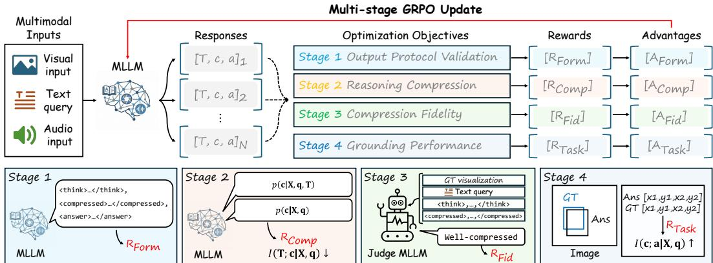  
Figure 2: Overview of Think-Compress-Answer. The model generates N grouped responses [T, c, a] per input. Stage 1 establishes the required output protocol, Stage 2 encourages reasoning compression, Stage 3 uses a judge MLLM to promote compression fidelity and target relevance, and Stage 4 improves grounding accuracy. The stage-specific rewards are converted into group-relative advantages to progressively update the model.

## 3 METHOD

## 3.1 MOTIVATION AND OVERVIEW

Given a text query q and another modality input X composed of observations from one or more modalities M (e.g., image, video, audio, or their combinations), multimodal grounding aims to identify the target entity, event, or region in X that is semantically referred to by q:

$$
\mathbf { y } = \mathcal { F } ( \mathbf { X } , \mathbf { q } ) ,\tag{1}
$$

where $\mathbf { y } \in \mathcal { V }$ denotes the grounding target predicted by a grounding model $\mathcal { F }$ in a task-dependent output form Y, such as a bounding box Wu et al. (2022), segmentation mask Lai et al. (2024), or center point Liu et al. (2025c).

Recent approaches Lai et al. (2024); Zhong et al. (2025); Liu et al. (2025c); Li et al. (2025) have defined the grounding model F as a combination of a multimodal large language model (MLLM) π and a decoder D that maps the output of π into the target grounding space Y. In existing reasoningbased MLLMs, inference typically follows an autoregressive reasoning-to-answer process:

the model generates extended reasoning paths $\mathbf { T } = \{ t _ { l } \} _ { l = 1 } ^ { L }$ , where $L$ is the token length, produces an intermediate textual answer a (i.e., the target bounding-box and center-point coordinates) conditioned on T, and then generates the final segmentation mask $\mathbf { y } \colon$

$$
\mathbf { T } \sim \pi ( \cdot \mid \mathbf { X } , \mathbf { q } ) , \quad \mathbf { a } \sim \pi ( \cdot \mid \mathbf { X } , \mathbf { q } , \mathbf { T } ) , \quad \mathbf { y } = \mathcal { D } ( \mathbf { a } , \mathbf { X } ) .\tag{2}
$$

With reinforcement learning (RL), such models are optimized to produce the reasoning paths T and the answer a that maximize task reward, encouraging T to retain information that is useful for predicting the intermediate target a. In multimodal grounding, such reasoning remains important for identifying the correct grounding target. However, not all information contained in T is required for predicting a. The key mismatch is that the intermediate target a is highly compact, whereas T often contains rich scene-level descriptions, relational analysis, and modality-wide contextual details that far exceed what is necessary for localization.

To address this challenge, we propose TCA (Think-Compress-Answer) to decompose the reasoningto-answer process. We design an intermediate reasoning compression stage to extract a targetspecific compressed context c motivated by the information bottleneck (IB) principle Tishby et al. (2000). Instead of directly mapping the full reasoning paths T onto the answer (i.e., maximizing I(T; a)), the model learns to retain only the information that is maximally predictive of a, following the IB objective:

$$
\operatorname* { m i n } _ { \pi } \underbrace { I ( \mathbf { T } ; \mathbf { c } \mid \mathbf { X } , \mathbf { q } ) } _ { \mathrm { r e a s o n i n g - s p e c i f i c ~ i n f o r m a t i o n } } - \beta \underbrace { I ( \mathbf { c } ; \mathbf { a } \mid \mathbf { X } , \mathbf { q } ) } _ { \mathrm { t a s k - r e l e v a n t i n f o r m a t i o n } } ,\tag{3}
$$

where $\beta$ controls the trade-off between the amount of preserved information from the reasoning paths, $I ( \mathbf { T } ; \mathbf { c } \mid \mathbf { X } , \mathbf { q } )$ , and task-relevant information, $I ( \mathbf { c } ; \mathbf { a } \mid \mathbf { X } , \mathbf { q } )$ . The overall procedure of TCA is illustrated in Fig. 2.

## 3.2 THINK-COMPRESS-ANSWER

TCA represents the extended reasoning paths T, target-specific compressed context c, and intermediate answer a as three explicit textual fields. In addition to (2), TCA introduces an intermediate process for c as

$$
\mathbf { c } \sim \pi ( \cdot \mid \mathbf { X } , \mathbf { q } , \mathbf { T } ) .\tag{4}
$$

The main challenge in training TCA is that no direct supervision is available for the optimal compressed context c. Although c should be concise, derived from T, and sufficient for predicting the correct grounding target, these properties are only indirectly constrained by the final grounding annotation $\mathbf { y } ^ { * }$ . We therefore introduce four reward components, each of which targets a distinct property of TCA: a format reward that enforces a valid output structure; a compression-rate reward that removes reasoning-specific information from $\mathbf { c } ;$ a compression-fidelity reward that preserves the target-relevant evidence required for grounding; and a grounding reward that directly evaluates localization accuracy.

These rewards are optimized through a multi-stage GRPO curriculum Shao et al. (2024b) to avoid jointly optimizing competing objectives from the beginning or shortcut solutions, such as bypassing the bottleneck by encoding information directly in the answer while leaving the compressed context uninformative Alemi et al. (2017). At each training iteration, we sample N responses from the current rollout policy ${ \bar { \pi } } ,$ compute the rewards $R ^ { n }$ corresponding to each stage, and normalize the rewards to estimate a relative advantage for each response:

$$
A ^ { n } = { \frac { R ^ { n } - \operatorname* { m e a n } ( \{ R ^ { 1 } , \ldots , R ^ { N } ) \} ) } { \operatorname { s t d } ( \{ R ^ { 1 } , \ldots , R ^ { N } \} ) } }\tag{5}
$$

The model is then updated using the GRPO objective.

Stage 1 – Format reward. We first establish the desired output protocol using a simple format reward DeepSeek-AI (2025), encouraging the model to reliably separate free-form reasoning from the structured answer block. Let o denote the serialized output generated by π:

$$
\mathbf { o } = \left[ \mathrm { < t h i n k > } , \mathbf { T } , \mathrm { < / t h i n k > } , \mathrm { < c o m p r e s s e d > } , \mathbf { c } , \mathrm { < / c o m p r e s s e d > } , \mathrm { < a n s w e r > } , \mathbf { a } , \mathrm { < / a n s w e r > } \right] .\tag{6}
$$

We define the format reward $R _ { \mathrm { F o r m } }$ as

$$
\begin{array} { r } { R _ { \mathrm { F o r m } } = \mathbf { 1 } [ < \mathrm { t h i n k } > . . . < / \mathrm { t h i n k } > \in \mathbf { o } ] + \mathbf { 1 } [ < \mathrm { c o m p r e s s e d } > . . . < / \mathrm { c o m p r e s s e d } > \in \mathbf { o } ] } \\ { + \mathbf { 1 } [ < \mathrm { a n s w e r } > . . . < / \mathrm { a n s w e r } > \in \mathbf { o } ] . } \end{array}\tag{7}
$$

The format reward yields a score in {0, 1, 2, 3}, normalized to [0, 1], and provides partial credit for outputs that satisfy only a subset of the required constraints.

Stage 2 – Compression-rate reward. In Stage 2, we encourage c to discard reasoning-path-specific information by minimizing the first term in (3). However, directly evaluating $I ( \mathbf { T } ; \mathbf { c } \mid \mathbf { \bar { X } } , \mathbf { q } )$ requires the intractable marginal $p ( \mathbf { c } \mid \mathbf { X } , \mathbf { q } )$ . We therefore introduce a context-conditioned variational prior $\rho _ { \eta } ( \textbf { c } | \textbf { X } , \mathbf { q } )$ that predicts the compressed context without observing T. The conditional mutual information is upper-bounded Hou et al. (2025) as

$$
I _ { \pi } ( \mathbf { T } ; \mathbf { c } \mid \mathbf { X } , \mathbf { q } ) \leq \mathbb { E } \left[ D _ { \mathrm { K L } } \left( \pi ( \mathbf { c } \mid \mathbf { X } , \mathbf { q } , \mathbf { T } ) \parallel \rho _ { \eta } ( \mathbf { c } \mid \mathbf { X } , \mathbf { q } ) \right) \right] .\tag{8}
$$

For a sampled trajectory, we estimate its information rate as

$$
\hat { \mathcal { T } } _ { \mathrm { R a t e } } = \log \bar { \pi } ( \mathbf { c } \mid \mathbf { X } , \mathbf { q } , \mathbf { T } ) - \log \rho _ { \eta } ( \mathbf { c } \mid \mathbf { X } , \mathbf { q } ) ,\tag{9}
$$

where $\bar { \pi }$ denotes the fixed rollout policy. For an autoregressive compressed context, each loglikelihood is computed by summing its token-level log-probabilities. The compression-rate reward is then defined as

$$
R _ { \mathrm { C o m p } } = \sigma ( - \hat { \mathcal { T } } _ { \mathrm { R a t e } } ) ,\tag{10}
$$

where $\sigma ( \cdot )$ is a sigmoid function to force the reward to be $[ 0 , 1 ] .$ . Maximizing $R _ { \mathrm { C o m p } }$ encourages c to contain less information that can only be recovered from the particular realization of T. We instantiate the variational prior using the same rollout policy $\bar { \pi } , i . e . , \rho _ { \eta } ( \mathbf { c } \mid \mathbf { X } , \mathbf { q } ) : = \bar { \pi } ( \mathbf { c } \mid \mathbf { X } , \mathbf { q } )$ The parameters of $\bar { \pi }$ are held fixed while computing rewards and performing each GRPO update, not requiring separately optimized variational prior.

Stage 3 – Compression fidelity reward. Minimizing the information rate alone admits a degenerate solution in which the model produces an empty or overly generic compressed context $( e . g .$ , “object” or “animal”), merely copies the input query, or generates an input-independent context Skalse et al. (2022). We employ a specialized judge J (i.e., MLLM) to evaluate whether the compressed context c is well-aligned with $\mathbf { T } ,$ while preserving sufficient information for grounding.

We first generate $\mathbf { X } ^ { * }$ by visualizing the ground-truth (e.g., segmentation mask, bounding box, or center point) on the input X. The judge $\mathcal { I }$ takes $\mathbf { X } ^ { \ast } , \mathbf { q } , \mathbf { T } ,$ , and c as inputs, and produces the fidelity reward as:

$$
R _ { \mathrm { F i d } } = \mathcal { I } ( \mathbf { X } ^ { * } , \mathbf { q } , \mathbf { T } , \mathbf { c } ) ,\tag{11}
$$

where $R _ { \mathrm { F i d } } \in \{ 0 , 1 \}$ returns 1 if c is “well-compressed” from T and semantically aligned with the ground-truth target highlighted on $\mathbf { X } ^ { * }$ , and 0 otherwise. For more details on the prompt to generate the fidelity reward, please refer to the supplementary material.

In Stage 2 and 3, GRPO updates are applied primarily to the tokens in c, while the distribution of T is stabilized using a KL constraint to the Stage 1 checkpoint. This isolates compression learning from changes in the reasoning path distribution.

Stage 4 – Grounding reward. Finally, we optimize a task-driven surrogate for the task-relevant term $I ( \mathbf { c } ; \mathbf { a } \mid \mathbf { X } , \mathbf { q } )$ in (3) using a reward on the intermediate answer and resulting grounding target.

For segmentation-based grounding tasks, a consists of the predicted bounding-box coordinates b and the center point p of the target. From the ground-truth label $\mathbf { y } ^ { * }$ , we construct the corresponding intermediate ground truth $\mathbf { a } ^ { * }$ , consisting of the bounding box $\mathbf { b } ^ { * }$ and center point $\mathbf { p } ^ { * }$ . We define the task reward as the sum of the bounding-box IoU, bounding-box $\ell _ { 1 }$ , and point $\ell _ { 1 }$ rewards Liu et al. (2025c):

$$
R _ { \mathrm { T a s k } } = \mathbf { 1 } \big [ \mathrm { I o U } ( \mathbf { b } , \mathbf { b } ^ { * } ) > \tau _ { \mathrm { i o u } } \big ] + \mathbf { 1 } \big [ \| \mathbf { b } - \mathbf { b } ^ { * } \| _ { 1 } < \tau _ { b } \big ] + \mathbf { 1 } \big [ \| \mathbf { p } - \mathbf { p } ^ { * } \| _ { 1 } < \tau _ { p } \big ] .\tag{12}
$$

The bounding-box IoU reward evaluates the overlap between b and $\mathbf { b } ^ { * } ,$ , while the bounding-box and point $\ell _ { 1 }$ rewards evaluate their distances from the corresponding ground truth. GRPO updates in Stage 4 are applied to both c and ${ \mathbf { a } } ,$ while the reasoning field remains constrained by the previousstage policy. We set $\tau _ { \mathrm { i o u } } { = } 0 . 5 , \tau _ { b } { = } 1 0$ , and $\tau _ { p } { = } 1 0 0$ in our experiments.

Overall, the four-stage optimization first establishes a valid TCA protocol, then learns a minimum sufficient compressed context, and finally improves grounding accuracy without allowing the compressed context to recover the full information content of the original reasoning paths.

## 4 EXPERIMENTS

## 4.1 EXPERIMENTAL SETUP

Datasets. We evaluate TCA on two multimodal grounding tasks across six benchmarks, including the RefCOCO series Yu et al. (2016); Mao et al. (2016) for referring expression segmentation (RES), Ref-YouTube-VOS (RY-V) Seo et al. (2020), Ref-DAVIS17 (RD17) Khoreva et al. (2018), and MeViS Ding et al. (2023a) for referring video object segmentation (R-VOS). We train TCA on a mixed set of data consisting of 842 samples from RefAVS Wang et al. (2024) and 1,258 videos from ReVOS Yan et al. (2024) for one epoch. Note that we do not use the RES and R-VOS benchmarks during training, but only for zero-shot performance evaluation. We provide details on each benchmark and results on the benchmarks used for training in the supplementary material.

Baselines. We consider two types of baselines according to the output of the MLLM π: Embeddingguided methods Lai et al. (2024); Ren et al. (2024); Rasheed et al. (2024); Yuan et al. (2025); Liu et al. (2025b) in which the decoder D takes a grounding latent token from π. These baselines train the MLLM and the decoder simultaneously for multimodal grounding, typically showing better performance than the following reasoning-guided baselines. Reasoning-guided methods Liu et al.

Table 1: Referring expression segmentation on RefCOCO, RefCOCO+, and RefCOCOg. We report the performance (cIoU) evaluated on validation, testA, and testB splits for RefCOCO and Ref-COCO+, and validation and test splits for RefCOCOg. \* employs a frozen decoder (Dec.) only for mask prediction.
<table><tr><td rowspan="2">Method</td><td rowspan="2">MLLM</td><td rowspan="2">Dec.</td><td colspan="3">RefCOCO</td><td colspan="3">RefCOCO+</td><td colspan="2">RefCOCOg</td></tr><tr><td>val</td><td>tA</td><td>tB</td><td>val</td><td>tA</td><td>tB</td><td>val</td><td>test</td></tr><tr><td>Supervised, Fine-Tuning</td><td></td><td></td><td></td><td></td><td></td><td></td><td></td><td></td><td></td><td></td></tr><tr><td>Qwen2.5-Ómni-7B Qwen Team (2025a) Qw2.5OM-7BSAM2*</td><td></td><td></td><td></td><td></td><td></td><td></td><td>76.2 78.0 71.3 69.4 75.1 62.7 71.5</td><td></td><td></td><td>70.5</td></tr><tr><td>Supervised, Embedding-Guided</td><td></td><td>SAM</td><td></td><td></td><td></td><td></td><td></td><td></td><td></td><td></td></tr><tr><td>LISA Lai et al. (2024)</td><td>LLaVA-7B</td><td>Pix.Dec.</td><td>73.0 76.5 68.2 66.3 71.7 58.3 69.3</td><td></td><td></td><td></td><td></td><td></td><td>74.1 76.5 71.1 62.4 67.4 56.5 67.9</td><td>70.6 70.5</td></tr><tr><td>PixelLM Ren et al. (2024) GSVA Xia et al. (2024)</td><td>LLaVA-7B Vicuna-7B</td><td>SAM</td><td>76.4 77.4 72.8 64.5 67.7 58.6 71.1</td><td></td><td></td><td></td><td></td><td></td><td></td><td></td></tr><tr><td>GLaMM Rasheed et al. (2024)</td><td>Vicuna-7B</td><td>SAM</td><td>79.5 83.2 76.9 72.6 78.7 64.6 74.2</td><td></td><td></td><td></td><td></td><td></td><td></td><td>72.0</td></tr><tr><td>OMG-LLaVA Zhang et al. (2024a)</td><td>IntLM2-7B</td><td>SAM</td><td></td><td></td><td></td><td></td><td></td><td></td><td></td><td>74.9</td></tr><tr><td></td><td>LLaVA-7B</td><td>SAM</td><td></td><td></td><td></td><td></td><td></td><td></td><td>78.0 80.3 74.1 69.1 73.1 63.0 72.9</td><td>72.9</td></tr><tr><td>F-LMM Wu et al. (2025b) Sa2VA Yuan et al. (2025)</td><td></td><td>SAM2</td><td>81.9</td><td></td><td></td><td></td><td></td><td></td><td>75.2 79.1 71.9 63.7 71.8 54.7 67.1</td><td>68.1</td></tr><tr><td>UniPixel Liu et al. (2025b)</td><td>IntVL2.5-8B</td><td>SAM2</td><td></td><td></td><td></td><td>76.5</td><td></td><td></td><td>78.9</td><td></td></tr><tr><td>Supervised, Reasoning-Guided</td><td>Qw2.5VL-7B</td><td></td><td></td><td></td><td></td><td></td><td></td><td></td><td>80.8 83.0 77.4 75.3 80.1 70.0 76.4</td><td>77.1</td></tr><tr><td></td><td>LLaVA1.6-7B</td><td>SAM*</td><td>79.6 82.8 76.1 73.5 77.8</td><td></td><td></td><td></td><td></td><td></td><td></td><td></td></tr><tr><td>SAM4MLLM Chen et al. (2024b)</td><td></td><td>SAM2*</td><td></td><td></td><td></td><td></td><td></td><td></td><td>65.874.5</td><td>75.6</td></tr><tr><td>Seg-Zero Liu et al. (2025c)</td><td>Qw2.5VL-7B</td><td></td><td></td><td>80.3</td><td></td><td></td><td>76.2</td><td></td><td></td><td>72.6</td></tr><tr><td>DR²Seg-7B He et al. (2026)</td><td>Qw2.5VL-7B</td><td>SAM2*</td><td></td><td>78.7</td><td></td><td></td><td>75.4</td><td></td><td></td><td>72.2</td></tr><tr><td>SAM-R1 Huang et al. (2025)</td><td>Qw2.5VL-7B</td><td>SAM2*</td><td></td><td>79.2</td><td></td><td></td><td>74.7</td><td></td><td></td><td>73.1</td></tr><tr><td>Zero-Shot, Reasoning-Guided</td><td></td><td></td><td></td><td></td><td></td><td></td><td></td><td></td><td></td><td></td></tr><tr><td>Qwen2.5-Omni-7B Qwen Team (2025a) Qw2.5OM-7BSAM2*</td><td></td><td></td><td></td><td></td><td></td><td></td><td></td><td></td><td>74.5 75.8 69.1 66.5 71.2 60.5 71.8</td><td>71.2</td></tr><tr><td>Seg-R1-7B You &amp; Wu (2025)</td><td>Qw2.5VL-7B</td><td>SAM2*</td><td></td><td></td><td></td><td></td><td></td><td></td><td>74.3 78.7 67.6 62.6 70.9 57.9 71.0</td><td>71.4</td></tr><tr><td>VideoSeg-R1 Xu et al. (2026)</td><td>Qw2.5VL-7B</td><td>SAM2*</td><td></td><td></td><td></td><td></td><td></td><td></td><td>78.282.375.171.876.164.773.1</td><td>74.1</td></tr><tr><td>TCA (Ours)</td><td>Qw2.5OM-7BSAM2*</td><td></td><td></td><td></td><td></td><td></td><td></td><td></td><td>79.481.573.674.078.766.175.3</td><td>76.0</td></tr></table>

(2025c); Huang et al. (2025); He et al. (2026); You & Wu (2025); Xu et al. (2026); Zhao et al.   
(2025); Zhong et al. (2025) employ an off-the-shelf pre-trained decoder (e.g., SAM2 Ravi et al.   
(2024)) so that the MLLM π provides the intermediate answer a in a form required by the decoder.   
TCA follows the reasoning-guided setting.

Backbone. We employ Qwen2.5-Omni-7B Qwen Team (2025a) as an MLLM π and SAM2 Ravi et al. (2024) as a decoder D. The MLLM predicts bounding-box coordinates and a center point, collectively denoted as a, and the decoder takes a as input to produce a segmentation mask y. Although we mainly use Qwen2.5-Omni-7B and SAM2, our TCA can be readily adapted to other MLLMs and decoders, such as SAM Kirillov et al. (2023) and SAM3 Carion et al. (2025). We provide the results with a smaller MLLM (i.e., Qwen2.5-Omni-3B) and different decoders (i.e., SAM and SAM3) in the supplementary material. In our framework, we apply low-rank adapters (LoRA) Hu et al. (2022) to the LLM of π and train only the LoRA layers, while freezing all the pre-trained parameters in π and D. Please refer to the supplementary material for additional implementation details.

## 4.2 REFERRING EXPRESSION SEGMENTATION

Given an image and a natural language referring expression, referring expression segmentation (RES) aims to generate a pixel-wise mask for the object described by the expression.

## 4.2.1 RESULTS.

Tab. 1 shows RES performance evaluated on three benchmarks. The results show that our TCA achieves comparable performance to the fully-supervised approaches Liu et al. (2025b); Chen et al. (2024b); Yuan et al. (2025) or even better performance than most existing methods Rasheed et al. (2024); Zhang et al. (2024a) across all evaluation splits. Compared with Seg-Zero Liu et al. (2025c) on the three reported splits, TCA improves cIoU by 1.2, 2.5, and 3.4 points on RefCOCO testA, RefCOCO+ testA, and RefCOCOg test, respectively.

Table 2: Referring video object segmentation on Ref-YouTube-VOS, Ref-DAVIS17, and MeViS. We report $\mathcal { T } \& \mathcal { F }$ evaluated on the validation set of each benchmark. \* employs a frozen decoder (Dec.) only for mask prediction. † additionally employs an external XMem tracker for temporal mask propagation.
<table><tr><td>Method</td><td>MLLM</td><td>Dec.</td><td>RY-VOS</td><td>RD17</td><td>MeViS</td></tr><tr><td>Supervised, Fine-Tuning Qwen2.5-Omni-7B Qwen Team (2025a) Qw2.5OM-7B</td><td></td><td>SAM2*</td><td>69.3</td><td>76.8</td><td>53.3</td></tr><tr><td>Supervised, Embedding-Guided</td><td></td><td></td><td></td><td></td><td></td></tr><tr><td>VISA Yan et al. (2024)</td><td>ChatUniVi-7B</td><td>SAM†</td><td>61.5</td><td>69.4</td><td>43.5</td></tr><tr><td>ViLLa Zheng et al. (2025)</td><td>Vicuna-7B</td><td>E2E</td><td>67.5</td><td>74.3</td><td>49.4</td></tr><tr><td>Sa2VA Yuan et al. (2025)</td><td>IntVL2.5-8B</td><td>SAM2</td><td>70.7</td><td>75.2</td><td>46.0</td></tr><tr><td>VideoLISA Bai et al. (2024)</td><td>LLaVA-Phi-3.8B</td><td>SAM2</td><td>63.7</td><td>68.8</td><td>44.4</td></tr><tr><td>UniPixel Liu et al. (2025b) Supervised, Reasoning-Guided</td><td>Qw2.5VL-7B</td><td>SAM2</td><td>71.0</td><td>76.4</td><td>55.8</td></tr><tr><td>VideoSeg-R1 Xu et al. (2026)</td><td>Qw2.5VL-7B</td><td> ${ \bf S } { \bf A } { \bf M } 2 ^ { * \dagger }$ </td><td>81.3</td><td>79.8</td><td>55.3</td></tr><tr><td></td><td></td><td></td><td></td><td></td><td></td></tr><tr><td>Zero-Shot, Reasoning-Guided Qwen2.5-Omni-7B Qwen Team (2025a)</td><td>Qw2.5OM-7B</td><td>SAM2*</td><td>63.5</td><td>65.2</td><td>49.1</td></tr><tr><td>PARSE-VOS Zhao et al. (2025)</td><td>Llama3-8B</td><td>SAM2*</td><td>72.1</td><td>75.5</td><td>52.4</td></tr><tr><td>Omni-R1 Zhong et al. (2025)</td><td>Qw2.5OM-7B</td><td>SAM2*</td><td>71.0</td><td>77.6</td><td>52.3</td></tr><tr><td>TCA (Ours)</td><td>Qw2.5OM-7B</td><td>SAM2*</td><td>72.3</td><td>78.9</td><td>55.8</td></tr><tr><td></td><td></td><td></td><td></td><td></td><td></td></tr></table>

Table 3: Performance with respect to variants of the stages on R-VOS benchmarks. We report J&F evaluated on the validation set of each benchmark.
<table><tr><td>S1 S2 S3</td><td>S4 RY-V RD17 MeViS</td></tr><tr><td>× × × X</td><td>63.5 65.2 49.1 50.6</td></tr><tr><td>√ X × ×</td><td>65.6 69.6</td></tr><tr><td>√ √ X X</td><td>69.0 72.6 52.3</td></tr><tr><td>√ √ √</td><td>× 71.1 75.3 53.0</td></tr><tr><td>√ ×</td><td>× √ 68.6 72.8 51.5</td></tr><tr><td>√ √ × √ √</td><td>70.8 76.1 53.8 72.3 78.9 55.8</td></tr></table>

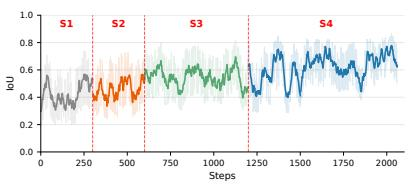

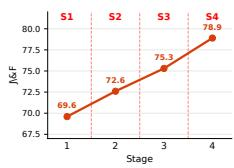  
(a) Grounding IoU  
(b) Zero-shot $\mathcal { I } \& \mathcal { F }$  
Figure 3: (a) Grounding IoU over training steps across all four stages. (b) J&F on Ref-DAVIS17 after each stage.

## 4.3 REFERRING VIDEO OBJECT SEGMENTATION

The goal of referring video object segmentation (R-VOS) is to segment a referred object instance in each frame, producing temporally consistent masks across a given video sequence. R-VOS extends RES by adding motion, occlusion, and temporal appearance changes.

## 4.3.1 RESULTS.

In Tab. 2, we compare TCA with state-of-the-art methods on three R-VOS benchmarks. Despite being evaluated in a zero-shot setting, TCA ties for the best performance on MeViS and achieves the second-best performance on RD17. In particular, TCA achieves state-of-the-art zero-shot performance while outperforming most supervised methods Yan et al. (2024); Zheng et al. (2025); Yuan et al. (2025); Bai et al. (2024); Liu et al. (2025b), showing J&F scores of 72.3, 78.9, and 55.8 on RY-V, RD17, and MeViS, respectively. Compared with the zero-shot backbone baseline, i.e., Qwen2.5-Omni Qwen Team (2025a), TCA yields substantial gains of 8.8, 13.7, and 6.7 points across the benchmarks.

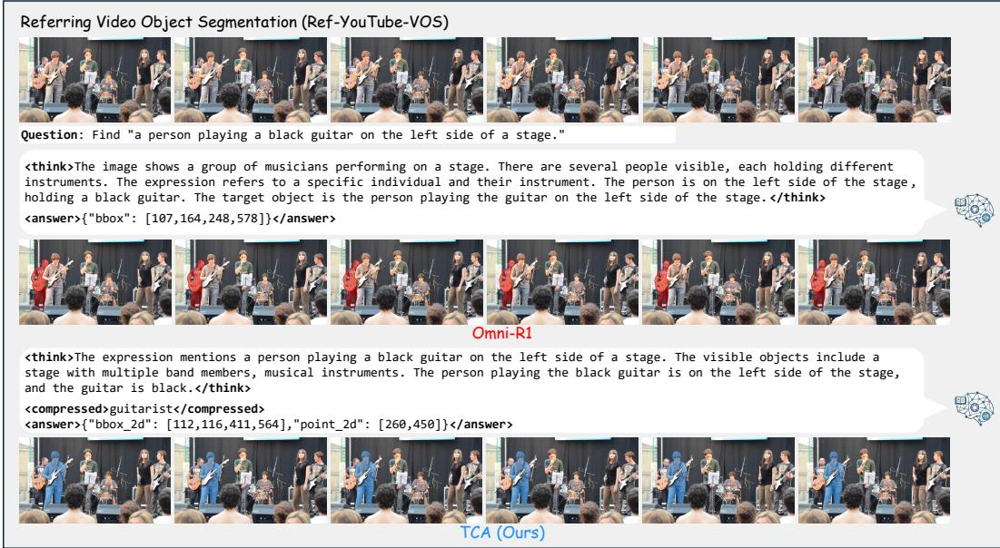  
Figure 4: Qualitative comparisons for referring video object segmentation on Ref-YouTube-VOS.

## 4.4 ADDITIONAL ANALYSIS

## 4.4.1 OPTIMIZATION STAGE.

In Tab. 3, we conduct stage-wise ablations under an equal optimization budget and evaluate J&F on the R-VOS validation sets. The comparison between the models without any optimization and with only the format reward shows that a simple format reward consistently improves performance across RY-V, RD17, and MeViS. The model trained up to Stage 2 further improves the scores to 69.0, 72.6, and 52.3, demonstrating the effectiveness of the compression step. Stages 3 and 4 yield additional performance gains, reaching 72.3, 78.9, and 55.8 with all four stages. Skipping the intermediate stages (rows 5–6) consistently leads to lower performance than the full progressive optimization, confirming the effectiveness of the progressive reward schedule.

In Fig. 3, we illustrate the grounding IoU on ReVOS and RefAVS according to the training steps, and the zero-shot grounding performance on Ref-DAVIS17 evaluated after each training stage. The results show that the grounding IoU and the grounding performance are monotonically increased by going through training. Interestingly, the grounding IoU increases even before optimizing the model with the grounding reward. This result suggests that optimizing the model with compression-rate and compression-fidelity rewards in our TCA can directly improve the grounding performance.

## 4.4.2 QUALITATIVE RESULTS.

In Fig. 4, we present qualitative comparisons between TCA and Omni-R1 Zhong et al. (2025) on Ref-YouTube-VOS. The example in Fig. 4 shows that, although both methods reason over broad scene context, only TCA converges to the correct target, indicating that our framework enables the model to yield target-focused reasoning for grounding. We provide additional analyses for TCA’s components, including the backbone, decoders, and optimization stages, together with further qualitative examples and a failure case analysis in the supplementary material.

## 5 CONCLUSION

We presented Think-Compress-Answer (TCA), a novel information-bottleneck-inspired RL framework that makes explicit reasoning compatible with multimodal grounding. We optimize TCA with a staged GRPO using practical rewards, progressively enforcing a valid output protocol, compression rate, compression fidelity, and end-task grounding performance. Without architectural modification or dense intermediate annotations, TCA achieves comparable and even better zero-shot performance than the supervised methods on RES and R-VOS benchmarks.

## 5.1 BROADER IMPACT.

TCA offers a practical framework to study the interaction between long-form reasoning and multimodal grounding. By explicitly optimizing compression via staged RL, TCA enables the community to (1) diagnose when extended reasoning becomes counterproductive, (2) measure information retained in the compressed context, and (3) align inference with compact grounding objectives. This perspective shifts the focus from “more reasoning” to “selective reasoning,” informing future work on test-time scaling, information bottlenecks, and multimodal evaluation. The release of our training recipes is expected to facilitate ablations on reward design, judge selection, and compression capacity, as well as standardized comparisons across datasets and modalities.

## AI USE STATEMENT

We used generative AI tools to assist with experimental code development and LaTeX formatting. All AI-assisted code and manuscript formatting were reviewed and verified by the authors. We take responsibility for the final content of this work, including all experimental results, text, and artifacts.

## REFERENCES

Alexander A. Alemi, Ian Fischer, Joshua V. Dillon, and Kevin Murphy. Deep variational information bottleneck. ICLR, 2017.

Yuntao Bai, Saurav Kadavath, Sandipan Kundu, Amanda Askell, Jackson Kernion, Andy Jones, Anna Chen, Anna Goldie, Azalia Mirhoseini, Cameron McKinnon, et al. Constitutional AI: Harmlessness from AI feedback. arXiv preprint arXiv:2212.08073, 2022.

Zechen Bai, Tong He, Haiyang Mei, Pichao Wang, Ziteng Gao, Joya Chen, Lei Liu, Zheng Zhang, and Mike Zheng Shou. One token to seg them all: Language instructed reasoning segmentation in videos. NeurIPS, 2024.

Steven Bird and Edward Loper. NLTK: The natural language toolkit. ACL, 2004. URL https: //aclanthology.org/P04-3031/.

Nicolas Carion, Laura Gustafson, Yuan-Ting Hu, Shoubhik Debnath, Ronghang Hu, Didac Suris, Chaitanya Ryali, Kalyan Vasudev Alwala, Haitham Khedr, et al. SAM 3: Segment anything with concepts. arXiv preprint arXiv:2511.16719, 2025.

Xingyu Chen et al. Do not think that much for 2+3=? on the overthinking of o1-like LLMs. arXiv preprint arXiv:2412.21187, 2024a.

Yi-Chia Chen, Wei-Hua Li, Cheng Sun, Yu-Chiang Frank Wang, and Chu-Song Chen. SAM4MLLM: Enhance multi-modal large language model for referring expression segmentation. ECCV, 2024b.

Sanjoy Chowdhury, Sayan Nag, Subhrajyoti Dasgupta, Jun Chen, Mohamed Elhoseiny, Ruohan Gao, and Dinesh Manocha. Meerkat: Audio-visual large language model for grounding in space and time. ECCV, 2024.

Wenliang Dai, Junnan Li, Dongxu Li, Anthony Meng Huat Tiong, Junqi Zhao, Weisheng Wang, Boyang Li, Pascale Fung, and Steven Hoi. InstructBLIP: Towards general-purpose visionlanguage models with instruction tuning. NeurIPS, 2023.

DeepSeek-AI. DeepSeek-R1: Incentivizing reasoning capability in LLMs via reinforcement learning. arXiv preprint arXiv:2501.12948, 2025.

Henghui Ding, Chang Liu, Shuting He, Xudong Jiang, and Chen Change Loy. MeViS: A large-scale benchmark for video segmentation with motion expressions. ICCV, 2023a.

Henghui Ding, Chang Liu, Shuting He, Xudong Jiang, Philip H.S. Torr, and Song Bai. MOSE: A new dataset for video object segmentation in complex scenes. ICCV, 2023b.

Yulin He, Wei Chen, Zhikang Jian, Tianhang Guo, Wenjuan Zhou, Minglong Li, Shaowu Yang, and Wenjing Yang. DR2Seg: Decomposed two-stage rollouts for efficient reasoning segmentation in multimodal large language models. arXiv preprint arXiv:2601.09981, 2026.

Yue Hou, He Zhu, Ruomei Liu, Yingke Su, Junran Wu, and Ke Xu. Redundancy-aware test-time graph out-of-distribution detection. NeurIPS, 2025.

Edward J. Hu, Yelong Shen, Phillip Wallis, Zeyuan Allen-Zhu, Yuanzhi Li, Shean Wang, Lu Wang, and Weizhu Chen. LoRA: Low-rank adaptation of large language models. ICLR, 2022.

Jiaqi Huang, Zunnan Xu, Jun Zhou, Ting Liu, Yicheng Xiao, Mingwen Ou, Bowen Ji, Xiu Li, and Kehong Yuan. SAM-R1: Leveraging sam for reward feedback in multimodal segmentation via reinforcement learning. NeurIPS, 2025.

Lei Huang, Weijiang Yu, Weitao Ma, Weihong Zhong, Zhangyin Feng, Haotian Wang, Qianglong Chen, Weihua Peng, Xiaocheng Feng, Bing Qin, and Ting Liu. A survey on hallucination in large language models: Principles, taxonomy, challenges, and open questions. ACM Computing Surveys, 2024.

Shiu-hong Kao, Yu-Wing Tai, and Chi-Keung Tang. CoT-RVS: Zero-shot chain-of-thought reasoning segmentation for videos. ICLR, 2026.

Anna Khoreva, Anna Rohrbach, and Bernt Schiele. Video object segmentation with language referring expressions. ACCV, 2018.

Alexander Kirillov, Eric Mintun, Nikhila Ravi, Hanzi Mao, Chloe Rolland, Laura Gustafson, Tete Xiao, Spencer Whitehead, Alexander C. Berg, Wan-Yen Lo, Piotr Dollar, and Ross Girshick. Segment anything. ICCV, 2023.

Takeshi Kojima, Shixiang Shane Gu, Machel Reid, Yutaka Matsuo, and Yusuke Iwasawa. Large language models are zero-shot reasoners. NeurIPS, 2022.

Xin Lai, Zhuotao Tian, Yukang Chen, Yanwei Li, Yuhui Yuan, Shu Liu, and Jiaya Jia. LISA: Reasoning segmentation via large language model. CVPR, 2024.

Harrison Lee, Samrat Phatale, Hassan Mansoor, Kellie Lu, Thomas Mesnard, Colton Bishop, Victor Carbune, and Abhinav Rastogi. RLAIF: Scaling reinforcement learning from human feedback with AI feedback. arXiv preprint arXiv:2309.00267, 2023.

Yifan Li, Yifan Du, Kun Zhou, Jinpeng Wang, Wayne Xin Zhao, and Ji-Rong Wen. Evaluating object hallucination in large vision-language models. EMNLP, 2023.

Yifan Li, Yingda Yin, Lingting Zhu, Weikai Chen, Shengju Qian, Xin Wang, and Yanwei Fu. ReVSeg: Incentivizing the reasoning chain for video segmentation with reinforcement learning. arXiv preprint arXiv:2512.02835, 2025.

Hunter Lightman, Vineet Kosaraju, Yura Burda, Harri Edwards, Bowen Baker, Teddy Lee, Jan Leike, John Schulman, Ilya Sutskever, and Karl Cobbe. Let’s verify step by step. ICLR, 2024.

Tsung-Yi Lin, Michael Maire, Serge Belongie, James Hays, Pietro Perona, Deva Ramanan, Piotr Dollar, and C. Lawrence Zitnick. Microsoft COCO: Common objects in context.´ ECCV, 2014.

Chengzhi Liu, Zhongxing Xu, Qingyue Wei, Juncheng Wu, James Zou, Xin Eric Wang, Yuyin Zhou, and Sheng Liu. More thinking, less seeing? Assessing amplified hallucination in multimodal reasoning models. arXiv preprint arXiv:2505.21523, 2025a.

Haotian Liu, Chunyuan Li, Qingyang Wu, and Yong Jae Lee. Visual instruction tuning. NeurIPS, 2023.

Ye Liu, Zongyang Ma, Junfu Pu, Zhongang Qi, Yang Wu, Shan Ying, and Chang Wen Chen. UniPixel: Unified object referring and segmentation for pixel-level visual reasoning. NeurIPS, 2025b.

Yuqi Liu, Bohao Peng, Zhisheng Zhong, Zihao Yue, Fanbin Lu, Bei Yu, and Jiaya Jia. Seg-Zero: Reasoning-chain guided segmentation via cognitive reinforcement. arXiv preprint arXiv:2503.06520, 2025c.

Ilya Loshchilov and Frank Hutter. Decoupled weight decay regularization. ICLR, 2019.

Junhua Mao, Jonathan Huang, Alexander Toshev, Oana Camburu, Alan Yuille, and Kevin Murphy. Generation and comprehension of unambiguous object descriptions. CVPR, 2016.

Meta. Llama-3.2-11B-Vision-Instruct model card. https://huggingface.co/ meta-llama/Llama-3.2-11B-Vision-Instruct, 2024. Released September 25, 2024.

OpenAI. OpenAI o1 system card. arXiv preprint arXiv:2412.16720, 2024.

Long Ouyang, Jeffrey Wu, Xu Jiang, Diogo Almeida, Carroll Wainwright, Pamela Mishkin, Chong Zhang, Sandhini Agarwal, Katarina Slama, Alex Ray, et al. Training language models to follow instructions with human feedback. NeurIPS, 2022.

Jordi Pont-Tuset, Federico Perazzi, Sergi Caelles, Pablo Arbelaez, Alexander Sorkine-Hornung, ´ and Luc Van Gool. The 2017 davis challenge on video object segmentation. arXiv preprint arXiv:1704.00675, 2017.

Jiyang Qi, Yan Gao, Yao Hu, Xinggang Wang, Xiaoyu Liu, Xiang Bai, Serge Belongie, Alan Yuille, Philip Torr, and Song Bai. Occluded video instance segmentation: A benchmark. International Journal of Computer Vision, 2022.

Qwen Team. Qwen2.5-Omni: Technical report. arXiv preprint arXiv:2503.20215, 2025a.

Qwen Team. Qwen2.5-VL: Technical report. arXiv preprint arXiv:2502.13923, 2025b.

Qwen Team. Qwen3-VL: Technical report. arXiv preprint arXiv:2511.21631., 2025c.

Hanoona Rasheed, Muhammad Maaz, Sahal Shaji, Abdelrahman Shaker, Salman Khan, Hisham Cholakkal, Rao Muhammad Anwer, Eric Xing, Ming-Hsuan Yang, and Fahad Shahbaz Khan. GLaMM: Pixel grounding large multimodal model. CVPR, 2024.

Nikhila Ravi, Valentin Gabeur, Yuan-Ting Hu, Ronghang Hu, Chaitanya Ryali, Tengyu Ma, Haitham Khedr, Roman Radle, Chloe Rolland, Laura Gustafson, et al. SAM 2: Segment anything in images¨ and videos. arXiv preprint arXiv:2408.00714, 2024.

Zhongwei Ren, Zhicheng Huang, Yunchao Wei, Yao Zhao, Dongmei Fu, Jiashi Feng, and Xiaojie Jin. PixelLM: Pixel reasoning with large multimodal model. CVPR, 2024.

Seonguk Seo, Joon-Young Lee, and Bohyung Han. URVOS: Unified referring video object segmentation network with a large-scale benchmark. ECCV, 2020.

Hao Shao, Shengju Qian, Han Xiao, Guanglu Song, Zhuofan Zong, Letian Wang, Yu Liu, and Hongsheng Li. Visual CoT: Advancing multi-modal language models with a comprehensive dataset and benchmark for chain-of-thought reasoning. NeurIPS, 2024a.

Zhihong Shao, Peiyi Wang, Qihao Zhu, Runxin Xu, Junxiao Song, Xiao Bi, Haowei Zhang, Mingchuan Zhang, Y. K. Li, Y. Wu, and Daya Guo. DeepSeekMath: Pushing the limits of mathematical reasoning in open language models. arXiv preprint arXiv:2402.03300, 2024b.

Ravid Shwartz-Ziv and Naftali Tishby. Opening the black box of deep neural networks via information. arXiv preprint arXiv:1703.00810, 2017.

Joar Skalse, Nikolaus H. R. Howe, Dmitrii Krasheninnikov, and David Krueger. Defining and characterizing reward hacking. NeurIPS, 2022.

Charlie Snell, Jaehoon Lee, Kelvin Xu, and Aviral Kumar. Scaling LLM test-time compute optimally can be more effective than scaling model parameters. arXiv preprint arXiv:2408.03314, 2024.

Naftali Tishby and Noga Zaslavsky. Deep learning and the information bottleneck principle. ITW, 2015.

Naftali Tishby, Fernando C. Pereira, and William Bialek. The information bottleneck method. arXiv preprint physics/0004057, 2000.

Miles Turpin, Julian Michael, Ethan Perez, and Samuel R. Bowman. Language models don’t always say what they think: Unfaithful explanations in chain-of-thought prompting. NeurIPS, 2023.

Haochen Wang, Cilin Yan, Shuai Wang, Xiaolong Jiang, Xu Tang, Yao Hu, Weidi Xie, and Efstratios Gavves. Towards open-vocabulary video instance segmentation. ICCV, 2023a.

Weiyao Wang, Matt Feiszli, Heng Wang, and Du Tran. Unidentified video objects: A benchmark for dense, open-world segmentation. ICCV, 2021.

Xuezhi Wang, Jason Wei, Dale Schuurmans, Quoc Le, Ed Chi, Sharan Narang, Aakanksha Chowdhery, and Denny Zhou. Self-consistency improves chain of thought reasoning in language models. ICLR, 2023b.

Yaoting Wang, Peiwen Sun, Dongzhan Zhou, Guangyao Li, Honggang Zhang, and Di Hu. Ref-avs: Refer and segment objects in audio-visual scenes. ECCV, 2024.

Jason Wei, Xuezhi Wang, Dale Schuurmans, Maarten Bosma, Brian Ichter, Fei Xia, Ed Chi, Quoc Le, and Denny Zhou. Chain-of-thought prompting elicits reasoning in large language models. NeurIPS, 2022.

Jiannan Wu, Yi Jiang, Peize Sun, Zehuan Yuan, and Ping Luo. Language as queries for referring video object segmentation. CVPR, 2022.

Qiong Wu, Xiangcong Yang, Yiyi Zhou, Chenxin Fang, Baiyang Song, Xiaoshuai Sun, and Rongrong Ji. Grounded chain-of-thought for multimodal large language models. arXiv preprint arXiv:2503.12799, 2025a.

Size Wu et al. F-LMM: Grounding frozen large multimodal models. CVPR, 2025b.

Zhuofan Xia, Dongchen Han, Yizeng Han, Xuran Pan, Shiji Song, and Gao Huang. GSVA: Generalized segmentation via multimodal large language models. CVPR, 2024.

Zishan Xu, Yifu Guo, Yuquan Lu, Fengyu Yang, Junxin Li, and Lihua Cai. VideoSeg-R1: Reasoning video object segmentation via reinforcement learning. AAAI, 2026.

Cilin Yan, Haochen Wang, Shilin Yan, Xiaolong Jiang, Yao Hu, Guoliang Kang, Weidi Xie, and Efstratios Gavves. VISA: Reasoning video object segmentation via large language models. ECCV, 2024.

Zuyao You and Zuxuan Wu. Seg-R1: Segmentation can be surprisingly simple with reinforcement learning. arXiv preprint arXiv:2506.22624, 2025.

Licheng Yu, Patrick Poirson, Shan Yang, Alexander C. Berg, and Tamara L. Berg. Modeling context in referring expressions. ECCV, 2016.

Haobo Yuan, Xiangtai Li, Tao Zhang, Zilong Huang, Shilin Xu, Shunping Ji, Yunhai Tong, Lu Qi, Jiashi Feng, and Ming-Hsuan Yang. Sa2VA: Marrying SAM2 with LLaVA for dense grounded understanding of images and videos. arXiv preprint arXiv:2501.04001, 2025.

Jingyi Zhang, Jiaxing Huang, Huanjin Yao, Shunyu Liu, Xikun Zhang, Shijian Lu, and Dacheng Tao. R1-VL: Learning to reason with multimodal large language models via step-wise group relative policy optimization. ICCV, 2025.

Tao Zhang, Xiangtai Li, Hao Fei, Haobo Yuan, Shengqiong Wu, Shunping Ji, Change Loy Chen, and Shuicheng Yan. OMG-LLaVA: Bridging image-level, object-level, pixel-level reasoning and understanding. NeurIPS, 2024a.

Zhuosheng Zhang, Aston Zhang, Mu Li, Hai Zhao, George Karypis, and Alex Smola. Multimodal chain-of-thought reasoning in language models. Transactions on Machine Learning Research, 2024b. arXiv preprint arXiv:2302.00923.

Bingrui Zhao, Lin Yuanbo Wu, Xiangtian Fan, Deyin Liu, Lu Zhang, Ruyi He, Jialie Shen, and Ximing Li. Unleashing Hierarchical Reasoning: An LLM-Driven Framework for Training-Free Referring Video Object Segmentation. arXiv preprint arXiv:2509.05751, 2025.

Yuze Zhao, Jintao Huang, Jinghan Hu, Xingjun Wang, Yunlin Mao, Daoze Zhang, Zeyinzi Jiang, Zhikai Wu, Baole Ai, Ang Wang, Wenmeng Zhou, and Yingda Chen. SWIFT: A scalable lightweight infrastructure for fine-tuning. arXiv preprint arXiv:2408.05517, 2024.

Ge Zheng, Bin Yang, Jiajin Tang, Hong-Yu Zhou, and Sibei Yang. DDCoT: Duty-distinct chain-ofthought prompting for multimodal reasoning in language models. NeurIPS, 2023a.

Lianmin Zheng, Wei-Lin Chiang, Ying Sheng, Siyuan Zhuang, Zhanghao Wu, Yonghao Zhuang, Zi Lin, Zhuohan Li, Dacheng Li, Eric Xing, et al. Judging LLM-as-a-judge with MT-Bench and chatbot arena. NeurIPS, 2023b.

Rongkun Zheng, Lu Qi, Xi Chen, Yi Wang, Kun Wang, Yu Qiao, and Hengshuang Zhao. ViLLa: Video reasoning segmentation with large language model. ICCV, 2025.

Hao Zhong, Muzhi Zhu, Zongze Du, Zheng Huang, Canyu Zhao, Mingyu Liu, Wen Wang, Hao Chen, and Chunhua Shen. Omni-R1: Reinforcement learning for omnimodal reasoning via twosystem collaboration. NeurIPS, 2025.

Yiyang Zhou, Chenhang Cui, Jaehong Yoon, Linjun Zhang, Zhun Deng, Chelsea Finn, Mohit Bansal, and Huaxiu Yao. Analyzing and mitigating object hallucination in large vision-language models. ICLR, 2024.

## APPENDIX

## A EXPERIMENTAL DETAILS

## A.1 ALGORITHM

The overall procedure of our TCA is described in Algorithm 1.

Algorithm 1 Stage-wise GRPO for Think-Compress-Answer   
Require: Dataset $\mathcal { D } = \{ ( \mathbf { X } _ { i } , \mathbf { q } _ { i } , \mathbf { y } _ { i } ^ { * } ) \}$ , policy π, judge MLLM J , group size N, stage steps $\{ K _ { s } \} _ { s = 1 } ^ { 4 }$   
Ensure: Optimized policy $\pi ^ { * }$   
1: for $s = 1$ to 4 do   
2: for $k = 1$ to $K _ { s }$ do   
3: Set rollout policy π¯ $ \pi$   
4: Sample $( \hat { \mathbf { X } , \mathbf { q } , \mathbf { y } ^ { * } } ) \sim \mathcal { D }$   
5: for $\bar { n } = \mathrm { \dot { 1 } }$ to N do   
6: Sample $\mathbf { o } _ { n } \sim \bar { \pi } ( \cdot \mid \mathbf { X } , \mathbf { q } )$   
7: Parse $\mathbf { o } _ { n }$ into $\left( \mathbf { T } _ { n } , \mathbf { c } _ { n } , \mathbf { a } _ { n } \right)$   
8: if $s = 1$ then   
9: $r _ { n } \gets R _ { \mathrm { F o r m } } ( \mathbf { o } _ { n } )$   
10: else if $s = 2$ then   
11: $r _ { n } \gets R _ { \mathrm { C o m p } } ( { \bf T } _ { n } , { \bf c } _ { n } )$   
12: else if $s = 3$ then   
13: $\mathbf { X } ^ { * } \gets \mathrm { V i s u a l i z e G T } ( \mathbf { X } , \mathbf { y } ^ { * } )$   
14: $r _ { n } \gets \mathcal { I } ( \mathbf { X } ^ { * } , \mathbf { q } , \mathbf { T } _ { n } , \mathbf { c } _ { n } )$   
15: else   
16: $r _ { n } \gets R _ { \mathrm { T a s k } } ( \mathbf { a } _ { n } , \mathbf { y } ^ { * } )$   
17: end if   
18: end for   
19: for $n = 1$ to N do   
20: $A _ { n }  { \frac { r _ { n } - \operatorname* { m e a n } ( \{ r _ { j } \} _ { j = 1 } ^ { N } ) } { \mathrm { s t d } ( \{ r _ { j } \} _ { j = 1 } ^ { N } ) } }$   
21: end for   
22: Update π using GRPO with $\{ ( \mathbf { o } _ { n } , A _ { n } ) \} _ { n = 1 } ^ { N }$   
23: end for   
24: end for   
25: return $\pi ^ { * }  \pi$

## A.2 DATASETS

## A.2.1 REFERRING EXPRESSION SEGMENTATION

We evaluate our TCA on three RES benchmarks built on MSCOCO Lin et al. (2014):

• RefCOCO Yu et al. (2016) is collected in an interactive game-based setting and contains 142k referring expressions for 50k objects in 19,994 images. It provides 3,811, 1,975, and 1,810 expressions for validation, testA, and testB splits, where testA and testB contain person-only and non-person objects, respectively.

• RefCOCO+ Yu et al. (2016) has a similar scale with 142k expressions for 50k objects in 19,992 images, but prohibits location words during annotation, making the expressions more appearance-centric. Validation, testA, and testB splits include 3,805, 1,975, 1,798 expressions, respectively.

• RefCOCOg Mao et al. (2016) provides longer and more descriptive expressions, with 85k expressions for 55k objects in 26,711 images, of which 2,573 and 5,023 expressions are in validation and test splits.

## A.2.2 REFERRING VIDEO OBJECT SEGMENTATION

We evaluate our TCA on three R-VOS benchmarks:

• Ref-YouTube-VOS (RY-V) Seo et al. (2020) is a large-scale dataset built upon YouTube-VOS, comprising 3,978 videos with 15k referring expressions. The validation split contains 507 videos with 2,096 expressions.

• Ref-DAVIS17 (RD17) Khoreva et al. (2018) extends the densely annotated DAVIS 2017 Pont-Tuset et al. (2017) benchmark with language annotations, providing 807 referring expressions for 205 objects across 90 videos. The validation split includes 30 videos with 243 expressions for 61 objects.

• MeViS Ding et al. (2023a) focuses on motion-expression-guided segmentation, where expressions must describe objects through their motion patterns rather than static appearance. It contains 1,852 videos with 26k expressions, of which the validation split provides 140 videos with 2,236 expressions.

Note that we do not use the R-VOS benchmarks during training, but only for zero-shot performance evaluation.

## A.2.3 REASONING VIDEO OBJECT SEGMENTATION

We evaluate on ReVOS Yan et al. (2024), which aggregates videos from LV-VIS Wang et al. (2023a), MOSE Ding et al. (2023b), UVO Wang et al. (2021), and OVIS Qi et al. (2022) to form a largescale reasoning VOS benchmark. It contains 1,042 videos with 35k reasoning-oriented expressions for 5,535 objects, where queries require inferring the target through actions, relations, or world knowledge rather than direct appearance descriptions.

The benchmark is split into 626 training videos and 416 validation videos. We sample 512 videos with 1,258 expressions for training. The list of sampled data will be provided in the code.

## A.2.4 REFERRING AUDIO-VISUAL SEGMENTATION

We evaluate on Ref-AVS Wang et al. (2024), which provides 3,573 videos with 20k referring expressions that require joint reasoning over visual, audio, and language cues to segment the referred object. It provides 2,288 and 1,656 expressions for seen and unseen test splits. We use 746 videos with 842 expressions for training.

Table A1: Hyperparameters for training
<table><tr><td>Hyperparameter</td><td>Value</td></tr><tr><td>Framework</td><td>ms-swift</td></tr><tr><td>Precision</td><td>bfloat16</td></tr><tr><td>Attention Learning rate</td><td>FlashAttention 1 × 10</td></tr><tr><td>Optimizer LR scheduler</td><td>AdamW</td></tr><tr><td>Warmup ratio</td><td>Cosine 0.05</td></tr><tr><td>Per-device train batch size Generation batch size</td><td>8</td></tr><tr><td></td><td>8</td></tr><tr><td>Number of generations</td><td>8</td></tr><tr><td>Max completion length</td><td>512</td></tr><tr><td>top-p</td><td>0.99</td></tr><tr><td>top-k</td><td>50</td></tr><tr><td>Temperature</td><td>0.9</td></tr><tr><td>KL coefficient</td><td>0.04</td></tr><tr><td></td><td></td></tr><tr><td>LoRA rank</td><td>8</td></tr><tr><td></td><td></td></tr><tr><td>LoRA alpha</td><td>32</td></tr></table>

## A.3 TRAINING DETAILS

## A.3.1 IMPLEMENTATION DETAILS.

We report the full hyperparameter settings in Table A1. We apply LoRAs Hu et al. (2022), with rank 8 and alpha 32, to the LLM of π and optimize only the LoRA parameters while keeping all other pre-trained parameters frozen. We use AdamW Loshchilov & Hutter (2019) and GRPO Shao et al. (2024b) with a group size of N=8, KL coefficient=0.04, and a learning rate of $\scriptstyle \eta = 1 \times 1 0 ^ { - 6 }$ implemented using ms-swift Zhao et al. (2024). Stages 1–4 are trained for 300, 300, 600, and 900 steps, respectively, and the best-performing checkpoint from each stage is used to initialize the subsequent stage. We employ Qwen3-VL-8B as the judge model for the compression fidelity reward $R _ { \mathrm { F i d } }$ . For the grounding reward, we set $\tau _ { \mathrm { i o u } } = 0 . 5 ,$ $\tau _ { b } { = } 1 0$ , and $\tau _ { p } { = } 1 0 0$ . All experiments are conducted on a system equipped with 4× NVIDIA RTX A6000 GPUs with 48 GB of memory per GPU, an AMD Ryzen Threadripper PRO 3955WX 16-core CPU, and 160 GB of system memory, running Ubuntu 22.04.5 LTS; the remaining software dependencies and their exact versions are specified in the code.

## A.3.2 PROMPTS.

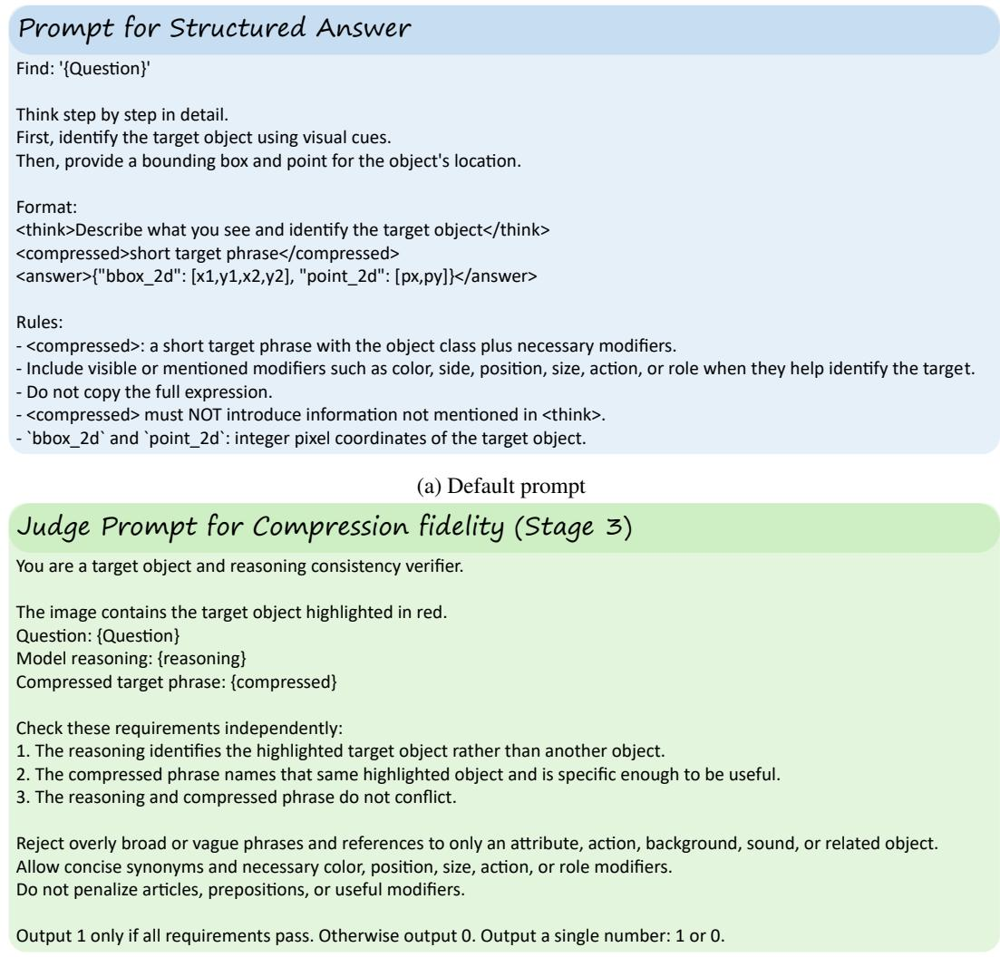  
(b) Judge prompt for Stage 3  
Figure A1: Prompt for (a) the structured answer block, (b) Compression fidelity in Stage 3.

We provide the prompt for the structured answer block in Fig. A1a. The judge prompt for compression fidelity (Stage 3) are shown in Fig. A1b.

Table B1: Reasoning video object segmentation on the ReVOS Yan et al. (2024) benchmark and referring audio-visual segmentation on the RefAVS Wang et al. (2024) benchmark. We report region similarity (J), contour accuracy (F), and their average (J&F). We use SAM2 as the decoder.
<table><tr><td rowspan="2">Method</td><td rowspan="2">MLLM</td><td rowspan="2">Dec.</td><td colspan="3">ReVOS</td><td colspan="3">RefAVS (Seen)</td><td colspan="3">RefAVS (Unseen)</td></tr><tr><td>J&amp;F</td><td>J</td><td>F</td><td>J&amp;F</td><td>J</td><td>F</td><td>J&amp;F</td><td>J</td><td>F</td></tr><tr><td>Qwen2.5-Omni-7B Qwen Team (2025a)</td><td>Qw2.50M-7B</td><td>SAM2</td><td>38.4</td><td>37.2</td><td>39.6</td><td>35.5</td><td>30.1</td><td>40.9</td><td>64.8</td><td>64.8</td><td>64.9</td></tr><tr><td>Qwen2.5-Omni-7B-SFT Qwen Team (2025a)</td><td>Qw2.5OM-7B</td><td>SAM2</td><td>55.4</td><td>53.0</td><td>57.8</td><td>69.9</td><td>67.7</td><td>72.0</td><td>77.0</td><td>77.0</td><td>77.1</td></tr><tr><td>Omni-R1 Zhong et al. (2025)</td><td>Qw2.5OM-7B</td><td>SAM2</td><td>47.6</td><td></td><td></td><td>47.2</td><td>43.0</td><td>51.4</td><td>74.2</td><td>71.3</td><td>77.0</td></tr><tr><td>TCA (Ours)</td><td>Qw2.5OM-7B</td><td>SAM2</td><td>60.5</td><td>57.7</td><td>62.2</td><td>70.7</td><td>68.0</td><td>73.4</td><td>78.8</td><td>78.7</td><td>78.8</td></tr></table>

Table B2: Referring expression segmentation on RefCOCO Yu et al. (2016), RefCOCO+ Yu et al. (2016), and RefCOCOg Mao et al. (2016) benchmarks. We report the performance (cIoU) evaluated on validation, testA, and testB splits for RefCOCO and RefCOCO+, and validation and test splits for RefCOCOg. For SAM3, + denotes joint text-and-bounding-box prompting, whereas the standard setting uses text-only prompting.
<table><tr><td rowspan="2">Method</td><td rowspan="2">MLLM</td><td rowspan="2">Dec.</td><td colspan="3">RefCOCO</td><td colspan="3">RefCOCO+</td><td colspan="2">RefCOCOg</td></tr><tr><td>val</td><td>tA</td><td>tB</td><td>val</td><td>tA</td><td></td><td>tB val</td><td>test</td></tr><tr><td>Oracle with GT</td><td></td><td></td><td></td><td></td><td></td><td></td><td></td><td></td><td></td><td></td></tr><tr><td>SAM Kirillov et al. (2023)</td><td></td><td>SAM</td><td>82.6</td><td>84.1</td><td>81.3</td><td>82.0</td><td>84.1</td><td>81.3</td><td>80.4</td><td>81.4</td></tr><tr><td>SAM2 Ravi et al. (2024)</td><td></td><td>SAM2</td><td>83.2</td><td>84.9</td><td>81.9</td><td>83.0</td><td>84.9</td><td>81.9</td><td>81.0</td><td>81.8</td></tr><tr><td>SAM3 Carion et al. (2025)</td><td></td><td>SAM3</td><td>26.4</td><td>26.5</td><td>27.4</td><td>26.4</td><td>26.5</td><td>27.5</td><td>34.3</td><td>35.1</td></tr><tr><td>SAM3+ Carion et al. (2025)</td><td></td><td>SAM3+</td><td>76.1</td><td>75.8</td><td>75.4</td><td>76.4</td><td>75.8</td><td>75.4</td><td>72.9</td><td>73.8</td></tr><tr><td colspan="9">LLM-7B with SAM</td><td></td></tr><tr><td>Qwen2.5-Omni-7B Qwen Team (2025a) Qw2.5OM-7B</td><td></td><td>SAM</td><td>74.6</td><td>76.6</td><td>70.1</td><td>67.1</td><td>71.5</td><td>61.3</td><td>69.8</td><td>72.0</td></tr><tr><td>TCA (Ours)</td><td>Qw2.5OM-7B</td><td>SAM</td><td>79.9</td><td>82.3</td><td>74.8</td><td>74.3</td><td>78.6</td><td>66.8</td><td>73.2</td><td>76.6</td></tr><tr><td colspan="9">LLM-7B with SAM2</td><td></td></tr><tr><td>Qwen2.5-Omni-7B Qwen Team (2025a) Qw2.5OM-7B</td><td></td><td>SAM2</td><td>74.5</td><td>575.8</td><td>69.1</td><td>66.5</td><td>571.2</td><td>60.5</td><td>71.8</td><td>71.2</td></tr><tr><td>TCA (Ours)</td><td>Qw2.5OM-7B</td><td>SAM2</td><td>79.4</td><td>81.5</td><td>73.6</td><td>74.0</td><td>78.7</td><td>66.1</td><td>75.3</td><td>76.0</td></tr><tr><td colspan="9">LLM-7B with SAM3</td><td></td></tr><tr><td>Qwen2.5-Omni-7B Qwen Team (2025a) Qw2.5OM-7B</td><td></td><td>SAM3</td><td>46.1</td><td>45.2</td><td>37.5</td><td>43.5</td><td>44.8</td><td>36.4</td><td>47.9</td><td>54.2</td></tr><tr><td>Qwen2.5-Omni-7B Qwen Team (2025a)</td><td>Qw2.5OM-7B</td><td>SAM3+</td><td>73.7</td><td>68.2</td><td>64.8</td><td>64.1</td><td>65.4</td><td>55.8</td><td>67.9</td><td>71.8</td></tr><tr><td>TCA TCA</td><td>Qw2.5OM-7B</td><td>SAM3 SAM3+</td><td>48.2</td><td>47.5</td><td>39.3</td><td>45.4</td><td>46.5</td><td>39.4</td><td>49.8</td><td>56.9</td></tr><tr><td></td><td>Qw2.5OM-7B</td><td></td><td>79.3</td><td>72.2</td><td>69.1</td><td>70.1</td><td>70.1</td><td>62.1</td><td>70.7</td><td>72.7</td></tr><tr><td colspan="9">LLM-3B with SAM</td><td></td></tr><tr><td>Qwen2.5-Omni-3B Qwen Team (2025a) Qw2.5OM-3B</td><td></td><td>SAM</td><td>66.0</td><td>66.0</td><td>63.9</td><td>59.2</td><td>61.2</td><td>51.8</td><td>58.6</td><td>66.3</td></tr><tr><td>TCA</td><td>Qw2.5OM-3B</td><td>SAM</td><td>74.7</td><td>79.9</td><td>67.4</td><td>66.8</td><td>71.7</td><td>59.8</td><td>67.2</td><td>76.0</td></tr><tr><td colspan="9">LLM-3B with SAM2</td><td></td></tr><tr><td>Qwen2.5-Omni-3B Qwen Team (2025a) Qw2.5OM-3B</td><td></td><td>SAM2</td><td>65.6</td><td>65.3</td><td>62.058.7</td><td></td><td></td><td>61.2 50.7</td><td>60.0</td><td>65.5</td></tr><tr><td>TCA</td><td>Qw2.5OM-3B</td><td>SAM2</td><td>74.9</td><td>79.8</td><td>66.3</td><td>66.5</td><td>72.0</td><td>58.7</td><td>68.3</td><td>75.6</td></tr><tr><td colspan="9">LLM-3B with SAM3</td><td></td></tr><tr><td>Qwen2.5-Omni-3B Qwen Team (2025a) Qw2.5OM-3B SAM3</td><td></td><td></td><td>45.8 40.5 37.0 43.5 38.5 37.3</td><td></td><td></td><td></td><td></td><td></td><td>48.2</td><td>51.5</td></tr><tr><td>Qwen2.5-Omni-3B Qwen Team (2025a) Qw2.5OM-3B SAM3+</td><td></td><td></td><td>66.7</td><td></td><td></td><td></td><td></td><td>67.0 60.1 58.9 60.5 53.3</td><td>61.5</td><td>71.4</td></tr><tr><td>TCA</td><td>Qw2.5OM-3B SAM3</td><td></td><td>48.0 42.5 38.9 45.8 40.0 39.6</td><td></td><td></td><td></td><td></td><td></td><td>49.8</td><td>53.7</td></tr><tr><td>TCA</td><td>Qw2.5OM-3B SAM3+</td><td></td><td>70.4 70.8 61.7 63.2 63.2 55.4 63.8</td><td></td><td></td><td></td><td></td><td></td><td></td><td>74.9</td></tr></table>

## B ADDITIONAL EXPERIMENTS

## B.1 RESULTS ON TRAINING BENCHMARKS

We primarily evaluate TCA on RES and R-VOS under the zero-shot setting in the main paper. In this section, we additionally evaluate TCA on the training benchmarks, i.e., ReVOS Yan et al. (2024) and RefAVS Wang et al. (2024), to further validate the effectiveness of the Think-Compress-Answer framework. Specifically, we evaluate TCA on the ReVOS validation split and the RefAVS Seen and Unseen test splits. We compare TCA with three baselines: (1) Qwen2.5-Omni-7B Qwen

Table B3: Reasoning video object segmentation on the ReVOS Yan et al. (2024) benchmark and referring audio-visual segmentation on the RefAVS Wang et al. (2024) benchmark. We report region similarity (J ), contour accuracy (F), and their average (J &F).
<table><tr><td rowspan="2">Method</td><td rowspan="2">MLLM</td><td rowspan="2">Dec.</td><td colspan="3">ReVOS</td><td colspan="3">RefAVS (Seen)</td><td colspan="3">RefAVS (Unseen)</td></tr><tr><td>J&amp;F</td><td>J</td><td>F</td><td>J&amp;F</td><td>J</td><td>F</td><td>J&amp;F</td><td>J</td><td>F</td></tr><tr><td>Oracle with GT</td><td></td><td></td><td></td><td></td><td></td><td></td><td></td><td></td><td></td><td></td><td></td></tr><tr><td>SAM Kirillov et al. (2023)</td><td></td><td>SAM</td><td></td><td></td><td></td><td>93.3</td><td>91.4</td><td>95.2</td><td>91.9</td><td>93.0</td><td>90.8</td></tr><tr><td>SAM2 Ravi et al. (2024)</td><td></td><td>SAM2</td><td>79.6</td><td>76.8</td><td>82.6</td><td>92.2</td><td>90.4</td><td>94.1</td><td>92.0</td><td>92.5</td><td>91.6</td></tr><tr><td>SAM3 Carion et al. (2025)</td><td></td><td>SAM3</td><td>25.5</td><td>24.1</td><td>26.8</td><td>66.6</td><td>65.3</td><td>67.9</td><td>71.4</td><td>71.4</td><td>71.3</td></tr><tr><td>SAM3+ Carion et al. (2025)</td><td></td><td>SAM3+</td><td>30.9</td><td>30.1</td><td>31.6</td><td>71.6</td><td>70.3</td><td>72.0</td><td>76.5</td><td>75.1</td><td>77.8</td></tr><tr><td>LLM-7B with SAM</td><td></td><td></td><td></td><td></td><td></td><td></td><td></td><td></td><td></td><td></td><td></td></tr><tr><td>Qwen2.5-Omni-7B Qwen Team (2025a)</td><td>Qw2.5OM-7B</td><td>SAM</td><td>一</td><td>一</td><td></td><td>34.2</td><td>31.9</td><td>36.4</td><td>63.9</td><td>64.2</td><td>63.6</td></tr><tr><td>TCA (Ours)</td><td>Qw2.5OM-7B</td><td>SAM</td><td>一</td><td></td><td></td><td>69.4</td><td>66.5</td><td>72.3</td><td>77.6</td><td>78.0</td><td>77.1</td></tr><tr><td>LLM-7B with SAM2</td><td></td><td></td><td></td><td></td><td></td><td></td><td></td><td></td><td></td><td></td><td></td></tr><tr><td>Qwen2.5-Omni-7B Qwen Team (2025a)</td><td>Qw2.5OM-7B</td><td>SAM2</td><td>38.4</td><td>37.2</td><td>39.6</td><td>35.5</td><td>30.1</td><td>40.9</td><td>64.8</td><td>64.8</td><td>64.9</td></tr><tr><td>TCA (Ours)</td><td>Qw2.5OM-7B</td><td>SAM2</td><td>60.5</td><td>57.7</td><td>62.2</td><td>70.7</td><td>68.0</td><td>73.4</td><td>78.8</td><td>78.7</td><td>78.8</td></tr><tr><td>LLM-7B with SAM3</td><td></td><td></td><td></td><td></td><td></td><td></td><td></td><td></td><td></td><td></td><td></td></tr><tr><td>Qwen2.5-Omni-7B Qwen Team (2025a)</td><td>Qw2.5OM-7B</td><td>SAM3</td><td>36.2</td><td>35.7</td><td>36.6</td><td>43.7</td><td>43.4</td><td>43.9</td><td>58.6</td><td>56.8</td><td>60.3</td></tr><tr><td>Qwen2.5-Omni-7B Qwen Team (2025a)</td><td>Qw2.5OM-7B</td><td>SAM3+</td><td>34.8</td><td>33.9</td><td>35.7</td><td>43.2</td><td>43.1</td><td>43.4</td><td>58.1</td><td>56.3</td><td>59.9</td></tr><tr><td>TCA</td><td>Qw2.5OM-7B</td><td>SAM3</td><td>42.9</td><td>40.0</td><td>45.8</td><td>60.3</td><td>58.5</td><td>62.1</td><td>64.5</td><td>64.2</td><td>64.8</td></tr><tr><td>TCA</td><td>Qw2.5OM-7B</td><td>SAM3+</td><td>41.8</td><td>38.9</td><td>44.7</td><td>60.0</td><td>58.1</td><td>61.9</td><td>64.4</td><td>64.2</td><td>64.6</td></tr><tr><td>LLM-3B with SAM</td><td></td><td></td><td></td><td></td><td></td><td></td><td></td><td></td><td></td><td></td><td></td></tr><tr><td>Qwen2.5-Omni-3B Qwen Team (2025a)</td><td>Qw2.5OM-3B</td><td>SAM</td><td>一</td><td></td><td>一</td><td>33.3</td><td>30.1</td><td>36.5</td><td>54.6</td><td>53.9</td><td>55.2</td></tr><tr><td>TCA</td><td>Qw2.5OM-3B</td><td>SAM</td><td>一</td><td>一</td><td>一</td><td>56.2</td><td>54.1</td><td>58.3</td><td>61.3</td><td>61.1</td><td>61.5</td></tr><tr><td>LLM-3B with SAM2</td><td></td><td></td><td></td><td></td><td></td><td></td><td></td><td></td><td></td><td></td><td></td></tr><tr><td>Qwen2.5-Omni-3B Qwen Team (2025a)</td><td>Qw2.5OM-3B</td><td>SAM2</td><td>35.8</td><td>34.1</td><td>37.5</td><td>33.9</td><td>30.8</td><td>37.0</td><td>55.3</td><td>54.5</td><td>56.1</td></tr><tr><td>TCA</td><td>Qw2.5OM-3B</td><td>SAM2</td><td>52.7</td><td>49.3</td><td>56.0</td><td>58.0</td><td>55.4</td><td>60.6</td><td>62.3</td><td>61.3</td><td>63.4</td></tr><tr><td>LLM-3B with SAM3</td><td></td><td></td><td></td><td></td><td></td><td></td><td></td><td></td><td></td><td></td><td></td></tr><tr><td>Qwen2.5-Omni-3B Qwen Team (2025a)</td><td>Qw2.5OM-3B</td><td>SAM3</td><td>20.4</td><td>18.8</td><td>22.0</td><td>40.0</td><td>38.5</td><td>41.5</td><td>41.5</td><td>41.2</td><td>41.7</td></tr><tr><td>Qwen2.5-Omni-3B Qwen Team (2025a)</td><td>Qw2.5OM-3B</td><td>SAM3+</td><td>20.3</td><td>18.8</td><td>21.9</td><td>38.2</td><td>36.7</td><td>39.7</td><td>41.4</td><td>41.2</td><td>41.5</td></tr><tr><td>TCA</td><td>Qw2.5OM-3B</td><td>SAM3</td><td>36.5</td><td>33.6</td><td>39.3</td><td>45.0</td><td>43.4</td><td>46.7</td><td>46.1</td><td>45.7</td><td>46.4</td></tr><tr><td>TCA</td><td>Qw2.5OM-3B</td><td>SAM3+</td><td>36.4</td><td>33.5</td><td>39.3</td><td>43.2</td><td>41.5</td><td>44.8</td><td>46.2</td><td>45.9</td><td>46.4</td></tr></table>

Team (2025a), which serves as the zero-shot baseline; (2) Qwen2.5-Omni-7B-SFT, which is optimized through standard supervised fine-tuning; and (3) Omni-R1 Zhong et al. (2025), a reasoningguided supervised baseline. As shown in Tab. B1, TCA achieves J&F scores of 60.5 on ReVOS and scores of 70.7 and 78.8 on the Seen and Unseen splits of RefAVS, respectively. Compared to the zero-shot Qwen2.5-Omni-7B baseline, TCA improves J&F by 22.1, 35.2, and 14.0 points on the ReVOS validation, and the RefAVS Seen and Unseen splits, respectively. TCA also surpasses Qwen2.5-Omni-7B-SFT by +5.1, +0.8, and +1.8 on the corresponding evaluations, demonstrating that the proposed reasoning compression training is more effective than standard supervised finetuning. Furthermore, TCA consistently and substantially outperforms Omni-R1 across all evaluated benchmarks and splits.

## B.2 ABLATION ANALYSIS

In this section, we provide additional analyses of TCA, focusing on the LLM and decoder back bones, the optimization stages, and the choice of LLM judge in Stage 3.

## B.2.1 PERFORMANCE WITH DIFFERENT BACKBONES.

In Tab. B2, Tab. B3 and Tab. B4, we first introduce the oracle settings for the SAM Kirillov et al. (2023), SAM2 Ravi et al. (2024), and SAM3 Carion et al. (2025) decoders. Unlike SAM2 and SAM3, SAM does not provide a built-in video tracking mechanism and can only process frames independently. We therefore report SAM results only on RefCOCO, which consists of images, and RefAVS, whose videos contain only 10 frames and can be evaluated through frame-wise inference without long-term mask propagation.

To establish the oracle setting, we extract the bounding box coordinates from the ground-truth masks and feed them to the SAM and SAM2 decoders to produce the segmentation masks. For SAM3, we use the target label as the text prompt. For SAM3+, both the text prompt and the bounding box coordinates are provided. Since explicit target labels are not available for referring expressions in ReVOS Yan et al. (2024) and the R-VOS benchmarks Seo et al. (2020); Khoreva et al. (2018); Ding et al. (2023a), we use NLTK Bird & Loper (2004) to extract the target object noun from the expression and pass it to SAM3 and SAM3+. Except for the text-only SAM3 settings on ReVOS and R-VOS, whose text prompts are heuristically extracted due to the absence of explicit ground-truth target labels, the remaining oracle results are regarded as the upper bounds attainable with the corresponding decoders. The oracle comparison reveals clear performance gaps between SAM/SAM2 and SAM3 across all benchmarks, as shown in the top panel of Tab. B2, Tab. B4 and Tab. B3. We attribute this to the fundamental difference in how each decoder processes prompt conditioning: SAM and SAM2 take bounding box coordinates as primary inputs, which inherently makes mask prediction easier by reducing the discrimination space. In contrast, SAM3 fundamentally relies on language descriptions, and even when provided with explicit bounding boxes (SAM3+), it does not leverage spatial constraints as effectively as SAM2.

Table B4: Referring video object segmentation on the Ref-YouTube-VOS (RY-V) Seo et al. (2020), Ref-DAVIS17 (RD17) Khoreva et al. (2018), and MeViS Ding et al. (2023a) benchmarks. We report the performance (J &F) evaluated on the validation set of each benchmark. + indicates that the pre-trained frozen decoder (Dec.) takes both a text and bounding box coordinates as inputs.
<table><tr><td>Method</td><td>MLLM</td><td>Dec.</td><td>RY-V</td><td>RD17</td><td>MeViS</td></tr><tr><td>Oracle with GT</td><td></td><td></td><td></td><td></td><td></td></tr><tr><td>SAM2 Ravi et al. (2024)</td><td></td><td>SAM2</td><td>86.8</td><td>87.4</td><td>81.8</td></tr><tr><td>SAM3 Carion et al. (2025)</td><td>一</td><td>SAM3</td><td>43.3</td><td>51.3</td><td>34.5</td></tr><tr><td>SAM3+ Carion et al. (2025)</td><td></td><td>SAM3+</td><td>46.7</td><td>52.7</td><td>40.5</td></tr><tr><td>LLM-3B with SAM2</td><td></td><td></td><td></td><td></td><td></td></tr><tr><td>Qwen2.5-Omni-3B Qwen Team (2025a)</td><td>Qw2.5OM-3B</td><td>SAM2</td><td>32.4</td><td>53.1</td><td>21.2</td></tr><tr><td>TCA</td><td>Qw2.5OM-3B</td><td>SAM2</td><td>69.9</td><td>74.6</td><td>52.7</td></tr><tr><td>LLM-3B with SAM3</td><td></td><td></td><td></td><td></td><td></td></tr><tr><td>Qwen2.5-Omni-3B Qwen Team (2025a)</td><td>Qw2.5OM-3B</td><td>SAM3</td><td>22.0</td><td>31.9</td><td>16.6</td></tr><tr><td>Qwen2.5-Omni-3B Qwen Team (2025a)</td><td>Qw2.5OM-3B</td><td>SAM3+</td><td>20.9</td><td>30.2</td><td>17.3</td></tr><tr><td>TCA</td><td>Qw2.5OM-3B</td><td>SAM3</td><td>49.8</td><td>47.7</td><td>45.2</td></tr><tr><td>TCA</td><td>Qw2.5OM-3B</td><td>SAM3⁺</td><td>47.3</td><td>45.4</td><td>44.0</td></tr><tr><td>LLM-7B with SAM3</td><td></td><td></td><td></td><td></td><td></td></tr><tr><td>Qwen2.5-Omni-7B Qwen Team (2025a)</td><td>Qw2.5OM-7B</td><td>SAM3</td><td>48.6</td><td>39.5</td><td>39.5</td></tr><tr><td>Qwen2.5-Omni-7B Qwen Team (2025a)</td><td>Qw2.50M-7B</td><td>SAM3+</td><td>48.6</td><td>43.6</td><td>40.4</td></tr><tr><td>TCA</td><td>Qw2.5OM-7B</td><td>SAM3</td><td>49.4</td><td>48.9</td><td>44.1</td></tr><tr><td>TCA</td><td>Qw2.5OM-7B</td><td>SAM3+</td><td>50.5</td><td>48.9</td><td>44.2</td></tr></table>

Across different MLLM backbones, TCA-3B with SAM2 consistently outperforms the 3B baseline, improving RY-V, RD17, and MeViS by 37.5, 21.5, and 31.5 points, respectively, and improving ReVOS by 16.9 points in J&F. Compared with the 7B model under the same SAM2 decoder, TCA-3B drops from 60.5 to 52.7 on ReVOS and from 70.7/78.8 to 58.0/62.3 on RefAVS Seen/Unseen, indicating that reducing the MLLM scale causes a moderate degradation.

Notably, consistent gains are also observed when TCA is paired with SAM. These results demonstrate that the improvements of TCAs do not simply arise from replacing SAM with the stronger SAM2 decoder. Replacing SAM2 with SAM3, however, causes a substantially larger performance drop than reducing the MLLM scale. For the 3B model, TCA decreases from 52.7 to 36.5 on ReVOS and from 58.0/62.3 to 45.0/46.1 on RefAVS Seen/Unseen. A similar trend is observed for the 7B model, where the ReVOS performance drops from 60.5 to 42.9. SAM3+ yields only limited and inconsistent improvements over SAM3 and remains well below SAM2. These results show that the effectiveness of TCA is not tied to a specific decoder. Instead, the type of prompt consumed by the decoder, particularly box-based versus language-based prompting, has a greater impact on grounding performance than the scale of the MLLM.

Table B5: Ablation on the LLM judge. We report $\mathcal { T } \& \mathcal { F }$ on the referring video object segmentation benchmarks, the RefAVS Unseen test split, and the ReVOS validation split. We use SAM2 as the decoder.
<table><tr><td>LLM Judge</td><td>RY-V</td><td>RD17</td><td>MeViS</td><td>ReVOS</td><td>RefAVS(U)</td></tr><tr><td>Qw3VL-8B</td><td>72.3</td><td>78.9</td><td>55.8</td><td>60.5</td><td>78.8</td></tr><tr><td>Qw2.5VL-7B</td><td>71.9</td><td>78.1</td><td>54.5</td><td>58.5</td><td>77.6</td></tr><tr><td>Qw2.5VL-32B</td><td>71.4</td><td>78.5</td><td>53.6</td><td>58.7</td><td>77.2</td></tr><tr><td>Llama3.2Vi-11B</td><td>70.5</td><td>74.6</td><td>52.9</td><td>57.6</td><td>76.8</td></tr></table>

Table B6: Performance with respect to variants of the stages on the referring expression segmentation benchmarks. We report cIoU evaluated on validation, testA, and testB splits for RefCOCO and RefCOCO+, and validation and test splits for RefCOCOg. We use SAM2 as the decoder.
<table><tr><td rowspan="3">S1 S2 S3 S4</td><td rowspan="3"></td><td rowspan="3"></td><td rowspan="3"></td><td colspan="3">RefCOCO</td><td colspan="3">RefCOCO+</td><td colspan="2">RefCOCOg</td></tr><tr><td>val</td><td>tA</td><td>tB</td><td>val</td><td>tA</td><td>tB</td><td>val</td><td>test</td></tr><tr><td>x</td><td>x</td><td>x</td><td>x</td><td>74.5</td><td>75.8</td><td>69.1</td><td>66.5</td><td>71.2</td><td>60.5</td><td>71.8</td><td>71.2</td></tr><tr><td>√</td><td>x</td><td>x</td><td>x</td><td>75.6</td><td>77.2</td><td>70.6</td><td>68.2</td><td>73.5</td><td>61.8</td><td>72.9</td><td>72.1</td></tr><tr><td>√</td><td></td><td>x</td><td>x </td><td>76.2</td><td>2 77.9 71.0 68.4</td><td></td><td></td><td></td><td></td><td>74.1 62.4 73.2</td><td>72.8</td></tr><tr><td>√</td><td></td><td>√</td><td></td><td>x 76.8 78.5 70.8 69.5 7</td><td></td><td></td><td></td><td></td><td></td><td>74.8 63.1 72.9</td><td>73.3</td></tr><tr><td></td><td></td><td>××</td><td></td><td>77.5 79.6 71.6 70.8</td><td></td><td></td><td></td><td></td><td></td><td>76.2 64.2 73.9</td><td>73.8</td></tr><tr><td>VV</td><td></td><td></td><td></td><td>78.4 80.5 72.5</td><td></td><td></td><td>71.9</td><td></td><td></td><td>77.4 65.1 74.6</td><td>74.4</td></tr><tr><td>V</td><td>VV×VV</td><td>√</td><td>vン√</td><td>79.4 81.5 73.6 74.0 78.7 66.1 75.3</td><td></td><td></td><td></td><td></td><td></td><td></td><td>76.0</td></tr></table>

## B.2.2 PERFORMANCE WITH DIFFERENT LLM JUDGES.

In the main experiments, we employ Qwen3-VL-8B Qwen Team (2025c) as the LLM judge model in Stage 3. We additionally train TCA with Qwen2.5-VL-7B, Qwen2.5-VL-32B Qwen Team (2025b), and Llama-3.2-Vision-11B Meta (2024), and evaluate them on the R-VOS, ReVOS, and RefAVS benchmarks, as shown in Tab. B5. Qwen3-VL-8B achieves the best overall performance across the evaluated benchmarks, while Qwen2.5-VL-7B and Qwen2.5-VL-32B yield comparable results. Llama-3.2-Vision-11B shows relatively lower performance, particularly on Ref-DAVIS17, ReVOS, and RefAVS. These results indicate that TCA remains effective across different judge models, while increasing the judge scale does not consistently improve grounding performance.

## B.2.3 OPTIMIZATION STAGE.

We train the model by ablating each stage and evaluate the performance on the RES, ReVOS, and RefAVS benchmarks as shown in Tab. B6, Tab. B7. As discussed in the main paper, the compression step (i.e., Stage 2) is consistently effective and brings substantial improvements across all benchmarks. In Fig. B1, we depict the grounding performance evaluated after each stage on RefCOCO, ReVOS, and RefAVS. The results on RefCOCO show that each stage leads to performance improvements despite the zero-shot setting. At the same time, reasoning-context compression (Stage 2) on ReVOS and RefAVS introduces the steepest performance gain, highlighting the effectiveness of reasoning compression in multimodal grounding.

## B.2.4 COMPRESSION LENGTH.

The primary goal of TCA is to compress extended multimodal reasoning into a concise, targetspecific context that preserves only the information necessary for multimodal grounding. To analyze the distribution of compressed-context lengths throughout optimization, we depict the token distribution at each optimization stage.

As shown in Fig. B2a, the compressed context produced by the model trained only with the format reward are concentrated at two extremes: overly short single-token contexts and verbose outputs containing six or more tokens. In Stage 2, optimization with the compression-rate reward progressively shortens verbose contexts while expanding single-token contexts into more informative representations. In Stage 3, the compression-fidelity reward further refines these contexts by encouraging them to retain sufficient target-relevant evidence for accurate prediction, thereby reducing both under-compressed and over-compressed contexts. The grounding reward in Stage 4 then optimizes the retained information according to the final grounding objective instead of substantially altering the context length. In practice, the performance comparison in Fig. B1 and the token length distribution in Fig. B2a show that the overall compressed-context length distribution is largely established by Stage 3, whereas Stage 4 completes the task-specific refinement of the compressed contexts.

Table B7: Performance with respect to variants of the stages on ReVOS and RefAVS. We report $\mathcal { T } \& \mathcal { F }$ on the ReVOS validation set and the RefAVS Unseen test split. We use SAM2 as the decoder.
<table><tr><td rowspan="2">S1</td><td rowspan="2">S2</td><td rowspan="2">S3</td><td rowspan="2">S4</td><td colspan="2"> $\mathcal { I } \& \mathcal { F }$ </td></tr><tr><td>ReVOS</td><td>RefAVS (U)</td></tr><tr><td>x</td><td>x</td><td>x</td><td>X</td><td>48.8</td><td>64.8</td></tr><tr><td>√</td><td>x</td><td>x</td><td>x</td><td>50.5</td><td>69.0</td></tr><tr><td>√</td><td>√</td><td>x</td><td>x</td><td>55.7</td><td>73.3</td></tr><tr><td>√</td><td>√</td><td>√</td><td>x</td><td>58.2</td><td>75.6</td></tr><tr><td>V</td><td>x</td><td>x</td><td>V</td><td>56.6</td><td>74.9</td></tr><tr><td></td><td>√</td><td>x</td><td>√</td><td>58.1</td><td>76.4</td></tr><tr><td>V√</td><td>S</td><td>√</td><td>V</td><td>60.5</td><td>78.8</td></tr></table>

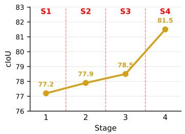  
(a) RefCOCO (testA)

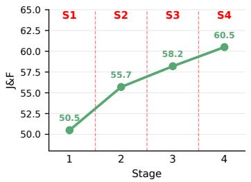  
(b) ReVOS

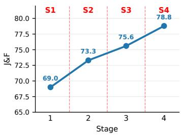  
(c) RefAVS (Unseen)  
Figure B1: Performance at each stage on (a) RefCOCO testA, (b) ReVOS, and (c) RefAVS Unseen.

As shown in Fig. B2b and Fig. B2c, both the compression-rate and compression fidelity rewards show an overall increasing trend during training. This reward improvement is consistent with the distributional changes observed in Fig. B2a, indicating that the model learns to balance context compactness and target-relevant fidelity rather than merely shortening the output. These results verify that the objectives of Stages 2 and 3 are effectively optimized during training.

## B.2.5 QUALITATIVE RESULTS.

In Fig. B3, we present additional qualitative comparisons between TCA and Omni-R1 Zhong et al. (2025) on RefAVS, ReVOS, and R-VOS benchmarks. The example in Fig. B3a highlights the importance of reasoning compression in multimodal grounding. Omni-R1 produces an incorrect bounding box despite identifying the correct cue (e.g., “left ambulance”), whereas TCA transfers this cue into a concise compressed context that remains semantically consistent with the reasoning and the grounding objective, resulting in accurate localization. The example in Fig. B3b shows that, while both methods reason about the correct target, Omni-R1 yields a less precise bounding box, whereas TCA compresses the reasoning into a target-aware context (e.g., “pot”), resulting in tighter localization and more accurate segmentation. In Fig. B3c, Omni-R1 drifts from the referred object (i.e., “surfing rope”) to a related object (i.e., “handle”), leading to incorrect localization, whereas TCA preserves the target cue in a concise compressed context and accurately localizes the surfing rope. Fig. B3d further demonstrates the effectiveness of TCA on temporally challenging expressions from MeViS, where Omni-R1 generates an imprecise bounding box covering both cows, while TCA accurately localizes the target through reasoning compression.

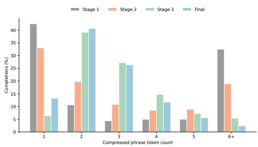  
(a) Compressed context token distribution.

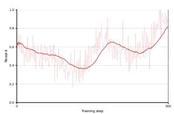  
(b) Stage 2 reward.

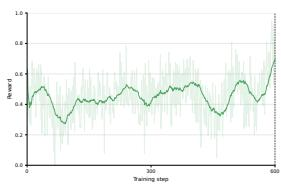  
(c) Stage 3 reward.

Figure B2: Compressed-context token distribution and reward dynamics. (a) Distribution of compressed-context lengths across optimization stages. (b) Compression-rate reward during Stage 2. (c) Compression-fidelity reward during Stage 3.  
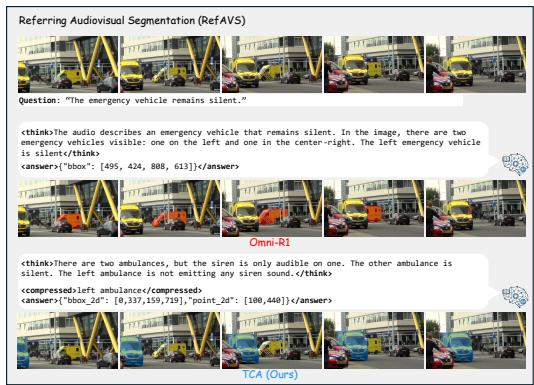  
(a) Referring audio-visual segmentation example from RefAVS

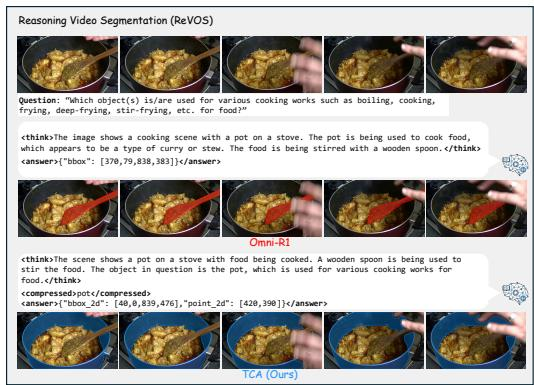  
(b) Referring video object segmentation example from ReVOS

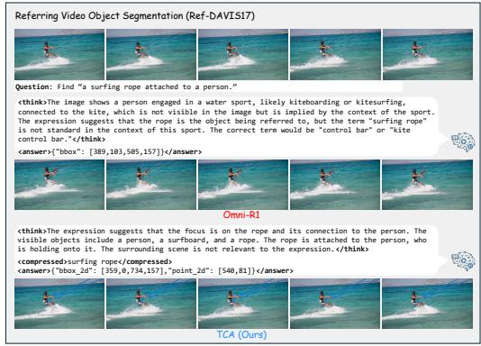  
(c) Referring video object segmentation example from Ref-DAVIS17

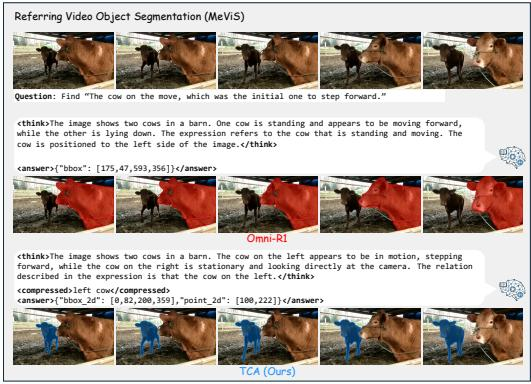  
(d) Referring video object segmentation example from MeViS  
Figure B3: Qualitative examples on RefAVS, ReVOS and R-VOS benchmarks.

## B.2.6 IMPACT OF REASONING COMPRESSION.

We present another example to further validate the impact of reasoning compression in Fig. B4. Without compression, the model often fails to identify the key context from long reasoning paths, leading to an inaccurate localization prediction. In our TCA, c retains only target-relevant cues, producing a more precise segmentation.

(a) input  
  
Question: Find ‘The object volume is louder over the time.  
(c) w/o compression

(b) GT  
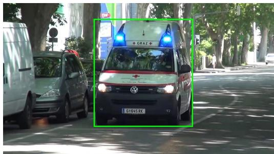  
(d) with compression

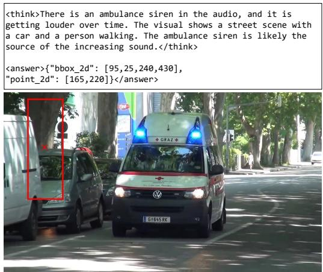

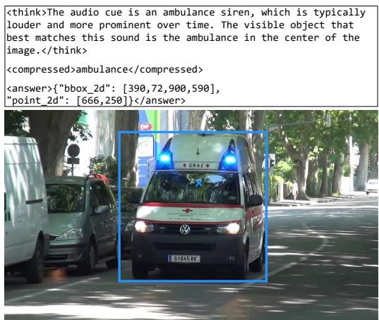  
Figure B4: Impact of compression. TCA extracts target-relevant context from the reasoning path, yielding a more precise mask.

## B.2.7 FAILURE CASE.

Our approach assumes that the target-relevant context for multimodal grounding can be extracted from extended reasoning paths. This assumption has an inherent limitation: when the reasoning phase itself is incorrect, compression may faithfully preserve the wrong context and thus cannot recover the correct target. We illustrate a failure case from RefAVS in Fig. B5. In the example, the model compresses reasoning as intended, but the reasoning phase misidentifies the target object as the tape measure, although the referred object is the cat interacting with it. While several results suggest that TCA implicitly improves the reasoning behavior of MLLMs, as shown in Fig. 4 of the main paper and Fig. B3, this benefit is not guaranteed when the underlying reasoning is incorrect. This limitation highlights that TCA primarily mitigates drift by compressing intermediate content, rather than correcting fundamentally wrong reasoning, and motivates future work on stronger verification or correction mechanisms within the reasoning phase.

(a) input  
  
Question: Find ‘The object making a sound by tapping tape measure.

<think>There is a baby sitting on the floor, and a man is   
holding a tape measure. The sound is made by tapping the tape   
measure. The baby is looking at the man.</think>   
<answer>{"bbox\_2d": [390,60,560,378],   
"point 2d": [400.140]}</answer> <think>Object making sound by tapping tape measure. It is a tape measure. The baby and cat are visible in the scene, but they do not match the object described by the tapping sound. </think>   
<compressed>tape measure</compressed>   
<answer>{"bbox\_2d": [395,320,610,505],   
"point\_2d": [462,385]}</answer>

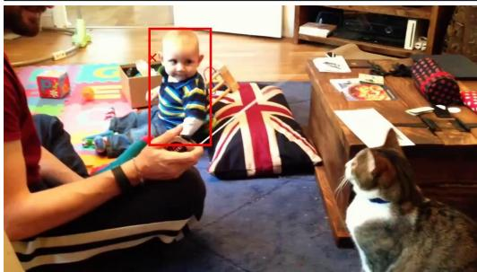

(c) w/o compression  
(b) GT  
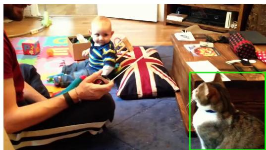  
(d) with compression

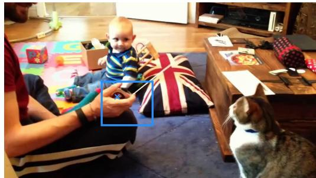  
Figure B5: Failure case from RefAVS. When the reasoning phase identifies a related but incorrect object, compression preserves the erroneous target context and cannot recover the correct localization.