# Tandem: Serving Hybrid Linear-Attention GUI Agents on Mobile NPUs

Zhuomin Chen 1 Jingchao Ni 2 Xu Zheng 1 Yong Chen 3 Mo Sha 1 Wei Cheng 4 Dongsheng Luo 5

## ABSTRACT

Smartphone GUI agents complete tasks in mobile apps by repeatedly reading the screen and asking a model for the next action. Mobile neural processing units (NPUs) enable local execution, keeping screen contents on the phone, but model latency accumulates with every action. Hybrid linearattention models reduce memory requirements, yet reusing their recurrent state requires checkpoints at the appropriate input positions. Agent requests retain instructions but rewrite recent history, so checkpoint policies designed for chat continuation can miss reusable prefixes. Retaining rollback states for speculative decoding can also move prompt processing of the NPU’s matrix unit, adding overhead that outweighs decoding savings on short action outputs. A loaded model can further hold the NPU awake between tasks. We present Tandem, a runtime for hybrid GUI agents on mobile NPUs. Tandem saves recurrent state where consecutive prompts diverge, allowing later requests to reuse previously processed context. It keeps most prefill on the matrix unit and produces rollback states through a short per-token tail. Its verification kernel reads each weight block once for all proposed tokens. Between request bursts, Tandem releases NPU power votes without unloading the model. We implement Tandem in llama.cpp and evaluate it on recorded agent interactions across two Snapdragon generations. On a Snapdragon 8 Elite, Tandem reduces per-step latency by 30% for text-based screen descriptions and 16% for screenshots relative to llama.cpp’s fastest NPU configuration, reduces energy per text step by 33%, and lowers standby power with the model loaded from 0.76 to 0.22 W. The project is available at https://github.com/flyingdoog/tandem.

## 1 Introduction

GUI agents let users operate phone apps through natural-language instructions. A request to change an app setting, for example, may require opening a menu, locating an option and confirming the change. At each step, the agent reads the screen and asks a model to choose a tap, scroll or text input (Wen et al., 2024; 2025; Liu et al., 2024; Qin et al., 2025). It then waits for the app to respond before deciding what to do next. Model latency accumulates throughout the task, while pauses between requests and tasks also make idle power relevant. Running the model on the phone keeps screen contents local and removes a network round trip from each step; mobile neural processing units (NPUs) provide the compute for this execution (Xu et al., 2025; Yin et al., 2026).

Hybrid linear-attention models make longer interactions possible within a phone’s memory budget. Models such as Qwen3.5-4B replace most attention layers with recurrent layers that summarize earlier input in a fixed-size state (Qwen Team, 2026; Yang et al., 2025). This slows memory growth as prompts lengthen. Eficient agent execution requires two distinct uses of recurrent state: reusable checkpoints across changing requests and short-lived rollback states for speculative generation within a request. Checkpoint placement and NPU execution determine the cost of maintaining both.

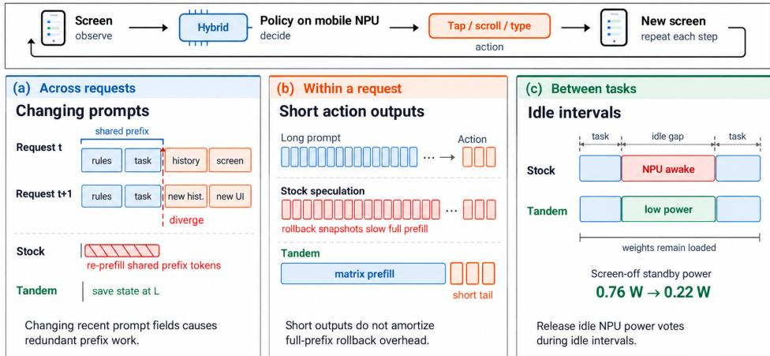  
Figure 1. Workload-driven serving challenges for mobile GUI agents. Each step observes the screen and generates an action. (a) Consecutive prompts share a prefix but diverge in recent history or screen content, making chat-oriented checkpoints poorly placed. (b) Short outputs provide few opportunities to amortize the prefill overhead of speculative rollback states. Tandem retains matrix-based prefill and uses a short recurrent tail. (c) Between tasks, active NPU power requests can waste energy even when the model remains idle. Tandem releases these requests without unloading the model.

Consecutive agent requests share instructions and task information but rewrite recent action history and the screen description. Checkpoints placed at message boundaries or near a prompt’s end prepare a server for chat continuation. In an agent request, the next change can occur earlier, within the history or screen description. A recurrent state has already absorbed all tokens up to its saved position: a checkpoint after the change cannot be reused, while one saved too early leaves shared input to process again. In our replay trace, the stock checkpoint policy reprocesses an average of 111 shared tokens per subsequent request (§3.2). Therefore, reuse depends on placing checkpoints where the agent’s requests actually diverge.

Short action outputs create a second mismatch. Speculative decoding proposes several tokens for the model to check together (Gloeckle et al., 2024; Leviathan et al., 2023). Rejecting a proposal requires restoring an earlier recurrent state. In llama.cpp’s existing Hexagon path (ggml-org, 2023; 2026), retaining these rollback states moves prompt processing from the matrix kernel to per-token execution. This adds an input-processing cost that a short answer has few decoding rounds to recover. In a controlled ablation, enabling the model’s multi-token prediction (MTP) head with the existing rollback and verification paths adds 0.67 s per text step (§3.3). Most of the increase occurs before output generation begins.

Prior mobile inference systems accelerate prompt processing, divide work across processors or speed up output generation (Xu et al., 2025; Chen et al., 2025; Xue et al., 2024; Wei et al., 2025; Yin et al., 2026). These systems largely target full-attention models, whose KV caches allow prefix reuse systems to truncate the cache at the shared input (Zhang et al., 2026). Prior work studies recurrent-state checkpointing for hybrid models (Pan et al., 2025; Shirokikh & Nikolenko, 2026) and GPU-based speculative verification (Wang et al., 2024a; Wu et al., 2026). On-device agent acceleration also addresses prompt reuse and draft generation (Chung et al., 2026). Serving hybrid GUI agents on mobile NPUs brings these requirements together: recurrent checkpoints must remain reusable as prompts change, and speculative rollback must not sacrifice eficient matrix-based prefill. Keeping a model resident between tasks also introduces an idle-power cost.

We present Tandem, a runtime for hybrid GUI agents on mobile NPUs (Figure 1). For cross-request reuse, the point where consecutive prompts diverge predicts a prefix that later steps can reuse while instructions and task text remain fixed. Tandem saves state at that point and consolidates input batches to avoid extra model passes introduced by chat-oriented checkpointing.

For speculative generation, only a short window of recent token positions needs rollback states. Tandem keeps most prompt processing on the matrix unit and uses a per-token tail to produce these states. A column-shared verification kernel reads each weight block once for all drafts, and a trimmed draft vocabulary lowers proposal cost. Fused operators reduce intermediate memory trafic. Between request bursts, Tandem retains model weights but releases the NPU session’s active power requests, which would otherwise keep the accelerator awake. The next task restores active execution without reloading the model.

We implement Tandem in llama.cpp’s server and Hexagon backend. On a Snapdragon 8 Elite, it reduces text-step latency by 30%, screenshot-step latency by 16% and energy per text step by 33% relative to llama.cpp’s fastest NPU configuration. Standby power with the model loaded falls from 0.76 to 0.22 W. On the next Snapdragon generation, the text-step latency reduction is 27%. Our evaluation also examines model sizes, other recurrent architectures and the action outputs produced under each optimization.

This paper makes three contributions.

• A characterization of hybrid GUI-agent inference on a phone NPU, identifying how checkpoint placement, speculative rollback and active NPU sessions interact with changing prompts, short outputs and idle intervals (§3).

• The design of Tandem, with divergence-point checkpoints for context reuse, rollback-aware prefill and column-shared verification for speculative execution, and idle power release while retaining the model (§4).

• An implementation and evaluation across agent workloads, model sizes, hybrid architectures and two NPU generations, measuring latency, energy and action fidelity (§6).

## 2 Background

## 2.1 The agent step

The agent executes a task as an episode of screen observations and actions. It reads Android’s accessibility tree, asks the model for an action, executes it and waits for the app to update. Each action determines the next screen, so model requests form a sequential chain. Model latency accumulates across steps, while app interaction and pauses between tasks leave intervals with no inference work.

Each request contains fixed rules, the task and foreground app, recent actions and a text description of the on-screen controls. The model returns a short JSON response specifying an action, such as tapping an indexed control, entering text or finishing the task. When accessibility data is sparse, the app also attaches a screenshot. Our policy is Qwen3.5-4B (Qwen Team, 2026) fine-tuned with LoRA (Hu et al., 2022) on public GUI-agent data and demonstrations recorded on the phone.

Between steps, the app rebuilds this message from the current observation and the last three actions. For example, after opening a settings page, the next request carries the new controls and a record of the preceding action, while retaining the rules and task. Once the history window is full, its oldest entry disappears on the next step. The resulting prompts overlap but also replace text from the previous prompt.

Serving a request has two phases. Prefill processes the input tokens to build the model’s state; decode produces the action one token at a time. Reusing state from a shared prompt prefix skips part of prefill. Speculative decoding lets a lightweight drafter propose tokens that the full model verifies together, reducing decode passes when several proposals are accepted.

Screenshots add a vision encoder that converts pixels into feature vectors. These vectors form image tokens in the language model’s input, adding prefill work before action generation. Reducing the image-token budget changes both this work and the visual information available to the policy.

## 2.2 Hybrid linear-attention models

Hybrid models combine two ways of retaining context. Attention layers keep separate entries for past tokens in a key-value (KV) cache. Recurrent layers repeatedly update one compact state, folding each new token into the information already stored. A checkpoint is a copy of this state saved at a particular token position so that execution can resume there later.

Consider two prompts that share their first 350 tokens and difer afterward. Once the first prompt has been processed, its KV cache can be truncated to 350 entries. Its final recurrent state, however, also contains the later tokens; the server needs the state saved after token 350 to resume there. If its latest usable copy is at token 300, it reprocesses 50 shared tokens before reaching the new sufix. A hybrid model performs both operations: it restores the recurrent checkpoint and aligns the attention cache to that position.

Qwen3.5-4B has 32 layers (Qwen Team, 2026). Every fourth layer is a full-attention layer, and the other 24 are Gated DeltaNet layers (Yang et al., 2025). Each of the 32 heads of a Gated DeltaNet layer keeps a matrix state � and updates it once per token,

$$
S _ { t } = \alpha _ { t } S _ { t - 1 } \big ( I - \beta _ { t } k _ { t } k _ { t } ^ { \top } \big ) + \beta _ { t } v _ { t } k _ { t } ^ { \top } , \qquad o _ { t } = S _ { t } q _ { t } ,\tag{1}
$$

where $q _ { t } , k _ { t }$ and $v _ { t }$ are the token’s query, key and value, $\alpha _ { t }$ is a decay gate and $\beta _ { t }$ a write strength. A short causal convolution over the layer’s inputs precedes the update. The recurrent state of all 24 layers occupies 50.25 MiB per sequence regardless of prompt length; the 8 attention layers add 32 KiB of KV cache per token. Prefill evaluates Eq. (1) in chunks with matrix products (Yang et al., 2025), while decode updates the state once per generated token. These two execution forms become important when the server needs intermediate states for rollback.

The model’s multi-token prediction (MTP) head (Gloeckle et al., 2024) provides the lightweight drafter. It uses information already computed by the main model to propose the next token, then repeats this process to form a short sequence. The main model checks the sequence in one batched pass (Leviathan et al., 2023). Accepting several proposals can replace several ordinary decode passes. If a proposal is rejected, execution resumes from the last accepted token, requiring both the attention cache and the recurrent state at that position.

## 2.3 The Hexagon NPU

The Hexagon NPU provides two execution paths used by the model: a matrix unit (HMX) for processing many token vectors together and vector units (HVX) for smaller operations. On the Snapdragon 8 Elite, Hexagon v79 has six hardware threads with 1024-bit HVX units, an HMX unit for fp16 tiles and 8 MB of tightly coupled memory (VTCM). This local memory holds data close to the compute units; DMA engines transfer larger blocks between it and DRAM. Model weights exceed the local capacity, so execution repeatedly loads weight blocks and applies them to the available tokens. The amount of useful work per transfer determines how well computation can keep up with this data movement.

The amount of work available at once determines how these units are used. During prefill, a weight matrix is applied to many token vectors, allowing HMX to reuse its tiles across the batch. Ordinary decode presents one token vector at a time, and quantized matrix–vector products run on HVX. Speculative verification supplies a few vectors together. This creates an opportunity to share weight trafic across drafts, provided the kernel processes those vectors jointly. The relevant batch size is the number of tokens in a model pass, including tokens from a single request.

The host communicates with the NPU through FastRPC. llama.cpp’s Hexagon backend (ggml-org, 2026) loads a DSP library, maps shared tensor bufers and submits batches of operators to a work queue. The session also issues power votes, requests to the platform to keep compute and memory resources at active performance levels. These votes hold clocks high and prevent low-power modes until the session ends. A loaded model can therefore keep the accelerator powered even when no operators are running.

Table 1. Mean prompt token composition over all 21 screens. The image count includes two boundary markers.
<table><tr><td>Content</td><td>Text</td><td>Screenshot</td></tr><tr><td>Rules</td><td>324</td><td>325</td></tr><tr><td>Task and history</td><td>49</td><td>49</td></tr><tr><td>On-screen controls</td><td>275</td><td>275</td></tr><tr><td>Image and markers</td><td>0</td><td>1,129</td></tr><tr><td>Total</td><td>648</td><td>1,778</td></tr></table>

## 2.4 Hybrid-state management in llama.cpp

llama.cpp (ggml-org, 2023) runs all layers of the hybrid model on the Hexagon NPU. Its server compares each incoming prompt with the input it processed last and finds their longest common prefix. For an attention-only model, it truncates the KV cache at that position and processes the new sufix. For a hybrid model, it restores the newest saved recurrent state at or before that position and aligns the attention cache with it. Any shared tokens between the saved state and the end of the common prefix are processed again.

Checkpoint placement determines how much of this repeated work is necessary. The stock server saves state at user-message boundaries and near the end of a prompt to support chat continuation. Each checkpoint also ends an input batch and copies about 50 MiB of recurrent state. Saving more positions therefore consumes memory and adds execution passes. A slot is the server context that holds a request’s cached tokens and model state; it retains a bounded set of checkpoints between requests. A host prompt cache can reload states from earlier requests with a longer matching prefix.

Speculative decoding also saves states within a request. Verification updates the recurrent state as it checks each proposed token. If only the first two of three proposals are accepted, for example, the server needs the state after the second proposal to continue. These short-lived rollback states serve a diferent purpose from checkpoints retained for future requests. The backend produces them at batch boundaries, including during prompt processing; §3.3 examines the cost of doing so on the NPU.

## 3 Characterizing the agent step

We profile the fine-tuned, 4-bit Qwen3.5-4B policy on a Snapdragon 8 Elite to understand how GUI-agent requests afect prefill, speculative decoding, and idle power. The app set contains one screen from each of 21 Chinese apps, with a known correct action and both text and screenshot requests. The replay trace appends 40 steps from five recorded episodes to these 21 text requests, preserving request order for prefix reuse.

Figure 2 and Table 1 report the phase breakdown on the app set with llama.cpp’s stock checkpoint and batching policies, but with Tandem ’s NPU kernels and speculation enabled under fan cooling. The prefix-reuse and speculation studies instead use the replay trace, with configurations specified in §3.2 and §3.3. §6.1 describes the end-to-end comparisons.

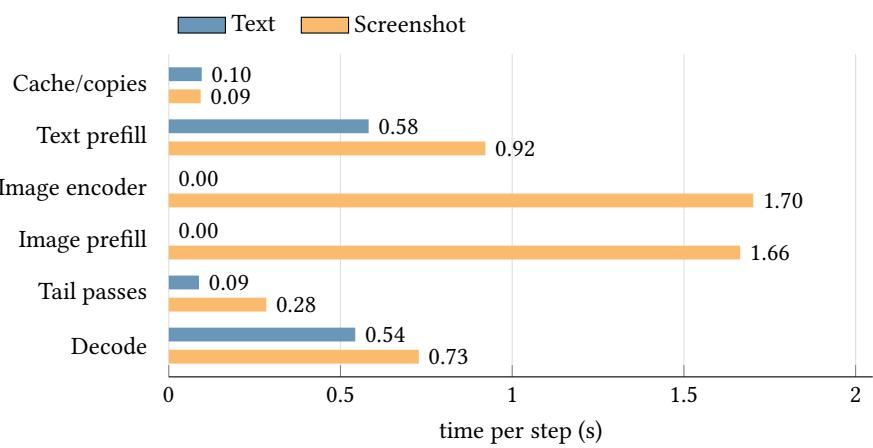  
Figure 2. Server time by phase on the app set, with stock checkpoint and batching policies, Tandem’s speculative NPU kernels and fan cooling. Phase times cover text requests 2–21 and screenshot requests 4–21; totals are 1.31 and 5.39 s.

## 3.1 A step is a medium prefill and a short decode

An agent step reads far more than it writes. In the app set, a text prompt averages 648 tokens, split mainly between fixed rules and on-screen controls (Table 1); its answer is about 14 tokens. The controls change with the screen, while the rules provide a reusable prefix.

In the app-set profile, prefill and decode take comparable time: 0.58 and 0.54 s of a 1.31 s text step (Figure 2). Decode streams 2.9 GB of weights for every token. Within a prefill pass, element-wise operators and the short convolution account for 30% of NPU time, largely moving data.

Batch boundaries add a separate cost. A calibrated prefill model estimates 1.30 ms per token plus 86 ms per pass over the model. Ending a batch early therefore costs roughly as much as processing another 66 tokens. The stock policy spends 0.13 s on a four-token tail pass and recurrent-state copies that prepare chat continuation. This fixed per-pass cost motivates consolidating unnecessary input batches (§4.4).

Screenshot requests take 4.1× as long as text requests. The encoder takes 1.70 s to produce 1,127 image tokens, and prefilling those tokens takes another 1.66 s. The stock checkpoint policy also recomputes the 640 text tokens before the image at every step because it retains no checkpoint before the image. The image-related work limits the gains available from text-prefix reuse alone.

## 3.2 Stock checkpoint placement limits prefix reuse

Consecutive agent prompts share a substantial text prefix. All prompts share the first 309 tokens, and within an episode consecutive prompts diverge a few tokens into the action history, about 360 to 400 tokens in. A KV cache reuses such a prefix exactly. A recurrent state cannot, because it has absorbed every token it has seen and resumes only from a stored checkpoint.

The checkpoint gap is visible on the hybrid model’s own token stream. Over requests 2–61 of the replay trace, the stock policy processes 539 new prompt tokens per step; a KV cache on that same token stream would process 428 (Figure 3). The diference is 111 recomputed tokens, or about 140 ms per step. For context, the full-attention Qwen3-VL-4B processes 420 new tokens per step on the same engine.

The gap comes from checkpoint placement. For a prompt containing one user message, the checkpoint 516 tokens before the end can fall well before the next request’s divergence point; the checkpoint four tokens before the end is usually too late to reuse. Screenshot checkpoints fall inside or after the image, leaving no reusable text checkpoint even when consecutive requests share more than 300 text tokens. The useful checkpoint position follows the overlap between requests, rather than the distance from the prompt’s end.

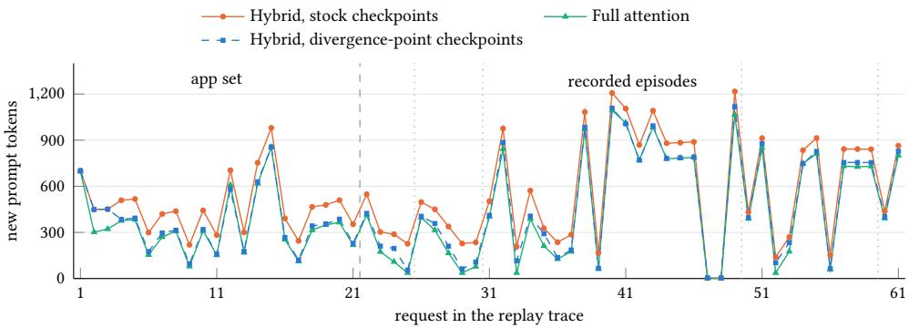  
Figure 3. New prompt tokens per request of the replay trace: the app set, then five recorded episodes (dotted lines mark episode starts). The full-attention Qwen3-VL-4B runs on the same engine. Divergence-point checkpoints (§4.2) close most of the checkpoint gap.

## 3.3 Stock speculative decoding slows hybrid inference

Enabling MTP through the stock rollback and verification paths makes a text step slower, from 1.85 to 2.52 s in the replay-trace ablation. Both configurations use the same prefill and memory-trafic optimizations (§6.4). Decode time also rises from 62 to 67 ms per token, but most of the step-level increase occurs during prefill, when the engine retains intermediate recurrent states.

The added prefill cost comes from how the engine prepares to undo a rejected draft. It saves states after the final tokens of every batch, including prompt batches. The chunked Gated DeltaNet kernel on HMX produces only one final state. Requesting intermediate snapshots therefore sends the entire batch through the per-token HVX recurrence. This rollback tax adds 614 ms to prefill. A need for a few recent states changes how the whole prompt is processed.

Verification and drafting also add work. The stock vector kernel replicates activations in on-chip memory, making four-token verification 2.1× as expensive as one token. The draft head then scans a 248,320-row output matrix to propose each new token; vocabulary-sized operations consume 35% of decode time. Thus both preparing the input and producing the short answer contribute to the slowdown.

Short outputs amplify the prefill cost. The rollback penalty is paid once per request, but a short answer ofers few decode rounds in which to recover it. For an answer of about 14 tokens, the measured 614 ms prefill penalty is equivalent to roughly 44 ms per output token. Accepting several drafts in one round helps only if the decode saving exceeds this initial cost. Speculation therefore needs both matrix-based prefill and cheaper verification and drafting (§4.3).

## 3.4 A loaded model keeps the NPU awake

A loaded model can leave the NPU powered between requests even when no inference work is running. With the screen on, the idle phone draws 0.48 W without a server and 0.89 W with the model loaded; with the screen of, power rises from 0.25 to 0.76 W. The NPU’s power-collapse counter stops advancing, and its core and matrix unit remain at their top clocks at zero utilization. Session-wide power votes cause this residency tax, including while the phone is suspended.

The app retains the model for five minutes after a task. At the measured excess idle power, this interval amounts to 120–150 J, equivalent to 12–15 text steps. Unloading the model reduces that idle draw but incurs a 9 s cold start on the next task. This motivates releasing the NPU’s active power requests while retaining the weights in memory.

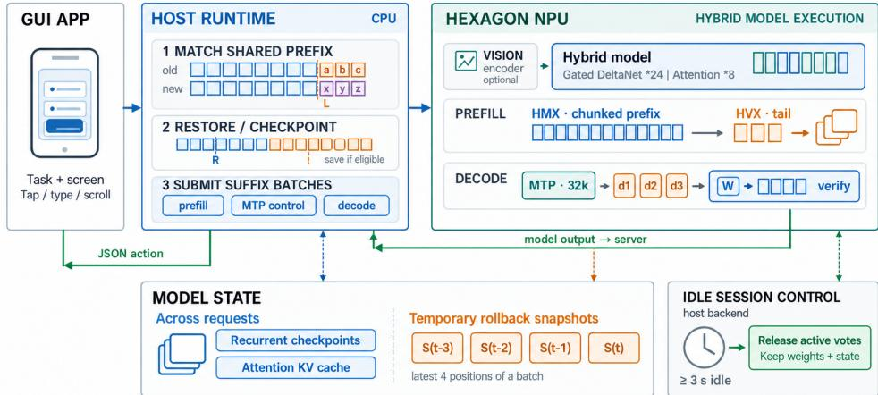  
Figure 4. Tandem’s serving architecture, showing cross-request recurrent checkpoints, temporary rollback states for speculative decoding, and idle NPU session control.

## 4 Design

## 4.1 Overview

Tandem follows the agent’s request cycle (Figure 4). Across requests, unchanged instructions and task text make the current shared prefix a candidate for reuse by later steps. The server compares the incoming prompt with its cached tokens, restores the latest checkpoint within their common prefix and processes the remaining input. When it reaches the point where the prompts diverge, it can save a new checkpoint for subsequent requests. The placement rule accounts for the cost of creating that checkpoint (§4.2).

Within a request, speculative verification needs states only for the few recent positions to which execution may roll back. The earlier context needs no per-token snapshots. Tandem therefore processes most of each prompt batch on the matrix unit and obtains its remaining rollback states from a short per-token tail. During verification, all proposed tokens share the same weight-block reads. These choices reduce the state-management and verification costs that otherwise outweigh decoding savings on short action outputs (§4.3).

Batch consolidation removes small input passes, while fused operators reduce memory trafic within each pass (§4.4). For screenshots, the vision encoder supplies new image tokens after the reusable text prefix. The server returns the selected action through the existing interface; the app executes it and supplies the next observation. Between request bursts, the backend releases active NPU resources while retaining model weights and cached state.

## 4.2 Divergence-point checkpoints

Reusing context requires a saved state close to the point where two requests begin to difer. A checkpoint costs a state copy and a batch boundary, so placing one at every potentially reusable token would erase the prefill saving. With eight checkpoints per slot in our configuration, the server needs to predict which positions later steps will use. Marconi (Pan et al., 2025) also check points recurrent states at branch points in a radix tree. Tandem applies a cost-calibrated spacing rule to divergence points observed in one agent’s sequential requests.

(a) Stock rollback: per-token recurrence  
  
(b) Tandem: chunked prefix and a short recurrent tail

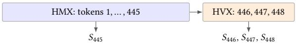  
Figure 5. Producing four rollback states for a 448-token batch. The stock path runs the entire recurrence on HVX. Tandem obtains the first required state from HMX and uses HVX for the three remaining updates. Widths are schematic.

Within an episode, rules and task text stay fixed while recent actions and the screen description change. The current divergence point therefore predicts a prefix that the next request can reuse. In the recorded episodes, divergence points remain at or beyond previously retained checkpoints once the episode settles. Tandem uses this locality to place checkpoints online.

For each request, let � be the longest common prefix between the new prompt and the tokens cached in the slot, including any entry loaded from the prompt cache. After restoring the newest checkpoint at $R \leq L$ , Tandem splits the batch that crosses � and stores the state there. It does so only when � precedes the prompt’s end and any image, and $L - R \ge 3 2$ . The rule creates at most one checkpoint per request. Subsequent requests reuse it through the server’s existing restore and eviction rules; a request that diverges earlier falls back to an earlier checkpoint. The 32-token threshold avoids closely spaced copies; we select it using a cost model calibrated to the measured prefill and checkpoint costs.

The policy follows changes in tasks and screens. A new task makes requests diverge near the end of the fixed instruction block. The resulting checkpoint can survive later restores within the episode. As the action-history window fills, divergence moves farther into the prompt and may justify a new checkpoint. Once the window starts sliding, requests tend to diverge near its beginning, allowing that position to be reused. These transitions explain why the server creates checkpoint on a minority of requests rather than on every step.

Checkpoint spacing trades a cost now for reuse later. With a per-pass cost of about 86 ms and a per-token cost of 1.30 ms, advancing reuse by 32 tokens saves about 42 ms per future hit. Roughly three hits would amortize the added pass, excluding the state-copy cost. A 64-token threshold misses many of the 25–60-token advances between prompt fields. We sweep the threshold using a replay model of the server’s restore, eviction and prompt-cache rules. The model reproduces 422/422 measured prompt-token counts; under its calibrated latency model, the 32-token setting is within 4 ms of the best setting on each trace.

On the replay trace, the rule creates a checkpoint on 10 of the 60 requests after the first and retains one additional state copy of about 50 MiB. Over these 60 requests, new prompt work falls from 539 to 443 tokens per step, within 15 tokens of the KV-cache reuse bound. The same rule applies to the text prefix of screenshot requests.

## 4.3 Rollback-aware speculative decoding

Speculation can generate an action with fewer model passes. On this NPU, that saving depends on preparing rollback states without slowing the whole prompt and checking several drafts with less work than separate decode passes. Tandem changes the prefill path, the verification kernel and the draft head to address these costs together.

Rollback-aware recurrent prefill. Undoing rejected drafts requires only the states near the end of a batch. GPU verification kernels recompute or scan recurrent states for candidate tokens (Wang et al., 2024a; Wu et al., 2026). On Hexagon, requesting those states displaces the chunked HMX kernel even during prefill. Tandem divides the batch into a large prefix that uses HMX and a short tail that saves each intermediate state.

With up to three drafts, the engine retains the final � = 4 states of a batch. For $n \geq K$ tokens, Tandem processes the first $n - K + 1$ tokens with the chunked kernel and writes the resulting state directly into snapshot slot � − 1. The HVX recurrence continues from that state for the remaining � − 1 tokens, saving each intermediate state. Shorter batches use the per-token path. All required snapshots are available, while all but three tokens of a large batch use the matrix unit. Figure 5 illustrates this division for a 448-token batch.

Column-shared verification kernel. A verification pass applies the same weights to the last accepted token and up to three drafts. Processing these token vectors together lets them share weight reads. Tandem dequantizes each weight block once, and HVX threads apply it to all token columns with vector-by-scalar instructions before advancing to the next block. Four-column verification takes 1.27× the time of one column, versus 2.1× with the stock kernel.

The activation quantizer writes compact int8 values to DRAM, packing four values into each scalarregister load. This removes the stock kernel’s 32-fold activation replication and avoids slow scalar reads from VTCM. Per-block activation sums account for weight-format ofsets. The backend uses this kernel for products with up to five columns, or eight with 6-bit weights; larger products use HMX.

Trimmed draft head. Proposing a token should cost substantially less than generating it with the full model. The MTP head uses a lightweight transformer block, but its 248,320-row output matrix still occupies 521.5 MB. Multiplying by that matrix and selecting a token costs about 12 ms per draft. Following frequency-ranked drafting (Zhao et al., 2025), Tandem copies 32,768 rows into a 68.8 MB draft matrix: special and byte tokens, the first 8,000 CJK tokens and frequent tokens from the agent’s training data.

The model file also stores each selected row’s original token ID. The draft sampler maps its chosen row back to that ID before verification, so the compact matrix integrates with the existing token stream. Verification and the final output decision use the target model’s full vocabulary.

The speculative path adds 201 MiB for four recurrent-state planes and 68.8 MB for the draft matrix.   
§6.4 separates its prefill, verification and drafting costs.

## 4.4 Lean prefill

After context reuse removes shared input, the remaining prompt still passes through every model layer. Each additional batch repeats that traversal, and separate operators within a layer may write intermediate results to DRAM only to read them back immediately. Tandem reduces these costs by consolidating input batches and keeping intermediate data close to the NPU’s compute units.

Batch consolidation. The stock checkpoint policy ends batches 516 and 4 tokens before the prompt’s end, preparing a state for chat continuation. This leaves a four-token pass even when those tokens would fit in the preceding batch. For the agent’s independently submitted requests, Tandem replaces these breaks with one 512 tokens before the end, matching the server’s microbatch limit. After restoring a checkpoint, the server updates its eviction order and reuses the saved copy.

With 600 tokens remaining, the stock boundaries produce passes of 84, 512 and 4 tokens; the new boundary produces 88 and 512. The token sequence is unchanged, but one model traversal and its associated checkpoint copy disappear. Shifting the earlier boundary is necessary: removing only the final break would leave 516 tokens, which the 512-token micro-batch limit would split again. On the replay trace, consolidation raises new prompt work from 443 to 460 tokens per step but

removes one pass from every step.

Fused SwiGLU. A feed-forward block multiplies its input by gate and up matrices and combines the products with SwiGLU. The stock backend writes these temporary products to DRAM and reads them back in a separate operator. Tandem computes paired columns of the two matrices in adjacent VTCM tiles. While HMX processes the next chunk, HVX applies SwiGLU to the completed tiles and stores only the combined output. At 448 tokens, this removes 66 MB of trafic per layer while preserving the arithmetic order.

Pairing gate and up weights within one HMX job retains the pipeline’s two output bufers. Alternating separate jobs would require four bufers, exceeding the VTCM budget for a 448-token batch. The host enables fusion when the plan fits the session’s memory budget without adding row blocks or changing the pipeline mode; otherwise it keeps the separate operators.

Channel-major convolution. The recurrent layers’ short convolution operates along time within each channel. Tandem keeps this channel-major layout, using 2D DMA to stream channel slices into VTCM for convolution and the following SiLU. This removes the stock path’s two transposes, each 14.7 MB per layer at 448 tokens. During decode, one DMA per thread and vector gathers move the short per-channel state rows. The backend also requests the memory controller’s performance mode during active execution.

## 4.5 Image path

Tandem reuses the processed text prefix and runs the new screenshot through the NPU vision encoder. Keeping the encoder on the NPU avoids a lengthy CPU stage before the model processes the screen.

The divergence rule checkpoints text before the image, where multimodal rotary positions still equal token indices. Restoring this state reuses the shared text before encoding and prefilling the new screenshot. An optional checkpoint immediately before the image also serves repeated queries with identical text; it is disabled by default because it adds no reuse on top of divergencepoint checkpoints in our traces. The image-token budget independently controls encoding and prefill work. We evaluate its latency–accuracy tradeof in §6.6.

## 4.6 Idle power release

Keeping the model ready for another task requires retaining its weights in memory. The NPU can enter a low-power state during the wait. Tandem tracks operator batches in each session and, after 3 s with no batch submitted or in flight, releases the session’s active power requests. It drops the bandwidth vote, powers down HMX, drops the DDR performance mode and restores platform-default clocks and low-power modes. Before submitting the next batch, it reapplies the active votes and waits for the clocks to recover. Power management uses the existing FastRPC power call, independently of the operator queue.

The three-second timer and the app’s five-minute unload timer control diferent resources. The backend timer releases compute and memory-controller votes between bursts. The app timer eventually frees the model’s memory after a longer idle period. A request arriving between these deadlines restores the active votes and continues with the loaded weights and cached state.

The backend also reduces wakeups while relaxed. Increasing the queue timeout from 50 to 500 ms reduces periodic wakeups from twenty to two per second; an arriving operator packet wakes the queue immediately. The idle timer accounts for time spent in phone suspend.

Power release is synchronized with operator submission and completion. The host waits until all submitted batches have completed and the matrix unit has been relinquished before releasing active votes. Submission and release share a mutex, so a new batch either prevents the release or waits for the NPU to return to its active state. Model weights and inference state remain allocated throughout the transition. Restoring the votes takes 2–4 ms (§6.8).

## 5 Implementation

Tandem builds on llama.cpp release b11200, adding about 3,000 lines of C and C++ across 24 files. Two thirds of the added code runs on the NPU. The server handles checkpoints and batching; the host backend selects kernels, rewrites fused operators and manages power transitions; the DSP library implements the kernels and power handlers. We compile with Android NDK r28b and Hexagon SDK 6.6.

An ofline tool adds the trimmed draft matrix and its original token IDs to the model file. Runtime switches independently control the optimizations. With them disabled, the same build uses the stock serving policy and kernels while retaining the correctness fixes, allowing ablations within one executable.

Service lifecycle. The app loads the server on demand and unloads it after five idle minutes; the prompt cache is bounded at 512 MiB. Repeated requests exposed a work-queue race in the upstream backend that could execute a task twice, causing hangs or aborts. We fixed the queue synchronization and reported the race to llama.cpp; its maintainers confirmed the issue and merged a fix. Both Tandem and our llama.cpp baseline include the correction. A watchdog converts an unresponsive NPU into a restartable server failure.

DMA coherence. The convolution writes inputs through DMA, while the state-copy operator reads them through the NPU data cache. Stale cache lines can therefore save a previous layer’s state in small batches. The copy path cleans and invalidates the source range through the operating system before reading it.

## 6 Evaluation

We measure latency, energy and action fidelity on recorded GUI-agent requests. We vary model size, recurrent architecture, workload and NPU generation to examine how the gains depend on the model and execution platform.

## 6.1 Setup

Devices. Our primary device is a OnePlus 13T with a Snapdragon 8 Elite, a Hexagon v79 NPU, an Adreno 830 GPU and 16 GB of memory, running Android 16. A OnePlus 15 provides the next generation: Snapdragon 8 Elite Gen 5, Hexagon v81, Adreno 840 and 16 GB, also on Android 16. Both processors have eight Oryon CPU cores.

Model and workloads. The main policy is the fine-tuned Qwen3.5-4B with Q4\_K\_M weights. Text latency uses the 61-request replay trace; screenshot latency uses the 21-screen app set (§3). A separate held-out set contains 510 steps from 54 other episodes in 12 apps, each recorded with its screenshot, so it provides both text and screenshot steps. AndroidControl (Li et al., 2024) sup plies 300 public test steps from 56 episodes, with English tasks, a diferent prompt format and the dataset’s screenshots. Finally, the agent performs 100 real tasks in 17 apps installed on the phone; the model chooses every action, with at most 20 steps per task.

Baselines. llama.cpp b11200 (ggml-org, 2023; 2026) serves the same model on the NPU, GPU and CPU; its NPU backend includes our work-queue fix so it can complete the traces. MNN 3.6.1 (Jiang et al., 2020) uses its own 4-bit weights and CPU, OpenCL and Vulkan backends. We test speculation where supported and use the fastest NPU configuration for the main comparison. QAIRT 2.45 (Qualcomm Technologies, Inc., 2026) does not support the recurrent layers in our Qwen3.5- 4B model. We separately compare hybrid and full-attention models under llama.cpp and Tan- dem. Research systems for LLM inference on mobile NPUs target full-attention models (§7), and MNN’s NPU backend runs the linear-attention layers on the CPU, so neither executes our model on the NPU. As a research baseline for hybrid prefix reuse, we implement Marconi’s checkpoint policy (Pan et al., 2025) in the llama.cpp server: it saves the recurrent state where a new prompt branches from the cached sequence and, when the checkpoint list is full, evicts the checkpoint with the lowest combination of recency and computation saved per byte. It uses llama.cpp’s kernels and runs without speculation, llama.cpp’s fastest configuration.

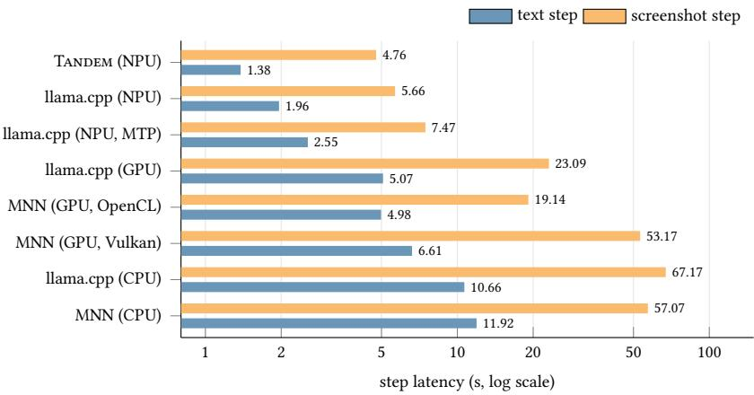  
Figure 6. Step latency on a Snapdragon 8 Elite with the fine-tuned Qwen3.5-4B in Q4\_K\_M: text uses the 61- request replay trace; screenshots use the 21-screen app set. MNN screenshot bars average 4 of the 21 steps.

Measurements. Step latency covers one model request, excluding app execution, and is averaged over each trace. Requests use greedy JSON decoding without log-probabilities; separate fidelity runs collect first-token log-probabilities. Latency measurements on the primary device use a 15 W thermoelectric cooler; the second device is passively cooled. Paired text configurations alternate, starting fresh servers after the NPU cools below 42 ◦C; the main NPU comparison averages four runs per engine, and the comparisons with the Marconi policy alternate the three servers. Energy measurements use the phone’s fuel gauge on battery without cooling. The screen is held on in every latency and energy measurement except the MNN runs, whose screen state was not recorded, and the image-budget study. Paired runs are compared within each measurement session.

Serving configurations. The main end-to-end comparisons run Tandem in its full configuration, including batch consolidation. Both NPU servers retain eight checkpoints per slot. The ablation measures each configuration after three text warm-up requests, with idle power release disabled. The model comparison uses Q4\_0 weights for both architectures; the size comparison uses the stock, unfine-tuned Qwen3.5 models.

## 6.2 End-to-end latency

Tandem reduces text-step latency by 30%, from 1.96 to 1.38 s, relative to llama.cpp’s fastest NPU configuration (Figure 6). Screenshot latency falls by 16%, from 5.66 to 4.76 s. The smaller screenshot speedup reflects the encoder, which both runtimes execute on the NPU and which accounts for about a third of the step.

NPU execution. llama.cpp is fastest with speculation disabled. Enabling it raises text-step latency to 2.55 s because recurrent-state snapshots slow prefill and the verification kernel scales poorly with the draft count. Tandem reduces both costs, allowing speculative execution to shorten action generation alongside the saving from context reuse.

GPU and CPU execution. The fastest measured GPU configuration, MNN OpenCL, takes 4.98 s per text step and 19.1 s per screenshot step with its encoder on the GPU. Tandem reduces these times by 3.6× and 4.0×. llama.cpp’s GPU backend has similar text latency but longer screenshot latency. Both engines take 11–12 s per text step on the CPU. These configurations lack the NPU execution path for the model’s recurrent layers.

Larger workloads. The gains hold beyond the replay trace (Table 2). On the 510 held-out steps, Tandem reduces text-step latency by 26–28% in two sessions and screenshot latency by 15%, with the accuracy ofllama.cpp: 265 of510 text steps and 287 versus 288 screenshot steps are correct. The reduction shrinks as new prompt work grows, from 32% for steps that require fewer than 300 new tokens under llama.cpp to 22% for steps that require more than 700, because tokens that neither runtime can reuse dominate those steps. On AndroidControl, the separate system message already gives llama.cpp a checkpoint at the user-message boundary, so Tandem processes only 3–7% fewer prompt tokens; it still reduces latency by 28% on text steps and 13% on screenshot steps, mostly through faster decoding.

Table 2. Server time per step (s) on the main and larger workloads. Each block of rows was measured in one session with alternating runs. Marconi denotes llama.cpp with Marconi’s checkpoint policy. Gain is Tandem’s latency reduction relative to llama.cpp.
<table><tr><td>Workload</td><td>Steps</td><td>llama.cpp</td><td>Marconi</td><td>TANDEM</td><td>Gain</td></tr><tr><td>Replay trace, text</td><td>61</td><td>2.01</td><td>1.82</td><td>1.44</td><td>28%</td></tr><tr><td>App set, screenshots</td><td>21</td><td>5.76</td><td>5.25</td><td>4.87</td><td>15%</td></tr><tr><td>Held-out set, text</td><td>510</td><td>2.02</td><td>1.86</td><td>1.45</td><td>28%</td></tr><tr><td>AndroidControl, text</td><td>300</td><td>1.61</td><td>1.51</td><td>1.16</td><td>28%</td></tr><tr><td>AndroidControl, screenshots</td><td>300</td><td>3.95</td><td>3.86</td><td>3.44</td><td>13%</td></tr><tr><td>Held-out set, screenshots</td><td>510</td><td>6.32</td><td>一</td><td>5.35</td><td>15%</td></tr></table>

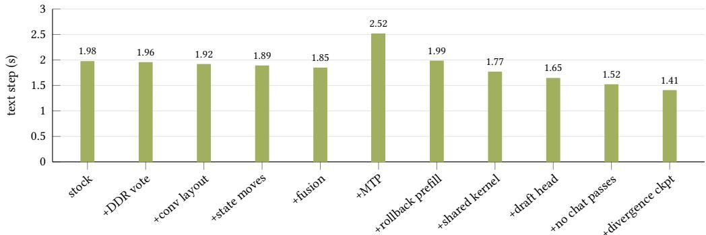  
Figure 7. Cumulative ablation on the replay trace after three text warm-up requests, using runtime switches in one executable. Idle power release is disabled. The last two additions enable batch consolidation and divergence-point checkpoints.

## 6.3 Comparison with hybrid prefix caching

Marconi’s checkpoint policy recovers the prefix reuse but not the decoding cost (Table 2). On the replay trace it processes 477 new prompt tokens per step, close to Tandem’s 464 and below llama.cpp’s 541, and lowers text-step latency by 10% relative to llama.cpp. On the held-out text steps it processes slightly fewer tokens than Tandem, 439 versus 441, because it checkpoints every branch point while Tandem requires 32 tokens of new context. Tandem nevertheless remains 21– 23% faster on text steps and 7–11% faster on screenshot steps. The diference is decoding: Tandem generates a token in 44 ms, llama.cpp and Marconi in 66 ms. A checkpoint policy alone cannot make speculation profitable on a hybrid model; that also requires rollback-aware prefill, the shared verification kernel and the trimmed draft head (§6.4).

Table 3. Server time per step (s) of the hybrid policy and of the full-attention Qwen3-VL-4B, both with Q4\_0 weights, on llama.cpp (fastest configuration) and on Tandem, each step type measured in one session. Text steps: the replay trace; screenshot steps: the app set, at each model’s native resolution. Gain denotes the relative latency reduction.
<table><tr><td>Step</td><td>Model</td><td>llama.cpp</td><td>TANDEM</td><td>Gain</td></tr><tr><td rowspan="3">Text</td><td>full attention</td><td>1.33</td><td>1.29</td><td>3%</td></tr><tr><td>hybrid</td><td>1.90</td><td>1.31</td><td>31%</td></tr><tr><td>hybrid / attention</td><td>1.43×</td><td>1.01×</td><td></td></tr><tr><td rowspan="3">Screenshot</td><td>full attention</td><td>5.09</td><td>5.00</td><td>2%</td></tr><tr><td>hybrid</td><td>5.56</td><td>4.61</td><td>17%</td></tr><tr><td>hybrid / attention</td><td>1.09×</td><td>0.92×</td><td></td></tr></table>

Table 4. Image budget on the 510-step held-out set, with Tandem in its full configuration . The text-only row uses the same requests without screenshots.
<table><tr><td>Image tokens</td><td>Step (s)</td><td>Correct</td><td>Accuracy</td></tr><tr><td>Text only</td><td>1.45</td><td>265</td><td>52.0%</td></tr><tr><td>1,127 (default)</td><td>5.35</td><td>287</td><td>56.3%</td></tr><tr><td>512</td><td>3.21</td><td>280</td><td>54.9%</td></tr><tr><td>256</td><td>2.45</td><td>288</td><td>56.5%</td></tr></table>

## 6.4 Where the gains come from

Speculation becomes beneficial only after reducing both rollback and decode costs (Figure 7). This experiment uses the warmed replay trace and runtime switches in one executable (§6.1). Starting with the stock policy and kernels, prefill and memory-trafic optimizations reduce text-step latency from 1.98 to 1.85 s. Adding MTP increases it by 0.67 s. Rollback-aware prefill recovers most of that loss; column-shared verification and the trimmed draft head reduce the step to 1.65 s. Batch consolidation and divergence-point checkpoints bring it to 1.41 s.

Removing one mechanism at a time measures its contribution within the full configuration. Rollback-aware prefill has the largest efect: 0.46 s per text step and 1.42 s per screenshot step. The shared verification kernel and the trimmed draft head save 0.18 and 0.14 s per text step, batch consolidation and divergence-point checkpoints another 0.17 and 0.08 s. Batching policies also change kernel work, so these individual reductions need not sum to the total latency saving.

For screenshots, placing a checkpoint at the divergence point restores 266 text tokens and saves 0.41 s. A checkpoint immediately before the image restores the same prefix on this workload, adding little when divergence-point checkpoints are already enabled. We therefore leave it of.

## 6.5 Hybrid versus full attention

With both models quantized to Q4\_0, Tandem reduces text-step latency by 31% for the hybrid model and 3% for full attention (Table 3). The hybrid’s 43% latency penalty under llama.cpp falls to 1.4%.

Checkpoint placement reduces the hybrid’s new prompt work from 541 to 464 tokens per step, compared with 425 for the full-attention model. MTP then lowers its decode time to 40 ms per token. Full attention already truncates its KV cache at the shared prefix and has no MTP head in this comparison; its gain comes from the shared backend changes.

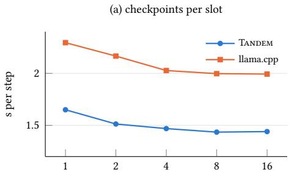

(b) draft length (Tandem)  
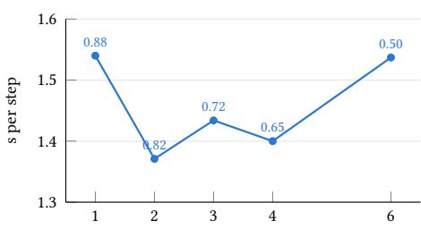  
(d) NPU asleep during pauses

(c) prompt-cache cap (MiB)  
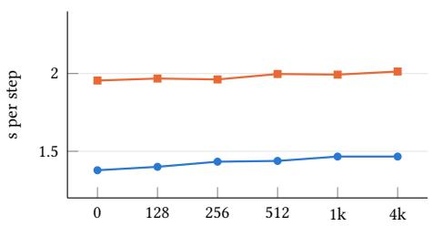

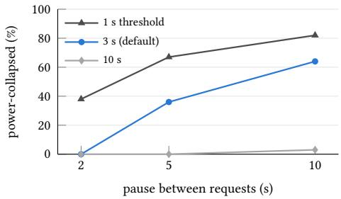  
Figure 8. Sensitivity on the replay trace, one setting varied at a time. (a)–(c) server time per step; the labels in (b) give the fraction of draft tokens accepted. (d) Share of the replay in which the NPU is power-collapsed when the agent pauses after each response, for three idle-release thresholds; without release it is 0.

## 6.6 Screenshot steps

On the 510-step held-out set, reducing the image budget from 1,127 to 256 tokens lowers latency from 5.35 to 2.45 s, a 2.2× speedup (Table 4). Accuracy is 56.3% at the default budget and 56.5% at 256 tokens; McNemar’s test detects no significant pairwise diferences among the three image budgets $( p \geq 0 . 1 7 )$ . Text-only input reaches $5 2 . 0 \% ;$ the default and 256-token settings improve on it $( p = 0 . 0 1 5$ and 0.006).

## 6.7 Sensitivity to configuration

Figure 8 varies one setting at a time on the replay trace. Eight checkpoints per slot sufice: more checkpoints change neither prompt work nor latency, and with a single checkpoint per slot Tan- dem still runs 28% faster than llama.cpp with the same limit. The default draft length of three tokens is within 5% of the best length, two: longer drafts are accepted less often, 82% of draft tokens at two and 50% at six, while single-token drafts save fewer decoding passes. The promptcache cap changes prompt work for neither engine, because one agent’s sequential requests reuse the checkpoints in their own slot; latency varies by less than 7% across caps from 0 to 4 GiB. Idle power release trades a short wake-up for NPU sleep. With the default 3-second threshold, pauses of 5 and 10 s between requests keep the NPU power-collapsed for 36% and 64% of the replay at less than 0.5% added latency; a 1-second threshold raises these shares to 67% and 82% at 1.3–1.6% added latency.

## 6.8 Energy and idle power

We measure energy on the app set, on battery without cooling (Table 5). Tandem uses 10.1 J above idle per text step, 33% less than the fastest llama.cpp NPU configuration. Both draw roughly 9 W while active, so the saving follows the reduction in execution time. GPU and CPU backends draw less power but run longer. Against the Tandem run in the same measurement block, the GPU backends consume 3.0–3.2× as much energy and the CPU backend 8.8×. Enabling speculation in llama.cpp raises energy by 14%, consistent with its longer execution.

Table 5. Server time, energy above idle power and the phone’s mean power while serving, per text step of the app set, on battery without any cooling, for the engines that run the hybrid model on the NPU, GPU and CPU; means over the runs of one session. The GPU rows come from a separate block, in which the Tandem reference run used 11.2 J.
<table><tr><td>Engine</td><td>Step (s)</td><td>Energy (J)</td><td>Power (W)</td></tr><tr><td>TANDEM (NPU)</td><td>1.24</td><td>10.1</td><td>9.0</td></tr><tr><td>llama.cpp (NPU)</td><td>1.91</td><td>15.1</td><td>9.5</td></tr><tr><td>llama.cpp (NPU, MTP)</td><td>2.40</td><td>17.1</td><td>8.9</td></tr><tr><td>MNN (GPU, OpenCL)</td><td>5.14</td><td>35.6</td><td>8.1</td></tr><tr><td>llama.cpp (GPU)</td><td>5.21</td><td>33.0</td><td>7.3</td></tr><tr><td>llama.cpp (CPU)</td><td>21.2</td><td>86.2</td><td>5.1</td></tr></table>

Table 6. Server time per step (s) of the stock Qwen3.5 models on the NPU, with the cooler: text steps of the replay trace and screenshot steps of the app set. llama.cpp runs in its fastest configuration, without speculation. Gain denotes the relative text-step latency reduction.
<table><tr><td rowspan="2">Model</td><td colspan="3">Text step</td><td colspan="2">Screenshot step</td></tr><tr><td>llama.cpp</td><td>TANDEM</td><td>Gain</td><td>llama.cpp</td><td>TANDEM</td></tr><tr><td>2B</td><td>0.99</td><td>0.73</td><td>27%</td><td>3.46</td><td>3.11</td></tr><tr><td>4B</td><td>1.79</td><td>1.26</td><td>30%</td><td>5.94</td><td>4.84</td></tr><tr><td>9B</td><td>2.99</td><td>1.99</td><td>34%</td><td>20.3</td><td>18.1</td></tr></table>

Sustained load. During ten minutes of back-to-back requests without cooling, thermal throttling increases mean step latency from 1.18 s in the first minute to 1.43 s in the last. Energy averages 10.6 J per step.

=Real tasks. On the 100 real tasks, run on battery with each engine, Tandem lowers model time per step by 28%, from 1.75 to 1.25 s, and the phone’s total energy per step by 20%, from 25.2 to 20.1 J. The total includes the screen, the app and the agent’s observation of the phone; its saving of 5.1 J per step matches the server-level saving on the app set (Table 5).

Idle power release. Releasing session votes lowers screen-on idle power from 0.89 to 0.42 W and screen-of standby power from 0.76 to 0.22 W, close to the no-server measurements of 0.48 and 0.25 W. Releasing only the sleep-disable vote recovers about half the saving because clock, bus and DRAM votes also keep the power domain active. Releasing all votes allows the NPU to remain power-collapsed throughout the idle measurement window.

A request following a 30-second pause takes 21 ms longer overall, about 1.5% of a step, including 2– 4 ms to restore active votes. A six-second pause produces no measurable latency increase. Answers and first-token log-probabilities remain bit-identical, including after 400 consecutive release cycles.

## 6.9 Generality across models, workloads, and devices

## 6.9.1 Model sizes

For Qwen3.5, the text-step latency reduction grows from 27% at 2B to 34% at 9B (Table 6). Checkpoint placement removes 14% of prompt work at each size, while decode latency falls by 34% and 42%, respectively, as weight trafic increases. Screenshot gains are smaller because both engines run the same encoder; the 9B model’s larger encoder leaves both at 18–20 s per screenshot step.

## 6.9.2 Other hybrid designs

Checkpoint placement also reduces prompt work for other recurrent layers (Table 7). We test LFM2-2.6B (Liquid AI, 2025), which uses short convolutions, and Granite-4.0-H-Micro (IBM, 2025), which uses Mamba2 (Dao & Gu, 2024); both retain some attention layers. The checkpoint policy reduces new prompt tokens by 11–12%, lowering step latency by 9% for LFM2 and 12% for Granite. With the kernel changes included, LFM2 has 16% lower step latency than llama.cpp. Granite’s scan remains on the CPU, so its rows compare checkpoint policies within Tandem. On both models, releasing idle votes allows power collapse throughout a 60-second idle window.

Table 7. LFM2-2.6B and Granite-4.0-H-Micro on the NPU, with the cooler: new prompt tokens and server time per text step of the replay trace, and power-collapse time during a 60-second idle window. Neither model has a draft head or a Gated DeltaNet layer. Granite’s Mamba2 scan runs on the CPU in both engines.
<table><tr><td></td><td>LFM2</td><td>Granite</td></tr><tr><td>Recurrent + attention layers</td><td>22 conv. + 8</td><td>36 Mamba2 + 4</td></tr><tr><td>New prompt tokens per step</td><td></td><td></td></tr><tr><td>stock checkpoints</td><td>581</td><td>610</td></tr><tr><td>TANDEM checkpoint policy</td><td>518</td><td>534</td></tr><tr><td>Server time per step (s)</td><td></td><td></td></tr><tr><td>llama.cpp</td><td>0.95</td><td></td></tr><tr><td>TANDEM, stock checkpoints</td><td>0.88</td><td>2.48</td></tr><tr><td>TANDEM</td><td>0.80</td><td>2.19</td></tr><tr><td>NPU power-collapsed (s of 60)</td><td></td><td></td></tr><tr><td>votes held</td><td>0</td><td>0</td></tr><tr><td>idle power release</td><td>60</td><td>60</td></tr></table>

Table 8. Server time per step (s) on the replay trace while another app runs in the foreground, and the slowdown relative to the home screen; each scenario was measured in one session with alternating runs.
<table><tr><td>Foreground app</td><td>llama.cpp</td><td>TANDEM</td><td>Gain</td><td>Slowdown (llama.cpp / TANDEM)</td></tr><tr><td>Home screen</td><td>1.99</td><td>1.44</td><td>28%</td><td></td></tr><tr><td>Video playback</td><td>2.03</td><td>1.44</td><td>29%</td><td>1.9% / 0.4%</td></tr><tr><td>Feed scrolling</td><td>2.09</td><td>1.45</td><td>31%</td><td>5.3% / 1.1%</td></tr><tr><td>Camera preview</td><td>2.41</td><td>1.68</td><td>30%</td><td>21% / 17%</td></tr></table>

## 6.9.3 Second device

On the Snapdragon 8 Elite Gen 5, Tandem serves text steps in 1.21 s versus llama.cpp’s 1.66 s, a 27% latency reduction. Screenshot steps fall to 3.82 s versus 4.54 s, a 16% reduction. The kernels require only recompilation for v81, and both servers run without root access. Cross-device answers are identical for llama.cpp and difer in two free-text summaries for Tandem; action outputs are unchanged.

## 6.9.4 Foreground apps

An agent’s model shares the phone with the app it operates and with other foreground work. Table 8 runs the replay trace while another app holds the screen. Video playback and feed scrolling slow Tandem by at most 1% and llama.cpp by up to 5%. The camera preview, which moves image data through memory continuously, slows decoding in both runtimes and adds 17% to Tandem’s step and 21% to llama.cpp’s. Tandem’s reduction stays between 28% and 31% in all four cases, with identical answers. In the other direction, model execution does not disturb the foreground app: while the feed scrolls, 0.01–0.07% of its frames miss their deadline, compared with 0.06% without a server.

## 6.10 Fidelity and overhead

With the vision encoder fixed on the NPU, each tested serving or kernel optimization preserves action outputs on the 61-request text trace and the 21-screen app set when added or removed individually. Changes in batching or speculative execution reword at most one free-text summary per trace. For text requests, the fused operator, data-movement paths, verification kernel, trimmed draft head and idle power release also preserve the measured first-token top-five log-probabilities.

Both Tandem and the llama.cpp NPU baseline use the same NPU encoder. CPU and NPU encoder paths can produce diferent answers. The memory cost of Tandem is 201 MiB of rollback planes, 68.8 MB for the draft head and one additional checkpoint of about 50 MiB. The prompt cache is capped at 512 MiB.

## 7 Related Work

LLM inference on mobile NPUs. llm.npu accelerates prefill with chunk-sharing graphs and shadow execution of outliers (Xu et al., 2025); HeteroLLM partitions computation across the NPU, GPU and CPU (Chen et al., 2025); PowerInfer-2 exploits activation sparsity (Xue et al., 2024); T-MAN uses table lookups for low-bit decode (Wei et al., 2025); and ShadowNPU ofloads sparse attention (Yin et al., 2026). These systems target full-attention models. Measurement studies examine mobile-NPU eficiency (Cai et al., 2026) and test-time scaling (Hao et al., 2026). Mobile deployments use engines such as MNN (Jiang et al., 2020), MLC LLM (MLC team, 2023) and llama.cpp (ggml-org, 2023; 2026). Tandem addresses recurrent-state management and the request pattern of a resident phone agent.

Serving hybrid and recurrent models. Marconi checkpoints hybrid states at radix-tree branch points, uses estimated reuse for cache admission, and accounts for compute savings per byte in eviction (Pan et al., 2025). Sparse prefix caching chooses checkpoints through dynamic programming over prefix-overlap distributions (Shirokikh & Nikolenko, 2026). GPU systems support speculative rollback through verification kernels and tree scans (Wang et al., 2024a; Wu et al., 2026). Tandem uses cost-calibrated checkpoint spacing for a single agent’s requests and preserves chunked NPU prefill by confining rollback-state generation to a short tail.

Speculative decoding. Speculative decoding verifies the drafts of a small model in one pass of the large one (Leviathan et al., 2023). MTP heads (Gloeckle et al., 2024) and feature-level drafters (Li et al., 2026) draft from the target model itself, and FR-Spec restricts drafting to frequent tokens (Zhao et al., 2025), which Tandem’s trimmed draft head follows. Agent-X (Chung et al., 2026) improves on-device agent inference through prompt rewriting for KV-cache reuse and example-based drafting. Tandem instead targets recurrent-state reuse and reduces Hexagon verification overhead by sharing weight reads across drafts.

On-device GUI agents. GUI agents automate app interactions using language models (Wen et al., 2024; Wang et al., 2024b; Qin et al., 2025; Liu et al., 2024). On-device approaches reduce model calls (Wen et al., 2025), shrink the policy (Wang et al., 2026; Jiang & Huang, 2026), divide work between device and cloud (Yi et al., 2026), learn through exploration (Huang et al., 2026) or reuse prefixes across screens (Zhang et al., 2026). Other work reduces power during mobile inference (Chu et al., 2026). Tandem accelerates individual calls of a hybrid policy and releases the NPU’s power votes between request bursts.

## 8 Discussion

Serving policies. Checkpoint gains depend on prompt structure and may be smaller when the baseline already preserves reusable prefixes (§6.2). Checkpoint placement, batch consolidation and idle power release can be adopted independently of Tandem ’s kernels.

Other models and accelerators. Divergence-point checkpoints require a server that can save and restore recurrent state. Idle power release requires session-level power control. Both mechanisms apply to the short-convolution and Mamba2 hybrids we evaluate. The speculative path depends more closely on the model and hardware: rollback-aware prefill uses Gated DeltaNet’s chunked recurrence, and the MTP head drafts from the target’s hidden states. The Hexagon kernels carry from v79 to v81 through recompilation; another accelerator would need corresponding matrix and vector implementations.

Screenshot cost. Screens requiring fine visual detail may favor a larger image-token budget, despite the latency savings from reducing it (§6.6). Adapting the budget to screen content and accelerating the vision encoder could further reduce screenshot latency.

## 9 Conclusion

Hybrid models reduce the memory needed to run GUI agents on a phone. Tandem adapts their serving to changing prompts, short action outputs and idle intervals: it preserves reusable recurrent states across steps, supports speculative execution while retaining fast prompt processing, and releases idle NPU resources without unloading the model. On a Snapdragon 8 Elite, it reduces text-step latency by 30%, screenshot-step latency by 16% and energy per text step by 33% relative to llama.cpp’s fastest NPU configuration. Standby power with the model loaded falls from 0.76 to 0.22 W. The text-step latency reduction remains 27% on the next NPU generation.

## References

Cai, G., Tian, R., Yang, L., Ren, Z., Yuan, J., Li, L., and Wang, J. Is your npu ready for llms? dissecting the hidden eficiency bottlenecks in mobile llm inference. arXiv preprint arXiv:2607.05475, 2026.

Chen, L., Feng, D., Feng, E., Wang, Y., Zhao, R., Xia, Y., Xu, P., and Chen, H. Characterizing mobile soc for accelerating heterogeneous llm inference. In Proceedings of the ACM SIGOPS 31st Symposium on Operating Systems Principles, pp. 359–374, 2025.

Chu, H., Fan, J., Deng, J., Yu, B., Xie, L., Liu, L., Ma, H., and Zheng, X. Act before it’s too late: Power-eficient llm inference on mobile device. In Proceedings of the 24th Annual International Conference on Mobile Systems, Applications and Services, pp. 338–351, 2026.

Chung, J., Shin, B., Kim, J., and Rhu, M. Agent-x: Full pipeline acceleration of on-device ai agents. In Proceedings of the 24th Annual International Conference on Mobile Systems, Applications and Services, pp. 144–157, 2026.

Dao, T. and Gu, A. Transformers are SSMs: Generalized models and eficient algorithms through structured state space duality. In Forty-first International Conference on Machine Learning, 2024.

ggml-org. llama.cpp: LLM inference in C/C++. Software, 2023. URL https://github.com/ggm l-org/llama.cpp. Repository created March 2023; accessed September 2026.

ggml-org. llama.cpp Hexagon backend: Snapdragon-based devices. Software documentation, 2026. URL https://github.com/ggml-org/llama.cpp/blob/master/docs/backend/snap dragon/README.md. Accessed September 2026.

Gloeckle, F., Idrissi, B. Y., Roziere, B., Lopez-Paz, D., and Synnaeve, G. Better & faster large language models via multi-token prediction. In Forty-first International Conference on Machine Learning, 2024.

Hao, Z., Wei, J., Wang, T., Huang, M., Jiang, H., Jiang, S., Cao, T., and Ren, J. Scaling llm test-time compute with mobile npu on smartphones. In Proceedings of the 21st European Conference on Computer Systems, pp. 2157–2172, 2026.

Hu, E. J., yelong shen, Wallis, P., Allen-Zhu, Z., Li, Y., Wang, S., Wang, L., and Chen, W. LoRA: Low-rank adaptation of large language models. In International Conference on Learning Representations, 2022.

Huang, R., Zhang, L., Liu, S., and Ouyang, X. Mobileexplorer: Accelerating on-device inference for mobile gui agents via online exploration. arXiv preprint arXiv:2605.26546, 2026.

IBM. Granite 4.0: Hybrid Mamba-2/transformer language models. https://www.ibm.com/gr anite/docs/models/granite4-0, 2025.

Jiang, X., Wang, H., Chen, Y., Wu, Z., Wang, L., Zou, B., Yang, Y., Cui, Z., Cai, Y., Yu, T., et al. Mnn: A universal and eficient inference engine. Proceedings of Machine Learning and Systems, 2:1–13, 2020.

Jiang, Y. and Huang, C. Openphone: Mobile agentic foundation models. In Findings of the Association for Computational Linguistics: ACL 2026, pp. 30362–30380, 2026.

Leviathan, Y., Kalman, M., and Matias, Y. Fast inference from transformers via speculative decoding. In International conference on machine learning, pp. 19274–19286. PMLR, 2023.

Li, W., Bishop, W., Li, A., Rawles, C., Campbell-Ajala, F., Tyamagundlu, D., and Riva, O. On the efects of data scale on ui control agents. Advances in Neural Information Processing Systems, 37: 92130–92154, 2024.

Li, Y., Wei, F., Zhang, C., and Zhang, H. Eagle-3: Scaling up inference acceleration of large language models via training-time test. Advances in Neural Information Processing Systems, 38:136737– 136756, 2026.

Liquid AI. LFM2 technical report. arXiv:2511.23404, 2025. URL https://arxiv.org/abs/25 11.23404.

Liu, X., Qin, B., Liang, D., Dong, G., Lai, H., Zhang, H., Zhao, H., Iong, I. L., Sun, J., Wang, J., et al. Autoglm: Autonomous foundation agents for guis. arXiv preprint arXiv:2411.00820, 2024.

MLC team. MLC-LLM. Software, 2023. URL https://github.com/mlc-ai/mlc-llm. Universal LLM deployment engine with ML compilation, 2023–2025.

Pan, R., Wang, Z., Jia, Z., Karakus, C., Zancato, L., Dao, T., Wang, Y., and Netravali, R. Marconi: Prefix caching for the era of hybrid llms. Proceedings ofMachine Learning and Systems, 7, 2025.

Qin, Y., Ye, Y., Fang, J., Wang, H., Liang, S., Tian, S., Zhang, J., Li, J., Li, Y., Huang, S., et al. Ui-tars: Pioneering automated gui interaction with native agents. arXiv preprint arXiv:2501.12326, 2025.

Qualcomm Technologies, Inc. Qualcomm AI Runtime (QAIRT) SDK. https://www.qualcomm .com/developer/software/qualcomm-ai-engine-direct-sdk, 2026.

Qwen Team. Qwen3.5: Towards native multimodal agents. Blog post and model release, February 2026. URL https://qwen.ai/blog?id=qwen3.5. Model card: https://huggingface.co/Qwen/Qwen3.5-4B.

Shirokikh, M. and Nikolenko, S. Sparse prefix caching for hybrid and recurrent llm serving. arXiv preprint arXiv:2605.05219, 2026.

Wang, J., Paliotta, D., May, A., Rush, A. M., and Dao, T. The mamba in the llama: Distilling and accelerating hybrid models. Advances in Neural Information Processing Systems, 37:62432–62457, 2024a.

Wang, J., Xu, H., Ye, J., Yan, M., Shen, W., Zhang, J., Huang, F., and Sang, J. Mobileagent: Autonomous multi-modal mobile device agent with visual perception. arXiv preprint arXiv:2401.16158, 2024b.

Wang, Y., Hu, H., Han, J., Qiu, W., Ge, Z., Tang, L., and Wang, F. Stepx-edge: An ondevice ui vision-language model via architecture-training-deployment co-design. arXiv preprint arXiv:2607.22708, 2026.

Wei, J., Li, Q., Cao, S., Ma, L., Hao, Z., Zhang, Y., Hu, X., and Cao, T. T-man: Enabling end-to-end low-bit llm inference on npus via unified table lookup. arXiv preprint arXiv:2511.11248, 2025.

Wen, H., Li, Y., Liu, G., Zhao, S., Yu, T., Li, T. J.-J., Jiang, S., Liu, Y., Zhang, Y., and Liu, Y. Autodroid: Llm-powered task automation in android. In Proceedings ofthe 30th annual international conference on Mobile computing and networking, pp. 543–557, 2024.

Wen, H., Tian, S., Pavlov, B., Du, W., Li, Y., Chang, G., Zhao, S., Liu, J., Liu, Y., Zhang, Y.-Q., et al. Autodroid-v2: Boosting slm-based gui agents via code generation. In Proceedings of the 23rd Annual International Conference on Mobile Systems, Applications and Services, pp. 223–235, 2025.

Wu, Y., Qin, Z., Wong, A., and Soatto, S. Stree: Speculative tree decoding for hybrid state space models. Advances in Neural Information Processing Systems, 38:115588–115608, 2026.

Xu, D., Zhang, H., Yang, L., Liu, R., Huang, G., Xu, M., and Liu, X. Fast on-device llm inference with npus. In Proceedings of the 30th ACM International Conference on Architectural Support for Programming Languages and Operating Systems, Volume 1, pp. 445–462, 2025.

Xue, Z., Song, Y., Mi, Z., Zheng, X., Xia, Y., and Chen, H. Powerinfer-2: Fast large language model inference on a smartphone. arXiv preprint arXiv:2406.06282, 2024.

Yang, S., Kautz, J., and Hatamizadeh, A. Gated delta networks: Improving mamba2 with delta rule. In International Conference on Learning Representations, volume 2025, pp. 29687–29707, 2025.

Yi, B., Hu, X., Chen, Y., Zhang, S., Yang, H., and Wu, F. Ecoagent: An eficient device-cloud collaborative multi-agent framework for mobile automation. In Proceedings of the AAAI Conference on Artificial Intelligence, volume 40, pp. 29838–29846, 2026.

Yin, W., Xu, D., Xu, M., Huang, G., and Liu, X. Shadownpu: System and algorithm co-design for npu-centric on-device llm inference. In Proceedings of the 24th Annual International Conference on Mobile Systems, Applications and Services, pp. 294–308, 2026.

Zhang, Y., Xu, D., Chen, Z., Wang, C., Zhang, Y., Xu, M., and Huang, G. Vlmcache: Eficient on-device vision-language model inference. In Proceedings ofthe 24th Annual International Conference on Mobile Systems, Applications and Services, pp. 854–867, 2026.

Zhao, W., Pan, T., Han, X., Zhang, Y., Sun, A., Huang, Y., Zhang, K., Zhao, W., Li, Y., Zhou, J., et al. Fr-spec: Accelerating large-vocabulary language models via frequency-ranked speculative sampling. In Proceedings ofthe 63rd Annual Meeting ofthe Association for Computational Linguistics (Volume 1: Long Papers), pp. 3909–3921, 2025.