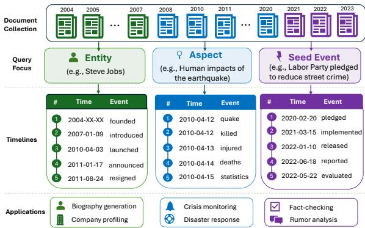
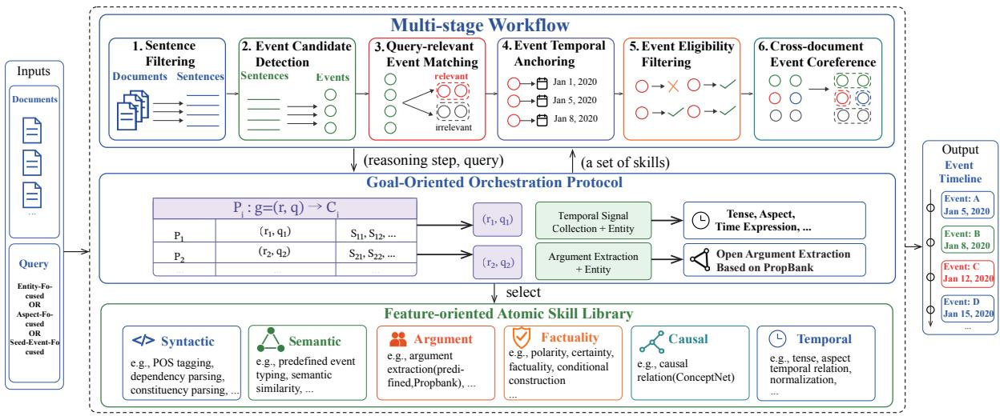
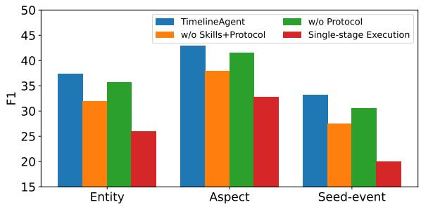
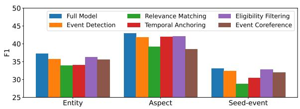
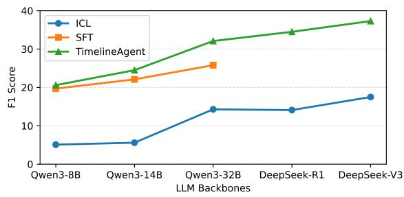

# TimelineAgent: An LLM-based Framework for Query-Centric Event Timeline Extraction Across Multiple Documents

Qingkai Min1,2 Yunxin Bao1 Yifeng Lu2,3 Zhenyu Feng4

Yulong Chen5,6 Andreas Vlachos5 Yue Zhang2,3\*

1Zhejiang University 2School of Engineering, Westlake University 3Institute of Advanced Technology, Westlake Institute for Advanced Study 4Universität des Saarlandes 5University of Cambridge 6University of Aberdeen {minqingkai, zhangyue}@westlake.edu.cn

## Abstract

Query-centric cross-document event timeline extraction aims to construct event timelines from multiple documents under diverse query focuses. The task is very challenging due to the heterogeneous event modeling and reasoning requirements arising from both the intrinsic complexity of cross-document timeline construction and the diversity of query focuses. In this paper, we propose TimelineAgent, an LLM-based multi-agent framework featuring a multi-stage reasoning workflow, where heterogeneous event features are organized into reusable skills and orchestrated through a goaloriented protocol. To facilitate evaluation, we construct a benchmark covering diverse query focuses. Experimental results show that TimelineAgent consistently outperforms existing methods, offering a practical framework for complex real-world timeline construction.

## 1 Introduction

Events are fundamental units representing occurrences or changes within a given context and a central target of information extraction (Grishman, 1997). While individual events convey isolated facts, organizing them chronologically reveals their evolution and interactions over time (Pustejovsky et al., 2003). An event timeline is a structured representation that orders events temporally to provide a coherent view of their progression (Do et al., 2012). Across domains, professionals rely on event timelines to access reliable information, interpret complex narratives, and make informed decisions. Such timelines are widely used in fields such as news analysis, crisis monitoring, and fact checking (Wang et al., 2015; Rajaby Faghihi et al., 2022; Chen et al., 2025). For example, crisis response teams use event timelines to monitor the evolution of emergencies and coordinate timely responses.

  
Figure 1: Examples of query-centric cross-document event timelines under different query focuses. Entity queries target event arguments (participants), Aspect queries characterize event types, and Seed Event queries capture event-to-event relations, together forming the basis for event understanding.

In many real-world applications, users require query-centric timelines aggregated from multiple documents to satisfy diverse information needs. As illustrated in Figure 1, within news articles published between 2004 and 2023, users may focus on events involving specific entities, such as Steve Jobs, to track his evolving role in the company. Constructing such a timeline requires a comprehensive event-centric information extraction pipeline. Starting with event detection (Yue et al., 2023) to identify candidate events, relevance matching selects query-relevant events by first extracting event arguments (Yang et al., 2023), and then leveraging entity coreference (Khosla et al., 2021) and bridging anaphora (Hou et al., 2014) to capture both direct and indirect associations between query entities and event arguments.

In addition, timeline events must satisfy general eligibility constraints, such as factuality (i.e., events not actually occurring should not be included in the timeline) (Saurí and Pustejovsky, 2009) and temporality (i.e., events must possess a temporal attribute) (Ning et al., 2018). Constructing coherent cross-document timelines also requires event temporal anchoring (Wang and Zhao, 2024) and cross-document event coreference resolution (Yu et al., 2022). Temporal anchoring demands both temporal understanding (Wang et al., 2022) and reasoning capabilities (Chu et al., 2024), while event coreference requires compatibility in both event semantics and arguments (Huang et al., 2019).

In particular, the relevance matching requirements vary across query focuses. As shown in Figure 1, aspect-focused queries, such as Human impacts ofthe earthquake, require identifying finegrained event semantics (Liu et al., 2021) related to casualties or fatalities, as well as reasoning over preceding events that led to these impacts (Gao et al., 2019). Seed-event-focused queries, such as The Labour Party pledged to reduce street crime, involve tracking downstream events triggered by the seed, such as policy changes or subsequent actions. These events must be semantically and causally related to the seed and constrained by event arguments, including participants or affected targets (Chen et al., 2025).

Building on the timeline construction processes for different queries described above, we formulate the task of Query-centric Cross-document Event Timeline Extraction (QUEST). To address the complexity of timeline construction and query diversity, QUEST requires modeling heterogeneous event features, including syntactic, semantic, argument, temporal, causal, and factuality. For example, semantic features include predefined event types for aspect-focused queries and contextual semantic similarity for seed-event-focused queries. Argument features for entity-focused queries rely on PropBank-based semantic frames, while those for seed-event-focused queries require both FrameNetbased and predefined semantic schemas.

We propose TimelineAgent, an LLM-based multi-agent framework that separates task-agnostic event modeling from the query- and stagespecific reasoning required for timeline construction. Specifically, we establish a multi-stage workflow (as shown in Table 1), where each stage is handled by a dedicated agent performing reasoning toward a clear sub-objective. For example, relevance matching combines semantic and argument features for query-aware event matching, while temporal anchoring first extracts temporal signals and then performs temporal inference to derive normalized timestamps. Heterogeneous event features are systematically categorized and decoupled into a skill library of reusable atomic operations, reducing interference among different reasoning processes. For example, temporal signals are decomposed into atomic skills such as tense analysis, aspect analysis, and temporal expression extraction, while argument modeling supports multiple schema configurations including predefined schemas, Prop-Bank, and FrameNet. To coordinate the agent’s invocation of skills, we design a goal-oriented orchestration protocol that composes and configures appropriate skills according to specific reasoning substeps and query requirements. For example, the protocol may combine multiple temporal skills to support temporal signal collection, or configure the argument extraction skill with different schemas under different query settings. Table 1 provides an overview of representative skills required at each stage.

<table><tr><td>Workflow Stage</td><td>Skill Categories (No. of Skills)</td></tr><tr><td>Event Detection</td><td>Syntactic(Parsing(3)+Resource(1))</td></tr><tr><td>Relevance Matching</td><td>Semantic(2)2,3, Argument(4)1,3, Causal(1)2,3</td></tr><tr><td>Temporal Anchoring</td><td>Temporal(Extract(4)+Inference(3))</td></tr><tr><td>Eligibility Filtering Event Coreference</td><td>Factuality(4)1,2,3, Semantic(1)3, Temporal(1)3 Semantic(1), Argument(1)</td></tr></table>

Table 1: Stage-wise coupling of skill categories and query types: Entity1, Aspect2, and Seed-event3. The specific skills are listed in Table 7 (Appendix A.2).

To facilitate evaluation, we construct a new benchmark consisting of existing datasets and newly extended annotated data. For entityfocused queries, we use the SemEval-2015 Task 4 dataset (Minard et al., 2015). For aspect- and seed-event-focused queries, we adapt existing datasets—EventStoryLine (Caselli and Vossen, 2017) and PledgeTracker (Chen et al., 2025)—through manual annotation and reformulation to align with QUEST. Experimental results show that TimelineAgent consistently outperforms both SFT and ICL LLM baselines, as well as the task-agnostic multi-agent framework TDAG (Wang et al., 2025). Further analysis demonstrates that each component of the framework contributes substantially to overall performance.

To the best of our knowledge, we are the first to investigate cross-document event timeline extraction through a unified LLM-based agent framework across multiple query formulations.

## 2 Related Work

Event Timeline Extraction Document-level tasks primarily focus on modeling temporal relations among events (Chambers et al., 2014; Ning et al., 2018; Alsayyahi and Batista-Navarro, 2023). In contrast, constructing timelines across documents often requires query-specific information aggregation. Prior work has proposed building timelines centered on entities (Ji et al., 2009; Minard et al., 2015; Laparra et al., 2017; Yao et al., 2024). Fang and Glass (2021) and Jiao et al. (2023) use loosely defined criteria, such as event similarity or event salience. Methodologically, early work relied on hand-crafted modules to build pipelines, such as NER and temporal clustering, which lack robust semantic understanding (Moulahi et al., 2015; Laparra et al., 2015a; Navarro-Colorado and Boró, 2016; Piskorski et al., 2020). More recently, end-toend supervised fine-tuning approaches have been applied in certain domains, such as cancer treatment (Zhang et al., 2025; Jain et al., 2025).

LLM-based Agent Frameworks for Complex IE Recent advances in LLMs have promoted the development of agent-based frameworks for complex IE tasks through task decomposition, rich feature modeling and reasoning. Gangi Reddy et al. (2025) proposed a framework consisting of a navigator, an extractor, and an aggregator for information extraction across complex web environments. Jiao et al. (2024) introduced frameworks with components such as observers, planners, and analyzers to support extraction over complex database schemas. Li et al. (2025) proposed a framework consisting of an executor, a tool pool, and a validator for information extraction and integration from documents with complex layouts and cross-references.

Our work differs from existing studies in two main aspects. First, prior work on event timeline extraction typically focuses on a single query type, whereas QUEST requires handling diverse query focuses for more realistic applications. Second, existing methods mainly rely on either handcrafted pipelines or supervised end-to-end modeling. In contrast, our framework leverages LLMbased agents without task-specific fine-tuning, enabling richer event modeling and better generalization across query settings. More broadly, following recent efforts on designing task-specific architectures for complex information extraction, we develop a multi-agent framework tailored to complex cross-document event reasoning in QUEST.

## 3 Task Definition

Given a document collection $\begin{array} { r l r l } { D } & { { } } & { = } & { { } } \end{array}$ $\{ D _ { 1 } , D _ { 2 } , \ldots , D _ { n } \}$ and a target query $q ,$ the task of QUEST is to construct a temporally ordered timeline consisting of query-relevant events:

$$
\mathcal { L } _ { q } = \{ ( \tau _ { i } , E _ { i } ) \} _ { i = 1 } ^ { m _ { q } }
$$

where each tuple $( \tau _ { i } , E _ { i } )$ denotes a query-relevant timeline event entry. $\tau _ { i }$ denotes the normalized event date (YYYY-MM-DD), following the TimeML specification (Pustejovsky et al., 2010), where unknown temporal components are represented using “X”. $E _ { i }$ denotes a set of coreferential event mentions consolidated across documents.

## 4 Method

As illustrated in Figure 2, TimelineAgent decomposes QUEST into multiple sequential stages, where each agent performs stage-specific reasoning. During reasoning, LLM agents extract event features by invoking skills through the goal-oriented orchestration protocol. The protocol combines different reasoning sub-objectives and query settings into predefined goals, each associated with specific skill compositions and configurations, enabling flexible adaptation to diverse scenarios.

## 4.1 Multi-stage Workflow

We design a unified workflow in which agents progressively leverage different event features and reasoning strategies to identify, filter, temporally anchor, and aggregate events. This staged design decouples complex reasoning processes while progressively refining intermediate event representations throughout timeline construction.

Sentence Filtering In this stage, the agent identifies potentially relevant sentences from the input document collection: $\begin{array} { r } {  { \mathcal { S } } ~ = ~ \{ s _ { 1 } , s _ { 2 } , \ldots , s _ { m } \} , ~ s _ { i } ~ \in ~ D } \end{array}$ The agent primarily relies on coarse-grained query-aware screening to preserve high-recall evidence for downstream timeline construction while reducing irrelevant information. For example, under entity-focused queries, the filtering process mainly retains sentences mentioning the target entity or its coreferential expressions, without requiring explicit event-level reasoning.

Event Candidate Detection Given the filtered sentence set ${ \mathcal { S } } ,$ , the agent identifies candidate event mentions $\mathcal { E } = \{ e _ { 1 } , e _ { 2 } , . . . , e _ { n } \}$ , which serve as a shared event space across different query focuses. The agent primarily analyzes syntactic structures, including POS tags and constituency structures, and then applies predefined span-level constraints together with lexical knowledge (e.g., Collins English Dictionary) to maintain event boundary consistency. Finally, dependency parsing is applied to filter out light verbs and copula verbs.

  
Figure 2: Our proposed TimelineAgent framework.

Query-relevant Event Matching The agent leverages different forms of correspondence to distinguish query-relevant events from the candidate event set, resulting in $\mathcal { E } _ { q } \subseteq \mathcal { E }$

For entity-focused queries, the agent first performs open-domain argument extraction based on semantic frame knowledge (e.g., PropBank (Palmer et al., 2005)), and then models associations between query entities and event participants through entity coreference and bridging anaphora.

For aspect-focused queries, the agent first classifies events based on predefined aspect-oriented semantic types, and then identifies causally preceding events based on external causal knowledge (e.g., ConceptNet (Speer et al., 2017)). Incorporating causal dependencies enables the timeline to provide more informative narratives, as illustrated by the aspect-focused example in Figure 1, which links the initial earthquake to downstream humanimpact events such as deaths and injuries.

For seed-event-focused queries, the agent first determines event semantic types and then identifies related events through commonsense reasoning and external causal knowledge (e.g., ConceptNet). It further extracts arguments using predefined argument schemas and external frame knowledge (e.g., FrameNet), and evaluates argument consistency based on semantic roles.

Event Temporal Anchoring The agent grounds query-relevant events into a temporally anchored event set $\mathcal { E } _ { t } ~ = ~ \{ ( e _ { i } , \tau _ { i } ) \}$ , where $\tau _ { i }$ denotes the normalized timestamp of event $e _ { i } .$ The agent first collects diverse temporal signals, including tense, aspect, temporal expressions, and ordering cues, and then performs temporal inference to determine event timestamps through date calculation and temporal normalization. Document creation time (DCT) serves as a critical temporal reference point for integrating fragmented information across multiple documents (Wang et al., 2022). During inference, reasoning over the temporal relation between events and DCT plays an important role, with different decision strategies required under different query types.

Event Eligibility Filtering This stage determines whether a query-relevant event should be included in the final timeline. It takes the temporally anchored event set $\mathcal { E } _ { t }$ as input and produces the eligible event set $\mathcal { E } _ { \mathrm { e l i g i b l e } } \subseteq \mathcal { E } _ { t } . ^ { 2 }$ Event eligibility is separated from query relevance because it depends not on specific query content, but on query types and general timeline requirements. These include factuality-related dimensions, such as polarity, certainty, and factual status, as well as temporality constraints, which are typically reflected through semantic features. In addition, some query types impose explicit temporal range constraints on eligible events.

Cross-document Event Coreference Resolution Given $\mathcal { E } _ { \mathrm { e l i g i b l e } }$ , the agent groups cross-document event mentions into clusters C, where events in the same cluster refer to the same real-world event. The agent first determines semantic type compatibility between events, and then further evaluates argument consistency (Barhom et al., 2019). Basic event arguments are extracted through semantic frame knowledge, such as PropBank and FrameNet, while previously inferred timestamps are also incorporated for temporal compatibility assessment.

An illustrative example of the workflow is provided in Appendix A.1.

## 4.2 Feature-oriented Skill Library

We design an LLM-based feature-oriented skill library to support more comprehensive and robust event modeling across diverse reasoning stages and query settings. We decompose heterogeneous event features into reusable atomic skills organized by event attributes, while allowing flexible configurations such as external knowledge sources.

Syntactic In addition to basic syntactic analysis capabilities, such as part-of-speech tagging, constituency parsing, and dependency parsing (Yan et al., 2019; Lai et al., 2020; Wan et al., 2024), we further design a skill based on lexical knowledge (e.g., Collins English Dictionary) to determine the extent of phrase-level constructions.

Semantic Semantic skills mainly support two settings: predefined event semantic type classification (Doddington et al., 2004; Wang et al., 2020) and open-domain semantic similarity modeling between events (Gao et al., 2022).

Argument Argument skills mainly support argument extraction under different schemas, including predefined schemas (Ren et al., 2023; Shuang et al., 2024), FrameNet-based (Parekh et al., 2023), and PropBank-based schemas (Zhang et al., 2022). They also provide alignment mechanisms between arguments or entities, including entity coreference resolution (Khosla et al., 2021), and bridging anaphora (Hou, 2020). The first two are formulated as binary matching tasks, while bridging anaphora is modeled as a multi-class relation classification task covering indirect relations, such as part–whole, set–member, and functional or attributive relations.

Factuality Factuality skills include event polarity, certainty, factuality, and conditionality, all formulated as binary classification tasks (Saurí and Pustejovsky, 2009, 2012; Lee et al., 2015; Rovera et al., 2025). Among them, polarity is relatively objective, while the latter categories are more subjective. These skills can be flexibly combined to support more complex factuality judgments that vary across query settings. For example, in entityfocused queries, future events modified by will are treated as factual events for timeline construction, whereas events expressed in conditional constructions are marked as conditional and excluded from the timeline.

Temporal Temporal skills are divided into signaloriented and reasoning-oriented subcategories. Signal-oriented skills include temporal expressions, tense, aspect, and ordering cues (Pustejovsky et al., 2010; Derczynski and Gaizauskas, 2015). Reasoning-oriented skills include temporal normalization, date calculation, and temporal relation classification (Wang et al., 2022; Xiong et al., 2024).

Causal Causal category consists of causal relation classification based on causal knowledge from ConceptNet (Speer et al., 2017; Su et al., 2025).

## 4.3 Goal-oriented Orchestration Protocol

Instead of exposing the entire skill library to agents, which may introduce skill-level attention distraction and context pollution, we design an explicit orchestration protocol for controlled skill routing. The protocol is formalized as a structured coordination mechanism that maps reasoning goals to predefined skill compositions and configurations.

Formally, a reasoning goal is defined as: $g =$ $( r , q )$ where r denotes a reasoning substep and q denotes the query type. A protocol entry defines a mapping: $P _ { i } : g \to C _ { i }$ , where $C _ { i }$ denotes the orchestration configuration for the target reasoning goal. Each configuration is represented as: $C _ { i } = ( O , \Phi )$ , where O specifies the skill composition, such as combining tense, aspect, and temporal expressions for temporal reasoning, and Φ denotes skill-level configurations, such as selecting Prop-Bank or FrameNet as the argument schema.

Detailed implementation of TimelineAgent is provided in Appendix A.2.

## 5 Experiments

We construct a benchmark covering three query settings for evaluating QUEST: entity, aspect, and seed-event queries. We compare against ICL and SFT baselines and a standard multi-agent framework, and further analyze the effects of each component and of staged reasoning.

## 5.1 Experimental Setup

Benchmark Construction Existing public datasets for query-centric event timeline extraction are very limited.3 Due to the high annotation complexity of timeline construction, we construct our benchmark based on existing event datasets.

For entity-focused queries, we use SemEval-2015 Task 4 (Minard et al., 2015) dataset, which contains manually annotated entity-based event timelines from news articles. Entities include persons, organizations, products and financial entities.

For aspect-focused queries, we construct a sevencategory crisis-oriented aspect schema based on humanitarian information categories from social media scenarios (Imran et al., 2016; Vieweg et al., 2010; Castillo et al., 2011). We extend the EventStoryLine Corpus (Caselli and Vossen, 2017), which models the development of news stories at the document level. We select crisis-related topics, including earthquakes, prisoner escapes, bank blast fires, and cable outages, manually classify events into aspect types, and transform existing temporal and causal relations into document-level timelines. Finally, we incorporate cross-document event coreference annotations from ECB+ (Cybulska and Vossen, 2014) to construct cross-document timelines. The event classification process was conducted by two linguistics students, achieving a Cohen’s kappa coefficient of 0.85. Details of the aspect types and the document-level timeline transformation process are provided in Appendix B.1.

For seed-event-focused queries, we further extend PledgeTracker (Chen et al., 2025), which annotates political pledges and their associated timelines for pledge fulfillment tracking. While their task setting is closely related to ours, timeline events are represented as sentence-level summarized descriptions. We instead use political pledges as seed events and further annotate action-level event mentions grounded in the original source documents based on their event descriptions. The action-level event annotation is based on SemEval-2015 Task 4 annotation guidelines.4 Two linguistics students participated in the annotation, achieving 81% spanlevel F1 agreement.

<table><tr><td></td><td>Entity</td><td>Aspect†</td><td>Seed-event†</td></tr><tr><td># documents</td><td>120</td><td>46</td><td>1475</td></tr><tr><td># events</td><td>1102</td><td>647</td><td>406</td></tr><tr><td># timelines</td><td>42</td><td>28</td><td>26</td></tr><tr><td>events / timeline</td><td>26.3</td><td>23.1</td><td>15.6</td></tr><tr><td>event chains / timeline</td><td>19.9</td><td>13.9</td><td>11.1</td></tr><tr><td>docs / timeline</td><td>6.9</td><td>8.6</td><td>6.0</td></tr></table>

Table 2: Dataset statistics of our benchmark. † denotes datasets newly annotated in this work.

Dataset statistics are summarized in Table 2. Illustrative annotation examples for the seed-eventand aspect-focused query settings are provided in Appendix B.2.

Evaluation Metric We follow the official SemEval-2015 TimeLine evaluation protocol (Minard et al., 2015). Rather than scoring isolated temporal decisions, the protocol transforms each predicted and gold timeline into a temporal graph whose nodes are event mentions and normalized time anchors and whose edges encode event–time anchoring and event–event relations. Graph-based precision, recall, and F1 jointly evaluate event selection, temporal grounding, and cross-document event coreference decisions. Further details of the metric are provided in Appendix B.3.

Baseline Methods We compare TimelineAgent with a traditional hand-crafted pipeline system (DLT (Laparra et al., 2015b)), end-to-end LLM settings using in-context learning (ICL) and supervised fine-tuning (SFT), and the task-agnostic multi-agent framework TDAG (Wang et al., 2025). TDAG is a strong task-agnostic multi-agent framework that has demonstrated superior performance over existing agent paradigms such as ReAct (Yao et al., 2022) and Plan-and-Solve (Wang et al., 2023) on complex reasoning tasks. Detailed baseline implementations are provided in Appendix A.3.

Implementation Details We employ two backbone LLMs in our experiments: DeepSeek-V3 (DeepSeek-AI et al., 2025) and Qwen3- 32B (Yang et al., 2025). DeepSeek-V3 is a 671Bparameter language model accessed through its API for inference. Qwen3-32B is deployed on 4 NVIDIA A100 GPUs with 80GB memory for both fine-tuning and inference. To reduce randomness and ensure stable performance, we set the decoding temperature to 0. For SFT, we use the original trial set (6 timeline instances) for entity-focused queries. To maintain a comparable training scale, we construct five data splits for aspect-focused and seed-event-focused queries, with 6 and 5 timeline instances used for training in each split, respectively, while the remaining instances are used for test. Detailed configurations are provided in Appendix C.1.

<table><tr><td rowspan="2">Method</td><td colspan="3">Entity</td><td colspan="3">Aspect</td><td colspan="3">Seed-event</td></tr><tr><td>P</td><td>R</td><td>F1</td><td>P</td><td>R</td><td>F1</td><td>P</td><td>R</td><td>F1</td></tr><tr><td>DLT</td><td>20.7</td><td>11.0</td><td>14.3</td><td>-</td><td>=</td><td>=</td><td>=</td><td>-</td><td>-</td></tr><tr><td>Qwen3-32B</td><td></td><td></td><td></td><td></td><td></td><td></td><td></td><td></td><td></td></tr><tr><td>ICL</td><td>17.8</td><td>12.1</td><td>14.4</td><td>28.1</td><td>23.8</td><td>25.8</td><td>8.3</td><td>12.9</td><td>10.1</td></tr><tr><td>TDAG</td><td>15.3</td><td>20.8</td><td>17.6</td><td>33.5</td><td>27.5</td><td>30.2</td><td>11.3</td><td>19.6</td><td>14.3</td></tr><tr><td>SFT</td><td>24.0</td><td>27.9</td><td>25.8</td><td>40.2</td><td>31.8</td><td>35.5</td><td>17.6</td><td>25.8</td><td>20.9</td></tr><tr><td>TimelineAgent</td><td>29.2</td><td>35.7</td><td>32.1</td><td>41.3</td><td>36.8</td><td>38.9</td><td>22.9</td><td>33.8</td><td>27.3</td></tr><tr><td>DeepSeek-V3</td><td></td><td></td><td></td><td></td><td></td><td></td><td></td><td></td><td></td></tr><tr><td>ICL</td><td>21.2</td><td>15.0</td><td>17.5</td><td>33.7</td><td>24.2</td><td>28.2</td><td>9.8</td><td>17.4</td><td>12.5</td></tr><tr><td>TDAG</td><td>22.2</td><td>44.3</td><td>29.6</td><td>40.3</td><td>33.2</td><td>36.4</td><td>19.5</td><td>30.2</td><td>23.7</td></tr><tr><td>TimelineAgent</td><td>37.2</td><td>38.6</td><td>37.9</td><td>45.8</td><td>40.3</td><td>42.9</td><td>27.8</td><td>40.9</td><td>33.1</td></tr></table>

Table 3: Performance comparison on QUEST.

## 5.2 Main Results

The overall performance comparison is shown in Table 3. TimelineAgent consistently outperforms all baselines across different query settings and backbone model scales, demonstrating the effectiveness of our framework. In particular, our Qwen3-32B model surpasses the general-purpose agent framework TDAG built on DeepSeek-V3, indicating the importance of task-specific reasoning organization and event modeling for QUEST. However, overall performance remains around 30–40% F1, highlighting the inherent difficulty of QUEST.

Among different query settings, seed-eventfocused queries are the most challenging, followed by entity-focused queries, while aspect-focused queries are relatively easier. This trend is roughly proportional to the sparsity of relevant events in documents, with an average of 0.3, 9.2, and 14.1 relevant events per document, respectively, highlighting the inherent challenges of cross-document event reasoning in QUEST.

Compared with ICL, SFT substantially improves performance, indicating the benefit of task-specific adaptation. However, its effectiveness is still limited by the low-resource training data. TDAG, as a general-purpose multi-agent framework, further demonstrates the effectiveness of task decomposition and coordinated agent reasoning. Nevertheless, both approaches still show a considerable gap from TimelineAgent, highlighting the effectiveness of our task-specific understanding and structured modeling of the complex requirements in QUEST. Larger backbone models consistently outperform smaller ones across all settings, suggesting the importance of strong general reasoning capabilities.

  
Figure 3: Effects of skill library, orchestration protocol and staged execution of TimelineAgent.

## 5.3 Ablation Study

We first conduct architectural ablations by removing different framework components to analyze their contributions. We further perform stage-wise ablations by replacing specialized reasoning with simple single-step prompting. In this setting, each agent is not equipped with explicit skills or multistep reasoning processes. Finally, we conduct error propagation analysis by replacing stage outputs with gold annotations to investigate the downstream impact of errors.

Architectural Ablation. As shown in Figure 3, removing both skills and orchestration protocols (w/o Skills+Protocol) leads to substantial performance degradation across all query settings, demonstrating that merely providing high-level reasoning objectives without specialized event feature modeling is insufficient for event-centric reasoning. When only orchestration protocol is removed (w/o Protocol), the model can still utilize useful skills to some extent, but performance remains consistently inferior to the full model, indicating that directly exposing all skills as flat context is less effective than our structured skill routing strategy. We observe that preserving both skills and protocols while executing the entire workflow in a single unified stage (Single-stage Execution) results in particularly severe performance degradation. This finding highlights the importance of staged execution for handling the overall reasoning complexity.

Stage-wise Ablation. As shown in Figure 4, event detection consistently contributes to all query settings, demonstrating the effectiveness of our finegrained syntactic modeling. Relevance matching yields the largest overall contribution across all settings, highlighting the importance of our structured reasoning and decomposed feature modeling. Temporal anchoring is particularly important for entityfocused and seed-event-focused queries, reflecting the challenges of reasoning over long temporal spans and temporally evolving events. Eligibility filtering also provides consistent improvements, indicating that modeling factuality and semantic temporality is beneficial for identifying temporally eligible events. Event coreference contributes most substantially to aspect-focused queries, demonstrating the effectiveness of our modeling for distinguishing highly similar events occurring within relatively compact temporal contexts.

Figure 4: Effects of different workflow stages of TimelineAgent.
<table><tr><td>Oracle Setting</td><td>Entity</td><td>Aspect</td><td>Seed-event</td></tr><tr><td>TimelineAgent</td><td>37.9</td><td>42.9</td><td>33.1</td></tr><tr><td>Gold Detection, Matching, &amp; Filtering</td><td>67.6</td><td>69.8</td><td>71.4</td></tr><tr><td>Gold Temporal Anchoring</td><td>55.6</td><td>52.4</td><td>41.0</td></tr><tr><td>Gold Event Coreference</td><td>42.1</td><td>56.1</td><td>39.4</td></tr></table>

Table 4: Error propagation analysis using gold annotations for different workflow stages.

Error Propagation Analysis. Since the datasets do not separately provide annotations for general events, event relevance, and event eligibility, we combine them into a unified stage referred to as event detection, matching, and filtering. As shown in Table 4, event detection, matching, and filtering constitute the most critical stage across all query settings, indicating that accurately identifying and selecting relevant events is fundamental for timeline construction. Temporal anchoring is particularly important for entity-focused and seed-eventfocused queries, which typically involve broader temporal spans and require more complex temporal reasoning. In contrast, aspect-focused queries are more sensitive to event coreference, since they are centered around different aspects of a relatively compact seminal event with many repeated event mentions across documents. We provide additional qualitative error analysis in Appendix C.2.

We provide case studies of key stages in Appendix C.3.

  
Figure 5: Comparison of performance across different LLM backbones under entity setting.

## 5.4 Impact of LLM Backbones

We further compare different backbone model scales to analyze the relationship between model capacity and performance, as shown in Figure 5. Overall, larger models consistently achieve better results. However, the performance gains gradually diminish when scaling from Qwen3-32B to DeepSeek-V3 (671B), suggesting that model scale alone is no longer the dominant factor for QUEST, while task-specific reasoning and modeling become increasingly important. Compared with SFT, our framework achieves slightly better performance on smaller models such as 8B and 14B, but demonstrates larger gains as model size further increases to 32B. This trend suggests that stronger LLM reasoning capabilities are more effective for handling decomposed reasoning subproblems in our framework, while directly fine-tuning models to perform complex end-to-end reasoning remains difficult under extremely low-resource conditions with only 5–6 training instances. Moreover, unlike SFT, our framework does not require training separate task-specific models for different query settings, enabling stronger generalization across diverse timeline construction scenarios.

## 5.5 Impact of SFT Training Scale

To assess whether the low-resource setting of the SFT baseline accounts for its performance gap, we increase the amount of supervision at medium and large scales. Table 5 shows that increasing supervision consistently improves SFT performance across all three query settings, although the gains diminish as the training set grows. At the large scale, SFT remains below Qwen3-32B-based TimelineAgent on Entity and Seed-event queries, but exceeds it by 0.6 F1 on Aspect queries. TimelineAgent with DeepSeek-V3 outperforms large-scale SFT in every setting. Thus, while end-to-end SFT benefits from additional supervision, TimelineAgent remains competitive in limited-supervision settings and can benefit from larger foundation models without task-specific fine-tuning.

<table><tr><td>Backbone</td><td>Method</td><td>Entity</td><td>Aspect</td><td>Seed-event</td></tr><tr><td rowspan="5">Qwen3-32B</td><td>ICL</td><td>14.4</td><td>25.8</td><td>10.1</td></tr><tr><td>SFT</td><td>25.8</td><td>35.5</td><td>20.9</td></tr><tr><td>SFT (medium)</td><td>28.6</td><td>38.0</td><td>24.4</td></tr><tr><td>SFT (large)</td><td>29.9</td><td>39.5</td><td>26.2</td></tr><tr><td>TimelineAgent</td><td>32.1</td><td>38.9</td><td>27.3</td></tr><tr><td>DeepSeek-V3</td><td>TimelineAgent</td><td>37.9</td><td>42.9</td><td>33.1</td></tr></table>

Table 5: F1 scores at different supervised training scales for end-to-end SFT. The standard, medium, and large SFT settings use 6/6/5, 18/12/10, and 30/18/15 training timelines for Entity, Aspect, and Seed-event queries, respectively.

## 5.6 Computational Efficiency

To improve computational efficiency, we first perform sentence filtering to remove irrelevant context before event reasoning. This step filters out approximately 50%, 30%, and 90% of sentences for three query settings, respectively. To further reduce inference overhead, we jointly process all events within the same sentence at each step rather than reasoning over them individually. Compared with standard multi-stage ICL approaches that typically execute a single reasoning step per stage, our framework requires only $\frac { 2 + \frac { \breve { 2 } + 2 + 3 ^ { \cdot } } { 3 } + \dot { 2 } + 2 + 2 } { 5 } \approx 2 . 1 \times$ more reasoning executions on average. Compared with the automatic multi-agent decomposition framework TDAG, which incurs approximately 4× more executions, our framework remains more efficient. In practice, a full inference run takes around ten hours depending on the batching configuration, demonstrating the practical feasibility of our framework.

## 6 Conclusion

We introduced the practical yet challenging task of QUEST, which requires handling complex processing pipelines and diverse event features under different query settings. We propose TimelineAgent, a multi-agent framework that decomposes timeline construction into coordinated reasoning stages supported by reusable atomic skills and goaloriented orchestration protocols. Experimental results across multiple query settings demonstrate the effectiveness of our framework over strong baselines. We hope our framework can provide a practical direction for applying structured agent systems to other complex information extraction tasks.

## Limitations

Our work mainly focuses on establishing a principled framework for the complex QUEST task. Based on our atomic feature-oriented skill design and goal-oriented orchestration principles, future work could explore finer-grained orchestration strategies, such as independently invoking atomic skills for individual event mentions to reduce the complexity of each reasoning step and enable more precise reasoning and feature modeling. To address the substantially higher computational overhead introduced by such designs, future research may investigate hybrid architectures that combine large and small language models, where stronger models handle more demanding reasoning processes while lightweight models perform relatively simpler feature extraction tasks such as syntactic analysis and semantic categorization. Such designs may provide stronger reasoning capabilities while maintaining better computational efficiency.

Constructing high-quality structured event timelines is an annotation-intensive process. To scale the benchmark while maintaining annotation quality, human-agent collaboration offers a practical direction. Under different query requirements, human annotators can edit the reasoning logic for timeline construction and customize the corresponding skills and orchestration protocols, enabling more flexible extension of the benchmark. Meanwhile, the agent’s interpretable reasoning process allows annotators to provide supervision and corrections at intermediate steps, helping ensure annotation quality while scaling the benchmark.

## Acknowledgments

We would like to thank anonymous reviewers for their insightful comments to help improve the paper. This work has been supported by the National Natural Science Foundation of China (NSFC) Key Project under Grant Number 62336006. Andreas Vlachos and Yulong Chen were supported by the DARPA program SciFy.

## References

Sarah Alsayyahi and Riza Batista-Navarro. 2023. TIMELINE: Exhaustive annotation of temporal relations supporting the automatic ordering of events in news articles. In Proceedings ofthe 2023 Conference on Empirical Methods in Natural Language Processing, pages 16336–16348, Singapore. Association for Computational Linguistics.

Shany Barhom, Vered Shwartz, Alon Eirew, Michael Bugert, Nils Reimers, and Ido Dagan. 2019. Revisiting joint modeling of cross-document entity and event coreference resolution. In Proceedings of the 57th Annual Meeting of the Association for Computational Linguistics, pages 4179–4189, Florence, Italy. Association for Computational Linguistics.

Tommaso Caselli and Piek Vossen. 2017. The event StoryLine corpus: A new benchmark for causal and temporal relation extraction. In Proceedings of the Events and Stories in the News Workshop, pages 77– 86, Vancouver, Canada. Association for Computational Linguistics.

Carlos Castillo, Marcelo Mendoza, and Barbara Poblete. 2011. Information credibility on twitter. In Proceedings ofthe 20th International Conference on World Wide Web, pages 675–684. ACM.

Nathanael Chambers, Taylor Cassidy, Bill McDowell, and Steven Bethard. 2014. Dense event ordering with a multi-pass architecture. Transactions of the Association for Computational Linguistics, 2:273– 284.

Yulong Chen, Michael Sejr Schlichtkrull, Zhenyun Deng, David Corney, Nasim Asl, Joshua Salisbury, Andrew Dudfield, and Andreas Vlachos. 2025. PledgeTracker: A system for monitoring the fulfilment of pledges. In Proceedings of the 2025 Conference on Empirical Methods in Natural Language Processing: System Demonstrations, pages 839–850, Suzhou, China. Association for Computational Linguistics.

Zheng Chu, Jingchang Chen, Qianglong Chen, Weijiang Yu, Haotian Wang, Ming Liu, and Bing Qin. 2024. TimeBench: A comprehensive evaluation of temporal reasoning abilities in large language models. In Proceedings ofthe 62nd Annual Meeting ofthe Associationfor Computational Linguistics (Volume 1: Long Papers), pages 1204–1228, Bangkok, Thailand. Association for Computational Linguistics.

Agata Cybulska and Piek Vossen. 2014. Using a sledgehammer to crack a nut? lexical diversity and event coreference resolution. In Proceedings ofthe Ninth International Conference on Language Resources and Evaluation (LREC’14), pages 4545–4552, Reykjavik, Iceland. European Language Resources Association (ELRA).

DeepSeek-AI, Aixin Liu, Bei Feng, Bing Xue, Bingxuan Wang, Bochao Wu, Chengda Lu, Chenggang Zhao, Chengqi Deng, Chenyu Zhang, Chong Ruan, Damai Dai, Daya Guo, Dejian Yang, Deli Chen, Dongjie Ji, Erhang Li, Fangyun Lin, Fucong Dai, and 181 others. 2025. Deepseek-v3 technical report. Preprint, arXiv:2412.19437.

Leon Derczynski and Robert Gaizauskas. 2015. Temporal relation classification using a model of tense and

aspect. In Proceedings ofthe International Conference Recent Advances in Natural Language Processing, pages 118–122, Hissar, Bulgaria. INCOMA Ltd. Shoumen, BULGARIA.

Quang Do, Wei Lu, and Dan Roth. 2012. Joint inference for event timeline construction. In Proceedings ofthe 2012 Joint Conference on Empirical Methods in Natural Language Processing and Computational Natural Language Learning, pages 677–687, Jeju Island, Korea. Association for Computational Linguistics.

George Doddington, Alexis Mitchell, Mark Przybocki, Lance Ramshaw, Stephanie Strassel, and Ralph Weischedel. 2004. The automatic content extraction (ACE) program – tasks, data, and evaluation. In Proceedings ofthe Fourth International Conference on Language Resources and Evaluation (LREC’04), Lisbon, Portugal. European Language Resources Association (ELRA).

Wei Fang and James Glass. 2021. Cross-document temporal relation extraction with temporal anchoring events.

Revanth Gangi Reddy, Sagnik Mukherjee, Jeonghwan Kim, Zhenhailong Wang, Dilek Hakkani-Tür, and Heng Ji. 2025. Infogent: An agent-based framework for web information aggregation. In Findings of the Associationfor Computational Linguistics: NAACL 2025, pages 5745–5758, Albuquerque, New Mexico. Association for Computational Linguistics.

Jun Gao, Wei Wang, Changlong Yu, Huan Zhao, Wilfred Ng, and Ruifeng Xu. 2022. Improving event representation via simultaneous weakly supervised contrastive learning and clustering. In Proceedings of the 60th Annual Meeting of the Association for Computational Linguistics (Volume 1: Long Papers), pages 3036–3049, Dublin, Ireland. Association for Computational Linguistics.

Lei Gao, Prafulla Kumar Choubey, and Ruihong Huang. 2019. Modeling document-level causal structures for event causal relation identification. In Proceedings ofthe 2019 Conference ofthe North American Chapter ofthe Associationfor Computational Linguistics: Human Language Technologies, Volume 1 (Long and Short Papers), pages 1808–1817, Minneapolis, Minnesota. Association for Computational Linguistics.

Ralph Grishman. 1997. Information extraction: Techniques and challenges. In International Summer School on Information Extraction: A Multidisciplinary Approach to an Emerging Information Technology, SCIE ’97, page 10–27, Berlin, Heidelberg. Springer-Verlag.

Yufang Hou. 2020. Bridging anaphora resolution as question answering. In Proceedings of the 58th Annual Meeting of the Association for Computational Linguistics, pages 1428–1438, Online. Association for Computational Linguistics.

Yufang Hou, Katja Markert, and Michael Strube. 2014. A rule-based system for unrestricted bridging resolution: Recognizing bridging anaphora and finding links to antecedents. In Proceedings ofthe 2014 Conference on Empirical Methods in Natural Language Processing (EMNLP), pages 2082–2093, Doha, Qatar. Association for Computational Linguistics.

Yin Jou Huang, Jing Lu, Sadao Kurohashi, and Vincent Ng. 2019. Improving event coreference resolution by learning argument compatibility from unlabeled data. In Proceedings ofthe 2019 Conference ofthe North American Chapter of the Association for Computational Linguistics: Human Language Technologies, Volume 1 (Long and Short Papers), pages 785–795, Minneapolis, Minnesota. Association for Computational Linguistics.

Muhammad Imran, Prasenjit Mitra, and Carlos Castillo. 2016. Twitter as a lifeline: Human-annotated twitter corpora for nlp of crisis-related messages. In Proceedings of the 10th International Conference on Language Resources and Evaluation (LREC 2016), pages 1638–1643, Portorož, Slovenia.

Vijay Raj Jain, Chris Coffee, Kaiwen He, Remy Cron, Micah D. Cochran, Luis Mansilla-Gonzalez, Akhil Nadimpalli, Danish Murad, and John D Osborne. 2025. TEAM UAB at chemotherapy timelines 2025: Integrating encoders and large language models for chemotherapy timelines generation. In Proceedings of the 7th Clinical Natural Language Processing Workshop, pages 30–39, Virtual. Association for Computational Linguistics.

Heng Ji, Ralph Grishman, Zheng Chen, and Prashant Gupta. 2009. Cross-document event extraction and tracking: Task, evaluation, techniques and challenges. In Proceedings of the International Conference RANLP-2009, pages 166–172, Borovets, Bulgaria. Association for Computational Linguistics.

Yizhu Jiao, Sha Li, Sizhe Zhou, Heng Ji, and Jiawei Han. 2024. Text2DB: Integration-aware information extraction with large language model agents. In Findings of the Association for Computational Linguistics: ACL 2024, pages 185–205, Bangkok, Thailand. Association for Computational Linguistics.

Yizhu Jiao, Ming Zhong, Jiaming Shen, Yunyi Zhang, Chao Zhang, and Jiawei Han. 2023. Unsupervised event chain mining from multiple documents. In Proceedings ofthe ACM Web Conference 2023, WWW ’23, page 1948–1959, New York, NY, USA. Association for Computing Machinery.

Sopan Khosla, James Fiacco, and Carolyn Rosé. 2021. Evaluating the impact of a hierarchical discourse representation on entity coreference resolution performance. In Proceedings of the 2021 Conference of the North American Chapter ofthe Associationfor Computational Linguistics: Human Language Technologies, pages 1645–1651, Online. Association for Computational Linguistics.

Viet Dac Lai, Tuan Ngo Nguyen, and Thien Huu Nguyen. 2020. Event detection: Gate diversity and syntactic importance scores for graph convolution neural networks. In Proceedings of the 2020 Conference on Empirical Methods in Natural Language Processing (EMNLP), pages 5405–5411, Online. Association for Computational Linguistics.

Egoitz Laparra, Rodrigo Agerri, Itziar Aldabe, and German Rigau. 2017. Multi-lingual and crosslingual timeline extraction. Knowledge-Based Systems, 133:77–89.

Egoitz Laparra, Itziar Aldabe, and German Rigau. 2015a. Document level time-anchoring for timeline extraction. In Annual Meeting of the Association for Computational Linguistics.

Egoitz Laparra, Itziar Aldabe, and German Rigau. 2015b. Document level time-anchoring for Time-Line extraction. In Proceedings ofthe 53rd Annual Meeting of the Association for Computational Linguistics and the 7th International Joint Conference on Natural Language Processing (Volume 2: Short Papers), pages 358–364, Beijing, China. Association for Computational Linguistics.

Kenton Lee, Yoav Artzi, Yejin Choi, and Luke Zettlemoyer. 2015. Event detection and factuality assessment with non-expert supervision. In Proceedings of the 2015 Conference on Empirical Methods in Natural Language Processing, pages 1643–1648, Lisbon, Portugal. Association for Computational Linguistics.

Bin Li, Jannis Conen, and Felix Aller. 2025. AIDagent: An LLM-agent for advanced extraction and integration of documents. In Proceedings ofthe 1st Workshopfor Research on Agent Language Models (REALM 2025), pages 80–88, Vienna, Austria. Association for Computational Linguistics.

Qing Liu, Hongyu Lin, Xinyan Xiao, Xianpei Han, Le Sun, and Hua Wu. 2021. Fine-grained entity typing via label reasoning. In Proceedings of the 2021 Conference on Empirical Methods in Natural Language Processing, pages 4611–4622, Online and Punta Cana, Dominican Republic. Association for Computational Linguistics.

Anne-Lyse Minard, Manuela Speranza, Eneko Agirre, Itziar Aldabe, Marieke van Erp, Bernardo Magnini, German Rigau, and Rubén Urizar. 2015. SemEval-2015 task 4: TimeLine: Cross-document event ordering. In Proceedings of the 9th International Workshop on Semantic Evaluation (SemEval 2015), pages 778–786, Denver, Colorado. Association for Computational Linguistics.

Bilel Moulahi, Jannik Strötgen, Michael Gertz, and Lynda Tamine. 2015. Heideltoul: A baseline approach for cross-document event ordering. In International Workshop on Semantic Evaluation.

Borja Navarro-Colorado and Estela Saquete Boró. 2016. Cross-document event ordering through temporal, lexical and distributional knowledge. Knowl. Based Syst., 110:244–254.

Qiang Ning, Hao Wu, and Dan Roth. 2018. A multiaxis annotation scheme for event temporal relations. In Proceedings of the 56th Annual Meeting of the Associationfor Computational Linguistics (Volume 1: Long Papers), pages 1318–1328, Melbourne, Australia. Association for Computational Linguistics.

Martha Palmer, Daniel Gildea, and Paul Kingsbury. 2005. The Proposition Bank: An annotated corpus of semantic roles. Computational Linguistics, 31(1):71– 106.

Tanmay Parekh, I-Hung Hsu, Kuan-Hao Huang, Kai-Wei Chang, and Nanyun Peng. 2023. GENEVA: Benchmarking generalizability for event argument extraction with hundreds of event types and argument roles. In Proceedings of the 61st Annual Meeting of the Associationfor Computational Linguistics (Volume 1: Long Papers), pages 3664–3686, Toronto, Canada. Association for Computational Linguistics.

Jakub Piskorski, Vanni Zavarella, Martin Atkinson, Marco Verile, and 1 others. 2020. Timelines: Entitycentric event extraction from online news. In Text2Story@ ECIR, pages 105–114.

James Pustejovsky, José M Castano, Robert Ingria, Roser Sauri, Robert J Gaizauskas, Andrea Setzer, Graham Katz, and Dragomir R Radev. 2003. Timeml: Robust specification of event and temporal expressions in text. New directions in question answering, 3:28–34.

James Pustejovsky, Kiyong Lee, Harry Bunt, and Laurent Romary. 2010. ISO-TimeML: An international standard for semantic annotation. In Proceedings of the Seventh International Conference on Language Resources and Evaluation (LREC’10), Valletta, Malta. European Language Resources Association (ELRA).

Hossein Rajaby Faghihi, Bashar Alhafni, Ke Zhang, Shihao Ran, Joel Tetreault, and Alejandro Jaimes. 2022. CrisisLTLSum: A benchmark for local crisis event timeline extraction and summarization. In Findings ofthe Associationfor Computational Linguistics: EMNLP 2022, pages 5455–5477, Abu Dhabi, United Arab Emirates. Association for Computational Linguistics.

Yubing Ren, Yanan Cao, Ping Guo, Fang Fang, Wei Ma, and Zheng Lin. 2023. Retrieve-and-sample: Document-level event argument extraction via hybrid retrieval augmentation. In Proceedings of the 61st Annual Meeting of the Association for Computational Linguistics (Volume 1: Long Papers), pages 293–306, Toronto, Canada. Association for Computational Linguistics.

Marco Rovera, Serena Cristoforetti, and Sara Tonelli. 2025. ModaFact: Multi-paradigm evaluation for joint event modality and factuality detection. In Proceedings ofthe 31st International Conference on Computational Linguistics, pages 6378–6396, Abu Dhabi, UAE. Association for Computational Linguistics.

Roser Saurí and James Pustejovsky. 2009. Factbank: a corpus annotated with event factuality. Language Resources and Evaluation, 43:227–268.

Roser Saurí and James Pustejovsky. 2012. Are you sure that this happened? assessing the factuality degree of events in text. Computational Linguistics, 38(2):261– 299.

Kai Shuang, Ji Zhou, Qiwei Wang, and Jinyu Guo. 2024. Thinking about how to extract: Energizing LLMs emergence capabilities for document-level event argument extraction. In Findings ofthe Associationfor Computational Linguistics: ACL 2024, pages 5520– 5532, Bangkok, Thailand. Association for Computational Linguistics.

Robyn Speer, Joshua Chin, and Catherine Havasi. 2017. Conceptnet 5.5: an open multilingual graph of general knowledge. In Proceedings of the Thirty-First AAAI Conference on Artificial Intelligence, AAAI’17, page 4444–4451. AAAI Press.

Ya Su, Hu Zhang, Guangjun Zhang, Yujie Wang, Yue Fan, Ru Li, and Yuanlong Wang. 2025. Enhancing event causality identification with LLM knowledge and concept-level event relations. In Proceedings of the 31st International Conference on Computational Linguistics, pages 7403–7414, Abu Dhabi, UAE. Association for Computational Linguistics.

Naushad UzZaman, Hector Llorens, Leon Derczynski, James Allen, Marc Verhagen, and James Pustejovsky. 2013. SemEval-2013 task 1: TempEval-3: Evaluating time expressions, events, and temporal relations. In Second Joint Conference on Lexical and Computational Semantics (\*SEM), Volume 2: Proceedings of the Seventh International Workshop on Semantic Evaluation (SemEval 2013), pages 1–9, Atlanta, Georgia, USA. Association for Computational Linguistics.

Sarah Vieweg, Amanda L. Hughes, Kate Starbird, and Leysia Palen. 2010. Microblogging during two natural hazards events: What twitter may contribute to situational awareness. In Proceedings ofthe SIGCHI Conference on Human Factors in Computing Systems, pages 1079–1088. ACM.

Qizhi Wan, Changxuan Wan, Keli Xiao, Kun Lu, Chenliang Li, Xiping Liu, and Dexi Liu. 2024. Dependency structure-enhanced graph attention networks for event detection. In Proceedings ofthe AAAI Conference on Artificial Intelligence, volume 38, pages 19098–19106.

Lei Wang, Wanyu Xu, Yihuai Lan, Zhiqiang Hu, Yunshi Lan, Roy Ka-Wei Lee, and Ee-Peng Lim. 2023. Planand-solve prompting: Improving zero-shot chain-ofthought reasoning by large language models. In Proceedings ofthe 61st Annual Meeting ofthe Association for Computational Linguistics (Volume 1: Long Papers), pages 2609–2634, Toronto, Canada. Association for Computational Linguistics.

Liang Wang, Peifeng Li, and Sheng Xu. 2022. DCTcentered temporal relation extraction. In Proceedings of the 29th International Conference on Computational Linguistics, pages 2087–2097, Gyeongju, Republic of Korea. International Committee on Computational Linguistics.

Lu Wang, Claire Cardie, and Galen Marchetti. 2015. Socially-informed timeline generation for complex events. In Proceedings of the 2015 Conference of the North American Chapter of the Association for Computational Linguistics: Human Language Technologies, pages 1055–1065, Denver, Colorado. Association for Computational Linguistics.

Xiaozhi Wang, Ziqi Wang, Xu Han, Wangyi Jiang, Rong Han, Zhiyuan Liu, Juanzi Li, Peng Li, Yankai Lin, and Jie Zhou. 2020. MAVEN: A Massive General Domain Event Detection Dataset. In Proceedings of the 2020 Conference on Empirical Methods in Natural Language Processing (EMNLP), pages 1652– 1671, Online. Association for Computational Linguistics.

Yaoxiang Wang, Zhiyong Wu, Junfeng Yao, and Jinsong Su. 2025. Tdag: A multi-agent framework based on dynamic task decomposition and agent generation. Neural Netw., 185(C).

Yuqing Wang and Yun Zhao. 2024. TRAM: Benchmarking temporal reasoning for large language models. In Findings ofthe Associationfor Computational Linguistics: ACL 2024, pages 6389–6415, Bangkok, Thailand. Association for Computational Linguistics.

Siheng Xiong, Ali Payani, Ramana Kompella, and Faramarz Fekri. 2024. Large language models can learn temporal reasoning. In Proceedings of the 62nd Annual Meeting ofthe Associationfor Computational Linguistics (Volume 1: Long Papers), pages 10452– 10470, Bangkok, Thailand. Association for Computational Linguistics.

Haoran Yan, Xiaolong Jin, Xiangbin Meng, Jiafeng Guo, and Xueqi Cheng. 2019. Event detection with multiorder graph convolution and aggregated attention. In Proceedings of the 2019 Conference on Empirical Methods in Natural Language Processing and the 9th International Joint Conference on Natural Language Processing (EMNLP-IJCNLP), pages 5766– 5770, Hong Kong, China. Association for Computational Linguistics.

An Yang, Anfeng Li, Baosong Yang, Beichen Zhang, Binyuan Hui, Bo Zheng, Bowen Yu, Chang Gao, Chengen Huang, Chenxu Lv, Chujie Zheng, Dayiheng Liu, Fan Zhou, Fei Huang, Feng Hu, Hao Ge, Haoran Wei, Huan Lin, Jialong Tang, and 41 others. 2025. Qwen3 technical report. ArXiv, abs/2505.09388.

Xianjun Yang, Yujie Lu, and Linda Petzold. 2023. Fewshot document-level event argument extraction. In Proceedings of the 61st Annual Meeting of the Associationfor Computational Linguistics (Volume 1:

Long Papers), pages 8029–8046, Toronto, Canada. Association for Computational Linguistics.

Jiarui Yao, Harry Hochheiser, WonJin Yoon, Eli Goldner, and Guergana Savova. 2024. Overview of the 2024 shared task on chemotherapy treatment timeline extraction. In Proceedings ofthe 6th Clinical Natural Language Processing Workshop, pages 557–569, Mexico City, Mexico. Association for Computational Linguistics.

Shunyu Yao, Jeffrey Zhao, Dian Yu, Nan Du, Izhak Shafran, Karthik Narasimhan, and Yuan Cao. 2022. React: Synergizing reasoning and acting in language models. arXiv preprint arXiv:2210.03629.

Xiaodong Yu, Wenpeng Yin, and Dan Roth. 2022. Pairwise representation learning for event coreference. In Proceedings ofthe 11th Joint Conference on Lexical and Computational Semantics, pages 69–78, Seattle, Washington. Association for Computational Linguistics.

Zhenrui Yue, Huimin Zeng, Mengfei Lan, Heng Ji, and Dong Wang. 2023. Zero- and few-shot event detection via prompt-based meta learning. In Proceedings of the 61st Annual Meeting of the Association for Computational Linguistics (Volume 1: Long Papers), pages 7928–7943, Toronto, Canada. Association for Computational Linguistics.

Tianmai M. Zhang, Zhaoyi Sun, Sihang Zeng, Chenxi Li, Neil F. Abernethy, Barbara D. Lam, Fei Xia, and Meliha Yetisgen. 2025. UW-BioNLP at ChemoTimelines 2025: Thinking, fine-tuning, and dictionaryenhanced LLM systems for chemotherapy timeline extraction. In Proceedings of the 7th Clinical Natural Language Processing Workshop, pages 40–56, Virtual. Association for Computational Linguistics.

Zhisong Zhang, Emma Strubell, and Eduard Hovy. 2022. Transfer learning from semantic role labeling to event argument extraction with template-based slot querying. In Proceedings ofthe 2022 Conference on Empirical Methods in Natural Language Processing, pages 2627–2647, Abu Dhabi, United Arab Emirates. Association for Computational Linguistics.

## A Method Details

## A.1 Example of Multi-stage Timeline Construction

Consider an entity-focused query centered on Steve Jobs. The workflow first performs query-relevant sentence filtering to identify potentially useful context from the document collection. Sentences mentioning the target entity or its coreferential expressions are retained as high-recall evidence for downstream reasoning.

The agent then performs query-relevant event matching to identify events associated with the query entity. Candidate events such as announced, fought, resigned, and unveiled are extracted from the filtered sentences. Using semantic frame knowledge and entity coreference reasoning, the agent determines whether event participants are associated with the target entity. For example, the event unveiled is retained because the pronoun “he” in its argument structure is resolved to “Steve Jobs.”

Next, the agent performs event temporal anchoring. Temporal signals including tense, aspect, temporal expressions, and temporal ordering cues are first extracted from context. For example, given the sentence “Jobs announced the product on Monday” with document creation time 2011-01-17, the agent extracts the temporal expression “Monday” and normalizes the event timestamp to 2011-01-17. Similarly, the sentence “Jobs unveiled the device in 2004” leads to the normalized timestamp 2004-XX-XX through temporal expression normalization.

After temporal grounding, the agent performs cross-document event coreference resolution. Event mentions are first compared based on semantic type compatibility and semantic similarity. The agent then evaluates argument consistency and temporal compatibility using extracted participants and normalized timestamps. For example, two event mentions containing the trigger announced may initially appear semantically compatible. However, if one event corresponds to “Steve Jobs announced Lion OS X” on 2010-10-23, while another corresponds to “Steve Jobs announced medical leave” on 2011-01-17, the agent determines that the arguments and timestamps are inconsistent and therefore assigns them to different event clusters.

Finally, the clustered and temporally grounded events are aggregated into a chronologically ordered timeline. Through this staged workflow, TimelineAgent progressively transforms noisy cross-document evidence into structured event timelines with explicit temporal organization.

## A.2 Implementation Details of TimelineAgent

## A.2.1 Multi-stage Workflow

Sentence Filtering Stage

## Objective:

Perform coarse-grained query-aware evidence screening to preserve high-recall candidate evidence for downstream timeline construction.

## Input:

## Query:

{query}

{document}

## Query-specific Focus:

• Entity-focused: entity mentions and aliases

• Aspect-focused: semantic topical consistency

• Seed-event-focused: triggered by the seed event

## Output:

Filtered sentence set ${ \mathcal { S } } ^ { \prime } \subseteq { \mathcal { S } } .$

## Event Candidate Detection Stage

## Objective:

Identify structurally valid event candidates from filtered sentences while preserving high event recall for downstream reasoning.

## Input:

Sentence set $\boldsymbol { S } ^ { \prime } = \{ s _ { 1 } , s _ { 2 } , . . . , s _ { m } \}$ from the sentence filtering stage.

Step 1: Syntactic Event Analysis Input Placeholder:

Sentence:

{sentence}

The first prompt performs coarse-grained syntactic analysis to identify potential event candidates based on part-of-speech categories, constituency structures, and dependency relations.

• Identify candidate verbal, nominal, and predicative event mentions

• Analyze phrase structures and dependency heads

• Detect possible multi-token event constructions

## Activated Skills:

• POS tagging

Candidate Events:   
{event\_triggers}

## • Constituency parsing

• Dependency parsing

## Intermediate Output:

Candidate event set $\mathcal { E } ^ { \prime } = \{ e _ { 1 } , e _ { 2 } , \ldots , e _ { k } \}$ with syntactic spans and structural attributes.

## Step 2: Rule-guided Event Filtering Input Placeholder:

Sentence:   
{sentence}   
Candidate Events:   
{candidate\_events}   
Syntactic Analysis:   
{syntactic\_outputs}

The second prompt applies rule-based filtering and lexical constraints to refine event candidates according to annotation-oriented syntactic criteria.

• Remove non-eventive syntactic heads

• Filter auxiliary verbs, copular verbs, and light verb constructions

• Verify lexicalized multi-word expressions using Collins English Dictionary

• Resolve uncertain phrase-level event boundaries

## Activated Skills:

• Lexical phrase validation

## Output:

Structured event candidate set: E = $\{ e _ { 1 } , e _ { 2 } , \ldots , e _ { n } \}$ with event spans and syntactic attributes.

## Query-relevant Event Matching Stage

## Objective:

Identify query-relevant events from the candidate event set E through semantic, argument, and causal correspondence reasoning.

## Input:

Candidate event set $\mathcal { E } = \{ e _ { 1 } , e _ { 2 } , \ldots , e _ { n } \}$

## Input Placeholder:

Query: {query}

## Sentence:

Context:   
{context}

Optional Knowledge Source:   
{knowledge\_source}

## General Reasoning Procedure:

• Event semantic correspondence reasoning

• Argument and participant consistency reasoning

• Commonsense and causal dependency reasoning

## Output:

Query-relevant event set $\mathcal { E } _ { q } \subseteq \mathcal { E } .$

## Entity-focused Query

Goal: Identify events semantically or argumentatively associated with the target entity.

Reasoning Procedure:

• Extract event arguments based on opendomain semantic frames

• Identify associations between query entities and event participants. Resolve entity coreference and bridging relations

## Skills:

• Argument extraction (PropBank)

• Entity coreference resolution

• Bridging anaphora reasoning

## Aspect-focused Query

Goal: Identify events relevant to predefined crisis-oriented aspects.

## Reasoning Procedure:

• Classify events into predefined aspect semantic categories

• Identify causally related preceding events. Construct informative aspect-centered narratives

## Skills:

• Aspect semantic type classification

• Causal relation reasoning. External causal knowledge (ConceptNet)

## Seed-event-focused Orchestration

Goal: Identify events semantically and causally related to the seed event.

## Reasoning Procedure:

• Determine event semantic types. Identify commonsense and causal event relations

• Extract arguments

• Evaluate semantic role consistency

## Skills:

• Event semantic typing

• Commonsense and causal reasoning

• Argument extraction (FrameNet)

## Event Temporal Anchoring Stage

## Objective:

Ground query-relevant events into normalized timestamps to construct the temporally anchored event set $\mathcal { E } _ { t } = \{ ( e _ { i } , \tau _ { i } ) \}$

## Input:

Query-relevant event set $\mathcal { E } _ { q } ^ { \mathrm { ~ ~ } } .$

## Input Placeholder:

Query:

{query}

Sentence:

{sentence}

Events:

{event\_triggers}

## Temporal Context:

{context}

## Step 1: Temporal Signal Extraction

• Extract tense and aspect information

• Identify temporal expressions and DCT

• Identify temporal ordering cues

## Skills:

• Tense analysis

• Aspect analysis

• Temporal expression extraction

• Temporal ordering cue extraction

## Step 2: Temporal Inference

• Resolve relative temporal expressions

• Perform date calculation and temporal normalization

• Derive normalized timestamps under document-level temporal contexts

## Skills:

• Temporal relation classification

• Date calculation

• Temporal normalization

## Output:

Temporally anchored event set Et {(ei, τi)}.

## Cross-document Event Coreference Resolution Stage

## Objective:

Group eligible cross-document event mentions into event clusters C, where events within the same cluster refer to the same real-world event.

## Input:

Eligible event set Eeligible.

Input Placeholder:

Sentence:

{sentence}

{event\_trigger}

{event\_type}

## Step 1: Semantic Compatibility Modeling

• Determine semantic type compatibility between events

• Evaluate semantic similarity between event mentions

• Filter semantically incompatible event pairs

## Skills:

• Semantic similarity reasoning

## Step 2: Argument and Temporal Consistency Reasoning

• Extract event arguments through semantic frame knowledge

• Evaluate participant and semantic role consistency

• Incorporate temporal compatibility based on inferred timestamps

## Skills:

• Argument extraction (PropBank / FrameNet)

• Semantic role consistency modeling

• Temporal compatibility reasoning

## Output:

Cross-document event clusters C.

## A.2.2 Feature-oriented Atomic Skills

Table 6 shows skill formulations and configurations. All atomic skills are implemented as constrained prompting modules with structured inputs, configurations, and standardized outputs. To improve controllability and reduce reasoning interference, each skill operates under restricted objectives and predefined output schemas.

All skills return structured intermediate outputs in unified JSON-style formats, enabling flexible composition across workflow stages. The following table presents a representative prompt template used for atomic skills. The orchestration protocol dynamically injects task objectives, configuration constraints, and external knowledge specifications according to different reasoning goals.

Atomic Skill Prompt Template   
System Instruction:   
You are an atomic event modeling skill ex  
pert.   
Task Objective:   
{Task\_description}   
Input Event:   
{event\_context}   
Configuration:   
{Skill\_specific\_configuration}   
Constraints:   
• Follow the predefined label space.   
• Only perform the assigned task.   
• Return structured JSON outputs.   
Output Format:   
{   
"event": "...",   
"prediction": "...",   
"confidence": "..."   
}

Different skills instantiate this template with task-specific objectives and configurations. For example, temporal skills inject temporal normalization rules and relation labels, while argument extraction skills configure different semantic role schemas such as PropBank or FrameNet.

## A.2.3 Goal-oriented Orchestration Protocol

The orchestration protocol selects and configures atomic skills according to reasoning substeps and query requirements. In practice, each protocol entry specifies two components: (1) the target reasoning objective and (2) the required skill composition. The protocol configurations are shown in Table 7, which illustrates how different workflow stages activate heterogeneous skills under different query settings.

## A.3 Implementation Details for Baselines

## A.3.1 Implementation Details for End-to-End SFT and ICL

Query-focused Event Timeline Construc  
tion Template   
Task Objective   
Given a document collection and a query,   
construct a query-focused event timeline by   
identifying, temporally anchoring, ordering,   
and aggregating relevant events across doc  
uments.   
Input Placeholder   
Documents:   
{documents}   
Query:   
{query}   
Query Type:   
{query\_type}   
Timeline Output Format   
ordering time\_anchor   
docid-sentid-event   
0 YYYY-MM-DD   
docid-sentid-event   
1 YYYY-MM-DD   
docid-sentid-event   
Core Requirements   
• Detect query-relevant events   
• Resolve cross-document event corefer  
ence   
• Infer normalized timestamps   
• Construct temporally ordered time  
lines

<table><tr><td>Category</td><td>Atomic Skills</td><td>Configurations</td></tr><tr><td>Syntactic</td><td>Part-of-speech tagging, constituency parsing, dependency parsing, phrase span detection</td><td>Collins English Dictionary for phrase span detection</td></tr><tr><td>Semantic</td><td>Event type classification, semantic similarity modeling</td><td>predefined semantic categories for clas- sification</td></tr><tr><td>Argument</td><td>Argument extraction, entity coreference resolution, bridg- ing anaphora</td><td>PropBank schemas, FrameNet schemas. predefined schemas for artument extrac- tion</td></tr><tr><td>Factuality</td><td>Polarity classification, certainty classification, factuality classification, conditionality classification</td><td>labels for certainty and factuality classi- fication</td></tr><tr><td>Temporal</td><td>Temporal expression extraction, tense analysis, aspect analysis, ordering cue extraction, temporal normalization,</td><td>Temporal relation label sets for classifi- cation</td></tr><tr><td>Causal</td><td>date calculation, temporal relation classification Causal relation classification</td><td>ConceptNet causal knowledge</td></tr></table>

Table 6: Atomic skills and configurations in the feature-oriented skill library.
<table><tr><td>Pipeline Stage</td><td>Skills</td></tr><tr><td>Event Candidate Detection</td><td>Syntactic (POS tagging, constituency parsing, dependency parsing, lexical resource (Collins English Dictionary))</td></tr><tr><td>Query-relevant Event Matching</td><td>Semantic (predefined event semantic typing2, semantic similarity3) Argument (argument extraction (predefined3, PropBank1, FrameNet3), entity coreference resolution¹, bridging anaphora¹) Causal (causal relation (ConceptNet2,3))</td></tr><tr><td>Event Temporal Anchoring</td><td>Temporal (tense, aspect, time expression, ordering cues, date calculation, temporal normalization, temporal relation)</td></tr><tr><td>Event Eligibility Filtering</td><td>Factuality (polarity, factuality, certainty, condition construction) Temporal (date calculation³) Semantic (predefined semantic typing)</td></tr><tr><td>Cross-document Event Coreference Resolution</td><td>Semantic (semantic similarity) Argument extraction (PropBank)</td></tr></table>

Table 7: Goal-oriented orchestration configurations across workflow stages and query settings: Entity1, Aspect2, and Seed-event3.

<table><tr><td>Temporal Constraints</td></tr><tr><td>• Use ISO-8601 date format</td></tr><tr><td>• Maximum granularity: DAY</td></tr><tr><td>• Use XXXX-XX-XX if timestamps are un- known</td></tr><tr><td>Output Placeholder</td></tr><tr><td>Timeline:</td></tr><tr><td>1 YYYY-MM-DD docid-sentid-event 2 YYYY-MM-DD docid-sentid-event</td></tr></table>

## Entity-focused Configuration

Query Objective:

Construct timelines centered on events involving a target entity.

Key Reasoning Focus:

• Entity mention and alias matching

• Argument extraction and participant consistency

• Entity coreference and bridging reasoning

Target Entity: entity

## Aspect-focused Configuration

Construct timelines describing different aspects of a crisis or complex event development.

Key Reasoning Focus:

• Aspect semantic type classification

• Causal dependency reasoning

• Narrative-oriented event aggregation

Representative Query Placeholder

Aspect Query: aspect

## Seed-event-focused Configuration

Construct timelines around events related to a given seed event.

Key Reasoning Focus:

• Event semantic similarity

• Commonsense and causal relation reasoning

Target Entity:

ordering time\_anchor   
docid-sentid-event   
0 YYYY-MM-DD   
docid-sentid-event   
YYYY-MM-DD   
docid-sentid-event

## • Argument and temporal consistency modeling

## Representative Query Placeholder

Seed Event: seed\_event

## A.3.2 Implementation Details of TDAG

## Autonomous Agent Prompt Template for QUEST

## Task Objective

## Input Placeholder

## Timeline Format

## Agent Reasoning Protocol

You are an autonomous intelligent agent responsible for constructing the timeline.

• Perform step-by-step reasoning.

• Issue only one action at a time.

• Use subtasks when complex reasoning is required.

Each response must follow:

THOUGHT: reasoning process

ACTION: selected action

## Available Actions

(subtask\_name)</action>

## • <action>over()</action>

## Subtask Format

<subtask>{   
"subtask\_name": string,   
"goal": string,   
"criticism": string,   
"milestones": list[string],   
"result\_format": optional   
}</subtask>

## General Timeline Constraints

• Place temporally uncertain events at   
ordering index 0

Final Output   
Output the final timeline within:   
<timeline>   
</timeline>   
Then call:   
<action>over()</action>

## Entity-focused Configuration Query Placeholder

{entity}

Additional Constraints

• Include only events involving the target entity or its coreferential mentions

• Resolve entity-event participant associations

• Merge coreferential event mentions across documents

## Aspect-focused Configuration Query Placeholder

Aspect Query:

{aspect}

## Additional Constraints

• Focus on aspect-relevant crisis events

• Include causally related supporting events

• Construct coherent narrative-oriented timelines

## Seed-event-focused Configuration Query Placeholder

Seed Event: {seed\_event}

## Additional Constraints

• Identify semantically or causally related events

• Model argument and temporal consistency

• Preserve temporally associated event developments

## B Benchmark Details

## B.1 Aspect-focused Dataset Details

Crisis timeline construction. Starting from the EventStoryLine Corpus v1.5 annotations, we construct aspect-specific crisis timelines for each selected topic. We first group documents by topic and extract event mentions together with their sentence and document identifiers. For each crisis aspect, we select aspect-relevant seed events using aspect keyword rules, and then expand the seed set with causal predecessors annotated by PLOTLINK. This gives each aspect timeline not only the target events of interest, but also the causal context leading to them.

Our crisis-oriented aspect schema consists of seven categories: (1) Situation and Hazard, (2) People Impact, (3) Infrastructure and Lifeline, (4) Needs and Help, (5) Response and Recovery, (6) Risk Communication, and (7) Source and Credibility.

We then anchor events to time using annotated TLINK relations whenever the linked time expression can be normalized to a day-level ISO date. Events that refer to the same action are merged using ACT cross-document coreference, while singleton events are kept as independent timeline nodes. After temporal anchoring and ACT-based merging, events are sorted chronologically within each topicaspect timeline. Finally, we export the resulting timelines into a simple text format following prior

## B.2 Illustrative Annotation Examples

timeline datasets: each line contains a timeline index, a normalized time value, and a compact event identifier.

We present two representative annotation traces, one for each newly constructed query setting. Each trace follows the annotation stages from source evidence to the final cross-document timeline.

## B.2.1 Seed-event Query

Input:

Seed event: Labour: We will introduce a Football Governance Bill, which will establish an independent regulator to ensure financial sustainability of football clubs in England.

Source documents: 42 news articles.

Existing annotations: PledgeTracker relevant summarized event descriptions.

Step 1: Identify supporting sentences and event triggers. For each PledgeTracker event description, we additionally annotate its supporting sentence(s) in the source documents and the corresponding event trigger(s). Representative annotations are shown below.

Doc. Annotation   
6 Event description: The bill to create the Independent Football Regulator had its second Reading in the House of Commons. Source sentence: Sent. 5: The bill to create the Independent Football Regulator had its second Reading in the House ofCommons this week but amendments are likely to be added. Trigger(s): second\_Reading, added   
8 Event description: David Kogan, the government’s preferred candidate for the independent regulator of English football, discusses the importance of the role in ensuring financial sustainability and the survival of the football pyramid. Source sentence: Sent. 4: Across two hours he set out his visionfor a job he said had become “more important and more pressing” since it wasfirst proposed and argued the regulator’s job was “to help the pyramid survive”. Trigger(s): set\_out, said, argued   
12 Event description: David Kogan, the government’s preferred choice as chair of English football’s new independent regulator, discusses the role and powers of the regulator during a pre-appointment hearing. Source sentence: Sent. 16: At a ‘pre-appointment hearing’, Kogan—aformer BBCjournalist who also previously advised the Premier League, EFL and other leagues on broadcast rights—said he wants to put “fans at the heart ofthe regulator” and help the football pyramid “survive”. Trigger(s): said

Step 2: Temporal annotation. Annotators normalize the time of each event trigger by combining explicit temporal expressions, document publication dates, and contextual temporal cues such as tense, aspect, and voice.
<table><tr><td>Event trigger(s)</td><td>Time</td><td>Reasoning</td></tr><tr><td>6-5-second_Reading, 6-5-added</td><td>2025-05- XX</td><td>Based on “this week&quot; and the publication date, 2025-05-02.</td></tr><tr><td>8-4-set_out, 8-4-said, 8-4-argued</td><td>2025-05- 07</td><td>Based on the publication date, 2025-05-07, and the tense and voice of the</td></tr><tr><td>12-16-said</td><td>2025-05- 07</td><td>source sentence. Based on the publication date, 2025-05-07, and the tense and voice of the source sentence.</td></tr></table>

Step 3: Cross-document event coreference. After extracting events from multiple documents, annotators determine whether different event triggers refer to the same real-world event based on the trigger type and event arguments.

<table><tr><td>Coreferential event triggers</td><td>Trigger type</td><td>Shared arguments</td></tr><tr><td>8-4-argued; 12-16-said</td><td>Communication 1 statement</td><td>Speaker: David Kogan; topic: the regulator&#x27;s role; goal: helping the football pyramid survive</td></tr></table>

Step 4: Timeline construction. Finally, event mentions are merged based on temporal information and cross-document event relations to construct the final timeline.
<table><tr><td>Order</td><td>Time</td><td>Event</td></tr><tr><td></td><td></td><td></td></tr><tr><td>3</td><td>2025-05-XX</td><td>6-5-second_Reading</td></tr><tr><td>3</td><td>2025-05-XX</td><td>6-5-added</td></tr><tr><td></td><td></td><td></td></tr><tr><td>5</td><td>2025-05-07</td><td>8-4-set_out</td></tr><tr><td>5</td><td>2025-05-07</td><td>8-4-said</td></tr><tr><td>5</td><td>2025-05-07</td><td>8-4-argued; 12-16-said</td></tr><tr><td></td><td></td><td></td></tr></table>

## B.2.2 Aspect Query

## Input:

Aspect schema: (1) Situation and Hazard, (2) People Impact, (3) Infrastructure and Lifeline, (4) Needs and Help, (5) Response and Recovery, (6) Risk Communication, and (7) Source and Credibility.

Topic: The Qeshm Island earthquake.

Source documents: 11 news articles.

Existing annotations: ECB+/ESC event mentions, event–time relations, intra-document causal relations, and cross-document event-coreference relations.

Step 1: Event type annotation. The source corpus provides the event triggers. We assign the existing event mentions to the seven analytical aspects used to construct aspect-specific timelines. In the examples below, italicized spans are sourceannotated events, whereas the aspect in parentheses is the derived category in our benchmark.

Doc. Sentence   
2 Sent. 3: The sixth aftershock (Situation and   
Hazard) shook (Situation and Hazard) this   
southern Iranian island . . . as death (People   
Impact) toll from a strong earthquake   
(Situation and Hazard) a day before rose to   
10.   
11 Sent. 5: Ten people were killed (People   
Impact) and at least 50 injured (People   
Impact) when an earthquake (Situation and   
Hazard) razed mud-brick villages . . . Sunday,   
officials and state media said (Source and   
Credibility).   
1 Sent. 3: A powerful earthquake (Situation and   
Hazard) has hit (Situation and Hazard)   
southern Iran, killing (People Impact) at least   
10 people and injuring (People Impact) dozens   
more, officials say (Source and Credibility).

Step 2: Normalizing event time from temporal links. The source annotation links events to temporal expressions. We normalize the value already attached to the linked temporal expression; we do not infer a date from world knowledge.
<table><tr><td>Event</td><td>Existing temporal link</td><td>Time</td></tr><tr><td>2-3-aftershock</td><td>11/28/05 CONTAINS 2005-11-28 aftershock</td><td></td></tr><tr><td>2-3-shook</td><td>11/28/05 CONTAINS 2005-11-28 shook</td><td></td></tr><tr><td>9-1-hits</td><td>No usable event-time XXXX-XX-XX relation</td><td>(unknown)</td></tr></table>

Step 3: Document-level timeline construction. For each article, we first select the events belonging to the requested aspect. We then add only predecessors licensed by an existing intra-document causal relation and consolidate triggers belonging to the same event. Representative causal relations are shown below.
<table><tr><td></td><td>Doc. Predecessor Aspect</td><td>event</td><td>Causal relation</td></tr><tr><td>2</td><td>earthquake</td><td>aftershocks</td><td>FALLING_ACTION</td></tr><tr><td>11</td><td>earthquake</td><td>aftershocks</td><td>PRECONDITION</td></tr><tr><td>11</td><td>earthquake</td><td>hit</td><td>PRECONDITION</td></tr><tr><td>1</td><td>quake</td><td>struck</td><td>PRECONDITION</td></tr><tr><td>1</td><td>tremor</td><td>aftershocks</td><td>PRECONDITION</td></tr></table>

Document-level timelinefor Doc. 2.
<table><tr><td>Order</td><td>Time</td><td>Event</td></tr><tr><td>1</td><td>2005-11-27</td><td>2-3-earthquake; 2-4-quake</td></tr><tr><td>1</td><td>2005-11-27</td><td>2-17-quake; 2-18-earthquake</td></tr><tr><td>1</td><td>2005-11-27</td><td>2-4-hit;2-16-hit</td></tr><tr><td>2</td><td>2005-11-28</td><td>2-3-aftershock</td></tr><tr><td>...</td><td>...</td><td>...</td></tr></table>

Document-level timeline for Doc. 11.

<table><tr><td>Order</td><td>r Time</td><td>Event</td></tr><tr><td>1</td><td>2005-11-27</td><td>11-1-Earthquake;</td></tr><tr><td>2</td><td>2005-11-27</td><td>11-5-earthquake 11-11-aftershocks</td></tr><tr><td>2</td><td>2005-11-27</td><td>11-16-hit</td></tr><tr><td></td><td></td><td></td></tr></table>

Step 4: Global timeline construction. We next merge document-level nodes only when the source annotation places their mentions in the same crossdocument event-coreference group.
<table><tr><td>Source coreference group</td><td>Coreferential event triggers</td></tr><tr><td>ACT17821472137518203</td><td>2-3-earthquake; 11-5-earthquake; 1-3-earthquake</td></tr><tr><td>ACT17822303993286740</td><td>2-4-hit;11-16-hit; 1-3-hit</td></tr><tr><td colspan="2">ACT17821815048905207</td></tr><tr><td colspan="2">Resulting global timeline.</td></tr><tr><td>Order</td><td>Time Event</td></tr><tr><td>0</td><td>xxxx-xx-xx 9-1-hits</td></tr><tr><td>1</td><td>2005-11-27 2-3-earthquake;</td></tr><tr><td>1</td><td>1-3-earthquake 2005-11-27 2-4-hit;11-16-hit;</td></tr><tr><td>1</td><td>1-3-hit;1-4-struck 2005-11-27 2-2-Aftershocks; 11-11-aftershocks;</td></tr><tr><td></td><td>1-15-aftershocks</td></tr><tr><td>2</td><td>2005-11-28 2-3-aftershock 2-3-shook</td></tr><tr><td>2</td><td>2005-11-28</td></tr><tr><td></td><td></td></tr></table>

Step 5: Topic-level quality review. After constructing the candidate aspect timelines, we conduct a topic-level quality review to ensure the reliability of the resulting benchmark. We mainly remove topics whose aspect timelines are too sparse to support meaningful timeline construction, as well as topics where cross-document coreference introduces many conflicts with the temporal and causal relations.

## B.3 Evaluation Metric

We adopt the official evaluation protocol of the SemEval-2015 TimeLine task5, which is based on the TempEval-3 metric (UzZaman et al., 2013). This metric comprehensively measures system performance by assessing the accuracy of events, temporal expressions, and their interrelations. Final scores are averaged across all timelines in the dataset.

<table><tr><td>Parameter</td><td>Value</td></tr><tr><td>Train Type</td><td>LoRA</td></tr><tr><td>LoRA Rank (r)</td><td>16</td></tr><tr><td>LoRA Alpha</td><td>32</td></tr><tr><td>Target Modules</td><td>all-linear</td></tr><tr><td>Learning Rate</td><td> $2 \times 1 0 ^ { - 4 }$ </td></tr><tr><td>Warmup Ratio</td><td>0.05</td></tr><tr><td>Drop</td><td>0.05</td></tr><tr><td>Batch Size</td><td>4</td></tr><tr><td>Epochs</td><td>10</td></tr><tr><td>Random Seeds</td><td>3 (results averaged)</td></tr></table>

Table 8: Training configuration for LoRA-based SFT experiments.

Event correctness. Event correctness is directly reflected through the graph matching process. Since event mentions constitute the nodes of the temporal graph, incorrect or spurious events cannot be aligned with gold event nodes, causing their associated temporal links to reduce precision. Conversely, missing relevant events leads to missing graph structures and decreases recall.

Temporal grounding. The time component of each (time, event) entry determines both the event’s normalized anchor and its relative position in the timeline. An incorrect anchor changes the event–time relation and the event–event relations induced by temporal closure. The graph comparison therefore evaluates whether selected events are grounded and ordered consistently with the gold timeline.

Cross-document event coreference. Crossdocument event organization is also reflected in the temporal graph structure. Events originating from different documents are evaluated based on their positions within the timeline. Incorrectly merging, separating, or aligning cross-document event mentions changes the resulting graph structure, leading to lower graph precision and recall.

## C Experimental Details

## C.1 SFT Hyperparameter Settings

To alleviate the difficulty of directly learning longrange cross-document reasoning under extremely limited supervision, we first decompose gold timelines into document-level timelines for singledocument training, and then further train on the original cross-document timelines. Detailed training configurations are shown in Table 8.

## C.2 Qualitative Error Analysis

As shown in Table 4, Detection, Matching, & Filtering plays the most fundamental role across all query types. This stage is also the starting point of the pipeline: if the relevant events are incorrectly detected or matched at the beginning, later temporal anchoring and cross-document coreference may still be correct locally, but the final timeline will remain incorrect because it is built on the wrong event set. We give qualitative error analysis to make this failure mode clearer, organized by query type:

Entity query. Examples illustrate errors in matching target entities to the correct events, particularly when event arguments are related but not strictly coreferential.

• Sentence 1: The 16GB version is priced at US dollar 199 and the 32GB version at US dollar 299.

• Analysis: “The 16GB version” is an argument of the priced event and is related to iPhone 4 through a product-variant relation, but it is not coreferential with the target entity iPhone 4.

• Sentence 2: On September 21, 2004 the parties agreed to have the case heard by the UK court.

• Analysis: “The parties” is an argument of the agreed event and collectively refers to “Apple Inc.” and “Apple Corps”, but it does not individually corefer with either company.

Aspect query. The query requires identifying events matching the requested aspect (human impact) and connecting them to earlier causal or background events in the document.

• Aspect-relevant sentence: Comeaux also injured a man who was visiting another inmate at the time and tried to stop the attack.

• Classification: injured and attack are classified as People Impact events under the sevenaspect schema.

• Earlier causal/background event: He was serving a life sentence after being convicted in June 1998 of aggravated sexual assault out of Brazos County, located northwest of Houston.

• Analysis: Beyond correctly classifying injured and attack, the query requires linking them to the earlier assault event, which provides the relevant causal or background context.

Seed-event query. The query involves two complementary judgments: (1) filtering out events that share topical or lexical overlap with the seed event but do not correspond to the pledge, and (2) identifying events expressed with different wording that nevertheless provide evidence about the pledge status.

## 1. Filtering out lexical overlap without pledge relevance

• Seed event: Labour: We will support families with children by introducing free breakfast clubs in every primary school.

• Sentence event: Twenty five schools in Devon were among the first in the country to offer free, daily breakfast clubs.

• Analysis: Although the sentence mentions breakfast clubs, it describes a local implementation in a limited set of schools, whereas the seed event concerns a national pledge to introduce free breakfast clubs in every primary school. This requires distinguishing local evidence from the global policy commitment.

## 2. Identifying implicit evidence with different wording

• Seed event: Labour: Labour will not increase taxes on working people, which is why we will not increase National Insurance.

• Sentence event: Direct taxes as a percentage of gross income for all UK households remained relatively stable at 22.7%, between FYE 2023 and FYE 2024.

• Analysis: The sentence does not explicitly mention “National Insurance” or “working people”, but the share of direct taxes in household income provides evidence about whether the tax burden increased, making the event relevant to the pledge.

## C.3 Case Study

We first examine a factuality driven example: “Neither company made any official statement about the technical issues.” In this case, the light verb made serves as syntactic support and does not independently introduce an event. Instead, the nominal predicate statementNegatedFactual acts as the event trigger, whose factuality is determined by the scope of syntactic negation and filtered out.

We further present a representative case where the event mention offers in “A primary school offers a Breakfast Club running from 7:45am every day” should not be considered related to the seed event “Labour: We will support families with children by introducing free breakfast clubs in every primary school,” because their event participants and affected scopes are fundamentally different. The former describes a routine activity conducted by an individual school, while the latter refers to a nationwide policy initiative proposed by a political organization.