# TimesJev: Thinking Fast on Time Series with System 1 Sufficiency

Chenghao Liu1, Wei Fan1, Jindong Han2, Dongjie Wang3,

Aniket Mahanti1, Pengyang Wang4, Hao Liu5

1University of Auckland, 2Shandong University

3Northeast Normal University, 4University of Macau

5The Hong Kong University of Science and Technology (Guangzhou)

{chenghao.liu,wei.fan,a.mahanti}@auckland.ac.nz, jindong.han@sdu.edu.cn, wangdongjie100@nenu.edu.cn, pywang@um.edu.mo, liuh@hkust-gz.edu.cn

## Abstract

Large language models (LLMs) have recently shown strong potential for time series reasoning, while models that reason over time series are usually with long chains of thought. However, this process often consumes thousands of tokens, directly leading to substantial latency during inference. In contrast, System 1 models such as Jev make decisions instantly and can naturally be an alternative, but raw time series are not compatible with the embedding space of these models, thus hindering the reasoning performance, especially when input series contain thousands of numeric points. In this paper, we make a very early attempt to propose a time series System 1 model, namely TimesJev. Specifically, we first formalize System 1 sufficiency in time series reasoning, which motivates a compressed representation for time series with key frequency patterns preserved. To construct this representation, we derive a dimension reduction objective that combines (i) a sufficiency divergence that measures the core information lost during compression, and (ii) a realizability divergence that quantifies the incompatibility of the System 1 model to the optimal prediction given this representation. We optimize this objective by learning time series compression with a gating mechanism for sufficiency, and then aligning the selected representation with the embedding space for realizability. Finally, experiments on 13 datasets demonstrate that TimesJev outperforms reasoning models by over 62% with 62.9% less inference time than their fine-tuned versions on average. Our source code is publicly available.1

## 1 Introduction

Time series reasoning aims to analyze numerical data to address complex questions and support tasks such as forecasting (Qiu et al., 2026; Fan et al., 2022), classification (Liu et al., 2025c), and analytical question answering (Zhou et al., 2025), with growing importance in applications spanning healthcare (Noroozizadeh et al., 2026), energy (Ye et al., 2025), and climate (Zhou and Lc, 2025). Building on this progress, recent work has explored explicit reasoning to improve the performance of large language models (LLMs) in time series tasks, through reinforcement learning with long chains of thought (Guan et al., 2026), supervised fine-tuning on stepwise reasoning traces (Regmi et al., 2026), or agent frameworks that alternate between reasoning steps and tool calls (Liu et al., 2025b).

Although these explicit reasoning approaches generally improve time series reasoning performance, they require generating thousands of tokens for each question during reasoning, which substantially increases inference latency. This becomes even more severe for long time series data, where LLMs need to generate longer reasoning chains to understand the series patterns (Cheng et al., 2026). As shown in Figure 1, reasoning models incur higher inference latency with longer reasoning in time series reasoning tasks, without a corresponding gain in accuracy. However, System 1 models, such as Jev (TypeSafe AI, 2026), directly make decisions from the question and the series in a single forward pass to avoid generating expensive reasoning steps (Snell et al., 2025). Such a model returns answers without generating explicit steps, which significantly reduces inference latency.

While System 1 models can efficiently make decisions under limited test-time computation, identifying patterns in noisy time series remains a challenge for them (Merrill et al., 2024). Under such a limitation, the model has to understand long series that are tokenized into discrete tokens and implicitly infer a pattern, such as a trend or periodicity (Gruver et al., 2023; Fan et al., 2023). Noisy series further make this recognition unreliable, and small deviations in the recognized patterns can lead to a completely different final answer (Zhou and Yu, 2025). Moreover, these challenges are confirmed in Jev’s report, which identifies processing numerical input as a weakness (TypeSafe AI, 2026).

To address these challenges, we explore a novel approach to sufficiently compressing time series for System 1 models such as Jev. The core idea of this approach, TimesJev, is to learn a sufficient representation of the time series and enable the model to leverage it effectively. Specifically, we first formalize System 1 sufficiency in time series reasoning, which motivates compressing each series into a compact representation that preserves the essential information. To build such a representation, we introduce a dimension reduction objective that combines a sufficiency divergence, which measures the task-relevant information of the series lost after compression, and a realizability divergence, which measures how far the System 1 model is from the optimal prediction given this representation. To approach sufficiency with a lower-dimensional representation, we learn a selector with stochastic gates to retain a small set of temporal features without losing the core information. In order to align the representation with the model, we project the compact representation into input embeddings that the model can use for accurate direct decisions. In summary, our contributions are as follows:

• We explore a novel direction of time series reasoning with System 1 sufficiency. Unlike existing methods that directly process the raw time series, we compress it into a lower-dimensional representation for direct decision making by System 1 models. We introduce a dimension reduction objective that measures both the sufficiency of this representation and its realizability for the model.

• We propose TimesJev, a time series System 1 model that learns a sufficient representation of the time series. To approach sufficiency with a lower-dimensional representation, we utilize stochastic gates, which retain a subset of temporal representation with the most predictive information. To approach realizability, we further propose a lightweight encoder which projects the compact representation into the input embedding space of the model.

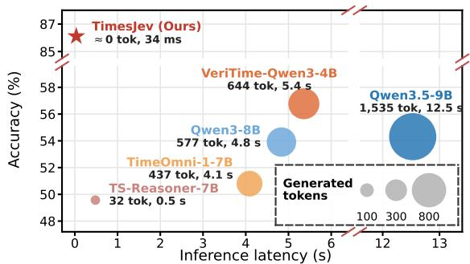  
Figure 1: Accuracy versus inference latency on time series tasks, with bubble size denoting generated tokens.

• We conduct experiments on TSQA (Kong et al., 2025a), covering 13 datasets across 4 tasks, showing that TimesJev outperforms existing time series reasoning methods. TimesJev achieves an average relative improvement of more than 69% in overall accuracy over reasoning models, while reducing latency by 62% on average compared with their supervised fine-tuned versions.

## 2 Related Works

Time Series Reasoning. Time series reasoning aims to identify and interpret temporal patterns in a series to solve tasks such as anomaly detection, classification, and question answering (Kong et al., 2025b,a). Current work follows three main directions to enhance the time series reasoning ability of LLMs (Chang et al., 2025). One line trains LLMs with reinforcement learning that rewards correct answers, typically after supervised fine-tuning (Guan et al., 2026; Zhou et al., 2025, 2026). Another line fine-tunes LLMs on step-by-step reasoning traces, such as structured reasoning annotations for anomaly diagnosis (Yang et al., 2026; Ye et al., 2026) or traces corrected by a critic model (Su et al., 2025). The third line employs LLMs as agents that interleave reasoning steps with time series analysis tools in a ReAct-style loop (Yao et al., 2022; Liu et al., 2025b), and some agents are further trained on expert tool-use trajectories (Wu et al., 2026).

Time Series Encoding. To enable LLMs to better process time series data, a line of work maps the series into the input space of the model. The most direct approach serializes the values as text, either as digit strings at a fixed precision (Gruver et al., 2023) or as discrete tokens added to the vocabulary after normalization (Wang et al., 2025). Another line learns patch embeddings and aligns them with the word embedding space, for example, through text prototypes or semantic anchors, while keeping most of the LLM parameters frozen (Zhou et al., 2023; Jin et al., 2024; Pan et al., 2024; Cao et al., 2024; Liu et al., 2024). Time-LLM also adds input statistics to the prompt as text (Jin et al., 2024). For reasoning, recent studies attach a time series encoder to the LLM, ranging from a lightweight network to a pretrained time series foundation model, and feed its outputs as tokens (Yu et al., 2025).

System 1 Models. Recent studies on LLM reasoning distinguish fast System 1 models, which produce the answer directly without intermediate tokens, from System 2 models, which generate intermediate tokens, such as a chain of thought, before the answer (Yu et al., 2024; Zhang et al., 2025). Reasoning models of the latter kind tend to overthink, generating redundant tokens even for simple questions (Chen et al., 2025). Meanwhile, chain-ofthought reasoning brings large gains on math and symbolic tasks, with much smaller gains on other tasks (Sprague et al., 2025). Even in such tasks, reasoning models can answer more accurately without thinking with the same output length (Ma et al., 2025). To leverage the strengths of System 1 models under limited test-time computation, prior work distills the outputs of System 2 methods into models that answer without intermediate steps (Yu et al., 2024), or lets models state the answer first and justification afterwards (Xuan et al., 2026). Moreover, LLMs can reason internally without writing out every step (Baherwani et al., 2026), suggesting that System 1 models can still perform well without explicit reasoning chains.

## 3 Problem Formulation

This paper studies the task of time series reasoning (Chow et al., 2024), which requires answering questions over time series data. Formally, given time series observations ${ \mathcal { X } } = ( x _ { 1 } , \ldots , x _ { n } )$ , where $x _ { t } \in \mathbb { R } ^ { d }$ , and a textual context C containing a question and candidate answers $\scriptstyle { \mathcal { A } } ( { \mathcal { C } } )$ , time series reasoning aims to predict the correct answer $\mathcal { V } \in \mathcal { A } ( \mathcal { C } )$ by identifying relevant temporal patterns and reasoning from them. We study this task with a language model $q _ { 0 }$ that predicts an answer in a single forward pass, without generating explicit intermediate reasoning steps:

$$
{ \hat { \mathcal { Y } } } = \operatorname * { a r g m a x } _ { \boldsymbol { y } \in { \mathcal { A } } ( { \mathcal { C } } ) } q _ { 0 } ( \boldsymbol { y } \mid { \mathcal { C } } , { \mathcal { X } } ) .\tag{1}
$$

## 4 TimesJev

In this section, we present TimesJev, which learns a sufficient representation of the time series for direct decision making by System 1 models, as shown in Figure 2. We first formalize System 1 sufficiency of time series representations (Section 4.1). Based on this, we learn to compress each series into a compact representation that approaches sufficiency (Section 4.2), and to encode this representation for realizability by the System 1 model (Section 4.3).

## 4.1 System 1 Sufficiency of Time Series Representations

System 1 models such as Jev (TypeSafe AI, 2026) directly return decisions in a single forward pass without generating explicit reasoning steps. However, applying this paradigm to time series reasoning requires identifying time series patterns from long and noisy numerical data, which can introduce errors in series pattern recognition (Liu et al., 2025a) and, even worse, lead to incorrect answers under such limited test-time computation. This motivates a compact time series representation that characterizes these patterns and is sufficient to answer the question. Given this, the model no longer needs to infer the patterns from the raw series. Moreover, the model should be able to use this representation effectively for direct decisions. We call a representation that satisfies both requirements System 1 sufficient, and formalize them below.

Definition 1 (System 1 Sufficiency). Let Ψ be a family of input encoders, each mapping the context $\mathcal { C }$ and a representation $\mathcal T = \phi ( \mathcal X )$ to an input of the System 1 model $q _ { 0 }$ . The representation $\tau$ is System 1 sufficient for the answer $\mathcal { V }$ given C if there exists $\psi \in \Psi$ such that

$$
p ( \mathcal { V } \mid \mathcal { C } , \mathcal { T } ) = p ( \mathcal { V } \mid \mathcal { C } , \mathcal { X } ) ,\tag{2}
$$

$$
q _ { 0 } \big ( \mathcal { V } \mid \psi ( \mathcal { C } , \mathcal { T } ) \big ) = p ( \mathcal { V } \mid \mathcal { C } , \mathcal { T } ) ,\tag{3}
$$

where $p$ denotes the underlying data distribution.

Below, we measure the violation of Eq. (2) and Eq. (3) by the KL divergence between the two sides of each, which we call the sufficiency divergence and the realizability divergence, respectively.

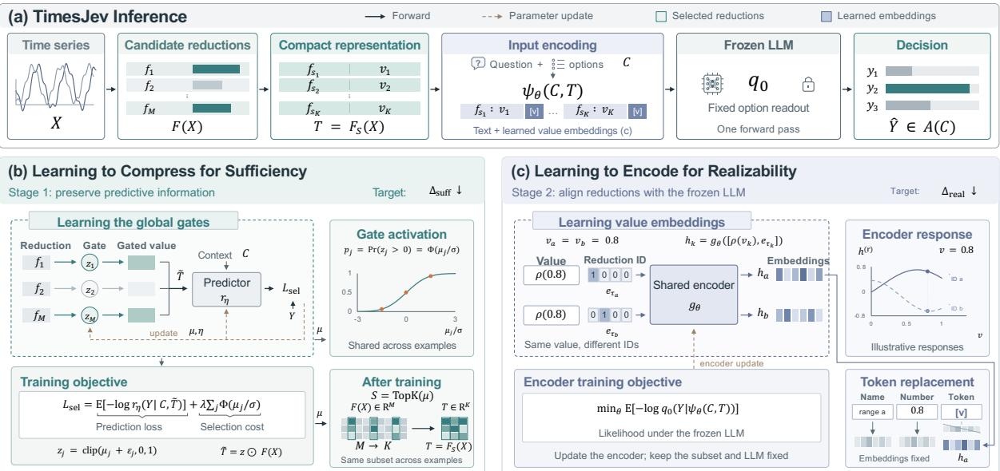  
Figure 2: Overview of TimesJev. (a) Inference with a System 1 model in one forward pass. (b) Compressing the time series through stochastic gates to reduce the sufficiency divergence. (c) Aligning the compact representation with the model through learned embeddings to reduce the realizability divergence.

Predictive Sufficiency under Compression. The requirement to preserve the time series information needed to answer the question can be formalized through sufficient dimension reduction (SDR) (Park et al., 2010). Classical SDR seeks a lower-dimensional linear projection of the observations that preserves the conditional distribution of the prediction target. Lee et al. (2013) generalize this formulation to nonlinear functions, providing a broader class of functions for constructing sufficient representations. In particular, such nonlinear functions can characterize temporal patterns in time series data, including variability, periodicity, and lagged dependence (Cheng et al., 2015).

Building on this, we formulate a dimension reduction problem to obtain a compact time series representation $\mathcal T = \phi ( \mathcal X )$ that satisfies the sufficiency condition in Eq. (2), i.e., preserves all information in X relevant to predicting the answer given C. However, under a finite representation, a compact representation may discard some of this information. To quantify the resulting loss, $H ( \mathcal { Y } \mid \mathcal { C } , \mathcal { X } )$ measures the uncertainty about the answer given the complete observations, whereas $H ( \mathcal { Y } \mid \mathcal { C } , \mathcal { T } )$ measures the uncertainty remaining after replacing X with T. For a deterministic representation $\tau .$ their difference defines the sufficiency divergence:

$$
\begin{array} { r l } & { \Delta _ { \mathrm { s u f f } } = H ( \mathcal { V } \mid \mathcal { C } , \mathcal { T } ) - H ( \mathcal { V } \mid \mathcal { C } , \mathcal { X } ) } \\ & { \qquad = \underset { \mathcal { C } , \mathcal { X } } { \mathbb { E } } \mathrm { K L } \big ( p ( \cdot \mid \mathcal { C } , \mathcal { X } ) \mid \mid p ( \cdot \mid \mathcal { C } , \mathcal { T } ) \big ) , } \end{array}\tag{4}
$$

where H denotes entropy and KL the Kullback– Leibler divergence; $\Delta _ { \mathrm { s u f f } }$ also equals the conditional mutual information $I ( \mathcal { X } ; \mathcal { Y } \mid \mathcal { C } , \mathcal { T } )$ The divergence is zero exactly when T satisfies Eq. (2). Minimizing this divergence under the representation budget therefore provides an objective for preserving the core information to answer question.

Realizability by System 1 Models. The previous divergence quantifies the predictive information lost in dimension reduction. However, preserving this information does not ensure that the LLM can use it effectively to predict the answer. To connect the representation to the LLM, each input encoder $\psi \in \Psi$ in Definition 1 maps the question context C and time series representation $\tau$ to a complete model input $s = \psi ( \mathcal { C } , \mathcal { T } )$ . The LLM, together with its fixed option readout, produces a prediction distribution $q _ { 0 } ( \cdot \mid s )$ over the candidate answers. For a given representation $\tau _ { \cdot }$ , the optimal expected log loss within this family is:

$$
R _ { \Psi } ^ { * } ( { \mathcal T } ) = \operatorname* { i n f } _ { \psi \in \Psi } \mathbb { E } [ - \log q _ { 0 } ( \mathcal { V } \mid \psi ( { \mathcal C } , { \mathcal T } ) ) ] .\tag{5}
$$

Given $( \mathcal { C } , \mathcal { T } )$ , an unrestricted predictor can attain the minimum expected log loss $H ( \mathcal { Y } \mid \mathcal { C } , \mathcal { T } )$ Model and interface constraints introduce a realizability divergence:

$$
\begin{array} { r l } & { \Delta _ { \mathrm { \tiny { r e a l } } } = R _ { \Psi } ^ { * } ( \mathcal { T } ) - H ( \mathcal { V } \mid \mathcal { C } , \mathcal { T } ) } \\ & { \qquad = \underset { \psi \in \Psi } { \operatorname* { i n f } } \ \underset { \mathcal { C } , \mathcal { T } } { \mathbb { E } } \operatorname { K L } \bigl ( p ( \cdot \mid \mathcal { C } , \mathcal { T } ) \mid \mid q _ { 0 } ( \cdot \mid s ) \bigr ) . } \end{array}\tag{6}
$$

This divergence measures the excess prediction loss that remains even with the best input encoder in Ψ. It is zero when Eq. (3) holds, i.e., when the posterior $p ( \mathcal { Y } \mid \mathcal { C } , \mathcal { T } )$ is realizable by the System 1 model, as in the realizable setting of learning theory (Shalev-Shwartz and Ben-David, 2014).

Together, sufficiency and realizability both affect predictive performance. Combining this with the sufficiency divergence in Eq. (4) gives:

$$
R _ { \Psi } ^ { * } ( { \mathcal T } ) - H ( { \mathcal V } \mid { \mathcal C } , { \mathcal X } ) = \Delta _ { \mathrm { s u f f } } + \Delta _ { \mathrm { r e a l } } .\tag{7}
$$

Hence, for a System 1 sufficient $\tau { _ { \mathrm { ~ \scriptsize ~ { ~ \tau ~ } ~ } } }$ , both divergences are zero, and the System 1 model attains $R _ { \Psi } ^ { * } ( \mathcal { T } ) = H ( \mathcal { V } \mid \mathcal { C } , \mathcal { X } )$ , the lowest expected log loss achievable from the complete observations. This decomposition motivates two complementary design objectives: constructing a compact time series representation that preserves relevant predictive information and encoding this representation for direct answer prediction by the LLM.

## 4.2 Learning to Compress for Sufficiency

The sufficiency divergence in Section 4.1 quantifies the predictive information lost in dimension reduction. To reduce this divergence, we need to choose a compact representation of the time series. Theoretically, nonlinear SDR permits this representation to be any nonlinear function of the observations (Lee et al., 2013), but the space of such functions is too large to search with limited supervision. Prior work on time series analysis provides a finite set of interpretable features that characterize time series patterns (Fulcher et al., 2013). However, most features in the full set are irrelevant to a given question, and including them as input lowers the performance of System 1 models (TypeSafe AI, 2026). TimesJev therefore compresses each series into a compact representation by selecting a small set of these features, with a surrogate objective for the sufficiency divergence (Barber and Agakov, 2003). To optimize this selection, we relax it into a differentiable problem with stochastic gates.

Constrained Objective. Each candidate feature is a scalar function of X and thus a onedimensional reduction in the sense of SDR (Cook, 2007). Let $F ( \mathcal { X } ) \in \mathbb { R } ^ { M }$ denote the library of M candidate features computed from $\mathcal { X } ,$ , and let $F _ { S } ( \mathcal { X } )$ denote the features indexed by a subset $S \subseteq \{ 1 , \dots , M \}$ , which form the compact representation $\tau { : = } F _ { S } ( \mathcal { X } )$ . Formally, we seek a subset of at most K features that best preserves the predictive information about the correct answer $\mathcal { V } ,$ , i.e., min $S { \subseteq } \{ 1 , . . . , M \} , | S | { \leq } K  { \Delta } _ { \operatorname { s u f f } } ( S )$

Since $p ( \mathcal { Y } \mid \mathcal { C } , \mathcal { X } )$ is unknown, $\Delta _ { \mathrm { s u f f } }$ cannot be computed directly. We instead use the crossentropy $\mathcal { L } ( S , \eta ) \ = \ \mathbb { E } [ - \log r _ { \eta } ( \mathcal { V } \mid \mathcal { C } , \mathcal { T } ) ]$ of a learned predictor $r _ { \eta }$ . For any $r _ { \eta } .$

$$
\begin{array} { r l } & { \mathcal { L } ( S , \eta ) = H ( \mathcal { Y } \mid \mathcal { C } , \mathcal { X } ) + \Delta _ { \mathrm { s u f f } } ( S ) } \\ & { \quad \quad + \underset { \mathcal { C } , \mathcal { T } } { \mathbb { E } } \mathrm { K L } ( p \parallel r _ { \eta } ) , } \end{array}\tag{8}
$$

where $p$ and $r _ { \eta }$ in the KL term are both conditioned on $( \mathcal { C } , \mathcal { T } )$ . The KL term is nonnegative, so $\mathcal { L } ( S , \eta ) - H ( \mathcal { Y } \mid \mathcal { C } , \mathcal { X } ) \ge \Delta _ { \operatorname { s u f f } } ( S )$ for every $r _ { \eta } ,$ and the difference between the two sides is exactly the KL term, which vanishes when $r _ { \eta }$ equals the true conditional $p ( \cdot \mid { \mathcal { C } } , { \mathcal { T } } )$ . Minimizing the crossentropy therefore minimizes a variational upper bound on the sufficiency divergence (Barber and Agakov, 2003), since $H ( \mathcal { Y } \mid \mathcal { C } , \mathcal { X } )$ is a constant independent of S and $\eta .$ This gives the surrogate objective $\begin{array} { r } { \operatorname* { m i n } _ { | S | \le K } \operatorname* { m i n } _ { \eta } \mathcal { L } ( S , \eta ) } \end{array}$ . Training $r _ { \eta }$ is standard, but choosing S is a discrete search over exponentially many subsets. The next paragraph relaxes this search into a differentiable problem using stochastic gates.

Learning with Stochastic Gates. To optimize the discrete subset $S ,$ we follow Yamada et al. (2020) and relax the binary inclusion indicator of each feature into a continuous random variable, called a stochastic gate (STG), which is trained jointly with the variational predictor $\boldsymbol { r } _ { \eta } .$ For the j-th feature, the stochastic gate is:

$$
z _ { j } = \mathrm { c l i p } ( \mu _ { j } + \epsilon _ { j } , 0 , 1 ) , \quad \epsilon _ { j } \sim \mathcal { N } ( 0 , \sigma ^ { 2 } ) ,\tag{9}
$$

where $\mu _ { j }$ is learnable and $\sigma$ is fixed. The gates $z =$ $( z _ { 1 } , \ldots , z _ { M } )$ are shared across examples, and the predictor receives the gated input $\widetilde { \mathcal { T } } = z \odot F ( \mathcal { X } )$ We then jointly optimize the gate parameters $\mu$ and the predictor parameters $\eta$ by minimizing the following objective:

$$
\mathcal { L } _ { \mathrm { s e l } } = \mathbb { E } \bigl [ - \log r _ { \eta } ( \mathcal { V } \mid \mathcal { C } , \widetilde { \mathcal { T } } ) \bigr ] + \lambda \sum _ { j = 1 } ^ { M } \Phi ( \mu _ { j } / \sigma ) ,\tag{10}
$$

where the expectation is over the data and gate noise, and Φ is the standard normal CDF. The first term is the cross-entropy $\mathcal { L } ( S , \eta )$ evaluated on the gated input. The second term relaxes the constraint $| S | \le K$ into a penalty on the expected number of retained features, where $\operatorname* { P r } ( z _ { j } > 0 ) = \Phi ( \mu _ { j } / \sigma )$

is the probability that the j-th feature is retained. The hyperparameter λ controls its strength. After training, we keep the K features with the largest $\mu _ { j } , \mathrm { i . e . , } S = \mathrm { T o p K } ( \mu )$ with $\boldsymbol { \mu } = ( \mu _ { 1 } , \dots , \mu _ { M } )$ set $\mathcal { T } = F _ { S } ( \mathcal { X } )$ , and pass T to the encoding stage.

## 4.3 Learning to Encode for Realizability

The representation selected in Section 4.2 lowers the sufficiency divergence, but the realizability divergence in Section 4.1 also affects performance. This divergence remains because the selected temporal features are numerical values that differ in scale and meaning, while System 1 models read these values as text tokens and are less reliable on numerical input (TypeSafe AI, 2026). TimesJev therefore lowers this divergence by learning an encoder that maps the compact representation into the input embedding space, as prior work on time series embedding for LLMs (Jin et al., 2024).

Feature Space Mapping. The selected features differ in both numerical scale and statistical meaning. Prior work uses feature-specific numerical embeddings to encode both values and feature identities (Gorishniy et al., 2022), and we build on this idea to implement such mappings through a shared encoder conditioned on feature identity. For the kth selected feature, $k = 1 , \ldots , K$ , let $v _ { k }$ denote its value; since the selected subset S is fixed, the position k identifies the feature. We transform $v _ { k }$ into a numerical representation $\rho ( v _ { k } ) \in \mathbb { R } ^ { 4 }$ containing its signed logarithmic magnitude, sign, scaled log magnitude, and bounded value. The feature identity is represented by a one-hot vector $e _ { k } \in \{ 0 , 1 \} ^ { K }$ A shared encoder gθ maps their concatenation into the backbone’s embedding space of dimension D:

$$
h _ { k } = g _ { \theta } ( [ \rho ( v _ { k } ) , e _ { k } ] ) \in \mathbb { R } ^ { D } .\tag{11}
$$

Conditioning on the identity $e _ { k }$ allows the encoder to produce different embeddings for the same numerical value associated with different features.

For each selected feature, we retain its name and numerical text and append a value token [v], whose embedding is replaced by $h _ { k }$ . These entries, together with the question context and candidate answers, form the complete input $\psi _ { \boldsymbol \theta } ( \mathcal { C } , \mathcal { T } )$ This mapping and input construction instantiate the encoder family Ψ in Definition 1, used to characterize the realizability divergence $\Delta _ { \mathrm { r e a l } }$ . With the selected set S and LLM $q _ { 0 }$ fixed, we train the encoder to approach the optimal expected log loss

$R _ { \Psi } ^ { * } ( \tau )$ by minimizing:

$$
\operatorname* { m i n } _ { \theta } \ \mathbb { E } [ - \log q _ { 0 } ( \mathcal { V } \mid \psi _ { \theta } ( \mathcal { C } , \mathcal { T } ) ) ] .\tag{12}
$$

At inference, the model receives this representation to replace the raw time series, and the compact representation serves as the numerical evidence.

## 5 Experiments

## 5.1 Experimental Setups

Benchmarks. We conduct experiments on TSQA (Kong et al., 2025a), a large-scale multitask benchmark for time series question answering, which comprises approximately 200,000 questionanswer pairs across 12 domains and 5 task types. Specifically, we focus on four tasks that require a decision over a fixed set of candidate answers, matching the setting of System 1 models: anomaly detection across four domains (Environment, AIOps, Healthcare, and Web), human activity classification, multiple-choice question answering (MCQA), and true/false question answering.

Models. We compare TimesJev with zero-shot and LoRA fine-tuned baselines across generalpurpose, time series reasoning, and Jev-family models: 1) general-purpose LLMs, including Qwen3.5-9B and Qwen3-8B (Yang et al., 2025), which answer with chain-of-thought reasoning; 2) time series reasoning models, including TimeOmni-1-7B (Guan et al., 2026), VeriTime-4B (Zhou et al., 2026), and TS-Reasoner-7B (Yu et al., 2025), as well as the Time-MQA models built on Qwen-2.5-7B, Mistral-7B, and Llama-3-8B (Kong et al., 2025a), which are released by the original authors after fine-tuning on TSQA; and 3) Jev-family models, including Decider-2B and Decider-4B (Marosi, 2026), the open-source System 1 models of the Jev family (Marosi, 2026), which produce a decision and serve as the backbones of TimesJev.

## 5.2 Main Results

Table 1 reports the accuracy of all methods on TSQA. In all three groups, zero-shot models achieve low accuracy, and LoRA fine-tuning improves their overall accuracy by 41% to 62% in relative terms. Among zero-shot models, the Jevfamily models perform best on average, and zeroshot Decider-4B reaches the overall accuracy of the best Time-MQA model, which is fine-tuned on TSQA. TimesJev improves the overall accuracy of zero-shot Decider-4B and Decider-2B by

<table><tr><td rowspan="2" colspan="2">Method</td><td colspan="3">Anomaly Detection</td><td colspan="2">Classification</td><td colspan="2">MCQA</td><td colspan="3">True/False QA</td><td rowspan="2">Overall</td></tr><tr><td colspan="3">Environment AIOps Healthcare</td><td colspan="2">Human Activity Healthcare Nature</td><td colspan="2"></td><td>Web Other Healthcare Nature</td><td></td><td>Web Other</td></tr><tr><td colspan="10">General-Purpose LLMs</td><td></td><td></td><td></td></tr><tr><td>Qwen3.5-9B</td><td>Zero-shot</td><td>49.60</td><td>63.00</td><td>44.80</td><td>58.20</td><td>22.80</td><td>61.96</td><td>77.50 83.61 55.81</td><td>71.68</td><td>74.59</td><td>80.95 79.31</td><td>54.31</td></tr><tr><td></td><td>LoRA SFT</td><td>79.20</td><td>98.00</td><td>99.20</td><td>91.80</td><td>76.80</td><td>71.74</td><td>86.67 86.8972.09</td><td>84.27</td><td>88.52</td><td>87.30 89.66</td><td>86.91</td></tr><tr><td>Qwen3-8B</td><td>Zero-shot</td><td>50.00</td><td>50.40</td><td>54.00</td><td>59.80</td><td>21.20</td><td>63.04</td><td>66.67 90.16 53.49</td><td></td><td>70.98 80.33</td><td>88.89 72.41</td><td>53.91</td></tr><tr><td></td><td>LoRA SFT</td><td>69.20</td><td>97.20</td><td>99.00</td><td>85.00</td><td>78.40</td><td>68.84</td><td>78.33 86.89 67.44</td><td></td><td>77.27 88.52</td><td>88.89 89.66</td><td>83.51</td></tr><tr><td></td><td>Qwen-2.5-7B</td><td>52.00</td><td>53.20</td><td>97.80</td><td>55.20</td><td>9.40</td><td>54.35</td><td>68.33 77.05 55.81</td><td></td><td>65.38 75.41</td><td>82.54 89.66</td><td>57.09</td></tr><tr><td>Time-MQA†</td><td>Mistral-7B</td><td>44.80</td><td>62.60</td><td>41.80</td><td>54.80</td><td>45.00</td><td>56.16</td><td>61.67 55.74 51.16</td><td></td><td>68.88 78.69</td><td>85.71 82.76</td><td>54.31</td></tr><tr><td>Llama-3-8B</td><td></td><td>58.80</td><td>84.00</td><td>64.00</td><td>54.80</td><td>38.20</td><td>56.88</td><td>64.17 77.05 58.14</td><td></td><td>66.78 76.23</td><td>74.60 89.66</td><td>61.77</td></tr><tr><td colspan="10">Time Series Reasoning Models</td><td></td><td></td><td></td></tr><tr><td>TimeOmni-1-7B</td><td>Zero-shot</td><td>54.00</td><td>58.80</td><td>50.00</td><td>64.60</td><td>19.40</td><td>54.71</td><td>58.33 68.85 51.16</td><td>50.00</td><td></td><td>52.46 55.56 58.62</td><td>50.80</td></tr><tr><td></td><td>LoRA SFT</td><td>73.60</td><td>97.80</td><td>99.40</td><td>69.40</td><td>77.40</td><td>70.29</td><td>77.50 93.44 74.42</td><td>78.67</td><td>88.52</td><td>88.89 86.21</td><td>82.23</td></tr><tr><td>TS-Reasoner-7B</td><td>Zero-shot</td><td>61.20</td><td>68.00</td><td>43.60</td><td>62.00</td><td>8.60</td><td>47.83</td><td>48.33 60.66 53.49</td><td></td><td>51.75 58.20</td><td>47.62 65.52</td><td>49.57</td></tr><tr><td></td><td>LoRA SFT</td><td>64.80</td><td>98.40</td><td>98.00</td><td>83.00</td><td>70.80</td><td>61.23</td><td>70.83</td><td>85.25 79.06</td><td>73.43 85.25</td><td>85.71 93.10</td><td>80.17</td></tr><tr><td>VeriTime-4B</td><td>Zero-shot</td><td>56.80</td><td>66.20</td><td>52.20</td><td>59.20</td><td>22.80</td><td>63.04</td><td>72.50</td><td>88.52 60.47</td><td>69.58 72.95</td><td>74.60 86.21</td><td>56.77</td></tr><tr><td></td><td>LoRA SFT</td><td>73.20</td><td>97.20</td><td>99.40</td><td>57.60</td><td>77.40</td><td>66.30</td><td>82.50</td><td>85.25 69.77</td><td>80.07 86.07</td><td>92.06 82.76</td><td>80.11</td></tr><tr><td colspan="10">Jev-Family Models</td><td></td><td></td><td></td></tr><tr><td>Decider-4B</td><td>Zero-shot</td><td>55.60</td><td>61.40</td><td>64.20</td><td>67.60</td><td>40.00</td><td>67.75</td><td>78.33 80.33 65.12</td><td></td><td>68.18 78.69</td><td>71.43 82.76</td><td>61.77</td></tr><tr><td></td><td>LoRA SFT</td><td>80.40</td><td>97.80</td><td>99.40</td><td>93.20</td><td>78.80</td><td>69.20</td><td>79.17 85.25 74.42</td><td>82.52</td><td>88.52</td><td>92.06 89.65</td><td>85.41</td></tr><tr><td>Decider-2B</td><td>Zero-shot</td><td>49.40</td><td>54.40</td><td>56.60</td><td>61.00</td><td>37.60</td><td>59.42</td><td>66.67 78.69 62.79</td><td></td><td>53.50 58.20</td><td>46.03 75.86</td><td>53.97</td></tr><tr><td></td><td>LoRA SFT</td><td>77.80</td><td>98.20</td><td>99.40</td><td>89.80</td><td>79.00</td><td>67.39</td><td>80.00 81.97 67.44</td><td></td><td>81.47 87.70</td><td>87.30 89.66</td><td>85.80</td></tr><tr><td>TimesJev (+ Decider-4B)</td><td></td><td>86.60</td><td>99.20</td><td>99.60</td><td>92.40</td><td>79.80</td><td>78.47</td><td>89.16 95.08 81.39</td><td></td><td>85.31 89.34</td><td>94.26 96.55</td><td>89.78</td></tr><tr><td>TimesJev (+ Decider-2B)</td><td></td><td>84.20</td><td>99.00</td><td>99.60</td><td>97.60</td><td>80.00</td><td>71.74</td><td>84.16 91.80 74.42</td><td></td><td>81.81 82.79</td><td>90.98 93.10</td><td>87.02</td></tr></table>

Table 1: Main results on TSQA in accuracy (%). LoRA SFT denotes LoRA fine-tuning on the TSQA training set. The best result is in bold and the second best is underlined. †Official checkpoints fine-tuned on TSQA.

<table><tr><td>Method</td><td></td><td>Tokens</td><td>TFLOPs</td><td>Latency (ms)</td><td>Overall (↑)</td></tr><tr><td colspan="6">General-Purpose LLMs</td></tr><tr><td>Qwen3.5-9B</td><td>Zero-shot</td><td>1535</td><td>35.97</td><td>12528</td><td>54.31</td></tr><tr><td></td><td>LoRA SFT</td><td>7</td><td>6.20</td><td>102</td><td>86.91</td></tr><tr><td rowspan="2">Qwen3-8B</td><td>Zero-shot</td><td>577</td><td>14.79</td><td>4835</td><td>53.91</td></tr><tr><td>LoRA SFT</td><td>7</td><td>5.22</td><td>103</td><td>83.51</td></tr><tr><td colspan="6">Time Series Reasoning Models</td></tr><tr><td>TimeOmni-1-7B</td><td>Zero-shot</td><td>437</td><td>11.59</td><td>4088</td><td>50.80</td></tr><tr><td></td><td>LoRA SFT</td><td>7</td><td>4.79</td><td>92.2</td><td>82.23</td></tr><tr><td>TS-Reasoner-7B</td><td>Zero-shot</td><td>32</td><td>3.29</td><td>481</td><td>49.57</td></tr><tr><td></td><td>LoRA SFT</td><td>6</td><td>2.43</td><td>112</td><td>80.17</td></tr><tr><td>VeriTime-4B</td><td>Zero-shot</td><td>644</td><td>7.75</td><td>5360</td><td>56.77</td></tr><tr><td></td><td>LoRA SFT</td><td>7</td><td>2.53</td><td>66.0</td><td>80.11</td></tr><tr><td>Time-MQA†</td><td>Qwen-2.5-7B</td><td>71</td><td>5.15</td><td>243</td><td>57.09</td></tr><tr><td></td><td>Mistral-7B</td><td>81</td><td>5.16</td><td>702</td><td>54.31</td></tr><tr><td></td><td>Llama-3-8B</td><td>101</td><td>5.15</td><td>862</td><td>61.77</td></tr><tr><td colspan="6">Jev-Family Models</td></tr><tr><td>Decider-4B</td><td>Zero-shot</td><td>≈0</td><td>2.44</td><td>21.5</td><td>61.77</td></tr><tr><td></td><td>LoRA SFT</td><td>≈0</td><td>2.44</td><td>23.0</td><td>85.41</td></tr><tr><td colspan="2">Ours (Decider-4B)</td><td>≈0</td><td>3.95</td><td>34.1</td><td>89.78</td></tr><tr><td rowspan="2">Decider-2B</td><td>Zero-shot</td><td>≈0</td><td>1.09</td><td>15.8</td><td>53.97</td></tr><tr><td>LoRA SFT</td><td>≈0</td><td>1.09</td><td>15.8</td><td>85.80</td></tr><tr><td colspan="2">Ours (Decider-2B)</td><td>≈0</td><td>1.76</td><td>19.9</td><td>87.02</td></tr></table>

Table 2: Test-time cost and accuracy on TSQA. ≈0 indicates that the answer is read from option probabilities without decoding. Overall is the accuracy (%) in Table 1. †Models fine-tuned on TSQA.

45.5% and 64.5% in relative terms, and both variants outperform all baselines in overall accuracy. Compared with the best zero-shot general-purpose LLM and time series reasoning model, which both generate reasoning steps before answering, Times-Jev with Decider-4B improves the overall accuracy by 65.4% and 58.3%. Across tasks, the largest gain appears on MCQA, where TimesJev improves on LoRA fine-tuning of Decider-4B by 12.6%. The gains on anomaly detection are smaller because all

LoRA fine-tuned models reach high accuracy in two of the four domains, which leaves less room for improvement. Compared with the zero-shot Decider, TimesJev improves the overall accuracy on both model sizes, from 61.77 to 89.78 on Decider-4B and from 53.97 to 87.02 on Decider-2B, showing consistency across backbone sizes.

## 5.3 Further Analysis

Test-Time Efficiency. Table 2 compares the inference cost of all methods. Most zero-shot reasoning models generate hundreds to thousands of tokens per question, and LoRA fine-tuning shortens their outputs to a few tokens. Jev-family models instead read the answer from option probabilities. Compared with zero-shot general-purpose LLMs and time series reasoning models that generate long reasoning chains, TimesJev reduces latency by more than 99%, a speedup of 120 to 630 times. TimesJev is also 7 to 43 times faster than the Time-MQA models and 2 to 6 times faster than the LoRA fine-tuned baselines. Both variants of TimesJev remain faster than all baselines outside the Jev family, and TimesJev with Decider-2B also requires the fewest TFLOPs among them.

Dependence on Feature Values. Figure 3 tests whether TimesJev uses the values in the compact representation. Shuffling all feature values across questions lowers the accuracy on anomaly detection and classification to about chance level, which shows that the decisions depend on the series information in the compact representation rather than on the question text. Permuting the most important feature causes large drops on three anomaly detection domains and lowers the accuracy on the sitting class by about three quarters, indicating that a few features carry most of the information for these decisions. On MCQA, shuffling all values lowers the accuracy in every domain, while permuting the top feature has a smaller effect. True/false QA changes little under both perturbations, suggesting that many of its questions can be answered from the question context.

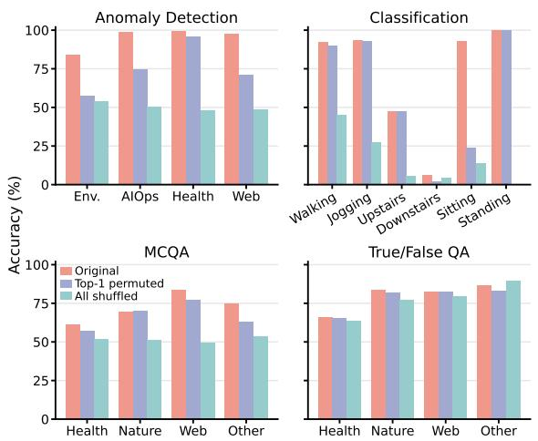  
Figure 3: Accuracy by domain when the feature values are kept, the most important one is permuted, or all are shuffled across questions.

Predictive Sufficiency of Compact Representations. Figure 4 visualizes the raw series and their compact representations on Web anomaly detection. In the t-SNE embeddings, the raw series form a single cloud in which normal and anomalous series are mixed, while the compact representations form several clusters. In the sufficient summary plots, we project each representation onto its first SIR direction, which is the linear projection most associated with the label. Normal and anomalous series overlap along this direction for the raw series but are largely separated for the compact representations. This result suggests that the compact representations keep the information needed to detect anomalies, consistent with predictive sufficiency. Since the SIR direction is linear, the label information in the compact representations is largely accessible through a single projection.

Error Analysis on Classification. Figure 5 compares the confusion matrices of Qwen3-8B and TimesJev on human activity classification. Qwen3-

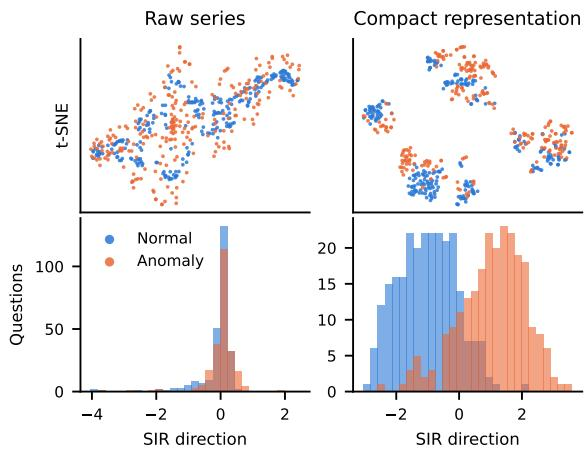  
Figure 4: Top: t-SNE embeddings of the raw series and their compact representations on Web anomaly detection. Bottom: sufficient summary plots along the first sliced inverse regression (SIR) direction (Li, 1991).

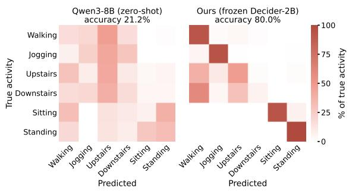  
Figure 5: Confusion matrices on classification for Qwen3-8B and TimesJev. Each row shows the share of a true activity assigned to each predicted activity.

8B assigns a large share of each moving activity to upstairs and spreads sitting and standing over several classes, so its accuracy stays close to chance. TimesJev reaches nearly four times its accuracy, with most predictions on the diagonal for walking, jogging and standing. The recognition of sitting relies on the median acceleration along the Z axis: permuting this feature across questions lowers the accuracy on sitting from 93.1% to 24.1%, while the accuracy on each other activity changes by at most 4.3%. Its remaining errors come from the stair activities, likely because they share similar periodic movement with walking.

## 6 Conclusion

In this paper, we introduce TimesJev, a time series System 1 model. It answers each question in a single forward pass. By formalizing System 1 sufficiency and decomposing the additional prediction loss of a compressed representation into a sufficiency divergence and a realizability divergence, TimesJev enables both the selection of time series features with stochastic gates and their alignment with the input embedding space of the model. Since the System 1 model stays frozen during training, TimesJev can be added to an existing System 1 model without changing its parameters or its option readout. Extensive experiments on multiple tasks and two System 1 backbones demonstrate improvements in overall accuracy over existing time series reasoning models with substantially lower test-time latency. Our results further highlight the importance of learning System 1 sufficient representations for efficient time series reasoning without long chains of thought.

## Limitations

While TimesJev demonstrates consistent improvements across multiple tasks and System 1 backbones, several limitations remain for future work. First, our formulation of System 1 sufficiency focuses on tasks that require a decision over a fixed set of candidate answers. Although this setting captures a common form of time series reasoning and matches the decision setting of System 1 models, extending the framework to tasks with free-form outputs such as forecasting, imputation, or openended question answering remains an important direction. Second, TimesJev selects time series features from a fixed library, and the stochastic gates are shared across all inputs. While the selected features are effective across the evaluated tasks and backbones, learning new features and incorporating instance-adaptive mechanisms that select features for each question may further improve flexibility. Third, TimesJev answers in a single forward pass without explicit reasoning steps, which keeps testtime cost low, and the selected features provide interpretable evidence for each decision. Generating explanations alongside these decisions for applications that require them, such as healthcare, remains an interesting direction for future investigation.

## References

Vatsal Baherwani, Tom Goldstein, and Ashwinee Panda. 2026. Not all llm reasoning is visible in the chain-ofthought. arXiv preprint arXiv:2607.22925.

David Barber and Felix Agakov. 2003. Information maximization in noisy channels: A variational approach. Advances in Neural Information Processing Systems, 16.

Defu Cao, Furong Jia, Sercan Arik, Tomas Pfister, Yixiang Zheng, Wen Ye, and Yan Liu. 2024. Tempo: Prompt-based generative pre-trained transformer for time series forecasting. In International Conference on Learning Representations, volume 2024, pages 18546–18578.

Ching Chang, Yidan Shi, Defu Cao, Wei Yang, Jeehyun Hwang, Haixin Wang, Jiacheng Pang, Wei Wang, Yan Liu, Wen-Chih Peng, and 1 others. 2025. A survey of reasoning and agentic systems in time series with large language models. arXiv preprint arXiv:2509.11575.

Xingyu Chen, Jiahao Xu, Tian Liang, Zhiwei He, Jianhui Pang, Dian Yu, Linfeng Song, Qiuzhi Liu, Mengfei Zhou, Zhuosheng Zhang, and 1 others. 2025. Do not think that much for 2+ 3=? on the overthinking of long reasoning models. In Forty-second International Conference on Machine Learning.

Changqing Cheng, Akkarapol Sa-Ngasoongsong, Omer Beyca, Trung Le, Hui Yang, Zhenyu Kong, and Satish TS Bukkapatnam. 2015. Time series forecasting for nonlinear and non-stationary processes: a review and comparative study. Iie Transactions, 47(10):1053–1071.

Mingyue Cheng, Jiahao Wang, Daoyu Wang, Xiaoyu Tao, Qi Liu, and Enhong Chen. 2026. Can slowthinking llms reason over time? empirical studies in time series forecasting. In Proceedings of the Nineteenth ACM International Conference on Web Search and Data Mining, pages 99–110.

Winnie Chow, Lauren Gardiner, Haraldur Tómas Hallgrímsson, Maxwell A. Xu, and Shirley You Ren. 2024. Towards time series reasoning with llms. CoRR, abs/2409.11376.

R Dennis Cook. 2007. Fisher lecture: Dimension reduction in regression.

Wei Fan, Pengyang Wang, Dongkun Wang, Dongjie Wang, Yuanchun Zhou, and Yanjie Fu. 2023. Dishts: a general paradigm for alleviating distribution shift in time series forecasting. In Proceedings ofthe AAAI conference on artificial intelligence, volume 37, pages 7522–7529.

Wei Fan, Shun Zheng, Xiaohan Yi, Wei Cao, Yanjie Fu, Jiang Bian, and Tie-Yan Liu. 2022. Depts: Deep expansion learning for periodic time series forecasting. arXiv preprint arXiv:2203.07681.

Ben D Fulcher, Max A Little, and Nick S Jones. 2013. Highly comparative time-series analysis: the empirical structure of time series and their methods. Journal of the Royal Society Interface, 10(83):20130048.

Yury Gorishniy, Ivan Rubachev, and Artem Babenko. 2022. On embeddings for numerical features in tabular deep learning. Advances in Neural Information Processing Systems, 35:24991–25004.

Nate Gruver, Marc Finzi, Shikai Qiu, and Andrew G Wilson. 2023. Large language models are zero-shot time series forecasters. Advances in neural information processing systems, 36:19622–19635.

Tong Guan, Zijie Meng, Dianqi Li, Shiyu Wang, Chao-Han Huck Yang, Qingsong Wen, Zuozhu Liu, Sabato Siniscalchi, Ming Jin, and Shirui Pan. 2026. Timeomni-1: Incentivizing complex reasoning with time series in large language models. In International Conference on Learning Representations, volume 2026, pages 152139–152170.

Ming Jin, Shiyu Wang, Lintao Ma, Zhixuan Chu, James Zhang, Xiaoming Shi, Pin-Yu Chen, Yuxuan Liang, Yuan-Fang Li, Shirui Pan, and 1 others. 2024. Timellm: Time series forecasting by reprogramming large language models. In International conference on learning representations, volume 2024, pages 23857– 23880.

Ian T Jolliffe and Jorge Cadima. 2016. Principal component analysis: a review and recent developments. Philosophical transactions. Series A, Mathematical, physical, and engineering sciences, 374(2065):20150202.

Yaxuan Kong, Yiyuan Yang, Yoontae Hwang, Wenjie Du, Stefan Zohren, Zhangyang Wang, Ming Jin, and Qingsong Wen. 2025a. Time-mqa: Time series multitask question answering with context enhancement. In Proceedings of the 63rd Annual Meeting of the Association for Computational Linguistics (Volume 1: Long Papers), pages 29736–29753.

Yaxuan Kong, Yiyuan Yang, Shiyu Wang, Chenghao Liu, Yuxuan Liang, Ming Jin, Stefan Zohren, Dan Pei, Yan Liu, and Qingsong Wen. 2025b. Achieving time series reasoning requires rethinking model design, tasks formulation, and evaluation. arXiv preprint arXiv:2502.01477.

Kuang-Yao Lee, Bing Li, and Francesca Chiaromonte. 2013. A general theory for nonlinear sufficient dimension reduction: Formulation and estimation. The Annals of Statistics, pages 221–249.

Ker-Chau Li. 1991. Sliced inverse regression for dimension reduction. Journal of the American Statistical Association, 86(414):316–327.

Chenxi Liu, Shaowen Zhou, Qianxiong Xu, Hao Miao, Cheng Long, Ziyue Li, and Rui Zhao. 2025a. Towards cross-modality modeling for time series analytics: A survey in the llm era. arXiv preprint arXiv:2505.02583.

Penghang Liu, Elizabeth Fons, Annita Vapsi, Mohsen Ghassemi, Svitlana Vyetrenko, Daniel Borrajo, Vamsi K Potluru, and Manuela Veloso. 2025b. Tsagent: Understanding and reasoning over raw time series via iterative insight gathering. arXiv preprint arXiv:2510.07432.

Shikang Liu, Xiren Zhou, and Huanhuan Chen. 2025c. Multiscale temporal dynamic learning for time series

classification. IEEE Transactions on Knowledge and Data Engineering, 37(6):3543–3555.

Yong Liu, Guo Qin, Xiangdong Huang, Jianmin Wang, and Mingsheng Long. 2024. Autotimes: Autoregressive time series forecasters via large language models. Advances in Neural Information Processing Systems, 37:122154–122184.

Carl H Lubba, Sarab S Sethi, Philip Knaute, Simon R Schultz, Ben D Fulcher, and Nick S Jones. 2019. catch22: Canonical time-series characteristics: Ch lubba et al. Data mining and knowledge discovery, 33(6):1821–1852.

Wenjie Ma, Jingxuan He, Charlie Snell, Tyler Griggs, Sewon Min, and Matei Zaharia. 2025. Reasoning models can be effective without thinking. arXiv preprint arXiv:2504.09858.

Mark Marosi. 2026. decider: one-pass typed decisions with calibrated probabilities.

Mike A Merrill, Mingtian Tan, Vinayak Gupta, Thomas Hartvigsen, and Tim Althoff. 2024. Language models still struggle to zero-shot reason about time series. In Findings of the Association for Computational Linguistics: EMNLP 2024, pages 3512–3533.

Shahriar Noroozizadeh, Sayantan Kumar, and Jeremy C Weiss. 2026. Forecasting clinical risk from textual time series: structuring narratives for temporal ai in healthcare. In Proceedings of the AAAI Conference on Artificial Intelligence, volume 40, pages 39080– 39088.

Zijie Pan, Yushan Jiang, Sahil Garg, Anderson Schneider, Yuriy Nevmyvaka, and Dongjin Song. 2024. S2IP-LLM: Semantic space informed prompt learning with llm for time series forecasting. In Forty-first International Conference on Machine Learning.

Jin-Hong Park, TN Sriram, and Xiangrong Yin. 2010. Dimension reduction in time series. Statistica Sinica, pages 747–770.

Hanchuan Peng, Fuhui Long, and Chris Ding. 2005. Feature selection based on mutual information criteria of max-dependency, max-relevance, and minredundancy. IEEE Transactions on pattern analysis and machine intelligence, 27(8):1226–1238.

Xiangfei Qiu, Xingjian Wu, Hanyin Cheng, Xvyuan Liu, Chenjuan Guo, Jilin Hu, and Bin Yang. 2026. Dbloss: Decomposition-based loss function for time series forecasting. Advances in Neural Information Processing Systems, 38:27741–27768.

Sudarshan Regmi, Arvind Pillai, Yu Yvonne Wu, Yuliang Chen, Bibek Panthi, Tess Z Griffin, Michael V Heinz, Lisa Marsch, Nicholas C Jacobson, and Andrew Campbell. 2026. Timethink: Eliciting compositional reasoning in timeseries large language models. arXiv preprint arXiv:2609.13457.

Shai Shalev-Shwartz and Shai Ben-David. 2014. Understanding machine learning: From theory to algorithms. Cambridge university press.

Charlie Snell, Jaehoon Lee, Kelvin Xu, and Aviral Kumar. 2025. Scaling llm test-time compute optimally can be more effective than scaling parameters for reasoning. In International Conference on Learning Representations, volume 2025, pages 10131–10165.

Zayne Sprague, Fangcong Yin, Juan Rodriguez, Dongwei Jiang, Manya Wadhwa, Prasann Singhal, Xinyu Zhao, Xi Ye, Kyle Mahowald, and Greg Durrett. 2025. To cot or not to cot? chain-of-thought helps mainly on math and symbolic reasoning. In International Conference on Learning Representations, volume 2025, pages 94118–94162.

Chen Su, Yuanhe Tian, and Yan Song. 2025. Chain-ofthought reviewing and correction for time series question answering. arXiv preprint arXiv:2512.22627.

TypeSafe AI. 2026. Typesafe API. Version 0.2.0. Accessed: September 24, 2026.

Chengsen Wang, Qi Qi, Jingyu Wang, Haifeng Sun, Zirui Zhuang, Jinming Wu, Lei Zhang, and Jianxin Liao. 2025. Chattime: A unified multimodal time series foundation model bridging numerical and textual data. In Proceedings ofthe AAAI Conference on Artificial Intelligence, volume 39, pages 12694–12702.

Xingjian Wu, Junkai Lu, Zhengyu Li, Xiangfei Qiu, Jilin Hu, Chenjuan Guo, Christian S Jensen, and Bin Yang. 2026. Timeart: Towards agentic time series reasoning via tool-augmentation. arXiv preprint arXiv:2601.13653.

Richmond Sin Jing Xuan, Rishabh Bhardwaj, and Soujanya Poria. 2026. Post reasoning: Improving the performance of non-thinking models at no cost. arXiv preprint arXiv:2605.06165.

Yutaro Yamada, Ofir Lindenbaum, Sahand Negahban, and Yuval Kluger. 2020. Feature selection using stochastic gates. In International conference on ma chine learning, pages 10648–10659. PMLR.

An Yang, Anfeng Li, Baosong Yang, Beichen Zhang, Binyuan Hui, Bo Zheng, Bowen Yu, Chang Gao, Chengen Huang, Chenxu Lv, and 1 others. 2025. Qwen3 technical report. arXiv preprint arXiv:2505.09388.

Yiyuan Yang, Zichuan Liu, Lei Song, Kai Ying, Stephen Wang, Joshua Thomas Bamford, Svitlana Vyetrenko, Jiang Bian, and Qingsong Wen. 2026. Time-ra: Towards time series reasoning for anomaly diagnosis with llm feedback. In Findings of the Association for Computational Linguistics: ACL 2026, pages 11591– 11616.

Shunyu Yao, Jeffrey Zhao, Dian Yu, Nan Du, Izhak Shafran, Karthik Narasimhan, and Yuan Cao. 2022. React: Synergizing reasoning and acting in language models. arXiv preprint arXiv:2210.03629.

Hangting Ye, Jinhan Liu, Yong Yao, Jinmeng Li, Peng Wang, Yang Cao, He Zhao, Dandan Guo, Yi Chang, and Hongyuan Zha. 2026. A comprehensive survey of tabular anomaly detection. Preprints.

Wen Ye, Jinbo Liu, Defu Cao, Wei Yang, and Yan Liu. 2025. When llm meets time series: Can llms perform multi-step time series reasoning and inference. arXiv preprint arXiv:2509.01822.

Fangxu Yu, Hongyu Zhao, and Tianyi Zhou. 2025. Ts-reasoner: Aligning time series foundation models with llm reasoning. arXiv preprint arXiv:2510.03519.

Ping Yu, Jing Xu, Jason Weston, and Ilia Kulikov. 2024. Distilling system 2 into system 1. arXiv preprint arXiv:2407.06023.

Duzhen Zhang, Zhong-Zhi Li, Ming-Liang Zhang, Jiaxin Zhang, Zengyan Liu, Yuxuan Yao, Haotian Xu, Junhao Zheng, Xiuyi Chen, Yingying Zhang, and 1 others. 2025. From system 1 to system 2: A survey of reasoning large language models. IEEE Transactions on Pattern Analysis and Machine Intelligence.

Jiahui Zhou, Dan Li, Boxin Li, Xiao Zhang, Erli Meng, Lin Li, Zhuomin Chen, Jian Lou, and See-Kiong Ng. 2026. Time series reasoning via process-verifiable thinking data synthesis and scheduling for tailored llm reasoning. arXiv preprint arXiv:2602.07830.

Suifang Zhou and Ray Lc. 2025. Eternagram: Inspiring climate action through llm-based conversational exploration of a post-devastation climate future. In Proceedings ofthe 7th ACM Conference on Conversational User Interfaces, pages 1–7.

Tian Zhou, Peisong Niu, Xue Wang, Liang Sun, and Rong Jin. 2023. One fits all: power general time series analysis by pretrained lm. In Proceedings ofthe 37th International Conference on Neural Information Processing Systems, NIPS ’23, Red Hook, NY, USA. Curran Associates Inc.

Yitong Zhou, Yucong Luo, Mingyue Cheng, Qi Liu, Jiahao Wang, Daoyu Wang, and Enhong Chen. 2025. Time series forecasting as reasoning: A slow-thinking approach with reinforced llms. arXiv preprint arXiv:2506.10630.

Zihao Zhou and Rose Yu. 2025. Can llms understand time series anomalies? In International Conference on Learning Representations, volume 2025, pages 1858–1896.

Algorithm 1 Training and inference of TimesJev   
Input: Training set $\mathcal { D } = \{ ( X , C , Y ) \}$ , feature library $F ,$   
frozen System 1 model q0, budget K, hyperparameters   
$\lambda , \sigma$   
Output: Selected subset S, encoder g   
Stage 1: Learning with stochastic gates   
1: Initialize gate parameters $\boldsymbol { \mu } \in \mathbb { R } ^ { M }$ and predictor $r _ { \eta }$   
2: repeat   
3: Sample a mini-batch $B \subset D$   
4: Sample $\epsilon \sim \mathcal { N } ( 0 , \sigma ^ { 2 } I _ { M } )$ and set $z \gets \mathrm { c l i p } ( \mu +$   
$\epsilon , 0 , 1 )$   
5: $\widetilde { T }  z \odot F ( X )$ for each $( X , C , Y ) \in B$   
6: Update µ and η by minimizing Eq. (10) on B   
7: until convergence   
8: $S \gets \mathrm { T o p K } \overline { { ( \mu ) } }$   
Stage 2: Aligning the compact representation with the   
model   
9: Initialize encoder gθ   
10: repeat   
11: Sample a mini-batch $B \subset D$   
12: for each $( X , C , Y ) \in B$ do   
13: $T \gets \dot { F } _ { S } ( X )$ with values $\{ v _ { k } \}$ and identities   
{τk}   
14: $h _ { k } \gets g _ { \theta } ( [ \rho ( v _ { k } ) , e _ { \tau _ { k } } ] )$ for $k = 1 , \ldots , K$   
15: Build $\psi _ { \boldsymbol { \theta } } ( C , T )$ , replacing each [v] embedding   
with hk   
16: end for   
17: Update θ by minimizing Eq. (12) on B with q frozen   
18: until convergence   
Inference   
19: Given a test question $( X , C )$ , build $\psi _ { \theta } ( C , F _ { S } ( X ) )$   
20: $\hat { Y } \gets$ arg ma $\mathrm { x } _ { y }$ q0y | ψθ(C, FS(X)) in a single for  
ward pass

## A TimesJev Algorithm

Algorithm 1 summarizes the training and inference of TimesJev. Training consists of two stages, which reduce the two divergences in Section 4.1 in turn. The first stage trains the stochastic gates jointly with the predictor $r _ { \eta }$ and keeps the K features with the largest $\mu _ { j }$ , which reduces the sufficiency divergence. The second stage fixes the selected subset S and trains the encoder gθ to map each selected feature into the input embedding space of the model, which reduces the realizability divergence. Throughout training, only the gates, the predictor and the encoder are updated, while the System 1 model stays frozen. At inference, TimesJev computes the compact representation of the test series, builds the model input, and reads the answer from the option probabilities of the model in a single forward pass.

## B Extended Results

## B.1 Training Details

Table 3 summarizes the datasets used in our experiments, all of which come from TSQA (Kong et al., 2025a). Anomaly detection covers four domains with two options, human activity classification has six classes, and MCQA and true/false QA mix questions from five domains. The feature library contains 69 features for all datasets except HAR, which uses 240. We train TimesJev on a single NVIDIA RTX 5090 GPU.

<table><tr><td>Task</td><td>Dataset Opt. Len.</td></tr><tr><td>Anomaly Detection 4 domains 2</td><td>M Train Test 8-64 69 13,787 7,000 87.8</td></tr><tr><td>Classification</td><td>HAR 6 302 240</td></tr><tr><td>4,000 2,000 28.7</td><td></td></tr><tr><td>MCQA Mixed True/False QA Mixed</td><td> $2 { \ - } 4 \ 4 { \ - } 4 8$  69 4,000 2,00013.1  $2 4 - 4 8 6 9$  3,703 2,00010.5</td></tr></table>

Table 3: Datasets and training statistics. All datasets come from TSQA; Mixed covers its five domains. Anomaly detection trains one model per domain, so its counts and time are summed over the four domains. Opt. is the number of options. Len. is the number of values in a question’s series. M is the size of the feature library. Time is the training time in minutes.

Setting Value   
Backbone Decider-2B, frozen   
Trainable module Value-token MLP (0.54M)   
Features $K = 3 2 ,$ stochastic gates   
Gates $\sigma = 0 . 5 , \lambda \in \{ 0 . 0 0 3 , 0 . 0 1 , 0 . 0 3 , 0 . 1 \}$   
Optimizer AdamW, lr $1 0 ^ { - 3 } ,$ , weight decay 0   
Schedule 5% warm-up, cosine decay, 3 epochs   
Batch size Up to 16,384 tokens   
Seed 42  
Table 4: Training settings, shared by all datasets.

Table 4 lists the training settings, which are shared by all datasets. The alignment stage trains only the value-token MLP with 0.54M parameters. We keep K = 32 features, fix the gate noise scale at σ = 0.5, and select λ from {0.003, 0.01, 0.03, 0.1} on held-out training data. Training uses AdamW for three epochs with a learning rate of $1 0 ^ { - 3 }$ , and TimesJev is trained once with seed 42.

Sufficiency–Realizability Trade-off. Figure 6 shows the accuracy of TimesJev as the dimension K of the compact representation increases. On all tasks, accuracy rises with K, peaks between 16 and 32, and falls as more features are added. A small K loses information needed to answer the question, and MCQA is affected most, with accuracy at the smallest K about one quarter below its peak. A large K adds content unrelated to the question, and using the full library lowers MCQA by about one fifth and classification by about one tenth relative to their peaks. This trend is consistent with the two divergences in Section 4.1, since a larger K reduces the sufficiency divergence but increases the realizability divergence.

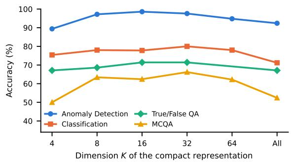  
Figure 6: Accuracy of TimesJev with the Decider-2B versus the number of selected features K.

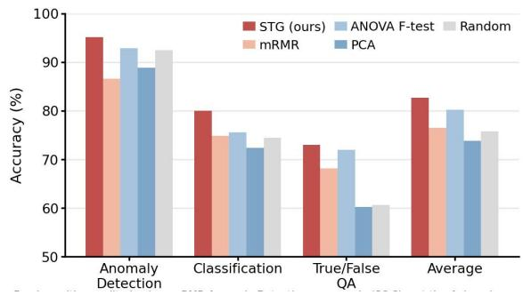  
Figure 7: Comparison of stochastic gates with other dimension reduction methods.

Effectiveness of Stochastic Gates. Figure 7 compares stochastic gates with other dimension reduction methods. STG achieves the highest accuracy on all three tasks and on average. The gains are largest on true/false QA, where STG improves over PCA and random selection by about 21% and 20% in relative terms. Filter methods such as mRMR and the ANOVA F-test score each feature by its statistical dependence on the label, independently of the model. In contrast, STG is trained jointly with the predictor to minimize the answer prediction loss, and therefore retains the features most predictive of the answer given the question. PCA performs worst on average, likely because its components mix the features and discard their identities, on which the encoder conditions. Descriptions of these methods can be found in Appendix C.

Composition of Compact Representations. Figure 8 shows the library families of the features selected by stochastic gates. The composition differs across tasks, indicating that the gates adapt the representation to each task. Anomaly detection draws on the Temporal family most often, while classification relies most on the Distribution family and also selects cross-channel features, since its HAR series contain multiple sensor channels. MCQA and true/false QA mix questions from five domains, and catch24 (Lubba et al., 2019) features make up more than two fifths of the selection for MCQA. Shape summaries account for the smallest share among the families shared by all tasks.

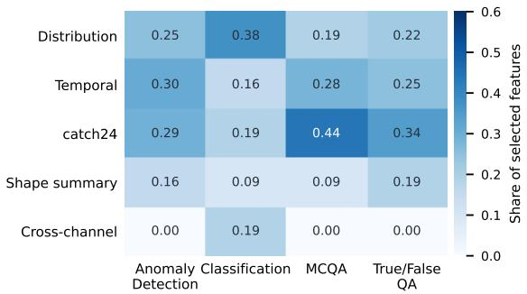  
Figure 8: Share of the features selected by stochastic gates that come from each family of the library.

Ablation Study. Table 5 reports the ablation results with the Decider-2B. In the compression group, removing STG selection lowers accuracy by 26.7% on MCQA and 30.5% on true/false QA in relative terms, and removing the subset constraint lowers MCQA by 34.9%. Replacing the compressed representation with raw observations also lowers accuracy on all four tasks, indicating that a compact representation helps the System 1 model. In the embedding group, removing value tokens causes the largest drops, ranging from 37.4% to 56.0% across tasks, highlighting the limitations of relying on numerical text alone. Adding the raw series to the input does not improve any task and lowers MCQA by 19.3%.

Feature Importance. Figure 9 shows the two features whose permutation across questions lowers the accuracy most. On each anomaly detection domain, a single feature dominates: permuting the range on Environment, the standard deviation on AIOps, or the largest absolute step on Web lowers the accuracy by 24.6 to 26.4 points, while the second feature lowers it by at most 6.2 points. On classification, the drops are smaller, at most 5.4 points for the median of the Z axis, suggesting that the decision relies on more features. Since these features have explicit meanings, the decisions on anomaly detection can be attributed to a few named properties of the series.

<table><tr><td rowspan="2">Variant</td><td colspan="3">Anomaly Detection</td><td rowspan="2">Classification</td><td colspan="3"></td><td colspan="3">True/False QA</td><td rowspan="2">Overall</td></tr><tr><td>Environment AIOps Healthcare Web Human Activity Healthcare Nature Web Other Healthcare Nature Web Other</td><td></td><td></td><td></td><td></td><td>MCQA</td><td></td><td></td><td></td></tr><tr><td>Ours (Full)</td><td>84.20</td><td>99.00</td><td>99.60</td><td>97.60</td><td>80.00</td><td>71.74</td><td>84.16 91.80 74.42</td><td></td><td>81.81</td><td>82.79 90.98 93.10</td><td>87.02</td></tr><tr><td></td><td></td><td></td><td></td><td></td><td></td><td>Compression</td><td></td><td></td><td></td><td></td><td></td></tr><tr><td>w/o STG selection</td><td>82.00</td><td>98.60</td><td>94.60</td><td>87.40</td><td>74.40</td><td>57.97</td><td>55.83 73.77 53.49</td><td></td><td>61.89</td><td>57.38 61.90 58.62</td><td>70.60</td></tr><tr><td>w/o subset constraint</td><td>82.20</td><td>98.80</td><td>96.60</td><td>92.40</td><td>71.20</td><td>50.00</td><td>50.0062.30 60.47</td><td></td><td>67.13</td><td>82.25 90.48 79.31</td><td>75.63</td></tr><tr><td>w/o compression</td><td>73.60</td><td>98.60</td><td>99.40</td><td>78.80</td><td>71.80</td><td>57.97</td><td></td><td>65.83 85.25 72.09</td><td>72.03</td><td>80.70 88.89 89.66</td><td>79.59</td></tr><tr><td colspan="10">Embedding</td><td></td></tr><tr><td>w/o value tokens</td><td>50.20</td><td>51.20</td><td>57.20</td><td>47.40</td><td>35.20</td><td>48.91</td><td></td><td>41.67 31.15 41.86</td><td>51.05</td><td>59.84 57.14 62.07</td><td>48.84</td></tr><tr><td>w/o feature identity</td><td>84.00</td><td>98.20</td><td>92.30</td><td>91.60</td><td>78.40</td><td>59.06</td><td>66.6781.97 58.14</td><td></td><td>69.93</td><td>81.97 88.89 90.55</td><td>80.13</td></tr><tr><td>+ raw series</td><td>80.40</td><td>98.00</td><td>94.20</td><td>92.40</td><td>78.00</td><td>59.42</td><td></td><td>70.0083.61 60.47</td><td>68.88</td><td>81.15 88.89 82.76</td><td>85.51</td></tr></table>

Table 5: Ablation study of TimesJev with Decider-2B on TSQA in accuracy (%). Bold denotes the best results.

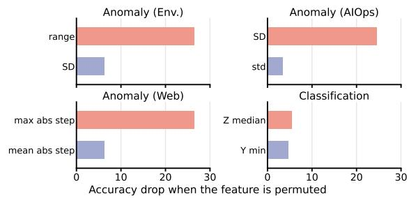  
Figure 9: Accuracy drop when each of the top two features is permuted across questions.

## C Dimension Reduction Baselines

Figure 7 compares stochastic gates with four dimension reduction methods. Each method constructs a K-dimensional representation from the same library $F ( X ) \in \mathbb { R } ^ { M }$ , and the rest of TimesJev, including the input encoder and the frozen model, is kept unchanged. All methods use the budget K = 32 of the main experiments and are fitted on the same training questions as the stochastic gates.

mRMR. Minimum redundancy maximum relevance (Peng et al., 2005) selects reductions greedily. At each step, it adds the reduction $j \not \in S$ that maximizes

$$
I { \big ( } F _ { j } ( X ) ; Y { \big ) } { \Big ( } 1 - { \frac { 1 } { | S | } } \sum _ { i \in S } { \big | } \rho { \big ( } F _ { j } ( X ) , F _ { i } ( X ) { \big ) } { \big | } { \Big ) } ,\tag{13}
$$

where the first factor measures the relevance to the label, the second factor penalizes the redundancy with the reductions already selected, and $\rho$ denotes the Spearman correlation.

ANOVA F-test. For each reduction, the ANOVA F-test computes the ratio of the variance between label classes to the variance within classes, and keeps the K reductions with the largest F-statistics. Each reduction is scored independently of the others.

PCA. Principal component analysis (Jolliffe and Cadima, 2016) applies the signed logarithm $\mathrm { s i g n } ( x ) \log ( 1 + | x | )$ to the library, standardizes it on the training set, and projects it onto the top $K$ principal components. Unlike the other methods, each component is a linear combination of all reductions rather than a single reduction. The encoder treats the k-th component as the k-th reduction: its score is the value, its index $k ,$ ordered by explained variance, is the identity, and it is named principal component k in the text.

Random. Random selection draws K reductions uniformly from the library and uses the same subset for all examples. We use a single draw with a fixed seed and, as for every method in this comparison, a single training run.

## D Case Study

Case Studies. Figures 10, 11 and 12 show three examples from classification and anomaly detection. In all three cases, the reasoning models generate hundreds to thousands of tokens and still answer incorrectly, as they apply generic rules to the raw values, such as reading interleaved axes as rhythmic movement, treating a smooth downward drift as normal, or flagging values above an in-window fence as anomalies. TimesJev answers all three questions correctly in a single forward pass. Replacing each selected feature shows that the decision rests on a few features, such as the median of the Z axis, the range and the largest absolute step, and panel (e) shows that their values fall in regions dominated by the correct class in the training data. In contrast, LoRA fine-tuning on the series as text fails on both anomaly detection examples.

## (a) Question

Reference: Sitting

Human activity recognition · 20 Hz · 10 time steps Which option does this data correspond to? Options: Upstairs / Walking / Standing / Downstairs / Jogging / Sitting

(b) Input series  
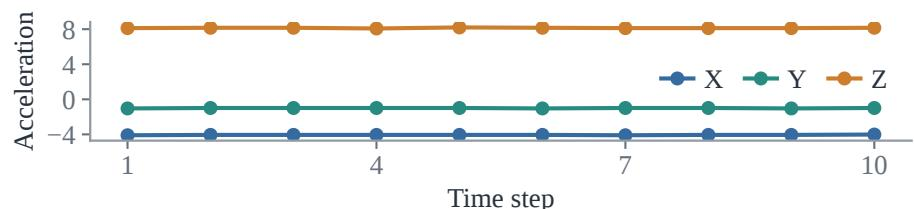

(c) Zero-shot reasoning models
<table><tr><td>Model</td><td>Answer (all incorrect)</td><td>Tokens</td></tr><tr><td>Qwen3.5-9B</td><td>Standing</td><td>2,392</td></tr><tr><td>Qwen3-8B</td><td>Walking</td><td>669</td></tr><tr><td>VeriTime-Qwen3-4B</td><td>Upstairs</td><td>634</td></tr><tr><td>TimeOmni-1-7B</td><td>Upstairs</td><td>582</td></tr></table>

VeriTime: “The pattern repeats every 3 timestamps … rhythmic movement.”  
Qwen3.5: “Z is the dominant axis … This is most characteristic of Standing.” VeriTime confuses interleaved axes with temporal oscillation; Qwen3.5 maps the gravity-axis cue to the wrong posture.

## (d) Ours: Sitting · p = 0.99

No generated reasoning; 6 of 32 statistics shown

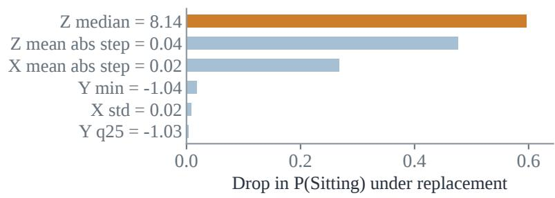

(e) Training distribution of Z median  
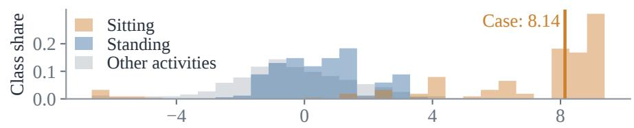

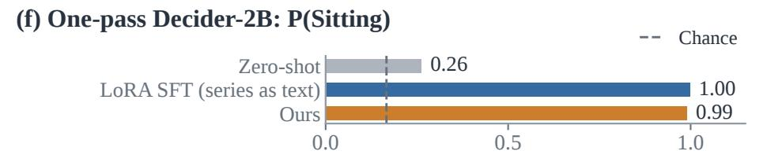  
Figure 10: Case study on human activity classification.

(b) Input series  
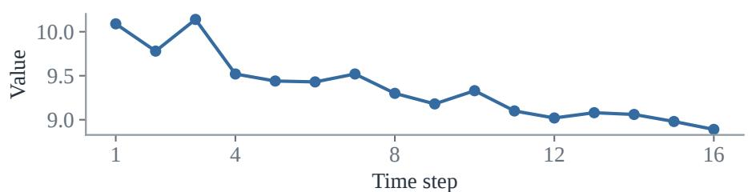  
(c) Zero-shot reasoning models

<table><tr><td>Model</td><td>Answer (all incorrect)</td><td>Tokens</td></tr><tr><td>Qwen3.5-9B</td><td>Normal</td><td>718</td></tr><tr><td>Qwen3-8B</td><td>Normal</td><td>258</td></tr><tr><td>VeriTime-Qwen3-4B</td><td>Normal</td><td>571</td></tr><tr><td>TimeOmni-1-7B</td><td>Normal</td><td>387</td></tr></table>

TimeOmni-1: “gradually decreases … Therefore, the series is normal.”  
Qwen3: “relatively smooth trend … no strong evidence of an anomaly”  
Both models treat the smooth downward drift as normal.

## (d) Ours: Anomaly · p = 0.96

No generated reasoning; 6 of 32 statistics shown

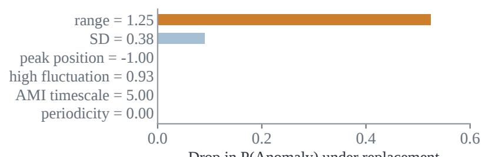  
Drop in P(Anomaly) under replacement

(e) Training distribution of range  
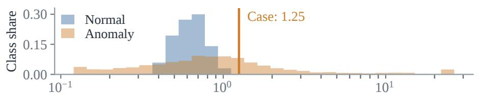

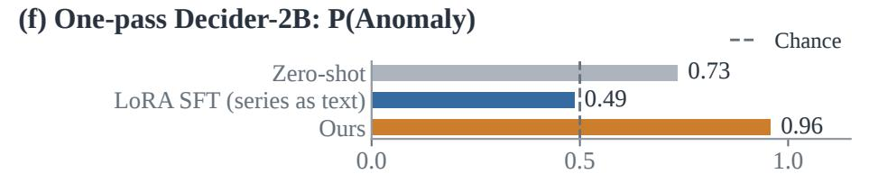  
Figure 11: Case study on anomaly detection in the environment domain.

Are there anomalies in this time series?

(b) Input series  
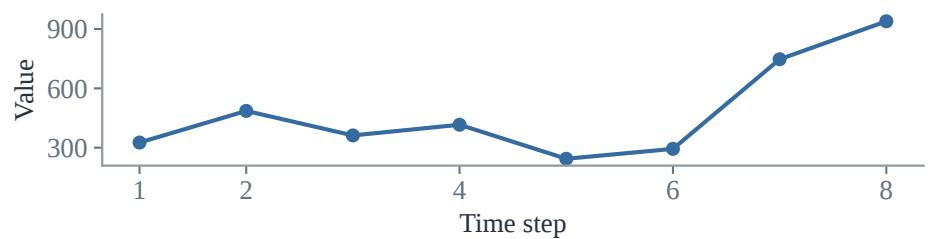  
(c) Zero-shot reasoning models

<table><tr><td>Model</td><td>Answer (all incorrect)</td><td>Tokens</td></tr><tr><td>Qwen3.5-9B</td><td>Anomaly</td><td>950</td></tr><tr><td>Qwen3-8B</td><td>Anomaly</td><td>355</td></tr><tr><td>VeriTime-Qwen3-4B</td><td>Anomaly</td><td>655</td></tr><tr><td>TimeOmni-1-7B</td><td>Anomaly</td><td>385</td></tr></table>

Qwen3.5: “747.0 and 939.0 … higher than the upper fence of 675.”  
Qwen3: “observed jumps … there may be anomalies in the data.”  
An in-window IQR rule flags the last two values; this window is labeled normal despite its large jumps.

## (d) Ours: Normal · p = 0.94

No generated reasoning; 6 of 32 statistics shown

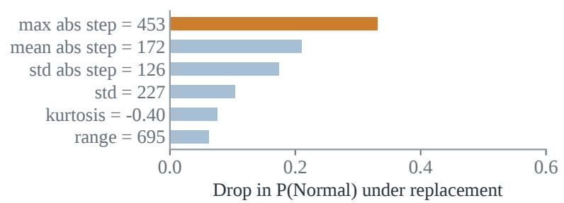

(e) Training distribution of max abs step  
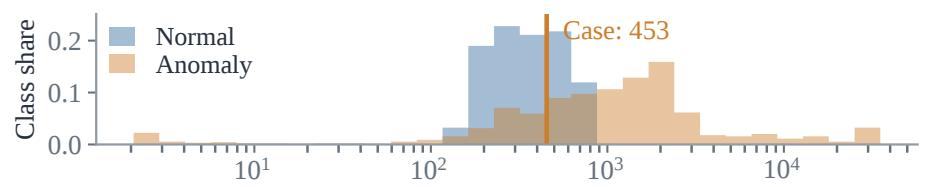

  
Figure 12: Case study on anomaly detection in the web domain.