# VADAR: IMPLICIT GOAL CONDITIONING VIA VALUEDISAGGREGATION

Shashwat Saxena1,\* Mehul Goel1\* Sreyas Venkataraman1\* Sarvesh Patil1 Max Simchowitz¹

¹Carnegie Mellon University \*Equal contribution.

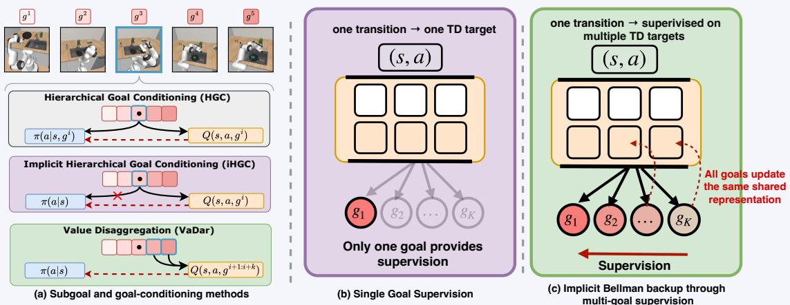  
Figure 1: VADAR uses subgoals during training but requires none at deployment. (a) HGC conditions both policy and critic on the current subgoal; iHGC removes policy conditioning. VADAR adds all-subgoal critic supervision and future-aware policy extraction. (b) With single-goal supervision, each transition supplies a TD target for only the current subgoal. (c) VADAR supervises all subgoals on each transition, updating a shared critic representation. We hypothesize that this enables an implicit Bellman backup that improves final-goal value estimates.

{ssaxena2,mehulgoel,sreyasv,sarveshp,msimchow}@andrew.cmu.edu

Code:https://github.com/simchowitzlabpublic/vadar-public Date: October 20, 2026

## Abstract

Long-horizon tasks are important for modern AI and robotics, yet pose a challenge for reinforcement learning. Historically, a popular approach has been to decompose a task into subgoals, and learn a subgoal-conditioned policy to execute each subtask in sequence. We introduce an alternative called Value Disaggregation (VADAR), which trains a single subgoalindependent policy to maximize a linear combination of per-subgoal critic values. Because subgoal information is needed only at training-time, VADAR removes the need for possibly costly or cumbersome subgoal-selection during policy deployment. Moreover, through careful experiments, we show that VADAR (1) is always competitive with, and frequently outperforms, natural baselines like goal-conditioning and (2) succeeds on tasks with nonsequential goal structure and multiple optimization objectives. In particular, VADAR is the first algorithm to solve challenging, long-horizon tasks in the ROBOCASA365 suite, even when starting from a policy pretrained from behavior cloning with near-zero initial task success. Taken together, VADAR's successes suggest that subgoal information benefits actorcritic reinforcement learning by enhancing the efficacy of critic learning, whereas policy goal-conditioning is often unnecessary.

## 1 Introduction

Learning to complete long-horizon, multi-step tasks is a fundamental challenge across a number of core AI domains, from robotics (Gupta et al., 2019), to language modeling (Wei et al., 2022), to chemical reaction design (Liu et al., 2023b). A popular approach, often referred to as hierarchical goal conditioning (HGC) in reinforcement learning literature, decomposes these complex, long-horizon tasks into a set of subgoals, each of which can be executed in sequence by a dedicated learned, goal-conditioned policy (Gupta et al., 2019; Nasiriany et al., 2019; Levy et al., 2019; Nachum et al., 2018). However, attempting to learn per-subtask policies introduces a new set of challenges. Myopic completion of a given sub-task might compromise performance on future sub-tasks. Moreover, explicit decompositions often require sub-tasks to be sequential in nature, and necessitate a dedicated sub-task planner to decide the current subtask to be attempted during policy deployment.

In this paper, we propose an alternative to HGC that we call Value-Disaggregation (VADAR), a framework for sample-efficient reinforcement learning on long-horizon multi-step tasks. We focus on continuous control robotic manipulation tasks that can be decomposed into sub-tasks $g ^ { 1 } , \ldots , g ^ { | G | }$ . These subgoal evaluations are rapidly becoming highly reliable with today's VLMs (Du et al., 2023). While HGC learns policies $\pi ( s , g )$ that take sub-goals g as explicit input, VADAR instead learns a sub-goal agnostic policy $\pi ( s )$ , with a critic that estimates the values of all sub-tasks simultaneously. The policy is then trained to maximize a linear combination of critic values, optimizing for an aggregate performance on current-sub-goals as well as future tasks. We stress that VADAR is a generic algorithmic template, being compatible with any preferred choice of critic learning algorithm or policy extraction method; we depict VADAR in Figure 1.

VADAR removes the need for subgoal-evaluation at inference by design. Thus, compute-intensive VLM calls used to delineate subgoals, need only be made at training time, and not during policy rollouts. Moreover, VADAR is flexible across both task structure and reward constraints, enabling activations both to safetyconstrained reinforcement learning (Appendix K.1), and to non-sequential task orders which could admit a directed acyclic graph (DAG) structure. (Appendix G).

Across a variety of benchmarks for continuous control and policy extraction methods, we find that VADAR, (1) Consistently outperforms HGC (Section 4), hindsight experience replay (HER) (Andrychowicz et al., 2018), and dense preference-based rewards (Brown et al., 2019; Liang et al., 2026); (2) Enables the first non-VLA BC-to-online RL method to converge on the evaluated long-horizon ROBOCASA365 tasks (Nasiriany et al., 2026) under fixed initial-state conditions; (3) Enables multi-objective reinforcement learning by incorporating safety constraints (Appendix K.1), and enables test-time steering (Section 6.3) by combining critic learning with best-of-N sampling (Li et al., 2026); and (4) Works seamlessly with VLM supervision (Appendix I) and reaches convergence when goals are specified by reasoning Vision-Language Models (VLMs). This allows sample efficient robot learning from high-dimensional visual observations.

To understand these gains, our ablations examine dense subgoal supervision and future-aware policy extraction (Section 6.2). We find that future-aware policy extraction reduces myopic behavior, while intermediate subgoal supervision improves learning even when policy extraction uses only final-subgoal values. This suggests that subgoals can support long-horizon RL through critic learning without explicit policy goal conditioning, Taken together, our findings invert the traditional perspectives on overcoming the challenges of long horizon, valued-based reinforcement learning. In short, we find: Rather than myopically conditioning policies via decomposed long-horizon sub-goals, predicting temporally rich subgoal successes can provide critics with dense supervision to enhance the accuracy of long-reaching measurements of full-task success.

## 2 Related Work

Long-horizon reinforcement learning via temporal abstraction. Long-horizon reinforcement learning is commonly addressed by introducing temporal abstraction: instead of reasoning over primitive actions, the agent reasons over extended behaviors, skills, or subgoals. Classical formulations include the options framework, where temporally extended actions are specified by initiation sets, intra-option policies, and termination conditions (Sutton et al., 1999; Bacon et al., 2016); hierarchical abstract machines (Parr & Russell, 1997); feudal reinforcement learning (Dayan & Hinton, 1992; Vezhnevets et al., 2017); and MAXQ value decomposition (Dietterich, 1999). Subsequent work studies how such skills and hierarchies can be discovered from data (Fox et al., 2017; Evans & Özgür Şimşek, 2024; Cannon & Özgür Simsek, 2025; Peng et al., 2022). While these methods differ in how subtasks are specified or learned, they use subgoal structure to organize policy execution: the learned policy must either act through a prescribed hierarchy of subtasks(Dietterich, 1999; Parr & Russell, 1997) or utilize temporally extended controllers (Bacon et al., 2016; Fox et al., 2017). In contrast, VADAR assumes that subgoals are part of the MDP design, but does not learn or execute a hierarchy over them; subgoals are used only to construct training-time value targets for a single flat policy.

Goal-conditioned reinforcement learning. Goal conditioned RL provide a natural design for conditioning on desired outcomes/sub-goals. Instead of learning a separate controller for each task, goal-conditioned methods learn policies or value functions indexed by a goal, enabling transfer across related goal-reaching problems. Classical dynamic-goal learning first studied transfer across changing goal-reaching tasks (Kaelbling, 1993). This idea was later extended through universal value function approximators, which learn goal-indexed value functions with function approximation (Schaul et al., 2015), and hindsight relabeling, which reuses failed rollouts as successful examples for alternative achieved goals (Andrychowicz et al., 2018). However, conditioning a flat policy on the final task goal does not by itself resolve long-horizon credit assignment. For this reason, hierarchical goal-conditioned RL (HGC) uses goal conditioning as a local control primitive: a high-level policy, planner, or task specification provides intermediate subgoals, and a low-level goal-conditioned policy learns to reach them (Nachum et al., 2018; Levy et al., 2019; Gupta et al., 2020; Nair et al., 2018). This reduces the effective horizon, but introduce additional dependencies: they often assume a sequential subgoal structure, treat only one subgoal as active at a time, and require the deployed policy to be supplied with the correct current goal. These issues are costly and difficult when subgoal progress and completion must be evaluated by expert rules or large vision-language models during inference. VADAR avoids this test-time dependency by learning a subgoal-agnostic policy; goal information enters only through the critic during training.

Value decomposition and reward-factorized critics. MAXQ decomposes the value of a hierarchical policy into child-task values and completion functions, reflecting the procedural structure of a subroutine hierarchy (Dietterich, 1999). Successor representations and successor features instead factor value prediction into predictive components and reward-dependent weights (Dayan, 1993; Barreto et al., 2017). VADAR follows this latter spirit of reward-factorized value estimation, but uses subgoal-completion signals to learn a vectorvalued critic in an offline-to-online actor-critic pipeline. Closer to robotics, task-and-motion planning (TAMP) couples high-level symbolic task planners with low-level continuous motion planners over a fixed subtask vocabulary (Kaelbling & Lozano-Pérez, 2011; Garrett et al., 2021). VADAR shares the assumption that the task admits a subgoal-level decomposition, but does not plan over symbolic actions or commit to a fixed sequencing at execution time: the decomposition enters only through the critic, and the deployed policy is a single flat, subgoal-agnostic controller.

Representation learning for value-based RL. Recent work has shown that auxiliary prediction objectives can improve value learning by shaping the representations used by the critic. MR.Q (Fujimoto et al., 2025) learns state and state-action representations that predict rewards, termination, and future latent states, using model-based objectives to improve a model-free actor-critic without planning through the learned dynamics. DR.Q (Lyu et al., 2026) builds on this approach by encouraging the learned representations to retain information about future states through a mutual-information objective, together with a recency-aware replay scheme. VADAR is complementary to these approaches: rather than introducing an auxiliary dynamics or representation-learning objective, it obtains additional supervision directly from the RL problem by fitting subgoal value functions at multiple temporal resolutions. Thus, the shared critic representation is trained simultaneously by intermediate and long-horizon TD targets, which we find can improve final-task value estimation even when the intermediate values are not used for policy extraction.

## 3 Preliminaries

MDPs. We formulate our problem as a Markov Decision Process (MDP) $M : = ( S , A , P _ { 0 } , P , R , \gamma )$ , with states $s \in S$ , actions $a \in A .$ , initial state distribution $P _ { 0 }$ , transition probabilities $P .$ , reward $R ,$ and discount factor $\gamma \in$ $( 0 , 1 )$ . At each timestep t, the agent (e.g., robot) observes the state $s _ { t } \in S$ , takes an action $a _ { t } \sim \pi ( a _ { t } \mid s _ { t } ) \in A$ transitions to the next state $s _ { t + 1 }$ according to $s _ { t + 1 } \sim P ( s _ { t + 1 } \mid s _ { t } , a _ { t } ) $ while receiving a reward $R ( s _ { t } , a _ { t } )$ For the MDP $M _ { \mathrm { E N V } } .$ we let $\mathbb { E } ^ { \pi , M } ~ ( \mathrm { r e s p . } ~ \mathbb { P } ^ { \pi , M } )$ denote the expectation (resp. probability distribution) over trajectories $( s _ { 0 } , a _ { 0 } , \ldots , s _ { T } , a _ { T } )$ with length $T + 1$ , with initial state distribution $s _ { 0 } \sim P _ { 0 }$ and transition operator $P .$ The object of reinforcement learning (RL) is to train a policy to optimize the cumulative discounted return: $\begin{array} { r } { J ^ { M } ( \pi _ { \theta } ) \ \stackrel { \circ } { = } \ \mathbb { E } ^ { \pi _ { \theta } } [ \sum _ { t > 0 } \gamma ^ { t } R ( s _ { t } , a _ { t } ) ] } \end{array}$ We also recall the Q-function $\begin{array} { r } { Q ^ { \pi , M } ( s , a ) : = \mathbb { E } ^ { \pi } [ \sum _ { t > 0 } \gamma ^ { t } R ( s _ { t } , a _ { t } ) } \end{array}$ $( s _ { t } , a _ { t } ) = ( s , a ) ]$ and value function $V ^ { \pi , M } ( s ) : = \mathbb { E } _ { a \sim \pi ( s ) } [ Q ^ { \pi } ( s , a ) ]$ . When M is clear from context, we can omit it from the subscript.

Value-based Reinforcement Learning. Value-based RL methods (Sutton & Barto, 2018) simultaneously learn a policy $\pi _ { \theta }$ and associated Qφ-function, maintaining  (1) a replay buffer $\boldsymbol { B } = \{ ( s , a , s ^ { \prime } , r , \mathrm { d o n e } ) \}$ of past states $s ,$ actions $^ { a , }$ successor states $s ^ { \prime } \sim P ( s , a )$ , rewards r, and done indicators done; (2) a policy πθ, critic network $Q _ { \phi } : S \times A \to \mathbb { R }$ trained from this buffer. The parameters of $Q _ { \phi }$ are updated to approximate $Q ^ { \pi _ { \theta } }$ , and $\pi _ { \boldsymbol { \theta } } ( s )$ is updated to maximize critic values. Specifically, updates are sampled $( s , a , s ^ { \prime } , r ) \sim \mathcal { B }$ , and new actions $\grave { a ^ { \prime } } \sim \pi \grave { \theta } ( s ^ { \prime } )$ . Then,

1. Critic parameters $\phi$ are updated via gradient descent on a given critic loss

$$
L _ { \mathrm { c r i t i c } } ( Q _ { \phi } \mid s , a , y ^ { \mathrm { t a r g e t } } ) = ( Q _ { \phi } ( s , a ) - y ^ { \mathrm { t a r g e t } } ) ^ { 2 } + L _ { \mathrm { r e g } } ( s ^ { \prime } , a ^ { \prime } , \pi _ { \theta } )\tag{3.1}
$$

which measures the squared Bellman residual to the future target $y ^ { \mathrm { t a r g e t } } = r + \gamma Q _ { \phi } ( s ^ { \prime } , a ^ { \prime } )$ , and which may also incorporate some additional regularization $L _ { \mathrm { r e g } } ( \cdot )$ depending on $s ^ { \prime } , a ^ { \prime } , \pi _ { \theta }$ (omitted as arguments in the critic loss for simplicity).

2. Policy parameters θ are updated via gradient descent on a given policy loss $L _ { \mathrm { p o l i c y } } ( \pi _ { \theta } \mid s , Q )$ mapping from policies $\pi _ { \theta } : S \to \Delta ( A )$ , states $s \in S$ , and Q to R.

Representative Algorithms: SAC, FQL and OGPO. We instantiate VADAR with Soft Actor-Critic (SAC) (Haarnoja et al., 2018b), Flow Q-Learning (FQL) (Park et al., 2025b), and off-policy generative policy optimization (OGPO) (Patil et al., 2026). SAC uses a maximum-entropy policy objective; FQL and OGPo support expressive generative control policies. These backbones allow us to test value disaggregation across different policy-extraction methods. Their policy objectives and algorithm-specific critic updates are detailed in Appendix C.

Sparse-Reward RL. In many tasks, such as those encountered in robot manipulation, defining reward that densely measure progress towards goal completion is challenging (Amodei et al., 2016; Krakovna et al., 2020). Thus, we consider a sparse-reward defined via the done indicator done $\in \{ 0 , 1 \}$ indicating task completion. Standard practice is to set $r  r _ { \mathrm { s p a r s e } } ( \mathrm { d o n e } )$ , where

$$
r _ { \mathrm { s p a r s e } } ( \mathrm { d o n e } ) = - 1 \cdot \mathbf { I } \{ \mathrm { d o n e } = 0 \} + r _ { \mathrm { d o n e } } \mathbf { I } \{ \mathrm { d o n e } = 1 \} ,\tag{3.2}
$$

and where $r _ { \mathrm { d o n e } }$ is a small positive constant $( \mathbf { e . g . \ } r _ { \mathrm { d o n e } } = 5 )$ . In words, $r _ { \mathrm { s p a r s e } }$ penalizes each time-step until the task is not completed, and provides a small positive bonus for task success.

Offline-to-Online RL. In many robotics settings, environment interaction is expensive and a fixed dataset of demonstrations $\mathcal { D } _ { \mathrm { o f f } }$ is available. We follow the now-standard offline-to-online recipe (Nair et al., 2021): pretrain a behavior-cloning policy $\pi _ { \mathrm { B C } }$ on $\mathcal { D } _ { \mathrm { o f f } }$ , then initialize the online policy from $\pi _ { \mathrm { B C } }$ and fine-tune online, optionally mixing $\mathcal { D } _ { \mathrm { o f f } }$ into the off-policy updates at a fixed ratio (Ball et al., 2023). All algorithms in our experiments share the same BC-pretraining and warm-start protocol, so comparisons isolate the online finetuning method.

Dense Preference Reward. An alternative approach to long-horizon RL is to learn dense preference-based rewards. We describe the formulation and implementation in Appendix E and compare against this approach in Section 6 and Appendix F.2.

## 4 Hierarchical Goal Conditioning and Its Limitations

Algorithm 1 Hiearchical Goal Conditioning RL (HGC-RL).   
1: Parameters: discount factor γ; learning rate η   
2: Initialize critic networks $Q _ { \phi } : S \times A { \times } \mathbf { \bar { G } } \to \mathbb { R }$ policy $\pi _ { \theta } \colon S { \times } G \to \Delta ( A )$ , buffer $B  \emptyset$   
3: for ${ \mathrm { e p i s o d e } } = 1 , 2 , \ldots$ do   
4: while episode not done do   
5: $a _ { t }  \pi _ { \theta } ( s _ { t } , g _ { t } )$ , transition $s _ { t + 1 } \sim P ( s _ { t } , a _ { t } )$ $\triangleright g _ { t } = g ^ { \mathrm { c u r r } } : = \operatorname* { m i n } \{ g : { \mathsf { d o n e } } _ { g } = 0 \} )$   
6: $\mathcal { B }  \mathcal { B } \cup \{ ( s _ { t } , a _ { t } , s _ { t + 1 } , r _ { t } , g _ { t } ) \} , r _ { t }  r _ { \mathrm { s p a r s e } } ( \mathrm { d o n e } _ { g _ { t } } )$   
7: for number of updates do   
8: Sample $( s , \dot { a } , s ^ { \prime } , r _ { g } , g ) \sim \mathcal { B } , a ^ { \prime } \sim \pi _ { \theta } ( s ^ { \prime } )$   
9: $y _ { g } ^ { \mathrm { t a r g e t } } = r _ { g } + \gamma \bar { Q _ { \phi } } ( s ^ { \prime } , a ^ { \prime } , g )$ Target for current goal   
10: $\tilde { \phi }  \phi - \eta \nabla _ { \phi } L _ { \mathrm { c r i t i c } } ( Q _ { \phi } ( \cdot , \cdot , g ) \mid s , a , y _ { g } ^ { \mathrm { t a r g e t } } ) .$   
11: $\theta  \theta - \eta \nabla _ { \theta } L _ { \mathrm { p o l i c y } } ( \pi _ { \theta } ( \cdot , g ) \mid s , a , Q _ { \phi } ( \cdot , \cdot ; g ) )$

Long-horizon reinforcement learning tasks require many time steps to complete. Sparse-rewards make credit assignment - identifying which actions contribute to task success/failure - challenging. Thus, prior work introduces hierarchical goal conditioning (HGC)2, which decomposes the problem into a sequence of subgoals $G = \{ g \} _ { g \in G }$ . Traditional goal-conditioned RL assumes that the completion of individual subgoals, what we call subgoal-dones ${ \mathsf { d o n e } } _ { g } ( s ) : = \mathbf { I } \{ g$ is completed at state s}, can be evaluated at both training time time and during evaluation. Traditionally, ${ \mathsf { d o n e } } _ { g }$ have been hand-specified, but modern VLMs can now evaluate ${ \mathrm { d o n e } } _ { g } ^ { \ } \mathbf { s }$ specified by natural language queries (Chen et al., 2026). For simplicity, in the body of this paper we assume these goals satisfy a linear order with $g ^ { 1 } \prec g ^ { 2 } \cdot \cdot \cdot \prec g ^ { | G | } \in G .$ where $g ^ { | G | }$ denotes final task completion and $g ^ { 1 }$ is the first goal (Appendix G) easily removes this sequentiality). Under this sequentiality condition, we define the current goal $g ^ { \mathrm { c u r r } } = \operatorname* { m i n } \{ g : { \mathrm { d o n e } } _ { g } = 0 \}$ , where min is taken with respect to the order .

Algorithm 1 depicts how value-based RL methods can be modified to incorporate HGC. These modifications of standard value-based RL, depicted in blue, are: policies and critics take the current goal $g _ { t } = g ^ { \mathrm { c u r r } }$ as an argument (Line 2), so that in particular, the policy needs $g _ { t }$ to select actions (Line 5). This necessitates that $g _ { t }$ is tracked in the replay buffer (Line 6), is used to determine the critic target (Line 9), and features in both the policy and critic loss (Lines 10, 11). However, we identify 3 limitations of HGC, outlined below.

Limitation 1: Accurate goals must be supplied to the policy at test-time, which is prohibitive if sub-goal completions requires expert engineering or larger models to evaluate. Limitation 2: Optimizing for the current goal can be overly myopic if future actions depend subtly on how the current goal is completed, such as in robotic pick and place tasks. Limitation 3: HGC often requires goals to have a sequential structure, with only one active goal at a time.

We examine these limitations in Appendix D. As a point of comparison, we introduce implicit hierarchical goal conditioning (iHGC), which retains goal-conditioned critics but uses a subgoal-independent policy $\pi ( a \mid s )$ removing the need for test-time goal information (Limitation 1). Although iHGC can outperform traditional HGC as shown in Fig. 10, both optimize the policy against the current-subgoal critic alone and remain susceptible to myopic behavior (Limitation 2). This motivates VADAR, which incorporates future-subgoal values during policy optimization.

## 5 The Value Disaggregation (VADAR) Framework

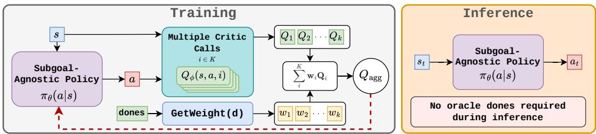  
Figure 2: VADAR training and inference. Left: Subgoal completion indicators weight the per-subgoal critic values. whose aggregate guides updates to a subgoal-independent policy. Right: The policy selects actions directly from the state, without subgoal information.

We now introduce Value Disaggregation (VADAR, Algorithm 2), a framework for subgoal-driven long-horizon RL that addresses the limitations of goal conditioning described in Section 4. VADAR combines three key insights: (1) Like implicit hierarchical goal conditioning (iHGC), goal-conditioned critics can train a single, subgoal-independent policy. (2) Leveraging weighted combinations of critics can balance current and future goal completion, thereby reducing the myopic overexploitation described in Limitation 2. Finally, (3) The extraction from multiple critics is naturally compatible with general goal topologies, addressing Limitation 3 by allowing more than one subgoal to be active at any given time.

Algorithm 2 Value Disaggregation (VADAR)   
1: Parameters: discount factor $\gamma ;$ learning rate η; TD clipping parameter $c _ { \mathrm { c l i p } } .$   
2: Initialize goal-conditioned critic $Q _ { \phi } : \breve { S } \times A \stackrel { \cdot } { \times } G \to \bar { \mathbb { R } } ;$ policy πθ: $S \to { \dot { \Delta } } ( A )$ ; replay buffer $B  \varnothing .$   
3: for episode $= 1 , 2 , \ldots$ do   
4: while episode not done do   
5: $a _ { t }  \pi _ { \bar { \theta } } ( s _ { t } )$ , transition $s _ { t + 1 } \sim P ( s _ { t } , a _ { t } )$   
6: Evaluate subtask completion vector: $\mathbf { d } _ { t } ^ { \mathsf { ^ { \prime } } } = \{ \mathsf { d o n e } _ { g } ( s _ { t + 1 } ) \} _ { g \in G } \in \{ 0 , 1 \} ^ { G }$   
7: $\boldsymbol { B } \gets \boldsymbol { B } \cup \{ ( s _ { t } , a _ { t } , s _ { t + 1 } , \mathbf { r } _ { t } , \mathbf { d } _ { t } \}$ , where $\mathbf { r } _ { t } [ g ]  r _ { \mathrm { s p a r s e } } ( \mathbf { d } _ { t } [ \bar { g } ] )$   
8: for number of updates do   
9: Sample $( s , \bar { a } , s ^ { \prime } , \mathbf { r } , \mathbf { d } ) \sim \mathcal { B } , a ^ { \prime } \sim \pi _ { \theta } ( s ^ { \prime } )$   
10: $\mathbf { y } ^ { \mathrm { t a r } \bar { \mathrm { g e t } } } [ g ] = \operatorname* { m i n } \{ \mathbf { r } [ g ] + \gamma Q _ { \phi } ( s ^ { \prime } , a ^ { \prime } , g ) , c _ { \mathrm { c l i p } } \cdot r _ { \mathrm { d o n e } } \} .$ for all $g \in G$ all-goal targets   
11: $\begin{array} { r } { \phi \gets \phi - \eta \nabla _ { \phi } { \sum _ { g \in G } } \bar { L } _ { \mathrm { c r i t i c } } ( Q _ { \phi } ( \cdot , \cdot , g ) \mid s , a , \mathbf { y } ^ { \mathrm { t a r g e t } } [ g ] ) } \end{array}$ ▶ multi-goal critic loss   
12: $\begin{array} { r } { Q _ { \mathrm { a g g } } ( \cdot , \cdot ) \gets \sum _ { g } \mathbf { \bar { w } } [ g ] Q _ { \phi } ( \cdot , \cdot , g ) } \end{array}$ , where $\mathbf { w } \in \mathbb { R } ^ { G } $ GETWEIGHTING(d)   
13: $\theta  \theta - \eta \nabla _ { \theta } L _ { \mathrm { p o l i c y } } ^ { - } ( \pi _ { \theta } \mid s , a , Q _ { \mathrm { a g g } } )$

Conveniently, VADAR requires minimal modification to standard off-policy RL pipelines, wherein only the critic architecture (conditioned on subgoals) and the corresponding aggregation strategies change. We now walk through Algorithm 2 in detail, highlighting the components unique to VADAR (shown in color in the pseudocode and below). We give a detailed practitioners guide to using VADAR in Appendix A. In what follows, we use brackets [g] to denote goal-wise indexing.

Policy update via value weighting. The key innovation in VADAR is optimizing for weighted contributions of different critics during policy extraction, which addresses the myopic behavior described in Section 4 and illustrated in Appendix D. At each environment step, VADAR evaluates a vector of subgoal completion indicators $\mathbf { d } _ { t } = \{ \mathsf { d o n e } _ { g } ( s _ { t + 1 } ) \} _ { g \in G } \in \{ 0 , 1 \} ^ { G }$ . It uses these to computing a weighting GETWEIGHTING (Line 12) for policy extraction:

$$
\begin{array} { r } { Q _ { \mathrm { a g g } } ( s , a ) = \sum _ { g \in G } \mathbf { w } [ g ] \cdot Q _ { \phi } ( s , a , g ) , \qquad \mathbf { w } \gets \mathrm { G E T W E I G H T I N G } ( \mathbf { d } ) . } \end{array}\tag{5.1}
$$

The policy is then updated to maximize $Q _ { \mathrm { a g g } }$ via the policy loss ${ L _ { \mathrm { p o l i c y } } ( \pi _ { \theta } \mid s , Q _ { \mathrm { a g g } } ) }$ . Because the policy $\pi _ { \theta } : S \to \Delta ( A )$ is never conditioned on g (subgoal agnostic), subgoals are not needed at test time. A good weighting function provides strong training signal for completing current goals while improving behavior for future goals.

<table><tr><td>Config.</td><td>Weight  ${ \bf w } [ g ]$ </td><td>Interpretation</td></tr><tr><td>Current-myopic</td><td> $\mathbb { I } [ g = g ^ { \operatorname { c u r r } } ]$ </td><td rowspan="4">Only the current subtask contributes. All incomplete subtasks contribute.</td></tr><tr><td>Current-future</td><td> $\mathbb { I } [ g \succeq g ^ { \operatorname { c u r r } } ]$ </td></tr><tr><td>Next-myopic</td><td> $\mathbb { I } [ g = g ^ { \mathrm { n e x t } } ]$ </td></tr><tr><td>Next-future</td><td> $\mathbb { I } [ g \succeq g ^ { \mathrm { n e x t } } ]$  Incomplete subtasks with incomplete parents contribute.</td></tr></table>

Weighting choices for sequential goals. $\mathbf { A } s$ in Section 3, first assume that goals are ordered as $1 , \ldots , | G |$ with goal $g ^ { i }$ serving as a prerequisite for goal $g ^ { i + 1 }$ , denoted $g ^ { i } \prec g ^ { i + 1 }$ . (see Appendix G for the general case. Given a vector of completion indicators d, recall that $g ^ { \mathrm { c u r r } } \bar { \mathbf { \eta } } = \operatorname* { i n f } \bar { \mathbf { \zeta } } g : \mathbf { d } _ { g } = 0 \mathbf { \zeta }$ denotes the current unfinished goal.

We also define the next goal as $g ^ { \mathrm { n e x t } } : = \operatorname* { m i n } \{ g ^ { + } , g ^ { | G | } \}$ , where $g ^ { + } : = \operatorname* { i n f } \{ g ^ { \prime } : g ^ { \prime } \succ g ^ { \mathrm { c u r r } } \}$ ; again, min/inf is taken with respect to the goal order $\prec ,$ and ≥ in Table 1 denotes the negation of <. Table 1 summarizes four choices for the weighting function along two axes. The first axis distinguishes myopic weightings, which optimize only a single goal, from future-aware weightings, which include all relevant future goals. The second axis distinguishes current weightings, which include the current goal, from next weightings, which only optimize for goals after the current goal. These choices are illustrated in Figure 3. Detailed experiments can be found in Section 6.2.

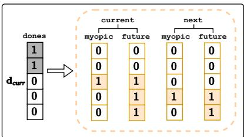  
Figure 3: Subgoal weighting used by GETWEIGHTING.

All-Subgoal Critic Learning Importantly, the weighted extraction Eq. (5.1) requires that the critic values $Q ( s , a , g )$ for each goal are well-estimated. Therefore, we design an all-subgoal critic update. Recall that, at each environment step, VADAR evaluates a vector of subgoal completion indicators $\bar { \mathbf { d } } _ { t } ,$ and computes a corresponding reward vector $\mathbf { r } _ { t } = r _ { \mathrm { s p a r s e } } ( \mathbf { d } _ { t } )$ entrywise via the sparse reward function (Eq. (3.2), Line 6). This converts a sparse task reward into [G| per-subgoal rewards (Line 10), each of which provides signal as soon as its corresponding subgoal is completed. The tuple $\left( s _ { t } , a _ { t } , s _ { t + 1 } , \mathbf { r } _ { t } , \mathbf { d } _ { t } \right)$ is stored in the replay buffer. Given a sampled transition $( s , a , s ^ { \prime } , \mathbf { r } , \mathbf { d } )$ from the buffer and a new action $a ^ { \prime } \sim \overset { \cdot } { \pi } _ { \theta } ( s ^ { \prime } )$ , the vector of TD targets is computed entrywise:

$$
\mathbf { y } ^ { \mathrm { t a r g e t } } [ g ] = \operatorname* { m i n } \{ \mathbf { r } [ g ] + \gamma Q _ { \phi } ( s ^ { \prime } , a ^ { \prime } , g ) , \ c _ { \mathrm { c l i p } } \cdot r _ { \mathrm { d o n e } } [ g ] \} \qquad \forall g \in G ,\tag{5.2}
$$

where the min is applied entrywise. The critic is updated by a gradient update on the critic loss across all subgoals: $\begin{array} { r l } { \sum _ { g \in G } L _ { \mathrm { c r i t i c } } ^ { \mathrm { ~ \tiny ~ \cdot ~ \cdot ~ } } ( Q _ { \phi } ( s , a , g ) \mid s , a , y _ { g } ^ { \mathrm { t a r g e t } } ) } \end{array}$

Why clipping? The critic update involves a “clipping" of the maximum critic value. This is because, after a subgoal is completed, the agent keeps collecting $r _ { \mathrm { d o n e } }$ at every step, so without the clip the Q-value would accumulate to $r _ { \mathrm { d o n e } } / ( 1 - \gamma )$ . The clip caps the target at $c _ { \mathrm { c l i p } } \cdot r _ { \mathrm { d o n e } }$ (Line 10), capping critic values for completed subgoals.

## VADAR: Key Design Decisions

• Subgoal-agnostic policy. Subgoal information enters only through the critic at training time; deployed policy πθ(a | s) needs no goal selection/conditioning at inference.

• Weighted aggregation for policy extraction. Per-subgoal Q-values are aggregated into a single scalar signal $Q _ { \mathrm { a g g } } ;$ the next-future (VADAR-NF) weighting is our default method which balances current and future subgoal completion.

[• Reward clipping at $c _ { \mathrm { c l i p } } \cdot r _ { \mathrm { d o n e } } .$ Removes the need for critic loss gating on completed subgoals.

VADAR benefits from both dense critic supervision and weighted policy extraction (Section 6.2 and Appendix O.1). We provide further details on non-sequential tasks in Appendix G, multi-objective optimization in Appendix K, and alternative critic parameterizations in Appendix B.1. Finally, Appendix O shows that fixedweight value aggregation is theoretically (but only theoretically) equivalent to reward shaping but we later show (Appendix O.1) that this equivalence does not explain VADAR's empirical success.

## 6 Experiments

We evaluate VADAR on a suite of long-horizon manipulation benchmarks. Each method is pretrained via behavior cloning on offline data, stopped early at a low success rate so all methods begin fine-tuning from a comparable starting point, and then fine-tuned online for a fixed number of environment steps. Per-task descriptions and hyperparameters are detailed in Appendix H.

Baselines. We study VADAR with two different weighting schemes (Table 1) - VADAR-NF, using next-future (plotted in a solid line) and VADAR-CF, which use current-future (plotted in a dotted line). We compare against 3 alternatives, each using the same base-algorithm per plot: (1) Hierarchical Goal Conditioning (HGC), where both the policy and critic are conditioned on the current subgoal g, where g is set to the next incomplete subgoal at every step (Algorithm 1). (2) Implicit Hierarchical Goal Conditioning (iHGC), which retains the goal conditioned critic of HGC but does not condition the policy on the subgoal. (3) Dense Preference Reward, denoted Dense, where we adopt best-practices for a learning dense reward model via preferences (described in Appendix E), where the reward models are pretrained with additional rollouts on a richer dataset of successful and failed runs in order to steelman their performance. (4) The original base-algorithm that using sparse reward with no goal information, denoted as “Sparse".

Environments. We evaluate on four benchmark suites spanning different task horizons and difficulties. ROBOCASA365 (Nasiriany et al., 2026) provides our three longest-horizon tasks, while ROBOMIMIC (Mandlekar et al., 2021) tests contact-rich, medium-horizon manipulation on TRANSPORT and ToOL-HANG. We also evaluate on three multi-stage kitchen tasks from LiBERo (Liu et al., 2023a) and the long-horizon scene-play-singletask-task4 task from OGBENCH (Park et al., 2025a). Task descriptions, subgoals, and their dependency structures are given in Appendix H.

Base-algorithm instantiations. We instantiate all above baselines with three value-based RL algorithms (details given in Appendix C). On the most challenging long-horizon environments (ROBOCASA365), we use OGPo (Patil et al., 2026), a state-of-the-art offline-to-online RL algorithm for flow-based policies. On the medium-horizon RoBOMIMIC tasks, we evaluate on both OGPO and the popular, though less performant FQL (Park et al., 2025b), demonstrating that the benefits of VADAR apply to both. Because OGPO is considerably more sample efficient that than FQL from Sparse reward when all BC data are used, we also test OGPO in a regime with limited BC data, denoted low data, on ROBOMIMIC; details are described in Table 10. Lastly, we demonstrate VADAR's applicability to non-generative policies with the seminal Soft Actor Critic (SAC) algorithm (Haarnoja et al., 2018b) the simpler on OGBENCH and LIBERO environments.

## 6.1 VADAR outperforms natural baselines

Figure 4 shows that VADAR improves various policy-extraction methods, with the largest gains on the most challenging long-horizon tasks. Not only does VADAR benefit a SOTA method like OGPO, but also enchances weaker methods like FQL and sAC with improved critic learning.

VADAR supplies useful values for aggressive policy extraction. OGPO aggressively optimizes critics using PPO-style policy extraction on the generative policy. We find that VADAR with OGPO matches or outperforms all baselines, with the largest gains on the most challenging long-horizon tasks (Figure 4). On ROBOCASA365, VADAR is the only method to achieve convergence on LOADDISHWASHER, while on PRESOAKPAN it reaches nearly double the success rate of the strongest baseline, iHGC. Similarly, on ARRANGETEA, VADAR outperforms baselines with superior training stability. On ROBOMIMIC with OGPO, we find that VADAR, HGC and iHGC obtain similar performance in both the low- and full-data regimes.

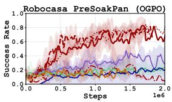

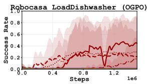

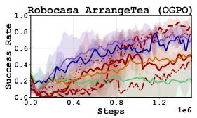

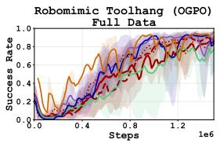

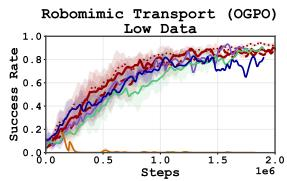

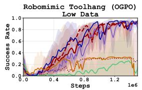

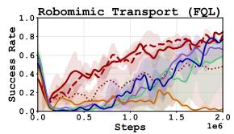

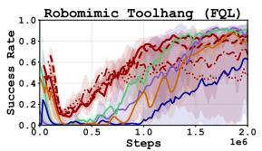

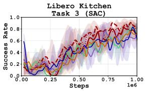

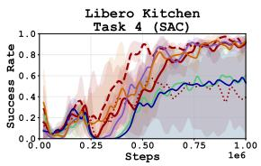

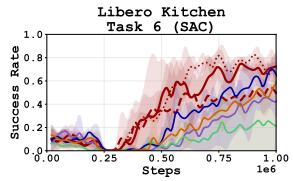

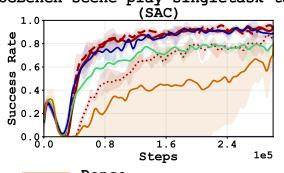

Figure 4: Success rate of VADAR-NF (solid) and VADAR-CF (dotted) against HGC, its implicit variant iHGC, the Dense preference-reward baseline, and the Sparse backbone across ROBOCASA365, ROBOMIMIC, LIBERO and OGBENCH, for our three instantiations OGPO, FQL and SAC.  
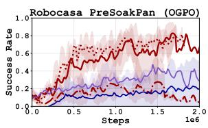

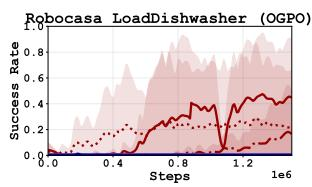

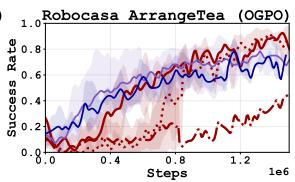

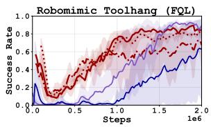  
Figure 5: Weighting ablation of VADAR (VADAR-GM, VADAR-CF, VADAR-NF) against HGC and iHGC on ROBO-CASA365 with the OGPO backbone and ROBOMIMIC TOOL-HANG with the FQL backbone.

The benefits extend to first-order policy extraction. VADAR also improves learning with FQL and SAC, which update the policy through action gradients of the critic. With FQL, VADAR learns faster on ROBOMIMIC TRANSPORT and ToOL-HANG, demonstrating that its benefits do not require OGPO's policy update. With SAC, the advantage is most apparent on the longer-horizon LIBERO tasks, whilst performance remains comparable to goal-conditioned baselines on OGBENCH. Together, these comparisons support the use of value disaggregation across different policy-extraction methods. Even where performance is comparable, VADAR retains the practical benefit of requiring no goal selection at inference.

Additional baseline comparisons. In Appendix F, we compare to two additional algorithm families, both of which significantly underperform VADAR. First, we test hindsight experience replay (HER) (Andrychowicz et al., 2018) on contact-rich LIBERO manipulation, including variants supplied with the same subgoal information as HGC. Second, we compare against reward learning with access to subgoal information, training separate preference-based reward models for each subgoal and aggregating with next-future weighting. VLM-provided subgoal labels. On ROBOCASA365 PRESOAKPAN, VADAR also learns with VLM-provided subgoal labels, reaching similar final success to oracle supervision with only modest effects on sample efficiency (Appendix I.1).

## 6.2 Understanding What Enables VADAR's Performance

Future-Aware Policy Extraction Improves Performance To isolate the effect of policy extraction, we compare the current-myopic (VADAR-GM), current-future (VADAR-CF), and next-future (VADAR-NF) weightings described in Table 1. These ablations share all-subgoal critic supervision and goal-agnostic policies. Figure 5 shows that VADAR-GM does not outperform HGC and iHGC, while the future-aware variants improve sample efficiency and are the only methods to converge on LOADDISHWASHER. Hence, dense critic supervision alone is insufficient when used with myopic policy extraction. Next, we test whether future-aware policy extraction also improves HGC while retaining policy goal conditioning. On ROBOCASA365 PRESOAKPAN with OGPo, we introduce three Steelman variants, namely Steelman 1 using current-myopic, Steelman 2 using current-future, and Steelman 3 using next-future, extraction respectively. Fig. 6 shows that Steelman 1 remains close to HGC, while Steelman 2 and Steelman 3 approach VADAR-CF and VADAR-NF. These comparisons show that future-aware extraction benefits both policy formulations on this task, allowing VADAR to retain these benefits without requiring subgoal selection at inference.

<table><tr><td>Variant</td><td>Critic supervision</td><td>Policy weighting</td><td>Policy</td></tr><tr><td>HGC (reference)</td><td>current subgoal</td><td>current-myopic</td><td> $\pi ( \boldsymbol { a } \mid s , g )$ </td></tr><tr><td>iHGC (Section 4)</td><td>current subgoal</td><td>current-myopic</td><td> $\pi ( \boldsymbol { a } \mid \boldsymbol { s } )$ </td></tr><tr><td>Steelman 1</td><td>all subgoals</td><td>current-myopic</td><td> $\pi ( \boldsymbol { a } \mid s , g )$ </td></tr><tr><td>Steelman 2</td><td>all subgoals</td><td>current-future</td><td> $\pi ( \boldsymbol { a } \mid s , g )$ </td></tr><tr><td>Steelman 3</td><td>all subgoals</td><td>next-future</td><td> $\pi ( \boldsymbol { a } \mid s , g )$ </td></tr><tr><td>VADAR-GM</td><td>all subgoals</td><td>current-myopic</td><td> $\pi ( \boldsymbol { a } \mid \boldsymbol { s } )$ </td></tr><tr><td>VADAR-CF (ours)</td><td>all subgoals</td><td>current-future</td><td> $\pi ( \boldsymbol { a } \mid \boldsymbol { s } )$ </td></tr><tr><td>VADAR-NF (ours)</td><td>all subgoals</td><td>next-future</td><td> $\pi ( \boldsymbol { a } \mid \boldsymbol { s } )$ </td></tr></table>

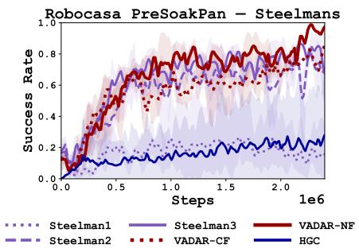  
Table 2: Variants bridging HGC and VADAR-NF, varying critic supervision, policy weighting (Table 1), and policy goal conditioning.  
Figure 6: Steelman sweep on ROBOCASA365 PRESOAKPAN with the OGPO backbone.

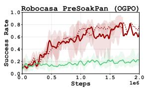

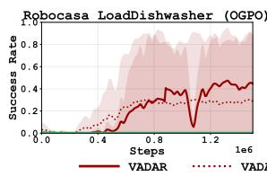

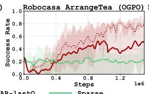

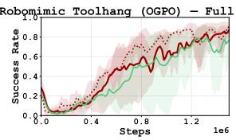  
Figure 7: Success rate of VADARLAST-Q compared with VADAR-NF and Sparse on selected tasks. Figure 21 gives the results across all benchmarks and instantiations.

Dense Subgoal Supervision Improves Critic Learning . To further test whether dense supervision across multiple temporal resolutions improves critic learning, we ask a stricter question: can intermediate subgoal supervision improve the nal-task critic even when those intermediate values are never used for policy extraction? We introduce VADARLAST-Q, which trains the same multi-goal critic asVADAR (Section 5) but extracts the policy using only the final-subgoal value $Q _ { \phi } ( s , a , g ^ { | G | } )$ . Thus, VADARLAST-Q uses the same policy objective as the Sparse baseline, while additionally supervising the critic on intermediate subgoals. Figure 7 shows that VADARLAST-Q approaches VADAR-NF on several tasks and substantially outperforms Sparse on the ROBOCASA365 benchmarks. Because the policy objective is unchanged, these gains isolate the effect of denser critic supervision. Full results across all benchmarks and policy-extraction methods are provided in Appendix M. This suggests that intermediate subgoal targets improve the critic even when their values are not used directly for policy extraction.

Effect of the policy extraction method. While VADARLAST-Q sometimes matches VADAR-NF, the size of this gap depends on the policy-extraction method. VADARLAST-Q is generally closer to VADAR-NF under OGPO, where the critic-derived signal supervises every denoising step of the generative policy. In FQL, where the critic provides less dense supervision than OGPO, VADARLAST-Q alone is not sufficient, and Next-future weighting provided additional gains.

## Takeaway: Intermediate supervision improves final-task learning

VADARLAST-Q, which uses VADAR for critic supervision, but only supervises on the final subgoal, improves over Sparse on the long-horizon RoBOCASA365 tasks even though intermediate subgoal values never enter its policy objective directly. This supports our hypothesis that dense subgoal supervision improves critic learning. Next-future weighting provides additional gains where final-subgoal extraction alone remains insufficient.

Further findings. We further compare against VADAR-SHAPED, which aggregates subgoal rewards before the Bellman backup and trains a scalar critic. It fails to learn on the harder ROBOCASA365 tasks and is less sample efficient than VADAR-NF elsewhere (Appendix O.1). These and the VADARLAST-Q results suggests that reward shaping alone does not explain the gains from all-subgoal critic supervision. Multi-objective optimization. VADAR also applies when reward components represent distinct objectives. As a proof of concept Appendix K.1 shows how to train separate critics for task completion and obstacle avoidance improving performance and training stability over SAC trained on the aggregated rewards with optimal reward weighting.

## 6.3 Test-Time Steering with a Frozen Policy

We hypothesize that VADAR's success comes from learning a better critic through denser supervision across multiple temporal resolutions. We test this directly by asking: does the learned critic better identify actions that lead to task success? To isolate critic quality from policy learning, we fix a behavior-cloned policy and update only the critic. Following Q-chunking (Li et al., 2025), we use best-of-N steering: a frozen behavior-cloned policy proposes N candidate action chunks, and the critic selects the highest-valued candidate. We compare VADAR-NF and Sparse critics trained on the same demonstrations and frozen-policy rollouts. For this steering experiment, next-future aggregation uses subgoal-completion indicators at inference; the unconditional policy learned in our main experiments requires no such information.

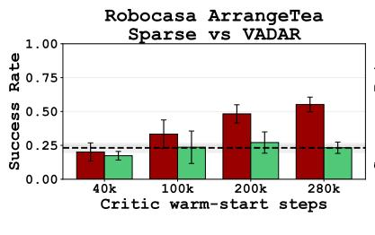

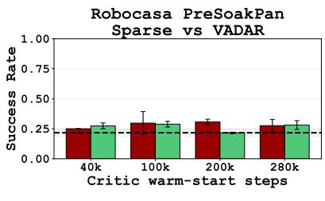

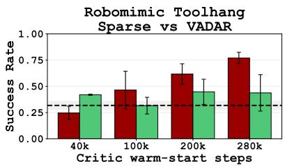  
Figure 8: Best-of-N steering $( N \ : = \ : 4 )$ of a frozen BC policy with VADAR-NF and Sparse critics as critic training progresses. The dashed line marks the unsteered policy's success rate. We use the BC-pretrained flow policy from OGPo, without online policy updates.

Figure 8 shows that the VADAR critic improves action selection most clearly on ARRANGETEA and ToOL-HANG. At the largest critic-training budget with $N = 4$ , success rises from 23% to 55% on ARRANGETEA and from 32% to 77% on ToOL-HANG, compared with 23% and 44% for the Sparse critic. Gains on PRESOAK-PAN are smaller. These results support the benefit of subgoal supervision for critic learning independently of policy updates. Appendix L provides the full protocol, seed variability, candidate-count sweep, and critic visualizations.

## 6.4 Hypothetical Mechanism: Implicit Bellman-Backup via Dense Critic Supervision

The frozen-policy experiments show that subgoal supervision improves action selection independently of policy updates. Together with the VADARLAST-Q results, they motivate a further question: how can intermediate subgoal targets improve value predictions for the final task? We hypothesize that shared representations allow supervision at shorter horizons to inform value prediction at longer horizons. We refer to this proposed mechanism as an implicit Bellman backup. For a fixed policy, the classical Bellman recursion is

$$
\begin{array} { r l } & { Q ^ { \pi } ( s , a ) = r ( s , a ) } \\ & { \qquad + \gamma \mathbb { E } _ { s ^ { \prime } \sim P ( \cdot \vert s , a ) , a ^ { \prime } \sim \pi ( \cdot \vert s ^ { \prime } ) } \big [ Q ^ { \pi } ( s ^ { \prime } , a ^ { \prime } ) \big ] . } \end{array}\tag{6.1}
$$

With sparse final-task rewards, one-step TD learning propagates the reward signal backward through successive bootstrapped targets. Function approximation can generalize across states, but the finaltask reward alone provides little direct supervision for learning representations of intermediate progress.

On the other hand, VADAR supervises $Q _ { \phi } ( s , a , g )$ for every subgoal $g \in G$ at each sampled transition (Eq. (5.2)). These targets span multiple temporal resolutions: a state far from task completion may already be close to an intermediate subgoal. We speculate that predicting these nearer outcomes trains useful features before the final-task value is accurate. Furthermore, because the subgoal predictions share network parameters (Figure 9), features learned from intermediate targets are also available to the final-subgoal prediction $Q _ { \phi } ( s , a , g ^ { | G | } ,$ ). We hypothesize that this transfer helps the critic learn dependencies across stages of the task that would otherwise have to be learned from final-task rewards alone.

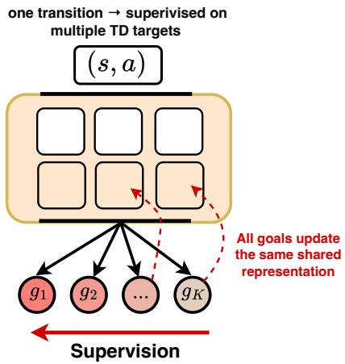  
Figure 9: All-subgoal TD targets update shared critic representations.

The VADARLAST-Q comparison provides evidence of this hypothesized mechanism: intermediate targets improve learning even though only the final-subgoal value enters policy extraction (Section 6.2). These comparisons do not establish additional Bellman backups within a forward pass or a guaranteed reduction in the number of TD updates. Appendix Q develops a related interpretation for iterative critics, which explicitly refine a vector of value estimates over multiple integration steps.

## 7 Limitations and Conclusion

This work introduces VADAR, an approach to critic learning that utilizes subtask decomposition, which provides significant improvements across a wide range of policy extraction algorithms as well as challenging environment specifications such as long horizon or safety filtering. Still, a limitation of VADAR is that it defining a fixed DAG structure of subtasks, whereas other methods enable conditioning on a continuum of goal information (Black et al., 2024; Physical Intelligence et al., 2026). We look forward to generalizing the design principles of VADAR to this continuous or combinatorially large goal spaces, such as those described by images or text, in future work. Moreover, while recent literature has focused on improved methods for policy extraction, particularly with modern expressive policy parameterizations (Ren et al., 2024; Patil et al., 2026; Park et al., 2025b; Dong et al., 2025), VADAR demonstrates that there remains significant untapped potential for algorithmic improvements to critic learning, particularly in long-horizon tasks. Moreover, in light of the recent popularity of scaling test-time computation (Snell et al., 2024), our study suggests a complimentary scaling direction: scaling the density of training signals used to supervise learning, which not only improves learning efficacy, but also reduces the need for complex test-time computation (e.g. VLM queries for goal-selection) at deployment.

## Acknowledgments

The authors would like to thank Nidhi Hegde for helping with the initial implementation. MS would like to thank Abhishek Gupta and Andrea Bajcsy for insightful discussions. SS would like to thank Manan Agarwal and Giri Anantharaman for their help with the baseline implementations and Shreyas Kowshik, Michael Chen, Pranav Vignesh, Elizabeth Terveen and other members of CMU MaxLab for the informative discussions and feedback on an earlier draft. This research used the Babel computational cluster resources provided by the School of Computer Science at Carnegie Mellon University. MS and SBP would like to acknowledge support from the Toyota Research Institute (TRI) University 3.0 program.

## References

Bhavya Agrawalla, Michal Nauman, Khush Agrawal, and Aviral Kumar. floq: Training critics via flowmatching for scaling compute in value-based rl. arXiv preprint arXiv:2509.06863, 2025.

Michael S Albergo, Nicholas M Boffi, and Eric Vanden-Eijnden. Stochastic interpolants: A unifying framework for flows and diffusions. arXiv preprint arXiv:2303.08797, 2023.

Dario Amodei, Chris Olah, Jacob Steinhardt, Paul Christiano, John Schulman, and Dan Mané. Concrete problems in ai safety, 2016. URL https://arxiv.org/abs/1606.06565.

Marcin Andrychowicz, Filip Wolski, Alex Ray, Jonas Schneider, Rachel Fong, Peter Welinder, Bob McGrew, Josh Tobin, Pieter Abbeel, and Wojciech Zaremba. Hindsight experience replay, 2018. URL https : //arxiv.org/abs/1707.01495.

Pierre-Luc Bacon, Jean Harb, and Doina Precup. The option-critic architecture, 2016. URL https : // arxiv.org/abs/1609.05140.

Philip J Ball, Laura Smith, Ilya Kostrikov, and Sergey Levine. Efficient online reinforcement learning with offline data. In International Conference on Machine Learning, pp. 1577–1594. PMLR, 2023.

André Barreto, Will Dabney, Rémi Munos, Jonathan J Hunt, Tom Schaul, Hado P Van Hasselt, and David Silver. Successor features for transfer in reinforcement learning. Advances in neural information processing systems, 30, 2017.

Kevin Black, Mitsuhiko Nakamoto, Pranav Atreya, Homer Walke, Chelsea Finn, Aviral Kumar, and Sergey Levine. Zero-shot robotic manipulation with pretrained image-editing diffusion models. In International Conference on Learning Representations (ICLR), 2024.

Ralph Allan Bradley and Milton E. Terry. Rank analysis of incomplete block designs: I. the method of paired comparisons. Biometrika, 39(3/4):324–345, 1952. ISSN 00063444, 14643510. URL http : //www . jstor.org/stable/2334029.

Daniel Brown, Wonjoon Goo, Prabhat Nagarajan, and Scott Niekum. Extrapolating beyond suboptimal demonstrations via inverse reinforcement learning from observations. In Kamalika Chaudhuri and Ruslan Salakhutdinov (eds.), Proceedings of the 36th International Conference on Machine Learning, volume 97 of Proceedings of Machine Learning Research, pp. 783–792. PMLR, 09–15 Jun 2019. URL https://proceedings.mlr.press/v97/brown19a.html.

Thomas P Cannon and Özgür Simsek. Accelerating task generalisation with multi-level skill hierarchies, 2025. URLhttps://arxiv.org/abs/2411.02998.

Kaiyuan Chen, Shuangyu Xie, Zehan Ma, Pannag R Sanketi, and Ken Goldberg. Robo2VLM: Improving visual question answering using large-scale robot manipulation data. In The Thirty-ninth Annual Conference on Neural Information Processing Systems Datasets and Benchmarks Track, 2026. URL https://openreview.net/forum?id=OChorZcZnY.

Xinyue Chen, Che Wang, Zijian Zhou, and Keith Ross. Randomized ensembled double q-learning: Learning fast without a model. arXiv preprint arXiv:2101.05982, 2021.

Cheng Chi, Siyuan Feng, Yilun Du, Zhenjia Xu, Eric Cousineau, Benjamin Burchfiel, and Shuran Song. Diffusion policy: Visuomotor policy learning via action diffusion. arXiv preprint arXiv:2303.04137, 2023.

Cheng Chi, Zhenjia Xu, Siyuan Feng, Eric Cousineau, Yilun Du, Benjamin Burchfiel, Russ Tedrake, and Shuran Song. Diffusion policy: Visuomotor policy learning via action diffusion. The International Journal of Robotics Research, 2024.

Peter Dayan. Improving generalization for temporal difference learning: The successor representation. Neural computation, 5(4):613–624, 1993.

Peter Dayan and Geoffrey E Hinton. Feudal reinforcement learning. In S. Hanson, J. Cowan, and C. Giles (eds.), Advances in Neural Information Processing Systems, volume 5. Morgan-Kaufmann, 1992. URL https://proceedings.neurips.cc/paper\_files/paper/1992/ file/d14220ee66aeec73c49038385428ec4c-Paper.pdf.

Thomas G. Dietterich. Hierarchical reinforcement learning with the maxq value function decomposition, 1999. URLhttps://arxiv.org/abs/cs/9905014.

Perry Dong, Qiyang Li, Dorsa Sadigh, and Chelsea Finn. Expo: Stable reinforcement learning with expressive policies. arXiv preprint arXiv:2507.07986, 2025.

Yuqing Du, Ksenia Konyushkova, Misha Denil, Akhil Raju, Jessica Landon, Felix Hill, Nando De Freitas, and Serkan Cabi. Vision-language models as success detectors. arXiv preprint arXiv:2303.07280, 2023.

Joshua B. Evans and Özgür Şimşek. Creating multi-level skill hierarchies in reinforcement learning, 2024. URLhttps://arxiv.org/abs/2306.09980.

Roy Fox, Sanjay Krishnan, Ion Stoica, and Ken Goldberg. Multi-level discovery of deep options, 2017. URL https://arxiv.org/abs/1703.08294.

Scott Fujimoto, Herke Hoof, and David Meger. Addressing function approximation error in actor-critic methods. In International conference on machine learning, pp. 1587–1596. PMLR, 2018.

Scott Fujimoto, Pierluca D'Oro, Amy Zhang, Yuandong Tian, and Michael Rabbat. Towards general-purpose model-free reinforcement learning. In International Conference on Learning Representations, volume 2025, pp. 83509–83552, 2025.

Caelan Reed Garrett, Rohan Chitnis, Rachel Holladay, Beomjoon Kim, Tom Silver, Leslie Pack Kaelbling, and Tomás Lozano-Pérez. Integrated task and motion planning. Annual review of control, robotics, and autonomous systems, 4(1):265–293, 2021.

Abhishek Gupta, Vikash Kumar, Corey Lynch, Sergey Levine, and Karol Hausman. Relay policy learning: Solving long-horizon tasks via imitation and reinforcement learning. arXiv preprint arXiv:1910.11956, 2019.

Abhishek Gupta, Vikash Kumar, Corey Lynch, Sergey Levine, and Karol Hausman. Relay policy learning: Solving long-horizon tasks via imitation and reinforcement learning. In Leslie Pack Kaelbling, Danica Kragic, and Komei Sugiura (eds.), Proceedings of the Conference on Robot Learning, volume 100 of Proceedings of Machine Learning Research, pp. 1025–1037. PMLR, 30 Oct–01 Nov 2020. URL https://proceedings.mlr.press/v100/gupta20a.html.

Tuomas Haarnoja, Aurick Zhou, Pieter Abbeel, and Sergey Levine. Soft actor-critic: Off-policy maximum entropy deep reinforcement learning with a stochastic actor. In International conference on machine learning, pp. 1861–1870. Pmlr, 2018a.

Tuomas Haarnoja, Aurick Zhou, Kristian Hartikainen, George Tucker, Sehoon Ha, Jie Tan, Vikash Kumar, Henry Zhu, Abhishek Gupta, Pieter Abbeel, et al. Soft actor-critic algorithms and applications. arXiv preprint arXiv:1812.05905, 2018b.

Leslie Pack Kaelbling. Learning to achieve goals. In International Joint Conference on Artificial Intelligence, 1993.URLhttps://api.semanticscholar.org/CorpusID:5538688.

Leslie Pack Kaelbling and Tomás Lozano-Pérez. Hierarchical task and motion planning in the now. In 2011 IEEE international conference on robotics and automation, pp. 1470–1477. IEEE, 2011.

Victoria Krakovna, Jonathan Uesato, Vladimir Mikulik, Matthew Rahtz, Tom Everitt, Ramana Kumar, Zachary Kenton, Jan Leike, and Shane Legg. Specification gaming: The flip side of ai ingenuity. https://deepmind.google/blog/ specification-gaming-the-flip-side-of-ai-ingenuity/,2020. DeepMindBlog.

Kimin Lee, Laura Smith, Anca Dragan, and Pieter Abbeel. B-pref: Benchmarking preference-based reinforcement learning. In Thirty-fifth Conference on Neural Information Processing Systems Datasets and Benchmarks Track (Round 1), 2021. URL https://openreview.net/forum?id=ps95-mkHF\_.

Andrew Levy, George Konidaris, Robert Platt, and Kate Saenko. Learning multi-level hierarchies with hindsight,2019.URLhttps://arxiv.org/abs/1712.00948.

Qiyang Li, Zhiyuan Zhou, and Sergey Levine. Reinforcement learning with action chunking. arXiv preprint arXiv:2507.07969, 2025.

Qiyang Li, Zhiyuan Paul Zhou, and Sergey Levine. Reinforcement learning with action chunking. Advances in Neural Information Processing Systems, 38:55518–55553, 2026.

Anthony Liang, Yigit Korkmaz, Jiahui Zhang, Minyoung Hwang, Abrar Anwar, Sidhant Kaushik, Aditya Shah, Alex S Huang, Luke Zettlemoyer, Dieter Fox, et al. Robometer: Scaling general-purpose robotic reward models via trajectory comparisons. arXiv preprint arXiv:2603.02115, 2026.

Bo Liu, Yifeng Zhu, Chongkai Gao, Yihao Feng, Qiang Liu, Yuke Zhu, and Peter Stone. Libero: Benchmarking knowledge transfer forlifelong robot learning, 2023a.URL https : //arxiv. org/abs/2306.03310.

Songtao Liu, Zhengkai Tu, Minkai Xu, Zuobai Zhang, Lu Lin, Rex Ying, Jian Tang, Peilin Zhao, and Dinghao Wu. Fusionretro: molecule representation fusion via in-context learning for retrosynthetic planning. In International Conference on Machine Learning, pp. 22028–22041. PMLR, 2023b.

Jiafei Lyu, Zichuan Lin, Scott Fujimoto, Kai Yang, Yangkun Chen, Saiyong Yang, Zongqing Lu, and Deheng Ye. Debiased model-based representations for sample-efficient continuous control, 2026. URL https : //arxiv.org/abs/2605.11711.

Ajay Mandlekar, Danfei Xu, Josiah Wong, Soroush Nasiriany, Chen Wang, Rohun Kulkarni, Li Fei-Fei, Silvio Savarese, Yuke Zhu, and Roberto Martín-Martín. What matters in learning from offline human demonstrations for robot manipulation. In arXiv preprint arXiv:2108.03298, 2021.

Ofir Nachum, Shixiang Shane Gu, Honglak Lee, and Sergey Levine. Data-efficient hierarchical reinforcement learning. Advances in neural information processing systems, 31, 2018.

Ashvin Nair, Vitchyr Pong, Murtaza Dalal, Shikhar Bahl, Steven Lin, and Sergey Levine. Visual reinforcement learningwith imagined goals,2018. URL https://arxiv.org/abs/1807.04742.

Ashvin Nair, Abhishek Gupta, Murtaza Dalal, and Sergey Levine. Awac: Accelerating online reinforcement learning with offline datasets, 2021.URL https://arxiv.org/abs/2006.09359.

Soroush Nasiriany, Vitchyr Pong, Steven Lin, and Sergey Levine. Planning with goal-conditioned policies. Advances in neural information processing systems, 32, 2019.

Soroush Nasiriany, Sepehr Nasiriany, Abhiram Maddukuri, and Yuke Zhu. Robocasa365: A large-scale simulation framework for training and benchmarking generalist robots. arXiv preprint arXiv:2603.04356, 2026.

NVIDIA, Johan Bjorck, Fernando Castañeda, Nikita Cherniadev, Xingye Da, Runyu Ding, Linxi "Jim" Fan, Yu Fang, Dieter Fox, Fengyuan Hu, Spencer Huang, Joel Jang, Zhenyu Jiang, Jan Kautz, Kaushil Kundalia Lawrence Lao, Zhiqi Li, Zongyu Lin, Kevin Lin, Guilin Liu, Edith Llontop, Loic Magne, Ajay Mandlekar, Avnish Narayan, Soroush Nasiriany, Scott Reed, You Liang Tan, Guanzhi Wang, Zu Wang, Jing Wang, Qi Wang, Jiannan Xiang, Yuqi Xie, Yinzhen Xu, Zhenjia Xu, Seonghyeon Ye, Zhiding Yu, Ao Zhang, Hao Zhang, Yizhou Zhao, Ruijie Zheng, and Yuke Zhu. Gr00t n1: An open foundation model for generalist humanoid robots,2025.URL https://arxiv.org/abs/2503.14734.

Chaoyi Pan, Giri Anantharaman, Nai-Chieh Huang, Claire Jin, Daniel Pfrommer, Chenyang Yuan, Frank Permenter, Guannan Qu, Nicholas Boffi, Guanya Shi, and Max Simchowitz. Much ado about noising: Dispelling the myths of generative robotic control, 2026.URL https: //arxiv. org/abs/2512.01809.

Seohong Park, Kevin Frans, Benjamin Eysenbach, and Sergey Levine. Ogbench: Benchmarking offline goalconditioned rl,2025a.URL https://arxiv.org/abs/2410.20092.

Seohong Park, Qiyang Li, and Sergey Levine. Flow q-learning, 2025b. URL https : //arxiv. org/abs/ 2502.02538.

Ronald Parr and Stuart Russell. Reinforcement learning with hierarchies of machines. In Proceedings of the 11th International Conference on Neural Information Processing Systems, NIPS'97, pp. 1043–1049, Cambridge, MA, USA, 1997. MIT Press.

Sarvesh Patil, Mitsuhiko Nakamoto, Manan Agarwal, Shashwat Saxena, Jesse Zhang, Giri Anantharaman, Cleah Winston, Chaoyi Pan, Douglas Chen, Nai-Chieh Huang, Zeynep Temel, Oliver Kroemer, Sergey Levine, Abhishek Gupta, Hongkai Da, Paarth Shah, and Max Simchowitz. Ogpo: Sample efficient fullfinetuning of generative control policies, 2026. URL https://arxiv.org/abs/2605.03065.

Shaohui Peng, Xing Hu, Rui Zhang, Ke Tang, Jiaming Guo, Qi Yi, Ruizhi Chen, Xishan Zhang, Zidong Du, Ling Li, Qi Guo, and Yunji Chen. Causality-driven hierarchical structure discovery for reinforcement learning,2022.URL https://arxiv.org/abs/2210.06964.

Physical Intelligence, Bo Ai, Ali Amin, Ashwin Balakrishna, Kevin Black, Danny Driess, Michael Equi, Chelsea Finn, Lachlan Groom, Karol Hausman, Brian Ichter, Sergey Levine, Karl Pertsch, Allen Z. Ren, Lucy Xiaoyang Shi, et al. $\pi _ { 0 . 7 } { : }$ a steerable generalist robotic foundation model with emergent capabilities. arXiv preprint arXiv:2604.15483, 2026.

Rafael Rafailov, Archit Sharma, Eric Mitchell, Christopher D Manning, Stefano Ermon, and Chelsea Finn Direct preference optimization: Your language model is secretly a reward model. Advances in neural information processing systems, 36:53728–53741, 2023.

Allen Z Ren, Justin Lidard, Lars L Ankile, Anthony Simeonov, Pulkit Agrawal, Anirudha Majumdar, Benjamin Burchfiel, Hongkai Dai, and Max Simchowitz. Diffusion policy policy optimization. arXiv preprint arXiv:2409.00588, 2024.

Tom Schaul, Daniel Horgan, Karol Gregor, and David Silver. Universal value function approximators. In Francis Bach and David Blei (eds.), Proceedings of the 32nd International Conference on Machine Learning, volume 37 of Proceedings of Machine Learning Research, pp. 1312–1320, Lille, France, 07–09 Jul 2015. PMLR.URLhttps://proceedings.mlr.press/v37/schaul15.html.

Daniel Shin, Anca D. Dragan, and Daniel S. Brown. Benchmarks and algorithms for offline preference-based rewardlearning,2023.URL https://arxiv.org/abs/2301.01392.

Charlie Snell, Jaehoon Lee, Kelvin Xu, and Aviral Kumar. Scaling llm test-time compute optimally can be more effective than scaling model parameters. arXiv preprint arXiv:2408.03314, 2024.

Richard S Sutton and Andrew G Barto. Reinforcement learning: An introduction second edition. Adaptive computation and machine learning: The MIT Press, Cambridge, MA and London, 2018.

Richard S Sutton, Andrew G Barto, et al. Reinforcement learning: An introduction, volume 1. MIT press Cambridge, 1998.

Richard S. Sutton, Doina Precup, and Satinder Singh. Between mdps and semi-mdps: A framework for temporal abstraction in reinforcement learning. Artificial Intelligence, 112(1):181–211, 1999. ISSN 0004- 3702. doi: https://doi.org/10.1016/S0004-3702(99)00052-1. URL https://www.sciencedirect. com/science/article/pii/S0004370299000521.

Fahim Tajwar, Anikait Singh, Archit Sharma, Rafael Rafailov, Jeff Schneider, Tengyang Xie, Stefano Ermon, Chelsea Finn, and Aviral Kumar. Preference fine-tuning of llms should leverage suboptimal, on-policy data. arXiv preprint arXiv:2404.14367, 2024.

Sreyas Venkataraman, Yufei Wang, Ziyu Wang, Navin Sriram Ravie, Zackory Erickson, and David Held. Realworld offline reinforcement learning from vision language model feedback. In IEEE/RSJ International Conference on Intelligent Robots and Systems (IROS), 2025.

Alexander Sasha Vezhnevets, Simon Osindero, Tom Schaul, Nicolas Heess, Max Jaderberg, David Silver, and Koray Kavukcuoglu. Feudal networks for hierarchical reinforcement learning, 2017. URL https : //arxiv.org/abs/1703.01161.

Yufei Wang, Zhanyi Sun, Jesse Zhang, Zhou Xian, Erdem Biyik, David Held, and Zackory Erickson. Rlvlm-f: Reinforcement learning from vision language foundation model feedback, 2024. URL https : //arxiv.org/abs/2402.03681.

Jason Wei, Xuezhi Wang, Dale Schuurmans, Maarten Bosma, Fei Xia, Ed Chi, Quoc V Le, Denny Zhou, et al. Chain-of-thought prompting elicits reasoning in large language models. Advances in neural information processing systems, 35:24824–24837, 2022.

Christian Wirth, Riad Akrour, Gerhard Neumann, and Johannes Fürnkranz. A survey of preference-based reinforcement learning methods. Journal of Machine Learning Research, 18(136):1–46, 2017.

Tonghe Zhang, Chao Yu, Sichang Su, and Yu Wang. Reinflow: Fine-tuning flow matching policy with online reinforcement learning. arXiv preprint arXiv:2505.22094, 2025.

## A Practitioner's Guide to VADAR

Here we give a short hands-on reference for applying VADAR to a new task or base algorithm. Subgoal decomposition. Most of the long horizon tasks can be decomposed naturally into subtasks which should be taked as the subgoals for VADAR. For robotics tasks, we believe that the subgoals defined by us for our environments (Appendix H) can serve as good examples for subgoal selections for a new task.

Weighting variant. From our experiments, we found VADAR-NF to be the most performative variant for robotic manipulation tasks, and recommend it as the default. VADAR-CF can train slightly faster early on when the first subgoal is hard to reach from BC initialization, at the cost of greater susceptibility to over-exploiting the current goal. The myopic variants are useful as ablations but not as defaults.

Adapting to a new base algorithm. VADAR is a wrapper over any Value Based RL Algorithm. Given any value-based RL algorithm A, the required modifications are:

1. Change critic output dim from 1 to |G| (backbone unchanged); ensemble aggregation becomes entrywise.

2. Store per-step completion vectors $\mathbf { d } _ { t }$ and per-head rewards $\mathbf { r } _ { t }$ in the replay buffer.

3. Replace the critic loss with its summed-over-heads version; broadcast any $\mathcal { L } _ { \mathrm { r e g } }$ across heads (see Appendix C.1 for more details).

4. Apply the entrywise reward clip in the TD target.

5. In the policy loss, replace $Q _ { \phi } ( s , a )$ with $Q _ { \mathrm { a g g } } ( s , a ) = \langle w ( \mathbf { d } ( s ) ) , \langle Q _ { \phi } ( s , a , g ) , g \in G \rangle \rangle$

The policy is not conditioned on subgoals. We have applied this recipe unchanged to SAC, FQL, and OGPO (Appendix C), and these serve as good references for applying VADAR to any new Value Based RL Algorithm.

## B Critic Parameterizations, Ensembling, and Target Networks

This section expands the brief mention in Section 3 of critic ensembling and target exponential moving averages (EMAs), which are standard practices in modern off-policy value-based RL and which we adopt without modification in VADAR. The recipes below apply uniformly across the base instantiations used in our experiments; specific details that interact with the policy update are covered in Appendix C.

## B.1 Critic Parameterizations

Vector-valued multi-goal critic. As an alternative to the goal-conditioned critic $Q _ { \phi } ( s , a , g )$ , VADAR can use a multi-goal critic $\mathbf { Q } _ { \phi } : S \times A  \mathbb { R } ^ { G }$ that maps each state-action pair to a [G|-dimensional vector of Q-values. The g-th entry $\mathbf { Q } _ { \phi } [ g ] ( s , a )$ estimates the value of the state-action pair under the MDP induced by the per-subgoal reward $r _ { g } .$ Crucially, all [G| entries share a single network backbone, enabling representation sharing across subgoals: features learned for predicting one subgoal's completion are available to all others, Both parameterizations provide dense supervision across subgoals; Appendix P compares them empirically. Appendix N shows the vector-valued critic can be interpreted simply as a structured instantiation of successor features (Barreto et al., 2017), where each feature corresponds to subgoal performance

## B.2 Critic Ensembles

Off-policy methods are known to suffer from overestimation bias: maximizing over a noisy approximation of $Q ^ { \pi }$ systematically inflates the resulting target (Fujimoto et al., 2018; Chen et al., 2021). The standard remedy is to train an ensemble of M critic networks $Q _ { \phi _ { 1 } } , \dots , Q _ { \phi _ { M } } : S \times A \to \mathbb { R }$ and aggregate their predictions when forming the TD target. We modify the classical scalar-valued critic in each ensemble member to be a goal-conditioned critic $\mathring { Q _ { \phi _ { i } } } : S \times A \times \bar { G }  \mathbb { R }$ . Concretely, given any aggregator $\arg _ { M } : \mathbb { R } ^ { M } \to \mathbb { R } \left( \mathbf { e . g . } \right.$ mean, min), we extend it to act on the M vector critics by applying it independently to each subgoal head: for every $g \in G$

$$
\left[ \mathrm { a g g } _ { M } \big ( Q _ { \phi _ { 1 } } , \ldots , Q _ { \phi _ { M } } \big ) \right] ( s , a , g ) = \mathrm { a g g } _ { M } \Big ( Q _ { \phi _ { 1 } } \big ( s , a , g \big ) , \ldots , Q _ { \phi _ { M } } \big ( s , a , g \big ) \Big ) .\tag{B.1}
$$

We use Eq. (B.1) as the meaning of “entrywise aggregation" throughout the paper, and refer back to it whenever an aggregator is applied to the critic. The ensemble size M is taken to be 10 (M = 10) by default, unless otherwise specified.

## B.3 Target Aggregation

The TD target $Q _ { \bar { \phi } } ( s ^ { \prime } , a ^ { \prime } )$ is computed by aggregating the predictions of M target critics $Q _ { \bar { \phi } _ { 1 } } , \ldots , Q _ { \bar { \phi } _ { M } } :$ $S \times A \times G \to \mathbb { R }$ , whose parameters are an EMA of the online critics (Appendix B.4). We usé the ensemble mean as the aggregator $\mathrm { a g g } _ { M }$ throughout, applied entrywise per Eq. (B.1):

$$
Q _ { \bar { \phi } } ( s ^ { \prime } , a ^ { \prime } , g ) = \frac { 1 } { M } \sum _ { i = 1 } ^ { M } Q _ { \bar { \phi } _ { i } } ( s ^ { \prime } , a ^ { \prime } , g ) \forall g \in G .\tag{B.2}
$$

The aggregated scalar $Q _ { \mathrm { t a r g } } ( s ^ { \prime } , a ^ { \prime } ) = \langle { \bf w } , \langle Q _ { \bar { \phi } } ( s ^ { \prime } , a ^ { \prime } , g ) , g \in G \rangle \rangle$ used downstream by the policy update (Eq. (5.1)) is recovered by an inner product with the policy-extraction weights w $\begin{array} { r l } { ( \mathbf { w } ( s ) } & { { } = } \end{array}$ GETWEIGHTING(d(s)) based on the weighting strategies we described in Table 1). Note that other standard alternatives like the full ensemble minimum, or a randomized two-sample minimum in the style of REDQ (Chen et al., 2021) can also be used for the curtailing overestimation bias, but we found the entrywise mean to work consistently well across all VADAR experiments and adopt it as the default.

## B.4 Target Network EMAs

To stabilize the moving Bellman target, we maintain a separate set of target critic parameters $\bar { \phi } _ { 1 } , \dots , \bar { \phi } _ { M }$ that lag the online parameters via Polyak averaging:

$$
\bar { \phi } _ { i }  ( 1 - \tau ) \bar { \phi } _ { i } + \tau \phi _ { i } , \qquad i = 1 , \ldots , M ,\tag{B.3}
$$

with decay rate $\tau \in \mathsf { \Gamma } ( 0 , 1 ]$ applied at every gradient step. We use $\tau = 0 . 0 0 5$ throughout. When the base algorithm requires a target policy, the same Polyak update is applied to the policy parameters:

$$
\bar { \theta }  ( 1 - \tau ) \bar { \theta } + \tau \theta .\tag{B.4}
$$

Whether a target policy is maintained, and how it is used, is algorithm-specific; see Appendix C.

## B.5 Critic Loss

Combining Eqs. (B.2) and (B.3) with VADAR's formulation (Eq. (5.2)) yields the following per-ensemblemember critic loss, summed over subgoal heads:

$$
L _ { \mathrm { c r i t i c } } ( Q _ { \phi _ { i } } \mid s , a , { \bf y ^ { t a r g e t } } ) = \sum _ { g \in G } \left( Q _ { \phi _ { i } } ( s , a , g ) - { \bf y ^ { t a r g e t } } \right) ^ { 2 } , \qquad i = 1 , \ldots , M ,\tag{B.5}
$$

where $\mathbf { y } ^ { \mathrm { t a r g e t } }$ is the clipped vector TD target from Eq. (5.2).

## C Base-Algorithm Details: SAC, FQL, and OGPO

We position VADAR as a wrapper around any value-based RL algorithm that replaces each scalar critic with a goal-conditioned critic $Q _ { \phi _ { i } } : S \times A \times G \to \mathbb { R }$ , evaluated once per subgoal, with a few variations in the $Q _ { \mathrm { t a r g } }$ aggregation that can be plugged into the base algorithm's policy extraction objective. Here we present the policy losses $L _ { \mathrm { p o l i c y } }$ and any algorithm-specific implementation details for the three base algorithms used in our experiments: SAC, FQL, and OGPO. Section 6.1 pairs each base algorithm with a benchmark suite (SAC with OGBENCH and LIBERO, FQL with ROBOMIMIC, and OGPO with both ROBOMIMIC and ROBOCASA365); coupling each policy extraction method to its correspondingly challenging benchmark(s). The descriptions below are restricted to the components that interact with VADAR.

## C.1 Soft Actor-Critic (SAC)

sAc (Haarnoja et al., 2018a) is a maximum-entropy off-policy actor-critic algorithm that augments the standard return with a per-step entropy bonus $\alpha \mathcal { H } ( \pi ( \cdot \mid s ) \bar { \rangle }$ ). The optimal policy is the one that maximizes

$$
J ( \pi ) = \sum _ { t \geq 0 } \mathbb { E } _ { ( s _ { t } , a _ { t } ) } \left[ R ( s _ { t } , a _ { t } ) + \alpha \mathcal { H } \big ( \pi ( \cdot \mid s _ { t } ) \big ) \right] ,\tag{C.1}
$$

where $\alpha > 0$ is a temperature controlling the entropy-reward trade-off. We use a Gaussian policy with a tanhsquashing transform that bounds actions in $[ - 1 , 1 ] ^ { \dim A }$ (Haarnoja et al., 2018a, Eq. (11)): $a _ { t } = \operatorname { t a n h } ( \mu _ { \theta } ( s _ { t } ) +$ $\sigma _ { \theta } ( s _ { t } ) \odot \epsilon _ { t } )$ , with $\epsilon _ { t } \sim \mathrm { N } ( 0 , I )$

Critic loss. The soft Q-function is trained against an entropy-augmented Bellman target. Plugging into the value-based RL template of Section $3 ( L _ { \mathrm { c r i t i c } } \mathbf { \tilde { ( } } Q _ { \phi } \mid s , a , y ^ { \mathrm { t a r \tilde { g } \tilde { e } t } } ) = ( Q _ { \phi } ( s , a ) - y ^ { \mathrm { t a r g e t } } ) ^ { 2 } + L _ { \mathrm { r e g } } ) $ , the entropy bonus enters through the regularizer in the target:

$$
y ^ { \mathrm { t a r g e t } } = r + \gamma \left[ Q _ { \mathrm { t a r g } } ( s ^ { \prime } , a ^ { \prime } ) - \alpha \log \pi _ { \theta } ( a ^ { \prime } \mid s ^ { \prime } ) \right] , \quad \quad a ^ { \prime } \sim \pi _ { \theta } ( \cdot \mid s ^ { \prime } ) ,\tag{C.2}
$$

so that $L _ { \mathrm { r e g } } ( s ^ { \prime } , a ^ { \prime } , \pi _ { \theta } ) = - \gamma \alpha \log \pi _ { \theta } ( a ^ { \prime } \mid s ^ { \prime } )$ in the notation of Section 3.

Policy loss. The actor minimizes the KL-divergence between the policy and the (exponentiated) soft Qfunction. Using the reparameterization trick (Haarnoja et al., 2018b, Eq. (12)), this reduces to:

$$
L _ { \mathrm { p o l i c y } } ( \pi _ { \theta } \mid s , Q _ { \phi } ) = \mathbb { E } _ { a \sim \pi _ { \theta } ( \cdot \mid s ) } \Big [ \alpha \log \pi _ { \theta } ( a \mid s ) - s \mathrm { g } \left[ Q _ { \phi } ( s , a ) \right] \Big ] ,\tag{C.3}
$$

where $\mathtt { S g }$ is the stopgrad operator. The expectation is estimated by a single reparameterized sample per state and the gradient flows through the Squashed Gaussian into both the policy µθ and $\sigma _ { \theta }$ heads.

Temperature auto-tuning. We tune α to match a target entropy $\bar { { \mathcal { H } } } \ = \ - \dim ( A )$ via the auxiliary loss (Haarnoja et al., 2018b, Eq. (18)):

$$
L ( \alpha ) = \mathbb { E } _ { a \sim \pi _ { \theta } ( . | s ) } \bigl [ - \alpha \log \pi _ { \theta } ( a \mid s ) - \alpha \bar { \mathcal { H } } \bigr ] .\tag{C.4}
$$

Interaction with VADAR. The scalar critic $Q _ { \phi } : S \times A \to \mathbb { R }$ is replaced by the goal-conditioned critic $Q _ { \phi } : S \times A \times G \to \mathbb { R }$ , which is evaluated once for every subgoal $g \in G$ . The Bellman target in Eq. (C.2) is computed for all goals, with the same next action $a ^ { \prime }$ and the same entropy regularizer shared across subgoals:

$$
\mathbf { y } ^ { \mathrm { t a r g e t } } [ g ] = \mathbf { r } [ g ] + \gamma \left[ Q _ { \vec { \phi } } ( s ^ { \prime } , a ^ { \prime } , g ) - \alpha \log \pi _ { \theta } ( a ^ { \prime } \mid s ^ { \prime } ) \right] , \qquad a ^ { \prime } \sim \pi _ { \theta } ( \cdot \mid s ^ { \prime } ) , \qquad \forall g \in G ,\tag{C.5}
$$

where $Q _ { \bar { \phi } }$ is the target critic as defined in Appendix $\mathrm { B . 4 } ,$ and the per-ensemble-member critic loss is summed over subgoals (Appendix B):

$$
L _ { \mathrm { c r i t i c } } ( Q _ { \phi _ { i } } \mid s , a , { \bf y } ^ { \mathrm { t a r g e t } } ) = \sum _ { g \in G } \left( Q _ { \phi _ { i } } ( s , a , g ) - { \bf y } ^ { \mathrm { t a r g e t } } [ g ] \right) ^ { 2 } .\tag{C.6}
$$

The actor sees only the aggregated scalar $\begin{array} { r } { Q _ { \mathrm { a g g } } ( s , a ) = \sum _ { g \in G } \mathbf { w } [ g ] Q _ { \phi } ( s , a , g ) } \end{array}$ of Eq. (5.1), so the policy loss in Eq. (C.3) becomes

$$
L _ { \mathrm { p o l i c y } } ( \pi _ { \theta } \mid s , Q _ { \mathrm { a g g } } ) = \mathbb { E } _ { a \sim \pi _ { \theta } ( \cdot \mid s ) } { \Big [ } \alpha \log \pi _ { \theta } ( a \mid s ) - { \mathrm { s } } { \mathrm { g } } { \Big [ } \sum _ { g \in G } \mathbf { w } [ g ] Q _ { \phi } ( s , a , g ) { \Big ] } { \Big ] } .\tag{C.7}
$$

The temperature loss remains unchanged.

## C.2 Flow Q-Learning (FQL)

FQL (Park et al., 2025b) is an off-policy method designed for expressive flow-matching policies. Its key idea is to avoid backpropagating through the multi-step ODE integration of a flow policy by training a separate, expressive one-step policy that is simultaneously (i) regularized toward a frozen behavioral-cloning (BC) flow policy via a distillation loss and (ii) optimized to maximize the critic.

Architecture. FQL maintains three networks: a critic $Q _ { \phi } ,$ , a BC flow policy $\mu _ { \boldsymbol { \theta } } ( s , z )$ that defines a flowmatching velocity field $v _ { \theta } ( t , s , x ^ { t } )$ , and a one-step policy $\mu _ { \omega } ( s , z ) : S \times \mathbb { R } ^ { \dim A } \to A$ that maps Gaussian noise $z \sim \mathrm { N } ( 0 , I _ { \dim A } )$ directly to an action.

BC flow loss. The BC flow policy is trained with the standard flow-matching objective on the offline dataset D (Park et al., 2025b, Eq. (5)):

$$
\begin{array} { r l } & { \mathcal { L } _ { \mathrm { F l o w } } ( \theta ) \ = \ \mathbb { E } _ { ( s , a ^ { 1 } ) \sim \mathcal { D } , x ^ { 0 } \sim \mathrm { N } ( 0 , I ) } \Big [ \big \| v _ { \theta } ( t , s , x ^ { t } ) - ( a ^ { 1 } - x ^ { 0 } ) \big \| _ { 2 } ^ { 2 } \Big ] , \quad x ^ { t } = ( 1 - t ) x ^ { 0 } + t a ^ { 1 } . } \\ & { \qquad t \sim \mathrm { U n i f } ( [ 0 , 1 ] ) } \end{array}\tag{C.8}
$$

The corresponding stochastic policy $\pi _ { \boldsymbol { \theta } } ( \boldsymbol { a } \mid \boldsymbol { s } )$ is the push-forward of $\mathrm { N } ( 0 , I )$ under the ODE $\mu _ { \boldsymbol { \theta } } ( s , \cdot )$ defined by $v _ { \theta }$ . Crucially, this loss is the only training signal seen by the flow policy: µθ is never updated against $Q _ { \phi }$

Critic loss. The critic is trained with the standard TD residual but using the one-step policy $\mu _ { \omega }$ in the bootstrap action (Park et al., 2025b, Sec. 3):

$$
L _ { \mathrm { c r i t i c } } ( Q _ { \phi } ) = \mathbb { E } _ { ( s , a , r , s ^ { \prime } ) \sim \mathcal { D } , z \sim \mathrm { N } ( 0 , I ) } \Big [ \big ( Q _ { \phi } ( s , a ) - r - \gamma Q _ { \mathrm { t a r g } } ( s ^ { \prime } , \mu _ { \omega } ( s ^ { \prime } , z ) ) \big ) ^ { 2 } \Big ] ,\tag{C.9}
$$

where $Q _ { \mathrm { t a r g } } = Q _ { \bar { \phi } }$ is the EMA target critic (Appendix B.4).

One-step policy loss. The one-step policy is trained against an actor loss with two terms: a Q-maximization term and a distillation term that pulls $\mu _ { \omega } ( s , z )$ toward the BC flow policy's output $\mu _ { \boldsymbol { \theta } } ( s , z )$ at the same noise z (Park et al., 2025b, Eqs. (7),(9)):

$$
\begin{array} { r l } & { L _ { \mathrm { p o l i c y } } ( \pi _ { \omega } \mid s , Q _ { \phi } ) = \underbrace { \mathbb { E } _ { s \sim \mathcal { D } , z \sim \mathrm { N } ( 0 , \cal { I } ) } { \big [ - Q _ { \phi } ( s , a ^ { \pi } ) \big ] } } _ { \mathrm { Q ~ l o s s } } + \alpha _ { \mathrm { F Q L } } \underbrace { \mathbb { E } _ { { s \sim \mathcal { D } } ( \mathcal { D } , \cal { I } ) } { \big [ \| \mu _ { \omega } ( s , z ) - \mu _ { \theta } ( s , z ) \| _ { 2 } ^ { 2 } \big ] } } _ { \mathrm { d i s t i l a t o n ~ l o s s } } . } \end{array}\tag{C.10}
$$

Gradients of the distillation term are stopped at $\mu _ { \theta } .$ so the BC flow policy is not affected.

Interaction with VADAR. When applying VADAR on top of FQL, the scalar critic is replaced by the goalconditioned critic $Q _ { \phi } : S \times A \times \bar { G } \stackrel { . } {  } \mathbb { R }$ , evaluated once for every subgoal $g \in G$ The TD bootstrap is computed for all goals, using a single bootstrap action $\mu _ { \omega } ( s ^ { \prime } , z )$ shared across subgoals:

$$
{ \bf y } ^ { \mathrm { t a r g e t } } [ g ] = { \bf r } [ g ] + \gamma Q _ { \bar { \phi } } ( s ^ { \prime } , \mu _ { \omega } ( s ^ { \prime } , z ) , g ) , \qquad z \sim \mathrm { N } ( 0 , I ) , \qquad \forall g \in G ,\tag{C.11}
$$

and the per-ensemble-member critic loss is summed over subgoals:

$$
L _ { \mathrm { c r i t i c } } ( Q _ { \phi _ { i } } \mid s , a , { \bf y } ^ { \mathrm { t a r g e t } } ) = \mathbb { E } _ { ( s , a , { \bf r } , s ^ { \prime } ) \sim \mathcal { D } , z } \Big [ \sum _ { g \in G } \big ( Q _ { \phi _ { i } } ( s , a , g ) - { \bf y } ^ { \mathrm { t a r g e t } } [ g ] \big ) ^ { 2 } \Big ] .\tag{C.12}
$$

Similar to before, we define the online aggregate $\begin{array} { r } { Q _ { \mathrm { a g g } } ( s , a ) : = \sum _ { q \in G } \mathbf { w } [ g ] Q _ { \phi } ( s , a , g ) } \end{array}$ (online critic, matching the FQL convention of Eq. (C.10)). The Q-loss term in Eq. (C.10) then becomes

$$
L _ { \mathrm { p o l i c y } } ( \pi _ { \omega } \mid s , Q _ { \mathrm { a g g } } ) = \underbrace { \mathbb { E } _ { s \sim \mathcal { D } , z \sim \mathrm { N } ( 0 , I ) } { \Big [ } - \sum _ { g \in G } \mathbf { w } [ g ] Q _ { \phi } ( s , a ^ { \pi } , g ) { \Big ] } } _ { \mathrm { Q l o s s } } + \alpha _ { \mathrm { F Q L } } { \mathcal { L } } _ { \mathrm { d i s t i l l } } ( \omega ; \theta ) .\tag{C.13}
$$

The distillation term is unchanged. The deployed policy is the one-step $\mu _ { \omega }$ , which takes no goal as input and hence requires no goal information at inference (in line with VADAR's subgoal-agnostic property).

## C.3 Off-Policy Generative Policy Optimization (OGPO)

OGPo (Patil et al., 2026) is an off-policy actor-critic for generative control policies (GCPs), like flow matching and diffusion, that side-steps the instabilities of backpropagation through the flow ODE by applying a zeroorder PPO-style update to the denoising chain itself. VADAR pairs with OGPO on our most challenging longhorizon benchmarks (ROBOMIMIC, and ROBOCASA365). We summarize the policy loss here and note that OGPo follows the same aforementioned critic ensembling and EMA strategies (Appendix B).

Setup. A flow-based GCP samples an action $\boldsymbol { a } _ { t , 0 }$ via a K-step denoising chain $a _ { t , K }  a _ { t , K - 1 }  \cdot \cdot \cdot  a _ { t , 0 } .$ where each step samples $a _ { t , k - 1 } \sim \pi _ { \theta } ( \cdot \mid s _ { t } , a _ { t , k } )$ . The likelihood of a full chain factorizes as

$$
\pi _ { \boldsymbol \theta } ( a _ { t , K : 0 } \mid s _ { t } ) = \prod _ { k = 1 } ^ { K } \pi _ { \boldsymbol \theta } ( a _ { t , k - 1 } \mid s _ { t } , a _ { t , k } ) .\tag{C.14}
$$

OGPO treats the denoising trajectory $a _ { t , K : 0 }$ as a sequence in an inner “denoising $\mathbf { M D P } ^ { \prime }$ embedded inside the environment MDP, and applies PPO at the level of this inner MDP only.

Annealed importance sampling ratio. The reference policy is the EMA target $\pi _ { \bar { \theta } }$ (Appendix B.4). The policy ratio is the product of per-step ratios over the entire chain:

$$
\omega _ { \theta } : = \prod _ { k = 1 } ^ { K } \frac { \pi _ { \theta } ( a _ { t , k - 1 } \mid s _ { t } , a _ { t , k } ) } { \pi _ { \bar { \theta } } ( a _ { t , k - 1 } \mid s _ { t } , a _ { t , k } ) } .\tag{C.15}
$$

OGPO Policy Updates OGPO performs policy extraction via a PPO-style zeroth order policy gradient update that considers the entire flow-denoising chain as an MDP. The terminal action $\boldsymbol { a } _ { t , 0 }$ is the only action evaluated against the target critic. OGPO draws a group of $N _ { \mathsf { g r o u p } }$ denoising trajectories $a _ { K : 0 } ^ { ( i , j ) }$ from $\pi _ { \bar { \theta } } ( \cdot \mid s ^ { ( i ) } )$ per state and uses the group mean as a value baseline:

$$
\hat { V } ^ { ( i ) }  \frac { 1 } { N _ { \mathrm { g r o u p } } } \sum _ { j = 1 } ^ { N _ { \mathrm { g r o u p } } } Q _ { \mathrm { t a r g } } ( s ^ { ( i ) } , a _ { 0 } ^ { ( i , j ) } ) , \hat { A } = Q _ { \mathrm { t a r g } } ( s _ { t } , a _ { t , 0 } ) - \hat { V } .\tag{C.16}
$$

This GRPO-style baseline obviates the need for a separately learned value network.

Policy loss. The PPO-clipped surrogate loss is applied over the entire flow denoising chain as:

$$
\begin{array} { r } { L _ { \mathrm { p o l i c y } } ( \pi _ { \theta } \mid s , Q _ { \mathrm { t a r g } } ) = - \mathbb { E } _ { a _ { t , K : 0 } \sim \pi _ { \theta } ^ { - } ( \cdot \mid s _ { t } ) } \Big [ \operatorname* { m i n } \big ( \omega _ { \theta } \hat { A } , \mathrm { c l i p } ( \omega _ { \theta } , 1 - \epsilon , 1 + \epsilon ) \hat { A } \big ) \Big ] , } \end{array}\tag{C.17}
$$

where € is the PPO clip parameter. Because both $\omega _ { \theta }$ and the denoising trajectories can be computed in parallel without the need for environmental interactions, the loss is fully parallelizable across the $N _ { \mathrm { b a t c h } } \times N _ { \mathrm { g r o u p } }$ batch.

Noise injection for flow policies. Evaluating ωθ requires per-step likelihoods $\pi _ { \theta } ( a _ { t , k - 1 } \mid s _ { t } , a _ { t , k } )$ to be nonsingular. Following ReinFlow (Zhang et al., 2025), we replace the deterministic Euler step with a Gaussiannoised update $a _ { t , k - 1 } \sim \mathrm { N } ( v _ { \theta } ( a _ { t , k } , k / K , s _ { t } ) , \sigma _ { k } ^ { 2 } I )$ , and retain the marginal path-preserving correction of Albergo et al. (2023) so that the per-step SDE marginals match standard ODE flow matching rollouts.

Interaction with $\mathrm { V A D A R } .$ The critic is the goal-conditioned $Q _ { \phi } : S \times A \times G \to \mathbb { R }$ , trained on the all-goal targets ${ \bf y } ^ { \mathrm { t a r g e t } } [ g ] = { \bf r } [ g ] + \gamma Q _ { \bar { \phi } } ( s ^ { \prime } , a ^ { \prime } , g )$ for every $g \in G$ , exactly as above. VADAR composes with OGPO by replacing the scalar $Q _ { \mathrm { t a r g } }$ in the advantage computation with the aggregate of the target critic evaluated on every subgoal, following Eq. (5.1):

$$
\begin{array} { l l } { { \displaystyle Q _ { \mathrm { a g g } } \big ( s , a \big ) = \sum _ { g \in G } { \bf w } [ g ] Q _ { \bar { \phi } } ( s , a , g ) } , \ ~ } \\ { { \displaystyle \hat { V } ^ { ( i ) }  \frac { 1 } { N _ { \mathrm { g r o u p } } } \sum _ { i = 1 } ^ { N _ { \mathrm { g r o u p } } } Q _ { \mathrm { a g g } } \big ( s ^ { ( i ) } , a _ { 0 } ^ { ( i , j ) } \big ) } , \ ~ \hat { A } = Q _ { \mathrm { a g g } } \big ( s _ { t } , a _ { t , 0 } \big ) - \hat { V } . \ ~ }  \end{array}\tag{C.18}
$$

The same weights w are used for all $N _ { \mathsf { g r o u p } }$ samples of a given state, since they depend only on that state's completion vector. The PPO surrogate, group baseline, and noise-injection scheme are otherwise unchanged For our experiments, unless otherwise stated, we use the OGPo+ variant (due to its superior performance).

## D Limitations of Explicit and Implicit Hierarchical Goal Conditioning

We examine the limitations summarized in Section 4 using implicit hierarchical goal conditioning (iHGC), which preserves goal-conditioned critics but removes goal conditioning from the policy.

## D.1 Implicit Hierarchical Goal Conditioning

Definition D.1 (Implicit Hierarchical Goal Conditioning (iHGC)). Implicit goal conditioning follows the Hierarchical Goal Conditioning in Algorithm 1, with the sole modification that the policy $\pi ( a \mid s )$ is not conditioned on subgoal information.

We run HGC using oracle dones, providing perfect subgoal selection for this comparison

iHGC eliminates the first limitation described above, as now the policy need not incorporate goal information at deployment time. As an immediate example, Figure 10 compares iHGC and HGC on ROBOMIMIC TOOL-HANG with the FQL (Appendix C for more details) policy extraction backbone. Removing goal information from the policy improves final performance and yields a smoother learning curve, suggesting that goal-conditioning the policy can introduce unnecessary instability even when goal-conditioned critics remain useful. We hypothesize that removing goal-conditioning inputs avoids aliasing at goal boundaries.

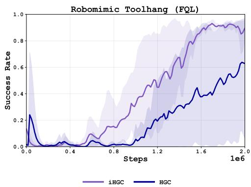  
Figure 10: TOOL-HANG with FQL: iHGC learns more smoothly and achieves higher final success than HGC.

## D.2 Both Explicit and Implicit Hierarchical Goal Conditioning Suffer from Myopic Behavior

However, we still find that implicit and explicit hierarchical goal conditioning run into a common failure mode: overly myopic policy exploitation. Both methods update the policy against the critic of the currently active subgoal alone. As a result, the policy is rewarded for completing the current subgoal without accounting for how its manner of completion affects subsequent subtasks. We illustrate this failure mode on ROBOCASA365 ARRANGETEA and PRESOAKPAN in Figure 11.

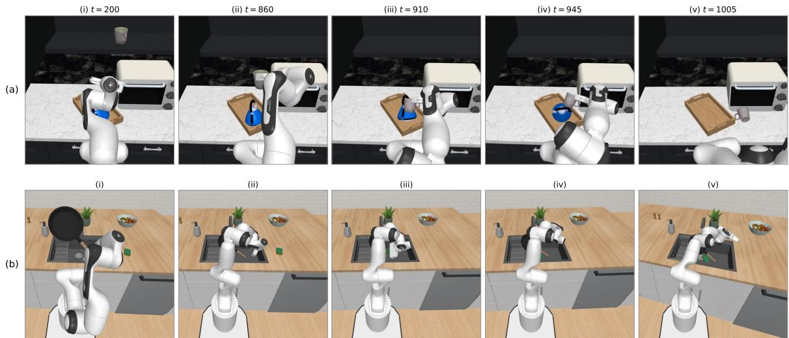  
Figure 11: Myopic failure modes of goal-conditioned policies. Rollouts of policies trained to optimize only the current subgoal on ROBOCASA365 ARRANGETEA (a, top) and PRESOAKPAN (b, bottom); frames are chronological within each row. In (a), the kettle is placed on the tray without leaving room for the mug, so the subsequent mug placement collides with the kettle and knocks it off the counter. In (b), the pan is dropped into the sink in a position that does not permit a stable placement of the sponge on top of it

In Figure 11(a), the policy places the kettle on the tray in a position that obstructs the subsequent mug placement. The “placing the kettle" subgoal is complete, but attempting to place the mug causes a collision that knocks the kettle off the counter. In Figure 11(b), the policy places the pan in the sink in a position that prevents stable placement of the sponge. Both these failure cases are manifestations of over-optimizing for the current subtask (Limitation 2). The policy does not distinguish between merely completing the current subgoal and completing it in a way that facilitates future subgoals. Our method, VADAR, addresses this limitation by optimizing the policy for future-subgoal values (Section 5), providing a learning signal for actions that enable progress toward full-task completion rather than just myopically completing the current subtask

## E Dense Preference Reward: Algorithms and Implementation Details

## E.1 Background and Limitations

An alternative to HGC for solving the credit assignment problem is to craft a denser reward signal $^ { r } \cdot$ When oracle dense rewards are not available, the most popular data-dependent method has been preference-based dense rewards defined at the level of full trajectories $\tau = ( s _ { 1 } , a _ { 1 } , \dotsc , s _ { H } , a _ { H } )$ . Given two trajectories $\tau _ { 1 } , \tau _ { 2 }$ one maximizes the Bradley-Terry-Luce (BTL) (Bradley & Terry, 1952) likelihood, assuming the probability that $\tau _ { 2 }$ is preferred to $\tau _ { 1 }$ is given by

$$
P ( \tau _ { 1 }  \tau _ { 2 } \mid \psi , \beta ) = \frac { \exp ( \beta R _ { \psi } ( \tau _ { 2 } ) ) } { \exp ( \beta R _ { \psi } ( \tau _ { 1 } ) ) + \exp ( \beta R _ { \psi } ( \tau _ { 2 } ) ) } ,\tag{E.1}
$$

where $\begin{array} { r } { R _ { \psi } ( \tau ) = \sum _ { s \in \tau } r _ { \psi } ( s ) } \end{array}$ is cumulative trajectory return, $r _ { \psi } ( s )$ is a learned, per-state dense reward, and $\beta$ is a temperature parameter. Preference based rewards have shown strong promise (Wirth et al., 2017; Rafailov et al., 2023; Tajwar et al., 2024), but are subject to other limitations: (1) assigning consistent numerical progress values on very long, multi-step tasks is challenging; (2) statistical errors in reward learning can lead to reward hacking; and (3) effective reward learning can require large datasets. Dense rewards are imperfect proxies for desired behavior, and agents may exploit errors in the learned reward rather than complete the task (Amodei et al., 2016; Krakovna et al., 2020). For an empirical comparison with value disaggregation, see Appendix F.2. We describe our implementation below.

## E.2 Implementation

We implemented dense prefence rewards for the same policy backbones as VADAR: OGPO, SAC, FQL. Our PBRL implementation was heavily inspired by (Shin et al., 2023; Wang et al., 2024; Venkataraman et al., 2025) . We used trajectory-wise preferences to train a state-based reward model independently for each task. Trajectory preferences were autogenerated and fit using the Bradley-Terry (Bradley & Terry, 1952) model. When training the reward model, we uniformly sample from the generated preference dataset. We found that the most reliable preference signal was binary trajectory success. To ensure we used the most accurate preference signal, we experimented with alternatives in Table 3, but found them to be inaccurate.

Table 3: Alternative auto generated preference signals tested for PBRL.
<table><tr><td>Signal</td><td>Observed issue</td></tr><tr><td> $\sum V ^ { * } ( s )$   $s \in \tau$ </td><td>Uses the value function  $V ^ { * }$  from an optimal policy  $\pi ^ { * }$  , but produced noisy pref- erences because  $V ^ { * }$  gave poor estimates outside the distribution induced by  $\bar { \boldsymbol { \pi } } ^ { * }$ </td></tr><tr><td> $\sum \gamma ^ { t } r _ { \mathrm { s p a r s e } } ( s _ { t } )$   $t , s t \in \tau$ </td><td>Monte Carlo returns depend on the policy used to generate the trajectory, making the induced reward signal noisy and not policy-invariant at the state level.</td></tr><tr><td> $\sum \quad r _ { \mathrm { d e n s e } }$   $r _ { \mathrm { d e n s e } } \in \tau$ </td><td>Uses  $r _ { \mathrm { d e n s e } }$  as defined from the QIPM main algorithm, but it preferred longer trajectories, which introduced a harder and less reliable preference signal for the</td></tr></table>

Offline Training PBRL was provided privileged information, a diverse set of trajectories to kick off it's reward training from, 100 trajectories collected from $( \pi _ { \mathrm { E A R L Y } } , \pi _ { \mathrm { M I D } } , \pi _ { \mathrm { L A T E } } )$ , where these were checkpoints collected during the training of an optimal policy, $\pi ^ { * }$ . This dataset combined with the original optimal success dataset provided on average 500 trajectories to pre-train the reward model from, with different levels of optimality and a diverse range of failure modes. We saw that this was required for PBRL to show signs of success, as demonstrated in Figure 12. This is a significant setback compared to VADAR, which is able to operate on far more limited datasets.

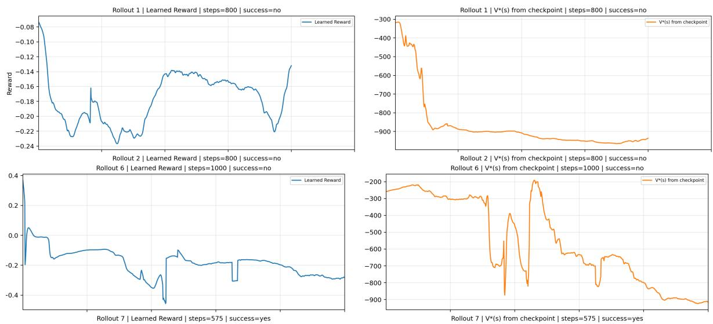  
Figure 12: Comparison of success-only (top) and mixed (bottom) dataset based reward rollouts. We see that the successonly dataset is unable to accurately estimate failure cases, not having a clear signal for reward. Both models were using preference based on $V ^ { * }$

Online Training After offline reward-model pretraining, we continue updating the dense reward model during online RL following (Wang et al., 2024; Lee et al., 2021). The reward model is trained using the following iterative loop: the current reward model is used to train the policy, the resulting policy collects new trajectories, these trajectories are converted into additional synthetic preference comparisons, and the reward model is finetuned on the offline and online preference dataset.

During online RL, the environment reward is replaced by the learned state-only reward model $\hat { r } _ { \boldsymbol { \theta } } ( s )$ . The underlying RL algorithm is otherwise unchanged: OGPO, SAC, and FQL use their standard actor and critic losses, but with rewards given by $\hat { r } _ { \theta }$ instead of the environment reward.

Every $K _ { \mathrm { i n t } }$ environment steps, the reward model is fine-tuned on the union of offline and online preference pairs using the same Bradley-Terry objective as in offline pretraining. The reward model gradually adapts to the on-policy state distribution induced by the improving policy, while still being regularized by the original offline preference data.

After each reward-model update, we relabel the live RL replay buffer with the updated reward model: $r _ { t } \gets$ $\hat { r } _ { \theta } ( s _ { t } )$ . This step makes the online reward update immediately affect subsequent policy learning.

Hyper Parameters Table 4 mentions the primary hyper parameters used to train the model.

Table 4: Reward-model hyperparameters used for PBRL experiments.
<table><tr><td>Hyperparameter</td><td>Value</td></tr><tr><td>Reward model</td><td></td></tr><tr><td>ensemble size model architecture</td><td>3</td></tr><tr><td></td><td>MLP of (512, 512, 512, 512)  $3 \times 1 0 ^ { - 4 }$ </td></tr><tr><td>learning rate training epochs</td><td></td></tr><tr><td>segment size</td><td>50</td></tr><tr><td>Online PBRL schedule</td><td>episode</td></tr><tr><td></td><td></td></tr><tr><td>RM update interval</td><td>5,000 env steps</td></tr><tr><td>maximum online feedback</td><td>10,000 preference pairs</td></tr><tr><td>feedback buffer</td><td>FIFO</td></tr></table>

## F Additional Baseline Comparisons

## F.1 Hindsight experience replay (HER) struggles with contact-rich control

An alternative approach to mitigating the credit assignment problem in goal-conditioned RL is hindsight experience replay (HER) (Andrychowicz et al., 2018), which relabels states reached during a rollout as goals, so that the policy receives learning signal even when the task reward is never observed. HER has largely been evaluated in reaching, pick-and-place and maze settings, where any state is a reasonable goal. To test whether it applies to contact-rich manipulation settings, we evaluate HER with SAC on LIBERO-Task 6, with goals given by object states and relabelled from future states of the same episode, and with the same BC pretraining, online step budget and networks as our other SAc baselines. We also steelman HER with two variants that provide it with the same subgoal information that HGC receives: an oracle that supplies a representative goal state for each subgoal in turn, and a learned goal embedding trained to recognize subgoal completions. In both the variants, we find HER to be incapable of performing multi stage complex manipulation tasks, with the eventual success rate remaining quite close to the initial BC success rate.

## F.2 TD critic learning outperforms preference-based per-subgoal reward

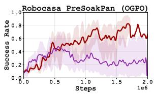

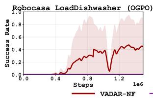

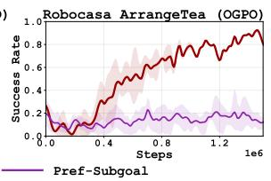

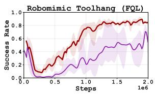  
Figure 13: Success rate of VADAR-NF against PREF-SUBGOAL, which learns a dense reward per subgoal from preferences, on ROBOCASA365 with the OGPO backbone and ROBOMIMIC TOOL-HANG with the FQL backbone.

The Dense baseline in Section 6 learns rewards from the full trajectory preference, so it does not receive the same subgoal information as VADAR. To steelman the comparison, we learn separate preference reward models for each of the subtasks, aggregate them using our Next-Future weighting same as VADAR-NF, and then train a scalar critic on aggregated reward. We call this method PREF-SUBGOAL. Figure 13 shows that the PREF-SUBGOAL underperforms VADAR-NF on all four tasks. On PRESOAKPAN, PREF-SUBGOAL appears to be more sample efficient in the early stages but later fails to reach the same final performance as VADAR-NF. On ARRANGETEA and LOADDISHWASHER, it does not improve over its BC initialization. With FQL on TOOL-HANG, PREF-SUBGOAL trains more slowly and plateaus below VADAR-NF.

These results suggest that directly fitting the critic on multiple temporal resolutions is more reliable than learning dense per-subgoal rewards from preferences. We conjecture that small reward-model errors accumulate over the long horizon, while VADAR directly supervises per-subgoal TD targets at multiple temporal resolutions while sharing representations across subgoals. This structure may benefit from the implicit Bellman-backup mechanism discussed in Section 6.4.

## G DAG Extension for Non-Sequential Subtasks

Multiple subgoals may be active simultaneously, as in bimanual robotic manipulation. The value-weighting function in Table 1 extends naturally to this setting: a DAG can express both parallel subgoals and prerequisites that must be completed before a subsequent goal becomes available.

In the sequential setting, subtasks must be completed in a fixed linear order. However, many real-world tasks have more complex structures where multiple subtasks can be pursued simultaneously for optimal behavior. Moreover, some subtasks can form a precondition boundary for others, where policies can be rolled out in the future subtasks only if the preconditions are satisfied. VADAR can naturally be applied to a litany of these subtask dependencies often represented as directed acyclic graphs (DAGs) with each node corresponding to an individual Q-function. This provides the core benefits of value disaggregation to rich dependency structures dominant in long-horizon RL settings.

Illustrative Example: Robomimic Transport. To illustrate this, consider the robomimic Transport task, a multi-robot task where two robot arms must coordinate to transport a payload from one bin to another while managing trash removal. The task decomposes into 7 interdependent subtasks forming a DAG:

1. lid\_removed: Lid removed from start bin

2. payload\_grasped: Payload grasped from start bin (Robot 0)

3. payload\_lifted: Payload lifted above bins (Robot 0)

4. trash\_grasped: Trash grasped from target bin (Robot 1)

5. trash\_in\_bin: Trash placed in trash bin (Robot 1)

6. payload\_handed\_off: Payload transferred from Robot 0 to Robot 1

7. payload\_in\_target: Payload placed in target bin (SUCCESS)

The dependencies form two parallel execution paths: $( 1  2  3 )$ for payload handling by Robot 0, and (4 → 5) for trash management by Robot 1. The handoff step (6) requires both paths to complete, and the final success (7) depends on the handoff, an illustration is provided in Figure 14.

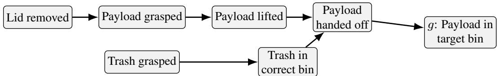  
Figure 14: Transport Subgoal Structure.

DAG Formalism. Recall from Section 4 that the subgoals G are partially ordered, where $g ^ { i } \prec g ^ { j }$ means that $g ^ { i }$ must be completed before $g ^ { j }$ . We represent this structure with a $\mathbf { \dot { D A G } } \ \dot { \mathcal { D } } = ( G , E )$ , with

$$
( g ^ { i } , g ^ { j } ) \in E \iff g ^ { i } \prec g ^ { j } \mathrm { a n d } \vec { \mu } g ^ { k } \in G \mathrm { s u c h t h a t } g ^ { i } \prec g ^ { k } \prec g ^ { j } .
$$

This graph is acyclic: a directed cycle would imply $g ^ { i } \prec g ^ { i }$ for some subgoal $g ^ { i }$ , contradicting the prerequisite relation. The linear ordering from Section 4 is the special case in which the DAG is a chain: every subgoal except the initial one has exactly one parent. We define the following graph functions:

$$
\operatorname { p r e d } ( g ) : = \{ p \in G : { ( p , g ) \in E } \} \qquad \operatorname { d e s c } ( S ) : = \{ g \in G : \exists s \in S { \mathrm { ~ s u c h ~ t h a t ~ } } s \preceq g \} .
$$

Gate Weights for DAG Structures. For a DAG, the “current" subgoals are the incomplete goals whose prerequisites have all been completed:

$$
G ^ { \mathrm { c u r r } } ( \mathbf { d } ) : = \left\{ g \in G : \mathbf { d } _ { g } = 0 \mathrm { a n d } \mathbf { d } _ { p } = 1 \forall p \in \mathrm { p r e d } ( g ) \right\} ,
$$

We also define the terminal subgoals and the immediate successors of the current frontier as

$$
G ^ { \mathrm { t e r m } } : = \{ g \in G : \sharp h \in G \mathrm { ~ s u c h ~ t h a t ~ } ( g , h ) \in E \} ,
$$

$$
G ^ { \mathrm { n e x t } } ( \mathbf { d } ) : = \{ g \in G : \exists p \in G ^ { \mathrm { c u r r } } ( \mathbf { d } ) \ \mathrm { s u c h } \ t h a t ( \boldsymbol { p } , \boldsymbol { g } ) \in E \} \cup \left( G ^ { \mathrm { c u r r } } ( \mathbf { d } ) \cap G ^ { \mathrm { t e r m } } \right) .
$$

For $\boldsymbol g ^ { \mathrm { n e x t } }$ , we handle the edge case where an element from $g ^ { \mathrm { c u r r } }$ is a terminal node, putting those nodes into the set. Using these sets, the DAG value-weighting variants are given in Table 5, provided that we are given d.

<table><tr><td>Config.</td><td>Weight  $w _ { g }$ </td><td>Interpretation</td></tr><tr><td>Current-myopic</td><td> $\mathbb { I } [ g \in G ^ { \mathrm { c u r r } } ( \mathbf { d } ) ]$ </td><td>Only currently available subtasks contribute.</td></tr><tr><td>Current-future</td><td> $\mathbb { I } [ g \in { \overline { { \operatorname { d e s c } } } } ( G ^ { \operatorname { c u r r } } ( \mathbf { d } ) ) ]$ </td><td>Current subtasks and their descendants contribute.</td></tr><tr><td>Next-myopic</td><td> $\mathbb { I } [ g \in G ^ { \mathrm { n e x t } } ( \mathbf { d } ) ]$ </td><td>Only direct successors of current subtasks contribute.</td></tr><tr><td>Next-future</td><td> $\mathbb { I } [ g \in { \overline { { \operatorname { d e s c } } } } ( G ^ { \mathrm { n e x t } } ( \mathbf { d } ) ) ]$ </td><td>Next subtasks and their descendants contribute.</td></tr></table>

Table 5: DAG value-weighting variants used for policy extraction in VADAR.

## H Environment Details: Per-Task Descriptions: Subgoals, Dones, and DAG Structure

We list the subgoals used by VADAR and HGC on each benchmark task, taken directly from the simulator wrappers in our codebase. For each task we list (i) the high-level objective, (ii) the per-subgoal completion indicators done $_ g ( s )$ as evaluated from low-level simulator state (no VLM calls are used for done evaluation), and (iii) the prerequisite structure used to gate subgoal completion. Subgoal completion is evaluated with monotonic completion semantics: once ${ \mathsf { d o n e } } _ { g }$ becomes true and all prerequisites are satisfied, ${ \mathsf { d o n e } } _ { g }$ remains true for the rest of the episode. The default prerequisite structure is a sequential chain $( g ^ { i }$ requires $g ^ { 1 } , \ldots , g ^ { i - 1 } ) ;$ tasks that override this with an explicit DAG are noted below. See Appendix G for an in-depth explanation of the DAG structure.

## H.1 ROBOCASA365

Our longest-horizon tasks come from the ROBOCASA365 (Nasiriany et al., 2026) suite. Each task involves multiple sequential phases of long-horizon kitchen manipulation. For our experiments, we use the state-based environments of ROBOCASA365 composite tasks (having multiple subtasks to be done in order to achieve success), which do not involve the movement of the robot's base. Concretely, we evaluate on the following ROBOCASA365 tasks:

PRESOAKPAN. The agent must place a pan in the sink, place a sponge inside the pan in the sink, and then turn on the faucet. This task is decomposed into 5 sequential subgoals:

1. $g ^ { 1 } = \mathrm { p a n \_ g r a s p e d \_ l i f t e d : p a n ( o b j 1 ) }$ is grasped and lifted to height $z > 0 . 8 8 \mathrm { m }$ i

2. $g ^ { 2 } = { \tt p a n \_ i n \_ s i n k } \colon$ pan is contained inside the sink basin $\left( \mathrm { o b j \_ i n s i d e \_ o f \ ( o b j l , \hbar \ s i n k ) } \right)$

3. $g ^ { 3 }$ = sponge\_grasped\_1ifted: sponge (obj2) is grasped and lifted to height $z > 0 . 8 8 \mathrm { m }$

4. g⁴ = sponge\_in\_pan\_and\_sink: sponge is inside the sink, with xy-distance to $\mathsf { p a n } < 0 . 2 5$ m and vertical offset $z _ { \mathrm { s p o n g e } } - z _ { \mathrm { p a n } } \in ( - 0 . 0 5 , 0 . 2 0 )$ m.

5. $g ^ { 5 } = \mathsf { w a t e r \_ o n : }$ faucet is on, both pan and sponge are in the sink, and the gripper is far from both objects (matches the environment's original success check).

Final task success is don $\scriptstyle { \overline { { \overline { { \mathbf { \Lambda } } } } } } _ { g ^ { 5 } }$

LOADDIsHWAsHER. The agent must load two dishes (a cup and a bowl) into the dishwasher rack and close the dishwasher. Decomposed into 5 sequential subgoals:

1. g1 = cup\_grasped: cup (dish0) is grasped (check\_obj\_grasped).

2. g2 = cup\_in\_dw: cup is in contact with the dishwasher rack.

3. $g ^ { 3 }$ = bowl\_grasped: bowl (dish1) is grasped.

4. g⁴ = bowl\_in\_dw: bowl is in contact with the dishwasher rack.

5. $g ^ { 5 } =$ dw\_closed: cup in rack and bowl in rack and dishwasher door closed (angular tolerance 0.05).

Final task success is doneg⁵. $^ { \circ } g ^ { 5 }$

ARRANGETEA: This is the third ROBOCASA365 task we evaluate on. In this task, the agent must pick up the kettle and place it on a tray on the kitchen counter, then pick up a mug from inside the kitchen cabinet and then place it next to the kettle on the tray, and then close the hinged cabinet that initially holds the mug. This task is decomposed into 6 natural subgoals:

1. g¹ = kettle\_grasped: kettle is grasped (check\_obj\_grasped (kettle)).

2. $g ^ { 2 }$ 二 kettle\_on\_tray: kettle is contained on the tray   
(check\_obj\_in\_receptacle(kettle, container)).

3. g3 = kettle\_on\_t ray & mug\_grasped: kettle still on tray and mug is grasped.

4. g⁴ = kettle\_on\_tray & mug\_on\_tray: kettle still on tray and mug is now on the tray.

5. g⁵ = both\_on\_tray & right\_door\_closed: both objects on tray and the right cabinet door is closed.

6. g⁶ = bot h\_on\_tray & cab\_closed: both objects on tray and the full hinged cabinet is closed.

Final task success is done ${ } ^ { \circ } g ^ { 6 }$ which matches the original success of the ARRANGETEA task.

## H.2 ROBOMIMIC

RoBOMIMIC (Mandlekar et al., 2021) contributes two contact-rich, medium-horizon tasks.

TRANSPORT. A bimanual task in which two arms coordinate to lift a lid, transport a payload between bins, and dispose of trash. The codebase exposes 7 subgoal indicators; the user-facing description of the DAG is given in Appendix G. The 7 subgoal checks are:

1. $g ^ { 1 } = 1 \mathrm { i d } .$ \_removed: lid handle has slid leftward by more than 0.08 m from its initial x-position $\breve { ( } x _ { \mathrm { l i d } } < x _ { \mathrm { l i d } } ^ { \mathrm { i n i t } } - 0 . 0 8 )$

2. g2 = payload\_grasped: Robot 0's gripper is in contact with the payload geoms (\_check\_grasp).

3. g3 = payload\_1i fted: payload z-position exceeds the table height by > 0.10 m.

4. g⁴ = trash\_grasped: Robot 1's gripper is in contact with the trash geoms.

5. g⁵ = trash\_in\_bin: transport.trash\_in\_trash\_bin flag is true.

6. g6 = payload\_handed\_off: Robot 1 is grasping the payload and Robot 0 is not.

7. g7 = payload\_in\_target: transport.payload\_in\_target\_bin flag is true.

Structure: two parallel chains $( g ^ { 1 } \to g ^ { 2 } \to g ^ { 3 } )$ and $( g ^ { 4 } \to g ^ { 5 } )$ , both prerequisites for $g ^ { 6 } ,$ which is itself a prerequisite for $\scriptstyle { \hat { g } } ^ { 7 }$ (Figure 14). Final task success is done $\scriptstyle { \dot { \cdot } } g ^ { 7 }$

TooL-HANG. A single-arm precision task: insert a hook frame into a base stand, then hang a wrench on it. Decomposed into 4 sequential subgoals:

1. $g ^ { 1 } = \mathrm { { f r a m e \_ g r a s p e d } : }$ gripper is grasping the frame and the frame is lifted $> 0 . 0 2$ m above the table(\_check\_grasp\_frame).

2. $g ^ { 2 } = \mathtt { f }$ rame\_inserted: frame is assembled into the stand (\_check\_frame\_assembled).

3. g3 = frame\_inserted\_and\_wrench\_grasped: frame is still inserted and the wrench is grasped and lifted > 0.02 m above the table.

4. g4 = wrench\_attached: wrench is hung on the inserted frame (\_check\_tool\_on\_frame).

The final success is done $^ { \circ } g ^ { 4 }$ which matches the success of the original ToOL-HANG env.

(in akita\_black\_bowl\_1

## H.3 OGBENCH

Next we use the scene-play-singletask-task4 (put\_in\_drawer) from OGBENCH (Park et al., 2025a). In this task, the agent needs to first unlock the drawer (by pressing a button), then open the drawer, then lift the cube and place it inside the drawer and finally close the drawer. The subgoal decomposition is as follows:

1. g1 = press\_button\_0: button 0 state is set to pressed (\_cur\_button\_states [0] == 1); this unlocks the drawer.

2. g2 = open\_drawer: drawer slide x-position < −0.12 (slide range [−0.16, 0]).

3. g³ = block\_in\_drawer: block xyz-position satisfies the env's \_is\_in\_drawer predicate.

4. g⁴ = close\_drawer: $| x _ { \mathrm { s l i d e } } | < 0 . 0 4$ (drawer back to nearly fully closed).

Final task success is don $\scriptstyle { \overline { { \partial } } } _ { g ^ { 4 } }$ which is coonsisitent with the origianl success.

## H.4 LIBERO

We evaluate VADAR on 3 multi stage kitchen tasks from the LIBERO-10 (Liu et al., 2023a) suite. These are: KITCHEN\_SCENE3, KITCHEN\_SCENE4, KITCHEN\_SCENE6. We use the following subgoal decomposition for these tasks: KITCHEN\_sCENE3 (turn on the stove and place the moka pot). BDDL goal: (Turnon flat\_stove\_1) ∧(On moka\_pot\_1 flat\_stove\_1\_cook\_region). Decomposed into 3 sequential subgoals:

1. g¹ = stove\_on: (turnon flat\_stove\_1).

2. g2 = moka\_pot\_grasped: gripper is grasping any geom containing moka\_pot\_1.

3. g³ = moka\_pot\_on\_stove: (on moka\_pot\_1 flat\_stove\_1\_cook\_region).

Final task success is doneg³.

KITCHEN\_SCENE4 (place black bowl in bottom drawer and close it). The bottom drawer of white\_cabinet\_1 is open at reset. BDDL goal: (Close white\_cabinet\_1\_bottom\_region) ∧ (In akita\_black\_bowl\_1 white\_cabinet\_1\_bottom\_region). Decomposed into 3 sequential subgoals:

1. g¹ = bowl\_grasped: gripper is grasping any geom containing akita\_black\_bowl.

2. g2 二 bowl\_in\_drawer:   
white\_cabinet\_1\_bottom\_region).

3. g³ = drawer\_closed: (close white\_cabinet\_1\_bottom\_region).

Final task success is done $\scriptstyle { \dot { \cdot } } g ^ { 3 }$

KITCHEN\_sCENE6 (place mug in microwave and close it). The microwave is open at reset. BDDL goal: (In white\_yellow\_mug\_1 microwave\_1\_heating\_region)∧(Close microwave\_1). Decomposed into 3 sequential subgoals:

1. g1 = mug\_grasped: gripper is grasping any geom containing white\_yellow\_mug.

2. $g ^ { 2 }$ 二 mug\_in\_microwave: (in white\_yellow\_mug\_1   
microwave\_1\_heating\_region).

3. g³ = microwave\_closed: (close microwave\_1).

Final task success is doneg³.

## H.5 PUSHT-OBSTACLE

The multi-objective PUSHT-OBSTACLE task does not use a sequential subgoal decomposition; instead, the two “heads" correspond to two independent per-step signals defined in Appendix K:

1. g¹ = task\_done: block-goal coverage (intersection-over-union proxy) ≥ 0.95. Ratchets up.

2. g2 = collision\_occurred: continuous proximity cost $c _ { t } \in [ 0 , 1 ]$ around the obstacle boundary (1 inside, decaying linearly across a 40-px soft margin).

Neither head is a prerequisite for the other, so GETWEIGHTING collapses to a constant weighting $\begin{array} { r l } { \mathbf { w } } & { { } = } \end{array}$ (1, λsafety).

Table 6: Summary of subgoal counts and dependency structure across benchmark tasks.
<table><tr><td>Suite</td><td>Task</td><td>|G|</td><td>Structure</td></tr><tr><td>ROBOCASA365</td><td>PRESOAKPAN</td><td>5</td><td>sequential chain</td></tr><tr><td>ROBOCASA365</td><td>LOADDISHWASHER</td><td>5</td><td>sequential chain</td></tr><tr><td>ROBOCASA365</td><td>ARRANGETEA</td><td>6</td><td>sequential chain</td></tr><tr><td>ROBOMIMIC</td><td>TRANSPORT</td><td>7</td><td>DAG, two parallel chains, joint handoff</td></tr><tr><td>ROBOMIMIC</td><td>TOOL-HANG</td><td>4</td><td>sequential chain</td></tr><tr><td>LIBERO</td><td>KITCHEN_SCENE3</td><td>3</td><td>sequential chain</td></tr><tr><td>LIBERO</td><td>KITCHEN_SCENE4</td><td>3</td><td>sequential chain</td></tr><tr><td>LIBERO</td><td>KITCHEN_SCENE6</td><td>3</td><td>sequential chain</td></tr><tr><td>OGBENCH</td><td>scene-play-singletask-task4</td><td>4</td><td>sequential chain</td></tr><tr><td></td><td>PUSHT-OBSTACLE (multi-objective)</td><td>2</td><td>independent heads (no prerequisites)</td></tr></table>

## H.6 Hyperparameters

VADAR is tested with three off policy value based instantiations. Hyperparameters for each instantiation follows the best practices recommended in the corresponding original papers; we tune only the small set of task-level knobs (training-step budget, discount, BC regularization strength) needed to keep each baseline competitive on the task at hand, and we use the same setting across all baselines (Sparse, Dense, HGC, VADAR) on a given task so that comparisons are not confounded by tuning.

## H.6.1 Common Hyperparameters

Most of our hyper parameters remain the same for all are experiments, unless explicitly mentioned. The detailed list of these are listed in Table 8.

Table 7: Maximum episode length per environment (used both for evaluation and as the truncation horizon during online finetuning)
<table><tr><td>Environment</td><td>Max episode length</td></tr><tr><td>ROBOCASA365 (all enVs: ARRANGETEA, PRESOAKPAN, LOADDISHWASHER)</td><td>1200</td></tr><tr><td>ROBOMIMIC TRANSPORT</td><td>800</td></tr><tr><td>ROBOMIMIC TOOL-HANG</td><td>1000</td></tr><tr><td>LIBEROKITCHEN_SCENE3/4/6</td><td>500</td></tr><tr><td>OGBENCH scene-play-singletask-task4</td><td>100</td></tr><tr><td>PUSHT-OBSTACLE</td><td>300</td></tr></table>

Table 8: Hyperparameters shared across all tasks and backbones (OGPO, FQL, SAC)
<table><tr><td>Hyperparameter</td><td>Value</td></tr><tr><td>Optimization</td><td></td></tr><tr><td>critic learning rate</td><td> $3 \times 1 0 ^ { - 4 }$ </td></tr><tr><td>actor / BC learning rate</td><td> $3 \times 1 0 ^ { - 4 }$ </td></tr><tr><td>batch size</td><td>256</td></tr><tr><td>replay buffer size</td><td> $2 \times 1 0 ^ { 6 }$ </td></tr><tr><td>Networks</td><td></td></tr><tr><td>actor MLP hidden dims</td><td>(512, 512, 512, 512)</td></tr><tr><td>critic MLP hidden dims</td><td>(512, 512, 512, 512)</td></tr><tr><td>critic ensemble size M ensemble aggregation</td><td>10</td></tr><tr><td>target EMA τ (critic)</td><td>mean</td></tr><tr><td>target EMA τπ (actor)</td><td>0.05</td></tr><tr><td></td><td>0.05</td></tr><tr><td>VADAR critic</td><td></td></tr><tr><td>critic shape</td><td> $S \times A \to \mathbb { R } ^ { | G | }$ </td></tr><tr><td>advantage gating mode</td><td>grandparent_future (VADAR-NF)/goal_future (VADAR-CF)</td></tr><tr><td>Online schedule</td><td></td></tr><tr><td>UTD (warmup, online)</td><td>(1, 1)</td></tr></table>

## H.6.2 OGPO specific hyperparameters

OGPO(Patil et al., 2026) is our flow-based backbone for the ROBOCASA365 and ROBOMIMIC suites. Table 9 lists the OGPo hyperparameters that are held fixed across all five OGPo-backed tasks; the per-task differences are then enumerated below.

Table 9: OGPO hyperparameters held fixed across all five OGPO-backed tasks (PRESOAKPAN, LOADDISHWASHER, AR-RANGETEA, TRANSPORT, TOOL-HANG)
<table><tr><td>Hyperparameter</td><td>Value</td></tr><tr><td>h (action chunk length)</td><td>8</td></tr><tr><td>q_warmup_steps</td><td>20,000</td></tr><tr><td>flow_steps</td><td>10</td></tr><tr><td>best_of_n</td><td>8</td></tr><tr><td>critic target EMA τ</td><td>0.05</td></tr></table>

The remaining hyper parameters vary per task. For the ROBOCASA365 suite of tasks (PRESOAKPAN, LOAD-DISHWASHER, ARRANGETEA), we use the bc data obtained from the official VLA checkpoint (NVIDIA et al., 2025). Since we deal with state-based environments and RoBOCASA365 environments change the layout/scenes/fixtures for every environment reset, we fix them across resets to avoid partial observability in state-based settings. For RoBoCAsA365 environments, we set bc\_coeff to 1 and offline\_steps to 500, 000. We use around 150 demos collected from the VLA checkpoint. On ROBOMIMIC, we do two sets of experiments: (1) with the full set of the offline demos present (2) reducing the offline demonstration set to a fraction of the original (the dataset . proportion parameter): only this fraction of the offline trajectories is used for BC pretraining. The full list of our hyper parameter settings for ROBOMIMIC experiments on OGPo is present in Table 10.

Table 10: Low-data BC ablation on ROBOMIMIC. Both columns use the OGPO backbone with VADAR-style critic disaggregation. dataset . proportion controls the fraction of offline demonstrations used for BC pretraining and offline replay; all other hyperparameters remain the same.
<table><tr><td></td><td>TRANSPORT (low)</td><td>TRANSPORT (full)</td><td>TOOL-HANG (low)</td><td>TOOL-HANG (full)</td></tr><tr><td>dataset.proportion</td><td>0.1</td><td>1.0</td><td>0.30</td><td>1.0</td></tr><tr><td>offline_steps</td><td>300K</td><td>300K</td><td>300K</td><td>300K</td></tr><tr><td>online_steps</td><td>3M</td><td>3M</td><td>3M</td><td>3M</td></tr><tr><td>q_warmup_steps</td><td>20K</td><td>20K</td><td>20K</td><td>20K</td></tr><tr><td>start_training</td><td>40K</td><td>40K</td><td>10K</td><td>10K</td></tr><tr><td>Tπ</td><td>0.005</td><td>0.005</td><td>0.005</td><td>0.005</td></tr><tr><td>bc_coeff</td><td>0.1</td><td>0.1</td><td>0.1</td><td>0.1</td></tr><tr><td>clip_bc_threshold</td><td>0.30</td><td>0.30</td><td>0.30</td><td>0.30</td></tr><tr><td>success buffer</td><td>true</td><td>true</td><td>true</td><td>true</td></tr><tr><td>subsample_bon</td><td>true</td><td>true</td><td>true</td><td>true</td></tr></table>

## H.6.3 FQL per-task hyperparameters

FQL (Park et al., 2025b) is the secondary flow-based backbone we use on ROBOMIMIC TRANSPORT and ToOL-HANG. Table 11 lists the values used. We use the same network architecture and learning rates as OGPo (i.e., Table 8); We do behavior cloning using all the available data a bit longer, due to FQL being less performative. The detailed list of hyperparameters used for FQL are listed in Table 11

Table 11: Per-task hyperparameters for the FQL backbone on ROBOMIMIC. Values not listed match Table 8.
<table><tr><td></td><td>TRANSPORT</td><td>TOOL-HANG</td></tr><tr><td>offline_steps</td><td>1M</td><td>500K</td></tr><tr><td>online_steps</td><td>6M</td><td>3M</td></tr><tr><td>q_warmup_steps</td><td>50K</td><td>50K</td></tr><tr><td>start_training</td><td>10K</td><td>10K</td></tr><tr><td>h (chunk)</td><td>8</td><td>8</td></tr><tr><td> $\displaystyle \frac { \gamma } { \bar { \tau } _ { \pi } }$ </td><td>0.999</td><td>0.999</td></tr><tr><td></td><td>0.005</td><td>0.005</td></tr><tr><td>q_agg</td><td>mean</td><td>mean</td></tr><tr><td>|G|, structure</td><td>7, DAG</td><td>4, chain</td></tr><tr><td>group_num_samples</td><td>32</td><td>32</td></tr><tr><td>best_of_n,flow_steps</td><td>8,10</td><td>8,10</td></tr><tr><td>αFQL (distillation coeff.)</td><td>1000</td><td>1000</td></tr><tr><td>bc_coeff</td><td>1.0</td><td>1.0</td></tr><tr><td>clip_bc_threshold</td><td>0.45</td><td>0.45</td></tr></table>

## I Learning with VLM-Provided Subgoal Labels

## I.1 Goal-conditioned policies are computationally prohibitive with frontier model feedback

For our main experiments, the subgoal completion indicators done。 are evaluated using privileged simulator state. In real-world settings, these intermediate subgoal labels may instead be obtained from a VLM given visual observations and natural-language descriptions of the subgoals (Du et al., 2023).

We test whether VADAR can learn when these intermediate training signals are provided by a VLM rather than by the simulator. On ROBOCASA365 PRESOAKPAN, we replace the oracle subgoal completion indicators with predictions from a VLM judge. The environment provides only the final task-success signal, while all intermediate subgoal supervision used by VADAR comes from the VLM. The policy and critic remain state-based, and the VLM is used only to generate training-time subgoal labels. Full details and the judge prompt are provided in Appendix J.

Figure 15 compares VADAR-NF trained with oracle and VLM-predicted subgoal completions. VLM supervision is somewhat less sample efficient early in training, but reaches a similar final success rate. These results show that VLMs can serve as training-time evaluators for the subgoal rewards used by VADAR, without introducing any VLM dependence at deployment time, while HGC needs such subgoal completion information during inference time, adding to the cost and latency of querying VLMs during deployment.

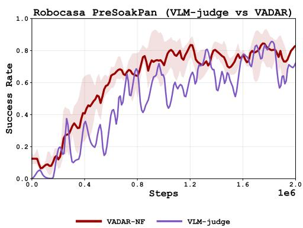  
Figure 15: VADAR-NF on ROBOCASA365 PRE-SOAKPAN with the OGPO base algorithm, trained with oracle subgoal completions vs. with completions judged by a VLM (gemini-3.6-flash).

## J VLM Judge Prompt

Protocol. We use gemini-3.6-flash as the VLM judge for the experiment in Appendix I.1. For every 8-step action chunk, the judge receives the frames at step offsets [0, 2, 5, 7] from all three cameras, together with the prompt below, and returns a JSON list of [G| booleans, which we use as the subgoal completion vector $\mathbf { d } _ { t }$ for the final step of the chunk. The prompt used for ROBOCASA365 PRESOAKPAN is shown below.

VLM judge prompt for ROBOCASA365 PRESOAKPAN   
You are a strict robot-manipulation subgoal evaluator.   
Task: PreSoakPan   
The input is one 8-step action chunk. It contains 4 chronological timestamps at step   
offsets [0, 2, 5, 7]. Every timestamp has exactly three synchronized camera views.   
Timestamps are ordered oldest to newest.   
Judge whether each subgoal's completion criterion is satisfied at the FINAL timestamp.   
Use the earlier timestamps as visual history to disambiguate grasping, motion, placement,   
and occlusion. A transient condition such as 'gripper is holding' must still be true at   
the final timestamp. Do not infer completion only from the expected task order, and do   
not require criteria that are not stated below.   
Subgoals:   
0. pan\_grasped\_lifted   
Completion criterion: The gripper is holding the pan and the pan is lifted off the   
counter.   
1. pan\_in\_sink   
Completion criterion: The pan is resting inside the sink basin.   
2. sponge\_grasped\_lifted   
Completion criterion: The gripper is holding the sponge and the sponge is lifted up.   
3. sponge\_in\_pan\_and\_sink   
Completion criterion: The sponge is inside the sink and is placed on or in the pan.   
4. water\_on   
Completion criterion: The faucet water is running, the pan and sponge are in the   
sink, and the gripper has moved away from both objects.   
Return only strict JSON in this form: {"done":[true,false,...]}. The list must contain   
exactly 5 booleans in the listed order.

## K Multi-Objective Optimization on PUSHT-OBSTACLE: Full Details

This appendix gives the full environment, algorithm, and training details for the multi-objective experiment in Appendix K.1, together with the reward-shaping ablation that controls for the safety signal's smoothness.

Generalization to multi-objective losses. We observe that VADAR does not require that the disaggregated value functions correspond to rewards associated with subgoals of a long-horizon task. Any collection of independently valuable rewards, such as safety constraints or velocity penalties, can be included in the fitting of the multi-objective critics. We validate the utility of VADAR for such multi-objective problems in Appendix K.1.

## K.1 VADAR enables stable multi-objective optimization

Next, we test VADAR's sample efficient multi-objective optimization capability. Specifically, we consider a setting where a reward function is decomposed into G groups $\begin{array} { r } { r = \sum _ { g \in G } r ^ { g } . } \end{array}$ While classical RL uses an single critic for the aggregate reward r, we propose VADAR for separate per-reward critics, which are aggregated after TD updates in the policy extraction step. Full reward and environment details are provided in Appendix K. Here we present a high level summary.

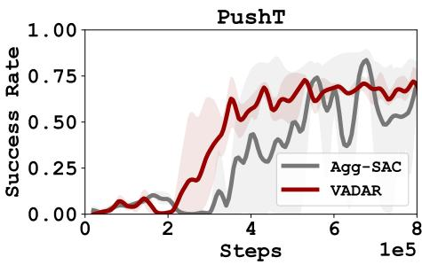

To test VADAR for multi-objectiv optimization, we design PUSHT-OBSTACLE, a variant of the popular env PushT (Chi et al., 2023) where a blue-dot pushes a gray $^ { 6 6 } \mathrm { T } ^ { \prime }$ to the green goal configuration. We add a fixed circular obstacle and include both a sparse task reward for pushing the T-block to the goal pose $r _ { t } ^ { \mathrm { t a s k } }$ , and a dense safety reward that penalizes proximity to the obstacle $r _ { t } ^ { \mathrm { s a f e t y } }$ . We instantiate VADAR with SAC and with $G = 2$ heads (one per signal) and use a vector-valued multigoal critic $\left( \mathbf { Q } _ { \phi } \right)$ , using a constant weighting for the aggregated critic in policy extraction: $Q _ { \mathrm { a g g } } = { \bf Q } _ { \phi } [ \mathrm { { t a s k } ] + \lambda _ { \mathrm { s a f e t y } } \tilde { \bf Q } _ { \phi } [ \mathrm { { s a f e t y } ] } }$ . We

Figure 16: Multi-Objective Optimization using VADAR on a variant of PushT created: PUSHT-OBSTACLE. Here the goal of the agent is to align the T with the given position whilst avoiding contact with the obstacle

compare against standard RL with aggregated reward $r _ { t } = r _ { t } ^ { \mathrm { t a s k } } + \lambda _ { \mathrm { s a f e t y } } r _ { t } ^ { \mathrm { s a f e t y } }$ as a baseline(AGGREGATED-SAC). See Appendix K and Appendix K.6 for more details on the env and comparison of VADAR and AGGRE-GATED-SAC on PUSHT-OBSTACLE. Figure 16 shows that that VADAR outperforms aggregated rewards, even when $\lambda _ { \mathrm { s a f e t y } }$ is chosen to maximize baseline performance. Moreover, we observe added training stability with VADAR safety, compared to AGGREGATED-SAC.

## K.2 Environment

PUSHT-OBSTACLE extends the standard PushT (Chi et al., 2024) planar block-pushing task with a static circular obstacle of radius 30 px placed at (320, 220) in the 512× 512 workspace. The agent (a circular pusher) must move a T-shaped block to a target pose while avoiding the obstacle. We use the keypoint observation variant (pusht-keypoints-v0) with a 5D state (xagent, Yagent, xblock, Yblock, $\theta _ { \mathrm { b l o c k } } )$ and a 2D continuous action setting the target position of the PD-controlled pusher. Episodes terminate after 300 steps.

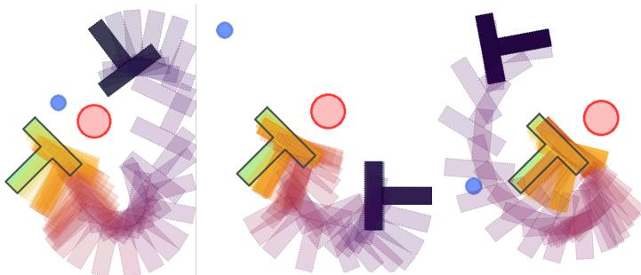  
Figure 17: Depiction of our PUSHT-OBSTACLE env. The agent needs to place the T into the T shaped slot (measured by IoU ≥ 95%) whilst avoiding the red shaped obstacle placed in the vicinity of the final position.

Each environment step yields two scalar signals:

• Task signal: a sparse coverage indicator $r _ { t } ^ { \mathrm { t a s k } } \in \{ - 1 , + 5 \}$ , equal to +5 when the block-goal IoU exceeds 95% and —1 otherwise.

• Safety signal: a continuous soft-margin proximity cost $c _ { t } \in [ 0 , 1 ]$ that takes value 1 if either the pusher or the block penetrates the obstacle, decays linearly to 0 across a safety margin of 10 px around the obstacle boundary, and is 0 outside the margin. The corresponding per-step safety reward used by the critic is $r _ { t } ^ { \mathrm { s a f e t y } } = - 5 c _ { t }$

## K.3 VADAR Instantiation

We provide the full pseudocode in Algorithm 3. We instantiate VADAR on top of a SAC backbone with $G = 2 \mathrm { : }$ head 0 tracks task completion and head 1 tracks the safety cost. The vector critic $\mathbf { Q } _ { \phi } : S \times A \to \mathbb { R } ^ { 2 }$ is a 4-layer MLP of width 512 with layer norm, ensembled over 10 members and aggregated by mean. The actor is a tanh-squashed Gaussian over a 4-step action chunk, also a 4-layer MLP of width 512. The TD targets follow Eq. (5.2): the task head uses the standard reward-clipped VADAR target with cap $c _ { \mathrm { c l i p } } \cdot r _ { \mathrm { d o n e } } = 1 5$ , while the safety head uses the backup $- 5 c _ { t } + \gamma ^ { H } Q [ \mathrm { s a f e t y } ] ( s ^ { \prime } , a ^ { \prime } )$ with $\gamma = 0 . 9 9$ and chunk length $H = 4$ . Because neither subtask is a prerequisite for the other, the policy weighting GETWEIGHTING collapses to a constant $\mathbf { w } = ( 1 , \lambda _ { \mathrm { s a f e t y } } )$ , yielding the aggregated objective

$$
Q _ { \mathrm { a g g } } ( s , a ) = { \bf Q } _ { \phi } [ \mathrm { t a s k } ] ( s , a ) + \lambda _ { \mathrm { s a f e t y } } { \bf Q } _ { \phi } [ \mathrm { s a f e t y } ] ( s , a ) ,
$$

with $\lambda _ { \mathrm { s a f e t y } } = 1 . 0$ in our experiments. (We also do a sweep over the values of $\lambda _ { \mathrm { s a f e t y } }$ Appendix K.6). Apart from the vector-valued critic and this aggregation, the agent is parameterized as a standard Squashed Gaussian policy with learnable temperature.

Algorithm 3 VADAR for Multi-Objective RL (instantiated on PUSHT-OBSTACLE with $G = 2 ) .$   
1: Parameters: discount $\gamma ;$ learning rate η; safety weight $\lambda _ { \mathrm { s a f e t y } }$ ; task-head TD clip $c _ { \mathrm { c l i p } } .$   
2: Initialize multi-objective critic $\breve { \mathbf { Q } } _ { \phi } : S ^ { ^ { \cdot } } \times A \stackrel { \cdot } { \to } \mathbb { R } ^ { 2 }$ with heads {task, safety}; policy $\pi _ { \theta } : S  \Delta ( A ) ;$ replay buffer   
$B  \varnothing .$   
3: for episod $\mathsf { a } = 1 , 2 , \hdots$ do   
4: while episode not done do   
5: at $ \pi _ { \theta } ( s _ { t } )$ , transition $s _ { t + 1 } \sim P ( s _ { t } , a _ { t } )$   
6: Read both signals: task indicator $\mathsf { d o n e } [ \mathrm { t a s k } ] _ { t } \in \{ 0 , 1 \}$ and continuous proximity cost $c _ { t } \in [ 0 , 1 ] .$   
7: Form reward vector $\mathbf { r } _ { t } = ( r _ { \mathrm { s p a r s e } } ( \mathrm { d o n e } [ \mathrm { t a s k } ] _ { t } ) , - 5 c _ { t } )$   
8: $B  B \cup \{ ( s _ { t } , a _ { t } , s _ { t + 1 } , \mathbf { r } _ { t } ,$ done[task]t)}   
9: for number of updates do   
10: Sample $( s , a , s ^ { \prime } , \mathbf { r } , \mathrm { d o n e } [ \mathrm { t a s k } ] ) \sim \mathcal { B } , a ^ { \prime } \sim \pi _ { \theta } ( s ^ { \prime } )$   
11: $y _ { \mathrm { . . . . . } , \mathrm { . . . . } , \mathrm { [ t a s k ] } } ^ { \mathrm { t a r g e t } } = \operatorname* { m i n } _ { \mathrm { . } } \{ \mathbf { r } [ \mathrm { t a s k } ] + \gamma \mathbf { Q } _ { \phi } [ \mathrm { t a s k } ] ( s ^ { \prime } , a _ { \phi } ^ { \prime } ) , \ c _ { \mathrm { c l i p } } \cdot r _ { \mathrm { d o n e } } \}$ reward clipping   
12: $\overset { \vartriangle } { \boldsymbol { y } } ^ { \mathrm { t a r g e t } } [ \mathrm { s a f e t y } ] = \mathbf { r } [ \mathrm { s a f e t y } ] \stackrel { \cdot } { + } \gamma \dot { \mathbf { Q } } _ { \phi } [ \mathrm { s a f e t y } ] ( \boldsymbol { s } ^ { \prime } , \boldsymbol { a } ^ { \prime } ) ^ { \prime }$   
13: $\begin{array} { r } { \check { \phi }  \acute { \phi } - \eta \overset {  } { \nabla } \acute { \phi } \sum _ { g \in \{ \mathrm { t a s k } , \mathrm { s a f e t y } \} } \check { L } _ { \mathrm { c r i t i c } } ^ { \star \cdot \mathrm { c } } ( \mathbf { Q } _ { \phi } [ g ] \mid s , a , y ^ { \mathrm { t a r g e t } , g } ) } \end{array}$   
14: $Q _ { \mathrm { a g g } } ( \cdot , \cdot ) \gets \mathbf { Q } _ { \phi } [ \mathrm { t a s k } ] ( \cdot , \cdot ) + \lambda _ { \mathrm { s a f e t y } } \mathbf { Q } _ { \phi } [ \mathrm { s a f e t y } ] ( \cdot , \cdot )$ constant weighting   
15: $\theta \gets \theta - \eta \nabla _ { \theta } L _ { \mathrm { p o l i c y } } ( \pi _ { \theta } \ | \ s , a , Q _ { \mathrm { a g g } } )$

## K.4 Baselines

To isolate the contribution of value disaggregation from the contribution of the underlying reward terms, we compare against a dense-reward baseline that shares $\mathrm { V A D A R } ^ { \prime } \mathrm { s }$ base algorithm (SAC), critic ensemble, network sizes, BC pretraining, and online step budget, and that consumes the exact same per-step task and safety signals but combines them into a single scalar reward fitted by a scalar critic. We call this AGGREGATED-SAC (Algorithm 4), and it combines the task and safety signals term-for-term as $r _ { t } = r _ { t } ^ { \mathrm { t a s k } } + \lambda _ { \mathrm { s a f e t y } } r _ { t } ^ { \mathrm { s a f e t y } }$ , with the same $\lambda _ { \mathrm { s a f e t y } } = 1 . 0$ . This is the most direct baseline: it differs from VADAR only in collapsing the two signals before the Bellman backup rather than after.

Algorithm 4 Dense-reward shaping baseline for PUSHT-OBSTACLE (AGGREGATED-SAC).   
1: Parameters: discount γ; learning rate η; safety weight $\lambda _ { \mathrm { s a f e t y } } .$   
2: Initialize scalar critic $\dot { Q } _ { \phi } : S \times \mathsf { \bar { A } } \to \dot { \mathbb { R } } ;$ policy πθ : $S \to { \dot { \Delta ( A ) } }$ ; replay buffer $B  \varnothing .$   
3: for episode = 1, 2, . . . do   
4: while episode not done do   
5: at $ \pi _ { \theta } ( s _ { t } )$ , transition $s _ { t + 1 } \sim P ( s _ { t } , a _ { t } )$   
6: Read both signals: task indicator done $\mathbf { \Pi } _ { t } ^ { \mathrm { t a s k } } \in \{ 0 , 1 \}$ and continuous proximity cost $c _ { t } \in [ 0 , 1 ]$   
7: Combine before the Bellman backup into a single scalar reward:   
8: $r _ { t } \gets r _ { \mathrm { s p a r s e } } ( \mathrm { d o n e } _ { t } ^ { \mathrm { t a s k } } ) + \lambda _ { \mathrm { s a f e t y } } \left( - 5 c _ { t } \right)$ shared signals with Algorithm 3; same $\lambda _ { \mathrm { s a f e t y } }$   
9: $\boldsymbol { B } \gets \boldsymbol { B } \cup \{ ( s _ { t } , a _ { t } , s _ { t + 1 } , r _ { t } ) \}$   
10: for number of updates do   
11: Sample $( s , \dot { a } , s ^ { \prime } , r ) \sim \smash { \mathcal { B } } , \smash { a ^ { \prime } \sim \pi _ { \theta } ( s ^ { \prime } ) }$   
12: $y ^ { \mathrm { t a r g e t } } = r + \gamma Q _ { \phi } ( s ^ { \prime } , a ^ { \prime } ) ~$ ▶ single scalar TD target   
13: $\breve { \phi }  \phi - \eta \nabla _ { \phi } \bar { L } _ { \mathrm { c r i t i c } } ^ {  \sim } ( Q _ { \phi } \mid s , a , y ^ { \mathrm { t a r g e t } } )$   
14: $\theta \gets \theta - \eta \nabla _ { \theta } L _ { \mathrm { p o l i c y } } ( \pi _ { \theta } \mid s , a , Q _ { \phi } )$

## K.5 Training and Evaluation Protocol

All methods are pre-trained for 150,000 behavior-cloning steps on a fixed dataset of transitions collected from a previously trained sAC policy on the obstacle-free task, and then fine-tuned online for 800,000 environment steps. We measure the success rate in terms of success: block-goal coverage $\geq 9 5 \%$ and no collision with the obstacle occurs the episode.

## K.6 Parameter Sweep for $\lambda _ { \mathrm { s a f e t y } }$

We sweep over values of $\lambda _ { \mathrm { s a f e t y } } \in \{ 0 . 1 , 1 , 5 , 1 0 \}$ (Figure 18) and observe two trends. First, VADAR is far less sensitive to the choice of $\lambda _ { \mathrm { s a f e t y } } \mathrm { : }$ it reaches comparable final success rates at $\lambda = 0 . 1$ and $\lambda = 1$ , degrades only moderately at $\lambda = 5 .$ , and still makes meaningful progress at $\lambda = 1 0 .$ AGGREGATED-SAC matches VADAR at small λ but collapses to near-zero success once $\lambda \geq 5 ,$ since the safety penalty starts dominating the aggregate reward. Second, at any fixed $\lambda _ { \mathrm { s a f e t y } }$ , VADAR trains more stably than AGGREGATED-SAC, with narrower seed bands and fewer fluctuations during training. We conjecture that this is due to ease of composition at the $\mathrm { Q } \mathrm { - }$ function level: each VADAR head fits a λ-independent target, while AGGREGATED-SAC absorbs λ into the target itself.

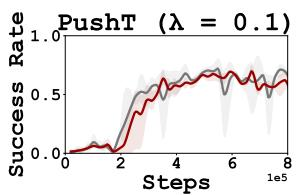

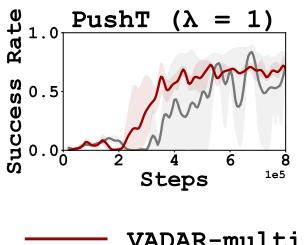

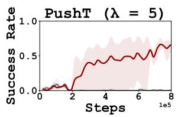

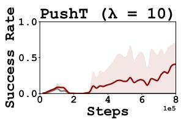  
Figure 18: Plots of success rate for different values of $\lambda _ { \mathrm { s a f e t y } }$ comparing both VADAR and AGGREGATED-SAC on our PUSHT-OBSTACLE environment. Across all the values of $\lambda _ { \mathrm { s a f e t y } }$ that VADAR is more performative and stable than AG-GREGATED-SAC

## L Test-Time Policy Steering

This appendix gives the full protocol, critic training details, and results for the test-time steering experiment in Section 6.3.

## L.1 Setup

We evaluate a critic by using it to select among candidate actions of a frozen policy. The policy is the BCpretrained flow policy of oGPo, trained once and never updated. At every step, the policy proposes N ∈ {1, 4, 16, 64} candidate action chunks of length $h \ = \ 8 .$ , the critic scores each candidate, and the highestvalued chunk is executed. With N = 1 the critic is not used, so this setting is the unsteered BC policy and is shared across critics and budgets, and we report a single $N = 1$ baseline per task. The Sparse critic is scored by its ensemble mean (Appendix B). The VADAR critic is scored by the next-future aggregate $Q _ { \mathrm { a g g } } ( s , a ) =$ $\begin{array} { r } { \sum _ { g \in G } \mathbf { w } [ g ] Q _ { \phi } ( s , a , g ) } \end{array}$ of Eq. (5.1), where the goal-conditioned critic $Q _ { \phi } ( s , a , g )$ is evaluated once per subgoal and $\mathbf { w } = \mathbf { G e r w e I G H T I N G } ( \mathbf { d } _ { t } )$ is computed from the environment's subgoal completion indicators.

## L.2 Critic Training

Starting from the frozen BC policy, only the critic is trained; the policy is never updated against the critic. The replay buffer is first seeded with 20,000 environment steps of frozen-policy rollouts. The critic is then updated with 4 gradient steps per environment step on batches drawn half from the offline demonstrations and half from frozen-policy rollouts, for up to 300,000 environment steps, and we evaluate checkpoints at 40,000, 100,000, 200,000 and 280,000 steps. The two critics share all hyperparameters (discount, value bounds, normalization and network sizes, Table 8) and differ only in the critic loss. We report the mean and standard deviation over 3 seeds, each evaluated on 96 episodes.

## L.3 Results

Figure 19 and Table 12 give the full sweep, and we observe three trends. First, steering with the VADAR critic improves with the critic training budget at every N on ARRANGETEA and TOOL-HANG, and at the largest budget on PRESOAKPAN. Second, the Sparse critic, trained on identical data with an identical budget does not improve on the unsteered policy on ARRANGETEA at any budget or N, is flat in both budget and N on PRESOAKPAN, and on ToOL-HANG improves on the unsteered policy at small budgets but plateaus well below the VADAR critic. The only setting in which the Sparse critic is ahead is ToOL-HANG at the smallest budget, and the VADAR critic overtakes it from 100,000 steps onward. Third, steering degrades with large N for both critics, since the maximum over more candidates increasingly selects out-of-distribution actions, and the degradation is milder for the VADAR critic.

To understand this gap, we roll out the frozen policy and, at each step, score the same 64 candidate action chunks with both critics. Figure 20 shows the two critics at one such step on TooL-HANG, just before subgoal $g ^ { 2 } \left( \tt f r a m e \_ i n s e x t e d \right.$ , Appendix H) is completed. The insertion is the step of the task that demands the most precision, and hence one of its most important decision steps. We take the plane spanned by the two principal directions of the 64 candidates, evaluate each critic on a grid of actions in this plane, and plot its contours together with the direction of its action-gradient. As both critics predict returns in the same units, we use the same contour spacing for both, so that a critic with little variation over the plane shows few contours. The VADAR critic varies by an order of magnitude more than the Sparse critic over this plane. The executed chunk is the action taken by the successful trajectory, i.e. the correct action at this step. The VADAR critic identifies it: it assigns its highest values to the candidates near the executed chunk, and its gradient points towards the executed chunk from across the candidate set. The Sparse critic does not: it assigns nearly the same value to all candidates, and its gradient does not point towards the executed chunk. This suggests that VADAR learns a better critic: one that correctly ranks the actions at the step that decides the task, whilst the Sparse critic trained on the same data cannot tell them apart. We conjecture that this difference in critic quality is what drives VADAR's advantage in both the online RL experiments, where the critic supervises policy extraction, and the steering experiments, where it ranks candidate actions directly.

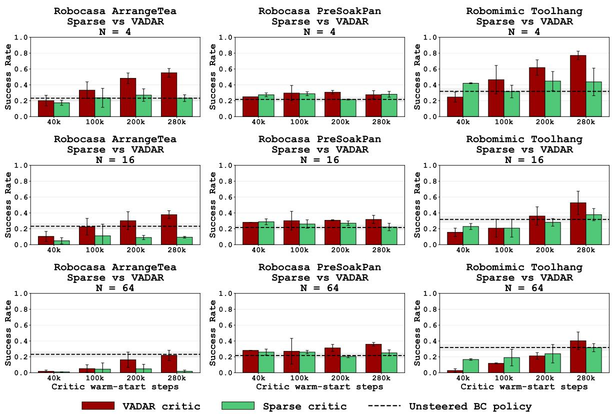  
Figure 19: Best-of-N steering of the frozen OGPo BC policy with the Sparse and VADAR critics for $N \in \{ 4 , 1 6 , 6 4 \}$ (rows) on ROBOCASA365 ARRANGETEA, PRESOAKPAN and ROBOMIMIC TOOL-HANG (columns), as a function of the critic training budget. Error bars are one standard deviation over seeds; the dashed line is the unsteered BC policy.

Table 12: Success rate of best-of-N steering of the frozen OGPo BC policy with the Sparse and VADAR critics, as a function of the critic training budget (mean ± std over seeds). The N = 1 row is the unsteered BC policy, and the best cell in each row is highlighted.
<table><tr><td rowspan="2">Task</td><td rowspan="2">Critic budget</td><td colspan="3">Sparse critic</td><td colspan="4">VADAR critic</td></tr><tr><td> $N = 4$ </td><td> $N = 1 6$ </td><td> $N = 6 4$ </td><td> $N = 4$ </td><td></td><td> $N = 1 6$ </td><td> $N = 6 4$ </td></tr><tr><td rowspan="5">ARRANGETEA</td><td> $N = 1$ </td><td colspan="6"></td><td></td></tr><tr><td>40K</td><td> $0 . 1 7 \pm 0 . 0 3$ </td><td> $0 . 0 5 \pm 0 . 0 4$ </td><td> $0 . 2 3 \pm 0 . 0 4$ </td><td> $0 . 0 1 \pm 0 . 0 0 0 . 2 0 \pm \mathbf { 0 . 0 7 }$ </td><td> $0 . 1 0 \pm 0 . 0 6$ </td><td></td><td> $0 . 0 2 \pm 0 . 0 2$ </td></tr><tr><td>100K</td><td> $0 . 2 4 \pm 0 . 1 2$ </td><td> $0 . 1 1 \pm 0 . 1 5$ </td><td></td><td> $0 . 0 5 \pm 0 . 0 8 0 . 3 3 \pm \bf { 0 . 1 0 }$ </td><td></td><td> $0 . 2 3 \pm 0 . 1 1$ </td><td> $0 . 0 5 \pm 0 . 0 5$ </td></tr><tr><td>200K</td><td> $0 . 2 7 \pm 0 . 0 8$ </td><td> $0 . 0 9 \pm 0 . 0 3$ </td><td></td><td> $0 . 0 5 \pm 0 . 0 6 0 . 4 8 \pm \mathbf { 0 . 0 7 }$ </td><td></td><td> $0 . 3 0 \pm 0 . 1 1$ </td><td> $0 . 1 6 \pm 0 . 1 0$ </td></tr><tr><td>280K</td><td colspan="6"> $0 . 2 3 \pm 0 . 0 4$   $0 . 0 9 \pm 0 . 0 1$ </td><td> $0 . 2 2 \pm 0 . 0 6$ </td></tr><tr><td rowspan="5">PRESOAKPAN</td><td> $N = 1$ </td><td colspan="6"></td><td></td></tr><tr><td>40K</td><td> $0 . 2 7 \pm 0 . 0 2$ </td><td> ${ \bf 0 . 2 9 \pm 0 . 0 4 }$ </td><td> $0 . 2 6 \pm 0 . 0 4 \qquad 0 . 2 5$ </td><td></td><td></td><td>0.28</td><td>0.28</td></tr><tr><td>100K</td><td> $0 . 2 9 \pm 0 . 0 2$ </td><td> $0 . 2 6 \pm 0 . 0 5$ </td><td></td><td> $0 . 2 6 \pm 0 . 0 2 0 . 3 0 \pm \bf { 0 . 1 0 }$ </td><td></td><td> ${ \bf 0 . 3 0 \pm 0 . 1 2 }$ </td><td> $0 . 2 7 \pm 0 . 1 6$ </td></tr><tr><td>200K</td><td> $0 . 2 2 \pm 0 . 0 1$   $0 . 2 8 \pm 0 . 0 4$ </td><td> $0 . 2 7 \pm 0 . 0 3$ </td><td></td><td>0.20 ± 0.02 0.31 ± 0.02  $0 . 2 5 \pm 0 . 0 4 0 . 2 8 \pm 0 . 0 5$ </td><td></td><td> ${ \bf 0 . 3 1 \pm 0 . 0 1 }$   $0 . 3 2 \pm 0 . 0 5$ </td><td> ${ \bf 0 . 3 1 \pm 0 . 0 4 }$ </td></tr><tr><td>280K</td><td colspan="6"> $0 . 2 2 \pm 0 . 0 5$ </td><td> ${ \bf 0 . 3 6 \pm 0 . 0 2 }$ </td></tr><tr><td rowspan="5">TOOL-HANG</td><td> $N = 1$  40K</td><td colspan="6"> $\mathbf { 0 . 4 2 \pm 0 . 0 1 }$ </td><td></td></tr><tr><td>100K</td><td> $0 . 3 2 \pm 0 . 0 8$ </td><td> $0 . 2 3 \pm 0 . 0 4$   $0 . 2 1 \pm 0 . 1 1$ </td><td></td><td> $0 . 1 7 \pm 0 . 0 1 0 . 2 5 \pm 0 . 0 6$  0.19 ± 0.10 0.47 ± 0.18</td><td></td><td> $0 . 1 6 \pm 0 . 0 5$   $0 . 2 1 \pm 0 . 1 1$ </td><td> $0 . 0 3 \pm 0 . 0 2$   $0 . 1 2 \pm 0 . 0 1$ </td></tr><tr><td>200K</td><td> $0 . 4 5 \pm 0 . 1 2$ </td><td> $0 . 2 8 \pm 0 . 0 5$ </td><td></td><td> $0 . 2 4 \pm 0 . 1 2 0 . 6 2 \pm 0 . 1 0$ </td><td></td><td> $0 . 3 6 \pm 0 . 1 2$ </td><td> $0 . 2 1 \pm 0 . 0 4$ </td></tr><tr><td>280K</td><td> $0 . 4 4 \pm 0 . 1 7$ </td><td> $0 . 3 8 \pm 0 . 0 8$ </td><td></td><td>0.77± 0.05</td><td></td><td></td><td></td></tr><tr><td></td><td></td><td></td><td>0.32 ± 0.05</td><td></td><td></td><td> $0 . 5 3 \pm 0 . 1 5$ </td><td> $0 . 4 0 \pm 0 . 1 1$ </td></tr></table>

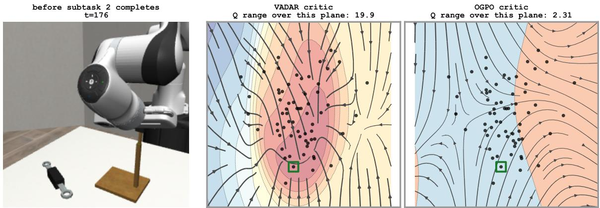  
Figure 20: Q-values of the VADAR (middle) and Sparse (right, labelled OGPO in the panel) critics, each trained with the largest critic budget of 280K steps, at a single step of ROBOMIMIC ToOL-HANG before the frame is inserted into the stand (left), plotted over the plane of the first two principal components of the BC policy's 64 candidate action chunks. Dots are the candidates and the green square is the executed chunk; streamlines follow the gradient of Q with respect to the action, and the contour spacing is the same in both panels.

## M Last-Q Extraction: Full Benchmark Results

Figure 21 gives the full comparison accompanying Section 6.2.

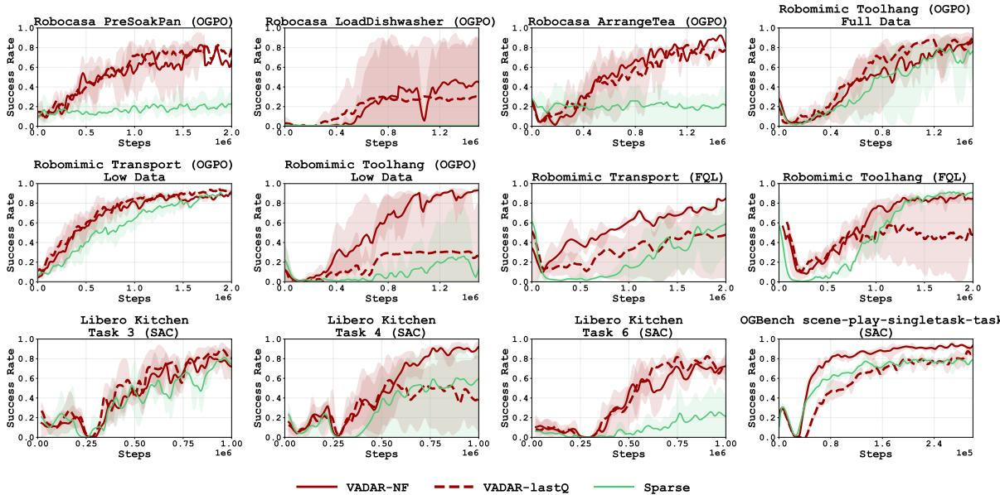  
Figure 21: Success rate of VADARLAST-Q compared with VADAR-NF and Sparse across all benchmarks and instantiations.

## N Connections to Successor Features and Reward Shaping

VADAR's aggregation step (Eq. (5.1)) is structurally similar to a success feature decomposition of a Q-function. Classical success features assume reward is linear in a feature map $\phi : \mathcal { S } \times \mathcal { A }  \mathbb { R } ^ { | \bar { G } | }$ (Dayan, 1993; Barreto et al., $2 0 1 7 ) , r ( s , a ) = \langle \mathbf { w } , \phi ( s , a ) \rangle$ for some fixed $\mathbf { w } \in \mathbb { R } ^ { | G | }$ . The Q-function then inherits the same decomposition $Q ^ { \pi } ( s , a ) = \langle \mathbf { w } , \psi ^ { \pi } ( s , a ) \rangle$ , where ψ is the successor feature, which represents the expected discounted sum of returns under policy $\pi .$ Crucially as motivated by (Barreto et al., 2017), this allows efficient policy extraction from arbitrary reward weightings without retraining policies across tasks.

VADAR instantiates the reward features $\phi ( s , a )$ as per-subgoal rewards $\phi _ { g } ( s , a ) = r _ { g } ( s , a )$ so the successor features are precisely the per-subgoal Q-values $\mathbf { Q } _ { \phi _ { g } } ( s , a ) \ = \ \psi _ { g } ^ { \pi } ( s , \mathbf { \bar { a } } )$ . The weight vector $\mathbf { w } ( s ) \ =$ GETWEIGHTING $\mathbf { \Pi } ( \mathbf { d } ( s ) )$ is a state-dependent current subgoal completion vector. This allows VADAR to recover sufficient statistics for evaluating the entire ancestral tree of weighted objectives in a single multi-step RL training run with $\mathbf { w } ( s )$ as the contraction operator.

## O Fixed-Weight Value Aggregation and Reward Shaping

For fixed weights and true per-goal Q-functions under a common policy, value aggregation is equivalent to evaluating an aggregated reward. Consider family of per-goal MDPs $\boldsymbol { M _ { g } ^ { - } } = ( S , A , \boldsymbol { \bar { P } _ { 0 } } , \boldsymbol { \bar { P } } , R _ { g } , \gamma )$ which share common dynamics and discount factor, but differ in their reward $R _ { g } .$ For example, in the goal-conditioned setting described in Section $4 ,$ choosing $R _ { g } ( s , a )  r _ { \mathrm { s p a r s e } } ( \mathsf { d o n e } _ { g } ( s ) )$ yields that $M _ { g }$ is the MDP where rewards are associated with subgoal $g .$ In principle, however, the theory accomodates any choices of rewards. Finally, we let $Q ^ { \pi , M _ { g } }$ denote the true Q-function (as described in the preliminaries) associated with π under MDP $M _ { g }$

We now show that the Q-function achieved by aggregating per-goal Q-functions is equivalent to the Q-function of a policy in an MDP whose reward aggregates per-goal rewards:

Proposition O.1. Fix a weighting vector w $\in \mathbb { R } ^ { G }$ . Then, for any goal-unconditioned policy $\pi : S \to \Delta ( A )$ and any s, a, we have the equality

$$
Q _ { \mathrm { a g g } } ^ { \pi } ( s , a ) : = \sum _ { g } \mathbf { w } [ g ] Q ^ { \pi , M _ { g } } ( s , a ) = \mathbb { E } ^ { \pi } \left[ \sum _ { t \geq 0 } \gamma ^ { t } R _ { \mathbf { w } } ( s _ { t } , a _ { t } ) \mid ( s _ { 0 } , a _ { 0 } ) = ( s , a ) \right] = Q ^ { \pi , M _ { \infty } } ( s , a ) ,\tag{0.1}
$$

where above $\begin{array} { r } { R _ { \mathbf { w } } : = \sum _ { g } \mathbf { w } [ g ] R _ { g } } \end{array}$ and $M _ { \mathbf { w } }$ is the MDP defned by $( S , A , P _ { 0 } , P , R _ { \bf w } , \gamma )$

Proof. Observe that for any MDP $M _ { g }$ with reward $R _ { g } .$ we have

$$
Q ^ { \pi , M _ { g } } ( s , a ) = \mathbb { E } ^ { \pi } \left[ \sum _ { t \geq 0 } \gamma ^ { t } R _ { g } ( s _ { t } , a _ { t } ) \mid ( s _ { 0 } , a _ { 0 } ) = ( s , a ) \right] ,
$$

where $\mathbb { E } ^ { \pi }$ is expectation under the dynamics of the MDP and policy π. As the dynamics are shared between all per-goal MDPs, we may leverage linearity of expectation to commute the expectation with the weighted summation. □

This identity applies to fixed weights and exact Q-functions. It does not establish equivalence between VADAR's state-dependent weighting and clipped, approximate critic updates and learning a scalar critic on an aggregated reward. The experiments in Section 6.2 and Appendix O.1 distinguish reward aggregation from the benefits of dense critic supervision.

## Reward shaping does not explain Vadar's success

It might be tempting to attribute VADAR's success to reward shaping. However, in Section 6.2, we find that even using the final subgoal critic can lead to strong performance in many benchmarks. We conclude that VADAR's benefits come as much from representation learning induced by denser critic supervision as they do from explicit reward shaping during policy extraction.

## O.1 Subgoal Reward Shaping Does Not Reliably Enable Long-Horizon Learning

Appendix O establishes that, for fixed weights and true Q-functions under a common policy, a weighted sum of subgoal values equals the value of the correspondingly weighted reward. This identity does not guarantee equivalent learning with state-dependent weights or clipped, approximate critics. This suggests a natural alternative to VADAR: aggregate the per-subgoal rewards before the Bellman backup, and train a standard scalar critic and policy on the resulting shaped reward. We call this variant VADAR-SHAPED

Figure 22 shows that this equivalence does not translate to learning in practice. VADAR-SHAPED fails to learn on the harder ROBOCASA365 tasks and is substantially less sample efficient than VADAR-NF elsewhere. Since VADAR-SHAPED combines the subgoal rewards before the Bellman update, the critic is trained on a single scalar target rather than learning each subgoal value separately. Together with the VADARLAST-Q results, this suggests that VADAR's gains come from multi-resolution temporal supervision, rather than from reward shaping alone.

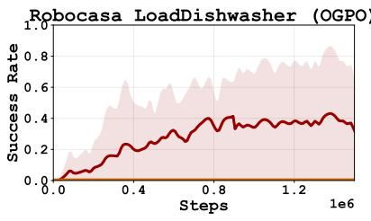

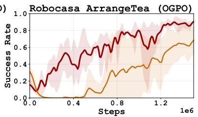

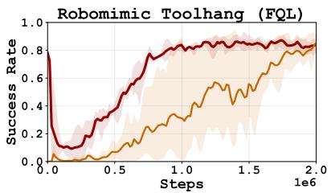  
Figure 22: Subgoal reward shaping ablation. VADAR-NF against VADAR-SHAPED, which sums the per-subgoal rewards into a single shaped reward before the Bellman backup and trains a standard scalar critic on it, on RoBOCASA365 with OGPO and ROBOMIMIC TOOL-HANG with FQL.

## P Alternative critic parameterizations yield limited additional benefit

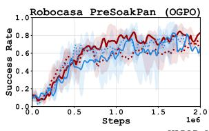

  
Figure 23: Critic parameterization ablation. VADAR with its goal-conditioned critic $S \times A \times G \ \to \ \mathbb { R }$ (blue) against VECTOR-VADAR, which uses a vector-valued critic $S \times A \  \ \mathbb { R } ^ { | G | }$ (red), under next-future (solid) and current-future (dotted) weightings on ROBOCASA365 with OGPO and ROBOMIMIC TOOL-HANG with FQL.

An alternative to VADAR's goal-conditioned critic $Q _ { \phi } ( s , a , g )$ , which is evaluated once per subgoal to form the vector of values used for policy extraction, is a vector-valued critic $\mathbf { Q } _ { \phi } : S { \times } A \to \mathbb { R } ^ { | G | }$ that predicts all subgoal values in a single forward pass. We call this variant VECTOR-VADAR.

Figure 23 shows that it performs roughly the same as VADAR across tasks and weightings. This is consistent with the previous subsections: both critics are supervised on every subgoal at every transition, and it is this dense supervision, together with non-myopic policy extraction, that accounts for VADAR's performance rather than the particular critic parameterization.

A second alternative is an iterative critic, which refines its subgoal values over several passes and can be viewed as simulating a Bellman update inside the critic (Appendix Q). We instantiate this with MIQ (Appendix Q.2) and again find performance on par with VADAR's monolithic critic, with the iterative critic training somewhat more stably (Appendix Q.2.5).

## Q Combining VADAR with Iterative Critics

VADAR is compatible with critics that estimate values through iterative computation (Agrawalla et al., 2025). Here we explore how iterative computation and multi-goal prediction could implement an implicit Bellman update during value prediction. Empirically, iterative critics provide limited additional benefit over the monolithic critic (Appendix P).

## Q.1 Simulating the Bellman Update via Iterative Critic Parametrizations

Standard RL critics compute Q-values in a single monolithic forward pass. In the context of VADAR, a monolithic critic produces all |G| heads in a single shot, so the subgoal heads never communicate at inference time. Here we argue that combining iterative critic parameterizations with VADAR can be viewed as implementing a Bellman update at inference time.

An iterative VADAR critic proceeds in steps $j ~ =$ $0 , \ldots , N _ { \mathrm { i t e r } }$ , producing an estimates $\hat { \mathbf { q } } ^ { j } \in \mathbb { R } ^ { \bar { G } }$ of the critic values per step. At each step, the critic updates its estimate $\hat { \mathbf { q } } ^ { j + 1 } \gets \mathbf { Q } _ { \phi } ( \mathbf { s } , \mathbf { a } , \hat { \mathbf { q } } ^ { j } , \bar { j } )$ . Therefore, each updated $\mathbf { q } ^ { k + 1 }$ can depend on previous estimates of critic values $\mathbf { q } ^ { k }$ . Informally, this computation graph can express belief-propogation updates across critic time steps, such as the classical Bellman update (Sutton et al., 1998) which defines the Q-values. We depict this intuition in Figure 24. For training an iter-

  
Figure 24: Iterative Critic Prediction

ative critic, we introduce a two-step minimal iterative Q-network (MIQ) inspired by Pan et al. (2026, MIP) described in Appendix Q.2, which we anecdotally find more stable to train than flow-based critics (Agrawalla et al., 2025).

## Q.2 The MIQ Critic

VADAR's vector critic synergizes with iterative critic parameterizations: each iteration can propagate information across subgoal heads, so the second iteration's prediction for one subgoal can be conditioned on the first iteration's prediction for the others. We instantiate this with MIQ, a critic-side adaptation of the Minimal Iterative Policy of Pan et al. (2026) that retains the two-step iteration with $t ^ { \star } = 0 . 9$

## Q.2.1 Architecture

A MIQ critic is a single MLP $Q _ { \phi } : S \times A \times \mathbb { R } \times [ 0 , 1 ] \to$ R that takes a state-action pair $( s , a )$ , a scalar z that plays the role of the noise variable in a flow-matching linear interpolant, and a time index $t \in [ 0 , 1 ]$ . To recall the flow-matching analogy: a flow model is trained to map the linear interpolant $I _ { t } = t x + ( 1 - t ) ^ { \cdot }$ z between Gaussian noise z and a clean target x at time $t \in [ 0 , 1 ]$ back to x, so that at $t = 0$ the input is pure noise and as t → 1 it approaches the target. MIP (Pan et al., 2026) retains this interpolant but supervises the network with the same target twice, at $t = 0$ and at $t = t ^ { \star }$ (with $t ^ { \star } = 0 . 9 )$ , using a regression loss instead of a velocitymatching loss. MIQ is the same construction with the supervision target x instantiated as the scalar Q-target $y ^ { \mathrm { t a r g e t } }$ : the flow-matching interpolant is replaced by an interpolant in Q-value space, and $z \sim \mathrm { U n i f } [ - \sigma , \sigma ]$ is the noise variable that lives on the noisy end of that interpolant. At inference, MIQ runs two autoregressive steps:

$$
\hat { q } ^ { 0 }  Q _ { \phi } ( s , a , z , t = 0 ) , \qquad \hat { q } ^ { 1 }  Q _ { \phi } ( s , a , \hat { q } ^ { 0 } , \sigma / 1 0 ) , t ^ { \star } ) ,\tag{Q.1}
$$

i.e., the second iteration substitutes its own iteration-zero output $\hat { q } ^ { 0 }$ in place of an interpolated input, since $\hat { q } ^ { 0 }$ has been trained to approximate $y ^ { \mathrm { t a r g e t } }$

## Q.2.2 Training Objective

Following Pan et al. (2026, Eq. (4.4)), MIQ supervises both iterations against the standard scalar TD target $y ^ { \mathrm { t a r g e t } } = \bar { r } + \gamma Q _ { \mathrm { t a r g } } ( s ^ { \prime } , a ^ { \prime } )$ . To train the iteration-one mapping, we cannot feed the network the iteration-zero output (it is a moving target during training); instead, we feed a noise-corrupted version of the supervision signal itself. Concretely, we sample $z \sim \mathrm { U n i f } [ - \sigma , \sigma ]$ and form the linear interpolant

$$
z _ { t ^ { \star } } = ( 1 - t ^ { \star } ) z + y ^ { \mathrm { t a r g e t } } ,\tag{Q.2}
$$

which is a noisy copy of $y ^ { \mathrm { t a r g e t } }$ (smaller noise the larger $t ^ { \star } \mathrm { i s } ,$ hence $t ^ { \star }$ near 1). The MIQ critic loss for a single ensemble member is

$$
L _ { \mathrm { c r i t i c } } ^ { \mathrm { M I Q } } ( Q _ { \phi } \mid s , a , y ^ { \mathrm { t a r g e t } } , z ) ~ = ~ \left( Q _ { \phi } ( s , a , z , 0 ) - y ^ { \mathrm { t a r g e t } } \right) ^ { 2 } ~ + ~ \left( Q _ { \phi } { } ( s , a , z _ { t } \star , t ^ { \star } ) - y ^ { \mathrm { t a r g e t } } \right) ^ { 2 } .\tag{Q.3}
$$

The first term trains the iteration-zero pathway to predict $y ^ { \mathrm { t a r g e t } }$ from a fully random $z ;$ the second term trains the iteration-one pathway to denoise a near-correct estimate $z _ { t ^ { \star } }$ back to $y ^ { \mathrm { t a r g e t } }$ . At inference we substitute the iteration-zero output $\hat { q } ^ { 0 }$ for $z _ { t ^ { \star } }$ , which is well-behaved because the iteration-zero pathway has already been trained to produce a good approximation of $y ^ { \mathrm { t a r g e t } }$

## Q.2.3 Ensembling

We use an explicit ensemble of M independently parameterized MIQ networks $Q _ { \phi _ { 1 } } , \ldots , Q _ { \phi _ { M } }$ (ValueMIPEns emble in our codebase). At each update, a single noise draw z is shared across the ensemble; each member produces its own $\hat { q } ^ { 0 , ( i ) }$ at iteration zero and uses that member's own $\hat { q } ^ { 0 , ( i ) }$ as the iteration-one input. Aggregation across the ensemble (Eq. (B.2)) is unchanged from Appendix B: we average the iteration-one predictions to form $Q _ { \mathrm { t a r g } }$

## Q.2.4 MIQ with VADAR

We have seen how MIQ can be used as a general critic. Adapting it to our VADAR framework requires minimal modifications. The scalar $Q _ { \phi } : S \times A \times \mathbb { R } \times [ 0 , 1 ] \to$ R now becomes a vector critic: $\mathbf { Q } _ { \phi } : S { \times } A { \times } \mathbb { R } ^ { | G | } { \times } [ 0 , 1 ] \to$ $\mathbb { R } ^ { | G | }$ . The noise variable $\mathbf { z } \sim \mathrm { U n i f } [ - \sigma , \sigma ] ^ { | G | }$ also becomes a $| G |$ dimensional vector. And the TD target is the vector $\mathbf { y } ^ { \mathrm { t a r g e t } } \in \mathbb { R } ^ { | G | }$ from Eq. (5.2), and $\mathrm { E q . } \left( \mathrm { Q . } 1 \right)$ becomes

$$
\hat { \mathbf { q } } ^ { 0 } \gets \mathbf { Q } _ { \phi } ( s , a , \mathbf { z } , 0 ) , \qquad \hat { \mathbf { q } } ^ { 1 } \gets \mathbf { Q } _ { \phi } ( s , a , \hat { \mathbf { q } } ^ { 0 } , t ^ { \star } ) .
$$

Because the second pass' input is the full vector $\hat { \mathbf { q } } ^ { 0 }$ , head $g \mathrm { ^ s }$ second estimate depends on every head's previous estimate.

## Q.2.5 Policy Extraction via MIQ + VADAR

To validate the hypothesis that iterative critic parameterizations learn implicit Bellman updates over the subgoal DAG, we test MIQ+VADAR on LIBERO $\left( \left| G \right| = 3 \right)$ with SAC and ROBOMIMIC TRANSPORT $( | G | = 7 )$ with OGPO as the backbone. We compare the VADAR's monolithic multi-head critic against MIQ with varying Q-function update-to-data (UTD) ratios.

  
Figure 25: MIQ+VADAR (orange/purple) vs. monolithic vector critics (red/blue) at critic UTD $q = 1$ (solid) and $q = 4$ (dashed); the policy update frequency is held fixed across all runs. The largest MIQ effect is on OGPO TRANSPORT, where the monolithic critic degrades sharply at $q = 4$ and MIQ restores parity with $q = 1$

Results. Across the four panels in Figure 25, success rates with MIQ are broadly comparable to the monolithic critic, with a minor improvement in policy extraction for the higher critic UTD $( q = 4 )$ ablation.

  
Figure 26: We compare monolithic VADAR critics with MIQ+VADAR at critic UTD $q \in \{ 1 , 4 \}$ , holding the actor update frequency fixed. MIQ substantially reduces total and per-subgoal TD residuals and produces lower-variance mean- $\boldsymbol { \cdot } \boldsymbol { Q }$ estimates, while maintaining comparable or slightly improved success rates.

The more informative differences show up on the critic itself: in Appendix Q.2 (Figure 26), per-subgoal TD residuals on LIBERO KITCHEN\_SCENE6 drop under MIQ across all three subtasks and stay flat throughout training, while the monolithic critic's TD error drifts upward late in training. The mean-Q trajectory under MIQ is more stable as hypothesized due to the implicit message passing down the subgoal DAG. We posit this being more beneficial to use-cases where critic stability even at subgoal level is a large concern.

This view connects to the VADARLAST-Q ablation of Section 6.2, where policy extraction uses only the finalsubgoal value and approaches VADAR-NF on several tasks. As discussed in Section 6.4, these results are consistent with intermediate targets improving the shared representations used for final-subgoal prediction. MIQ introduces an explicit dependence between successive value estimates: its second pass conditions every subgoal prediction on the full first-pass vector $\hat { \mathbf { q } } ^ { 0 }$ . The comparison therefore tests the additional benefit of iterative refinement beyond shared subgoal supervision; comparable success rates do not establish that the non-iterative critic performs the same internal computation.