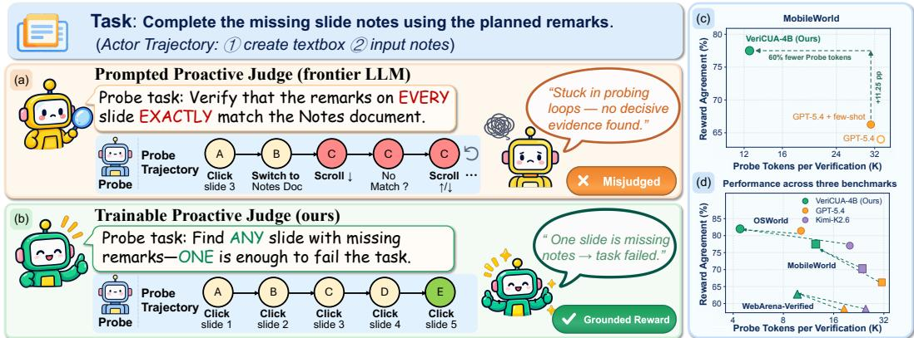
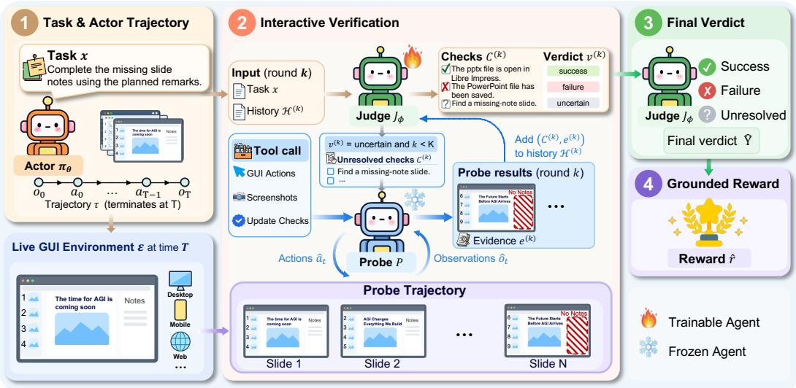
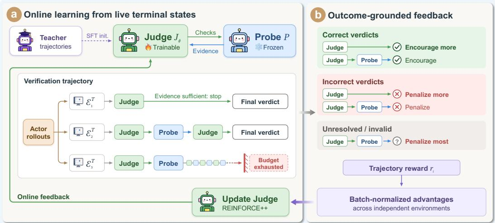
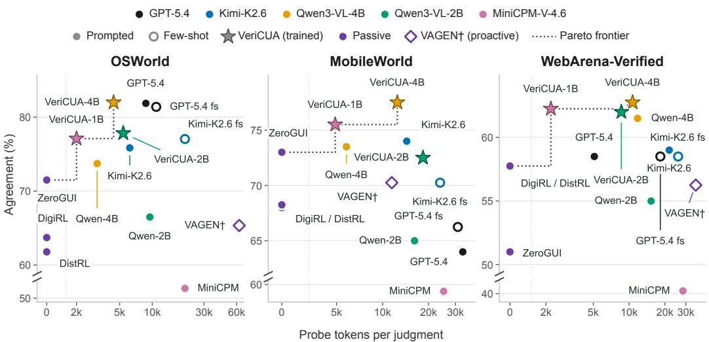
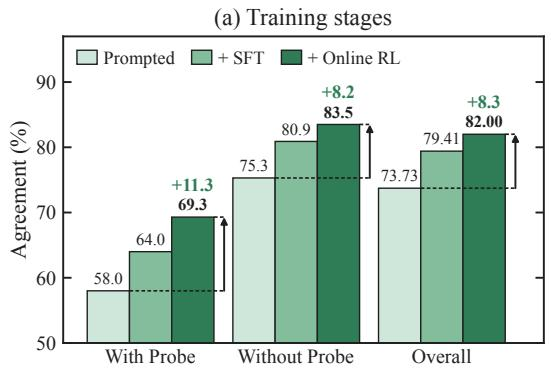
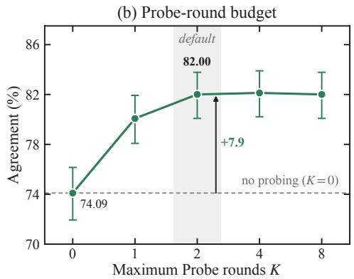
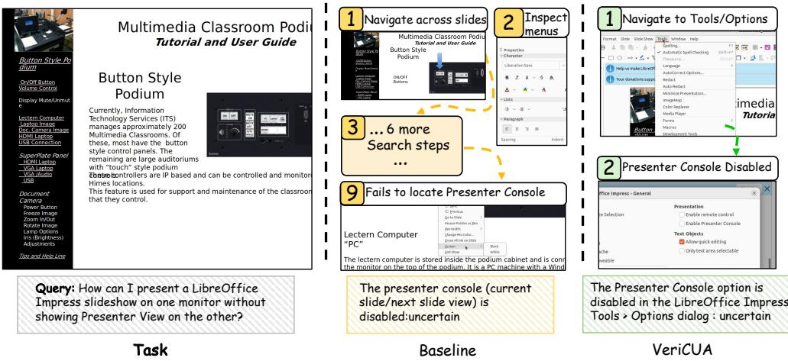
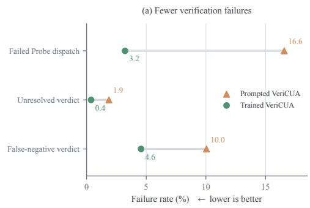
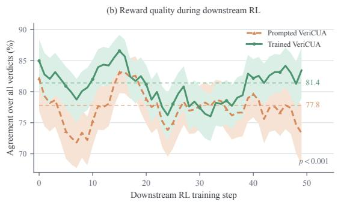

# VERICUA: LEARNING PROACTIVE VERIFICATION FORRELIABLE GUI AGENT REWARDS

Zhizhou Wang<sup>1</sup>∗, Yaxi Lu<sup>2</sup>∗, Zhong Zhang<sup>3</sup>†, Zikun Hu<sup>4</sup>, Xin Cong<sup>2</sup>, Yankai Lin<sup>5</sup> Fangming Liu<sup>6</sup>†

<sup>1</sup>Southwest Jiaotong University <sup>2</sup>Tsinghua University

<sup>3</sup>University of Electronic Science and Technology of China

<sup>4</sup>National University of Singapore <sup>5</sup>Renmin University of China <sup>6</sup>Peng Cheng Laboratory

## ABSTRACT

Reinforcement learning for computer-use agents increasingly relies on proactive reward agents that interact with the post-execution GUI environment to verify what recorded screenshots cannot reveal. The reliability of such verification hinges on two coupled decisions: what to check and when to stop. Existing methods leave these decisions to prompted foundation models. However, neither scaling up the model nor providing few-shot examples reliably improves verification: prompted Judges ranging from 4B to GPT-5.4 all plateau at 68%–70% macro-average agreement. This is because the value of a check depends on the environment rather than the task alone, and becomes apparent only through execution. Learning from execution is itself constrained, as the Actor’s terminal state cannot be faithfully replicated during training, allowing only one verification attempt per state. We introduce VERICUA, a proactive reward agent that learns its verification strategy from these single attempts. A trainable JUDGE decides what to check and when to stop, while a frozen PROBE executes the checks in the live environment. Online reinforcement learning optimizes the JUDGE for both verdict correctness and eficient PROBE use, with returns normalized across terminal states. Trained only on OSWorld and evaluated without further training on MobileWorld and WebArena-Verified, VERICUA achieves the highest reward agreement across all three benchmarks and lies on the agreement–cost Pareto frontier among proactive verifiers. It surpasses few-shot GPT-5.4 by 5.36 points with 47.6%–59.8% fewer PROBE tokens, and even a 1B VERICUA exceeds every prompted Judge. As the reward for Actor RL, it raises task success by 3.21 points overall and 5.40 points on held-out multi-application tasks. These results identify the verification strategy, not verifier scale, as the key to reliable GUI rewards. Code is available at https://github.com/Jeffjeno/VeriCUA.

## 1 INTRODUCTION

Training computer-use agents (CUAs) with reinforcement learning requires reliable rewards for task completion (Lv et al., 2026; Lai et al., 2026; Wang et al., 2026). Rule-based rewards are precise but brittle and dificult to scale (Xie et al., 2024; El Hattami et al., 2025; Kong et al., 2026), while passive model-based rewards are more flexible but can only verify what is exposed in the available observations (Qi et al., 2025; Bai et al., 2024; Wang et al., 2025; Yang et al., 2025). Decisive evi dence, such as the contents of a saved file or other hidden application state, may therefore remain unobserved (Cai et al., 2025). Proactive verification addresses this limitation by interacting with the post-execution environment to acquire the missing evidence before issuing a verdict (Dai et al., 2026; Cui et al., 2026; Shi et al., 2026). Because such verification is performed for every training rollout, it must be not only accurate but also eficient enough to avoid invoking an expensive model for each reward.

  
Figure 1: Learned check selection and stopping improve verification reliability and eficiency. Given the same task and frozen PROBE, (a) prompted GPT-5.4 requests an exhaustive comparison and remains inconclusive, whereas (b) VERICUA searches for a slide with missing notes and stops once this counterexample establishes task failure. (c, d) VERICUA achieves higher agreement with fewer PROBE tokens than few-shot GPT-5.4 and Kimi-K2.6.

Interaction alone, however, does not guarantee a reliable verdict. Reliability depends on the verification strategy, which consists of two coupled decisions the task leaves open: what to check and when to stop. For a task that requires notes on every slide, one slide without notes already establishes failure (Figure 1(b)). The prompted verifier in Figure 1(a) instead requests a slide-by-slide comparison and keeps scrolling without reaching a verdict. Scale does not fix this. Under the same verification loop, prompted Judges from a 4B model to GPT-5.4 all reach 68%–70% macro-average agreement, and few-shot examples add at most 0.6 points (Table 1).

Our key observation is that a check’s value is revealed by executing it, not by reading the task. A prompted Judge sees the task and the recorded screenshots, which show what a plausible check looks like but not what evidence it will return. That depends on where the evidence resides, the state the Actor left, and what the PROBE can reach. When to stop depends on how often screenshot-only verdicts turn out to be correct. The strategy must therefore be learned by executing verification and comparing its verdicts with true outcomes.

Learning from execution, however, faces a single-attempt constraint: each Actor terminal state admits only one verification attempt, which rules out within-state rollout comparisons. An Actor starts from a resettable initial state, so RL can compare several rollouts from the same state (Shao et al., 2024). A GUI verifier starts from the Actor’s terminal state, the product of one stochastic execution. Reexecution may not reproduce it, identical screenshots can hide diferent application state, and probing itself changes it.

We introduce VERICUA, a proactive GUI reward agent that learns its verification strategy under this constraint. A trainable JUDGE decides what to check and when to stop, and a frozen GUI PROBE executes the checks. Freezing the PROBE ties outcome diferences to the JUDGE and lets the PROBE be swapped without retraining. We initialize the JUDGE with outcome-filtered teacher traces and then train it with online RL on complete attempts graded by executable outcomes, so each check is credited by the evidence it actually yields. The reward also depends on whether the PROBE was used, which lets a single attempt signal whether stopping was right. Returns are normalized across terminal states in each batch (Hu et al., 2025), so no environment forking is required.

We evaluate VERICUA on OSWorld (Xie et al., 2024), MobileWorld (Kong et al., 2026), and WebArena-Verified (El Hattami et al., 2025). First, strategy matters more than scale. VERICUA surpasses few-shot GPT-5.4 by 5.36 macro-average points with 47.6%–59.8% fewer PROBE tokens and lies on the agreement–cost Pareto frontier (Figure 4). Even VERICUA-1B outperforms prompted GPT-5.4 (OpenAI, 2026) and its teacher Kimi-K2.6 (Kimi, 2026). Second, the learned strategy transfers. Trained only on OSWorld, the JUDGE achieves the highest agreement on unseen mobile and web environments. Third, better rewards train better agents. VERICUA rewards raise downstream Pass@4 by 3.21 points overall and by 5.40 points on held-out MultiApp tasks.

  
Figure 2: Overview of VERICUA. The JUDGE formulates task-success checks and assesses whether the available evidence supports a terminal verdict. When further inspection is requested, the frozen PROBE gathers evidence for unresolved checks in the live environment and returns status updates with supporting observations.

## 2 METHOD

## 2.1 OVERVIEW

As shown in Figure 2, VERICUA verifies the Actor’s task outcome using its execution history and live terminal environment. It consists of a trainable JUDGE and a frozen GUI PROBE. The JUDGE initially formulates task-success checks and marks each as satisfied, violated, or unresolved based on the available evidence. If the evidence supports a success or failure verdict, verification terminates. Otherwise, subject to the probing budget, the PROBE gathers evidence for the unresolved checks and returns status updates with supporting observations. Subsequent JUDGE calls retain the checks from the previous round and update their statuses using the returned evidence.

By specifying what the PROBE inspects and deciding whether to request further interaction, the JUDGE determines the evidence acquired and hence the verdict. We train it on complete verification attempts, one per Actor terminal state, with a reward on verdict correctness and PROBE use (Sections 2.3 and 2.4).

## 2.2 THE JUDGE-PROBE VERIFICATION LOOP

Consider an Actor policy $\pi _ { \theta }$ attempting task x in a live GUI environment E and terminating at time T with trajectory $\tau = ( o _ { 0 } , a _ { 0 } , \ldots , a _ { T - 1 } , o _ { T } )$ , where $o _ { t }$ and $a _ { t }$ denote GUI observations and actions. The JUDGE receives x and an input representation $\psi ( \tau )$ containing the Actor’s action history and its most recent screenshots (Appendix I). When the JUDGE requests additional evidence, the frozen PROBE interacts with the live terminal environment to inspect unresolved task conditions and returns status updates with supporting observations. Each round therefore involves the two decisions that make up the verification strategy: whether the current evidence supports a terminal verdict and, if not, which checks to send to the PROBE.

JUDGE. Let $\mathcal { H } ^ { ( k ) }$ denote the verification history available to the JUDGE at call $k ,$ consisting of the initial Actor input and the checks and PROBE evidence retained from earlier rounds. At call $k \in \{ 0 , \ldots , K \}$ , where $K$ is the maximum number of PROBE invocations, the trainable JUDGE $J _ { \phi }$ conditions on the task x and $\mathcal { H } ^ { ( k ) }$ to produce a verdict and status-annotated checks:

$$
\big ( \boldsymbol { v } ^ { ( k ) } , C ^ { ( k ) } \big ) = J _ { \phi } \big ( \boldsymbol { x } , \mathcal { H } ^ { ( k ) } \big ) , \qquad \mathcal { H } ^ { ( 0 ) } = \psi ( \tau ) .\tag{1}
$$

Here $v ^ { ( k ) } \ \in \ \{ \mathsf { s u c c e s s } , \mathsf { f a i l u r e } , \mathsf { u n c e r t a i n } \}$ , and $C ^ { ( k ) }$ pairs each check with a status: satisfied, violated, or unresolved. The check text is generated at $k = 0$ and the statuses are updated thereafter. The JUDGE returns success when all checks are satisfied, failure when any is violated, and uncertain otherwise. A success or failure verdict terminates verification. When $v ^ { ( k ) } = \mathtt { u n c e r t a i n }$ and $k < K$ , only the unresolved subset $C _ { u } ^ { ( k ) } \subseteq C ^ { ( k ) }$ is passed to the PROBE.

PROBE. The frozen PROBE $P$ gathers evidence for the unresolved checks in the current live environment. We keep it frozen so that diferences in verification outcome are attributable to the JUDGE. Its instructions confine it to inspecting the environment, without completing or repairing the Actor’s task (Appendix I). Its interaction trajectory and returned evidence are represented as

$$
\begin{array} { r } { \big ( \tau _ { P } ^ { ( k ) } , e ^ { ( k ) } \big ) \sim P \Big ( \cdot \mid C _ { u } ^ { ( k ) } ; \mathcal { E } ^ { ( k ) } \Big ) , \qquad \mathcal { H } ^ { ( k + 1 ) } = \mathcal { H } ^ { ( k ) } \oplus \big ( C ^ { ( k ) } , e ^ { ( k ) } \big ) . } \end{array}\tag{2}
$$

Here ${ \mathcal { E } } ^ { ( 0 ) }$ is the Actor’s terminal environment, and each subsequent PROBE invocation continues from the state reached by the preceding PROBE actions. The returned evidence $e ^ { ( k ) }$ comprises check-status updates and selected supporting observations, and $\oplus$ denotes concatenation. Only $e ^ { ( k ) }$ reaches the JUDGE; the full PROBE trace $\tau _ { P } ^ { ( k ) }$ does not, and each invocation starts without the interaction history of earlier rounds, so neither component’s context grows with the other’s execution length.

## 2.3 OUTCOME FEEDBACK FROM A SINGLE ATTEMPT

We assign a terminal reward to each complete verification attempt, combining verdict correctness with whether probing was used. A correctness-only reward scores a correct verdict reached directly the same as one reached after probing. Because each terminal state admits a single attempt, there is no sibling attempt to reveal whether probing was needed, so the reward itself must carry that signal.

Let $\hat { Y } _ { i }$ denote the final JUDGE verdict and $Y _ { i }$ the executable outcome recorded before PROBE interaction. We set $p _ { i } ~ = ~ 1$ if the verification attempt invokes the PROBE at least once, and $p _ { i } ~ = ~ 0$ otherwise, so the probing term of the reward reflects the JUDGE’s stopping decision rather than the frozen PROBE’s execution length. The terminal reward is $r _ { i } = R ( \hat { Y } _ { i } , Y _ { i } , p _ { i } )$

Correct verdicts receive higher rewards when reached without probing, encouraging reliable judgments from existing evidence. Incorrect verdicts receive larger penalties when issued without probing, discouraging premature judgments. Unresolved or invalid outputs receive the lowest reward, discouraging attempts that exhaust the probing budget without reaching a terminal verdict. The exact reward schedule is given in Appendix G.

We use this terminal reward to jointly train check formulation and stop-or-probe decisions over verification attempts. The reward preferences teach the JUDGE to stop once the evidence sufices, while the shared return trains check formulation through its efect on the evidence collected and the verdict. We next describe how we collect verification trajectories and optimize the JUDGE.

## 2.4 ONLINE OPTIMIZATION OF THE JUDGE

Initialization. Before online optimization, we initialize the JUDGE by supervised fine-tuning on teacher verification trajectories whose final verdicts match the executable outcomes. These traces provide examples of structured check generation and verdict prediction, so that each attempt during online RL is a complete, well-formed verification. The PROBE remains frozen.

Sampling verification trajectories. We run the JUDGE from the live terminal environment of each Actor rollout and execute its PROBE requests to obtain the evidence. Each completed verification attempt receives the terminal reward defined in Section 2.3. Unlike an Actor’s resettable initial state, this terminal environment is produced by one stochastic execution: replaying the Actor need not reproduce $\mathbf { i t } ,$ transient state such as unsaved edits and modal dialogs cannot be confirmed from screenshots, and PROBE actions further alter it. We therefore collect one verification trajectory per Actor terminal environment, without environment forking or same-state verifier rollout groups.

Updating the JUDGE. We optimize the JUDGE with REINFORCE++ (Hu et al., 2025), which normalizes terminal returns across the independent terminal environments in each batch. Let $z _ { i } = \big ( ( v _ { i } ^ { ( 0 ) } , C _ { i } ^ { ( 0 ) } ) , e _ { i } ^ { ( 0 ) } , \dots , ( v _ { i } ^ { ( K _ { i } ) } , C _ { i } ^ { ( K _ { i } ) } ) \big )$ denote a complete verification trajectory with $K _ { i } \leq K$ PROBE invocations and terminal reward $r _ { i } .$ When $K _ { i } = 0$ , the trajectory contains only the initial JUDGE output. For a batch B of complete verification trajectories, the normalized return supplies the advantage for every active JUDGE token:

  
Figure 3: Training procedure of VERICUA. Online optimization uses one verification trajectory per live Actor terminal state. The JUDGE is updated using terminal feedback on verdict correctness and whether probing was used, while the PROBE remains frozen.

$$
A _ { i , k , t } = \frac { r _ { i } - \mu _ { B } } { \sqrt { \sigma _ { B } ^ { 2 } + \epsilon } } , \qquad ( i , k , t ) \in \mathcal { A } _ { B } .\tag{3}
$$

Here $\mu _ { B }$ and $\sigma _ { B } ^ { 2 }$ are the mean and variance of terminal rewards in the batch, and $\epsilon > 0$ ensures numerical stability. The index set $\mathcal { A } _ { B }$ contains active JUDGE tokens, indexed by trajectory i, JUDGE call $k ,$ and token position t. Only newly generated JUDGE tokens contribute to the loss; context tokens and PROBE outputs are excluded. The following log-probability surrogate expresses the on-policy gradient at the rollout policy:

$$
\mathcal { L } _ { \mathrm { J u d g e } } ( \phi ) = - \frac { 1 } { \lvert A _ { \mathcal { B } } \rvert } \sum _ { ( i , k , t ) \in A _ { \mathcal { B } } } A _ { i , k , t } \log \pi _ { \phi } ^ { J } \left( y _ { i , k , t } \mid h _ { i , k , t } \right) ,\tag{4}
$$

where $\pi _ { \phi } ^ { J }$ is the autoregressive JUDGE policy, $y _ { i , k , t }$ is the generated token, and $h _ { i , k , t }$ is its conditioning context. The loss averages over active JUDGE tokens across the batch. For parameter updates, we use the clipped likelihood-ratio objective described in Appendix E, with rollout-policy probabilities and normalized returns held fixed.

Using the trained verifier. After training, we freeze VERICUA and map its final verdict to a binary reward $\hat { r } _ { i } = \mathbb { I } \big [ \mathbf { V _ { E R I C U A } } ( x _ { i } , \tau _ { i } , \mathcal { E } _ { i } ^ { T } ) = \mathsf { s u c c e s s } \big ]$ , where $\mathcal { E } _ { i } ^ { T }$ is the terminal environment of Actor rollout i. We keep VERICUA fixed and optimize the Actor with vanilla GRPO (Shao et al., 2024), grouping Actor rollouts generated from the same task initialization. Each rollout is verified once from its own terminal environment, and the resulting verdict determines its reward $\hat { r } _ { i }$

## 3 EXPERIMENTS

Our experiments examine whether a learned verification strategy improves reward agreement over prompted verifiers across model scales and at what PROBE cost, whether it generalizes beyond its training environment, and whether the resulting rewards improve downstream Actor learning.

Table 1: Reward reliability across executable environments (%). Results use Avg@4 except ZeroGUI∗, which follows its oficial Majority@4 aggregation. VERICUA leads on all three benchmarks. Bold and underlined mark the best and second-best results.
<table><tr><td>Verifier</td><td>Mode</td><td>OSWorld desktop</td><td>MobileWorld mobile</td><td>WebArena-V web</td><td>Macro Avg. all envs.</td></tr><tr><td>GPT-5.4</td><td></td><td></td><td></td><td></td><td>proprietary reference</td></tr><tr><td>Prompted VERICUA</td><td>Prompted</td><td>81.88</td><td>64.00</td><td>58.50</td><td>68.13</td></tr><tr><td>+ few-shot</td><td>Prompted</td><td>81.40</td><td>66.25</td><td>58.50</td><td>68.72</td></tr><tr><td>Kimi-K2.6</td><td></td><td></td><td></td><td></td><td>proprietary reference</td></tr><tr><td>Prompted VERICUA</td><td>Prompted</td><td>75.85</td><td>74.00</td><td>59.00</td><td>69.62</td></tr><tr><td>+ few-shot</td><td>Prompted</td><td>77.05</td><td>70.25</td><td>58.50</td><td>68.60</td></tr><tr><td>Qwen3-VL-4B-Thinking</td><td></td><td></td><td></td><td></td><td>4B main backbone</td></tr><tr><td>DistRL</td><td>Passive</td><td>61.78</td><td>68.00</td><td>57.75</td><td>62.51</td></tr><tr><td>DigiRL</td><td>Passive</td><td>63.71</td><td>68.25</td><td>57.75</td><td>63.24</td></tr><tr><td>ZeroGUI*</td><td>Passive</td><td>71.50</td><td>73.00</td><td>51.00</td><td>65.17</td></tr><tr><td>VAGEN</td><td>Prompted</td><td>65.34</td><td>70.25</td><td>56.25</td><td>63.95</td></tr><tr><td>Prompted VERICUA VERIČUA (ours)</td><td>Prompted</td><td>73.73</td><td>73.50</td><td>61.50</td><td>69.58</td></tr><tr><td>∆ vs. Prompted (pp)</td><td>Trained</td><td>82.00 +8.27</td><td>77.50 +4.00</td><td>62.75 +1.25</td><td>74.08 +4.50</td></tr><tr><td>Qwen3-VL-2B-Thinking</td><td></td><td></td><td></td><td></td><td></td></tr><tr><td>Prompted VERICUA</td><td>Prompted</td><td>66.49</td><td>65.00</td><td>55.00</td><td>2B main backbone</td></tr><tr><td>VERIĊUA (ours)</td><td>Trained</td><td>77.84</td><td>72.50</td><td>62.00</td><td>62.16 70.78</td></tr><tr><td>Δ vs. Prompted (pp)</td><td></td><td>+11.35</td><td>+7.50</td><td>+7.00</td><td>+8.62</td></tr><tr><td></td><td></td><td></td><td></td><td></td><td></td></tr><tr><td>MiniCPM-V-4.6-Thinking</td><td></td><td></td><td></td><td></td><td>1B main backbone</td></tr><tr><td>Prompted VERICUA</td><td>Prompted</td><td>52.29</td><td>58.75</td><td>40.50</td><td>50.51</td></tr><tr><td>VERIĊUA (ours)</td><td>Trained</td><td>77.11</td><td>75.50</td><td>62.25</td><td>71.62</td></tr><tr><td>∆ vs. Prompted (pp)</td><td></td><td>+24.82</td><td>+16.75</td><td>+21.75</td><td>+21.11</td></tr></table>

## 3.1 EXPERIMENTAL SETUP

Benchmarks. We evaluate on the OSWorld (Xie et al., 2024) tasks that require neither network access nor Google Drive, the GUI-only subset of MobileWorld (Kong et al., 2026), and WebArena-Verified Hard (El Hattami et al., 2025), using 414, 100, and 100 trajectories, respectively. These cover successful executions and diverse failures from five Actors: EvoCUA-32B (Xue et al., 2026), Qwen3.8-27B (Qwen Team, 2026), Holo3.1-35B-A3B (H Company, 2026), Qwen3-VL-4B-Thinking (Bai et al., 2025), and Gemini 3.7 Flash (Google DeepMind, 2026). Each trajectory includes the action–observation history, the clean task snapshot from which its terminal environment can be re-executed, and an executable outcome label hidden from all verifiers.

Training data. We train the JUDGE only on OSWorld and keep it frozen thereafter, so MobileWorld and WebArena-Verified test zero-shot transfer. Each environment uses one frozen PROBE shared by all VERICUA variants. We denote trained Judges by size: VERICUA-4B (Qwen3-VL-4B-Thinking), VERICUA-2B (Qwen3-VL-2B-Thinking), and VERICUA-1B (MiniCPM-V-4.6-Thinking (Yu et al., 2026; Yao et al., 2024)). SFT uses Kimi-K2.6 verification traces and online RL uses newly collected OSWorld trajectories, all disjoint from evaluation (Appendix G).

Baselines. Unless noted, all baselines use Qwen3-VL-4B-Thinking, and existing methods follow their published observation and prompting configurations (Appendix D). (i) Passive verifiers: DistRL (Wang et al., 2025), DigiRL (Bai et al., 2024), and ZeroGUI (Yang et al., 2025). (ii) Prompted proactive verifiers: VAGEN (Cui et al., 2026) and prompted VERICUA, which shares trained VER-ICUA’s JUDGE–PROBE architecture, prompts, and budget of at most K=2 PROBE rounds but uses an of-the-shelf Judge. We also evaluate prompted VERICUA with the backbones of VERICUA-2B and VERICUA-1B, and with the frontier models Kimi-K2.6 and GPT-5.4, both also tested few-shot.

Evaluation protocol. Both evaluations use the executable task evaluator as ground truth and aggregate four independent runs (Appendix A). Verifier evaluation: We keep only Actor trajectories whose outcome is stable across six re-executions from the clean task snapshot (Appendix D). Each proactive-verifier trial runs in its own re-executed terminal environment, so no verifier’s PROBE actions afect another’s. Passive verifiers score the recorded screenshots. We report Avg@4 agreement per benchmark and its unweighted mean (Macro Avg.), and measure cost as frozen-PROBE tokens per judgment (Appendix D). Actor evaluation: We train the same Qwen3-VL-4B-Thinking Actor on OSWorld with vanilla GRPO (Shao et al., 2024) under identical tasks, rollout budget, and hy perparameters, varying only the frozen reward source (ZeroGUI, prompted VERICUA, or trained VERICUA). We report Pass@4 on the 206 single-application tasks used for Actor training (ID) and 74 MultiApp tasks held out from Actor training (OOD).

  
Figure 4: Reward agreement versus PROBE tokens per judgment: trained VERICUA occupies the agreement–cost Pareto frontier among proactive verifiers. VAGEN† is billed for its full loop.

Implementation details. We implement JUDGE SFT with LLaMA-Factory and online RL with Slime, using Megatron Core for parameter updates and SGLang/vLLM for rollout generation with NVIDIA A800 GPUs and Huawei Ascend 910B3 NPUs. Detailed hardware, software, and desktopenvironment configurations are provided in Appendix F.

## 3.2 VERIFICATION STRATEGY MATTERS MORE THAN SCALE

Agreement and PROBE-token cost. Prompted Judges from a 4B model to GPT-5.4 plateau at 68.13%–69.62% macro-average agreement, and few-shot examples shift this range by at most 1.02 points. VERICUA-4B moves beyond this plateau: it achieves the highest agreement on all three benchmarks (Table 1) and lies on the agreement–cost Pareto frontier of proactive verifiers (Figure 4). Compared with few-shot GPT-5.4, it improves macro-average agreement by 5.36 points (68.72% → 74.08%) with 47.6%–59.8% fewer PROBE tokens. On OSWorld, where GPT-5.4 is strongest, VERICUA-4B still leads while using 56.9% fewer tokens, and its margin widens to 11.25 and 4.25 points on MobileWorld and WebArena-Verified. Even VERICUA-1B (71.62%) exceeds every prompted Judge.

Efect of the learned verification policy. With the JUDGE backbone, PROBE, prompts, and round budget held fixed, training improves agreement on every benchmark. Macro-average agreement rises by 4.50, 8.62, and 21.11 points over the prompted 4B, 2B, and 1B Judges, respectively, so the gains come from the learned verification policy rather than the architecture. The agreement–cost frontier reflects this: on every benchmark, its highest-agreement point is a trained VERICUA JUDGE, and VER-ICUA-1B stays on the frontier throughout, dominating every prompted counterpart in both agreement and cost (Figure 4).



  
Figure 5: Learning ablations on OSWorld. (a) SFT improves all judgments; online RL mainly lifts those that invoke the PROBE. (b) Agreement saturates at K=2, with most gain from the first round.

## 3.3 GENERALITY AND BEHAVIOR OF THE LEARNED STRATEGY

Transfer across environments. MobileWorld and WebArena-Verified are unseen during training. On both, VERICUA-4B and VERICUA-1B, paired with environment-specific Probes, rank first and second, ahead of every prompted and passive verifier including few-shot GPT-5.4. The learned strategy is therefore not specific to desktop applications.

Contribution of training stages. Figure 5(a) separates SFT initialization from online RL for the Qwen3-VL-4B-Thinking Judge on OSWorld. Agreement rises from 73.73% for the prompted Judge to 79.41% after SFT and 82.00% after online RL, so both stages contribute, with online RL adding 2.59 points. Agreement improves on judgments both with and without probing. Every trained JUDGE also surpasses Kimi-K2.6 (69.62% macro average), whose traces initialize it, suggesting that one attempt per terminal state sufices to learn beyond imitation.

Efect of the probing budget. Figure 5(b) varies the maximum number of PROBE rounds for the trained 4B Judge. Agreement increases from 74.09% at K=0 to 82.00% at K=2, indicating that evidence from the live environment is decisive. The first round accounts for most of the gain, and two rounds sufice. Because K only caps interaction, the JUDGE can still stop earlier.

Robustness to PROBE size. We keep the trained JUDGE fixed and evaluate Holo3.1 Probes at 35B-A3B, 9B, and 4B scales. OSWorld agreement stays between 82.00% and 82.73% across these Probes without retraining (Appendix C). This suggests that the learned strategy resides in the JUDGE, while the PROBE mainly executes it.

Evidence acquisition behavior. We further examine 33 OSWorld cases in which the recorded Actor trajectory omits outcome-determining evidence that remains accessible through GUI interaction (Appendix B). With the same frozen PROBE, VERICUA-4B directs 61.9% of PROBE actions toward task-relevant evidence, compared with 47.6% for prompted GPT-5.4. Aimless scrolling and waiting fall from 16.2% to 5.5%, with fewer repeated targets and dead-end probes. Figure 6 illustrates the diference. Verifying that Presenter Console is disabled requires a setting absent from the recorded trajectory. VERICUA’s check names both the condition and its location (Tools → Options), and the PROBE inspects it in two steps. Given the condition without the location, the PROBE takes nine steps and never finds it.

## 3.4 DOWNSTREAM ACTOR LEARNING

  
Figure 6: Case study. The baseline check specifies only the condition, and the PROBE fails after nine steps. The VERICUA check also specifies the evidence location, enabling verification in two steps.

Actor performance. Using VERICUA rewards yields the highest Pass@4 among the compared reward sources on every split (Table 2). Overall Pass@4 rises from 43.93% for the initial Actor to 47.14%, a gain of 3.21 percentage points. On the MultiApp split, it rises from 17.57% to 22.97%, a gain of 5.40 percentage points. The Actor trained with prompted VERICUA reaches 45.71% overall and 20.27% on MultiApp, below the corresponding results with the trained verifier.

Table 2: Pass@4 (%) of the RL-trained actor under diferent reward sources. ∆ denotes the absolute improvement over the initial actor on the All split.
<table><tr><td>Reward source</td><td>All</td><td>ID OOD</td><td>Δ</td></tr><tr><td>None (initial policy) ZeroGUI</td><td>43.93 45.36</td><td>53.40 17.57 54.37 20.27</td><td>+1.43</td></tr><tr><td>VERICUA (prompted)</td><td>45.71</td><td>54.85 20.27</td><td>+1.78</td></tr><tr><td>VERICUA (trained)</td><td>47.14</td><td>55.83 22.97</td><td>+3.21</td></tr></table>

Verification during Actor training. To check whether this advantage persists as the Actor changes, we track verification behavior throughout the runs with prompted and trained VERICUA rewards (details in Appendix H). With the trained verifier, agreement with executable outcomes is higher (81.4% vs. 77.8%), the false-negative rate is lower (4.6% vs. 10.0%), and the PROBE-attempt rate is lower (4.28% vs. 5.70%). The trained verifier thus probes less often while missing fewer successes, consistent with a reward that scores both verdict correctness and PROBE use.

## 4 RELATED WORK

Reward signals for computer-use agents. Task-completion rewards for computer-use agents can be obtained from executable evaluators or model-based judgments. Executable evaluators derive outcome labels from application or backend state (Xie et al., 2024; Kong et al., 2026; El Hattami et al., 2025), relying on task-specific checking logic. Environment synthesis automates the construction of verifiable tasks by generating resettable tasks together with executable evaluators (Cao et al., 2026; Zhang et al., 2026b). Model-based evaluators assess recorded observations and action histories using prompted or trained judges (Bai et al., 2024; Wang et al., 2025; Qi et al., 2025; Yang et al., 2025; Xia et al., 2025), while rubric and milestone-based critics further structure this assessment (Rosset et al., 2026; Li et al., 2026). However, since recorded observations obscure uncaptured state, verifiers must acquire additional evidence through active interaction with the environment.

Interactive verification and evidence acquisition. Recent work incorporates evidence acquisition into both post-execution verification and task execution. Post-execution verifiers continue from the Actor’s terminal environment and inspect state before issuing a verdict (Dai et al., 2026; Cui et al., 2026; Shi et al., 2026). Other approaches integrate evidence collection, completeness checking, or recovery into the acting policy (Cai et al., 2025; Han et al., 2026). Text-reasoning verifiers can be trained with RL by replicating a problem to compare verification attempts (Zhang et al., 2026a); we study the post-execution GUI setting, where each state yields a single verification attempt.

## 5 CONCLUSION

We introduced VERICUA, a proactive GUI reward agent that learns what to check and when to stop. Prompted verifiers benefit little from larger models or few-shot examples because a check’s value is revealed only through environment interaction. With only one verification attempt per Actor terminal state during training, VERICUA learns this strategy by comparing outcomes across states. Across desktop, mobile, and web, it reaches the agreement–cost Pareto frontier, enables a 1B Judge to surpass prompted frontier models, and improves downstream policy RL. These results identify verification strategy, rather than model scale, as the key to reliable and afordable GUI reward supervision.

## REPRODUCIBILITY STATEMENT

The interactive verification procedure and online training objective are specified in Sections 2.2 and 2.4. Section 3.1 describes the benchmark splits, baselines, and re-execution-based evaluation protocol. The appendix provides evaluation metrics, training and inference settings, the terminal reward schedule, and complete JUDGE and PROBE prompts.

## AI USE STATEMENT

Large language model (LLM) tools were used in a supporting role to assist with coding and debugging in the reinforcement-learning framework, and to polish the manuscript’s writing for clarity and readability. Kimi-K2.6 was also used to generate candidate verification trajectories for the rejectionsampled SFT cold-start dataset. LLM tools were not used for brainstorming or generating research ideas. All AI-assisted textual edits were reviewed by the authors, and all AI-assisted code changes were reviewed and tested. The authors take full responsibility for the final content of this paper.

## ACKNOWLEDGEMENT

This work was supported in part by the Natural Science Foundation of China (Grant No. 62606076), in part by the the Major Key Project of PCL under Grant PCL2025A10, in part by the Shenzhen Science and Technology Program under Grant RCJC20231211085918010, and partially supported by Tsinghua KA Excellence Center.

## REFERENCES

Hao Bai, Yifei Zhou, Mert Cemri, Jiayi Pan, Alane Suhr, Sergey Levine, and Aviral Kumar. DigiRL: Training In-The-Wild Device-Control Agents with Autonomous Reinforcement Learning. In Advances in Neural Information Processing Systems, volume 37, pp. 12461–12495. Curran Associates, Inc., 2024. doi: 10.52202/079017-0397. URL https://proceedings.neurips.cc /paper\_files/paper/2024/hash/1704ddd0bb89f159dfe609b32c889995-Abstract-C onference.html.

Shuai Bai, Yuxuan Cai, Ruizhe Chen, Keqin Chen, Xionghui Chen, Zesen Cheng, Lianghao Deng, Wei Ding, Chang Gao, Chunjiang Ge, Wenbin Ge, Zhifang Guo, Qidong Huang, Jie Huang, Fei Huang, Binyuan Hui, Shutong Jiang, Zhaohai Li, Mingsheng Li, Mei Li, Kaixin Li, Zicheng Lin, Junyang Lin, Xuejing Liu, Jiawei Liu, Chenglong Liu, Yang Liu, Dayiheng Liu, Shixuan Liu, Dunjie Lu, Ruilin Luo, Chenxu Lv, Rui Men, Lingchen Meng, Xuancheng Ren, Xingzhang Ren, Sibo Song, Yuchong Sun, Jun Tang, Jianhong Tu, Jianqiang Wan, Peng Wang, Pengfei Wang, Qiuyue Wang, Yuxuan Wang, Tianbao Xie, Yiheng Xu, Haiyang Xu, Jin Xu, Zhibo Yang, Mingkun Yang, Jianxin Yang, An Yang, Bowen Yu, Fei Zhang, Hang Zhang, Xi Zhang, Bo Zheng, Humen Zhong, Jingren Zhou, Fan Zhou, Jing Zhou, Yuanzhi Zhu, and Ke Zhu. Qwen3-VL Technical Report, 2025. URL https://arxiv.org/abs/2511.21631. arXiv preprint arXiv:2511.21631.

Shaofei Cai, Yulei Qin, Haojia Lin, Zihan Xu, Gang Li, Yuchen Shi, Zongyi Li, Yong Mao, Siqi Cai, Xiaoyu Tan, Yitao Liang, Ke Li, and Xing Sun. SmartSnap: Proactive Evidence Seeking for Self-Verifying Agents, 2025. URL https://arxiv.org/abs/2512.22322. arXiv preprint arXiv:2512.22322.

Yuan Cao, Dezhi Ran, Mengzhou Wu, Yuzhe Guo, Xin Chen, Ang Li, Gang Cao, Gong Zhi, Hao Yu, Linyi Li, Wei Yang, and Tao Xie. GUI-GENESIS: Automated Synthesis of Eficient Environments with Verifiable Rewards for GUI Agent Post-Training, 2026. URL https://arxiv.org/abs/ 2602.14093. arXiv preprint arXiv:2602.14093.

Chaoqun Cui, Jing Huang, Shijing Wang, Liming Zheng, Qingchao Kong, and Zhixiong Zeng. Agentic Reward Modeling: Verifying GUI Agent via Progressive Trajectory-Grounded Interaction, 2026. URL https://arxiv.org/abs/2602.00575. arXiv preprint arXiv:2602.00575.

Gaole Dai, Shiqi Jiang, Ting Cao, Yuqing Yang, Yuanchun Li, Rui Tan, Mo Li, and Lili Qiu. ProRe: A Proactive Reward System for GUI Agents via Reasoner–Actor Collaboration. In The Fourteenth International Conference on Learning Representations, 2026. URL https://proceedings.ic lr.cc/paper\_files/paper/2026/hash/74bb6042258daa72bedc9616b1b93eda-Abstr act-Conference.html.

Amine El Hattami, Megh Thakkar, Nicolas Chapados, and Christopher Pal. WebArena Verified: Reliable Evaluation for Web Agents. In Workshop on Scaling Environments for Agents, 2025. URL https://openreview.net/forum?id=94tlGxmqkN.

Google DeepMind. Gemini 3.7 Flash Model Card. Google DeepMind model card, 2026. URL https://deepmind.google/models/model-cards/gemini-3-7-flash/. Accessed 2026-10-19.

H Company. Holo3.1: Fast & Local Computer Use Agents. Hugging Face model card, 2026. URL https://huggingface.co/Hcompany/Holo-3.1-35B-A3B. Accessed 2026-10-19.

Qijun Han, Haoqin Tu, Zijun Wang, Haoyue Dai, Yiyang Zhou, Nancy Lau, Alvaro A. Cardenas, Yuhui Xu, Ran Xu, Caiming Xiong, Zeyu Zheng, Huaxiu Yao, Yuyin Zhou, and Cihang Xie. VLAA-GUI: Knowing When to Stop, Recover, and Search, A Modular Framework for GUI Automation, 2026. URL https://arxiv.org/abs/2604.21375. arXiv preprint arXiv:2604.21375.

Jian Hu, Jason Klein Liu, Haotian Xu, and Wei Shen. REINFORCE++: Stabilizing Critic-Free Policy Optimization with Global Advantage Normalization, 2025. URL https://arxiv.org/abs/25 01.03262. arXiv preprint arXiv:2501.03262.

Kimi. Kimi K2.6 Tech Blog: Advancing Open-Source Coding. Kimi technical blog, 2026. URL https://www.kimi.ai/blog/kimi-k2-6. Accessed 2026-10-19.

Quyu Kong, Xu Zhang, Zhenyu Yang, Nolan Gao, Chen Liu, Panrong Tong, Chenglin Cai, Hanzhang Zhou, Jianan Zhang, Liangyu Chen, Zhidan Liu, Steven Hoi, and Yue Wang. MobileWorld: Benchmarking Autonomous Mobile Agents in Agent-User Interactive and MCP-Augmented Environments. In Proceedings of the 64th Annual Meeting of the Association for Computational Linguistics (Volume 1: Long Papers), pp. 6142–6167, San Diego, California, United States, July 2026. Association for Computational Linguistics. doi: 10.18653/v1/2026.acl-long.278. URL https://aclanthology.org/2026.acl-long.278/.

Hanyu Lai, Xiao Liu, Yanxiao Zhao, Han Xu, Hanchen Zhang, Bohao Jing, Yanyu Ren, Shuntian Yao, Yuxiao Dong, and Jie Tang. ComputerRL: Scaling End-to-End Online Reinforcement Learning for Computer Use Agents. In The Fourteenth International Conference on Learning Representations, 2026. URL https://proceedings.iclr.cc/paper\_files/paper/2026/file/28707388 472adc117714e83d44bfaebb-Paper-Conference.pdf.

Zehao Li, Zhenyu Wu, Yibo Zhao, Bowen Yang, Jingjing Xie, Zhaoyang Liu, Zhoumianze Liu, Kaiming Jin, Jianze Liang, Zonglin Li, Feng Wu, Bowen Zhou, Zun Wang, and Zichen Ding. OS-Themis: A Scalable Critic Framework for Generalist GUI Rewards, 2026. URL https://ar xiv.org/abs/2603.19191. arXiv preprint arXiv:2603.19191.

Bowen Lv, Xiao Liu, Yanyu Ren, Hanyu Lai, Bohao Jing, Hanchen Zhang, Yanxiao Zhao, Shuntian Yao, Jie Tang, and Yuxiao Dong. SCALECUA: Scaling Computer Use Agents with Verifiable Task Synthesis and Eficient Online RL, 2026. URL https://arxiv.org/abs/2607.11185. arXiv preprint arXiv:2607.11185.

OpenAI. GPT-5.4 Thinking System Card. OpenAI system card, 2026. URL https://openai.c om/index/gpt-5-4-thinking-system-card/. Accessed 2026-10-19.

Zehan Qi, Xiao Liu, Iat Long Iong, Hanyu Lai, Xueqiao Sun, Jiadai Sun, Xinyue Yang, Yu Yang, Shuntian Yao, Wei Xu, Jie Tang, and Yuxiao Dong. WebRL: Training LLM Web Agents via Self-Evolving Online Curriculum Reinforcement Learning. In The Thirteenth International Conference on Learning Representations, 2025. URL https://proceedings.iclr.cc/paper\_files/ paper/2025/hash/c66e1fcc9691aae706250638f36f681b-Abstract-Conference.html.

Qwen Team. Qwen3.8-27B Model Card. Hugging Face model card, 2026. URL https://huggin gface.co/Qwen/Qwen3.8-27B. Accessed 2026-10-19.

Corby Rosset, Pratyusha Sharma, Andrew Zhao, Miguel Gonzalez-Fernandez, and Ahmed Awadallah. The Art of Building Verifiers for Computer Use Agents, 2026. URL https://arxiv.org/ abs/2604.06240. arXiv preprint arXiv:2604.06240.

Zhihong Shao, Peiyi Wang, Qihao Zhu, Runxin Xu, Junxiao Song, Xiao Bi, Haowei Zhang, Mingchuan Zhang, Y. K. Li, Y. Wu, and Daya Guo. DeepSeekMath: Pushing the Limits of Mathematical Reasoning in Open Language Models, 2024. URL https://arxiv.org/abs/24 02.03300. arXiv preprint arXiv:2402.03300.

Chenrui Shi, Yuwei Wu, Yang Liu, Ruining Feng, Zirui Shang, Zhi Gao, Lifeng Fan, and Che Sun. Interactive Reward Agent: GUI Task Evaluation via Environment-State Verification, 2026. URL https://arxiv.org/abs/2607.25904. arXiv preprint arXiv:2607.25904.

Bowen Wang, Dunjie Lu, Junli Wang, Tianyi Bai, Shixuan Liu, Zhipeng Zhang, Haiquan Wang, Hao Hu, Tianbao Xie, Shuai Bai, Dayiheng Liu, Que Shen, Junyang Lin, and Tao Yu. CUA-Gym: Scaling Verifiable Training Environments and Tasks for Computer-Use Agents, 2026. URL https://arxiv.org/abs/2605.25624. arXiv preprint arXiv:2605.25624.

Taiyi Wang, Zhihao Wu, Jianheng Liu, Jianye Hao, Jun Wang, and Kun Shao. DistRL: An Asynchronous Distributed Reinforcement Learning Framework for On-Device Control Agent. In The Thirteenth International Conference on Learning Representations, 2025. URL https: //proceedings.iclr.cc/paper\_files/paper/2025/hash/b9e472cd579c83e2f6aa 3459f46aac28-Abstract-Conference.html.

Yu Xia, Jingru Fan, Weize Chen, Siyu Yan, Xin Cong, Zhong Zhang, Yaxi Lu, Yankai Lin, Zhiyuan Liu, and Maosong Sun. AgentRM: Enhancing Agent Generalization with Reward Modeling. In Proceedings of the 63rd Annual Meeting of the Association for Computational Linguistics (Volume 1: Long Papers), pp. 19277–19290, Vienna, Austria, July 2025. Association for Computational Linguistics. doi: 10.18653/v1/2025.acl-long.945. URL https://aclanthology.org/2025. acl-long.945/.

Tianbao Xie, Danyang Zhang, Jixuan Chen, Xiaochuan Li, Siheng Zhao, Ruisheng Cao, Toh Jing Hua, Zhoujun Cheng, Dongchan Shin, Fangyu Lei, Yitao Liu, Yiheng Xu, Shuyan Zhou, Silvio Savarese, Caiming Xiong, Victor Zhong, and Tao Yu. OSWorld: Benchmarking Multimodal Agents for Open-Ended Tasks in Real Computer Environments. In Advances in Neural Information Processing Systems, volume 37, pp. 52040–52094. Curran Associates, Inc., 2024. doi: 10.52202/079017-1650. URL https://proceedings.neurips.cc/paper\_files/paper/2 024/hash/5d413e48f84dc61244b6be550f1cd8f5-Abstract-Datasets\_and\_Benchmar ks\_Track.html.

Taofeng Xue, Chong Peng, Mianqiu Huang, Linsen Guo, Tiancheng Han, Haozhe Wang, Jianing Wang, Xiaocheng Zhang, Xin Yang, Dengchang Zhao, Jinrui Ding, Xiandi Ma, Yuchen Xie, Peng Pei, Xunliang Cai, and Xipeng Qiu. EvoCUA: Evolving Computer Use Agents via Learning from Scalable Synthetic Experience, 2026. URL https://arxiv.org/abs/2601.15876. arXiv preprint arXiv:2601.15876.

Chenyu Yang, Shiqian Su, Shi Liu, Xuan Dong, Yue Yu, Weijie Su, Xuehui Wang, Zhaoyang Liu, Jinguo Zhu, Hao Li, Wenhai Wang, Yu Qiao, Xizhou Zhu, and Jifeng Dai. ZeroGUI: Automating Online GUI Learning at Zero Human Cost, 2025. URL https://arxiv.org/abs/2505.23762. arXiv preprint arXiv:2505.23762.

Yuan Yao, Tianyu Yu, Ao Zhang, Chongyi Wang, Junbo Cui, Hongji Zhu, Tianchi Cai, Haoyu Li, Weilin Zhao, Zhihui He, Qianyu Chen, Huarong Zhou, Zhensheng Zou, Haoye Zhang, Shengding Hu, Zhi Zheng, Jie Zhou, Jie Cai, Xu Han, Guoyang Zeng, Dahai Li, Zhiyuan Liu, and Maosong Sun. MiniCPM-V: A GPT-4V Level MLLM on Your Phone, 2024. URL https://arxiv.org/ abs/2408.01800. arXiv preprint arXiv:2408.01800.

Tianyu Yu, Zefan Wang, Chongyi Wang, Fuwei Huang, Wenshuo Ma, Zhihui He, Tianchi Cai, Weize Chen, Yuxiang Huang, Ranchi Zhao, Bokai Xu, Junbo Cui, Yingjing Xu, Liqing Ruan, Luoyuan Zhang, Hanyu Liu, Jingkun Tang, Hongyuan Liu, Qining Guo, Wenhao Hu, Bingxiang He, Jie Zhou, Jie Cai, Ji Qi, Zonghao Guo, Chi Chen, Guoyang Zeng, Yuxuan Li, Ganqu Cui, Ning Ding, Xu Han, Yuan Yao, Zhiyuan Liu, and Maosong Sun. MiniCPM-V 4.5: Cooking Eficient MLLMs via Architecture, Data, and Training Recipe. In Proceedings of the IEEE/CVF Conference on Computer Vision and Pattern Recognition (CVPR), pp. 11704–11715, June 2026. URL https: //openaccess.thecvf.com/content/CVPR2026/html/Yu\_MiniCPM-V\_4.5\_Cooking\_E fficient\_MLLMs\_via\_Architecture\_Data\_and\_Training\_CVPR\_2026\_paper.html.

Jiazheng Zhang, Ziche Fu, Zhiheng Xi, Wenqing Jing, Mingxu Chai, Wei He, Guoqiang Zhang, Chenghao Fan, Chenxin An, Wenxiang Chen, Zhicheng Liu, Haojie Pan, Dingwei Zhu, Tao Gui, Qi Zhang, and Xuanjing Huang. AgentV-RL: Scaling Reward Modeling with Agentic Verifier. In Findings of the Association for Computational Linguistics: ACL 2026, pp. 23078–23100, San Diego, California, United States, July 2026a. Association for Computational Linguistics. doi: 10.18653/v1/2026.findings-acl.1156. URL https://aclanthology.org/2026.findings-a cl.1156/.

Ziyun Zhang, Zezhou Wang, Xiaoyi Zhang, Zongyu Guo, Jiahao Li, Bin Li, and Yan Lu. InfiniteWeb: Scalable Web Environment Synthesis for GUI Agent Training. In Proceedings ofthe 64th Annual Meeting of the Association for Computational Linguistics (Volume 1: Long Papers), pp. 28465– 28492, San Diego, California, United States, July 2026b. Association for Computational Linguistics. doi: 10.18653/v1/2026.acl-long.1313. URL https://aclanthology.org/2026.acl-l ong.1313/.

## A EVALUATION METRICS

For reward evaluation, let $\{ ( \tau _ { i } , Y _ { i } ) \} _ { i = 1 } ^ { N }$ be a set of Actor trajectories paired with executable evaluator outcomes. We run each verifier independently k times on every trajectory and denote its j-th verdict by $\hat { Y } _ { i , j }$ . Each proactive-verifier trial starts from a fresh re-execution of an accepted trajectory (Section 3.1). Passive verifiers score the fixed recorded observations. We report average agreement with the executable evaluator as

$$
\operatorname { A v g } @ k = \frac { 1 0 0 } { N k } \sum _ { i = 1 } ^ { N } \sum _ { j = 1 } ^ { k } \mathbb { I } [ \hat { Y } _ { i , j } = Y _ { i } ] .\tag{5}
$$

Avg@k thus measures how often verifier judgments match the executable outcome, not how often the Actor succeeds. ZeroGUI follows its oficial Majority@4 aggregation, as marked in Table 1.

For downstream Actor evaluation, let D be the task set and let $S _ { i , j } \in \{ 0 , 1 \}$ indicate whether the j-th Actor rollout on task i succeeds. We report the fraction of tasks solved at least once within k rollouts as

$$
\mathrm { P a s s } @ k = \frac { 1 0 0 } { | \mathcal { D } | } \sum _ { i \in \mathcal { D } } \mathbb { I } \left[ \sum _ { j = 1 } ^ { k } S _ { i , j } > 0 \right] .\tag{6}
$$

Both metrics are reported as percentages, and diferences between them in percentage points.

## B BEHAVIORAL EVIDENCE FOR TARGETED VERIFICATION

We analyze 33 OSWorld cases in which the recorded trajectory leaves the outcome-determining state unobserved, but the missing evidence can still be reached through the GUI. A correct verdict in these cases requires the JUDGE to find an efective verification path and to recognize when the returned evidence is suficient.

Reward agreement and the PROBE-budget ablation measure only the final verdict. To see how verification interaction is spent along the way, we measure four behavioral proxies (Table 3).

What the proxies capture. Direct-evidence probes are PROBE actions aimed at evidence that bears on task completion, so a higher rate means more specific checks. Aimless scrolling and waiting are actions that make no progress toward such evidence. Repeated targets count revisits to an already inspected target, and dead-end probes count exploration that never reaches useful evidence. Each proxy is computed independently over the same PROBE interactions.

Table 3: VERICUA-4B directs more verification toward task-relevant evidence and reduces all three reported forms of unproductive exploration relative to prompted GPT-5.4. Rates are percentages, and ∆ is VERICUA minus GPT-5.4 in percentage points.
<table><tr><td>Behavioral proxy</td><td>GPT-5.4</td><td>VERICUA-4B</td><td> $\Delta$ </td></tr><tr><td>Direct-evidence probes (%) ↑</td><td>47.6</td><td>61.9</td><td>+14.3</td></tr><tr><td>Aimless scroll and wait (%) ↓</td><td>16.2</td><td>5.5</td><td>-10.7</td></tr><tr><td>Repeated targets (%) ↓</td><td>19.8</td><td>13.6</td><td>-6.2</td></tr><tr><td>Dead-end probes (%) ↓</td><td>25.4</td><td>21.7</td><td>-3.7</td></tr></table>

More focused evidence acquisition. The trained verifier raises the direct-evidence rate by 14.3 points and cuts aimless scrolling and waiting by 10.7 points. Repeated targets and dead-end probes also decrease. Since the PROBE is the same frozen model in both cases, these diferences come from the checks the JUDGE issues.

## C REWARD RELIABILITY ACROSS PROBE SCALES

Because the learned JUDGE decides what evidence to seek and the frozen PROBE only executes the request, the two can be scaled separately. We hold the trained JUDGE, evaluation task set, and verification protocol fixed and vary only the PROBE within the Holo3.1 family, from 35B-A3B to 9B and 4B. Each reported agreement aggregates repeated evaluation trials across multiple random seeds.

Table 4: Reward agreement remains stable across Holo3.1 PROBE scales. The trained JUDGE, evaluation task set, and active-verification protocol are fixed, and only the frozen PROBE changes. Confidence intervals are 95% Wilson intervals.
<table><tr><td>PROBE</td><td>Agreement (%)</td><td>95% CI</td></tr><tr><td>Holo3.1-35B-A3B</td><td>82.00</td><td>[80.08, 83.78]</td></tr><tr><td>Holo3.1-9B</td><td>82.73</td><td>[80.83,84.47]</td></tr><tr><td>Holo3.1-4B</td><td>82.07</td><td>[80.14, 83.84]</td></tr></table>

Sensitivity to PROBE scale. Agreement stays within 0.73 points across the three PROBE models. The confidence intervals overlap closely, and agreement does not change monotonically with model size. Pairwise two-sample proportion tests give p = 0.5843 (35B-A3B vs. 9B), p = 0.9639 (35B-A3B vs. 4B), and $p = 0 . 6 1 5 8$ (9B vs. 4B). The 4B PROBE reaches 82.07%, against 82.00% for 35B-A3B. Within the Holo3.1 family, the PROBE can therefore be reduced to 4B without retraining the JUDGE.

## D EVALUATION DETAILS

We use fixed inference settings for each component during reward evaluation. The JUDGE uses a sampling temperature of 1.0. The frozen PROBE uses a sampling temperature of 0.0, a maximum output length of 8192 tokens per API request, and at most 15 interaction steps per probing round. The maximum number of probing rounds follows the main experimental setup (Section 3.1).

Trajectory screening and cost accounting. We re-execute each Actor trajectory six times from the clean task snapshot and retain it only when all six re-executions yield the same executable outcome and the mean pHash similarity over their final three screenshots exceeds 0.95. Verifier trials then run in separate fresh re-executions. In cost accounting, trials that never call the PROBE count as zero tokens, and image tokens follow Qwen-VL accounting. VAGEN has no separate Probe, so its full active loop is billed. We measure cost in PROBE tokens because this is the cost the verification strategy controls. The JUDGE decides which checks the PROBE executes and when probing stops. Within each benchmark, every prompted and trained VERICUA JUDGE drives the same frozen PROBE, so these tokens are counted on one model with one tokenizer. JUDGE tokens are not comparable in the same way. Tokenizers difer across backbones, closed models such as GPT-5.4 report reasoning only as provider-side counts, and per-token prices difer by orders of magnitude between a locally served 1B– 4B model and a proprietary API. Counting JUDGE cost would therefore only widen the advantage of VERICUA over proprietary JUDGE models.

The JUDGE is paired with an environment-specific frozen PROBE. Within each benchmark, prompted and trained VERICUA use the same PROBE configuration, so any diference between them comes from the learned verification policy. Table 5 summarizes the default configurations.

Table 5: Default frozen PROBE configurations used for reward evaluation.
<table><tr><td>Benchmark</td><td>PROBE</td></tr><tr><td>OSWorld</td><td>Holo3.1-35B-A3B</td></tr><tr><td>MobileWorld</td><td>GUI-Owl-1.5-32B-Think</td></tr><tr><td>WebArena-Verified</td><td>Holo3.1-35B-A3B</td></tr></table>

## E REINFORCE++ OPTIMIZATION

We use the single-rollout REINFORCE++ estimator (Hu et al., 2025), as implemented in Slime. It assigns the terminal outcome reward to the generated JUDGE tokens in a complete verification rollout and normalizes their advantages globally, as in Equation (3). It therefore needs neither a same-state rollout group nor a learned value model. The main text states the underlying policy-gradient objective. Our implementation uses the standard PPO-style clipped surrogate:

$$
\begin{array} { l } { { \displaystyle \rho _ { i , k , t } ( \phi ) = \frac { \pi _ { \phi } ^ { J } ( y _ { i , k , t } \mid h _ { i , k , t } ) } { \pi _ { \mathrm { o l d } } ^ { J } ( y _ { i , k , t } \mid h _ { i , k , t } ) } , \qquad \bar { \rho } _ { i , k , t } ( \phi ) = \mathrm { c l i p } ( \rho _ { i , k , t } ( \phi ) , 1 - \epsilon _ { \mathrm { l o w } } , 1 + \epsilon _ { \mathrm { h i g h } } ) , \qquad i = 1 , 2 , } } \\ { { \displaystyle \mathcal { L } _ { \mathrm { c l i p } } ( \phi ) = - \frac { 1 } { | A _ { \mathcal { B } } | } \sum _ { ( i , k , t ) \in \mathcal { A } _ { \mathcal { B } } } \operatorname* { m i n } \{ \rho _ { i , k , t } ( \phi ) A _ { i , k , t } , \bar { \rho } _ { i , k , t } ( \phi ) A _ { i , k , t } \} . \qquad } } \end{array}\tag{7}
$$

## F IMPLEMENTATION DETAILS

Training implementation. We implement cold-start Judge SFT using LLaMA-Factory. The Qwen3-VL-4B Judge is fine-tuned on eight GPUs with DeepSpeed ZeRO-3. Online RL uses Slime with Megatron Core for parameter updates and SGLang for rollout generation. For online Judge RL, we allocate eight NVIDIA A800-SXM4 GPUs (80 GB each) to parameter updates and eight additional GPUs to rollout generation. Parameter updates use eight-way tensor parallelism, and rollout generation uses single-GPU engines. Training uses BF16 precision. Objectives and hyperparameters are given in Appendices E and G.

Inference implementation. We also run JUDGE and PROBE inference on Huawei Ascend 910B3 accelerators. The eight-NPU configuration comprises three PROBE instances using two NPUs each and two JUDGE instances using one NPU each. Inference uses BF16 precision with vLLM 0.18.0 and vLLM-Ascend 0.18.0, running on CANN 9.0.0, PyTorch 2.9.0, and torch-npu 2.9.0.post2. Model inference and GUI execution run in separate processes and communicate through API requests. Model choices and decoding settings are given in Appendix D.

Desktop environments. The Ascend-based desktop evaluation uses 16 independent x86 Ubuntu 22.04.3 virtual machines at a resolution of 1920 × 1080, each with four virtual CPUs and 4 GiB of memory. The virtual machines run under QEMU 8.2.10 with TCG emulation on ARM64 hosts. Environment initialization, trajectory re-execution, and verifier isolation follow the protocol in Appendix D.

## G VERICUA TRAINING DETAILS

Cold-start JUDGE SFT. We use the same cold-start SFT procedure for the Qwen3-VL-2B-Thinking, Qwen3-VL-4B-Thinking, and MiniCPM-V-4.6-Thinking JUDGE backbones. Each back bone is fully SFT-tuned on approximately 1,270 Kimi-K2.6 verification traces retained by the rejection-sampling procedure in Section 2.4. These traces are generated over OSWorld trajectories from EvoCUA-32B, Holo3.1-35B-A3B, Qwen3-VL-4B-Thinking, and Qwen3.6-27B. The vision tower and multimodal projector remain frozen while the language model is updated. Previous assistant turns serve only as context, and the loss is applied to the current assistant turn. Thinking content from earlier turns is removed during data construction.

Table 6: Shared cold-start SFT configuration across JUDGE backbones.
<table><tr><td>Setting Value</td><td></td></tr><tr><td>JuDGE backbones</td><td>Qwen3-VL-2B-Thinking; Qwen3-VL-4B-Thinking; MiniCPM-V-4.6-Thinking</td></tr><tr><td>Teacher supervision</td><td>Kimi-K2.6 Judge traces</td></tr><tr><td>Training examples</td><td>Approximately 1,270</td></tr><tr><td>Random seed</td><td>1979</td></tr><tr><td>Fine-tuning scope</td><td>Full SFT; frozen vision tower and multimodal projector; trainable language model</td></tr><tr><td>Target masking Effective global batch size</td><td>Current assistant turn only; previous turns used as context 16</td></tr><tr><td>Optimization</td><td>Learning rate  $3 \times 1 0 ^ { - 6 } ,$  cosine schedule, weight decay 0.01</td></tr></table>

Online VERICUA training. Table 7 summarizes the training protocol shared by the Qwen3-VL-2B-Thinking, Qwen3-VL-4B-Thinking, and MiniCPM-V-4.6-Thinking JUDGE backbones. The OS-World training set, Actor pool, PROBE, verification budget, RL objective, and optimization configuration are identical across backbones.

Table 7: Shared hyperparameters for online VERICUA training across JUDGE backbones.
<table><tr><td>Setting</td><td>Value</td></tr><tr><td>Trainable JuDGE backbones</td><td>Qwen3-VL-2B-Thinking; Qwen3-VL-4B-Thinking; MiniCPM-V-4.6-Thinking</td></tr><tr><td>Initialization</td><td>Rejection-sampled SFT</td></tr><tr><td>Training set</td><td>OSWorld (280 tasks)</td></tr><tr><td>Fixed Actor pool</td><td>EvoCUA-32B; Qwen3-VL-4B-Thinking; Holo3.1-35B-A3B; Qwen3.6-27B</td></tr><tr><td>Fixed PROBE</td><td>Holo3.1-35B-A3B</td></tr><tr><td>Verification budget</td><td>At most K=2 ProBE rounds and 15 GUI steps per round</td></tr><tr><td>Advantage estimator</td><td>REINFORCE++ with batch normalization</td></tr><tr><td>Optimization</td><td>Adam, learning rate  $1 \times 1 0 ^ { - 6 }$  , weight decay 0.1</td></tr></table>

Downstream Actor RL. All downstream reward-source comparisons start from the same Qwen3- VL-4B-Thinking Actor and use the same training tasks, rollout budget, GRPO objective, and optimization configuration. Only the reward provider changes. When VERICUA supplies the rewards, both the learned JUDGE and the Holo3.1 PROBE are frozen. Table 8 lists the shared settings.

Table 8: Shared hyperparameters for downstream GUI Actor RL across reward sources.
<table><tr><td>Setting</td><td>Value</td></tr><tr><td>Actor model</td><td>Qwen3-VL-4B-Thinking</td></tr><tr><td>Training set</td><td>OSWorld (206 single-application tasks)</td></tr><tr><td>Interaction</td><td>Screenshot observations, PyAutoGUI actions, 30-step horizon</td></tr><tr><td>GRPO batch</td><td>8 tasks × 8 rollouts</td></tr><tr><td>Advantage estimator</td><td>GRPO</td></tr><tr><td>PPO clipping</td><td>(0.20, 0.28)</td></tr><tr><td>Regularization</td><td>KL 0.01 (low-variance); entropy 0</td></tr><tr><td>Optimization</td><td>Adam, learning rate  $1 \times 1 0 ^ { - 6 }$  , weight decay 0.1</td></tr></table>

Terminal reward. PROBE usage is binary: $p _ { i } = 1$ if rollout $z _ { i }$ contains at least one PROBE invocation, regardless of the number of JUDGE–PROBE rounds. All rewards use the executable outcome $Y _ { i }$ recorded before PROBE interaction. The exact schedule is given in Table 9.

Table 9: Terminal reward schedule used for online JUDGE RL.
<table><tr><td>Outcome</td><td>PROBE used</td><td>Reward</td></tr><tr><td>Correct</td><td>No</td><td>+1.0</td></tr><tr><td>Correct</td><td>Yes</td><td>+0.7</td></tr><tr><td>Incorrect</td><td>No</td><td>-0.7</td></tr><tr><td>Incorrect</td><td>Yes</td><td>-0.3</td></tr><tr><td>Unresolved or invalid</td><td></td><td>-1.0</td></tr></table>

An output counts as unresolved or invalid if the final decision is uncertain, the output cannot be parsed, or the executable evaluator returns no metadata. Under this schedule, a correct verdict is worth more without probing, while a wrong verdict costs less after probing, so the reward favors probing exactly when the screenshot-only verdict is likely to be wrong.

## H VERIFICATION BEHAVIOR DURING DOWNSTREAM ACTOR RL

We log every JUDGE decision from two downstream Actor-RL runs, one rewarded by prompted VER-ICUA and the other by trained VERICUA. The runs share the initial Actor, tasks, rollout budget, and optimization configuration. Comparing their decisions with executable outcomes shows how verification behaves as the Actor changes. Table 10 and Figure 7 report how often the JUDGE probes, how reliably its PROBE requests are dispatched, and how often its verdicts match the executable outcome.

Table 10: Training reduces verification failures and improves terminal reward accuracy during downstream Actor RL.
<table><tr><td>Behavioral metric</td><td>Prompted</td><td>Trained</td><td>p</td></tr><tr><td>PROBE attempt rate  $( \% ) \downarrow$ </td><td>5.70</td><td>4.28</td><td> $0 . 0 1 3$ </td></tr><tr><td>Failed PrOBE dispatch  $( \% ) \downarrow$ </td><td>16.6</td><td>3.2</td><td> $3 \times 1 0 ^ { - 4 }$ </td></tr><tr><td>Unresolved uncertain  $( \% ) \downarrow$ </td><td>1.9</td><td>0.4</td><td></td></tr><tr><td>False-negative rate  $( \% ) \downarrow$ </td><td>10.0</td><td>4.6</td><td> $1 \times 1 0 ^ { - 7 }$ </td></tr><tr><td>Agreement with executable evaluator (%) ↑</td><td>77.8</td><td>81.4</td><td> $< 0 . 0 0 1$ </td></tr></table>



  
Figure 7: Learned verification behavior during downstream Actor RL. (a) Training reduces failed PROBE dispatches, unresolved verdicts, and false-negative verdicts. (b) The learned verifier maintains higher agreement as the Actor evolves. Unresolved outputs count as incorrect in (b). Shaded bands show 95% Wilson confidence intervals.

Dispatch failures and unresolved verdicts. Failed PROBE dispatch falls from 16.6% to 3.2%, and unresolved uncertain outputs fall from 1.9% to 0.4% (Figure 7(a)). The PROBE is frozen in both runs, so the improvement comes from the JUDGE. It learns to issue checks that the PROBE can act on and to reach a terminal decision from the returned evidence. It does so with 25% fewer PROBE attempts (Table 10).

Agreement over the course of Actor training. VERICUA leads prompted VERICUA in agreement by 4.2 points in the first half of training and 3.2 points in the second (Figure 7(b)). Its false-negative rate is also lower (4.6% vs. 10.0%), so fewer successful Actor rollouts receive a zero reward.

## I PROMPT TEMPLATES

For reproducibility, we provide the prompts used by VERICUA and its prompted variants, covering verification-check generation and verdict prediction by the JUDGE, environment-specific evidence acquisition by the PROBE, and the few-shot criteria references used by prompted VERICUA configurations. Card colors follow the roles in the method overview figure: green for the JUDGE, blue for the PROBE, and warm gold for shared few-shot references.

## I.1 JUDGE PROMPTS

JUDGE | System prompt   
You are an expert in evaluating the performance of a GUI agent. The agent is designed to help a human user complete tasks across desktop applications and web pages.   
Your job is to:   
1. write concise, concrete, and verifiable task-success criteria; 2. judge whether each criterion is currently success, failure, or uncertain based on the provided evidence;   
3. decide the overall task status: success, failure, or uncertain. There are several types of tasks (not limited to the list below): 1. Information seeking: The user wants to obtain information from a webpage, document, or application. The final response must contain the requested information or explicitly state that it is unavailable. If the agent returns an exception or irrelevant error content, the task is a failure.   
2. Navigation: The user wants to navigate to a specific page, view, folder, screen, or application state. Examine the action history and final visual state. The agent's response is usually not required. 3. Content modification: The user wants to modify content in a webpage, document, file, setting, or application. Verify that the final state reflects the requested change.   
4. File operations: The user wants to create, rename, move, copy, delete, compress, extract, or inspect files or folders. Verify that the filesystem state matches the request.   
5. Application setup or configuration: The user wants to install, uninstall, enable, disable, or configure software, extensions, plugins, or settings. Verify that the final applied state indicates the   
requested setup/configuration is complete.   
6. Media actions: The user wants to open, play, pause, record, view, or manipulate images, audio, or video. Verify that the media state   
reflects the requested action.   
7. Communication: The user wants to read, compose, send, or retrieve emails/messages. Verify the intended content, recipient, and   
sent/retrieved state when applicable.

8. Terminal or command execution: The user wants to run shell commands.   
Verify that the commands were executed correctly and that outputs or   
side effects match the intent.   
==Overall Status (check in this order)==   
1. success: all criteria are success.   
2. failure: otherwise, if any criterion is failure (or contradicted /   
done incorrectly).   
3. uncertain: otherwise (no failure, but at least one uncertain).   
==Output exactly this format==   
<criteria>   
1. <concrete task-success standard>:<success|failure|uncertain>   
2. <concrete task-success standard>:<success|failure|uncertain>   
3. <concrete task-success standard>:<success|failure|uncertain>   
</criteria>   
Status: <success|failure|uncertain>   
==Example: Open report.docx in LibreOffice Writer, change the document   
title to "2026 Q1 Sales Review", and save the file.==   
<criteria>   
1. report.docx is opened in LibreOffice Writer:success   
2. The document title text reads exactly "2026 Q1 Sales   
Review":uncertain   
3. The change is persisted to report.docx (file saved, no   
unsaved-changes indicator):failure   
</criteria>   
Status: failure   
==Keep it in mind==   
1. If previous criteria are not provided, produce 3 to 5 criteria.   
2. If previous criteria are provided, keep the criteria text unchanged.   
The probe agent has already assessed the status of each criterion -   
treat the probe's assessment as your default baseline. Only override a   
status (e.g., downgrade 'success' back to 'uncertain') when you observe   
clear, direct visual contradiction: for example, a file that is visibly   
unmodified, a setting that is clearly still at its default value, or an   
error message that proves the task was not completed. Do not downgrade   
to 'uncertain' merely because the evidence is limited, indirect, or   
ambiguous.   
3. Use only the user task as requirements; do not add unrelated or   
overly strict criteria.   
4. Do not treat action-history labels like Done, Success, Completed,   
saved, clicked Save/Submit/OK/Apply as evidence by themselves.

## JUDGE | First-round input

Action History:   
Step 1: {actor\_action\_1}   
Step 2: {actor\_action\_2}   
Step N: {actor\_action\_N}   
The following {number\_of\_screenshots} screenshots are the latest   
observations,   
shown in chronological order.   
[image: latest trajectory screenshot 1]   
[image: latest trajectory screenshot 2]   
[image: latest trajectory screenshot history\_n]

## JUDGE | Input after probing

User Intent:   
{task\_instruction}   
Criteria:   
{previous\_criteria\_with\_statuses}   
The attached screenshot(s) are evidence collected by the probe for the   
criteria, shown in chronological order.   
Evidence image {criterion\_number} for the current criteria.   
[image: screenshot collected while checking criterion   
{criterion\_number}]

If no check-associated screenshot is returned:

JUDGE | Input after probing (no evidence returned)   
User Intent:   
{task\_instruction}   
Criteria:   
{previous\_criteria\_with\_statuses}   
The probe agent did not find corresponding evidence for the criteria.   
Please   
judge based on the following {number\_of\_screenshots} latest screenshots   
from   
the original agent trajectory, shown in chronological order.   
[image: latest trajectory screenshots]

## I.2 ENVIRONMENT-SPECIFIC PROBE PROMPTS

PROBE | Desktop system prompt   
You are a GUI evidence probe running inside a desktop GUI agent loop.   
A separate GUI agent {agent\_name} has already attempted the user's task   
in this environment. Your task is not to redo the whole task; your task   
is to inspect the current GUI state, collect just enough evidence, and   
update the judge criteria using the \`criteria\` tool.   
You operate an {platform} desktop with internet access.   
The current date is {current\_date}.   
The home directory is "{home\_dir}".   
The computer password is "{client\_password}" when sudo is needed.   
At each step, choose exactly one tool call from two modes:   
1. Exploration: use action tools (click, write, keypress, scroll, wait)   
to navigate and reveal evidence.   
2. Criteria update: use the \`criteria\` tool to formally update a   
criterion's state.   
IMPORTANT RULES about the \`criteria\` tool:   
- You MUST call the \`criteria\` tool to update each criterion when you   
observe evidence. Reasoning about evidence in your thought/note is NOT   
sufficient - the judge only sees criteria updates made through the   
\`criteria\` tool call.   
- Update criteria one at a time. Each \`criteria\` call updates exactly   
one criterion number.   
- Only call \`answer\` with "DONE" AFTER you have called \`criteria\` for   
every uncertain criterion that you have evidence for. If you have not   
called \`criteria\` at all, do NOT call \`answer\`.   
Follow the screenshot in each <observation>. Choose exactly one tool   
call per step.   
Coordinates must be integers in [0, 1000] relative to the exact   
screenshot you see, with origin at the top-left.   
Use write only after the target input is focused. Use click first if   
focus is uncertain. Prefer keypress for shortcuts and Enter. Scroll   
when content may be off-screen.   
Do not perform actions that modify the environment (e.g. saving files,   
deleting, editing). Your role is to observe and verify, not to change   
the state.   
<output\_format>   
{probe\_json\_schema}   
</output\_format>

PROBE | Desktop step input   
Generate the next step: either explore with an action tool, or update   
exactly

one criterion with the \`criteria\` tool when the current screenshot   
provides   
evidence.   
Current Criteria:   
{current\_criteria}   
Previous actions:   
{previous\_probe\_actions\_or\_None}   
<observation>   
[image: current GUI screenshot]   
</observation>

## PROBE | Mobile system prompt

You are an evidence probe inspecting the current state of an Android device   
after another agent attempted a task. Do not repeat the whole task and do not   
make destructive or irreversible changes. Use the native mobile actions only   
to reveal enough on-screen evidence for the judge. Prefer navigation, opening   
relevant views, scrolling, and wait. Do not ask the user, call MCP tools,   
submit answers, or modify user data. When sufficient evidence is visible,   
terminate.

Original task:

{task\_instruction}

Current judge criteria:

{current\_criteria}

## PROBE | Mobile step input

Native-agent observation: screenshot: [current Android screenshot] tool\_call: {previous environment tool call, if any} ask\_user\_response: {environment response, if any}

## PROBE | Web system prompt

You are a visual evidence probe inspecting a live web browser after another agent attempted a task. Do not redo the task. Reveal only enough state to judge the criteria, using low-risk browser navigation. Never create, edit, delete, send, submit, purchase, or otherwise mutate data.

Stay inside the currently configured WebArena sites and the current   
site origin. Never follow or enter a public-web URL such as Google,   
OpenStreetMap, or another external domain. If useful evidence is not   
visible, use scroll, go\_back, or criteria/answer instead of leaving   
WebArena.   
Choose exactly one structured tool call per turn. Coordinates are   
integers in [0, 1000] relative to the screenshot. Use \`criteria\` to   
update exactly one numbered criterion when visible evidence supports   
it. The judge only receives evidence saved through \`criteria\`. Use   
answer\` with DONE once useful inspection is complete.   
Original task:   
{instruction}   
Current criteria:   
{criteria}   
Current date: {current\_date}   
Output must match this JSON schema:   
{schema}

## PROBE | Web step input

```erb
<observation>
Current URL: {current_url}
Open tabs: {open_pages_urls}
[image: current browser screenshot]
</observation>
```

## I.3 FEW-SHOT CRITERIA REFERENCES

Few-shot prompted VERICUA configurations receive two representative references per benchmark, fixed across all runs. Each reference illustrates the criteria format on an example task: the criteria only name the observable final-state conditions that a task implies, and carry no verdict, so the ex amples supply formatting guidance rather than task-specific evidence. The same two references are prepended to every run of every few-shot configuration compared in Table 1.

Few-shot prompted VERICUA configurations prepend two text-only examples of observable finalstate checks using the following shared prefix:

REFERENCE | Shared few-shot prefix   
Reference examples below demonstrate how to derive concise, concrete,   
and   
verifiable criteria from a user task. Their criteria contain no   
verdicts. The   
examples are unrelated to the current task and are not evidence for it;   
do not   
infer their outcomes.

## REFERENCE | OSWorld references REFERENCE  OSWorld references

==Reference example 1==   
User Intent:   
Go to the second slide and name its title as "Online Shopping" with the   
same   
color, position and font size as the previous title.   
Reference Criteria:   
1. The second slide is active and its title reads "Online Shopping"   
2. The title color matches the color of the previous slide's title   
3. The title position matches the position of the previous slide's   
title   
4. The title font size matches the font size of the previous slide's   
title   
==Reference example 2==   
User Intent:   
Tomorrow, I'm scheduled to deliver a talk, and my PowerPoint slides and   
speaking notes are saved on the desktop. Help me insert my planned   
remarks for   
each slide into the "note" section of the PowerPoint as a reminder.   
I've   
completed this task for some slides; assist me in completing the   
remaining part.   
Reference Criteria:   
1. The PowerPoint presentation file is opened in LibreOffice Impress   
2. Slide 7's note section contains the text "You should also try to   
answer!"   
3. The file has been saved without unsaved-changes indicators   
4. All slides in the presentation have planned remarks inserted into   
their note sections

## REFERENCE | MobileWorld references

==Reference example 1==   
User Intent:   
请帮我算一下在淘店上最近 1 个月我总共花了多少钱。请只回答一个整数，不要返回   
任何其他文本。   
Reference Criteria:   
1. The agent accessed the user's order history or spending records on   
Taobao.   
2. The agent calculated the total spending for the last month and   
determined it to be 1196.   
3. The agent's final response is a single integer.   
4. No extraneous text or errors are returned in the response.   
==Reference example 2==   
User Intent:   
In Mastodon, remove the posts with #pets tag from bookmarks on my   
account.   
Reference Criteria:   
1. The agent navigated to the account's profile bookmarks section.   
2. All bookmarked posts containing the #pets tag have been removed.

3. The bookmark list no longer contains #pets tagged content.

## REFERENCE | WebArena-Verified references

==Reference example 1==   
User Intent:   
Delete all pending reviews with less than 4 stars   
Reference Criteria:   
1. All pending reviews with less than 4 stars have been removed from   
the list.   
2. The current "Pending Reviews" page shows no entries with a star   
rating below 4 stars.   
==Reference example 2==   
User Intent:   
How many reviews did our shop receive in Apr 2023?   
Reference Criteria:   
1. The filter for April 2023 (04/01/2023 to 04/30/2023) is correctly   
applied and displayed in the UI.   
2. The total number of reviews in the filtered results is 351 (as shown   
by "351 records found" in the UI).