# WhatIf-Bench: Benchmarking Intervention-Aware Time Series Forecasting

Arjun Ashok1, 2, 3, Mihir Parmar1, Palash Goyal1, Bhavana Dalvi Mishra1, Chun-Liang Li1, Irina   
Rish2, 3, Alexandre Drouin2, 4, Jinsung Yoon1 and Tomas Pfister1   
1Google, 2Mila - Quebec AI Institute, 3Université de Montréal, 4Université Laval

Recent time series foundation models (TSFMs) can consume covariates in-context, extending zero-shot forecasting to problems driven by external factors. This enables scenario analysis: forecasting how a target responds to events that set covariates to chosen future values. Whether they can do this reliably is an open question. We introduce WhatIf-Bench, a benchmark measuring how well forecasters use covariates to forecast a target’s response to future events. WhatIf-Bench is semi-synthetic: time series come from mechanistic simulators of data centers, power grids, road trafic, and water networks, with controlled covariate-target relationships grounded in each system. Each task presents a history of events intervening on covariates, then asks to forecast a future event that either replays seen values (Replay) or sets them to unseen ones (Novel). Varying the number of covariates, historical events, and event length yields 37,665 tasks. Evaluating TSFMs, frontier LLMs, and simple regression baselines, we find the LLMs reach the highest skill (improvement over a naive baseline), ahead of the best TSFMs. Every model forecasts well on Replay futures (48 to 85% skill) but drops to −7 to 50% on Novel futures, with the regression baselines falling the most. Skill on Novel futures also falls as events set more covariates jointly. More historical events raise skill on Novel futures across the board, but large diferences remain. WhatIf-Bench reveals generalization to Novel futures as the core challenge, and ofers a testbed toward arbitrary scenario analysis.

## 1. Introduction

Forecasting guides decisions across science, engineering, and commerce (Hyndman and Athanasopoulos, 2018), and models have advanced from classical methods and deep networks (Benidis et al., 2022; Box et al., 2015; Gardner Jr., 1985; Nie et al., 2023; Salinas et al., 2020) to time series foundation models (TSFMs) that forecast unseen series zero-shot (Ansari et al., 2024; Das et al., 2024; Liang et al., 2024; Woo et al., 2024). Most TSFMs are univariate, yet many real targets are shaped by external drivers such as weather, prices, and policies; recent TSFMs can instead consume such covariates in-context and factor them into the forecast without task-specific training (Ansari et al., 2025; Google Research, 2026; Le Naour et al., 2026; Meyer et al., 2026; Podest et al., 2026).

Leaderboard Code

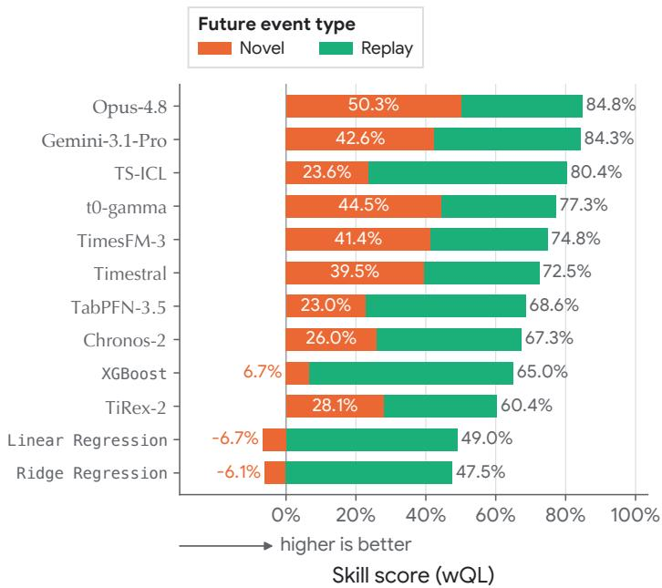  
Figure 1 | Performance of LLMs, numerical foundation models, and regression models on WhatIf-Bench tasks. Every model’s skill score drops sharply from Replay to Novel futures.

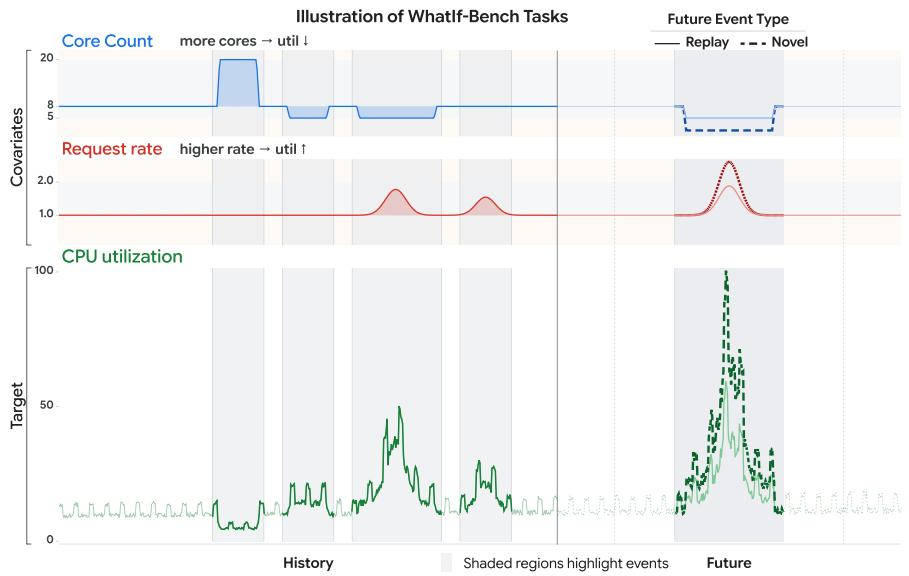

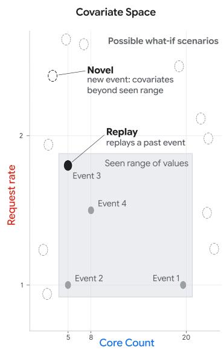  
Figure 2 | Illustration of WhatIf-Bench tasks. Left: a WhatIf-Bench task contains a history of events, in which covariates are set and the target responds, and asks a model to forecast the target under one further event. Right: the same events in covariate space. A Replay future repeats a past event (here, the third), so it lies inside the range of values the history has shown; a Novel future sets the covariates beyond that range, and is one of many possible what-if scenarios. Novel futures thus test whether a model extends what it learned to unseen values. Figure 1 shows that current models do this poorly: their skill on Novel futures is far below their skill on Replay futures.

When the future covariates are known, this enables scenario analysis: predicting how the target would evolve under diferent futures, which is central to planning (Bańbura et al., 2015; Doan et al., 1984; Waggoner and Zha, 1999). Existing benchmarks, however, evaluate only on the covariate values their datasets happen to contain (Lago et al., 2021; Shchur et al., 2025), so they cannot tell whether a model forecasts accurately when covariates take values beyond that range. They also measure performance only in aggregate over the conditions each dataset provides, so they cannot reveal where a model systematically fails at using covariates.

We present WhatIf-Bench, a semi-synthetic benchmark that measures how well a forecaster uses in-context covariates to forecast a target’s response to future events, including scenarios that set covariates to values never seen in the history. Its target series come from mechanistic simulators of four domains - OpenDC (data centers) (Iosup et al., 2017), GridLAB-D (power grids) (Chassin et al., 2008), SUMO (road trafic) (Lopez et al., 2018), and EPANET (water networks) (Rossman, 2000), on which we impose controlled covariate-target relationships grounded in each system. Because these relationships are known exactly, we can isolate the efect of any single covariate, so a model’s error reflects how well it handles the covariate rather than irreducible noise. Each task presents a history of events, each setting covariates to chosen values and letting the target respond, and asks the model to forecast the target under one further event: a Replay future that repeats a past event, or a Novel future that sets covariates to unseen values, as illustrated in Figure 2. WhatIf-Bench is a controllable framework: we vary one axis at a time – the future type, the number of covariates set jointly, the number and length of historical events, and the context and prediction length – yielding 37,665 tasks over 100 target series, so each axis can be studied on its own.

We evaluate covariate-aware foundation models and frontier LLMs. The LLMs consume the series and its covariates as text, and have proven competitive at forecasting (Gruver et al., 2023; Requeima et al., 2024). We also evaluate the simplest versions of regression baselines (XGBoost, Ridge Regression, and Linear Regression), which map the covariates at each step to the target. We use the skill score as our

<table><tr><td colspan="7">Systematic difficulty</td></tr><tr><td>Benchmark</td><td>Data source</td><td>Includes covariates</td><td>Covariate effect known exactly</td><td>Evaluates arbitrary what-if scenarios</td><td>(# covariates, historical evidence)</td><td>Tasks with covariates</td></tr><tr><td>Monash (Godahewa et al., 2021)</td><td>Real-world</td><td>x</td><td>x</td><td></td><td>x</td><td>0</td></tr><tr><td>GIFT-Eval (Aksu et al., 2024)</td><td>Real-world</td><td></td><td>××</td><td></td><td>x</td><td>0</td></tr><tr><td>TSFM-Bench (Li et al., 2025)</td><td>Real-world</td><td></td><td></td><td></td><td>×</td><td>0</td></tr><tr><td>TIME (Qiao et al., 2026)</td><td>Real-world</td><td>×××</td><td></td><td></td><td>×</td><td>0</td></tr><tr><td>fev-bench (Shchur et al., 2025)</td><td>Real-world</td><td></td><td>××</td><td>××××××</td><td>x</td><td>46</td></tr><tr><td>Berthelier et al. (2026)</td><td>Semi-synthetic (toy relations)</td><td></td><td></td><td></td><td>x</td><td>_†</td></tr><tr><td>WHATIF-BENCH (Ours)</td><td>Semi-synthetic (simulator-grounded)</td><td></td><td></td><td></td><td></td><td>37,665</td></tr></table>

†Number of tasks not reported.

Table 1 | Comparison of WhatIf-Bench with existing forecasting benchmarks. WhatIf-Bench supports evaluation on arbitrary what-if scenarios and lets dificulty be varied systematically, from few to many covariates and from few to many past observations of their efects, exposing diferences between models that existing benchmarks cannot show.

main metric: a model’s relative improvement over a naive baseline that repeats the last value. First, on the full benchmark, the frontier LLMs lead: Claude-Opus-4.8 and Gemini-3.1-Pro reach the top skill scores, 72.5% and 70%, with the best covariate-aware TSFMs, t0-gamma, TimesFM-3 and TS-ICL, close behind at 61 to 65%, and a simple, untuned XGBoost baseline (43%) below every foundation model. Next, every model shares a failure mode: all forecast well on Replay futures (48–85% skill) but drop to between −7% and 50% on Novel ones (Figure 1). The regression baselines collapse the most: Linear Regression has a skill of 49% on Replay futures but −7% on Novel futures. Therefore, despite their own drop, the LLMs and foundation models keep a large advantage over the regression baselines on Novel futures. Further, the number of covariates has no clear efect on Replay futures, but skill on Novel futures also falls as events set more covariates jointly. Finally, a longer history of events helps: models improve their skill, especially on Novel futures, though large diferences between models remain. Together, these results show that generalizing to Novel futures is the core challenge, and the further axes of WhatIf-Bench show how it depends on the number of covariates and on the history available. WhatIf-Bench provides a testbed toward models that support arbitrary scenario analysis.

## 2. Related Work

Below, we position WhatIf-Bench with respect to existing forecasting benchmarks and related work on causal inference. Background on the models we evaluate is given in Appendix A.

## 2.1. Time Series Forecasting Benchmarks

Early benchmarks such as the M-competitions and the Monash archive standardized evaluation but largely measure univariate accuracy (Alexandrov et al., 2020; Godahewa et al., 2021; Makridakis and Hibon, 2000; Makridakis et al., 2018), while more recent ones target TSFMs with large, leakage-free test sets, such as GIFT-Eval (Aksu et al., 2024), TSFM-Bench (Li et al., 2025), and TIME (Qiao et al., 2026). All of them, however, evaluate univariate forecasting and do not contain covariates. fev-bench (Shchur et al., 2025) includes tasks with real-world covariates drawn from datasets such as M5 (Makridakis et al., 2022), the EPF toolbox (Lago et al., 2021), Rohlik Sales (Kaggle, 2025), and Walmart (Kaggle, 2014). It evaluates only on covariate values that appear in the data, so it cannot tell whether a model forecasts accurately at unseen values. It also measures performance only under the conditions each dataset happens to provide, so it cannot reveal where a model systematically fails. It evaluates only on the covariate values its datasets happen to contain, so it cannot tell whether a model forecasts accurately when covariates take values beyond that range. It also measures performance only in aggregate over the conditions each dataset provides, so it cannot reveal where a model systematically fails at using covariates. WhatIf-Bench instead controls these conditions directly:

it sets covariates to unseen values to test extrapolation, and varies one axis at a time to pinpoint where a model fails. Xu et al. (2024) also benchmark forecasting under interventions; they study forecasting under textual events, rather than as numeric covariates as we do; this places it in the diferent setting of multimodal forecasting, as in Williams et al. (2025), where covariate values and their efects are not tested. Closest to our work, Berthelier et al. (2026) probe whether two foundation models capture very simple covariate-target relationships - identity, sum, aggregate, and quadratic, and find that the two behave diferently even on such simple relationships. WhatIf-Bench, by contrast, is large-scale and diverse (Table 1): it imposes many covariate-target relationships grounded in mechanistic simulators, and varies axes such as the future type (Replay or Novel), the number of covariates, and the amount of in-context evidence. Across these conditions, we evaluate a broad range of numerical foundation models and LLMs.

## 2.2. Causality and Interventional Estimation

Measuring whether a forecast responds correctly to a covariate is an interventional question: it requires the target under new, chosen covariate settings, which real data seldom provides (Holland, 1986; Imbens and Rubin, 2015). The causal-inference community has long worked around this by evaluating on simulators and semi-synthetic data whose data-generating process is known, so the efect of any intervention can be computed exactly (Dorie et al., 2019; Hill, 2011); WhatIf-Bench borrows this methodology, but applies it to forecasting rather than treatment-efect estimation. A related thread predicts outcomes under time-varying treatments (Robins et al., 2000), such as Counterfactual Recurrent Networks (Bica et al., 2020), which forecast counterfactual trajectories and score them by forecast error on simulated environments. These methods are trained on each system and rely on identification assumptions. Similarly, DoTime (Thumm et al., 2026) generates fully synthetic causal models with interventions to benchmark treatment-efect estimation. We instead evaluate zero-shot forecasters, which must learn the covariate efects in-context from the history alone, with no training on the system.

## 3. WhatIf-Bench

## 3.1. Problem setting

Let $\mathbf { X } _ { H } = \left[ X _ { 1 } , \ldots , X _ { t } \right]$ be the observed history of a scalar target, each $X _ { \tau } \in \mathbb { R }$ . Assume the target is driven by � exogenous, numerical covariates, observed over the same period as ${ \bf Z } _ { H } = [ { \bf z } _ { 1 } , \ldots , { \bf z } _ { t } ] .$ each $\mathbf { z } _ { \tau } \in \mathbb { R } ^ { K }$ . Canonically, forecasting concerns predicting the target’s evolution $\mathbf { X } _ { F } = [ X _ { t + 1 } , \ldots , X _ { T } ]$ from this history alone, by estimating $P ( \mathbf { X } _ { F } \mid \mathbf { X } _ { H } , \mathbf { Z } _ { H } )$ . When the covariates’ future values $\mathbf { Z } _ { F } \mathbf { \Psi } = \mathbf { \Psi }$ $[ \mathbf { z } _ { t + 1 } , \dots , \mathbf { z } _ { T } ]$ are themselves known, a forecaster can condition on them as well, to instead estimate $P ( \mathbf { X } _ { F } \mid \mathbf { X } _ { H } , \mathbf { Z } _ { H } , \mathbf { Z } _ { F } )$ . The future covariates $\mathbf { Z } _ { F }$ allow one to express various future what-if scenarios, and produce a conditional forecast of the target under each scenario. This can reveal which drivers move the target and how strongly, and supports planning against many possible futures rather than the single one implied by holding covariates at their most recent values (Brodersen et al., 2015).

The core challenge is to learn the covariate-target relationships the history reveals, separating the target’s own variation from covariate-driven changes, and then apply them at the arbitrary values $\mathbf { Z } _ { F }$ the scenario specifies. Since a scenario may set $\mathbf { Z } _ { F }$ to values the history has shown, or to values beyond anything it contains, the relationships must be learned well enough to extrapolate: to apply at covariate values never seen, and predict the target at levels it never reached. We call this setting intervention-aware forecasting, as it requires models to learn from past “interventions” in the system - from the past changes in the covariates that drive the target, and to respond to the future interventions a scenario specifies 1. We operate in the in-context learning setting, where these relationships must be learned in-context from the dynamics seen in the history, across the segments in which the covariates take on diferent values (Shchur et al., 2025).

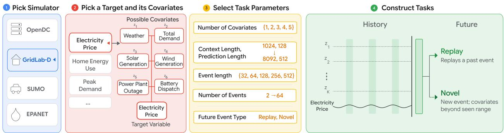  
Figure 3 | The WhatIf-Bench construction recipe.: We (1) pick a simulator and a base setting; (2) choose a target and the covariates that drive it; (3) select the parameters of the task; finally (4) construct the events in the history, to produce two futures over the same history. This yields 2 tasks. We generate the benchmark by repeating this process for every target across all simulators, and over all axes: number of covariates, number of events, event length, and context length.

## 3.2. Semi-synthetic design

Motivation. Evaluating intervention-aware forecasting requires assessing whether a model forecasts the target accurately under diferent settings of the future covariates. Real-world data, however, gives only one realization of the covariates and target, and A/B tests that change covariates to observe their efects are usually infeasible (Holland, 1986; Imbens and Rubin, 2015). We instead need an environment where we control the covariates, record their efects on the target, and test how sensitive a model is to changing them in the future. Research in causality has long addressed this with semi-synthetic data, where a known, generated process supplies exact counterfactuals (Dorie et al., 2019; Hill, 2011). Building on this principle, we introduce WhatIf-Bench, a benchmark for intervention-aware forecasting that combines realistic time series from mechanistic simulators of real-world systems with controlled covariate-target relationships whose efects are known exactly.

The simulators. We use four established, open-source simulators from distinct domains, each developed by domain experts and widely used in research and practice to study and plan real-world systems: OpenDC (Andreadis et al., 2022; Iosup et al., 2017; Mastenbroek et al., 2021) models a data center’s resource usage for capacity planning; GridLAB-D (Chassin et al., 2008; Schneider et al., 2010) models a power-distribution grid and the buildings on it; SUMO (Lopez et al., 2018; Lu et al., 2023) models road trafic vehicle by vehicle; and EPANET (Kępa and Deska, 2025; Rossman, 2000) models pressurized water-distribution networks.

Targets, covariates, and their relationships. We run each simulator on a fixed base setting: a real configuration of the system together with the recorded input that drives it – for example, a data center’s setup and the demand placed on it. This produces time series of the system’s variables, such as the CPU utilization of each host, as they evolve under the simulator’s dynamics. From each run, a system variable serves as the target and covariates drawn from the simulator’s adjustable properties drive it. On top of these initial targets and their associated covariates, we impose controlled relationships that govern how changes in the covariates afect the target, grounded in each system, so their efect is known exactly at any value they take. This gives us a semi-synthetic environment of realistic time series targets and covariates with known, exactly reproducible efects. The rationale behind this design, the target variables we extract from each simulator, and the relationships we impose for how changes in the covariates afect the target are given in Appendix B.

## 3.3. Events

The building block. An event is an intervention held over a bounded window of time, acting on one or more covariates at once. Within the window the covariates are moved away from their base setting, and the target responds for as long as the covariates are held there. Such a setup reflects how change happens in real systems, where discrete interventions move the drivers over a bounded window and the target responds, a structure long studied as interrupted time series and event studies (Box and Tiao, 1975; Brodersen et al., 2015).

Event design. An event specifies two properties for each covariate it acts on: its magnitude - how far to move it, and its shape - how it moves across the window. For the magnitude, we apply a multiplicative factor to the base value, which scales the covariate and moves the target by the amount the imposed relationship prescribes. This relationship is fixed for each covariate-target pair and defined at every factor value, but need not be proportional: it may be inverse, sublinear, or piecewise, so a factor of two on the covariate need not mean a factor of two on the target. Within the factors we use, each relationship moves the target in one direction and never reverses, so it can be learned from the history. For the shape, we use two: a step, which holds the new value constant throughout, and a gaussian bell, which rises to it and decays back. Each covariate in our benchmark is assigned one. Additional details are given in Appendix B.6.

## 3.4. Task structure and axes

From events to tasks. A WhatIf-Bench task simply places a sequence of events in the history, each leaving its efect on the target, and asks the model to forecast the target’s response to one further event in the future. We build the tasks of WhatIf-Bench by varying five axes of this structure, described next (illustrated in Figure 3).

Replay and Novel Futures. The first axis is the future event: it is designed to evaluate whether a model can apply the relationships learned from history to arbitrary future covariate values. We generate tasks with two futures over the same history, difering only in the future covariate values. We call the choice between them the future event type:

• Replay. The future event takes on the covariate values of a past event, so the covariates take values they have already taken in the history.

• Novel. The future event is unseen: the covariates are driven to values beyond the range seen in the history.

In both cases, the model must forecast the target’s intrinsic dynamics (its trend, seasonality, and level) and, on top of that, the covariate efect at the specified values. The two futures give complementary evaluation sets: Replay measures a model’s basic covariate-conditioned forecasting, while a model that has learned the relationships robustly should do equally well on Novel. This is closely tied to the principle of invariance in causality (Peters et al., 2016; Rojas-Carulla et al., 2018): a model that has captured the true mechanism linking the covariates to the target should transfer to new covariate values.2 The degradation from Replay to Novel indicates whether a model is reliable for arbitrary scenario analysis. Figure 2 illustrates the structure of WhatIf-Bench tasks.

Covariate settings. The second axis is the number of covariates in a task $K \in { \mathcal { K } } = \{ 1 , \ldots , 5 \}$ , which sets how many covariates every event acts on at once. Across the events in the history, these covariates take a range of values, from which a model can learn how each acts on the target and how they act together. Larger � means more relationships to learn, and therefore harder tasks.

Context and prediction length. The third axis is the context and prediction length: events sit within a history of fixed length, the context length – and the model forecasts a fixed horizon beyond it, the prediction length. We use four pairs, $c \in C = \{ C _ { 1 } , \ldots , C _ { 4 } \}$ , from the smallest $C _ { 1 }$ (context 1024, prediction 128) to the largest $C _ { 4 }$ (context about 8,000, prediction 512 to 864, depending on the simulator; details in App. Table 4). The context sets the budget the events must fit within; for the longest events, which would not fit at the smallest contexts, we extend the context slightly (Appendix B.3).

Event length. The fourth axis is the event length $\ell \in \mathcal { L } = \{ 3 2 , 6 4 , 1 2 8 , 2 5 6 , 5 1 2 \}$ , which sets how long each event holds its covariates in place, spanning brief interventions to sus-

<table><tr><td colspan="3">Benchmark composition</td></tr><tr><td>Simulator</td><td>Domain</td><td># Targets</td></tr><tr><td>OpenDC (Iosup et al., 2017)</td><td>Data center</td><td>22</td></tr><tr><td>GridLAB-D (Chassin et al., 2008)</td><td>Power grid</td><td>11</td></tr><tr><td>SUMO (Lopez et al., 2018)</td><td>Road traffic</td><td>30</td></tr><tr><td>EPANET (Rossman, 2000)</td><td>Water network</td><td>37</td></tr><tr><td colspan="3">Total</td></tr><tr><td>Design axes</td><td></td><td></td></tr><tr><td>Axis</td><td>Values</td><td>Count</td></tr><tr><td>Targets</td><td>across 4 domains</td><td>100</td></tr><tr><td>Covariates</td><td>1,2,3,4,5</td><td>5</td></tr><tr><td>Context / prediction length</td><td>1k/128, 2k/256, 4k/384, ~8k/512–864</td><td>4</td></tr><tr><td>Event length</td><td>32, 64, 128, 256,512</td><td>5</td></tr><tr><td># events Futures</td><td>1–64 (fewest, most)</td><td>2 2</td></tr><tr><td></td><td>Replay, Novel</td><td></td></tr><tr><td colspan="2">Tasks Generated</td><td>37,665</td></tr></table>

Table 2 | The WhatIf-Bench instantiation. The number of series contributed by the four simulators, and the axes we vary over them to build the tasks. The exact context and prediction lengths per simulator are given in Table 4.

tained ones. A short event gives only a brief glimpse of a relationship, whereas a long one lets the model see it settle and hold, but takes up more of the history and so leaves room for fewer events.

Number of events. The fifth and final axis is the number of events �, which controls how often the covariates are set across the history: more events expose their relationships at more values, which can let a model fit them more robustly. How many fit is bounded by the context and event lengths – at a context of 1024, only a few long events fit, but far more short ones do. For each event length and context/prediction pair, we build tasks at two settings: the fewest events (one or two) and the most the context allows, up to 64. We design WhatIf-Bench around real-world regimes rather than guaranteed identifiability: since limited-evidence tasks (e.g., many covariates, few events) do occur in practice, we include them and expect a reliable forecaster to respond with calibrated uncertainty rather than overconfidence; we discuss this design choice further in Appendix B.5.

Instantiating WhatIf-Bench. To recap the recipe (Figure 3): we (1) pick a simulator and a base setting; (2) choose a target variable and the covariates that drive it; (3) select the task’s parameters; and (4) construct the events in the history, producing two futures over the same history. We repeat this recipe over all targets and every combination of the axes above, giving 40,000 tasks in all (Table 2). Out of these, we keep only tasks whose covariates have a non-negligible efect in every event, leaving

37,665 of the 40,000 tasks. Additional details on the benchmark and the various design choices are in Appendix B.6. Example tasks are provided in Appendix L.

## 3.5. Metrics and aggregation

Metrics We score each task with standard forecasting metrics. Our primary metric is the weighted quantile loss (wQL), which evaluates probabilistic forecasts across a set of quantile levels; for pointforecast accuracy we also report the weighted absolute percentage error (WAPE) on the median forecast (definitions in Appendix C).

Aggregating performance across tasks Following fev-bench (Shchur et al., 2025), we summarize the per-task errors (wQL or WAPE) along two dimensions. The primary one is the skill score, a model’s relative reduction in error against a fixed naive baseline that repeats the last observed value. As a secondary measure, we use the average win rate: the fraction of tasks on which a model has a lower error than another model, averaged over all other models in the set (higher is better for both). We use it to compare models directly against one another. We report win rates in Appendix K and give formal definitions of both in Appendix C.

## 3.6. Models and Evaluation Protocol

Numerical forecasters. Our main candidates for evaluation are foundation models that can forecast time series while consuming past and future covariates in-context. Six such models exist, and we evaluate all of them: Chronos-2 (Ansari et al., 2025), t0-gamma (Meyer et al., 2026), Timestral (Mistral AI, 2026), TiRex-2 (Podest et al., 2026), TS-ICL (Le Naour et al., 2026), and TimesFM-3.0 (Google Research, 2026). We also evaluate TabPFN-3.5 (Jäger et al., 2026), a tabular foundation model, which we run for time series forecasting through the TabPFN-TS harness (Hoo et al., 2025). These models output nine quantile levels from 0.1 to 0.9 directly.

Large language models. We also evaluate frontier LLMs such as Gemini-3.1-Pro (Google DeepMind, 2026) and Claude-Opus-4.8 (Anthropic, 2026), prompted directly with the target and covariates as text. We run each at two reasoning eforts, Medium and High, to measure the efect of reasoning. Unlike the foundation models, the LLMs are prompted for the median rather than for quantiles: we find that prompting them for many quantiles exceeds the output length and causes formatting failures, so we score their wQL on the median alone, at the 0.5 level, which disadvantages them under probabilistic metrics. Implementation details on all models are given in Appendix D.

Baselines. We include two kinds of baselines. The naive baseline copies the last observed value and does not use covariates. The regression baselines - Linear Regression, Ridge Regression, and XGBoost - use both past and future covariates, in their simplest form: we fit each one on a task’s history with one training row per time step, predicting the target from the covariates at that step only, and then predict each future step separately from its known covariates. Our problem setting does not assume a separate training or validation set for each task, so these baselines cannot be tuned on held-out data. We use the simplest versions to understand how far the covariates alone take a forecaster; variants with minor tuning on the test set are explored in Appendix J. Like the LLMs, they only provide point forecasts. We use the naive baseline as the reference for the skill score, since it gives the same forecast on Replay and Novel futures over a shared history, which makes it a consistent reference to measure skill against. We also explore using the covariate-aware Linear Regression as the reference in Appendix I.

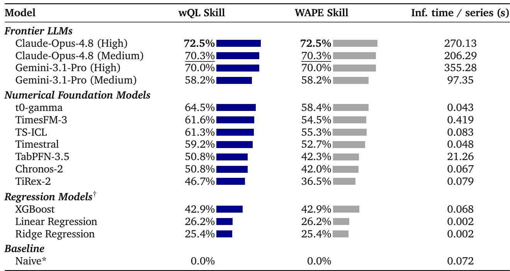  
Table 3 | Performance of models on WhatIf-Bench, measured as skill score under both wQL (probabilistic) and WAPE (point) metrics, alongside inference latency. The best score per column is bolded and the second-best is underlined. Naive\* represents a naive baseline which does not consume covariates. †The simplest, untuned versions of the regression models; tuned variants are in Appendix J. Win rates are provided in Appendix K.

## 4. Results

## 4.1. Performance on WhatIf-Bench

We present results on WhatIf-Bench in Table 3. The regression baselines, in their simplest form, already obtain substantial skill over the naive baseline: XGBoost reaches 42.9%, and even Ridge and Linear Regression reach 25.4% and 26.2%. Among the foundation models, t0-gamma (64.5%), TimesFM-3 (61.6%) and TS-ICL (61.3%) obtain the best skill scores, about 19 to 22 points above XGBoost. Timestral (59.2%) follows, then TabPFN-3.5 and Chronos-2 (50.8% each), about 8 points above XGBoost, followed by TiRex-2 (46.7%), about 4 points above it. Notably, the LLMs obtain the highest skill scores on the benchmark, with Claude-Opus-4.8 (High) at 72.5% followed by Gemini-3.1-Pro (High) at 70%. Reasoning helps here: moving from Medium to High efort raises skill from 70.3% to 72.5% for Claude and from 58.2% to 70% for Gemini. On inference time, the foundation models are the fastest: most run in under half a second per series, and TabPFN-3.5 is the slowest at 21s. The LLMs are far slower, at around 300 seconds per series, over an order of magnitude beyond TabPFN-3.5, and almost 4 orders of magnitude beyond the rest.

Takeaway. Frontier LLMs score highest. Among the foundation models, t0-gamma leads, followed by TimesFM-3 and TS-ICL, and all of them are ahead of a simple, untuned XGBoost baseline that uses the covariates. The LLMs are, however, about 4 orders of magnitude slower at inference.

## 4.2. Performance on Replay vs Novel tasks

Figure 1, in the introduction, compares model performance on the Replay and Novel tasks in WhatIf-Bench. On Replay tasks, every model achieves a high skill score, indicating that the models forecast well when the future event repeats covariate patterns already seen in the history. The LLMs are strongest here, with Claude Opus 4.8 (High) at 84.8% and Gemini 3.1 Pro (High) at 84.3%, followed by TS-ICL (80.4%) and t0-gamma (77.3%) among the foundation models. The regression baselines are competitive on Replay: XGBoost reaches 65.0%. On Novel futures, however, the skill of every model drops sharply, and the LLMs fall just as much: Claude Opus 4.8 drops from 84.8% to 50.3% and Gemini 3.1 Pro from 84.3% to 42.6%, while TS-ICL falls furthest among the foundation models, from 80.4% to 23.6%. This degradation appears for every model, indicating the dificulty of extrapolating to unseen values, and points to a lack of robustness. The regression baselines fall the most: XGBoost drops from 65.0% to 6.7% and Linear Regression from 49.0% to −6.7%, worse than the naive baseline. Novel futures are thus where the LLMs and foundation models have their largest advantage over the regression baselines: TimesFM-3 is only 10 points above XGBoost on Replay but 35 points above it on Novel.

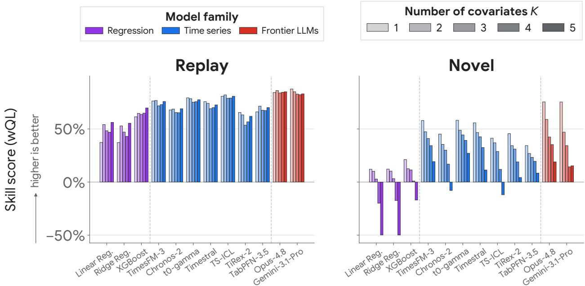  
Figure 4 | Skill scores on tasks with diferent number of covariates on WhatIf-Bench on Replay (left) and Novel (right) future types respectively.

Takeaway. Every model forecasts well on Replay, but skill drops sharply on Novel. The regression baselines fall the most, so Novel is where the LLMs and foundation models have their largest advantage over simple models. Yet even the LLMs and foundation models drop substantially, so strong Replay performance does not carry over to Novel futures. Closing this gap is the core challenge WhatIf-Bench exposes.

## 4.3. Efect of the number of covariates

Figure 4 shows how skill varies with the number of covariates �, for Replay and Novel futures. On Replay futures, skill varies marginally as the number of covariates grows, for both foundation models and LLMs, which indicates that adding covariates does not make the Replay task harder. However, on Novel futures, skill decreases consistently as the number of covariates increases. Claude Opus 4.8 (High) and Gemini 3.1 Pro (High) both reach 75% at one covariate, far ahead of the other models. But their performance falls steeply, to 19% and 15% respectively at five covariates. By five covariates the best foundation models catch up with them: t0-gamma is strongest at 27%, ahead of both LLMs, and TimesFM-3 (19%) is level with Claude Opus 4.8 (High). This drop also reshufles the ranking: TS-ICL, for instance, is among the best models on Replay at every covariate count (around 80%), yet drops to −12% at five covariates on Novel. The regression baselines end lowest at five covariates: Linear Regression drops from 12.1% to −49.8% and Ridge Regression from 12.2% to −49.9%, so even a linear model loses 62 points on Novel. Since the same models handle five covariates as well as one on Replay, the dificulty lies not in the number of covariates but in extrapolating their joint efect to unseen values, so strong Replay performance does not carry over to the Novel futures that scenario analysis requires.

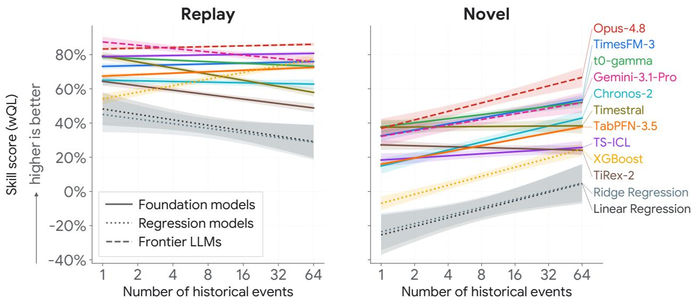  
Figure 5 | Skill scores with diferent number of historical events on WhatIf-Bench, on tasks with Replay (left) and Novel (right) futures respectively. Lines are least-squares trends of skill on $\log _ { 2 }$ of the number of events; they summarise the direction of change.

Takeaway. The number of covariates has no clear efect on Replay, but on Novel skill degrades progressively for every model as more are set together, including the regression baselines. The LLMs lead at one covariate, but by five covariates, t0-gamma is ahead of the best LLM and TimesFM-3 is on par with it. This consistent drop points again to Novel futures as the core challenge, across all covariate settings.

## 4.4. Efect of the number of historical events

Figure 5 shows skill as a function of the number of historical events in the context, separately for Replay and Novel futures. On Replay futures, more history brings only marginal gains: skill stays roughly flat for most models. XGBoost is the one model that clearly gains, by about 25 points. This shows that Replay futures can be predicted with very little history, as little as a single event. However, on Novel futures the trend is far stronger: skill rises sharply as the number of historical events grows. Both the LLMs and the foundation models improve substantially: Claude Opus 4.8 (High) more than doubles from 24% to 58% and Gemini 3.1 Pro (High) from 19% to 42%, while Chronos-2 rises the most among the foundation models, from 6% to 35%. The regression baselines gain as well, Linear Regression from −27% at one event to 9% at 64, but they remain well below the best models. This indicates most models can use a longer history to forecast Novel futures more accurately. We find the same pattern with event length and context length (Appendix F): on Novel futures, skill improves in both cases whenever the context can hold more past events - i.e., both when events are shorter or the context is longer. Even with the most evidence, however, large diferences between models remain: more history helps nearly every model, but models difer widely in how efectively they use it. We analyze this further in Appendix F.

Takeaway. Replay needs very little history, while on Novel most models improve as they see more past events, including the regression baselines. Even with the most events, however, Novel futures stay well below Replay, and models difer widely in how well they use the history.

## 5. Discussion and Future Work

We propose WhatIf-Bench, a semi-synthetic benchmark for intervention-aware forecasting: its target series come from mechanistic simulators of real systems, on which we impose controlled efects that determine how the target responds to changes in the covariates. Each task presents a history of events and asks a model to forecast the target’s response to a further event, either a Replay event that repeats values seen in the history or a Novel event that sets them beyond that range; WhatIf-Bench varies the number of covariates, the number of events, the event length, and the context length. Across these conditions, the frontier LLMs reach the highest skill scores overall, with the best foundation models close behind. Yet every model forecasts well on Replay futures but sees its skill drop sharply on Novel futures, and the regression baselines collapse the most. Despite their own drop, the LLMs and foundation models thus keep their clearest advantage over simple models on Novel futures. On Novel futures, skill also decreases as more covariates are set jointly, while more past events help. These results point to generalizing to Novel futures as the central open problem, and open new directions for building models that forecast reliably under novel scenarios.

We discuss the limitations of WhatIf-Bench and future work in Appendix E. Addressing the limitations of WhatIf-Bench opens natural extensions: richer system dynamics, and larger covariate spaces where many drivers are irrelevant, confounded, or misleading. Beyond these, the covariateaware forecasting ability of frontier LLMs, despite their far slower inference, opens up more flexible what-if analysis, letting users explore queries that are not directly expressible through covariates, such as those posed in natural language, which could bring scenario analysis to many more users. Finally, beyond evaluating models, training them in such simulation environments could yield forecasters that learn a system in-context and reason over its possible futures - a step toward world models for planning and decision-making (Ha and Schmidhuber, 2018; Hafner et al., 2023; LeCun, 2022).

## References

A. Abadie, A. Diamond, and J. Hainmueller. Synthetic control methods for comparative case studies: Estimating the efect of california’s tobacco control program. Journal of the American Statistical Association, 105(490):493–505, 2010. DOI: 10.1198/jasa.2009.ap08746.

T. Aksu, G. Woo, J. Liu, X. Liu, C. Liu, S. Savarese, C. Xiong, and D. Sahoo. GIFT-Eval: A benchmark for general time series forecasting model evaluation. arXiv preprint arXiv:2410.10393, 2024.

A. Alexandrov, K. Benidis, M. Bohlke-Schneider, V. Flunkert, J. Gasthaus, T. Januschowski, D. C. Maddix, S. Rangapuram, D. Salinas, J. Schulz, L. Stella, A. C. Türkmen, and Y. Wang. GluonTS: Probabilistic and neural time series modeling in Python. Journal of Machine Learning Research, 21 (116):1–6, 2020. arXiv:1906.05264.

G. Andreadis, F. Mastenbroek, V. van Beek, and A. Iosup. Capelin: Data-driven compute capacity procurement for cloud datacenters using portfolios of scenarios. IEEE Transactions on Parallel and Distributed Systems, 33(1):26–39, 2022.

A. F. Ansari, L. Stella, C. Turkmen, X. Zhang, P. Mercado, H. Shen, O. Shchur, S. S. Rangapuram, S. P. Arango, S. Kapoor, et al. Chronos: Learning the language of time series. Transactions on Machine Learning Research (TMLR), 2024. arXiv:2403.07815.

A. F. Ansari, O. Shchur, J. Küken, A. Auer, B. Han, P. Mercado, S. S. Rangapuram, H. Shen, L. Stella, X. Zhang, M. Goswami, S. Kapoor, D. C. Maddix, P. Guerron, T. Hu, J. Yin, N. Erickson, P. M. Desai, H. Wang, H. Rangwala, G. Karypis, Y. Wang, and M. Bohlke-Schneider. Chronos-2: From univariate to universal forecasting, 2025. URL https://arxiv.org/abs/2510.15821.

Anthropic. Claude opus 4.8 release. Announced via Anthropic News, May 2026. URL https: //www.anthropic.com/news/claude-opus-4-8.

A. Ashok, É. Marcotte, V. Zantedeschi, N. Chapados, and A. Drouin. Tactis-2: Better, faster, simpler attentional copulas for multivariate time series. In International conference on learning representations, volume 2024, pages 22897–22924, 2024.

A. Ashok, A. R. Williams, V. Z. Zheng, I. Rish, N. Chapados, É. Marcotte, V. Zantedeschi, and A. Drouin. Beyond naïve prompting: Strategies for improved context-aided forecasting with LLMs. Transactions on Machine Learning Research, 2026. ISSN 2835-8856. URL https://openreview.net/forum? id=dkjHHFJkVI.

C. K. Assaad, E. Devijver, and E. Gaussier. Survey and evaluation of causal discovery methods for time series. Journal of Artificial Intelligence Research, 73, 2022. DOI: 10.1613/jair.1.13428.

M. Bańbura, D. Giannone, and M. Lenza. Conditional forecasts and scenario analysis with vector autoregressions for large cross-sections. International Journal of Forecasting, 31(3):739–756, 2015. doi: 10.1016/j.ijforecast.2014.08.013.

K. Benidis, S. S. Rangapuram, V. Flunkert, Y. Wang, D. Maddix, C. Turkmen, J. Gasthaus, M. Bohlke-Schneider, D. Salinas, L. Stella, F.-X. Aubet, L. Callot, and T. Januschowski. Deep learning for time series forecasting: Tutorial and literature survey. ACM Computing Surveys, 55(6):1–36, 2022. doi: 10.1145/3533382.

G. Berthelier, M. Baranova, A.-T. Pantea, E. Le Naour, A. Petralia, T. Nabil, and T. Palpanas. Investigating simple target-covariate relationships for Chronos-2 and TabPFN-TS. arXiv preprint, 2026. arXiv:2605.12200.

I. Bica, A. M. Alaa, J. Jordon, and M. van der Schaar. Estimating counterfactual treatment outcomes over time through adversarially balanced representations. In International Conference on Learning Representations (ICLR), 2020. arXiv:2002.04083; CRN.

G. E. P. Box and G. C. Tiao. Intervention analysis with applications to economic and environmental problems. Journal of the American Statistical Association, 70(349):70–79, 1975. ISSN 01621459, 1537274X. URL http://www.jstor.org/stable/2285379.

G. E. P. Box, G. M. Jenkins, G. C. Reinsel, and G. M. Ljung. Time Series Analysis: Forecasting and Control. John Wiley & Sons, fifth edition, 2015.

K. H. Brodersen, F. Gallusser, J. Koehler, N. Remy, and S. L. Scott. Inferring causal impact using bayesian structural time-series models. The Annals of Applied Statistics, 9(1):247–274, 2015. DOI: 10.1214/14-AOAS788.

D. P. Chassin, K. P. Schneider, and C. Gerkensmeyer. GridLAB-D: An open-source power systems modeling and simulation environment. In 2008 IEEE/PES Transmission and Distribution Conference and Exposition, pages 1–5. IEEE, 2008. doi: 10.1109/TDC.2008.4517260.

A. Das, W. Kong, R. Sen, and Y. Zhou. A decoder-only foundation model for time-series forecasting. In International Conference on Machine Learning (ICML), 2024. arXiv:2310.10688.

T. Doan, R. Litterman, and C. Sims. Forecasting and conditional projection using realistic prior distributions. Econometric Reviews, 3(1):1–100, 1984. doi: 10.1080/07474938408800053.

V. Dorie, J. Hill, U. Shalit, M. Scott, and D. Cervone. Automated versus do-it-yourself methods for causal inference: Lessons learned from a data analysis competition. Statistical Science, 34(1):43–68, 2019.

A. Drouin, É. Marcotte, and N. Chapados. Tactis: Transformer-attentional copulas for time series. In International Conference on Machine Learning, pages 5447–5493. PMLR, 2022.

V. Ekambaram, A. Jati, P. Dayama, S. Mukherjee, N. H. Nguyen, W. M. Giford, C. Reddy, and J. Kalagnanam. Tiny time mixers (TTMs): Fast pre-trained models for enhanced zero/few-shot forecasting of multivariate time series. Advances in Neural Information Processing Systems, 37: 74147–74181, 2024.

E. S. Gardner Jr. Exponential smoothing: The state of the art. Journal of Forecasting, 4(1):1–28, 1985.

R. Godahewa, C. Bergmeir, G. I. Webb, R. J. Hyndman, and P. Montero-Manso. Monash time series forecasting archive. In Advances in Neural Information Processing Systems Datasets and Benchmarks Track (NeurIPS), 2021. arXiv:2105.06643.

Google DeepMind. Gemini 3.1 Pro: Model Card, 2026. URL https://deepmind.google/models/ model-cards/gemini-3-1-pro/. Accessed: 2026-09-20.

Google Research. TimesFM 3.0: A zero-shot foundation model for multivariate forecasting. https://research.google/blog/ timesfm-3-a-zero-shot-foundation-model-for-multivariate-forecasting/, 2026. Model release; successor to TimesFM 2.5 with multivariate/covariate support.

M. Goswami, K. Szafer, A. Choudhry, Y. Cai, S. Li, and A. Dubrawski. MOMENT: A family of open time-series foundation models. In International Conference on Machine Learning (ICML), 2024. arXiv:2402.03885.

N. Gruver, M. Finzi, S. Qiu, and A. G. Wilson. Large language models are zero-shot time series forecasters. In Advances in Neural Information Processing Systems (NeurIPS), 2023. arXiv:2310.07820.

D. Ha and J. Schmidhuber. World models. arXiv preprint arXiv:1803.10122, 2018.

D. Hafner, J. Pasukonis, J. Ba, and T. Lillicrap. Mastering diverse domains through world models. arXiv preprint, 2023. arXiv:2301.04104.

J. L. Hill. Bayesian nonparametric modeling for causal inference. Journal of Computational and Graphical Statistics, 20(1):217–240, 2011.

P. W. Holland. Statistics and causal inference. Journal of the American Statistical Association, 81(396): 945–960, 1986.

S. B. Hoo, S. Müller, D. Salinas, and F. Hutter. From tables to time: Extending TabPFN-v2 to time series forecasting, 2025. URL https://arxiv.org/abs/2501.02945.

R. J. Hyndman and G. Athanasopoulos. Forecasting: principles and practice. OTexts, 2018.

G. W. Imbens and D. B. Rubin. Causal Inference for Statistics, Social, and Biomedical Sciences: An Introduction. Cambridge University Press, 2015.

A. Iosup, G. Andreadis, V. van Beek, M. Bijman, E. Van Eyk, M. Neacsu, L. Overweel, S. Talluri, L. Versluis, and M. Visser. The OpenDC vision: Towards collaborative datacenter simulation and exploration for everybody. In 2017 16th International Symposium on Parallel and Distributed Computing (ISPDC), pages 85–94. IEEE, 2017.

B. Jäger, N. Erickson, L. Grinsztajn, F. Birkel, K. Flöge, O. Key, K. Kaya, J. Kübler, A. Frankel, T. Schröder, A. Garg, J. H. Metzen, D. Salinas, S. Bing, K. Collins, T. Çelik, V. Balazadeh, L. Sidhoum, T. Pereda, B. Roof, A. Tschalzev, S. Guo, P. Singer, L. Purucker, J. Robertson, M. Salmon, P. Jund, J. Chen, D. Kriuchkova, A. Cahu, E. Kalfon, A. Hayler, G. Grab, V. Monteiro, L. Wehrhahn, D. Safaric, C. Cornu, A. Arazi, R. Grace, S. Alessi, M. Manium, B. Schölkopf, Y. LeCun, M. Hulsebos, S. Gambhir, N. Hollmann, and F. Hutter. TabPFN-3.5: Technical report, 2026. URL https://arxiv.org/ abs/2609.17895.

M. Jin, S. Wang, L. Ma, Z. Chu, J. Y. Zhang, X. Shi, P.-Y. Chen, Y. Liang, Y.-F. Li, S. Pan, and Q. Wen. Time-LLM: Time series forecasting by reprogramming large language models. In International Conference on Learning Representations (ICLR), 2024. arXiv:2310.01728.

Kaggle. Walmart Recruiting – Store Sales Forecasting. Kaggle competition, 2014. URL https: //www.kaggle.com/competitions/walmart-recruiting-store-sales-forecasting.

Kaggle. Rohlik Sales Forecasting Challenge V2. Kaggle competition, 2025. URL https://www. kaggle.com/competitions/rohlik-sales-forecasting-challenge-v2/data.

U. Kępa and I. Deska. Using a hydraulic model for conceptual planning of rural water supply network reconstruction—case study. Water, 17(20):2961, 2025. doi: 10.3390/w17202961.

J. Lago, G. Marcjasz, B. De Schutter, and R. Weron. Forecasting day-ahead electricity prices: A review of state-of-the-art algorithms, best practices and an open-access benchmark. Applied Energy, 293: 116983, 2021. arXiv:2008.08004.

E. Le Naour, T. Nabil, and A. Petralia. TS-ICL: A flexible time-indexed foundation model for time series via in-context learning, 2026. URL https://arxiv.org/abs/2606.05878.

Y. LeCun. A path towards autonomous machine intelligence. OpenReview preprint, 2022. OpenReview:BZ5a1r-kVsf.

G. Lee, W. Yu, K. Shin, W. Cheng, and H. Chen. TimeCAP: Learning to contextualize, augment, and predict time series events with large language model agents. In Proceedings of the AAAI Conference on Artificial Intelligence, 2025. arXiv:2502.11418.

Z. Li, X. Qiu, P. Chen, Y. Wang, H. Cheng, Y. Shu, J. Hu, C. Guo, A. Zhou, C. S. Jensen, and B. Yang. TSFM-Bench: A comprehensive and unified benchmark of foundation models for time series forecasting. In Proceedings of the 31st ACM SIGKDD Conference on Knowledge Discovery and Data Mining (KDD), 2025. arXiv:2410.11802.

Y. Liang, H. Wen, Y. Nie, Y. Jiang, M. Jin, D. Song, S. Pan, and Q. Wen. Foundation models for time series analysis: A tutorial and survey. In Proceedings of the 30th ACM SIGKDD Conference on Knowledge Discovery and Data Mining (KDD), 2024. doi: 10.1145/3637528.3671451.

B. Lim, S. Ö. Arık, N. Loef, and T. Pfister. Temporal fusion transformers for interpretable multi-horizon time series forecasting. International Journal of Forecasting, 37(4):1748–1764, 2021.

H. Liu, S. Xu, Z. Zhao, L. Kong, H. Kamarthi, A. B. Sasanur, M. Sharma, J. Cui, Q. Wen, C. Zhang, and B. A. Prakash. Time-MMD: Multi-domain multimodal dataset for time series analysis. In Advances in Neural Information Processing Systems (Datasets and Benchmarks Track), 2024a. arXiv:2406.08627.

X. Liu, J. Hu, Y. Li, S. Diao, Y. Liang, B. Hooi, and R. Zimmermann. Unitime: A language-empowered unified model for cross-domain time series forecasting. In Proceedings of the ACM Web Conference 2024, pages 4095–4106, 2024b.

P. A. Lopez, M. Behrisch, L. Bieker-Walz, J. Erdmann, Y.-P. Flötteröd, R. Hilbrich, L. Lücken, J. Rummel, P. Wagner, and E. Wießner. Microscopic trafic simulation using SUMO. In 2018 21st International Conference on Intelligent Transportation Systems (ITSC), pages 2575–2582. IEEE, 2018. doi: 10. 1109/ITSC.2018.8569938.

Q.-L. Lu, M. Qurashi, and C. Antoniou. Simulation-based policy analysis: The case of urban speed limits. Transportation Research Part A: Policy and Practice, 175:103754, 2023.

S. Makridakis and M. Hibon. The M3-Competition: Results, conclusions and implications. International Journal of Forecasting, 16(4):451–476, 2000.

S. Makridakis, E. Spiliotis, and V. Assimakopoulos. The M4 competition: Results, findings, conclusion and way forward. International Journal of Forecasting, 34(4):802–808, 2018.

S. Makridakis, E. Spiliotis, and V. Assimakopoulos. M5 accuracy competition: Results, findings, and conclusions. International Journal of Forecasting, 38(4):1346–1364, 2022.

F. Mastenbroek, G. Andreadis, S. Jounaid, W. Lai, J. Burley, J. Bosch, E. Van Eyk, L. Versluis, V. van Beek, and A. Iosup. OpenDC 2.0: Convenient modeling and simulation of emerging technologies in cloud datacenters. In 2021 IEEE/ACM 21st International Symposium on Cluster, Cloud and Internet Computing (CCGrid), pages 455–464. IEEE, 2021.

L. Meyer, C. Sole, H. Xiang, N. Li, L. Franceschino, A. Quera-Bofarull, M. P. Scholl, J. Fainberg, and G. Négiar. � : A time-series foundation model for forecasting with context, 2026. URL https://arxiv.org/abs/2609.24559.

Mistral AI. Timestral. https://mistral.ai/news/timestral/, 2026. Model release; checkpoint mistralai/Timestral-209M.

Y. Nie, N. H. Nguyen, P. Sinthong, and J. Kalagnanam. A time series is worth 64 words: Long-term forecasting with transformers. In International Conference on Learning Representations (ICLR), 2023. arXiv:2211.14730.

B. N. Oreshkin, D. Carpov, N. Chapados, and Y. Bengio. N-BEATS: Neural basis expansion analysis for interpretable time series forecasting. In International Conference on Learning Representations, 2020.

J. Pearl. Causality: Models, Reasoning, and Inference. Cambridge University Press, New York, NY, USA, 2nd edition, 2009. ISBN 978-0521895606.

J. Peters, P. Bühlmann, and N. Meinshausen. Causal inference by using invariant prediction: identification and confidence intervals. Journal of the Royal Statistical Society Series B: Statistical Methodology, 78(5):947–1012, 2016.

P. Podest, M. Pichler, E. Bürger, L. Zólyomi, B. Voggenberger, W. Berghammer, D. Klotz, S. Böck, G. Klambauer, and S. Hochreiter. TiRex-2: Generalizing TiRex to multivariate data and streaming. arXiv preprint, 2026. arXiv:2607.01204.

Z. Qiao, S. Pan, A. Wang, V. Zhukova, Y. Liu, X. Jiang, Q. Wen, M. Long, M. Jin, and C. Liu. It’s TIME: Towards the next generation of time series forecasting benchmarks. arXiv preprint arXiv:2602.12147, 2026.

K. Rasul, A. Ashok, A. R. Williams, A. Khorasani, G. Adamopoulos, R. Bhagwatkar, M. Biloš, H. Ghonia, N. V. Hassen, A. Schneider, et al. Lag-Llama: Towards foundation models for probabilistic time series forecasting. arXiv preprint arXiv:2310.08278, 2023.

J. Requeima, J. Bronskill, D. Choi, R. E. Turner, and D. Duvenaud. LLM processes: Numerical predictive distributions conditioned on natural language. In Advances in Neural Information Processing Systems (NeurIPS), 2024. arXiv:2405.12856.

J. M. Robins, M. Á. Hernán, and B. Brumback. Marginal structural models and causal inference in epidemiology. Epidemiology, 11(5):550–560, 2000. DOI: 10.1097/00001648-200009000-00011.

M. Rojas-Carulla, B. Schölkopf, R. Turner, and J. Peters. Invariant models for causal transfer learning. Journal of Machine Learning Research, 19(36):1–34, 2018.

L. A. Rossman. EPANET 2 users manual. Technical Report EPA/600/R-00/057, U.S. Environmental Protection Agency, Cincinnati, OH, 2000.

J. Runge, P. Nowack, M. Kretschmer, S. Flaxman, and D. Sejdinovic. Detecting and quantifying causal associations in large nonlinear time series datasets. Science Advances, 5(11), 2019. PCMCI; DOI: 10.1126/sciadv.aau4996.

D. Salinas, V. Flunkert, and J. Gasthaus. DeepAR: Probabilistic forecasting with autoregressive recurrent networks. International Journal of Forecasting, 36(3):1181–1191, 2020. arXiv:1704.04110.

K. P. Schneider, J. C. Fuller, F. K. Tufner, and R. Singh. Evaluation of conservation voltage reduction (CVR) on a national level. Technical Report PNNL-19596, Pacific Northwest National Laboratory, 2010.

O. Shchur, A. F. Ansari, C. Turkmen, L. Stella, N. Erickson, P. Guerron, M. Bohlke-Schneider, and Y. Wang. fev-bench: A realistic benchmark for time series forecasting. arXiv preprint arXiv:2509.26468, 2025.

D. Thumm, B. T. Anthony, and Y. Chen. DoTime: A synthetic benchmark generator for interventional and counterfactual time series. arXiv preprint arXiv:2607.27263, 2026.

D. F. Waggoner and T. Zha. Conditional forecasts in dynamic multivariate models. The Review of Economics and Statistics, 81(4):639–651, 1999. doi: 10.1162/003465399558508.

X. Wang, M. Feng, J. Qiu, J. Gu, and J. Zhao. From news to forecast: Integrating event analysis in LLM-based time series forecasting with reflection. In Advances in Neural Information Processing Systems (NeurIPS), 2024. arXiv:2409.17515.

A. R. Williams, A. Ashok, É. Marcotte, V. Zantedeschi, J. Subramanian, R. Riachi, J. Requeima, A. Lacoste, I. Rish, N. Chapados, and A. Drouin. Context is key: A benchmark for forecasting with essential textual information. In Proceedings of the 42nd International Conference on Machine Learning (ICML), 2025. arXiv:2410.18959.

G. Woo, C. Liu, A. Kumar, C. Xiong, S. Savarese, and D. Sahoo. Unified training of universal time series forecasting transformers. In International Conference on Machine Learning (ICML), 2024. arXiv:2402.02592.

H. Wu, J. Xu, J. Wang, and M. Long. Autoformer: Decomposition transformers with auto-correlation for long-term series forecasting. In Advances in Neural Information Processing Systems (NeurIPS), volume 34, pages 22419–22430, 2021. arXiv:2106.13008.

Z. Xu, H. Wang, and Q. Xu. Intervention-aware forecasting: Breaking historical limits from a system perspective. arXiv preprint arXiv:2405.13522, 2024.

H. Zhou, S. Zhang, J. Peng, S. Zhang, J. Li, H. Xiong, and W. Zhang. Informer: Beyond eficient transformer for long sequence time-series forecasting. In Proceedings of the AAAI Conference on Artificial Intelligence, volume 35, pages 11106–11115, 2021. arXiv:2012.07436.

## Table of Contents for Appendix

A Extended Related Work . . . . . . . . . . . . . . . . . . . . . . . . . . . . . . . . . . . . . . . . . . . . . . . . . . . . 21   
A.1 Time Series Foundation Models . . . . . . . . . . . . . . . . . . . . . . . . . . . . . . . . . . . . . . . . . . . 21   
A.2 Large Language Models for Forecasting . . . . . . . . . . . . . . . . . . . . . . . . . . . . . . . . . . . . . 21   
B Benchmark details. . . . . . . . . . . . . . . . . . . . . . . . . . . . . . . . . . . . . . . . . . . . . . . . . . . . . . . . . 21   
B.1 Rationale behind semi-synthetic setup . . . . . . . . . . . . . . . . . . . . . . . . . . . . . . . . . . . . . . 21   
B.2 Verification . . . . . . . . . . . . . . . . . . . . . . . . . . . . . . . . . . . . . . . . . . . . . . . . . . . . . . . . . . . 22   
B.3 Task layout . . . . . . . . . . . . . . . . . . . . . . . . . . . . . . . . . . . . . . . . . . . . . . . . . . . . . . . . . . . 23   
B.4 Task generation procedure . . . . . . . . . . . . . . . . . . . . . . . . . . . . . . . . . . . . . . . . . . . . . . . 23   
B.5 Design choices: identifiability and evaluation . . . . . . . . . . . . . . . . . . . . . . . . . . . . . . . . 24   
B.6 Simulator Details . . . . . . . . . . . . . . . . . . . . . . . . . . . . . . . . . . . . . . . . . . . . 25   
C Aggregation and Metrics. . . . . . . . . . . . . . . . . . . . . . . . . . . . . . . . . . . . . . . . . . . . . . . . . . . . 36   
C.1 Per-task scoring . . . . . . . . . . . . . . . . . . . . . . . . . . . . . . . . . . . . . . . . . . . . . . . . . . . . . . . 36   
C.2 Aggregates . . . . . . . . . . . . . . . . . . . . . . . . . . . . . . . . . . . . . . . . . . . . . . . . . . . . . . . . . . . 36   
C.3 Metrics . . . . . . . . . . . . . . . . . . . . . . . . . . . . . . . . . . . . . . . . . . . . . . . . . . . . . . . . . . . . . . 37   
D Experimental Setup. . . . . . . . . . . . . . . . . . . . . . . . . . . . . . . . . . . . . . . . . . . . . . . . . . . . . . . . 37   
D.1 Foundation models . . . . . . . . . . . . . . . . . . . . . . . . . . . . . . . . . . . . . . . . . . . . . . . . . . . . . 37   
D.2 Large language models . . . . . . . . . . . . . . . . . . . . . . . . . . . . . . . . . . . . . . . . . . . . . . . . . . 38   
D.3 Regression baselines . . . . . . . . . . . . . . . . . . . . . . . . . . . . . . . . . . . . . . . . . . . . . . . . . . . . 39   
E Limitations and Future Work . . . . . . . . . . . . . . . . . . . . . . . . . . . . . . . . . . . . . . . . . . . . . . . . 39   
F Skill across the number of events, event length and context length . . . . . . . . . . . . . . . . 40   
G Skill scores under WAPE . . . . . . . . . . . . . . . . . . . . . . . . . . . . . . . . . . . . . . . . . . . . . . . . . . . . 43   
H Results by Simulator . . . . . . . . . . . . . . . . . . . . . . . . . . . . . . . . . . . . . . . . . . . . . . . . . . . . . . . 47   
I Skill Against a Covariate-Aware Baseline . . . . . . . . . . . . . . . . . . . . . . . . . . . . . . . . . . . . . . 50   
J Tuned Regression Baselines . . . . . . . . . . . . . . . . . . . . . . . . . . . . . . . . . . . . . . . . . . . . . . . . . 56   
K Win Rates . . . . . . . . . . . . . . . . . . . . . . . . . . . . . . . . . . . . . . . . . . . . . . . . . . . . . . . . . . . . . . . . 61   
L Example tasks . . . . . . . . . . . . . . . . . . . . . . . . . . . . . . . . . . . . . . . . . . . . . . . . . . . . . . . . . . . . 65   
L.1 Replay and Novel futures . . . . . . . . . . . . . . . . . . . . . . . . . . . . . . . . . . . . . . . . . . . . . . . . 65   
L.2 Event length . . 69   
L.3 Number of events . . . 71   
L.4 Context and prediction length . . . 73   
L.5 Number of covariates . 74

## A. Extended Related Work

## A.1. Time Series Foundation Models

Time series forecasting has moved from classical methods (Box et al., 2015; Gardner Jr., 1985; Hyndman and Athanasopoulos, 2018) and deep networks (Ashok et al., 2024; Benidis et al., 2022; Drouin et al., 2022; Lim et al., 2021; Nie et al., 2023; Salinas et al., 2020; Wu et al., 2021; Zhou et al., 2021) to time series foundation models (TSFMs), pretrained once on large corpora to forecast unseen series zero-shot, often outperforming dataset-specific models (Ansari et al., 2024; Goswami et al., 2024; Rasul et al., 2023; Woo et al., 2024). These models were long univariate; using the external covariates many tasks depend on required task-specific fine-tuning (Shchur et al., 2025). Some foundation models can use covariates only after such adaptation, such as Moirai (Woo et al., 2024) and TTM (Ekambaram et al., 2024). The most recent TSFMs instead consume covariates in-context, inferring how they afect the target from the examples alone and factoring this into the forecast without any training (Ansari et al., 2025; Google Research, 2026; Le Naour et al., 2026; Meyer et al., 2026; Podest et al., 2026). We focus on this zero-shot setting, as in fev-bench (Shchur et al., 2025). WhatIf-Bench evaluates these covariate-aware TSFMs for arbitrary scenario analysis: whether they can forecast the target accurately when covariates are set to unseen future values.

## A.2. Large Language Models for Forecasting

Large language models (LLMs), though not built for forecasting, have also been repurposed for it: prompted with a numerical time series as text, a pretrained LLM can continue it zero-shot (Gruver et al., 2023; Requeima et al., 2024), and later work uses LLMs as strong forecasting baselines (Ashok et al., 2026; Williams et al., 2025). Their performance improves with fine-tuning or adaptation for time series, as in Time-LLM (Jin et al., 2024) and UniTime (Liu et al., 2024b), and they have been explored for multimodal forecasting, using textual context such as news (Lee et al., 2025; Liu et al., 2024a; Wang et al., 2024; Williams et al., 2025). Our focus is on zero-shot forecasting, so we prompt LLMs directly rather than adapting them, as in a few recent forecasting studies (Ashok et al., 2026; Williams et al., 2025). We evaluate frontier LLMs in WhatIf-Bench, and find they are in fact the strongest models we test, outperforming covariate-aware TSFMs both on tasks with repeated future covariate values and on tasks requiring extrapolation to unseen values.

## B. Benchmark details

## B.1. Rationale behind semi-synthetic setup

Intervention-aware forecasting needs an environment where the target’s response to a covariate is known exactly at any value the covariate takes, including values never observed in the history. Real data does not meet this need: it gives one realization of the covariates and targets, and running controlled A/B tests to see how the target moves is usually infeasible (Holland, 1986; Imbens and Rubin, 2015). This is what motivates a semi-synthetic setup, where a known, generated process supplies exact counterfactuals (Dorie et al., 2019; Hill, 2011).

The simulators alone do not meet this need either. They are built mainly to generate realistic dynamics for a domain, and they do this well: running one on a base setting gives a target series that is realistic and forecastable on its own. Interventions can be performed on them, but not the kind we need. To construct our tasks we would have to re-run the simulator for every event and every covariate value, including the novel values that fall outside the range a simulator is calibrated for, and we found the simulators were not robust to this. Interventions in OpenDC often shift the system into a new regime, producing a change that is not forecastable from the history; in GridLAB-D most interventions required several attempts to run and some failed outright; in SUMO the covariates we wanted moved the target reliably only at large factors, too coarse to span the range that novel extrapolation needs; and across simulators, setting several covariates at once rarely produced a clear, separable efect on the target.

A further problem is noise. The simulators add stochastic variation to the target, so the ground-truth series carries noise unrelated to the covariates. This makes evaluation unreliable: even when a model uses the covariates correctly, the noise in the ground truth inflates the error and drives metrics down, so scores reflect the noise rather than the model’s grasp of the covariate–target relationships. Imposing the relationships ourselves gives a clean ground truth, on which such scores are meaningful.

We therefore keep the simulators for what they are good at, the realistic baseline series, and impose the covariate–target relationships ourselves. Each relationship is derived from the simulator’s documented model and reduced to a smooth, fixed form that holds at every factor value: faithful to the system under simplifying assumptions, but deliberately simple so it stays reliable and exactly reproducible, not an attempt to reproduce the simulator’s exact dynamics. Under other operating regimes some efects could take a diferent sign or shape (for instance, a network quantity’s response to added demand depends on where the bottleneck is), but we do not consider this a limitation for benchmarking: WhatIf-Bench does not test physics, only whether a model learns a covariate–target relationship from its context. Every foundation model sees only numbers, and the LLMs see dummy variable names (Appendix D), so no model can tell one form of a relationship from another except through the data, and results do not depend on whether a relationship matches a practitioner’s expectation. We further document every relationship used in the benchmark (Appendix B.6).

This setup has limitations. The relationships are hand-engineered, and building them for each simulator took manual efort. We see domain experts building bespoke, faithful benchmarks for each use case as the ideal, and leave this to future work. We view WhatIf-Bench as complementary to benchmarks such as fev-bench (Shchur et al., 2025), and recommend using it alongside them: our axes are designed to cover several regimes of real-world data as proxies, and to test regimes that are only reachable with semi-synthetic data, such as novel interventions and events with several covariates.

## B.2. Verification

For a task to be useful, each event in it must leave an efect on the target that is large enough to measure and clearly attributable to the covariates. We keep a covariate–target pair only if the covariate moves the target by a measurable amount and in a consistent direction, so the change can be attributed to the covariate rather than the target’s own variation. Some relationships are not monotone over all factors (for example, SUMO flow is piecewise), but the factors we use reach only one branch, so each target moves the same way in every event.Concretely, we apply a 10% criterion: every event must move the target at least 10% away from its intervention-free baseline over the event window, measured on average across the window rather than at each timestep. This threshold keeps the efect above the level at which the metrics could measure it reliably. We check every event in a task, and drop the whole task if any single event fails the criterion. One alternative would be to retune the equations or factors to force the efect through, but we instead drop the failing tasks, since only a small fraction fall short: this leaves 37,665 of the 40,000 generated tasks.

## B.3. Task layout

Within a task’s history, the events do not fill the whole context. We lay out each history as an observational prefix, followed by the events, each separated from the next by a gap, and a small bufer at the end. The layout is:

• Observational prefix. The first 40% of the context holds no events: the covariates sit at their base setting and the target evolves on its own. This lets a model see the target’s intrinsic dynamics, apart from any intervention, so it can separate them from the covariate-driven changes later.

• Events. Each event is exactly the event length ℓ long, and the events are placed one after another through the rest of the history.

• Gaps. Every event is followed by a gap of at least 32 timesteps, so that one event never runs into the next and the target can settle back toward its baseline between events.

• End bufer. The last 2% of the context is left clear, keeping the final event away from the forecast boundary.

The observational prefix, events, and gaps together fill the context, and the split depends on how many events a task has. At the most events a context and event length allow, the layout reduces to the 40% prefix above; with fewer events, the extra room is added to the prefix, so the events stay anchored toward the recent end of the history. The exact prefix length is therefore set per task, from its context length, event length, and number of events. If the events and gaps do not fit in the nominal context, we extend the context instead of dropping events (Table 4). This layout is a design choice specific to WhatIf-Bench, made mainly for clear benchmarking and evaluation; we keep these parameters fixed and instead vary the main axes described in Section 3.3.

Table 4 gives the nominal context and prediction lengths of the four pairs $C _ { 1 } { - } C _ { 4 }$ for each simulator. The three smallest pairs are shared; only the largest, $C _ { 4 } ,$ , varies slightly across simulators. For the longest events (length 512), we extend the context so that the events fit (to 1,876 at $C _ { 1 }$ , and to 7,504 at $C _ { 4 }$ on OpenDC).
<table><tr><td rowspan="2">Pair</td><td colspan="3">Context / prediction length</td></tr><tr><td>EPANET, GridLAB-D</td><td>OpenDC</td><td>SUMO</td></tr><tr><td> $C _ { 1 }$ </td><td>1024/128</td><td>1024/128</td><td>1024/128</td></tr><tr><td> $C _ { 2 }$ </td><td>2048 /256</td><td>2048 /256</td><td>2048 /256</td></tr><tr><td> $C _ { 3 }$ </td><td>4096/384</td><td>4096/384</td><td>4096/384</td></tr><tr><td> $C _ { 4 }$ </td><td>8192 /512</td><td>7328 /864</td><td>7776/864</td></tr></table>

Table 4 | Nominal context and prediction lengths (in timesteps) of the four pairs $C _ { 1 } { - } C _ { 4 }$ , per simulator.

## B.4. Task generation procedure

We generate the benchmark by repeating one procedure over every point of the axes grid. We iterate over each simulator, each of its targets, and each setting of the axes: the number of covariates �, the context/prediction pair, the event length, and the number of events (Table 2). For a single such setting, we build a task as follows.

1. Take the baseline series. Use the intervention-free target series, produced by running the simulator once on its base setting, and lay out the history with the observational prefix, events, and gaps described above.

2. Pick the covariates. For a task with � covariates, select � of the target’s covariates, including its primary one, to act together in each event.

3. Pick the factors. For each event in the history, draw a multiplicative factor for each active covariate from a fixed pool of factors (given per simulator in Appendix B.6). Across the events, the factors take a spread of values, so the covariate–target relationship is seen at several points.

4. Apply the events. At each event, scale the active covariates by their factors over the event window, following the assigned shape, and move the target by the amount the imposed covariate– target relationship prescribes. When several covariates are active, combine their efects using the rules in Appendix B.6.

5. Build the two futures. Over the same history, form two future events. The Replay future reuses the covariate values of a past event; the Novel future pushes them beyond the range seen in the history. The Novel factor is set relative to the most extreme factor in the history: the largest one plus an ofset drawn uniformly from a fixed range (or, for a covariate with an inverse relationship, the smallest one scaled by a factor drawn from a fixed range), so the extrapolation distance beyond the seen range does not depend on the number of events. This yields two tasks that share a history and difer only in the future.

6. Verify and keep. Check the 10% criterion on every event, and keep the two tasks only if all events pass; otherwise drop them.

Repeating this over all targets and axis settings produces the full benchmark of 37,665 verified tasks.

Generation parameters. For completeness, we give the values fixed in the generation code.

• Covariate selection. Each simulator fixes an ordered list of covariates. A task with � covariates uses the target’s primary covariate followed by the first � − 1 other covariates in that order, so the covariate set is deterministic given the target and �.

• Bell shape. Over an event window of length ℓ with timesteps $t = 0 , \ldots , \ell - 1$ , a bell-shaped covariate with peak factor � takes the factor 1 + (� − 1) exp $\scriptstyle \left( - { \frac { 1 } { 2 } } \left( \left( t - t _ { m } \right) / \sigma \right) ^ { 2 } \right)$ , with $t _ { m } = ( \ell - 1 ) / 2$ and $\sigma = \ell / 6$ . It rises from the base value to � at the window midpoint and decays back.

• History factors. Each event draws a multiplicative factor per active covariate from a fixed pool: {0.1, 0.25, 0.5, 2, 4, 6, 8} for OpenDC, GridLAB-D, and SUMO, and $\{ 2 , 4 , 6 , 8 \}$ for EPANET, whose covariates are only ever raised. Within an event, all active covariates push the target in one direction, chosen at random per event: a covariate with a direct relationship draws from the pool values above 1 and one with an inverse relationship from the values below 1, or the reverse for the opposite direction. This keeps the covariates’ efects from cancelling each other within an event.

• Novel factors. For a covariate with a direct relationship, the Novel factor is the largest factor it took in the history plus an ofset drawn uniformly from [5, 12]. For an inverse relationship, it is the smallest history factor times a value drawn uniformly from [0.1, 0.5].

## B.5. Design choices: identifiability and evaluation

Identifiability. We do not constrain the number or placement of events to guarantee that every covariate–target relationship is identifiable from a task’s history. The evidence a task ofers may be insuficient to learn them – most clearly when many covariates are set but few events occur, but in other cases too, since it also depends on where each event acts on the target (for instance, an event applied at an already-high level can confound its efect). We treat the available evidence as a controlled axis: the number of historical events sets how much a model has to learn from, ranging from evidence-poor tasks (few events, many covariates) to evidence-rich ones. We report these regimes separately, and practitioners can filter to the high-event regime to focus on near-identifiable tasks.

Including tasks with limited historical evidence is deliberate and, we argue, principled, for three reasons. First, they are the norm in real scenario analysis, where a useful forecast is still expected under limited evidence. Second, our metric rewards the correct response to this: wQL is a proper scoring rule (Appendix C), so a forecaster that widens its predictive distribution under weak evidence is scored well, while an overconfident one is penalized – especially on Novel futures.3 Third, the skill score measures improvement over a fixed baseline on the same task, so tasks that no forecaster can resolve do not distort the aggregate. The task also remains well-posed throughout: the simulator defines one true target trajectory, so limited identifiability reflects limited evidence, not an undefined target – as in real forecasting. With enough events, every relationship can in principle be learned: it is exact, and it does not change direction over the factors we use. We leave designs that target identifiability directly – for example, restricting to identifiable tasks to test identification of every relationship, or scoring calibrated abstention on tasks that are unidentifiable – to future work.

## B.6. Simulator Details

For each simulator we give the base setting we run it on, the variables we take as targets and the properties we use as covariates, the shape assigned to each covariate, and the covariate–target relationships we impose. Throughout, � denotes the intervention-free baseline value of a target at a timestep, produced by running the simulator, and � denotes the multiplicative factor an event applies to a covariate (so � = 1 leaves the covariate at its base setting). A relationship maps ( �, �) to the target value under the event.

The four simulators span distinct domains. OpenDC models a data center’s resource usage for capacity planning – for example, how CPU utilization and power draw respond as servers are added to a cluster. GridLAB-D models a power-distribution grid and the buildings on it, used to study how electricity demand responds to control – for example, how a building’s power use and indoor temperature respond when its thermostat set-point is raised. SUMO models road trafic vehicle by vehicle to evaluate trafic policies – for example, how trafic flow responds when a road’s speed limit is lowered. EPANET models pressurized water-distribution networks to study pump operation and demand growth – for example, how network pressure responds to a surge in demand. All covariates are numerical, since the simulator properties they come from take numerical values.

The rest of this section gives, for each simulator, the exact forms and constants, for reproducibility.

## B.6.1. OpenDC

Base setting. We run OpenDC on a single rack of four identical hosts (host-0–host-3), each with 16 cores at a core speed of 3000 and 64 GB of memory, driven by the Bitbrains workload trace of four virtual machines.4 Running it exports the resource usage of the hosts and virtual machines at a fixed interval, which forms the baseline series.

Targets and covariates. We take 22 target series and use six covariates, named as they appear in the released benchmark:

• Host targets (10). cpu\_demand\_host-0, cpu\_usage\_host-0, cpu\_utilization\_host-0, cpu\_time\_active\_host-0, power\_draw\_host-0, and the same five for host-1.

• Virtual machine targets (12). For each of the VMs 1019, 1023 (running on host-0) and 1026 (running on host-1): cpu\_demand\_<vm>, cpu\_usage\_<vm>, cpu\_time\_active\_<vm>, and cpu\_time\_idle\_<vm>, e.g. cpu\_demand\_1019.

• Covariates (6). coreCount\_host-0, coreSpeed\_host-0, memorySize\_host-0, and the same three for host-1.

Each target has one primary covariate that drives it most directly; the pairing is given in Table 5. The other covariates can also act on a target as secondary drivers when an event sets several covariates at once (described below).

Covariate shapes. The coreSpeed covariates (coreSpeed\_host-0, coreSpeed\_host-1) are assigned the bell shape (clock speed could be ramped up for a period and then brought back down). The coreCount and memorySize covariates are assigned the step shape (a hardware allocation is set to a level and held there for the duration of the event). Each event draws its multiplicative factor for a covariate from the pool {0.1, 0.25, 0.5, 2, 4, 6, 8}.

Primary relationships. Each primary relationship maps the baseline value � and the primary covariate’s factor � to the target under the event. The relationships below are derived from OpenDC’s documented power and performance model (Mastenbroek et al., 2021);5 we restate them in closed form and give a short description of the behavior each one captures. We give the forms for host-0 below; host-1 uses the same forms with slightly diferent constants, and the virtual machine targets use the same forms with per-machine constants.

• cpu\_demand\_host-0, cpu\_usage\_host-0 (from coreSpeed\_host-0). Throughput scales close to linearly with clock frequency, with a small fixed overhead:

$$
\mathsf { c p u \mathrm { _ - d e m a n d \mathrm { _ - h o s t - 0 : } y ^ { \prime } = } } f y + 0 . 0 5 ( f - 1 ) ,
$$

$$
\mathtt { c p u \_ u s a g e \_ h o s t - 0 : } y ^ { \prime } = ( 0 . 9 8 f + 0 . 0 2 ) y + 0 . 1 5 ( f - 1 ) .
$$

• power\_draw\_host-0 (from coreSpeed\_host-0). A host draws a fixed idle power (about 105.5 W) plus a dynamic part that scales with frequency, with a small switching term:

$$
y ^ { \prime } = 1 0 5 . 5 + f \left( y - 1 0 5 . 5 \right) + 2 . 2 \left| f - 1 \right| .
$$

Target Primary covariate Combination   
cpu\_demand\_host-0 coreSpeed\_host-0 multiplicative   
$\mathtt { c p u \_ u s a g e \_ h o s t - } 0$ coreSpeed\_host-0 multiplicative   
power\_draw\_host-0 coreSpeed\_host-0 additive   
cpu\_utilization\_host-0 coreCount\_host-0 additive   
cpu\_time\_active\_host-0 coreCount\_host-0 multiplicative   
cpu\_demand\_1019 coreSpeed\_host-0 multiplicative   
$\mathsf { c p u \_ u s a g e \_ 1 0 1 9 }$ coreSpeed\_host-0 multiplicative   
$\mathsf { c p u \_ t i m e \_ a c t i v e \_ 1 0 1 9 }$ coreCount\_host-0 multiplicative   
$\mathsf { c p u \_ t i m e \_ i d l e \_ 1 0 1 9 }$ memorySize\_host-0 multiplicative   
$\mathtt { c p u \_ d e m a n d \_ 1 0 2 3 }$ coreSpeed\_host-0 multiplicative   
cpu\_usage\_1023 coreSpeed\_host-0 multiplicative   
cpu\_time\_active\_1023 coreCount\_host-0 multiplicative   
$\mathsf { c p u \_ t i m e \_ i d l e \_ 1 0 2 3 }$ memorySize\_host-0 multiplicative  
Table 5 | OpenDC target–covariate pairing (host-0 side). Each target is driven by one primary covariate; whether secondary covariates combine multiplicatively or additively is set by the target’s class. The host-1 targets and VM 1026 pair with the host-1 covariates in the same way.

• cpu\_utilization\_host-0 (from coreCount\_host-0). The same work spread over more cores lowers per-core utilization inversely:

$$
\begin{array} { r } { y ^ { \prime } = \frac { 1 } { f } y . } \end{array}
$$

• cpu\_time\_active\_host-0 (from coreCount\_host-0). Adding cores raises the total active core-time sublinearly, reflecting imperfect parallel speedup:

$$
y ^ { \prime } = \left( 1 + 0 . 4 \left( f - 1 \right) \right) y .
$$

• cpu\_time\_idle\_1019 (from memorySize\_host-0). Adding memory slightly reduces idle waiting; shrinking memory raises it sharply as the machine begins to swap pages. The relationship is therefore asymmetric in $f \colon$

$$
y ^ { \prime } = \left\{ \begin{array} { l l } { \left( 0 . 2 8 + \frac { 0 . 7 2 } { f } \right) y , } & { f \geq 1 , } \\ { \left( 1 + 3 . 2 \left( 1 - f \right) \right) y + 1 2 \left( 1 - f \right) , } & { f < 1 . } \end{array} \right.
$$

Combining multiple covariates. When an event sets more than one covariate, the target starts from its primary relationship and each additional active covariate applies a further, dampened efect. A target’s class fixes whether these efects combine multiplicatively (cpu\_demand, cpu\_usage, cpu\_time\_active, cpu\_time\_idle) or additively (power\_draw, cpu\_utilization). Let � be the number of active secondary covariates in the event and set the joint dampening

$$
s = \left\{ { \begin{array} { l l } { 1 , } & { n \leq 1 , } \\ { { \frac { 1 } { \sqrt { n } } } , } & { n > 1 , } \end{array} } \right.
$$

so that the more covariates move together, the less each one contributes. Each secondary covariate � also carries a fixed weight $w _ { c }$ that orders it by importance. For a multiplicative target with a secondary covariate whose own efect is $r ,$ and an additive target with a secondary ofset $^ { O , }$ the running target value is updated as

$$
\mathrm { m u l t i p l i c a t i v e : } \ y \gets y \left[ 1 + \left( s w _ { c } \right) \left( r - 1 \right) \right] , \qquad \mathrm { a d d i t i v e : } \ y \gets y + \left( s w _ { c } \right) \dag ,
$$

<table><tr><td>Target class</td><td>Secondary covariate</td><td></td><td>Weight wc Effect (r or o)</td></tr><tr><td rowspan="5">CPU demand / usage (mult.)</td><td>core count, same host</td><td>0.60</td><td> $r = f ^ { 2 }$ </td></tr><tr><td>memory size, same host  $\left( f < 1 \right)$ </td><td>0.40</td><td> $r = 1 0 / f$ </td></tr><tr><td>core speed, other host  $\left( f < 1 \right)$ </td><td>0.35</td><td> $r = 5 ( 2 - f )$ </td></tr><tr><td>core count, other host</td><td>0.30</td><td> $r = ( 2 - f ) ^ { 3 }$ </td></tr><tr><td>memory size, other host</td><td>0.20</td><td> $r = 1 + 3 / f$ </td></tr><tr><td rowspan="5">Active CPU time (mult.)</td><td>core speed, same host</td><td>0.80</td><td> $r = 1 / f ^ { 3 }$ </td></tr><tr><td>memory size, same host  $\left( f < 1 \right)$ </td><td>0.50</td><td> $r = 5 0 0 / f$ </td></tr><tr><td>core speed, other host  $\left( f < 1 \right)$ </td><td>0.35</td><td> $r = 4 0 0 ( 2 - f )$ </td></tr><tr><td>core count, other host</td><td>0.30</td><td> $r = 3 0 0 ( 2 - f )$ </td></tr><tr><td>memory size, other host</td><td>0.20</td><td> $r = 2 0 0 ( 2 - f )$ </td></tr><tr><td rowspan="5">Idle CPU time (mult.)</td><td>core speed, same host</td><td>0.60</td><td> $r = f ^ { 2 } \operatorname { i f } f _ { m } \geq 1 , \operatorname { e l s e } 1 / f ^ { 2 }$ </td></tr><tr><td>core count, same host</td><td>0.50</td><td> $r = 1 / f ^ { 3 }$ </td></tr><tr><td>core speed, other host  $\left( f < 1 \right)$ </td><td>0.30</td><td> $r = f$ </td></tr><tr><td>core count, other host  $\left( f < 1 \right)$ </td><td>0.20</td><td> $r = f$ </td></tr><tr><td>memory size, other host  $\left( f < 1 \right)$ </td><td>0.20</td><td> $r = f$ </td></tr><tr><td rowspan="5">Power draw (add.)</td><td>core count, same host</td><td>0.70</td><td> $o = 5 0 \left( f - 1 \right) { \mathrm { i f ~ } } f \geq 1 , { \mathrm { e l s e } } - 5 0 \left( 1 - f \right)$ </td></tr><tr><td>memory size, same host</td><td>0.50</td><td> $o = 1 5 0 \left( f - 1 \right) \mathrm { i f } \ f \geq 1 , \mathrm { e l s e } \ 3 0 0 \left( 1 - f \right)$ </td></tr><tr><td>core speed, other host  $\left( f < 1 \right)$ </td><td>0.35</td><td> $o = 2 5 0 \left( 1 - f \right)$ </td></tr><tr><td>core count, other host</td><td>0.30</td><td> $o = 2 0 0 ( 1 - f )$ </td></tr><tr><td>memory size, other host</td><td>0.20</td><td> $o = 1 0 0 ( 1 - f )$ </td></tr><tr><td rowspan="5">CPU utilization (add.)</td><td>core speed, same host</td><td>0.70</td><td> $o = - 0 . 0 5 \left( f - 1 \right) \mathrm { i f } \ f \geq 1 , \mathrm { e l s e } \ 0 . 1 5 \left( 1 - f \right)$ </td></tr><tr><td>memory size, same host  $\left( f < 1 \right)$ </td><td>0.55</td><td> $o = 2 \left( 1 - f \right)$ </td></tr><tr><td>core speed, other host  $\left( f < 1 \right)$ </td><td>0.35</td><td> $o = 3 \left( 1 - f \right)$ </td></tr><tr><td>core count, other host</td><td>0.30</td><td> $o = 2 \left( 1 - f \right)$ </td></tr><tr><td>memory size, other host</td><td>0.20</td><td> $o = 1 \left( 1 - f \right)$ </td></tr></table>

Table 6 | OpenDC secondary covariate efects (host-0 targets). For a target, each secondary covariate contributes an efect scaled by its weight $w _ { c }$ and the joint dampening �. Multiplicative classes use the raw efect $r ;$ additive classes use the ofset $o .$ . Here $f$ is the secondary covariate’s own factor, and $f _ { m }$ the memory-size factor. Efects marked $\left( f < 1 \right)$ apply only when that covariate is reduced. host-1 targets use the same template with mirrored hosts.

The weights $w _ { c }$ and the efects � and � are listed in Table 6. Two patterns are worth noting. First, a covariate on the same host as the target acts in the opposite direction to the other host’s covariate: reducing a remote host’s resources pushes load onto the local host and raises its demand, active time, and power, reflecting consolidation and contention across the shared rack. Second, some efects only apply in one direction. For example, memory acts only when it shrinks (when $f < 1$ , as swapping begins), and a remote host’s speed acts only when it is reduced. The final target value is clipped at zero.

The direction and qualitative form of every efect follow the mechanisms above. The magnitudes (the weights $w _ { c }$ and the constants in � and �) are chosen so that each covariate leaves a clear, separable imprint on the target, rather than being derived from the simulator.

## B.6.2. GridLAB-D

Base setting. We run GridLAB-D 5.3.0 with its climate, powerflow, residential, and tape modules, driven by Seattle TMY3 weather data. The topology is a single-house feeder: a SWING source node at 2400 V feeds a 75 kVA center-tapped transformer, then a 120 V triplex node, then a single house $( 1 5 5 0 \mathrm { f t } ^ { 2 }$ , heating set-point $6 0 ^ { \circ } \mathrm { F } ,$ , cooling set-point $7 7 ^ { \circ } \mathrm { F } ,$ thermostat deadband $1 . 6 ^ { \circ } \mathrm { F } )$ with a constant 10 kW ZIP load (impedance/current/power fractions 0.3/0.5/0.2). Outputs are recorded every 60 seconds, which forms the baseline series.

<table><tr><td>Target</td><td>Primary covariate</td><td>Combination</td></tr><tr><td>actual_power</td><td>base_power</td><td>multiplicative</td></tr><tr><td>total_load</td><td>nominal_power</td><td>multiplicative</td></tr><tr><td>fan_power</td><td>power_pf</td><td>multiplicative</td></tr><tr><td>hvac_load</td><td>voltage_factor</td><td>multiplicative</td></tr><tr><td>hvac_power</td><td>duty_cycle</td><td>multiplicative</td></tr><tr><td>heating_demand</td><td>rate_of_heating</td><td>multiplicative</td></tr><tr><td>air_temperature</td><td>heat_fraction</td><td>additive</td></tr><tr><td>mass_temperature</td><td>temperature</td><td>additive</td></tr><tr><td>is_COOL_on</td><td>thermostatic_control_range</td><td>additive</td></tr><tr><td>is_HEAT_on</td><td>recovery_duty_cycle</td><td>additive</td></tr><tr><td>is_AUX_on</td><td>period</td><td>additive</td></tr></table>

Table 7 | GridLAB-D target–covariate pairing. Each target is driven by one primary covariate; whether secondary covariates combine multiplicatively or additively is set by the target’s class.

Targets and covariates. We generate tasks for the 11 target series below and use 21 covariates, named as they appear in the released benchmark. One target, is\_COOL\_on, fails the 10% verification criterion in every task and is dropped entirely, leaving 10 GridLAB-D targets in the released benchmark:

• Power targets (5). actual\_power, total\_load, hvac\_load, hvac\_power, fan\_power.

• Temperature targets (2). air\_temperature, mass\_temperature.

• Demand target (1). heating\_demand.

• State targets (3). is\_AUX\_on, is\_HEAT\_on, is\_COOL\_on. These are on/of indicators; each is stored ofset by 1 and kept in the window [1, 2].

• Covariates (21). base\_power, current\_pf, power\_pf, impedance\_pf, duty\_cycle, period, phase, heat\_fraction, multiplier, voltage\_factor, breaker\_amps, power\_factor, number\_of\_devices, thermostatic\_control\_range, rate\_of\_cooling, rate\_of\_heating, temperature, phi, demand\_rate, nominal\_power, recovery\_duty\_cycle.

Each target has one primary covariate that drives it most directly; the pairing is given in Table 7. Eleven of the covariates act as a primary driver; the remaining ten only act as secondary drivers when an event sets several covariates at once (described below).

Covariate shapes. The covariates temperature, base\_power, multiplier, voltage\_factor, duty\_cycle, and recovery\_duty\_cycle are assigned the bell shape (a setting is ramped up for a period and then brought back down). The remaining covariates are assigned the step shape (a setting is moved to a level and held there for the duration of the event). Each event draws its multiplicative factor for a covariate from the pool {0.1, 0.25, 0.5, 2, 4, 6, 8}.

Primary relationships. Each primary relationship maps the baseline value � and the primary covariate’s factor � to the target under the event. The relationships below are derived from GridLAB-D’s documented residential and power-flow model (Chassin et al., 2008);6 we restate them in closed form and give a short description of the behavior each one captures. For brevity we write �( �) = sign( � − 1) | � − 1|0.4 for the damped shift used by several relationships.

• actual\_power, total\_load, fan\_power (from base\_power, nominal\_power, power\_pf). Each power draw scales close to linearly with its driving quantity, with a small fixed overhead.

All three take the same form, e.g.:

$$
\mathsf { a c t u a l \_ p o w e r : } y ^ { \prime } = f y + 0 . 0 5 ( f - 1 ) .
$$

• hvac\_load, hvac\_power (from voltage\_factor, duty\_cycle). Raising the driver lowers the HVAC draw by a damped ofset:

$$
\begin{array} { r l } & { \mathrm { ~ h v a c \_ l o a d : ~ } y ^ { \prime } = y - 0 . 4 g ( f ) - 0 . 0 2 ( f - 1 ) , } \\ & { \mathrm { ~ h v a c \_ p o w e r : ~ } y ^ { \prime } = y - 0 . 3 5 g ( f ) - 0 . 0 2 ( f - 1 ) . } \end{array}
$$

• heating\_demand (from rate\_of\_heating). Heating demand rises super-linearly when the heating rate goes up and falls sub-linearly when it goes down, so the relationship is asymmetric in �:

$$
y ^ { \prime } = \left\{ { \begin{array} { l l } { f ^ { 1 . 5 } y , } & { f \geq 1 , } \\ { f ^ { 0 . 7 } y , } & { f < 1 . } \end{array} } \right.
$$

• air\_temperature, mass\_temperature (from heat\_fraction, temperature). Each temperature shifts by a damped amount plus a small linear term:

$$
\begin{array} { r } { \mathrm { a i r \_ t e m p e r a t u r e : } y ^ { \prime } = y + 2 . 0 g ( f ) + 0 . 0 5 ( f - 1 ) , } \\ { \mathrm { m a s s \_ t e m p e r a t u r e : } y ^ { \prime } = y + 1 . 5 g ( f ) + 0 . 0 4 ( f - 1 ) . } \end{array}
$$

• is\_COOL\_on, is\_HEAT\_on, is\_AUX\_on (from thermostatic\_control\_range, recovery\_duty\_cycl period). Each on/of indicator shifts within its clipped window [1, 2]:

$$
\begin{array} { r } { \mathrm { i } \mathtt { s \_ C O O L \_ o n } : y ^ { \prime } = \mathrm { c l i p } \big ( y + 0 . 2 5 g ( f ) + 0 . 0 1 ( f - 1 ) , 1 , 2 \big ) , } \\ { \mathrm { i } \mathtt { s \_ H E A T \_ o n } : y ^ { \prime } = \mathrm { c l i p } \big ( y - 0 . 2 5 g ( f ) - 0 . 0 1 ( f - 1 ) , 1 , 2 \big ) , } \\ { \mathrm { i } \mathtt { s \_ A U X \_ o n } : y ^ { \prime } = \mathrm { c l i p } \big ( y - 0 . 2 0 g ( f ) - 0 . 0 1 ( f - 1 ) , 1 , 2 \big ) . } \end{array}
$$

Combining multiple covariates. When an event sets more than one covariate, the target starts from its primary relationship and each additional active covariate applies a further, dampened efect. A target’s class fixes whether these efects combine multiplicatively (power, demand) or additively (temperature, state). The covariates also split into a thermal group, which acts on the building’s thermal state, and a non-thermal group, which acts on the electrical load; the two groups get diferent weights and efect shapes, listed in Table 8. Let � be the number of active secondary covariates in the event and set the joint dampening

$$
s = \left\{ { \begin{array} { l l } { 1 , } & { n \leq 1 , } \\ { { \frac { 1 } { \sqrt { n } } } , } & { n > 1 , } \end{array} } \right.
$$

so that the more covariates move together, the less each one contributes. Each secondary covariate � also carries a fixed weight $w _ { c }$ that orders it by importance. Writing � for a multiplicative efect and � for an additive one, the running target value is updated as

$$
\begin{array} { r l } & { \mathrm { p o w e r , d e m a n d : } \ y \gets y \left[ \ 1 + \left( s w _ { c } \right) \left( r - 1 \right) \right] , } \\ & { \quad \mathrm { t e m p e r a t u r e : } \ y \gets y + \left( s \cdot 0 . 5 \right) \delta , } \\ & { \quad \quad \quad \quad \mathrm { s t a t e : } \ y \gets y + \left( s w _ { c } \right) \delta . } \end{array}
$$

The weights $w _ { c }$ and the efects � and � are listed in Table 8. After all efects are applied, the state targets are clipped back to their [1, 2] window.

The direction and qualitative form of every efect follow the mechanisms above. The magnitudes, i.e. the weights $w _ { c }$ and the constants in � and $\delta ,$ are chosen so that each covariate leaves a clear and separable imprint on the target, rather than being derived from the simulator.

<table><tr><td>Target class</td><td>Secondary covariate group</td><td>Weight  $w _ { c }$ </td><td>Effect (r or δ)</td></tr><tr><td rowspan="5">Power (mult.)</td><td>voltage_factor</td><td>0.50</td><td> $r = f ^ { 2 }$ </td></tr><tr><td>breaker_amps</td><td>0.40</td><td> $r = 1 + 0 . 1 \left( f - 1 \right)$ </td></tr><tr><td>phi</td><td>0.30</td><td> $r = \cos ^ { 2 } \big ( \mathrm { c l i p } ( 1 . 5 7 ( f - 1 ) , \pm 1 . 5 7 ) \big )$ </td></tr><tr><td>other non-thermal</td><td>0.20</td><td> $r = f + 0 . 0 5 \left( f - 1 \right)$ </td></tr><tr><td>thermal</td><td>0.30</td><td> $r = 1 + 0 . 1 5 g ( f )$ </td></tr><tr><td rowspan="2">Demand (mult.)</td><td>thermal</td><td>0.40</td><td> $r = 1 + 0 . 1 5 g ( f )$ </td></tr><tr><td>non-thermal</td><td>0.20</td><td> $r = 1 + 0 . 0 5 g ( f )$ </td></tr><tr><td rowspan="5">Temperature (add.)</td><td>heat_fraction</td><td>1.50</td><td> $\delta = w _ { c } g ( f ) + 0 . 0 2 ( f - 1 )$ </td></tr><tr><td>temperature</td><td>2.50</td><td> $\delta = w _ { c } g ( f ) + 0 . 0 2 ( f - 1 )$ </td></tr><tr><td>thermostatic_control_range</td><td>0.50</td><td> $\delta = w _ { c } g ( f ) + 0 . 0 2 ( f - 1 )$ </td></tr><tr><td>other thermal</td><td>0.40</td><td> $\delta = w _ { c } g ( f ) + 0 . 0 2 ( f - 1 )$ </td></tr><tr><td>non-thermal</td><td>0.05</td><td> $\delta = w _ { c } g ( f ) + 0 . 0 0 5 ( f - 1 )$ </td></tr><tr><td rowspan="2">State (add.)</td><td>thermal</td><td>0.40</td><td> $\delta = - 0 . 1 g ( f )$ </td></tr><tr><td>non-thermal</td><td>0.10</td><td> $\delta = 0 . 0 2 g ( f )$ </td></tr></table>

Table 8 | GridLAB-D secondary covariate efects. For a target, each secondary covariate contributes an efect scaled by its weight $w _ { c }$ and the joint dampening �. Multiplicative classes use the raw efect �; additive classes use the ofset �. Here � is the secondary covariate’s own factor and $\begin{array} { l l l } { g ( f ) } & { = } & { \mathrm { s i g n } ( f \mathrm { ~ - ~ } 1 ) | f \mathrm { ~ - ~ } 1 | ^ { 0 . 4 } } \end{array}$ Covariates split into a thermal group (heat\_fraction, temperature, thermostatic\_control\_range, rate\_of\_heating, rate\_of\_cooling, duty\_cycle, recovery\_duty\_cycle, period), which act on the building’s thermal state, and a non-thermal group of all remaining covariates, which act on the electrical load.

## B.6.3. EPANET

Base setting. We run EPANET 2.2 through WNTR on the stock Net1 network (EPANET Example 1). The network has 11 nodes (9 junctions, one reservoir with id 9, and one tank with id 2) and 13 links (12 pipes and one pump with id 9), solved with the Hazen–Williams head-loss model in GPM units. A control opens the pump when the tank level drops below a lower bound and closes it above an upper bound, so the tank cycles over the run. Outputs are recorded at a fixed interval, which forms the baseline series.

Targets and covariates. We take 37 target series and use the covariates below, named as they appear in the released benchmark:

• Pressure targets (10). pressure\_{10,11,12,13,21,22,23,31,32} at the nine junctions, and pressure\_2 at the tank.

• Demand targets (2). demand\_9 (reservoir outflow) and demand\_2 (tank flow).

• Flowrate targets (13). flowrate\_p for the twelve pipes � ∈ {10, 11, 12, 21, 22, 31, 110, 111, 112, 113, 121, 1 and flowrate\_9 at the pump.

• Velocity targets (12). velocity\_p for the same twelve pipes.

• Covariates. junction\_j\_base\_demand for the nine junctions, reservoir\_9\_base\_head, tank\_2\_init\_level, pump\_9\_setting, and pipe\_p\_diameter and pipe\_p\_roughness for the twelve pipes.

Each target has one primary covariate that drives it most directly; the pairing is given in Table 9. Any covariate that an event also sets acts as a secondary driver (described below). Every event only raises its covariates (the factor $f > 1 )$ , so targets only increase under an event.

<table><tr><td>Target</td><td>Primary covariate</td><td>a</td><td>C</td><td>Combination</td></tr><tr><td>pressure_j (junctions)</td><td>junction_j_base_demand</td><td>0.09</td><td> $1 + 0 . 0 5 \ : ( j \mathrm { \ m o d \ } 1 0 )$ </td><td>multiplicative</td></tr><tr><td>pressure_2 (tank)</td><td> $\mathtt { t a n k \_ 2 \_ i n i t \_ l e v e l }$ </td><td>0.09</td><td>1</td><td>multiplicative</td></tr><tr><td>demand_9 (reservoir)</td><td> $\mathtt { r e s e r v o i r \_ 9 \_ b a s e } _ { - }$  head</td><td>0.09</td><td>1</td><td>multiplicative</td></tr><tr><td>demand_2 (tank)</td><td> $\mathtt { t a n k \_ 2 \_ i n i t \_ l e v e l }$ </td><td>0.09</td><td>1</td><td>multiplicative</td></tr><tr><td>flowrate_p (pipes)</td><td> $\mathtt { p i p e \_ p \_ d i a m e t e r }$ </td><td>0.09</td><td> $1 + 0 . 1 \left( p \ { \bmod { 1 0 } } \right)$ </td><td>multiplicative</td></tr><tr><td>flowrate_9 (pump)</td><td> $\mathtt { p u m p \_ 9 \_ s e t t i n g }$ </td><td>0.09</td><td>1</td><td>multiplicative</td></tr><tr><td>velocity_p (pipes)</td><td> $\mathtt { p i p e \_ p \_ r o u g h n e s s }$ </td><td>0.10</td><td> $1 + 0 . 0 2 \left( p \ { \bmod { 1 0 } } \right)$ </td><td>multiplicative</td></tr></table>

Table 9 | EPANET target–covariate pairing. Each target is driven by one primary covariate through the shared form in the text, with per-element constants � and �. All targets combine multiplicatively. Here � ranges over the nine junction ids and � over the twelve pipe ids.
<table><tr><td>Target class</td><td> $\mathsf { W e i g h t } w _ { c }$ </td><td>Ratio r</td></tr><tr><td>Pressure</td><td> $0 . 1 0 + 0 . 0 5 \left( h \mathrm { ~ m o d ~ } 5 \right)$ </td><td rowspan="4"> $r = 1 + ( s w _ { c } ) ( f ^ { 0 . 4 } - 1 ) + 0 . 0 1 ( s w _ { c } ) ( f - 1 )$ </td></tr><tr><td>Demand</td><td> $0 . 1 0 + 0 . 0 2 \left( h \bmod 5 \right)$ </td></tr><tr><td>Flowrate</td><td> $0 . 1 0 + 0 . 0 4 \left( h \mathrm { m o d } 6 \right)$ </td></tr><tr><td>Velocity</td><td> $0 . 1 0 + 0 . 0 3 \left( h \mathrm { m o d } 6 \right)$ </td></tr></table>

Table 10 | EPANET secondary covariate efects. Each secondary covariate contributes a multiplicative ratio � scaled by its weight $w _ { c }$ and the joint dampening �. All classes share the same ratio shape and difer only in the weight. Here � is the secondary covariate’s own factor, and ℎ is a fixed per-covariate constant (the sum of the character codes of its name) that spreads the weights across covariates.

Covariate shapes. The covariates pump\_9\_setting, reservoir\_9\_base\_head, and tank\_2\_init\_level are assigned the bell shape (a setting is ramped up for a period and then brought back down). The remaining covariates are assigned the step shape (a setting is moved to a level and held there for the duration of the event). Each event draws its multiplicative factor for a covariate from the pool {2, 4, 6, 8}; all factors exceed 1, so the targets only increase under an event.

Primary relationships. Each primary relationship maps the baseline value � and the primary covariate’s factor � to the target under the event. The relationships are derived from EPANET’s documented hydraulic model (Rossman, 2000);7 we restate them in closed form. Every target follows the same multiplicative form, with a small per-element sensitivity:

$$
y ^ { \prime } = y \left[ 1 + a c g ( f ) + 0 . 0 1 c \left( f - 1 \right) \right] , \qquad g ( f ) = s \mathrm { i } \mathrm { g n } ( f - 1 ) | f - 1 | ^ { 0 . 4 } ,
$$

where the constants � and � for each target are listed in Table 9. The target rises with its driver by a damped amount; the constant � scales how sensitive each junction or pipe is, and because events only raise covariates $\left( f > 1 \right)$ the target always increases.

Combining multiple covariates. When an event sets more than one covariate, the target starts from its primary relationship and each additional active covariate applies a further, dampened efect. For EPANET every class combines multiplicatively. Let � be the number of active secondary covariates in the event and set the joint dampening

$$
s = \left\{ { \begin{array} { l l } { 1 , } & { n \leq 1 , } \\ { { \frac { 1 } { \sqrt { n } } } , } & { n > 1 , } \end{array} } \right.
$$

so that the more covariates move together, the less each one contributes. Each secondary covariate � also carries a fixed weight $w _ { c }$ that orders it by importance. For a secondary covariate whose ratio is $r ,$ the running target value is updated as

$$
y  y \cdot r , \quad \quad r = 1 + ( s w _ { c } ) ( f ^ { 0 . 4 } - 1 ) + 0 . 0 1 ( s w _ { c } ) ( f - 1 ) .
$$

The weights $w _ { c }$ are listed in Table 10.

The direction and qualitative form of every efect follow the mechanisms above. The magnitudes, i.e. the weights $w _ { c }$ and the constants in the primary and secondary relationships, are chosen so that each covariate leaves a clear and separable imprint on the target, rather than being derived from the simulator.

## B.6.4. SUMO

Base setting. We run SUMO on a single signalized four-arm intersection: a center node with four approach nodes at ±500 m, every edge two lanes at 13.89 m/s (50 km/h) in both directions, and a fixed trafic-light plan on a 90 s cycle (42 s green, 3 s yellow, twice). Trafic follows a rush-hour demand of four through-movements, with five periods per day (from 120 vehicles/hour at night up to 2000 vehicles/hour at peak) repeated over 30 days. Induction-loop and lane-area detectors, plus an edge-level emissions record, are written every 300 s, which forms the baseline series.

Targets and covariates. We generate tasks for 30 target series and use 16 covariates. One target fails the 10% verification criterion in every task and is dropped entirely, leaving the 29 targets below, named as they appear in the released benchmark. Detectors on the two measured edges carry the sufixes $\underline { { \mathbf { \Pi } } } \Theta _ { - } 0$ and \_e\_1; we write {0,1} for the pair.

• Emissions targets (4). CO2\_abs\_edge\_e2c, NOx\_abs\_edge\_e2c, PMx\_abs\_edge\_e2c, fuel\_abs\_edge\_e2c.

• Flow targets (5). flow\_loop\_e\_{0,1}\_near, flow\_loop\_e\_0\_far, flow\_loop\_exit\_e\_{0,1}.

• Occupancy targets (6). occupancy\_loop\_e\_{0,1}\_near, occupancy\_loop\_exit\_e\_{0,1}, meanOccupancy\_e2\_e\_{0,1}.

• Speed targets (6). speed\_loop\_e\_{0,1}\_near, speed\_loop\_exit\_e\_{0,1}, meanSpeed\_e2\_e\_{0,

• Delay targets (6). meanHaltingDuration $\underline { { \boldsymbol \mathsf { e } } } 2 _ { - } \mathsf { e } _ { - } \{ 0 , 1 \}$ , meanTimeLoss\_ $e 2 _ { - } \mathtt { e } _ { - } \{ 0 , 1 \}$ 2 meanVehicleNumber\_ $\mathsf { \Omega } _ { \mathsf { e } 2 } \mathsf { \Omega } _ { \mathsf { - } } \mathsf { e } _ { \mathsf { - } } \{ 0 , \overset { . } { 1 } \}$

• Jam-length targets (2). meanMaxJamLengthInMeters\_e2\_e\_{0,1}.

• Covariates (16). minGap, accel, decel, maxSpeed, sigma, tau, length, speedDev, offset, width, height, lcStrategic, lcCooperative, lcSpeedGain, impatience, actionStepLength.

Each target has one primary covariate; the pairing is given in Table 11. Fifteen covariates act as a primary driver; speedDev has no target in the released set and only acts as a secondary driver (described below), as do the other covariates when an event sets several at once. Before the relationships are applied, every target series is shifted up by a constant so all values stay positive.

Covariate shapes. The covariates sigma, impatience, and lcSpeedGain are assigned the bell shape (a setting is ramped up for a period and then brought back down). The remaining covariates are assigned the step shape (a setting is moved to a level and held there for the duration of the event). Each event draws its multiplicative factor for a covariate from the pool {0.1, 0.25, 0.5, 2, 4, 6, 8}.

<table><tr><td>Target</td><td>Primary covariate</td><td>Combination</td></tr><tr><td>meanMaxJamLengthInMeters_e2_e_{0,1}</td><td>minGap</td><td>additive</td></tr><tr><td>meanTimeLoss_  $\mathsf { \Omega } _ { \mathsf { e } ^ { 2 } - } \mathsf { e } _ { - } \{ 0 , 1 \}$ </td><td>accel</td><td>additive</td></tr><tr><td>meanHaltingDuration_  $\mathsf { e } 2 _ { - } \mathsf { e } _ { - } \{ 0 , 1 \}$ </td><td>offset</td><td>additive</td></tr><tr><td>meanVehicleNumber_  $\mathsf { e } 2 _ { - } \mathsf { e } _ { - } \{ 0 , 1 \}$ </td><td>impatience</td><td>additive</td></tr><tr><td>speed_loop.  $\mathtt { e _ { - } } \mathtt { \{ 0 , 1 \} _ { - } } \mathtt { n e a r }$ </td><td>decel</td><td>multiplicative</td></tr><tr><td> $\mathtt { m e a n S p e e d \_ e 2 \_ e \_ f 0 , 1 \mathtt { j } }$ </td><td>maxSpeed</td><td>multiplicative</td></tr><tr><td> $\mathtt { s p e e d \_ l o o p \_ e x i t \_ e \_ } \{ 0 , 1 \}$ </td><td>1cSpeedGain</td><td>multiplicative</td></tr><tr><td> $\mathrm { C 0 2 / N O x / P M x / f u e l _ { - } a b s \_ e d g e \_ e 2 c }$ </td><td>sigma</td><td>multiplicative</td></tr><tr><td> $\mathtt { f l o w \_ l o o p \_ e _ { - } } \{ 0 , 1 \} \_ { \mathtt { - } } \mathtt { n e a r }$ </td><td>tau</td><td>multiplicative</td></tr><tr><td> $\mathbf { f } 1 0 \mathbf { w _ { - } } 1 \circ \circ \mathbf { p _ { - } } \mathbf { e _ { - } } 0 \mathbf { _ { - } } \mathbf { f a r }$ </td><td>lcStrategic</td><td>multiplicative</td></tr><tr><td>flow_loop_exit_e_{0,1}</td><td>lcCooperative</td><td>multiplicative</td></tr><tr><td>meanOccupancy.  $\mathsf { \Omega } _ { \mathsf { \Omega } } \mathsf { e } 2 \mathsf { \Omega } _ { - } \mathsf { e } _ { - } \{ 0 , 1 \}$ </td><td>length</td><td>multiplicative</td></tr><tr><td>occupancy_loop_e_0_near</td><td>width</td><td>multiplicative</td></tr><tr><td>occupancy.  $\mathsf { \_ l o o p \_ e } _ { - } 1$  _near</td><td>height</td><td>multiplicative</td></tr><tr><td> $\mathsf { o c c u p a n c y \_ l o o p \_ e x i t \_ e \_ f 0 , 1 } \mathtt { j }$ </td><td>actionStepLength</td><td>multiplicative</td></tr></table>

Table 11 | SUMO target–covariate pairing. Each target is driven by one primary covariate. The Combination column is the rule by which secondary covariates combine, set by the target’s class (additive for delay and jam length, multiplicative for emissions, flow, occupancy, and speed).

Primary relationships. Each primary relationship maps the baseline value � and the primary covariate’s factor � to the target under the event. The relationships below are derived from SUMO’s documented car-following, emission, and detector models (Lopez et al., 2018);8 we restate them in closed form. A covariate can be raised or lowered, but each metric here responds mainly to added pressure on the network, so we first map the factor through an efective factor

$$
f _ { \mathrm { e f f } } = \left\{ \begin{array} { l l } { f , } & { f \geq 1 , } \\ { 1 + 1 . 5 ( 1 / f - 1 ) , } & { f < 1 , } \end{array} \right.
$$

which turns a reduction into an equivalent increase. Every relationship below uses $f _ { \mathrm { e f f } }$

• Delay (from accel, offset, impatience). Delays grow exponentially with the driver:

meanTimeLoss : $y ^ { \prime } = y + 6 . 0 ( e ^ { 1 . 1 ( f _ { \mathrm { e f f } } - 1 ) } - 1 ) .$

meanHaltingDuration : $y ^ { \prime } = y + 8 . 0 ( e ^ { 1 . 2 ( f _ { \mathrm { e f f } } - 1 ) } - 1 ) .$

meanVehicleNumber : $y ^ { \prime } = y + 4 . 0 \ : ( e ^ { 1 . 1 5 \ : ( f _ { \mathrm { e f f } } - 1 ) } - 1 )$

• Jam length (from minGap). Queue spillback grows faster than linearly:

$$
\mathtt { m e a n M a x J a m L e n g t h I n M e t e r s : } y ^ { \prime } = y + 4 . 5 ( f _ { \mathrm { e f f } } - 1 ) ^ { 2 . 5 } .
$$

• Speed (from decel, maxSpeed, lcSpeedGain). More pressure lowers speed through a decay:

$$
\mathtt { s p e e d \_ l o o p \_ n e a r : } y ^ { \prime } = y / f _ { \mathrm { e f f } } ^ { 0 . 4 } ,
$$

meanSpeed : $y ^ { \prime } = y / f _ { \mathrm { e f f } } ^ { 0 . 3 5 } ,$

$$
\mathtt { s p e e d \_ l o o p \_ e x i t : } y ^ { \prime } = y / f _ { \mathrm { e f f } } ^ { 0 . 3 } .
$$

• Emissions (from sigma). All four pollutants scale exponentially:

$$
\mathtt { C O 2 / N O x / P M x / f u e l : } y ^ { \prime } = y e ^ { 0 . 1 2 ( f _ { \mathrm { e f f } } - 1 ) } .
$$

<table><tr><td>actgt</td><td>20 15</td></tr><tr><td>mppnce</td><td>45 15</td></tr><tr><td>cdan</td><td>20 20</td></tr><tr><td>Iccrttve</td><td>20 20</td></tr><tr><td>IcStttc</td><td>20 20</td></tr><tr><td>heht</td><td>20 15</td></tr><tr><td>th</td><td>20 15</td></tr><tr><td>Ofet</td><td>70 30</td></tr><tr><td>spede</td><td>20 25</td></tr><tr><td>eth</td><td>50 35</td></tr><tr><td>tau</td><td>20 50</td></tr><tr><td>smma</td><td>20 35</td></tr><tr><td>aded</td><td>20 15</td></tr><tr><td>dece[</td><td>20 30</td></tr><tr><td>ace</td><td>20 15</td></tr><tr><td>map</td><td>60 45</td></tr><tr><td></td><td>Pad nu C u C</td></tr></table>

Table 12 | SUMO secondary covariate weights. $w _ { c } ^ { \mathrm { a d d } }$ is used for the additive classes (delay, jam length) and $w _ { c } ^ { \mathrm { m u l } }$ for the multiplicative classes (emissions, flow, occupancy, speed). The efect shapes � and $\rho$ are given in the text.

• Flow (from tau, lcStrategic, lcCooperative). Flow follows a piecewise curve, with a rising branch below $f _ { \mathrm { e f f } } = 2$ and a falling branch above it as stop-and-go sets in. With our factor pool and the efective-factor map, every event has $f _ { \mathrm { e f f } } \geq 2$ (the smallest is $f = 2$ itself, and reductions map to 2.5 and above), so only the falling branch is reached and flow always decreases under an event. The curve is discontinuous at $f _ { \mathrm { e f f } } = 2$ , which afects no generated task since no event lands on the rising side:

$$
y ^ { \prime } = \left\{ \begin{array} { l l } { y \left( 1 + 0 . 1 \left( f _ { \mathrm { e f f } } - 1 \right) \right) , } & { f _ { \mathrm { e f f } } < 2 , } \\ { y \cdot 2 . 2 / f _ { \mathrm { e f f } } ^ { 1 . 5 } , } & { f _ { \mathrm { e f f } } \geq 2 . } \end{array} \right.
$$

• Occupancy (from length, width, height, actionStepLength). Occupancy rises faster than linearly:

$$
\begin{array} { r l } & { \mathrm { m e a n0 c c u p a n c y : ~ } y ^ { \prime } = y + 0 . 1 5 ( f _ { \mathrm { e f f } } - 1 ) ^ { 2 . 2 } , } \\ & { \mathrm { o c c u p a n c y \_ l o o p \_ e \mathrm { - } } \Theta _ { \mathrm { - } } \mathrm { n e a r : ~ } y ^ { \prime } = y \big ( 1 + 0 . 0 5 ( f _ { \mathrm { e f f } } - 1 ) ^ { 1 . 5 } \big ) , } \\ & { \mathrm { o c c u p a n c y \_ l o o p \_ e \mathrm { - } } \Theta _ { \mathrm { - } } \mathrm { 1 \_ n e a r : ~ } y ^ { \prime } = y \big ( 1 + 0 . 0 4 ( f _ { \mathrm { e f f } } - 1 ) ^ { 1 . 5 } \big ) , } \\ & { \mathrm { o c c u p a n c y \_ l o o p \_ l o o p \_ e x i t : ~ } y ^ { \prime } = y \big ( 1 + 0 . 0 2 ( f _ { \mathrm { e f f } } - 1 ) ^ { 1 . 9 } \big ) . } \end{array}
$$

Combining multiple covariates. When an event sets more than one covariate, the target starts from its primary relationship and each additional active covariate applies a further, dampened efect. A target’s class fixes whether these efects combine additively (delay, jam length) or multiplicatively (emissions, flow, occupancy, speed). Let � be the number of active secondary covariates in the event and set the joint dampening

$$
s = \left\{ { \begin{array} { l l } { 1 , } & { n \leq 1 , } \\ { { \frac { 1 } { \sqrt { n } } } , } & { n > 1 . } \end{array} } \right.
$$

Each secondary covariate � carries a weight $w _ { c }$ (Table 12) and the running target value is updated as

additive: $y  y + ( s w _ { c } ^ { \mathrm { a d d } } ) e ( f _ { \mathrm { e f f } } ) _ { : }$ multiplicative: $y  y [ 1 + ( s w _ { c } ^ { \mathrm { m u l } } ) ( \rho ( f _ { \mathrm { e f f } } ) - 1 ) ]$

The additive shift $e ( \cdot )$ and multiplicative ratio $\rho ( \cdot )$ reuse the custom curves above for a few sensitive covariates, and take a generic form otherwise:

$e ( f _ { \mathrm { e f f } } ) = 8 . 0 ( e ^ { 1 . 2 ( f _ { \mathrm { e f f } } - 1 ) } - 1 )$ for offset, 4.5 $\dot { ( f _ { \mathrm { e f f } } - 1 ) } ^ { 2 . 5 }$ for minGap, 4.0 $\left( e ^ { 1 . 1 5 \left( f _ { \mathrm { e f f } } - 1 \right) } - 1 \right)$ for impatience, $1 0 . 0 ( f _ { \mathrm { e f f } } - 1 ) ^ { 2 }$ for length, and $8 . 0 ( f _ { \mathrm { e f f } } - 1 ) ^ { 2 }$ otherwise.

$\rho ( f _ { \mathrm { e f f } } ) = f _ { \mathrm { e f f } } ^ { - 0 . 4 }$ for decel, $f _ { \mathrm { e f f } } ^ { - 0 . 3 5 }$ for maxSpeed, $e ^ { 0 . 1 2 ( f _ { \mathrm { e f f } } - 1 ) }$ for sigma, the flow piecewise form above for tau, and $1 + \textstyle { \frac { m } { 2 } } ( { \overline { { f _ { \mathrm { e f f } } } } } - 1 ) ^ { 1 . 5 }$ otherwise, with $m = 0 . 2 8$ for actionStepLength and $m = 0 . 2 5$ for the rest.

The direction and qualitative form of every efect follow the mechanisms above. The magnitudes, i.e. the weights $w _ { c }$ and the constants in � and $\rho ,$ are chosen so that each covariate leaves a clear and separable imprint on the target, rather than being derived from the simulator.

## C. Aggregation and Metrics

We provide here the details of how each task is scored and how the per-task scores are aggregated in the benchmark.

## C.1. Per-task scoring

Each metric reduces a task’s forecast to a single number. A point-forecast metric takes the median (point) forecast $\widehat { \bf X } _ { F } = [ \widehat { X } _ { t + 1 } , \ldots , \widehat { X } _ { T } ]$ and the ground-truth future $\mathbf { X } _ { F } = [ X _ { t + 1 } , \ldots , X _ { T } ] ;$ a probabilistic metric takes the predicted quantiles $\widehat { \mathbf { X } } _ { F } ^ { \left( q \right) }$ over a set of levels �. The forecast horizon runs from $t + 1$ to �, so it has $T - t$ steps.

## C.2. Aggregates

Following Shchur et al. (2025), we report two aggregates over a task set $s ,$ defined in Section 3.5 and restated here. Let M be the set of evaluated models, $M = | M |$ , and $m _ { j } ( \mathcal { T } )$ the error (wQL or WAPE) of model � on task $\mathcal { T }$

Skill score. We use the skill score (Hyndman and Athanasopoulos, 2018), a model’s relative reduction in error against a fixed reference model $\beta ,$ , the naive baseline that repeats the last observed value. For model � over S,

$$
\mathrm { S k i l l } _ { j } ( S ) = 1 - \exp \left( \frac { 1 } { | S | } \sum _ { \mathcal T \in S } \log \mathrm { c l i p } \left( \frac { m _ { j } ( \mathcal T ) } { m _ { \beta } ( \mathcal T ) } \right) \right) , \qquad \mathrm { c l i p } ( x ) = \operatorname* { m a x } \bigl ( 1 0 ^ { - 2 } , \operatorname* { m i n } ( x , 1 0 ^ { 2 } ) \bigr ) .
$$

The clip constrains each ratio to $[ 1 0 ^ { - 2 } , 1 0 ^ { 2 } ]$ , limiting the influence of a few extreme tasks. The score is a geometric mean of the per-task error ratios: it equals 0 when a model matches the baseline, is positive when it improves on the baseline, and approaches 1 (or 100%) as forecasts approach perfect accuracy.

Average win rate. The average win rate is the fraction of tasks on which a model attains a lower error than each competing model, with ties counted as half a win. For model $j$ over S,

$$
\mathrm { W i n } _ { j } ( S ) = \frac { 1 } { | S | \left( M - 1 \right) } \sum _ { \mathcal { T } \in S } \sum _ { \stackrel { k \in M } { k \neq j } } \Big ( \mathbb { 1 } \left[ m _ { j } ( \mathcal { T } ) < m _ { k } ( \mathcal { T } ) \right] + \frac { 1 } { 2 } \mathbb { 1 } \left[ m _ { j } ( \mathcal { T } ) = m _ { k } ( \mathcal { T } ) \right] \Big ) .
$$

The win rate ranges from 0 to 1 (or 100%). It is magnitude-invariant, reflecting only the ordering of models on each task and not the size of their diferences, and its value depends on the composition of the model set M, changing as models are added or removed.

## C.3. Metrics

The main paper reports the weighted quantile loss (wQL) and the weighted absolute percentage error (WAPE), defined in Section 3.5. We restate them here. For a quantile level $q ,$ let $\Lambda _ { q } ( X , \widehat { X } ) =$ $q ( X - \widehat { X } ) _ { + } + ( 1 - q ) ( \widehat { X } - X )$ + be the quantile (pinball) loss, with $( \cdot ) _ { + } = \operatorname* { m a x } ( \cdot , 0 )$ . wQL averages this over the levels � and normalizes by the target’s aggregate magnitude; WAPE is the point-forecast analogue on the median forecast:

$$
\operatorname { w Q L } ( \mathcal { T } ) = \frac { 1 } { | Q | } \sum _ { q \in Q } \frac { \sum _ { \tau = t + 1 } ^ { T } \Lambda _ { q } \big ( X _ { \tau } , \widehat X _ { \tau } ^ { ( q ) } \big ) } { \sum _ { \tau = t + 1 } ^ { T } | X _ { \tau } | } , \qquad \operatorname { W A P E } ( \mathcal { T } ) = \frac { \sum _ { \tau = t + 1 } ^ { T } \big | X _ { \tau } - \widehat X _ { \tau } \big | } { \sum _ { \tau = t + 1 } ^ { T } \big | X _ { \tau } \big | } .
$$

We adopt these metrics for their scale-invariance: our targets span four simulators with disparate scales, and normalizing by each target’s aggregate magnitude keeps errors comparable across targets and well suited to the relative aggregation above.

## D. Experimental Setup

Every model is given the target’s history together with the covariates: the past covariates over the history and the future covariates over the forecast horizon. The foundation models produce nine quantile levels, 0.1, 0.2, . . . , 0.9, which we score with the metrics of Appendix C. The LLMs output a point forecast, which we score as the median: their wQL is the quantile loss at the 0.5 level only (Section 3.6). We prompt the LLMs for the median rather than many quantiles because asking for many quantiles lengthens the output and causes formatting errors that persist across retries. Scoring the median alone inherently disadvantages the LLMs under probabilistic metrics, since the foundation models’ wQL averages over nine levels, 0.1 to 0.9, most of them away from the median, where a calibrated forecast incurs a lower loss; we leave more eficient ways to elicit quantiles from LLMs to future work.

We run the LLMs through Google Cloud Vertex Model Garden and each foundation model on a single A100 GPU per task. The inference times in Table 3 thus compare on-device GPU times with API round-trip times. These difer, but they are the conditions under which each family is used in practice, and represent the best each can achieve.

## D.1. Foundation models

We use the following public checkpoints.

• Chronos-2: amazon/chronos-29

• TimesFM-3.0: google/timesfm-3.0-pytorch10

• t0-gamma: theforecastingcompany ${ / \mathsf { t } 0 { - } \mathsf { g a m m a } ^ { 1 1 } }$

• Timestral: mistralai/Timestral-209M12

• TiRex-2: NX-AI/TiRex-213

• TS-ICL: taharnbl/TS-ICL14

• TabPFN-3.5: Prior-Labs/tabpf $\mathsf { \Omega } _ { - } 3 \mathsf { \Omega } _ { - } 5 ^ { 1 5 }$ , which we run for time series through the TabPFN-TS harness (Hoo et al., 2025).

## D.2. Large language models

We evaluate two frontier LLMs: Gemini-3.1-Pro (gemini-3.1-pro-preview) and Claude-Opus-4.8 (claude-opus-4-8). We run both at medium and high reasoning efort.

We pass the target history and the covariates to the model as text, as four CSV files, and ask it to return the forecast in a fixed tagged format. The variable names in these files are replaced by dummy identifiers such as <target\_1> and <covariate\_1>. The exact prompt is:

## # Task Definition

\## File Descriptions

\- covariates.csv: Time-series data of input variables (features) that might influence the system or be affected by events.

\- variates.csv: Time-series data of output variables (targets) that you need to forecast.

\- future\_variates\_blanked.csv: Time-series data of output variables (targets) that you need to forecast.

\- future\_covariates.csv: Time-series data of input variables (features) for the future timestamps - the same timestamps you need to forecast the output variables for.

## ## Goal

You must provide the forecast values in a strict structured format. Do not include any conversational text, analysis, or explanations in your final response. Only output the forecast data within the specified tags. For each variable listed in future\_variates\_blanked.csv, output the forecast values enclosed in tags named after the variable. The content inside the tags must be a list of (timestamp, value) pairs separated by commas. You must output the variables in the exact same order as the columns appear in the header of future\_variates\_blanked.csv (ignoring the timestamp column).

Example Format:   
<variable\_name>   
(timestamp, value), (timestamp, value), ...   
</variable\_name>

Replace variable\_name with the actual name of the variable you are forecasting. Ensure you provide values for all expected timestamps found in future\_variates\_blanked.csv.

If a call fails or the output cannot be parsed into a forecast for every target and timestamp, we retry the same call, up to 10 attempts per task, with a short wait that grows with each attempt. A task with no valid forecast after all attempts is imputed with the naive baseline forecast. We find that this happens on at most 16 of 37,665 tasks for any LLM, under 0.05% in every case, so it does not afect the reported aggregates. We report the number of failures in Table 13.

<table><tr><td>Model</td><td>Imputed windows</td><td> $\%$  of windows</td></tr><tr><td>Claude-Opus-4.8 (High)</td><td>16</td><td>0.04%</td></tr><tr><td>Claude-Opus-4.8 (Medium)</td><td>2</td><td>0.01%</td></tr><tr><td>Gemini-3.1-Pro (High)</td><td>10</td><td>0.03%</td></tr><tr><td>Gemini-3.1-Pro (Medium)</td><td>0</td><td>0.00%</td></tr></table>

Table 13 | Number of task windows on which each LLM returned no valid forecast after all retries, out of 37,665 windows. These windows are imputed with the naive baseline forecast, so they receive zero skill. All other models return a forecast on every window and have no imputed windows.

## D.3. Regression baselines

We fit each regression baseline separately on the history of every task. Each training row is one time step of the history: the input is the covariates at that step, $\mathbf { z } _ { \tau } ,$ and the label is the target $X _ { \tau }$ . At test time, the model predicts each forecast step $X _ { t + h }$ separately, given its known covariates $\mathbf { z } _ { t + h }$ . We use Linear Regression and Ridge Regression from scikit-learn, with the covariates standardized on the history and a regularization strength of 10 for Ridge Regression, and XGBoost with 150 trees of depth 6, a learning rate of 0.05, and row and column subsampling of 0.9. These settings are fixed across all tasks and are not tuned. Like the LLMs, the regression baselines output a point forecast, which we score as the median. We run them on CPU. Tuned variants of these models are explored in Appendix J.

## E. Limitations and Future Work

We discuss the limitations of WhatIf-Bench and several areas for future work.

Harder system dynamics. Our tasks keep the system in a single regime: each event sets the covariates, the target responds, and the system returns to its usual range. Within this range, each relationship is exact and does not reverse. Many real-world systems may not always be so wellbehaved. An intervention can push a system into a new state, such as a power grid moving from normal operation into an overload. Modelling such regime changes is important, and common in domains such as finance. An intervention can also drive a system into a hard limit, where the target saturates and stops responding. Capturing these limits is important, so a model learns when a covariate stops afecting the target. Further, interventions can also stack on one another, so the system never settles back before the next one begins (Bica et al., 2020; Robins et al., 2000). Building benchmarks that cover these cases would test whether a model can reason about the behavior of the system as a whole.

Larger covariate spaces. Our tasks use a refined set of covariates, where every one of them afects the target, however, real systems can expose a vast number of possible drivers, of which only a few matter, and sometimes none do. Further, many drivers could be unrelated to the target, while some could be correlational. A model must then find the drivers that truly matter, and ignore the rest (Assaad et al., 2022; Runge et al., 2019). Metadata and other side information could help a model identify the true drivers. Building benchmarks with such irrelevant and misleading covariates is an important future direction.

Grounding in real-world data. WhatIf-Bench is designed to discover failure modes in a controlled semi-synthetic environment, where the covariate–target relationships are known exactly and the ground truth carries no noise unrelated to the covariates, so a model’s error reflects how it handles the covariates. We do not test how these findings hold up under the irreducible noise and unobserved drivers of real systems. Validating our proposed axes on real-world data with covariates would be a useful next step and may reveal further findings. Building benchmarks for what-if forecasting from purely real-world data is a grand challenge. Real data records only one course of events, where it is impossible to simulate counterfactuals (Holland, 1986; Imbens and Rubin, 2015). Synthetic control ofers a partial answer: it estimates the missing counterfactual for a unit from a weighted combination of comparable units whose outcomes were recorded (Abadie et al., 2010). Bringing these ideas to forecasting would move benchmarks closer to real applications, while keeping the ground truth needed to measure a model’s response.

Natural-language what-if queries. Our tasks still require engineering the right covariates: we assume the right drivers have been chosen already, and are set by hand to simulate scenarios. A more general system would instead take a what-if query as posed, in natural language, and construct the covariates itself. Benchmarks that evaluate this end to end, from a free-form query to a forecast are promising directions for future work (Lee et al., 2025; Liu et al., 2024a; Williams et al., 2025). Such queries carry their own nuances: they may be precise, broad, or ambiguous, and may name the drivers only indirectly. LLMs and agents are natural candidates to interpret them, turning a query into concrete covariates and opening scenario analysis to many more users, while keeping those covariates explicit for inspection. A capable system should also know when a query cannot be answered from the available history, and say so, instead of returning a confident but unsupported forecast. Benchmarks that capture these needs are important for bringing such systems into real-world use and deployment.

From evaluation to training. Most broadly, the simulators behind WhatIf-Bench need not serve only for evaluation; they can also be used for training. A model that learns a system in-context and forecasts its response to unseen interventions would do more than predict: it could plan, weigh possible actions, and help make decisions about the system it has learned, akin to world models (Ha and Schmidhuber, 2018; Hafner et al., 2023; LeCun, 2022). We see WhatIf-Bench as a first step toward forecasters that can answer such questions.

## F. Skill across the number of events, event length and context length

The main text reports how skill varies with the number of historical events. Here we show the analogous trends for event length and context length, again split by Replay and Novel futures. Both echo the number-of-events result: on Novel futures, skill improves as the context holds more past events: that is, when events are shorter (Figure 6) or the context is longer (Figure 7). We also report how the regression baselines and TiRex-2 respond to the number of events (Tables 14 and 15).

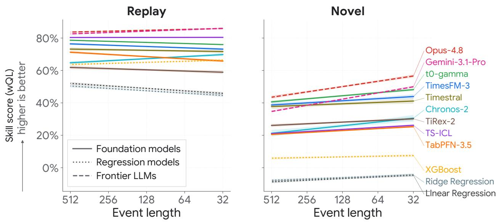

Figure 6 | Skill scores with diferent event lengths on WhatIf-Bench, on tasks with Replay (left) and Novel (right) futures respectively. Lines are least-squares trends of skill on $\log _ { 2 }$ of the event length; they summarise the direction of change.  
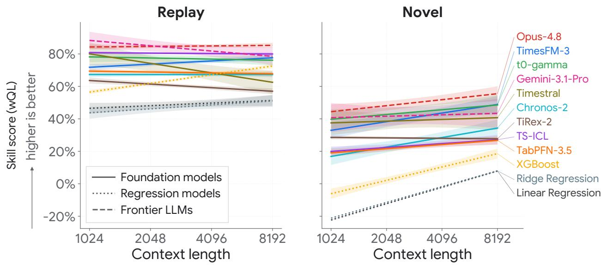  
Figure 7 | Skill scores with diferent context lengths on WhatIf-Bench, on tasks with Replay (left) and Novel (right) futures respectively. All models receive the same input and produce the same output: each consumes the full history at every context length, without truncation, and forecasts the same horizon. Tasks are grouped by their nominal context length; for the longest events, the actual context is longer (Appendix B.3). Lines are least-squares trends of skill on $\log _ { 2 }$ of the context length; they summarise the direction of change.

Linear and Ridge Regression and the number of events. Most models change little on Replay futures as the number of events grows, but Linear and Ridge Regression get worse on two simulators. Table 14 compares tasks that difer only in the number of events, sharing the target, event length, context length and number of covariates. On SUMO, their Replay skill falls from about 80% to 5% and their Novel skill from −4% to −30%; on OpenDC, Replay skill falls from 80% to 54% and Novel

skill from 29% to −35%. On EPANET and GridLAB-D, both improve with more events. We believe this is because, with only a few events, a single linear fit can pass close to the few covariate values it has seen, while with many events it has to average over many points and loses the fit, even at values it has already seen; this would explain why skill drops on both Replay and Novel futures.
<table><tr><td colspan="5"></td><td colspan="4">Novel</td></tr><tr><td>Simulator</td><td>Fewest</td><td>Replay Most</td><td>Change</td><td>Worse</td><td>Fewest</td><td>Most</td><td>Change</td><td>Worse</td></tr><tr><td>OpenDC</td><td>80.2%</td><td>54.4%</td><td>-25.8</td><td>22/22</td><td>28.7%</td><td>-35.2%</td><td>-63.9</td><td>11/22</td></tr><tr><td>GridLAB-D</td><td>34.8%</td><td>39.8%</td><td>+5.0</td><td>4/10</td><td>6.2%</td><td>18.2%</td><td>+12.0</td><td>4/10</td></tr><tr><td>EPANET</td><td>24.4%</td><td>39.4%</td><td>+15.1</td><td>6/33†</td><td>10.9%</td><td>32.6%</td><td>+21.7</td><td>10/33†</td></tr><tr><td>SUMO</td><td>79.8%</td><td>5.5%</td><td>-74.3</td><td>25/29</td><td>-4.2%</td><td>-29.7%</td><td>-25.5</td><td>22/29</td></tr></table>

Table 14 | Skill score (wQL) of Linear Regression with the fewest and the most historical events, on Replay and Novel futures. Each comparison uses tasks that share the target, event length, context length and number of covariates, where the most events are at least 8× the fewest. Change is in percentage points. Worse is the number of targets whose skill is lower with the most events, out of the benchmark targets (Table 2) that have at least one such comparison. †Out of the 37 EPANET targets: the other 4 (demand\_9, flowrate\_10, flowrate\_9, velocity\_10) have at most 2 events in every task, so no such comparison exists for them. Ridge Regression is within 1 point of Linear Regression in every cell.

TiRex-2 and the number of events. TiRex-2 is the only foundation model whose skill falls with more events on both Replay and Novel futures (Figure 5). Comparing tasks that difer only in the number of events (Table 15), its skill falls from 61.4% to 52.2% on Replay futures and from 33.8% to 26.5% on Novel futures, while TimesFM-3 gains on both (+2.0 and +4.6 points). The drop comes from two simulators: on SUMO, Replay skill falls from 78.5% to 55.3%, on all 29 targets, and on OpenDC, Novel skill falls from 23.1% to −24.9%, on 14 of 22 targets. On EPANET and GridLAB-D, it improves slightly. Other foundation models show weaker versions of the same pattern, for example Chronos-2 on SUMO Replay futures (−21.4 points), so these settings become harder with many events for several models, and TiRex-2 is the most afected.
<table><tr><td rowspan="2">Simulator</td><td colspan="4">Replay</td><td colspan="4">Novel</td></tr><tr><td>Fewest</td><td>Most</td><td>Change</td><td>Worse</td><td>Fewest</td><td>Most</td><td>Change</td><td>Worse</td></tr><tr><td>OpenDC</td><td>63.3%</td><td>58.8%</td><td>-4.4</td><td>17/22</td><td>23.1%</td><td>-24.9%</td><td>-48.1</td><td>14/22</td></tr><tr><td>GridLAB-D</td><td>53.8%</td><td>55.7%</td><td>+1.9</td><td>4/10</td><td>35.1%</td><td>37.3%</td><td>+2.2</td><td>3/10</td></tr><tr><td>EPANET</td><td>40.9%</td><td>43.6%</td><td>+2.7</td><td>15/33†</td><td>43.6%</td><td>47.7%</td><td>+4.0</td><td>13/33†</td></tr><tr><td>SUMO</td><td>78.5%</td><td>55.3%</td><td>-23.2</td><td>29/29</td><td>26.4%</td><td>18.5%</td><td>-7.9</td><td>27/29</td></tr></table>

Table 15 | Skill score (wQL) of TiRex-2 with the fewest and the most historical events, on Replay and Novel futures. Each comparison uses tasks that share the target, event length, context length and number of covariates, where the most events are at least 8× the fewest. Change is in percentage points. Worse is the number of targets whose skill is lower with the most events, out of the benchmark targets (Table 2) that have at least one such comparison. †Out of the 37 EPANET targets: the other 4 (demand\_9, flowrate\_10, flowrate\_9, velocity\_10) have at most 2 events in every task, so no such comparison exists for them.

Gemini-3.1-Pro and the context length. Gemini-3.1-Pro’s drop at 64 events in Figure 5 comes from the longest context, where all such tasks lie: its skill falls sharply at $C _ { 4 }$ on both Replay and

Novel futures, while more events at a fixed context change it little (Table 16). On Replay futures, Claude-Opus-4.8 and TimesFM-3 change much less with context. We believe Gemini-3.1-Pro handles the longest inputs less well.
<table><tr><td></td><td colspan="4">Replay</td><td colspan="4">Novel</td></tr><tr><td>Model</td><td>Context  $C _ { 3 } \to C _ { 4 }$ </td><td></td><td>Events fewest → most</td><td></td><td>Context  $C _ { 3 } \to C _ { 4 }$ </td><td></td><td>Events fewest → most</td><td></td></tr><tr><td>Gemini-3.1-Pro (High)</td><td> $8 7 . 2  7 3 . 7 $ </td><td>(−13.5) 82.9 → 80.2 (-2.7) 52.3 → 35.1 (-17.2)</td><td></td><td></td><td></td><td></td><td> $4 2 . 8  4 9 . 6 $ </td><td>(+6.9)</td></tr><tr><td>Gemini-3.1-Pro (Medium)</td><td> $7 5 . 9  6 3 . 1 $ </td><td>(−12.9) 73.0 → 64.6 (-8.4)</td><td></td><td></td><td> $3 5 . 9  2 4 . 2 ( - 1 1 . 6 )$ </td><td></td><td> $3 1 . 6  3 1 . 1$ </td><td>(-0.5)</td></tr><tr><td>Claude-Opus-4.8 (High)</td><td> $8 6 . 6  8 3 . 8 ( - 2 . 8 )$ </td><td> $8 3 . 2  8 5 . 5 $ </td><td>(+2.3)</td><td></td><td> $5 7 . 8  5 1 . 3 ( - 6 . 5 )$ </td><td></td><td> $4 8 . 8 \to 6 0 . 7$ </td><td>(+11.9)</td></tr><tr><td>Claude-Opus-4.8 (Medium)</td><td> $8 5 . 5  8 2 . 2$ </td><td>(-3.3)  $8 1 . 5  8 4 . 0$ </td><td>(+2.5)</td><td></td><td> $5 3 . 7  4 4 . 3 ( - 9 . 4 )$ </td><td></td><td> $4 2 . 6  5 5 . 1$ </td><td>(+12.5)</td></tr><tr><td>TimesFM-3</td><td> $7 8 . 2  7 6 . 4$ </td><td>(-1.8)  $7 3 . 5  7 5 . 5$ </td><td>(+2.0)</td><td></td><td> $5 0 . 9  4 4 . 6 ( - 6 . 3 )$ </td><td></td><td> $4 5 . 2  4 9 . 7 $ </td><td>(+4.6)</td></tr></table>

Table 16 | Skill score (wQL, %) of the LLMs and TimesFM-3 when moving from the second-longest to the longest context $( C _ { 3 }  C _ { 4 } )$ , and from the fewest to the most historical events at a fixed target, event length, context length and number of covariates (most events at least 8× the fewest). Change in percentage points in brackets. Gemini-3.1-Pro drops at the longest context, but changes little with the number of events.

## G. Skill scores under WAPE

Figure 8 gives the aggregate skill leaderboard under WAPE, and fig. 9 splits it into Replay vs Novel skill.

Further, the main text shows how wQL skill falls as the number of covariates � grows (fig. 4). The same trend holds under WAPE: every model loses skill on Novel futures as � grows. We provide here the aggregate skill leaderboard partitioned by the number of covariates, under WAPE, in fig. 10. Finally, figs. 11 to 13 give the WAPE counterparts of the number-of-events, event-length, and context-length figures (figs. 5 to 7); the trends match those under wQL.

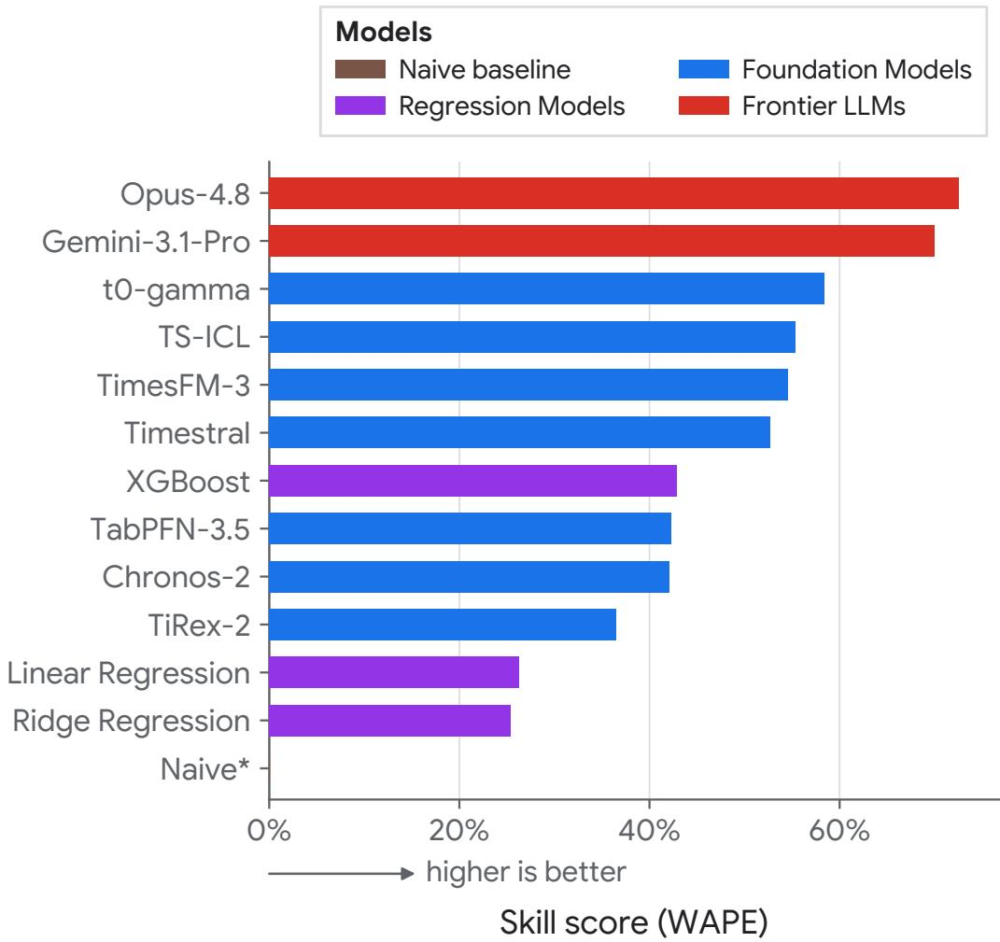  
Figure 8 | Aggregate skill leaderboard on WhatIf-Bench as per the WAPE metric.

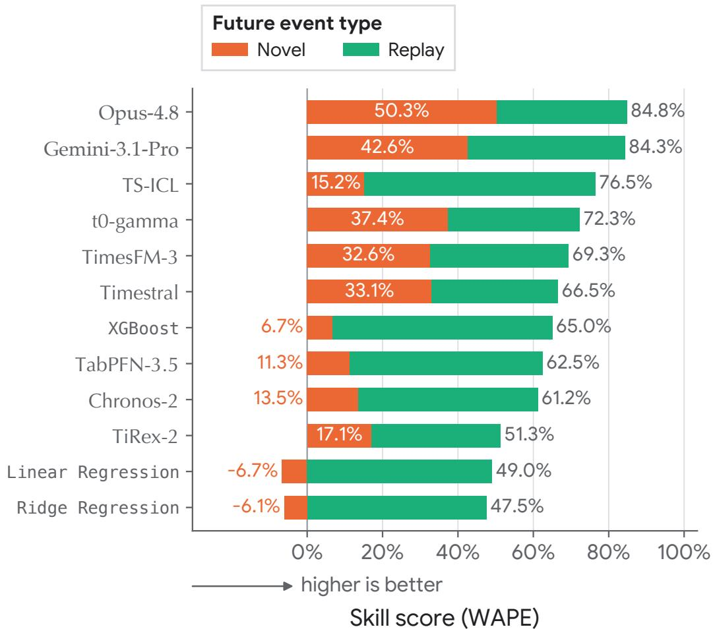  
Figure 9 | Replay vs Novel skill of LLMs, numerical foundation models, and regression models on WhatIf-Bench as per the WAPE metric.

Model family Regression Time series Frontier LLMs

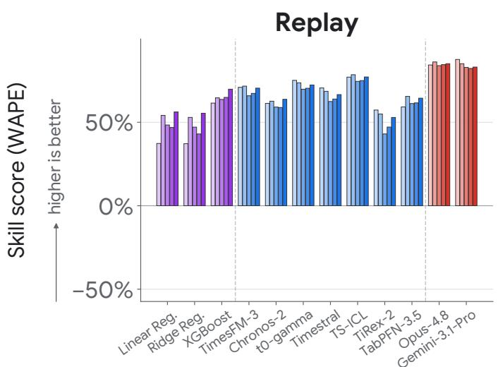

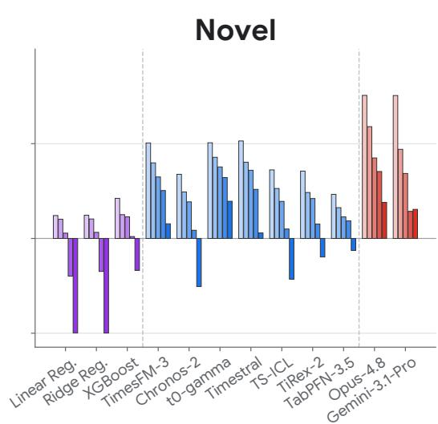  
Figure 10 | Skill scores as per the WAPE metric on tasks with diferent number of covariates on WhatIf-Bench, on Replay (left) and Novel (right) future types respectively.

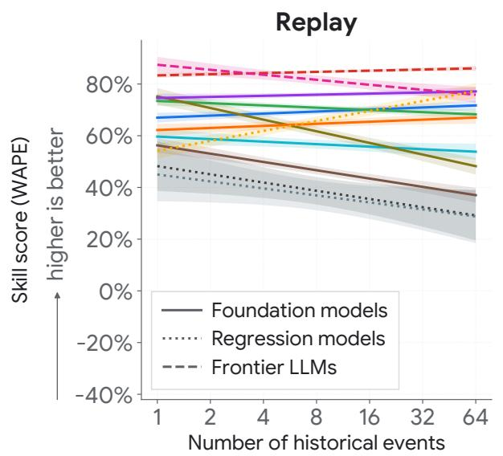

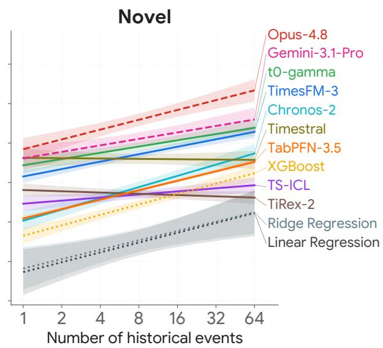  
Figure 11 | Skill scores as per the WAPE metric with diferent number of historical events on WhatIf-Bench, on tasks with Replay (left) and Novel (right) futures respectively. Lines as in Figure 5.

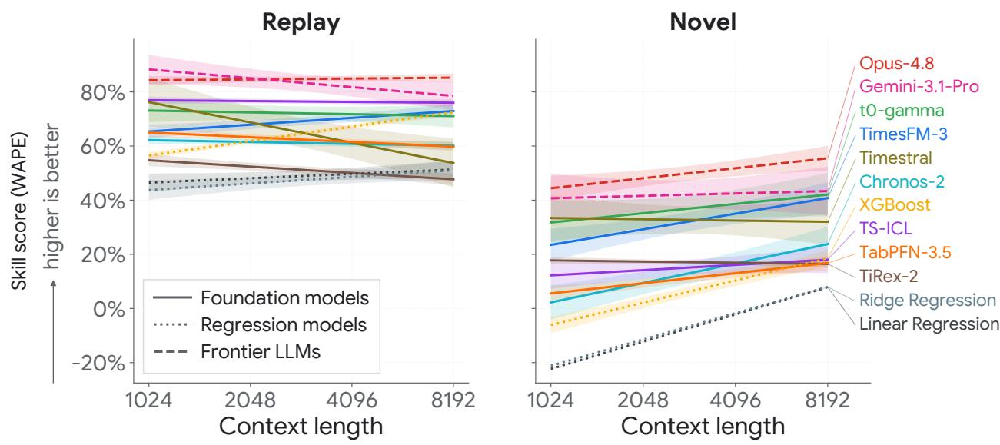

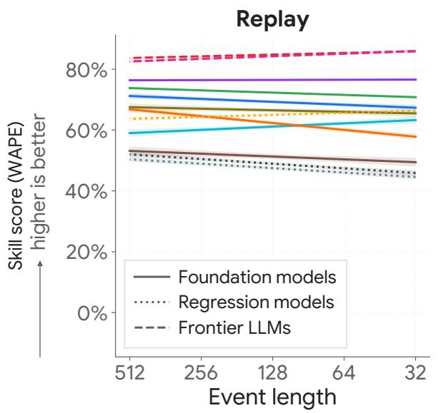

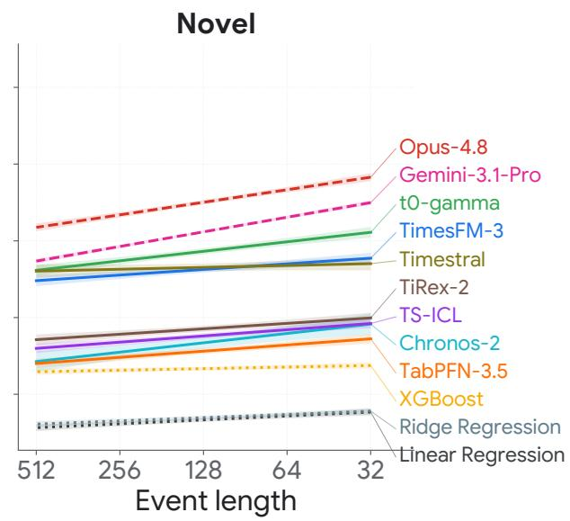  
Figure 12 | Skill scores as per the WAPE metric with diferent event lengths on WhatIf-Bench, on tasks with Replay (left) and Novel (right) futures respectively. Lines as in Figure 5.  
Figure 13 | Skill scores as per the WAPE metric with diferent context lengths on WhatIf-Bench, on tasks with Replay (left) and Novel (right) futures respectively. All models receive the same input and produce the same output: each consumes the full history at every context length, without truncation, and forecasts the same horizon. Tasks are grouped by their nominal context length; for the longest events, the actual context is longer (Appendix B.3). Lines as in Figure 5.

## H. Results by Simulator

The main text pools the four simulators. Here we separate the results by simulator: OpenDC (data centers), GridLAB-D (power grids), EPANET (water networks), and SUMO (road trafic). The simulators difer in size: EPANET contributes 13,265 tasks, SUMO 11,600, OpenDC 8,800, and GridLAB-D 4,000, so the pooled score is weighted toward the larger ones. All scores are wQL skill scores, measured against the naive baseline on the windows of the same simulator.

Overall score by simulator. Table 17 gives the overall skill score of each model on each simulator, next to the pooled score over all four.  
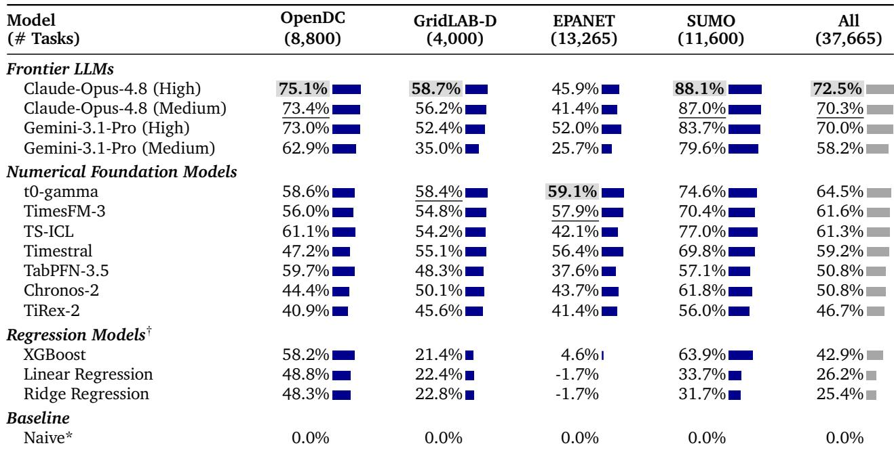  
Table 17 | Skill score (wQL) of each model on WhatIf-Bench, separately for each of the four simulators, and pooled over all of them (All). The number under each simulator name is its number of tasks (# Tasks). The best score per column is bolded and highlighted and the second-best is underlined. Note that Naive\* represents a naive baseline which does not consume covariates. All other models are evaluated with covariates. †The simplest, untuned versions of the regression models; tuned variants are in Appendix J.

Takeaway. No model is best everywhere. Claude-Opus-4.8 (High) leads on OpenDC, GridLAB-D, and SUMO, but t0-gamma leads on EPANET. Scores are highest on SUMO for both LLM families and for six of the seven foundation models.

Replay and Novel futures by simulator. Figure 14 splits each score into Replay futures, which repeat covariate values already seen in the history, and Novel futures, which set the covariates beyond that range.

OpenDC  
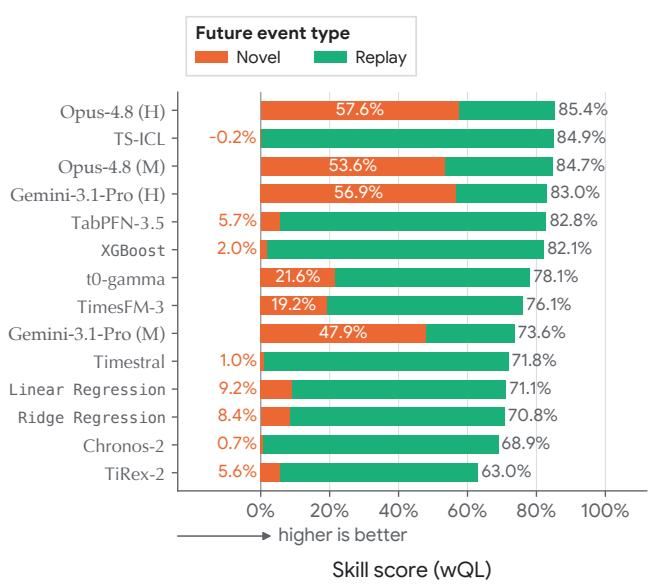

GridLAB-D  
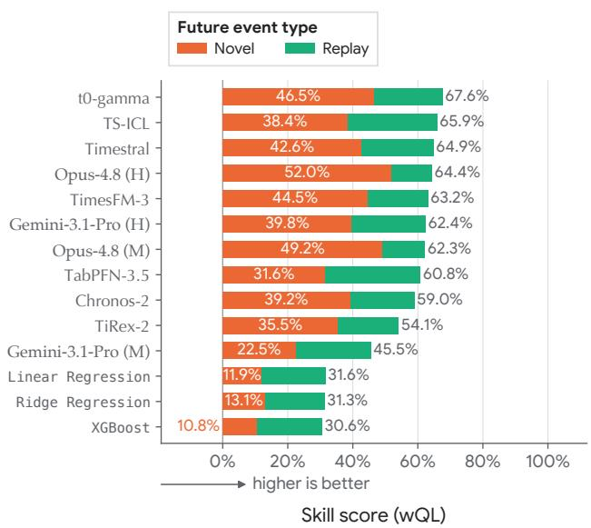

EPANET  
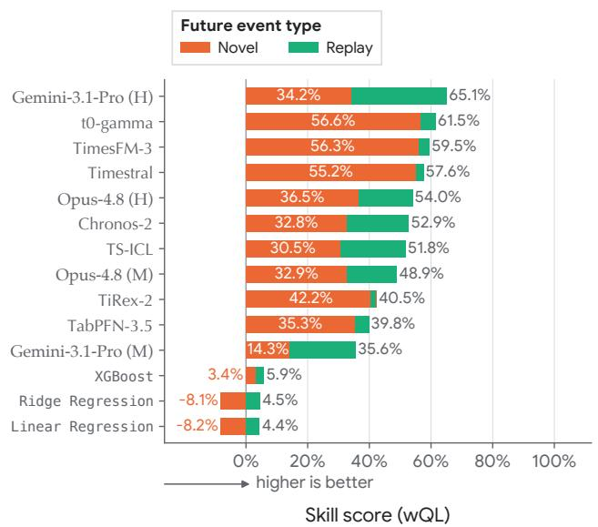

SUMO  
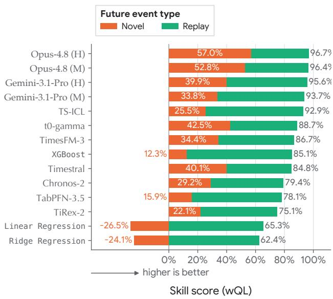  
Figure 14 | Skill score (wQL) of LLMs, numerical foundation models, and regression models on Replay and Novel futures, separately for each simulator. In each panel, the orange segment is a model’s skill on Novel futures and the full bar is its skill on Replay futures; models are sorted by Replay skill within each panel, and all panels share the same horizontal axis. (H) and (M) mark High and Medium reasoning efort.

Takeaway. Novel futures are much harder than Replay futures on OpenDC and SUMO. On these two simulators, several models fall to about zero or below on Novel futures, for example TS-ICL on OpenDC and the linear and ridge regressions on SUMO. On EPANET and GridLAB-D, the drop from Replay to Novel is smaller.

The Replay–Novel gap. To compare the drop across models and simulators in one view, we define the Replay–Novel gap of a model on a simulator as its Replay skill minus its Novel skill, in percentage points. Both skills are measured against the naive baseline. The gap is the number of skill points a model loses when the future sets the covariates beyond the range seen in the history. A gap of

zero means the model handles Novel futures as well as Replay futures. A large gap means the model forecasts well when covariate values repeat, but does not carry what it has learned to values it has not seen. Figure 15 shows the gap for every model and simulator, with the mean over simulators in the last column and the mean over models in the last row.
<table><tr><td></td><td>OpenDC</td><td>GridLAB-D</td><td>EPANET</td><td>SUMO</td><td>Mean</td><td rowspan="11">100 80 points e Iil  -– Ly 60</td></tr><tr><td>Opus-4.8 (H)</td><td>27.7</td><td>12.4</td><td>17.4</td><td>39.7</td><td>24.3</td></tr><tr><td>Opus-4.8 (M)</td><td>31.1</td><td>13.1</td><td>16.0</td><td>43.7</td><td>26.0</td></tr><tr><td>Gemini-3.1-Pro (M)</td><td>25.7</td><td>23.0</td><td>21.3</td><td>59.9</td><td>32.5</td></tr><tr><td>Gemini-3.1-Pro (H)</td><td>26.1</td><td>22.7</td><td>30.8</td><td>55.7</td><td>33.8</td></tr><tr><td>TiRex-2</td><td>57.4</td><td>18.6</td><td>-1.7</td><td>53.0</td><td>31.8</td></tr><tr><td>t0-gamma</td><td>56.5</td><td>21.1</td><td>4.9</td><td>46.2</td><td>32.2</td></tr><tr><td>TimesFM-3</td><td>56.8</td><td>18.7</td><td>3.3</td><td>52.3</td><td>32.8</td></tr><tr><td>Timestral</td><td>70.8</td><td>22.2</td><td>2.4</td><td>44.7</td><td>35.0</td></tr><tr><td>Chronos-2</td><td>68.2</td><td>19.8</td><td>20.0</td><td>50.1</td><td>39.5</td></tr><tr><td>TabPFN-3.5</td><td>77.1</td><td>29.2</td><td>4.5</td><td>62.3</td><td>43.3</td></tr><tr><td>TS-ICL</td><td>85.1</td><td>27.6</td><td>21.3</td><td>67.4</td><td>50.3</td></tr><tr><td>XGBoost</td><td>80.1</td><td>19.8</td><td>2.5</td><td>72.8</td><td>43.8</td></tr><tr><td>Ridge Regression</td><td>62.4</td><td>18.3</td><td>12.6</td><td>86.5</td><td>44.9</td></tr><tr><td>Linear Regression</td><td>62.0</td><td>19.7</td><td>12.6</td><td>91.8</td><td>46.5</td></tr><tr><td>Mean over models</td><td>56.2</td><td>20.4</td><td>12.0</td><td>59.0</td><td>36.9</td></tr></table>

Figure 15 | Replay–Novel gap (Replay skill minus Novel skill, wQL, in percentage points) for each model and simulator. Larger values mean a larger drop from Replay to Novel futures. The last column is the mean over simulators and the last row is the mean over models. Rows are sorted by the mean gap within each group of models.

Takeaway. The gap between Replay and Novel skill is much larger on OpenDC and SUMO than on EPANET and GridLAB-D. Novel futures are therefore the harder case on OpenDC and SUMO, while on EPANET and GridLAB-D models lose relatively little. On OpenDC the four LLMs have the smallest gaps, and on SUMO the two Claude models do.

## I. Skill Against a Covariate-Aware Baseline

The skill scores in the main text are measured against a naive baseline that copies the last value. We use it because it does not use covariates, so it is the same kind of forecast on every task and in every slice of the benchmark. Here we measure skill against a covariate-aware baseline, Linear Regression, to see how much models gain over a simple model that also uses the covariates. It sets a higher bar: it has a lower wQL than the naive baseline on 69.1% of the Replay tasks and on 55.7% of the Novel tasks.

We do not use it as the main reference because its strength depends on the slice of the benchmark. Its skill against the naive baseline is 49.0% on Replay futures and −6.7% on Novel futures; on SUMO, it is 65.3% and −26.5%. A skill score against it therefore mixes how well a model forecasts with how well linear regression forecasts on the same slice. This makes comparisons across Replay and Novel futures, across simulators, and across the number of covariates harder to interpret.

Even so, linear regression is a valid reference for WhatIf-Bench: it uses the covariates, as a practitioner’s first model would, and it sets a higher bar than copying the last value. We therefore ofer it alongside the naive baseline, as an option in our benchmark leaderboard. Other models, such as XGBoost, can also be used as reference baselines for the skill score.

Takeaway. Measured against linear regression instead of the naive baseline, skill scores difer in three ways. First, every model scores much lower against linear regression than against the naive baseline, but the order of the models does not change. Second, compared with the skill against the naive baseline, skill against linear regression is much lower on Replay futures, where linear regression is strong, but not on Novel futures, where it is close to the naive baseline: for every model, skill on Novel futures is slightly higher against linear regression. As a result, the gap between Replay and Novel skill mostly disappears for the foundation models, while the LLMs, TS-ICL, and XGBoost keep it. Third, the trends with the number of covariates, the number of events, and the event length difer from those against the naive baseline, and some are reversed, because linear regression is afected by these factors too. The LLMs have the highest skill on Replay futures, and Claude-Opus-4.8 (High) has the highest on Novel futures, against either reference.

Leaderboard. Table 18 gives the skill score of each model against both references, under wQL and WAPE.  
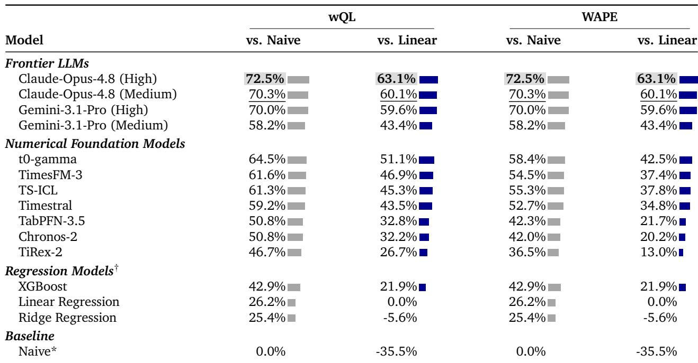  
Table 18 | Skill score of each model on WhatIf-Bench under wQL and WAPE, measured against two reference models: the naive baseline that copies the last value (as in the main text) and a covariate-aware linear regression (Linear Regression). Each reference has a skill of 0 by construction. The best score per column is bolded and highlighted and the second-best is underlined. Note that Naive\* represents a naive baseline which does not consume covariates. All other models are evaluated with covariates. †The simplest, untuned versions of the regression models; tuned variants are in Appendix J.

Takeaway. Every model has a much lower skill score against linear regression than against the naive baseline, but the order of the models does not change. For example, under wQL, Claude-Opus-4.8 (High) goes from 72.5% to 63.1% and TimesFM-3 from 61.6% to 46.9%. The same holds under WAPE.

Replay and Novel futures. Figure 16 shows the skill of each model on Replay and Novel futures against linear regression.

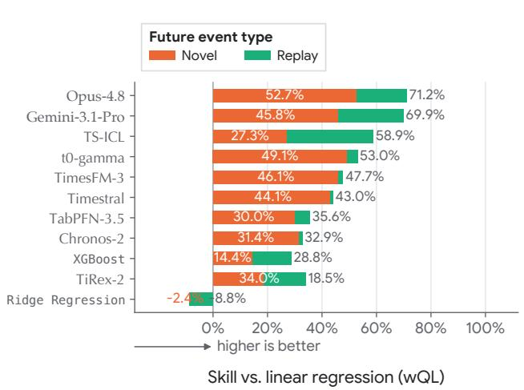

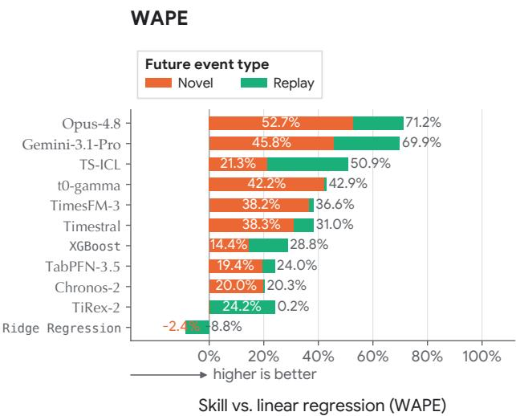  
Figure 16 | Skill score against linear regression of LLMs, numerical foundation models, and regression models on Replay and Novel futures, under wQL (left) and WAPE (right). The orange segment is a model’s skill on Novel futures, and the full bar is its skill on Replay futures. Models are sorted by Replay skill.

Takeaway. Linear regression itself drops sharply from Replay to Novel futures (from 49.0% to −6.7% against the naive baseline). This is why the gap between Replay and Novel skill is much smaller against linear regression than against the naive baseline: the reference is much weaker on Novel futures than on Replay futures. For TimesFM-3, Timestral, Chronos-2, and TiRex-2, skill on Novel futures is similar to or higher than skill on Replay futures, and t0-gamma and TabPFN-3.5 lose only about 4 to 6 points, which shows that these models are more reliable than linear regression in novel scenarios. Against linear regression, the LLMs, TS-ICL, and XGBoost still have a lower skill on Novel futures than on Replay futures. Note that skill scores against linear regression are overall much smaller than against the naive baseline. The same holds under WAPE.

Number of covariates. Figures 17 and 18 show how skill varies with the number of covariates �, under wQL and WAPE.

Model family Regression Time series Frontier LLMs

wQL
<table><tr><td colspan="3">Model family</td></tr><tr><td>Regression</td><td>Time series</td><td>Frontier LLMs</td></tr></table>

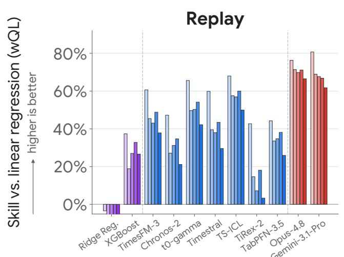

<table><tr><td colspan="3">Number of covariates K</td></tr><tr><td>1 2</td><td>3 4</td><td>5</td></tr></table>

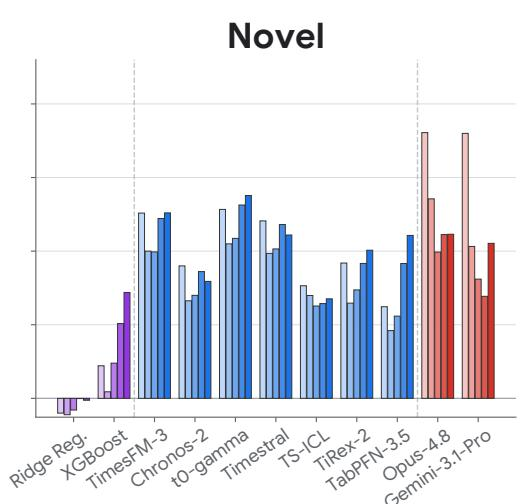  
Figure 17 | Skill score (wQL) against linear regression for diferent numbers of covariates �, on Replay (left) and Novel (right) futures.  
WAPE

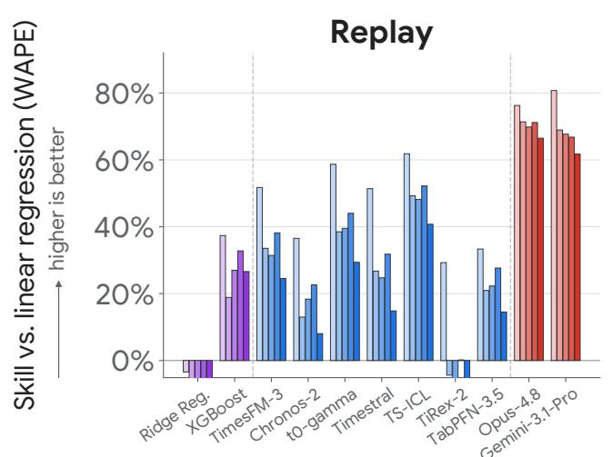

<table><tr><td colspan="2">Number of covariates K 5</td></tr><tr><td>1 2</td><td>3 4</td></tr></table>

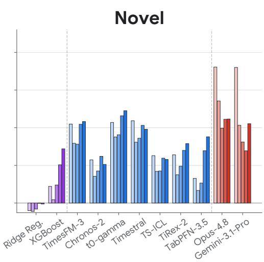  
Figure 18 | Skill score (WAPE) against linear regression for diferent numbers of covariates �, on Replay (left) and Novel (right) futures.

Takeaway. On Replay futures, skill against linear regression falls as covariates are added, whereas against the naive baseline it is nearly flat. This is because linear regression stays strong on Replay futures as covariates are added (its skill against the naive baseline is 37.3% at � = 1 and 56.2% at $K = 5 )$ , while the models do not improve. On Novel futures, skill against the naive baseline falls sharply with more covariates. Against linear regression, it falls little or not at all for the foundation models, because linear regression itself falls as fast (from 12.1% at � = 1 to −49.8% at � = 5 against the naive baseline). Against linear regression, the skill of the LLMs on Novel futures still falls as covariates are added. Skill scores against linear regression are overall much smaller than against the naive baseline. The same holds under WAPE.

Number of historical events. Figures 19 and 20 show how skill varies with the number of historical events in the context, under wQL and WAPE.

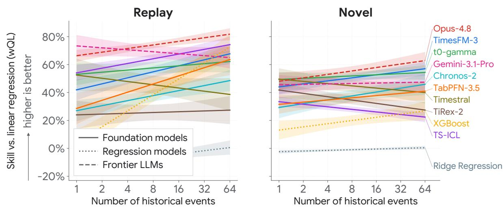  
Figure 19 | Skill score (wQL) against linear regression for diferent numbers of historical events, on Replay (left) and Novel (right) futures. Lines as in Figure 5.

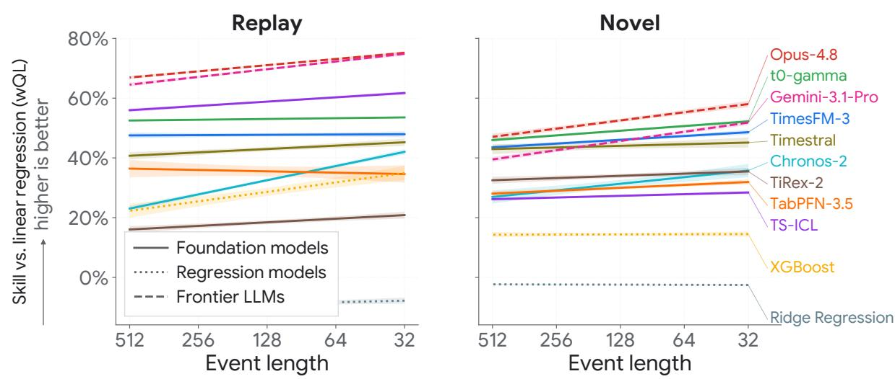  
WAPE  
wQL  
Figure 21 | Skill score (wQL) against linear regression for diferent event lengths, on Replay (left) and Novel (right) futures. Lines as in Figure 5.

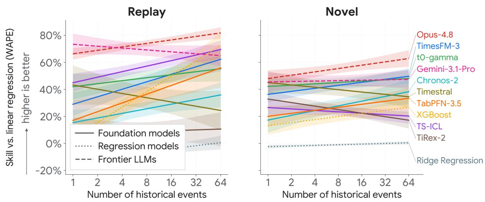  
Figure 20 | Skill score (WAPE) against linear regression for diferent numbers of historical events, on Replay (left) and Novel (right) futures. Lines as in Figure 5.

Takeaway. Against the naive baseline, skill on Replay futures is flat as the number of historical events grows, and skill on Novel futures rises. Against linear regression, more events raise skill on Replay futures for most models, and raise it less on Novel futures. Linear regression itself improves on Novel futures with more events (from −27.3% at one event to 9.3% at 64, against the naive baseline), so most models gain only somewhat more from history than it does there. On Replay futures, the models gain more from history than linear regression does. The same holds under WAPE.

Event length. Figures 21 and 22 show how skill varies with the length of the events, under wQL and WAPE.

WAPE

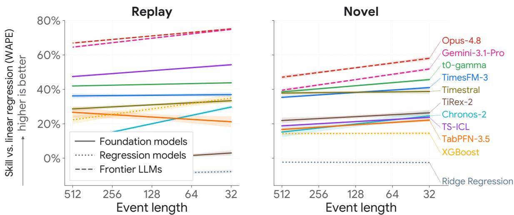  
Figure 22 | Skill score (WAPE) against linear regression for diferent event lengths, on Replay (left) and Novel (right) futures. Lines as in Figure 5.

Takeaway. Against the naive baseline, skill on Novel futures falls as events get longer. Linear regression itself falls only slightly on Novel futures with longer events (from −4.1% at length 32 to −7.5% at length 512, against the naive baseline). Against it, the skill of the models therefore still falls as events get longer, by about as much as against the naive baseline. Skill on Replay futures changes little with event length against the naive baseline, but falls slightly against linear regression, which itself improves on Replay futures with longer events. The same holds under WAPE.

Other views. Our code supports further views that we do not show here, such as results for each simulator, and other aggregations and metrics, such as win rates. It can also compute every table and figure in this appendix against a diferent reference model.

## J. Tuned Regression Baselines

The regression baselines in the main text are kept as simple as possible: each one is fit on the history of a task with one training row per time step, predicting the target from the covariates at that step, with default settings. Here we explore whether a minimal amount of tuning improves them, to check whether our conclusions depend on how weak these baselines are. Tuning improves their scores, but does not change any of our conclusions. We tune three things: how the training rows are built, which features the models use, and how many past values of the target they see (and, for Ridge Regression, its regularization strength). We select the variants on the test set, so we do not consider them valid baselines; this is also why we use the plain models for the main benchmark. The tuning is also not exhaustive: we do not tune other model hyperparameters, such as the learning rate or the tree depth of XGBoost. Even so, it gives a sense of how much these simple baselines can be improved.

Paired training. With one training row per time step, the regression models cannot directly use past values of the target: a feature such as the target one step earlier is unknown at test time for every forecast step after the first, unless forecasts are fed back as inputs. We instead take every feature relative to a forecast origin: the last time step at which the target is known when the forecast is made, which is � at test time. We design the training rows as pairs of an origin � and a horizon ℎ, where each row predicts the target $X _ { \tau + h }$ . We sample the origins from the history, as N-BEATS does to create its training examples (Oreshkin et al., 2020). For each task, we draw a horizon ℎ uniformly from 1 to the prediction length $T - t ,$ and then an origin � uniformly from the history, such that $\tau + h \leq t$ and enough history precedes � to compute the features. We draw up to 8,000 such pairs per task. At test time, the origin is $\tau = t _ { \cdot }$ , and the model predicts each step $X _ { t + h } , h = 1 , \dots , T - t ,$ , separately, using the known future covariates.

Variants. We vary the features and the number of target lags. For predicting $X _ { t + h }$ from the origin �, the features are:

$\mathbf { z } _ { t + h } \colon$ the covariates at the step being predicted (always used, and the only feature of the plain models);

$\mathbf { z } _ { t + h - 1 } .$ the covariates one step earlier;

• $\mathbf { z } _ { t } \mathbf { : }$ the covariates at the origin;

$\Delta \mathbf { z } = \mathbf { z } _ { t + h } - \mathbf { z } _ { t }$ : the change in the covariates since the origin;

• $s _ { t } \colon$ the mean, standard deviation, and slope of the last 32 target values up to the origin, $X _ { t - 3 1 } , \ldots , X _ { t }$ ;

• ℎ: the horizon.

In training, the sampled origin � takes the place of �. Lags ≤ ℓ are the values of the target at lags 1, 2, 3, 6, 12, 24, 48, 96, 128, 256 up to ℓ, where lag � is $X _ { t - L + 1 }$ . We explored 34 variants across the three models. Table 19 shows a selection that adds features and lags step by step, as a guide for tuning these models, together with the best variant of each model.

<table><tr><td>Training</td><td>Features</td><td>Lags</td><td>Skill</td><td>Replay</td><td>Novel</td><td>Gap</td></tr><tr><td>Linear Regression</td><td></td><td></td><td></td><td></td><td></td><td></td></tr><tr><td>Plain (main text)</td><td> $\mathbf { z } _ { t + h }$ </td><td></td><td>26.2%</td><td>49.0%</td><td>-6.7%</td><td>55.7</td></tr><tr><td>Paired</td><td> $\mathbf { z } _ { t + h }$ </td><td></td><td>25.8%</td><td>48.7%</td><td>-7.1%</td><td>55.8</td></tr><tr><td>Paired</td><td> $\mathbf { z } _ { t + h } , s _ { t }$ </td><td>一</td><td>30.7%</td><td>52.3%</td><td>-0.6%</td><td>52.9</td></tr><tr><td>Paired</td><td> ${ \bf z } _ { t + h } , { \bf z } _ { t } , s _ { t } , h$ </td><td>一</td><td>32.9%</td><td>54.8%</td><td>0.2%</td><td>54.6</td></tr><tr><td>Paired</td><td> $\mathrm { \bf a l l }$ </td><td></td><td>28.9%</td><td>52.5%</td><td>-6.5%</td><td>59.0</td></tr><tr><td>Paired</td><td> $\mathrm { \bf a l l }$ </td><td> $\leq 3$ </td><td>29.5%</td><td>53.1%</td><td>-5.7%</td><td>58.8</td></tr><tr><td>Paired</td><td> $\mathrm { \bf a l l }$ </td><td> $\leq 2 4$ </td><td>29.4%</td><td>53.0%</td><td>-5.8%</td><td>58.8</td></tr><tr><td>Ridge Regression</td><td></td><td></td><td></td><td></td><td></td><td></td></tr><tr><td>Plain (main text)</td><td> $\mathbf { z } _ { t + h }$ </td><td></td><td>25.4%</td><td>47.5%</td><td>-6.1%</td><td>53.6</td></tr><tr><td>Paired</td><td> $\mathbf { z } _ { t + h }$ </td><td></td><td>25.4%</td><td>47.9%</td><td>-6.8%</td><td>54.7</td></tr><tr><td>Paired</td><td> $\mathbf { z } _ { t + h }$ </td><td>1</td><td>30.5%</td><td>51.5%</td><td>0.5%</td><td>51.0</td></tr><tr><td>Paired</td><td> $\mathbf { z } _ { t + h }$ </td><td>≤ 24</td><td>30.6%</td><td>51.6%</td><td>0.6%</td><td>50.9</td></tr><tr><td>Paired</td><td> $\mathbf { z } _ { t + h }$ </td><td>≤ 48</td><td>30.8%</td><td>51.7%</td><td>0.9%</td><td>50.7</td></tr><tr><td>Paired</td><td>all</td><td>≤ 48</td><td>32.7%</td><td>54.5%</td><td>0.7%</td><td>53.8</td></tr><tr><td>XGBoost</td><td></td><td></td><td></td><td></td><td></td><td></td></tr><tr><td>Plain (main text)</td><td> $\mathbf { z } _ { t + h }$ </td><td></td><td>42.9%</td><td>65.0%</td><td>6.7%</td><td>58.3</td></tr><tr><td>Paired</td><td> $\mathbf { z } _ { t + h }$ </td><td></td><td>42.5%</td><td>64.7%</td><td>6.4%</td><td>58.3</td></tr><tr><td>Paired</td><td> $\mathbf { z } _ { t + h }$ </td><td>1</td><td>45.8%</td><td>67.0%</td><td>11.1%</td><td>56.0</td></tr><tr><td>Paired</td><td> $\mathbf { z } _ { t + h }$ </td><td>≤ 24</td><td>46.7%</td><td>68.4%</td><td>10.1%</td><td>58.3</td></tr><tr><td>Paired</td><td> $\mathbf { z } _ { t + h }$ </td><td>≤ 48</td><td>47.2%</td><td>68.7%</td><td>11.2%</td><td>57.5</td></tr><tr><td>Paired</td><td>all</td><td>≤ 24</td><td>50.4%</td><td>71.4%</td><td>13.9%</td><td>57.5</td></tr><tr><td>Paired</td><td>all</td><td>≤ 48</td><td>50.8%</td><td>71.8%</td><td>14.2%</td><td>57.6</td></tr><tr><td>Paired</td><td>all</td><td>≤ 96</td><td>51.6%</td><td>72.2%</td><td>15.8%</td><td>56.3</td></tr><tr><td>Paired</td><td>all</td><td>≤ 128</td><td>51.4%</td><td>72.0%</td><td>15.7%</td><td>56.3</td></tr><tr><td>Paired</td><td>all</td><td>≤ 256</td><td>50.7%</td><td>71.4%</td><td>15.0%</td><td>56.4</td></tr><tr><td></td><td></td><td></td><td></td><td></td><td></td><td></td></tr></table>

Table 19 | Skill score (wQL) of the tuned regression variants, measured against the naive baseline. Rows add features and target lags step by step; the best variant of each model is in bold. all is $\mathbf { z } _ { t + h } , \mathbf { z } _ { t + h - 1 } , \mathbf { z } _ { t } , \Delta \mathbf { z } , s _ { t } , h$ . Ridge Regression uses a regularization strength of 10 in every row shown. Gap is Replay skill minus Novel skill, in percentage points. The variants are selected on the test set and are not valid baselines.

Takeaway. Minimal tuning raises the skill of the regression baselines by $7 \mathrm { t o } 9$ points. Paired training alone does not help; the gains come from the features it allows, mainly the recent values of the target, as lags or as a summary. Even tuned, XGBoost only reaches TabPFN-3.5 and Chronos- $^ { - 2 , }$ and stays well below t0-gamma, TimesFM-3, TS-ICL, Timestral, and the LLMs. The drop from Replay to Novel futures stays as large as for the plain models.

Replay and Novel futures. Figure 23 shows the best variant of each model on Replay and Novel futures, next to the other models in the paper.

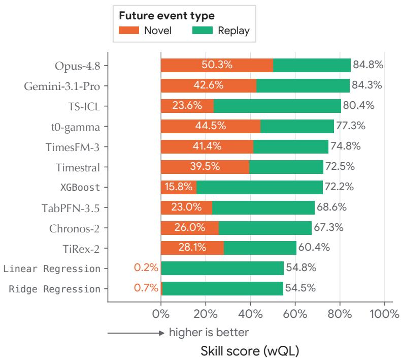  
Figure 23 | Skill score (wQL) on Replay and Novel futures, with the tuned variants of Linear Regression, Ridge Regression, and XGBoost (best on the test set) in place of the plain ones. The orange segment is a model’s skill on Novel futures, and the full bar is its skill on Replay futures. Models are sorted by Replay skill.

Takeaway. Tuning raises the regression baselines on both Replay and Novel futures, but they still drop sharply between the two: tuned XGBoost goes from 72.2% to 15.8%, and tuned Linear Regression from 54.8% to 0.2%. Tuned XGBoost is ahead of several foundation models on Replay futures, but below every foundation model on Novel futures.

Other axes. Figures 24 to 27 show the tuned variants along the number of covariates, the number of historical events, the event length, and the context length.

<table><tr><td colspan="3">Number of covariates K</td></tr><tr><td>1 2</td><td>3 4</td><td>5</td></tr></table>

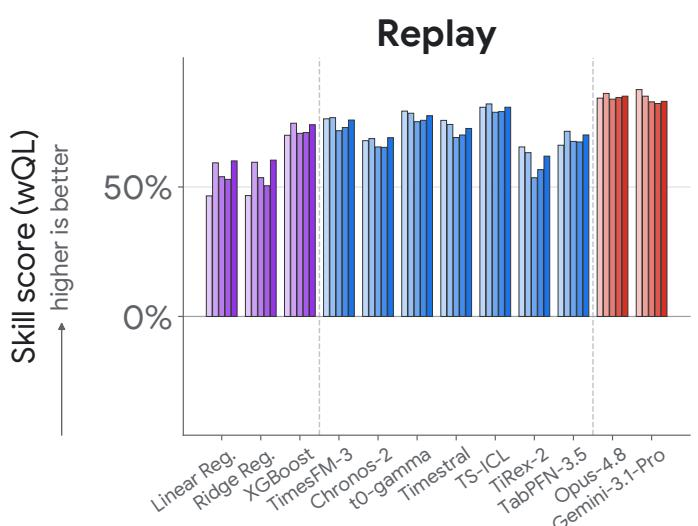

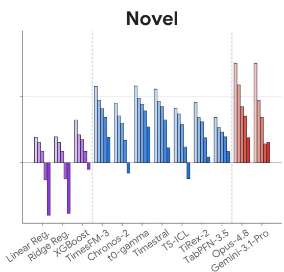  
Figure 24 | Skill score (wQL) for diferent numbers of covariates, on Replay (left) and Novel (right) futures, with the tuned regression variants.

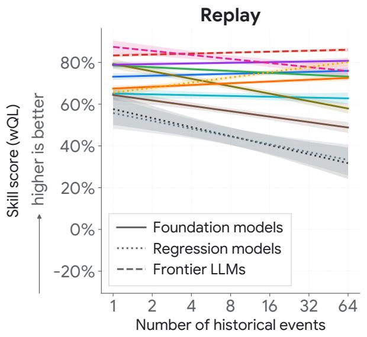

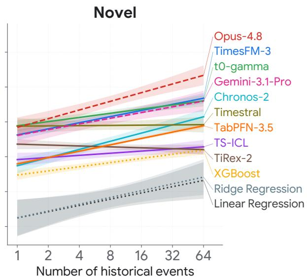  
Figure 25 | Skill score (wQL) for diferent numbers of historical events, on Replay (left) and Novel (right) futures, with the tuned regression variants. Lines as in Figure 5.

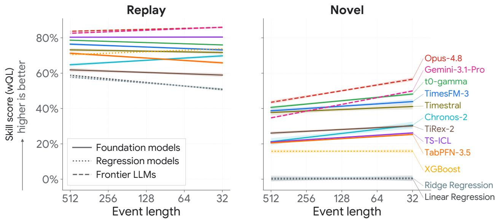  
Figure 26 | Skill score (wQL) for diferent event lengths, on Replay (left) and Novel (right) futures, with the tuned regression variants. Lines as in Figure 5.

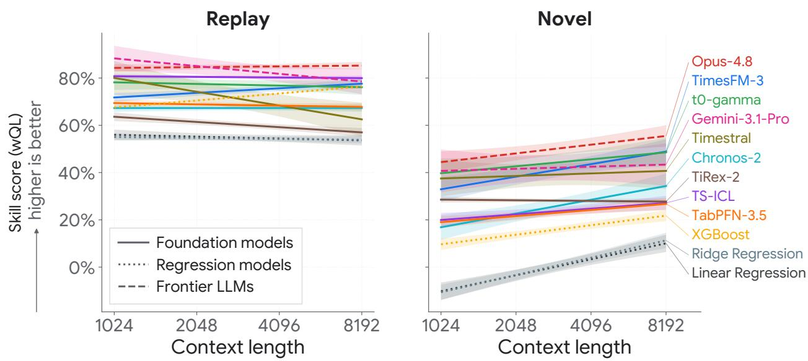  
Figure 27 | Skill score (wQL) for diferent context lengths, on Replay (left) and Novel (right) futures, with the tuned regression variants. Lines as in Figure 5.

Takeaway. The tuned variants follow the same trends as the plain ones. On Novel futures, their skill falls as more covariates are set together, rises with more historical events and a longer context, and changes little with the event length. Along every axis, they stay well below the best models on Novel futures.

## K. Win Rates

The main text reports skill scores. Here we report win rates: the fraction of task windows on which one model has a lower error than another, with ties counted as half a win. Table 20 gives each model’s average win rate over all other models. Figures 28 and 29 show every pairwise comparison.

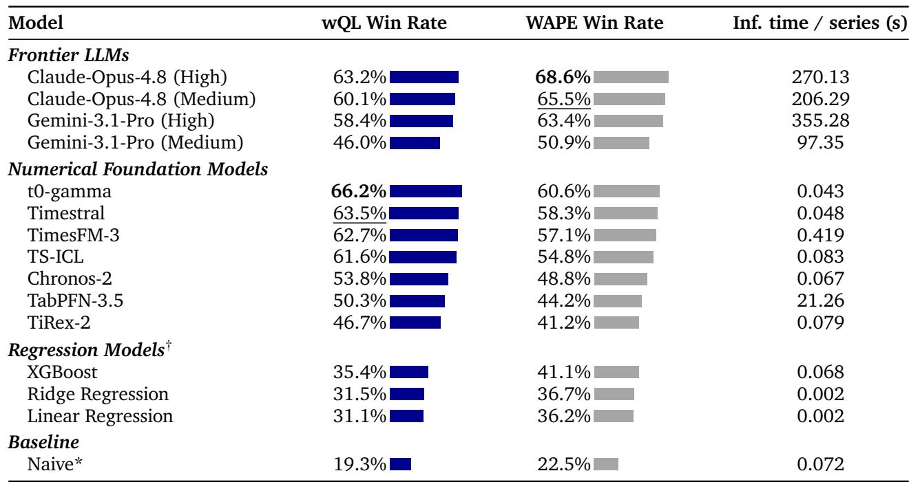  
Table 20 | Average win rate of each model on WhatIf-Bench under wQL (probabilistic) and WAPE (point) metrics, alongside inference latency. A model’s win rate is the fraction of task windows on which it has a lower error than another model, averaged over all other models in the table (ties count half). The best score per column is bolded and the second-best is underlined. Note that Naive\* represents a naive baseline which does not consume covariates. All other models are evaluated with covariates. †The simplest, untuned versions of the regression models; tuned variants are in Appendix J.

<table><tr><td></td><td rowspan=2 colspan=1></td><td rowspan=7 colspan=2>(Hp)-sH)</td><td rowspan=1 colspan=1></td><td rowspan=2 colspan=1></td><td rowspan=2 colspan=1></td><td rowspan=2 colspan=1>M</td><td rowspan=7 colspan=1>Gemm--(H)</td><td rowspan=2 colspan=1></td><td></td><td></td><td></td><td></td><td></td><td></td><td></td><td></td></tr><tr><td></td><td rowspan=1 colspan=1></td><td></td><td></td><td></td><td></td><td></td><td></td><td></td></tr><tr><td></td><td rowspan=6 colspan=1>Timsstsral</td><td></td><td></td><td></td><td></td><td></td><td></td><td></td><td></td><td></td><td></td><td></td><td></td></tr><tr><td></td><td rowspan=4 colspan=1>Timms-3</td><td></td><td></td><td></td><td></td><td></td><td></td><td></td><td></td><td></td><td></td><td></td></tr><tr><td></td><td rowspan=3 colspan=1></td><td rowspan=4 colspan=1>(P)-sM)</td><td></td><td></td><td></td><td></td><td></td><td></td><td></td><td></td><td></td></tr><tr><td></td><td rowspan=2 colspan=1></td><td></td><td></td><td></td><td></td><td></td><td></td><td></td><td></td><td></td></tr><tr><td></td><td rowspan=1 colspan=1>Chrooo-2</td><td rowspan=2 colspan=2>Tab-PP--35</td><td></td><td></td><td></td><td></td><td></td><td></td></tr><tr><td></td><td rowspan=1 colspan=2></td><td rowspan=1 colspan=1></td><td rowspan=1 colspan=1></td><td rowspan=1 colspan=1></td><td rowspan=1 colspan=1></td><td></td><td></td><td></td><td></td><td></td><td></td></tr><tr><td rowspan=2 colspan=1></td><td rowspan=2 colspan=1>55.3(55,56)</td><td rowspan=2 colspan=2>50.0(49,51)</td><td rowspan=2 colspan=1>57.5(57,58)</td><td rowspan=2 colspan=1>53.3(53,54)</td><td rowspan=2 colspan=1>53.0(53,54)</td><td rowspan=1 colspan=1>53.5</td><td rowspan=1 colspan=1>67.6</td><td rowspan=1 colspan=2>69.9</td><td rowspan=1 colspan=1>76.3</td><td rowspan=1 colspan=1>65.5</td><td rowspan=1 colspan=1>77.8</td><td rowspan=1 colspan=1>78.0</td><td rowspan=2 colspan=1>77.7(77,78)</td><td rowspan=2 colspan=1>91.8(91, 92)</td></tr><tr><td rowspan=1 colspan=1>(53,54)</td><td rowspan=1 colspan=1>(67,68)</td><td rowspan=1 colspan=2>(69,70)</td><td rowspan=1 colspan=1>(76,77)</td><td rowspan=1 colspan=1>(65,66)</td><td rowspan=1 colspan=1>(77,78)</td><td rowspan=1 colspan=1>(78,78)</td></tr><tr><td rowspan=2 colspan=1>44.7(44,45)</td><td rowspan=2 colspan=1></td><td rowspan=2 colspan=2>47.8(47,48)</td><td rowspan=1 colspan=1>52.8</td><td rowspan=1 colspan=1>51.6</td><td rowspan=1 colspan=1>50.6</td><td rowspan=1 colspan=1>50.9</td><td rowspan=1 colspan=1>62.7</td><td rowspan=1 colspan=2>65.8</td><td rowspan=1 colspan=1>75.2</td><td rowspan=1 colspan=1>63.8</td><td rowspan=2 colspan=1>74.7(74,75)</td><td rowspan=2 colspan=1>79.8(79,80)</td><td rowspan=2 colspan=1>79.4(79,80)</td><td rowspan=2 colspan=1>89.1(89,89)</td></tr><tr><td rowspan=1 colspan=1>(52,53)</td><td rowspan=1 colspan=1>(51,52)</td><td rowspan=1 colspan=1>(50,51)</td><td rowspan=1 colspan=1>(50,51)</td><td rowspan=1 colspan=1>(62,63)</td><td rowspan=1 colspan=2>(65,66)</td><td rowspan=1 colspan=1>(75,76)</td><td rowspan=1 colspan=1>(63,64)</td></tr><tr><td rowspan=2 colspan=1>50.0(49,51)</td><td rowspan=2 colspan=1>52.2(52,53)</td><td rowspan=2 colspan=2></td><td rowspan=1 colspan=1>52.9</td><td rowspan=1 colspan=1>56.0</td><td rowspan=1 colspan=1>55.0</td><td rowspan=1 colspan=1>54.5</td><td rowspan=1 colspan=1>59.7</td><td rowspan=1 colspan=2>61.5</td><td rowspan=1 colspan=1>64.1</td><td rowspan=1 colspan=1>68.1</td><td rowspan=1 colspan=1>76.2</td><td rowspan=2 colspan=1>76.7(76,77)</td><td rowspan=2 colspan=1>75.5(75,76)</td><td rowspan=2 colspan=1>82.9(83, 83)</td></tr><tr><td rowspan=1 colspan=1>(52,53)</td><td rowspan=1 colspan=1>(55,56)</td><td rowspan=1 colspan=1>(54,55)</td><td rowspan=1 colspan=1>(54,55)</td><td rowspan=1 colspan=1>(59,60)</td><td rowspan=1 colspan=2>(61,62)</td><td rowspan=1 colspan=1>(64,65)</td><td rowspan=1 colspan=1>(68,69)</td><td rowspan=1 colspan=1>(76,77)</td></tr><tr><td rowspan=2 colspan=1>42.5(42,43)</td><td rowspan=2 colspan=1>47.2(47,48)</td><td rowspan=1 colspan=2>47.1</td><td rowspan=1 colspan=1></td><td rowspan=1 colspan=1>47.8</td><td rowspan=1 colspan=1>49.9</td><td rowspan=1 colspan=1>50.2</td><td rowspan=1 colspan=1>62.0</td><td rowspan=1 colspan=2>68.1</td><td rowspan=1 colspan=1>74.8</td><td rowspan=2 colspan=1>62.6(62,63)</td><td rowspan=2 colspan=1>78.5(78, 79)</td><td rowspan=2 colspan=1>78.4(78, 79)</td><td rowspan=2 colspan=1>78.2(78,79)</td><td rowspan=2 colspan=1>90.9(91, 91)</td></tr><tr><td rowspan=1 colspan=2>(47,48)</td><td rowspan=1 colspan=1></td><td rowspan=1 colspan=1>(47,48)</td><td rowspan=1 colspan=1>(49,50)</td><td rowspan=1 colspan=1>(50,51)</td><td rowspan=1 colspan=1>(62,62)</td><td rowspan=1 colspan=2>(68,69)</td><td rowspan=1 colspan=1>(74,75)</td></tr><tr><td rowspan=2 colspan=1>46.7(46,47)</td><td rowspan=1 colspan=1>48.4</td><td rowspan=1 colspan=2>44.0</td><td rowspan=1 colspan=1>52.2</td><td rowspan=1 colspan=1></td><td rowspan=1 colspan=1>47.4</td><td rowspan=1 colspan=1>49.1</td><td rowspan=1 colspan=1>58.9</td><td rowspan=1 colspan=2>65.3</td><td rowspan=1 colspan=1>67.3</td><td rowspan=1 colspan=1>61.1</td><td rowspan=2 colspan=1>78.3(78, 79)</td><td rowspan=2 colspan=1>79.1(79,80)</td><td rowspan=2 colspan=1>78.5(78, 79)</td><td rowspan=2 colspan=1>86.5(86, 87)</td></tr><tr><td rowspan=1 colspan=1>(48,49)</td><td rowspan=1 colspan=2>(44,45)</td><td rowspan=1 colspan=1>(52,53)</td><td rowspan=1 colspan=1></td><td rowspan=1 colspan=1>(47,48)</td><td rowspan=1 colspan=1>(49,50)</td><td rowspan=1 colspan=1>(58,59)</td><td rowspan=1 colspan=2>(65,66)</td><td rowspan=1 colspan=1>(67,68)</td><td rowspan=1 colspan=1>(61,62)</td></tr><tr><td rowspan=2 colspan=1>47.0(46,47)</td><td rowspan=1 colspan=1>49.4</td><td rowspan=1 colspan=2>45.0</td><td rowspan=1 colspan=1>50.1</td><td rowspan=1 colspan=1>52.6</td><td rowspan=1 colspan=1></td><td rowspan=1 colspan=1>51.0</td><td rowspan=1 colspan=1>56.6</td><td rowspan=1 colspan=2>59.1</td><td rowspan=1 colspan=1>61.5</td><td rowspan=1 colspan=1>65.4</td><td rowspan=1 colspan=1>73.6</td><td rowspan=2 colspan=1>74.6(74,75)</td><td rowspan=2 colspan=1>73.5(73,74)</td><td rowspan=2 colspan=1>82.2(82, 83)</td></tr><tr><td rowspan=1 colspan=1>(49,50)</td><td rowspan=1 colspan=2>(45,46)</td><td rowspan=1 colspan=1>(50,51)</td><td rowspan=1 colspan=1>(52,53)</td><td rowspan=1 colspan=1></td><td rowspan=1 colspan=1>(51,52)</td><td rowspan=1 colspan=1>(56,57)</td><td rowspan=1 colspan=2>(59,60)</td><td rowspan=1 colspan=1>(61, 62)</td><td rowspan=1 colspan=1>(65,66)</td><td rowspan=1 colspan=1>(73,74)</td></tr><tr><td rowspan=1 colspan=1>46.5</td><td rowspan=1 colspan=1>49.1</td><td rowspan=1 colspan=2>45.5</td><td rowspan=1 colspan=1>49.8</td><td rowspan=1 colspan=1>50.9</td><td rowspan=1 colspan=1>49.0</td><td rowspan=1 colspan=1></td><td rowspan=1 colspan=1>55.4</td><td rowspan=1 colspan=2>57.0</td><td rowspan=1 colspan=1>59.5</td><td rowspan=1 colspan=1>63.1</td><td rowspan=1 colspan=1>69.1</td><td rowspan=2 colspan=1>72.2(72,73)</td><td rowspan=2 colspan=1>71.1(71,72)</td><td rowspan=2 colspan=1>78.6(78,79)</td></tr><tr><td rowspan=1 colspan=1>(46,47)</td><td rowspan=1 colspan=1>(49,50)</td><td rowspan=1 colspan=2>(45,46)</td><td rowspan=1 colspan=1>(49,50)</td><td rowspan=1 colspan=1>(50,51)</td><td rowspan=1 colspan=1>(48,49)</td><td rowspan=1 colspan=1></td><td rowspan=1 colspan=1>(55,56)</td><td rowspan=1 colspan=2>(57,58)</td><td rowspan=1 colspan=1>(59,60)</td><td rowspan=1 colspan=1>(63,64)</td><td rowspan=1 colspan=1>(69,70)</td></tr><tr><td rowspan=1 colspan=1>32.4</td><td rowspan=1 colspan=1>37.3</td><td rowspan=1 colspan=2>40.3</td><td rowspan=1 colspan=1>38.0</td><td rowspan=1 colspan=1>41.1</td><td rowspan=1 colspan=1>43.4</td><td rowspan=1 colspan=1>44.6</td><td rowspan=1 colspan=1></td><td rowspan=1 colspan=2>54.0</td><td rowspan=1 colspan=1>60.2</td><td rowspan=1 colspan=1>56.5</td><td rowspan=1 colspan=1>67.4</td><td rowspan=1 colspan=1>77.7</td><td rowspan=2 colspan=1>77.2(77,78)</td><td rowspan=2 colspan=1>83.7(83, 84)</td></tr><tr><td rowspan=1 colspan=1>(32, 33)</td><td rowspan=1 colspan=1>(37,38)</td><td rowspan=1 colspan=2>(40, 41)</td><td rowspan=1 colspan=1>(38, 38)</td><td rowspan=1 colspan=1>(41,42)</td><td rowspan=1 colspan=1>(43,44)</td><td rowspan=1 colspan=1>(44,45)</td><td rowspan=1 colspan=1></td><td rowspan=1 colspan=2>(53,54)</td><td rowspan=1 colspan=1>(60,61)</td><td rowspan=1 colspan=1>(56,57)</td><td rowspan=1 colspan=1>(67,68)</td><td rowspan=1 colspan=1>(77,78)</td></tr><tr><td rowspan=2 colspan=1>30.1(30, 31)</td><td rowspan=2 colspan=1>34.2(34,35)</td><td rowspan=1 colspan=2>38.5</td><td rowspan=1 colspan=1>31.9</td><td rowspan=1 colspan=1>34.7</td><td rowspan=1 colspan=1>40.9</td><td rowspan=1 colspan=1>43.0</td><td rowspan=1 colspan=1>46.0</td><td rowspan=1 colspan=2></td><td rowspan=1 colspan=1>48.7</td><td rowspan=1 colspan=1>53.8</td><td rowspan=1 colspan=1>70.0</td><td rowspan=1 colspan=1>73.5</td><td rowspan=2 colspan=1>73.1(73,74)</td><td rowspan=2 colspan=1>86.6(86, 87)</td></tr><tr><td rowspan=1 colspan=2>(38,39)</td><td rowspan=1 colspan=1>(31, 32)</td><td rowspan=1 colspan=1>(34,35)</td><td rowspan=1 colspan=1>(40,41)</td><td rowspan=1 colspan=1>(42, 43)</td><td rowspan=1 colspan=1>(46,47)</td><td rowspan=1 colspan=2></td><td rowspan=1 colspan=1>(48,49)</td><td rowspan=1 colspan=1>(53,54)</td><td rowspan=1 colspan=1>(70,71)</td><td rowspan=1 colspan=1>(73,74)</td></tr><tr><td rowspan=2 colspan=1>23.7(23, 24)</td><td rowspan=1 colspan=1>24.8</td><td rowspan=1 colspan=2>35.9</td><td rowspan=1 colspan=1>25.2</td><td rowspan=1 colspan=1>32.7</td><td rowspan=1 colspan=1>38.5</td><td rowspan=1 colspan=1>40.5</td><td rowspan=1 colspan=1>39.8</td><td rowspan=1 colspan=2>51.3</td><td rowspan=1 colspan=1></td><td rowspan=1 colspan=1>52.3</td><td rowspan=1 colspan=1>66.5</td><td rowspan=1 colspan=1>69.1</td><td rowspan=1 colspan=1>68.8</td><td rowspan=2 colspan=1>85.4(85, 86)</td></tr><tr><td rowspan=1 colspan=1>(24, 25)</td><td rowspan=1 colspan=2>(35, 36)</td><td rowspan=1 colspan=1>(25, 26)</td><td rowspan=1 colspan=1>(32, 33)</td><td rowspan=1 colspan=1>(38,39)</td><td rowspan=1 colspan=1>(40, 41)</td><td rowspan=1 colspan=1>(39,40)</td><td rowspan=1 colspan=2>(51,52)</td><td rowspan=1 colspan=1></td><td rowspan=1 colspan=1>(52,53)</td><td rowspan=1 colspan=1>(66,67)</td><td rowspan=1 colspan=1>(69,70)</td><td rowspan=1 colspan=1>(68,69)</td></tr><tr><td rowspan=2 colspan=1>34.5(34, 35)</td><td rowspan=2 colspan=1>36.2(36,37)</td><td rowspan=1 colspan=2>31.9</td><td rowspan=1 colspan=1>37.4</td><td rowspan=1 colspan=1>38.9</td><td rowspan=1 colspan=1>34.6</td><td rowspan=1 colspan=1>36.9</td><td rowspan=1 colspan=1>43.5</td><td rowspan=1 colspan=2>46.2</td><td rowspan=1 colspan=1>47.7</td><td rowspan=1 colspan=1></td><td rowspan=1 colspan=1>58.3</td><td rowspan=1 colspan=1>62.9</td><td rowspan=1 colspan=1>61.8</td><td rowspan=2 colspan=1>73.3(73,74)</td></tr><tr><td rowspan=1 colspan=2>(31, 32)</td><td rowspan=1 colspan=1>(37,38)</td><td rowspan=1 colspan=1>(38,39)</td><td rowspan=1 colspan=1>(34, 35)</td><td rowspan=1 colspan=1>(36,37)</td><td rowspan=1 colspan=1>(43,44)</td><td rowspan=1 colspan=2>(46,47)</td><td rowspan=1 colspan=1>(47,48)</td><td rowspan=1 colspan=1></td><td rowspan=1 colspan=1>(58,59)</td><td rowspan=1 colspan=1>(62,63)</td><td rowspan=1 colspan=1>(61,62)</td></tr><tr><td rowspan=2 colspan=1>22.2(22, 23)</td><td rowspan=2 colspan=1>25.3(25, 26)</td><td rowspan=2 colspan=2>23.8(23, 24)</td><td rowspan=2 colspan=1>21.5(21, 22)</td><td rowspan=2 colspan=1>21.7(21, 22)</td><td rowspan=2 colspan=1>26.4(26,27)</td><td rowspan=2 colspan=1>30.9(30, 31)</td><td rowspan=1 colspan=1>32.6</td><td rowspan=1 colspan=2>30.0</td><td rowspan=1 colspan=1>33.5</td><td rowspan=1 colspan=1>41.7</td><td rowspan=1 colspan=1></td><td rowspan=2 colspan=1>56.4(56,57)</td><td rowspan=2 colspan=1>55.6(55,56)</td><td rowspan=2 colspan=1>74.0(74,74)</td></tr><tr><td rowspan=1 colspan=1>(32, 33)</td><td rowspan=1 colspan=2>(29,30)</td><td rowspan=1 colspan=1>(33, 34)</td><td rowspan=1 colspan=1>(41,42)</td><td rowspan=1 colspan=1></td></tr><tr><td rowspan=2 colspan=1>22.0(22, 22)</td><td rowspan=2 colspan=1>20.2(20, 21)</td><td rowspan=2 colspan=2>23.3(23,24)</td><td rowspan=2 colspan=1>21.6(21, 22)</td><td rowspan=2 colspan=1>20.9(20, 21)</td><td rowspan=1 colspan=1>25.4</td><td rowspan=1 colspan=1>27.8</td><td rowspan=1 colspan=1>22.3</td><td rowspan=1 colspan=2>26.5</td><td rowspan=1 colspan=1>30.9</td><td rowspan=1 colspan=1>37.1</td><td rowspan=1 colspan=1>43.6</td><td rowspan=1 colspan=1></td><td rowspan=1 colspan=1>57.1</td><td rowspan=2 colspan=1>62.5(62,63)</td></tr><tr><td rowspan=1 colspan=1>(25, 26)</td><td rowspan=1 colspan=1>(27, 28)</td><td rowspan=1 colspan=1>(22, 23)</td><td rowspan=1 colspan=2>(26,27)</td><td rowspan=1 colspan=1>(30,31)</td><td rowspan=1 colspan=1>(37,38)</td><td rowspan=1 colspan=1>(43,44)</td><td rowspan=1 colspan=1></td><td rowspan=1 colspan=1>(57,58)</td></tr><tr><td rowspan=2 colspan=1>22.3(22, 23)</td><td rowspan=2 colspan=1>20.6(20, 21)</td><td rowspan=2 colspan=2>24.5(24, 25)</td><td rowspan=2 colspan=1>21.8(21, 22)</td><td rowspan=2 colspan=1>21.5(21, 22)</td><td rowspan=2 colspan=1>26.5(26,27)</td><td rowspan=2 colspan=1>28.9(28, 29)</td><td rowspan=2 colspan=1>22.8(22, 23)</td><td rowspan=2 colspan=2>26.9(26,27)</td><td rowspan=1 colspan=1>31.2</td><td rowspan=1 colspan=1>38.2</td><td rowspan=2 colspan=1>44.4(44,45)</td><td rowspan=2 colspan=1>42.9(42,43)</td><td rowspan=2 colspan=1></td><td rowspan=2 colspan=1>62.4(62,63)</td></tr><tr><td rowspan=1 colspan=1>(31, 32)</td><td rowspan=1 colspan=1>(38,39)</td></tr><tr><td rowspan=1 colspan=1>8.2(8,9)</td><td rowspan=1 colspan=1>10.9(11, 11)</td><td rowspan=1 colspan=2>17.1(17, 17)</td><td rowspan=1 colspan=1>9.1(9,9)</td><td rowspan=1 colspan=1>13.5(13, 14)</td><td rowspan=1 colspan=1>17.8(17, 18)</td><td rowspan=1 colspan=1>21.4(21, 22)</td><td rowspan=1 colspan=1>16.3(16, 17)</td><td rowspan=1 colspan=2>13.4(13, 14)</td><td rowspan=1 colspan=1>14.6(14, 15)</td><td rowspan=1 colspan=1>26.7(26,27)</td><td rowspan=1 colspan=1>26.0(26, 26)</td><td rowspan=1 colspan=1>37.5(37,38)</td><td rowspan=1 colspan=1>37.6(37,38)</td><td rowspan=1 colspan=1></td></tr></table>

Figure 28 | Pairwise win rates on WhatIf-Bench under the wQL metric. Each cell is the win rate (%) of the row model against the column model, with a bootstrap 95% confidence interval below it; the two cells across the diagonal add up to 100%. Models are ordered by their average win rate. Naive\* does not consume covariates.

<table><tr><td></td><td></td><td rowspan=1 colspan=1>M</td><td rowspan=1 colspan=1></td><td rowspan=1 colspan=1></td><td rowspan=1 colspan=1></td><td rowspan=1 colspan=1></td><td rowspan=1 colspan=1></td><td rowspan=1 colspan=1></td><td></td><td></td><td></td><td></td><td></td><td></td><td></td></tr><tr><td></td><td rowspan=2 colspan=1>()s4-H)</td><td rowspan=2 colspan=1>(P)-sM)</td><td rowspan=1 colspan=1></td><td rowspan=1 colspan=1></td><td rowspan=1 colspan=1></td><td rowspan=2 colspan=1>TimM-3</td><td rowspan=2 colspan=1>TS-ICL</td><td rowspan=2 colspan=1>Gemim--()</td><td></td><td></td><td></td><td></td><td></td><td></td><td></td></tr><tr><td></td><td rowspan=1 colspan=1></td><td rowspan=1 colspan=1>t0mm-ma</td><td rowspan=1 colspan=1>Timstral</td><td></td><td></td><td></td><td></td><td></td><td></td><td></td></tr><tr><td></td><td rowspan=2 colspan=1></td><td rowspan=2 colspan=1>55.0(54,55)</td><td rowspan=2 colspan=1>54.5(54,55)</td><td rowspan=2 colspan=1>60.5(60,61)</td><td rowspan=1 colspan=1>62.7</td><td rowspan=1 colspan=1>63.3</td><td rowspan=1 colspan=1>69.2</td><td rowspan=1 colspan=1>68.1</td><td rowspan=1 colspan=1>69.1</td><td rowspan=1 colspan=1>72.7</td><td rowspan=1 colspan=1>73.8</td><td rowspan=2 colspan=1>76.2(76,77)</td><td rowspan=2 colspan=1>76.7(76,77)</td><td rowspan=2 colspan=1>75.5(75,76)</td><td rowspan=2 colspan=1>82.9(83, 83)</td></tr><tr><td></td><td rowspan=1 colspan=1>(62,63)</td><td rowspan=1 colspan=1>(63,64)</td><td rowspan=1 colspan=1>(69,70)</td><td rowspan=1 colspan=1>(68,69)</td><td rowspan=1 colspan=1>(69,70)</td><td rowspan=1 colspan=1>(72,73)</td><td rowspan=1 colspan=1>(73,74)</td></tr><tr><td></td><td rowspan=2 colspan=1>45.0(45,46)</td><td rowspan=2 colspan=1></td><td rowspan=1 colspan=1>51.0</td><td rowspan=1 colspan=1>57.5</td><td rowspan=1 colspan=1>59.7</td><td rowspan=1 colspan=1>60.3</td><td rowspan=1 colspan=1>66.3</td><td rowspan=1 colspan=1>65.4</td><td rowspan=1 colspan=1>66.1</td><td rowspan=1 colspan=1>70.4</td><td rowspan=1 colspan=1>71.4</td><td rowspan=1 colspan=1>73.6</td><td rowspan=2 colspan=1>74.6(74,75)</td><td rowspan=2 colspan=1>73.5(73,74)</td><td rowspan=2 colspan=1>82.2(82, 83)</td></tr><tr><td></td><td rowspan=1 colspan=1>(51, 52)</td><td rowspan=1 colspan=1>(57,58)</td><td rowspan=1 colspan=1>(59,60)</td><td rowspan=1 colspan=1>(60,61)</td><td rowspan=1 colspan=1>(66,67)</td><td rowspan=1 colspan=1>(65,66)</td><td rowspan=1 colspan=1>(66,67)</td><td rowspan=1 colspan=1>(70,71)</td><td rowspan=1 colspan=1>(71,72)</td><td rowspan=1 colspan=1>(73,74)</td></tr><tr><td></td><td rowspan=2 colspan=1>45.5(45,46)</td><td rowspan=1 colspan=1>49.0</td><td rowspan=1 colspan=1></td><td rowspan=1 colspan=1>56.5</td><td rowspan=1 colspan=1>59.0</td><td rowspan=1 colspan=1>59.6</td><td rowspan=1 colspan=1>62.8</td><td rowspan=1 colspan=1>63.1</td><td rowspan=1 colspan=1>65.1</td><td rowspan=1 colspan=1>67.3</td><td rowspan=1 colspan=1>69.1</td><td rowspan=1 colspan=1>69.1</td><td rowspan=1 colspan=1>72.2</td><td rowspan=1 colspan=1>71.1</td><td rowspan=2 colspan=1>78.5(78,79)</td></tr><tr><td></td><td rowspan=1 colspan=1>(48,49)</td><td rowspan=1 colspan=1></td><td rowspan=1 colspan=1>(56,57)</td><td rowspan=1 colspan=1>(59,60)</td><td rowspan=1 colspan=1>(59,60)</td><td rowspan=1 colspan=1>(62,63)</td><td rowspan=1 colspan=1>(63,64)</td><td rowspan=1 colspan=1>(65,66)</td><td rowspan=1 colspan=1>(67,68)</td><td rowspan=1 colspan=1>(69,70)</td><td rowspan=1 colspan=1>(69,70)</td><td rowspan=1 colspan=1>(72, 73)</td><td rowspan=1 colspan=1>(71,72)</td></tr><tr><td></td><td rowspan=2 colspan=1>39.5(39,40)</td><td rowspan=2 colspan=1>42.5(42, 43)</td><td rowspan=1 colspan=1>43.5</td><td rowspan=1 colspan=1></td><td rowspan=1 colspan=1>54.5</td><td rowspan=1 colspan=1>57.4</td><td rowspan=1 colspan=1>53.8</td><td rowspan=1 colspan=1>56.7</td><td rowspan=1 colspan=1>65.7</td><td rowspan=1 colspan=1>68.0</td><td rowspan=1 colspan=1>74.6</td><td rowspan=1 colspan=1>66.7</td><td rowspan=1 colspan=1>69.4</td><td rowspan=2 colspan=1>69.2(69,70)</td><td rowspan=2 colspan=1>87.3(87, 88)</td></tr><tr><td></td><td rowspan=1 colspan=1>(43,44)</td><td rowspan=1 colspan=1></td><td rowspan=1 colspan=1>(54,55)</td><td rowspan=1 colspan=1>(57,58)</td><td rowspan=1 colspan=1>(53,54)</td><td rowspan=1 colspan=1>(56,57)</td><td rowspan=1 colspan=1>(65,66)</td><td rowspan=1 colspan=1>(67,68)</td><td rowspan=1 colspan=1>(74,75)</td><td rowspan=1 colspan=1>(66,67)</td><td rowspan=1 colspan=1>(69,70)</td></tr><tr><td></td><td rowspan=2 colspan=1>37.3(37,38)</td><td rowspan=2 colspan=1>40.3(40,41)</td><td rowspan=1 colspan=1>41.0</td><td rowspan=1 colspan=1>45.5</td><td rowspan=1 colspan=1></td><td rowspan=1 colspan=1>53.2</td><td rowspan=1 colspan=1>51.9</td><td rowspan=1 colspan=1>54.4</td><td rowspan=1 colspan=1>60.6</td><td rowspan=1 colspan=1>64.9</td><td rowspan=1 colspan=1>74.1</td><td rowspan=1 colspan=1>66.7</td><td rowspan=2 colspan=1>70.8(70,71)</td><td rowspan=2 colspan=1>70.3(70,71)</td><td rowspan=2 colspan=1>84.6(84, 85)</td></tr><tr><td></td><td rowspan=1 colspan=1>(40,41)</td><td rowspan=1 colspan=1>(45,46)</td><td rowspan=1 colspan=1></td><td rowspan=1 colspan=1>(53,54)</td><td rowspan=1 colspan=1>(51,52)</td><td rowspan=1 colspan=1>(54,55)</td><td rowspan=1 colspan=1>(60,61)</td><td rowspan=1 colspan=1>(64,65)</td><td rowspan=1 colspan=1>(74,75)</td><td rowspan=1 colspan=1>(66,67)</td></tr><tr><td></td><td rowspan=2 colspan=1>36.7(36,37)</td><td rowspan=1 colspan=1>39.7</td><td rowspan=1 colspan=1>40.4</td><td rowspan=1 colspan=1>42.6</td><td rowspan=1 colspan=1>46.8</td><td rowspan=1 colspan=1></td><td rowspan=1 colspan=1>48.4</td><td rowspan=1 colspan=1>53.4</td><td rowspan=1 colspan=1>59.9</td><td rowspan=1 colspan=1>66.8</td><td rowspan=1 colspan=1>73.1</td><td rowspan=1 colspan=1>67.9</td><td rowspan=1 colspan=1>68.9</td><td rowspan=2 colspan=1>68.8(68,69)</td><td rowspan=2 colspan=1>85.9(86, 86)</td></tr><tr><td></td><td rowspan=1 colspan=1>(39,40)</td><td rowspan=1 colspan=1>(40,41)</td><td rowspan=1 colspan=1>(42, 43)</td><td rowspan=1 colspan=1>(46,47)</td><td rowspan=1 colspan=1></td><td rowspan=1 colspan=1>(48,49)</td><td rowspan=1 colspan=1>(53,54)</td><td rowspan=1 colspan=1>(59,60)</td><td rowspan=1 colspan=1>(66,67)</td><td rowspan=1 colspan=1>(73,74)</td><td rowspan=1 colspan=1>(67,68)</td><td rowspan=1 colspan=1>(68,69)</td></tr><tr><td rowspan=4 colspan=1>Mol (row)             TS-ICLGemini-3.1-Pro (M)</td><td rowspan=2 colspan=1>30.8(30, 31)</td><td rowspan=2 colspan=1>33.7(33, 34)</td><td rowspan=1 colspan=1>37.2</td><td rowspan=1 colspan=1>46.2</td><td rowspan=1 colspan=1>48.1</td><td rowspan=1 colspan=1>51.6</td><td rowspan=1 colspan=1></td><td rowspan=1 colspan=1>49.9</td><td rowspan=1 colspan=1>57.8</td><td rowspan=1 colspan=1>63.2</td><td rowspan=1 colspan=1>66.4</td><td rowspan=1 colspan=1>67.1</td><td rowspan=2 colspan=1>68.0(68,68)</td><td rowspan=2 colspan=1>67.4(67, 68)</td><td rowspan=2 colspan=1>79.3(79,80)</td></tr><tr><td rowspan=1 colspan=1>(37, 38)</td><td rowspan=1 colspan=1>(46,47)</td><td rowspan=1 colspan=1>(48,49)</td><td rowspan=1 colspan=1>(51,52)</td><td rowspan=1 colspan=1></td><td rowspan=1 colspan=1>(49,50)</td><td rowspan=1 colspan=1>(57, 58)</td><td rowspan=1 colspan=1>(63,64)</td><td rowspan=1 colspan=1>(66,67)</td><td rowspan=1 colspan=1>(67,68)</td></tr><tr><td rowspan=2 colspan=1>31.9(31,32)</td><td rowspan=2 colspan=1>34.6(34, 35)</td><td rowspan=1 colspan=1>36.9</td><td rowspan=1 colspan=1>43.3</td><td rowspan=1 colspan=1>45.6</td><td rowspan=1 colspan=1>46.6</td><td rowspan=1 colspan=1>50.1</td><td rowspan=1 colspan=1></td><td rowspan=1 colspan=1>53.0</td><td rowspan=1 colspan=1>56.6</td><td rowspan=1 colspan=1>58.7</td><td rowspan=1 colspan=1>58.3</td><td rowspan=1 colspan=1>62.9</td><td rowspan=2 colspan=1>61.8(61,62)</td><td rowspan=2 colspan=1>72.9(72,73)</td></tr><tr><td rowspan=1 colspan=1>(36, 37)</td><td rowspan=1 colspan=1>(43,44)</td><td rowspan=1 colspan=1>(45, 46)</td><td rowspan=1 colspan=1>(46,47)</td><td rowspan=1 colspan=1>(50,51)</td><td rowspan=1 colspan=1></td><td rowspan=1 colspan=1>(52,53)</td><td rowspan=1 colspan=1>(56,57)</td><td rowspan=1 colspan=1>(58,59)</td><td rowspan=1 colspan=1>(58,59)</td><td rowspan=1 colspan=1>(62,63)</td></tr><tr><td rowspan=12 colspan=1>Chronos-2TabPFN-3.5TiRex-2XGBoostRidge RegressionLinear RegressionNaive*</td><td rowspan=2 colspan=1>30.9(30, 31)</td><td rowspan=2 colspan=1>33.9(33, 34)</td><td rowspan=1 colspan=1>34.9</td><td rowspan=1 colspan=1>34.3</td><td rowspan=1 colspan=1>39.4</td><td rowspan=1 colspan=1>40.1</td><td rowspan=1 colspan=1>42.2</td><td rowspan=1 colspan=1>47.0</td><td rowspan=1 colspan=1></td><td rowspan=1 colspan=1>53.5</td><td rowspan=1 colspan=1>60.2</td><td rowspan=1 colspan=1>57.6</td><td rowspan=1 colspan=1>66.3</td><td rowspan=1 colspan=1>65.8</td><td rowspan=2 colspan=1>77.3(77,78)</td></tr><tr><td rowspan=1 colspan=1>(34, 35)</td><td rowspan=1 colspan=1>(34, 35)</td><td rowspan=1 colspan=1>(39,40)</td><td rowspan=1 colspan=1>(40,41)</td><td rowspan=1 colspan=1>(42,43)</td><td rowspan=1 colspan=1>(47,48)</td><td rowspan=1 colspan=1></td><td rowspan=1 colspan=1>(53,54)</td><td rowspan=1 colspan=1>(60,61)</td><td rowspan=1 colspan=1>(57,58)</td><td rowspan=1 colspan=1>(66,67)</td><td rowspan=1 colspan=1>(65,66)</td></tr><tr><td rowspan=2 colspan=1>27.3(27,28)</td><td rowspan=2 colspan=1>29.6(29,30)</td><td rowspan=2 colspan=1>32.7(32, 33)</td><td rowspan=1 colspan=1>32.0</td><td rowspan=1 colspan=1>35.1</td><td rowspan=1 colspan=1>33.2</td><td rowspan=1 colspan=1>36.8</td><td rowspan=1 colspan=1>43.4</td><td rowspan=1 colspan=1>46.5</td><td rowspan=1 colspan=1></td><td rowspan=1 colspan=1>48.8</td><td rowspan=1 colspan=1>52.6</td><td rowspan=1 colspan=1>61.7</td><td rowspan=1 colspan=1>61.0</td><td rowspan=1 colspan=1>78.4</td></tr><tr><td rowspan=1 colspan=1>(32, 33)</td><td rowspan=1 colspan=1>(35, 36)</td><td rowspan=1 colspan=1>(33,34)</td><td rowspan=1 colspan=1>(36,37)</td><td rowspan=1 colspan=1>(43,44)</td><td rowspan=1 colspan=1>(46,47)</td><td rowspan=1 colspan=1></td><td rowspan=1 colspan=1>(48,49)</td><td rowspan=1 colspan=1>(52,53)</td><td rowspan=1 colspan=1>(61,62)</td><td rowspan=1 colspan=1>(60,62)</td><td rowspan=1 colspan=1>(78,79)</td></tr><tr><td rowspan=2 colspan=1>26.2(26,27)</td><td rowspan=2 colspan=1>28.6(28,29)</td><td rowspan=1 colspan=1>30.9</td><td rowspan=1 colspan=1>25.4</td><td rowspan=1 colspan=1>25.9</td><td rowspan=1 colspan=1>26.9</td><td rowspan=1 colspan=1>33.6</td><td rowspan=1 colspan=1>41.3</td><td rowspan=1 colspan=1>39.8</td><td rowspan=1 colspan=1>51.2</td><td rowspan=1 colspan=1></td><td rowspan=1 colspan=1>54.7</td><td rowspan=1 colspan=1>57.9</td><td rowspan=1 colspan=1>57.8</td><td rowspan=2 colspan=1>76.9(77,77)</td></tr><tr><td rowspan=1 colspan=1>(30, 31)</td><td rowspan=1 colspan=1>(25, 26)</td><td rowspan=1 colspan=1>(25, 26)</td><td rowspan=1 colspan=1>(26,27)</td><td rowspan=1 colspan=1>(33, 34)</td><td rowspan=1 colspan=1>(41,42)</td><td rowspan=1 colspan=1>(39,40)</td><td rowspan=1 colspan=1>(51,52)</td><td rowspan=1 colspan=1></td><td rowspan=1 colspan=1>(54,55)</td><td rowspan=1 colspan=1>(57,58)</td><td rowspan=1 colspan=1>(57,58)</td></tr><tr><td rowspan=2 colspan=1>23.8(23, 24)</td><td rowspan=2 colspan=1>26.4(26, 27)</td><td rowspan=2 colspan=1>30.9(30, 31)</td><td rowspan=1 colspan=1>33.3</td><td rowspan=1 colspan=1>33.3</td><td rowspan=1 colspan=1>32.1</td><td rowspan=1 colspan=1>32.9</td><td rowspan=1 colspan=1>41.7</td><td rowspan=1 colspan=1>42.4</td><td rowspan=1 colspan=1>47.4</td><td rowspan=1 colspan=1>45.3</td><td rowspan=1 colspan=1></td><td rowspan=2 colspan=1>56.4(56,57)</td><td rowspan=2 colspan=1>55.6(55,56)</td><td rowspan=2 colspan=1>74.0(74,74)</td></tr><tr><td rowspan=1 colspan=1>(33,34)</td><td rowspan=1 colspan=1>(33,34)</td><td rowspan=1 colspan=1>(32, 33)</td><td rowspan=1 colspan=1>(32, 33)</td><td rowspan=1 colspan=1>(41,42)</td><td rowspan=1 colspan=1>(42,43)</td><td rowspan=1 colspan=1>(47,48)</td><td rowspan=1 colspan=1>(45, 46)</td><td rowspan=1 colspan=1></td></tr><tr><td rowspan=2 colspan=1>23.3(23, 24)</td><td rowspan=2 colspan=1>25.4(25, 26)</td><td rowspan=2 colspan=1>27.8(27, 28)</td><td rowspan=2 colspan=1>30.6(30,31)</td><td rowspan=1 colspan=1>29.2</td><td rowspan=1 colspan=1>31.1</td><td rowspan=1 colspan=1>32.0</td><td rowspan=1 colspan=1>37.1</td><td rowspan=1 colspan=1>33.7</td><td rowspan=1 colspan=1>38.3</td><td rowspan=2 colspan=1>42.1(42,43)</td><td rowspan=2 colspan=1>43.6(43, 44)</td><td rowspan=2 colspan=1></td><td rowspan=2 colspan=1>57.1(57,58)</td><td rowspan=2 colspan=1>62.5(62,63)</td></tr><tr><td rowspan=1 colspan=1>(29,30)</td><td rowspan=1 colspan=1>(31, 32)</td><td rowspan=1 colspan=1>(32,32)</td><td rowspan=1 colspan=1>(37, 38)</td><td rowspan=1 colspan=1>(33, 34)</td><td rowspan=1 colspan=1>(38,39)</td></tr><tr><td rowspan=1 colspan=1>24.5(24, 25)</td><td rowspan=1 colspan=1>26.5(26, 27)</td><td rowspan=1 colspan=1>28.9(28,29)</td><td rowspan=1 colspan=1>30.8(30,31)</td><td rowspan=1 colspan=1>29.7(29,30)</td><td rowspan=1 colspan=1>31.2(31, 32)</td><td rowspan=1 colspan=1>32.6(32, 33)</td><td rowspan=1 colspan=1>38.2(38,39)</td><td rowspan=1 colspan=1>34.2(34, 35)</td><td rowspan=1 colspan=1>39.0(38,40)</td><td rowspan=1 colspan=1>42.2(42,43)</td><td rowspan=1 colspan=1>44.4(44,45)</td><td rowspan=1 colspan=1>42.9(42, 43)</td><td rowspan=1 colspan=1></td><td rowspan=1 colspan=1>62.4(62,63)</td></tr><tr><td rowspan=1 colspan=1>17.1(17, 17)</td><td rowspan=1 colspan=1>17.8(17, 18)</td><td rowspan=1 colspan=1>21.5(21, 22)</td><td rowspan=1 colspan=1>12.7(12, 13)</td><td rowspan=1 colspan=1>15.4(15, 16)</td><td rowspan=1 colspan=1>14.1(14, 14)</td><td rowspan=1 colspan=1>20.7(20, 21)</td><td rowspan=1 colspan=1>27.1(27, 28)</td><td rowspan=1 colspan=1>22.7(22, 23)</td><td rowspan=1 colspan=1>21.6(21, 22)</td><td rowspan=1 colspan=1>23.1(23, 23)</td><td rowspan=1 colspan=1>26.0(26, 26)</td><td rowspan=1 colspan=1>37.5(37,38)</td><td rowspan=1 colspan=1>37.6(37,38)</td><td rowspan=1 colspan=1></td></tr></table>

Figure 29 | Pairwise win rates on WhatIf-Bench under the WAPE metric. Each cell is the win rate (%) of the row model against the column model, with a bootstrap 95% confidence interval below it; the two cells across the diagonal add up to 100%. Models are ordered by their average win rate. Naive\* does not consume covariates.

## L. Example tasks

We show example tasks here to make the benchmark construction concrete. As described in the main text (Section 3.3), the axes along which we build WhatIf-Bench are:

• Future type: Replay or Novel.

• Number of covariates $K \in \{ 1 , 2 , 3 , 4 , 5 \}$

• Context / prediction length �: from $C _ { 1 }$ (context 1024, prediction 128) to $C _ { 4 }$ (context about 8,000, prediction 512 to 864, depending on the simulator), with longer contexts for the longest events (Appendix B.3).

• Event length ℓ ∈ {32, 64, 128, 256, 512}.

• Number of events �: from the fewest (one or two) to the most the context permits, up to 64.

As set out in the construction recipe (Section 3.3), this is repeated for each target in each simulator.

Crucially, variations along one axis are built with every other axis held fixed. For example, the Replay and Novel tasks come from the same history, and only the future difers. This lets each axis be read on its own.

Each example below shows the history and the future of the target, together with its covariates. Except for the covariate axis, every example uses a single covariate, to keep the figures easy to read. History and future are separated by a dashed forecast-start line; in-context events are shaded grey and the future event red. Only the Replay future is drawn for every axis except the Replay-versus-Novel one. Some panels also show the pre-intervention target, the dotted line marking what the target would be with no event; it is shown purely for illustration and is not part of any task, and models never receive it.

## L.1. Replay and Novel futures

Each figure shows a Replay task and a Novel task over the same history. The history and its covariate are identical across the two; only the future event changes. Replay reuses covariate values already seen in the history, while Novel pushes them beyond that range.

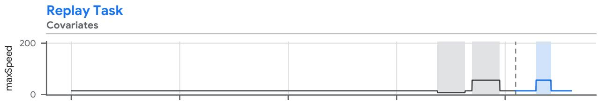

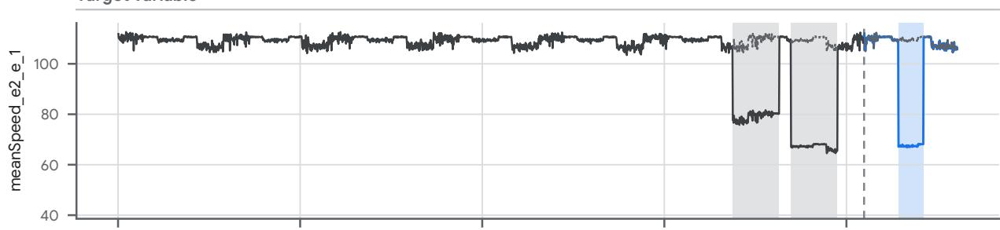

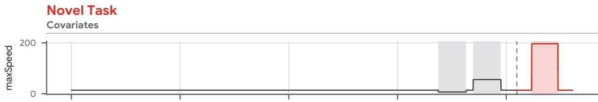

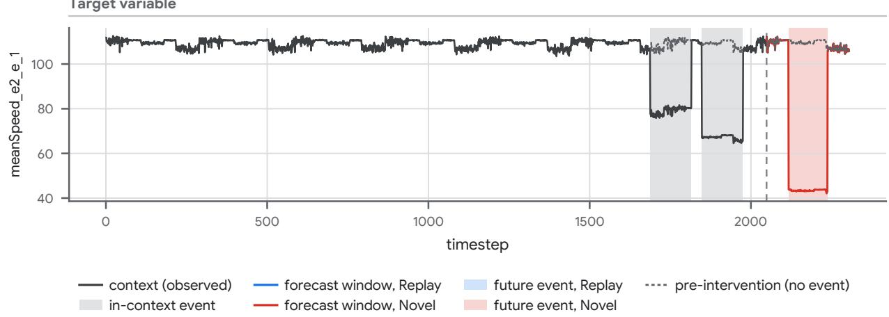  
Figure 30 | A Replay task and a Novel task over a shared history. The dotted pre-intervention target is shown for illustration only and is not part of the task.

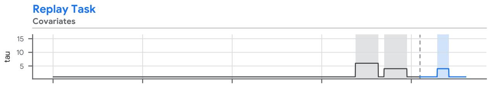

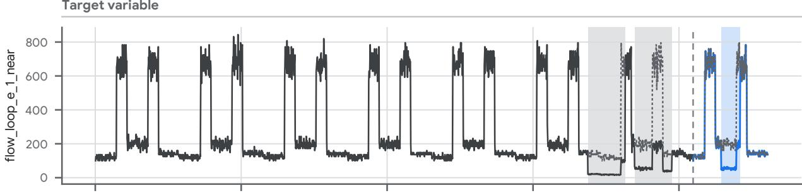

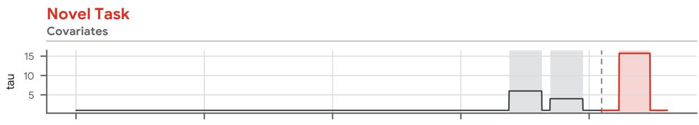

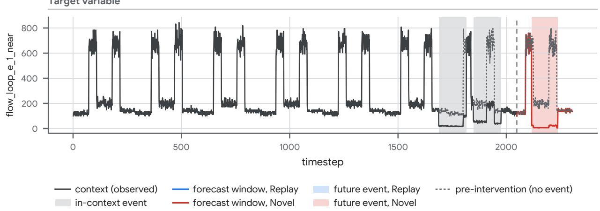  
Figure 31 | A Replay task and a Novel task over a shared history. The dotted pre-intervention target is shown for illustration only and is not part of the task.

  
Figure 32 | A Replay task and a Novel task over a shared history. The dotted pre-intervention target is shown for illustration only and is not part of the task.

## L.2. Event length

Each figure varies the event length ℓ across columns, holding the target, covariate, context, and number of events fixed. Longer events hold the covariate in place for longer, so the target’s response is seen over a longer window.

covariate target in-context event future event pre-intervention (no event) forecast start  
Figure 33 | Tasks that difer only in event length ℓ = 32, 64, 128, 256, 512. The dotted pre-intervention target is shown for illustration only and is not part of the task.  
  
Figure 34 | Tasks that difer only in event length ℓ = 32, 64, 128, 256, 512. The dotted pre-intervention target is shown for illustration only and is not part of the task.

  
covariate target in-context event future event pre-intervention (no event) forecast start

  
Figure 35 | Tasks that difer only in event length ℓ = 32, 64, 128, 256, 512. The dotted pre-intervention target is shown for illustration only and is not part of the task.

  
covariate target in-context event future event pre-intervention (no event) forecast start  
Figure 36 | Tasks that difer only in event length $\ell = 3 2 , 6 4 , 1 2 8 , 2 5 6 , 5 1 2$ . The dotted pre-intervention target is shown for illustration only and is not part of the task.

## L.3. Number of events

Each figure varies the number of events � across columns, holding every other axis fixed. More events set the covariate at more points across the history, giving more views of the covariate–target relationship.

  
Figure 37 | Tasks that difer only in the number of events (few versus many). The dotted preintervention target is shown for illustration only and is not part of the task.

Figure 38 | Tasks that difer only in the number of events (few versus many). The dotted preintervention target is shown for illustration only and is not part of the task.  
  
Figure 39 | Tasks that difer only in the number of events (few versus many). The dotted preintervention target is shown for illustration only and is not part of the task.

## L.4. Context and prediction length

Each figure varies the context and prediction length across columns, holding every other axis fixed.   
Each column is labelled with its context length (CTX) and prediction length (PRED).

  
Figure 40 | Tasks that difer only in context/prediction pair, $C _ { 1 }$ through $C _ { 4 }$ . The dotted pre-intervention target is shown for illustration only and is not part of the task.

  
Figure 41 | Tasks that difer only in context/prediction pair, $C _ { 1 }$ through $C _ { 4 }$ . The dotted pre-intervention target is shown for illustration only and is not part of the task.

  
Figure 42 | Tasks that difer only in context/prediction pair, $C _ { 1 }$ through $C _ { 4 }$ . The dotted pre-intervention target is shown for illustration only and is not part of the task.

## L.5. Number of covariates

Each figure varies the number of covariates � across columns, holding every other axis fixed. As � grows, each event acts on more covariates at once, and the model must learn more relationships from the history. Here every covariate is plotted above the shared target.

  
Figure 43 | Tasks that difer only in the number of covariates, � = 1 through 5. The dotted preintervention target is shown for illustration only and is not part of the task.

covariate target in-context event future event pre-intervention (no event) forecast start

OpenDC: cpu\_usage\_host-0  
  
Figure 44 | Tasks that difer only in the number of covariates, $K = 1$ through 5. The dotted preintervention target is shown for illustration only and is not part of the task.