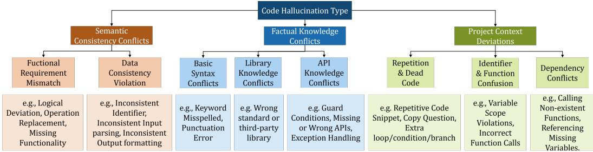
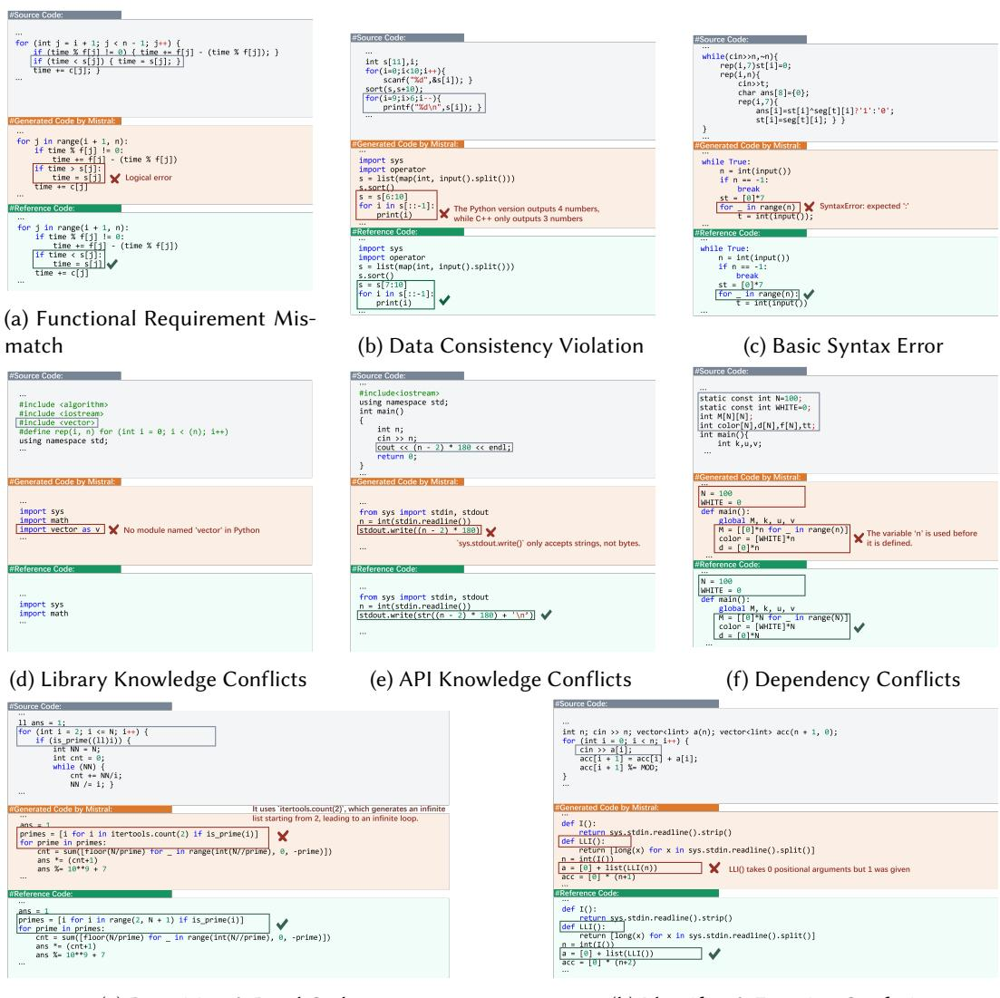
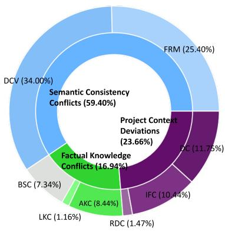
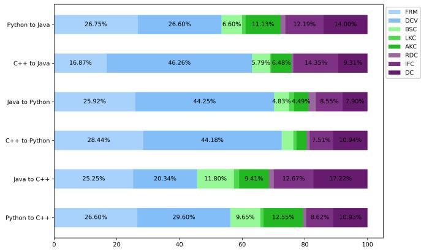
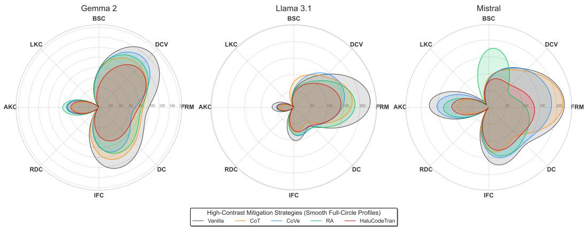

# Hallucinations of Large Language Models in Cross-Language Code Translation: Phenomena and Mitigation

YALI DU, National Key Laboratory for Novel Software Technology, and the School of Artificial Intelligence, Nanjing University, China

YUNJI ZHANG, National Key Laboratory for Novel Software Technology, and the School of Artificial Intelligence, Nanjing University, China

MING LI∗, National Key Laboratory for Novel Software Technology, and the School of Artificial Intelligence, Nanjing University, China

Code translation converts source code from one programming language to another while preserving its functionality. Although Large Language Models (LLMs) have improved code translation, their outputs still contain hallucinations: generated code that conflicts with the source program, violates target-language facts, or introduces contextually inconsistent dependencies. These failures are especially harmful in translation because small semantic deviations can silently change program behavior. Existing hallucination studies mainly focus on natural-language generation or code generation, leaving the forms, distribution, and mitigation of hallucinations in cross-language code translation insuficiently characterized. This paper presents a systematic empirical study of LLM hallucinations in code translation. Across three benchmark datasets, six language pairs, and seven LLMs, we construct a taxonomy with three major categories: Semantic Consistency Conflicts, Factual Knowledge Conflicts, and Project Context Deviations. We manually annotate 13,919 hallucination cases and analyze how hallucination types vary across models, datasets, and language directions. Guided by the taxonomy, we further propose HaluCodeTran, a mitigation framework that combines BM25-based retrieval of relevant translation examples with taxonomy-aware reflective refinement. The study provides an execution-tested characterization of code-translation hallucinations and a practical baseline for building more reliable LLM-based code migration tools.

CCS Concepts: • Software and its engineering → Software maintenance tools.

Additional Key Words and Phrases: Hallucination, Code Translation, Large Language Models

## ACM Reference Format:

Yali Du, Yunji Zhang, and Ming Li. 2026. Hallucinations of Large Language Models in Cross-Language Code Translation: Phenomena and Mitigation. 1, 1 (October 2026), 22 pages.

## 1 Introduction

Code translation, also known as source-to-source compilation or transpilation, involves converting code from one programming language to another while preserving its original functionality. This technique plays a critical role in modern software development. For example, many industries spend hundreds of millions of dollars to convert code written in older programming languages (e.g., FORTRAN and COBOL) to newer ones (e.g., Java, C++) [41]. By translating code into modern programming languages, organizations can reduce maintenance costs, improve reliability, and

Authors’ Contact Information: Yali Du, National Key Laboratory for Novel Software Technology, and the School of Artificia Intelligence, Nanjing University, China, duyl@lamda.nju.edu.cn; Yunji Zhang, National Key Laboratory for Novel Software Technology, and the School of Artificial Intelligence, Nanjing University, China, zhangyj@lamda.nju.edu.cn; Ming Li, National Key Laboratory for Novel Software Technology, and the School of Artificial Intelligence, Nanjing University, China, lim@lamda.nju.edu.cn.

enhance non-functional attributes like security and performance [34]. Automatic code translation can alleviate the burden of program migration and facilitate the development of software systems, which has drawn sustained attention from neural, LLM-based, and project-scale migration research [2, 9, 32, 34, 40, 58]. Recent advancements in Large Language Models (LLMs) have improved code translation and code-generation capabilities, while also raising new concerns about correctness, calibration, and domain-specific reliability [12, 44, 46, 58].

However, the translation quality of current LLM-driven approaches is still unsatisfactory, partly because generated programs can contain hallucinations: code fragments that conflict with sourceprogram requirements, violate target-language facts, or introduce contextually inconsistent dependencies. These hallucinations can lead to functional errors, incomprehensible code, deprecated or misused APIs, and security vulnerabilities, undermining the reliability of translated codebases [34, 52–54, 65]. Most existing hallucination research focuses on Natural Language Generation (NLG) tasks, such as question answering [42] and summarization [18, 37]. Recent software-engineering studies have begun to characterize hallucinations, code-generation errors, and API misuse in LLM-based programming tasks [24, 27, 52, 54, 65], but code translation introduces a diferent failure surface. Unlike intent-to-code generation, code translation must preserve a structured source program while mapping syntax, types, libraries, APIs, and idioms into a diferent target language. A generated program may compile and still violate the source semantics, while a superficially small API or data-flow mismatch can completely change behavior. This makes hallucination in code translation a distinct empirical object rather than a direct instance of natural-language or code-generation hallucination.

To address this gap, we conduct an empirical study focused on hallucinations in cross-language code translation. Through open coding and empirical validation, we develop a taxonomy of code translation hallucinations, categorizing errors into three main types: (1) Semantic Consistency Conflicts (e.g., functional requirement mismatches, data inconsistencies), (2) Factual Knowledge Conflicts (e.g., syntax errors, incorrect library/API usage), (3) Project Context Deviations (e.g., dead code, dependency conflicts). We instantiate this taxonomy on outputs from seven LLMs, including GPT-4o [16] and Qwen 2.5-Coder [57], over three widely used code translation datasets: CodeNet [36], Avatar [2], and Transcoder [40]. The resulting annotations provide a basis for analyzing which hallucination categories dominate code translation failures and which model/language-pair conditions make them more likely.

Guided by the taxonomy, we propose HaluCodeTran, a mitigation framework that combines retrieval-based contextual grounding with reflective iterative refinement. The retrieval component provides relevant source-target translation examples to reduce factual and idiomatic uncertainty, while the reflection component asks the model to inspect the intermediate translation against the source program and taxonomy categories before producing a revision. On CodeNet, HaluCodeTran improves computational accuracy by up to 23 percentage points and reduces hallucination cases by up to 32% compared with vanilla translation, outperforming Chain-of-Thought, Chain-of-Verification, and Retrieval-Augmentation in average accuracy for the evaluated models.

We summarize our contributions as follows:

• We define hallucination in code translation and establish a taxonomy that distinguishes semantic consistency conflicts, factual knowledge conflicts, and project context deviations.

• We construct a manually labeled hallucination dataset covering 13,919 cases from seven LLMs, three datasets, and six translation directions, enabling fine-grained analysis across models and language pairs.

• We propose HaluCodeTran, a taxonomy-aware mitigation framework that combines retrievalaugmented examples with reflective refinement, and evaluate it against representative prompting and retrieval baselines.

## 2 Related Works

## 2.1 LLM-Powered Code Translation

Automated code translation facilitates the migration of codebases across programming languages and can reduce manual migration efort. Early work focused on rule-based approaches [4, 5, 35, 49] and phrase-based statistical machine translation techniques [20, 33], which laid the groundwork for subsequent neural and LLM-based approaches [2, 8, 9, 32, 63]. Recently, large language models (LLMs) with hundreds of billions of parameters have demonstrated impressive capabilities across natural language and code tasks [15, 16]. General-purpose LLMs [1, 3, 11, 57] and code-specialized LLMs [26, 29, 39, 50] have shown strong performance when trained on large code corpora, such as GPT [47], LLaMA [11], Qwen [15, 57], Gemma [51], DeepSeek-Coder [13, 64], etc.

The LLM-powered code translation has achieved significant progress in recent years [6, 17, 30– 32, 43, 45, 48, 58–60]. They enhance the code translation performance of large language models through technical approaches such as prompt engineering optimization and domain-specific finetuning. For example, by augmenting generation with in-context learning, the code structure (e.g., Abstract Syntax Tree) knowledge is leveraged into large language models to improve understanding of cross-language semantic alignment [10]. Meanwhile, domain-specific fine-tuning on specialized codebases enables models to better capture niche terminology and idiomatic expressions in specific fields [6]. Additionally, techniques like multi-model ensemble and interactive feedback mechanisms are employed to enhance the accuracy and practicality of code translation [58].

## 2.2 Hallucination of Large Language Models

In the field of natural language processing (NLP), hallucination refers to the phenomenon where a language model generates content that is inconsistent with the input, semantically meaningless, or factually incorrect. With the rapid development of LLMs, research on hallucination has attracted significant attention across various domains [14, 18, 22, 23]. In the community of AI for Software Engineering, existing investigations primarily focus on hallucinations, calibration, preference alignment, and error characteristics within code generation and completion [27, 46, 52, 54, 56, 65]. However, a fundamental distinction exists between code generation and code translation. While code generation requires the model to understand ambiguous natural language intents and write programs, code translation demands a rigorous understanding of structured source code and precise cross-lingual semantic mapping. This shift from “intent-to-code” to “code-to-code” alignment introduces distinct hallucination patterns, such as syntax-level interference, cross-language API mismatches, and subtle source-target semantic divergence. Existing code-hallucination studies provide useful definitions and evaluation ideas, but they do not directly answer which hallucination types dominate execution-tested code translation failures or how these types vary across sourcetarget language pairs. Our study therefore scopes hallucination to cross-language translation and evaluates it through compiler/runtime behavior, source-target comparison, and manual taxonomy annotation.

## 2.3 Hallucination Mitigation via Prompt Engineering

Recent research has extensively explored prompt engineering as a cost-efective paradigm to suppress hallucinations and improve code-generation reliability by optimizing the model’s reasoning paths and grounding its outputs in verifiable contexts [21, 55]. First, Reasoning-guided Mitigation, exemplified by Chain-of-Thought (CoT) prompting [55], encourages LLMs to generate intermediate logical steps, which facilitates the decomposition of complex source code structures. However, CoT is often susceptible to “logical drifting”, where a minor hallucination in the early reasoning stage cascades into a significant functional requirement mismatch in the final translated code. Second, Self-Verification Mechanisms, such as the Chain-of-Verification (CoVe) framework [7] and recent program-analysis/backtracking strategies [19], introduce a “generate-then-verify” pipeline to rectify factual errors through independent query-answering or code-level analysis. While efective for general knowledge and some code-generation settings, these mechanisms can still fail to recognize subtle API knowledge conflicts across heterogeneous programming languages [65]. Third, Knowledge-Augmented Approaches, particularly Retrieval-Augmented Generation (RAG) [10, 25, 62], mitigate hallucinations by providing external “ground-truth” snippets from documentation or project-specific repositories. Despite its success in reducing project context deviations, RAG remains inherently limited by the quality of the retrieval corpus, and recent TSE evidence shows that code datasets can contain cross-dataset duplication and leakage that complicate LLM evaluation [28].

  
Fig. 1. Taxonomy of Hallucinations in LLM-based Code Translation

These lines of work leave two gaps for code translation. First, code translation studies primarily report end-to-end correctness metrics, but they rarely decompose failed translations into hallucination categories that explain what kind of unsupported content the model introduced. Second, hallucination mitigation methods are usually designed as generic prompting or retrieval strategies, while code translation requires feedback that is aligned with source-target semantic preservation, target-language factual knowledge, and project-context consistency. To address these gaps, our work studies hallucination phenomena in code translation and proposes a mitigation approach grounded in the observed taxonomy.

## 3 Taxonomy of Hallucination

We define a code-translation hallucination as a generated target-language program element that is not justified by the source program or target-language semantics and that can afect compilation, execution, maintainability, or dependency consistency. This definition separates hallucination from ordinary translation diversity. A target program is not labeled as hallucinated merely because it difers textually from the reference implementation: semantically equivalent rewrites, idiomatic target-language substitutions, and harmless formatting diferences are treated as valid variants. In contrast, we label a generated fragment as hallucinated when test execution, compiler/runtime diagnostics, or manual source-target comparison shows that the fragment introduces unsupported behavior, invalid language/library knowledge, or inconsistent project context.

To construct the taxonomy, two authors first performed open coding on LLM-generated translations from the benchmark setting described in Section 5.1. We employ Qwen 2.5-Coder [57], DeepSeek-Coder-V2 [64], Llama 3.1 [11], Gemma 2 [51], Mistral [3], Phi 4 [1], and GPT-4o [16] on

Hallucinations of Large Language Models in Cross-Language Code Translation: Phenomena and Mitigation

  
(g) Repetition & Dead Code  
(h) Identifier & Function Confusion  
Fig. 2. Examples of Diferent Hallucination Types in LLM-Powered Code Translation

CodeNet [36], Avatar [2], and Transcoder [40], covering C++→Java, C++→Python, Java→C++, Java→Python, Python→C++, and Python→Java. Each generated program is compiled or executed in the corresponding target-language environment. The annotators then inspect the generated code, compiler/runtime messages, source program, reference solution, and available test results to identify the concrete erroneous fragment and assign one or more hallucination labels. This process follows open-coding practice and is informed by hallucination taxonomies from natural-language and code-generation studies [52, 61].

The annotation protocol is multi-label because a single failed translation can contain more than one hallucinated fragment or one fragment can exhibit multiple failure modes. For example, an undefined function call can simultaneously reflect identifier confusion and dependency conflict if the call is inconsistent with both local scope and required imports. When annotators encounter a case not covered by the current codebook, they record the evidence, propose a provisional label, and discuss whether the case should be merged into an existing category or used to refine the taxonomy. Disagreements are resolved through joint inspection of the source program, generated program, execution result, and category definition.

Figure 1 summarizes the resulting taxonomy. It contains three major categories and eight subcategories. In total, we label 13,919 hallucination cases generated by seven LLMs. The following subsections define each category and provide representative examples from the hallucination dataset.

## 3.1 Semantic Consistency Conflicts

Semantic consistency conflicts occur when the translated code fails to preserve the intended behavior or semantics of the source code.

3.1.1 Functional Requirement Mismatch (FRM). Functional requirement mismatch refers to the generated code diverging from the intended logic or functional requirements. As shown in Figure 2(a), the source C++ code has a conditional judgment if (time < s[j]), which means that when time is less than s[j], the value of time should be updated to s[j]. However, the generated Python code wrongly writes the condition as if time > s[j]. This incorrect logical condition is a misinterpretation of the original code’s intention, deviating from the correct logic that the source code wants to implement, thus resulting in a logical error.

3.1.2 Data Consistency Violation (DCV). Data consistency violation occurs when variables, inputs, or outputs become inconsistent during translation. As shown in Figure 2(b), the LLM misuses multiple assignments by incorrectly incorporating the augmented assignment sum += num[i] \* m[ i] into a multiple-assignment statement. The augmented assignment is not valid as the left-hand side of the multiple assignment must be a legitimate assignable target, and sum += num[i] \* m[i] does not meet this requirement

## 3.2 Factual Knowledge Conflicts

Factual knowledge conflicts arise when the translated code violates the basic syntax or demonstrates misunderstandings of libraries or APIs because of the limitations of the knowledge of the corresponding programming languages.

3.2.1 Basic Syntax Conflicts (BSC). Basic Syntax Conflicts involve syntax-related errors that render the translated code incorrect or uncompileable. In the Figure 2(c), in Python code, a colon is required at the end of the for loop header to denote the start of the loop body. However, the generated code has for \_ in range(n) without the necessary colon, leading to a SyntaxError as the interpreter expects a colon to properly structure the statement.

3.2.2 Library Knowledge Conflicts (LKC). Library knowledge conflicts occur when the translation uses incorrect or non-existent standard or third-party libraries. As shown in Figure 2(d), there is no standard module called vector in Python, yet the code generation wrongly assumes its existence and tries to import it, mimicking the #include <vector> statement from the C++ source code. This is a clear case of the code generation tool generating incorrect code based on a misinterpretation or over-generalization of the source code’s library inclusion mechanism, failing to account for the diferences in module availability between C++ and Python.

3.2.3 API Knowledge Conflicts (AKC). API knowledge conflicts involve incorrect usage of APIs, including function names, parameters, or control logic. As shown in Figure 2(e), the generated code attempts to directly pass a numerical result (n - 2) \* 180 to sys.stdout.write(), ignoring the fact that this function only accepts strings. This is a misinterpretation of how output operations work in the API of Python.

## 3.3 Project Context Deviations

Project context deviations happen when the generated code fails to align with the broader context of the project, such as naming conventions, dependencies, or logic flow.

3.3.1 Repetition & Dead Code (RDC). Repetition or dead code issues include unnecessary or unreachable code introduced in translation. In Figure 2(g), since itertools.count(2) creates an infinite list starting from 2, it leads to an infinite loop when iterating over the resulting primes list. The generated code wrongly assumes an infinite sequence is appropriate, resulting in incorrect and non-terminating behavior.

3.3.2 Identifier & Function Confusion (IFC). Identifier & function confusion refers to hallucinations where the generated code misuses variables, functions, or instances that are defined within the local project context (rather than external APIs). These errors often indicate a failure to track or understand in-project definitions, scopes, or naming. As shown in Figure 2(h), the generated code attempts to call LLI(n) while the function LLI is defined to take no positional arguments. This misinterpretation of the function’s parameter requirements leads to a runtime error stating that “LLI() takes 0 positional arguments but 1 was given”. It shows that the code generation process has an incorrect understanding of how the function should be called, creating an inconsistent and erroneous implementation compared to the intended logic.

3.3.3 Dependency Conflicts (DC). Dependency conflicts occur when the generated code refers to functions, attributes, variables, or APIs that do not exist in the project context. Due to the inability of LLMs to access the entire project context, they often hallucinate dependencies by calling non-existent functions, referencing missing variables or attributes, etc. As shown in Figure 2(f), in the code generated by Mistral, there is an error of using variables before they are defined. In Python, a variable must be defined and assigned a value before it can be used. In the main function of the generated code, in statements like M = [[0]\* N, for \_ in range(N)], color = [WHITE]\*N, d = [0]\*N, f = [0]\*N, the non-existing variables N is used within the program.

## 4 Evaluation of Hallucination

## 4.1 Dataset and Studied LLMs

To evaluate the hallucination in code translation, we perform an extensive experiment on three well-known datasets of code translation: CodeNet [36], Avatar [2], and Transcoder [40]. The metric to measure the performance of the LLMs in code translation is computational accuracy, proposed by Transcoder [40].

Seven advanced LLMs are evaluated: GPT-4o, four open-source LLMs (Llama 3.1, Gemma 2, Mistral, and Phi 4), and two recent code LLMs (Qwen 2.5-coder, DeepSeek-Coder-V2).

• Qwen 2.5-Coder [15]: is a code-specific model, which is built upon the Qwen2.5 architecture and continues to be pretrained on a vast corpus of over 5.5 trillion tokens. We use the Qwen 2.5-coder-7B model.

• DeepSeek-Coder-V2 [64]: is an open-source Mixture-of-Experts (MoE) code language model further pre-trained from an intermediate checkpoint of DeepSeek-V2. We use the DeepSeek Coder-V2-16B model.

• Llama 3.1 [11]: is a new state-of-the-art model from Meta available in 8B, 70B, and 405B parameter sizes that natively support multilinguality, coding, reasoning, and tool usage. We use the Llama-3.1-8B model.

• Gemma 2 [51]: a new addition to the Gemma family of lightweight models, ranging in scale from 2 billion to 27 billion parameters for text and code. We use the Gemma 2-9B model.

• Mistral [3]: is a 7B parameter model released by Mistral AI, which is available in both instruction following and text completion.

• Phi 4 [1]: is a 14-billion parameter language model developed with a training recipe that is centrally focused on data quality.

• GPT-4o [16]: is an advanced generative AI model developed by OpenAI. Although not explicitly trained for code translation or code generation, they demonstrate notable performance in this domain.

For each dataset and translation direction, we use the oficial source programs and available test cases to evaluate generated target programs. A generated program is counted as compilable only when it passes the target-language compilation or syntax-checking stage without manual repair. A generated program is counted as computationally correct only when it produces the same outputs as the reference program on the provided test suite. We do not use test outputs, reference explanations, or ground-truth target code as feedback to the LLM during vanilla translation or reflective refinement; these artifacts are used only for ofline evaluation and annotation.

## 4.2 Evaluation Metrics

For translation correctness, we follow most previous studies [10, 40, 41, 58] to measure two main aspects, including the Compilation Success Rate (CSR) and Computational Accuracy (CA).

Compilation Success Rate (CSR): It computes the ratio of samples that can be successfully compiled after translation.

$$
C S R = \frac { \sum _ { k = 1 } ^ { N _ { x } } c s ( \hat { y _ { k } } ) } { N _ { x } } , \ \mathbf { w h e r e } \ c s ( \hat { y _ { k } } ) = \left\{ 1 _ { 0 } \begin{array} { c l } { 1 } & { C o m p i l e ( \hat { y _ { k } } ) \to s u c c e s s } \\ { 0 } & { C o m p i l e ( \hat { y _ { k } } ) \to e r r o r } \end{array} \right.\tag{1}
$$

where $N _ { x }$ denotes the total number of samples, $\hat { y _ { k } }$ denotes the �-th translated sample via a certain LLM. Compile(·) denotes compiling samples with their corresponding compilation programs, such as javac for Java while g++ for C++, and its results are either success or error.

Computational Accuracy (CA): It computes the ratio that the translated programs can produce the same execution result as the ground truths, given the same inputs.

$$
C A = \frac { \sum _ { k = 1 } ^ { N _ { x } } c a ( y _ { k } , \hat { y _ { k } } ) } { N _ { x } } , \mathrm { ~ w h e r e ~ } c a ( y _ { k } , \hat { y _ { k } } ) = \left\{ 1 \begin{array} { l l } { 1 } & { E x e c _ { k } ( y _ { k } ) = E x e c _ { k } ( \hat { y _ { k } } ) } \\ { 0 } & { E x e c _ { k } ( y _ { k } ) \neq E x e c _ { k } ( \hat { y _ { k } } ) } \end{array} \right.\tag{2}
$$

where $N _ { x }$ denotes the number of samples for translation, $y _ { k }$ denotes the ground truth of the �-th sample, and $\hat { y _ { k } }$ denotes the translated program via a certain LLM for the �-th sample. Besides, ����� (·) denotes the execution result of a program with the test suite of the �-th sample.

When interpreting CA, we distinguish absolute percentage-point changes from relative percentage changes. For example, an improvement from 33.58% to 50.33% is reported as a 16.75 percentage-point gain. This convention avoids conflating relative error reduction with absolute translation accuracy improvement.

## 5 Evaluation Results

## 5.1 RQ1: What is the performance of the Vanilla LLMs on code translation?

This RQ establishes the foundational baseline for the entire empirical study, which is essential for objectively measuring the native code translation capabilities of state-of-the-art LLMs via core metrics like CSR and CA. It quantifies performance disparities across models and language pairs, and provides a measurable reference for attributing unsatisfactory translation results to hallucination issues, laying the empirical groundwork for all subsequent hallucination-related analyses.

Table 1 summarizes the computation accuracy of code translation across three datasets (CodeNet, Transcoder, and Avatar) using seven state-of-the-art LLMs. We report the percentage of successful translations for each source-target language pair, with success measured by functional equivalence. Overall, GPT-4o [16] demonstrates the strongest performance, achieving the highest average computation accuracy across all datasets: 83.33% on CodeNet, 90.05% on Transcoder, and 72.42% on Avatar. This highlights its robust capability in handling diverse code translation tasks. DeepSeek-Coder-V2 [64] and Qwen 2.5-coder [57] perform competitively, especially on CodeNet and Transcoder, with DeepSeek-Coder-V2 slightly outperforming Qwen 2.5-coder on average. For example, DeepSeek-Coder-V2 achieves 69.25% on CodeNet and 76.14% on Transcoder, compared to 63.17% and 73.36% respectively for Qwen 2.5-coder.

In contrast, models such as Llama 3.1 [11], Gemma 2 [51], and Mistral [3] show lower computation accuracy, particularly on the Avatar dataset. Mistral, for instance, only achieves 18.90% average on Avatar, indicating its limited ability to generalize to real-world, less-structured codebases. A closer look at the direction-specific results reveals that translations involving Python as the target language tend to be more challenging. For instance, on CodeNet, the C++→Python and Java→Python tasks yield consistently lower computation accuracy across models. Conversely, translations between syntactically similar languages, such as C++ and Java, generally yield higher computation accuracy. The Transcoder dataset yields overall higher computation accuracy, likely due to its more controlled and balanced nature, while the Avatar dataset proves the most dificult, reflecting the challenges of handling diverse and noisy code from real repositories. These findings suggest that while recent LLMs show promising translation capabilities, there remains a performance gap between models and datasets. The poor performance is largely due to the hallucinations generated by the model during code translation. Therefore, in the next section, we conduct an in-depth quantitative and qualitative analysis of hallucination phenomena across diferent models, datasets, and language pairs, aiming to answer how hallucinations are distributed and which types of hallucinations dominate LLM-based code translation failures.

 Finding 1: Significant performance disparities exist across LLMs in code translation, with code-specialized models and large closed-source models achieving substantially higher accuracy. Translation on language pairs with large syntactic discrepancies remain particularly challenging, such as Java-to-Python, indicating that severe syntactic and semantic diferences further impede cross-language alignment.

## 5.2 RQ2: How are hallucinations distributed across models and language pairs?

As the core exploratory RQ targeting the research object, it is critical for revealing the intrinsic characteristics of code translation hallucinations. By quantifying the proportional distribution of hallucinations across the proposed taxonomy and its subcategories, this RQ identifies the dominant and high-frequency hallucination types, which is the prerequisite for designing targeted rather than one-size-fits-all mitigation strategies, and ensures the pertinence of subsequent hallucination alleviation research.

Table 1. The performance of the Vanilla LLMs on code translation.
<table><tr><td rowspan="2">Dataset</td><td rowspan="2">Source</td><td rowspan="2">Target</td><td rowspan="2">#Samples</td><td colspan="7">% Successful Translations</td></tr><tr><td>Qwen 2.5</td><td>DS-Coder</td><td>Llama 3.1</td><td>Gemma 2</td><td>Mistral</td><td>Phi-4</td><td>GPT-40</td></tr><tr><td rowspan="6">CodeNet</td><td> $\mathrm { C } { + } { + }$ </td><td>Java</td><td>200</td><td>76.00</td><td>85.50</td><td>58.50</td><td>63.00</td><td>39.00</td><td>78.50</td><td>87.50</td></tr><tr><td> $\mathrm { C } { + } { + }$ </td><td> $\mathrm { P y }$ </td><td>200</td><td>43.50</td><td>57.50</td><td>38.50</td><td>49.00</td><td>27.50</td><td>63.50</td><td>74.00</td></tr><tr><td>Java</td><td> $\mathrm { C } { + } +$ </td><td>200</td><td>68.50</td><td>74.00</td><td>48.50</td><td>60.00</td><td>37.50</td><td>72.50</td><td>89.50</td></tr><tr><td>Java</td><td> $\mathrm { P y }$ </td><td>200</td><td>44.00</td><td>48.50</td><td>36.50</td><td>35.50</td><td>19.00</td><td>59.00</td><td>79.50</td></tr><tr><td> $\mathrm { P y }$ </td><td> $\mathrm { C } { + } +$ </td><td>200</td><td>70.00</td><td>68.50</td><td>49.00</td><td>59.00</td><td>29.50</td><td>71.00</td><td>84.50</td></tr><tr><td> $\mathrm { P y }$ </td><td>Java</td><td>200</td><td>77.00</td><td>81.50</td><td>57.00</td><td>59.00</td><td>49.00</td><td>75.00</td><td>85.00</td></tr><tr><td>Avg (CodeNet)</td><td>=</td><td>=</td><td>-</td><td>63.17</td><td>69.25</td><td>48.00</td><td>54.25</td><td>33.58</td><td>69.92</td><td>83.33</td></tr><tr><td rowspan="6">Transcoder</td><td> $\mathrm { C } { + } { + }$ </td><td>Java</td><td>482</td><td>82.99</td><td>70.33</td><td>70.95</td><td>45.64</td><td>58.30</td><td>65.35</td><td>87.55</td></tr><tr><td> $\mathrm { C } { + } { + }$ </td><td> $\mathrm { P y }$ </td><td>464</td><td>70.69</td><td>84.91</td><td>51.94</td><td>79.96</td><td>51.51</td><td>65.30</td><td>89.22</td></tr><tr><td> $\operatorname { J a v a }$ </td><td> $\mathrm { C } { + } +$ </td><td>467</td><td>81.37</td><td>75.37</td><td>83.73</td><td>84.80</td><td>61.67</td><td>71.09</td><td>95.29</td></tr><tr><td> $\operatorname { J a v a }$ </td><td> $\mathrm { P y }$ </td><td>464</td><td>75.22</td><td>86.64</td><td>69.18</td><td>83.19</td><td>54.53</td><td>70.04</td><td>91.59</td></tr><tr><td> $\mathrm { P y }$ </td><td> $\mathrm { C } { + } +$ </td><td>467</td><td>66.17</td><td>57.82</td><td>65.74</td><td>69.16</td><td>37.26</td><td>55.25</td><td>88.65</td></tr><tr><td> $\mathrm { P y }$ </td><td> $\operatorname { J a v a }$ </td><td>482</td><td>63.69</td><td>81.74</td><td>70.95</td><td>78.42</td><td>48.96</td><td>70.33</td><td>87.97</td></tr><tr><td>Avg (Transcoder)</td><td>=</td><td></td><td>-</td><td>73.36</td><td>76.14</td><td>68.75</td><td>73.53</td><td>52.04</td><td>66.23</td><td>90.05</td></tr><tr><td rowspan="4">Avatar</td><td>Java</td><td> $\mathrm { P y }$ </td><td>240</td><td>42.32</td><td>45.83</td><td>27.50</td><td>32.78</td><td>15.35</td><td>60.83</td><td>80.42</td></tr><tr><td>Java</td><td> $\mathrm { C } { + } +$ </td><td>240</td><td>56.25</td><td>72.50</td><td>47.92</td><td>54.17</td><td>33.47</td><td>60.00</td><td>83.33</td></tr><tr><td> $\mathrm { P y }$ </td><td> $\operatorname { J a v a }$ </td><td>239</td><td>50.63</td><td>53.14</td><td>32.22</td><td>27.20</td><td>15.90</td><td>56.90</td><td>59.83</td></tr><tr><td> $\mathrm { P y }$ </td><td> $\mathrm { C } { + } +$ </td><td>239</td><td>41.42</td><td>43.51</td><td>22.59</td><td>27.62</td><td>10.88</td><td>46.03</td><td>66.11</td></tr><tr><td>Avg (Avatar)</td><td></td><td></td><td>=</td><td>47.66</td><td>53.75</td><td>32.56</td><td>35.44</td><td>18.90</td><td>55.94</td><td>72.42</td></tr></table>

  
Fig. 3. Hallucination Distribution

  
Fig. 4. Distribution Across Programming Language Pairs

The distribution of hallucinations produced by the seven LLMs across the three code translation datasets is illustrated in Figure 3 and summarized in Table 2. In the nested donut chart of Figure 3, the inner ring represents broad categories of hallucinations, while the outer ring details specific subcategories, providing a granular view of error types in the models’ outputs. Detailed numerical statistics for each category and model are presented in Table 2.

Semantic Consistency Conflicts constitute the most dominant class of hallucinations, in which Functional Requirement Mismatch (FRM) and Data Consistency Violation (DCV) account for 25.41% and 34.00% of all errors, respectively. These hallucinations represent deeper semantic misunderstandings where the translated code either diverges from the intended functionality (FRM) or introduces inconsistencies in input-output behavior (DCV).

In contrast, Factual Knowledge Conflicts, including Basic Syntax Conflicts (BSC), Library Knowledge Conflicts (LKC) and API Knowledge Conflicts (AKC), account for a smaller portion of hallucinations, collectively 16.94%. Although less frequent than semantic hallucinations, factual halluci nations can still lead to functional failures, especially in contexts where precise API handling or exception management is critical. Their relatively lower prevalence suggests that LLMs have acquired a reasonable level of syntactic fluency and factual recall, likely due to exposure to large-scale programming corpora, but still fall short in edge cases and domain-specific conventions.

Finally, Project Context Deviations, including Identifier & Function Confusion (IFC, 10.44%), Dependency Conflicts (DC, 11.75%), and Repetition & Dead Code (RDC, 1.47%), collectively account for nearly 30% of the observed hallucinations, reflecting a notable challenge for LLMs in maintaining alignment with project-specific context. Although these hallucinations may not always lead to immediate failures, they undermine the reliability and maintainability of the generated code and may introduce subtle, hard-to-detect bugs.

 Finding 2: Semantic consistency conflicts account for the majority of hallucinations, indicating that preserving functional equivalence is far more challenging than maintaining syntactic correctness for LLMs. Data consistency violations and functional requirement mismatches are the two most frequent error patterns in code translation.

Table 2. Average Hallucination Statistics Across Diferent Large Language Models
<table><tr><td>model</td><td>dataset</td><td>FRM</td><td>DCV</td><td>SCC</td><td>BSC</td><td>LKC</td><td>AKC</td><td>FKC</td><td>RDC</td><td>IFC</td><td>DC</td><td>PCD</td></tr><tr><td rowspan="3">Qwen 2.5</td><td>Avatar</td><td>33.52%</td><td>17.85%</td><td>51.37%</td><td>8.01%</td><td>0.55%</td><td>10.20%</td><td>18.76%</td><td>2.55%</td><td>12.39%</td><td>14.94%</td><td>29.87%</td></tr><tr><td>CodeNet</td><td>21.41%</td><td>32.85%</td><td>54.26%</td><td>6.44%</td><td>0.21%</td><td>11.43%</td><td>18.09%</td><td>0.62%</td><td>12.27%</td><td>14.76%</td><td>27.65%</td></tr><tr><td>Transcoder</td><td>19.08%</td><td>62.61%</td><td>81.69%</td><td>2.43%</td><td>0.26%</td><td>3.46%</td><td>6.15%</td><td>0.38%</td><td>6.40%</td><td>5.38%</td><td>12.16%</td></tr><tr><td rowspan="3">DS-Coder</td><td>Avatar</td><td>36.81%</td><td>15.54%</td><td>52.35%</td><td>9.00%</td><td>1.84%</td><td>7.98%</td><td>18.81%</td><td>4.29%</td><td>12.88%</td><td>11.66%</td><td>28.83%</td></tr><tr><td>CodeNet</td><td>29.22%</td><td>24.94%</td><td>54.16%</td><td>11.84%</td><td>2.02%</td><td>5.79%</td><td>19.65%</td><td>1.76%</td><td>11.84%</td><td>12.59%</td><td>26.20%</td></tr><tr><td>Transcoder</td><td>25.72%</td><td>60.49%</td><td>86.21%</td><td>1.44%</td><td>0.72%</td><td>2.01%</td><td>4.17%</td><td>1.15%</td><td>3.45%</td><td>5.03%</td><td>9.63%</td></tr><tr><td rowspan="3">Gemma 2</td><td>Avatar</td><td>23.11%</td><td>20.17%</td><td>43.28%</td><td>7.56%</td><td>1.26%</td><td>11.48%</td><td>20.31%</td><td>2.38%</td><td>15.27%</td><td>18.77%</td><td>36.41%</td></tr><tr><td>CodeNet</td><td>15.94%</td><td>24.15%</td><td>40.10%</td><td>12.24%</td><td>0.48%</td><td>10.14%</td><td>22.87%</td><td>1.13%</td><td>17.55%</td><td>18.36%</td><td>37.04%</td></tr><tr><td>Transcoder</td><td>20.35%</td><td>47.10%</td><td>67.45%</td><td>8.63%</td><td>0.12%</td><td>4.07%</td><td>12.82%</td><td>0.37%</td><td>11.22%</td><td>8.14%</td><td>19.73%</td></tr><tr><td rowspan="3">Llama 3.1</td><td>Avatar</td><td>31.60%</td><td>17.24%</td><td>48.84%</td><td>5.47%</td><td>1.50%</td><td>13.00%</td><td>19.97%</td><td>2.46%</td><td>12.72%</td><td>16.01%</td><td>31.19%</td></tr><tr><td>CodeNet</td><td>33.48%</td><td>20.91%</td><td>54.39%</td><td>7.31%</td><td>0.88%</td><td>9.65%</td><td>17.84%</td><td>1.32%</td><td>14.62%</td><td>11.84%</td><td>27.78%</td></tr><tr><td>Transcoder</td><td>32.78%</td><td>40.31%</td><td>73.09%</td><td>2.77%</td><td>0.44%</td><td>2.21%</td><td>5.43%</td><td>0.89%</td><td>7.09%</td><td>13.51%</td><td>21.48%</td></tr><tr><td rowspan="3">Mistral</td><td>Avatar</td><td>22.78%</td><td>14.33%</td><td>37.11%</td><td>9.90%</td><td>3.92%</td><td>17.11%</td><td>30.93%</td><td>2.89%</td><td>12.16%</td><td>16.91%</td><td>31.96%</td></tr><tr><td>CodeNet</td><td>22.50%</td><td>16.15%</td><td>38.65%</td><td>8.38%</td><td>3.43%</td><td>17.66%</td><td>29.47%</td><td>0.30%</td><td>15.94%</td><td>15.64%</td><td>31.89%</td></tr><tr><td>Transcoder</td><td>24.74%</td><td>46.63%</td><td>71.37%</td><td>1.57%</td><td>1.23%</td><td>7.02%</td><td>9.82%</td><td>0.95%</td><td>6.68%</td><td>11.18%</td><td>18.81%</td></tr><tr><td rowspan="3">Phi-4</td><td>Avatar</td><td>26.72%</td><td>15.73%</td><td>42.46%</td><td>26.94%</td><td>0.22%</td><td>8.41%</td><td>35.56%</td><td>3.23%</td><td>10.56%</td><td>8.19%</td><td>21.98%</td></tr><tr><td>CodeNet</td><td>19.44%</td><td>25.58%</td><td>45.01%</td><td>25.32%</td><td>0.77%</td><td>9.46%</td><td>35.55%</td><td>0.77%</td><td>8.18%</td><td>10.49%</td><td>19.44%</td></tr><tr><td>Transcoder</td><td>14.34%</td><td>74.69%</td><td>89.04%</td><td>1.02%</td><td>0.00%</td><td>2.05%</td><td>3.07%</td><td>0.41%</td><td>3.69%</td><td>3.79%</td><td>7.89%</td></tr><tr><td rowspan="3">GPT-40</td><td>Avatar</td><td>37.50%</td><td>10.42%</td><td>47.92%</td><td>19.79%</td><td>0.35%</td><td>8.33%</td><td>28.47%</td><td>4.51%</td><td>10.07%</td><td>9.03%</td><td>23.61%</td></tr><tr><td>CodeNet</td><td>26.73%</td><td>22.58%</td><td>49.31%</td><td>5.99%</td><td>1.84%</td><td>13.36%</td><td>21.20%</td><td>1.38%</td><td>16.59%</td><td>11.52%</td><td>29.49%</td></tr><tr><td>Transcoder</td><td>42.62%</td><td>39.60%</td><td>82.21%</td><td>2.01%</td><td>0.34%</td><td>3.02%</td><td>5.37%</td><td>1.01%</td><td>6.71%</td><td>4.70%</td><td>12.42%</td></tr></table>

## 5.3 RQ3: What is the impact of model scale and architecture on hallucinations in code translation?

This RQ fills the research gap of lacking systematic analysis on the correlation between LLM attributes and code translation hallucinations. It is essential for disentangling how model scale and architectural design afect hallucination rates and type preferences, and its findings provide practical guidance for model selection in real-world code translation applications and valuable insights for optimizing LLM architectures to reduce code-related hallucinations.

Table 2 presents the hallucination distribution of the seven evaluated LLMs across datasets. Overall, Mistral consistently exhibits the highest hallucination counts across most translation directions, with a relatively high rate of API Knowledge Conflicts (AKC), suggesting a tendency to hallucinate or misuse APIs even when general syntax and structure are preserved. In contrast, GPT-4o exhibits the lowest overall hallucination rate, demonstrating strong reliability across translation pairs. However, its performance is primarily constrained by Semantic Consistency Conflicts indicating that while GPT-4o excels in factual correctness and context consistency, it occasionally struggles to preserve the intended behavior or semantics of the source code. DeepSeek-Coder ranks second only to GPT-4o in minimizing hallucinations, demonstrating strong generalization across a range of translation tasks. It is closely followed by Qwen 2.5-coder and Phi 4, both of which exhibit relatively stable performance, though with slightly greater fluctuations across hallucination types, particularly in categories related to project context and factual knowledge. Gemma 2 exhibits relatively strong performance on the C++ to Python translation task, with a noticeably lower number of hallucinations compared to other language pairs. This indicates that Gemma 2 is particularly well-suited for conversions between C++ and Python, potentially due to more efective pattern alignment or training exposure in these languages. While LLaMA 3.1 shows weaker performance overall, it achieves competitive results in the C++ to Java translation task, suggesting that its strengths may be more pronounced in specific language pairs or syntactic structures.

 Finding 3: Model family, scale, and code-oriented pre-training are associated with diferent hallucination profiles, yet even the strongest evaluated models still produce semantic errors. This suggests that preserving deep program logic remains a major challenge for current LLM-based code translation.

## 5.4 RQ4: What is the impact of type of programming languages on hallucinations in code translation?

This RQ is pivotal for exploring the scenario-specific characteristics of code translation hallucinations. It analyzes how programming language properties (e.g., static/dynamic typing) and language pairings shape hallucination patterns, and identifies high-risk translation pairs and their typical hallucination subtypes. The results can guide practitioners to predict and avoid hallucination risks in specific translation scenarios, and also provide a basis for tailoring mitigation strategies for diferent language pairs.

To better understand how hallucinations vary with diferent programming languages, we analyze the distribution of hallucination types across six translation directions, as shown in Figure 4. The results indicate that hallucination patterns are not uniformly distributed but are influenced by both the source and target languages.

Among all translation directions, hallucinations in the Java to Python, C++ to Python, and C++ to Java tasks are dominated by Data Consistency Violations (DCV), accounting for 44.25%, 44.18% and 46.26%, respectively. These results suggest that LLMs often struggle to preserve inputoutput behavior and state consistency when translating from statically typed languages into dynamically typed languages. In the case of C++ to Java, although both languages are statically typed, translation errors may stem from diferences in how input and output are handled across programming languages, resulting in divergent behavior.

When translating Python to Java and Python to C++, the proportion of hallucinations related to API Knowledge Conflicts (AKC) increases. Specifically, API conflicts account for 12.55% in Python to C++ and 11.13% in Python to Java. This suggests that LLMs face substantial challenges in accurately resolving and translating the flexible, dynamically typed constructs of Python into the more explicit, rigidly defined APIs and dependency structures typical of statically typed target languages.

In the Java to C++ and Python to C++ translations, hallucinations are more evenly distributed across various categories. This implies that while translation to C++ introduces several hallucinations, no single type of hallucination overwhelmingly dominates, likely due to the complexity and strict requirements of the language imposing a wide range of potential failure points.

 Finding 4: The source and target programming languages influence hallucination patterns in code translation. Translations from statically typed languages (Java, C++) to dynamically typed languages (Python) are mainly afected by Data Consistency Violations (DCV), while translations from dynamically typed languages to statically typed languages exhibit more API Knowledge Conflicts (AKC), reflecting challenges in mapping flexible constructs to rigid target-language APIs.

## 6 Hallucination Mitigation

This section addresses the critical gap in existing literature regarding code translation hallucination mitigation frameworks and serves as the primary application-oriented inquiry of this study. Synthesizing our previous analysis of hallucination taxonomies and the limitations of static methodologies, we investigate the inherent reflection capabilities of LLMs. Specifically, we propose a new approach termed HaluCodeTran, which leverages retrieval-augmentation to supplement LLMs with relevant code translation knowledge and a reflective iterative refinement strategy to identify and correct errors. In the following sections, we describe the technical details of baseline methods and HaluCodeTran and the quantitative experiments on hallucination mitigation.

## 6.1 HaluCodeTran

HaluCodeTran integrates retrieval-augmented translation with a feedback loop that prompts the model to examine its intermediate outputs against the source logic and the hallucination taxonomy. The process comprises three primary phases: 1) Knowledge Augmentation, 2) Code Translation, and 3) Recursive Self-Reflection.

1) Knowledge Augmentation via Contextual Grounding. The execution begins with the acquisition of the input source code �. To mitigate potential hallucinations arising from crosslanguage mapping ambiguities, we first perform knowledge augmentation. Specifically, we leverage a demonstrated knowledge base D, containing high-quality pairs of source and target code. Following established practices [62], we adopt the BM25 algorithm [38] to retrieve a subset of relevant examples S based on their lexical and structural relevance scores to �. These examples $s$ act as a repository of implicit knowledge, encompassing target language syntax, library usage, and idiomatic conversion patterns. By providing these grounded references, we efectively narrow the model’s search space and provide a pedagogical basis for the subsequent translation.

2) Initial Code Translation. Building upon the augmented context, the Code Translation phase aims to synthesize a functionally equivalent version of �. By conditioning the model on both the original source code � and the retrieved knowledge subset S, the translator generates an initial translation candidate $\hat { y } ^ { 0 }$

$$
\hat { y } ^ { 0 } = \mathrm { T r a n s l a t e } ( x , S )\tag{3}
$$

While S provides a strong prior, the inherent intricacies of code semantics and latent logic ambiguities mean that $\hat { y } ^ { 0 }$ may still harbor semantic inconsistencies, factual errors, or project-specific deviations as identified in our taxonomy.

3) Recursive Self-Reflection and Refinement. To systematically rectify these hallucinations, HaluCodeTran enters a recursive self-reflection loop. In each iteration �, the model receives four inputs: the source program �, the current translation $\hat { y } ^ { i }$ , the retrieved examples S, and the taxonomy definitions in Section 3.1–3.3. It then produces a reflection report $\mathcal { R } ^ { i }$ that checks whether $\hat { y } ^ { i }$ preserves source-program behavior, uses valid target-language syntax and APIs, and avoids projectcontext deviations. Unlike an execution-based repair loop, this reflection step does not observe hidden test results; it relies only on the source code, retrieved examples, and taxonomy-guided inspection. If the reflection report does not identify any taxonomy category, IsConsistent $( \mathcal { R } ^ { i } )$ returns true and the process terminates. Otherwise, the model distills a structured critique $\mathcal { T } ^ { i }$ from the report. Each critique item follows the format <category: location: description: repair

hint>, where category is one of the hallucination subtypes, location identifies the suspicious target-code fragment, description explains the mismatch, and repair hint states the required source-aligned revision. This diagnostic feedback directly guides the subsequent refinement step:

$$
\hat { y } ^ { i + 1 } = \mathrm { R e f i n e } ( \hat { y } ^ { i } , \mathcal { T } ^ { i } , x )\tag{4}
$$

This cycle of reflection, critique, and refinement iterates until the reflection step reports no detected hallucination or the maximum step � is reached. The same �, retrieval size, and prompting budget are used across models in the mitigation study. The pseudo-code of HaluCodeTran is shown in Algorithm 1.

Algorithm 1 The pseudo-code of HaluCodeTran with Reflective Refinement   
Require: Input code �, Demonstrated Knowledge Base D, maximum steps �   
Ensure: Refined translated code �   
1: S ← RetrieveRelevantExamples(�, D) {Contextual grounding via BM25}   
2: �ˆ0 ← Translate $( x , S )$ {Initial translation candidate}   
3: for � = 0 to � − 1 do   
4: $\mathcal { R } ^ { i }$ ← Reflect(�ˆ�, �, S) {Self-reflection for hallucinations}   
5: if IsConsistent $( \mathcal { R } ^ { i } )$ then   
6: return $\hat { y } ^ { i }$ {Termination on consistency}   
7: else   
8: $\mathcal { T } ^ { i }$ ← ExtractCritique $( \mathcal { R } ^ { i } )$ {Knowledge distillation from reflection}   
9: $\hat { y } ^ { i + 1 }$ ← Refine $( \hat { y } ^ { i } , \bar { \mathcal { T } } ^ { i } , x )$ {Iterative reflective refinement}   
10: end if   
11: end for   
12: return $\hat { y } ^ { M }$ {Final refined output}

## 6.2 Baseline Methods of Hallucination Mitigation

We perform a series of experiments to validate whether we can guide LLMs to alleviate hallucinations via prompt engineering.

• Vanilla: is the standalone LLM without any additional preprocessing modules or external retrievers. Vanilla LLMs represent the original capabilities of LLMs.

• Chain-of-Thought(CoT) [55]: is a prompting technique to encourage multi-step reasoning by explicitly guiding the LLMs to "think" step-by-step before answering.

• Chain-of-Verification(CoVe) [7]: prompts LLMs to draft the initial response, plan verification questions, answer the question, and generate the final verified response.

• Retrieval-Augmentation(RA): following the widely-used setting [62], uses LLMs with the BM25 algorithm [38] to retrieve the most relevant texts as input to vanilla LLMs.

We evaluate hallucination mitigation on CodeNet because it provides balanced language-pair coverage and executable test cases for all six translation directions. For each evaluated model, we construct a retrieval database from source programs and their successfully translated target programs in the model’s successful pool. The evaluation set contains the remaining source programs that were not successfully translated by the same model under the vanilla setting. During retrieval, the query program itself is excluded from the candidate pool, and the model receives only retrieved source-target examples rather than test outputs or reference explanations. This setting evaluates whether a mitigation method can repair cases that are dificult for the original model while avoiding direct test-feedback repair. For the Retrieval-Augmentation baseline, the 5-shot setting is chosen based on its superior performance in preliminary experiments. To ensure fairness, we also apply the same 5-shot retrieved context in the initial translation phase of HaluCodeTran. CoT, CoVe, RA, and HaluCodeTran are evaluated on the same per-model test split, using the same base model and the same execution-based CA metric.

Table 3. Performance of diferent models and mitigation techniques on CodeNet with improvements relative to Vanilla in terms of Computational Accuracy (darkgreen brackets indicate absolute percentage-point gains).
<table><tr><td>Model</td><td>Technique</td><td>C++ to Java</td><td>Java to C++</td><td> $\mathbf { C } + + \mathbf { t o } \mathbf { P } \mathbf { y }$ </td><td>Py to C++</td><td>Java to Py</td><td>Py to Java</td><td>Average</td></tr><tr><td rowspan="5">Gemma 2</td><td>Vanilla</td><td>63.00</td><td>60.00</td><td>49.00</td><td>59.00</td><td>35.50</td><td>59.00</td><td>54.25</td></tr><tr><td>CoT</td><td> $7 1 . 0 0 _ { ( + 8 . 0 0 ) }$ </td><td> $7 0 . 5 0 _ { ( + 1 0 . 5 0 ) }$ </td><td> $5 6 . 0 0 _ { ( + 7 . 0 0 ) }$ </td><td> $6 8 . 0 0 _ { ( + 9 . 0 0 ) }$ </td><td> $3 9 . 5 0 _ { ( + 4 . 0 0 ) }$ </td><td> $7 2 . 5 \mathbf { 0 } _ { ( + 1 3 . 5 0 ) }$ </td><td> $6 2 . 9 2 _ { ( + 8 . 6 7 ) }$ </td></tr><tr><td>CoVe</td><td> $6 8 . 5 0 _ { ( + 5 . 5 0 ) }$ </td><td> $6 9 . 5 0 _ { ( + 9 . 5 0 ) }$ </td><td> $5 6 . 0 0 _ { ( + 7 . 0 0 ) }$ </td><td> $6 6 . 0 0 _ { ( + 7 . 0 0 ) }$ </td><td> $4 3 . 5 0 _ { ( + 8 . 0 0 ) }$ </td><td> $6 6 . 0 0 _ { ( + 7 . 0 0 ) }$ </td><td> $6 1 . 5 8 _ { ( + 7 . 3 3 ) }$ </td></tr><tr><td>RA</td><td> $7 0 . 0 0 _ { ( + 7 . 0 0 ) }$ </td><td> $\underline { { 7 1 . 0 0 _ { ( + 1 1 . 0 0 ) } } }$ </td><td> $5 5 . 5 0 _ { ( + 6 . 5 0 ) }$ </td><td> $6 5 . 5 0 _ { ( + 6 . 5 0 ) }$ </td><td> $\underline { { 3 9 . 0 0 _ { ( + 3 . 5 0 ) } } }$ </td><td> $7 2 . 5 \mathbf { 0 } _ { ( + 1 3 . 5 0 ) }$ </td><td> $6 2 . 2 5 _ { ( + 8 . 0 0 ) }$ </td></tr><tr><td>HaluCodeTran</td><td> $\overline { { 7 \mathbf { 1 . 5 0 } _ { ( + 8 . 5 0 ) } } }$ </td><td> $7 2 . 5 \mathbf { 0 } _ { ( + 1 2 . 5 0 ) }$ </td><td> ${ \bf 5 8 . 0 0 } _ { \left( + 9 . 0 0 \right) }$ </td><td> ${ \bf 6 9 . 0 0 } _ { \left( + 1 0 . 0 0 \right) }$ </td><td> $\mathbf { 4 5 . 5 0 } _ { \left( + 1 0 . 0 0 \right) }$ </td><td> $7 2 . 5 \mathbf { 0 } _ { ( + 1 3 . 5 0 ) }$ </td><td> $6 4 . 8 3 _ { ( + 1 0 . 5 8 ) }$ </td></tr><tr><td rowspan="5">Llama 3.1</td><td>Vanilla</td><td>58.50</td><td> $4 8 . 5 0$ </td><td> $3 8 . 5 0$ </td><td>49.00</td><td> $3 6 . 5 0$ </td><td> $5 7 . 0 0 $ </td><td>48.00</td></tr><tr><td>CoT</td><td> $6 8 . 5 0 _ { ( + 1 0 . 0 0 ) }$ </td><td> $5 8 . 5 0 _ { ( + 1 0 . 0 0 ) }$ </td><td> $4 7 . 0 0 _ { ( + 8 . 5 0 ) }$ </td><td> $5 8 . 0 0 _ { ( + 9 . 0 0 ) }$ </td><td> $4 5 . 0 0 _ { ( + 8 . 5 0 ) }$ </td><td> $6 5 . 0 0 _ { ( + 8 . 0 0 ) }$ </td><td> $5 7 . 0 0 _ { ( + 9 . 0 0 ) }$ </td></tr><tr><td>CoVe</td><td> $6 6 . 0 0 _ { ( + 7 . 5 0 ) }$ </td><td> $5 9 . 5 0 _ { ( + 1 1 . 0 0 ) }$ </td><td> $5 4 . 5 0 _ { ( + 1 6 . 0 0 ) }$ </td><td> $5 9 . 0 0 _ { ( + 1 0 . 0 0 ) }$ </td><td> $4 4 . 5 0 _ { ( + 8 . 0 0 ) }$ </td><td> $6 7 . 0 0 _ { ( + 1 0 . 0 0 ) }$ </td><td> $5 8 . 4 2 _ { ( + 1 0 . 4 2 ) }$ </td></tr><tr><td>RA</td><td> $6 2 . 0 0 _ { ( + 3 . 5 0 ) }$ </td><td> $5 9 . 5 0 _ { ( + 1 1 . 0 0 ) }$ </td><td> $5 4 . 0 0 _ { ( + 1 5 . 5 0 ) }$ </td><td> $5 2 . 0 0 _ { ( + 3 . 0 0 ) }$ </td><td> $4 5 . 0 0 _ { ( + 8 . 5 0 ) }$ </td><td> $6 8 . 0 0 _ { ( + 1 1 . 0 0 ) }$ </td><td> $5 6 . 7 5 _ { ( + 8 . 7 5 ) }$ </td></tr><tr><td>HaluCodeTran</td><td> ${ \bf 6 9 . 0 0 } _ { \left( + 1 0 . 5 0 \right) }$ </td><td> ${ \bf 6 2 . 0 0 } _ { \left( + 1 3 . 5 0 \right) }$ </td><td> ${ \pmb 5 } { \pmb 5 } . { \pmb 0 } { \pmb 0 } _ { ( + 1 6 . 5 0 ) }$ </td><td> ${ \bf 6 0 . 5 0 } _ { \left( + 1 1 . 5 0 \right) }$ </td><td> $\mathbf { 5 0 . 5 0 } _ { \left( + 1 4 . 0 0 \right) }$ </td><td> $\mathbf { 6 9 . 5 0 } _ { ( + 1 2 . 5 0 ) }$ </td><td> $\mathbf { 6 1 . 0 8 } _ { ( + 1 3 . 0 8 ) }$ </td></tr><tr><td rowspan="5">Mistral</td><td>Vanilla</td><td>39.00</td><td>37.50</td><td>27.50</td><td>29.50</td><td>19.00</td><td>49.00</td><td>33.58</td></tr><tr><td>CoT</td><td> $4 6 . 5 0 _ { ( + 7 . 5 0 ) }$ </td><td> $4 2 . 0 0 _ { ( + 4 . 5 0 ) }$ </td><td> $3 6 . 5 0 _ { ( + 9 . 0 0 ) }$ </td><td> $4 2 . 5 0 _ { ( + 1 3 . 0 0 ) }$ </td><td> $2 6 . 0 0 _ { ( + 7 . 0 0 ) }$ </td><td> $5 7 . 5 0 _ { ( + 8 . 5 0 ) }$ </td><td> $4 1 . 8 3 _ { ( + 8 . 2 5 ) }$ </td></tr><tr><td> $\mathrm { C o V e }$ </td><td> $5 1 . 0 0 _ { ( + 1 2 . 0 0 ) }$ </td><td> $4 9 . 5 0 _ { ( + 1 2 . 0 0 ) }$ </td><td> $4 2 . 0 0 _ { ( + 1 4 . 5 0 ) }$ </td><td> $3 6 . 0 0 _ { ( + 6 . 5 0 ) }$ </td><td> $3 1 . 0 0 _ { ( + 1 2 . 0 0 ) }$ </td><td> $5 7 . 0 0 _ { ( + 8 . 0 0 ) }$ </td><td> $4 4 . 4 2 _ { ( + 1 0 . 8 3 ) }$ </td></tr><tr><td>RA</td><td> $5 9 . 0 0 _ { ( + 2 0 . 0 0 ) }$ </td><td> $5 6 . 5 0 _ { ( + 1 9 . 0 0 ) }$ </td><td> $3 5 . 5 0 _ { ( + 8 . 0 0 ) }$ </td><td> ${ \underline { { 5 1 . 5 0 } } } _ { ( + 2 2 . 0 0 ) }$ </td><td> ${ \underline { { 3 0 . 0 0 _ { ( + 1 1 . 0 0 ) } } } }$ </td><td> ${ \underline { { 5 6 . 0 0 _ { ( + 7 . 0 0 ) } } } }$ </td><td> $4 8 . 0 8 _ { ( + 1 4 . 5 0 ) }$ </td></tr><tr><td>HaluCodeTran</td><td> $\mathbf { 5 9 . 5 0 } _ { \left( + 2 0 . 5 0 \right) }$ </td><td> ${ \pmb 5 7 . \pmb 0 0 } _ { ( + 1 9 . 5 0 ) }$ </td><td> $\mathbf { 4 3 . 0 0 } _ { \left( + 1 5 . 5 0 \right) }$ </td><td> ${ \pmb 5 2 . 5 0 } _ { ( + 2 3 . 0 0 ) }$ </td><td> $\mathbf { 3 2 . 0 0 } _ { \left( + 1 3 . 0 0 \right) }$ </td><td> ${ \bf 5 8 . 0 0 } _ { \left( + 9 . 0 0 \right) }$ </td><td> ${ \pmb 5 0 . 3 3 } _ { ( + 1 6 . 7 5 ) }$ </td></tr></table>

## 6.3 Evaluation Results of Hallucination Mitigation

We compare HaluCodeTran with representative prompt-based and retrieval-based mitigation methods, including CoT, CoVe, and RA, across models and language pairs. This comparison is intended to test whether taxonomy-aware reflective refinement adds value beyond generic reasoning prompts, generic verification prompts, and retrieval alone.

Table 3 presents the code translation performance of diferent hallucination mitigation techniques across three models (Llama 3.1, Gemma 2, Mistral) on the CodeNet dataset. Regarding the experimental results, three key findings can be summarized as follows. First, all mitigation methods improve average CA over vanilla translation for the three evaluated models. Mistral, which has the weakest vanilla performance on CodeNet, improves from 33.58% to 50.33% under HaluCodeTran. Llama 3.1 improves from 48.00% to 61.08%, and Gemma 2 improves from 54.25% to 64.83%. These results indicate that contextual prompting and refinement can partially compensate for weak base translation capability, especially for smaller general-purpose models.

Second, the three baseline mitigation strategies show diferent strengths. CoT is the strongest non-HaluCodeTran baseline for Gemma 2 on average, improving CA by 8.67 percentage points over vanilla and matching the best result on Python→Java. CoVe is the strongest non-HaluCodeTran baseline for Llama 3.1, with a 10.42 percentage-point average gain and the largest baseline gain on C++→Python. RA is particularly efective for Mistral, improving average CA by 14.50 percentage points and achieving a 22.00 percentage-point gain on Python→C++. These diferences show that reasoning, verification, and retrieval address diferent parts of the code-translation failure surface, but no single generic baseline dominates across all models and language pairs.

Third, HaluCodeTran achieves the highest average CA for all three evaluated models. Compared with RA, it adds 2.58 percentage points on Gemma 2, 4.33 points on Llama 3.1, and 2.25 points on Mistral. This suggests that retrieval provides useful grounding, while taxonomy-aware reflection further helps the model localize and revise semantic inconsistencies, factual errors, and context deviations. The gains are not uniform across all language pairs, so we interpret HaluCodeTran as a practical mitigation framework rather than a complete solution to code-translation hallucination.

 Finding 5: Contextual prompting can mitigate hallucinations in code translation, but its eficacy is limited. CoT specializes in translation logic standardization, CoVe in error correction, and RA in knowledge supplementation, providing clear references for subsequent hallucination mitigation framework design. LLMs can efectively rectify translation hallucinations through guided reflection mechanisms. HaluCodeTran achieves superior and stable improvements by combining retrieval augmentation and iterative self-refinement, validating that taxonomy-aware feedback strongly facilitates autonomous error correction.

Table 4. The ability of diferent methods for hallucination mitigation on the CodeNet dataset in terms of the number of hallucination samples.
<table><tr><td rowspan="2">Model</td><td rowspan="2">Baseline</td><td colspan="9"># Hallucination</td></tr><tr><td>FRM</td><td>DCV</td><td>BSC</td><td>LKC</td><td>AKC</td><td>RDC</td><td>IFC</td><td>DC</td><td>Total</td></tr><tr><td rowspan="5">Gemma 2</td><td>Vanilla</td><td>99</td><td>150</td><td>76</td><td>3</td><td>63</td><td>7</td><td>109</td><td>114</td><td>621</td></tr><tr><td>CoT</td><td> $8 8 _ { ( \downarrow 1 1 \% ) }$ </td><td> $1 1 6 _ { ( \perp 2 3 \% ) }$ </td><td> $7 4 _ { ( \downarrow 3 \% ) }$ </td><td> $2 _ { ( \downarrow 3 3 \% ) }$ </td><td> $5 3 _ { ( \downarrow 1 6 \% ) }$ </td><td> $8 _ { ( \uparrow 1 4 \% ) }$ </td><td> $9 3 _ { ( \downarrow 1 5 \% ) }$ </td><td> $1 0 0 _ { ( \downarrow 1 2 \% ) }$ </td><td> $5 3 4 _ { ( \downarrow 1 4 \% ) }$ </td></tr><tr><td>CoVe</td><td> $7 2 _ { ( \downarrow 2 7 \% ) }$ </td><td> $1 3 2 _ { ( \downarrow 1 2 \% ) }$ </td><td> $7 3 _ { ( \downarrow 4 \% ) }$ </td><td> $3 _ { ( 0 \% ) }$ </td><td> $6 5 _ { ( \uparrow 3 \% ) }$ </td><td> $2 _ { ( \downarrow 7 1 \% ) }$ </td><td> $7 8 _ { ( \downarrow 2 8 \% ) }$ </td><td> $8 3 _ { ( \downarrow 2 7 \% ) }$ </td><td> $5 0 8 _ { ( \downarrow 1 8 \% ) }$ </td></tr><tr><td>RA</td><td> $8 5 _ { ( \perp 1 4 \% ) }$ </td><td> $1 2 3 _ { ( \downarrow 1 8 \% ) }$ </td><td> $7 5 _ { ( \downarrow 1 \% ) }$ </td><td> $\underline { { 0 _ { ( \perp 1 0 0 \% ) } } }$ </td><td> $\underline { { 7 2 } } _ { ( \uparrow 1 4 \% ) }$ </td><td> $3 _ { ( \downarrow 5 7 \% ) }$ </td><td> $7 7 _ { ( \downarrow 2 9 \% ) }$ </td><td> $9 5 _ { ( \perp 1 7 \% ) }$ </td><td> $5 3 0 _ { ( \downarrow 1 5 \% ) }$ </td></tr><tr><td>HaluCodeTran</td><td> $7 9 _ { ( \downarrow 2 0 \% ) }$ </td><td> $1 1 1 _ { ( \downarrow 2 6 \% ) }$ </td><td> $4 3 _ { ( \downarrow 4 3 \% ) }$ </td><td> $0 _ { ( \downarrow 1 0 0 \% ) }$ </td><td> $5 6 _ { ( \perp 1 1 \% ) }$ </td><td> $4 _ { ( \downarrow 4 3 \% ) }$ </td><td> $5 6 _ { ( \downarrow 4 9 \% ) }$ </td><td> $7 2 _ { ( \downarrow 3 7 \% ) }$ </td><td> $\overline { { 4 2 1 _ { ( \perp 3 2 \% ) } } }$ </td></tr><tr><td rowspan="5">Llama 3.1</td><td>Vanilla</td><td>229</td><td>143</td><td>50</td><td>6</td><td>66</td><td>9</td><td>100</td><td>81</td><td>684</td></tr><tr><td>CoT</td><td> $1 7 4 _ { ( \perp 2 4 \% ) }$ </td><td> $1 3 3 _ { ( \downarrow 7 \% ) }$ </td><td> $7 8 _ { ( \uparrow 5 6 \% ) }$ </td><td> $2 _ { ( \downarrow 6 7 \% ) }$ </td><td> $4 4 _ { ( \downarrow 3 3 \% ) }$ </td><td> $4 _ { ( \downarrow 5 6 \% ) }$ </td><td> $7 3 _ { ( \downarrow 2 7 \% ) }$ </td><td> $6 5 _ { ( \downarrow 2 0 \% ) }$ </td><td> $5 7 3 _ { ( \downarrow 1 6 \% ) }$ </td></tr><tr><td>CoVe</td><td> $1 4 7 _ { ( \downarrow 3 6 \% ) }$ </td><td> $1 4 4 _ { ( \uparrow 1 \% ) }$ </td><td> $5 3 _ { ( \uparrow 6 \% ) }$ </td><td> $2 _ { ( \downarrow 6 7 \% ) }$ </td><td> $5 3 _ { ( \downarrow 2 0 \% ) }$ </td><td> $9 _ { ( 0 \% ) }$ </td><td> $8 2 _ { ( \downarrow 1 8 \% ) }$ </td><td> $8 4 _ { ( \uparrow 4 \% ) }$ </td><td> $5 7 4 _ { ( \downarrow 1 6 \% ) }$ </td></tr><tr><td>RA</td><td> $1 8 5 _ { ( \perp 1 9 \% ) }$ </td><td> $1 1 5 _ { ( \downarrow 2 0 \% ) }$ </td><td> $4 8 _ { ( \downarrow 4 \% ) }$ </td><td> $0 _ { ( \downarrow 1 0 0 \% ) }$ </td><td> $5 1 _ { ( \downarrow 2 3 \% ) }$ </td><td> $8 _ { ( \perp 1 1 \% ) }$ </td><td> $8 1 _ { ( \downarrow 1 9 \% ) }$ </td><td> $8 7 _ { ( \uparrow 7 \% ) }$ </td><td> $5 7 5 _ { ( \downarrow 1 6 \% ) }$ </td></tr><tr><td>HaluCodeTran</td><td> $1 4 2 _ { ( \perp 3 8 \% ) }$ </td><td> $1 0 3 _ { ( \downarrow 2 8 \% ) }$ </td><td> $4 2 _ { ( \downarrow 1 6 \% ) }$ </td><td> $0 _ { ( \downarrow 1 0 0 \% ) }$ </td><td> $5 0 _ { ( \downarrow 2 4 \% ) }$ </td><td> $3 _ { ( \downarrow 6 7 \% ) }$ </td><td> $7 0 _ { ( \downarrow 3 0 \% ) }$ </td><td> $7 7 _ { ( \downarrow 5 \% ) }$ </td><td> $4 8 7 _ { ( \downarrow 2 9 \% ) }$ </td></tr><tr><td rowspan="5">Mistral</td><td>Vanilla</td><td>223</td><td>160</td><td>83</td><td>34</td><td>175</td><td>3</td><td>158</td><td>155</td><td>991</td></tr><tr><td>CoT</td><td> $2 1 8 _ { ( \downarrow 2 \% ) }$ </td><td> $1 5 2 _ { ( \downarrow 5 \% ) }$ </td><td> $8 8 _ { ( \uparrow 6 \% ) }$ </td><td> $1 7 _ { ( \downarrow 5 0 \% ) }$ </td><td> $9 4 _ { ( \downarrow 4 6 \% ) }$ </td><td> $8 _ { ( \uparrow 1 6 7 \% ) }$ </td><td> $1 2 7 _ { ( \downarrow 2 0 \% ) }$ </td><td> $1 1 9 _ { ( \downarrow 2 3 \% ) }$ </td><td> $8 2 3 _ { ( \downarrow 1 7 \% ) }$ </td></tr><tr><td>CoVe</td><td> $1 8 5 _ { ( \perp 1 7 \% ) }$ </td><td> $1 5 7 _ { ( \downarrow 2 \% ) }$ </td><td> $8 0 _ { ( \downarrow 4 \% ) }$ </td><td> $1 9 _ { ( \downarrow 4 4 \% ) }$ </td><td> $1 5 3 _ { ( \downarrow 1 3 \% ) }$ </td><td>7(↑133%)</td><td> $1 3 4 _ { ( \downarrow 1 5 \% ) }$ </td><td> $1 4 8 _ { ( \downarrow 5 \% ) }$ </td><td> $8 8 3 _ { ( \downarrow 1 1 \% ) }$ </td></tr><tr><td>RA</td><td> $\underline { { 1 1 0 _ { ( \downarrow 5 1 \% ) } } }$ </td><td> $\underline { { 8 2 } } _ { ( \perp 4 9 \% ) }$ </td><td> $\underline { { 1 7 2 _ { ( \uparrow 1 0 7 \% ) } } }$ </td><td> $\underline { { 1 0 _ { ( \perp 7 1 \% ) } } }$ </td><td> $\underline { { ^ { 1 3 4 } ( \downarrow 2 3 \% ) } }$ </td><td> $\underline { { 6 } } _ { ( \uparrow 1 0 0 \% ) }$ </td><td> $\frac { 1 2 6 } { ( \downarrow 2 0 \% ) }$ </td><td> $\underline { { 1 4 0 _ { ( \perp 1 0 \% ) } } }$ </td><td> $7 8 0 _ { ( \downarrow 2 1 \% ) }$ </td></tr><tr><td>HaluCodeTran</td><td> $\overline { { 1 3 5 _ { ( \perp 3 9 \% ) } } }$ </td><td> $9 3 _ { ( \downarrow 4 2 \% ) }$ </td><td>76(↓8%)</td><td> $1 4 _ { ( \downarrow 5 9 \% ) }$ </td><td> $1 0 9 _ { ( \downarrow 3 8 \% ) }$ </td><td> $4 _ { ( \uparrow 3 3 \% ) }$ </td><td> $\overline { { 1 1 4 _ { ( \perp 8 \% ) } } }$ </td><td> $1 2 5 _ { ( \perp 1 9 \% ) }$ </td><td> $6 7 0 _ { ( \downarrow 3 2 \% ) }$ </td></tr></table>

## 6.4 Extent of Hallucination Mitigation on Diferent Hallucination Types

This subsection is the key to conducting a fine-grained and in-depth evaluation of hallucination mitigation strategies, which complements the macro performance evaluation of subsection 6.3. It quantifies how diferent mitigation methods reduce various hallucination subtypes across models, revealing their respective strengths and weaknesses in targeting specific hallucination types. The results provide actionable insights for the further optimization of HaluCodeTran and other mitigation frameworks, and help researchers design more refined strategies for diferent hallucination subtypes.

To provide a comprehensive understanding of hallucination behaviors, we conduct a fine-grained analysis of how diferent mitigation strategies afect various types of hallucinations across multiple models on the CodeNet dataset (Table 4 and Figure 5). Across all models, HaluCodeTran demonstrates the most robust mitigation efect, achieving the largest average reduction in total hallucinations: 29% for Llama 3.1, 32% for Gemma 2, and 32% for Mistral. Regarding Factual Knowledge Conflicts, especially in subtypes such as API Knowledge Conflicts (AKC) and Library Knowledge Conflicts (LKC), HaluCodeTran leads across all models; e.g., HaluCodeTran achieves a consistent reduction in AKC hallucinations across all three models (11% reduction on Gemma 2, 24% on Llama 3.1, 38% on Mistral), indicating its strength in correcting incorrect or hallucinated API calls and exception handling. Regarding Project Context Deviations, HaluCodeTran exhibits superior performance in mitigating Identifier & Function Confusion (IFC) hallucinations, with the most significant reduction rates among all methods (49% on Gemma 2, 30% on Llama 3.1, 28% on Mistral), demonstrating its ability to efectively address context deviations and inconsistent logical flow in translated code.

  
Fig. 5. The hallucination distribution of diferent LLMs under various mitigation strategies.

However, during hallucination mitigation by prompt engineering, the biased understanding of LLMs may lead to the emergence of new hallucinations. For instance, RA increases BSC hallucinations in Mistral, while HaluCodeTran partially alleviates this. This suggests that certain hallucination types, such as syntax-level inaccuracies, may require targeted low-level guidance beyond the general prompting and retrieval-based techniques.

Overall, while each mitigation strategy ofers strengths in specific areas, HaluCodeTran consistently delivers balanced improvements across all hallucination categories. This underscores the importance of integrating hallucination-aware constraints during both training and inference to address diverse failure modes in code generation.

 Finding 6: HaluCodeTran achieves the strongest average hallucination mitigation among the evaluated methods, especially for semantic conflicts and project context deviations. This result indicates that taxonomyaware feedback is a useful direction for improving robust code translation.

## 7 Threat Analysis

The main internal validity threat comes from manual annotation. Code-translation hallucinations can be multi-faceted, and annotators may disagree about whether an erroneous fragment should be labeled as a semantic conflict, factual conflict, project-context deviation, or multiple categories. To mitigate this threat, two annotators with extensive Java, C++, and Python experience independently inspected the generated program, source program, execution result, compiler/runtime diagnostic, and reference solution before adjudication. A remaining limitation is that manual labeling still depends on human judgment, especially for semantically equivalent rewrites that difer substantially from the reference implementation.

Another internal validity threat is potential information leakage in retrieval-based mitigation. Because CodeNet, Avatar, and Transcoder contain many structurally similar programming tasks, a retrieval method may obtain examples that are too close to the evaluation query. We reduce this risk by excluding the query program from the retrieval candidate set and by evaluating all mitigation methods on the same per-model test split. Nevertheless, near-duplicate problems or same-family solutions may still inflate retrieval-based methods. We therefore treat the mitigation results as evidence of practical repair capability under the benchmark setting, rather than as proof that the framework fully generalizes to unseen project domains.

Construct validity is afected by the definition of hallucination. This work labels generated fragments as hallucinated when they introduce unsupported semantics, invalid language/library knowledge, or inconsistent project context. This definition is broader than factual hallucination in natural-language generation and overlaps with some categories of code translation error. We adopt the broader definition because code translation failures are often observable only through compilation, execution, and source-target semantic comparison. However, the taxonomy may not cover all edge cases, such as performance-only regressions, security-specific vulnerabilities, or errors that require whole-project context beyond the benchmark snippet.

External validity concerns the choice of languages, datasets, and models. Our study focuses on Java, C++, and Python over CodeNet, Avatar, and Transcoder, which are widely used but still do not represent all migration scenarios. Results may difer for less common languages, domainspecific frameworks, multi-file projects, or tasks requiring build-system migration. Model validity is also time-sensitive: we evaluate seven representative LLMs, including GPT-4o and open-source models, but newer models and specialized code agents may exhibit diferent hallucination patterns. Reproducibility is limited by model nondeterminism and closed-model availability. Even with fixed prompts and decoding configurations, proprietary APIs may change over time, and stochastic decoding can alter generated code.

## 8 Conclusion

This paper presents an empirical study of hallucinations in LLM-powered code translation. Through thematic analysis and manual annotation of 13,919 hallucination cases across seven LLMs, three benchmark datasets, and six language pairs, we establish a taxonomy that separates semantic consistency conflicts, factual knowledge conflicts, and project context deviations. Based on the taxonomy, we propose HaluCodeTran, a mitigation framework that integrates retrieval-augmented examples with iterative reflective refinement. Experiments on CodeNet show that HaluCodeTran improves computational accuracy and reduces hallucination cases compared with representative prompting and retrieval baselines. These findings suggest that code-translation hallucination should be studied not only as a correctness failure, but also as a structured source of semantic, factual, and contextual error signals. In future work, we plan to extend the taxonomy to multi-file migration scenarios, strengthen automated hallucination detection, and study training or alignment strategies that reduce hallucinations before inference-time repair is needed.

## References

[1] Marah Abdin, Jyoti Aneja, Harkirat Behl, Sébastien Bubeck, Ronen Eldan, Suriya Gunasekar, Michael Harrison, Russell J Hewett, Mojan Javaheripi, Piero Kaufmann, et al. 2024. Phi-4 technical report. arXiv preprint arXiv:2412.08905 (2024).

[2] Wasi Uddin Ahmad, Md Golam Rahman Tushar, Saikat Chakraborty, and Kai-Wei Chang. 2023. AVATAR: A Parallel Corpus for Java-Python Program Translation. In Findings ofthe Association for Computational Linguistics: ACL 2023, Toronto, Canada, July 9-14, 2023. 2268–2281.

[3] Mistral AI. 2023. Mistral 7B. https://mistral.ai/news/announcing-mistral-7b Accessed: 2025-05-20.

, Vol. 1, No. 1, Article . Publication date: October 2026.

[4] Khalid Alsubhi, Fawaz Alsolami, A Algarni, E Albassam, Maher Khemakhem, F Eassa, K Jambi, and M Usman Ashraf. 2019. A Tool for Translating sequential source code to parallel code written in C++ and OpenACC. In 2019 IEEE/ACS 16th International Conference on Computer Systems and Applications (AICCSA). 1–8.

[5] Kijin An, Na Meng, and Eli Tilevich. 2018. Automatic inference of java-to-swift translation rules for porting mobile applications. In Proceedings of the 5th International Conference on Mobile Software Engineering and Systems. 180–190.

[6] Akash Dhruv and Anshu Dubey. 2024. Leveraging Large Language Models for Code Translation and Software Development in Scientific Computing. arXiv preprint arXiv:2410.24119 (2024).

[7] Shehzaad Dhuliawala, Mojtaba Komeili, Jing Xu, Roberta Raileanu, Xian Li, Asli Celikyilmaz, and Jason Weston. 2024. Chain-of-Verification Reduces Hallucination in Large Language Models. In Findings of the Association for Computational Linguistics, ACL 2024, Bangkok, Thailand and virtual meeting, August 11-16, 2024. Association for Computational Linguistics, 3563–3578.

[8] Yali Du, Yi-Fan Ma, Zheng Xie, and Ming Li. 2023. Beyond Lexical Consistency: Preserving Semantic Consistency for Program Translation. In IEEE International Conference on Data Mining, ICDM 2023, Shanghai, China, December 1-4 2023. 91–100.

[9] Yali Du, Hui Sun, and Ming Li. 2024. A Joint Learning Model with Variational Interaction for Multilingual Program Translation. In Proceedings ofthe 39th IEEE/ACM International Conference on Automated Software Engineering. 1907– 1918.

[10] Yali Du, Hui Sun, and Ming Li. 2025. Post-Incorporating Code Structural Knowledge into LLMs via In-Context Learning for Code Translation. arXiv preprint arXiv:2503.22776 (2025).

[11] Aaron Grattafiori, Abhimanyu Dubey, Abhinav Jauhri, Abhinav Pandey, Abhishek Kadian, Ahmad Al-Dahle, Aiesha Letman, Akhil Mathur, Alan Schelten, Alex Vaughan, et al. 2024. The llama 3 herd of models. arXiv e-prints (2024), arXiv–2407.

[12] Xiaodong Gu, Meng Chen, Yalan Lin, Yuhan Hu, Hongyu Zhang, Chengcheng Wan, Zhao Wei, Yong Xu, and Juhong Wang. 2025. On the Efectiveness of Large Language Models in Domain-Specific Code Generation. ACM Trans. Softw. Eng. Methodol. 34, 3 (2025), 78:1–78:22. doi:10.1145/3697012

[13] Daya Guo, Qihao Zhu, Dejian Yang, Zhenda Xie, Kai Dong, Wentao Zhang, Guanting Chen, Xiao Bi, Yu Wu, YK Li, et al. 2024. DeepSeek-Coder: When the Large Language Model Meets Programming–The Rise of Code Intelligence. arXiv preprint arXiv:2401.14196 (2024).

[14] Lei Huang, Weijiang Yu, Weitao Ma, Weihong Zhong, Zhangyin Feng, Haotian Wang, Qianglong Chen, Weihua Peng, Xiaocheng Feng, Bing Qin, et al. 2025. A survey on hallucination in large language models: Principles, taxonomy, challenges, and open questions. ACM Transactions on Information Systems 43, 2 (2025), 1–55.

[15] Binyuan Hui, Jian Yang, Zeyu Cui, Jiaxi Yang, Dayiheng Liu, Lei Zhang, Tianyu Liu, Jiajun Zhang, Bowen Yu, Keming Lu, et al. 2024. Qwen2. 5-coder technical report. arXiv preprint arXiv:2409.12186 (2024).

[16] Aaron Hurst, Adam Lerer, Adam P Goucher, Adam Perelman, Aditya Ramesh, Aidan Clark, AJ Ostrow, Akila Welihinda, Alan Hayes, Alec Radford, et al. 2024. Gpt-4o system card. arXiv preprint arXiv:2410.21276 (2024).

[17] Prithwish Jana, Piyush Jha, Haoyang Ju, Gautham Kishore, Aryan Mahajan, and Vijay Ganesh. 2024. Cotran: An llm-based code translator using reinforcement learning with feedback from compiler and symbolic execution. In ECAI 2024. IOS Press, 4011–4018.

[18] Ziwei Ji, Nayeon Lee, Rita Frieske, Tiezheng Yu, Dan Su, Yan Xu, Etsuko Ishii, Ye Jin Bang, Andrea Madotto, and Pascale Fung. 2023. Survey of hallucination in natural language generation. ACM computing surveys 55, 12 (2023), 1–38.

[19] Xue Jiang, Yihong Dong, Yongding Tao, Huanyu Liu, Zhi Jin, and Ge Li. 2025. ROCODE: Integrating Backtracking Mechanism and Program Analysis in Large Language Models for Code Generation. In 47th IEEE/ACM International Conference on Software Engineering, ICSE 2025, Ottawa, ON, Canada, April 26 - May 6, 2025. IEEE, 334–346. doi:10.1109/ ICSE55347.2025.00133

[20] Svetoslav Karaivanov, Veselin Raychev, and Martin T. Vechev. 2014. Phrase-Based Statistical Translation of Programming Languages. In Proceedings ofthe 2014 ACM International Symposium on New Ideas, New Paradigms, and Reflections on Programming & Software, part of SPLASH ’14, Portland, OR, USA. 173–184.

[21] Ranim Khojah, Francisco Gomes de Oliveira Neto, Mazen Mohamad, and Philipp Leitner. 2025. The Impact of Prompt Programming on Function-Level Code Generation. IEEE Trans. Software Eng. 51, 8 (2025), 2381–2395. doi:10.1109/TSE. 2025.3587794

[22] Anne Lauscher, Goran Glavaš, et al. 2025. How Much Do LLMs Hallucinate across Languages? On Multilingual Estimation of LLM Hallucination in the Wild. arXiv preprint arXiv:2502.12769 (2025).

[23] Ernests Lavrinovics, Russa Biswas, Johannes Bjerva, and Katja Hose. 2025. Knowledge Graphs, Large Language Models, and Hallucinations: An NLP Perspective. Journal ofWeb Semantics 85 (2025), 100844.

[24] Yunseo Lee, John Youngeun Song, Dongsun Kim, Jindae Kim, Mijung Kim, and Jaechang Nam. 2025. Hallucination by Code Generation LLMs: Taxonomy, Benchmarks, Mitigation, and Challenges. arXiv preprint arXiv:2504.20799 (2025).

[25] Patrick Lewis, Ethan Perez, Aleksandra Piktus, Fabio Petroni, Vladimir Karpukhin, Naman Goyal, Heinrich Küttler, Mike Lewis, Wen-tau Yih, Tim Rocktäschel, et al. 2020. Retrieval-augmented generation for knowledge-intensive nlp tasks. Advances in neural information processing systems 33 (2020), 9459–9474.

[26] Raymond Li, Loubna Ben allal, Yangtian Zi, Niklas Muennighof, Denis Kocetkov, Chenghao Mou, Marc Marone, Christopher Akiki, Jia LI, Jenny Chim, Qian Liu, Evgenii Zheltonozhskii, Terry Yue Zhuo, Thomas Wang, Olivier Dehaene, Joel Lamy-Poirier, Joao Monteiro, Nicolas Gontier, Ming-Ho Yee, Logesh Kumar Umapathi, Jian Zhu, Ben Lipkin, Muhtasham Oblokulov, Zhiruo Wang, Rudra Murthy,Jason T Stillerman, Siva Sankalp Patel, Dmitry Abulkhanov, Marco Zocca, Manan Dey, Zhihan Zhang, Urvashi Bhattacharyya, Wenhao Yu, Sasha Luccioni, Paulo Villegas, Fedor Zhdanov, Tony Lee, Nadav Timor, Jennifer Ding, Claire S Schlesinger, Hailey Schoelkopf, Jan Ebert, Tri Dao, Mayank Mishra, Alex Gu, Carolyn Jane Anderson, Brendan Dolan-Gavitt, Danish Contractor, Siva Reddy, Daniel Fried, Dzmitry Bahdanau, Yacine Jernite, Carlos Muñoz Ferrandis, Sean Hughes, Thomas Wolf, Arjun Guha, Leandro Von Werra, and Harm de Vries. 2023. StarCoder: may the source be with you! Transactions on Machine Learning Research (2023). Reproducibility Certification.

[27] Fang Liu, Yang Liu, Lin Shi, Houkun Huang, Ruifeng Wang, Zhen Yang, Li Zhang, Zhongqi Li, and Yuchi Ma. 2024. Exploring and evaluating hallucinations in llm-powered code generation. arXiv preprint arXiv:2404.00971 (2024).

[28] José Antonio Hernández López, Boqi Chen, Mootez Saad, Tushar Sharma, and Dániel Varró. 2025. On Inter-Dataset Code Duplication and Data Leakage in Large Language Models. IEEE Trans. Software Eng. 51, 1 (2025), 192–205. doi:10.1109/TSE.2024.3504286

[29] Anton Lozhkov, Raymond Li, Loubna Ben Allal, Federico Cassano, Joel Lamy-Poirier, Nouamane Tazi, Ao Tang, Dmytro Pykhtar, Jiawei Liu, Yuxiang Wei, et al. 2024. StarCoder 2 and the stack v2: The next generation. arXiv preprint arXiv:2402.19173 (2024).

[30] Yang Luo, Richard Yu, Fajun Zhang, Ling Liang, and Yongqiang Xiong. 2024. Bridging Gaps in LLM Code Translation: Reducing Errors with Call Graphs and Bridged Debuggers. In Proceedings of the 39th IEEE/ACM International Conference on Automated Software Engineering. 2448–2449.

[31] Marcos Macedo, Yuan Tian, Filipe Cogo, and Bram Adams. 2024. Exploring the Impact of the Output Format on the Evaluation of Large Language Models for Code Translation. In Proceedings ofthe 2024 IEEE/ACM First International Conference on AI Foundation Models and Software Engineering. 57–68.

[32] Marcos Macedo, Yuan Tian, Pengyu Nie, Filipe Roseiro Côgo, and Bram Adams. 2025. INTERTRANS: Leveraging Transitive Intermediate Translations to Enhance LLM-Based Code Translation. In 47th IEEE/ACM International Conference on Software Engineering, ICSE 2025, Ottawa, ON, Canada, April 26 - May 6, 2025. IEEE, 1153–1164. doi:10.1109/ICSE55347.2025.00236

[33] Anh Tuan Nguyen, Tung Thanh Nguyen, and Tien N. Nguyen. 2015. Divide-and-Conquer Approach for Multi-phase Statistical Migration for Source Code (T). In 30th IEEE/ACM International Conference on Automated Software Engineering. 585–596.

[34] Rangeet Pan, Ali Reza Ibrahimzada, Rahul Krishna, Divya Sankar, Lambert Pouguem Wassi, Michele Merler, Boris Sobolev, Raju Pavuluri, Saurabh Sinha, and Reyhaneh Jabbarvand. 2024. Lost in translation: A study of bugs introduced by large language models while translating code. In Proceedings ofthe IEEE/ACM 46th International Conference on Software Engineering. 1–13.

[35] Sergio Pino, Lori Pollock, and Sunita Chandrasekaran. 2017. Exploring translation of OpenMP to OpenACC 2.5: lessons learned. In 2017 IEEE International Parallel and Distributed Processing Symposium Workshops (IPDPSW). 673–682.

[36] Ruchir Puri, David S. Kung, Geert Janssen, Wei Zhang, Giacomo Domeniconi, Vladimir Zolotov, Julian Dolby, Jie Chen, Mihir R. Choudhury, Lindsey Decker, Veronika Thost, Luca Buratti, Saurabh Pujar, Shyam Ramji, Ulrich Finkler, Susan Malaika, and Frederick Reiss. 2021. CodeNet: A Large-Scale AI for Code Dataset for Learning a Diversity of Coding Tasks. In Proceedings ofthe Neural Information Processing Systems Track on Datasets and Benchmarks 1, NeurIPS Datasets and Benchmarks 2021, December 2021, virtual.

[37] Tohida Rehman, Ronit Mandal, Abhishek Agarwal, and Debarshi Kumar Sanyal. 2024. Hallucination reduction in long input text summarization. In International Conference on Security, Surveillance and Artificial Intelligence (ICSSAI-2023). CRC Press, 307–316.

[38] Stephen Robertson, Hugo Zaragoza, et al. 2009. The probabilistic relevance framework: BM25 and beyond. Foundations and Trends® in Information Retrieval 3, 4 (2009), 333–389.

[39] Baptiste Roziere, Jonas Gehring, Fabian Gloeckle, Sten Sootla, Itai Gat, Xiaoqing Ellen Tan, Yossi Adi, Jingyu Liu, Romain Sauvestre, Tal Remez, et al. 2023. Code Llama: Open foundation models for code. arXiv preprint arXiv:2308.12950 (2023).

[40] Baptiste Rozière, Marie-Anne Lachaux, Lowik Chanussot, and Guillaume Lample. 2020. Unsupervised Translation of Programming Languages. In Advances in Neural Information Processing Systems, NeurIPS, virtual.

[41] Baptiste Roziere, Marie-Anne Lachaux, Lowik Chanussot, and Guillaume Lample. 2020. Unsupervised translation of programming languages. Advances in neural information processing systems 33 (2020), 20601–20611.

[42] Mobashir Sadat, Zhengyu Zhou, Lukas Lange, Jun Araki, Arsalan Gundroo, Bingqing Wang, Rakesh Menon, Md Parvez, and Zhe Feng. 2023. DelucionQA: Detecting Hallucinations in Domain-specific Question Answering. In Findings of the Association for Computational Linguistics: EMNLP 2023. 822–835.

[43] Soumit Kanti Saha, Fazle Rabbi, Song Wang, and Jinqiu Yang. 2024. Specification-Driven Code Translation Powered by Large Language Models: How Far Are We? arXiv preprint arXiv:2412.04590 (2024).

[44] Jieke Shi, Zhou Yang, and David Lo. 2025. Eficient and Green Large Language Models for Software Engineering: Literature Review, Vision, and the Road Ahead. ACM Trans. Softw. Eng. Methodol. 34, 5 (2025), 137:1–137:22. doi:10. 1145/3708525

[45] Momoko Shiraishi and Takahiro Shinagawa. 2024. Context-aware Code Segmentation for C-to-Rust Translation using Large Language Models. arXiv preprint arXiv:2409.10506 (2024).

[46] Claudio Spiess, David Gros, Kunal Suresh Pai, Michael Pradel, Md. Rafiqul Islam Rabin, Amin Alipour, Susmit Jha, Prem Devanbu, and Toufique Ahmed. 2025. Calibration and Correctness of Language Models for Code. In 47th IEEE/ACM International Conference on Software Engineering, ICSE 2025, Ottawa, ON, Canada, April 26 - May 6, 2025. IEEE, 540–552. doi:10.1109/ICSE55347.2025.00040

[47] Yutian Tang, Zhijie Liu, Zhichao Zhou, and Xiapu Luo. 2024. ChatGPT vs SBST: A Comparative Assessment of Unit Test Suite Generation. IEEE Trans. Softw. Eng. 50, 6 (March 2024), 1340–1359.

[48] Qingxiao Tao, Tingrui Yu, Xiaodong Gu, and Beijun Shen. 2024. Unraveling the Potential of Large Language Models in Code Translation: How Far Are We? arXiv preprint arXiv:2410.09812 (2024).

[49] Mudiarta Tauda, Zahir Zainuddin, and Zulkifli Tahir. 2021. Programming Language Translator For Integration Client Application With Web APIs. In 2021 International Conference on Artificial Intelligence and Mechatronics Systems (AIMS). 1–4.

[50] CodeGemma Team, Heri Zhao, Jefrey Hui, Joshua Howland, Nam Nguyen, Siqi Zuo, Andrea Hu, Christopher A Choquette-Choo, Jingyue Shen, Joe Kelley, et al. 2024. CodeGemma: Open code models based on Gemma. arXiv preprint arXiv:2406.11409 (2024).

[51] Gemma Team, Morgane Riviere, Shreya Pathak, Pier Giuseppe Sessa, Cassidy Hardin, Surya Bhupatiraju, Léonard Hussenot, Thomas Mesnard, Bobak Shahriari, Alexandre Ramé, et al. 2024. Gemma 2: Improving open language models at a practical size. arXiv preprint arXiv:2408.00118 (2024).

[52] Yuchen Tian, Weixiang Yan, Qian Yang, Xuandong Zhao, Qian Chen, Wen Wang, Ziyang Luo, Lei Ma, and Dawn Song. 2025. Codehalu: Investigating code hallucinations in llms via execution-based verification. In Proceedings ofthe AAAI Conference on Artificial Intelligence, Vol. 39. 25300–25308.

[53] Chong Wang, Kaifeng Huang, Jian Zhang, Yebo Feng, Lyuye Zhang, Yang Liu, and Xin Peng. 2025. LLMs Meet Library Evolution: Evaluating Deprecated API Usage in LLM-Based Code Completion. In 47th IEEE/ACM International Conference on Software Engineering, ICSE 2025, Ottawa, ON, Canada, April 26 - May 6, 2025. IEEE, 885–897. doi:10.1109/ ICSE55347.2025.00245

[54] Zhijie Wang, Zijie Zhou, Da Song, Yuheng Huang, Shengmai Chen, Lei Ma, and Tianyi Zhang. 2025. Towards Understanding the Characteristics of Code Generation Errors Made by Large Language Models. In 47th IEEE/ACM International Conference on Software Engineering, ICSE 2025, Ottawa, ON, Canada, April 26 - May 6, 2025. IEEE, 2587–2599. doi:10.1109/ICSE55347.2025.00180

[55] Jason Wei, Xuezhi Wang, Dale Schuurmans, Maarten Bosma, Fei Xia, Ed Chi, Quoc V Le, Denny Zhou, et al. 2022. Chain-of-thought prompting elicits reasoning in large language models. Advances in neural information processing systems 35 (2022), 24824–24837.

[56] Martin Weyssow, Aton Kamanda, Xin Zhou, and Houari A. Sahraoui. 2026. CodeUltraFeedback: An LLM-as-a-Judge Dataset for Aligning Large Language Models to Coding Preferences. ACM Trans. Softw. Eng. Methodol. 35, 3 (2026), 68:1–68:36. doi:10.1145/3736407

[57] An Yang, Baosong Yang, Beichen Zhang, Binyuan Hui, Bo Zheng, Bowen Yu, Chengyuan Li, Dayiheng Liu, Fei Huang, Haoran Wei, et al. 2024. Qwen2.5 Technical Report. arXiv preprint arXiv:2412.15115 (2024).

[58] Zhen Yang, Fang Liu, Zhongxing Yu, Jacky Wai Keung, Jia Li, Shuo Liu, Yifan Hong, Xiaoxue Ma, Zhi Jin, and Ge Li. 2024. Exploring and unleashing the power of large language models in automated code translation. Proceedings of the ACM on Software Engineering 1, FSE (2024), 1585–1608.

[59] Zhiqiang Yuan, Weitong Chen, Hanlin Wang, Kai Yu, Xin Peng, and Yiling Lou. 2024. Transagent: An llm-based multi-agent system for code translation. arXiv preprint arXiv:2409.19894 (2024).

[60] Hanliang Zhang, Cristina David, Meng Wang, Brandon Paulsen, and Daniel Kroening. 2024. Scalable, Validated Code Translation of Entire Projects using Large Language Models. arXiv preprint arXiv:2412.08035 (2024).

[61] Ziyao Zhang, Yanlin Wang, Chong Wang, Jiachi Chen, and Zibin Zheng. 2024. Llm hallucinations in practical code generation: Phenomena, mechanism, and mitigation. arXiv preprint arXiv:2409.20550 (2024).

[62] Yiran Zhao, Jinghan Zhang, I Chern, Siyang Gao, Pengfei Liu, Junxian He, et al. 2023. Felm: Benchmarking factuality evaluation of large language models. Advances in Neural Information Processing Systems 36 (2023), 44502–44523.

[63] Ming Zhu, Karthik Suresh, and Chandan K. Reddy. 2022. Multilingual Code Snippets Training for Program Translation. In Thirty-Sixth AAAI Conference on Artificial Intelligence.

[64] Qihao Zhu, Daya Guo, Zhihong Shao, Dejian Yang, Peiyi Wang, Runxin Xu, Y Wu, Yukun Li, Huazuo Gao, Shirong Ma, et al. 2024. DeepSeek-Coder-V2: Breaking the Barrier of Closed-Source Models in Code Intelligence. arXiv preprint arXiv:2406.11931 (2024).

[65] Terry Yue Zhuo, Junda He, Jiamou Sun, Zhenchang Xing, David Lo, John C. Grundy, and Xiaoning Du. 2026. Identifying and Mitigating API Misuse in Large Language Models. IEEE Trans. Software Eng. 52, 3 (2026), 855–873. doi:10.1109 TSE.2026.3651566