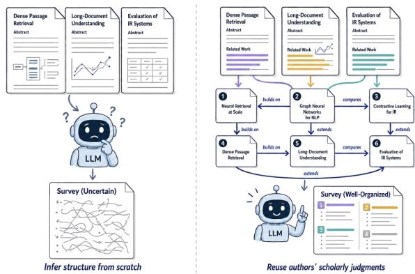
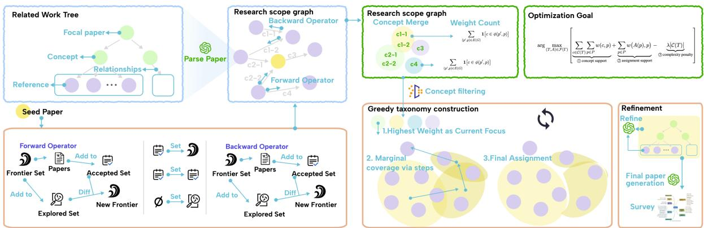
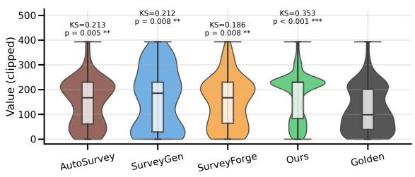
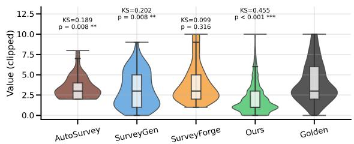
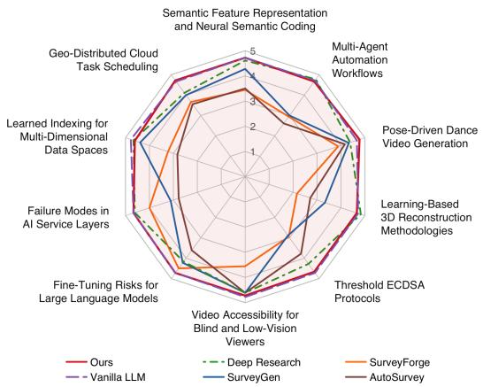

# InsightRAG: Aggregating Distributed Scholarly Judgments for Scientific Survey Generation

Yuquan Lin<sup>1</sup>\*, Wenshuo Zhang<sup>1†</sup>, Yilin Ye<sup>1</sup>, Shuchang Xu<sup>1</sup> Zhao Chen<sup>2</sup>, Weiqi Wang<sup>1</sup>, Huamin Qu<sup>1</sup>

<sup>1</sup>The Hong Kong University of Science and Technology <sup>2</sup>The Hong Kong University of Science and Technology (Guangzhou)

## Abstract

The rapid growth of scientific literature makes survey writing increasingly challenging, motivating automatic survey generation. Yet, existing systems must search an open space of papers and an open space of concepts with no trace of how the community itself has navigated them, leading to incomplete scope, weak taxonomies, and unreliable citations. Our core insight is that author-written Related Work sections contain the human judgments needed to address both limitations: authors curate the citations relevant to their contributions and explain how the cited works relate, yielding paths for scope reconstruction and relational evidence for organization. We propose InsightRAG. Its insight-guided retrieval follows author-supported citation relations to recon struct a verified research scope and structure the resulting relational evidence. It aggregates these judgments under a minimum-conflict objective into a taxonomy that reflects recurring author-written perspectives in the retrieved literature, guides generation, and bounds each section’s evidence. Results on ten topics show gains in scope reconstruction, taxonomy quality, citation support, and reference reliability.

## 1 Introduction

Writing a scientific survey is labor-intensive: authors must find, assess, and organize relevant work into a coherent taxonomy and narrative. As publication rates grow, this cost rises faster than most groups can absorb. This motivated automatic survey generation (ASG), which agentizes this workflow into retrieval, reading, planning, and writing (Wang et al., 2024; Zhou et al., 2025). Subsequent systems refine its components with memory-driven retrieval and outline planning (Yan et al., 2025), structured preprocessing (Liang et al., 2025), and quality-aware feedback (Bao et al., 2025).

  
Figure 1: Motivation of InsightRAG. Author-written Related Work sections record how different authors characterize prior work from their own perspectives; aggregating these local views grounds the survey in recurring perspectives within the explored literature.

What a survey requires, however, is not a ranked list but a research scope: which works are foundational, which extend or challenge them, and which directions belong to the same topic. Reconstructing it confronts a language model with two open-ended search problems: retrieval must find relevant work in an open space of millions of papers (Cohan et al., 2020; Ajith et al., 2024; He et al., 2025), and writing must organize that evidence in an equally open space of concepts, inventing a taxonomy from scratch. Both spaces are too large for a model to navigate reliably—on our ten topics, no existing system recovers more than 11% of a human survey’s reference scope, and every baseline falls below 0.50 correctness. Recent work constrains this search with structure extracted from paper content (Pedinotti and Santus, 2026; Yang et al., 2026) or citation graphs (Zhang et al., 2025b; Hu et al., 2025a), but neither provides the traces the search needs: a paper’s content reflects only its own vantage point, and citation edges record that two papers are linked, not how (Wu et al., 2026). The model is thus left to search these open spaces without any trace of how the community itself has navigated them.

These traces already exist, written by authors themselves. When authors write a Related Work section, they do more than cite: they search the same two open spaces and record how they navigated them, selecting relevant prior work and articulating relations such as similarity, difference, limitation, and progression. Across a field, these local judgments accumulate into a crowdsourced account of its intellectual structure, supplying exactly the traces current pipelines discard: curated citation paths for finding literature, and explicit relational statements for organizing it. This motivates our research question: can author-written Related Work judgments serve as a reliable scaffold for reconstructing a field’s scope, taxonomy, and coherent survey narrative?

We answer this question with InsightRAG, which builds one stage of the workflow on each of these two signals. Insight-guided retrieval follows the citation paths authors have already curated: from a seed paper, it traverses the citation graph forward and backward, admitting a paper only when an author-written passage supports the relation and the paper lies within the user-defined scope. It returns a verified paper set and two records of author judgment: a research-scope graph whose edges carry the relation an author asserted between two papers—improvement, extension, comparison, or critique—and, per paper, a Related Work Tree recording how its authors grouped prior work and placed their own contribution within it. Taxonomy construction then aggregates the relational statements themselves: the concept phrases stated on the graph’s edges are merged into a shared candidate concept space, over which a minimum-conflict objective selects a taxonomy and paper assignment that maximize concept support and assignment support while penalizing taxonomy complexity, subject to structural and semantic constraints. Since exact optimization is NP-hard, InsightRAG approximates it with a coverage-oriented greedy initializer and a global LLM refinement pass, then assigns each paper to one leaf. The taxonomy and its assigned papers then serve as the writing plan: leaf sections synthesize the assigned papers, internal sections explain how their children relate, and each section may cite only its own papers.

Experiments on ten computer-science survey topics, each annotated with a gold reference scope and a gold taxonomy from a human-written survey, evaluate the intermediate artifacts as well as the final text. InsightRAG reconstructs research scope far more completely and accurately than retrieval and survey-generation baselines, builds taxonomies that are better organized and better grounded in author-written evidence, and produces surveys with substantially more faithful citations.

Overall, Our contributions are threefold:

• We identify author-written Related Work judgments as the scholarly-judgment signal missing from autonomous survey generation, and reorganize the end-to-end workflow around it.

• We propose InsightRAG, combining insightguided citation traversal with minimum-conflict aggregation of distributed author judgments to produce a taxonomy that reflects recurring authorwritten perspectives in the retrieved literature, bounds the evidence available to each survey section, and guides generation of the final survey.

• We introduce an evaluation setting over ten survey topics that scores research-scope reconstruction, taxonomy quality, and final survey quality separately at successive pipeline stages.

## 2 Related Work

Citation-aware scholarly retrieval and exploration. SciCite classifies citation intent as background, method, or result comparison (Cohan et al., 2019), while Valenzuela et al. distinguish important from incidental citations (Valenzuela et al., 2015). Scholarly retrieval also uses lexical or embedding similarity (Cohan et al., 2020) and citationgraph propagation (Zhang et al., 2025b; Hu et al., 2025a); these signals alone do not preserve how citing authors describe prior work. Relatedly helps readers explore Related Work paragraphs across papers and form topic outlines (Palani et al., 2023), but leaves the synthesis of these perspectives to readers. InsightRAG uses passages surrounding citations as author-attributed relational evidence to discover and verify a topic-specific literature scope.

Scholarly taxonomy construction. CHIME organizes a given paper set with expert corrections to category relations and paper assignments (Hsu et al., 2024). HiGTL combines paper text and citation-graph structure for hierarchical clustering and concept naming (Hu et al., 2025b), while Zhu et al. use LLM-generated aspect representations and clustering and introduce TaxoBench-CS (Zhu et al., 2025). These methods do not explicitly use citing authors’ descriptions of prior work as evidence for taxonomy construction. InsightRAG extracts concept phrases from author-written Related Work passages surrounding citations and aggregates their support across papers.

Automatic survey generation. Mohammad et al. combined citation texts with multi-document summarization to generate technical surveys (Mohammad et al., 2009). LLM-based systems commonly follow a retrieve–plan–write pipeline (Wang et al., 2024; Zhou et al., 2025), with later work improving retrieval, preprocessing, feedback, collaboration, and evaluation (Wu et al., 2025a; Yan et al., 2025; Liang et al., 2025; Bao et al., 2025; Go et al., 2026; Guo et al., 2026). Some systems also extract relations or taxonomies from paper content (Pedinotti and Santus, 2026; Yang et al., 2026), but these structures need not capture how subsequent authors position earlier work. InsightRAG carries its reconstructed scope and taxonomy into an evidence-bounded writing plan. Appendix H provides a more detailed comparison.

## 3 Methodology

## 3.1 Workflow and Problem Formulation

InsightRAG operationalizes the two signals recorded in author-written Related Work sections: curated citation paths for reconstructing a research scope, and explicit relational statements for organizing it. Rather than use keywords to retrieve references and infer the field’s structure from scratch, InsightRAG recovers and aggregates these distributed human judgments across the retrieved literature.

The input is $Q = ( d , p _ { 0 } )$ : a scope definition d specifying the survey topic, focus, and literature boundary, and a seed paper $p _ { 0 }$ given by the user or retrieved by an LLM. Insight-guided retrieval (§3.2) follows from $p _ { 0 }$ the curated citation paths supported by author-written contexts, returning a topic-specific paper set $P ,$ a research-scope graph G whose edges carry those contexts, and for each $p \in P$ a Related Work (RW) Tree $R _ { p }$ recording how its authors grouped prior work. Taxonomy construction (§3.3) takes $( P , G , \{ R _ { p } \} _ { p \in P } )$ , builds a draft hierarchy from concept phrases and support weights in the author-written citation contexts of G, refines it into a taxonomy T using the scope definition, compact concept and paper profiles, and RW Tree patterns as auxiliary structural evidence, and assigns papers to its leaves through a map A. Together $T$ and A bound the evidence available to every survey section: a leaf is written from its assigned papers alone, while an internal node explains how its children relate. An LLM then generates the final survey. Detailed algorithms, backbone models, principal budgets, and resource-use figures are provided in Appendix $\mathrm { F } ;$ method prompts for all three stages appear in Appendix I.

## 3.2 Insight-Guided Retrieval

This stage must recover a research scope rather than a ranked list: which works are foundational, which extend or challenge them, and which directions belong to the same topic. InsightRAG recovers it from author-written Related Work sections, which already carry local relevance judgments and explicit statements of how a citing paper relates to the work it cites: a citation relation is followed only when such a passage supports it, and the paper it leads to is admitted only after verification against the user-defined research scope.

## 3.2.1 Related Work Tree Extraction

For each accepted paper $p ,$ InsightRAG extracts an RW Tree $R _ { p }$ from the paper’s author-written Related Work discussion and the citations resolved from that text. Its internal nodes are the categories the authors used to organize prior work, so that papers under one internal node form an authordefined conceptual group; its leaves are the cited papers, with their meta information and the role the authors assigned them, such as method or limitation; and its root is the focal paper with its research context. The edges inside the tree $E _ { p }$ encode the authors’ conceptual organization, such as the improvement from a leaf paper to the root, rather than the raw citation links used for traversal. If the Related Work section does not provide a complete hierarchy, InsightRAG retains only the structure supported by the text instead of asking the model to fill in the missing parts.

## 3.2.2 Research-Scope Reconstruction

Reconstruction turns input $Q$ into the paper set P and the research-scope graph G. InsightRAG first converts d into a structured research context holding the scope constraints, the intended perspective, and any temporal requirement, and resolves p<sub>0</sub> against a scholarly index for its meta information and citation relations; retrieval starts only if the seed’s research problem, methodology, and contribution satisfy the scope.

The search then proceeds in rounds. A candidate is accepted only if it falls within the target scope and then stored as RW Tree $R _ { p }$ , then becomes nodes in G, and each directed edge in G stores the supporting passage from the citing paper to the cited paper. To support this iterative process, the algorithm maintains three sets: the accepted set $S _ { a } .$ the frontier set $S _ { f }$ of papers awaiting expansion, and the explored set $S _ { e }$ of papers already expanded. The accepted set and the frontier are initialized with the seed, $S _ { a } = S _ { f } = \{ p _ { 0 } \}$ , while the explored set is initially empty, $S _ { e } = \emptyset$

  
Figure 2: Overview of InsightRAG. Insight-guided retrieval performs scope-verified forward and backward expansion to construct a verified paper set, a relation-bearing research-scope graph, and per-source Related Work trees. Minimum-conflict taxonomy construction produces and refines the taxonomy, assigns papers to leaves, and validates the resulting structure. Evidence-bounded survey generation then converts taxonomy nodes into writing units with local evidence packages and constrained citation identifiers.

Forward operator. Given a paper $p ,$ the forward operator retrieves the papers that cite $p ,$ each paired with the citation sentence or Related Work passage in which the citing paper discusses $p .$ This direction targets later developments, extensions, applications, comparisons, and critiques. When the citing papers are too numerous to process exhaustively, highly cited and recent papers are prioritized to keep the operator technically feasible. A permissive pre-filter removes clearly uninformative candidates, and each remaining candidate must pass an admission test against the target scope. Admitted candidates are deduplicated against the accepted set $S _ { a }$ and, if new, added to it; their supporting passages are incorporated into $G$ as relation evidence.

RW-guided backward operator. Given a paper $p ,$ the backward operator retrieves the references of $p$ by extracting its RW Tree $R _ { p } ~ ( \ S 3 . 2 . 1 )$ and checking whether each leaf of $R _ { p } { \mathrm { . } }$ , paired with the author-written passage that describes it, passes the same admission test. Admitted predecessors are deduplicated against $S _ { a }$ and, if new, added to it; their relation evidence is incorporated into G. Each admitted predecessor is expanded through its own RW Tree, so backward exploration recursively exposes earlier portions of the verified scope.

Round structure and state update. Starting from $S _ { a } = S _ { f } = \{ p _ { 0 } \}$ and $S _ { e } ~ = ~ \emptyset$ , a run executes a bounded number of forward steps followed by a bounded number of backward steps. In each forward step, the forward operator is applied to every paper in the frontier $S _ { f } ;$ the expanded papers are added to the explored set $S _ { e } ,$ , newly admitted papers are added to $S _ { a }$ , and the frontier is updated to $S _ { a } \setminus S _ { e }$ . The forward phase comes first so that major recent research directions are identified before their earlier foundations are traced. Once the forward steps are complete, the frontier is reset to the full accepted set and the explored set is cleared, i.e., $S _ { f } \gets S _ { a }$ and $S _ { e } \gets \emptyset$ , while $S _ { a }$ is kept unchanged. Each backward step then applies the backward operator to every paper in $S _ { f }$ and parses its RW Tree; the expanded papers are added to $S _ { e }$ , newly admitted predecessors are added to $S _ { a } .$ , and the frontier is again updated to $S _ { a } \setminus S _ { e }$ . After the backward steps terminate, a loop-closure step densifies G by recovering missing citation links among accepted papers, merging duplicate nodes, and attaching new author-written evidence to existing relations. This completes the reconstruction run.

Post-termination reseeding and graph merging. After a run terminates, InsightRAG selects new seeds with high in-degree in G, reruns reconstruction independently from each seed, and merges the resulting graphs with deduplication and loop closure. The merged graph and its verified papers define $G$ and $P ,$ respectively, for taxonomy construction. The RW Trees are retained for global refinement, while the author-written citation contexts on the edges of $G$ provide concept phrases and support weights for the draft hierarchy.

## 3.3 Minimum-Conflict Taxonomy Construction and Survey Generation

The retrieval stage produces a verified literature space but not the global organization a survey requires. The author-written citation contexts retained on the edges of $G$ encode local views that may conflict: different citing papers may associate the same paper with different concepts, use different names for similar concepts, or organize the field along different dimensions. Semantic clustering provides no hierarchy and can mix abstraction levels; a one-shot LLM offers little control over evidence support; and directly following a single RW Tree can privilege one author’s local organization over perspectives from other papers.

InsightRAG therefore treats taxonomy construction as aggregation: given $P$ and $G ,$ it seeks an admissible hierarchy that reconciles the authorwritten judgments encoded in $G " s$ citation contexts under the minimum-conflict objective, assigns papers to leaves through $A ,$ and generates the survey from the result. The problem is NP-hard, so InsightRAG follows a greedy-and-refine strategy: a greedy initializer on the combinatorial core, followed by global LLM refinement of category meanings and hierarchical structure.

Candidate concept space. InsightRAG first constructs a shared candidate concept space from the relation statements carried by the edges of $G ,$ so that the greedy initializer begins from relational evidence shared across the retrieved literature. Each directed edge $( p ^ { \prime } , p ) \in E ( G )$ stores the authorwritten passage in which the citing paper $p ^ { \prime }$ states how it categorizes the cited paper $p ;$ let $\phi ( p ^ { \prime } , p )$ denote the set of concept phrases stated on edge $( p ^ { \prime } , p )$ . The candidate concept set $\mathcal { C }$ collects the concept phrases on all edges, $\mathsf { U } _ { ( p ^ { \prime } , p ) \in E ( G ) } \phi ( p ^ { \prime } , p )$ and merges semantically equivalent ones using their textual meaning and supporting edges. Each concept c is assigned a semantic dimension $\delta ( c ) \in$ $\mathcal { D } ,$ where $\mathcal { D }$ is the set of organizational dimensions. The candidate space retains weighted paper assignments, defined below. For a paper p and a concept $c ,$ the assignment weight $w ( c , p )$ counts incoming citation edges whose passages associate p with c:

$$
w ( c , p ) = \sum _ { ( p ^ { \prime } , p ) \in E \left( G \right) } \mathbf { 1 } { \big [ } c \in \phi ( p ^ { \prime } , p ) { \big ] } ,
$$

Conflicts remain explicit: if different edges associate a paper with different concepts, all candidate assignments and their support weights are retained. A zero-weight fallback concept $c _ { \perp }$ remains available for papers with sparse concept evidence.

Optimization objective. A taxonomy is a rooted tree $\boldsymbol { T } ~ = ~ ( \mathcal { C } ( \boldsymbol { T } ) , \boldsymbol { E } ( \boldsymbol { T } ) )$ over selected concepts $\mathcal { C } ( T ) \subseteq \mathcal { C } _ { }$ , with leaf-category set $L ( T ) \subseteq { \mathcal { C } } ( T )$ . A map $A : P \to L ( T )$ assigns every paper to exactly one leaf category. Let Γ denote a configurable set of structural and semantic constraints, and let $\mathcal { F } ( \Gamma )$ be the taxonomy–assignment pairs satisfying them. We solve $( T ^ { * } , A ^ { * } )$ as follows

$$
\arg \operatorname* { m a x } _ { ( T , A ) \in \mathcal { F } ( \Gamma ) } \left[ \underbrace { \sum _ { c \in \mathcal { C } ( T ) } \sum _ { p \in P } w ( c , p ) } _ { \mathrm { ( ) ~ c o n c e p t ~ s u p p o r t } } + \underbrace { \sum _ { p \in P } w \big ( A ( p ) , p \big ) } _ { \mathrm { ( ) ~ a s s i g n m e n t ~ s u p p o r t } } - \underbrace { \lambda \big | \mathcal { C } ( T ) \big | } _ { \mathrm { ( ) ~ c o m p l e x i t y ~ p e n a l t y } } \right]\tag{1}
$$

Term $\textcircled{1}$ favors concepts carrying strong paper support, term ⃝2 rewards agreement with author judgments at the paper-assignment level, and $\textcircled{3}$ controls taxonomy complexity. The constraint set Γ can, for example, limit the maximum depth B and branching factor k. The constrained optimization is NP-hard; Appendix G specifies the full constraint set and gives the NP-hardness proof.

Greedy taxonomy construction. Since exact optimization is NP-hard, InsightRAG constructs a draft solution with a greedy top-down procedure over the shared candidate concept space derived from the citation contexts retained in G.

The root initially contains the full paper set $P ,$ and the procedure applies the same three-step split recursively at each category. Candidate preparation: for the papers currently under a category, it retains the supported categories from the shared candidate space, removes those with insufficient support or that violate the constraints, and selects the organizational dimension with the strongest total support so that the resulting siblings remain coherent. Greedy selection: within that dimension, it selects child categories one at a time by marginal coverage, choosing the candidate that adds the most support beyond the children already selected, and stops when the branching budget is reached. Assignment and recursion: each paper is assigned to the child with the highest normalized support; low-confidence papers are placed in a fallback category or deferred to the final assignment stage. The procedure then recurses on each child until the depth bound is reached, too few papers remain, or no supported split is available, yielding the draft taxonomy $T _ { 0 }$ and assignment $A _ { 0 }$ . Appendix G provides the formal analysis.

Global refinement and generation. Structural refinement: The greedy draft may contain vague, redundant, or unevenly granular categories. An LLM refines $T _ { 0 }$ using the scope definition d, compact profiles of its concepts, profiles of the retrieved papers, and recurring category and parent–child patterns aggregated from the RW Trees as auxiliary structural evidence. The draft remains the evidence-grounded starting point; the refinement resolves semantic and structural issues before final paper assignment and deterministic validation.

Paper assignment refinement: Once the refined taxonomy $T$ is fixed, an LLM updates the draft assignment $A _ { 0 }$ only where hierarchy changes create conflicts, ensuring that every paper belongs to exactly one leaf and yielding the final assignment A. A deterministic validation pass then repairs any remaining missing or duplicate assignments and prunes unsupported empty leaves. Together, hierarchy refinement, assignment refinement, and validation transform the draft $( T _ { 0 } , A _ { 0 } )$ into the final (T, A) used in our experiments.

Finally, InsightRAG uses T and A as the writing plan. Each category becomes a writing unit with a local evidence package and a fixed set of allowed citations. Leaf units synthesize the papers assigned by A, while internal units explain the relations among their child categories. The units are generated independently, assembled in taxonomy order, and completed with survey-level sections. Thus, T determines the survey organization and A bounds the evidence available to each section.

## 4 Experiments

We evaluate InsightRAG from research-scope reconstruction to final survey generation. We ask three research questions: RQ1: Does Related Work-guided retrieval reconstruct a more complete and accurate research scope? RQ2: Does Related Work evidence improve taxonomy construction? RQ3: Does the resulting taxonomy improve the quality and credibility of the final survey? Formal definitions and implementation details for all evaluation metrics are provided in Appendix E.

## 4.1 Research-Scope Reconstruction

Across ten computer-science topics, RQ1 evaluates retrieved paper sets and academic profiles against gold scopes derived from human-survey references and the corresponding topic definitions.

## 4.1.1 Scope Coverage and Correctness

Setting. We compare InsightRAG with BM25 and dense retrieval under online and offline access, and with SurveyGen, SurveyForge, and AutoSurvey. We report #Papers, Coverage, Correctness, and F1; Correctness is determined by an LLM judge given the topic definition and each retrieved paper. More details are provided in Appendix E.1. The initial seeds are listed in Appendix F.2.

<table><tr><td>Setting</td><td>Method</td><td>#Papers</td><td>Coverage</td><td>Correctness</td><td>F1</td></tr><tr><td>Online</td><td>BM25</td><td>1,995</td><td>0.1058</td><td>0.1014</td><td>0.1036</td></tr><tr><td>Online</td><td>Dense Retrieval</td><td>993</td><td>0.1027</td><td>0.1717</td><td>0.1285</td></tr><tr><td>Offline</td><td>BM25</td><td>500</td><td>0.0675</td><td>0.1578</td><td>0.0946</td></tr><tr><td>Offline</td><td>Dense Retrieval</td><td>500</td><td>0.0765</td><td>0.1900</td><td>0.1091</td></tr><tr><td>ASG</td><td>SurveyGen</td><td>246</td><td>0.0951</td><td>0.4911</td><td>0.1593</td></tr><tr><td>ASG</td><td>SurveyForge</td><td>1,063</td><td>0.1050</td><td>0.1401</td><td>0.1200</td></tr><tr><td>ASG</td><td>AutoSurvey</td><td>2,063</td><td>0.0592</td><td>0.0586</td><td>0.0589</td></tr><tr><td>Ours</td><td>InsightRAG</td><td>1,879</td><td>0.4097</td><td>0.9521</td><td>0.5729</td></tr></table>

Table 1: Research-scope reconstruction across retrieval settings and ASG baselines. #Papers totals retrieved papers over ten topics; bold and underlined values mark the best and second-best results.

Results. Table 1 shows that InsightRAG leads in Coverage, Correctness, and F1, expanding the gold scope while maintaining high Correctness over a large retrieved set. This supports author-written Related Work relations as a signal for finding foundational and closely related work. We further tested alternative in-scope seeds on two topics. Correctness remained high, while Coverage and F1 varied with the seed (Appendix B.2).

## 4.1.2 Academic Profile of the Scope

Setting. We compare retrieved papers with the gold scope using two-sample Kolmogorov–Smirnov tests on Venue H-Index and Year Gap; higher H-Index reflects venue impact, while smaller Year Gap indicates newer work.

Results. Figure 3 shows that InsightRAG covers more recent work without shifting the retrieved scope toward lower-impact venues, suggesting that the added papers retain a reasonable academic profile in the pooled ten-topic comparison.

Expert validation. Experts judged 90 of 100 sampled papers uniquely retrieved by InsightRAG but absent from the human-curated scope to be valid related work, supporting the LLM-based Correctness measure (Appendix C.1).

<table><tr><td></td><td colspan="3">Structure</td><td colspan="5">Outline Quality</td><td colspan="2">Taxonomy Alignment</td></tr><tr><td>Method</td><td>HSR↑</td><td>CEDS↑</td><td>Node Ratio→ 1</td><td>TU↑</td><td>SB↑</td><td>HC↑</td><td>LO↑</td><td>Avg.↑</td><td>RWTA↑</td><td>PTA↑</td></tr><tr><td>Vanilla LLM</td><td>0.730126</td><td>0.448902</td><td>1.346384</td><td>3.4350</td><td>3.2550</td><td>3.0500</td><td>3.2150</td><td>3.2388</td><td>0.781515</td><td>0.753478</td></tr><tr><td>SurveyGen</td><td>0.754168</td><td>0.526661</td><td>1.176255</td><td>3.3000</td><td>3.5500</td><td>3.4000</td><td>3.4250</td><td>3.4188</td><td>0.743593</td><td>0.446429</td></tr><tr><td>SurveyForge</td><td>0.712712</td><td>0.478629</td><td>1.309190</td><td>2.7750</td><td>2.6250</td><td>2.4750</td><td>2.5250</td><td>2.6000</td><td>0.705402</td><td>0.129679</td></tr><tr><td>AutoSurvey</td><td>0.738040</td><td>0.374903</td><td>2.290563</td><td>2.6850</td><td>2.5200</td><td>2.4050</td><td>2.3750</td><td>2.4962</td><td>0.731652</td><td>0.160142</td></tr><tr><td>Deep Research</td><td>0.688150</td><td>0.382977</td><td>0.348203</td><td>3.5000</td><td>2.8750</td><td>3.3750</td><td>3.1250</td><td>3.2188</td><td>0.751199</td><td>0.403720</td></tr><tr><td>InsightRAG</td><td>0.742160</td><td>0.408899</td><td>2.289222</td><td>3.4750</td><td>3.7500</td><td>3.5000</td><td>3.6750</td><td>3.6000</td><td>0.797152</td><td>0.747758</td></tr></table>

Table 2: Taxonomy evaluation. TU, SB, HC, and LO denote Topic Uniqueness, Structural Balance, Hierarchical Clarity, and Logical Organization. RWTA denotes RW–Taxonomy Alignment, and PTA denotes Paper–Taxonomy Assignment Accuracy. Bold values indicate the best result, and underlined values indicate the second-best result.

  
(a) Venue H-Index

  
(b) Year Gap  
Figure 3: Research-scope profile distributions for papers retrieved by each method and papers in the golden scope: (a) Venue H-Index and (b) Year Gap. Each violin aggregates papers across all topics; the inner box indicates the median and interquartile range.

## 4.2 Taxonomy Construction

RQ2 evaluates whether Related Work evidence produces a taxonomy that is complete, coherent, and grounded in the retrieved papers.

Setting. Using the same ten topics, we take each human-written survey’s section hierarchy as the reference taxonomy and compare six methods. We evaluate similarity to this taxonomy in structure and granularity, outline quality, alignment with author-written Related Work evidence, and paperassignment accuracy. Metric definitions and score aggregation are provided in Appendix E.2.

Results. Table 2 shows that SurveyGen most closely matches the human-survey structure and granularity. InsightRAG achieves the highest overall outline-quality score, leading in Structural Balance, Hierarchical Clarity, and Logical Organization; Deep Research leads slightly in Topic Uniqueness. InsightRAG also has the strongest RWTA and remains competitive in paper-assignment accuracy. Further taxonomy diagnostics appear in Appendix D.1. A method-blinded expert comparison on two topics favors InsightRAG’s taxonomy in 5/6 judgments (83.3%); the protocol and interview findings appear in Appendix C.2.

  
Figure 4: Survey quality by topic. Axes average Coverage, Relevance, and Structure across three LLM judges.

## 4.3 Taxonomy-Guided Survey Generation

RQ3 evaluates the content, correspondence, and credibility of the final survey. All methods generate a survey for each of the same ten topics.

## 4.3.1 LLM-Judged Survey Quality

Setting. GPT-5.2, Gemini 3.1 Pro, and DeepSeek V4 Pro score each method’s surveys for Coverage, Relevance, and Structure on a five-point scale. Averaging the three dimensions yields 30 topic–judge scores per method; aggregation and full results appear in Appendices E.3 and D.2.

Results. Figure 4 shows that InsightRAG maintains high survey-quality scores across topics, outperforming SurveyGen, SurveyForge, AutoSurvey, and Deep Research on average while remaining comparable to Vanilla LLM (Appendix D.2). In the same expert study, InsightRAG’s survey was preferred in all 6/6 comparisons; semi-structured interviews further examined the reasons for these preferences and remaining weaknesses (Appendix C.2).

<table><tr><td rowspan="2">Method</td><td colspan="2">Content Correspondence</td><td colspan="2">Citation Support</td><td colspan="2">Reference Reliability</td></tr><tr><td>SS↑</td><td>KPR↑</td><td>Cit. Recall↑</td><td>Cit. Precision↑</td><td>#References</td><td>VRR↑</td></tr><tr><td>Vanilla LLM</td><td>0.705198</td><td>53</td><td>0.441418</td><td>0.406859</td><td>254</td><td>0.550306</td></tr><tr><td>SurveyGen</td><td>0.675570</td><td>52</td><td>0.475770</td><td>0.355161</td><td>249</td><td>0.972690</td></tr><tr><td>SurveyForge</td><td>0.626670</td><td>55</td><td>0.178637</td><td>0.122507</td><td>1,063</td><td>0.979134</td></tr><tr><td>AutoŠurvey</td><td>0.619481</td><td>63</td><td>0.275886</td><td>0.255565</td><td>2,102</td><td>0.950845</td></tr><tr><td>Deep Research</td><td>0.704412</td><td>54</td><td>0.301514</td><td>0.264325</td><td>134</td><td>0.898381</td></tr><tr><td>InsightRAG</td><td>0.670218</td><td>60</td><td>0.856393</td><td>0.629516</td><td>1,717</td><td>0.995528</td></tr></table>

Table 3: Content and citation evaluation of generated surveys. SS, KPR, and VRR denote Semantic Similarity, Key-Point Recall, and Verifiable Reference Rate. Bold marks the best result; underlining marks the second-best.
<table><tr><td></td><td colspan="3">Structure</td><td colspan="5">Outline Quality</td><td colspan="2">Taxonomy Alignment</td></tr><tr><td>Variant</td><td>HSR↑</td><td>CEDS↑</td><td>Node Ratio→ 1</td><td>TU↑</td><td>SB↑</td><td>HC↑</td><td>LO↑</td><td>Avg.↑</td><td>RWTA↑</td><td>PTA↑</td></tr><tr><td>w/o taxonomy refinement</td><td>0.750085</td><td>0.299391</td><td>3.081808</td><td>0.6200</td><td>0.5650</td><td>0.3500</td><td>0.3900</td><td>0.4813</td><td>0.733383</td><td>0.257588</td></tr><tr><td>InsightRAG (full)</td><td>0.742160</td><td>0.408899</td><td>2.289222</td><td>3.4750</td><td>3.7500</td><td>3.5000</td><td>3.6750</td><td>3.6000</td><td>0.797152</td><td>0.747758</td></tr></table>

Table 4: Ablation of taxonomy refinement in InsightRAG. The full pipeline is compared with a version without refinement. Metrics follow Table 2. Bold marks the best result; Node Ratio favors values closer to 1.

## 4.3.2 Content Correspondence and Citation Support of Generated Surveys

Setting. SS compares generated and human-survey passages; KPR measures coverage of the human survey’s key points. Citation Recall counts claims supported by their full citation group, whereas Citation Precision counts citation instances that independently or necessarily support their claims. We also report reference count and VRR, the fraction resolved to real papers (Appendix E.3).

Results. Table 3 shows that InsightRAG ranks second in KPR and leads in Citation Recall, Citation Precision, and VRR. Vanilla LLM achieves higher SS, but substantially lower citation-support and reference-reliability scores.

## 4.3.3 Passage-Based Citation Faithfulness

Setting. On Multi-Agent Workflow Automation and Video Accessibility, we sample seven claim– citation pairs per survey for the six methods in Table 3 (84 total). An automatic judge reads cited full texts and identifies passages supporting each claim. Unverifiable references count as Unsupported; Supported includes full or partial support. We manually audit two pairs per survey (24 total).

Results. InsightRAG has the highest automatic Supported rate (13/14, 92.9%) and ties Vanilla LLM in the human audit (4/4). Automatic and human judgments agree on 20/24 pairs (83.3%, $\kappa = 0 . 6 5 5 )$ ; the automatic judge is more lenient in all four disagreements. Complete automatic and human results appear in Appendix D.3.

## 4.4 Ablation Study

Setting. We independently ablate three scopereconstruction components and taxonomy refinement, holding other settings fixed; full scope ablation results appear in Appendix B.1.

Scope reconstruction. Forward expansion contributes most, followed by backward expansion; loop closure and densification add smaller but consistent gains in Coverage and F1.

Taxonomy construction. Table 4 shows that refinement improves OutlineAvg (0.4813 to 3.6000) and PTA (0.2576 to 0.7478), despite slightly lower HSR. Heading correspondence alone does not ensure coherent organization or accurate assignment of retrieved papers to taxonomy leaves.

## 5 Conclusion

We built InsightRAG on a signal automatic survey generation had left unused: the judgments human authors record in Related Work sections about which prior work matters and how it relates. Insight-guided retrieval follows only the relations an author’s own words support, and minimumconflict aggregation organizes the resulting citationcontext evidence into a taxonomy that bounds each section’s evidence, improving scope reconstruction, taxonomy quality, citation support, and reference reliability across ten topics. More broadly, this work provides a concrete case for reconsidering what human insight is already embedded in existing artifacts and how it can be leveraged to support literature discovery, organization, and synthesis.

## Limitations

Dependence on language models. InsightRAG relies on LLMs for RW Tree extraction, scope verification, taxonomy refinement, and section writing, while part of the evaluation uses LLM judges. Errors may propagate through the pipeline, so the generated survey and intermediate artifacts still require human verification.

Scope of author perspectives. InsightRAG draws on author-written Related Work sections to organize and synthesize the retrieved literature. Shared omissions or biases in these sections may carry over into the resulting taxonomy and survey. Because retrieval is limited to the literature reached through citation traversal, some parts of the field may remain underrepresented.

Coverage of recent work. Citation traversal can miss recent papers that are not yet indexed or connected to the explored graph; when forward candidate pools exceed the processing budget, prioritizing by citation impact and recency may also miss valuable low-citation work.

Risks of over-reliance. Junior researchers may over-rely on automatically generated surveys instead of developing the skills to search, assess, and synthesize the literature independently. This may limit their ability to form their own judgments about a field’s scope and structure. We therefore recommend human–AI co-creation: the generated scope, taxonomy, and text should serve as starting points that researchers inspect, revise, and validate.

API cost. The cold-start stage requires many LLM calls to extract RW Trees and graph relations and to judge whether papers fall within the target scope. Once processed, the extracted structures and relation evidence can be stored and reused, while relevance decisions can be reused for the same scope. Subsequent runs therefore avoid most repeated extraction and verification costs.

## Ethics Statement

AI assistants were used in preparing this work, in two limited roles. For the paper itself, their use was restricted to language polishing and writing assistance; AI assistants were also used to write part of the implementation code, which the authors reviewed, tested, and take full responsibility for.

## References

Anirudh Ajith, Mengzhou Xia, Alexis Chevalier, Tanya Goyal, Danqi Chen, and Tianyu Gao. 2024. Lit-Search: A retrieval benchmark for scientific literature search. In Proceedings of the 2024 Conference on Empirical Methods in Natural Language Processing, pages 15068–15083, Miami, Florida, USA. Association for Computational Linguistics.

Abdullah Al-Mamun, Hao Wu, Qiyang He, Jianguo Wang, and Walid G. Aref. 2025. A survey of learned indexes for the multi-dimensional space. ACM Comput. Surv., 58(4).

Tong Bao, Mir Tafseer Nayeem, Davood Rafiei, and Chengzhi Zhang. 2025. SurveyGen: Quality-aware scientific survey generation with large language models. In Proceedings of the 2025 Conference on Empirical Methods in Natural Language Processing, pages 2712–2736, Suzhou, China. Association for Computational Linguistics.

Alexandre Boulch and Renaud Marlet. 2022. Poco: Point convolution for surface reconstruction. Preprint, arXiv:2201.01831.

Caroline Chan, Shiry Ginosar, Tinghui Zhou, and Alexei A. Efros. 2019. Everybody dance now. Preprint, arXiv:1808.07371.

China Computer Federation. 2023. CCF Recommended International Academic Conferences and Journals: 2022 Edition. https: //www.ccf.org.cn/Academic\_Evaluation/By\_ category/2023-03-08/787209.shtml. Accessed: 2026-01-19.

Andreas Christodoulides, Gary K. L. Tam, James Clarke, Richard Smith, Jon Horgan, Nicholas Micallef, Jeremy Morley, Nelly Villamizar, and Sean Walton. 2025. Survey on 3d reconstruction techniques: Large-scale urban city reconstruction and requirements. IEEE Transactions on Visualization and Computer Graphics, 31(10):9343–9367.

Arman Cohan, Waleed Ammar, Madeleine van Zuylen, and Field Cady. 2019. Structural scaffolds for citation intent classification in scientific publications. In Proceedings of the 2019 Conference of the North American Chapter of the Association for Computational Linguistics: Human Language Technologies, Volume 1 (Long and Short Papers), pages 3586–3596, Minneapolis, Minnesota. Association for Computational Linguistics.

Arman Cohan, Sergey Feldman, Iz Beltagy, Doug Downey, and Daniel Weld. 2020. SPECTER: Document-level representation learning using citation-informed transformers. In Proceedings of the 58th Annual Meeting of the Association for Computational Linguistics, pages 2270–2282, Online. Association for Computational Linguistics.

Hongcheng Gao, Yue Liu, Yufei He, Longxu Dou, Chao Du, Zhijie Deng, Bryan Hooi, Min Lin, and Tianyu

Pang. 2025. Flowreasoner: Reinforcing query-level meta-agents. Preprint, arXiv:2504.15257.

Michael R. Garey and David S. Johnson. 1979. Computers and Intractability: A Guide to the Theory of NP-Completeness. W. H. Freeman, San Francisco.

Rosario Gennaro and Steven Goldfeder. 2018. Fast multiparty threshold ecdsa with fast trustless setup. In Proceedings ofthe 2018 ACM SIGSAC Conference on Computer and Communications Security, CCS ’18, page 1179–1194, New York, NY, USA. Association for Computing Machinery.

Gregory Hok Tjoan Go, Khang Ly, Anders Søgaard, Seyed Amin Tabatabaei, Maarten de Rijke, and Xinyi Chen. 2026. LiRA: A multi-agent framework for reliable and readable literature review generation. Proceedings of the AAAI Conference on Artificial Intelligence, 40(47):40456–40464.

Kai Greshake, Sahar Abdelnabi, Shailesh Mishra, Christoph Endres, Thorsten Holz, and Mario Fritz. 2023. Not what you’ve signed up for: Compromising real-world llm-integrated applications with indirect prompt injection. Preprint, arXiv:2302.12173.

Beichen Guo, Zhiyuan Wen, Jia Gu, Haochen Shi, Jian Wang, Senzhang Wang, Haoyang Li, Ruosong Yang, and Shuaiqi Liu. 2026. Surveylens: A disciplineaware benchmark for automatic survey generation. Preprint, arXiv:2602.11238.

Tengda Han, Max Bain, Arsha Nagrani, Gül Varol, Weidi Xie, and Andrew Zisserman. 2023. Autoad: Movie description in context. Preprint, arXiv:2303.16899.

Yichen He, Guanhua Huang, Peiyuan Feng, Yuan Lin, Yuchen Zhang, Hang Li, and Weinan E. 2025. PaSa: An LLM agent for comprehensive academic paper search. In Proceedings ofthe 63rd Annual Meeting of the Association for Computational Linguistics (Volume 1: Long Papers), pages 11663–11679, Vienna, Austria. Association for Computational Linguistics.

Chao-Chun Hsu, Erin Bransom, Jenna Sparks, Bailey Kuehl, Chenhao Tan, David Wadden, Lucy Wang, and Aakanksha Naik. 2024. CHIME: LLM-assisted hierarchical organization of scientific studies for literature review support. In Findings ofthe Association for Computational Linguistics: ACL 2024, pages 118–132, Bangkok, Thailand. Association for Computational Linguistics.

Yuntong Hu, Zhihan Lei, Zhongjie Dai, Allen Zhang, Abhinav Angirekula, Zheng Zhang, and Liang Zhao. 2025a. Cg-rag: Research question answering by citation graph retrieval-augmented llms. In Proceedings ofthe 48th International ACM SIGIR Conference on Research and Development in Information Retrieval, SIGIR ’25, pages 678–687, New York, NY, USA. Association for Computing Machinery.

Yuntong Hu, Zhuofeng Li, Zheng Zhang, Chen Ling, Raasikh Kanjiani, Boxin Zhao, and Liang Zhao.

2025b. Taxonomy tree generation from citation graph. Preprint, arXiv:2410.03761.

Danlan Huang, Xiaoming Tao, Feifei Gao, and Jianhua Lu. 2021. Deep learning-based image semantic coding for semantic communications. In 2021 IEEE Global Communications Conference (GLOBECOM), pages 1–6.

Xiaoping Li, Wei Yu, Rubén Ruiz, and Jie Zhu. 2022. Energy-aware cloud workflow applications scheduling with geo-distributed data. IEEE Transactions on Services Computing, 15(2):891–903.

Xun Liang, Jiawei Yang, Yezhaohui Wang, Chen Tang, Zifan Zheng, Shichao Song, Zehao Lin, Yebin Yang, Simin Niu, Hanyu Wang, Bo Tang, Feiyu Xiong, Keming Mao, and Zhiyu li. 2025. Surveyx: Academic survey automation via large language models. Preprint, arXiv:2502.14776.

Saif Mohammad, Bonnie Dorr, Melissa Egan, Ahmed Hassan, Pradeep Muthukrishan, Vahed Qazvinian, Dragomir Radev, and David Zajic. 2009. Using citations to generate surveys of scientific paradigms. In Proceedings of Human Language Technologies: The 2009 Annual Conference of the North American Chapter of the Association for Computational Linguistics, pages 584–592, Boulder, Colorado. Association for Computational Linguistics.

Vikram Nathan, Jialin Ding, Mohammad Alizadeh, and Tim Kraska. 2020. Learning multi-dimensional indexes. In Proceedings of the 2020 ACM SIGMOD International Conference on Management of Data, SIGMOD/PODS ’20, page 985–1000. ACM.

Srishti Palani, Aakanksha Naik, Doug Downey, Amy X. Zhang, Jonathan Bragg, and Joseph Chee Chang. 2023. Relatedly: Scaffolding literature reviews with existing related work sections. In Proceedings of the 2023 CHI Conference on Human Factors in Computing Systems, CHI ’23, page 1–20. ACM.

Paolo Pedinotti and Enrico Santus. 2026. StructSurvey: Structured agentic retrieval for automated survey paper generation. In Proceedings of the First Workshop on Structured Understanding, Retrieval, and Generation in the LLM Era (SURGeLLM 2026), pages 162–181, San Diego, California, United States. Association for Computational Linguistics.

Kiarash Sedghighadikolaei and Attila Altay Yavuz. 2025. A survey of threshold signatures: Nist standards, post-quantum cryptography, exotic techniques, and real-world applications. ACM Comput. Surv., 58(6).

Chenyang Shao, Fengli Xu, and Yong Li. 2026. Scinet: Evaluating ai agents in relation-aware scientific literature retrieval. Preprint, arXiv:2601.03260.

Marco Valenzuela, Vu A. Ha, and Oren Etzioni. 2015. Identifying meaningful citations. In AAAI Workshop: Scholarly Big Data.

Tess Van Daele, Akhil Iyer, Yuning Zhang, Jalyn C Derry, Mina Huh, and Amy Pavel. 2024. Making short-form videos accessible with hierarchical video summaries. In Proceedings of the CHI Conference on Human Factors in Computing Systems, CHI ’24, page 1–17. ACM.

Alexander Wan, Eric Wallace, Sheng Shen, and Dan Klein. 2023. Poisoning language models during instruction tuning. Preprint, arXiv:2305.00944.

Shang Wang, Tianqing Zhu, Bo Liu, Ming Ding, Dayong Ye, Wanlei Zhou, and Philip Yu. 2025a. Unique security and privacy threats of large language models: A comprehensive survey. ACM Comput. Surv., 58(4).

Yidong Wang, Qi Guo, Wenjin Yao, Hongbo Zhang, Xin Zhang, Zhen Wu, Meishan Zhang, Xinyu Dai, Min Zhang, Qingsong Wen, Wei Ye, Shikun Zhang, and Yue Zhang. 2024. Autosurvey: Large language models can automatically write surveys. In Advances in Neural Information Processing Systems, volume 37, pages 115119–115145. Curran Associates, Inc.

Yingxu Wang, Siwei Liu, Jinyuan Fang, and Zaiqiao Meng. 2025b. Evoagentx: An automated framework for evolving agentic workflows. Preprint, arXiv:2507.03616.

Shirley Wu, Shiyu Zhao, Michihiro Yasunaga, Kexin Huang, Kaidi Cao, Qian Huang, Vassilis N. Ioannidis, Karthik Subbian, James Zou, and Jure Leskovec. 2024. Stark: Benchmarking llm retrieval on textual and relational knowledge bases. In Advances in Neural Information Processing Systems, volume 37, pages 127129–127153. Curran Associates, Inc.

Siyi Wu, Chiaxin Liang, Ziqian Bi, Leyi Zhao, Tianyang Wang, Junhao Song, Yichao Zhang, Keyu Chen, Benji Peng, and Xinyuan Song. 2025a. Autosurvey2: Empowering researchers with next level automated literature surveys. Preprint, arXiv:2510.26012.

Yujian Wu, Shanjiang Tang, Ce Yu, Bin Yang, Chao Sun, Jian Xiao, Hutong Wu, and Jinghua Feng. 2025b. Task scheduling in geo-distributed computing: A survey. IEEE Transactions on Parallel and Distributed Systems, 36(10):2073–2088.

Yujun Wu, Dongxu Zhang, Xinchen Li, Jinhang Xu, Yiling Duan, Yumou Liu, Jiabao Pan, Qiyuan Zhu, Xuanhe Zhou, Jingxuan Wei, Siyuan Li, Jintao Chen, Conghui He, and Cheng Tan. 2026. Intern-atlas: A methodological evolution graph as research infrastructure for ai scientists. Preprint, arXiv:2604.28158.

Shuchang Xu. 2025. AI-powered interactive systems that improve video accessibility for blind and low vision viewers. PhD Qualifying Examination report, Department of Computer Science and Engineering, The Hong Kong University of Science and Technology. Qualifying examination held on November 26, 2025.

Shuchang Xu, Xiaofu Jin, Wenshuo Zhang, Huamin Qu, and Yukang Yan. 2025. Branch explorer: Leveraging

branching narratives to support interactive 360° video viewing for blind and low vision users. In Proceedings of the 38th Annual ACM Symposium on User Interface Software and Technology, UIST ’25, page 1–18. ACM.

Haiwei Xue, Xiangyang Luo, Zhanghao Hu, Xin Zhang, Xunzhi Xiang, Yuqin Dai, Jianzhuang Liu, Zhensong Zhang, Minglei Li, Jian Yang, Fei Ma, Zhiyong Wu, Changpeng Yang, Zonghong Dai, and Fei Richard Yu. 2025. Human motion video generation: A survey. IEEE Transactions on Pattern Analysis and Machine Intelligence, 47(11):10709–10730.

Xiangchao Yan, Shiyang Feng, Jiakang Yuan, Renqiu Xia, Bin Wang, Lei Bai, and Bo Zhang. 2025. SUR-VEYFORGE : On the outline heuristics, memorydriven generation, and multi-dimensional evaluation for automated survey writing. In Proceedings ofthe 63rd Annual Meeting ofthe Associationfor Computational Linguistics (Volume 1: Long Papers), pages 12444–12465, Vienna, Austria. Association for Computational Linguistics.

Ziyue Yang, Da Ma, Hanqi Li, Zijian Wang, Tiancheng Huang, Zijian Hu, Chenrun Wang, Yunzhe Zhang, Xiaobao Wu, Kai Yu, and Lu Chen. 2026. Deepsurvey: Enhancing analytical depth and citation reliability in automated survey generation. Preprint, arXiv:2605.29522.

Guangba Yu, Gou Tan, Haojia Huang, Zhenyu Zhang, Pengfei Chen, Roberto Natella, Zibin Zheng, and Michael R. Lyu. 2025. A survey on failure analysis and fault injection in ai systems. ACM Trans. Softw. Eng. Methodol., 35(1).

Guibin Zhang, Luyang Niu, Junfeng Fang, Kun Wang, Lei Bai, and Xiang Wang. 2025a. Multi-agent architecture search via agentic supernet. Preprint, arXiv:2502.04180.

Jiasheng Zhang, Ali Maatouk, Jialin Chen, Ngoc Bui, Qianqian Xie, Leandros Tassiulas, Hua Xu, Jie Shao, and Rex Ying. 2025b. Litfm: A retrieval augmented structure-aware foundation model for citation graphs. In Proceedings of the 31st ACM SIGKDD Conference on Knowledge Discovery and Data Mining V.2, KDD ’25, pages 3728–3739, New York, NY, USA. Association for Computing Machinery.

Ping Zhang, Wenjun Xu, Yiming Liu, Xiaoqi Qin, Kai Niu, Shuguang Cui, Guangming Shi, Zhijin Qin, Xiaodong Xu, Fengyu Wang, Yue Meng, Chen Dong, Jincheng Dai, Qianqian Yang, Yaping Sun, Dahua Gao, Hui Gao, Shujun Han, and Xiaodan Song. 2025c. Intellicise wireless networks from semantic communications: A survey, research issues, and challenges. IEEE Communications Surveys & Tutorials, 27(3):2051–2084.

Wenshuo Zhang. 2025. A survey on multi-agent workflow automation: Methods, taxonomies, and future directions. PhD Qualifying Examination report, Department of Computer Science and Engineering, The

Hong Kong University of Science and Technology.   
Qualifying examination held on December 19, 2025.

Zihan Zhou, Chong Li, Xinyi Chen, Shuo Wang, Yu Chao, Zhili Li, Haoyu Wang, Qi Shi, Zhixing Tan, Xu Han, Xiaodong Shi, Zhiyuan Liu, and Maosong Sun. 2025. LLM×MapReduce: Simplified longsequence processing using large language models. In Proceedings of the 63rd Annual Meeting of the Associationfor Computational Linguistics (Volume 1: Long Papers), pages 27664–27678, Vienna, Austria. Association for Computational Linguistics.

Kun Zhu, Lizi Liao, Yuxuan Gu, Lei Huang, Xiaocheng Feng, and Bing Qin. 2025. Context-aware hierarchical taxonomy generation for scientific papers via LLM-guided multi-aspect clustering. In Proceedings of the 2025 Conference on Empirical Methods in Natural Language Processing, pages 15616–15634, Suzhou, China. Association for Computational Linguistics.

## A Evaluation Dataset and Baseline Configurations

We constructed ten evaluation instances covering the ten research areas used in the China Computer Federation (CCF) venue classification (China Computer Federation, 2023) (Table 5). For each research area, we selected a human-written source survey and used either the complete survey or a focused section with sufficient coverage of the target topic.

For instances based on a survey section, the LLM (GPT-5.5) received both the source-survey title and the selected section title; for instances based on the complete survey, it received only the survey title. Based on the given titles, the LLM generated (1) an evaluation topic title and (2) a focused scope definition describing the research problem, included directions, and exclusion boundaries. We manually reviewed the generated topic titles and scope definitions for consistency with the selected survey content. The resulting scope definitions were used consistently for paper selection, citation filtering, and scope verification throughout the experiments.

We extracted the scientific papers cited in each selected survey unit, where the unit was either the complete survey or a selected section. We then resolved their bibliographic records, removed duplicate versions and non-paper references, and retained only papers that matched the generated scope definition, yielding 304 in-scope candidate papers.

For each retained candidate paper, we identified its author-written Related Work discussion, resolved in-text citation markers against its bibliography, and filtered the resolved cited papers using the same topic-specific scope definition. The remaining citation contexts and cited papers were organized into a hierarchical RW Tree following the definition in Section 3.2.1.

After topic-scope filtering and extraction validation, the final dataset contains 248 valid RW Trees. The resulting trees contain 3,937 citation-bearing leaf occurrences. Because the same cited paper may occur in multiple RW Trees, these occurrences correspond to 2,611 unique cited papers.

## A.1 Baseline Configurations

Setting. We distinguish controlled retrieval baselines from automatic survey-generation (ASG) systems run in their native settings. BM25 and Dense use the same candidate source within each Offline or Online setting and follow the same RQ1 evaluation protocol; their retrieval cutoffs are reported in Table 6.

Comparison scope. BM25 and Dense provide controlled retrieval comparisons. SurveyGen, SurveyForge, and AutoSurvey are compared using their native system outputs, not as budget-matched component baselines.

## B Additional Retrieval Analyses

## B.1 Scope-Reconstruction Ablation

Table 7 reports the complete scope-reconstruction ablation results. Each variant removes one component while retaining the rest of the retrieval pipeline.

## B.2 Seed Sensitivity

Setting. For each of two topics, we asked an LLM to suggest two alternative in-scope seed papers based on the topic. We reran retrieval from the original and alternative seeds, keeping the topic definition, gold scope, and Q1 evaluation protocol fixed. Table 8 reports the results for each seed.

Results. Correctness remains high across all six runs (0.8361–0.9783), but Coverage and F1 depend on the seed. For Multi-Agent Workflow Automation, FlowReasoner increases both Coverage (0.6400 to 0.7200) and Correctness (0.8841 to 0.9238) relative to the original seed, while EvoAgentX attains the highest Coverage (0.8400) at lower Correctness (0.8361). For Video Accessibility, Coverage and F1 do not increase monotonically with the number of retrieved papers. These results suggest that different seeds expose different reachable portions of the citation graph, rather than merely changing retrieval volume.

<table><tr><td>ID</td><td>CCF Research Area</td><td>Evaluation Topic and Source Survey</td><td>RW Trees</td></tr><tr><td>0</td><td>Interdisciplinary, Comprehensive, and Emerging Ar- Multi-Agent Workflow Automation (Zhang, 2025) eas</td><td></td><td>25</td></tr><tr><td>1</td><td>Human-Computer Interaction and Ubiquitous Com- AI-Powered Video Accessibility for Blind and Low puting</td><td>Vision Viewers (Xu, 2025)</td><td>26</td></tr><tr><td>2</td><td>Artificial Intelligence</td><td>Pose-Driven Dance Video Generation (Xue et al., 2025)</td><td>22</td></tr><tr><td>3</td><td>Computer Graphics and Multimedia</td><td>Learning-Based 3D Reconstruction Methodolo- gies (Christodoulides et al., 2025)</td><td>28</td></tr><tr><td>4</td><td>Theoretical Computer Science</td><td>Threshold ECDSA Protocols (Sedghighadikolaei and Yavuz, 2025)</td><td>20</td></tr><tr><td>5</td><td>Network and Information Security</td><td>Risks and Countermeasures of Fine-Tuning Large Lan- guage Models (Wang et al., 2025a)</td><td>22</td></tr><tr><td>6</td><td>Software Engineering, System Software, and Program- Failure Modes in AI Service Layers (Yu et al., 2025) ming Languages</td><td></td><td>20</td></tr><tr><td>7</td><td>Databases, Data Mining, and Content Retrieval</td><td>Learned Indexing for Multi-Dimensional Data Spaces (Al-Mamun et al., 2025)</td><td>22</td></tr><tr><td>8</td><td>Computer Networks</td><td>Semantic Feature Representation and Neural Semantic Coding (Zhang et al., 2025c)</td><td>25</td></tr><tr><td>9</td><td>puting, and Storage Systems</td><td>Computer Architecture, Parallel and Distributed Com- Geo-Distributed Cloud Task Scheduling for Higher Compute Utilization (Wu et al., 2025b)</td><td>38</td></tr><tr><td></td><td></td><td>Total</td><td>248</td></tr></table>

Table 5: Evaluation topics, their source surveys, and the realized numbers of Related Work (RW) Trees.
<table><tr><td>Method</td><td>Candidate source</td><td>Retrieval setting</td><td>#Papers</td></tr><tr><td>BM25-Offline</td><td>Frozen corpus (1,064 papers)</td><td>Top-50/topic</td><td>500</td></tr><tr><td>Dense-Offline</td><td>Same frozen corpus</td><td>Top-50/topic</td><td>500</td></tr><tr><td>BM25-Online</td><td>Semantic Scholar candidate pools</td><td>Top-200/topic</td><td>1,995</td></tr><tr><td>Dense-Online</td><td>Semantic Scholar candidate pools</td><td>Top-100/topic</td><td>993</td></tr><tr><td>SurveyGen</td><td>Native references</td><td>Native</td><td>246</td></tr><tr><td>SurveyForge</td><td>Native references</td><td>Native</td><td>1,063</td></tr><tr><td>AutoSurvey</td><td>Native references</td><td>Native</td><td>2,063</td></tr><tr><td>InsightRAG</td><td>Citation traversal</td><td>Paper budget 400</td><td>1,879</td></tr></table>

Table 6: Retrieval configurations for the RQ1 comparison. #Papers totals retrieved papers across the ten topics. BM25 and Dense share a candidate source within each Offline or Online setting, but use different Top-k cutoffs Online. Dense retrieval uses BAAI/bge-base-en-v1.5 for ranking.

<table><tr><td>Variant</td><td>Coverage↑</td><td>Correctness↑</td><td>F1↑</td></tr><tr><td>w/o Forward Expansion</td><td>0.0871</td><td>0.9507</td><td>0.1595</td></tr><tr><td>w/o Backward Expansion</td><td>0.2210</td><td>0.9755</td><td>0.3603</td></tr><tr><td>w/o Loop Closure &amp; Densification</td><td>0.3927</td><td>0.9577</td><td>0.5570</td></tr><tr><td>InsightRAG (Full)</td><td>0.4097</td><td>0.9521</td><td>0.5729</td></tr></table>

Table 7: Ablation of scope-reconstruction components in InsightRAG. Bold indicates the best result in each column.

## C Human Evaluation

## C.1 Expert Audit of Retrieved Papers

This experiment validates whether the LLM-based Correctness measure used in RQ1 remains reliable under expert judgment.

Setting. The automatic measure could be overestimated if the LLM judge labels irrelevant papers as relevant. We therefore analyze the most uncertain portion of the reconstructed scope: papers retrieved by InsightRAG but absent from the human-curated scope. We sample ten papers for each of the ten topics, giving 100 papers in total. Two PhD researchers independently judge every paper against the corresponding topic definition. We report human-validated precision, false-discovery rate, a confidence interval, and extrapolated scope metrics in Table 9.

Results. Most candidate false positives are judged relevant by the PhD evaluators. This supports the reliability of the LLM-based Correctness measure and explains part of the apparent mismatch with the gold scope: some papers counted as extra are valid related work omitted from the human survey.

<table><tr><td>Role</td><td>Seed paper</td><td>#Papers</td><td>Coverage</td><td>Correctness</td><td>F1</td></tr><tr><td colspan="2">Multi-Agent Workflow Automation (Zhang, 2025)</td><td>69</td><td>0.6400</td><td>0.8841</td><td>0.7425</td></tr><tr><td>Original</td><td>Multi-agent Architecture Search via Agentic Supernet (Zhang et al., 2025a)</td><td></td><td></td><td></td><td></td></tr><tr><td></td><td>Alternative FlowReasoner: Reinforcing Query-Level Meta-Agents (Gao et al., 2025) Alternative EvoAgentX: An Automated Framework for Evolving Agentic Work-</td><td>105 122</td><td>0.7200 0.8400</td><td>0.9238 0.8361</td><td>0.8093 0.8380</td></tr><tr><td></td><td>flows (Wang et al., 2025b)</td><td></td><td></td><td></td><td></td></tr><tr><td colspan="2">AI-Powered Video Accessibility for Blind and Low Vision Viewers (Xu, 2025)</td><td>34</td><td></td><td></td><td></td></tr><tr><td>Original</td><td>Making Short-Form Videos Accessible with Hierarchical Video Sum- maries (Van Daele et al., 2024)</td><td></td><td>0.6154</td><td>0.9706</td><td>0.7532</td></tr><tr><td></td><td>Alternative AutoAD: Movie Description in Context (Han et al., 2023)</td><td>46</td><td>0.4615</td><td>0.9783</td><td>0.6272</td></tr><tr><td></td><td>Alternative Branch Explorer: Leveraging Branching Narratives to Support Interac- tive 360° Video Viewing for Blind and Low Vision Users (Xu et al., 2025)</td><td>62</td><td>0.5769</td><td>0.9516</td><td>0.7183</td></tr></table>

Table 8: Seed sensitivity of InsightRAG’s retrieval. Results cover two topics. #Papers counts evaluated retrieval candidates; Coverage, Correctness, and F1 follow the RQ1 definitions.

<table><tr><td>Metric</td><td>Evidence</td><td>Value</td></tr><tr><td>Validated extra precision</td><td>90/100</td><td>0.9000</td></tr><tr><td>False-discovery rate</td><td>10/100</td><td>0.1000</td></tr><tr><td>Precision 95% CI</td><td>100 samples</td><td>[0.8256, 0.9448]</td></tr><tr><td>Projected precision</td><td>Extrapolated</td><td>0.9005</td></tr><tr><td>Projected recall</td><td>Extrapolated</td><td>0.8915</td></tr><tr><td>Projected F1</td><td>Extrapolated</td><td>0.8959</td></tr></table>

Table 9: Expert validation of InsightRAG papers outside the gold scope.

## C.2 Method-Blinded Expert Comparison

Setting. We compared InsightRAG and SurveyGen on two topics, Multi-Agent Workflow Automation and AI-Powered Video Accessibility for Blind and Low Vision Viewers. Three domain experts evaluated each topic (six in total). Given the topic scope, they saw both methods’ taxonomies and surveys labeled System A and System B without method names; presentation order was balanced across experts. The evaluation guidance covered conceptual coverage, non-redundancy, and hierarchy for taxonomies, and content coverage, topical relevance, and organization for surveys. Experts selected A, B, or similar for each artifact, followed by a semistructured interview about organization, strengths and weaknesses, and potential research use.

Results. InsightRAG’s taxonomy was preferred in 5/6 comparisons: 2/3 for Multi-Agent Workflow Automation and 3/3 for Video Accessibility. Its survey was preferred in all 6/6 comparisons, with 3/3 preferences on each topic.

Interview findings. Experts often attributed InsightRAG’s advantage to topic-specific organization: its categories were more directly tied to the target problem and more often followed a problemsolving or technical progression, whereas Survey-

Gen was perceived as broader and more list-like. All six experts perceived a connection between a taxonomy and its resulting survey organization; one noted that this held for both systems. Experts also identified weaknesses in topical focus, coverage of important directions, technical specificity, and progression across sections. In particular, some subtopics remained parallel rather than progressively connected, and cross-cutting or futureoriented sections were not always well integrated with the preceding structure. Experts envisioned using the system when entering or organizing a research area, identifying research gaps, or positioning their own work.

## C.3 Human Evaluation Protocol

Participants and compensation. Participants in the retrieved-paper audit, expert comparison and interviews, and passage-based human audit were recruited online. All were PhD students with expertise related to the evaluation topics and were not authors of this paper. Each participant received USD 8 for approximately one hour of participation. Geographic information is not reported.

Consent and reporting. Before participation, participants were informed of the research purpose and the use of their evaluation responses and interview feedback, and gave their consent. They were explicitly informed that participation was voluntary and that they could withdraw. We report aggregate judgments and anonymized interview findings.

Materials and instructions. For the 100-paper retrieval audit, annotators received paper URLs and judged relevance against the corresponding topic definition. For the 24-pair citation audit, they were provided with the cited papers’ full texts to assess support for the claims. The expert-comparison interface presented the following task instructions and evaluation criteria.

Compare System A and System B for one assigned research topic. Their identities are hidden.

Taxonomy. Judge the conceptual organization only. Paper identifiers and method names have been removed.

• Coverage of the important conceptual areas in the stated topic scope.

• Distinct and non-redundant categories.

• Coherent parent-child organization and appropriate granularity.

Which taxonomy better organizes the target research area overall?

Survey. Judge the supplied survey text against the target scope. Citation faithfulness is evaluated separately.

• Coverage of important methods, findings, limitations, and representative work.

• Relevance to the stated topic scope, without substantial off-topic material.

• Clear organization, coherent synthesis, and useful comparisons across work.

Which survey is better overall for the target research scope?

The response options for each preference question were “A is better,” “Similar,” and “B is better.”

## D Additional Taxonomy and Survey Results

## D.1 Taxonomy Structural Diagnostics

Node Ratio alone cannot show whether a granularity difference comes from more categories, excessive depth, or overly detailed leaves. We therefore report taxonomy size, depth, branching, and leaf statistics in Table 10.

Table 10 shows that the higher Node Ratio of InsightRAG mainly comes from a moderately deeper hierarchy and a larger share of small, fine-grained leaves. Its branching factor and leaf ratio do not indicate an uncontrolled expansion of broad categories. The main issue is leaf fragmentation, which could be reduced by merging semantically similar fine-grained nodes.

## D.2 Detailed LLM-Judge Results

Table 11 provides the complete Coverage, Structure, Relevance, and average scores for each of the three judge models used in RQ3.1.

## D.3 Passage-Based Citation Faithfulness Audit

We evaluated two topics: Multi-Agent Workflow Automation and AI-Powered Video Accessibility for Blind and Low Vision Viewers. The six methods were Vanilla LLM, SurveyGen, SurveyForge, AutoSurvey, Deep Research, and InsightRAG. We sampled seven claim–citation pairs from each generated survey, yielding 84 pairs. The automatic judge was not shown method identities. For 74 pairs with a retrievable cited source, it read the extracted full text and returned page-marked evidence or the closest passage. The remaining ten pairs had unverifiable references and were labeled Unsupported. The judge model was Qwen-Plus. It internally distinguished fully supported, partially supported, and unsupported; for the reported binary comparison, Supported combines the first two labels. Thus, Supported here means at least partial passage support, not that every assertion in the claim is fully supported.

The human audit covers 24 pairs, two from each generated survey. InsightRAG and Vanilla LLM each have four human-supported pairs. Automatic and human binary judgments agree on 20/24 pairs (83.3%, $\kappa = 0 . 6 5 5 )$ ; in all four disagreements the automatic judge is more lenient. Because this audit covers only two topics and a small number of pairs per method, it supplements rather than replaces the ten-topic citation-entry evaluation in the main text. The actual full-text judge prompt is given in §J.6.

## E Metric Definitions and Evaluation Details

This section collects the formal definitions and implementation details of all metrics used in Section 4. Let T denote the set of evaluation topics and m a method.

## E.1 Research-Scope Reconstruction Metrics

For topic t, let $G _ { t }$ be the human-curated gold paper set, $R _ { m , t }$ the papers retrieved by method m, $J _ { m , t } \subseteq$ $R _ { m , t }$ the retrieved papers successfully evaluated by the relevance judge, and $\mathrm { R e l } _ { m , t } \subseteq J _ { m , t }$ those judged relevant. We compute topic-level Coverage and Correctness as

<table><tr><td>Method</td><td>#Nodes</td><td>Node Ratio</td><td>Max Depth</td><td>Avg. Branch.</td><td>Leaf Ratio</td><td>Small Leaf %</td><td>Papers/Leaf</td></tr><tr><td>Vanilla LLM</td><td>30.20</td><td>1.3464</td><td>1.90</td><td>2.0528</td><td>0.7217</td><td>87.69</td><td>1.5533</td></tr><tr><td>SurveyGen</td><td>27.30</td><td>1.1763</td><td>2.00</td><td>3.7833</td><td>0.7885</td><td>10.00</td><td>7.6436</td></tr><tr><td>SurveyForge</td><td>29.80</td><td>1.3092</td><td>2.00</td><td>4.9600</td><td>0.8321</td><td>1.60</td><td>9.6703</td></tr><tr><td>AutoSurvey</td><td>52.10</td><td>2.2906</td><td>2.00</td><td>6.4429</td><td>0.8655</td><td>4.44</td><td>9.3235</td></tr><tr><td>Deep Research</td><td>7.70</td><td>0.3482</td><td>1.80</td><td>2.1500</td><td>0.8242</td><td>36.17</td><td>3.5950</td></tr><tr><td>InsightRAG</td><td>60.20</td><td>2.2892</td><td>2.40</td><td>3.4767</td><td>0.7351</td><td>51.79</td><td>3.7362</td></tr></table>

Table 10: Structural statistics of the generated taxonomies. These diagnostic metrics describe granularity and do not share a single optimization direction.
<table><tr><td></td><td colspan="4">GPT-5.2</td><td colspan="4">Gemini 3.1 Pro</td><td colspan="4">DeepSeek V4 Pro</td></tr><tr><td>Method</td><td>Cov.</td><td>Str.</td><td>Rel.</td><td> $\mathbf { A v } \mathbf { g } .$ </td><td> $\mathbf { C o v . }$ </td><td>Str.</td><td>Rel.</td><td> $\mathbf { A v g . }$ </td><td>Cov.</td><td>Str.</td><td>Rel.</td><td> $\mathbf { A v } \mathbf { g } .$ </td></tr><tr><td>Vanilla LLM</td><td>4.45</td><td>4.50</td><td>4.50</td><td>4.48</td><td>5.00</td><td>5.00</td><td>5.00</td><td>5.00</td><td>4.50</td><td>4.60</td><td>4.90</td><td>4.67</td></tr><tr><td>SurveyGen</td><td>3.70</td><td>4.05</td><td>3.50</td><td>3.75</td><td>3.75</td><td>4.45</td><td>3.70</td><td>3.97</td><td>3.70</td><td>3.75</td><td>3.75</td><td>3.73</td></tr><tr><td>SurveyForge</td><td>3.15</td><td>3.65</td><td>3.10</td><td>3.30</td><td>4.55</td><td>3.20</td><td>4.10</td><td>3.95</td><td>3.25</td><td>2.90</td><td>3.00</td><td>3.05</td></tr><tr><td>AutoSurvey</td><td>3.00</td><td>3.85</td><td>2.65</td><td>3.17</td><td>3.85</td><td>4.65</td><td>3.35</td><td>3.95</td><td>3.15</td><td>3.40</td><td>2.85</td><td>3.13</td></tr><tr><td>Deep Research</td><td>4.00</td><td>4.05</td><td>4.35</td><td>4.13</td><td>4.90</td><td>4.80</td><td>5.00</td><td>4.90</td><td>4.35</td><td>4.25</td><td>4.85</td><td>4.48</td></tr><tr><td>InsightRAG</td><td>4.35</td><td>4.50</td><td>4.40</td><td>4.42</td><td>5.00</td><td>5.00</td><td>5.00</td><td>5.00</td><td>4.50</td><td>4.60</td><td>4.90</td><td>4.67</td></tr></table>

Table 11: LLM-judged survey quality across three judge models. Cov., Str., and Rel. denote Coverage, Structure, and Relevance, respectively. Bold values indicate the best result in each column.

<table><tr><td>Method</td><td>Auto Supported</td><td>Human Supported</td></tr><tr><td>Vanilla LLM</td><td>11/14 (78.6%)</td><td>4/4 (100%)</td></tr><tr><td>SurveyGen</td><td>11/14 (78.6%)</td><td>1/4 (25%)</td></tr><tr><td>SurveyForge</td><td>4/14 (28.6%)</td><td>1/4 (25%)</td></tr><tr><td>AutoSurvey</td><td>2/14 (14.3%)</td><td>1/4 (25%)</td></tr><tr><td>Deep Research</td><td>10/14 (71.4%)</td><td>2/4 (50%)</td></tr><tr><td>InsightRAG</td><td>13/14 (92.9%)</td><td>4/4 (100%)</td></tr></table>

Table 12: Passage-based citation support of generated surveys. Auto scores use 14 claim–citation pairs per method; human scores use four method-blinded pairs per method. Fully and partially supported automatic labels count as Supported; unverifiable references count as Unsupported.

$$
\begin{array} { r l } & { \quad \mathrm { C o v e r a g e } _ { m , t } = \frac { \left| { R } _ { m , t } \cap { G } _ { t } \right| } { \left| { G } _ { t } \right| } , } \\ & { \quad \mathrm { C o r r e c t n e s s } _ { m , t } = \frac { \left| \mathrm { R e l } _ { m , t } \right| } { \left| { J } _ { m , t } \right| } . } \end{array}\tag{2}
$$

The reported scores average the corresponding topic-level values:

$$
\begin{array} { c } { \displaystyle \mathrm { C o v e r a g e } _ { m } = \frac { 1 } { \left| T \right| } \sum _ { t \in { \mathcal T } } \mathrm { C o v e r a g e } _ { m , t } , } \\ { \displaystyle \mathrm { C o r r e c t n e s s } _ { m } = \frac { 1 } { \left| T \right| } \sum _ { t \in { \mathcal T } } \mathrm { C o r r e c t n e s s } _ { m , t } . } \end{array}\tag{3}
$$

Their harmonic mean gives

$$
\mathrm { F } 1 _ { m } = \frac { 2 \mathrm { C o v e r a g e } _ { m } \mathrm { C o r r e c t n e s s } _ { m } } { \mathrm { C o v e r a g e } _ { m } + \mathrm { C o r r e c t n e s s } _ { m } } .\tag{4}
$$

Coverage therefore measures overlap with the human scope, whereas Correctness is relevance precision estimated by the LLM judge rather than goldset precision.

For the expert audit, validated extra-paper precision is the fraction of sampled papers judged relevant, and false-discovery rate is one minus this precision. Projected precision, recall, and F1 extrapolate the audited relevance rate to the complete set of papers retrieved outside the gold scope.

## E.2 Taxonomy Evaluation Metrics

Let $V _ { G }$ and $V _ { C }$ be the non-root nodes of the gold and generated taxonomies, and let $d ( \cdot )$ denote node depth. Heading Soft Recall (HSR) matches every gold heading to its most similar generated heading and penalizes depth disagreement:

$$
\mathrm { H S R } = \frac { 1 } { | V _ { G } | } \sum _ { g \in V _ { G } } \operatorname* { m a x } _ { c \in V _ { C } } \sin ( g , c ) 0 . 9 ^ { | d ( g ) - d ( c ) | } .\tag{5}
$$

For the reported HSR and CEDS scores, sim $( g , c )$ is the cosine similarity between embeddings of the gold and generated taxonomy node paths, clipped to [0, 1]. The root heading is excluded from each path; a node with no remaining path uses its own heading. The embedding model is Qwen3- Embedding-0.6B. Catalogue Edit Distance Similarity (CEDS) normalizes tree-edit distance by the combined number of nodes:

$$
\mathrm { C E D S } = 1 - { \frac { \mathrm { T E D } ( T _ { G } , T _ { C } ) } { | V _ { G } | + | V _ { C } | } } .\tag{6}
$$

The tree-edit cost uses 1 − sim $( g , c )$ to relabel matched nodes and counts nodes in inserted or deleted subtrees. Node Ratio is $| V _ { C } | / | V _ { G } | ;$ unlike the other metrics, it is descriptive, and a value closer to one indicates a taxonomy size closer to the human reference.

For outline quality, the aggregate score averages Topic Uniqueness (TU), Structural Balance (SB), Hierarchical Clarity (HC), and Logical Organization (LO):

$$
\mathrm { O u t l i n e A v g } = \frac { \mathrm { T U } + \mathrm { S B } + \mathrm { H C } + \mathrm { L O } } { 4 } .\tag{7}
$$

Let R be the concepts extracted from Related Work trees. For RW–Taxonomy Alignment, $\sin ( r , v )$ is the cosine similarity between embeddings of an RW concept’s path (with nonredundant evidence text when available) and a taxonomy node’s path, using the same embedding model. We compute the two directional best-match scores

$$
\begin{array} { r l } & { R _ { \mathrm { R W } } = \displaystyle \frac { 1 } { | \mathcal { R } | } \sum _ { r \in \mathcal { R } } \operatorname* { m a x } _ { v \in V _ { C } } \mathrm { s i m } ( r , v ) , } \\ & { P _ { \mathrm { R W } } = \displaystyle \frac { 1 } { | V _ { C } | } \sum _ { v \in V _ { C } } \operatorname* { m a x } _ { r \in \mathcal { R } } \mathrm { s i m } ( v , r ) , } \end{array}\tag{8}
$$

and define RW–Taxonomy Alignment as their harmonic mean:

$$
\mathrm { R W T A } = \frac { 2 R _ { \mathrm { R W } } P _ { \mathrm { R W } } } { R _ { \mathrm { R W } } + P _ { \mathrm { R W } } } .\tag{9}
$$

HSR and CEDS compare the generated taxonomy with the human-survey reference hierarchy, assessing its correspondence with human-authored organization. RWTA instead measures alignment with organizational concepts extracted from authorwritten Related Work in the explored literature. Because this material also informs taxonomy construction, RWTA assesses evidence alignment rather than providing an independent human-reference comparison. Paper–Taxonomy Assignment Accuracy (PTA) is the number of paper assignments judged correct divided by the number of evaluated assignments.

## E.3 Survey Evaluation Metrics

Each LLM judge scores Coverage, Relevance, and Structure on a five-point scale. The score for one judge–topic evaluation is

$$
{ \begin{array} { r l } & { { \mathrm { S u r v e y A v g } } = { \frac { 1 } { 3 } } ( { \mathrm { C o v e r a g e } } + { \mathrm { R e l e v a n c e } } } \\ & { ~ + { \mathrm { S t r u c t u r e } } ) . } \end{array} }\tag{10}
$$

For Semantic Similarity (SS), let H and G denote the chunks of the human and generated surveys. We compute best-match similarities in both

directions:

$$
\begin{array} { r c l } { \displaystyle { s _ { h u m a n } \to g e n } = \frac { 1 } { | H | } \sum _ { h \in H } \operatorname* { m a x } _ { g \in G } ( h , g ) , } \\ { \displaystyle { s _ { g e n \to h u m a n } = \frac { 1 } { | G | } \sum _ { g \in G } \operatorname* { m a x } _ { h \in H } \cos ( g , h ) , } } \\ { \displaystyle { \mathrm { S S } = \frac { s _ { h u m a n \to g e n } + s _ { g e n \to h u m a n } } { 2 } . } } \end{array}\tag{11}
$$

For topic $t ,$ let $K _ { t }$ be the number of human key points and $K _ { m , t } ^ { \mathrm { c o v } }$ the number covered by method m. Key-Point Recall (KPR) is

$$
\mathrm { K P R } _ { m , t } = 1 0 0 \times \frac { K _ { m , t } ^ { \mathrm { c o v } } } { K _ { t } } .\tag{12}
$$

For citation evaluation, a claim is recalled when its complete citation group supports it. An individual citation is precise when it independently supports the claim, or when the complete group supports the claim and removing that citation makes the remaining group insufficient. Let $C _ { \mathrm { s u p } }$ and $C _ { \mathrm { a l l } }$ be the numbers of supported and evaluated claims, and let $I _ { \mathrm { n e c } }$ and $I _ { \mathrm { a l l } }$ be the numbers of necessary and total citation instances. Thus,

$$
\begin{array} { r } { \mathrm { C i t R e c a l l } = \displaystyle \frac { C _ { \mathrm { s u p } } } { C _ { \mathrm { a l l } } } , } \\ { \mathrm { C i t P r e c i s i o n } = \displaystyle \frac { I _ { \mathrm { n e c } } } { I _ { \mathrm { a l l } } } . } \end{array}\tag{13}
$$

Finally, let $N _ { \mathrm { m a t c h } }$ and $N _ { \mathrm { r e f } }$ be the numbers of matched and extracted reference entries. Verifiable Reference Rate (VRR) is

$$
\mathrm { V R R } = { \frac { N _ { \mathrm { m a t c h } } } { N _ { \mathrm { r e f } } } } .\tag{14}
$$

The reported KPR, citation, and reference scores average the corresponding topic-level values. The #References column reports the total number of extracted reference entries rather than claim–citation pairs.

## F Algorithmic and Implementation Details

## F.1 Backbone Models, Retrieval Budgets, Runtime, and Token Usage

Table 13 summarizes the backbone models, principal limits, and available token estimates for four main stages. The greedy taxonomy constructor is deterministic and makes no LLM calls in that step.

Across the ten evaluation topics, InsightRAG retrieved 1,879 papers in total (187.9 per topic on average). Survey generation took 5.0–28.2 minutes per topic (median 6.4 minutes); this is surveygeneration time, not the runtime of the full retrievalto-survey pipeline.

<table><tr><td>Stage</td><td>Model</td><td>Main limits</td><td>Estimated tokens per topic</td></tr><tr><td>Insight-guided retrieval</td><td>Qwen-Max</td><td>get 400</td><td>Retrieval depth 4; paper bud- 1.4M–43.7M input; median 9.1M</td></tr><tr><td>Greedy taxonomy construc- Deterministic tion</td><td>greedy</td><td>Maximum taxonomy depth 4 0 LLM tokens in this step</td><td></td></tr><tr><td>Global taxonomy refinement Qwen-Max</td><td></td><td>Maximum taxonomy depth 4 4.7k–31.1k recorded input</td><td></td></tr><tr><td>Evidence-bounded survey Qwen-Plus generation</td><td></td><td>N/A</td><td>14k–84k final-output proxy</td></tr></table>

Table 13: Implementation settings and token estimates for InsightRAG. Input estimates and the final-output proxy have different accounting bases; these figures do not constitute a complete end-to-end token total.

## F.2 Insight-Guided Retrieval

The pseudocode below makes explicit both exploration operators and their scheduling. The research request is converted into d using the scopestructuring prompt (§I.1.1). SCOPE-ADMISSION and EXTRACT-RWT invoke the templates in §I.1.2 and §I.1.3. The schedule uses a forward-round bound $F _ { \mathrm { m a x } } ,$ a per-paper Forward candidate budget $K _ { f }$ , a Backward depth bound $D _ { \mathrm { m a x } } .$ , and a global paper budget $B _ { p }$ . For each of the ten main-study topics, we manually selected one representative, high-impact paper within the target scope as the initial seed. The pipeline resolves the supplied title against Semantic Scholar and verifies the paper’s fit with the scope before expansion. Table 14 lists the seeds.

Algorithm 1: Forward Operator   
procedure FORWARD(p, d, Sa, Sf, Se, G, R)   
C <- papers citing p, each paired with the   
passage in which it discusses p   
C <- remove clearly uninformative candidates from C   
if the number of candidates in C exceeds Kf then   
C <- prioritize C by citation impact and recency   
C <- retain the first Kf candidates in C   
end if   
for each (q, passage) in C do   
decision <- SCOPE-ADMISSION(q, d, passage)   
if decision = ACCEPT then   
if q not in Sa then   
Sa <- Sa union {q}   
R[q] <- EXTRACT-RWT(q, d)   
end if   
G <- ADD-EDGE(G, q, p, passage)   
end if   
end for   
Se <- Se union {p}   
Sf <- Sa minus Se   
return Sa, Sf, Se, G, R   
end procedure

Algorithm 2: RW-Guided Backward Operator   
procedure RW-BACKWARD(p, d, Sa, Sf, Se, G, R, depth)   
C <- leaf papers of R[p], each paired with   
its author-written source passage   
for each (q, passage) in C do   
if the paper budget Bp is reached then break

decision <- SCOPE-ADMISSION(q, d, passage)   
if decision = ACCEPT then   
if q not in Sa then   
Sa <- Sa union {q}   
R[q] <- EXTRACT-RWT(q, d)   
depth[q] <- depth[p] + 1   
end if   
G <- ADD-EDGE(G, p, q, passage)   
end if   
end for   
Se <- Se union {p}   
Sf <- Sa minus Se   
return Sa, Sf, Se, G, R, depth   
end procedure

## Algorithm 3: Retrieval Scheduling and Reseeding

procedure SEED-RUN(d, seed)   
decision <- SCOPE-ADMISSION(seed, d, no passage)   
if decision = REJECT then   
return empty set, empty graph, empty tree set   
end if   
Sa <- {seed}; Sf <- {seed}; Se <- empty set   
G <- graph containing seed   
R[seed] <- EXTRACT-RWT(seed, d)   
for forward\_step <- 1 to Fmax do   
if Sf is empty then break   
Fcurrent <- ORDER-BY-INFLUENCE(snapshot of Sf)   
for each p in Fcurrent do   
Sa, Sf, Se, G, R <-   
FORWARD(p, d, Sa, Sf, Se, G, R)   
end for   
end for   
Sf <- Sa   
Se <- empty set   
for each p in Sa do depth[p] <- 0   
while the paper budget Bp is not reached do   
Bcurrent <- {p in snapshot of Sf : depth[p] < Dmax}   
if Bcurrent is empty then break   
for each p in Bcurrent do   
if the paper budget Bp is reached then break   
Sa, Sf, Se, G, R, depth <-   
RW-BACKWARD(p, d, Sa, Sf, Se, G, R, depth)   
end for   
end while   
G <- LOOP-CLOSURE(G)   
return Sa, G, R   
end procedure   
procedure INSIGHT-GUIDED-RETRIEVAL(request, p0)   
d <- STRUCTURE-SCOPE(request)   
P0, G0, R0 <- SEED-RUN(d, p0)   
H <- papers in G0 that are cited at least once   
and were not prior Forward seeds   
H <- TOP-3-BY-IN-DEGREE(H)   
subgraphs <- {G0}; trees <- {R0}

Topic ID Initial seed paper   
0 Multi-agent Architecture Search via Agentic Supernet (Zhang et al., 2025a)   
1 Making Short-Form Videos Accessible with Hierarchical Video Summaries (Van Daele et al., 2024)   
2 Everybody Dance Now (Chan et al., 2019)   
POCO: Point Convolution for Surface Reconstruction (Boulch and Marlet, 2022)   
Fast Multiparty Threshold ECDSA with Fast Trustless Setup (Gennaro and Goldfeder, 2018)   
5 Poisoning Language Models During Instruction Tuning (Wan et al., 2023)   
6 Not What You've Signed Up For: Compromising Real-World LLM-Integrated Applications with Indirect   
Prompt Injection (Greshake et al., 2023)   
7 Learning Multi-dimensional Indexes (Nathan et al., 2020)   
8 Deep Learning-Based Image Semantic Coding for Semantic Communications (Huang et al., 2021)   
9 Energy-Aware Cloud Workflow Applications Scheduling With Geo-Distributed Data (Li et al., 2022)  
Table 14: Initial seed papers for the ten main-study topics. Topic IDs follow Table 5.

for each h in H do   
Ph, Gh, Rh <- SEED-RUN(d, h)   
subgraphs <- subgraphs union {Gh}   
trees <- trees union {Rh}   
end for   
G <- MERGE-AND-LOOP-CLOSE(subgraphs)   
P <- papers in G   
return P, G, trees   
end procedure

A seed initializes the search state only after passing SCOPE-ADMISSION. Each Forward round takes a snapshot of the current frontier and applies the operator to every paper in that snapshot. Influence determines processing order only; it does not exclude any frontier paper. Each processed paper enters $S _ { e } .$ , admitted citing papers enter $S _ { a } .$ , and $S _ { f }$ is updated to $S _ { a } \backslash S _ { e }$ , forming the next round’s frontier. Forward terminates when $S _ { f }$ is empty or $F _ { \mathrm { m a x } }$ rounds have completed. Before Backward begins, $S _ { f }$ is reset to $S _ { a }$ and $S _ { e }$ is cleared. Each Backward round similarly expands every eligible paper in a snapshot of the frontier, so newly admitted predecessors form the next recursive round. Backward terminates when no frontier paper remains below $D _ { \mathrm { m a x } }$ or the paper budget $B _ { p }$ is reached. Each SEED-RUN ends with loop closure before the independently constructed subgraphs are merged.

## F.3 Minimum-Conflict Taxonomy Construction

The objective in Section 3.3 defines the ideal taxonomy–assignment pair. The implementation operationalizes this objective in three stages: it constructs a shared candidate concept space from citation contexts, recursively builds an evidencesupported greedy draft, and then resolves the remaining semantic and structural conflicts through global refinement. The LLM calls used in the last stage are reported in §I.2.

Algorithm 4: Candidate Concept Space Construction   
procedure BUILD-CANDIDATE-SPACE(P, G)   
C <- empty set   
w(c, p) <- 0 for every c and p   
for each citation edge (p’, p) in E(G) do   
passage <- author-written context on (p’, p)   
phrases <- EXTRACT-CONCEPT-PHRASES(passage)   
for each c in phrases do   
C <- C union {c}   
w(c, p) <- w(c, p) + 1   
end for   
end for   
C, w <- MERGE-EQUIVALENT-CONCEPTS(C, w)   
C, w <- FILTER-BY-EVIDENCE-SUPPORT(C, w)   
delta <- ASSIGN-SEMANTIC-DIMENSIONS(C)   
for each p in P without supported concept evidence do   
C <- C union {c\_bottom}   
w(c\_bottom, p) <- 0   
end for   
return C, w, delta   
end procedure

EXTRACT-CONCEPT-PHRASES removes citation markers and other non-semantic material before retaining phrases that describe the role or category of the cited paper. Semantically equivalent phrases are consolidated before evidence filtering, while conflicting assignments remain separate in the candidate space. Thus, a paper may retain positive support under multiple candidate concepts.

Algorithm 5: Greedy Draft Taxonomy Construction   
procedure BUILD-GREEDY-DRAFT(P, C, w, delta, Gamma)   
create root r containing P   
SPLIT(r, P, depth = 0)   
T0 <- tree rooted at r   
A0 <- assignments induced by the leaves of T0   
return T0, A0   
end procedure   
procedure SPLIT(v, Pv, depth)   
if depth reaches the bound in Gamma   
or too few papers remain in Pv then return   
Cv <- concepts supported by papers in Pv   
Cv <- remove concepts with insufficient support   
or violating Gamma   
if Cv is empty then return

d\_star <- dimension in delta with greatest total support   
Cv <- {c in Cv : delta(c) = d\_star}   
H <- empty list; covered <- empty set   
while the branching budget is not reached do   
c\_star <- candidate in Cv minus H with the largest   
marginal coverage and evidence support   
if no supported c\_star remains then break   
append c\_star to H   
covered <- covered union papers supported by c\_star   
end while   
if H is empty then return   
create one child of v for every concept in H   
for each paper p in Pv do   
assign p to the child with the highest   
normalized support w(c,p) / sum\_{h in H} w(h,p)   
if p has insufficient support then   
place p in a fallback child or defer its assignment   
end if   
end for   
for each child u of v do   
SPLIT(u, papers assigned to u, depth + 1)   
end for   
end procedure

Algorithm 5 applies the same split recursively. It terminates a branch when the depth bound is reached, too few papers remain, or no supported and constraint-compatible split is available. The result is the draft taxonomy–assignment pair $( T _ { 0 } , A _ { 0 } )$ . Appendix G formalizes the objective and establishes its NP-hardness.

Algorithm 6: Global Refinement and Finalization   
procedure REFINE-AND-FINALIZE(d, P, T0, A0, {R\_p})   
Qc <- PROFILE-CONCEPTS(concepts in T0)   
Qp <- PROFILE-PAPERS(P)   
ER <- AGGREGATE-RW-TREE-EVIDENCE({R\_p})   
as recurring categories and parent-child relations   
T <- GLOBAL-REFINE(d, T0, Qc, Qp, ER)   
A <- REFINE-PAPER-ASSIGNMENTS(P, T, A0, Qp)   
T, A <- VALIDATE-AND-REPAIR(T, A)   
return T, A   
end procedure

GLOBAL-REFINE designs the final hierarchy from the evidence-grounded greedy draft $T _ { 0 } .$ , using aggregated RW Tree patterns as auxiliary structural evidence. REFINE-PAPER-ASSIGNMENTS takes $A _ { 0 }$ as the default, revises only assignments invalidated by changes to the hierarchy, and maps every paper to exactly one leaf of the fixed taxonomy. The final validation checks assignment completeness and uniqueness and removes unsupported empty leaves.

## G Complexity of Minimum-Conflict Taxonomy Construction

This appendix restates the optimization problem of Section 3.3 in full, proves that it is NP-hard, and isolates the structural feature that causes the

hardness.

## G.1 Problem Restatement

An instance of MCTC consists of a paper set $P ,$ a candidate concept set C whose non-fallback concepts have passed global evidence filtering, and non-negative integer evidence weights $w ( c , p )$ for $( c , p ) \in \mathcal { C } \times P$ . It also contains a dimension map $\delta : { \mathcal { C } }  { \mathcal { D } } ,$ positive integer depth and branching bounds B and $k ,$ and a parsimony coefficient $\lambda \geq 0$ . The root r is not a candidate concept. The candidate set contains a fallback concept $c _ { \perp }$ , with $\boldsymbol { w } ( \boldsymbol { c } _ { \bot } , p ) = 0$ for every $p \in P$ . It can be selected as a child of the root and receive any paper, guaranteeing that a feasible assignment remains available even when the paper has no supported candidate concept.

A solution is represented by hierarchy-arc indicators $x _ { u , c } \in \{ 0 , 1 \}$ for distinct $u \in \{ r \} \cup \mathcal { C }$ and $c \in { \mathcal { C } } .$ concept indicators $y _ { c } \in \{ 0 , 1 \}$ , assignment indicators $a _ { c , p } \in \{ 0 , 1 \}$ , level values $\ell _ { c } ,$ and dimension indicators $z _ { u , d } \in \{ 0 , 1 \}$ . For convenience, let $y _ { r } = 1$ and $\ell _ { r } = 0$ . Unless stated otherwise, the constraints below range over $u \in \{ r \} \cup \mathcal { C } , c , v \in \mathcal { C } .$ $p \in P .$ , and $d \in { \mathcal { D } }$ , with hierarchy indicators defined only for distinct endpoints. These variables satisfy

$$
\begin{array} { r l } & { \sum _ { \alpha \in \{ \bar { \{ f } } \} \backslash \{ \alpha \} } \sum _ { \alpha \in \bar { \mathcal { G } } \backslash \{ \epsilon \} } x _ { \alpha , \alpha } = y _ { \mathcal { G } \backslash \{ \epsilon \} }  \\ & { x _ { \alpha , \zeta } \leq y _ { \mathcal { G } } , } \\ & { x _ { \alpha , \zeta } = 1  \phi _ { \alpha } - \varepsilon _ { \alpha } + 1 \leq B , } \\ & { \sum _ { \ell \in \mathcal { G } \backslash \mathcal { D } _ { \alpha , \zeta } \leq \mathcal { X } \backslash \mathcal { H } _ { \ell } \backslash \mathcal { G } } \leq y _ { \mathcal { W } _ { 1 } } } \\ & { \sum _ { \ell \in \mathcal { G } } \alpha _ { \ell , \zeta } = 1 , } \\ & { \sum _ { \ell \in \mathcal { G } } \alpha _ { \ell , \zeta } = y _ { \ell , \zeta } , } \\ & { a _ { c , \ell } = \boldsymbol { z } _ { \ell , \ell } + \boldsymbol { x } , } \\ & { x _ { \alpha , \zeta } \leq z _ { 1 , \delta ( \ell ) } , } \\ & { \sum _ { \alpha \in \mathcal { D } _ { \alpha , \ell } \leq 1 } z _ { 1 , \delta ( \ell ) } \leq 1 , } \\ & { \sum _ { \alpha \in \mathcal { D } _ { \alpha , \ell } \leq 1 , \delta ( \ell ) } \leq 1 , } \\ &  \sum _ { \sigma \in \mathcal { G } \backslash \{ \alpha \} \in \mathcal { X } \backslash \mathcal { X } _ { 1 } \cup \mathcal { X } _ { 1 } \cup \mathcal { X } _ { 0 } \} } \end{array}\tag{15}
$$

The parent and level constraints give every selected concept exactly one parent and enforce a rooted acyclic hierarchy of depth at most B. The branching constraint applies to every internal node, including the root. The assignment constraints make the assignment total and single-valued, while $a _ { c , p } + x _ { c , v } \leq 1$ ensures that papers are assigned only to leaf concepts. Finally, the dimension constraints require the children of any parent to share one organizational dimension. Let T denote the resulting tree and $\mathcal { C } ( T ) = \{ c : y _ { c } = 1 \}$ its selected concepts, and define $A ( p ) = c$ whenever $a _ { c , p } = 1$

Under these constraints, MCTC maximizes the following objective:

$$
\begin{array} { l } { \displaystyle \mathcal { J } ( T , A ) = \sum _ { c \in \mathcal { C } ( T ) } \sum _ { p \in P } w ( c , p ) + \sum _ { p \in P } w \big ( A ( p ) , p \big ) } \\ { \displaystyle ~ - \lambda \big | \mathcal { C } ( T ) \big | . } \end{array}\tag{16}
$$

The first term rewards the selection of concepts with strong aggregate evidence, the second rewards evidence-supported leaf assignments, and the third discourages unnecessarily complex taxonomies.

## G.2 NP-Hardness

Theorem 1. The MCTC optimization problem is NP-hard. Hardness holds already for instances with $B = 1$ , a single semantic dimension $| \mathcal { D } | = 1 , \lambda = 1$ , binary evidence weights, and $\begin{array} { r } { \sum _ { p \in P } w ( c , p ) = 3 } \end{array}$ for every non-fallback concept.

Proof. We reduce from EXACT COVER BY 3-SETS (X3C) (Garey and Johnson, 1979). An X3C instance consists of a universe $\mathcal { U } = \{ e _ { 1 } , . . . , e _ { 3 q } \}$ and a family $\boldsymbol { S } = \{ S _ { 1 } , \ldots , S _ { m } \}$ , where every $S _ { j }$ contains exactly three elements. It asks whether there is a subfamily of exactly q sets that partitions $\mathcal { U } .$

Construct an MCTC instance as follows. Create one paper $p _ { i }$ for each element $e _ { i } ,$ , one concept $c _ { j }$ for each set $S _ { j }$ , and the fallback concept $c _ { \perp }$ . Define

$$
w ( c _ { j } , p _ { i } ) = \left\{ \begin{array} { l l } { 1 , } & { e _ { i } \in S _ { j } , } \\ { 0 , } & { e _ { i } \notin S _ { j } , } \end{array} \right. \quad \quad w ( c _ { \perp } , p _ { i } ) = 0 .
$$

Assign every concept the same dimension, and set $B = 1 , k = q ,$ and $\lambda = 1$ . We compare the optimum against the threshold $\theta = 5 q$ . The construction is polynomial in the size of the X3C instance.

Suppose first that the X3C instance has an exact cover indexed by $I \subseteq \{ 1 , \dots , m \}$ , with $| I | = q$ Select the concepts $\{ c _ { j } : j \in I \}$ , attach them directly to the root, and do not select $c _ { \perp }$ . Because the selected sets partition U, every paper $p _ { i }$ can be assigned to the unique selected concept whose set contains $e _ { i }$ . The resulting taxonomy is feasible: it has depth one, exactly $q$ root children, and a single organizational dimension. Each selected concept has support three, so the concept-support term is 3q; every paper receives an assignment of weight one, so the assignment-support term is also 3q; and the complexity penalty is q. Therefore,

$$
\mathcal { I } ( T , A ) = 3 q + 3 q - q = 5 q = \theta .
$$

Conversely, suppose a feasible MCTC solution satisfies $\mathcal { I } ( T , A ) \geq 5 q$ . Let $I = \{ j : y _ { c _ { j } } = 1 \}$ , let $s ~ = ~ | I |$ , and let $b = y _ { c _ { \bot } } \in \{ 0 , 1 \}$ . Since

$B = 1$ , every selected concept is a leaf attached directly to the root. The root branching bound gives $s + b \leq q$ . Each ordinary concept has total support three, whereas the fallback has support zero, so the concept-support term equals $3 s .$ . The assignmentsupport term is at most $3 s .$ because the s selected ordinary concepts jointly provide positive evidence for at most 3s distinct papers. Consequently,

$$
\mathcal { I } ( T , A ) \leq 3 s + 3 s - ( s + b ) = 5 s - b \leq 5 q .
$$

The assumed lower bound forces equality throughout. Thus $b = 0 , s = q ,$ , and the assignmentsupport term is 3q. Hence every one of the 3q papers is assigned with weight one to a selected concept, so the corresponding q sets cover all elements of U. Since each selected set has size three, these $q$ sets contain exactly 3q element occurrences; a cover of the 3q-element universe is therefore possible only if they are pairwise disjoint. They form an exact cover.

The X3C instance is therefore positive if and only if the constructed MCTC instance admits a solution of value at least 5q. An exact polynomialtime algorithm for MCTC would consequently decide X3C in polynomial time. Hence MCTC is NP-hard.

Because the reduction uses a flat taxonomy, the hardness already arises from selecting a supported subset of concepts under the branching budget; it does not require a deep hierarchy.

## H Extended Related Work

## H.1 Citation-Aware Scholarly Retrieval and Relation Modeling

Scientific literature retrieval has traditionally relied on lexical matching or embedding-based representations (Cohan et al., 2020). Although these approaches effectively capture content-level similarity, they provide limited support for modeling complex relations among papers, such as identifying corroborating or conflicting findings and tracing the development of a technique. Consequently, the resulting knowledge structure can remain fragmented (Shao et al., 2026). Existing scientific retrieval benchmarks also focus primarily on topical discovery: LitSearch (Ajith et al., 2024) and PASA (He et al., 2025) primarily evaluate the identification of papers relevant to a specified research topic, while STARK incorporates network structure but remains centered on structured multi-hop queries over predefined entities (Wu et al., 2024).

To move beyond surface-level similarity, another line of work exploits citation-graph structure. Traditional citation analysis, including co-citation and main-path analysis, operates over paper-level citation structures, but does not explicitly encode the textual semantics of why one paper cites another (Wu et al., 2026). Modern scholarly infrastructures expose citation links, while some also provide citation contexts or influential-citation annotations (Wu et al., 2026). Building on these resources, structure-aware retrieval and RAG methods such as LitFM and CG-RAG use citation propagation and multi-hop retrieval to improve scientific question answering and synthesis (Zhang et al., 2025b; Hu et al., 2025a).

In these retrieval systems, citation links primarily serve as graph-connectivity or relevance signals. Unless citation context is explicitly modeled, the link itself does not specify whether the citing author describes an extension, improvement, contrast, or background relation. A complementary line of work therefore examines the semantics of individual citations. SciCite classifies citation intent as background, method, or result comparison (Cohan et al., 2019), while Valenzuela et al. distinguish important from incidental citations (Valenzuela et al., 2015). These studies show that citations are not semantically interchangeable links. Their focus, however, is on characterizing citation instances rather than reconstructing a topic-specific literature scope from relations expressed across papers.

Relatedly likewise recognizes Related Work sections as a resource for understanding a research area (Palani et al., 2023). It helps readers explore Related Work paragraphs across papers and develop topic outlines, making distributed author perspectives easier to inspect. Its contribution is to support readers in navigating and reconciling these perspectives; it does not itself integrate them into an automatically reconstructed literature scope, taxonomy, and survey. InsightRAG instead uses the passages surrounding citations as author-attributed relational evidence throughout these stages.

## H.2 Scholarly Taxonomy Construction

Organizing papers into a hierarchical taxonomy is also central to literature reviews. CHIME generates topical categories and assigns studies from a given paper set, with experts correcting category relations and paper assignments (Hsu et al., 2024). Its primary focus is organizing a supplied collection rather than discovering the literature scope to be organized. HiGTL combines paper text and citationgraph structure for hierarchical clustering, then verbalizes concepts at each level (Hu et al., 2025b). In this approach, citation links contribute graph connectivity, rather than the citing authors’ descriptions of what those links mean. Zhu et al. construct taxonomies through LLM-generated, multiaspect paper representations and dynamic clustering, and introduce the TaxoBench-CS benchmark (Zhu et al., 2025). Their categories are derived from representations of paper content. Together, these methods construct useful hierarchies from paper content or citation-network structure, but do not explicitly use judgments expressed in authorwritten Related Work as evidence for discovering candidate concepts, weighing their support, and organizing papers. InsightRAG draws candidate concepts and support weights from citation contexts written by citing authors, linking taxonomy construction to the reconstructed literature scope.

## H.3 Automatic Survey Generation

With the rapid growth of scientific literature, automatic survey generation is becoming an increasingly important capability for both AI systems and human researchers. Mohammad et al. combined citation texts with multi-document summarization to generate technical surveys, showing that citation texts contain survey-worthy information not readily available from abstracts (Mohammad et al., 2009). Recent LLM-based approaches commonly formulate this task as a hierarchical retrieval– planning–writing pipeline: agents first retrieve papers relevant to a target topic, construct an outline, and then compose individual sections in parallel (Wang et al., 2024). AutoSurvey established the paradigm of combining semantic retrieval with parallel generation (Wang et al., 2024), which was subsequently extended by AutoSurvey2 (Wu et al., 2025a) and LLM×MapReduce (Zhou et al., 2025). Later studies improve different components of this pipeline. SurveyForge introduces memorydriven retrieval and heuristic planning learned from human-written outlines (Yan et al., 2025); SurveyX performs structured preprocessing with an AttributeTree (Liang et al., 2025); SurveyGen incorporates quality-aware feedback (Bao et al., 2025); and multi-agent systems explore collaborative generation through specialized agent roles (Go et al., 2026). To support evaluation across scientific fields, recent work has also introduced discipline-aware benchmarks (Guo et al., 2026).

Despite these advances, most existing systems pass retrieved evidence to downstream generation modules as unstructured text. Reasoning about how concepts, methods, and research themes relate to one another is therefore deferred to the generation stage, requiring an LLM to organize long and heterogeneous evidence without an explicit conceptual or taxonomic structure (Pedinotti and Santus, 2026). Recent work has begun to move structural reasoning earlier in the pipeline. Struct-Survey, for example, extracts entities, relations, and a lightweight taxonomy on demand from retrieved abstracts (Pedinotti and Santus, 2026), while Deep-Survey models cross-paper relations through fulltext reading, clustering, and comparative analysis (Yang et al., 2026). Recovering structure this way, however, carries two limits. First, the relations are inferred rather than attributed: the model proposes them from whatever text it has read, and no source sentence is required to stand behind any particular relation, so an error in the extracted structure leaves nothing for a reader to check it against. Second, and more fundamentally, reading a paper yields only that paper’s own vantage point. A paper states its problem, its method, and its reading of the work it builds on, but how the field later positioned it—which subsequent work extended it, which contested it, which reframed the problem it addressed—is written by the authors who cited it. The evidence needed to place a paper within a global scope is therefore distributed across other papers, and no amount of careful reading of each retrieved paper in isolation will merge those vantage points into one. InsightRAG collects them instead: it follows citations in both directions, takes the relation from what the citing authors wrote, and aggregates these scattered judgments into a unified scaffold that supports both retrieval and generation.

Taken together, the two limitations meet at the same point: a paper read on its own supplies only its own vantage point, and an untyped citation edge supplies only the fact of a link, whereas the passage an author wrote around that citation supplies the relation itself. InsightRAG builds on this observation. It does not treat citations merely as graph structures or similarity signals for retrieval, nor does it stop at extracting isolated pairwise relations between papers; it regards Related Work sections as distributed scholarly judgments already articulated by authors, and aggregates their curated citation paths and explicit relational statements into a cross-paper and temporal scaffold that jointly supports literature retrieval, taxonomy construction, and survey generation.

## I Method Prompt Templates

## I.1 Prompts for Insight-Guided Retrieval

This subsection reports the three LLM templates used by retrieval. Runtime values are replaced by angle-bracketed fields. Forward and RW-guided Backward share the same scope-admission template; reseeding, loop closure, and graph merging are rule-based and therefore require no additional prompts.

## I.1.1 Research-Scope Structuring

This prompt converts the user’s request into the structured research scope d used by all subsequent admission decisions.

System Prompt

You are an expert research librarian and academic editor. You translate research requests into strict academic search configurations. Output only the structured fields requested by the user prompt.

## User Prompt Template

\# Task

Translate the following user research request into a Strict Academic Search Configuration.

\# Instructions

1. Refine Topic: Convert the request into standard academic terminology.

2. Define Precisely: Write a one−sentence positive definition of the core concept. If the user already provides a clear definition preserve it faithfully.

3. Extract Constraints: Identify what the user explicitly or implicitly excludes. Preserve user−provided exclusion criteria.

4. Infer Defaults: If target audience or perspective is unspecified, use sensible academic defaults.

5. Year Range: Set year\_range only when the user explicitly specifies a temporal range; otherwise return null.

\# User Query

<USER\_RESEARCH\_REQUEST>

\# Required Structured Output

```json
{
"topic": "<REFINED_ACADEMIC_TOPIC>",
"definitions": "<POSITIVE_SCOPE_DEFINITION
>",
"constraints": "<
EXCLUSIONS_AND_BOUNDARIES>",
"target_audience": "<TARGET_AUDIENCE>",
"perspective": "<SURVEY_PERSPECTIVE>",
"year_range": "<EXPLICIT_RANGE_OR_NULL>"
}
```

## I.1.2 Scope Admission

This prompt implements a binary scope-admission decision. For the initial seed, the citation context field is empty; Forward and Backward candidates receive the passage through which they were retrieved.

## System Prompt

You are an extremely strict academic reviewer. Make a binary decision about whether a paper falls strictly within the exact scope of the given research topic. Return relevant=true only when the paper’s primary research scope matches the target scope; otherwise return relevant=false. Output only a valid JSON object.

## User Prompt Template

## # Task

applicable, upstream, or downstream.

\# Research Topic

<RESEARCH\_TOPIC>

\# Exact Topic Definition

<STRUCTURED\_RESEARCH\_SCOPE>

\# Strict Judgment Rules

Apply every rule. A violation of any exclusion rule yields NO.

Mandatory scope alignment:

1. The paper’s primary research question or contribution

2. The paper must explicitly position itself within the defined research area.

Explicit exclusions:   
3. An upstream component technology that could be used by the topic, but is not itself about the topic, yields NO.

4. A downstream application that uses the topic to solve a different problem, without advancing the topic, yields NO.

5. An adjacent or overlapping field addressing a different research question yields NO.

6. A general−purpose method, broad framework, survey, or toolkit not designed for the exact topic yields NO

7. A tangential mention in related work, motivation, or future work yields NO.

## Use of citation context:

8. Citation context is supplementary evidence of the candidate’s role and contribution. It cannot by itself justify YES; the paper’s own content must confirm that its primary scope matches the topic.

When to answer YES:

9. The core contribution directly advances the exact research problem.

10. The paper provides a dataset, benchmark, evaluation framework, or user study designed specifically for the exact topic.

11. The paper addresses a sub−problem explicitly included in the topic definition.

## Default:

12. If uncertain, answer NO. Answer YES only with high confidence that the paper’s primary scope matches the defined topic.

\# Citation Context

<CITATION\_OR\_RELATED\_WORK\_PASSAGE>

\# Paper to Judge

Title: <PAPER\_TITLE>

Paper Content: <PAPER\_CONTENT>

\# Required Output

```json
"relevant": true,
"reason": "<ONE_SENTENCE_JUSTIFICATION>"
}
```

## I.1.3 RW Tree Extraction

This prompt extracts the local hierarchy and resolves its leaf citations against the paper’s reference list.

## System Prompt

You are an expert researcher specializing in the target topic. Given the title, structured research scope, and full text of a paper, locate its Related Work or literaturereview section and its reference list. Extract only citations discussed in Related Work, resolve each citation marker to the full paper title, and organize the retained papers into a fine-grained hierarchical RW Tree. Keep direct predecessors, competitors, and topic-specific components; discard generic background, neighboring tasks, and general surveys used only for context. Do not use generic category names such as Methods or Related Work, remove empty categories, and preserve the exact source sentence for every leaf citation. Return only the requested JSON object.

## User Prompt Template

"paper\_title": "<PAPER\_TITLE>",   
"focus\_topic": "<RESEARCH\_TOPIC>",   
"research\_scope": "<   
STRUCTURED\_RESEARCH\_SCOPE>",   
"full\_paper\_text": "<FULL\_PAPER\_TEXT>",   
"required\_output": {   
"root\_title": "<PAPER\_TITLE>",   
"focus\_topic": "<RESEARCH\_TOPIC>",   
"should\_expand": true,   
"relevant\_categories": [   
{   
"category\_name": "<   
FINE\_GRAINED\_CATEGORY>",   
"sub\_categories": [   
{   
"category\_name": "<   
FINE\_GRAINED\_SUBCATEGORY>",   
"leaves": [   
{   
"citation\_id": "<   
IN\_TEXT\_CITATION\_MARKER>",   
"title": "<   
RESOLVED\_FULL\_PAPER\_TITLE>",   
"insight": "<   
TOPIC\_SPECIFIC\_CONTRIBUTION>",   
"source\_context": "<   
EXACT\_SOURCE\_SENTENCE>"   
}   
]   
}   
],   
"leaves": [   
{   
"citation\_id": "<   
IN\_TEXT\_CITATION\_MARKER>",   
"title": "<RESOLVED\_FULL\_PAPER\_TITLE   
>",   
"insight": "<   
TOPIC\_SPECIFIC\_CONTRIBUTION>",   
"source\_context": "<   
EXACT\_SOURCE\_SENTENCE>"   
}   
]   
}   
]   
}   
}

## I.2 Prompts for Minimum-Conflict Taxonomy Construction

The greedy candidate-space and draft-construction stages are deterministic and use no LLM prompt. The following templates are used only for semantic profiling, late-stage global refinement, and conflictaware paper assignment refinement. Each is sent as a single user message; the implementation does not add a separate system message. The experiments use the coarse profile setting shown below.

## I.2.1 Concept Profile Generation

This template compresses each draft concept into a short definition and three keywords for global refinement.

User Prompt Template   
Generate a semantic profile for the academic taxonomy   
concept "<CONCEPT\_NAME>".   
Return strict JSON:   
{   
"definition": "a phrase of at most 15 words stating   
the core definition of the concept",   
"keywords": ["<KEYWORD\_1>", "<KEYWORD\_2   
>",   
"<KEYWORD\_3>"]   
}

## I.2.2 Paper Profile Generation

This template extracts the compact problem, method, and keywords used to reason about the paper during hierarchy refinement and assignment.

User Prompt Template   
Paper: <PAPER\_TITLE>   
Abstract: <PAPER\_ABSTRACT>   
Extract the key information used to classify this paper   
in a taxonomy. Return strict JSON:   
{   
"problem": "a phrase of at most 10 words stating the   
core research problem",   
"method": "a phrase of at most 10 words stating the   
method or technical approach",   
"keywords": ["<KEYWORD\_1>", "<KEYWORD\_2   
>",   
"<KEYWORD\_3>"]

## I.2.3 Global Taxonomy Structural Refinement

This template refines structure only, using the research scope, concept and paper profiles, the greedy draft taxonomy, and auxiliary evidence aggregated from RW Trees. It contains no paper assignment.

## User Prompt Template

## Task: Design a Fine−Grained Academic Taxonomy   
You are a senior researcher designing a comprehensive   
taxonomy for a survey on "<TOPIC\_NAME>". Your   
only task is   
to design the taxonomy structure. Do not assign papers.   
### Research Topic   
<STRUCTURED\_RESEARCH\_SCOPE>   
### Core Concepts   
<CONCEPT\_PROFILES>   
### Papers in Scope   
Each line has the following format:   
Title | Keywords | Problem | Method   
<PAPER\_PROFILES>   
### Baseline Taxonomy   
The following draft is provided for reference. You   
should   
significantly improve upon it:   
<GREEDY\_DRAFT\_TAXONOMY>   
### Related Work Tree Evidence   
The following auxiliary evidence is aggregated from   
the   
paper−level RW Trees. It captures how source papers   
organize   
their related literature, but it is not ground truth.   
Top recurring categories:   
<RW\_TREE\_CATEGORY\_SUPPORT>   
Top recurring parent−child relations:   
<RW\_TREE\_RELATION\_SUPPORT>   
Compact per−paper RW Trees:   
<COMPACT\_RW\_TREES>   
Use high−support RW Tree categories and parent−child   
relations to shape the taxonomy when they are   
consistent   
with the topic definition and paper profiles. A recurring   
theme may be retained, merged into a semantically   
broader   
branch, or excluded when it is clearly noisy or off−   
scope.   
Do not copy isolated low−support terms verbatim.   
### Design Requirements   
1. Ground every branch in the research−scope   
definition.   
2. Use 4−6 first−level categories aligned with core   
research dimensions.   
3. Give each first−level category 4−7 subcategories;   
research−dense areas may use deeper subcategories   
up to

depth <MAX\_DEPTH>.   
4. Target <TARGET\_LEAF\_COUNT> leaves, within   
the range   
<MIN\_LEAF\_COUNT>−<MAX\_LEAF\_COUNT>.   
5. Make the categories mutually exclusive and   
collectively   
exhaustive.   
6. Use specific, descriptive academic names of 3−6   
words.   
7. Avoid vague names such as Other, General,   
Miscellaneous, Advanced, or Emerging.   
8. Make sibling categories distinct and non−   
synonymous.   
9. Keep children as specializations of their parent.   
10. Balance granularity so that papers can distribute   
naturally across the leaves.   
### Required Output   
"rationale": "two or three sentences explaining the   
design and refinement of the baseline",   
"taxonomy": {   
"concept": "<TOPIC\_NAME>",   
"children": [   
{   
"concept": "<FIRST\_LEVEL\_CATEGORY>",   
"definition": "<ONE\_SENTENCE\_SCOPE>",   
"children": [   
"concept": "<SUBCATEGORY>",   
"definition": "<ONE\_SENTENCE\_SCOPE>"   
}   
]   
}   
]   
}   
}   
Return strict JSON containing structure and definitions   
only. Do not include a papers field.

## I.2.4 Paper Assignment Refinement

Once the refined structure is fixed, this template takes the draft assignment A<sub>0</sub> as its default and revises only assignments invalidated by changes to the hierarchy. It returns a complete assignment so that every paper remains mapped to exactly one refined leaf.

User Prompt Template   
## Task: Refine Paper Assignments after Taxonomy   
Refinement   
### Refined Leaf Categories   
The leaf categories below use 0−based indices. Each   
line   
contains the full category path and its definition.   
<INDEXED\_LEAF\_CATEGORIES>   
### Papers and Draft Assignments

Each line has the format:   
[8−character ID] Title | Keywords | Method |   
Draft leaf path in A0   
<PAPER\_BATCH\_WITH\_DRAFT\_ASSIGNMENTS>   
### Rules   
1. Treat each paper’s draft assignment in A0 as the   
default.   
2. Preserve the draft assignment when its leaf remains   
in   
the refined taxonomy, or when it has a clear semantic   
counterpart and the paper remains compatible with   
that   
leaf.   
3. Reassign a paper only when its draft leaf has been   
removed, merged, split, or semantically changed so   
that   
the original assignment is no longer valid.   
4. When reassignment is required, choose the most   
semantically relevant refined leaf using the paper title,   
keywords, method, full category path, and category   
definition.   
5. Assign every paper to exactly one refined leaf   
category.   
6. Do not modify the taxonomy structure.   
### Required Output   
{   
"assignments": {   
"<PAPER\_ID\_1>": <LEAF\_INDEX>,   
"<PAPER\_ID\_2>": <LEAF\_INDEX>   
}   
}   
Return strict JSON. Every paper ID in the batch must   
appear   
exactly once in the assignments object. Preserve its   
draft   
assignment unless refinement makes that assignment   
invalid.

## I.3 Prompts for Taxonomy-Guided Survey Generation

Survey generation uses six single-message templates: two for local relation mining, one shared by leaf and internal writing units, and three for surveylevel planning and completion. Runtime data is replaced below by angle-bracketed fields. RW Tree snippets may inform semantic relations but are explicitly non-citable unless the corresponding paper also appears in the unit’s allowed citation set.

## I.3.1 Local Paper-Relation Mining

This template is applied only to leaf units containing at least two papers.

User Prompt Template   
You are helping write an academic survey.   
## Task   
Find useful local paper relations inside the current   
taxonomy concept.   
Use only the provided papers and evidence. You do not   
need   
to connect every pair. Only papers listed in   
allowed\_citations are citable. RW Tree snippets are   
semantic background only; papers mentioned inside   
them are   
not citable unless they also appear in allowed\_citations.   
## Decision Labels   
− direct\_relation: explicit evidence exists, such as a   
direct citation, citation context, or shared RW Tree   
discussion.   
− hidden\_relation: no strong direct evidence exists, but   
the papers are meaningfully comparable,   
complementary,   
sequential, or methodologically different within the   
current concept.   
− none: no useful writing relation exists. Do not output   
relations labeled none.   
## Writing Constraints   
− Be conservative when proposing hidden\_relation.   
− Do not claim superiority unless it is explicitly   
supported by the evidence.   
− Produce a relation\_sentence that can be used directly   
in   
a survey paragraph.   
− Refer to papers using only numeric citation markers   
such   
as [12].   
− Use only markers listed in allowed\_citations.   
− Do not cite paper titles inside square brackets.   
− Do not mention external papers that appear only in   
RW   
Tree or source−context snippets.   
− Return strict JSON only.   
## Required Output   
"paper\_relations": [   
"source\_paper": "<PAPER\_ID>",   
"target\_paper": "<PAPER\_ID>",   
"decision": "direct\_relation | hidden\_relation",   
"relation\_mode": "comparison | progression |   
complementarity | contrast |   
shared\_problem | other",   
"confidence": 0.0,   
"relation\_sentence": "<   
SURVEY\_READY\_SENTENCE>",   
"evidence\_summary": "<EVIDENCE\_SUMMARY   
>"

## Local Input   
{   
"concept": "<CONCEPT>",   
"taxonomy\_path": "<TAXONOMY\_PATH>",   
"concept\_definition": "<CONCEPT\_DEFINITION>",   
"allowed\_citations": <ALLOWED\_CITATIONS>,   
"papers": <LOCAL\_PAPER\_PROFILES>,   
"graph\_evidence": <   
LOCAL\_GRAPH\_AND\_RW\_TREE\_EVIDENCE   
>   
}

## I.3.2 Child-Concept Relation Mining

This template is applied to internal units containing at least two direct children.

"source\_concept": "<CHILD\_CONCEPT>",   
"target\_concept": "<CHILD\_CONCEPT>",   
"decision": "direct\_relation | hidden\_relation",   
"relation\_mode": "comparison | progression |   
complementarity | contrast |   
parallel\_dimensions | other",   
"direction": "source\_to\_target | target\_to\_source |   
none",   
"confidence": 0.0,   
"relation\_sentence": "<   
SURVEY\_READY\_SENTENCE>",   
"evidence\_summary": "<EVIDENCE\_SUMMARY   
>   
}   
]   
}   
## Local Input   
"parent\_concept": "<PARENT\_CONCEPT>",   
"taxonomy\_path": "<TAXONOMY\_PATH>",   
"allowed\_citations": <ALLOWED\_CITATIONS>,   
"children": <CHILD\_CONCEPT\_PROFILES>,   
"graph\_evidence": <   
CROSS\_CHILD\_CITATION\_EVIDENCE>

## I.3.3 Writing-Unit Generation

Leaf and internal units share this template and are distinguished by the unit\_type field in the package.

```csv
User Prompt Template
You are writing one subsection of an academic survey.
## Goal
Write a coherent survey subsection using the provided
taxonomy scope, papers, and relation sentences.
## Rules
− Use only papers listed in allowed_citations.
− Use only citation markers listed in allowed_citations.
− Do not invent citation numbers, paper titles,
abbreviations, aliases, citations, or paper relations.
− If a paper appears only in an RW Tree, source
context, or
evidence snippet, treat it as non−citable background
and
do not mention it by name.
− Do not write a paper−by−paper annotated
bibliography.
− For unit_type = section_overview, write a high−level
overview of the child concepts using
child_concept_relations; avoid detailed paper−by−
paper
synthesis.
− For unit_type = paper_subsection, synthesize the
assigned
papers using paper_relations.
− Organize the subsection around comparison,
progression,
```

complementarity, and contrast when supported by the   
supplied relation sentences.   
− Phrase hidden relations conservatively.   
Cite papers only with numeric markers such as [12].   
− Do not add a References section or the subsection   
title;   
the pipeline supplies both separately.   
− If this is a section overview, write a concise bridge   
and   
do not summarize every paper.   
− Return Markdown prose only, without JSON.   
## Writing Package   
"section\_id": "<SECTION\_ID>",   
"subsection\_title": "<TITLE>",   
"taxonomy\_path": "<TAXONOMY\_PATH>",   
"subsection\_scope": "<SCOPE>",   
"unit\_type": "section\_overview | paper\_subsection",   
"allowed\_citations": <ALLOWED\_CITATIONS>,   
"overall\_outline": <SURVEY\_OUTLINE>,   
"previous\_section": <PREVIOUS\_SECTION>,   
"next\_section": <NEXT\_SECTION>,   
"papers": <LOCAL\_PAPERS>,   
"paper\_relations": <PAPER\_RELATIONS>,   
"children": <CHILD\_CONCEPTS>,   
"child\_concept\_relations": <CHILD\_RELATIONS>

## I.3.4 Survey-Level Planning

This template plans the sections that surround the already-written taxonomy body; it does not rewrite that body.

User Prompt Template   
You are planning the global structure of a taxonomy−   
guided   
academic survey.   
## Task   
Create a concise survey−level plan that wraps an   
already−written taxonomy body. The taxonomy body   
must not   
be rewritten. The taxonomy may change across runs, so   
use   
the provided taxonomy dynamically.   
The final survey should contain:   
− Title and Abstract;   
− 1. Introduction;   
− 2. Background and Scope;   
− 3. Taxonomy Overview;   
− the existing taxonomy body, using the dynamic   
section   
interval in survey\_structure;   
− Cross−Cutting Discussion;   
− Open Challenges and Future Directions;   
− Conclusion; and   
− References.   
## Planning Constraints   
− Do not invent papers, citations, counts, or taxonomy

dimensions.   
− Use the existing taxonomy as the core body.   
Do not assume a fixed research area, fixed taxonomy   
section names, or a fixed number of top−level sections   
− Use only section\_summaries to define taxonomy   
dimensions.   
− When mentioning corpus size, use only corpus\_stats.   
− Do not claim first, largest, comprehensive,   
empirically   
grounded, or state−of−the−art unless explicitly   
supported   
by the input.   
− Do not critique existing surveys unless they are   
explicitly provided as references.   
− Focus on reader onboarding, cross−cutting synthesis,   
and   
conclusion.   
− Return strict JSON only.   
## Required Output   
"survey\_title": "<TITLE>",   
"survey\_topic": "<TOPIC>",   
"central\_thesis": "<CENTRAL\_THESIS>",   
"reader\_problem": "<READER\_PROBLEM>",   
"scope": ["<IN\_SCOPE\_ITEM>"],   
"out\_of\_scope": ["<OUT\_OF\_SCOPE\_ITEM>"],   
"main\_contributions": ["<CONTRIBUTION>"],   
"background\_terms": [   
"term": "<TERM>",   
"plain\_definition": "<DEFINITION>",   
"why\_needed": "<WHY\_NEEDED>"   
}   
"taxonomy\_dimensions": [   
{   
"section\_number": "<SECTION\_NUMBER>",   
"title": "<DIMENSION\_TITLE>",   
"core\_question": "<CORE\_QUESTION>",   
"coverage": "<COVERAGE>",   
"role\_in\_survey": "<ROLE>",   
"connection\_to\_next": "<CONNECTION>",   
"representative\_citations": ["[1]", "[2]"]   
}   
"cross\_cutting\_themes": [   
"title": "<THEME>",   
"description": "<DESCRIPTION>",   
"applies\_to\_sections": ["4", "6"],   
"supporting\_citations": ["[1]", "[2]"]   
}   
],   
"future\_directions": [   
"title": "<DIRECTION>",   
"problem": "<UNRESOLVED\_PROBLEM>",   
"why\_it\_matters": "<IMPORTANCE>",   
"possible\_direction": "<POSSIBLE\_DIRECTION   
>",   
"supporting\_citations": ["[1]", "[2]"]   
"conclusion\_message": "<   
CONCLUSION\_MESSAGE>"

"corpus\_stats": <CORPUS\_STATISTICS>,   
"survey\_structure": <   
DYNAMIC\_SECTION\_STRUCTURE>,   
"outline": <TAXONOMY\_OUTLINE>,   
"section\_summaries": <   
TOP\_LEVEL\_SECTION\_SUMMARIES>,   
"references": <   
COMPACT\_GLOBAL\_REFERENCES>,   
"taxonomy\_body": <   
ASSEMBLED\_TAXONOMY\_BODY>

## I.3.5 Front-Matter Generation

User Prompt Template   
You are writing the front matter of a taxonomy−guided   
academic survey.   
## Task   
Write only the title, abstract, introduction,   
background/scope, and taxonomy overview. Do not   
write the   
existing taxonomy body. Use the provided plan and   
taxonomy   
dimensions dynamically.   
## Required Markdown Structure   
# <SURVEY\_TITLE>   
## Abstract   
## 1. Introduction   
## 2. Background and Scope   
## 3. Taxonomy Overview   
## Writing Goals   
− Make the survey accessible to readers unfamiliar   
with   
the exact taxonomy.   
− Explain the topic, reader problem, scope, and   
contribution   
using the supplied plan.   
− Define the survey topic and four to six reusable terms   
in   
Background and Scope.   
− Clarify included and excluded literature without   
enumerating every taxonomy dimension in that   
section.   
− Explain the taxonomy organization and summarize   
each   
top−level dimension dynamically in Taxonomy   
Overview.   
− A compact Markdown table may be used in the   
overview.   
## Citation Constraints

− Use citations sparingly, with at most two citation   
clusters per paragraph.   
Use only numeric markers from the provided   
references.   
− Do not invent citations or add a References section.   
− Do not mention local files or paper identifiers.   
− Use only corpus\_stats when stating corpus size.   
− Do not claim first, largest, comprehensive,   
empirically   
grounded, or state−of−the−art unless supported by the   
plan.   
− Do not compare against existing surveys unless they   
are   
explicitly present in the references.   
− Prefer conservative descriptions such as corpus−   
derived,   
taxonomy−guided, or based on the current corpus.   
− Do not introduce dimensions absent from   
plan.taxonomy\_dimensions.   
− Return Markdown only, without meta commentary.

## ## Input

"corpus\_stats": <CORPUS\_STATISTICS>,   
"survey\_structure": <   
DYNAMIC\_SECTION\_STRUCTURE>,   
"plan": <SURVEY\_LEVEL\_PLAN>,   
"outline": <TAXONOMY\_OUTLINE>,   
"references": <   
COMPACT\_GLOBAL\_REFERENCES>

## I.3.6 Back-Matter Generation

## User Prompt Template

You are writing the back matter of a taxonomy−guided   
academic survey.   
## Task   
Write only the discussion, open challenges, and   
conclusion   
that follow an already−written taxonomy body. Do not   
rewrite or repeat the taxonomy body. Use the supplied   
plan   
and dynamic survey\_structure.   
## Required Markdown Structure   
## <DISCUSSION\_SECTION>. Cross−Cutting   
Discussion   
## <FUTURE\_SECTION>. Open Challenges and   
Future Directions   
### <FUTURE\_SECTION>.1 <   
CHALLENGE\_TITLE>   
### <FUTURE\_SECTION>.2 <   
CHALLENGE\_TITLE>   
## <CONCLUSION\_SECTION>. Conclusion   
## Writing Goals

− Use citations sparingly, with at most two citation   
clusters per paragraph.   
Use only numeric markers from the provided   
references.   
− Do not invent citations or add a References section.   
− Do not mention local files or paper identifiers.   
− Use only corpus\_stats when stating corpus size.   
− Do not claim first, largest, comprehensive,   
empirically   
grounded, or state−of−the−art unless supported by the   
plan.   
− Prefer conservative descriptions such as corpus−   
derived,   
taxonomy−guided, or based on the current corpus.   
− Do not introduce dimensions absent from   
plan.taxonomy\_dimensions.   
− Return Markdown only, without meta commentary.

− Synthesize themes across taxonomy branches instead   
of   
summarizing each section again.   
− Make the discussion reader−oriented and concrete.   
− For future directions, state what remains unresolved,   
why   
current work is insufficient, and what could be done   
next.   
− Write two to five future−direction subsections   
derived   
from plan.future\_directions; do not invent unrelated   
challenges.   
− Keep the conclusion short and introduce no new   
claims or   
papers.   
## Citation Constraints

## ## Input

"corpus\_stats": <CORPUS\_STATISTICS>,   
"survey\_structure": <   
DYNAMIC\_SECTION\_STRUCTURE>,   
"plan": <SURVEY\_LEVEL\_PLAN>,   
"outline": <TAXONOMY\_OUTLINE>,   
"references": <   
COMPACT\_GLOBAL\_REFERENCES>,   
"taxonomy\_body": <   
RENUMBERED\_TAXONOMY\_BODY>

## J Evaluation Prompt Templates

This section reports the complete templates used for LLM-based evaluation. Angle-bracketed fields are populated at runtime with the corresponding topic, paper, taxonomy, or survey content. Each prompt is presented as a breakable card within the standard two-column appendix layout. Method identifiers are retained for result aggregation but are not included in the judge-facing prompts.

## J.1 Retrieved-Paper Relevance Judgment

This prompt determines whether each retrieved paper is substantively relevant to the target research

## scope.

## System Prompt

You are a strict evaluator for a survey-paper retrieval experiment. Your task is to decide whether a candidate research paper is substantively relevant to the target survey topic. Use only the topic prompt, paper title, and paper abstract. Do not reward superficial keyword overlap. Mark relevant=true only if the paper would reasonably belong in the scope of a survey on this topic. Do not think step by step. Return exactly one compact JSON object as the first and only output. Do not include markdown, explanations outside JSON, or hidden reasoning.

## User Prompt Template

```jsonl
"topic_name": "<TOPIC_NAME>",
"topic_prompt": "<TOPIC_SCOPE>",
"paper_title": "<PAPER_TITLE>",
"paper_abstract": "<PAPER_ABSTRACT>",
"decision_instructions": [
"Do not reason step by step. Answer immediately.",
"Output exactly one JSON object and nothing else.",
"Return relevant=true if this paper is substantively in
scope for the topic.",
"Return relevant=false if it is off−topic, too broad,
only shares keywords, or lacks a clear connection
"Use score from 0.0 to 1.0, where 1.0 means clearly
in scope.",
"Use confidence from 0.0 to 1.0.",
"Keep reason under 20 words."
],
"required_json_schema": {
"relevant": "boolean",
"score": "number between 0 and 1",
"confidence": "number between 0 and 1",
"reason": "short string"
}
}
```

## J.2 Taxonomy Evaluation

Taxonomy evaluation uses one prompt to assess the organization of the complete taxonomy and another to assess individual paper-to-taxonomy assignments.

## J.2.1 Taxonomy Outline Quality Judgment

## System Prompt

You are a strict evaluator for academic survey taxonomy quality. Return exactly one compact JSON object as the first and only output. Do not include chain-of-thought or markdown.

## User Prompt Template

taxonomy construction. This is not an evaluation   
of the final survey writing outline.",   
"topic\_id": "<TOPIC\_ID>",   
"topic\_name": "<TOPIC\_NAME>",   
"target\_scope": {   
"source": "<TOPIC\_PROMPT\_SOURCE>",   
"input\_prompt": "<TOPIC\_SCOPE>"   
},   
"outline\_includes\_paper\_counts": false,   
"scale": "0 to 5, where 0 is very poor and 5 is   
excellent.",   
"rubric": {   
"topic\_uniqueness": "Sibling nodes should be   
distinct and non−overlapping. Penalize duplicate,   
near−duplicate, or mixed−scope technical   
categories. Do not give extra credit merely   
because a node is a generic survey section such as   
Foundations, Background, Applications, Future   
Work, or Open Challenges.",   
"structural\_balance": "The taxonomy should have   
reasonable breadth and depth for the technical   
concept space. Penalize over−fragmented, overly   
flat, or lopsided trees, but do not require   
conventional survey−outline sections such as   
Foundations or Open Challenges.",   
"hierarchical\_clarity": "Parent−child relations should   
be clear abstraction−to−specific relations.   
Penalize children that do not belong under their   
parent. Generic survey−writing sections are not   
automatically clearer than technical taxonomy   
categories.",   
"logical\_organization": "The taxonomy should   
organize the field’s technical concepts coherently   
for taxonomy construction. Do not reward a   
generic survey narrative flow (e.g., foundations   
−> methods −> applications −> challenges)   
unless the supplied taxonomy nodes are   
specifically meaningful for the target scope."   
"instructions": [   
"Use only the supplied target scope and taxonomy   
outline.",   
"Evaluate whether the taxonomy is well organized   
for this specific survey topic, not for a broader   
adjacent field.",   
"Judge taxonomy−construction quality, not final   
survey prose, writing quality, paper retrieval   
quality, or citation quality.",   
"A taxonomy may be high quality even if it does not   
include generic final−survey sections such as   
Foundations, Background, Applications, Future   
Work, or Open Challenges.",   
"Conversely, do not give high scores to a taxonomy   
only because it uses generic survey−outline   
sections; the categories must be technically   
specific and useful for the target scope.",   
"You must return all four rubric dimensions, even   
when a score is low.",   
"Give fine−grained two−decimal scores from 0.00 to   
5.00 (e.g., 3.75, 4.20, 2.85); do not default to   
whole numbers or half points.",   
"Return JSON only.",   
"Return one top−level JSON object with exactly the   
required keys. Do not return only one dimension   
"Do not use a top−level ’reason’ key. Put short   
reasons inside each dimension object."   
],

```csv
"output_contract": "The response must contain
topic_uniqueness, structural_balance,
hierarchical_clarity, and logical_organization.
The overall average is computed by the harness,
so do not worry about reporting it.",
"required_json_schema": {
"topic_uniqueness": {
"score": 0.00,
"reason": "short phrase"
},
"structural_balance": {
"score": 0.00,
"reason": "short phrase"
},
"hierarchical_clarity": {
"score": 0.00,
"reason": "short phrase"
},
"logical_organization": {
"score": 0.00,
"reason": "short phrase"
}
},
"taxonomy_outline": "<TAXONOMY_OUTLINE>"
```

## J.2.2 Paper-to-Taxonomy Assignment Judgment

## System Prompt

You are a strict evaluator for paper-to-taxonomy assignment quality. Return exactly one compact JSON object as the first and only output. Do not include chain-of-thought or markdown.

## User Prompt Template

"task": "Judge whether a paper is assigned to an   
appropriate taxonomy node.",   
"topic\_id": "<TOPIC\_ID>",   
"topic\_name": "<TOPIC\_NAME>",   
"target\_scope": "<TOPIC\_SCOPE>",   
"paper": {   
"title": "<PAPER\_TITLE>",   
"abstract": "<PAPER\_ABSTRACT>",   
"related\_work\_tree\_summary": "<   
RELATED\_WORK\_TREE\_SUMMARY>"   
},   
"assigned\_taxonomy\_node\_path": "<   
ASSIGNED\_NODE\_PATH>",   
"sibling\_taxonomy\_nodes": [   
"<SIBLING\_NODE\_PATH\_1>",   
"<SIBLING\_NODE\_PATH\_2>"   
],   
"rubric": {   
"correct\_1": "The assigned node path is a   
substantively reasonable category for the paper’s   
main problem, method, application, or role in the   
related−work tree.",   
"correct\_0": "The assigned node is off−topic, too   
broad to be meaningful when a better sibling   
exists, or describes a different method/application   
/threat/model than the paper."   
},

"instructions": [   
"Use the topic scope, paper abstract, related−work   
tree summary, assigned node, and sibling nodes."   
"Judge the assignment itself, not the writing quality   
of the taxonomy.",   
"Return correct=1 only when the node is a good   
taxonomy placement for this paper.",   
"Return correct=0 when the paper only has vague   
keyword overlap with the node.",   
"Give score from 0 to 5 where 5 is clearly correct   
and 0 is clearly incorrect.",   
"Return JSON only."   
],   
"required\_json\_schema": {   
"correct": 0,   
"score": 0,   
"reason": "short phrase"   
}   
}

## J.3 Survey Quality Evaluation

## System Prompt

You are a neutral academic evaluator assessing an anonymized generated survey. Evaluate the supplied survey against the target topic definition using only evidence visible in the provided text. Consider strengths and limitations symmetrically. Do not infer which system produced the survey, and do not reward or penalize document length by itself. When inline citations and a reference list are supplied, evaluate citation practice that is directly observable in the document, but do not claim that a cited source exists or supports a claim without access to that source; source-level citation faithfulness is evaluated separately. Do not think step by step. Return exactly one compact JSON object as the first and only output.

## User Prompt Template

```python
"prompt_version": "
q3_balanced_v5_blinded_citation_aware",
"task": "Score this generated survey paper for the
target topic.",
"score_scale": {
"minimum": 1,
"maximum": 5,
"meaning": {
"1": "poor or mostly unusable",
"2": "weak with major gaps",
"3": "acceptable but incomplete or uneven",
"4": "strong with identifiable but non−fundamental
limitations",
"5": "excellent for the supplied scope, with no
important content−quality limitation visible in the
text"
},
"half_points_allowed": true
},
"score_calibration": {
"5.0": "Excellent for the supplied scope, with no
important visible content−quality limitation.",
"4.0_to_4.5": "Strong survey with minor limitations,
incomplete comparisons, or modest unevenness.",
```

"coverage": "How well the survey covers the major concepts and research directions that can reasonably be inferred from the supplied topic scope, with appropriate depth. Do not require datasets or benchmarks unless relevant.",

"relevance": "How consistently the content contributes to understanding the target topic. Necessary background and useful cross−cutting discussion are relevant.",

"structure": "How clearly the survey groups research directions, explains relationships and differences among them, and develops a coherent narrative through its taxonomy, hierarchy, transitions, and cross−cutting synthesis.",

"avg": "Arithmetic mean of coverage, relevance, and structure."

"Judge the survey as a research survey, not as a retrieval list.",

"Evaluate strengths and limitations symmetrically and ground both in concrete section headings or passages from the supplied survey.",

"Do not reward or penalize length, citation count, or number of sections by itself.",

"A strong survey should organize and synthesize research directions rather than merely enumerate papers, but detailed coverage is not a weakness when it remains coherent and useful.",

"Allow necessary background and cross−cutting discussion when it helps explain the target topic; do not treat material as off−topic merely because it extends beyond the exact query wording.",

"Consider datasets, benchmarks, evaluation protocols, limitations, or future directions only when they are substantively relevant to the target topic; their absence must not trigger an automatic score cap.",

"Judge coverage only from the supplied topic scope and survey. Do not claim field−wide completeness or identify missing literature that cannot reasonably be inferred from the provided scope.",

"Use the full 1−5 scale according to the rubric. Do not apply any score cap mechanically; scores must reflect the overall balance of demonstrated strengths and limitations.",

"Separate topical breadth from redundancy: broad but well−organized coverage may score highly, while repeated content without additional synthesis may be penalized.",

"Return JSON only.",

"The full inline citations and reference list are included. Evaluate only observable citation practice: whether important scholarly claims are attributed, citations are integrated into the discussion, and citation markers and the reference list are internally usable and consistent.",

"Do not infer that a citation is fabricated, unverifiable, or semantically unsupported solely from its title, year, style, or unfamiliarity. Full source−level support is evaluated in a separate

System Prompt   
You are a careful research-survey evaluator. Return ex  
actly one compact JSON object as the first and only   
output. Do not include chain-of-thought.

citation−faithfulness audit.",   
"Citation observations are qualitative context and   
must not override the three content scores unless   
citation presentation directly impairs coverage,   
relevance, organization, or synthesis."   
],   
"required\_json\_schema": {   
"coverage": "number from 1 to 5",   
"relevance": "number from 1 to 5",   
"structure": "number from 1 to 5",   
"avg": "number from 1 to 5",   
"strengths": "list of 1−3 concise strengths, each   
naming a concrete section or passage",   
"limitations": "list of 0−3 concise limitations, each   
naming a concrete section or passage",   
"citation\_observations": "one concise sentence about   
observable citation practice, or ’Not assessed’ in   
content−only mode",   
"confidence": "one of: low, medium, high",   
"rationale": "a balanced explanation under 80 words"   
},   
"topic\_id": "<TOPIC\_ID>",   
"topic\_name": "<TOPIC\_NAME>",   
"topic\_scope": "<TOPIC\_SCOPE>",   
"survey\_text": "<GENERATED\_SURVEY\_TEXT>"

## J.4 Key-Point Recall Evaluation

Key-Point Recall is evaluated in two stages: extracting a fixed set of key points from the humanwritten survey and checking their presence in each generated survey.

## J.4.1 Human-Survey Key-Point Extraction

## User Prompt Template User Prompt 'Template

```python
"task": "Extract key points from a human−written
academic survey.",
"topic_id": "<TOPIC_ID>",
"topic_name": "<TOPIC_NAME>",
"definition": "A key point is a self−contained, survey−
level scientific point: a major subtopic, method
family, comparison axis, finding, dataset/
evaluation theme, limitation, or future direction
that a generated survey should cover.",
"instructions": [
"Extract key points from the human−written survey
text only.",
"Do not output paper titles as standalone key points

"Prefer conceptual points that can be checked against
another survey.",
"Each key point must be one concise sentence.",
"Avoid duplicates and overly narrow implementation
details.",
```

"Return exactly 10 key points, balanced across the   
survey."   
],   
"required\_json\_schema": {   
"key\_points": [   
{   
"id": "KP01",   
"key\_point": "one self−contained sentence"   
}   
]   
},   
"human\_survey\_chunks": [   
{   
"chunk\_id": 1,   
"text": "<HUMAN\_SURVEY\_CHUNK\_1>"   
},   
{   
"chunk\_id": 2,   
"text": "<HUMAN\_SURVEY\_CHUNK\_2>"   
}   
]   
}

## J.4.2 Generated-Survey Key-Point Presence Check

## User Prompt Template

```jsonl
"task": "QA−style key point presence check.",
"topic_id": "<TOPIC_ID>",
"topic_name": "<TOPIC_NAME>",
"chunk_index": "<CHUNK_INDEX>",
"chunk_count": "<CHUNK_COUNT>",
"question": "For each human−survey key point,
decide whether the generated survey chunk
explicitly or clearly semantically covers it.",
"scoring_rule": "present=1 only if the generated
survey covers the substance of the key point.
present=0 if absent, only vaguely related,
contradicted, or only mentioned as an
unexplained keyword.",
"required_json_schema": {
"results": [
"id": "KP01",
"present": 0,
"evidence": "short supporting phrase, or empty if
absent"
}
]
},
"key_points": [
"id": "KP01",
"key_point": "<HUMAN_SURVEY_KEY_POINT
v"
}
],
"generated_survey_chunk": "<
GENERATED_SURVEY_CHUNK>"
}
```

## J.5 Citation Recall and Precision Evaluation

This prompt jointly obtains the group-level judgments used for Citation Recall and the citationlevel judgments used for Citation Precision.

## System Prompt

You are a strict citation-faithfulness evaluator for academic survey text. Return exactly one compact JSON object as the first and only output. Do not include chainof-thought.

## User Prompt Template

"task": "Q3−3 citation faithfulness evaluation.",   
"metric\_definitions": {   
"citation\_recall": "For each claim c\_i, h(c\_i, Ref\_i)   
=1 iff the whole citation group Ref\_i is sufficient   
to support the claim; otherwise 0.",   
"citation\_precision": "For each citation r\_ik in Ref\_i,   
the citation is relevant/necessary iff it alone   
supports the claim, OR the full group supports the   
claim and removing r\_ik makes the remaining   
citation group insufficient."   
},   
"judging\_instructions": [   
"Judge conservatively from the claim text and the   
provided citation entries only.",   
"A citation entry is usually a title/URL/metadata   
string, not the full paper.",   
"Do not assume support that is not clearly implied by   
the citation entry.",   
"If a citation entry is missing or unresolved, treat it   
as not supporting unless another provided entry is   
sufficient.",   
"For one−citation groups, without\_support must be 0   
because no citation remains.",   
"Return binary 0/1 values only, with short evidence   
phrases."   
"required\_json\_schema": {   
"results": [   
"claim\_id": "C0001",   
"group\_support": 0,   
"group\_evidence": "short phrase",   
"citations": [   
"ref\_id": "1",   
"single\_support": 0,   
"without\_support": 0,   
"evidence": "short phrase"   
]   
},   
"claims": [   
"claim\_id": "<CLAIM\_ID>",   
"topic\_name": "<TOPIC\_NAME>",   
"claim": "<CLAIM\_TEXT>",   
"citation\_group": [   
{   
"ref\_id": "<REFERENCE\_ID>",

"entry": "<REFERENCE\_ENTRY>",   
"resolved": "<BOOLEAN>"   
}   
]   
}   
]   
}

## J.6 Passage-Based Citation Support Judgment

The following is the full-text prompt used for the 74 pairs with retrievable cited sources in Appendix D.3. It has no method identifier. The judge returns three labels; the reported binary Supported rate combines fully and partially supported, while unverifiable references are marked Unsupported without a model call. The source text is supplied with page markers of the form [PAGE N].

## System Prompt

You are a strict academic citation-faithfulness evaluator. You receive one survey claim and the complete pagemarked text of one cited paper. Judge only whether that paper supports the claim. Return one JSON object only. Do not use outside knowledge. Identify the strongest source passage and its page.

## User Prompt Template

```csv
"task": "Judge whether the cited paper supports this
survey claim.",
"definitions": {
"fully_supported": "The paper supports every
material assertion in the claim.",
"partially_supported": "The paper supports only part
of the claim or the claim overstates it.",
"unsupported": "The paper does not support the
claim or contradicts it."
},
"claim": "<CLAIM_TEXT>",
"citation_label": "Citation A",
"rules": [
"Read the complete supplied paper text before
deciding.",
"Do not infer support from the title or outside
knowledge.",
"For fully_supported or partially_supported, give the
strongest supporting passage and page.",
"For unsupported, give the closest relevant passage
and explain the gap.",
"Copy passages as faithfully as possible from the
supplied text."
],
"required_json": {
"label": "fully_supported | partially_supported |
unsupported",
"passage": "supporting or closest source passage",
"page": 1,
"unsupported_parts": ["unsupported portion, if any"],
```

"reason": "brief justification",

"confidence": "high | medium | low"

"cited\_paper\_full\_text": "<

CITED\_PAPER\_FULL\_TEXT>"