# LEARNING COMPUTATIONAL STRUCTUREFOR SAMPLE-EFFICIENT PREDICTION

Hangyu Zhou1 Constantine Dovrolis2 Stephen Mussmann1

1Georgia Institute of Technology 2University of Cyprus

## ABSTRACT

Statistical learning in high dimensions suffers from the curse of dimensionality. Fortunately, many functions of practical interest are compositionally sparse, meaning they admit a composition of local functions, each depending on only a few variables, allowing sample complexity to depend on local arity rather than ambient dimension. Yet realizing this benefit requires exploiting hidden compositional structure, which theory does not establish for practical gradient-based training. We study this gap with CSFRBench, a controlled benchmark that hides the target’s compositional computation during training but retains it for diagnosis, and find that dense networks and sparsity-based baselines leave much of that benefit unrealized. Inspired by the spatial organization of biological neural circuits, we introduce Learned Wiring (LeWi): each neuron has a learned low-dimensional embedding, only nearby neurons connect, and embeddings and weights are trained jointly. LeWi improves sample efficiency on targets with hierarchical structure, intermediate reuse, or independent modules. Across 32 additional targets generated by independently sampled computation graphs, LeWi is the most sampleefficient method not given the target graph, with 27% lower mean learning-curve area than dense networks. Dense networks perform better on targets with a single high-arity function. LeWi’s representations and connectivity align with the target computation. On 17 world-model prediction tasks spanning control, navigation, and manipulation, LeWi beats the dense baseline on 16 and wins 99/119 baseline comparisons. These results show that jointly learning connectivity and weights can exploit computational structure to improve sample efficiency.

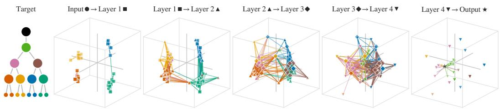  
Figure 1: LeWi develops embedding geometry aligned with the target computation. Learned neuron embeddings across successive layers of LeWi trained on a depth-4 tree. Colors indicate post hoc associations with intermediate values in the target computation. Inputs unused by the target and hidden units without a target association are omitted. Watch the geometry emerge during training: https://zhou-hangyu.github.io/lewi/.

## 1 INTRODUCTION

Learning in high dimensions is statistically difficult: for general smooth functions, sample complexity grows exponentially with ambient dimension (Stone, 1982). Yet many real-world learning problems are not arbitrary high-dimensional mappings. Their outputs arise from interactions among objects, mechanisms, subsystems, or latent variables, and may be expressed through reusable intermediate computations, each depending on only a few inputs (low arity). Such decompositions exhibit compositional sparsity (Poggio & Fraser, 2024). Under suitable smoothness assumptions, statistical theory shows that the sample complexity of regularized estimators grows exponentially with local arity rather than ambient input dimension (Schmidt-Hieber, 2020).

These statistical guarantees, however, assume global or near-global optimization and therefore do not establish comparable sample efficiency under practical gradient-based training. This raises our central question: can gradient-based training leverage hidden compositional structure to improve sample efficiency using only input–output examples?

We study this question through compositionally sparse function regression (CSFR), where the target is composed of low-arity local functions connected by a sparse computation graph. We introduce CSFRBench, a controlled benchmark that enables systematic evaluation of whether gradient-based learners can exploit hidden compositional structure from input–output examples. CSFRBench varies computation graphs and local-function families while retaining the target computation for diagnosis, allowing predictive sample efficiency to be studied alongside learned internal organization. Across its compositional settings, dense networks and sparsity-based baselines, including methods that adapt sparsity at the level of individual connections, remain substantially less sample-efficient than same-backbone references whose fixed sparsity patterns encode target connectivity. Existing gradient-based learners therefore leave much of the sample-efficiency benefit associated with compositional structure unrealized.

Biological neural circuits provide one source of inspiration. Their connectivity is strongly shaped by spatial organization, and a long-standing line of work on wiring economy studies how neural systems trade off communication efficiency with the cost of long-range connections, favoring structured local connectivity (Hiesinger, 2021; Cang & Feldheim, 2013; Chklovskii & Koulakov, 2004; Bullmore & Sporns, 2012). This suggests that connectivity may be more naturally parameterized through a shared spatial organization than by treating each connection independently.

Motivated by this principle, we introduce Learned Wiring (LeWi), which parameterizes network connectivity through learned neuron embeddings. Each neuron has a low-dimensional embedding, and adjacent-layer neurons connect when their embeddings lie within a fixed radius. The task loss jointly learns the embeddings and connection weights: embeddings determine where computation can flow, while weights determine what is computed. Because each neuron’s embedding participates in many connections, a single embedding update coordinates multiple connectivity decisions.

LeWi improves sample efficiency on CSFRBench targets with hierarchical structure, intermediate reuse, or independent modules. Relative to dense networks, LeWi reduces mean learning-curve area by 20% on the depth-4 tree, 34% on the graph with reuse, and 56% on flat modules, and by 27% across 32 independently sampled depth-4 graphs. Dense networks perform better on the high-arity control, while LeWi’s advantage increases across all settings when nuisance inputs are added. These predictive gains are accompanied by target-aligned internal organization. Target intermediates are more linearly decodable from LeWi’s hidden activations than from dense networks, and counterfactual interventions show stronger agreement with the target computation. LeWi’s learned connectivity also aligns with target dependencies, achieving more than three times the edge F1 of initialization and randomized controls on average across four structured settings.

Beyond CSFRBench, across 17 world-model prediction tasks, LeWi improves over the dense network baseline on 16 and wins 99 of 119 task–baseline comparisons, with broad gains across control and navigation and more variable performance on manipulation tasks. Together, these results show that learning connectivity through shared neuron embeddings can help gradient-based training exploit computational structure to improve sample efficiency.

## 2 COMPOSITIONALLY SPARSE FUNCTION REGRESSION

Let $G = ( V , E )$ be a directed acyclic graph (DAG) representing the target computation, with input nodes $x _ { 1 } , \ldots , x _ { d }$ corresponding to the input coordinates and an output node $v _ { \mathrm { o u t } }$ . For each input node, set $z _ { x _ { i } } ~ = ~ x _ { j }$ . Each non-input node v is associated with a local function $g _ { v }$ and computes $z _ { v } = g _ { v } ( ( z _ { u } ) _ { u \in \mathrm { p a } _ { G } ( v ) } )$ , where $\operatorname { p a } _ { G } ( v )$ denotes the parents of v. The resulting function is $f _ { G } ( x ) =$ $z _ { v _ { \mathrm { o u t } } } .$ . A function is k-compositionally sparse if it admits such a representation with at most poly(d) non-input nodes and $| \mathrm { p a } _ { G } ( v ) | \leq k$ for every non-input node $v ,$ where k is independent of d (Poggio & Fraser, 2024; Danhofer et al., 2025). In compositionally sparse function regression (CSFR), we observe samples $( { \bf x } _ { i } , y _ { i } ) _ { i = 1 } ^ { n }$ drawn from ${ \cal Y } \bar { = } \ f ^ { \star } ( { \cal X } ) \dot { + } \epsilon .$ , with $\mathbb { E } [ \epsilon \mid X ] \stackrel { \smile } { = } 0 \quad$ , where $f ^ { \star }$ is k-compositionally sparse. The target computation graph is hidden from the learner and, because multiple computation graphs can represent the same function, need not be identifiable from input– output data. We therefore use it as a reference for structural alignment rather than requiring graph recovery. Appendix A summarizes corresponding statistical rates under smoothness assumptions.

## 3 RELATED WORK

Learning compositional functions. Classical nonparametric regression suffers from the curse of dimensionality (Stone, 1982), whereas compositional function classes can admit rates governed by local-function arity and smoothness (Schmidt-Hieber, 2020). Related statistical guarantees have been established for sparse, norm-constrained, and fully connected neural networks (Ohn & Kim, 2022; Huang et al., 2026; Nagler & Langer, 2026). Recent work argues that compositional sparsity may help deep networks avoid the curse of dimensionality while identifying learnability and opti mization as open questions (Poggio & Fraser, 2024; Danhofer et al., 2025). A natural way to study such questions empirically is with controlled synthetic targets, which have long been used to study nonlinear interactions and sensitivity (Friedman, 1991; Ishigami & Homma, 1990; Sobol’, 1990). More recently, Cagnetta et al. (2024) study representation learning and sample complexity using a fixed hierarchical classification model. CSFRBench instead varies the target computation graph, hides it from the learner, and retains the graph and intermediate values for evaluation, allowing predictive sample efficiency and alignment with the target computation to be studied together.

Learned connectivity and neural wiring. Spatial and connection-cost biases have long been used in artificial neural networks to encourage modular, topographic, or interpretable organization (Jacobs & Jordan, 1992; Clune et al., 2013; Mengistu et al., 2016; Blauch et al., 2022; Achterberg et al., 2023; Liu et al., 2023; Deb et al., 2025; Zhang et al., 2025), motivated in part by biological wiring principles (Hiesinger, 2021; Cang & Feldheim, 2013; Chklovskii & Koulakov, 2004; Bullmore & Sporns, 2012). These approaches impose an explicit spatial geometry and favor short or low-cost connections. Sparse-training methods instead adapt connectivity through learned gates or masks, or through weight- and gradient-based topology updates (Louizos et al., 2017; Wortsman et al., 2019; Evci et al., 2020; Jayakumar et al., 2020; Tang et al., 2022; Lasby et al., 2024), while Lin et al. (2026) infer dependencies from data to construct a fixed sparse architecture before weight optimization. Unlike these approaches, LeWi couples connectivity decisions through shared neuron embeddings. Closest to LeWi, Karaletsos et al. (2018) and Karaletsos & Bui (2020) use neuron embeddings to define structured priors over Bayesian neural-network weights, while Zhou et al. (2022) and Erb et al. (2025) generate weight values from relations between neuron embeddings. LeWi instead jointly learns neuron embeddings and connection weights, using embedding distance to determine connectivity without an explicit wiring-cost regularizer.

Modularity in neural networks. Prior work on modularity in trained neural networks includes graph-based analyses of clusterability and local specialization (Filan et al., 2021; Hod et al., 2021), masking and pruning methods that identify subnetworks associated with specific subcomputations or hierarchical task structure (Csordas et al., 2020; Lepori et al., 2023; Malakarjun Patil et al., 2023),´ and studies of specialized neuron groups in pretrained Transformers (Zhang et al., 2023; Qiu et al., 2024). These works characterize or extract modular organization from trained networks, whereas LeWi parameterizes and learns connectivity for improving predictive sample efficiency.

## 4 LEWI: LEARNED WIRING

We introduce LeWi (Learned Wiring), which learns network connectivity through low-dimensional neuron embeddings (Figure 2). Embedding distances determine which connections are active and modulate their strengths, while network weights parameterize those connections. The embeddings and weights are optimized jointly from the prediction loss.

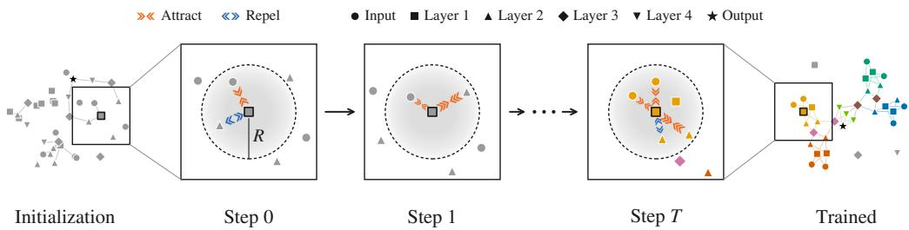  
Figure 2: LeWi learns connectivity through neuron embeddings. Schematic illustration of neuron positions and gradient-driven movement. Adjacent-layer neurons connect within a fixed radius R (dashed), with shading indicating the soft gate. Prediction gradients can attract or repel embeddings, changing connectivity as pairs cross the radius. The zooms track one layer 1 neuron; trained colors illustrate post hoc associations with target intermediates.

## 4.1 CONNECTIVITY FROM NEURON EMBEDDINGS

Each neuron i in layer ℓ has a learned embedding ${ \bf e } _ { i } ^ { ( \ell ) } \in \mathbb { R } ^ { r }$ , where r is the embedding dimension. The output unit is treated as the final layer. For a candidate connection from neuron $j$ in layer ℓ to neuron i in layer $\ell + 1$ , we define the connection score

$$
s _ { i j } ^ { ( \ell ) } = R ^ { 2 } - \left\| \mathbf { e } _ { i } ^ { ( \ell + 1 ) } - \mathbf { e } _ { j } ^ { ( \ell ) } \right\| _ { 2 } ^ { 2 } .\tag{1}
$$

Thus, R defines a connectivity radius: the score is positive when the two embeddings are within distance R and nonpositive otherwise. The weights used to compute network activations in the forward pass, denoted $\widetilde { W } _ { i j } ^ { ( \ell ) }$ , are obtained from learned base weights $W _ { i j } ^ { ( \ell ) }$ with a soft sigmoid gate $g _ { i j } ^ { ( \ell ) } = \sigma ( s _ { i j } ^ { ( \ell ) } )$ ) and a binary mask $m _ { i j } ^ { ( \ell ) } = { \bf 1 } \{ s _ { i j } ^ { ( \ell ) } > 0 \}$

$$
\widetilde { W } _ { i j } ^ { ( \ell ) } = W _ { i j } ^ { ( \ell ) } g _ { i j } ^ { ( \ell ) } m _ { i j } ^ { ( \ell ) } .\tag{2}
$$

The soft gate scales active weights, while the binary mask sets the forward-pass weight to zero at or beyond radius R. We initialize embeddings i.i.d. as ${ \bf e } _ { i } ^ { ( \ell ) } \sim \mathcal { N } ( 0 , \sigma _ { e } ^ { 2 } I _ { r } )$ , where $\sigma _ { e }$ is the standard deviation, and set $R ^ { 2 } = \mathbb { E } _ { \mathrm { i n i t } } [ \| \mathbf e _ { i } - \mathbf e _ { j } \| _ { 2 } ^ { 2 } ] = 2 r \sigma _ { e } ^ { 2 }$ . By default, $r = 3$ and $\sigma _ { e } = 0 . 5 ,$ giving $R ^ { 2 } = 1 . 5$ This places the connection threshold near the typical initial pairwise distance, so the network starts with both active and inactive connections. The radius remains fixed throughout training.

## 4.2 LEARNING THE WIRING

The embeddings and weights are optimized jointly to minimize the mean-squared prediction loss L. During backpropagation, we treat the binary masks as fixed and propagate gradients through the soft gates of active connections. Suppressing layer indices, let $\mathcal { N } ( i )$ denote the neurons connected to neuron i by active connections, and let $W _ { i j }$ denote the base weight of the corresponding active connection. The negative gradient with respect to $\mathbf { e } _ { i }$ is

$$
- \nabla _ { \mathbf { e } _ { i } } \mathcal { L } = 2 \sum _ { j \in \mathcal { N } ( i ) } | W _ { i j } | \sigma ^ { \prime } ( s _ { i j } ) \frac { \partial \mathcal { L } } { \partial | \widetilde { W } _ { i j } | } ( \mathbf { e } _ { i } - \mathbf { e } _ { j } ) .\tag{3}
$$

For each $j \in \mathcal { N } ( i )$ , the same connection contributes an equal and opposite term to the update of $\mathbf { e } _ { j }$ . If $\partial \mathcal { L } / \partial | \widetilde { W } _ { i j } | < 0$ , increasing the connection magnitude reduces the loss, so gradient descent moves the embeddings closer. $\mathrm { I f } \partial \mathcal { L } / \partial | \widetilde { W } _ { i j } | > 0$ , decreasing the connection magnitude reduces the loss, so the embeddings move apart. Each embedding update is the sum of attractive and repulsive “forces” from its active incoming and outgoing connections. Figure 2 illustrates this mechanism.

The binary mask converts this continuous movement into changes in connectivity. When two embeddings reach or move beyond radius R, their connection becomes inactive and receives no direct gradient. It can reactivate if updates through other active connections later bring the endpoints back within R. Masks are recomputed after each optimization step. Appendix B gives the full derivation.

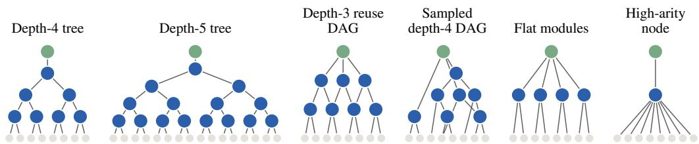  
Figure 3: Computation graphs in CSFRBench. Light nodes denote active inputs, blue nodes local functions, and green nodes readouts. The figure shows the five fixed graph templates and one draw from the sampled depth-4 DAG distribution.

## 5 CSFRBENCH

CSFRBench is a controlled benchmark for evaluating whether gradient-based learners exploit hidden compositional structure. It provides a target function generator with known computation graphs and intermediate values, reference networks with target-derived sparsity patterns, and a common evaluation protocol. Learners receive only input–output examples, while the target computation graph and intermediate values are retained for reference construction and diagnosis. Together, these components enable joint evaluation of predictive sample efficiency and learned computational structure. Appendix C.1 summarizes the benchmark settings.

Computation graphs. CSFRBench includes five fixed graph templates and a distribution of sampled depth-4 DAGs (Figure 3). Together, these settings span parallel low-arity computation, hierarchical composition, intermediate reuse, varying graph topology, and a high-arity control. In every graph, the readout is a standardized sum of its parent values rather than a sampled local function. Exact graph definitions are given in Appendix C.2.

Local functions. Our primary local functions use an additive–multiplicative construction,

$$
g ( z ) = \sqrt { \frac { 1 - \rho } { k } } \sum _ { i = 1 } ^ { k } a _ { i } ( z _ { i } ) + \sqrt { \rho } \prod _ { i = 1 } ^ { k } b _ { i } ( z _ { i } ) .\tag{4}
$$

By construction, the parent values $z _ { 1 } , \ldots , z _ { k }$ are independent because they depend on disjoint input coordinates. Each $a _ { i }$ and $b _ { i }$ is sampled from sin $\displaystyle \left( \pi \nu u + 2 \pi \phi \right)$ , with $\nu \sim U [ 0 . 2 5 , 0 . 4 0 ]$ and $\phi \sim$ $U [ 0 , 1 )$ , and standardized under the distribution of $z _ { i }$ . Because $z _ { 1 } , \ldots , z _ { k }$ are independent, for $k \geq 2$ the additive and k-way interaction terms are therefore uncorrelated and contribute variances $1 - \rho$ and $\rho ,$ respectively. We also use random Fourier functions (Rahimi & Recht, 2007),

$$
g ( z ) = \frac { 1 } { \sqrt { Q } } \sum _ { q = 1 } ^ { Q } a _ { q } \sin ( \omega _ { q } ^ { \top } z + \phi _ { q } ) ,\tag{5}
$$

where $Q$ is the number of terms, and $a _ { q } , \omega _ { q }$ , and $\phi _ { q }$ are sampled amplitudes, frequency vectors, and phases. Unlike the additive–multiplicative construction, it does not prescribe the relative contribu tions of additive effects and interactions. Appendix C.3 gives sampling distributions and settings.

Target construction and characterization. Each target instance fixes its computation graph, local functions, and active inputs across methods and sample sizes. Inputs have independent coordinates $X _ { j } \sim U [ - 1 , 1 ]$ , and observations follow $Y = f ^ { \star } ( X ) + \epsilon ,$ with $\bar { \epsilon } \sim \mathcal N ( 0 , \sigma ^ { 2 } )$ . Primary settings use only active inputs, while nuisance-input settings add independent inert coordinates. Using a separate fixed normalization sample, we center and scale each local output and the final readout to zero mean and unit variance in topological order. The resulting normalization parameters are reused across all training, validation, and test sets for that target instance. On development instances, we characterize each target family’s interaction structure, input sensitivities, and output distribution, and test whether simpler predictors can fit its input–output mapping. Final evaluation targets are sampled after fixing the benchmark protocol, methods, hyperparameter spaces, and statistical analysis. Appendices C.4– C.6 give details.

Graph-informed references. To assess the value of target connectivity, we use a family of reference networks, GraphOracle(ℓ), with the same MLP backbone and fixed weight masks derived from the first ℓ nonlinear levels of the target graph. GraphOracle(1) uses the first level, while GraphOracle(all) uses the full target connectivity. When nuisance inputs are present, GraphOracle(0) provides a reference with known active-input support. Appendix C.7 details the mask construction.

Evaluation. Our primary outcome is predictive sample efficiency. At training-set size n, we report normalized mean-squared error, NMSE $( n ) = \mathbb { E } _ { X } [ ( \hat { f } _ { n } ( X ) - f ^ { \star } ( X ) ) ^ { 2 } ] / \operatorname { V a r } ( f ^ { \star } ( X ) )$ ). We summarize learning curves by their area under the curve (AULC) on a logarithmic training-set-size scale; lower values indicate better sample efficiency (Appendix C.8).

The known target computation also enables diagnostics of learned internal organization. We measure linear decodability with ridge probes predicting each target intermediate from each hidden layer and report held-out $R ^ { \check { 2 } }$ (Alain & Bengio, 2016). Because linear decodability does not establish that the decoded information is used in prediction (Belinkov, 2022), we also assess counterfactual agreement under target-aligned interventions using joint multi-variable Boundless DAS (Wu et al., 2023). We report held-out counterfactual $R ^ { 2 }$ between the learner’s patched prediction and the target’s coun terfactual output. Appendices C.9 and C.10 give the full protocols.

## 6 EXPERIMENTS

## 6.1 EXPERIMENTAL SETUP

Models and baselines. For CSFRBench, all methods use the same ReLU MLP backbone within each setting: width 32 with four hidden layers, except for the depth-5 tree, which uses width 64 with eight hidden layers. We compare LeWi with an unregularized dense MLP (Dense), $\ell _ { 1 }$ and $\ell _ { 2 }$ regularization, hard-concrete $L _ { 0 }$ regularization (Louizos et al., 2017), RigL (Evci et al., 2020), Fiedler regularization (Tam & Dunson, 2020), BIMT (Liu et al., 2023), and learned neuron positions (Erb et al., 2025). RigL adapts sparse connectivity during training, Fiedler regularization and BIMT encourage structured wiring, and the learned-neuron-position method parameterizes weights through neuron geometry. CSFRBench architecture and training details are given in Appendix C.11.

Training and model selection. Our primary settings use $d = 8$ active inputs, local arity $k = 2$ and observation-noise variance $\sigma ^ { 2 } = \mathrm { 0 . 0 1 }$ . We train with Adam (Kingma & Ba, 2014) using batch size 32 for $6 4 { , } 0 0 0$ steps over $n \in \{ 2 ^ { 9 } , \dots , 2 ^ { 1 5 } \}$ . The depth-5 tree uses $d = 1 6 , n \in \{ 2 ^ { 1 1 } , . . . , 2 ^ { 1 7 } \}$ and 128,000 steps. Nuisance-input settings use $d = 3 2$ , adding 24 or 16 inert inputs under the corresponding training budget. For each target instance and training-set size, we evaluate 32 hyperparameter configurations from a scrambled Sobol sequence (Sobol, 1967; Owen, 1995), using search spaces fixed on development targets, and select the checkpoint and configuration with lowest validation NMSE. Validation and test sets contain 4,096 and 65,536 examples and are shared across methods. The selected model is evaluated once on the test set. We measure sample efficiency by training-set size under this fixed model-selection protocol, not total labeled-data requirements. Details are given in Appendices C.11 and C.12.

Statistical reporting. We evaluate 16 target instances in each fixed-graph setting and 32 independently sampled graph/function instances in the sampled-graph setting. We report mean AULC with two-sided 95% Student-t confidence intervals over instances; method comparisons use paired per-instance AULC differences with corresponding paired intervals. Comparisons whose intervals contain zero are treated as inconclusive. Appendix C.13 gives the full procedure.

## 6.2 PREDICTIVE SAMPLE EFFICIENCY

LeWi improves predictive sample efficiency across the five low-arity CSFRBench settings in Figure 4, achieving the lowest mean AULC among methods without access to target connectivity in each setting. The same ordering holds in two Fourier settings omitted from the figure. Appendix D.1 reports full learning curves and paired numerical comparisons for all settings. Relative to Dense, LeWi lowers mean AULC by 20% on the depth-4 tree, 34% on the reuse DAG, and 56% on flat modules. Across 32 independently sampled depth-4 DAGs, mean AULC is 27% lower. On the larger depth-5 tree, LeWi achieves 32% lower mean AULC than Dense, while Dense performs better on the higharity node. These results are consistent with LeWi benefiting from compositional sparsity across different computational structures.

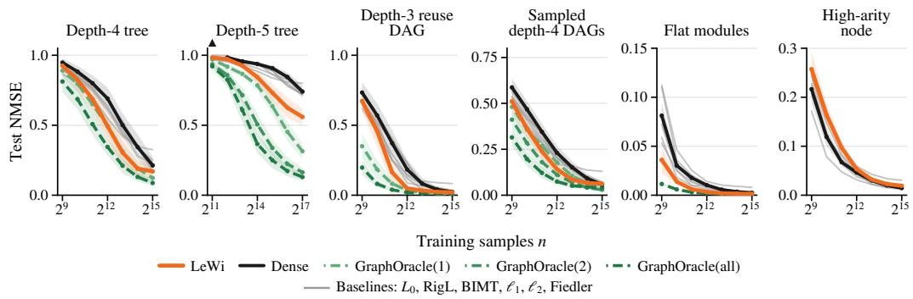  
Figure 4: LeWi improves sample efficiency across computational structures. Test NMSE versus training-set size for six representative CSFRBench settings. Curves and bands show means and 95% Student-t confidence intervals over target instances. Triangles mark means outside the displayed range. Baselines are shown in gray. Complete results are in Appendix D.

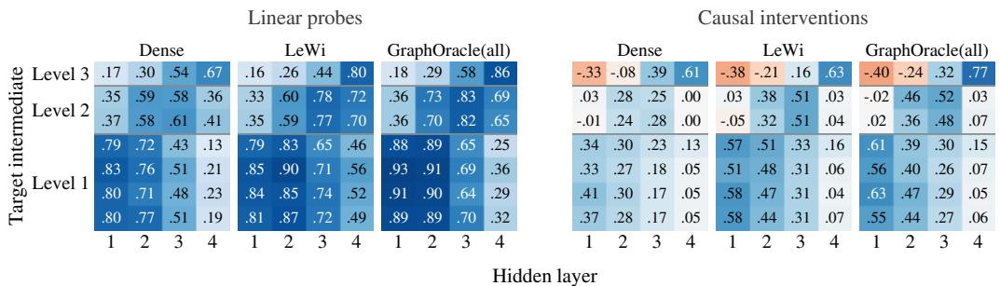  
Figure 5: LeWi develops stronger target-aligned representations. Left: held-out $R ^ { 2 }$ from linear probes predicting each target intermediate from each hidden layer. Right: held-out counterfactual $\mathrm { \ddot { \it R } ^ { 2 } }$ under joint multi-variable Boundless DAS. Rows are grouped by target level. Results are for the depth-4 tree at $n = 2 ^ { 1 4 }$ , averaged over 16 target instances.

Graph-informed references quantify the additional sample-efficiency benefit available from target connectivity. On the depth-4 tree, LeWi approaches GraphOracle(1) and closes 51% of the AULC gap between Dense and GraphOracle(all), compared with 26% for $L _ { 0 } .$ . LeWi remains behind GraphOracle(1) on the reuse DAG and depth-5 tree, despite outperforming all learned baselines in both settings. Thus, learned wiring captures part of the predictive benefit of target connectivity without access to the target graph, while the remaining oracle gaps indicate room for improvement, particularly on deeper and reuse-based compositions.

## 6.3 LEARNED COMPUTATIONAL STRUCTURE

We next examine whether LeWi’s predictive gains are accompanied by hidden representations aligned with the target computation (Figure 5). On the depth-4 tree, linear decodability follows the target hierarchy: lower-level intermediates are most decodable in earlier hidden layers, while deeper intermediates are most decodable in later hidden layers. LeWi strengthens this organization relative to Dense. Using the maximum mean probe $R ^ { 2 }$ across hidden layers, LeWi closes more than half of the Dense-to-GraphOracle(all) gap for level-1 intermediates, roughly three quarters for level-2 intermediates, and about two thirds for the level-3 intermediate.

Linear decodability alone does not establish whether these representations are used in predictions. We therefore use joint multi-variable Boundless DAS to test whether interventions on target-aligned hidden subspaces produce the corresponding counterfactual predictions. The intervention results show the same hierarchical organization. For level-1 intermediates in the first hidden layer, LeWi closes nearly all of the Dense-to-GraphOracle(all) gap, while level-2 intermediates in the third layer reach approximately GraphOracle(all) performance. Intervention gains are largest at lower and intermediate target levels, while LeWi and Dense are similar for the level-3 intermediate. Together, the diagnostics show that LeWi’s hidden representations are more closely aligned with the target computation than Dense. Appendix D.2 extends these diagnostics to additional learned baselines, training-set sizes, and target families.

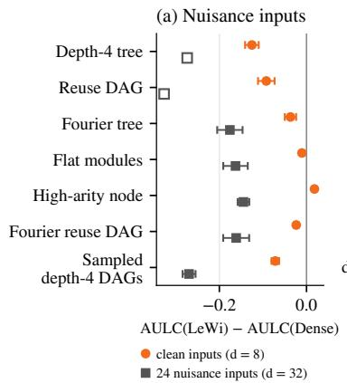

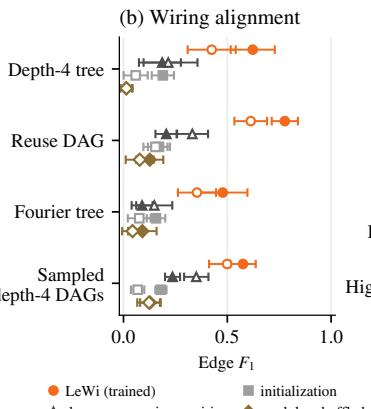

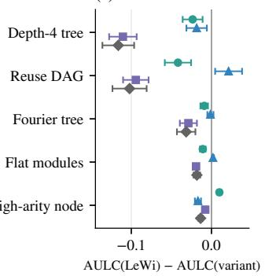  
Figure 6: Input selection, wiring alignment, and mechanism ablations. (a) LeWi–Dense paired AULC differences with all inputs relevant or 24 additional inert inputs. Hollow squares show medians when divergent Dense runs place means outside the plotted range. (b) Edge F1 over all target edges (filled) and edges from target intermediates (hollow) for trained LeWi and controls at $n = 2 ^ { \mathbf { \tilde { 1 } } 5 }$ (c) LeWi–variant paired AULC differences for four mechanism ablations. Negative differences fa vor LeWi in (a) and (c). Error bars show 95% Student-t confidence intervals over target instances.

## 6.4 INPUT SELECTION, WIRING ALIGNMENT, AND ABLATIONS

Input selection. LeWi provides an additional benefit when irrelevant inputs are present: its sample-efficiency advantage over Dense increases across all seven settings after adding 24 inert inputs (Figure 6a). The effect is especially notable on the high-arity node, where Dense performs better when all inputs are relevant but falls behind with nuisance inputs. A plausible explanation is that learned gates and masks suppress connections from irrelevant inputs, shifting part of the input-selection burden from weight optimization to connectivity learning. Appendix D.3 reports the complete nuisance-input learning curves and paired comparisons.

Wiring alignment. LeWi’s learned connectivity also aligns with dependencies in the target computation graph. We extract a module graph without target information by clustering neurons on active input–output paths according to embedding distance, using average linkage with a cut at radius R. We connect two modules when more than half of their candidate connections are active. Modules are then matched post hoc to target intermediates using ridge probes, and the resulting dependency graph is compared with the target graph using edge precision, recall, and $F _ { 1 }$ . Because target intermediates are used for post hoc matching, these metrics measure structural agreement with the target graph rather than graph recovery. Appendix D.4 gives the full procedure, representative extracted graphs, and additional checks of the module-extraction procedure.

Across four structured settings, trained LeWi achieves more than three times the edge $F _ { 1 }$ of initialization and randomized controls on average (Figure 6b). Alignment is strongest on the reuse DAG but remains well above the controls in every setting. For edges originating at target intermediates, including edges to the output, mean $F _ { 1 }$ remains 0.473, showing alignment beyond input selection. Precision exceeds recall in every setting, so missed target edges are more common than spurious edges. Some missed edges arise when a target intermediate has no matched module. Because connectivity is parameterized by low-dimensional neuron embeddings, LeWi also provides a direct visualization of its learned wiring. Figure 19 shows examples across target structures.

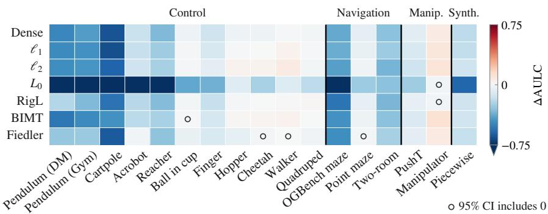  
Figure 7: World-model prediction. Paired ∆AULC = AULC(LeWi) − AULC(baseline) across 17 tasks and seven baselines. Negative values favor LeWi. LeWi wins 99 of 119 comparisons, ties 6, and loses 14. Hollow circles indicate 95% confidence intervals containing zero. Colors are clipped at ±0.75. Tasks are grouped by environment type and ordered by state dimension. Appendix E.3 reports complete results, including the learned-neuron-position comparison.

Mechanism ablations. We examine which components of LeWi contribute to its sampleefficiency gain. Freezing the embeddings or replacing learned connectivity with a fixed random sparse mask degrades performance on compositional targets (Figure 6c), showing that sparsity alone is insufficient. Removing the hard mask also hurts these targets but helps on the high-arity node. In contrast, a mask-only variant, which uses the learned binary mask without soft gate scaling in the forward pass while retaining embedding learning, performs similarly to LeWi. Together, these ablations indicate that adapting which connections are active matters more than continuously scaling active connections. LeWi also reaches lower connection density than at initialization on compositional targets, especially with nuisance inputs, while the high-arity control remains dense. Appen dices D.5–D.7 report connection density, parameter sensitivity, and computational cost.

## 6.5 EXTERNAL VALIDATION ON WORLD-MODEL PREDICTION

To test whether this inductive bias transfers beyond controlled targets, we evaluate LeWi on statebased prediction tasks from the stable-worldmodel suite (Maes et al., 2026). We evaluate the same set of methods as in CSFRBench using a width-256, four-hidden-layer ReLU MLP. To focus on tasks learnable with this architecture, we retain 17 of the 21 state-based, continuous-action environments that satisfy fixed, LeWi-independent criteria for nontrivial prediction, a data-limited regime, and reliable simulator replay. The selected tasks span control, navigation, articulated and contact dynamics, manipulation, and a synthetic piecewise system. Models predict state changes and are evaluated by 16-step open-loop rollout over seven training-set sizes. Appendices E.1–E.3 give the task selection, experimental protocol, and complete results.

Across the 119 task–baseline pairs (17 tasks × 7 baselines), LeWi wins 99, ties 6, and loses 14 (Figure 7); against Dense, it wins 16 of 17 tasks. Gains are strongest and most consistent on lowdimensional control and navigation tasks, while most ties and losses occur on articulated-control tasks with many coupled joints and state variables, and on manipulation, which also couples robot and object dynamics. Together with the CSFRBench results, this pattern is consistent with LeWi benefiting most when predictive dependencies can be organized into sparse, low-arity interactions, with less advantage as those dependencies become more broadly coupled.

## 7 DISCUSSION

Our results support treating connectivity, alongside weights, as a learned model component for sample-efficient prediction. CSFRBench enables joint evaluation of predictive sample efficiency and learned computational structure. LeWi improves sample efficiency on targets with hierarchical structure, intermediate reuse, or independent modules, and improves prediction on state-based world-model tasks. It also develops representations and connectivity aligned with the target computation, while its low-dimensional neuron embeddings facilitate visualization and interpretation of the learned computational structure. Inspired by the spatial organization of biological nervous systems, LeWi jointly learns neuron embeddings that organize connectivity and connection weights. Thi draws an analogy to coupling the evolution and development of neural circuitry with experiencedependent synaptic learning (Wang & Clandinin, 2016; Cang & Feldheim, 2013; Holtmaat & Svoboda, 2009).

This approach also connects to structure and parameter learning in probabilistic graphical models (Koller & Friedman, 2009). In Bayesian networks, graph structure specifies the factorization of a joint distribution, while parameters specify the local conditional distributions. LeWi similarly learns connectivity and local computations jointly, but its graph describes computational dependencies among learned representations rather than probabilistic dependencies among random variables. This suggests exploring geometric connectivity as an alternative parameterization for graphical-model structure learning, with appropriate probabilistic objectives and structural constraints.

Several limitations remain. The remaining gap to GraphOracle indicates room to better exploit target connectivity. LeWi’s random initialization and hard masks can make initially inactive connections difficult to recover. Its fixed-radius, adjacent-layer connectivity restricts the range of learnable wiring patterns. LeWi also evaluates all candidate connections densely, so learned sparsity does not reduce training computation. With optimized CPU implementations, its runtime is 1.32 and 1.02 times that of Dense on the 32 × 4 and 64 × 8 backbones, respectively (Appendix D.7).

Future work could improve initialization and rewiring to recover better computational structures, and exploit learned sparsity to reduce training cost. Inspired by the distinct spatial organization of axons and dendrites in biological neurons, learning separate embeddings for outgoing and incoming connections could enable sparse long-range connectivity and support learning larger computational graphs. Further biological mechanisms may offer additional inspiration for learning connectivity. Extending LeWi to Transformers would test whether geometric connectivity benefits attention-based architectures, while input- or task-dependent connectivity could enable conditional computation and module reuse in continual learning. Finally, extending CSFRBench to larger graphs, richer local functions, and sequential settings would help assess scalability and adaptation.

## AI USE STATEMENT

We used generative AI tools to provide feedback on research methodology and experimental design, assist with interpretation of experimental results, and help develop and check mathematical derivations and claims. We also used generative AI for literature search and summarization, manuscript drafting and editing, and LaTeX assistance. An AI coding agent was used to write and modify experiment, synthetic-data-generation, analysis, and verification code. All AI-assisted work was reviewed by the authors: mathematical claims were checked manually, cited literature was verified against the original sources, and generated or modified code was tested against experiment records and independent verification checks. We take responsibility for the final content of this work, including text, claims, code, and artifacts produced with the aid of generative AI.

## ETHICS STATEMENT

This work studies general-purpose learning methods using synthetic regression targets and simulated world-model prediction environments. It involves no human subjects, personal or sensitive data, or deployment in high-stakes settings.

## REPRODUCIBILITY STATEMENT

Appendix B specifies the LeWi implementation and analysis. Appendix C gives the complete CS-FRBench construction, training, hyperparameter-search, evaluation, and statistical protocols. Appendix D reports additional results and controls, and Appendix E documents the world-model task suite, data collection, model selection, search spaces, and complete results. Source code for LeWi and CSFRBench, experiment configurations, and scripts for reproducing the reported analyses are available on the project page: https://zhou-hangyu.github.io/lewi/.

## ACKNOWLEDGMENTS

We thank Jixian Su, Anisha Pal, and Kangping Hu for helpful discussions and feedback. This research was supported in part by computing resources provided by the Partnership for an Advanced Computing Environment (PACE) at the Georgia Institute of Technology (RRID:SCR 027619).

## REFERENCES

Jascha Achterberg, Danyal Akarca, DJ Strouse, John Duncan, and Duncan E Astle. Spatially embedded recurrent neural networks reveal widespread links between structural and functional neuroscience findings. Nature Machine Intelligence, 5(12):1369–1381, 2023.

Guillaume Alain and Yoshua Bengio. Understanding intermediate layers using linear classifier probes. arXiv preprint arXiv:1610.01644, 2016.

Yonatan Belinkov. Probing classifiers: Promises, shortcomings, and advances. Computational Linguistics, 48(1):207–219, 2022.

Nicholas M Blauch, Marlene Behrmann, and David C Plaut. A connectivity-constrained computational account of topographic organization in primate high-level visual cortex. Proceedings of the National Academy ofSciences, 119(3):e2112566119, 2022.

Ed Bullmore and Olaf Sporns. The economy of brain network organization. Nature reviews neuroscience, 13(5):336–349, 2012.

Francesco Cagnetta, Leonardo Petrini, Umberto M Tomasini, Alessandro Favero, and Matthieu Wyart. How deep neural networks learn compositional data: The random hierarchy model. Physical Review X, 14(3):031001, 2024.

Jianhua Cang and David A Feldheim. Developmental mechanisms of topographic map formation and alignment. Annual review ofneuroscience, 36(1):51–77, 2013.

Dmitri B Chklovskii and Alexei A Koulakov. Maps in the brain: what can we learn from them? Annu. Rev. Neurosci., 27(1):369–392, 2004.

Jeff Clune, Jean-Baptiste Mouret, and Hod Lipson. The evolutionary origins of modularity. Proceedings ofthe Royal Society b: Biological sciences, 280(1755):20122863, 2013.

Robert Csord´ as, Sjoerd van Steenkiste, and J´ urgen Schmidhuber. Are neural nets modular? inspect-¨ ing functional modularity through differentiable weight masks. arXiv preprint arXiv:2010.02066, 2020.

David A Danhofer, Davide D’Ascenzo, Rafael Dubach, and Tomaso Poggio. Position: A theory of deep learning must include compositional sparsity. arXiv preprint arXiv:2507.02550, 2025.

Mayukh Deb, Mainak Deb, and Apurva Murty. Toponets: High performing vision and language models with brain-like topography. In International Conference on Learning Representations, volume 2025, pp. 39099–39119, 2025.

Laura Erb, Tommaso Boccato, Alexandru Vasilache, Juergen Becker, and Nicola Toschi. Training neural networks by optimizing neuron positions. In Conference on Biomimetic and Biohybrid Systems, pp. 269–280. Springer, 2025.

Utku Evci, Trevor Gale, Jacob Menick, Pablo Samuel Castro, and Erich Elsen. Rigging the lottery: Making all tickets winners. In International conference on machine learning, pp. 2943–2952. PMLR, 2020.

Daniel Filan, Stephen Casper, Shlomi Hod, Cody Wild, Andrew Critch, and Stuart Russell. Clusterability in neural networks. arXiv preprint arXiv:2103.03386, 2021.

Jerome H Friedman. Multivariate adaptive regression splines. The annals of statistics, 19(1):1–67, 1991.

Peter Robin Hiesinger. The self-assembling brain: how neural networks grow smarter. In The Self-Assembling Brain. Princeton University Press, 2021.

Shlomi Hod, Daniel Filan, Stephen Casper, Andrew Critch, and Stuart Russell. Quantifying local specialization in deep neural networks. arXiv preprint arXiv:2110.08058, 2021.

Anthony Holtmaat and Karel Svoboda. Experience-dependent structural synaptic plasticity in the mammalian brain. Nature Reviews Neuroscience, 10(9):647–658, 2009.

Toshimitsu Homma and Andrea Saltelli. Importance measures in global sensitivity analysis of nonlinear models. Reliability Engineering & System Safety, 52(1):1–17, 1996.

Shuo Huang, Lorenzo Fiorito, Lorenzo Rosasco, and Tomaso Poggio. Learning sparse compositional functions with norm-constrained neural networks. arXiv preprint arXiv:2605.25608, 2026.

Tsutomu Ishigami and Toshimitsu Homma. An importance quantification technique in uncertainty analysis for computer models. In [1990] Proceedings. First international symposium on uncertainty modeling and analysis, pp. 398–403. IEEE, 1990.

Robert A Jacobs and Michael I Jordan. Computational consequences of a bias toward short connections. Journal ofcognitive neuroscience, 4(4):323–336, 1992.

Siddhant Jayakumar, Razvan Pascanu, Jack Rae, Simon Osindero, and Erich Elsen. Top-kast: Top-k always sparse training. Advances in Neural Information Processing Systems, 33:20744–20754, 2020.

Theofanis Karaletsos and Thang D Bui. Hierarchical gaussian process priors for bayesian neural network weights. Advances in Neural Information Processing Systems, 33:17141–17152, 2020.

Theofanis Karaletsos, Peter Dayan, and Zoubin Ghahramani. Probabilistic meta-representations of neural networks. arXiv preprint arXiv:1810.00555, 2018.

Diederik P Kingma and Jimmy Ba. Adam: A method for stochastic optimization. arXiv preprint arXiv:1412.6980, 2014.

Daphne Koller and Nir Friedman. Probabilistic graphical models, volume 165. MIT press, Cambridge, 2009.

Mike Lasby, Anna Golubeva, Utku Evci, Mihai Nica, and Yani Ioannou. Dynamic sparse training with structured sparsity. In International Conference on Learning Representations, volume 2024, pp. 32982–33010, 2024.

Michael Lepori, Thomas Serre, and Ellie Pavlick. Break it down: Evidence for structural compositionality in neural networks. Advances in Neural Information Processing Systems, 36:42623– 42660, 2023.

Hongyu Lin, Antonio Briola, Yuanrong Wang, and Tomaso Aste. Compositional sparsity as an inductive bias for neural architecture design. arXiv preprint arXiv:2605.14764, 2026.

Ziming Liu, Eric Gan, and Max Tegmark. Seeing is believing: Brain-inspired modular training for mechanistic interpretability. Entropy, 26(1):41, 2023.

Christos Louizos, Max Welling, and Diederik P Kingma. Learning sparse neural networks through l 0 regularization. arXiv preprint arXiv:1712.01312, 2017.

Lucas Maes, Quentin Le Lidec, Luiz Facury, Nassim Massaudi, Ayush Chaurasia, Francesco Capuano, Richard Gao, Taj Gillin, Dan Haramati, Damien Scieur, et al. stable-worldmodel: A platform for reproducible world modeling research and evaluation. arXiv preprint arXiv:2605.21800, 2026.

Shreyas Malakarjun Patil, Loizos Michael, and Constantine Dovrolis. Neural sculpting: Uncovering hierarchically modular task structure in neural networks through pruning and network analysis. Advances in Neural Information Processing Systems, 36:18495–18531, 2023.

Henok Mengistu, Joost Huizinga, Jean-Baptiste Mouret, and Jeff Clune. The evolutionary origins of hierarchy. PLoS computational biology, 12(6):e1004829, 2016.

Thomas Nagler and Sophie Langer. Optimal neural network approximation of smooth compositional functions on sets with low intrinsic dimension. arXiv preprint arXiv:2602.03539, 2026.

Ilsang Ohn and Yongdai Kim. Nonconvex sparse regularization for deep neural networks and its optimality. Neural computation, 34(2):476–517, 2022.

Art B Owen. Randomly permuted (t, m, s)-nets and (t, s)-sequences. In Monte Carlo and Quasi-Monte Carlo Methods in Scientific Computing: Proceedings of a conference at the University of Nevada, Las Vegas, Nevada, USA, June 23–25, 1994, pp. 299–317. Springer, 1995.

Tomaso Poggio and Maia Fraser. Compositional sparsity of learnable functions. Bulletin of the American Mathematical Society, 61(3), 2024.

Zihan Qiu, Zeyu Huang, and Jie Fu. Unlocking emergent modularity in large language models. In Proceedings of the 2024 Conference of the North American Chapter of the Association for Computational Linguistics: Human Language Technologies (Volume 1: Long Papers), pp. 2638– 2660, 2024.

Ali Rahimi and Benjamin Recht. Random features for large-scale kernel machines. Advances in neural information processing systems, 20, 2007.

Johannes Schmidt-Hieber. Nonparametric regression using deep neural networks with relu activation function. 2020.

Ilya M Sobol. Distribution of points in a cube and approximate evaluation of integrals. USSR Computational mathematics and mathematical physics, 7:86–112, 1967.

Il’ya Meerovich Sobol’. On sensitivity estimation for nonlinear mathematical models. Matematicheskoe modelirovanie, 2(1):112–118, 1990.

Charles J Stone. Optimal global rates of convergence for nonparametric regression. The annals of statistics, pp. 1040–1053, 1982.

Edric Tam and David Dunson. Fiedler regularization: Learning neural networks with graph sparsity. In International Conference on Machine Learning, pp. 9346–9355. PMLR, 2020.

Zhimin Tang, Linkai Luo, Bike Xie, Yiyu Zhu, Rujie Zhao, Lvqing Bi, and Chao Lu. Automatic sparse connectivity learning for neural networks. IEEE Transactions on Neural Networks and Learning Systems, 34(10):7350–7364, 2022.

Irving E Wang and Thomas R Clandinin. The influence of wiring economy on nervous system evolution. Current Biology, 26(20):R1101–R1108, 2016.

Mitchell Wortsman, Ali Farhadi, and Mohammad Rastegari. Discovering neural wirings. Advances in neural information processing systems, 32, 2019.

Zhengxuan Wu, Atticus Geiger, Thomas Icard, Christopher Potts, and Noah Goodman. Interpretability at scale: Identifying causal mechanisms in alpaca. Advances in neural information processing systems, 36:78205–78226, 2023.

Xin-Jie Zhang, Jack Murdoch Moore, Ting-Ting Gao, Xiaozhu Zhang, and Gang Yan. Braininspired wiring economics for artificial neural networks. PNAS nexus, 4(1):pgae580, 2025.

Zhengyan Zhang, Zhiyuan Zeng, Yankai Lin, Chaojun Xiao, Xiaozhi Wang, Xu Han, Zhiyuan Liu, Ruobing Xie, Maosong Sun, and Jie Zhou. Emergent modularity in pre-trained transformers. In Findings of the Association for Computational Linguistics: ACL 2023, pp. 4066–4083, 2023.

Ryan Zhou, Christian Muise, and Ting Hu. Permutation-invariant representation of neural networks with neuron embeddings. In European Conference on Genetic Programming (Part of EvoStar), pp. 294–308. Springer, 2022.

## A STATISTICAL BACKGROUND

The statistical motivation for CSFR comes from nonparametric regression rates for compositional functions. Consider a target $f ^ { \star } = g _ { q } \circ \cdots \circ g _ { 0 }$ whose level-i component functions are ${ \bar { \beta } } _ { i } – \mathrm { H } { \ddot { \mathrm { o l d e r } } }$ smooth and depend on at most $t _ { i }$ variables, with $t _ { i } \ll d .$ Schmidt-Hieber (2020) define the effective smoothness $\begin{array} { r } { \beta _ { i } ^ { \star } = \beta _ { i } \prod _ { \ell = i + 1 } ^ { q } ( \beta _ { \ell } \wedge 1 ) } \end{array}$ and show that, under their assumptions, the minimax prediction rate is governed up to logarithmic factors by

$$
\phi _ { n } = \operatorname* { m a x } _ { i = 0 , \ldots , q } n ^ { - \frac { 2 \beta _ { i } ^ { \star } } { 2 \beta _ { i } ^ { \star } + t _ { i } } } .
$$

A sparse ReLU estimator based on near-global empirical-risk minimization attains $O ( \phi _ { n } \log ^ { 3 } n )$ matching the minimax exponent. In contrast, generic d-dimensional β-Holder regression has the¨ classical rate $n ^ { - 2 \beta / ( 2 \beta + d ) }$ (Stone, 1982). This rate shows that statistical complexity can depend on local arity and smoothness rather than ambient dimension. However, it does not establish that standard gradient-based training discovers and exploits unknown compositional structure.

## B LEWI IMPLEMENTATION AND ANALYSIS

## B.1 IMPLEMENTATION DETAILS

Unless otherwise specified, LeWi uses embedding dimension $r = 3$ and $\sigma _ { e } = 0 . 5 ,$ giving $R ^ { 2 } =$ $2 r \sigma _ { e } ^ { 2 } = 1 . 5$ . The same fixed radius is used for every affine layer, including the readout. Binary masks are recomputed after every optimizer step and treated as fixed during backpropagation.

We use two rejection-sampling checks at initialization. If a layer transition contains no active connection, we redraw its receiver embeddings until at least one connection is active. We also redraw any input embedding with fewer than five active outgoing connections until it has at least five. These checks apply only at initialization; no degree constraint is imposed during training. LeWi otherwise uses no target sparsity level or connectivity penalty. These checks use no target information and apply identically to all input coordinates.

## B.2 PROPERTIES OF THE PARAMETERIZATION

Shared score structure. For one layer, let $\ b X \in \mathbb { R } ^ { m \times r }$ and $Y \in \mathbb { R } ^ { n \times r }$ contain the embeddings of the target and source neurons. Expanding the squared distance gives

$$
S = 2 X Y ^ { \top } + ( R ^ { 2 } \mathbf { 1 } - a ) \mathbf { 1 } ^ { \top } - \mathbf { 1 } b ^ { \top } ,
$$

where $a _ { i } = \| x _ { i } \| _ { 2 } ^ { 2 }$ and $b _ { j } = \| y _ { j } \| _ { 2 } ^ { 2 }$ . Hence ran $\left[ S \right) \leq r + 2$ , and after removing row and column means the rank is at most r. Thus, LeWi generates all connection scores in a layer from shared rdimensional neuron embeddings rather than learning one score per connection independently. The low-rank structure applies only to the score matrix: the connection weights $W$ are unconstrained, and the thresholded mask need not be low rank.

Binary mask. Without the binary mask, making the soft gate smaller than $\epsilon < 1 / 2$ requires

$$
d ^ { 2 } \geq R ^ { 2 } + \log \frac { 1 - \epsilon } { \epsilon } ,
$$

so exact disconnection is reached only as the distance diverges. With the binary mask, a connection becomes exactly zero once its embedding distance reaches $R .$

## C CSFRBENCH CONSTRUCTION AND EVALUATION PROTOCOL

## C.1 BENCHMARK DESIGN AND EVALUATION SETTINGS

CSFRBench is a controlled benchmark for studying whether gradient-based learners exploit hidden compositional structure. Each target has a known computation graph, local functions, and intermediate values, but learners receive only input–output examples. This makes it possible to evaluate predictive sample efficiency together with the internal representations, counterfactual agreement, and connectivity that emerge during training.

Table 1: CSFRBench evaluation settings. The suite spans parallel, hierarchical, reuse-based, sampled, and high-arity computation, together with an independent local-function family and a depth/scale extension.
<table><tr><td>Setting</td><td>Local functions</td><td>Structure</td><td>Instances</td><td>Purpose</td></tr><tr><td>Single local function</td><td>Add.-mult.</td><td>arity 2</td><td>16</td><td>local fitting and input selection</td></tr><tr><td>Flat modules</td><td>Add.-mult.</td><td>four disjoint pairs</td><td>16</td><td>parallel low-arity computation</td></tr><tr><td>Depth-4 tree</td><td>Add.-mult.</td><td>balanced tree</td><td>16</td><td>hierarchical composition</td></tr><tr><td>Reuse DAG</td><td>Add.-mult.</td><td>reused intermediates</td><td>16</td><td>composition with intermediate reuse</td></tr><tr><td>Sampled depth-4 DAGs</td><td>Add.-mult.</td><td>sampled topology</td><td>32</td><td>generalization across graph draws</td></tr><tr><td>Depth-4 tree</td><td>Fourier</td><td>balanced tree</td><td>16</td><td>independent local-function family</td></tr><tr><td>Reuse DAG</td><td>Fourier</td><td>reused intermediates</td><td>16</td><td>independent local-function family</td></tr><tr><td>High-arity node</td><td>Fourier</td><td>arity 8</td><td>16</td><td>high-arity control</td></tr><tr><td>High-arity node</td><td>Add.-mult.</td><td>arity 8</td><td>16</td><td>local-function hardness stress setting</td></tr><tr><td>Depth-5 tree</td><td>Add.-mult.</td><td>balanced tree</td><td>16</td><td>depth/scale extension</td></tr></table>

The benchmark varies both computation graph and local-function family. Unless otherwise specified, the input dimension is $d = 8 ,$ , and the observation-noise variance is $\sigma ^ { 2 } = 0 . 0 1$ ; compositional targets use local arity two. The depth-5 tree uses $d = 1 6$ . Target outputs are standardized to mean zero and variance one, making the noise level comparable across target families. Table 1 summarizes the evaluation settings.

These settings span distinct structural regimes rather than forming a matched factorial design.

## C.2 COMPUTATION GRAPHS

CSFRBench includes fixed graph templates and a distribution of sampled graphs. The fixed templates in Figure 3 span parallel low-arity computation, hierarchical composition, intermediate reuse, and a high-arity control. In every graph, the readout is a standardized sum of its parent values, rather than a sampled local function.

Flat modules. Four disjoint two-input local functions operate on eight active inputs, followed by a standardized additive readout. This setting contains parallel low-arity computations without hierarchical composition.

Depth-4 tree. The primary hierarchical setting is a balanced binary tree with eight active inputs and three nonlinear levels containing 4, 2, and 1 local functions. Every local function has arity two, and the readout standardizes the root value.

Reuse DAG. The fixed DAG uses eight active inputs and seven two-input local functions. Its first level computes $z _ { 1 } = g _ { 1 } ( x _ { i _ { 1 } } , x _ { i _ { 2 } } ) , z _ { 2 } = g _ { 2 } ( x _ { i _ { 3 } } , x _ { i _ { 4 } } ) , z _ { 3 } = g _ { 3 } ( x _ { i _ { 5 } } , x _ { i _ { 6 } } )$ , and $z _ { 4 } = g _ { 4 } ( x _ { i _ { 7 } } , x _ { i _ { 8 } } )$ Its second level computes $z _ { 5 } = g _ { 5 } ( z _ { 1 } , z _ { 2 } ) , z _ { 6 } = g _ { 6 } ( z _ { 2 } , z _ { 3 } )$ , and $z _ { 7 } = g _ { 7 } ( z _ { 3 } , z _ { 4 } )$ , followed by a standardized additive readout of $z _ { 5 } , z _ { 6 } , z _ { 7 }$ . Thus, z2 and z3 are each reused by two downstream local functions. The DAG matches the depth-4 tree in active-input count, local-function count, and local arity, but differs in depth, connectivity, reuse, and readout; their comparison therefore does not isolate reuse.

High-arity node. The high-arity setting applies a single eight-input local function directly to all active variables, removing the low-arity compositional decomposition.

Sampled depth-4 DAGs. Each instance independently samples a connected graph with eight active inputs, seven arity-two local functions, and three nonlinear levels followed by a standardized additive readout. The sampler constructs two or three input strands and adds reuse connections while requiring that the parents of each local function have disjoint input ancestry and that no unordered parent pair is duplicated. Graph structure is sampled independently of the local-function parameters.

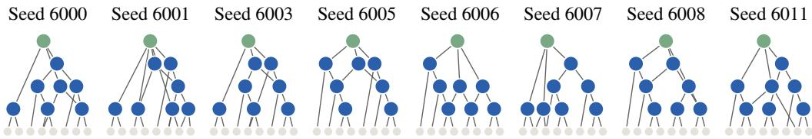  
Figure 8: Sampled computation graphs. Eight distinct topologies drawn from the depth-4 graph distribution. Each graph has eight active inputs, seven arity-two local functions, and three nonlinear levels, while branching, intermediate reuse, and readout connectivity vary.

Across 4,096 development draws, the sampler produces 354 distinct canonical topologies; a typical 32-instance cohort contains about 30 distinct topologies. Figure 8 shows eight distinct sampled topologies.

Depth-5 tree. The depth/scale extension is a balanced tree with 16 active inputs and four nonlinear levels containing 8, 4, 2, and 1 local functions.

## C.3 LOCAL-FUNCTION FAMILIES

CSFRBench uses two smooth local-function families with different interaction structure.

Additive–multiplicative functions. For parents $z _ { 1 } , \ldots , z _ { k }$ , we define

$$
g ( z _ { 1 } , \dots , z _ { k } ) = { \sqrt { \frac { 1 - \rho } { k } } } \sum _ { i = 1 } ^ { k } a _ { i } ( z _ { i } ) + { \sqrt { \rho } } \prod _ { i = 1 } ^ { k } b _ { i } ( z _ { i } ) ,
$$

where each one-dimensional factor is centered and standardized under the induced distribution of its parent. With independent standardized parents, the additive term contributes first-order variation while the product introduces a k-way interaction. We use $\rho = 0 . 5$ in the primary experiments.

The factors are sinusoidal. Before standardization,

$$
\widetilde { s } ( u ) = \sin ( 2 \pi \left( f u / 2 + \phi \right) ) , \qquad f \sim \mathrm { U } [ 0 . 2 5 , 0 . 4 ] , \quad \phi \sim \mathrm { U } [ 0 , 1 ) ,
$$

and

$$
s ( u ) = \frac { \widetilde { s } ( u ) - \mathbb { E } [ \widetilde { s } ( U ) ] } { \sqrt { \operatorname { V a r } [ \widetilde { s } ( U ) ] } } .
$$

At leaf nodes we use $u \ = \ \sqrt { 3 } x$ for $x \sim \mathrm { U } [ - 1 , 1 ] ;$ at deeper nodes, the parent values are the sequentially normalized intermediates described above.

Random Fourier functions. As a complementary local-function family, we use

$$
g _ { v } ( z ) = \frac { 1 } { \sqrt { Q } } \sum _ { q = 1 } ^ { Q } a _ { v , q } \sin ( \omega _ { v , q } ^ { \top } z + \phi _ { v , q } ) ,
$$

with $a _ { v , q } \sim \mathrm { U } [ 0 . 7 , 1 ] , \phi _ { v , q } \sim \mathrm { U } [ 0 , 2 \pi )$ , and $\omega _ { v , q } \sim \mathcal { N } ( 0 , \sigma _ { \omega } ^ { 2 } I _ { k } / k )$ . For arity-two functions we use $Q = 8$ and $\sigma _ { \omega } = 0 . 8 5$

For the arity-eight Fourier function, we use $Q = 2 4$ and $\sigma _ { \omega } = 1 . 5 $ . This setting remains learnable in isolation and therefore serves as the high-arity control. The arity-eight additive–multiplicative setting is substantially harder to fit locally and is retained as a stress setting rather than a decomposition control.

## C.4 TARGET GENERATION AND SEQUENTIAL NORMALIZATION

Each target instance fixes its computation graph, local-function parameters, active input coordinates, and normalization transforms. These quantities are sampled once and then held fixed across methods, training-set sizes, and train/validation/test datasets. Separate deterministic random streams govern the target structure and local functions, the assignment of active variables to ambient coordinates, and the normalization pool.

Inputs have independent coordinates $X _ { j } \ \sim \ \mathrm { U } [ - 1 , 1 ]$ . For each target instance, we propagate a deterministic pool of $2 ^ { 1 8 }$ inputs through the computation graph in topological order. At each local function, its output is centered and standardized under the induced parent distribution, and the stored affine transform is then used for all downstream computation and all later datasets. The final readout is standardized in the same way. Thus, every target intermediate and the final target have approximately zero mean and unit variance under the instance-specific normalization distribution.

The stored normalization transforms are part of the target instance and are never recomputed per method, training-set size, or dataset. A local-function draw is redrawn only if its raw standard deviation on the normalization pool is below $1 0 ^ { - 3 }$ or its output is non-finite; otherwise no targetlevel characterization statistic is used to accept or reject individual instances.

Training observations follow ${ \cal Y } = f ^ { \star } ( { \cal X } ) + \epsilon ,$ with $\epsilon \sim \mathcal { N } ( 0 , \sigma ^ { 2 } )$ . Unless otherwise specified, $\sigma ^ { 2 } = 0 . 0 1$

## C.5 TARGET CHARACTERIZATION

Before final evaluation, we characterize each target family on independently sampled development instances. Diagnostics include parent-wise sensitivity, functional-ANOVA and low-order Sobol indices where applicable (Sobol’, 1990; Homma & Saltelli, 1996), input-gradient statistics, and the distributions and tails of target intermediates and outputs. We also fit linear and pairwise-additive predictors using the true active inputs to detect target families whose input–output mapping is substantially simpler than the intended composition.

These diagnostics are used to characterize and, when necessary, revise a target family before final evaluation; they are not used to select individual final instances. Per-instance checks are limited to generation correctness, including finite values, required graph constraints, and numerical nondegeneracy.

Target-family choices are fixed using development targets without LeWi results. Final evaluation targets are sampled only after the benchmark protocol, comparison set, hyperparameter search spaces, and statistical analysis are fixed.

## C.6 LOCAL-FUNCTION FITTING

We fit each local-function family in isolation to separate local approximation from input selection and composition. Models receive exactly the arguments of the local function (d = k), with no inert inputs or observation noise. We evaluate 16 development draws per family.

We fit ReLU MLPs with one to four hidden layers and widths $W \in \Sigma ^ { \prime }$ {2, 4, 8, 16, 32, 64, 128, 256, 512, 1024}. Each model is trained with Adam for $3 2 { , } 0 0 0$ steps on 65,536 training examples, using eight scrambled-Sobol learning rates from $[ 1 0 ^ { - 4 } , 1 0 ^ { - 1 } ]$ ; model selection uses 16,384 validation examples and evaluation uses 65,536 test examples.

As shown in Figure 9, the arity-two functions are accurately fit at modest capacity: a one-hiddenlayer width-8 MLP achieves median NMSE 0.0085 for the additive–multiplicative family and 0.0016 for the Fourier family. The arity-eight Fourier function is also accurately learnable at moderate capacity, whereas the arity-eight additive–multiplicative function remains substantially harder even at much larger widths. We therefore use the former as the high-arity control and retain the latter only as a stress setting.

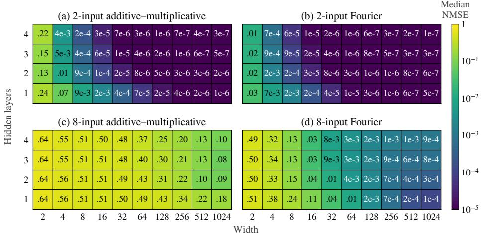  
Figure 9: Local-function fitting capacity. Median held-out NMSE over 16 development draws as a function of MLP width and hidden depth. Each model receives exactly the local-function arguments. (a,b) Arity-two local-function families. (c) Arity-eight additive–multiplicative stress setting. (d) Arity-eight Fourier control.

## C.7 GRAPH-INFORMED REFERENCES

GraphOracle(ℓ) uses the same MLP backbone and training protocol as the learned methods, but fixes its connectivity using the first ℓ nonlinear levels of the target computation graph. GraphOracle(0) supplies only the active input variables, while GraphOracle(all) supplies the full target connectivity. Intermediate variants progressively supply additional nonlinear levels.

To construct the masks, hidden units are partitioned into blocks associated with target intermediates. A block receives connections only from blocks corresponding to its supplied target parents; values reused downstream are carried forward and may fan out to multiple consumers. For a target with L nonlinear levels and an MLP with $H \geq L$ hidden layers, level r is assigned

$$
s _ { r } = \left\lfloor { \frac { r H } { L } } \right\rfloor - \left\lfloor { \frac { ( r - 1 ) H } { L } } \right\rfloor
$$

consecutive hidden layers. Values that must pass through an additional ReLU layer receive at least two units so that a signed scalar can be represented. Connections beyond the supplied prefix are left unrestricted. Masked layers are initialized according to their retained fan-in; otherwise the architecture, optimizer, and training protocol are unchanged. Figure 10 shows representative masks. GraphOracle is a diagnostic reference rather than a matched causal intervention, since masking changes both the hypothesis class and initialization.

## C.8 PREDICTIVE EVALUATION

For each target instance and training-set size, methods use the same training, validation, and test data. Validation and test sets contain 4,096 and 65,536 examples, respectively, and are fixed across training-set sizes. After model selection (Appendix C.12), the selected model is evaluated once on the test set against the noise-free target $f ^ { \star } ( \bar { X } )$

At training-set size n, we report normalized mean-squared error,

$$
\mathrm { N M S E } ( n ) = \frac { \mathbb { E } [ ( \hat { f } _ { n } ( X ) - f ^ { \star } ( X ) ) ^ { 2 } ] } { \mathrm { V a r } ( f ^ { \star } ( X ) ) } .
$$

For sample sizes $n _ { 1 } < \cdots < n _ { K }$ , we summarize the learning curve by

$$
\mathrm { A U L C } = { \frac { 1 } { \log _ { 2 } n _ { K } - \log _ { 2 } n _ { 1 } } } \sum _ { j = 1 } ^ { K - 1 } { \frac { \mathrm { N M S E } ( n _ { j } ) + \mathrm { N M S E } ( n _ { j + 1 } ) } { 2 } } ( \log _ { 2 } n _ { j + 1 } - \log _ { 2 } n _ { j } ) .
$$

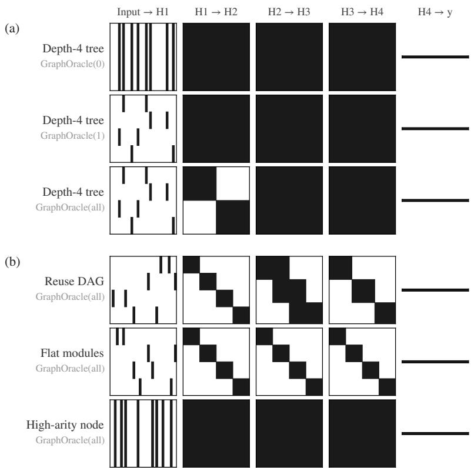  
Figure 10: GraphOracle connectivity masks. Black entries denote retained weights. (a) GraphOracle(0), GraphOracle(1), and GraphOracle(all) on the depth-4 tree. (b) GraphOracle(all) on the reuse DAG, flat modules, and high-arity node.

Lower AULC indicates better sample efficiency. Because the validation set is fixed across $n ,$ these curves measure performance as a function of training-set size under a fixed model-selection protocol, rather than total labeled-data requirements.

## C.9 LINEAR-PROBE PROTOCOL

Each target instance has an 8,192-example diagnostic pool, split deterministically into 4,096 probetraining, 2,048 probe-validation, and 2,048 probe-test examples. For each target intermediate $z _ { v }$ and learner hidden layer $h ^ { ( \ell ) }$ , we fit a ridge-regression probe to predict $z _ { v }$ from $\bar { h ^ { ( \ell ) } }$

Learner features are standardized and probe targets are centered using probe-training statistics only. Hidden features active on fewer than 10 probe-training examples are excluded before standardization. We select $\lambda \in \{ 1 0 ^ { - 4 } , 1 0 ^ { - 3 . 5 } , . . . , \overset { . } { 1 0 } ^ { 7 } \}$ by validation error and evaluate the selected probe once on the probe-test split without refitting. We report ordinary, unclipped held-out $R _ { v , \ell } ^ { 2 }$ as a measure of linear decodability of target intermediate v from hidden layer ℓ.

## C.10 COUNTERFACTUAL-INTERVENTION PROTOCOL

We use joint multi-variable Boundless Distributed Alignment Search (DAS) (Wu et al., 2023) to test whether target intermediates can be aligned with interventionally effective subspaces of a learner’s hidden state. For each learner and hidden layer, DAS learns an orthogonal rotation whose coordi nates are partitioned into disjoint blocks associated with the target intermediates.

For a base/source pair and target intermediate $v ,$ we replace only the block assigned to v in the rotated base representation with the corresponding source block, invert the rotation, and continue the learner forward pass. We compare the resulting final prediction with the target’s counterfactual final output obtained by replacing v with its source value and recomputing its descendants in the target graph. Learner parameters remain fixed throughout.

We report ordinary, unclipped held-out counterfactual $R ^ { 2 }$ . We probe hidden layers 1–4 using 10,000/1,000/2,000 counterfactual pairs per target intermediate for training/validation/test. DAS is optimized for 18 epochs with Adam, batch size 64, rotation learning rate 0.003, boundary learning rate 0.0003, and validation every 200 updates. We use three restarts and select the restart and learner layer on validation data before one test evaluation.

The implementation uses half-offset boundary coordinates, a zero-capable width clamp, sharedbudget simplex rescaling, and temperature scaling by d/4096. Protocol constants were fixed on development targets using planted networks and GraphOracle controls. The protocol is calibrated for the width-32, four-hidden-layer backbone and is therefore not applied to the depth-5 setting.

This diagnostic tests counterfactual agreement under a jointly fitted, target-aligned subspace decomposition. Failure to find such a decomposition does not rule out other, potentially overlapping or nonlinear, representations of the target intermediates.

## C.11 LEARNER ARCHITECTURE AND TRAINING

The local-function fits in Figure 9 show that the arity-two constituent functions are accurately approximated at modest capacity. For all settings except the depth-5 tree, we use a ReLU MLP with width 32 and four hidden layers. The depth-5 tree uses width 64 and eight hidden layers. All methods use the same backbone within each setting.

Models are trained with Adam using $\beta _ { 1 } = 0 . 9 , \beta _ { 2 } = 0 . 9 9 9 , { \epsilon } = 1 0 ^ { - 8 }$ , batch size 32, and zero optimizer weight decay. The initial learning rate is selected by hyperparameter search and follows cosine decay to 1% of its initial value. We use no warmup or early stopping. The eight-input settings use 64,000 steps, with validation every 1,000 steps; the depth-5 tree uses 128,000 steps, with validation every 2,000 steps. Both protocols retain 64 validation checkpoints. The nuisanceinput settings use the corresponding training budgets and validation schedules.

## C.12 HYPERPARAMETER SEARCH AND MODEL SELECTION

Each method uses a fixed search space constructed on development targets and frozen before final evaluation. A development panel selects the validation-best configuration in each condition. For each searched numerical parameter, the span of the selected values is expanded by 25% of its width in log space, split equally between the two sides, and clipped only to predefined domain boundaries.

For final evaluation, we use $T = 3 2$ scrambled-Sobol configurations per method, target instance, and training-set size. For each configuration, we retain the checkpoint with lowest validation NMSE, then select the configuration with lowest validation NMSE and evaluate it once on the held-out test set. Table 2 reports the frozen search spaces.

Search-space audit. As a post hoc check of the frozen search ranges, we measure the fraction of selected hyperparameters lying within 10% of either boundary in the corresponding search coordinate. In the primary d = 8 evaluation, across all methods, searched parameters, and both backbones, the largest boundary occupancy is 0.17, and median normalized positions range from 0.31 to 0.76. For LeWi, only 2% of selected learning rates on the 32 × 4 backbone and 3% on the depth-5 backbone lie near a boundary. Thus, the primary results show no substantial concentration of selected hyperparameters at the edges of the frozen search spaces. The nuisance-input evaluation shows the same pattern on the 32 × 4 backbone. On the depth-5 nuisance-input setting, the BIMT and $\ell _ { 1 }$ regularization coefficients lie near a frozen search boundary for 33% and 26% of selected configurations, respectively, so these two baseline results may be sensitive to the chosen search range. No search space was modified based on this audit.

## C.13 STATISTICAL REPORTING

Fixed-graph settings use 16 independently sampled target instances; the sampled-graph setting uses 32 independently sampled graph/function instances. We report arithmetic mean AULC with twosided 95% Student-t confidence intervals over instances. Direct method comparisons use paired per-instance AULC differences with corresponding paired Student-t intervals.

Table 2: Hyperparameter search spaces. Frozen ranges used in the final CSFRBench evaluation and reported appendix experiments. All searched numerical parameters are sampled log-uniformly. Search ranges are constructed on development targets before final evaluation. The depth-5 tree uses separately frozen ranges because it has a different backbone and training horizon. A dash indicates that an experiment is not evaluated on that backbone.
<table><tr><td>Method</td><td>Parameter</td><td>32 × 4 backbone</td><td>Depth-5 tree (64 × 8)</td></tr><tr><td>Dense</td><td>learning rate</td><td> $\left\lceil 0 . 0 0 1 4 3 , 0 . 2 6 1 \right\rceil$ </td><td> $[ 7 . 7 0 \times 1 0 ^ { - 4 } , 0 . 4 7 5 ]$ </td></tr><tr><td> $\ell _ { 1 }$ </td><td>learning rate  $\lambda$ </td><td> $[ 1 . \dot { 5 } 7 \times 1 0 ^ { - 6 } , 0 . 3 \dot { 4 } 9 ]$   $[ 1 0 ^ { - 7 } , 6 7 0 ]$ </td><td> $[ 2 . 7 2 \times 1 0 ^ { - 4 } , 0 . 4 5 7 ]$   $\mathbf { \bar { \Gamma } } [ 1 0 ^ { - 7 } , 6 . 2 8 \times 1 0 ^ { 1 1 } ]$ </td></tr><tr><td> $\ell _ { 2 }$ </td><td>learning rate  $\lambda$ </td><td> $\left[ 2 . 1 \dot { 6 } \times 1 0 ^ { - 5 } , \dot { 0 . 6 4 8 } \right]$   $\mathsf { \bar { \rho } _ { [ 1 0 ^ { - 7 } , 1 . 1 3 \times 1 0 ^ { 3 } ] } }$ </td><td> $[ \dot { 1 } . 9 3 \times 1 0 ^ { - 5 } , 0 . 1 1 \dot { 5 } ]$   $\overline { { [ 1 0 ^ { - 7 } , 7 . 2 6 \times 1 0 ^ { 3 } ] } }$ </td></tr><tr><td> $L _ { 0 }$ </td><td>learning rate  $\lambda$ </td><td> $\left[ 2 . 6 7 \times 1 0 ^ { - 4 } , 0 . 0 4 4 3 \right]$   $[ 1 0 ^ { - 7 } , 1 5 7 ]$ </td><td> $[ 2 . 4 6 \times 1 0 ^ { - 4 } , 0 . 0 0 8 3 9 ]$   $[ 1 0 ^ { - 7 } , 7 5 . 5 ]$ </td></tr><tr><td>RigL</td><td>learning rate density</td><td> $[ 1 . 0 1 \times 1 0 ^ { - 5 } , 0 . 2 3 4 ]$   $[ 0 . 0 3 0 9 , 1 ]$ </td><td> $[ 1 . 0 0 \times 1 0 ^ { - 5 } , 0 . 0 1 2 1 ]$   $[ 0 . 0 1 5 5 , 0 . 7 2 0 ]$ </td></tr><tr><td>BIMT</td><td>learning rate  $\lambda$ </td><td> $[ 1 . 1 8 \dot { ~ } \times 1 0 ^ { - 5 } , \dot { 0 } . 1 2 5 ]$   $\left[ 1 0 ^ { - 7 } , 0 . 4 5 3 \right]$ </td><td> $[ 9 . \dot { 8 } 8 \times 1 0 ^ { - 7 } , 0 . \dot { 2 } 6 5 ]$   $\left[ 1 0 ^ { - 7 } , 1 . 3 5 \times 1 0 ^ { 3 } \right]$ </td></tr><tr><td>Fiedler</td><td>learning rate  $\delta$ </td><td> $[ 3 . 4 \dot { 7 } \times 1 0 ^ { - 5 } , 0 . \dot { 2 } 6 8 ]$   $\left[ 1 0 ^ { - 7 } , 2 . 8 3 \times 1 0 ^ { 8 } \right]$ </td><td> $[ 5 . 7 8 \times 1 0 ^ { - 6 } , 0 . 0 3 \dot { 3 } 4 ]$   $[ 1 0 ^ { - 7 } , 2 . 6 6 \times 1 0 ^ { 7 } ]$ </td></tr><tr><td>Neuron positions LeWi</td><td>learning rate</td><td> $[ \mathrm { i . 2 8 \times 1 0 ^ { - 5 } , 0 . 4 3 \mathrm { \dot { 1 } } } ]$ </td><td> $[ \dot { 4 } . 2 0 \times 1 0 ^ { - 7 } , 0 . 1 9 \dot { 4 } ]$ </td></tr><tr><td>GraphOracle(1)</td><td>learning rate learning rate</td><td> $[ \dot { 4 } . 5 8 \times 1 0 ^ { - 6 } , 0 . 0 9 9 \dot { 9 } ]$   $[ 0 . 0 0 1 6 1 , 0 . 1 4 9 ]$ </td><td> $[ \mathsf { 7 . 9 2 } \times 1 0 ^ { - 7 } , 0 . 0 7 1 \dot { 2 } ]$ </td></tr><tr><td>GraphOracle(2)</td><td>learning rate</td><td> $[ \dot { 0 } . 0 0 2 0 0 , 0 . 0 7 9 \dot { 9 } ]$ </td><td> $[ 5 . 2 8 \times 1 0 ^ { - 4 } , 0 . 0 3 0 1 ]$   $[ 0 . 0 0 1 0 2 , 0 . 0 2 5 6 ]$ </td></tr><tr><td>GraphOracle(all)</td><td>learning rate</td><td>[0.00200, 0.0799]</td><td> $[ 0 . 0 0 1 2 5 , 0 . 0 1 9 0 ]$ </td></tr><tr><td>Appendix experiments (LeWi variants)</td><td></td><td></td><td></td></tr><tr><td>Mechanism ablations (3 arms)</td><td>learning rate</td><td> $[ 4 . 5 8 \times 1 0 ^ { - 6 } ,$ </td><td></td></tr><tr><td>Mask-only forward</td><td></td><td>0.0999]</td><td></td></tr><tr><td> $r \in \{ 1 , 2 , 4 , 8 \}$ </td><td>learning rate</td><td> ${ \bf \bar { 1 } . 5 8 \times 1 0 ^ { - 6 } , }$  0.0999]</td><td></td></tr><tr><td></td><td>learning rate</td><td> $\left[ 4 . 5 8 \times 1 0 ^ { - 6 } , 0 . 0 9 9 9 \right]$ </td><td></td></tr><tr><td>Radius multiplier  $\in \{ 0 . 5 , 0 . 7 5 , 1 . 5 , 2 \}$ </td><td>learning rate</td><td> ${ \left[ 4 . 5 8 \times 1 0 ^ { - 6 } \right. } ,$  0.0999]</td><td></td></tr><tr><td>Initialization scale  $\in \{ 0 . 5 , 2 \}$ </td><td>learning rate</td><td> $\left[ 4 . 5 8 \times 1 0 ^ { - 6 } , 0 . 0 9 9 9 \right]$ </td><td></td></tr><tr><td> ${ \mathrm { S e e d ~ r e p l i c a t e s } } \in \{ 1 , 2 , 3 , 4 \}$ </td><td>learning rate</td><td> $[ 4 . 5 8 \times 1 0 ^ { - 6 } ;$  0.0999]</td><td></td></tr></table>

The mechanism ablations are soft-only (no mask), fixed embeddings, and random sparse mask. Fixed settings: for $L _ { 0 } , p _ { \mathrm { o p e n , i n i t } } = 0 . 8 3 1 8 ;$ the GraphOracle levels and $\mathrm { L e W i ^ { \cdot } s } \bar { r } = 3 , R ^ { 2 } = 1 . 5$ are method constants, not searched.

Table 3: Mean AULC on the fixed CSFRBench settings. Values are means over 16 target instances with 95% Student-t confidence half-widths. AULC integrates test NMSE over ${ \overline { n } } = 2 ^ { 9 } , \dots , 2 ^ { 1 5 }$ ; lower is better.
<table><tr><td>Method</td><td>Depth-4 tree</td><td>Depth-3 reuse DAG</td><td>Depth-4 Fourier tree</td><td>Flat modules</td><td>Fourier reuse DAG</td><td>High-arity node</td></tr><tr><td>LeWi</td><td></td><td></td><td>0.508±0.062 0.179±0.042 0.035±0.013 0.008±0.001 0.019±0.006 0.085±0.011</td><td></td><td></td><td></td></tr><tr><td>Dense</td><td></td><td></td><td>0.633±0.059 0.271±0.056 0.071±0.023 0.018±0.002 0.043±0.009 0.066±0.008</td><td></td><td></td><td></td></tr><tr><td> $\ell _ { 1 }$ </td><td></td><td></td><td>0.626±0.061 0.268±0.061 0.044±0.020 0.013±0.002 0.027±0.007 0.066±0.008</td><td></td><td></td><td></td></tr><tr><td> $\ell _ { 2 }$ </td><td></td><td></td><td>0.593±0.061 0.220±0.056 0.046±0.019 0.015±0.002 0.027±0.005 0.048±0.006</td><td></td><td></td><td></td></tr><tr><td> $L _ { 0 }$ </td><td></td><td></td><td>0.569±0.065 0.232±0.060 0.056±0.020 0.027±0.004 0.038±0.008 0.089±0.010</td><td></td><td></td><td></td></tr><tr><td>RigL</td><td></td><td></td><td>0.587±0.060 0.234±0.060 0.046±0.016 0.017±0.003 0.028±0.006 0.077±0.010</td><td></td><td></td><td></td></tr><tr><td>BIMT</td><td></td><td></td><td>0.592±0.061 0.211±0.056 0.040±0.015 0.013±0.002 0.023±0.005 0.066±0.009</td><td></td><td></td><td></td></tr><tr><td>Fiedler</td><td></td><td></td><td>0.632±0.0540.285±0.0580.068±0.0230.022±0.0030.042±0.0090.063±0.007</td><td></td><td></td><td></td></tr><tr><td></td><td>Neuron positions0.861±0.030 0.643±0.059 0.213±0.055 0.233±0.032 0.204±0.051 0.404±0.059</td><td></td><td></td><td></td><td></td><td></td></tr><tr><td>GraphOracle(0)</td><td></td><td></td><td></td><td></td><td></td><td></td></tr><tr><td>GraphOracle(1)</td><td>0.491±0.055 0.085±0.026 0.040±0.013</td><td></td><td></td><td></td><td>0.015±0.003</td><td></td></tr><tr><td></td><td>GraphOracle(all) 0.388±0.054 0.044±0.012 0.025±0.008 0.003±0.000 0.009±0.001</td><td></td><td></td><td></td><td></td><td></td></tr></table>

Learning-curve figures show mean NMSE across instances, with 95% Student-t confidence intervals computed in log-NMSE space. Confidence intervals are reported as uncertainty estimates for effect sizes; comparisons whose paired interval contains zero are treated as inconclusive rather than tied. We do not report p-values.

## D ADDITIONAL CSFRBENCH RESULTS AND CONTROLS

## D.1 COMPLETE PREDICTIVE RESULTS

Figure 11 reports the complete learning curves for all methods and CSFRBench settings. Figure 12 shows the corresponding paired AULC comparisons with LeWi. Across the low-arity settings, LeWi has lower mean AULC than every learned baseline. The high-arity node provides the main exception, where Dense achieves lower AULC than LeWi. Tables 3 and 4 provide the corresponding numerical results for the fixed settings, the depth-5 tree, and independently sampled graphs.

## D.2 REPRESENTATION DIAGNOSTICS

Additional learned baselines. Figure 13 extends the main representation analysis to $L _ { 0 } ,$ , RigL, and BIMT. LeWi generally shows higher counterfactual agreement than these learned baselines for level-1 and level-2 intermediates. BIMT also exhibits relatively high linear decodability without corresponding intervention scores, further illustrating that decodability and use in prediction are distinct diagnostics.

Across training-set size and target structure. Figure 14 evaluates both diagnostics across training-set sizes on the depth-4 tree, reuse DAG, and Fourier tree. LeWi generally exceeds Dense in both maximum probe $R ^ { \frac { \mathtt { i } } { 2 } }$ and counterfactual $R ^ { 2 }$ on the tree and reuse DAG. The differences are smaller on the Fourier tree, where the methods converge at larger training-set sizes. These results show that the representation differences in Figure 5 are not specific to a single training-set size or target family.

## D.3 NUISANCE-INPUT RESULTS

We repeat the benchmark on the same target instances after increasing the ambient dimension to d = 32. The eight-input settings receive 24 inert coordinates, while the depth-5 tree receives 16 inert coordinates in addition to its 16 active inputs. All other elements of the training and evalua-

Table 4: AULC on the depth-5 tree and on independently sampled depth-4 DAGs. Mean AULC with 95% Student-t half-widths, and AULC(LeWi)−AULC(method) as mean [95% paired Student-t interval] over the number of instances on which LeWi has lower AULC; negative values favor LeWi. The depth-5 tree (16 target instances; width 64, eight hidden layers, 128,000 steps) integrates test NMSE over $n = \overbrace { 2 ^ { 1 1 } } , \dots , 2 ^ { 1 7 }$ , the 32 independently sampled depth-4 DAG/function instances over $n = 2 ^ { 9 } , \ldots , 2 ^ { 1 5 }$ ; neither range matches Table 3, so AULC values are comparable within a column only.
<table><tr><td rowspan="2"></td><td colspan="2">Depth-5 tree</td><td colspan="2">Independently sampled depth-4 DAGs</td></tr><tr><td>AULC</td><td>LeWi – method</td><td>AULC</td><td>LeWi – method</td></tr><tr><td>LeWi</td><td>0.812±0.037</td><td></td><td>0.197±0.030</td><td></td></tr><tr><td>Dense</td><td></td><td>1.185±0.572 -0.374[-0.950, +0.203] 0.268±0.033 -0.072[-0.080, -0.063]</td><td></td><td></td></tr><tr><td> $\ell _ { 1 }$ </td><td></td><td>(16/16) 0.905±0.020 -0.093[−0.114, -0.073] 0.244±0.031 -0.047[−0.056, -0.038]</td><td></td><td>(32/32)</td></tr><tr><td> $\ell _ { 2 }$ </td><td></td><td>(16/16) 0.895±0.021 -0.084[−0.103, -0.065] 0.245±0.033 -0.049[-0.059, -0.039]</td><td></td><td>(32/32)</td></tr><tr><td> $L _ { 0 }$ </td><td></td><td>(16/16) 0.882±0.025 -0.070 [-0.089, -0.052] 0.245±0.033 -0.048[-0.056, -0.040]</td><td></td><td>(32/32)</td></tr><tr><td>RigL</td><td></td><td>(16/16) 0.884±0.023 −0.072[−0.090, −0.054] 0.241±0.032 −0.044[−0.053, −0.035]</td><td></td><td>(32/32)</td></tr><tr><td>BIMT</td><td></td><td>(16/16) 0.903±0.020 -0.091[−0.111, -0.071] 0.247±0.033 -0.050[−0.061, -0.040]</td><td></td><td>(31/32)</td></tr><tr><td>Fiedler</td><td></td><td>(16/16) 0.913±0.018 -0.102[-0.124, -0.080] 0.268±0.033 -0.071[-0.081, -0.062]</td><td></td><td>(31/32)</td></tr><tr><td></td><td></td><td>(16/16) Neuron positions 0.992±0.003 -0.181 [−0.215, -0.146] 0.503±0.037 -0.307[−0.340, -0.273]</td><td></td><td>(32/32)</td></tr><tr><td>GraphOracle(0)</td><td></td><td>(16/16)</td><td></td><td>(32/32)</td></tr><tr><td>GraphOracle(1)</td><td></td><td>0.717±0.038 +0.095[+0.079, +0.110] 0.206±0.030 -0.009[-0.018, +0.000]</td><td></td><td></td></tr><tr><td>GraphOracle(2)</td><td></td><td>(0/16)</td><td></td><td>(20/32) 0.531±0.047 +0.280 [+0.255, +0.305] 0.151±0.024 +0.046 [+0.035, +0.056]</td></tr><tr><td></td><td></td><td>(0/16)</td><td></td><td>(1/32) GraphOracle(all) 0.458±0.051 +0.353 [+0.326, +0.381] 0.111±0.022 +0.086 [+0.072, +0.100] (0/32)</td></tr></table>

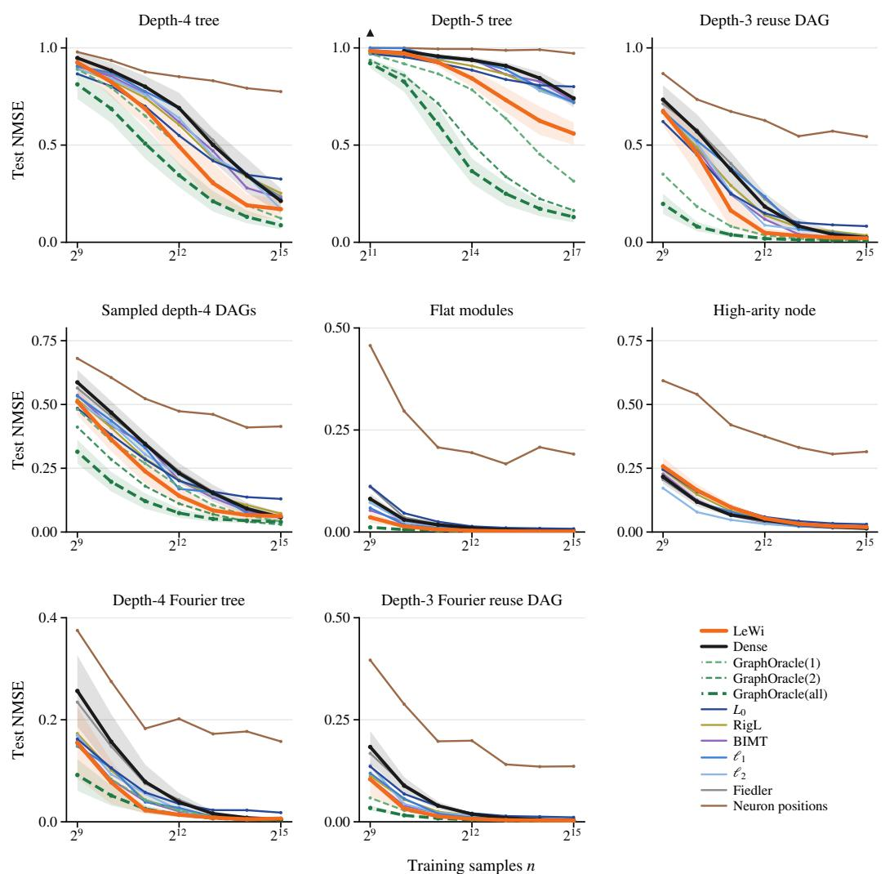  
Figure 11: Complete CSFRBench learning curves. Held-out test NMSE versus training-set size for all evaluated methods and settings. Fixed settings are averaged over 16 target instances and sampled graphs over 32 graph/function instances. Bands show 95% Student-t confidence intervals for highlighted methods, and triangles mark means outside the displayed range.

tion protocol are unchanged. Thus, the all-active and nuisance-input settings can be compared on matched target instances.

Figure 15 reports the complete nuisance-input learning curves, including the depth-5 tree. Figure 16 gives the corresponding paired comparisons against the learned baselines and graph-informed refer ences.

## D.4 WIRING ALIGNMENT

Module-graph extraction. For each trained LeWi network, we retain hidden neurons lying on an active input-to-output path and cluster their embeddings separately within each hidden layer by average linkage, cutting the dendrogram at the connection radius R. Each input and the output form individual modules. We connect two modules in adjacent layers when more than half of their candidate neuron-to-neuron connections are active. This step uses only the learned embeddings and masks.

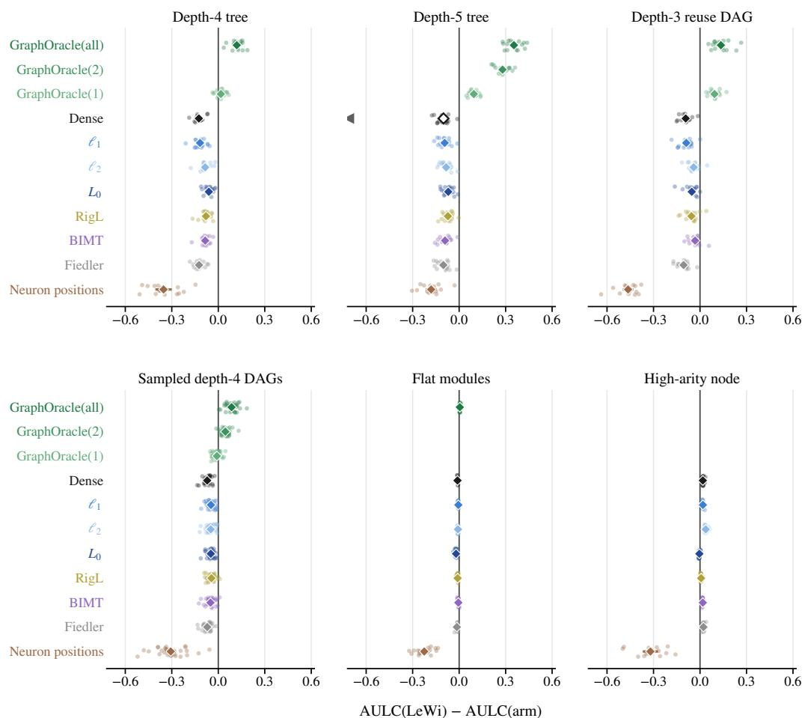  
Figure 12: Paired predictive comparisons across CSFRBench. Paired AULC differences between LeWi and every baseline or graph-informed reference. Negative values indicate lower AULC for LeWi. Points and intervals show means and 95% Student-t confidence intervals over target instances. Triangles mark means outside the displayed range, and hollow diamonds show the corresponding medians.

Sensitivity to module extraction. The reported analysis uses average-linkage clustering with a dendrogram cut at R. On development targets, we also evaluated cuts at 0.75R and 1.25R and alternative linkage rules. The resulting scores depend on the extraction rule, so we fix average linkage at R for the reported evaluation.

Target matching and scoring. We then use target intermediates only to assign semantic correspondences. For each candidate module and target intermediate, we fit a ridge probe and compare its validation $R ^ { 2 }$ with 200 random neuron sets matched in size and layer. Pairs above the 95th percentile of these reference scores are eligible for a one-to-one assignment chosen to maximize validation $R ^ { 2 }$ . Dependencies are inferred from paths between matched modules, including paths through unmatched modules, and the resulting graph is transitively reduced. We report edge precision, recall, and F1 over all target edges and separately over edges originating at target intermediate nodes. Because target intermediates are used for post hoc matching, these metrics measure structural agreement with the target graph rather than graph recovery.

Results. Table 5 reports per-setting precision, recall, and $F _ { 1 }$ . Precision exceeds recall in every setting, so missed target edges are more common than spurious edges. Some missed edges arise when a target intermediate has no matched module. Figure 17 shows representative target and extracted module graphs, and Figure 18 shows alignment across training-set size.

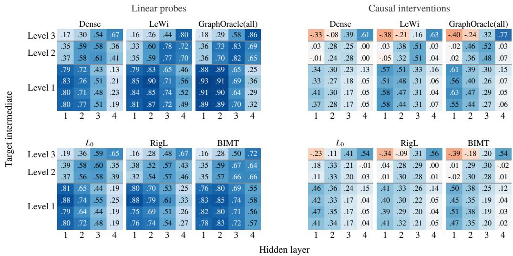  
Figure 13: Representation diagnostics for additional learned baselines. Left: held-out $R ^ { 2 }$ from ridge probes predicting each target intermediate from each hidden layer. Right: held-out counterfactual $\bar { R ^ { 2 } }$ under joint multi-variable Boundless DAS. The top row repeats Dense, LeWi, and GraphOracle(all) from Figure $5 ,$ while the bottom row shows $L _ { 0 } ,$ RigL, and BIMT. Rows are grouped by target level and columns correspond to hidden layers. Results are for the depth-4 tree at $n = 2 ^ { 1 4 }$ averaged over 16 target instances.

Table 5: Wiring alignment at $n = 2 ^ { 1 5 }$ . Precision, recall, and $F _ { 1 }$ between the extracted module graph and the target computation graph, reported over all target edges and over edges originating at target intermediate nodes. Assessable recall restricts to target edges whose endpoints have matched modules.
<table><tr><td rowspan="2">Setting</td><td colspan="3">All edges</td><td colspan="3">From intermediates</td><td colspan="2">Assessable edges</td></tr><tr><td>Precision</td><td>Recall</td><td> $F _ { 1 }$ </td><td>Precision</td><td>Recall</td><td> $F _ { 1 }$ </td><td>Recall</td><td>Share</td></tr><tr><td>Depth-4 tree</td><td>0.677</td><td>0.579</td><td>0.623</td><td>0.503</td><td>0.375</td><td>0.425</td><td>0.731</td><td>0.800</td></tr><tr><td>Reuse DAG</td><td>0.886</td><td>0.695</td><td>0.777</td><td>0.829</td><td>0.493</td><td>0.613</td><td>0.772</td><td>0.915</td></tr><tr><td>Fourier tree</td><td>0.518</td><td>0.446</td><td>0.478</td><td>0.403</td><td>0.321</td><td>0.354</td><td>0.508</td><td>0.895</td></tr><tr><td>Sampled depth-4 DAGs</td><td>0.674</td><td>0.509</td><td>0.575</td><td>0.634</td><td>0.423</td><td>0.499</td><td>0.542</td><td>0.935</td></tr></table>

Values are means of instance-level metrics rather than metrics computed from pooled edge counts.

Embedding visualizations. The low-dimensional neuron embeddings also provide a direct view of the learned wiring. Figure 19 extends the visualization in Figure 1 across several target structures. Colors indicate post hoc associations with target intermediates, and lines indicate active connections. These embedding visualizations and their training trajectories are also available in the interactive demo linked in Figure 1.

## D.5 LEARNED CONNECTION DENSITY

Figure 20 reports the fraction of active connections in the selected LeWi models across training-set size. Initialization has active-edge fraction 0.61 in every setting. On the all-active compositional settings, the selected models have densities of 0.29–0.40, while the high-arity control remains near its initialization density. With nuisance inputs, the corresponding compositional settings fall further to 0.24–0.31, while the high-arity control retains density 0.42. The depth-5 tree is near 0.42 in both conditions.

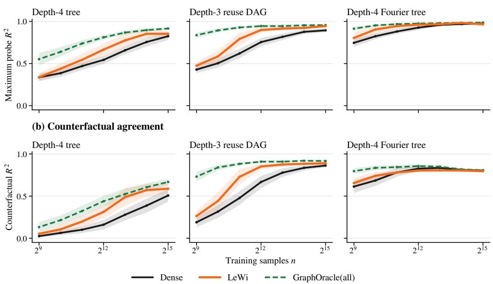  
Figure 14: Representation diagnostics across training-set size and target structure. (a) Maximum held-out ridge-probe $R ^ { 2 }$ on the depth-4 tree, reuse DAG, and Fourier tree. For each target intermediate, we take the maximum $R ^ { 2 }$ across hidden layers and then average across target intermediates and target instances. (b) Mean held-out counterfactual $R ^ { 2 }$ under joint multi-variable Boundless DAS on the same target families. Curves show Dense, LeWi, and GraphOracle(all), averaged over 16 target instances with 95% Student-t confidence intervals.

The sparsity is also structured across network depth. The input transition is generally the sparsest, reaching active-edge fractions of 0.07–0.29 with nuisance inputs, while the readout is typically the densest transition on compositional targets. Density increases modestly with training-set size in most settings. The depth-5 tree is the main exception, decreasing from 0.58 at $n = 2 ^ { \overleftarrow { 1 } 1 }$ to 0.38 at $n = 2 ^ { 1 7 }$ in the all-active setting, with a similar trend when nuisance inputs are present.

## D.6 PARAMETERIZATION SENSITIVITY

We test sensitivity to the embedding dimension r, connection threshold $R ^ { 2 }$ , and initialization scale $\sigma _ { e }$ (Figure 21). Performance is relatively stable near the adopted configuration. Embedding dimensions $r \in \{ 1 , 2 , 3 , 4 \}$ perform similarly, while r = 8 increases AULC. Moderate changes to $R ^ { 2 }$ also have small effects, whereas larger departures can reduce sample efficiency. Sensitivity to $\sigma _ { e }$ is stronger on the depth-4 tree, particularly at the larger initialization scale. Overall, the adopted configuration lies in a relatively stable region rather than at a sharply isolated optimum.

## D.7 COMPUTATIONAL COST

LeWi adds 5–12% more parameters than Dense. Its computational overhead comes from computing and differentiating pairwise embedding distances, gates, and masks. We accelerate training by batching independent networks and using fused C++ kernels, while similarly optimizing Dense through batching and compilation. These optimizations preserve the original training algorithms and protocols. In matched CPU experiments, LeWi incurs 32% and 2% higher end-to-end runtime than Dense on the 32 × 4 and 64 × 8 backbones, respectively (Table 6). LeWi still evaluates all candidate connections densely, so learned sparsity does not reduce training computation. At inference, the learned gates and masks can be folded into the weights.

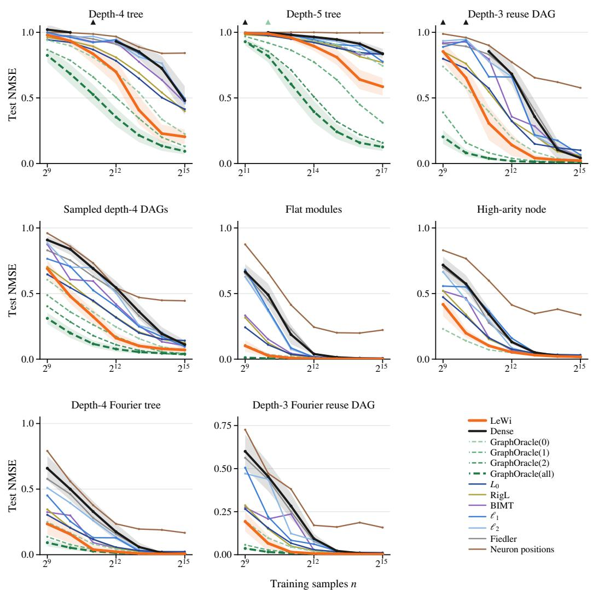  
Figure 15: Complete CSFRBench learning curves with nuisance inputs. Held-out test NMSE versus training-set size with ambient dimension $d = 3 2$ . The depth-4 settings contain eight active and 24 inert inputs, while the depth-5 tree contains 16 active and 16 inert inputs. Fixed settings are averaged over 16 target instances and sampled graphs over 32 graph/function instances. Bands show 95% Student-t confidence intervals for highlighted methods, and triangles mark means outside the displayed range.

## E WORLD-MODEL EXPERIMENTS

## E.1 TASK SUITE

We use the state-based, continuous-action environments of stable-worldmodel (Maes et al., 2026). The registry contains 21 environments that run under this interface. At the final $2 5 6 \times 4$ protocol, 17 satisfy the fixed eligibility criteria described below and form the evaluation suite.

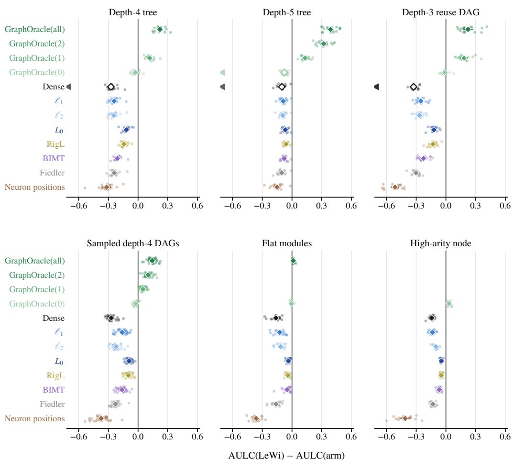  
Figure 16: Paired predictive comparisons with nuisance inputs. Paired AULC differences between LeWi and every baseline or graph-informed reference at $d = 3 2$ . Negative values indicate lower AULC for LeWi. Points and intervals show means and 95% Student-t confidence intervals over target instances. Triangles mark means outside the displayed range, and hollow diamonds show the corresponding medians.

Table 6: Computational cost of LeWi and Dense. Parameters and runtime (seconds per trained network) using optimized CPU implementations. Runtime includes training, validation, and testing, with both methods run concurrently on the same node (one thread per process).
<table><tr><td rowspan="2">Backbone</td><td colspan="2">Parameters</td><td colspan="3">Runtime (s)</td></tr><tr><td>Dense</td><td>LeWi</td><td>Dense</td><td>LeWi</td><td>Ratio</td></tr><tr><td> $3 2 \times 4$ </td><td>3,489</td><td>3,900</td><td>5.2</td><td>6.8</td><td>1.32</td></tr><tr><td> $6 4 \times 8$ </td><td>30,273</td><td>31,860</td><td>84.3</td><td>85.6</td><td>1.02</td></tr></table>

The tasks span state dimensions from 2 to 78 and action dimensions from 1 to 12. They cover qualitatively different transition structure: Pendulum and Cartpole have smooth low-order dynamics; Cheetah, Hopper, Walker, and Quadruped contain articulated rigid-body dynamics with local joint interactions; Ball in cup and the manipulation tasks introduce contact-dependent transitions; the navigation environments combine simple motion with wall constraints; and Piecewise uses a regiondependent transition law. Thus the suite varies both ambient dimension and the form of structure available in the dynamics.

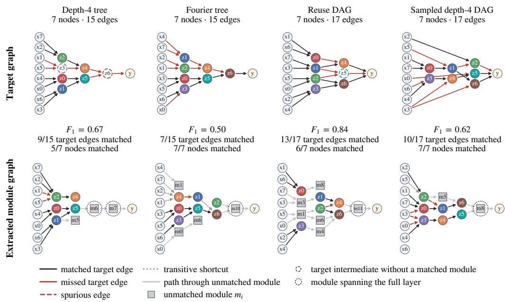  
Figure 17: Representative target and extracted module graphs. Each column shows a target computation graph (top) and the module graph extracted from one trained LeWi network (bottom). Colors denote post hoc matches between modules and target intermediates. Black edges correspond to target dependencies, red target edges are missed, and the remaining edge styles indicate spurious connections, transitive shortcuts, or paths through unmatched modules. These examples illustrate the graph comparison summarized by edge precision, recall, and $F _ { 1 }$ . Each example is the network with upper-median edge $F _ { 1 }$ in its setting.

Task eligibility. The screen retains tasks on which predictive learning methods can be meaningfully distinguished. It uses only Dense, ridge regression, a persistence predictor, and simulator replay; LeWi and the regularized baselines do not enter task selection. A task must improve over persistence and ridge regression, avoid numerical floor and ceiling regimes, not be dominated by model capacity, exhibit a data-limited regime over the evaluated sample sizes, and replay correctly in the simulator. The criteria and thresholds are fixed across tasks. Under the width-256, four-hiddenlayer protocol, 17 of the 21 registry tasks satisfy all criteria and form the evaluation suite. Humanoid walk and OGBench cube were run under the full protocol but failed the screen, while Mountain car and OGBench scene failed before full evaluation. Humanoid walk failed the Dense-versus-ridge criterion; OGBench cube additionally lacked a data-limited regime and reliable simulator replay; Mountain car lacked a data-limited regime; and OGBench scene failed the Dense-versus-ridge and data-limited-regime criteria.

## E.2 EXPERIMENTAL PROTOCOL

Data. For each task, we collect exploratory trajectories using temporally correlated random actions within the environment’s action bounds. Datasets are split by episode into 80% training, 10% validation, and 10% test sets. Training sets are nested prefixes with $n \in \{ 2 ^ { 1 3 } , \ldots , 2 ^ { 1 9 } \}$ transitions and are shared across methods. Angular coordinates are represented by sine and cosine pairs. Unit-circle and quaternion features are renormalized after each predicted rollout step.

Prediction problem. Models receive the current state and action and predict the change in state. State changes are standardized using statistics computed from the corresponding training subset. At evaluation time, predictions are rolled forward autoregressively using the recorded action sequence.

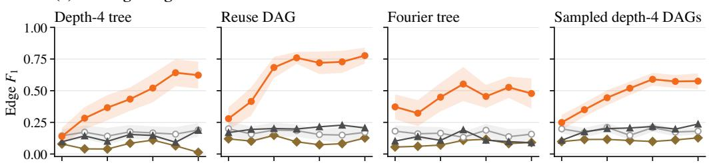  
(b) Edges originating at target intermediate nodes

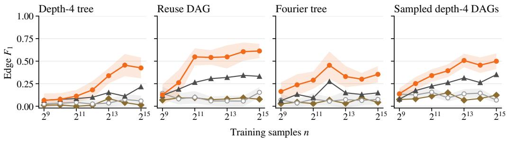  
LeWi (trained) degree-preserving rewiring initialization modules shuffled  
Figure 18: Wiring alignment across training-set size. Edge F1 of the extracted module graph against the target computation graph as the number of training samples increases. Filled markers report F1 over all target edges; hollow markers report F1 for edges originating at target intermediate nodes. Curves show trained LeWi and the corresponding initialization and randomized controls, averaged over target instances with 95% Student-t confidence intervals.

Training and model selection. All methods use a width-256, four-hidden-layer ReLU MLP with vector output. Models are trained for 128,000 Adam steps with batch size 32 and cosine learningrate decay to 1% of the initial rate. Validation is performed every 500 steps and the best validation checkpoint is retained. For each task, training-set size, and method, we evaluate 32 scrambled-Sobol hyperparameter configurations, ranked by mean validation rollout NMSE over horizons 1, 2, 4, 8, 16, with one-step validation NMSE used only as a tie-breaker. The selected configuration is evaluated using 16 paired final seeds. Table 7 reports the final search spaces. For Dense and $\ell _ { 1 }$ , a post hoc audit found selected learning rates within 10% of the initial lower bound in 32% and 25% of task–trainingset-size combinations, respectively. Before rerunning either method, we fixed the correction rule to extend only its lower learning-rate bound by one decade, leaving all other search ranges unchanged. We then repeated the full 32-configuration search and final evaluation for both methods. LeWi uses the same initialization checks as in CSFRBench (Appendix B.1).

Validation-only stability re-selection. To reduce sensitivity to unstable configurations selected from a single search seed, we apply a second validation-only selection stage to cells satisfying a fixed instability criterion. A cell is flagged when the geometric mean validation rollout error across its final seeds is at least 1.5× that of the selected search trial, or an individual final exceeds 10× the cell median, and its mean validation log-error exceeds both neighboring training-set sizes by at least 0.10. For a flagged cell, the four highest-ranked first-stage configurations are evaluated on eight fresh paired seeds and re-ranked by mean $\log _ { 1 0 }$ validation rollout NMSE, with one-step NMSE and the original rank as tie-breakers. If the selected configuration changes, it is retrained on the same 16 paired final seeds. Test values never enter the trigger or either selection stage.

Evaluation. Our primary metric is open-loop NMSE at horizon 16, averaged over the informative state dimensions. For each final seed, we summarize sample efficiency as $\mathrm { \Delta A U L C _ { W M } }$ , the trapezoidal area under $\log _ { 1 0 }$ rollout-16 NMSE as a function of l $\operatorname { \mathrm { ) } } \mathrm { \mathrm { g } } _ { 2 } n .$ . Method comparisons use paired per-seed AULC differences with two-sided 95% Student-t confidence intervals. A task is counted as a win or loss when this interval excludes zero and otherwise as a tie. An AULC difference ∆ corresponds to a multiplicative factor $1 0 ^ { \Delta }$ in rollout NMSE averaged geometrically over the evaluated sample sizes.

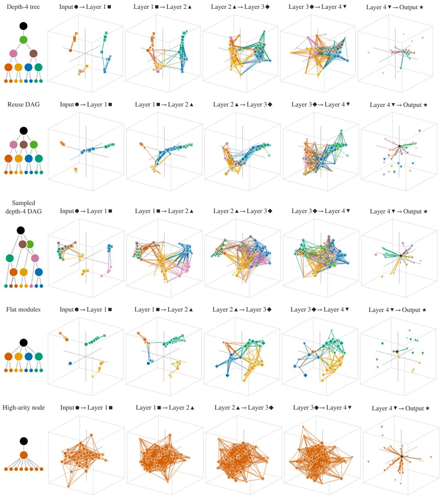  
Figure 19: Learned neuron embeddings across target structures. Examples from trained LeWi models on the depth-4 tree, reuse DAG, flat modules, high-arity node, and a sampled depth-4 DAG. Each row shows the target computation graph followed by the learned three-dimensional neuron embeddings across successive network-layer transitions. Lines denote active connections, and colors indicate post hoc associations with target intermediates. Additional embedding visualizations and their training trajectories are available in the interactive demo linked in Figure 1.

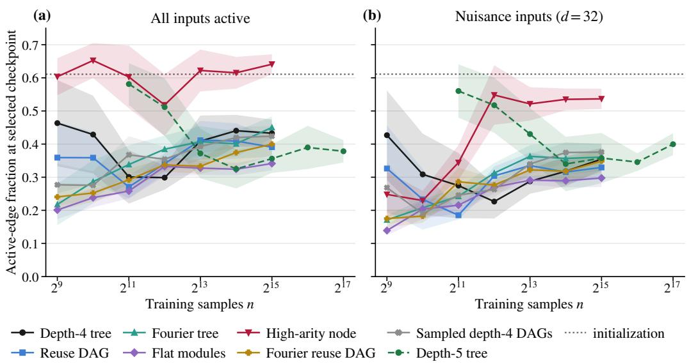

Figure 20: Learned connection density. Active-edge fraction at the selected checkpoint across training-set size with (a) all inputs active and (b) nuisance inputs at $d = 3 2$ . The dotted line marks the initialization density of 0.61. The depth-5 tree uses $d = 1 6$ in (a) and 16 active plus 16 nuisance inputs in (b); the other settings use 8 active inputs and, in (b), 24 nuisance inputs. Curves show means over target instances with 95% Student-t confidence intervals.  
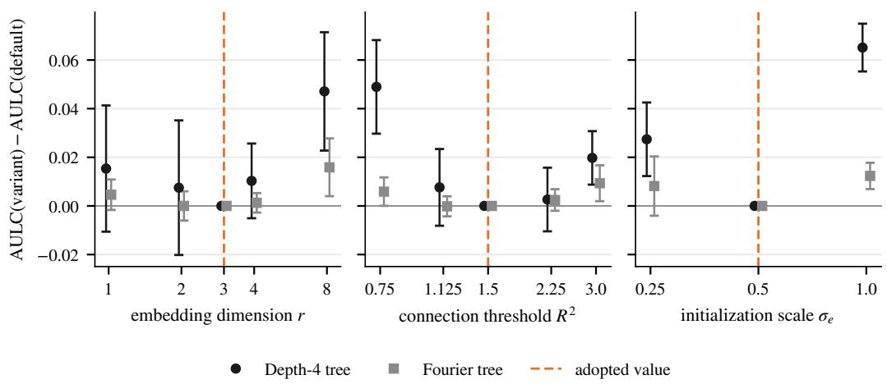  
Figure 21: Sensitivity to LeWi’s geometric parameterization. Paired AULC differences from the adopted configuration when varying the embedding dimension r (left), connection threshold $R ^ { 2 }$ with $\sigma _ { e }$ fixed (middle), and initialization scale $\sigma _ { e }$ with $R ^ { 2 } = 2 r \sigma _ { e } ^ { 2 }$ (right). Positive values indicate worse sample efficiency than the adopted configuration. Results are shown for the depth-4 tree and Fourier tree. Error bars show 95% Student-t confidence intervals over target instances. Dashed lines mark the adopted values $r = 3 , R ^ { 2 } = 1 . 5$ , and $\sigma _ { e } = 0 . 5$

Table 7: Hyperparameter search spaces for the world-model experiments. All searched numerical parameters are sampled log-uniformly.
<table><tr><td>Method</td><td>Parameter</td><td>Search range</td></tr><tr><td>Dense</td><td>learning rate</td><td> $[ 8 . 5 8 \times 1 0 ^ { - 5 } , 4 . 6 3 \times 1 0 ^ { - 2 } ]$ </td></tr><tr><td> $\ell _ { 1 }$ </td><td>learning rate λ</td><td> $\left\lceil 4 . 9 4 \times 1 0 ^ { - 5 } , 9 . 8 5 \times 1 0 ^ { - 2 } \right\rceil$   $\mathsf { \bar { \Gamma } } [ 1 . 6 6 \times 1 0 ^ { - 9 } , 1 . 6 6 \times 1 0 ^ { 3 } ]$ </td></tr><tr><td> $\ell _ { 2 }$ </td><td>learning rate</td><td> $\phantom { + } [ 3 . 4 4 \times 1 0 ^ { - 4 } , 3 . 9 8 \times 1 0 ^ { - 2 } ]$ </td></tr><tr><td> $L _ { 0 }$ </td><td>λ learning rate</td><td> $\mathbf { \bar { [ 5 . 2 2 \times 1 0 ^ { - 7 } , 9 . 0 6 \times 1 0 ^ { 1 } ] } }$   $[ \dot { 1 } . 3 0 \times 1 0 ^ { - 3 } , 6 . 5 0 \times 1 0 ^ { - \dot { 2 } } ]$ </td></tr><tr><td>RigL</td><td>λ learning rate</td><td> $\mathbf { \bar { \rho } } _ { [ 2 . 7 5 \times 1 0 ^ { - 9 } , 1 . 6 1 \times 1 0 ^ { 2 } ] }$   $[ \dot { 1 } . 4 1 \times 1 0 ^ { - 4 } , 1 . 6 0 \times 1 0 ^ { - \dot { 2 } } ]$ </td></tr><tr><td>BIMT</td><td>density learning rate</td><td> $[ 1 . 5 8 \times 1 0 ^ { - 2 } , 1 ]$   $[ 3 . 8 5 \times 1 0 ^ { - 4 } , 1 . 2 2 \times \mathrm { \dot { 1 } 0 ^ { - 2 } } ]$ </td></tr><tr><td>Fiedler</td><td>λ learning rate</td><td> $\left[ 1 . 2 5 \times 1 0 ^ { - 8 } , 7 . 3 6 \times 1 0 ^ { - 3 } \right]$   $[ 1 . 8 3 \times 1 0 ^ { - 4 } , 1 . 6 8 \times 1 0 ^ { - 2 } ]$ </td></tr><tr><td>Learned neuron positions learning rate LeWi</td><td>δ learning rate</td><td> $\left[ 2 . 0 3 \times 1 0 ^ { - 9 } , 2 . 8 4 \times 1 0 ^ { 5 } \right]$   $[ \dot { 2 } . 1 5 \times 1 0 ^ { - 4 } , 1 . 3 5 \times 1 0 ^ { - \dot { 1 } } ]$   $[ 9 . 6 6 \times 1 0 ^ { - 5 }$   $2 . 5 3 \times 1 0 ^ { - 2 } ]$ </td></tr></table>

## E.3 COMPLETE RESULTS

Figure 22 reports paired AULC differences against all eight baselines, including learned neuron positions, and Figure 23 shows the corresponding rollout-16 learning curves. Across the 119 task– baseline pairs for the seven baselines, LeWi wins 99, ties 6, and loses 14. Including learned neuron positions, it wins 116 of 136 comparisons, ties 6, and loses 14. The per-baseline win–tie–loss counts are 16–0–1 against Dense, 15–0–2 against $\ell _ { 1 }$ , 13–0–4 against $\ell _ { 2 } .$ , 16–1–0 against $L _ { 0 } ,$ , 14–1–2 against RigL, 13–3–1 against Fiedler, 12–1–4 against BIMT, and 17–0–0 against learned neuron positions.

The largest gains occur on low-dimensional control and navigation tasks, while most ties and losses occur on more complex articulated-control and manipulation tasks. LeWi also improves on several higher-dimensional and contact-rich systems, so ambient dimension alone does not explain this pattern. Together with the CSFRBench results, the world-model results are consistent with LeWi providing the most benefit when predictive dependencies can be organized into sparse, low-arity interactions.

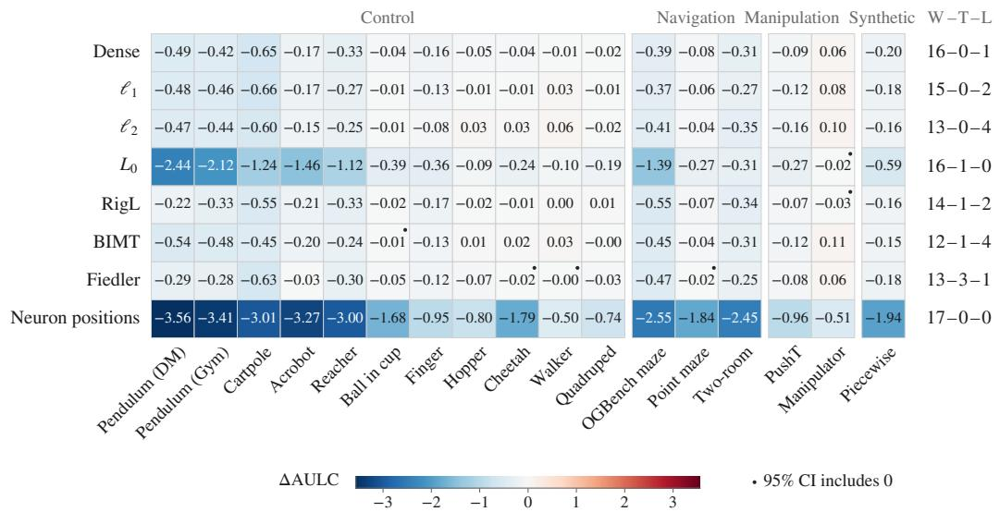  
Figure 22: Complete world-model comparisons. Each cell shows the mean paired $\Delta \mathrm { A U L C } =$ AULC(LeWi) − AULC(baseline) over 16 paired seeds; negative values favor LeWi. A dot marks a comparison whose 95% Student-t confidence interval contains zero. The right margin reports LeWi’s win–tie–loss count against each baseline across the 17 tasks.

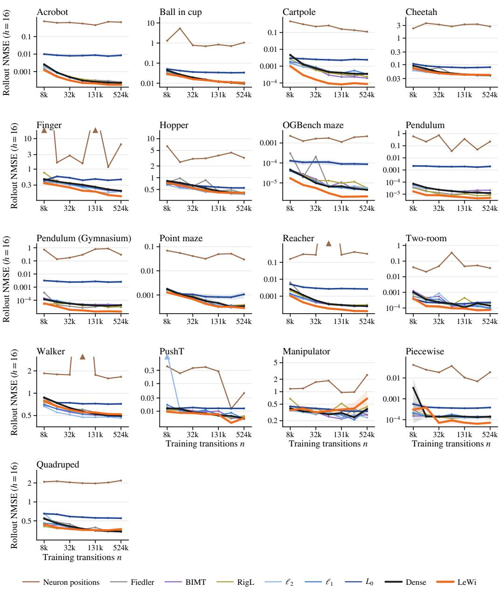  
Figure 23: Complete world-model learning curves. Rollout-16 NMSE versus the number of training transitions for all 17 tasks and nine methods. Curves show arithmetic means over 16 paired final seeds with 95% Student-t confidence intervals; lower is better. Triangles indicate means outside the displayed range. Learned neuron positions are included here but omitted from the main-text heatmap because their larger errors would compress its color scale.