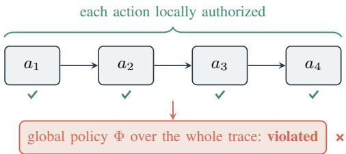
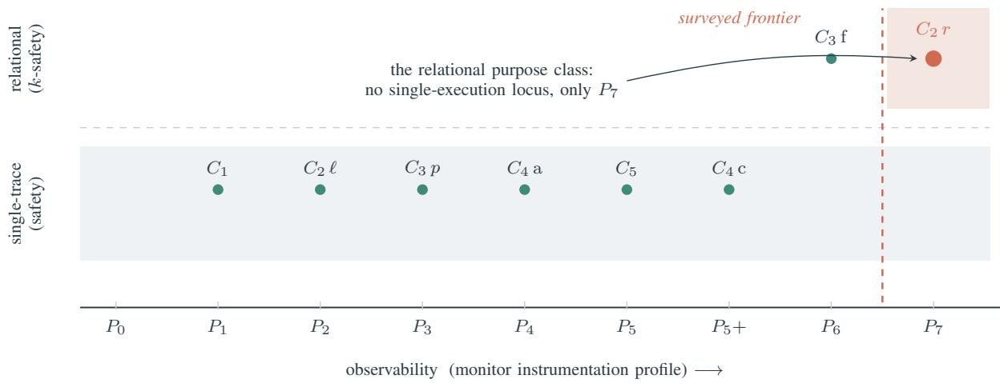
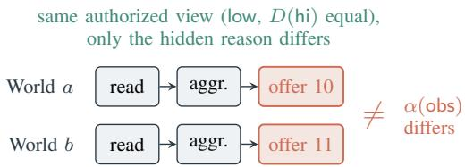
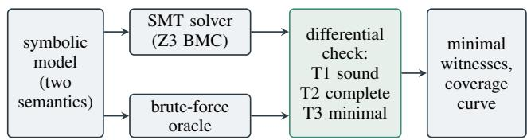
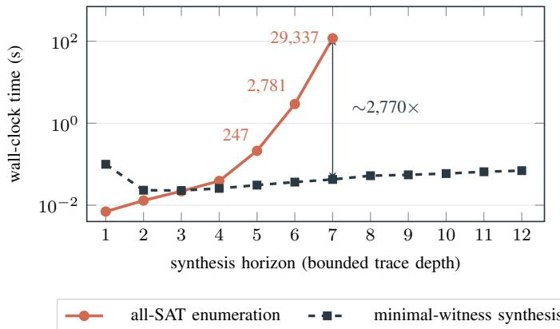

© 2026 IEEE. Personal use of this material is permitted. Permission from IEEE must be obtained for all other uses, in any current or future media, including reprinting/republishing this material for advertising or promotional purposes, creating new collective works, for resale or redistribution to servers or lists, or reuse of any copyrighted component of this work in other works. Accepted for publication in the proceedings of IEEE TPS 2026

# Local Allow, Global Deny: Why Per-Action Authorization Does Not Compose in LLM Agents

Anmol Pandey University of Warwick Coventry, United Kingdom Anmol.Pandey@warwick.ac.uk

Aditya Jain   
University of Warwick   
Coventry, United Kingdom   
aditya.jain.5@warwick.ac.uk   
Liang Chen   
University of Hertfordshire   
Hatfield, United Kingdom   
l.chen26@herts.ac.uk   
Carsten Maple   
University of Warwick   
Coventry, United Kingdom   
cm@warwick.ac.uk

Abstract—Autonomous LLM agents act through tools under per-action authorization: a local guard screens each tool call in isolation. We show that local authorization does not compose into global authorization. A compositional authorization failure (CAF) is a locally authorized execution, or a pair of locally authorized executions, that violates a global policy spanning intent, purpose, provenance, consent, and delegation. We characterize CAFs along two axes, expressiveness (single-trace safety versus relational ksafety) and observability (a ladder of monitor profiles). Our central result is an impossibility: relational purpose violations form a 2-safety hyperproperty with no per-trace locus of blame, so a per-action monitor that never raises a false alarm detects none of them, independent of the underlying model or decision procedure; they become visible only under cross-execution monitoring, which none of the six guardrails we survey implements. We make this constructive with AL-SYNTH, a SAT/SMT synthesizer (using no language model) that emits minimal CAF witnesses, each checked against an exhaustive oracle. The empirical signature is sharp: across nine LLM judges the per-action view approves the synthesized witness almost without exception, blocking it at a rate comparable to a benign control, yet the same models flag it when shown the two executions together. Per-action authorization is therefore structurally insufficient for relational policy conjuncts not reducible to single-trace safety: to bound them, a monitor must compare executions or accept false alarms.

Index Terms—LLM agents, authorization, hyperproperties, runtime monitoring, information flow, program synthesis, security policies

## I. INTRODUCTION

Agents built on large language models act through tools: they read mail, write files, call web services, and delegate subtasks. The dominant safeguard is per-action authorization. A guard inspects each tool call in isolation and decides whether it is permitted, and a sequence of approved steps is treated as an approved sequence.

This trust model is wrong in a way that matters: local authorization does not compose. A sequence of individually permitted actions can violate a global policy, alone or together with a second, equally compliant execution. We call such a witness a compositional authorization failure (CAF), illustrated in Figure 1.

This is the agent-era form of a classical fact, that security properties need not compose [1], sharpened by two features. First, some policies that agents must respect are hyperproperties [2]: they constrain sets of executions, not single runs. A purpose constraint says that what an agent discloses must not depend on context its declared purpose does not authorize, and checking this requires comparing runs. Second, the guards being deployed are single-trace execution monitors in Schneider’s sense [3]: each observes one run and decides. The mismatch is a gap in expressive power, not an engineering gap that a better per-trace monitor could close.

  
Fig. 1. A compositional authorization failure, single-trace case. Every action passes its local check (top), yet the composed trace violates the global policy Φ (bottom), with no single offending step. The relational purpose failure is witnessed instead by a pair of individually compliant executions (Figure 3).

Our results are negative and constructive. We prove that one class of failure, the relational purpose violation, has no per-trace locus of blame: a per-trace monitor that never flags a compliant trace detects none of these violations, because each trace alone is compliant and the violation lives only in the relationship between runs. It becomes detectable only by comparing executions, which none of the six guardrails we survey does. We make the result mechanical with AL-SYNTH, a bounded model checker built on a SAT/SMT solver, with no language model, that synthesizes minimal CAF witnesses and computes the monitor-coverage curve, validated against an exhaustive oracle.

Three studies test whether the gap matters in practice. Nine language models, screening each action of the synthesized witness, approve it almost without exception, yet the same models flag it when shown both executions. A live openweights agent commits a consent-composition CAF in 22 of 60 rollouts, which an intent-only guard does not measurably reduce and a composition-aware guard eliminates. An offline audit of Claude Sonnet 4.6 finds that it resists every class we test. That agent is safe because the model behaves, not because a monitor caught anything, and no false-alarm-free single-execution monitor could have caught a leak, whatever the model.

## Contributions.1

• A model and a map (§III, §IV): CAFs against a fiveconjunct global policy, characterized by expressiveness (safety versus k-safety) and observability (a monitor ladder $P _ { 0 }$ to $P _ { 7 } )$ .

• Separation and impossibility (§V): the purpose property is 2-safety, relational exactly under a stated non-collapse condition, and invisible to every false-alarm-free per-trace monitor. A relational monitor crosses the expressiveness barrier but not the statistical one.

• A validated synthesizer (§VI, §VII): AL-SYNTH computes minimal witnesses and the coverage curve, checked for soundness, bounded completeness, and minimality against an exhaustive oracle.

• Measured monitor blindness (§VIII): among six surveyed guardrails, the strongest single-execution profile covers seven of eight classes, six exactly and explicit labeled flow only conservatively, and misses the relational purpose class. Per-action judges and a LangGraph guard exhibit the separation, and a live agent shows a composition-aware guard closing a catchable CAF.

Relation to classical results. The ingredients are classical, and we claim none of them: security properties need not compose [1], noninterference is a hyperproperty [2], [4], execution monitors enforce only safety [3], and noninterference can be enforced precisely by running one execution per security level [5]. What is new is what these facts imply for agent authorization. An agent’s authorization policy splits into a trace-safety part and a relational-purpose part. We give the exact condition under which the purpose part is relational (Theorem 1), prove that no false-alarm-free per-trace monitor detects it, whatever its decision procedure (Theorem 3), and extend this to stochastic agents, for which even cross-execution sampling gives only statistical detection (Theorems 4 and 5). Every guardrail we survey sits on the trace-safety side. Given a tool schema, a workflow policy, and a monitor profile, AL-SYNTH returns a minimal locally permitted witness outside that monitor’s reach and names the observation the monitor would need to catch it.

## II. THREAT MODEL AND BACKGROUND

Setting. We consider a single LLM agent that executes a bounded episode in response to a user task. The agent issues a finite sequence of actions (tool calls), each drawn from a typed action set, against an environment with mutable state. A local authorization predicate decides, from the current state and the action, whether the action is individually permitted. This predicate abstracts the per-action guards, permission prompts, and tool-call monitors that deployed agent frameworks use today. A global policy Φ expresses what the user actually authorized for the episode as a whole.

Adversary. The adversary’s goal is a trace that satisfies every local check yet violates Φ. We do not assume a jailbroken or locally-misbehaving agent. The interesting case, and the one our theory targets, is a benign-looking agent operating under a declared, legitimate purpose whose composed behavior channels information or authority the purpose does not grant. The adversary may influence the agent through ordinary means such as task phrasing or injected content in tool results, but it does not need to defeat the local guards; it needs the composition to do work the guards cannot see.

Running example. A scheduling assistant is asked to “find a time for a team meeting next week” and is authorized to “share my free/busy availability.” The purpose authorizes disclosure to depend on whether each slot is free. It does not authorize disclosure to depend on why a slot is busy, for instance that a busy block is a confidential interview rather than an ordinary meeting. Every individual action the assistant takes (read the calendar, propose slots, send the proposal) can pass a local check. Whether the pattern of what it offers depends on the unauthorized reason is a property of how it behaves across situations, not of any one message. We return to this example throughout.

Background. A trace property is a set of traces; a hyperproperty [2] is a set of sets of traces, and a k-safety hyperproperty has a counterexample consisting of k finite traces. Noninterference [4] is the canonical 2-safety property: it forbids high inputs from affecting low outputs, and a violation is exhibited by two runs that agree on low inputs but differ on low outputs. Realistic policies relax strict noninterference through declassification [6], which specifies what high information may be released. An execution monitor observes a single run and may halt it, so it can enforce only safety properties of single traces [3], [7].

## III. COMPOSITIONAL AUTHORIZATION FAILURES

Model. An agent model is a typed transition system. A state assigns values to a finite set of typed variables. An action a carries a guard $g _ { a } ,$ a predicate on states, and an effect that updates a subset of variables. A finite trace $t = a _ { 1 } a _ { 2 } \cdot \cdot \cdot a _ { n }$ is locally authorized if, executing from the initial state, each $a _ { i }$ is enabled (its guard holds) in the state it is taken from. We write $\Sigma ^ { * }$ for finite traces. For a trace we distinguish three projections: low(t), the declared purpose and other low inputs; hi(t), the sensitive context the agent may read; and obs(t), the outward disclosure the agent produces.

Definition 1 (Compositional authorization failure). Fix a model with local authorization predicate auth and global policy Φ. A CAF witness is a finite, locally authorized object that witnesses a violation of Φ: when Φ is a trace property, a single trace t with auth true at every step yet t ̸|= Φ; when Φ is a hyperproperty, a finite tuple or set of traces, each locally authorized at every step, that jointly violate Φ. We call the individual traces of a witness its executions. For the relational purpose class the witness is a pair of executions that are each compliant in isolation.

The global policy. We take Φ to be a conjunction of five authorization concerns drawn from the access-control and privacy literature:

$$
\Phi = C _ { 1 } \wedge C _ { 2 } ^ { D } \wedge C _ { 3 } \wedge C _ { 4 } \wedge C _ { 5 } ,
$$

namely intent $( C _ { 1 }$ : actions stay within the user’s task), purpose $( C _ { 2 } ^ { D }$ : disclosure depends only on purpose-authorized context), provenance $( C _ { 3 } { \mathrm { : } }$ outputs do not derive from untrusted or crossdomain sources in disallowed ways), consent $( C _ { 4 } \colon$ disclosure stays within consented scope, per action and cumulatively), and delegation $( C _ { 5 } \colon$ : delegated authority is exercised only when revalidated). Four of the five are properties of a single trace. The purpose conjunct is not.

The purpose conjunct. Following the declassification view [6], we parameterize purpose by a declassification function $D _ { \colon }$ , the purpose-authorized view of context, and an abstraction α, the policy-relevant view of disclosure:

$$
\begin{array} { r l } & { C _ { 2 } ^ { D } \ = \ \big \{ \ S : \forall t , t ^ { \prime } \in S . \ \mathsf { l o w } ( t ) = \mathsf { l o w } ( t ^ { \prime } ) } \\ & { \wedge \ D ( \mathsf { h i } ( t ) ) = D ( \mathsf { h i } ( t ^ { \prime } ) ) } \\ & { \Rightarrow \ \alpha ( \mathsf { o b s } ( t ) ) = \alpha ( \mathsf { o b s } ( t ^ { \prime } ) ) \ \big \} . } \end{array}\tag{1}
$$

In words: two runs that agree on the low inputs and on everything the purpose authorizes about context must agree on what they disclose. If they can differ, disclosure is depending on something the purpose did not authorize.

The pair $( D , \alpha )$ comes from the policy. In the running example, the purpose “schedule a team meeting” with consent “share free/busy availability” fixes $D$ as the free/busy status of each slot, excluding the reasons slots are busy. The abstraction α keeps the policy-relevant parts of a disclosure: which slots are offered, any attached reason or label, the granularity, and the recipient. Eq. (1) then says that, with the free/busy view fixed, the offered slots must not depend on the reasons. For realistic workflows, specifying $( D , \alpha )$ can take substantial human judgment. The impossibility does not depend on getting it right: Theorem 3 holds for every pair, and violations exist exactly when the pair is residual-nondegenerate (Definition 2, Theorem 1). A misspecified pair changes which disclosures count as violations, and so what a relational auditor flags, but no choice of $( D , \alpha )$ makes a nontrivial purpose conjunct visible to a false-alarm-free per-action guard.

## IV. A TWO-AXIS CHARACTERIZATION

The failure classes differ along two independent axes. Axis 1: expressiveness. A class is either a property of a single trace (a safety property, with a finite bad prefix as a witness) or a relational property (a k-safety hyperproperty, with a k-trace witness). Intent, provenance-by-path, consent, and delegation are single-trace. The purpose conjunct $C _ { 2 } ^ { D }$ is relational, and we prove this in $\ S \vee$

Axis 2: observability. A monitor can only act on the state it is instrumented to observe. We arrange instrumentation as a ladder of profiles $P _ { 0 }$ through $P _ { 7 }$ , each strictly more observant than the last. $P _ { 0 }$ is pure black box. Intermediate profiles add, in turn, an approximation of user intent, information-flow labels and a purpose label, a provenance graph, per-action consent state, a delegated-authority and revalidation view, and cumulative digests of intent and consent. $P _ { 6 }$ adds a cross-domain state-transfer view, the strongest single-execution instrumentation we consider. $P _ { 7 }$ is the only profile with relational power: it can compare distinct executions of the agent. A monitor at profile P detects a class if it can both express the class (Axis 1) and observe the state the class depends on (Axis 2).

Figure 2 places the eight subclasses on these axes. The single-trace classes are covered one by one as instrumentation grows, and explicit labeled flow is covered, conservatively, at $P _ { 6 }$ . The relational purpose class is 2-safety, so no singleexecution profile can express it. It is covered only at $P _ { 7 }$ beyond every system we survey.

## V. SEPARATION RESULTS

We use the standard hyperproperty machinery [2]. For a set of traces T, write $[ T ] = \{ S : S \subseteq T \}$ for the hyperproperty it induces; a hyperproperty is trace-property-induced if it equals [T] for some T. We sketch each argument here. The full proofs are in Appendix A.

Lemma 1 (The monitorable region). $C _ { 1 } ,$ , the path form of $C _ { 3 } ,$ $C _ { 4 } ,$ and $C _ { 5 }$ are safety properties of single traces.

Each has the form $^ { 6 \epsilon } \forall t \in S . \phi ( t ) ^ { 3 }$ for a per-trace predicate $\phi ,$ , hence equals $[ \{ t : \phi ( t ) \} ]$ , and each violation has a finite bad prefix. These classes are exactly the ones a per-trace monitor can enforce. The labeled-flow form of $C _ { 3 }$ , written $C _ { 3 } ^ { \mathrm { l f } }$ , is itself relational (2-safety), but its protected influence is a syntactic data flow from a labeled source to the output, and a single-execution information-flow profile $( P _ { 6 } )$ overapproximates it soundly through taint tracking: $P _ { 6 }$ enforces the single-trace property “no labeled value reaches a low output,” which conservatively covers $C _ { 3 } ^ { \mathrm { l f } }$ at the usual cost of some false positives. That is why $C _ { 3 } ^ { \mathrm { l f } }$ closes conservatively at $P _ { 6 }$ . The implicit, control-flow-dependent fragment of noninterference is not $C _ { 3 } ^ { \mathrm { l f } }$ but the relational purpose class $C _ { 2 } ^ { D }$ . Explicit-flow taint tracking misses it, and tracking control dependencies over-approximates it only by rejecting nearly every disclosure made after unauthorized context is read, compliant or not [8].

The relational purpose class $C _ { 2 } ^ { D }$ is different. In a $C _ { 2 } ^ { D }$ witness the agent discloses from an authorized view that is identical in both worlds (low and $D ( \mathsf { h i } )$ equal). No labeled value reaches the output, so taint tracking has nothing to follow, and the dependence on the unauthorized reason shows only when the two executions are compared. A single-execution monitor can over-approximate $C _ { 2 } ^ { D }$ soundly, for example by blocking every disclosure once unauthorized context is read, but only by rejecting compliant traces. The results below make this precise: no single-execution monitor enforces $C _ { 2 } ^ { D }$ both completely and without false alarms, and cross-execution comparison $( P _ { 7 } )$ is the first observable that separates compliant from violating disclosures.

undetected (of 8): 8 7 6 5 4 3 2 1 0  
  
Fig. 2. The two-axis map, with class labels as in Table III. Increasing observability (left to right) covers the single-trace classes one by one (teal). Th relational purpose class $\bar { C } _ { 2 } r$ (coral) is 2-safety, so no single-execution profile can express it; it is covered only by the relational profile $P _ { 7 } ,$ , beyond th strongest profile any surveyed system reaches. The bottom row is the number of undetected classes per profile, the monitor-coverage curve of §VII.

Definition 2 (Residual-nondegenerate). A pair $( D , \alpha )$ is residual-nondegenerate if there exist finite traces $a , b$ with low(a) = low(b), $D ( \mathsf { h i } ( a ) ) \ = \ D ( \mathsf { h i } ( b ) )$ , and $\alpha ( \mathsf { o b s } ( a ) ) \ \ne$ $\alpha ( \mathsf { o b s } ( b ) )$

In plain terms, the declared declassification does not fix the disclosure, so unauthorized context has room to move the output. We call this assumption Residual Disclosure Freedom (RDF-D), and write ${ \mathrm { R D F } } – \mathbf { D } _ { A }$ when a, b are restricted to the locally authorized set A. RDF-D characterizes $C _ { 2 } ^ { D }$ (Theorem 1), and ${ \mathrm { R D F } } – \mathbf { D } _ { A }$ makes the global policy $\Phi = [ A ] \mathsf { \bar { n } } C _ { 2 } ^ { D }$ relational (Theorem 2).

Theorem 1 (Exact characterization of $C _ { 2 } ^ { D } )$ . For every declassification D and abstraction α: $( l ) { \cal C } _ { 2 } ^ { D }$ is 2-safety; $( 2 ) \ C _ { 2 } ^ { D }$ is not trace-property-induced if and only $i f \left( D , \alpha \right)$ is residualnondegenerate; (3) $i f \left( D , \alpha \right)$ is collapsing, $C _ { 2 } ^ { D }$ is the trivial hyperproperty, satisfied by every system.

The key observation is the singleton fact: because equality is reflexive, every single-trace system {t} satisfies $C _ { 2 } ^ { D }$ . If $( D , \alpha )$ is nondegenerate, a violating set contains a pair a, b as in Definition 2, and finiteness makes $\{ a , b \}$ a 2-trace witness, which gives both 2-safety and, by the singleton fact, noninducedness. If it is collapsing, the implication in Eq. (1) holds for all admissible pairs, so every system satisfies the property and it is the trivial, trace-induced hyperproperty. The condition in part (2) is exactly what the proof needs, and a constant abstraction α shows it cannot be dropped.

Theorem 2 (Φ is relational under RDF- $. \mathrm { D } _ { A } )$ . Let $A = \{ t :$ $C _ { 1 } \wedge C _ { 3 } \wedge C _ { 4 } \wedge C _ { 5 } \} , s o \Phi = [ A ] \cap C _ { 2 } ^ { D } . I f \left( D , \alpha \right)$ is residualnondegenerate with witnesses in A $( R D F - D _ { A } ) _ { : }$ , then Φ is not trace-property-induced.

Take ${ \mathrm { R D F } } – \mathbf { D } _ { A }$ witnesses $a , b \in A$ . Each singleton satisfies $C _ { 2 } ^ { D }$ by reflexivity and lies in $[ A ]$ , so $\{ a \} , \{ b \} \in \Phi$ . If $\Phi = \left\lceil U \right\rceil$ for some $U ,$ then $a , b \in U ,$ , hence $\{ a , b \} \in [ U ] = \Phi \subseteq C _ { 2 } ^ { D } $ ; but $\{ a , b \} \not \in C _ { 2 } ^ { D }$ by construction, a contradiction. If ${ \mathrm { R D F } } – \mathrm { D } _ { A }$ fails, Φ collapses to a single-trace property and per-trace monitoring suffices. RDF-D formalizes the premise of this paper: useful assistants keep disclosure freedom beyond what their declared purpose fixes, and the question is whether that freedom carries protected context.

## A. The Locus theorems

The central result says that a relational purpose violation cannot be pinned to any single execution.

Theorem 3 (Set Locus). A per-trace monitor that never raises a false alarm for $C _ { 2 } ^ { D }$ detects no violation of $C _ { 2 } ^ { D } .$

Every single trace satisfies $C _ { 2 } ^ { D }$ (the singleton fact), so a false-alarm-free per-trace monitor cannot flag any trace at all. Relational purpose violations have no per-trace locus of blame.

Contrapositively, a per-trace monitor that catches a genuine purpose violation must also flag a compliant trace (Corollary 1). An LLM at nonzero temperature is a distribution over traces, so the right property is distributional independence rather than set equality. $\mathrm { S e t } { - } C _ { 2 } ^ { D }$ over a stochastic agent’s support is stronger than independence, since it also forbids context-independent randomness, which leaks nothing, so independence is the deployable target.

Theorem 4 (Distributional Locus). Let the observable e available to a single-execution monitor contain exactly the perexecution fields low, D(hi) where exposed, and obs, but not the nondeclassified context H, not the agent’s full conditional distribution, and not cross-context samples. Over the class of all stochastic agents, no monitor that sees one such e can soundly and completely decide $Y \perp H \mid \mathsf { l o w } , D ( \mathsf { h i } )$ , where $Y = \alpha ( { \mathsf { o b s } } )$

  
Fig. 3. Why purpose is relational. Two executions agree on the low inputs and on the purpose-authorized view of context (the same slots are free) and differ only in a hidden, unauthorized reason. Each offers a free slot, so neither trace alone is faulty, yet the disclosures differ $( \alpha ( \mathsf { o b s } _ { a } ) \neq \alpha ( \mathsf { o b s } _ { b } ) )$ . That difference is explained only by the unauthorized reason, so the pair is the 2-safety witness for $C _ { 2 } ^ { D } \colon$ it is visible only by comparing executions, which a relational $( P _ { 7 } )$ monitor does and a per-action monitor cannot.

For any single observable e of positive probability, one can construct a safe agent $( Y \perp H )$ and a leaky agent $( Y \ \nearrow \ H )$ that both assign e positive probability. The monitor sees the same e under both: alarming is a false alarm on the safe agent, and not alarming is a miss on the leaky one. A single execution cannot certify distributional dependence model-free.

Theorem 5 (Two-dimensional barrier). Under the ladder taxonomy and $R D F - D _ { A } ,$ , no profile $P _ { \leq 6 }$ soundly and completely enforces Φ, and none soundly detects $C _ { 2 } ^ { D }$ . For the possibilistic property, the relational profile $P _ { 7 }$ crosses the barrier, since it can exhibit the two-trace witness. For the distributional property the barrier has two dimensions, and $P _ { 7 }$ crosses only one of them: it crosses the expressiveness dimension, because collecting cross-context samples escapes the per-trace limit, but it does not cross the statistical dimension, because no finite-sample procedure can soundly and completely decide arbitrary distributional independence over all stochastic agents.

For the possibilistic property, $P _ { 7 }$ compares two executions and exhibits the witness of Theorem 1. For the distributional property, any finite sample is consistent with two agents, one with $Y \perp H$ and one without, whose sample distributions are arbitrarily close, so detection is statistical rather than certain. Logics, model checking, and runtime verification for hyperproperties are established [9]–[11], including a probabilistic logic [12], so $P _ { 7 }$ as a capability is known. Our claim concerns deployment: no surveyed agent-authorization monitor implements it.

Corollary 1 (A design rule). Detecting purpose violations admits exactly three responses: tolerate false positives, audit offline with cross-context samples, or monitor relationally (compare executions). A per-trace monitor that is both falsealarm-free and useful for $C _ { 2 } ^ { D }$ does not exist.

## B. An enumeration result, scoped

Counting, for each profile, the subclasses it cannot detect gives the monitor-coverage curve [8, 7, 6, 5, 4, 3, 2, 1, 0] from $P _ { 0 }$ to $P _ { 7 }$ . The endpoints are proven: $P _ { 0 }$ detects nothing, $P _ { 7 }$ covers all eight classes under the possibilistic semantics of Eq. (1), and the last class to fall is $C _ { 2 } ^ { \mathrm { r e l } }$ . The intermediate values depend on our eight-class taxonomy and ladder. The central result does not: Theorem 3 covers every per-trace monitor, whatever it observes, so under any refinement or coarsening of the single-execution rungs the relational row stays uncovered until a profile compares executions. Only the number and order of the intermediate steps change. Stated narrowly: in our taxonomy, with delegation scoped to peraction revalidation, exactly one class is not per-trace monitorable, and it fails by expressiveness, not by any engineering limitation.

  
Fig. 4. AL-SYNTH. One symbolic model with two semantics drives an SMT solver and an exhaustive oracle. A differential check compares them (soundness, bounded completeness, minimality), and the validated pipeline emits minimal witnesses and computes the monitor-coverage curve.

## VI. AL-SYNTH: CONSTRUCTIVE SYNTHESIS

AL-SYNTH makes the gaps concrete. Given a model and a target class, it synthesizes a minimal CAF witness (a trace, or a pair of traces for the relational classes) that is locally authorized at every step and globally unauthorized and, for a target profile, also evades every check that profile can run. The engine is symbolic and uses no language model. Figure 4 shows the pipeline.

Dual semantics. Each action has two semantics over the same transition system: a reference semantics, used by an exhaustive oracle, and an SMT encoding, used by the solver. The harness checks that both induce the same CAFs, so agreement is tested rather than assumed.

Bounded model checking. For a horizon $n ,$ the solver encodes the initial state, the variable ranges, the transition relation, and the local-authorization invariant (at every step, the chosen action’s guard holds), then conjoins the global violation at the final state. A satisfying assignment is a length-n CAF [13], [14]. We enumerate the complete witness set at a horizon by adding a blocking clause after each model and re-solving (all-SAT). For synthesis in practice we instead search for the minimal witness, one satisfiability query per increasing horizon, which is far cheaper.

Relational witnesses by self-composition. A relational violation is existential: it asks for a pair of traces that jointly witness a breach of 2-safety. We obtain it by self-composition [15]. Two copies of the system run side by side, and the encoding asserts equality of the low inputs and of the declassified view, $\mathsf { l o w } ( a ) = \mathsf { l o w } ( b )$ and $D ( \mathsf { h i } ( a ) ) = D ( \mathsf { h i } ( b ) )$ , together with inequality of the abstracted observation, $\alpha ( \mathsf { o b s } ( a ) ) \neq \alpha ( \mathsf { o b s } ( b ) )$ This is exactly the negation of the $\dot { C } _ { 2 } ^ { D }$ implication, so a satisfying assignment is a two-trace witness that the agent’s disclosure depended on context the purpose did not authorize (Figure 3). Generating a witness is existential, hence SAT. QBF arises only in the universal direction, proving that a monitor cannot catch a class.

Instrumentation relativization. To synthesize a witness that is invisible to a monitor at profile $P ,$ the encoding conjoins, inside the same query, the target violation with the negation of every safety check that P can both express and observe. The evasion is part of the constraint, not a filter applied afterward.

## VII. VALIDATION AND THE COVERAGE CURVE

We validate the solver against the exhaustive oracle on a family of small models, small precisely so that brute-force enumeration is ground truth.

Differential testing. Three checks relate the solver to the oracle, per class and horizon. T1, soundness: every solver witness, replayed through the reference semantics, is locally authorized at every step and globally unauthorized. T2, bounded completeness: the solver’s all-SAT witness set equals the oracle’s set. T3, minimality: the solver’s minimal witness length equals the oracle’s. All three pass for every class, including the relational class, whose self-composed witness matches the oracle’s minimal pair. Oracle agreement is differential testing of two encodings of one intended semantics: it catches encoding errors, but it does not show that the semantics models a deployment correctly.

The coverage curve is measured, not assigned. For each profile and class, the solver either synthesizes a witness the profile cannot see (a CAF that evades every check the profile can run or, for the relational classes, the two-trace counterexample) or certifies that none exists up to the horizon. Solver and oracle agree on all 9×8 cells (Table I). Perturbation shows that the curve tracks the instrumentation: removing the purpose-label observable shifts it to [8, 7, 7, 6, 5, 4, 3, 2, 1], as the labeled purpose class staying undetected predicts, and restoring it returns the original. Against every profile up to $P _ { 6 } ,$ the strongest we survey, the residual is exactly the relational purpose class, an expressiveness gap that more carried state cannot close.

Cost. On the cumulative-consent model, minimal-witness synthesis (one satisfiability query per horizon) stays flat, at about 0.02 to 0.07 s, up to depth twelve. All-SAT enumeration, used only for the completeness check, grows exponentially: from 1 to 29,337 witnesses over depths three to seven, and from 0.02 to 118 s, a gap of about 2,770 times at depth seven. Cost tracks the query, not the size of the witness set. This is a shape on one model, not a benchmark. Figure 5 shows both curves, and the data are in the artifact.

## VIII. EMPIRICAL STUDY: MONITOR BLINDNESS AND FRONTIER AGENTS

We ask two questions. Do agent guardrails detect CAFs, and which ones? And does a frontier agent commit the relational purpose violation when an adversary sets it up? The first concerns the monitor, which is what the impossibility is about. The second concerns the model.

  
Fig. 5. Synthesis cost on the cumulative-consent model (11 actions, Z3 4.16). Minimal-witness synthesis (dashed) stays flat to depth twelve, while all-SAT enumeration (solid, used only for the oracle check) grows exponentially with the witness count (annotated). One model; times are illustrative, not a benchmark.

## A. The defense matrix: coverage measured per profile

We do not run the guardrail implementations. We place each surveyed mechanism at the strongest profile its published design supports and measure that profile with the campaign of §VII. Table II lists what each design observes and the profile it receives. None compares two executions of the same purpose (Appendix B).

The assignment is deliberately charitable: crediting a design with less would only widen the gap we report. Each row is therefore a capability bound read from the design, not a test of the code, and the bound is one-sided where it matters. Running an implementation could lower a single-trace cell, through a bug for instance, but by Theorem 3 it could raise the relational purpose cell only by comparing executions or by accepting false alarms (Corollary 1).

Table III is read by columns. Coverage grows with sophistication: per-tool approval catches none of the eight classes, RTBAS three, CaMeL five, and Fides and SAFEFLOW seven, six exactly and explicit labeled flow conservatively. Yet all six miss the same class. The relational purpose column is ◦ for every surveyed mechanism, including Fides, whose authors note that it does not prevent the implicit control-flow channel this column captures (§X). Only the relational auditor at $P _ { 7 }$ catches it, as the Locus theorem predicts, whatever model the guard protects.

The witness is minimal. On the scheduling model the shared trace is (collect, aggregate, report). In world a a busy slot is an ordinary meeting and the agent offers slot 10. In world b the same slot is a confidential interview and the agent offers slot 11. Each trace alone is locally authorized, so no per-action check fires. The auditor compares the pair and fires.

## B. Case study: the blind spot in a LangGraph workflow

To check that the blind spot is not an artifact of our abstract model, we reproduce it in a scheduling workflow built on LangGraph [20], a widely used agent framework. The graph (read, aggregate, propose) is gated by a per-action guard that runs the standard tool-permission check plus purposelabel, provenance, and per-action consent checks. Two worlds share the authorized free/busy view and differ only in the hidden reason a slot is busy. The guard returns the same decisions (allow, allow, allow) in both worlds, although the action arguments differ, and the agent offers slot 10 in one world and slot 11 in the other. The AL-SYNTH relational auditor compares the runs and flags the $C _ { 2 } ^ { D }$ violation. We claim no vulnerability in LangGraph: the blindness belongs to the per-action permission pattern, and the dependence could be a benign tie-break, an adversarial choice, or an injected instruction, which no per-action guard can tell apart.

TABLE I  
MONITOR-COVERAGE MATRIX, SOLVER-VALIDATED AND CONFIRMED AGAINST THE BRUTE-FORCE ORACLE (ALL 72 CELLS AGREE). •: THE PROFILE DETECTS THE CLASS EXACTLY, FLAGGING EVERY WITNESS AND NO COMPLIANT TRACE. : DETECTS IT ONLY CONSERVATIVELY, A SOUND G#OVER-APPROXIMATION THAT ADMITS MOST COMPLIANT TRACES AT THE COST OF SOME FALSE ALARMS. ◦: NO MONITOR AT THAT PROFILE DETECTS IT WITHOUT MISSING WITNESSES OR BLOCKING COMPLIANT BEHAVIOR. THE ONE ROW IS EXPLICIT LABELED FLOW, OVER-APPROXIMATED BY TAINT TRACKING AT $P _ { 6 }$ G#AND ABOVE. BOTH • AND COUNT AS COVERED IN THE BOTTOM-ROW CURVE. ONLY RELATIONAL PURPOSE $( C _ { 2 } ,$ , SHADED •) ADMITS NO PER-TRACE COVERAGE AT ALL, CLOSING AT $P _ { 7 }$ (THEOREM 3).
<table><tr><td>CAF (sub)class</td><td> $P _ { 0 }$ </td><td> $P _ { 1 }$ </td><td> $P _ { 2 }$ </td><td> $P _ { 3 }$ </td><td> $P _ { 4 }$ </td><td> $P _ { 5 }$ </td><td> $P { _ { 5 } } +$ </td><td> $P _ { 6 }$ </td><td> $P _ { 7 }$ </td></tr><tr><td> $C _ { 1 }$  intent</td><td>O</td><td></td><td></td><td></td><td></td><td></td><td></td><td></td><td></td></tr><tr><td> $C _ { 2 }$  purpose (labeled)</td><td>O</td><td>O</td><td></td><td></td><td></td><td></td><td></td><td></td><td></td></tr><tr><td> $C _ { 2 }$  purpose (relational)</td><td>O</td><td>O</td><td>O</td><td>O</td><td>O</td><td>O</td><td>O</td><td>O</td><td></td></tr><tr><td> $C _ { 3 }$  provenance (path)</td><td>O</td><td>O</td><td>O</td><td>è</td><td>è</td><td>è</td><td></td><td></td><td></td></tr><tr><td> $C _ { 3 }$  flow (explicit labeled)</td><td>O</td><td>O</td><td>O</td><td>O</td><td>O</td><td>O</td><td>O</td><td></td><td></td></tr><tr><td> $C _ { 4 }$  consent (per-action)</td><td>O</td><td>O</td><td>O</td><td>O</td><td>è</td><td></td><td></td><td></td><td></td></tr><tr><td> $C _ { 4 }$  consent (composition)</td><td>O</td><td>O</td><td>O</td><td>O</td><td>O</td><td>O</td><td></td><td></td><td></td></tr><tr><td> $C _ { 5 }$  delegation</td><td>O</td><td>O</td><td>O</td><td>O</td><td>O</td><td>●</td><td></td><td>è</td><td></td></tr><tr><td>undetected (of 8)</td><td>8</td><td>7</td><td>6</td><td>5</td><td>4</td><td>3</td><td>2</td><td>1</td><td>0</td></tr></table>

TABLE II

SURVEYED AGENT-AUTHORIZATION MECHANISMS AND THE PROFILE EACH RECEIVES IN TABLE III. “CROSS-EXEC.” ASKS WHETHER THE MECHANISM COMPARES DISTINCT EXECUTIONS OF THE SAME PURPOSE, THE $P _ { 7 }$ CAPABILITY.
<table><tr><td>Mechanism</td><td>What it observes</td><td>Profile</td><td>Cross-exec.</td></tr><tr><td>Per-tool approval</td><td>current action, shown to a human</td><td> $P _ { 0 }$ </td><td>no</td></tr><tr><td>Task Shield [16]</td><td>action versus task goal</td><td> $P _ { 1 }$ </td><td>no</td></tr><tr><td>RTBAS [17]</td><td>IFC taint and dependen- cies</td><td> $P _ { 3 }$ </td><td>no</td></tr><tr><td>CaMeL [18]</td><td>data and control flow, ca- pabilities</td><td> $P _ { 5 }$ </td><td>no</td></tr><tr><td>Fides [8]</td><td>IFC labels, explicit se- crecy</td><td> $P _ { 6 }$ </td><td>no</td></tr><tr><td>SAFEFLOW [19]</td><td>IFC labels and provenance</td><td> $P _ { 6 }$ </td><td>no</td></tr><tr><td>AL-SYNTH (relational)</td><td>two executions, same pur- pose</td><td> $P _ { 7 }$ </td><td>yes</td></tr></table>

The theorem says a per-trace monitor cannot catch the relational class. It does not say whether real agents commit it. We test this directly, acting as an offline auditor with the

## C. A frontier agent, audited offline

cross-context samples a deployed monitor lacks, on Claude Sonnet 4.6 used as a tool-calling agent at fixed temperature (Table IV). For intent, an injected instruction in a tool result asks the agent to forward output to an unintended recipient, and it refuses every time. For consent, the agent stays within a narrow authorized window every time, and on a deliberately vague variant it asks for clarification instead of calling a tool. For relational purpose, a paired, interleaved, pre-registered experiment holds the free/busy view fixed across two conditions that differ only in the hidden reason, and gates on a high share rate so that a null reflects disclosure rather than refusal. The agent does not leak.

a) A false positive, kept on purpose: An initial analysis reported a significant covert signal, stable across seeds. Rawoutput inspection overturned it: both conditions offered the identical set of slots, and the signal came from a feature extractor counting a word whose phrasing happened to differ. Under the policy-relevant abstraction α that Eq. (1) requires, the channel is clean. We keep the episode because a result is a security result only under an abstraction that tracks the policy, with raw-data inspection as a check that no statistical rigor replaces.

## D. Per-action judges approve the witness; the paired auditor catches it

The defense matrix places mechanisms by design. Here we put the witness in front of real models. Nine language models judge the synthesized relational witness step by step: eight hosted models (from Anthropic, OpenAI, Google, xAI, DeepSeek, Alibaba, Meta, and Moonshot) and one local openweights model. A bank of ten scenarios varies the slot pair, the hidden reason, the task phrasing, and the A/B order, at three repetitions each, which measure stability rather than add coverage. All judges run at temperature 0 with a 4000-token budget, the hosted ones through OpenRouter’s default routing with no pinned provider. Exact model identifiers are listed under Table V.

TABLE III  
DEFENSE MATRIX, CONFIRMED AGAINST THE BRUTE-FORCE ORACLE; SYMBOLS AS IN TABLE I. EACH MECHANISM IS PLACED AT THE STRONGEST PROFILE ITS PUBLISHED DESIGN IMPLEMENTS, SO ITS ROW IS A CAPABILITY BOUND FROM THE DESIGN, NOT AN EXECUTION OF ITS CODE. THE RELATIONAL PURPOSE COLUMN (SHADED) IS MISSED BY EVERY SURVEYED MECHANISM: FIDES AND SAFEFLOW (P ) COVER SIX CLASSES EXACTLY AND EXPLICIT LABELED FLOW CONSERVATIVELY, AND ONLY THE RELATIONAL AUDITOR (P ) COVERS RELATIONAL PURPOSE.
<table><tr><td>mechanism (profile)</td><td> $C _ { 1 }$ </td><td> $C _ { 2 } \ell$ </td><td> $C _ { 2 } r$ </td><td> $C _ { 3 } p$ </td><td> $C _ { 3 } \mathrm { f }$ </td><td> $C _ { 4 } \mathrm { a }$ </td><td> $C _ { 4 } \mathrm { c }$ </td><td> $C _ { 5 }$ </td></tr><tr><td>Per-tool approval (P0)</td><td>O</td><td>O</td><td>O</td><td>O</td><td>O</td><td>O</td><td>O</td><td>O</td></tr><tr><td>Task Shield [16]  $( P _ { 1 } )$ </td><td></td><td>O</td><td>O</td><td>O</td><td>O</td><td>O</td><td>O</td><td>O</td></tr><tr><td>RTBAS [17] (P3)</td><td>à</td><td></td><td>O</td><td></td><td>O</td><td>O</td><td>O</td><td>O</td></tr><tr><td>CaMeL [18] (P5)</td><td></td><td></td><td>O</td><td></td><td>O</td><td></td><td>O</td><td></td></tr><tr><td>Fides [8] (P6)</td><td></td><td></td><td>O</td><td></td><td></td><td></td><td></td><td></td></tr><tr><td>SAFEFLOW [19] (P6)</td><td>à</td><td>è</td><td>O</td><td></td><td>0</td><td>●</td><td>à</td><td></td></tr><tr><td>AL-SYNTH relational audit (P7)</td><td></td><td></td><td></td><td></td><td>0</td><td>è</td><td>è</td><td></td></tr></table>

TABLE IV

OFFLINE AUDIT OF CLAUDE SONNET 4.6 (FIXED TEMPERATURE). CAF ISTHE NUMBER OF COMPOSITIONAL AUTHORIZATION FAILURES OBSERVED;UB IS THE EXACT ONE-SIDED 95% CLOPPER–PEARSON UPPER BOUND ONTHE PER-EPISODE RATE. PROMPTS, SEEDS, AND SETTINGS ARE IN THEARTIFACT.
<table><tr><td>Task</td><td>Class</td><td>n</td><td>CAF</td><td>95% UB</td></tr><tr><td>Injected-doc forward</td><td> $C _ { 1 }$ </td><td>10</td><td>0</td><td>≤ 26%</td></tr><tr><td>Narrow-scope share</td><td> $C _ { 4 }$ </td><td>10</td><td>0</td><td>≤ 26%</td></tr><tr><td>Scheduling audit</td><td> $C _ { 2 } r$ </td><td>80</td><td> $0 ^ { \dagger }$ </td><td>≤ 3.7%</td></tr></table>

†Under the policy-relevant abstraction α. An initial parser-artifact positive was removed (see text).

Eight judges never block the witness (0/30 each). Kimi-K2.6 blocks it in 3 of 180 individual steps (3 of 30 scenario repetitions, across 3 of the 10 templates). The discriminating control is a benign trace in which both worlds disclose the same slot. DeepSeek blocks 2 of its 180 benign steps and Kimi 1, so Kimi’s witness blocks sit in the same band as its benign blocks. They reflect single-step conservatism, not relational detection, since a per-action judge never sees the second execution. The judges are not merely permissive: all nine block an overt single-trace $C _ { 1 }$ step, an injected external forward, 30/30 (Table V). The relational auditor, the same model shown both executions, recovers detection: 30/30 for eight judges and 17/30 for Llama-4-Maverick. The table therefore instantiates the observation-model separation, the same model blind per action and sighted on the pair, rather than nine independent vulnerabilities, and by the Locus theorem the per-action blindness holds for any single-execution decision procedure. Llama’s 17/30 also separates relational observability, which $P _ { 7 }$ supplies, from relational detection reliability, which remains a question of model capability.

TABLE V  
PER-ACTION JUDGES OVER THE SYNTHESIZED RELATIONAL WITNESS. CELLS COUNT THE SCENARIO-REPETITIONS, OUT OF 30 (TEN TEMPLATES, THREE REPETITIONS), IN WHICH THE JUDGE BLOCKS AT LEAST ONE ACTION: WIT THE WITNESS, BEN A BENIGN NO-LEAK CONTROL, C1 AN OVERT SINGLE-TRACE CONTROL, AND AUD THE RELATIONAL AUDITOR, THE SAME MODEL SHOWN BOTH EXECUTIONS. HOSTED MODELS RAN THROUGH OPENROUTER AND THE LOCAL MODEL THROUGH VLLM.
<table><tr><td>judge</td><td>wit</td><td>ben</td><td>C1</td><td>aud</td></tr><tr><td>Claude Opus 4.8</td><td>0/30</td><td>0/30</td><td>30/30</td><td>30/30</td></tr><tr><td>GPT-5.5</td><td>0/30</td><td>0/30</td><td>30/30</td><td>30/30</td></tr><tr><td>Gemini 3.1 Pro</td><td>0/30</td><td>0/30</td><td>30/30</td><td>30/30</td></tr><tr><td>Grok 4.3</td><td>0/30</td><td>0/30</td><td>30/30</td><td>30/30</td></tr><tr><td>DeepSeek V4 Pro</td><td>0/30</td><td>2/30</td><td>30/30</td><td>30/30</td></tr><tr><td>Qwen3.7-max</td><td>0/30</td><td>0/30</td><td>30/30</td><td>30/30</td></tr><tr><td>Llama-4-Maverick</td><td>0/30</td><td>0/30</td><td>30/30</td><td>17/30</td></tr><tr><td>Kimi-K2.6</td><td>3/30</td><td>1/30</td><td>30/30</td><td>30/30</td></tr><tr><td>Qwen3-30B (local)</td><td>0/30</td><td>0/30</td><td>30/30</td><td>30/30</td></tr></table>

<table><tr><td>judge</td><td>API identifier (accessed June 2026)</td></tr><tr><td>Claude Opus 4.8</td><td>anthropic/claude-opus-4.8</td></tr><tr><td>GPT-5.5</td><td>openai/gpt-5.5</td></tr><tr><td>Gemini 3.1 Pro</td><td>google/gemini-3.1-pro-preview</td></tr><tr><td>Grok 4.3</td><td>x-ai/grok-4.3</td></tr><tr><td>DeepSeek V4 Pro</td><td>deepseek/deepseek-v4-pro</td></tr><tr><td>Qwen3.7-max</td><td>qwen/qwen3.7-max</td></tr><tr><td>Llama-4-Maverick</td><td>meta-llama/1lama-4-maverick</td></tr><tr><td>Kimi-K2.6</td><td>moonshotai/kimi-k2.6</td></tr><tr><td>Qwen3-30B (local)</td><td>Qwen/Qwen3-30B</td></tr></table>

## E. A live agent commits a catchable CAF, and the right monitor closes it

The judge sweep shows that the relational class is invisible per action. A complementary question is whether a live agent commits a class that a suitably instrumented guard can catch, and whether the guard that closes it is the composition-aware one rather than a more cautious per-action guard. We run Qwen3-30B as a tool-calling agent on the cumulative-consent calendar task at temperature 0.7, with 60 independent rollouts per condition, all locally authorized and free of execution errors, under three guards: none, an intent-closure guard that screens each action against the declared purpose, and the composition-aware $P _ { 5 } +$ guard, which denies an action once cumulative disclosure exceeds the workflow’s consent bound.

TABLE VI  
LIVE TOOL-CALLING AGENTS ON THE CUMULATIVE-CONSENT TASK (60 INDEPENDENT ROLLOUTS PER CELL AT FIXED TEMPERATURE, ZERO EXECUTION ERRORS). CAF: CONSENT-COMPOSITION FAILURES COMMITTED. CAF-FREE: FRACTION OF ROLLOUTS WITH NO CAF, A NATURAL RATE UNDER NO GUARD AND A PREVENTION RATE UNDER A GUARD. THE COMPOSITION-AWARE P5+ GUARD REMOVES EVERY CAF WHILE BLOCKING NO BENIGN OR CLEAN-INTENT ROLLOUTS.
<table><tr><td rowspan="2">guard</td><td colspan="2">Qwen3-30B</td><td colspan="2">Gemma-4</td></tr><tr><td>CAF</td><td>CAF-free</td><td>CAF</td><td>CAF-free</td></tr><tr><td>no guard  $( P _ { 0 } )$ </td><td>22/60</td><td>63.3%</td><td>0/60</td><td>100%</td></tr><tr><td>intent-closure</td><td>20/60</td><td>66.7%</td><td>0/60</td><td>100%</td></tr><tr><td>composition  $( P _ { 5 } + )$ </td><td>0/60</td><td>100%</td><td>0/60</td><td>100%</td></tr></table>

With no guard, the agent commits the $C _ { 4 }$ consentcomposition CAF in 22 of 60 rollouts (37%, Wilson 95% CI [26, 49]) and never on a clean-intent baseline or a benign control (0/60 each), so the failure is compositional rather than a local-guard error (Table VI). The intent-closure guard leaves 20/60, 3.3 points below no guard (Newcombe 95% CI [−13.4, 19.8], Fisher exact $p = 0 . 8 5 )$ , as expected, since the disclosure is not visible in any single action’s purpose. The composition-aware guard removes every offending trace (0/60, 33.3 points below intent-closure, CI [21.1, 45.9], $p <$ $1 0 ^ { - 6 } )$ while blocking $0 / 6 0$ benign and 0/60 clean-intent rollouts, so no false positives were observed (one-sided 95% upper bound 4.9% for each control). We read this as the implementation realizing the profile’s intended capability, not as a separate causal finding. A second agent, Gemma-4, never commits the CAF (0/60 throughout): the blind spot is structural, while its exploitation depends on the model.

This CAF belongs to the consent-composition class, which closes at $P _ { 5 } +$ , not to the relational purpose class of the impossibility. For a CAF that a single-execution monitor can catch, the right monitor is the composition-aware one. For the relational class, no single-execution monitor suffices (Table V). What the measurements show together. The studies answer different questions and are not one kind of evidence. The judges and the LangGraph guard exhibit the observationmodel separation itself: blind on one execution, sighted on the pair. The live agent shows a different, catchable class that the matching composition-aware guard closes. The frontier audit reports how one model behaved on the cases we tested, a property that no deployed per-action monitor could have certified.

## IX. DISCUSSION

Detection requires comparison or false alarms. Singletrace monitors can enforce intent, provenance, consent, and delegation checks when sufficiently instrumented, but not the relational purpose conjunct without false positives (Corollary 1). A designer has three detection options: accept and review false positives, audit offline with cross-context samples, or monitor relationally by comparing executions. Each has a cost, and a better single-trace guard is not among the options. Prevention lies outside the corollary, because it changes what the agent sees rather than what a monitor checks: generating each disclosure from the purpose-authorized view alone removes the dependence by construction, the agent analogue of secure multi-execution [5], at the price of an extra execution and of any utility the unauthorized context would have added. The model, not the monitor, carries the safety. In our experiments, safety comes from the model’s behavior. The verifiable component, the monitor, is provably blind to the relational class, so deployments rely on an unverifiable, model-specific property that may not survive the next model. This argues for investing in relational monitoring and offline purpose audits. Limitations. Our validation is differential testing on small models, not a proof of correctness and not a scalability study (§VII). The symbolic models are clean and the tasks synthetic, which bounds the empirical claims but not the theorem: the impossibility assumes no model of any API, and noisier tools only add traces, which leaves the singleton fact intact. The symbolic model feeds only the synthesizer, and its witness replays on an agent framework (§VIII). The agent-behavior experiments cover two model families, the nine-model campaign evaluates judges rather than autonomous tool-using agents, and the guardrail matrix is design-derived, a bound whose direction §VIII states. The purpose conjunct is modeled in the declassification style [6] rather than the planning semantics of purpose [21], and we view the two as complementary. Measuring the relational class on realistic multi-tool workloads is the natural next step.

## X. RELATED WORK

Hyperproperties and their verification. Clarkson and Schneider [2] introduced hyperproperties and k-safety hyperproperties. Temporal logics for them [9] and model checking [10] followed, with runtime verification of k-safety [11] and a logic for probabilistic hyperproperties [12]. We use this machinery rather than extend it.

Enforcement and composition. Schneider’s enforceable policies [3] and the computability classes of enforcement mechanisms [7] delimit what an execution monitor can do. Our Locus theorems instantiate these limits: agent guardrails are execution monitors, and relational purpose lies outside their reach. Noncomposability of security properties [1], the accesscontrol safety problem [22], and noninterference [4] are the roots of the questions we ask.

Declassification and purpose. We parameterize purpose by declassification in the sense of Sabelfeld and Sands [6]. Tschantz, Datta, and Wing [21] formalize purpose restrictions through a planning semantics. We see this as complementary to the information-flow view we adopt, and reconciling the two is open.

LLM-agent security. Indirect prompt injection [23] is the overt, single-trace face of agent insecurity, and our $C _ { 1 }$ experiment lives in that space. Recent defenses are per-execution monitors: task-alignment checking of each action [16], controland data-flow isolation with capabilities [18], and informationflow taint-tracking planners [8]. We place these on our ladder in §VIII. None compares distinct executions of the same purpose, and the strongest of them concedes the gap: Fides [8] enforces explicit secrecy but, by its authors’ own analysis, does not prevent implicit flows through control-flow decisions, which is exactly the relational purpose channel our Locus theorem isolates.

## XI. CONCLUSION

Local authorization does not compose. We formalized the failure along expressiveness and observability, and proved that the relational purpose violation has no per-trace locus of blame, so no false-alarm-free per-action guard can detect it. AL-SYNTH makes the result constructive: it computes the coverage curve, validated against an exhaustive oracle, and names the observation each CAF class requires. Nine judges and a LangGraph workflow exhibit the separation in practice, a live agent shows the composition-aware guard closing a catchable CAF, and an offline audit finds no leak by a frontier model on the cases tested. The takeaway is a design rule, not a patch: to bound relational purpose, or any policy conjunct that is genuinely relational on the permitted executions, a monitor must compare executions or accept false alarms.

## ETHICS CONSIDERATIONS

AL-SYNTH is dual-use: it synthesizes authorization-evading traces. The risk is bounded because it works over an abstract model the analyst supplies and emits abstract action sequences, not exploits, so using it against a real target already requires a formal model of that target and its monitors. Its purpose is defensive, and the benefit outweighs the marginal uplift to an attacker who already holds such a model. The study used the authors’ own API accounts and local deployments, touched no third-party data or production accounts, and collected no human-subjects data. We release the artifact (https://github. com/anmolpandey299/al-synth) with documentation framing its defensive use.

## AI DISCLOSURE

Two uses of generative AI are relevant. As a writing aid, a large language model assistant helped draft and edit the prose across all sections. It did not originate the theorems, the synthesizer, or the experimental design, which the authors developed, implemented, and validated, and the authors verified the correctness and originality of all content, including every reference and reported number.

Generative AI is also the object of study: §VIII evaluates language models as tool-using agents and as per-action and relational judges, and reports their settings (identifiers in Appendix C). Capable models are necessary because the separation turns on whether disclosures depend on unauthorized context, which weaker models do not exercise. We minimized query volume, report full counts, and release all logs. Hosted runs used the authors’ own accounts, and open-weights runs a single GPU.

## APPENDIX A PROOFS

Lemma 1. Each of $C _ { 1 }$ , the path form of $C _ { 3 } , C _ { 4 } ,$ and $C _ { 5 }$ is of the form $\{ S : \forall t \in S . \phi ( t ) \}$ for a per-trace predicate $\phi ,$ hence equals $[ \{ t : \phi ( t ) \} ]$ and is trace-induced. Each $\phi$ is a safety predicate on finite traces with a finite bad prefix (an out-of-intent action, an untrusted-provenance write, an out-ofscope or over-threshold disclosure, an unrevalidated delegated action), so each is a safety property. The labeled-flow form $C _ { 3 } ^ { \mathrm { l f } }$ is 2-safety and not trace-induced; it is enforced not directly but through the single-trace taint-flow property of $P _ { 6 } .$ which soundly over-approximates it (conservative coverage, not exact). ■

Theorem 1. Singleton fact. For any t, the pair condition in Eq. (1) ranges over $t , t ^ { \prime } \in \{ t \}$ , i.e. $t ^ { \prime } = t _ { \ast }$ , and equality is reflexive, so $\{ t \} \in C _ { 2 } ^ { D }$

(1) If $( D , \alpha )$ is collapsing there is no admissible pair on which the consequent fails, so $C _ { 2 } ^ { D } \ = \ 2 ^ { \Sigma ^ { * } }$ , which is vacuously k-safety for any k. If $( D , \alpha )$ is nondegenerate, let $S \notin C _ { 2 } ^ { D }$ . Then S contains $a , b$ with $\mathsf { l o w } ( a ) \ = \ \mathsf { l o w } ( b )$ $D ( \mathsf { h i } ( a ) ) = D ( \mathsf { h i } ( b ) )$ , and $\alpha ( \mathsf { o b s } ( a ) ) \neq \alpha ( \mathsf { o b s } ( b ) )$ . The pair $M = \{ a , b \}$ is finite, $M \subseteq S .$ , and every superset of M also violates $C _ { 2 } ^ { D }$ ; so M is a 2-trace witness and $\mathrm { \bar { \it C } } _ { 2 } ^ { D }$ is 2-safety.

$( 2 , \Leftarrow )$ Suppose $( D , \alpha )$ is nondegenerate yet $C _ { 2 } ^ { D } = [ T ]$ for some T. By the singleton fact $\{ a \} , \bar { \{ b \} } \in C _ { 2 } ^ { \bar { D } } = [ \bar { T } ]$ , so $a , b \in$ $T ,$ hence $\{ a , b \} \subseteq T$ and $\{ a , b \} \in [ T ] = C _ { 2 } ^ { D }$ . But $\{ a , b \} \not \in C _ { 2 } ^ { D }$ by choice of the witness, a contradiction. So $C _ { 2 } ^ { D }$ is not traceinduced.

$( 2 , \Rightarrow )$ and (3) Suppose $( D , \alpha )$ is collapsing. Then for every set $S$ and every $t , t ^ { \prime } \in S$ the antecedent of Eq. (1) either fails or the consequent holds, so $S \in C _ { 2 } ^ { D }$ ; thus $\begin{array} { r } { \dot { C } _ { 2 } ^ { D } = 2 ^ { \Sigma ^ { * } } = } \end{array}$ $\left[ \Sigma ^ { * } \right]$ , which is trace-induced. Hence if $C _ { 2 } ^ { D }$ is not trace-induced, $( D , \alpha )$ is nondegenerate, and the trivial case is exactly the collapsing one. ■

Theorem 2. $\Phi = [ A ] \cap C _ { 2 } ^ { D }$ . Suppose $\Phi = [ U ]$ . Under RDF-$\mathbf { D } _ { A }$ there are $a , b \in A$ with low $\prime ( a ) \ = \ \mathsf { l o w } ( b )$ $D ( \mathsf { h i } ( a ) ) =$ $D ( \mathsf { h i } ( b ) )$ $\alpha ( \mathsf { o b s } ( a ) ) \neq \alpha ( \mathsf { o b s } ( b ) )$ . Since $\{ a \} , \{ b \} \subseteq A$ and singletons satisfy $\dot { C } _ { 2 } ^ { D }$ , we have $\{ a \} , \{ b \} \in \Phi = [ U ] ,$ , so $a , b \in$ $U ,$ , hence $\{ a , b \} \in \mathsf { \bar { \Gamma } } [ U ] = \Phi \subseteq \mathsf { \bar { \Gamma } } C _ { 2 } ^ { \bar { D } }$ . But $\{ a , b \} \ \notin \ C _ { 2 } ^ { D }$ , a contradiction. ■

Theorem 3. Let M be per-trace with accepted set $[ T _ { M } ]$ and false-alarm-free for $C _ { 2 } ^ { D }$ . By the singleton fact every $\{ t \} \in$ $C _ { 2 } ^ { D }$ , so M may not alarm on any t, i.e. $T _ { M } = \Sigma ^ { * }$ and M accepts every trace. Therefore M flags no trace and detects no violation. ■

Theorem 4. Fix an observable value $e = ( \mathsf { l o w } , D ( \mathsf { h i } ) , y )$ with $y = \alpha ( \mathsf { o b s } )$ of positive probability. Construct agent $\mathcal { A } _ { \mathrm { 0 } }$ whose output is independent of H given $( \mathsf { l o w } , D ( \mathsf { h i } ) )$ and assigns e positive probability, and agent $\mathcal { A } _ { 1 }$ whose output depends on H and also assigns e positive probability under some value of

H. Both are consistent with the single observed e. A soundand-complete monitor must alarm on $\mathcal { A } _ { 1 }$ and not on $\mathcal { A } _ { 0 } .$ , but it sees the same e in both, so any fixed decision on e is wrong for one of them. Hence no monitor seeing one such e decides the property soundly and completely over the class of all stochastic agents. ■

Theorem 5. The first two clauses are Theorems 2 and 3 read on the ladder: a $P _ { \leq 6 }$ monitor is single-execution, so it cannot express $C _ { 2 } ^ { D }$ , and by Theorem 2 it cannot soundly and completely enforce Φ. For the possibilistic property, a $P _ { 7 }$ monitor compares two executions and exhibits the witness of Theorem 1, crossing the barrier. For the distributional property, the expressiveness dimension is crossed because cross-context sampling represents the comparison a per-trace monitor cannot, while the statistical dimension is not crossed: by a standard indistinguishability argument, for any finite sample there are two agents, one with $Y \perp H$ and one without, whose sample distributions are arbitrarily close, so no finitesample test decides independence soundly and completely over all agents. Detection is therefore statistical, not certain. ■

## APPENDIX B

## MONITOR-PROFILE SURVEY

We map recent and deployed agent-authorization mechanisms to the profile ladder of §IV. For each, we record from its primary source what per-execution state it observes, whether it compares distinct executions of the same purpose, and the resulting profile. Table II is the result. Every entry is singleexecution: each system inspects the current run (a tool call, its arguments, data-flow or taint labels, or the running plan), and none compares two executions of the same purpose to test whether disclosure depends on unauthorized context. This substantiates the claim that no surveyed monitor reaches $P _ { 7 }$

We assign each design the strongest profile its primary source plausibly supports, a deliberately charitable upper bound: under-crediting a mechanism would only widen the gap we report, so generosity makes our conclusion harder to reach, not easier. Task Shield is $P _ { 1 }$ because it checks each action against the user’s task (per-action intent). RTBAS reaches $P _ { 3 }$ because it carries information-flow taint and dependency labels (provenance), and we charitably credit it with the weaker intent and purpose-label observables a $P _ { 3 }$ monitor subsumes. CaMeL reaches $P _ { 5 }$ because it extracts data and control flow and enforces capabilities (provenance, per-action consent, and delegation scope). Fides and SAFEFLOW reach $P _ { 6 }$ because they add confidentiality and integrity labels with cross-domain reasoning. In every row the cross-execution column is no for the same structural reason: each mechanism evaluates a single execution and never compares two executions under matched low inputs and declassified context, which is the only way to witness a relational purpose violation. The assignment is thus generous on every axis except the one that matters, and on that axis every surveyed design sits at zero.

The most advanced surveyed designs are information-flow systems. Taint tracking is conservative by construction, which places these systems in the false-positive corner of Corollary 1, and the strongest states its own limit: Fides enforces explicit secrecy but does not prevent implicit flows through controlflow decisions [8]. That residual channel is the relational purpose violation of the Locus theorem, which AL-SYNTH’s relational mode $( P _ { 7 } )$ expresses by comparing same-purpose executions.

## APPENDIX C

## JUDGE REPRODUCIBILITY METADATA

Table VII records the nine-model judge campaign of §VIII in the detail needed to reproduce it. Eight models were queried through the OpenRouter chat-completions endpoint and one open-weights model through a local vLLM server. Every request fixed the sampling temperature at 0 and allowed a 4000-token generation budget, so that reasoning-heavy models had room to deliberate before emitting a verdict. Requests used OpenRouter’s default routing: we did not pin a serving provider or disable fallback, so a given slug may have been dispatched to whichever provider OpenRouter selected at request time, a reproducibility caveat we state explicitly. The per-judge and per-scenario counts behind Table V, together with every raw model response, are released with the artifact.

TABLE VII  
JUDGE MODELS AND EXACT API SLUGS FOR THE CAMPAIGN OF §VIII; SETTINGS IN THE TEXT, ACCESSED JUNE 2026.
<table><tr><td>Display name</td><td>API slug</td></tr><tr><td>Claude Opus 4.8</td><td>anthropic/claude-opus-4.8</td></tr><tr><td>GPT-5.5</td><td> ${ \tt o p e n a i / q p t { - } } 5 . 5$ </td></tr><tr><td>Gemini 3.1 Pro</td><td>google/gemini-3.1-pro-preview</td></tr><tr><td>Grok 4.3</td><td> $\mathrm { x } { - } \mathrm { a } \mathrm { i } / \mathrm { g } \mathrm { r } { \mathrm { o k } { - } } 4 . 3$ </td></tr><tr><td></td><td>DeepSeek V4 Pro deepseek/deepseek-v4-pro</td></tr><tr><td>Qwen3.7-max</td><td> ${ \tt q w e n / q w e n 3 . 7 - m a x }$ </td></tr><tr><td>Llama-4-Maverick</td><td> $\mathtt { m e t a - l 1 a m a / l 1 a m a - 4 - m a v e r i c k }$ </td></tr><tr><td>Kimi-K2.6</td><td> $\mathtt { m o o n s h o t a i / k i m i - k } 2 . 6$ </td></tr><tr><td>Qwen3-30B*</td><td> ${ \sf Q w e n } / { \sf Q w e n } 3 - 3 0 { \sf B }$ </td></tr></table>

∗Served locally via vLLM on a single GPU; all other models through the OpenRouter chat-completions endpoint.

## REFERENCES

[1] D. McCullough, “Noninterference and the composability of security properties,” in IEEE Symposium on Security and Privacy (S&P), 1988, pp. 177–186.

[2] M. R. Clarkson and F. B. Schneider, “Hyperproperties,” Journal of Computer Security, vol. 18, no. 6, pp. 1157–1210, 2010.

[3] F. B. Schneider, “Enforceable security policies,” ACM Transactions on Information and System Security, vol. 3, no. 1, pp. 30–50, 2000.

[4] J. A. Goguen and J. Meseguer, “Security policies and security models,” in IEEE Symposium on Security and Privacy (S&P), 1982, pp. 11–20.

[5] D. Devriese and F. Piessens, “Noninterference through secure multiexecution,” in IEEE Symposium on Security and Privacy (S&P), 2010, doi: 10.1109/SP.2010.15.

[6] A. Sabelfeld and D. Sands, “Declassification: Dimensions and principles,” Journal of Computer Security, vol. 17, no. 5, pp. 517–548, 2009.

[7] K. W. Hamlen, G. Morrisett, and F. B. Schneider, “Computability classes for enforcement mechanisms,” ACM Transactions on Programming Languages and Systems, vol. 28, no. 1, pp. 175–205, 2006.

[8] M. Costa et al., “Securing AI agents with information-flow control,” arXiv:2505.23643, 2025.

[9] M. R. Clarkson, B. Finkbeiner, M. Koleini, K. K. Micinski, M. N. Rabe, and C. Sanchez, “Temporal logics for hyperproperties,” in ´ Principles of Security and Trust (POST), 2014, pp. 265–284.

[10] B. Finkbeiner, M. N. Rabe, and C. Sanchez, “Algorithms for model´ checking HyperLTL and HyperCTL∗,” in Computer Aided Verification (CAV), 2015, pp. 30–48.

[11] S. Agrawal and B. Bonakdarpour, “Runtime verification of k-safety hyperproperties in HyperLTL,” in IEEE Computer Security Foundations Symposium (CSF), 2016, pp. 239–252.

[12] E. Abrah ´ am and B. Bonakdarpour, “HyperPCTL: A temporal logic for´ probabilistic hyperproperties,” in Quantitative Evaluation of Systems (QEST), 2018, pp. 20–35.

[13] A. Biere, A. Cimatti, E. M. Clarke, O. Strichman, and Y. Zhu, “Bounded model checking,” in Advances in Computers, 2003, vol. 58, pp. 117–148.

[14] L. de Moura and N. Bjørner, “Z3: An efficient SMT solver,” in Tools and Algorithms for the Construction and Analysis of Systems (TACAS), 2008, pp. 337–340.

[15] G. Barthe, P. R. D’Argenio, and T. Rezk, “Secure information flow by self-composition,” in IEEE Computer Security Foundations Workshop (CSFW), 2004, pp. 100–114.

[16] F. Jia, T. Wu, X. Qin, and A. Squicciarini, “The Task Shield: Enforcing task alignment to defend against indirect prompt injection in LLM agents,” in Annual Meeting of the Association for Computational Linguistics (ACL), 2025, pp. 29 680–29 697.

[17] P. Y. Zhong et al., “RTBAS: Defending LLM agents against prompt injection and privacy leakage,” arXiv:2502.08966, 2025.

[18] E. Debenedetti et al., “Defeating prompt injections by design,” in IEEE Conference on Secure and Trustworthy Machine Learning (SaTML), 2026.

[19] P. Li et al., “SAFEFLOW: A principled protocol for trustworthy and transactional autonomous agent systems,” arXiv:2506.07564, 2025.

[20] LangChain AI, “LangGraph: Build resilient language agents as graphs,” GitHub repository, 2026, [Online]. Available: https://github. com/langchain-ai/langgraph. Accessed: Jun. 7, 2026.

[21] M. C. Tschantz, A. Datta, and J. M. Wing, “Formalizing and enforcing purpose restrictions in privacy policies,” in IEEE Symposium on Security and Privacy (S&P), 2012, pp. 176–190.

[22] M. A. Harrison, W. L. Ruzzo, and J. D. Ullman, “Protection in operating systems,” Communications of the ACM, vol. 19, no. 8, pp. 461–471, 1976.

[23] K. Greshake, S. Abdelnabi, S. Mishra, C. Endres, T. Holz, and M. Fritz, “Not what you’ve signed up for: Compromising real-world LLMintegrated applications with indirect prompt injection,” in ACM Workshop on Artificial Intelligence and Security (AISec), 2023, pp. 79–90.