# Local Inference of LLMs on Long Contexts: A Data Systems Perspective

Mattias Dürrmeier University of Fribourg Fribourg, Switzerland mattias.duerrmeier@unifr.ch

## Abstract

Large language models can solve complex problems across a variety of subjects, such as mathematics and coding. For such complex analytical tasks, models with a long context perform better. Serving models with long context is currently mostly done on powerful systems with multiple GPUs, which are too expensive for most users. An alternative is local inference, or serving a model on a user’s own machine, which removes per-token costs and rate limits, besides keeping sensitive data private and giving users full control over the models they run. The common understanding, however, is that local LLMs need compression (e.g., quantization) to run on a single GPU.

In this paper, we set out to study the limitations that prevent serving long-context models for single users, besides the capacity issue. Rather than characterizing a single model on one GPU, we an-alyze how diferent models behave across several GPU generations. This lets us uncover not just individual bottlenecks but broader trends in where ineficiencies arise. Our analysis confirms that, as expected, self-attention dominates the runtime for long-context in ference. More unexpectedly, our evaluation reveals that the current structure of self-attention leaves key GPU resources significantly underutilized, and the newest GPU is often the least well served. Many of these findings are fundamentally data management prob- lems, from paging the KV cache to improving cache utilization and synchronization in the GPU, which is why we bring this study to the Data Systems community. To engage this community, we present our findings as a series of experimental observations and formulate recommendations for future work.

## 1 Introduction

Transformers [69] are currently the leading model architecture for a wide range of tasks. This phenomenon is underscored by a study from Jouppi et al., the creators of Google’s TPU, that analyzed the relative prevalence of diferent model architectures [35]. In 2026, transformers accounted for 76% of the models deployed on TPUs, with their share rising steadily since the hardware’s introduction. By contrast, all other model architectures saw lower utilization. The second most common, multi-layer perceptrons, comprised only 11%. Much of this success is driven by large language models (LLMs), the transformer’s most consequential application [54, 55]. Trained on large corpora, they can solve diverse tasks such as logic and math problems [37, 41], write and run code [28, 31, 34], or evaluate research ideas and write papers [42], to name a few.

Many of these tasks can now be performed with open-weight models, allowing users to run inference on their own hardware [13, 50, 65, 66]. These models, however, have a very high resource consumption. The majority of this demand comes during the decode

Alberto Lerner Computing Flows GmbH Fribourg, Switzerland lernera@computingflows.com

phase of the LLM, where the conversation is generated one token at a time, each token requiring a full pass through the model (Section 2). It is ultimately the ability to generate large numbers of tokens through the decode phase that allows more complex analyt- ical tasks to be performed. Similarly to the scaling observed during training [36], inference scaling shows that LLMs perform better when they spend more time reasoning about the problem [37].

Despite this, the performance profile of the single-user (i.e., locally run) decode phase has received little attention. Prior characterization work has largely targeted high-throughput, multi-user serving [57, 58], where the aim is to maximize the number ofqueries processed at once. In that regime, inference is known to be memory- bound [21, 57]. In the single-user setting, memory capacity becomes the main limitation because the model’s state might not fit on a single GPU. The typical solution is to either compress the state through quantization [14, 18, 25] or to page parts of the state in and out of the GPU [32, 62]. Doing so, however, prevents the remaining causes of performance loss from being properly understood.

In this paper, we address this gap by providing a performance characterization study of LLMs under a single-user workload. Our central objective is to locate bottlenecks as models and hardware evolve. To achieve this, we examine how performance changes both with diferent models and model sizes, and as we move across three successive generations of GPUs (Section 3). The measurements we make are at the level of the GPU kernels produced by the most common deep learning library and its compiler, PyTorch [3]. This allows us to introspect not only how each kernel performs, but also whether it reflects an eficient compilation of the model. What we found are many ineficiencies that, if addressed, can unlock further performance of local LLMs.

Our performance characterization study comprises two parts. The observations come first, and are based on how the decode phase behaves across diferent models and GPUs (Section 4 and Section 5). It finds that, for instance, the newest GPU is often the least well utilized, as its attention kernel fails to translate greater hardware ca- pability into faster decoding. Our study’s recommendations follow, addressing the limitations these observations expose. For instance, there are several o ortunities to better utilize the GPU’s resources under the single-user regime (Section 6).

Taken together, the observations and the recommendations put three larger questions within reach (Section 7). The first is whether the ineficiencies we found are ones this community has met before. We believe they are, as evidenced by the parallels found in this community’s prior work on GPU query processing. The second is whether the compression techniques we mentioned above re- main necessary once the device is used well. We argue they may not have as important a role as they currently do. As we will see, paging techniques we discuss here may ofer a way to fit a model on the device without the loss in downstream performance that compression brings [29]. The third asks what kind of system would be required to implement these recommendations. We argue that developing a system specifically tailored to this workload is more promising than adapting these techniques to systems designed for diferent purposes.

In summary, this paper makes the following contributions:

• We profile a single decoder block at the level of its compiled kernels, which makes models larger than the device under study measurable, and apply this across two model families, three GPU generations, and context lengths reaching one million tokens.

• We find the reasons why no device is overwhelmed by this workload, and that all three have resources to spare, and we establish where that spare capacity lies, in which kernels, on which hard- ware, and at what context lengths.

• We derive from these findings four recommendations, which together describe the axes along which a system specialized for this workload could be built.

• We relate each of those axes to prior work in which this community addressed the same dificulty in GPU query processing.

## 2 Background

A large language model generates text one token at a time, repeat-edly evaluating the same stack of decoder blocks to produce each token. To run it, the block is specified as a sequence of mathemat- ical operations and subsequently compiled into execution units known as kernels, the unit of code execution on GPUs. This section describes both the operations that define the decoder block and the kernels into which they are compiled.

## 2.1 The Model Definition

A large language model is a decoder-only transformer model com- posed of a sequence of � decoder blocks, each containing an atten tion layer and a feedforward network (FFN). The model organizes these components as shown in Figure 1.

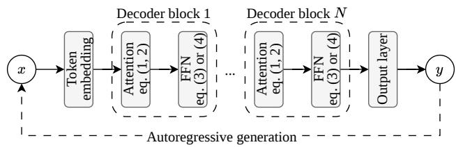  
Figure 1: Overview of the autoregressive generation of a large language model.

The attention layer first projects its input into three matrices: the queries, keys, and values. It then computes a similarity between tokens through two dot products, with a softmax applied in between.

$$
\begin{array} { c } { Q , K , V = x W _ { Q K V } } \\ { \mathrm { \displaystyle { A t t e n t i o n } } ( Q , K , V ) = \mathrm { s o f t m a x } ( \frac { Q K ^ { T } } { \sqrt { d _ { k } } } ) V } \end{array}\tag{1}
$$

Multi-head attention (MHA) performs several such computations in parallel, each head attending to a diferent part of the sequence.

$$
\begin{array} { c } { \mathrm { M u l t i H e a d A t t e n t i o n } ( Q , K , V ) = \mathrm { c o n c a t } ( \mathrm { H } _ { 1 } , \dots , \mathrm { H } _ { h } ) W _ { o u t } } \\ { \mathrm { w h e r e ~ H } _ { i } = \mathrm { A t t e n t i o n } ( Q _ { i } , K _ { i } , V _ { i } ) } \end{array}\tag{2}
$$

The FFN that follows applies two linear projections with a nonlinear activation function between them, such as GELU [23].

$$
\mathrm { F F N } ( x ) = \arctan ( x { ( } x W _ { 1 } + b _ { 1 } ) W _ { 2 } + b _ { 2 }\tag{3}
$$

The vast majority ofa model’s parameters reside in these two layers, and so does most of the work of inference. Finally, a normalization layer is added before each of the two layers [4, 75] and a residual connection around each of them [22].

Modern LLM architectures sometimes use mixture of experts (MoE), a sparse version of the FFN layer [16, 30, 61]. MoE uses conditional computations to activate only a subset of the network for each input. It is composed of � experts, each a FFN, and a gate �. The gating function evaluates the � most relevant experts for the input. The gate is learned through a linear projection.

$$
\begin{array} { c l l } { { \displaystyle \mathrm { M o E } ( x ) = \sum _ { i } ^ { n } G ( x ) _ { i } E _ { i } ( x ) } } \\ { { \displaystyle G ( x ) = \mathrm { s o f t m a x } ( \mathrm { T o p K } ( x W _ { g } ) , k ) } } \end{array}\tag{4}
$$

where $\mathrm { T o p K } ( \boldsymbol { v } , \boldsymbol { k } ) _ { i } = \boldsymbol { v } _ { i }$ if� is among the � selected experts, and −∞ otherwise. The coeficients weight the contribution of the selected experts, and the softmax layers ensure that the sum of them equals one. This allows packing more weights in a model but keeps the computational cost lower compared with a dense approach.

Inference proceeds in two phases [40, 78]. Prefill processes the full input prompt and produces the first token, while decode gen- erates each subsequent token from the ones before it. The two phases behave diferently on the hardware, and this paper studies decode, which dominates the cost of the long generations produced by reasoning and agentic workloads. Decode is made eficient by a key-value (KV) cache. Rather than recomputing the keys and values of all previous tokens at every step, the model stores them and computes only the query, key, and value of the current token, as shown in Algorithm 1.

Algorithm 1 LLM Inference with KV Cache   
1: procedure generate(model, $[ x _ { 1 } , . . . , x _ { n } ] ,$ , max length �)   
2: lo its, �, � := forward(model, $\left[ x _ { 1 } , . . . , x _ { n } \right] )$ ⊲ prefill   
3: �� := selectNextToken(logits) ⊲ greedy, top-k, etc.   
4: � := [�� ]   
5: while �� ≠ EOS and len(�) < � do   
6: logits, $( k _ { i } , v _ { i } ) : =$ forward(model, ��, �,�) ⊲ decode   
7: � = append(�, ��) ⊲ update cache   
8: � = append(�, ��)   
9: ��+1 = selectNextToken(logits)   
10: � = append(�, ��+1)   
11: �� = ��+1   
12: end while   
13: return �   
14: end procedure

As a result, the cost of a decode step stays constant across most of the block, and grows only in the attention layer, where the current token must attend to a KV cache that lengthens with every token generated. This asymmetry, a fixed cost everywhere except an attention cost that grows with context, plays a central role in the analysis that follows.

The two layers of the decoder block have since been revised to raise capacity while holding computation down, and these re-visions add many smaller operations around the two main ones. Grouped-query attention (GQA) [1] lets several query heads share a single key-value head, which shrinks the KV cache and the memory it consumes during decode. SwiGLU [60] modifies the two-layer FFN by changing GELU to SiLU [15, 56] and adding an extra linear projection. Attention can also be augmented with rotary position embeddings (RoPE) [64], which encode token positions by rotating the queries and keys before the dot product. Each of these changes improves the model, yet each also introduces additional small oper- ations, a point we return to when we examine how a decoder block executes on the GPU.

## 2.2 The Model Execution

A GPU is essentially a parallel device made of a large number of symmetric multiprocessors, each of which contains diferent types ofprocessing cores [26]. Two types ofcore matter for our workloads. First, the CUDA cores, which perform general arithmetic, such as the softmax in attention and the activation in the FFN. Second, the Tensor cores, which are specialized units that perform the matrix multiply and accumulate operations (MMA) at the heart of LLMs, including those in Equation (1) and Equation (3).

The decision on how to translate a model’s definition into code rests on the chosen framework’s compilation stack [3, 19]. This process lowers a block definition into a graph of tensor operations. These include matrix multiplications, elementwise functions, and reductions, which together realize the high-level structure of the block. Each element of the graph could technically become a ker- nel, a small program that the GPU runs, launched to perform one operation across many threads at once. The GPU executes these kernels largely one after another, so a block runs as a sequence of them, though independent kernels can sometimes overlap.

The compilation process, however, optimizes the graph before mapping it to kernels. It merges certain element-wise operations, such as an activation or a scaling, into the neighboring matrix multiply. It also searches for subgraphs it knows how to represent as a single kernel. A notorious example is FlashAttention, which fuses attention’s two matrix multiplications and the softmax between them into a single kernel [11]. Each such merge removes an inter-mediate result that would otherwise be written to memory and read back by the next kernel. Many operations, however, are left on their own, either because no safe merge exists or because no pattern matches them. A block therefore compiles into a long sequence of kernels of uneven size.

To give a concrete example, the attention and FFN operations of Equations 1, 2, and 4 compile into the kernel structure shown in Figure 2. The block compiles into several kernels, which are very diverse in terms of the resources each consumes, their sizes, and runtimes. The figure also shows that some kernels take external inputs, such as the weight matrices and the KV cache. The cache is updated within the attention layer, where the new key and value are appended to the cache.

One important aspect for our purposes is the memory cost of connecting these kernels. The output of one kernel is written to global memory and read back by the next, so a long chain of kernels means repeated round trips through the memory hierarchy. Each of these transfers consumes memory bandwidth, one of the two resources, alongside compute, whose use we measure throughout this work.

## 3 Methodology

Characterizing LLM inference for local usage presents several challenges. First, these models are constantly evolving. Focusing only on the latest model provides a snapshot but ofers no assurance that our findings will apply to future versions. Second, while diferent models may share the general LLM structure, they often difer in the details of the attention block and feedforward network, which are the most critical components. From the outset, we recognized that a proper characterization of local LLM execution requires study- ing long-term trends instead of isolated observations. Therefore, our experimental methodology emphasizes broader patterns across models and hardware, rather than focusing on an individual model and GPU combination.

Studying these trends across hardware requires running the same models on diferent GPUs, yet the largest models may not fit, especially on older devices. A model, however, is a stack of identical decoder blocks. We therefore implement and profile a single block, which behaves the same as any other in the model. This removes the size barrier, letting us run any models on any GPU. It also lets us write every block in the same framework, rather than compare models across the frameworks/libraries they ship in.

We study two families of models, chosen so that each isolates a diferent source of change. The first is the GPT family, spanning GPT-2 [55], GPT-3 [5], and GPT-OSS [50]. Across these three, the decoder block itself has changed, from multi-head attention and a dense feedforward network to grouped-query attention, mixture of experts, and added components such as rotary position embed- dings. This family lets us see how architectural model evolution has reshaped the workload. The second is the Qwen3 family [66], in its 4B, 8B, and 32B variants. These share one modern architecture and difer only in their dimensions, which isolates the efect of model size. Underneath both model families, we vary the hardware, pro- filing on three generations of NVIDIA GPUs whose specifications appear in Table 1.

The two families are paired with the hardware diferently. Each GPT model is profiled on the GPU of its era: GPT-2 on Turing, GPT-3 on Ada, and GPT-OSS on Blackwell, reproducing how model and hardware advanced together. The Qwen3 models, in contrast, are run on all three GPUs, which holds the architecture fixed and exposes the efect of hardware alone.

Across every pairing, we profile the decode phase one kernel at a time with Nsight Compute [44]. For each kernel, we record its runtime, its compute, and its memory bandwidth. We also examine the kernels the compiler produced and whether they are the result of kernel fusion. Two conditions keep these measurements com- parable: we profile from a cold cache, so no kernel benefits from data another left behind; and we leave the GPU clocks unlocked, matching how these devices behave in normal use.

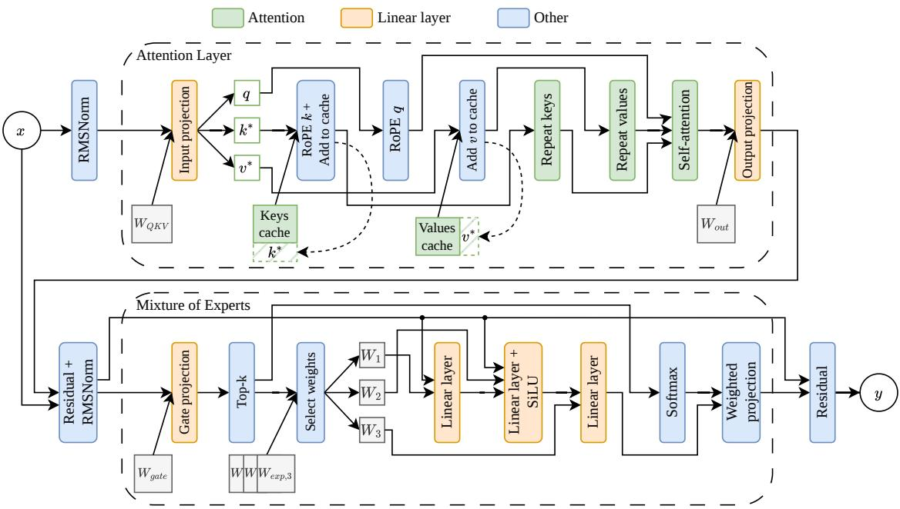  
Figure 2: Per kernel view of the decoder block in GPT-OSS, compiled for the RTX PRO 6000 Blackwell.

Table 1: Specifications for the three GPUs evaluated [45–47].
<table><tr><td>Graphics Card</td><td>Quadro RTX 6000</td><td>RTX 6000 Ada Generation</td><td>RTX PRO 6000 Blackwell</td></tr><tr><td>Microarchitecture</td><td>Turing</td><td>Ada Lovelace</td><td>Blackwell</td></tr><tr><td>#CUDA Cores</td><td>4,608</td><td>18,176</td><td>24,064</td></tr><tr><td>#Tensor Cores</td><td>576</td><td>568</td><td>752</td></tr><tr><td>L2 cache (MB)</td><td>6</td><td>96</td><td>128</td></tr><tr><td>Memory (GB)</td><td>24 GDDR6</td><td>48 GDDR6</td><td>96 GDDR7</td></tr><tr><td>Memory Interface</td><td>384-bit</td><td>384-bit</td><td>512-bit</td></tr><tr><td>Mem Bandwidth (GB/s)</td><td>672</td><td>960</td><td>1,792</td></tr><tr><td>PCIe Interface</td><td>3.0 x16</td><td>4.0 x16</td><td>5.0 x16</td></tr><tr><td>TPD</td><td>260 W</td><td>300 W</td><td>600 W</td></tr></table>

## 4 GPT Models Evolution

For our first stud , we anal ze the three decoder blocks of the GPT family of models, shown in Table 2. We profile each model on a diferent GPU: GPT-2 on Turing, GPT-3 on Ada Lovelace, and GPT- OSS on Blackwell, the leading GPU generation available at the time of its launch. This configuration resembles the inference scenario used at the release of each model.

## 4.1 Kernel Analysis

Figure 3 reports the runtime, bandwidth, and compute of every ker- nel in a decoder block, and each model uses the maximum context length set at training. For now, we discuss only the horizontal axis of the chart, where each tick represents one kernel. We will return to the bars and what they convey in Section 4.2. We observe that the kernel count grows with each generation, from thirteen kernels in GPT-2 to seventeen in GPT-3 and twenty-one in GPT-OSS. GPT-2 and GPT-3 share one architecture, so the growth there comes from scale alone, as GPT-3’s normalization splits into three kernels each time it appears, a process known as fission [24].

Table 2: Block configuration of the GPT models.
<table><tr><td>Model</td><td> $d _ { m o d e l }$ </td><td> $n _ { h e a d s }$ </td><td> $d _ { h e a d }$ </td><td> $d _ { f f }$ </td><td>Context</td></tr><tr><td>GPT-2 [55]</td><td>1,600</td><td>25</td><td>64</td><td>6,400</td><td>1,024</td></tr><tr><td>GPT-3 [5]</td><td>12,288</td><td>96</td><td>128</td><td>49,152</td><td>2,048</td></tr><tr><td>GPT-OSS 120B [50]</td><td>2,880</td><td>64/8*</td><td>64</td><td>2,880†</td><td>131,072</td></tr></table>

Uses GQA: #query heads/#key-value heads  
† Uses MoE: 128 experts, top- $k = 4 ;$ each with $d _ { f f } = d _ { m o d e l }$

GPT-OSS is where new structure is introduced, as seen in Fig- ure 2. Grouped-query attention, mixture of experts, and a modern positional encoding technique each add operations absent from the older models, among them applying RoPE, the gate, the top- �, and the sort. The compiler fuses some of these operations into single kernels, yet many remain kernels of their own, therefore making their count climb. This reflects a tendency of making mod- els perform a more elaborate set of operations at each iteration. This will have implications, as we will see, in whether the compiler can generate a sensible set of kernels to represent the model.

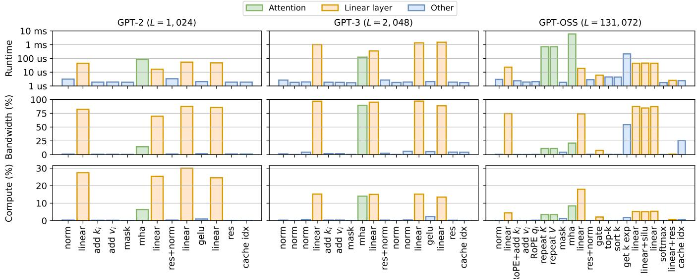  
Figure 3: Runtime, bandwidth, and compute used for each GPT model at its maximum context length.

Observation #1: Modern LLM architecture, like the one used by GPT-OSS, results in a substantial increase in the number of kernels. Few of them are fused by the compiler.

## 4.2 Runtime Analysis

We now turn to the bars of Figure 3, which report the runtime, bandwidth, and compute of each kernel. The kernels fall into the same three groups that Figure 2 already identified: the linear pro- jections, the attention computation, and the remaining operations of the block. Reading the bars by group makes the shape of each block’s cost visible.

In GPT-2 and GPT-3, that cost concentrates almost entirely in the linear projections. Their kernels carry the longest runtimes and consume most of the available bandwidth, reaching 70% to 80% in GPT-2 and near the device peak in GPT-3, while the remaining op- erations use little of the device. Attention is present but secondary, a single kernel among the taller projections, with its bandwidth use near 15%. This holds only for the context lengths measured here, but changes as the context grows. We note that despite GPT-3 being 7.68× larger than GPT-2, it uses only about half as much compute. The two models are bandwidth-bound in their projections, so what sets their compute utilization is how much compute each device carries for the bandwidth it ofers. The newer GPU carries far more, so the same class of kernel occupies a smaller share of it.

In GPT-OSS, the performance profile becomes more diverse be-cause of the increase in the number of kernels. The preparation and routing steps, including the repeat operations that feed attention and the gate of mixture of experts, have shifted from making a neg- ligible contribution to accounting for a now much more substantial portion of both runtime and bandwidth. The linear projections remain prominent, although they now account for a smaller share of compute, thanks to the increase in GPU resources for the latest generation.

Observation #2: In older models, the runtime and band-width of a block concentrate almost entirely on its matrix multiplications. Modern architectures surround these with preparation and routing kernels, such as the repeat steps that feed attention and the gate of mixture of experts. The matrix multiplications still dominate, but their share of the profile is no longer overwhelming.

## 4.3 Roofline Analysis of Attention

Attention is the one kernel whose cost grows with the context, since each new token must attend to all the tokens before it. We therefore measure it in isolation from the rest of the block, across context lengths increasing in powers of two up to one million tokens. This range extends beyond what any of the three models supports, but the measurement remains faithful, as the kernel performs the same operations and moves the same data at a given context length whether or not the model was built to run there. We assess the result with the roofline model [71], which bounds a kernel by the memory bandwidth and the peak compute of the device.

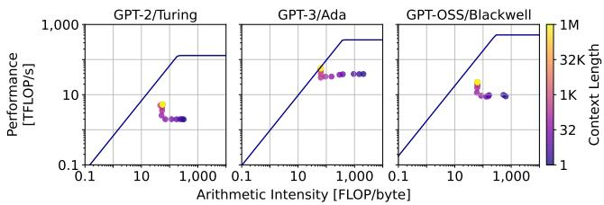  
Figure 4: Attention kernel rooflines for the GPT models.

The three panels of Figure 4 reveal how the attention kernel behaves as the context grows. At first, the points shift left as arith- metic intensity declines. This occurs because the amount of data read from the KV cache increases with each token, while the com putational work performed per byte remains constant. This trend continues until the cache becomes large enough to provide suf ficient parallel work for the device. Beyond this point, the curve bends upward, which we attribute to the additional operations raising the kernel’s throughput.

This increase in throughput, however, does not bring the kernel to either limit of the device. For GPT-2 and GPT-OSS, the measure- ments remain well below both the bandwidth and the compute bounds at every context length, including one million tokens. GPT 3 is the exception, approaching the bandwidth bound at its longest contexts. The diference follows from the attention configuration, as GPT-3 uses more attention heads and larger ones, which raises the work available to the device, while the smaller heads of the other two models leave it underused. Because bandwidth remains available and the kernel is not compute-bound, the attention com- putation could in principle be made faster, an opportunity we return to in Section 6.

Observation #3: Across all context lengths, the attention kernel does not reach either the bandwidth or compute limits of the device, except in the case of GPT-3. Even at one million tokens, available bandwidth is not fully utilized. This suggests that further improvements should focus on the kernel itself rather than the hardware.

## 4.4 Attention Runtime Crossovers

As the context length grows, self-attention must be computed be- tween the current token and a larger number of previous ones. To study how the runtime of attention varies compared with the rest of the decoder block, we profile each model and device pair for context lengths from one to one million tokens. Figure 5 shows the contribution in runtime of self-attention relative to the rest of the model for increasing contexts.

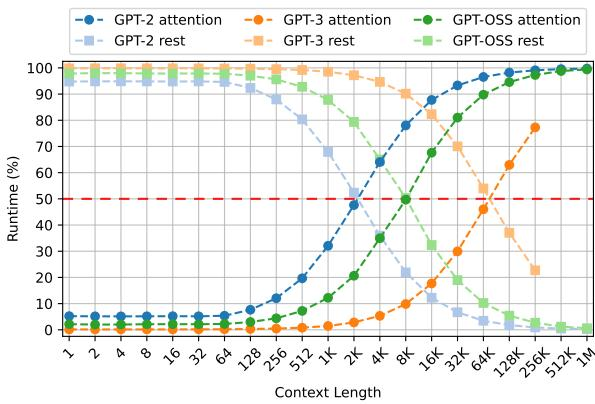  
Figure 5: Runtime comparison between self-attention and the rest of the block for the GPT models.

The runtime of the three models follows an S-curve as the size of the context grows. When working with hundreds of thousands or one million tokens, attention accounts for more than 90% of the runtime on a modern model such as GPT-OSS. This finding emphasizes the need for an optimized attention kernel for long contexts, as attention constitutes the vast majority of the runtime.

GPT-2 reaches the crossover at 2,048 tokens, just after its maximum context length. As this model has the smallest dimensions, self-attention rapidly dominates the runtime. In contrast, GPT-3 reaches this point at a much later stage. For the largest context measured of 256K tokens before running out of device memory, attention accounts for almost 80% of the runtime. The larger di- mensions used by this LLM incur a higher runtime for the rest of the model. In particular, the runtime is much longer for the linear projections of this model, as seen in Figure 3.

For a modern architecture, the attention computation of GPT-OSS accounts for 50% of the execution time at a context of only 8K tokens. This highlights the benefits of modern architectures, with results closer to those of GPT-2. While the sparsity of MoE decreases the runtime of the rest of the block, the preparation of the KV cache increases the runtime of the attention computation.

Observation #4: For very long contexts, self-attention con-sistently dominates the execution time, regardless of model or device. Because GPT-2 uses a smaller architecture and GPT-OSS a more modern one, attention accounts for more than 50% of the runtime at earlier context lengths.

## 5 Modern Language Models

The previous section followed a family of architectures as it changed across generations, pairing each model with the hardware ofits time. This section holds the architecture fixed and varies the hardware instead. We study the Qwen3 family, three models that share one modern design and difer only in size, shown in Table 3.

Table 3: Block configurations of the Qwen3 models.
<table><tr><td>Model</td><td> $d _ { m o d e l }$ </td><td> $n _ { h e a d s }$  (Q/KV)</td><td> $d _ { h e a d }$ </td><td> $d _ { f f }$ </td></tr><tr><td>Qwen3-4B</td><td>2,560</td><td>32/8</td><td>128</td><td>9,728</td></tr><tr><td>Qwen3-8B</td><td>4,096</td><td>32/8</td><td>128</td><td>12,288</td></tr><tr><td>Qwen3-32B</td><td>5,120</td><td>64/8</td><td>128</td><td>25,600</td></tr></table>

Their hidden and feedforward dimensions grow with scale, while the head dimension stays fixed and the number of key-value heads is held at eight across all three. This lets us separate the efect of the hardware from that of the architecture, and see how a single design behaves as it moves across generations of a device.

## 5.1 Runtime Analysis

The runtime of a block is made of two parts that behave diferently, and each new GPU acts on them unequally. Figure 6 reports both for the three models on each of the three GPUs, as the context grows. As before, we extend the context beyond the length the models support, which remains faithful for the reasons given in Section 4.3.

We consider first the rest of the block, shown as the darker segment of each bar. This part does not grow with the context, so it isolates what each new GPU contributes to runtime. Across the three devices, each generation is faster than the last, with Ada around 1.7× faster than Turing and Blackwell between 1.5× and 1.75× faster than Ada, a gain of up to 3× from the oldest device to the newest. These gains, however, apply to the part of the runtime that stays fixed. As the context grows, the attention segment grows with it, while this part does not.

We turn now to the attention segment, the lighter part of each bar. As the context grows, it comes to occupy most of the runtime, and by one million tokens it accounts for nearly the entire bar across all three models, a length at which Qwen3-32B no longer fits on the Turing GPU. The gains of each new device fall on the rest of the block, which by this point contributes little, so a faster GPU brings little benefit where the runtime is actually spent.

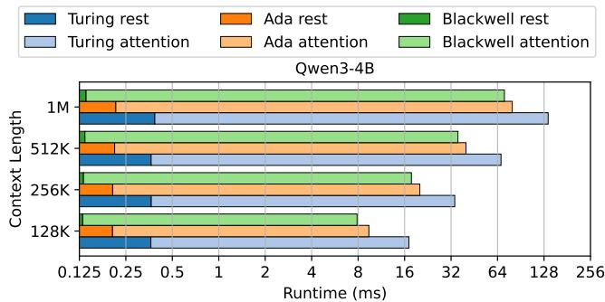

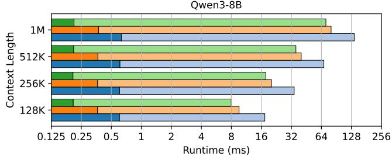

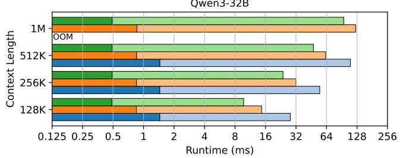  
Figure 6: Runtime of self-attention vs. the rest of the block for the Qwen3 LLMs on each GPU.

Observation #5: A block’s runtime splits into a part that grows with the context, the attention computation, and a part that stays fixed, the remaining kernels. Newer GPUs accelerate only the fixed part, so their advantage is confined to short contexts.

## 5.2 Compute and Bandwidth Utilization

The question we now ask is whether model sizes impact the resource utilization of GPUs. Likewise, we examine whether these devices are eficiently utilized and if there are diferences between them. Figure 7 displays the amount of compute and bandwidth each device uses for the three Qwen variants. Measurements are taken at � = 131, 072, the maximum context length supported by the models.

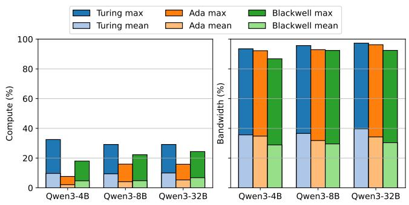  
Figure 7: Mean and maximum compute and bandwidth utilization across Qwen3 models and GPUs for � = 131, 072.

Bandwidth is well utilized overall. Each device achieves a maxi- mum close to the theoretical throughput across the three Qwen3 sizes. We observe a decrease of a few percentage points with each new generation of GPU. The mean bandwidth used is just below 40%, following the same downward trend with each new device.

Meanwhile, the results obtained for compute are fairly low. The oldest GPUs use the most compute, with maxima around 30%. Ada obtains the lowest compute utilization, with a mean below 5% and a maximum below 15%. In comparison, the latest microarchitecture obtains a slight increase.

When considering both resources, model size does not increase device utilization. The oldest GPU uses more of the available hard- ware resources compared with the other two. However, bandwidth and compute usage are unbalanced across GPU generations. Local inference optimizations should target this imbalance, leveraging the unused compute to improve performance.

Observation #6: There is a major imbalance in the utilization of GPU resources. Newer GPUs with faster bandwidth and variations in mode size do not address those problems.

## 5.3 Attention Across Generations

In the previous section, each generation of hardware delivered a gain, and for the fixed part of the block, that gain is roughly three times from the oldest device to the newest. That part, however, is not where the runtime is spent in long contexts. Asking the same question of attention gives a diferent answer. Between Turing and the two newer devices, attention improves as expected. As Figure 6 shows, the improvement between Ada and Blackwell is around 12% for Qwen3-4B and Qwen3-8B at the longest contexts, and 32% for Qwen3-32B.

The three models difer in one respect. Qwen3-32B has 64 query heads, whereas the other two have 32, and the number of key-value heads is eight in all three. Blackwell pulls ahead of Ada on the model that gives the kernel twice as many heads to work with, and not on the two that do not.

Blackwell has more bandwidth, more cores, and a larger cache than Ada. The fixed part of the block turns each of these into speed, while attention does not. Figure 7 shows that Blackwell draws more compute than Ada while running attention no faster. The kernel is therefore not failing to use the newest device for want of resources. It is using them without the gain that the previous generation obtained from less.

Observation #7: Our results indicate that the attention kernel is not as optimized for the newest microarchitecture. The rest of the block has a faster runtime with each new GPU for small and large models. However, for the smaller LLMs and when the context is long, the Blackwell and Ada GPUs have a runtime that is almost the same.

## 6 Recommendations

The observations of the previous two sections describe a device that is rarely used well. Attention dominates the runtime and yet reaches neither of the device’s limits. The kernels around it are worse, running briefly and using few resources, and there are ever more of them as architectures grow more elaborate. Newer hardware does little to change this, since what it accelerates is precisely the part that matters least. If the device is to be used better, the change has to come from the software that drives it. We recommend four such changes below.

## 6.1 Improving Attention Kernels for Long Contexts

Attention is the operation that grows with the context, so it is the one whose use of the device matters most at long contexts. Figure 8 reports its runtime, compute, and bandwidth for Qwen3-8B and Qwen3-32B across the full range of context lengths, on each of the three GPUs.

As the figure shows, the runtime rises as expected, but neither resource reaches the devices’ limits. Compute stays below 9% for Qwen3-8B and below 17% for Qwen3-32B. In turn, the bandwidth reached at long contexts difers sharply across the devices, from near saturation on Turing and Ada to a mere 21% on Blackwell for the smaller model. The underutilization is not caused by the volume of data moved during decoding. As the context grows, the KV cache dominates what the kernel reads, and yet the bandwidth to move it goes unused. The real issue is that the kernel does not expose suficient parallelism to fully utilize the GPU.

The required parallelism for the kernel must be sourced from some dimension. With a batch size of one and a fixed number of heads, it is the sequence that provides this opportunity for parallelism. For example, Flash-Decoding [12] introduces an additional dimension of parallelism by dividing the KV cache into segments referred to as splits.

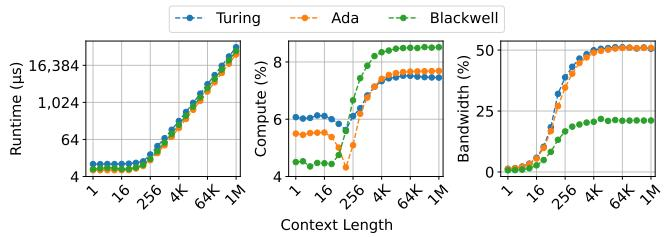

(a) Qwen3-8B  
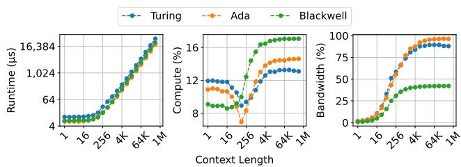  
(b) Qwen3-32B  
Figure 8: Runtime, bandwidth, and compute for Qwen3’s attention kernel over increasing context length.

With this partitioning, Attention is computed in parallel between the query and each split, and a final reduction step combines the results. Splitting the KV cache in this way has the potential to ex-ploit more of the parallelism available on modern GPUs. However, both this approach and other parallelization techniques (e.g., parallelizing over the query rather than the KV cache) have not, to our knowledge, been studied systematically.

Beyond the lack of study, these techniques are also unevenly available. Flash-Decoding exists for NVIDIA GPUs, and is rela- tively newer for AMD, where the implementations carry heuristics tuned for NVIDIA hardware. On CPU targets, it does not exist at all. Moreover, even where the technique is available, the compiler framework does not choose it automatically. The attention kernel is chosen based on a predetermined order of preference rather than the specific characteristics of the problem, such as the presence of a single query. Users who wish to enable KV cache splitting must first be aware of its existence and then request it explicitly.

Navigating these options should be done by the compiler, not by the user. The latter should use the fact that the kernels in question compute the same attention, but difer in how they distribute the work across the device. The choice therefore depends on the number of users in the workload, and the compiler should be able to detect that and choose the right kernel. Currently, it does not.

Recommendation #1: Parallelizing attention along the sequence axis should become a mainstream technique for long contexts. Variations of this approach warrant systematic study, implementations should support a broader range of hardware, and the compilation stack should select this method based on the problem’s shape rather than leaving the choice to the user.

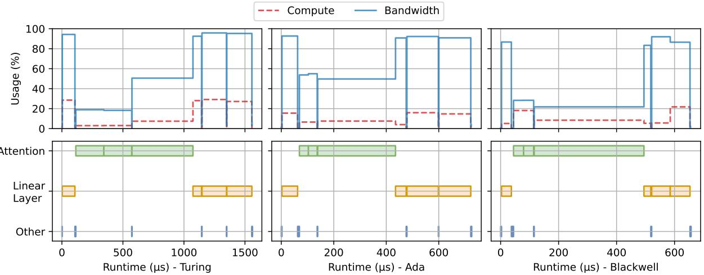  
Figure 9: Timeline view of Qwen3-8B (� = 8, 192).

## 6.2 Precise Paging Opportunities

Our observations so far were limited to how the device is used, not whether the data fits on it. The single block we profile makes capac- ity a non-issue by construction, and a full model at a long context does not enjoy this luxury. One answer to that problem is paging, and its benefit has been established since vLLM introduced block- based memory management [39]. The purpose there, however, is not the one we have in mind. In a system serving many users at once, paging resolves contention, evicting the blocks of sequences that are not currently running so that others may proceed. With a single query, there is no victim worth evicting, since every block it holds is one it needs for its next step. Paging has also been used to a second end, fitting a model larger than the device onto a single GPU, and FlexGen is the best known of these [62]. It is this second use that our proposal resembles.

What matters for such a use is the granularity at which paging occurs. FlexGen operates at the granularity of a layer, and recog- nizes that the data of the next layer must be prefetched while the current one computes. FlexGen is built for many queries at once and pursues throughput, accepting a cost in latency to obtain it. We ask instead what can be done for a single user, where latency is the quantity that matters and cannot be traded away.

Answering that question requires knowing when a transfer may take place without competing for memory bandwidth with the kernels themselves. Figure 9 shows where that moment lies. Once the GPU has loaded the KV cache and turns to computing attention, its use of memory bandwidth falls, and it stays low for the duration of the computation. This is a window during which data can move without contending with anything. The proposal is therefore not to schedule transfers on demand, but to trigger them at a point where we know in advance they will not interfere.

The window is of use only if it is long enough to page in the data of the next layer. Figure 10 reports the transfer speed that would be required to do so, against what the PCIe interface of each device provides. Taking the attention computation alone, shown in Figure 10a, the required speed exceeds what PCIe supports.

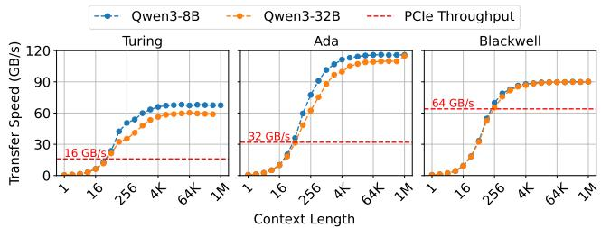

(a) Attention only  
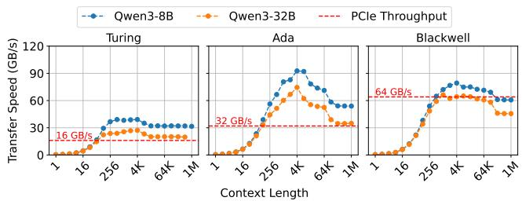  
(b) Attention & repeat kernels  
Figure 10: Transfer speed required to page the KV cache of the Qwen3 LLMs.

However, when we consider the window that includes the ker- nels that prepare attention, the copies that grouped-query attention requires, the picture changes. As Figure 10b shows, the required speed then falls close to what PCIe provides on Ada and below it on Blackwell. The window is suficient, and it is on the newer platforms that it is most comfortably so. The implication is that there can be a form of paging that costs little to no latency, which would remove the memory of a single device as the limit on context length. Realizing it with current hardware is another matter. This opportunity could be seized by using storage access from the GPU through GPUDirect [49].

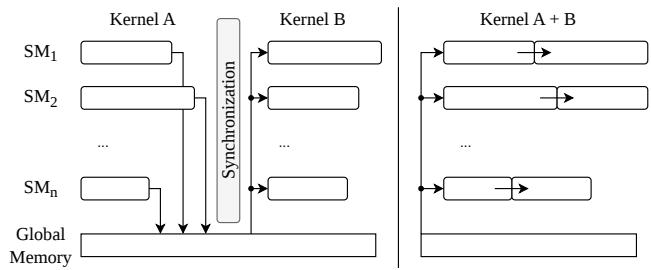  
Figure 11: Implicit synchronization and materialization of two kernels (left) vs. the fused version (right).

The issue, however, is that such technology does not allow it to be triggered from the precise point inside the computation where the window opens. What the mechanism calls for is a memory or storage device reachable over peer-to-peer PCIe, able to serve the GPU directly and at a moment the GPU itself determines.

Recommendation #2: Paging the KV cache out of GPU memory can be made to interfere little with the compu- tation by triggering the transfer where the device leaves bandwidth idle, during attention and the kernels that pre- pare it. Hardware should allow the GPU to initiate such transfers at the moment it determines.

## 6.3 Improving Compiler Fusion

ML compilers ofer several advantages for inference over eager mode frameworks [51, 68]. One major optimization performed by the compiler is operation fusion, such as combining the up projection and the activation function of the FFN into a single kernel. The autotuner can evaluate diferent implementations, such as Triton kernels [67] and those from libraries like NVIDIA cuDNN or cuBLAS [10, 48]. Likewise, it can benchmark diferent tile sizes for loading data from global memory and diferent thread block configurations.

In our studies, we find that the compiler performs almost no operation fusion across GPU generations and models, resulting in an optimized version that still closely mirrors the mathemati cal description. This problem is exacerbated by the architectural evolution of LLMs: newer and more performant layers introduce additional operations. For example, MoE introduces a gate layer and a top-� operator to select the experts, two small steps that are not combined. This lack of fusion results in numerous kernels and introduces two main issues. First, each kernel launch has some launch overhead [24]. Second, implicit synchronization is injected between each of the kernels, forcing the execution of a kernel to complete before starting the next one. As a result, SMs are not continuously and proactively loading data from memory, underutilizing a memory bandwidth that remains the main bottleneck of inference speed.

ML compilers should be able to fuse a larger number of operators together, vastly reducing the number ofkernel launches. This would resemble the megakernel approach to fusion [43, 63], combining a full model into a single kernel. This allows threads to proceed to the next step of the computation, instead of having to wait at each layer, illustrated in Figure 11. Current approaches are handwritten and require explicit synchronization carefully placed by kernel experts. Work has been done to build compilers capable of generating such kernels, such as MPK [9].

Table 4: Top 10 instructions causing stalls and their main reasons for the attention kernel of GPT-OSS (� = 131, 072) on the Blackwell GPU.
<table><tr><td>SASS Instruction</td><td>Stalls Count</td><td>Main Reason</td></tr><tr><td>BAR.SYNC.DEFER_BLOCKING 0x0</td><td>33,689</td><td>Long Scoreboard</td></tr><tr><td>@!P3 LDS.U16 R84, [R84+0x600]</td><td>23,306</td><td>Barrier</td></tr><tr><td>STS.128 [R91+0x600],R16</td><td>7,197</td><td>Long Scoreboard</td></tr><tr><td>LDSM.16.M88.4 R68, [R0+UR5+0x600]</td><td>2,690</td><td>Barrier</td></tr><tr><td>HMMA.1688.F32.BF16 R36, R4, R8, R36</td><td>1,614</td><td>Short Scoreboard</td></tr><tr><td>@!P3 IMAD.U32 R5, R84, 0x10000, RZ</td><td>1,440</td><td>Short Scoreboard</td></tr><tr><td>BSSY.RECONVERGENT B0, 0x70113372f8f0</td><td>1,248</td><td>Barrier</td></tr><tr><td>HMMA.1688.F32.BF16 R4, R68, R72, R4</td><td>1,180</td><td>Short Scoreboard</td></tr><tr><td>ULEA UR4, UR4, UR25, 0x18</td><td>1,090</td><td>Short Scoreboard</td></tr><tr><td>FSETP.GEU.AND P0, PT, R109, R6, PT</td><td>1,067</td><td>Short Scoreboard</td></tr></table>

Recommendation #3: The number of kernels has increased in modern LLM architecture, and many are not fused. ML compilers should fuse more operations together to reduce synchronizations and improve device utilization.

## 6.4 Reducing Kernels Stalls

Self-attention is the most costly operation during the decode phase on long contexts. As displayed in Figures 4 and 8, our studies indi-cate that this kernel does not use all the GPU resources available and, in particular, only a fraction of the available compute. To better understand part of the reason behind these results, we analyze the assembly language of NVIDIA GPUs, SASS, to find the causes of stalls. A cycle is stalled when no instruction can be issued by the SM, forcing threads to wait [2]. Table 4 shows the ten instructions causing the most stalls in the attention kernel of GPT-OSS when compiled for the Blackwell 6000 GPU.

For the attention operation, long and short scoreboards as well as barriers account for the majority of stalls. Long scoreboards are delays caused by loads from global memory, whereas short scoreboards are caused by loads from shared memory. Barriers are a synchronization primitive that blocks the execution of threads, forcing them to wait for each other. Furthermore, long stalls are often caused by multiple ones beforehand: their scoreboard depen- dencies often include barriers. For example, when looking at the dependency on the fifth instruction with the most stalls, a half- precision matrix multiply and accumulate (MMA), we find that it depends on a load from shared memory (LDSM). When investigating what caused this load to stall, we found that this instruction de- pends on a barrier synchronization (BAR.SYNC.DEFER\_BLOCKING). Figure 12 shows how stalls can accumulate, halting execution of the GPU. Here, the MMA instruction cannot be executed, as it must first wait for a load from shared memory (LDSM). This instruction cannot be initialized yet since it is waiting on a barrier, necessary to synchronize threads and ensure data loaded from global memory (LDGSTS) has arrived in shared memory.

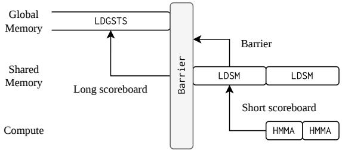  
Figure 12: Simplified view of stalls in GPU execution.

Kernels should be designed in a more asynchronous manner such that threads continuously perform work instead of waiting for each other or for data to arrive. Addressing kernel stalls could help increase compute utilization. Tensor cores are not useful to address this problem, as they do not help improve the performance of memory-bound workloads [76]. Part of the solution comes from a reduced use of synchronization and more fine-grained timing of memory accesses. The new hardware unit introduced with the Hopper microarchitecture and available in Blackwell can help with data movement. The Tensor Memory Accelerator (TMA unit) can eficiently transfer data from global memory to shared memory asynchronously [52]. None of the generated kernels running on the RTX PRO 6000 Blackwell GPU made use of this hardware unit.

Recommendation #4: Threads are forced to wait on each other because of synchronization, slowing the computation. Kernels should be designed around this problem to reduce the number of stalls.

## 7 Discussion

Our measurements are now in hand, and so are the recommenda- tions we draw from them. The recommendations, however, raise questions that the numbers alone do not answer. In the following sections, we present three of them: whether the problems behind them are ones this community has met before, whether compres- sion remains necessary once the device is used well, and what kind of system would be needed to act on any of it.

## 7.1 Recurring Problems in a New Setting

An LLM serving system is not a database, and nothing in the recom-mendations above asks that it be treated as one. However, we claim a similarity in the issues those two systems encounter. We now substantiate this claim by relating each of our recommendations to prior work from this community.

Let us start with Recommendation #2. The proposal that the interconnect be treated as a resource the system schedules rather than a channel it merely uses has been advanced in this community, resting on the observation that a workload starved of one resource leaves another idle [33]. Our paging window applies that principle within a single computation rather than across competing ones.

Recommendations #3 and #4 find their counterpart in a charac- terization of four GPU database systems [7]. That study attributes the underutilization it measures to a lack of kernel fusion, the cause behind our third recommendation. The remedy proposed alongside it, a set of routines that compose without materializing between them [59], is what we ask of a compiler when we ask it for fewer and larger kernels. The same study also finds schedulers left idle by memory waits, which account for part of the stalls we found.

Recommendation #1 is the exception, in that the case for parallelizing attention along the sequence rests on our measurements alone. The portability it also calls for, however, does not. The argu- ment that an accelerated engine should not be written against the hardware of one vendor has been made here at production scale, with hardware independence adopted as a design principle and val- idated across accelerators and interconnects of several kinds [27].

These dificulties were met before on a diferent workload, query processing. We believe that the experience gained in those contexts can now be applied, from a systems perspective, to models that generate one token at a time for a single user.

## 7.2 On the Necessity of Compression

Compression exists to make a model fit on the device. Much of the work in this direction reports on the footprint achieved, with weight compression now approaching one bit per parameter. Less is said about what is given up in return, though the evidence that something is given up is not scarce: under tasks that demand the knowledge a model holds, pruning degrades performance at ratios as low as 25 to 30%, and quantization to eight bits already costs eight to ten percent [29]. That loss grows sharper as the context a model must digest grows longer, which is the regime this paper concerns itself with. Recommendation #2 ofers a diferent way to make a model fit, one that pages the dominant and momentarily unused part of the state in and out of the device rather than shrinking it, and pays for the transfer with bandwidth that would otherwise sit idle. Where that window sufices, compression may indeed prove not to be necessary or at least as important.

That window, however, is not fixed. It exists because attention is slow, and Recommendation #1 asks that attention be made faster. Were the other recommendations carried out, the time available to page would shrink along with the runtime they recover, and at some point paging would cost latency rather than come free. We do not claim, then, that a workstation will serve a long context as fast as the datacenter hardware built for the task. Our claim is that the diference may matter less than it appears, because a single user running an agentic workload is rarely waiting on the next token. Such workflows proceed asynchronously, and a model that generates somewhat more slowly, on a machine the user owns, with data that never leaves it, may still be a worthy tradeof.

## 7.3 The Case for a New Single-User Serving System

A decoder block is not a serving system. One may argue, then, that what we measured on a block says little about what a system would do. We would answer that a system has no way of avoiding what the block does. Since LLMs are just a repetition of blocks, improving the latter is how we improve the former. We believe that our recommendations can be such a way to improve local serving systems. Moreover, we believe the recommendations are fundamental enough to justify building a system around them, as opposed to retrofitting them in existing systems.

This raises the question of why not PyTorch. The answer is not that PyTorch is at fault. A compiler emits general code because it cannot know which model, which device, and which regime it is being asked for, and that knowledge lives in the layer above it. vLLM shows what the layer above is worth: it compiles through torch.compile as we do, and by telling the compiler what it is compiling for, obtains kernels that a general invocation does not.

Naturally, why not vLLM, then? What it tells the compiler is that many queries will arrive at once, and that premise runs through the system rather than sitting at its edge. Paging [39], continuous batching [73], and prefix caching [77] all resolve contention among those queries, and the shapes it specializes for systems serving multiple requests. A single-user scenario lacks these characteristics, and expecting a system to perform eficiently outside its intended design parameters does not make efective use of its strengths.

The lineage that does take the single user as its premise begins with llama.cpp [20], and it has carried local inference a long way. What has not followed from it is a system as production-ready for one user as vLLM is for many. It may be time for one, and our recommendations describe the pillars on which the architecture of this new potential system should be based. We hope to see such a system because, as is, our findings indicate that GPU architecture improvements are not yet directly benefiting the single-user inference workload.

## 8 Related Work

Studies have looked into characterizing LLM inference workloads. Recasens et al. analyze small language model inference with the goal of finding the optimal batch size to maximize tokens per sec- ond and device utilization [58]. Inference has been found to remain memory-bound even for large batches, and never maximizes com- pute utilization [57]. Pope et al. study the inference latency of transformer models with more than 500B parameters, and how to scale it to multiple TPUs [53]. Inference of some Llama models has been studied through the roofline model, to determine if the diferent layers are memory-bound or compute-bound [74]. The workloads of encoder and decoder transformer models have been studied for both training [21] and inference [38]. It remains, though, that these studies have not focused on single-user workloads, as ours does, and in particular in the face of increasing context lengths.

Other work specifically focuses on kernels and ML compilers. Carmona-Martínez et al. compare the productivity, portability and performance of ML compilers for inference on consumer GPUs [8]. Attention kernels have also been compared during training for long contexts and distributed settings [6]. These studies are complementary to ours and may indicate how some of the recommendations, such as kernel fusion, may be better achieved by newer techniques or by compiler improvements.

Lastly, studies have looked at how the energy eficiency of trans- former models and LLMs [17, 70]. The energy eficiency of deep neural networks has also been studied for neural network train- ing [72]. We believe that those studies reflect some of the poor resources utilization that our study finds as well. Improving the utilization of resources on a GPU should, in theory, improve the value gained for each joule invested.

## 9 Conclusion

In this work, we set out to investigate the obstacles that prevent a long-context LLM from being served locally on a single GPU for individual users. The prevalent assumption is that such a model must be heavily compressed, or else left to a provider. We expected, then, to find a GPU device overwhelmed by the workload. Instead, we observed the opposite. If we set the capacity issue aside, the device had resources to spare, and this was not the measure of one model on one GPU. Across two families of models and three generations of hardware, no device was ever pushed to its limits.

A natural next question was, then, how to make better use of the available resources. The opportunities we identify are varied, and no single solution solves all the ineficiencies found. Solving the capacity issue, however, is one of these opportunities. A particular window of memory bandwidth availability opens during attention. It stays open long enough to page the cache of the device, allowing for longer context lengths to be used. Compression thus appears to be a concession to how the device is currently driven rather than a requirement of the workload. More generally, we found some opportunities for improvement that may inform a new generation of single-user serving systems to be built. In particular, many of the problems involved in building such a system have already been encountered by this community in GPU query processing, and the experience gained there may prove influential here as well.

## References

[1] Joshua Ainslie, James Lee-Thorp, Michiel de Jong, Yury Zemlyanskiy, Federico Lebrón, and Sumit Sanghai. 2023. GQA: Training Generalized Multi-Query Transformer Models from Multi-Head Checkpoints. In Conference on Empirical Methods in Natural Language Processing. Association for Computational Linguistics, 4895–4901. doi:10.18653/V1/2023.EMNLP-MAIN.298

[2] Johnathan Alsop, Matthew D. Sinclair, Rakesh Komuravelli, and Sarita V. Adve. 2016. GSI: A GPU Stall Inspector to characterize the sources of memory stalls for tightly coupled GPUs. In IEEE International Symposium on Performance Analysis ofSystems and Software. IEEE Computer Society, 172–182. doi:10.1109/ISPASS. 2016.7482092

[3] Jason Ansel, Edward Z. Yang, Horace He, Natalia Gimelshein, Animesh Jain, Michael Voznesensky, Bin Bao, Peter Bell, David Berard, Evgeni Burovski, Geeta Chauhan, Anjali Chourdia, Will Constable, Alban Desmaison, Zachary DeVito, Elias Ellison Will Fen Jion Gon Michael Gschwind Brian Hirsh Sherlock Huan Kshiteej Kalambarkar Laurent Kirsch Michael Lazos Mario Lezcano Yanbo Liang, Jason Liang, Yinghai Lu, C. K. Luk, Bert Maher, Yunjie Pan, Christian Puhrsch, Matthias Reso, Mark Saroufim, Marcos Yukio Siraichi, Helen Suk, Shunting Zhang, Michael Suo, Phil Tillet, Xu Zhao, Eikan Wang, Keren Zhou, Richard Zou, Xiaodong Wang, Ajit Mathews, William Wen, Gregory Chanan, Peng Wu, and Soumith Chintala. 2024. PyTorch 2: Faster Machine Learning Through Dynamic Python Bytecode Transformation and Graph Compilation. In ACM International Conference on Architectural Supportfor Programming Languages and Operating Systems. ACM, 929–947. doi:10.1145/3620665.3640366

[4] Lei Jimmy Ba, Jamie Ryan Kiros, and Geofrey E. Hinton. 2016. Layer Normalization. CoRR (2016). arXiv:1607.06450

[5] Tom B. Brown, Benjamin Mann, Nick Ryder, Melanie Subbiah, Jared Kaplan, Prafulla Dhariwal, Arvind Neelakantan, Pranav Shyam, Girish Sastry, Amanda Askell, Sandhini Agarwal, Ariel Herbert-Voss, Gretchen Krueger, Tom Henighan, Rewon Child, Aditya Ramesh, Daniel M. Ziegler, Jefrey Wu, Clemens Winter, Christopher Hesse, Mark Chen, Eric Sigler, Mateusz Litwin, Scott Gray, Benjamin Chess, Jack Clark, Christopher Berner, Sam McCandlish, Alec Radford, Ilya Sutskever, and Dario Amodei. 2020. Language Models are Few-Shot Learners. In Advances in Neural Information Processing Systems. https://proceedings.neurips. cc/paper/2020/hash/1457c0d6bfcb4967418bfb8ac142f64a-Abstract.html

[6] Tao Bu, Qiangang Wang, Bowen Zeng, Hanwen Sun, Yunpeng Huang, Chun Cao, and Jingwei Xu. 2025. Long-Context Attention Benchmark: From Kernel Eficiency to Distributed Context Parallelism. CoRR (2025). doi:10.48550/ARXIV. 2510.17896

[7] Jiashen Cao, Rathijit Sen, Matteo Interlandi, Joy Arulraj, and Hyesoon Kim. 2023. GPU Database Systems Characterization and Optimization. Proc. VLDB Endow. 17, 3 (2023), 441–454. doi:10.14778/3632093.3632107

[8] Alejandro Carmona-Martínez, Gregorio Bernabé, and José Manuel García. 2026. Characterization of machine learning compilers for LLM inference on NVIDIA GPUs. J. Supercomput. 82, 7 (2026), 420. doi:10.1007/S11227-026-08559-6

[9] Xinhao Cheng, Zhihao Zhang, Yu Zhou, Jianan Ji, Jinchen Jiang, Zepeng Zhao, Ziruo Xiao, Zihao Ye, Yingyi Huang, Ruihang Lai, Hongyi Jin, Bohan Hou, Mengdi Wu, Yixin Dong, Anthony Yip, Zihao Ye, Songting Wang, Wenqin Yang, Xupeng Miao, Tianqi Chen, and Zhihao Jia. 2026. MPK: A Compiler and Runtime for Mega-Kernelizing Tensor Programs. In USENIX Symposium on Operating Systems Design and Implementation. USENIX Association, 1909–1926. https://www. usenix.org/conference/osdi26/presentation/cheng

[10] Sharan Chetlur, Clif Woolley, Philippe Vandermersch, Jonathan Cohen, John Tran, Bryan Catanzaro, and Evan Shelhamer. 2014. cuDNN: Eficient Primitives for Deep Learning. CoRR (2014). arXiv:1410.0759

[11] Tri Dao. 2024. FlashAttention-2: Faster Attention with Better Parallelism and Work Partitioning. In International Conference on Learning Representations. https: //openreview.net/forum?id=mZn2Xyh9Ec

[12] Tri Dao, Daniel Haziza, Francisco Massa, and Grigory Sizov. [n. d.]. Flash-Decoding for long-context inference. https://crfm.stanford.edu/2023/10/12/ flashdecoding.html

[13] DeepSeek-AI. 2026. DeepSeek-V4: Towards Highly Eficient Million-Token Con text Intelligence. arXiv:2606.19348

[14] Tim Dettmers, Mike Lewis, Younes Belkada, and Luke Zettlemoyer. 2022. LLM.int8(): 8-bit Matrix Multiplication for Transformers at Scale. CoRR (2022). doi:10.48550/ARXIV.2208.07339

[15] Stefan Elfwin , Eiji Uchibe, and Kenji Do a. 2018. Si moid-wei hted linear units for neural network function approximation in reinforcement learning. Neural Networks 107 (2018), 3–11. doi:10.1016/J.NEUNET.2017.12.012

[16] William Fedus, Barret Zoph, and Noam Shazeer. 2022. Switch Transformers: Scalin to Trillion Parameter Models with Sim le and Eficient S arsit . J. Mach. Learn. Res. 23 (2022), 120:1–120:39. https://jmlr.org/papers/v23/21-0998.html

[17] Jared Fernandez, Clara Na, Vashisth Tiwari, Yonatan Bisk, Sasha Luccioni, and Emma Strubell. 2025. Energy Considerations of Large Language Model Inference and Eficiency Optimizations. In Proceedings of the 63rd Annual Meeting of the Association for Computational Linguistics (Volume 1: Long Papers). Association for Computational Linguistics, 32556–32569. doi:10.18653/V1/2025.ACL-LONG.1563

[18] Elias Frantar, Saleh Ashkboos, Torsten Hoefler, and Dan Alistarh. 2022. GPTQ: Accurate Post-Training Quantization for Generative Pre-trained Transformers. CoRR (2022). doi:10.48550/ARXIV.2210.17323

[20] Georgi Gerganov and llama.cpp contributors. [n. d.]. llama.cpp. https://github. com/ggml-org/llama.cpp

[19] Roy Frostig, Matthew James Johnson, and Chris Leary. 2018. Compiling ma chine learning programs via high-level tracing. In SysML Conference. https: //cs.stanford.edu/\~rfrostig/pubs/jax-mlsys2018.pdf

[21] Amir Gholami, Zhewei Yao, Sehoon Kim, Coleman Hooper, Michael W. Mahoney, and Kurt Keutzer. 2024. AI and Memory Wall. IEEE/ACM International Symposium on Microarchitecture 44, 3 (2024), 33–39. doi:10.1109/MM.2024.3373763

[22] Kaiming He, Xiangyu Zhang, Shaoqing Ren, and Jian Sun. 2016. Deep Residual Learning for Image Recognition. In IEEE/CVF Conference on Computer Vision and Pattern Recognition. IEEE Computer Society, 770–778. doi:10.1109/CVPR.2016.90

[23] Dan Hendrycks and Kevin Gimpel. 2023. Gaussian Error Linear Units (GELUs). CoRR (2023). arXiv:1606.08415

[24] Pieter Hijma, Stijn Heldens, Alessio Sclocco, Ben van Werkhoven, and Henri E. Bal. 2023. Optimization Techniques for GPU Programming. ACM Comput. Surv. 55, 11 (2023), 239:1–239:81. doi:10.1145/3570638

[25] Coleman Hooper, Sehoon Kim, Hiva Mohammadzadeh, Michael W. Mahoney, Yakun Sophia Shao, Kurt Keutzer, and Amir Gholami. 2024. KVQuant: Towards 10 Million Context Length LLM Inference with KV Cache Quantization. In Advances in Neural Information Processing Systems. doi:10.52202/079017-0040

[26] Wen-mei W. Hwu, David B. Kirk, and Izzat El Hajj. 2022. Programming Massively Parallel Processors: A Hands-on Approach (4 ed.). Morgan Kaufmann.

[27] Matteo Interlandi, Nicolas Bruno, Brandon Haynes, Carlo Curino, Rathijit Sen, Yinan Li, Kaushik Rajan, Bailu Ding, Lukas M. Maas, and Wei Cui. 2026. CoddSpeed: Hardware Accelerated Query Processing in Microsoft Fabric. In Companion of the International Conference on Management of Data. ACM. doi:10.1145/3788853.3803077

[28] Naman Jain, King Han, Alex Gu, Wen-Ding Li, Fanjia Yan, Tianjun Zhang, Sida Wang, Armando Solar-Lezama, Koushik Sen, and Ion Stoica. 2025. Live CodeBench: Holistic and Contamination Free Evaluation of Large Language Models for Code. In International Conference on Learning Representations. https: //openreview.net/forum?id=chfJJYC3iL

[29] Ajay Jaiswal, Zhe Gan, Xianzhi Du, Bowen Zhang, Zhangyang Wang, and Yinfei Yang. 2024. Compressing LLMs: The Truth is Rarely Pure and Never Simple. In International Conference on Learning Representations. https://openreview.net/ forum?id=B9klVS7Ddk

[30] Albert Q. Jiang, Alexandre Sablayrolles, Antoine Roux, Arthur Mensch, Blanche Savary, Chris Bamford, Devendra Singh Chaplot, Diego de Las Casas, Emma Bou Hanna, Florian Bressand, Gianna Lengyel, Guillaume Bour, Guillaume Lample,

Lélio Renard Lavaud, Lucile Saulnier, Marie-Anne Lachaux, Pierre Stock, Sandeep Subramanian, Sophia Yang, Szymon Antoniak, Teven Le Scao, Théophile Gervet, Thibaut Lavril, Thomas Wan , Timothée Lacroix, and William El Sa ed. 2024. Mixtral of Ex erts. CoRR (2024). doi:10.48550/ARXIV.2401.04088

[31] Juyong Jiang, Fan Wang, Jiasi Shen, Sungju Kim, and Sung Hun Kim. 2026. A Survey on Large Language Models for Code Generation. ACM Trans. Softw. Eng. Methodol. 35, 2 (2026), 58:1–58:72. doi:10.1145/3747588

[32] Xuanlin Jiang, Yang Zhou, Shiyi Cao, Ion Stoica, and Minlan Yu. 2025. NEO: Saving GPU Memory Crisis with CPU Ofloading for Online LLM Inference. In Conference on Machine Learning and Systems. https://openreview.net/forum?id= umgy9tWBLA

[33] Yi Jiang, Hamish Nicholson, Viktor Sanca, and Anastasia Ailamaki. 2026. Data Movement-Aware GPU Sharing for Data-Intensive Systems. In Conference on Innovative Data Systems Research. htt s://www.vldb.or /cidrdb/ a ers/2026/ 13- jiang.pdf

[34] Carlos E. Jimenez, John Yang, Alexander Wettig, Shunyu Yao, Kexin Pei, Ofir Press, and Karthik R. Narasimhan. 2024. SWE-bench: Can Language Models Resolve Real-world Github Issues?. In International Conference on Learning Representations. https://openreview.net/forum?id=VTF8yNQM66

[35] Norman P. Jouppi, Sridhar Lakshmanamurthy, Clif Young, and David Patterson. 2026. Google’s Training Supercomputers from TPUv2 to Ironwood: Architec- tural Stabilit Scale Resilience Power Eficienc and Sustainabilit Across Five Generations. IEEE/ACM International Symposium on Microarchitecture (2026), 1–14. doi:10.1109/MM.2026.3699647

[36] Jared Kaplan, Sam McCandlish, Tom Henighan, Tom B. Brown, Benjamin Chess, Rewon Child, Scott Gray, Alec Radford, Jefrey Wu, and Dario Amodei. 2020. Scaling Laws for Neural Language Models. CoRR (2020). arXiv:2001.08361

[37] Zixuan Ke, Fangkai Jiao, Yifei Ming, Xuan-Phi Nguyen, Austin Xu, Do Xuan Long, Minzhi Li, Chengwei Qin, Peifeng Wang, Silvio Savarese, Caiming Xiong, and Shafiq Joty. 2025. A Survey of Frontiers in LLM Reasoning: Inference Scaling, Learning to Reason, and Agentic Systems. Trans. Mach. Learn. Res. (2025). https://openreview.net/forum?id=SlsZZ25InC

[38] Sehoon Kim, Coleman Hooper, Thanakul Wattanawong, Minwoo Kang, Ruohan Yan, Hasan Genc, Grace Dinh, Qijing Huang, Kurt Keutzer, Michael W. Mahoney, Sophia Shao, and Amir Gholami. 2023. Full Stack Optimization of Transformer Inference. In Architecture and System Support for Transformer Models. https: //openreview.net/forum?id=GtyQbLUUagE

[39] Woosuk Kwon, Zhuohan Li, Siyuan Zhuang, Ying Sheng, Lianmin Zheng, Cody Hao Yu, Joseph Gonzalez, Hao Zhang, and Ion Stoica. 2023. Eficient Memory Management for Large Language Model Serving with PagedAttention. In ACM Symposium on Operating Systems Principles. ACM, 611–626. doi:10.1145/3600006.3613165

[40] Baolin Li, Yankai Jiang, Vijay Gadepally, and Devesh Tiwari. 2024. LLM Inference Serving: Survey ofRecent Advances and Opportunities. In IEEE High Performance Extreme Computing Conference. IEEE, 1–8. doi:10.1109/HPEC62836.2024.10938426

[41] Hongwei Liu, Zilong Zheng, Yuxuan Qiao, Haodong Duan, Zhiwei Fei, Fengzhe Zhou, Wenwei Zhang, Songyang Zhang, Dahua Lin, and Kai Chen. 2024. Math-Bench: Evaluating the Theory and Application Proficiency ofLLMs with a Hierarchical Mathematics Benchmark. In Findings ofthe Association for Computational Linguistics, Vol. ACL 2024. Association for Computational Linguistics, 6884–6915. doi:10.18653/V1/2024.FINDINGS-ACL.411

[42] Chris Lu, Cong Lu, Robert Tjarko Lange, Yutaro Yamada, Shengran Hu, Jakob Foerster, David Ha, and Jef Clune. 2026. Towards end-to-end automation of AI research. Nature 651, 8107 (2026), 914–919. doi:10.1038/s41586-026-10265-5

[43] Aniruddha Nrusimha, William Brandon, Mayank Mishra, Yikang Shen, Rameswar Panda, Jonathan Ragan-Kelley, and Yoon Kim. 2025. FlashFormer: Whole-Model Kernels for Eficient Low-Batch Inference. doi:10.48550/ARXIV. 2505.22758

[44] NVIDIA Corporation. [n. d.]. NVIDIA Nsight Compute. Retrieved 2026-06-01 from https://developer.nvidia.com/nsight-compute

[45] NVIDIA Corporation. 2018. NVIDIA TURING GPU ARCHITECTURE. Technical Report. Retrieved 2026-07-14 from https://www.nvidia.com/content/dam/enzz/Solutions/design-visualization/technologies/turing-architecture/NVIDIA Turing-Architecture-Whitepaper.pdf

[46] NVIDIA Corporation. 2023. NVIDIA ADA LOVELACE PROFESSIONAL GPU ARCHITECTURE. Technical Report. Retrieved 2026-07-14 from https://images.nvidia.com/aem-dam/en-zz/Solutions/technologies/NVIDIA-ADA-GPU-PROVIZ-Architecture-Whitepaper\_1.1.pdf

[47] NVIDIA Corporation. 2025. NVIDIA RTX PRO BLACKWELL GPU AR-CHITECTURE. Technical Report. Retrieved 2026-07-14 from https: //www.nvidia.com/content/dam/en-zz/Solutions/design-visualization/quadroroduct-literature/NVIDIA-RTX-Blackwell-PRO-GPU-Architecture-v1.0. df

[48] NVIDIA Corporation. [n. d.]. cuBLAS 13.3 documentation. Retrieved 2026-06-10 from https://docs.nvidia.com/cuda/cublas

[49] NVIDIA Corporation. [n. d.]. GPUDirect Storage. Retrieved 2026-06-01 from htt s://docs.nvidia.com/g udirect-storage/

[50] OpenAI. 2025. gpt-oss-120b & gpt-oss-20b Model Card. CoRR (2025). doi:10. 48550/ARXIV.2508.10925

[51] Adam Paszke, Sam Gross, Francisco Massa, Adam Lerer, James Bradbury, Gre-gory Chanan, Trevor Killeen, Zeming Lin, Natalia Gimelshein, Luca Antiga, Alban Desmaison, Andreas Kö f, Edward Z. Yang, Zachar DeVito, Martin Raison, Alykhan Tejani, Sasank Chilamkurthy, Benoit Steiner, Lu Fang, Junjie Bai, and Soumith Chintala. 2019. PyTorch: An Imperative Style, High Performance Deep Learning Library. In Advances in Neural Information Processing Systems. 8024–8035. https://proceedings.neurips.cc/paper/2019/hash bdbca288fee7f92f2bfa9f7012727740-Abstract.html

[52] Patel, Dylan and Chen, Kimbo. 2025. NVIDIA Tensor Core Evolution: From Volta To Blackwell. Retrieved 2026-03-30 from https://newsletter.semianalysis.com/p/ nvidia-tensor-core-evolution-from-volta-to-blackwell

[53] Reiner Pope, Sholto Douglas, Aakanksha Chowdhery, Jacob Devlin, James Bradbury, Jonathan Heek, Kefan Xiao, Shivani Agrawal, and Jef Dean. 2023. Eficiently Scaling Transformer Inference. In Conference on Machine Learning and Systems. https://proceedings.mlsys.org/paper\_files/paper/2023/hash c4be71ab8d24cdfb45e3d06dbfca2780-Abstract-mlsys2023.html

[54] Alec Radford, Karthik Narasimhan, Tim Salimans, and Ilya Sutskever. 2018. Improving Language Understanding by Generative Pre-Training. https://cdn.openai.com/research-covers/language-unsupervised/language\_ understanding\_paper.pdf

[55] Alec Radford, Jefrey Wu, Rewon Child, David Luan, Dario Amodei, and Ilya Sutskever. 2019. Language Models are Unsupervised Multitask Learners. https://cdn.openai.com/better-language-models/language\_models\_are\_ unsupervised\_multitask\_learners.pdf

[56] Prajit Ramachandran, Barret Zoph, and Quoc V. Le. 2018. Searching for Activation Functions. In International Conference on Learning Representations. https:// openreview.net/forum?id=Hkuq2EkPf

[57] Pol G. Recasens, Ferran A ullo, Yue Zhu, Chen Wan , Eun K un Lee, Olivier Tardieu, Jordi Torres, and Josep Lluís Berral. 2025. Mind the Memory Gap: Unveiling GPU Bottlenecks in Large-Batch LLM Inference. In IEEE International Conference on Cloud Computing. IEEE, 277–287. doi:10.1109/CLOUD67622.2025. 00036

[58] Pol G. Recasens, Yue Zhu, Chen Wang, Eun Kyung Lee, Olivier Tardieu, Alaa Youssef, Jordi Torres, and Josep Lluis Berral. 2024. Towards Pareto Optimal Throughput in Small Language Model Serving. In Workshop on Machine Learning and Systems. ACM 144–152. doi:10.1145/3642970.3655832

[59] Anil Shanbhag, Samuel Madden, and Xiangyao Yu. 2020. A Study of the Fundamental Performance Characteristics of GPUs and CPUs for Database Analytics. In ACM International Conference on Management of Data. ACM, 1617–1632. doi:10.1145/3318464.3380595

[60] Noam Shazeer. 2020. GLU Variants Improve Transformer. CoRR (2020). arXiv:2002.05202

[61] Noam Shazeer, Azalia Mirhoseini, Krzysztof Maziarz, Andy Davis, Quoc V. Le, Geofrey E. Hinton, and Jef Dean. 2017. Outrageously Large Neural Networks: The Sparsely-Gated Mixture-of-Experts Layer. In International Conference on Learning Representations. https://openreview.net/forum?id=B1ckMDqlg

[62] Ying Sheng, Lianmin Zheng, Binhang Yuan, Zhuohan Li, Max Ryabinin, Beidi Chen, Percy Liang, Christopher Ré, Ion Stoica, and Ce Zhang. 2023. FlexGen: High-Throughput Generative Inference of Large Language Models with a Single GPU. In International Conference on Machine Learning, Vol. 202. PMLR, 31094– 31116. https://proceedings.mlr.press/v202/sheng23a.html

[63] Benjamin Spector, Jordan Juravsky, Stuart Sul, Owen Dugan, Dylan Lim, Dan Fu, Simran Arora, and Chris Ré. 2025. Look Ma, No Bubbles! Designing a Low-Latency Megakernel for Llama-1B. Retrieved 2026-05-28 from https: //hazyresearch.stanford.edu/blog/2025-05-27-no-bubbles

[64] Jianlin Su, Murtadha H. M. Ahmed, Yu Lu, Shengfeng Pan, Wen Bo, and Yunfeng Liu. 2024. RoFormer: Enhanced transformer with Rotary Position Embedding. Neurocomputing 568 (2024), 127063. doi:10.1016/J.NEUCOM.2023.127063

[65] Llama Team. 2024. The Llama 3 Herd of Models. CoRR (2024). doi:10.48550/ ARXIV.2407.21783

[66] Qwen Team. 2025. Qwen3 Technical Report. CoRR (2025). doi:10.48550/ARXIV. 2505.09388

[67] Philippe Tillet, Hsiang-Tsung Kung, and David D. Cox. 2019. Triton: an intermediate language and compiler for tiled neural network computations. In ACM SIGPLAN International Workshop on Machine Learning and Programming Languages. ACM, 10–19. doi:10.1145/3315508.3329973

[68] Seiya Tokui, Ryosuke Okuta, Takuya Akiba, Yusuke Niitani, Toru Ogawa, Shunta Saito Shuji Suzuki Kota Uenishi Brian Vo el and Hiro uki Yamazaki Vincent. 2019. Chainer: A Deep Learning Framework for Accelerating the Research Cycle. In ACM SIGKDD Conference on Knowledge Discovery and Data Mining. ACM, 2002–2011. doi:10.1145/3292500.3330756

[69] Ashish Vaswani, Noam Shazeer, Niki Parmar, Jakob Uszkoreit, Llion Jones, Aidan N. Gomez, Lukasz Kaiser, and Illia Polosukhin. 2017. Attention is All you Need. In Advances in Neural Information Processing Systems. 5998–6008. https://proceedings.neurips.cc/paper/2017/hash/ 3f5ee243547dee91fbd053c1c4a845aa-Abstract.html

[70] Yuxin Wang, Qiang Wang, and Xiaowen Chu. 2020. Energy-eficient Inference Service of Transformer-based Deep Learning Models on GPUs. In 2020 International Conferences on Internet ofThings (iThings) and IEEE Green Computing and Communications (GreenCom) and IEEE Cyber, Physical and Social Computing (CPSCom) and IEEE Smart Data (SmartData) and IEEE Congress on Cybermatics (Cybermatics). IEEE, 323–331. doi:10.1109/ITHINGS-GREENCOM-CPSCOM-SMARTDATA-CYBERMATICS50389.2020.00067

[71] Samuel Williams, Andrew Waterman, and David A. Patterson. 2009. Roofline: an insi htful visual erformance model for multicore architectures. Commun. ACM 52, 4 (2009), 65–76. doi:10.1145/1498765.1498785

[72] Jie You, Jae-Won Chung, and Mosharaf Chowdhury. 2023. Zeus: Understanding and Optimizing GPU Energy Consumption of DNN Training. In USENIX Symposium on Networked Systems Design and Implementation. USENIX Association, 119–139. https://www.usenix.org/conference/nsdi23/presentation/you

[73] Gyeong-In Yu, Joo Seong Jeong, Geon-Woo Kim, Soojeong Kim, and Byung-Gon Chun. 2022. Orca: A Distributed Serving System for Transformer-Based Gen erative Models. In USENIX Symposium on Operating Systems Design and Implementation. USENIX Association, 521–538. https://www.usenix.org/conference/ osdi22/presentation/yu

[74] Zhihang Yuan, Yuzhang Shang, Yang Zhou, Zhen Dong, Zhe Zhou, Chenhao Xue, Bingzhe Wu, Zhikai Li, Qingyi Gu, Yong Jae Lee, Yan Yan, Beidi Chen, Guangyu Sun, and Kurt Keutzer. 2024. LLM Inference Unveiled: Survey and Roofline Model Insights. CoRR (2024). doi:10.48550/ARXIV.2402.16363

[75] Biao Zhang and Rico Sennrich. 2019. Root Mean Square Layer Normalization. In Advances in Neural Information Processing Systems. 12360–12371. https: //proceedings.neurips.cc/paper/2019/hash/1e8a19426224ca89e83cef47f1e7f53b-Abstract.htm

[76] Lingqi Zhang, Jiajun Huang, Sheng Di, Satoshi Matsuoka, and Mohamed Wahib. 2025. Can Tensor Cores Benefit Memory-Bound Kernels? (NO!). In Workshop on General Purpose Processing Using GPU. ACM, 28–34. doi:10.1145/3725798.3725803

[77] Lianmin Zheng, Liangsheng Yin, Zhiqiang Xie, Chuyue Sun, Jef Huang, Cody Hao Yu, Shiyi Cao, Christos Kozyrakis, Ion Stoica, Joseph E. Gonzalez, Clark W. Barrett, and Ying Sheng. 2024. SGLang: Eficient Execution of Structured Language Model Programs. In Advances in Neural Information Processing Systems. http://papers.nips.cc/paper\_files/paper/2024/hash/ 724be4472168f31ba1c9ac630f15dec8-Abstract-Conference.html

[78] Zixuan Zhou, Xuefei Ning, Ke Hong, Tianyu Fu, Jiaming Xu, Shiyao Li, Yuming Lou, Luning Wang, Zhihang Yuan, Xiuhong Li, Shengen Yan, Guohao Dai, Xiao Ping Zhang, Yuhan Dong, and Yu Wang. 2024. A Survey on Eficient Inference for Large Language Models. CoRR (2024). doi:10.48550/ARXIV.2404.14294