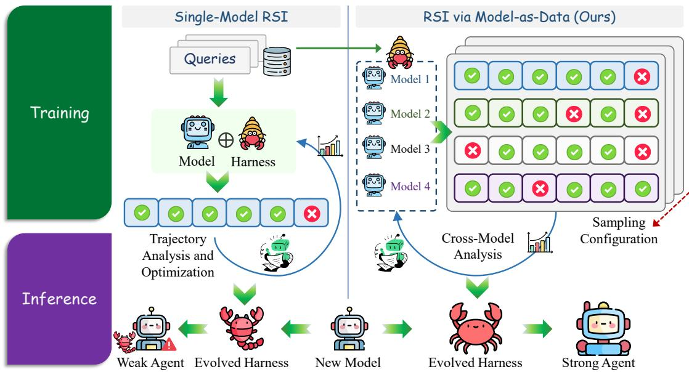
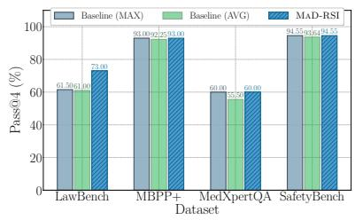
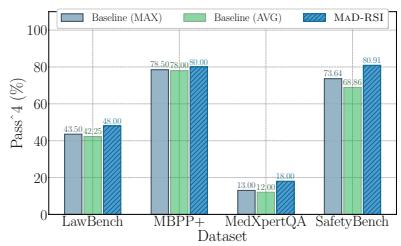
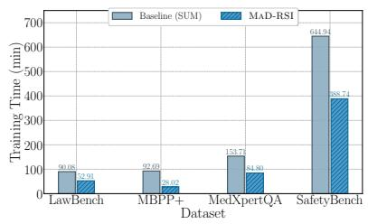
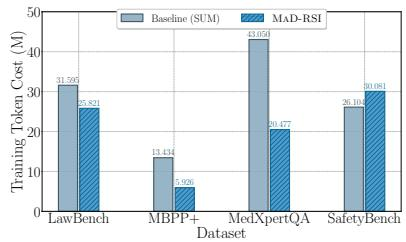
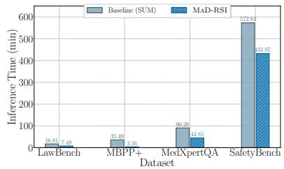
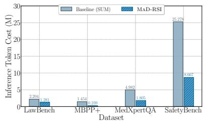

# MAD-RSI: Model-as-Data for Recursive Self-Improvement of Agent Harnesses

Yu Cui1 Hong He2 Ruiqing Yue3,4 Sicheng Pan1 Zhuoyu Sun1 Yifei Liu1

Ting Li5 Wenzhuo Zhu5 Baohan Huang1 Haibin Zhang6,7 Cong Zuo1

1Beijing Institute of Technology 2Tsinghua University

3Chengdu Institute of Computer Applications, Chinese Academy of Sciences

4University of Chinese Academy of Sciences 5Beijing University of Technology

6Yangtze Delta Region Institute of Tsinghua University, Zhejiang

7Jiaxing Key Laboratory of Artificial Intelligence and Cyber Resilience

## Abstract

Recursive self-improvement (RSI) of agent harnesses has emerged as an effective approach to enhancing the capabilities of large language model (LLM) agents. By searching the harness space for a specific LLM on a given dataset, RSI can discover a harness tailored to the capabilities and behavioral characteristics of that model. However, such optimization often creates a strong coupling between the learned harness and its target LLM, limiting generaliza tion across models and requiring substantial computational resources to adapt to new LLMs. Moreover, existing RSI methods typically optimize a harness using feedback from a single model and evaluate its generalization to other models only after training. This paradigm treats model differences primarily as a crite rion for evaluating generalization rather than as valuable evidence for optimization. In this paper, we introduce a new perspective that treats models as data and places the harness at the center of optimization. Building on this per spective, we propose MAD-RSI, a framework that directly optimizes a shared harness across multiple heterogeneous LLMs by incorporating their diverse failure trajectories into the train ing process. Rather than assessing model differences only after optimization, MAD-RSI leverages these differences as training evidence to guide the self-improvement of a shared harness. Furthermore, we introduce a new evaluation framework with two complementary metrics designed to assess the effectiveness of harness optimization across models. Experiments across multiple datasets and LLMs demonstrate that MAD-RSI improves generalization over existing approaches while reducing training costs.

## 1 Introduction

Large language model (LLM) agents have achieved strong performance on complex tasks, including reasoning and code generation (Yang et al., 2024; Yao et al., 2023; Chen et al., 2025). Their effectiveness depends not only on the underlying LLM but also on the harness. Recent work on recursive self-improvement (RSI) has shown that iteratively searching and refining this harness can enhance agent capabilities without updating model parameters (Chan et al., 2026; Duan et al., 2026; Lin et al., 2026). However, many RSI methods optimize a harness using execution feedback from a single target LLM (Liu et al., 2026). Such specialization can entangle the learned harness with the capabilities and behavioral characteristics of that model, limiting its portability to other LLMs (Qu et al., 2026). Adapting the harness to a new model may therefore require another costly optimization run, making it difficult to build an ecosystem of reusable and continuously improving harnesses.

This limitation also shapes how RSI is evaluated. A common protocol optimizes a harness with one LLM and assesses its transfer to other models (Lee et al., 2026; Xia et al., 2026). In this paradigm, differences among models primarily serve to measure generalization, rather than to guide improvement. Yet heterogeneous LLMs can exhibit different outcomes and execution trajectories on the same task under the same harness. A failure from one model, when contrasted with a success from another, may reveal deficiencies that are difficult to identify from either trajectory alone. These observations suggest a different question: Can behavioral differences among LLMs serve as training evidence for learning a harness that generalizes across models?

We address this question through Models-as-Data, a perspective that treats heterogeneous LLMs, observed under controlled inference configurations (DeepSeek-AI, 2026) (such as sampling), as sources of behavioral evidence while placing the shared harness at the center of optimization (Mehri et al., 2022). Instead of viewing models solely as separate optimization targets or subjects of subsequent transfer evaluation, we use their successful and failed executions as complementary signals for harness improvement. The goal is to optimize a single harness that can be used with different LLMs independently, not to ensemble multiple models at inference time.

  
Figure 1: Comparison between MAD-RSI and existing RSI approaches that evolve agent harnesses using feedback from a single backbone model.

Building on this perspective, we propose MAD-RSI, a framework for RSI of a shared harness using evidence from multiple heterogeneous LLMs. MAD-RSI first organizes responses to shared queries across models and inference configurations into a structured tensor, preserving the conditions under which each outcome is observed. It then selects informative queries using both disagreement among models and coverage of distinct response patterns. Finally, it jointly diagnoses aligned successful and failed trajectories to inform subsequent harness revisions. In this way, behavioral differences across models become inputs to the optimization process rather than observations reserved for evaluation.

To assess RSI methods designed for multiple models, we further introduce an evaluation framework with two complementary measures of optimization effectiveness: success coverage, which captures whether at least one model succeeds on a task, and joint success, which captures whether all evaluated models succeed on that task. These population measures complement evaluations of transfer to previously unseen LLMs. We study MAD-RSI on legal reasoning, code generation, medical reasoning, and agent safety tasks across heterogeneous LLMs. The results show improvements in performance across models and transfer in some settings, with tradeoffs that vary by task. On the general tasks, optimizing one shared harness also reduces cumulative training cost relative to running separate optimization processes for each development model. More broadly, this study invites a reconsideration of the role of LLMs in RSI: beyond being targets of harness optimization, they can provide the evidence that drives it. We summarize our contributions as follows:

• Models-as-Data perspective. We formulate an RSI paradigm across models in which behavioral differences among heterogeneous LLMs become evidence for optimizing a shared harness, rather than serving only as a means of evaluating transfer after training.

• MAD-RSI framework. We develop a shared harness optimization framework that combines structured response representations, evidence selection based on disagreement and behavioral coverage, and joint diagnosis of successful and failed trajectories.

• Evaluation and empirical study. We introduce two complementary population measures for assessing harness optimization across models and evaluate generalization and training cost across diverse tasks and LLMs.

## 2 Preliminary Analysis

Research Objective. The best frozen backbone model for supplying optimization feedback may not be known in advance. Our goal is to improve a single shared harness using evidence from multiple frozen backbone models while limiting total development cost. Let H be a harness, M = $\{ m _ { 1 } , . . . , m _ { M } \}$ a model group, and Q a pool with N queries. A sampling configuration $s \in { \mathcal { S } }$ specifies decoding controls, with $L = | S | ^ { 1 }$ . Execution induces

$$
( \tau , y , c ) \sim P _ { m } ^ { H } ( \cdot \mid q , s ) ,\tag{1}
$$

where τ is a trajectory, y an evaluated outcome, and c its cost. Model-as-data treats these conditional behavioral distributions as evidence for harness improvement.

Evaluation. Let $y _ { i r m } \in \{ 0 , 1 \}$ be the pass event for evaluation query i, repetition $r ,$ and model $m$ With $N _ { e }$ queries and $R _ { e }$ repetitions, define

$$
\mathrm { P a s s } @ M = \frac { 1 } { N _ { e } R _ { e } } \sum _ { i , r } \operatorname* { m a x } _ { m } y _ { i r m } ,\tag{2}
$$

$$
\mathrm { P a s s } ^ { \wedge } M = \frac { 1 } { N _ { e } R _ { e } } \sum _ { i , r } \prod _ { m } y _ { i r m } .\tag{3}
$$

These measure oracle coverage and joint success across models. Both average over all aligned query and trial positions rather than maximizing over repetitions. Trial indices align records but do not imply shared random seeds. Here M counts models, unlike the sample count in conventional Pass@k evaluation (Chen et al., 2021).

Cost. Shared optimization need not match the best independent run to offer a useful cost tradeoff. Let $H _ { j }$ be a harness optimized with model $m _ { j }$ , at training cost $C _ { j }$ . Let $H _ { \mathrm { m a d } }$ be the shared harness, with cost $C _ { \mathrm { m a d } }$ . Fix a higher-is-better population score S, such as Pass^M, under one evaluation protocol. Define $S _ { \mathrm { b e s t } } = \operatorname* { m a x } _ { j } S ( H _ { j } )$ and $C _ { \Sigma } = \Sigma _ { j } C _ { j }$ . Under a utility $S - \lambda C$ , shared optimization is weakly preferred exactly when

$$
S _ { \mathrm { b e s t } } - S ( H _ { \mathrm { m a d } } ) \leq \lambda ( C _ { \Sigma } - C _ { \mathrm { m a d } } ) .\tag{4}
$$

Here $\lambda \geq 0$ is a cost preference fixed before comparing outcomes, in score units per token. The comparator pays for all independent runs before selecting one harness. This decision criterion allows a score deficit when token savings compensate under the chosen preference.

## 3 RSI via Model-as-Data

MAD-RSI treats frozen models as sources of behavioral data for shared harness improvement (Zheng et al., 2026; Weng et al., 2026). Shared queries enable comparisons under matched execution conditions. For a fixed harness H and binary outcomes, let $p _ { q m s }$ denote the empirical success rate for query $q ,$ model $m ,$ and sampling configuration s. We organize these rates into a threedimensional response tensor, with one matrix slice per sampling configuration:

$$
\begin{array} { r } { \mathcal { P } = [ p _ { q m s } ] \in [ 0 , 1 ] ^ { N \times M \times L } , \phantom { \frac { 1 } { 1 } } } \\ { \mathbf { P } _ { s } = \mathcal { P } _ { : ; , s } = \left[ \begin{array} { c c c } { p _ { 1 1 s } } & { \cdots } & { p _ { 1 M s } } \\ { \vdots } & { \ddots } & { \vdots } \\ { p _ { N 1 s } } & { \cdots } & { p _ { N M s } } \end{array} \right] . } \end{array}\tag{5}
$$

Each column describes model behavior across shared queries. Each row aligns responses to the same query under a fixed sampling configuration. Task evaluators score the outcomes, and each cell links to its source trajectories. Sampling configurations receive equal weights. Let $w _ { m } \geq 0$ denote the aggregation weight assigned to m, with $\textstyle \sum _ { m = 1 } ^ { M } w _ { m } = 1$ . Inspired by learning for multiple target models (Tang and Huang, 2022), we score each query by disagreement within sampling slices:

$$
D _ { q } = \frac { 1 } { L } \sum _ { s } \left[ h ( \bar { p } _ { q s } ) - \sum _ { m } w _ { m } h ( p _ { q m s } ) \right] .\tag{6}
$$

Here $\begin{array} { r } { \bar { p } _ { q s } = \sum _ { m } w _ { m } p _ { q m s } } \end{array}$ and h is binary entropy (Fang et al., 2025). The score captures differences in empirical success rates across models under matched sampling conditions. Equal rates across models at every setting yield zero disagreement, even when individual executions vary. Computing disagreement before averaging across configurations preserves contrasts that pooling observations could hide. For binary tasks, we first reserve anchor queries, including unanimous successes and failures when available. These unanimous outcomes remain available for diagnosis despite their zero disagreement. We fill the remaining query budget for diagnosis by repeatedly adding the query with the largest combined gain in disagreement and response-pattern coverage. The coverage term favors queries that represent response patterns poorly covered by the selected set (Agarwal et al., 2025). These patterns span models and sampling configurations. For categorical outcomes, we use the corresponding entropy contrast and a separate ranking rule. The tensor guides query selection, while trajectories supply evidence for diagnosis. For each selected query, MAD-RSI assembles this evidence within an input budget, preserving outcome labels and source identities. Joint diagnosis compares shared failures, model-specific failures, and successful executions. Each diagnostic claim must cite source evidence identifiers. Successful traces provide contrasts for assessing proposed edits. Disagreement alone does not establish a failure cause or a useful fix. An LLM then uses the joint diagnoses to propose revisions to the shared harness.

  
(a) Pass@4.

  
(b) Pass^4.

  
(c) Training Time.

  
(d) Training Token Cost.

  
(e) Inference Time.

  
(f) Inference Token Cost.  
Figure 2: Comparison of MAD-RSI against four independently optimized baselines in performance and resource costs. Safety performance is measured by UA.

## 4 Experiments

## 4.1 Experimental Setup

Datasets. We use LawBench (Fei et al., 2024), MBPP+ (Liu et al., 2023), MedXpertQA (Zuo et al., 2025), and Agent-SafetyBench (Zhang et al., 2025) (SafetyBench).

Models. For RSI, we employ DeepSeek-V4- Flash (DeepSeek-V4), DeepSeek-V3.2, Qwen3.8- Flash, and Qwen3.8-27B as the underlying target models. We assign equal weights to the four models, with $w _ { m } = 1 / 4$ . To assess the generalization capability of the evolved harness, we further evaluate it on Doubao-Seed-2.0-Mini (Doubao-2.0) and GLM-5.3-Flash.

Evaluation and Metrics. During MAD-RSI evidence collection, temperature is the sampling parameter varied. We use T = 0.0 and T = 1.0, with two repetitions for each query–model–temperature combination. General-task experiments use three rounds, with two candidate slots per round. We report Pass@M to measure coverage and Pass^M to measure joint success. Main experiments use four models, while expanded evaluations include two additional unseen models. For general tasks, correctness defines the pass event. For safety tasks, we report attack safety (AS), utility under attack (UA), and clean safety (CS). We also account for resource consumption alongside performance comparisons, reporting token usage and execution time.

Baselines. We compare six configurations: the original harness, four single-executor baselines, and our MAD-RSI. We adopt RRSI (Xia et al., 2026) for general tasks and SHE (Qu et al., 2026) for safety tasks. Each baseline is optimized using a single executor model and evaluated across all four models. We select RRSI because it regularizes both edit proposals and candidate selection to promote transfer to unseen benchmarks (Xia et al., 2026). This comparison examines whether crossmodel evidence provides additional benefits within a framework already designed for generalization. For generalization evaluation, we select the baseline achieving the highest Pass^4 in the main experiments, breaking ties using Pass@4. For safety tasks, baseline selection is based on UA.

## 4.2 Experimental Results

In the main evaluation, MAD-RSI achieves Pass@4 of 73.00% and Pass^4 of 48.00% on LawBench, outperforming the strongest optimized baseline by 11.50 and 4.50 percentage points, respectively (see Table 1). Accuracy on individual models ranges from 58.50% to 65.00%, consistently exceeding the corresponding baseline results. On MBPP+ and MedXpertQA, improvements are more pronounced in joint success. While Pass@4 matches the best baselines at 93.00% and 60.00%, respectively, Pass^4 reaches 80.00% and 18.00%, yielding gains of 1.50 and 5.00 percentage points.

<table><tr><td rowspan="2">Scheme</td><td colspan="2">LawBench</td><td colspan="2">MBPP+</td><td colspan="2">MedXpertQA</td></tr><tr><td>Pass@4</td><td>Pass^4</td><td>Pass@4</td><td>Pass^4</td><td>Pass@4</td><td>Pass^4</td></tr><tr><td>Original</td><td>62.50</td><td>42.50</td><td>93.00</td><td>76.50</td><td>60.00</td><td>13.00</td></tr><tr><td>RRSI / DeepSeek-V4</td><td>61.50</td><td>41.50</td><td>93.00</td><td>77.50</td><td>60.00</td><td>13.00</td></tr><tr><td>RRSI / DeepSeek-V3.2</td><td>61.00</td><td>42.50</td><td>92.50</td><td>78.50</td><td>54.50</td><td>11.50</td></tr><tr><td>RRSI / Qwen3.8-Flash</td><td>61.00</td><td>43.50</td><td>91.50</td><td>77.50</td><td>55.00</td><td>12.00</td></tr><tr><td>RRSI / Qwen3.8-27B</td><td>60.50</td><td>41.50</td><td>92.00</td><td>78.50</td><td>52.50</td><td>11.50</td></tr><tr><td>MAD-RSI</td><td>73.00</td><td>48.00</td><td>93.00</td><td>80.00</td><td>60.00</td><td>18.00</td></tr><tr><td rowspan="2">Scheme</td><td colspan="2">SafetyBench / AS</td><td colspan="2">SafetyBench / UA</td><td colspan="2">SafetyBench / CS</td></tr><tr><td>Pass@4</td><td>Pass^4</td><td>Pass@4</td><td>Pass^4</td><td>Pass@4</td><td>Pass^4</td></tr><tr><td>Original</td><td>100.00</td><td>96.79</td><td>92.73</td><td>66.36</td><td>92.50</td><td>75.00</td></tr><tr><td>SHE / DeepSeek-V4</td><td>100.00</td><td>96.43</td><td>94.55</td><td>73.64</td><td>92.50</td><td>80.00</td></tr><tr><td>SHE / DeepSeek-V3.2</td><td>100.00</td><td>96.43</td><td>93.64</td><td>62.73</td><td>97.50</td><td>75.00</td></tr><tr><td>SHE / Qwen3.8-Flash</td><td>100.00</td><td>96.79</td><td>93.64</td><td>66.36</td><td>97.50</td><td>80.00</td></tr><tr><td>SHE / Qwen3.8-27B</td><td>100.00</td><td>97.14</td><td>92.73</td><td>72.73</td><td>95.00</td><td>75.00</td></tr><tr><td>MAD-RSI</td><td>100.00</td><td>98.93</td><td>94.55</td><td>80.91</td><td>97.50</td><td>86.25</td></tr></table>

Table 1: Four-model evaluation across general and safety tasks.

<table><tr><td rowspan="2">Dataset</td><td rowspan="2">Metric</td><td colspan="2">Pass@6</td><td colspan="2">Pass^6</td></tr><tr><td>Baseline</td><td>MAD-RSI</td><td>Baseline</td><td>MAD-RSI</td></tr><tr><td>LawBench</td><td rowspan="3">Accuracy</td><td>61.00</td><td>73.00</td><td>36.00</td><td>38.50</td></tr><tr><td>MBPP+</td><td>94.00</td><td>94.00</td><td>74.50</td><td>77.50</td></tr><tr><td>MedXpertQA</td><td>67.00</td><td>67.00</td><td>8.50</td><td>13.00</td></tr><tr><td rowspan="3">SafetyBench</td><td>AS</td><td>100.00</td><td>100.00</td><td>94.64</td><td>97.50</td></tr><tr><td>UA</td><td>96.36</td><td>95.45</td><td>66.36</td><td>76.36</td></tr><tr><td>CS</td><td>97.50</td><td>97.50</td><td>70.00</td><td>76.25</td></tr></table>

Table 2: Expanded six-model evaluation. The population contains four development executors plus Doubao-2.0 and GLM-5.3-Flash.

For SafetyBench, MAD-RSI achieves Pass^4 of 98.93%, 80.91%, and 86.25% on AS, UA, and CS, respectively, surpassing the best baseline for each metric. Notably, joint UA improves by 7.27 percentage points, despite matching the best baseline in coverage at 94.55%. Across tasks, joint success improves more consistently than success coverage. The advantage extends to unseen models. When evaluated with two additional executors, MAD-RSI outperforms the preselected baselines in Pass^6 across all six dataset–metric combinations (see Table 2).

We further examine computational costs against the aggregate expenditure of four independently optimized baselines (see Figure 2). Baseline (MAX) and Baseline (AVG) represent the per-metric maximum and mean across these baselines, respectively. Both are computed from the same training and evaluation runs and therefore share identical costs. Importantly, the reported maxima may originate from different harnesses and do not necessarily correspond to a single configuration. Relative to the combined training-token consumption of the four baselines, MAD-RSI reduces usage by 18.3%, 55.9%, and 52.4% on LawBench, MBPP+, and MedXpertQA, respectively, while incurring a 15.2% increase on the safety task. The efficiency advantage therefore lies in jointly optimizing a shared harness for multiple models, rather than optimizing for a single model. Across all four datasets, MAD-RSI also requires fewer inference tokens and time than the four baselines combined.

## 5 Related Work

Existing methods for RSI of agent harnesses largely follow a common paradigm: optimizing a harness using a single execution model and subsequently evaluating its transfer across models (Hu et al., 2025; Zhang et al., 2026; Lee et al., 2026; Xia et al., 2026). However, improvements achieved during optimization do not necessarily transfer to other models. Previous empirical findings suggest that harness modifications tailored to the failure modes of a source model may provide limited benefits to other models or even degrade their performance (Qu et al., 2026; Wang et al., 2026; Rakotonirina et al., 2023). This observation motivates us to incorporate behavioral differences across models directly into the training evidence. Unlike existing approaches, MAD-RSI compares the behaviors of different frozen execution models during evidence construction. Specifically, it aligns responses to the same query across models and sampling configurations, leverages these aligned observations for query selection and joint diagnosis, and uses the resulting evidence to guide the optimization of a shared harness.

## 6 Conclusion

In this paper, we introduce Models-as-Data, a new perspective that treats heterogeneous LLMs as behavioral data sources for shared harness optimization. Building on this perspective, we propose MAD-RSI, which leverages behavioral differences across models to guide RSI. We further introduce two complementary metrics to evaluate optimization effectiveness across models. Experiments across diverse tasks and LLMs demonstrate improved generalization in several settings and reduced cumulative training costs compared with independent optimization on general tasks. We hope this work encourages a broader shift in RSI from optimizing harnesses for individual models toward learning reusable harnesses from diverse model behaviors.

## 7 Limitations

This work provides preliminary evidence for the feasibility and potential value of the Models-as-Data perspective, while more comprehensive experimental validation is left for future work. This work is still in progress.

## 8 Ethical Considerations

We used AI assistants for language polishing.

## References

Ishika Agarwal, Krishnateja Killamsetty, Lucian Popa, and Marina Danilevsky. 2025. DELIFT: Data efficient language model instruction fine-tuning. In The Thirteenth International Conference on Learning Representations.

Alan Chan, Christoph Winter, Andrew Barto, Jakub Pachocki, Geoffrey Hinton, Eric Horvitz, Yoshua Bengio, Dawn Song, Jack Clark, Hilary Greaves, Anton Korinek, Samuel Hammond, Thore Graepel, Ben Bariach, Philip H. S. Torr, Sheila A. McIlraith, Jeff

Clune, Sam Manning, Girish Sastry, and 3 others. 2026. What if automating ai r&d triggers an intelligence explosion? Preprint, arXiv:2609.36054.

Mark Chen, Jerry Tworek, Heewoo Jun, Qiming Yuan, Henrique Ponde de Oliveira Pinto, Jared Kaplan, Harri Edwards, Yuri Burda, Nicholas Joseph, Greg Brockman, Alex Ray, Raul Puri, Gretchen Krueger, Michael Petrov, Heidy Khlaaf, Girish Sastry, Pamela Mishkin, Brooke Chan, Scott Gray, and 39 others. 2021. Evaluating large language models trained on code. Preprint, arXiv:2107.03374.

Zhaoling Chen, Robert Tang, Gangda Deng, Fang Wu, Jialong Wu, Zhiwei Jiang, Viktor Prasanna, Arman Cohan, and Xingyao Wang. 2025. LocAgent: Graphguided LLM agents for code localization. In Proceedings of the 63rd Annual Meeting of the Associationfor Computational Linguistics (Volume 1: Long Papers), pages 8697–8727, Vienna, Austria. Association for Computational Linguistics.

DeepSeek-AI. 2026. Deepinfer: High-performance, large-scale inference framework for deepseek models. https://github.com/deepseek-ai/DeepInfer.

Yi Duan, Ying Liu, Zirui Tang, Haodong Chen, Jun Zhou, Yumou Liu, Bangrui Xu, Yukai Wu, Sidi Chen, Yuhan Zhou, Haoyu Wang, Xiaoyou Yu, Shaokun Han, Xuzhou Zhu, Le Zhou, Bolin Lu, Wei Zhou, Jiachen Liu, Nuozhou Fang, and 16 others. 2026. The last ai built by humans: Toward genuine recursive self-improvement. Preprint, arXiv:2609.11873.

Haishuo Fang, Xiaodan Zhu, and Iryna Gurevych. 2025. Preemptive detection and correction of misaligned actions in LLM agents. In Proceedings ofthe 2025 Conference on Empirical Methods in Natural Language Processing, pages 222–244, Suzhou, China. Association for Computational Linguistics.

Zhiwei Fei, Xiaoyu Shen, Dawei Zhu, Fengzhe Zhou, Zhuo Han, Alan Huang, Songyang Zhang, Kai Chen, Zhixin Yin, Zongwen Shen, Jidong Ge, and Vincent Ng. 2024. LawBench: Benchmarking legal knowledge of large language models. In Proceedings of the 2024 Conference on Empirical Methods in Natural Language Processing, pages 7933–7962, Miami, Florida, USA. Association for Computational Linguistics.

Shengran Hu, Cong Lu, and Jeff Clune. 2025. Automated design of agentic systems. In The Thirteenth International Conference on Learning Representations.

Yoonho Lee, Roshen Nair, Qizheng Zhang, Kangwook Lee, Omar Khattab, and Chelsea Finn. 2026. Metaharness: End-to-end optimization of model harnesses. Preprint, arXiv:2603.28052.

Jiahang Lin, Shichun Liu, Chengjun Pan, Lizhi Lin, Shihan Dou, Zhiheng Xi, Xuanjing Huang, Hang Yan, Zhenhua Han, Tao Gui, and Yu-Gang Jiang. 2026. Agentic harness engineering: Observabilitydriven automatic evolution of coding-agent harnesses. Preprint, arXiv:2604.25850.

Haozhe Liu, Tian Ye, Sensen Gao, Qihang Cao, Yitong Li, Mingchen Zhuge, Duomin Wang, Ruihua Zhang, Ping Luo, Jiawang Bian, Lei Zhu, Ligeng Zhu, Enze Xie, and Song Han. 2026. Sol-pi: Recursively scaling auto-research loops for efficient agent harness. Preprint, arXiv:2609.20519.

Jiawei Liu, Chunqiu Steven Xia, Yuyao Wang, and Lingming Zhang. 2023. Is your code generated by chatgpt really correct? rigorous evaluation of large language models for code generation. In Proceedings of the 37th International Conference on Neural Information Processing Systems, NIPS ’23, Red Hook, NY, USA. Curran Associates Inc.

Shikib Mehri, Yasemin Altun, and Maxine Eskenazi. 2022. LAD: Language models as data for zero-shot dialog. In Proceedings of the 23rd Annual Meeting of the Special Interest Group on Discourse and Dialogue, pages 595–604, Edinburgh, UK. Association for Computational Linguistics.

Wanying Qu, Qinghua Mao, Yu Li, Jiyao Liu, Xin Zhang, Dadi Guo, Yanxu Zhu, Qingyu Liu, Leitao Yuan, Xi Lin, Shanfeng Zhu, Yanwei Fu, Jing Shao, Xia Hu, and Dongrui Liu. 2026. She: Trajectory-driven safety harness evolution for llm agents. Preprint, arXiv:2608.09885.

Nathanaël Carraz Rakotonirina, Roberto Dessi, Fabio Petroni, Sebastian Riedel, and Marco Baroni. 2023. Can discrete information extraction prompts generalize across language models? In The Eleventh International Conference on Learning Representations.

Ying-Peng Tang and Sheng-Jun Huang. 2022. Active learning for multiple target models. In Advances in Neural Information Processing Systems, volume 35, pages 38424–38435. Curran Associates, Inc.

Yaxuan Wang, Quan Liu, Zhenting Wang, Zichao Li, Wei Wei, Yang Liu, and Yujia Bao. 2026. Promptbridge: Cross-model prompt transfer for large language models. In Third Conference on Language Modeling.

Zhaotian Weng, Antonis Antoniades, Deepak Nathani, Zhen Zhang, Sophia Xiao Pu, and Xin Eric Wang. 2026. Group-evolving agents: Open-ended selfimprovement via experience sharing. In Third Conference on Language Modeling.

Peng Xia, Rujun Han, Zifeng Wang, Yanfei Chen, Yufan Zhuang, Yoonho Lee, Chengsong Huang, Han Yu, Zhongying CuiZhu, Yifei Ming, Huaxiu Yao, Burak Gokturk, Tomas Pfister, and Chen-Yu Lee. 2026. Rrsi: Regularized recursive self-improvement of agent harnesses. Preprint, arXiv:2609.24972.

John Yang, Carlos E Jimenez, Alexander Wettig, Kilian Lieret, Shunyu Yao, Karthik R Narasimhan, and Ofir Press. 2024. SWE-agent: Agent-computer interfaces enable automated software engineering. In The Thirty-eighth Annual Conference on Neural Information Processing Systems.

Shunyu Yao, Jeffrey Zhao, Dian Yu, Nan Du, Izhak Shafran, Karthik R Narasimhan, and Yuan Cao. 2023. React: Synergizing reasoning and acting in language models. In The Eleventh International Conference on Learning Representations.

Jenny Zhang, Shengran Hu, Cong Lu, Robert Tjarko Lange, and Jeff Clune. 2026. Darwin gödel machine: Open-ended evolution of self-improving agents. In The Fourteenth International Conference on Learning Representations.

Zhexin Zhang, Shiyao Cui, Yida Lu, Jingzhuo Zhou, Junxiao Yang, Hongning Wang, and Minlie Huang. 2025. Agent-safetybench: Evaluating the safety of llm agents. Preprint, arXiv:2412.14470.

Tong Zheng, Haolin Liu, Chengsong Huang, Huiwen Bao, Sheng Zhang, Rui Liu, Runpeng Dai, Ruibo Chen, Chenxi Liu, Tianyi Xiong, Xidong Wu, Hongming Zhang, and Heng Huang. 2026. Llms improving llms: Agentic discovery for test-time scaling. Preprint, arXiv:2605.08083.

Yuxin Zuo, Shang Qu, Yifei Li, Zhang-Ren Chen, Xuekai Zhu, Ermo Hua, Kaiyan Zhang, Ning Ding, and Bowen Zhou. 2025. MedxpertQA: Benchmarking expert-level medical reasoning and understanding. In Forty-second International Conference on Machine Learning.