# META EXPERT: CROSS-LAYER EXPERT SHARING FOR STORAGE- AND RETRIEVAL-EFFICIENT MOE

Ermo Hua1,2,∗, Xiangyu Hong1,2,∗, Baiting Wu1,2,∗, Che Jiang1,∗ Haozheng Hou2, Yicheng Gu1,2, Hanjing Wang2, Qirui Zeng1, Ming Zhang2 Ning Ding1,2, Qipeng Guo2, Youbang Sun1,2,†, Biqing Qi2,†, Bowen Zhou1,2,† 1Tsinghua University, 2Shanghai AI Laboratory

## ABSTRACT

As model parameters scale up, sparsely activated Mixture-of-Experts (MoE) approaches have become essential for model scaling. However, mainstream models currently adopt hierarchical architectures, where experts in different layers, although topologically independent, exhibit substantial similarity and redundancy in their stored content. Compared to the hierarchically arranged Local Expert in existing mainstream models, we hypothesize that inter-layer shared Meta Expert hold greater potential. To this end, we conduct a multi-dimensional empirical comparison between Local and Meta Experts, and find that models incorporating Meta Experts exhibit lower parameter redundancy, together with lower crossentropy loss and higher downstream task accuracy. With the activated quantity and the expert granularity held fixed, our model matches the performance of Vanilla MoE using only 70–80% of the experts, substantially improving the model’s scaling potential. Beyond removing inter-layer redundancy among experts and improving information storage efficiency, our theoretical analysis further shows that, compared with Local Experts, Meta Experts provide hidden states with more flexible residual pathways, thereby improving information retrieval efficiency.

## 1 INTRODUCTION

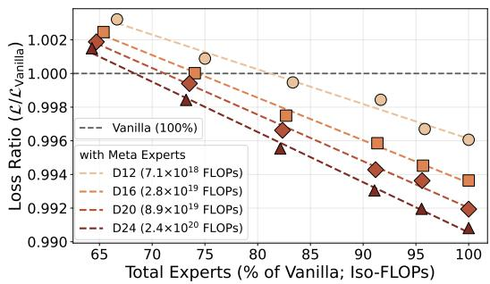

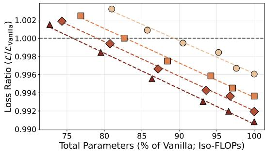  
Figure 1: Comparison between Vanilla and Meta-Expert models. All models are trained under the optimal setting of the Vanilla model, at varying depths and scales. Models with Meta Experts achieve comparable loss to the Vanilla baselines with only 70–80% as many experts, or 75–90% as many parameters, and the savings in both experts and parameters grow as the models get deeper and larger, indicating the favorable scalability of Meta Experts.

In recent years, large language models (LLMs) have gradually approached or even surpassed humanlevel ability in general text, mathematics, and code (Brown et al., 2020; OpenAI et al., 2024). This progress owes much to the increasing scale of model parameters and training data: intelligence has been improved substantially as both factors grow (Kaplan et al., 2020; Hoffmann et al., 2022b).

To enable ever-larger models, parameter sparsification has become an important approach (Shazeer et al., 2017; Fedus et al., 2022; Muennighoff et al., 2025). As the module that accounts for the vast majority of model parameters, the feed-forward network was originally a densely computed block. (Vaswani et al., 2017a). However, as model size grows, such dense computation gradually becomes prohibitively expensive, creating efficiency bottlenecks for both training and inference (Lepikhin et al., 2021; Fedus et al., 2022). Meanwhile, although feed-forward networks are densely computed, only a sparse subset of parameters is actually activated for a given token during its forward pass (Li et al., 2023; Mirzadeh et al., 2024); the remaining inactive parameters still participate in the computation, leading to substantial waste.

To address this, researchers have proposed designing feed-forward networks with a natively sparseactivation structure, most notably the Mixture-of-Experts (MoE) (Shazeer et al., 2017; Fedus et al., 2022). MoE splits the feed-forward network into multiple sub-networks along the intermediate dimension and routes each token to only a limited number of them before computation. This design endows the model with a large total parameter count while ensuring that each token’s forward pass computation uses only a small fraction of parameters, reconciling scale with efficiency.

With the advent of increasingly sparse MoE models, parameter efficiency along the width dimension has been steadily improved (Dai et al., 2024). In this work, however, we ask how parameter efficiency can be improved along the depth dimension (Raposo et al., 2024). On the one hand, interpretability studies suggest that feed-forward networks store relatively static knowledge (Geva et al., 2021; Dai et al., 2022), and that different layers may store similar knowledge, suggesting nontrivial redundancy across layers (Meng et al., 2022; Takase & Kiyono, 2023; Fan et al., 2019; Chen et al., 2025; Men et al., 2025). On the other hand, Looped Transformers reuse the same parameters across recurrent applications of a block (Dehghani et al., 2018; Giannou et al., 2023; Bai et al., 2019; Csordas et al., 2024; Chen et al., 2026a),and recent work shows that this design can attain the´ reasoning performance of much larger models with far fewer parameters (Bae et al., 2025; Saunshi et al., 2025; Wang et al., 2026). This benefit, however, comes with additional recursions and greater serial depth, incurring higher computational and latency costs.

To balance parameter storage efficiency and computational cost, this work explores the potential of another Parameter Loop scheme — Cross-Layer Expert Sharing. Unlike Looped Transformers, which keep the total parameters of each layer unchanged but increase the number of recursions, we aim to keep the number of recursions unchanged while increasing the candidate experts of each layer, and use the sparse activation of MoE to keep both the activated parameters and the computation per layer unchanged. We refer to the experts shared across layers as Meta Experts, and the layer-private experts in the conventional design as Local Experts.

Our experiments show that, compared with the Local Expert of hierarchical architectures, Meta Experts reduce parameter redundancy and achieve lower cross-entropy loss together with higher downstream task accuracy. At a fixed number of activated experts and expert granularity, our model achieves comparable performance to Vanilla MoE with only 70% as many experts, indicating a substantially higher effective capacity per parameter. Further analysis reveals another reason why cross-layer expert sharing is effective: Meta Experts provide hidden states with more flexible paths for storage and retrieval. Compared with hierarchical architectures, cross-layer expert sharing implicitly provides more flexible residual connections: beyond the forward residual connections, it introduces a backward residual connection at the activation level—one that operates within a single forward pass and is therefore absent from existing models.

Our contributions are summarized as follows: (1) A systematic analysis of the effect of Meta Experts on model performance, covering their activation and total-number ratios among all experts, their presence in every layer, and their partial hierarchical organization. Although these configurations moderately affect performance, Meta Experts consistently bring significant improvements. (2) An explanation of why Meta Experts are effective from the perspective of residual connections. By comparing the forward hidden-state updates and the backward parameter updates of models with and without Meta Experts, we show that this design grants shallow and deep layers bidirectional access to representations across depth, enabling more flexible information retrieval.

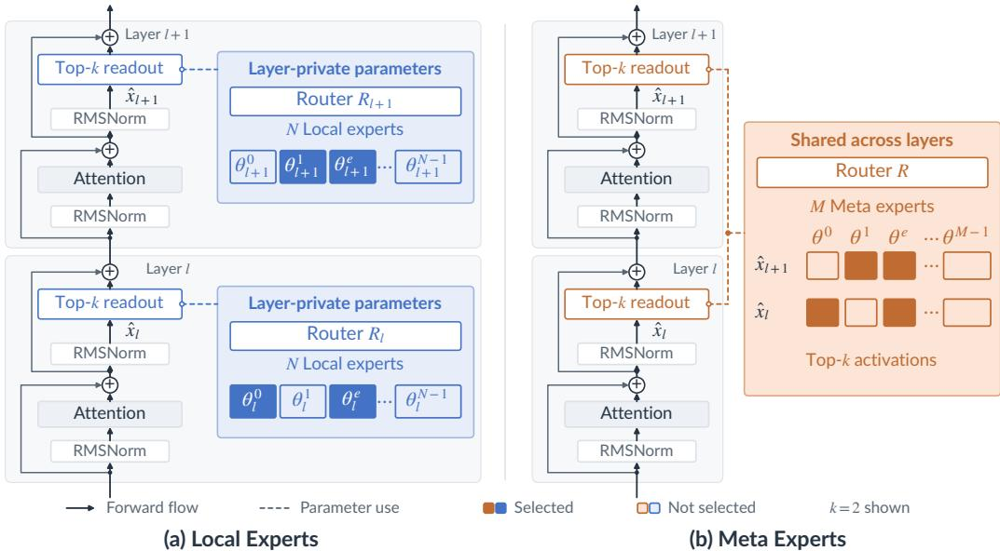  
Figure 2: The Implementation of Local and Meta Experts. In contrast to the layer-private Local Experts, Meta Experts are shared across all layers.

## 2 META EXPERT

A MoE-based Transformer layer l consists of an attention block and a MoE block (Fig 2.(a)). The MoE block contains a layer-specific router $R _ { l }$ and N Local Experts $\{ \phi _ { e } ( \cdot ; \theta _ { l } ^ { e } ) \} _ { e = 0 } ^ { N - 1 }$ , both of which are initialized and accessed independently across layers. Given the hidden state xˆl of a token entering the MoE block, the router computes gating scores from its logits and selects the top-k experts belonging to the current layer to process the token:

$$
y _ { l } \ = \ \sum _ { e \in \mathrm { t o p k } ( R _ { l } , \hat { x } _ { l } ) } R _ { l } ( \hat { x } _ { l } ) _ { e } \phi _ { e } ( \hat { x } _ { l } ; \theta _ { l } ^ { e } ) .\tag{1}
$$

In a model built purely from Meta Experts (Fig 2.(b)), the layer-private MoE blocks are replaced with a single shared block: one router R and one pool of M experts $\{ \phi _ { e } ( \cdot ; \theta ^ { e } ) \} _ { e = 0 } ^ { M - 1 }$ could be activated by every layer:

$$
y _ { l } = \sum _ { e \in \mathrm { t o p k } ( R , \hat { x } _ { l } ) } R ( \hat { x } _ { l } ) _ { e } \phi _ { e } ( \hat { x } _ { l } ; \theta ^ { e } ) ,\tag{2}
$$

## 3 EMPIRICAL COMPARISON BETWEEN META AND LOCAL EXPERTS

To systematically analyze the effect of Meta Experts on model performance, we start from a model with only Local Experts and incorporate Meta Experts in various forms, comparing model capabili ties with and without them.

## 3.1 SETUPS

Core Variables. We consider two types of relationship between Meta Experts and Local Experts: (1) the quantitative relationship: the ratio of their total numbers within the whole model and their activated numbers within each layer (See Fig 3.(a)); (2) the topological relationship: whether every layer contains both Meta and Local Experts (See Fig 3.(b)), and whether the Meta Experts are also hierarchically organized (See Fig 3.(c)).

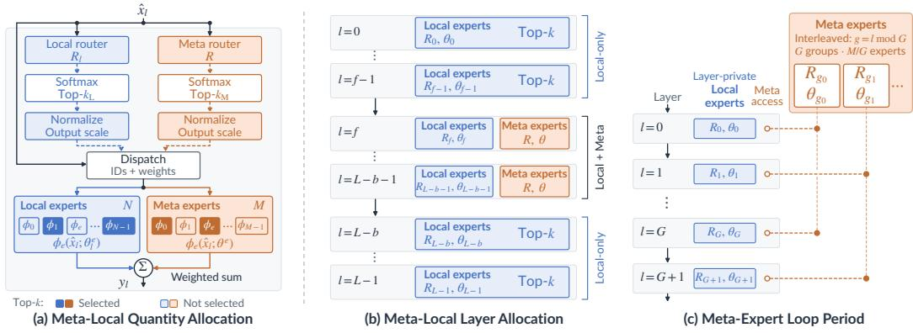  
Figure 3: The Quantitative and Topological Comparison between Meta and Local Experts.

Common Settings. During the experiments, we first sweep all the variables on a 2B-A0.5B model, and then select the relatively better-performing configurations for the scaling ladder experiments. Throughout the experiments, we keep the total number of experts and the total activation count fixed, which indirectly ensures that different models have similar FLOPs, enabling a fairer comparison. When comparing models at different FLOPs, all models adopt the training-optimal configuration of the Vanilla MoE structure, rather than a configuration tuned specifically for our design. Detailed experimental setups can be found in A.3

Metrics. In addition to cross-entropy loss and downstream task accuracy, we introduce an expertredundancy metric as a complementary perspective for analyzing expert specialization under different architectural settings. It allows us to examine how expert topology affects the overlap among learned expert functions. The exact training configurations and the definition of the redundancy metric are deferred to Appendix A.2.

## 3.2 META/LOCAL EXPERTS’ RATIO

We first study the effect of the ratio between the total numbers of Meta Experts and Local Experts, and of their activation ratio within each layer, on model performance.

Settings. For the total-number ratio, we consider Meta Expert proportions of 0%, 25%, 50%, 75%, or 100%; for the activation ratio, we consider proportions of 25%, 50%, or 75%. For concreteness, consider a two-layer model with 256 experts in total and 8 experts activated per layer. A Meta/Local number ratio of 75% then corresponds to 192 Meta Experts, shared across all layers, and 32 Local Experts per layer; an activation ratio of 75% corresponds to activating 6 Meta Experts and 2 Local Experts per layer.

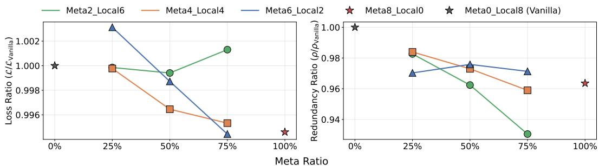  
Figure 4: Pilot experiments on the Meta/Local Expert ratio. We vary the total-number proportion of Meta Experts (0%–100%) and their per-layer activation proportion (25%–75%), while keeping the total expert count and the total activation count fixed so that all models share similar FLOPs. Higher Meta-Expert proportions consistently reduce both the cross-entropy loss and the expert redundancy ρ; increasing the activation share of Local Experts reduces redundancy but degrades the loss.

Pilot Experiments (Fig 4). The results show that, at any activation ratio, a higher total-parameter proportion of Meta Experts consistently leads to lower loss and redundancy; meanwhile, allocating a higher activation ratio to Meta Experts also helps reduce the loss. Taken together, these observations attest to the effectiveness of Meta Experts. On the other hand, while assigning a higher activation ratio to Local Experts is detrimental to the loss, it does help reduce the redundancy among experts. This suggests that, compared with Meta Experts, Local Experts—each of which is activated in only one layer under the traditional architecture—may be harder to train sufficiently, and this undertraining may give rise to redundancy.

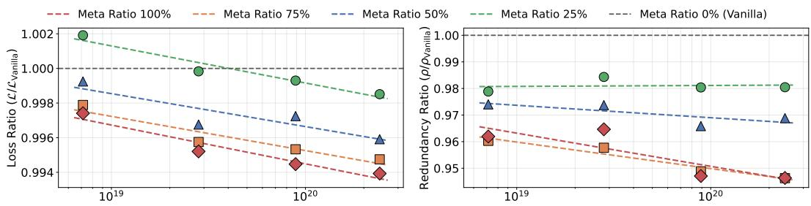  
Training Compute (FLOPs; Log Scale)

Figure 5: Scaling-ladder on the Meta/Local Expert ratio. With the per-layer activation fixed to 4 Meta Experts and 4 Local Experts, we scale the total-number ratio of Meta Experts (25%/50%/75%) across training compute (FLOPs). Although slightly worse than Pure-Meta-Expert Setting, the 75% ratio achieves the best cross-entropy loss over all Partial-Meta Experts setting at every compute budget, and is adopted as the base configuration in all subsequent experiments.

Scaling Ladder (Fig 5). Given that activating 4 Meta Experts and 4 Local Experts per layer yields consistently better loss, we hold this activation ratio fixed and conduct a full scaling-ladder validation across the total-number ratios of 25%/50%/75%. The results confirm that, although still slightly worse than the Pure-Meta-Expert setting, the 75% ratio achieves the best performance over all Partial-Meta settings at every compute budget, in terms of both cross-entropy loss and expert redundancy. Considering that a model with only Meta Experts may suffer from training instability, we adopt the 75% configuration in all subsequent experiments.

## 3.3 META/LOCAL EXPERTS’ TOPOLOGY

We next investigate the effect of the topology of Meta/Local Experts on model performance. On the one hand, we explore whether every layer should include Meta Experts; on the other hand, we explore whether the Meta Experts should themselves be partially hierarchically organized.

Settings. On the one hand, we consider variants in which Local Experts are used exclusively, with no Meta Experts introduced at all: either in only the first 1, 2, 4, or 8 layers of the model, in only the last 1, 2, 4, or 8 layers, or in both the first and the last 1, 2, or 4 layers. On the other hand, we consider partitioning the Meta Experts into 2, 4, or 8 sub-pools, which are then accessed in a looped manner—either in a chunked or an interleaved fashion.

Pilot Experiments (Fig 6). It can be observed that both operations—introducing Local-Expertsonly layers, and organizing the Meta Experts hierarchically so as to mimic the topology of Local Experts—generally incur a loss degradation, which further demonstrates the positive role of Meta Experts in model performance. Notably, under a lighter degree of intervention, the loss slightly improves: for example, when only the first two and the last two layers are restricted to Local Experts, or when the Meta Experts are looped only twice. This suggests, on the one hand, that experts in the shallowest and deepest layers serve more differentiated functions, with essentially no mutual redundancy between these layers—a conclusion also supported by the expert redundancy measurements. On the other hand, mildly hierarchical Meta Experts help improve the model capability slightly; hierarchy, however, introduces a certain amount of expert redundancy, and why this redundancy does not translate into a higher loss remains an open question for further investigation.

Scaling Ladder (Fig 7). Compared with other configurations, introducing Local-Experts-only layers at both the shallow and the deep ends, and partitioning the Meta Experts into sub-pools in an interleaved manner, yield consistently better results; we therefore supplement full scaling-ladder validation under these two configurations. The results show that, at every FLOPs configuration, the best performance is achieved by using Local Experts exclusively in the first two and the last two layers, together with partitioning the Meta Experts into 2 sub-pools. We also observe that, as the model becomes deeper, using more Local-Experts-only layers and a larger hierarchy of Meta Experts likewise exhibits better results. This suggests, on the one hand, that the proportion of specialized shallow and deep layers relative to the total number of layers may remain roughly constant as model depth changes; on the other hand, deeper models also call for a larger hierarchical expert topology; the Local Experts of the Vanilla model, however, are overly hierarchical, and can therefore only achieve suboptimal results.

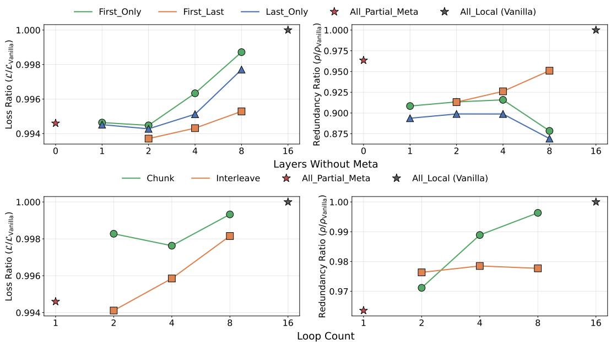  
Figure 6: Pilot experiments on the Meta/Local Expert topology. We vary where Local Experts are used exclusively (the first and/or the last 1/2/4/8 layers), and how the Meta Experts are hierarchically organized (2/4/8 sub-pools, accessed in a looped manner, either chunked or interleaved). Both interventions generally degrade the loss, corroborating the benefit of Meta Experts, while a lighter degree of intervention—only the first and the last two layers restricted to Local Experts, or the Meta Experts looped only twice—slightly improves it.

Overall Comparison (Fig 1 & 8) We combine the best configurations identified in each ablation and find that the combined model consistently outperforms every individual configuration in terms of loss. Building on this best configuration, we further reduce the number of Meta Experts and find that, compared with the Vanilla model, models with Meta Experts save approximately 20–30% of the experts (or 15–25% of the parameters, since other modules also account for a certain fraction of the parameters), with the advantage becoming more pronounced as the model size grows.

## 3.4 DOWNSTREAM PERFORMANCE OF META EXPERTS-BASED MODEL

For a more comprehensive comparison, beyond cross-entropy loss, we further compare the downstream task capabilities of different configurations through training at a larger scale.

Settings. Using the best configuration identified in each of the ablation studies above, we train 6B-A1.6B models for 200B tokens and evaluate their downstream task performance. We compare five variants: the Vanilla baseline (Vanilla MoE, Local Experts only), the MR75 model, which activates Meta Experts at a 75% meta ratio, and three topological refinements of $\mathrm { M R 7 5 \_ M } R 7 5 + L o o p 2$ which partitions the Meta Experts into two interleaved sub-pools; MR75 + F2L2, which restricts the first two and last two layers to Local Experts only; and their combination, $M R 7 5 + F 2 L 2 + L o o p 2$ All variants use the same total number of experts, per-layer activation budget, and training recipe, ensuring that performance differences are attributable to the expert topology. We evaluate the models across a diverse set of benchmarks covering complementary capabilities: world knowledge and factual question answering in both English (MMLU (Hendrycks et al., 2021)) and Chinese (C-Eval (Huang et al., 2023) and CMMLU (Li et al., 2024)); multi-step and commonsense reasoning (BBH (Kazemi et al., 2025) with chain-of-thought and OpenBookQA (Mihaylov et al., 2018)); and open-ended, knowledge-intensive generation (TriviaQA (Joshi et al., 2017)).

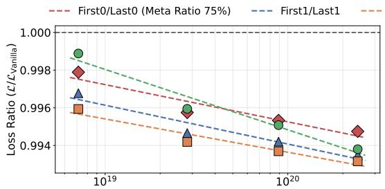

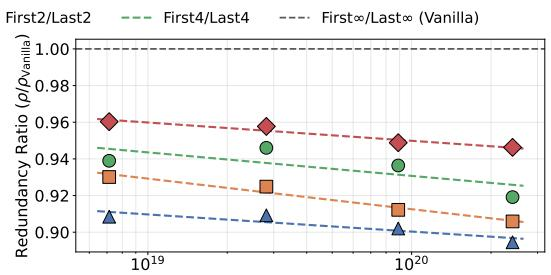

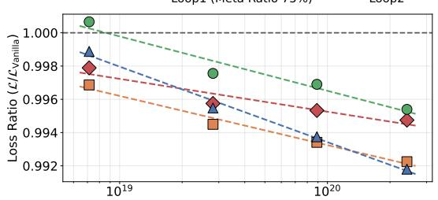

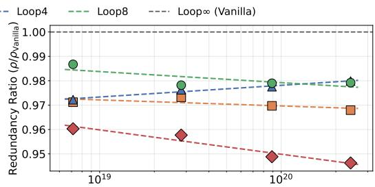  
Training Compute (FLOPs; Log Scale)

Figure 7: Scaling-ladder on the Meta/Local Expert topology. We scale the two best pilot configurations—Local Experts exclusively at both shallow and deep ends, and interleaved sub-pool partitioning of the Meta Experts—across training compute (FLOPs). Restricting the first two and the last two layers to Local Experts, together with 2 sub-pools, achieves the best performance at every compute budget; as the model becomes deeper, more Local-Experts-only layers and a larger hierarchy of Meta Experts further help, suggesting that deeper models call for a larger hierarchical expert topology.  
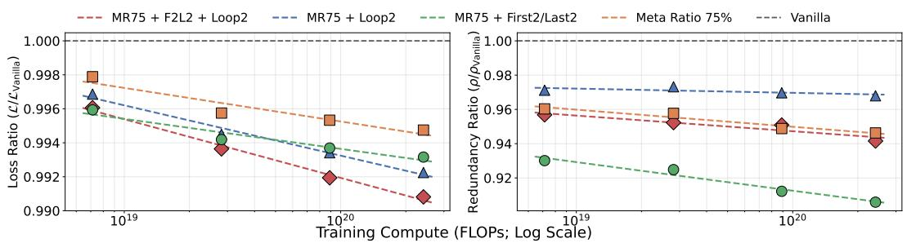  
Figure 8: Scaling-ladder on cumulative Meta-Expert designs. Starting from a 75% Meta-Expert total-number ratio (MR75), we incrementally add topology refinements—Local Experts only in the first and last two layers (F2L2) and two looped Meta-Expert sub-pools (Loop2)—and finally combine both (F2L2 + Loop2). All models are compared against the Vanilla MoE (dashed line at 1.0) in loss ratio $L / L _ { \mathrm { V a n i l l a } }$ (left) and expert redundancy ratio $R / R _ { \mathrm { V a n i l l a } }$ (right) across training compute (FLOPs). Every refinement improves over Vanilla at every compute budget, with the largest gains under the combined design; the advantage in both loss and redundancy becomes more pronounced as training compute grows.

Results. Table 1 reports the downstream performance of the five expert-topology variants after training on 200B tokens. Due to the limited training budget, different Meta Expert variants exhibit advantages across different datasets, highlighting the need for larger-scale scaling experiments, but incorporating Meta Experts consistently outperform the vanilla baseline.

Table 1: Downstream results for the 6B-A1.6B models after training on 200B tokens. MMLU / C-Eval / CMMLU are 5-shot accuracy, OpenBookQA is normalized accuracy, and BBH / TriviaQA are generation exact-match. The best result per dataset is in bold. Vanilla is the Local-Experts-only baseline (Vanilla MoE); MR75 activates Meta Experts at a 75% meta ratio; + Loop2 partitions the Meta Experts into two interleaved sub-pools; and + F2L2 restricts the first two and last two layers to Local Experts only.
<table><tr><td>Dataset</td><td>Vanilla</td><td>MR75</td><td>MR75 + Loop2</td><td>MR75 +F2L2</td><td>MR75 + F2L2 + Loop2</td></tr><tr><td>MMLU</td><td>0.4087</td><td>0.4120</td><td>0.4175</td><td>0.3928</td><td>0.4052</td></tr><tr><td>C-Eval</td><td>0.4354</td><td>0.4443</td><td>0.4487</td><td>0.4160</td><td>0.4302</td></tr><tr><td>CMMLU</td><td>0.4203</td><td>0.4161</td><td>0.4344</td><td>0.4198</td><td>0.4249</td></tr><tr><td>TriviaQA</td><td>0.1924</td><td>0.1964</td><td>0.1932</td><td>0.2014</td><td>0.2042</td></tr><tr><td>BBH</td><td>0.2972</td><td>0.2912</td><td>0.3030</td><td>0.3061</td><td>0.2984</td></tr><tr><td>OpenBookQA</td><td>0.3500</td><td>0.3380</td><td>0.3640</td><td>0.3320</td><td>0.3540</td></tr></table>

## 4 META EXPERTS AS BIDIRECTIONAL RESIDUAL PATHWAYS

Consider a stack of L MoE layers with hidden size H. Writing $x _ { l }$ for the residual stream entering the MoE sub-layer of layer $l , \hat { x } _ { l } = \mathrm { R M S N o r m } ( x _ { l } )$ , and $\gamma$ for the residual scaling coefficient, the sub-layer updates the stream as

$$
x _ { l + 1 } = x _ { l } + \gamma E _ { \theta _ { l } } ( \hat { x } _ { l } ; R _ { l } ) ,\tag{3}
$$

where $E _ { \theta _ { l } }$ is an expert block of N SwiGLU experts, each with parameter dimension d, $R _ { l }$ is the router, and top-k routing activates k experts per token. In a layer-wise MoE, $\theta _ { l }$ and $R _ { l }$ are layerprivate; in Meta Experts, a single block θ and router R are learned once and shared by all layers.

## 4.1 LAYER-WISE MOE.

Forward (read). The expert of layer l injects its output into the residual stream at layer l (Eq. equation 3) and propagates only forward: hidden state $x _ { m }$ can contain layer $l \mathbf { \hat { s } }$ content only $\mathrm { i f } l < m$ , and even then only as a frozen component, because the readout operator of layer m $( E _ { \theta _ { m } } , R _ { m } )$ differs from the write operator of layer l $( E _ { \theta _ { l } } , R _ { l } )$

Training (write). The residual connection does run backward as a gradient highway: the adjoint $\bar { x } _ { l } = \partial \mathcal { L } / \partial x _ { l }$ inherits $\bar { x } _ { l + 1 }$ through the identity branch with unit gain, so the training signal of deeper layers does reach shallower parameters $\theta _ { l }$ without attenuation. This channel, however, is parameterlevel rather than activation-level, lands in layer-private parameters that only layer l ever reads, and over the $m - l$ hops between a pair of layers $l < m$ , the deep-layer component is progressively mixed into the composite adjoint, diluted by the training signals of all intermediate layers rather than arriving at $\theta _ { l }$ as an isolated, addressable contribution.

Net effect. In one forward pass, a hidden state includes only earlier layers’ expert content; deeper layers’ signal reaches a shallow layer solely as a parameter update during training, never as content in its readout.

## 4.2 MOE WITH META EXPERTS.

Training (write). Let $y _ { l } = \gamma E _ { \theta } ( \hat { x } _ { l } ; R )$ and $\bar { y } _ { l } = \partial \mathcal { L } / \partial y _ { l }$ . Since all layers share the same pool, layer $l ^ { \prime } \mathrm { s }$ gradient contribution

$$
g _ { l } \ = \ \bigg ( \frac { \partial y _ { l } } { \partial \theta } \bigg ) ^ { \top } \bar { y } _ { l } \ = \ \frac { \partial \mathcal { L } } { \partial \theta } \bigg | _ { l } \ \in \ \mathbb { R } ^ { N d }\tag{4}
$$

accumulates with all other layers’ by the chain rule, $\bar { \theta } = \sum _ { l } g _ { l }$ (the shared router obeys the same accumulation; we focus on the expert parameters). Thus, with learning rate $\eta ,$ after T training steps

the storage contains the superposition of all layers’ writes:

$$
\theta ^ { ( T ) } = \theta ^ { ( 0 ) } + \sum _ { l = 0 } ^ { L - 1 } \bar { \Delta } \theta _ { l } , \qquad \bar { \Delta } \theta _ { l } = - \eta \sum _ { t < T } g _ { l } ^ { ( t ) } .\tag{5}
$$

Equivalently, at training step t, layer l contributes the local parameter update $\Delta \theta _ { l } ^ { ( t ) } = - \eta g _ { l } ^ { ( t ) }$

Forward (read). After training, every layer reads from the same shared expert parameters; in particular, layer m computes $y _ { m } \mathrm { { = } } \gamma E _ { \theta ^ { ( T ) } } ( \hat { x } _ { m } ; R )$ . To characterize how a write from layer l affects the readout at layer $m ,$ we consider its local first-order effect at training step t, evaluated at $\theta ^ { ( t ) }$ while holding the layer inputs fixed. Define

$$
J _ { m } ^ { ( t ) } = \left. \frac { \partial E _ { \theta } ( \hat { x } _ { m } ^ { ( t ) } ; R ) } { \partial \theta } \right| _ { \theta = \theta ^ { ( t ) } } \in \mathbb { R } ^ { H \times N d } .\tag{6}
$$

Since $y _ { l } = \gamma E _ { \theta } ( \hat { x } _ { l } ; R )$ , Eq. equation 4 gives

$$
g _ { l } ^ { ( t ) } = \gamma J _ { l } ^ { ( t ) } { } ^ { \top } { \bar { y } } _ { l } ^ { ( t ) } .
$$

Therefore, the write from layer l at step t induces the following first-order change in layer m’s readout:

$$
\Delta y _ { m  l } ^ { ( t ) } \approx \gamma J _ { m } ^ { ( t ) } \Delta \theta _ { l } ^ { ( t ) } = - \eta \gamma ^ { 2 } J _ { m } ^ { ( t ) } { J _ { l } ^ { ( t ) } } ^ { \top } \bar { y } _ { l } ^ { ( t ) } .\tag{7}
$$

Accumulating these local first-order influences over training gives

$$
\mathcal { T } _ { m  l } : = \sum _ { t < T } \Delta y _ { m  l } ^ { ( t ) } \approx - \eta \gamma ^ { 2 } \sum _ { t < T } J _ { m } ^ { ( t ) } { J _ { l } ^ { ( t ) } } ^ { \top } \bar { y } _ { l } ^ { ( t ) } .\tag{8}
$$

The update of the shared router contributes an analogous term, omitted because top-k selection is piecewise constant in R. The factor $J _ { m } ^ { ( t ) } J _ { l } ^ { ( t ) } { } ^ { \top }$ has the form of a tangent kernel of the shared block evaluated across the two layers. The total shared-parameter influence on layer m, $\mathcal { L } _ { m } =$ $\begin{array} { r } { \sum _ { l = 0 } ^ { L - 1 } \mathcal { T } _ { m  l } } \end{array}$ , contains contributions from every layer, in contrast to both limitations of layer-wise MoE:

$l ~ < ~ m$ (deep reads shallow). Versus the frozen forward carrying of layer-wise MoE: because the write at layer l and the readout at layer m are two evaluations of the same operator, layer m retrieves, re-encodes, and further transforms shallow content in the code space in which it was written.

$l > m$ (shallow reads deep). Versus the gradient highway of layer-wise MoE: deep content reaches layer m not as a parameter update of its private $\theta _ { m }$ , but as an activation-level term in its readout, in the common code space, through an O(1)-length path independent of $m - l .$

Net effect. A single forward pass provides bidirectional access along depth—deep hidden states reach shallow expert content, and shallow hidden states reach deep expert content—through one shared storage. More discussions are done in the Appendix A.4.

## 5 CONCLUSION

In this work, we present an empirical and theoretical analysis of cross-layer expert sharing in MoE models, contrasting the hierarchically arranged Local Experts of standard architectures with interlayer shared Meta Experts. Our systematic comparisons—over the Meta/Local ratio, the activation ratio, and the topology of the shared pool—show that Meta Experts consistently reduce expert redundancy and cross-entropy loss while improving downstream task accuracy: at a fixed number of activated experts and expert granularity, models built on shared experts match the performance of Vanilla MoE with only 70–80% of the expert budget, substantially improving scaling potential. Beyond these empirical observations, our analysis shows that a shared expert block is not merely a parameter-saving device: it widens the forward residual connections and grants hidden states bidirectional access to expert content across depth, improving both the storage and the retrieval of information. Taken together, our results suggest that inter-layer redundancy, long treated as an intrinsic cost of deep MoE models, can instead be converted into effective capacity. Future directions include extending this analysis to larger models and broader architectures, and understanding why mildly hierarchical shared experts introduce redundancy without degrading performance.

## AI USE STATEMENT

In this work, we used generative AI tools for writing assistance: polishing language and grammar, brainstorming alternative phrasings (e.g., for the paper title and section openings), formalizing the presentation of the theoretical analysis (e.g., LATEX derivations whose underlying ideas are the authors’ own), and drafting descriptive passages (figure captions, the Related Work section, and the Conclusion) based on author-provided outlines, notes, and experimental results. We also used generative AI tools for code assistance, including implementation support and plotting scripts for the result figures; all designs, algorithms, and experimental ideas were proposed by the authors.

We have not used generative AI tools for research ideation, experimental design. We have reviewed all AI-assisted work: all AI-drafted text was checked, revised, and approved by the authors; translations were verified against the authors’ intended meaning; all technical claims, equations, and reported numbers were independently verified by the authors against their own derivations and experimental results; and AI-generated code was verified, tested, and debugged by the authors for correctness, with all result figures manually checked against the underlying data. We take responsibility for the final content of this work, including text, claims or artifacts produced with the aid of generative AI.

## REPRODUCIBILITY STATEMENT

We have taken several steps to make the results in this paper reproducible, and we reference here the parts of the paper that support them. The complete experimental configuration for the scaling ladder is given in Appendix A.3: the per-depth architecture is listed in Table 2 and the per-depth training schedule—global batch size, optimizer steps, warmup and decay, learning rate, token budget, and training FLOPs—in Table 3. Every rung, and every architectural variant at a given rung, shares the same backbone, optimizer, and parallelism policy; only the depth-dependent knobs in those tables change, so a single set of hyperparameters fully specifies each run. The evaluation protocol used for the compute-versus-loss analysis is described in the same appendix: for each run we report the language-modeling loss averaged over the final ten training steps. Our models are implemented on top of Megatron-LM, a widely used open-source framework, which helps ensure reproducibility.

## REFERENCES

Sangmin Bae, Adam Fisch, Hrayr Harutyunyan, Ziwei Ji, Seungyeon Kim, and Tal Schuster. Relaxed recursive transformers: Effective parameter sharing with layer-wise lora. In International Conference on Learning Representations, volume 2025, pp. 34282–34327, 2025.

Shaojie Bai, J Zico Kolter, and Vladlen Koltun. Deep equilibrium models. Advances in neural information processing systems, 32, 2019.

Xiao Bi, Deli Chen, Guanting Chen, Shanhuang Chen, Damai Dai, Chengqi Deng, Honghui Ding, Kai Dong, Qiushi Du, Zhe Fu, et al. Deepseek llm: Scaling open-source language models with longtermism. arXiv preprint arXiv:2401.02954, 2024.

William Brandon, Mayank Mishra, Aniruddha Nrusimha, Rameswar Panda, and Jonathan Ragan-Kelley. Reducing transformer key-value cache size with cross-layer attention. Advances in Neural Information Processing Systems, 37:86927–86957, 2024.

Tom Brown, Benjamin Mann, Nick Ryder, Melanie Subbiah, Jared D Kaplan, Prafulla Dhariwal, Arvind Neelakantan, Pranav Shyam, Girish Sastry, Amanda Askell, Sandhini Agarwal, Ariel Herbert-Voss, Gretchen Krueger, Tom Henighan, Rewon Child, Aditya Ramesh, Daniel Ziegler, Jeffrey Wu, Clemens Winter, Chris Hesse, Mark Chen, Eric Sigler, Mateusz Litwin, Scott Gray, Benjamin Chess, Jack Clark, Christopher Berner, Sam McCandlish, Alec Radford, Ilya Sutskever, and Dario Amodei. Language models are few-shot learners. In

H. Larochelle, M. Ranzato, R. Hadsell, M.F. Balcan, and H. Lin (eds.), Advances in Neural Information Processing Systems, volume 33, pp. 1877–1901. Curran Associates, Inc., 2020. URL https://proceedings.neurips.cc/paper\_files/paper/2020/ file/1457c0d6bfcb4967418bfb8ac142f64a-Paper.pdf.

Kai Chen, Jifeng Ding, Ning Ding, Jiaye Ge, Lixin Gu, Yicheng Gu, Qipeng Guo, Ermo Hua, Haian Huang, Haozheng Hou, et al. Intern-s2-mobius: Foundation model with decoupled knowledge and reasoning. arXiv preprint arXiv:2608.14290, 2026a.

Xiaodong Chen, Yuxuan Hu, Jing Zhang, Yanling Wang, Cuiping Li, and Hong Chen. Streamlining redundant layers to compress large language models. In International Conference on Learning Representations, volume 2025, pp. 30362–30383, 2025.

Yilong Chen, Naibin Gu, Junyuan Shang, Zhenyu Zhang, Yuchen Feng, Jiawei Sheng, Tingwen Liu, Shuohuan Wang, Yu Sun, Hua Wu, et al. Mixture of universal experts: Scaling virtual width via depth-width transformation. arXiv preprint arXiv:2603.04971, 2026b.

Robert Csord ´ as, Kazuki Irie, J ´ urgen Schmidhuber, Christopher Potts, and Christopher D Manning.¨ Moeut: Mixture-of-experts universal transformers. Advances in Neural Information Processing Systems, 37:28589–28614, 2024.

Damai Dai, Li Dong, Yaru Hao, Zhifang Sui, Baobao Chang, and Furu Wei. Knowledge neurons in pretrained transformers. In Smaranda Muresan, Preslav Nakov, and Aline Villavicencio (eds.), Proceedings ofthe 60th Annual Meeting ofthe Associationfor Computational Linguistics (Volume 1: Long Papers), pp. 8493–8502, Dublin, Ireland, May 2022. Association for Computational Linguistics. doi: 10.18653/v1/2022.acl-long.581. URL https://aclanthology.org/ 2022.acl-long.581/.

Damai Dai, Chengqi Deng, Chenggang Zhao, RX Xu, Huazuo Gao, Deli Chen, Jiashi Li, Wangding Zeng, Xingkai Yu, Yu Wu, et al. Deepseekmoe: Towards ultimate expert specialization in mixtureof-experts language models. In Proceedings of the 62nd annual meeting of the association for computational linguistics (volume 1: Long papers), pp. 1280–1297, 2024.

Mostafa Dehghani, Stephan Gouws, Oriol Vinyals, Jakob Uszkoreit, and Łukasz Kaiser. Universal transformers. arXiv preprint arXiv:1807.03819, 2018.

Angela Fan, Edouard Grave, and Armand Joulin. Reducing transformer depth on demand with structured dropout. arXiv preprint arXiv:1909.11556, 2019.

William Fedus, Barret Zoph, and Noam Shazeer. Switch transformers: Scaling to trillion parameter models with simple and efficient sparsity, 2022. URL https://arxiv.org/abs/2101. 03961.

Mor Geva, Roei Schuster, Jonathan Berant, and Omer Levy. Transformer feed-forward layers are key-value memories. In Marie-Francine Moens, Xuanjing Huang, Lucia Specia, and Scott Wen-tau Yih (eds.), Proceedings of the 2021 Conference on Empirical Methods in Natural Language Processing, pp. 5484–5495, Online and Punta Cana, Dominican Republic, November 2021. Association for Computational Linguistics. doi: 10.18653/v1/2021.emnlp-main.446. URL https://aclanthology.org/2021.emnlp-main.446/.

Angeliki Giannou, Shashank Rajput, Jy-yong Sohn, Kangwook Lee, Jason D Lee, and Dimitris Papailiopoulos. Looped transformers as programmable computers. In International Conference on Machine Learning, pp. 11398–11442. PMLR, 2023.

Alexander Hagele, Elie Bakouch, Atli Kosson, Loubna B Allal, Leandro Von Werra, and Martin¨ Jaggi. Scaling laws and compute-optimal training beyond fixed training durations. Advances in Neural Information Processing Systems, 37:76232–76264, 2024.

Dan Hendrycks, Collin Burns, Steven Basart, Andy Zou, Mantas Mazeika, Dawn Song, and Jacob Steinhardt. Measuring massive multitask language understanding, 2021. URL https: //arxiv.org/abs/2009.03300.

Jordan Hoffmann, Sebastian Borgeaud, Arthur Mensch, Elena Buchatskaya, Trevor Cai, Eliza Rutherford, Diego de Las Casas, Lisa Anne Hendricks, Johannes Welbl, Aidan Clark, et al. Training compute-optimal large language models. arXiv preprint arXiv:2203.15556, 2022a.

Jordan Hoffmann, Sebastian Borgeaud, Arthur Mensch, Elena Buchatskaya, Trevor Cai, Eliza Rutherford, Diego de Las Casas, Lisa Anne Hendricks, Johannes Welbl, Aidan Clark, Tom Hennigan, Eric Noland, Katie Millican, George van den Driessche, Bogdan Damoc, Aurelia Guy, Simon Osindero, Karen Simonyan, Erich Elsen, Jack W. Rae, Oriol Vinyals, and Laurent Sifre. Training compute-optimal large language models, 2022b. URL https://arxiv.org/abs/ 2203.15556.

Ermo Hua, Biqing Qi, Kaiyan Zhang, Kai Tian, Xingtai Lv, Ning Ding, and Bowen Zhou. Intuitive fine-tuning: Towards simplifying alignment into a single process. In Proceedings of the 63rd Annual Meeting of the Association for Computational Linguistics (Volume 1: Long Papers), pp. 121–136, 2025.

Minbin Huang, Han Shi, Chuanyang Zheng, Yimeng Wu, Guoxuan Chen, Xintong Yu, Yichun Yin, and Hong Cheng. Unipool: A globally shared expert pool for mixture-of-experts. arXiv preprint arXiv:2605.06665, 2026.

Yuzhen Huang, Yuzhuo Bai, Zhihao Zhu, Junlei Zhang, Jinghan Zhang, Tangjun Su, Junteng Liu, Chuancheng Lv, Yikai Zhang, Jiayi Lei, Yao Fu, Maosong Sun, and Junxian He. C-eval: A multi-level multi-discipline chinese evaluation suite for foundation models, 2023. URL https: //arxiv.org/abs/2305.08322.

Hakan Inan, Khashayar Khosravi, and Richard Socher. Tying word vectors and word classifiers: A loss framework for language modeling. arXiv preprint arXiv:1611.01462, 2016.

Dian Jiao, Jiaxin Duan, Shuai Zhao, Jiabing Leng, Yiran Zhang, and Feng Huang. Improving parameter utilization by sharing neural experts across layers in transformers, 2026. URL https: //arxiv.org/abs/2609.22199.

Mandar Joshi, Eunsol Choi, Daniel S. Weld, and Luke Zettlemoyer. Triviaqa: A large scale distantly supervised challenge dataset for reading comprehension, 2017. URL https://arxiv.org/ abs/1705.03551.

Jared Kaplan, Sam McCandlish, Tom Henighan, Tom B. Brown, Benjamin Chess, Rewon Child, Scott Gray, Alec Radford, Jeffrey Wu, and Dario Amodei. Scaling laws for neural language models, 2020. URL https://arxiv.org/abs/2001.08361.

Mehran Kazemi, Bahare Fatemi, Hritik Bansal, John Palowitch, Chrysovalantis Anastasiou, Sanket Vaibhav Mehta, Lalit K. Jain, Virginia Aglietti, Disha Jindal, Peter Chen, Nishanth Dikkala, Gladys Tyen, Xin Liu, Uri Shalit, Silvia Chiappa, Kate Olszewska, Yi Tay, Vinh Q. Tran, Quoc V. Le, and Orhan Firat. Big-bench extra hard, 2025. URL https://arxiv.org/abs/2502. 19187.

Zhenzhong Lan, Mingda Chen, Sebastian Goodman, Kevin Gimpel, Piyush Sharma, and Radu Soricut. Albert: A lite bert for self-supervised learning of language representations. arXiv preprint arXiv:1909.11942, 2019.

Dmitry Lepikhin, HyoukJoong Lee, Yuanzhong Xu, Dehao Chen, Orhan Firat, Yanping Huang, Maxim Krikun, Noam Shazeer, and Zhifeng Chen. {GS}hard: Scaling giant models with conditional computation and automatic sharding. In International Conference on Learning Representations, 2021. URL https://openreview.net/forum?id=qrwe7XHTmYb.

Boxun Li, Yadong Li, Zhiyuan Li, Congyi Liu, Weilin Liu, Guowei Niu, Zheyue Tan, Haiyang Xu, Zhuyu Yao, Tao Yuan, et al. Megrez2 technical report. arXiv preprint arXiv:2507.17728, 2025.

Haonan Li, Yixuan Zhang, Fajri Koto, Yifei Yang, Hai Zhao, Yeyun Gong, Nan Duan, and Timothy Baldwin. Cmmlu: Measuring massive multitask language understanding in chinese, 2024. URL https://arxiv.org/abs/2306.09212.

Zonglin Li, Chong You, Srinadh Bhojanapalli, Daliang Li, Ankit Singh Rawat, Sashank J. Reddi, Ke Ye, Felix Chern, Felix Yu, Ruiqi Guo, and Sanjiv Kumar. The lazy neuron phenomenon: On emergence of activation sparsity in transformers, 2023. URL https://arxiv.org/abs/ 2210.06313.

Xin Men, Mingyu Xu, Qingyu Zhang, Qianhao Yuan, Bingning Wang, Hongyu Lin, Yaojie Lu, Xianpei Han, and Weipeng Chen. Shortgpt: Layers in large language models are more redundant than you expect. In Findings of the Association for Computational Linguistics: ACL 2025, pp. 20192–20204, 2025.

Kevin Meng, David Bau, Alex Andonian, and Yonatan Belinkov. Locating and editing factual associations in gpt. In S. Koyejo, S. Mohamed, A. Agarwal, D. Belgrave, K. Cho, and A. Oh (eds.), Advances in Neural Information Processing Systems, volume 35, pp. 17359–17372. Curran Associates, Inc., 2022. doi: 10.52202/ 068431-1262. URL https://proceedings.neurips.cc/paper\_files/paper/ 2022/file/6f1d43d5a82a37e89b0665b33bf3a182-Paper-Conference.pdf.

Todor Mihaylov, Peter Clark, Tushar Khot, and Ashish Sabharwal. Can a suit of armor conduct electricity? a new dataset for open book question answering, 2018. URL https://arxiv. org/abs/1809.02789.

Seyed Iman Mirzadeh, Keivan Alizadeh-Vahid, Sachin Mehta, Carlo C del Mundo, Oncel Tuzel, Golnoosh Samei, Mohammad Rastegari, and Mehrdad Farajtabar. ReLU strikes back: Exploiting activation sparsity in large language models. In The Twelfth International Conference on Learning Representations, 2024. URL https://openreview.net/forum?id=osoWxY8q2E.

Yongyu Mu, Yuzhang Wu, Yuchun Fan, Chenglong Wang, Hengyu Li, Jiali Zeng, Qiaozhi He, Murun Yang, Fandong Meng, Jie Zhou, et al. Cross-layer attention sharing for pre-trained large language models. Transactions of the Association for Computational Linguistics, 14:656–688, 2026.

Niklas Muennighoff, Luca Soldaini, Dirk Groeneveld, Kyle Lo, Jacob Morrison, Sewon Min, Weijia Shi, Pete Walsh, Oyvind Tafjord, Nathan Lambert, et al. Olmoe: Open mixture-of-experts language models. In International Conference on Learning Representations, volume 2025, pp. 62061–62121, 2025.

OpenAI, Josh Achiam, Steven Adler, Sandhini Agarwal, Lama Ahmad, Ilge Akkaya, Florencia Leoni Aleman, Diogo Almeida, Janko Altenschmidt, Sam Altman, Shyamal Anadkat, Red Avila, Igor Babuschkin, Suchir Balaji, Valerie Balcom, Paul Baltescu, Haiming Bao, Mohammad Bavarian, Jeff Belgum, Irwan Bello, Jake Berdine, Gabriel Bernadett-Shapiro, Christopher Berner, Lenny Bogdonoff, Oleg Boiko, Madelaine Boyd, Anna-Luisa Brakman, Greg Brockman, Tim Brooks, Miles Brundage, Kevin Button, Trevor Cai, Rosie Campbell, Andrew Cann, Brittany Carey, Chelsea Carlson, Rory Carmichael, Brooke Chan, Che Chang, Fotis Chantzis, Derek Chen, Sully Chen, Ruby Chen, Jason Chen, Mark Chen, Ben Chess, Chester Cho, Casey Chu, Hyung Won Chung, Dave Cummings, Jeremiah Currier, Yunxing Dai, Cory Decareaux, Thomas Degry, Noah Deutsch, Damien Deville, Arka Dhar, David Dohan, Steve Dowling, Sheila Dunning, Adrien Ecoffet, Atty Eleti, Tyna Eloundou, David Farhi, Liam Fedus, Niko Felix, Simon Posada Fishman, Juston Forte, Isabella Fulford, Leo Gao, Elie Georges, Christian Gib-´ son, Vik Goel, Tarun Gogineni, Gabriel Goh, Rapha Gontijo-Lopes, Jonathan Gordon, Morgan Grafstein, Scott Gray, Ryan Greene, Joshua Gross, Shixiang Shane Gu, Yufei Guo, Chris Hallacy, Jesse Han, Jeff Harris, Yuchen He, Mike Heaton, Johannes Heidecke, Chris Hesse, Alan Hickey, Wade Hickey, Peter Hoeschele, Brandon Houghton, Kenny Hsu, Shengli Hu, Xin Hu, Joost Huizinga, Shantanu Jain, Shawn Jain, Joanne Jang, Angela Jiang, Roger Jiang, Haozhun Jin, Denny Jin, Shino Jomoto, Billie Jonn, Heewoo Jun, Tomer Kaftan, Łukasz Kaiser, Ali Kamali, Ingmar Kanitscheider, Nitish Shirish Keskar, Tabarak Khan, Logan Kilpatrick, Jong Wook Kim, Christina Kim, Yongjik Kim, Jan Hendrik Kirchner, Jamie Kiros, Matt Knight, Daniel Kokotajlo, Łukasz Kondraciuk, Andrew Kondrich, Aris Konstantinidis, Kyle Kosic, Gretchen Krueger, Vishal Kuo, Michael Lampe, Ikai Lan, Teddy Lee, Jan Leike, Jade Leung, Daniel Levy, Chak Ming Li, Rachel Lim, Molly Lin, Stephanie Lin, Mateusz Litwin, Theresa Lopez, Ryan Lowe, Patricia Lue, Anna Makanju, Kim Malfacini, Sam Manning, Todor Markov, Yaniv Markovski, Bianca Martin, Katie Mayer, Andrew Mayne, Bob McGrew, Scott Mayer McKinney,

Christine McLeavey, Paul McMillan, Jake McNeil, David Medina, Aalok Mehta, Jacob Menick, Luke Metz, Andrey Mishchenko, Pamela Mishkin, Vinnie Monaco, Evan Morikawa, Daniel Mossing, Tong Mu, Mira Murati, Oleg Murk, David Mely, Ashvin Nair, Reiichiro Nakano, Ra-´ jeev Nayak, Arvind Neelakantan, Richard Ngo, Hyeonwoo Noh, Long Ouyang, Cullen O’Keefe, Jakub Pachocki, Alex Paino, Joe Palermo, Ashley Pantuliano, Giambattista Parascandolo, Joel Parish, Emy Parparita, Alex Passos, Mikhail Pavlov, Andrew Peng, Adam Perelman, Filipe de Avila Belbute Peres, Michael Petrov, Henrique Ponde de Oliveira Pinto, Michael, Pokorny, Michelle Pokrass, Vitchyr H. Pong, Tolly Powell, Alethea Power, Boris Power, Elizabeth Proehl, Raul Puri, Alec Radford, Jack Rae, Aditya Ramesh, Cameron Raymond, Francis Real, Kendra Rimbach, Carl Ross, Bob Rotsted, Henri Roussez, Nick Ryder, Mario Saltarelli, Ted Sanders, Shibani Santurkar, Girish Sastry, Heather Schmidt, David Schnurr, John Schulman, Daniel Selsam, Kyla Sheppard, Toki Sherbakov, Jessica Shieh, Sarah Shoker, Pranav Shyam, Szymon Sidor, Eric Sigler, Maddie Simens, Jordan Sitkin, Katarina Slama, Ian Sohl, Benjamin Sokolowsky, Yang Song, Natalie Staudacher, Felipe Petroski Such, Natalie Summers, Ilya Sutskever, Jie Tang, Nikolas Tezak, Madeleine B. Thompson, Phil Tillet, Amin Tootoonchian, Elizabeth Tseng, Preston Tuggle, Nick Turley, Jerry Tworek, Juan Felipe Ceron Uribe, Andrea Vallone, Arun Vi-´ jayvergiya, Chelsea Voss, Carroll Wainwright, Justin Jay Wang, Alvin Wang, Ben Wang, Jonathan Ward, Jason Wei, CJ Weinmann, Akila Welihinda, Peter Welinder, Jiayi Weng, Lilian Weng, Matt Wiethoff, Dave Willner, Clemens Winter, Samuel Wolrich, Hannah Wong, Lauren Workman, Sherwin Wu, Jeff Wu, Michael Wu, Kai Xiao, Tao Xu, Sarah Yoo, Kevin Yu, Qiming Yuan, Wojciech Zaremba, Rowan Zellers, Chong Zhang, Marvin Zhang, Shengjia Zhao, Tianhao Zheng, Juntang Zhuang, William Zhuk, and Barret Zoph. Gpt-4 technical report, 2024. URL https://arxiv.org/abs/2303.08774.

Telmo Pires, Antonio Vilarinho Lopes, Yannick Assogba, and Hendra Setiawan. One wide feed-´ forward is all you need. In Proceedings of the Eighth Conference on Machine Translation, pp. 1031–1044, 2023.

Ofir Press and Lior Wolf. Using the output embedding to improve language models. In Proceedings of the 15th Conference of the European Chapter of the Association for Computational Linguistics: Volume 2, Short Papers, pp. 157–163, 2017.

Colin Raffel, Noam Shazeer, Adam Roberts, Katherine Lee, Sharan Narang, Michael Matena, Yanqi Zhou, Wei Li, and Peter J Liu. Exploring the limits of transfer learning with a unified text-to-text transformer. Journal ofmachine learning research, 21(140):1–67, 2020.

David Raposo, Sam Ritter, Blake Richards, Timothy Lillicrap, Peter Conway Humphreys, and Adam Santoro. Mixture-of-depths: Dynamically allocating compute in transformer-based language models. arXiv preprint arXiv:2404.02258, 2024.

Nikunj Saunshi, Nishanth Dikkala, Zhiyuan Li, Sanjiv Kumar, and Sashank J Reddi. Reasoning with latent thoughts: On the power of looped transformers. In International Conference on Learning Representations, volume 2025, pp. 14855–14881, 2025.

Noam Shazeer, \*Azalia Mirhoseini, \*Krzysztof Maziarz, Andy Davis, Quoc Le, Geoffrey Hinton, and Jeff Dean. Outrageously large neural networks: The sparsely-gated mixture-ofexperts layer. In International Conference on Learning Representations, 2017. URL https: //openreview.net/forum?id=B1ckMDqlg.

Yutao Sun, Li Dong, Yi Zhu, Shaohan Huang, Wenhui Wang, Shuming Ma, Quanlu Zhang, Jianyong Wang, and Furu Wei. You only cache once: Decoder-decoder architectures for language models. Advances in Neural Information Processing Systems, 37:7339–7361, 2024.

Sho Takase and Shun Kiyono. Lessons on parameter sharing across layers in transformers. In Proceedings of The Fourth Workshop on Simple and Efficient Natural Language Processing (SustaiNLP), pp. 78–90, 2023.

Zheyue Tan, Zhiyuan Li, Tao Yuan, Dong Zhou, Weilin Liu, Yueqing Zhuang, Yadong Li, Guowei Niu, Cheng Qin, Zhuyu Yao, et al. Rexmoe: Reusing experts with minimal overhead in mixtureof-experts. arXiv preprint arXiv:2510.17483, 2025.

Ling Team, Binwei Zeng, Chao Huang, Chao Zhang, Changxin Tian, Cong Chen, Dingnan Jin, Feng Yu, Feng Zhu, Feng Yuan, et al. Every flop counts: Scaling a 300b mixture-of-experts ling llm without premium gpus. arXiv preprint arXiv:2503.05139, 2025.

Omkar Thawakar, Ashmal Vayani, Salman Khan, Hisham Cholakal, Rao M Anwer, Michael Felsberg, Tim Baldwin, Eric P Xing, and Fahad Shahbaz Khan. Mobillama: Towards accurate and lightweight fully transparent gpt. arXiv preprint arXiv:2402.16840, 2024.

Changxin Tian, Kunlong Chen, Jia Liu, Ziqi Liu, Zhiqiang Zhang, and Jun Zhou. Towards greater leverage: Scaling laws for efficient mixture-of-experts language models. In International Conference on Learning Representations, volume 2026, pp. 29806–29843, 2026.

Ashish Vaswani, Noam Shazeer, Niki Parmar, Jakob Uszkoreit, Llion Jones, Aidan N Gomez, Ł ukasz Kaiser, and Illia Polosukhin. Attention is all you need. In I. Guyon, U. Von Luxburg, S. Bengio, H. Wallach, R. Fergus, S. Vishwanathan, and R. Garnett (eds.), Advances in Neural Information Processing Systems, volume 30. Curran Associates, Inc., 2017a. URL https://proceedings.neurips.cc/paper\_files/paper/2017/ file/3f5ee243547dee91fbd053c1c4a845aa-Paper.pdf.

Ashish Vaswani, Noam Shazeer, Niki Parmar, Jakob Uszkoreit, Llion Jones, Aidan N Gomez, Łukasz Kaiser, and Illia Polosukhin. Attention is all you need. Advances in neural information processing systems, 30, 2017b.

Shaowen Wang, Ge Zhang, Kairong Luo, Yuhao Wu, Shaofan Liu, Jiaheng Liu, Wenhao Huang, Shen Yan, and Jian Li. Smelt: Scaling laws for compute-matched moe looped transformers. arXiv preprint arXiv:2609.01343, 2026.

Haoyi Wu and Kewei Tu. Layer-condensed kv cache for efficient inference of large language models. In Proceedings of the 62nd Annual Meeting of the Association for Computational Linguistics (Volume 1: Long Papers), pp. 11175–11188, 2024.

You Wu, Haoyi Wu, and Kewei Tu. A systematic study of cross-layer kv sharing for efficient llm inference. In Proceedings of the 2025 Conference of the Nations of the Americas Chapter of the Associationfor Computational Linguistics: Human Language Technologies (Volume 2: Short Papers), pp. 396–403, 2025.

Tong Xiao, Yinqiao Li, Jingbo Zhu, Zhengtao Yu, and Tongran Liu. Sharing attention weights for fast transformer. arXiv preprint arXiv:1906.11024, 2019.

Guoliang Zhao, Yuhan Fu, Shuaipeng Li, Xingwu Sun, Ruobing Xie, An Wang, Weidong Han, Zhen Yang, Weixuan Sun, Yudong Zhang, et al. Towards a comprehensive scaling law of mixture-ofexperts. arXiv preprint arXiv:2509.23678, 2025.

Zayd Muhammad Kawakibi Zuhri, Muhammad Farid Adilazuarda, Ayu Purwarianti, and Alham Fikri Aji. Mlkv: Multi-layer key-value heads for memory efficient transformer decoding. In Findings of the Association for Computational Linguistics: NAACL 2025, pp. 5531–5540, 2025.

## A APPENDIX

## A.1 RELATED WORK

Weight Tying was originally introduced to share parameters between the embedding layer and the language model head (Press & Wolf, 2017; Inan et al., 2016): since the two matrices map tokens to and from the hidden space, tying them nearly halves the corresponding parameters while often improving perplexity, and the practice has become standard in modern language models (Vaswani et al., 2017b; Raffel et al., 2020). Beyond tying modules at the same depth, weight tying can be pushed further, to reusing parameters across depth (Dehghani et al., 2018; Lan et al., 2019).

Looped Transformer pushes weight tying to extreme: the same block is applied multiple times per token, unrolling a small set of weights into arbitrary depth (Dehghani et al., 2018; Giannou et al.,

2023; Hua et al., 2025). This line of work shows that weight reuse across depth can substitute for parameter growth, and that a compact recurrent model can match the reasoning performance of much larger ones (Bae et al., 2025; Saunshi et al., 2025; Wang et al., 2026), at the cost of additional recursions and a higher degree of serialization. Meta Experts share the same motivation—extracting more effective capacity from a fixed parameter budget—but apply tying at a finer granularity and within a single feed-forward pass: only the expert block is reused across layers, without extra recursions, so training and inference retain the parallelism of standard Transformers, while attention may remain layer-specific. Depending on what is reused across depth, this paradigm subsumes several lines of work.

Attn Weight Sharing reuses the attention projections (or entire attention blocks) of different layers, yielding moderate parameter savings at little accuracy cost (Xiao et al., 2019; Lan et al., 2019; Mu et al., 2026). These results suggest that the per-layer parameter budget of Transformers is partially redundant—but leave open where the redundancy concentrates and whether the same principle applies to the rest of the block. Attn KV-Cache Sharing reuses not parameters but activations: in long-context or serving scenarios, multiple layers attend to a common KV cache, trading representational independence for inference memory and throughput (Sun et al., 2024; Brandon et al., 2024; Zuhri et al., 2025; Wu & Tu, 2024; Wu et al., 2025). Such sharing is typically applied at deployment time, affects the cache rather than the learned weights, and is often found to be nearly lossless— suggesting that layers can tolerate reading the same content, but not that they should store the same content. Meta Experts operate on the storage side: the shared expert pool is written by every layer during training, so cross-layer sharing reshapes what the model stores and how hidden states retrieve it, rather than merely reusing cached activations at inference.

FFN Weight Sharing is the closest line to our work: it reuses feed-forward parameters across layers, either by tying the FFN of all layers or by sharing it among a subset (Lan et al., 2019; Pires et al., 2023; Thawakar et al., 2024). Existing studies, however, focus on dense FFNs and report mixed results, and sharing is typically applied uniformly to every layer. MoE Weight Sharing has been explored in several recent works: experts are shared across layers, but almost always under an everylayer sharing topology, whose communication and memory overhead is difficult to scale (Li et al., 2025; Tan et al., 2025; Chen et al., 2026a; Huang et al., 2026; Chen et al., 2026b; Jiao et al., 2026). Meta Experts generalize this idea to a more flexible regime: a shared pool of experts is accessed through several topology that is more friendly for communication and memory (reserving boundary layers for local experts, sub-pool partitioning with chunked or interleaved access), allows the model to decide which content is worth sharing across depth—and, as our analysis shows, implicitly turns the shared experts into bidirectional residual pathways between layers.

## A.2 REDUNDANCY METRIC

To quantify how much of a model’s expert capacity is redundant, we need a measure that is (i) continuous, with no similarity threshold; (ii) comparable across architectures with different expert counts and depths; and (iii) faithful to the correlation structure among experts in high dimensions, where naive cosine similarities collapse toward zero. Our metric is built from a single similarity kernel and a single spectral statistic.

Similarity kernel: linear-CKA on centered covariances. For expert i, let $Y _ { i } \in \mathbb { R } ^ { T \times H }$ be its response matrix to a shared probe set of T L2-normalized tokens, and let $Y _ { i } ^ { c }$ denote $Y _ { i }$ with its sample mean subtracted. We map each expert to the vectorized centered covariance

$$
\phi _ { i } ~ = ~ \mathrm { v e c } \big ( Y _ { i } ^ { c ^ { \top } } Y _ { i } ^ { c } \big ) ,\tag{9}
$$

and define the pairwise similarity as the cosine in this feature space,

$$
K _ { i j } = \frac { \langle \phi _ { i } , \phi _ { j } \rangle } { \left\| \phi _ { i } \right\| \left\| \phi _ { j } \right\| } ,\tag{10}
$$

which is exactly linear CKA evaluated on the experts’ functional responses. Being invariant to orthogonal transformations and isotropic scaling, $K _ { i j }$ reflects the correlated directions between experts rather than their absolute orientation or norm, and avoids the collapse of raw high-dimensional cosine. The resulting Gram matrix $K \in \mathbb { R } ^ { E \times E }$ covers the E experts under analysis: for models mixing Meta and Local Experts the two pools are concatenated on the expert axis and analyzed jointly, and for layer-wise models the layer index serves as the grouping axis.

Spectral statistic: how many directions collapse. Since K is positive semi-definite, its eigenspectrum $\lambda _ { 1 } \ \geq \ \lambda _ { 2 } \ \geq \ \cdot \cdot \ \geq \ \lambda _ { E } \ \geq \ 0$ distributes the total similarity energy across E principal directions. We measure the concentration of this energy by the Gini coefficient of the spectrum,

$$
\rho = \mathrm { G i n i } ( \lambda ) = \frac { \sum _ { i , j } \big | \lambda _ { i } - \lambda _ { j } \big | } { 2 E \sum _ { i } \lambda _ { i } } \in [ 0 , 1 ] ,\tag{11}
$$

where $\rho = 0$ means the energy is uniform across all directions (experts fully complementary, no redundancy) and $\rho  1$ means it concentrates on a few directions (strong redundancy). The reading admits an exact interpretation: for a uniform rank-k spectrum, $\mathrm { G i n i } ( \bar { \lambda ) } = 1 - k \bar { / } E$ , so $\rho$ equals the fraction of expert directions that have collapsed into redundant ones. Because $\rho$ is a ratio, it is directly comparable across models with different $E ,$ depths, and training budgets, and we report it as our headline Expert Redundancy metric.

## A.3 SCALING-LADDER EXPERIMENTAL SETTINGS

Models and training. All models are trained from scratch on NVIDIA H200 GPUs. The scaling experiments use a single family of Qwen3.5-style, text-only Mixture-of-Experts (MoE) models arranged as a depth-controlled ladder at four depths $L \in \{ 1 \dot { 2 } , 1 6 , 2 0 , 2 4 \}$ ; model width is scaled jointly with depth so that each rung is (approximately) compute-optimal, giving a clean computeversus-loss axis. At each rung, the vanilla baseline and every Meta Experts variant are trained independently, sharing the same backbone architecture and training configuration but no trained weights, and preserving the same $1 2 8 \times L$ routed-expert budget, so only the depth-dependent knobs (width, batch size, learning rate, token budget, and expert parallelism) change across rungs (Tables 2 and 3).

Table 2: Per-depth architecture of the scaling ladder. Every rung uses 128 routed experts plus one gated shared expert, top-8 routing, a period-4 GDN/full-attention pattern (one quarter full attention), and a head dimension of 256. Widths scale jointly with depth. The table specifies the shared vanilla backbone at each rung; the Meta Experts variants replace only the routed-expert layers and keep the same $1 2 8 \times L$ routed-expert budget, so every variant at a given rung shares these dimensions. GDN key/value entries are head counts (each head has dimension 128).
<table><tr><td rowspan="2">Hyperparameter</td><td colspan="4">Depth L</td></tr><tr><td>12</td><td>16</td><td>20</td><td>24</td></tr><tr><td>Hidden size  $d _ { \mathrm { m o d e l } }$ </td><td>768</td><td>1024</td><td>1280</td><td>1536</td></tr><tr><td>Attention heads</td><td>6</td><td>8</td><td>10</td><td>12</td></tr><tr><td>GQA query groups</td><td>1</td><td>1</td><td>1</td><td>2</td></tr><tr><td>Full-attention layers  $( L / 4 )$ </td><td>3</td><td>4</td><td>5</td><td>6</td></tr><tr><td>GDN key/value heads</td><td>6/12</td><td>8/16</td><td>10/20</td><td>12/24</td></tr><tr><td>Routed experts</td><td>128</td><td>128</td><td>128</td><td>128</td></tr><tr><td>Routed-expert FFN width</td><td>192</td><td>256</td><td>320</td><td>384</td></tr><tr><td>Shared-expert FFN width</td><td>192</td><td>256</td><td>320</td><td>384</td></tr><tr><td>Router top-k</td><td>8</td><td>8</td><td>8</td><td>8</td></tr></table>

Each model is a hybrid-attention MoE transformer: attention layers alternate in a fixed period-4 pattern of three gated-delta-net (GDN) linear-attention layers followed by one full-attention layer, so one quarter of the layers use full softmax attention—with grouped-query attention and a head dimension of 256—while the GDN layers use a key/value head dimension of 128 with a depthwise causal convolution of kernel width 4. Every transformer block carries an MoE feed-forward layer with 128 routed experts and one gated shared expert, whose intermediate widths scale with model width, and the router selects the top-8 experts per token with pre-softmax gating.

We optimize with Muon (extra scale factor 0.2) under a warmup–stable–decay (WSD) schedule with an inverse-square-root decay shape: the peak learning rate decreases with depth (from $1 . 9 7 \times 1 0 ^ { - 3 }$ at L=12 to $\phantom { + } \mathrm { i } . 2 7 8 \times 1 0 ^ { - 3 }$ at L=24), the minimum is one tenth of the peak, warmup spans tens of steps, and the decay phase spans the final $\sim 1 0 \%$ of training; all models use a micro-batch size of 2 and a sequence length of 8192. The reported loss is the training language-modeling loss averaged over the final ten steps, so all rungs are compared on the same quantity, and the per-rung token budget is GBS × 8192 × iters (Table 3).

All rungs use tensor-, pipeline-, and context-parallel size 1, scaling by data and expert parallelism only: the two smaller rungs $( L \in \{ 1 2 , 1 6 \} )$ use expert-parallel size 1 with the all-gather token dispatcher, and the two larger rungs $( \bar { L } \in \{ 2 \bar { 0 } , 2 4 \} ,$ ) use expert-parallel size 8, the all-to-all dispatcher, and block activation recomputation on the last 4 layers, with grouped GEMM and permute fusion enabled throughout. As an illustrative parameter scale, the $L { = } 1 6$ vanilla backbone has ≈ 1.96B total parameters and ${ \approx } 4 4 9 \mathbf { M }$ activated parameters per token.

Table 3: Per-depth training schedule and compute of the scaling ladder. Batch size, learning rate, and token budget depend only on depth. GBS is the global batch size in sequences of length 8192; the token budget is GBS × 8192 × iters. FLOPs are the training-compute values used for the computeversus-loss analysis. Warmup and WSD-decay are given in optimizer steps.
<table><tr><td rowspan="2">Setting</td><td colspan="4">Depth L</td></tr><tr><td>12</td><td>16</td><td>20</td><td>24</td></tr><tr><td>Global batch size (seqs)</td><td>96</td><td>160</td><td>256</td><td>384</td></tr><tr><td>Micro-batch size</td><td>2</td><td>2</td><td>2</td><td>2</td></tr><tr><td>Training steps</td><td>6747</td><td>8436</td><td>9763</td><td>11101</td></tr><tr><td>Warmup steps</td><td>43</td><td>26</td><td>16</td><td>11</td></tr><tr><td>WSD-decay steps</td><td>675</td><td>844</td><td>976</td><td>1110</td></tr><tr><td>Peak LR  $( \dot { \times } 1 0 ^ { - 3 } )$ </td><td>1.970</td><td>1.664</td><td>1.444</td><td>1.278</td></tr><tr><td>Min LR  $( \times 1 0 ^ { - 4 } )$ </td><td>1.970</td><td>1.664</td><td>1.444</td><td>1.278</td></tr><tr><td>Token budget (B)</td><td>5.31</td><td>11.06</td><td>20.47</td><td>34.92</td></tr><tr><td>Training FLOPs</td><td> $7 . 1 3 5 \times 1 0 ^ { 1 8 }$ </td><td> $2 . 8 1 3 \times 1 0 ^ { 1 9 }$ </td><td> $8 . 8 9 5 \times 1 0 ^ { 1 9 }$ </td><td> $2 . 4 1 3 \times 1 0 ^ { 2 0 }$ </td></tr></table>

Hyperparameter selection. We do not tune the training hyperparameters per architectural variant. Instead we fix a single compute-optimal configuration for the vanilla baseline backbone at each rung and reuse it unchanged for every Meta Experts variant. The baseline configuration—the joint depth–width scaling, and the per-depth global batch size, peak learning rate, and token budget— is obtained by sweeping these settings and retaining the compute-optimal choice at each depth, following established practice on compute-optimal training and its schedule (Hoffmann et al., 2022a; Hagele et al., 2024) and on scaling laws for the learning rate and batch size (Bi et al., 2024; Team¨ et al., 2025). The Mixture-of-Experts structural choices (expert count, granularity, and the sharedexpert ratio) are likewise set in line with recent MoE scaling-law analyses (Tian et al., 2026; Zhao et al., 2025). Because every Meta Experts variant inherits the baseline configuration without retuning, a difference in loss at a rung reflects the architectural change rather than a difference in hyperparameters; this reuse is further supported by evidence that optimal learning rate and batch size are governed primarily by the compute budget and are largely insensitive to Mixture-of-Experts architectural variation (Team et al., 2025). Moreover, at a given depth every variant keeps the pertoken top-8 routing and hence the same activated parameters, and shares the same token budget, so all variants at a rung incur the same training FLOPs and are plotted at a single shared compute coordinate; the compute-versus-loss comparison at that rung is thus iso-FLOP by construction, and the only free axis across variants is the loss.

Meta Expert configurations. Table 4 catalogues every architecture actually run in the ladder— the vanilla baseline and each model incorporating Meta Experts—each swept over all four depths $L \in \{ 1 2 , 1 6 , 2 0 , 2 4 \}$ . A Meta Expert variant changes only the routed-expert layers of the shared backbone (Table 2): it splits each layer’s 128 routed experts into a Meta pool that is shared across depth and a set of Local experts private to that layer, and routes each token to m meta + l local experts. We write a split as (meta width / local width) per layer; the recurring r75 base is 96 meta / 32 local with $m + l = 4 { + } 4$ . Two invariants hold for every variant at every depth and render the rungs comparable: the total routed-expert count is $1 2 8 \times L$ (iso-param, as the shared Meta pool is counted once across the L layers) and the per-token routing is top-8 (iso-FLOP). The attention stack, gated shared expert, and training configuration are identical to the vanilla baseline, so every variant at a rung occupies the single shared compute coordinate of Table 3.

The variants span two axes. The quantitative axis is the ratio family, which varies the meta share of each layer’s 128 experts over 25/50/75%—MR25/MR50/MR75, i.e. 32/64/96 meta with the complementary 96/64/32 local—while routing 4 meta + 4 local per token. The topological axis fixes the r75 split and varies where and how the Meta pool is shared across depth. The first/last local-only family converts the first and last 1/2/4 layers (f1l1/f2l2/f4l4) to 128 Local-only layers—no meta, with all 8 routed among the locals—while the interior layers retain r75; f2l2 is the F2L2 point of the main text. The meta-loop family retains r75 at every layer but replaces the single globally shared Meta pool with 2/4/8 interleaved sub-pools, each reused by every 2nd/4th/8th layer (Loop2/4/8); this tests whether Meta experts must be shared across the full depth or can instead be shared within smaller depth-local groups. The combined point F2L2+Loop2 applies both topological modifications.

Table 4: The Meta Experts variants. Each row is one variant, run at all four depths L ∈ {12, 16, 20, 24}; only the routed-expert layers differ from the vanilla backbone of Table 2, and every variant keeps the 128 × L routed-expert budget (iso-param) and the per-token top-8 activation (iso-FLOP). “Meta/layer” denotes the per-layer-equivalent allocation used to construct the shared cross-layer Meta-expert pool, while “Local” denotes the number of layer-private Local experts per layer; topk lists meta+local experts activated per token. “Local-only layers” names the boundary layers restricted to 128 Local experts (no meta); “Meta loop” is the number of interleaved sub-pools the shared Meta pool is looped through. The last column is the label used in the main text.
<table><tr><td>Family</td><td>Variant</td><td>Meta/layer (share)</td><td>Local</td><td>Topk (m+1)</td><td>Local-only layers</td><td>Meta loop</td></tr><tr><td>Vanilla</td><td></td><td>—(0%)</td><td>128</td><td>0+8</td><td>一</td><td>1</td></tr><tr><td rowspan="3">Ratio</td><td>MR25</td><td>32 (25%)</td><td>96</td><td>4+4</td><td>一</td><td>1</td></tr><tr><td>MR50</td><td>64 (50%)</td><td>64</td><td>4+4</td><td></td><td>1</td></tr><tr><td>MR75</td><td>96 (75%)</td><td>32</td><td>4+4</td><td></td><td>1</td></tr><tr><td rowspan="3">First/last local-only</td><td>F1L1</td><td>96 (75%)</td><td>32</td><td>4+4</td><td>first/last 1</td><td>1</td></tr><tr><td>F2L2</td><td>96 (75%)</td><td>32</td><td>4+4</td><td>first/last 2</td><td>1</td></tr><tr><td>F4L4</td><td>96 (75%)</td><td>32</td><td>4+4</td><td>first/last 4</td><td>1</td></tr><tr><td rowspan="3">Meta loop</td><td>Loop2</td><td>96 (75%)</td><td>32</td><td>4+4</td><td></td><td>2</td></tr><tr><td>Loop4</td><td>96 (75%)</td><td>32</td><td>4+4</td><td></td><td>4</td></tr><tr><td>Loop8</td><td>96 (75%)</td><td>32</td><td>4+4</td><td></td><td>8</td></tr><tr><td>Combined</td><td>F2L2+Loop2</td><td>96 (75%)</td><td>32</td><td>4+4</td><td>first/last 2</td><td>2</td></tr><tr><td>Pure-Meta</td><td>Meta-only</td><td>128 (100%)</td><td>0</td><td>8+0</td><td></td><td>1</td></tr></table>

The pure-Meta family removes Local experts entirely and routes the full top-8 from a single Meta pool shared across all layers (128 per layer, 128 × L in total). It constitutes the 100%-meta end of the ratio axis and, like every other variant, preserves the 128 × L budget and the top-8 activation.

Param-reduction ablation. The preceding variants all fix the routed-expert budget at 128 × L; the ratio family, for example, reallocates experts between meta and local within each layer’s 128 but leaves the total unchanged. This ablation instead probes how much shared Meta capacity is required, allowing the total to fall below 128 × L. Starting from the F2L2+Loop2 point, we reduce the perlayer Meta width from the r75 value of 96 through {90, 84, 72, 60, 48} without refilling the freed slots with Local experts. We denote each setting mplM, for meta-per-layer width M (Table 5).

Because only the shared Meta pool is reduced and Local is not refilled, the total routed-expert count—and hence the stored (non-embedding routed) parameters—falls below the 128 × L budget, while the per-token routing remains at top-8 (4 meta + 4 local), leaving the activated experts and the training FLOPs unchanged. The sweep thus isolates a single variable, shared Meta capacity, against loss at fixed compute. It is run at all four depths, each on its standard per-depth schedule (Table 3), so the comparison remains iso-compute within every rung.

Table 5: Shared-Meta param-reduction ablation, run at all four depths off the F2L2+Loop2 point. Only the per-layer Meta width is shrunk from the r75 base of 96; Local (32) and the per-token top-8 (4 meta + 4 local) are unchanged, so the activated FLOPs are fixed while the total routed-expert count (stored parameters) falls below the 128L budget. The shared Meta pool is Meta/layer × (L − 4) (the four boundary layers are Local-only, so they carry no meta). The L=16 pool size is shown as an example.
<table><tr><td>Variant</td><td>Meta/layer</td><td>Local</td><td>Topk (m+1)</td><td>Meta loop</td><td>Meta pool (L=16)</td></tr><tr><td>mp190</td><td>90</td><td>32</td><td>4+4</td><td>2</td><td>1080</td></tr><tr><td>mpl184</td><td>84</td><td>32</td><td> $4 { + 4 }$ </td><td>2</td><td>1008</td></tr><tr><td>mpl72</td><td>72</td><td>32</td><td> $4 { + 4 }$ </td><td>2</td><td>864</td></tr><tr><td>mpl60</td><td>60</td><td>32</td><td> $4 { + 4 }$ </td><td>2</td><td>720</td></tr><tr><td>mpl48</td><td>48</td><td>32</td><td>4+4</td><td>2</td><td>576</td></tr></table>

## A.4 DISCUSSION FOR THE RESIDUAL ANALYSIS.

Two remarks keep the claim honest. First, the path through the shared pool has O(1) length—one hop from layer l into θ and one hop out to layer m—independent of the layer distance |m − l|, whereas both pre-existing routes of layer-wise MoE (forward carrying and the gradient highway) pass through $| m - l |$ Jacobians. The effective local gain is governed by the spectrum of the crosslayer tangent factor $\bar { J } _ { m } ^ { ( t ) } J _ { l } ^ { ( t ) } { } ^ { \top }$ appearing in Eq. equation 8; the analysis therefore characterizes access and path length, rather than guaranteeing against vanishing signals. Second, the causal direction of a single forward pass is unchanged— $\hat { x } _ { m }$ does not depend on the activations of deeper layers within the same pass; what a shallow layer accesses is the content written into the shared pool by deeper layers during training. This is exactly analogous to how any trained weight carries information about the data it was trained on, with the difference that here the carrier is shared across depth, making the information accessible at every layer in a common code space.

Finally, layer-wise gradient reweighting, $\begin{array} { r } { \bar { \theta } = \sum _ { l } \alpha _ { l } g _ { l } \ ( \mathbf { e . g } } \end{array}$ ., norm equalization or conflict projection), amounts to gating this backward pathway: it modulates how much of each layer’s write $\Delta \theta _ { l } ^ { ( t ) }$ is allowed to influence the other layers’ reads through $\Delta y _ { m  l } ^ { ( t ) }$ , and hence through the accumulated cross-layer influence $\mathcal { I } _ { m  l } .$