# MLIPS: Multi-Layer Indexer Pool Sharing

Samkit Jain

Sai Kishan Pampana

Shlok Agarwal

NVIDIA Corporation

{samkitj,spampana,shloka}@nvidia.com

## Abstract

Sparse attention limits the keys used by each query, but finding those keys can still require a full-prefix scan at every layer. We introduce MLIPS (Multi-Layer Indexer Pool Sharing), a training-free method that shares candidate search while retaining each consumer’s own scoring and selection. A producer publishes a top-M pool larger than the attention budget K; subsequent layers select their own top-K from that pool. Measurements across three sparseattention model families show substantially higher coverage from broad pools than overlap between final selections. We implement layerwise sharing, persistent decode reuse, and a coarse producer in vLLM for DeepSeek-V4-Flash. Across four long-context suites, three consumer layers per producer give 1.14–1.40× speedups and 14.8–27.4% lower GPU energy, with observed accuracy changes of −1.49 to +0.29 percentage points in single runs. More extensive sharing exposes task-dependent quality losses. Sampled prefill traces also reveal recurring selected KV positions across query groups and layers. We characterize this shared working-set structure and use it to motivate Top-G, an exploratory bounded pool construction for prefill. Its deployment, task accuracy, and serving benefits remain open.

## 1 Introduction

Sparse attention makes long-context language models more efficient by restricting each query to a small set of keys. Yet selecting those keys can remain expensive. In DeepSeek Sparse Attention, a Lightning Indexer scores the visible prefix before choosing the top-K positions used by attention (DeepSeek-AI, 2025, 2026a). Attention then operates on a bounded selection, while the indexer’s search grows with context length. Repeating that search across sparse layers and queries leaves substantial work to optimize.

Sharing selections is one established response. Index-Cache lets intervening layers inherit a retained indexer’s top-K, with training-free calibration or training-aware distillation (Bai et al., 2026). DeepSeek-V4.1-Flash trains deeper indexers to re-select from a larger pool produced by an earlier layer (DeepSeek-AI, 2026b). These approaches motivate a deployment question: how much candidate search can an existing checkpoint share without retraining its indexers or changing its attention operator?

Our starting observation is that agreement on broad candidate sets is much stronger than agreement on final selections. On DeepSeek-V4-Flash traces spanning contexts up to one million tokens, an adjacent producer’s top-512 contains 23–34% of a consumer’s independent top-512, depending on the suite. A 16,384-entry producer pool raises that coverage to 72–85%. The same distinction appears in MiniMax-M3 and GLM-5.1 at their native selection granularities (Section 3). A consumer can therefore retain many of its preferred candidates without repeating the full scan, provided that it can rank the candidates for itself.

We introduce MLIPS (Multi-Layer Indexer Pool Sharing). A producer runs the full indexer, selects its own top-K, and publishes a wider top-M pool. Each consumer scores those candidates with its own indexer and selects its own top-K. Consumers preserve their attention computation and the checkpoint’s organization of KV state. The restriction is in the search domain: a consumer can re-rank pooled entries, but cannot recover an omitted one. Layerwise sharing applies during prefill and decode. Persistent decode reuse extends a pool across later generation steps; a coarse producer further reduces candidate-generation work by scoring groups of keys.

We implement these paths in vLLM and evaluate DeepSeek-V4-Flash on four long-context suites. With three consumer layers per producer and no reuse across decode steps, MLIPS gives 1.14–1.40× speedups and 14.8– 27.4% lower GPU energy. Observed accuracy changes range from −1.49 to +0.29 points (Table 1).

The traces also expose a broader opportunity: nearby queries and sparse layers repeatedly select a shared working set of KV positions. We characterize this structure and suggest Top-G, a bounded pool assembled from a query group’s producer selections (Section 6). This is an empirical observation and an exploratory construction; turning it into a serving mechanism remains future work.

Our contributions are:

• Evidence for candidate reuse. We distinguish finalselection overlap from broad-pool coverage across three model families and characterize its dependence on query position and sharing extent.

• An inference-time sharing method and serving evaluation. We develop MLIPS’s producer–consumer design, implement layerwise and persistent decode reuse with a coarse producer option, and measure accuracy, wall time, and GPU energy.

• Shared working-set structure in prefill. We measure recurring selected KV positions across queries and layers and outline Top-G as a way to exploit that structure.

## 2 Background and Related Work

Sparse attention and candidate search. An indexer assigns relevance scores to causally visible keys and selects the top-K indices for attention (DeepSeek-AI, 2025). The indexer scores and the attention weights are separate: attention computes its own weights after selection. We denote the visible search domain by N entries. In DeepSeek-V4- Flash’s compressed sparse-attention (CSA) layers, these are compressed entries, with approximately $N = L / 4$ for context length $L ,$ and $K \ = \ 5 1 2$ (DeepSeek-AI, 2026a). A separate local-attention window remains active. A full indexer scans N entries even though the global attention branch uses only K. This creates the opportunity to share candidate search.

Pools, selections, and schedules. A producer publishes M candidate indices, where $K < M \ll N ;$ a consumer scores those candidates and selects its own top-K. Selection inheritance instead directly adopts the producer’s top-K. Pools contain indices, not shared attention scores or KV vectors. We use h for the number of consumer sparse layers served by each producer and qh for the number of subsequent decode steps served before a rebuild. Exact producer–consumer distance is denoted d when discussing an individual layer pair; sparse-layer distance need not equal Transformer-layer distance. Schedule averages at different h can include different producer placements and several distances.

What coverage measures. Let $\mathcal { C } _ { K }$ be a consumer’s top-K under full search and let $\mathcal { P } _ { K }$ and $\mathcal { P } _ { M }$ be the producer’s selection and wider pool. We measure

$$
R _ { K K } = \frac { | \mathcal C _ { K } \cap \mathcal P _ { K } | } { K } , \qquad R _ { K M } = \frac { | \mathcal C _ { K } \cap \mathcal P _ { M } | } { K } .\tag{1}
$$

Selection overlap $R _ { K K }$ describes agreement between final selections. Pool coverage $R _ { K M }$ describes the consumer’s preferred entries available for re-selection. Nested producer sets imply $R _ { K M } \ge R _ { K K }$ Neither metric measures retained attention mass or downstream accuracy. Across model families, counts use native selection units— compressed entries, blocks, or tokens—so equal pool sizes need not have equal cost.

Cross-layer reuse. IndexCache studies top-K inheritance, using calibration to choose retained indexers without weight updates or distillation to train them (Bai et al., 2026). IndexShare and LongCat Sparse Attention also share selections through trained architectures (Z.ai, 2026b; Meituan LongCat Team, 2026). DeepSeek-V4.1-Flash is the closest pool-based design: during decode, a full indexer constructs a wider candidate pool and deeper Reindex layers score that pool independently; the restriction is introduced during post-training (DeepSeek-AI, 2026b). MLIPS evaluates pool re-selection on existing checkpoints and extends reuse across successive decode steps. It preserves the host checkpoint’s attention-state organization.

Coarse search and query sharing. HISA scores meanpooled block representatives before fine selection (Xu et al., 2026). MLIPS’s coarse producer combines this type of filtering with pool sharing across layers. PIVOT forms a proxy from jointly available queries and runs one shared prefix scan; its Refine variant re-scores a broader candidate set for each query (Liu et al., 2026). This establishes query-group candidate search. Our persistent decode pool instead serves queries that arrive at later steps. The exploratory Top-G study examines producer-selection memberships across query groups and layers, rather than constructing a proxy query.

Routing and KV storage. Cross-Layer Attention and YOCO share KV state across layers (Brandon et al., 2024; Sun et al., 2024); You Only Index Once combines shared routing with YOCO (Sun et al., 2026). MLIPS shares candidate indices without requiring KV sharing. Restricting the active working set may support offloading, but does not itself reduce total KV storage. We analyze that opportunity separately in Appendix F. Together, these distinctions position MLIPS as a study of training-free candidate reuse and its measured quality–efficiency tradeoffs.

## 3 Evidence for Candidate Reuse

We first ask whether existing indexers provide enough shared candidate structure to justify restricting a consumer’s search. We measure the index recalls in Equation 1 on DeepSeek-V4-Flash, MiniMax-M3, and GLM-5.1 captures (DeepSeek-AI, 2026a; Lai et al., 2026; Z.ai, 2026a), using each family’s native selection unit. Captures use the ten largest prompts from each of three suites. A context band denotes query positions within prompts, rather than a separate prompt-length condition. Full heatmaps, capture details, and pooling conventions are in Appendix C; Figure 1 highlights the main trends.

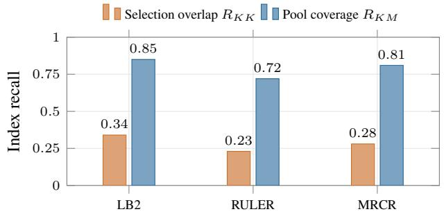  
(a) All sampled query positions in up-to-1M captures.

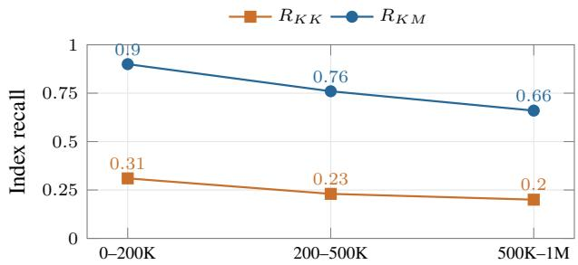  
(b) RULER-1M, grouped by query position.  
Figure 1: A wider pool increases available consumer choices, but coverage declines at later positions. DeepSeek-V4-Flash, h = 1, K = 512, M = 16,384; values are rounded from the capture summaries. Bands refer to positions within prompts. Full cross-model results appear in Appendix C.

Broad pools retain more consumer choices. We use the consumer’s independently computed full-search top-K as the reference. Pool coverage measures the fraction of these indices present in the producer’s wider top-M pool; finalselection overlap counts only those also in the producer’s top-K. At query positions below 200K, broad pools retain 89–94% of the consumer’s choices for adjacent producer– consumer pairs across the three families and suites. The producer’s final top-K retains only 31–65%. The pools contain 16,384 compressed entries for DeepSeek-V4-Flash, 128 blocks for MiniMax-M3, and 16,384 tokens for GLM-5.1.

Across query positions in up-to-1M captures, DeepSeek-V4-Flash’s pool coverage is 72–85%, compared with 23– 34% final-selection overlap. MiniMax-M3 gives 74–85% coverage, compared with 47–56% overlap. Thus a wider pool makes many more of the consumer’s preferred indices available for re-selection. This measures candidate availability, not attention-weight agreement or task accuracy; task-level consequences are evaluated in Section 5.

Sharing has a context and depth boundary. Coverage declines toward later query positions. On RULER-1M, DeepSeek-V4-Flash’s adjacent-layer pool coverage falls from 0.90 to 0.76 to 0.66 across the 0–200K, 200–500K, and 500K–1M position bands. Serving more consumer layers from one producer also generally lowers coverage, because the later consumers are farther from the producer. However, each schedule averages over a different set of layer pairs. With one consumer per producer (h = 1), for example, the third sparse layer is a producer; with two (h = 2), it consumes the first layer’s pool. Such changes can produce local increases in the average even as sharing grows. Pool width and sharing extent should therefore be evaluated together, checking individual layer pairs as well as the schedule average.

Nearby queries share candidates too. We also hold a pool fixed and measure how many full-search choices it contains for later queries in the same layer. Across query positions in the RULER-1M captures, DeepSeek-V4-Flash retains 84.6% of these choices one query later and 78.5% three queries later. MiniMax-M3 retains 91.8% and 89.7% at the same offsets. For comparison, adjacent-layer reuse at the same query gives 72.5% coverage on DeepSeek-V4- Flash and 74.2% on MiniMax-M3.

These measurements come from sampled bursts of four consecutive prompt positions during prefill. They test reuse at offsets of one to three positions within each burst, not longer intervals or model-generated continuations. The results motivate short-range temporal reuse, but do not show how a persistent pool affects generation quality; we test that separately in Section 5.3. A stale pool can miss both new keys and older keys that become relevant.

These findings support a method that shares broad candidates while preserving fresh consumer scoring. The serving evaluation tests whether the resulting search restriction pays off in practice (Section 5). Section 6 then asks how far the shared selected-index structure extends across larger prefill query groups.

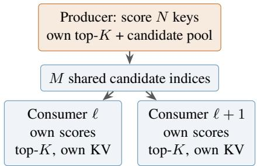  
(a) Share the search domain; re-select independently.

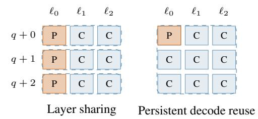  
(b) One pool serves a row or a tile of queries and layers.  
Figure 2: MLIPS producer–consumer design. Orange cells build a pool; blue cells re-score its candidates. Dashed boxes show reuse at $h = 2$ and, on the right, $q h = 2 .$ . Consumers retain independent selections, which may overlap.

## 4 MLIPS

## 4.1 Share candidates, retain independent selection

A producer runs the checkpoint’s indexer over the visible domain, keeps its own top-K, and publishes the top-M candidate indices. Each consumer gathers its own indexer keys at those positions, computes fresh scores, and selects its own top-K for attention. Only candidate addresses are shared: the consumer uses its own query, indexer keys, attention weights, and KV entries. Figure 2 summarizes the mechanism.

The approximation is the restricted search domain. Rescoring preserves the consumer’s ranking within the pool, but cannot recover an omitted key. For nested producer sets, $\mathcal { P } _ { K } \subseteq \mathcal { P } _ { M }$ implies $R _ { K M } \geq R _ { K K } ;$ this is a coverage property, not a guarantee of equal task accuracy. Appendix A gives the formal argument and operation accounting.

## 4.2 Layerwise and persistent decode reuse

Layer sharing (1D MLIPS). We partition the n indexerequipped sparse layers into groups of at most h + 1. The first layer in each group produces a pool; the following h consumers re-select from it. The producer count is $p =$ $\lceil n / ( h + 1 ) \rceil$ , and the consumer count is $c = n - p . $ . The final group may be shorter. Pools are built independently for each query, so layer sharing applies during both prefill and decode. Changing h changes producer placement as well as the maximum consumer distance; it is not simply a continuous increase in one fixed pair’s distance.

Persistent decode pools (2D MLIPS). A producer can retain its pool for $q h$ subsequent decode steps. It rebuilds once every $q h + 1$ steps and re-scores the stored candidates in between; consumer layers also re-score the pool at each step. Each later query therefore receives fresh scores, although the candidate membership is older. This persistence serves queries as they arrive, extending the reuse schedule along the query axis.

A stored pool can omit older keys that become relevant and compressed keys created after the build. The localattention window still provides access to recent tokens, but does not guarantee that restricted global selection matches full search. Our measurements use $q h \leq 3$ and compression ratio $r = 4$ . Admitting newly materialized keys and triggering adaptive refreshes are possible extensions, not evaluated corrections to these results.

## 4.3 Indexer scoring cost

For Q queries and R candidates, the dominant dot-product work per sequence is

$$
I ( Q , R ) = 2 H _ { i } D _ { i } Q R ,\tag{2}
$$

where $H _ { i }$ and $D _ { i }$ are the indexer head count and dimension. Summing over the n indexer-equipped layers, the fullsearch baseline costs $n I ( Q , N )$ . Layer sharing replaces this with

$$
C _ { \mathrm { 1 D } } = p I ( Q , N ) + c I ( Q , M ) .\tag{3}
$$

Averaging over one decode rebuild cycle gives the scoringwork reduction

$$
R _ { \mathrm { o p s } } ( h , q h ) = \frac { n N ( q h + 1 ) } { p N + \left[ p q h + c ( q h + 1 ) \right] M } .\tag{4}
$$

For a concrete example, DeepSeek-V4-Flash has $n = 2 1$ indexer-equipped CSA layers; this counts only the layers that perform indexed sparse selection, not all backbone layers. Its indexer uses $H _ { i } = 6 4 , D _ { i } = 1 2 8$ , and compression ratio $r \ = \ 4$ . At $L \ = \ 2 ^ { 2 0 }$ tokens, the compressed domain therefore contains $N = L / 4 = 2 6 2$ ,144 entries. With $M = 1 6 { , } 3 8 4$ , Equation 4 gives scoring-work reductions of 3.03× for $( h , q h ) \ : = \ : ( 3 , 0 )$ and 3.25× for (1, 1). These ratios describe indexer dot products. They exclude top-K/top-M selection, gathering, other score arithmetic, and memory traffic, and do not predict proportional end-toend speedups.

## 4.4 Coarse candidate generation

A coarse producer first searches groups of keys, then refines its selection within the retained groups. We call this variant MLIPS with a Coarse Producer (MLIPS-CP).

It reduces the producer scan by grouping P consecutive compressed keys and scoring one mean representative per group. The producer keeps b groups with $b P = M$ , publishes their members as the candidate pool, and performs a fine selection for its own top-K. Consumers perform their usual re-selection within that pool. This combines coarseto-fine indexing (Xu et al., 2026) with cross-layer candidate sharing. Its modeled reduction is

$$
R _ { \mathrm { C P } } ( P , h , q h ) = \frac { n N ( q h + 1 ) } { p N / P + n ( q h + 1 ) M } .\tag{5}
$$

The main coarse configuration uses $P \ = \ 2$ and $b \quad =$ 8,192. Pooling can filter out useful groups; consumer refinement cannot restore them. We evaluate this additional restriction separately from exact-producer sharing. $\mathsf { A p - }$ pendix A contains the parameter grids and an explanation of representative-score dilution.

Appendix B describes the vLLM integration, buffers, CUDA-graph handling, and selection checks.

## 5 Evaluation

## 5.1 Setup

We evaluate four long-context suites: LongBench-v2 (503 items), RULER-1M (130 items, ten per task), MRCR-v2 8-needle (784 items), and GraphWalks (1,150 items) (Bai et al., 2025; Hsieh et al., 2024; OpenAI, 2025b,a). The serving stack uses DeepSeek-V4-Flash in vLLM on one NVIDIA GB300 node, with four GPUs at 1,400 W each and tensor parallelism 4. The pool width is $M = 1 6 { , } 3 8 4$ Chunked prefill uses an 8,192-token budget, with at most 24 concurrent sequences and 24 requests in flight; prefix caching is off. Expert parallelism and speculative decoding are disabled, and CUDA graphs are enabled. Stock and MLIPS use the same checkpoint and software; configuration flags select the indexer path (Appendix B). Appendix D.1 gives precision, software, and measurement details.

We report each suite’s task score on a 0–100 scale, endto-end workload speedup relative to stock, and GPU energy saved. Energy integrates four-GPU power samples taken every 500 ms, from the end of warm-up to workload completion; it excludes startup, compilation, and graph capture, as well as CPU, host-memory, and network energy. Every configuration is a single serving run. Two stock boots differed by up to 1.3% in time and 0.3% in energy, with score differences of approximately one to two points or less across suites. This limited comparison does not establish accuracy equivalence or statistical significance. We report observed differences and retain each experiment campaign’s own baseline.

## 5.2 Layer sharing: consistent serving gains

Table 1 evaluates $h \ = \ 1 , 2 , 3$ with no persistent decode reuse $( q h \ = \ 0 )$ . Every configuration is faster and uses less GPU energy than its stock run. $\mathrm { A t } \ h \ : = \ 3 .$ , speedups range from 1.139× on MRCR-v2 to 1.398× on RULER-1M, with energy savings of 14.8–27.4%. The corresponding score changes, in table order, are $- 0 . 4 0 , - 0 . 2 9 , - 1 . 4 9 ,$ and +0.29 points. These observations support sharing a broad candidate pool while preserving each consumer’s independent selection; the search restriction still changes some task scores.

The size of the gain depends on how much work reaches the sharing path. All RULER-1M prompts exceed its roughly 65K-token activation threshold, whereas about half of MRCR-v2 prompts do not. The speedup differences are consistent with that distinction, although the aggregate measurements do not isolate indexer time from other serving costs. Measured speedups are therefore the relevant performance result; the operation model in Section 4 explains the opportunity rather than predicting end-to-end gains directly.

Quality is not monotone in h. RULER-1M loses 1.95 points at $h \ = \ 2 .$ , but only 0.29 at $h \ = \ 3 .$ GraphWalks also has a reported long-context BFS dip at $h = 2 ( \mathrm { A p } \mathrm { - }$ pendix D.2); its cause remains unresolved. Extending sharing to $h = 5 .$ , 6 increases speed further, reaching 1.572× on RULER-1M at $h = 6$ , but its score then falls by 4.42 points. The other three suites have smaller aggregate changes in these runs. Thus the evidence favors modest sharing as the initial operating region, while deeper schedules require workload-specific quality checks. Appendix D.2 retains all extended configurations.

Energy and latency also need separate measurements. At $h \ = \ 1$ , mean GPU power falls by 2.2–5.2%, so energy savings exceed the fraction of wall time saved. At deeper schedules, mean power can rise even as the run finishes sooner. Lower indexer work consequently does not imply a fixed power reduction.

## 5.3 Decode reuse: a modest gain with quality risks

Persistent reuse across decode steps (Section 4.2) adds little performance benefit on the four long-context suites. With $h = 0 ,$ , all $q h = 1 , 2 , 3$ runs achieve only 0.960–1.000× stock speed; adding reuse to layer sharing changes time little while sometimes reducing task scores substantially. At $( h , q h ) = ( 3 , 2 )$ , score changes are $- 1 . 7 9 , - 9 . 6 8 , - 5 . 2 9$ and −3.01 points on LongBench-v2, RULER-1M, MRCR-$\mathbf { v } 2 ,$ and GraphWalks, respectively. The full grid appears in Table 6 and its continuations. These results show that query locality alone does not justify a fixed refresh schedule for all workloads.

Table 1: Layer sharing with $M = 1 6 { , } 3 8 4$ and $q h = 0 .$ . Scores, speedups, and GPU energy savings use each suite’s stock run. Every row is one serving run.
<table><tr><td>Suite</td><td>h</td><td>Score</td><td>Speedup</td><td>GPU energy saved</td></tr><tr><td>LongBench-v2</td><td>stock</td><td>50.50</td><td>1.000×</td><td>0.0%</td></tr><tr><td></td><td>1</td><td>49.11</td><td>1.066×</td><td>8.9%</td></tr><tr><td></td><td>2</td><td>49.70</td><td>1.162×</td><td>15.3%</td></tr><tr><td></td><td>3</td><td>50.10</td><td>1.197×</td><td>17.1%</td></tr><tr><td>RULER-1M</td><td>stock</td><td>80.41</td><td>1.000×</td><td>0.0%</td></tr><tr><td></td><td>1</td><td>79.91</td><td>1.177×</td><td>16.9%</td></tr><tr><td></td><td>2</td><td>78.46</td><td>1.342×</td><td>25.1%</td></tr><tr><td></td><td>3</td><td>80.12</td><td>1.398×</td><td>27.4%</td></tr><tr><td>MRCR-v2</td><td>stock</td><td>75.02</td><td>1.000×</td><td>0.0%</td></tr><tr><td></td><td>1</td><td>73.59</td><td>1.015×</td><td>6.6%</td></tr><tr><td></td><td>2</td><td>74.64</td><td>1.117×</td><td>13.2%</td></tr><tr><td></td><td>3</td><td>73.53</td><td>1.139×</td><td>14.8%</td></tr><tr><td>GraphWalks</td><td>stock</td><td>53.35</td><td>1.000×</td><td>0.0%</td></tr><tr><td></td><td>1</td><td>54.50</td><td>1.131×</td><td>13.9%</td></tr><tr><td></td><td>2</td><td>52.56</td><td>1.290×</td><td>21.9%</td></tr><tr><td></td><td>3</td><td>53.64</td><td>1.326×</td><td>23.7%</td></tr></table>

Table 2: Isolated decode at $h = 0 .$ . Changes are relative to stock. This synthetic timing experiment does not measure answer quality.
<table><tr><td> $q h$ </td><td>Decode time (s)</td><td>Change</td></tr><tr><td>0 (stock)</td><td>857.2</td><td>一</td></tr><tr><td>1</td><td>867.2</td><td> $+ 1 . 2 \%$ </td></tr><tr><td>2</td><td>850.5</td><td> $- 0 . 8 \%$ </td></tr><tr><td>3</td><td>829.0</td><td> $- 3 . 3 \%$ </td></tr></table>

To isolate decode, we use 30 synthetic prompts of approximately 0.9M tokens, offering 24 sessions with prefix caching disabled. We subtract the wall time of a one-token generation from that of a 40,000-token generation. Table 2 reports the mean of two draws after discarding a warm-up draw, with one boot per arm and $h = 0$ throughout.

At $q h = 3 ,$ , reuse reduces the measured decode time by 3.3%; at $q h \ = \ 1$ , it increases time by 1.2%. This supports a limited performance opportunity for longer generations, but neither combined layer-and-query speedup nor generated-answer quality is established by this instrument. A practical refresh policy must address newly relevant existing keys as well as keys appended since the pool was

built.

## 5.4 Coarse producers: energy savings and failure cases

The coarse producer replaces the dense producer scan with group representatives (Section 4.4). At $P = 2 , b = 8 , 1 9 2$ $h = 1$ , and $q h = 0 ;$ , its four speedups are 1.027, 1.229, 0.979, and 1.087×, with GPU energy savings of 10.2, 22.5, 7.7, and 16.5%, respectively. Score changes against this campaign’s baseline are $- 0 . 6 0 , + 0 . 2 8 , - 0 . 7 5$ , and −0.01 points. Energy falls even on $\mathbf { M R C R - v } 2 .$ , where latency worsens. Relative to the separately measured exact producer, the coarse path is not consistently faster.

More aggressive settings expose substantial failures. At $P = 2$ , RULER-1M loses 5.71 points at $h = 2 ,$ and MRCRv2 loses 3.30 at $h = 3$ . Increasing P from 2 to 16 at fixed $h = 1$ and $b P = M$ raises energy savings on every suite, but the $P = 1 6$ score changes are $+ 0 . 3 9 , - 1 4 . 3 0 , - 3 . 4 7 .$ and −2.52 points. Replacing mean representatives by elementwise maxima does not remove the RULER-1M failure. Tables 10–12 give all settings and raw measurements. Figure 3 shows the quality changes for deeper layer sharing and larger coarse groups.

Coarse-producer results use a separate campaign baseline and one run per configuration. Attributing the observed losses to representative dilution requires verified matched controls and repeats. Exact layer sharing is the clearest measured benefit; decode reuse and coarse production expose additional workload-dependent tradeoffs.

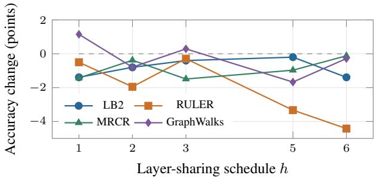  
(a) Exact producer, $q h = 0 .$

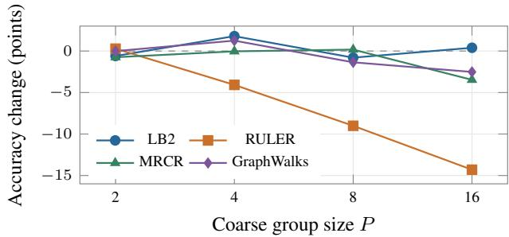  
(b) Coarse producer, h = 1, $q h = 0 ,$ fixed M.  
Figure 3: Observed quality limits of more extensive sharing and coarse filtering. Each configuration is one serving run; changes use the corresponding campaign’s stock baseline. Curves connect measured settings and are not uncertainty estimates. Full timing, energy, and accuracy values are in Appendix D.2.

## 6 Shared Candidate Working Sets

MLIPS shares a candidate pool across layers for each query. The traces also suggest that nearby queries repeatedly select a common set of KV positions. This raises a broader question: can a bounded pool represent the working set of a group of queries across several sparse layers? We investigate this structure through an exploratory Top-G construction. The evidence concerns shared selected positions; it does not establish similarity among the corresponding KV vectors.

Let ℓ index CSA layers, and let $K _ { q } ^ { \ell }$ and $M _ { q } ^ { \ell }$ be the producer’s Top-K and Top-M index sets for query q. For a group of recorded queries $C ,$ , we construct one pool

$$
\mathcal { G } _ { \ell , C } \subseteq \bigcup _ { q \in C } ( K _ { q } ^ { \ell } \cup M _ { q } ^ { \ell } ) , \qquad | \mathcal { G } _ { \ell , C } | \leq G .\tag{6}
$$

The constructor prioritizes producer Top-K memberships from queries whose selections remain poorly covered, using residual Top-M memberships to break ties. This provides a concrete probe of shared structure without using selections from consumer layers. Appendix E gives the algorithm and sampling protocol. We freeze the pool and measure

$$
R _ { \ell , q } ( d ) = \frac { | K _ { q } ^ { \ell + d } \cap \mathcal { G } _ { \ell , C } | } { | K _ { q } ^ { \ell + d } | } , \qquad d \geq 1 ,\tag{7}
$$

where d counts subsequent CSA layers, separated by two physical model layers in these traces.

The capture contains eight LB2 sequences and 21 CSA layers. The primary results cover sequences 0–6, with $K =$ 512, nominal M = 16K, G = 32,000, and context length at least G. Crucially, the trace records four queries per 256 original positions: a nominal 4,096-position window contains 64 recorded queries, not 4,096 measured queries.

Figure 4 shows a shared working set across both axes. For the smallest window, recall decreases from 82.4% at the next CSA layer to 73.5% six layers later, averaging 77.6%. Increasing the nominal window to 16,384 or 65,536 positions reduces mean recall to 69.4% or 52.9%; sequence-wide sharing reaches 33.6%. Thus a fixed pool captures recurring selections but cannot absorb all queryspecific variation. Per-sequence measurements show the same window ordering (Appendix E).

<table><tr><td rowspan=1 colspan=8>Nominal           Subsequent CSA-layer distancequery window   1     2    3     4    5    6  Mean</td></tr><tr><td rowspan=1 colspan=1>4,096</td><td rowspan=1 colspan=1>82.4</td><td rowspan=1 colspan=1>79.4</td><td rowspan=1 colspan=1>79.4</td><td rowspan=1 colspan=1>76.9</td><td rowspan=1 colspan=1>74.3</td><td rowspan=1 colspan=1>73.5</td><td rowspan=1 colspan=1>77.6</td></tr><tr><td rowspan=3 colspan=1>16,38465,536Sequence</td><td rowspan=1 colspan=1>74.1</td><td rowspan=1 colspan=1>71.1</td><td rowspan=1 colspan=1>71.2</td><td rowspan=1 colspan=1>68.6</td><td rowspan=1 colspan=1>66.0</td><td rowspan=1 colspan=1>65.5</td><td rowspan=1 colspan=1>69.4</td></tr><tr><td rowspan=1 colspan=1>57.1</td><td rowspan=1 colspan=1>54.1</td><td rowspan=1 colspan=1>54.6</td><td rowspan=1 colspan=1>52.0</td><td rowspan=1 colspan=1>49.5</td><td rowspan=1 colspan=1>49.8</td><td rowspan=1 colspan=1>52.9</td></tr><tr><td rowspan=1 colspan=1>36.5</td><td rowspan=1 colspan=1>34.5</td><td rowspan=1 colspan=1>35.5</td><td rowspan=1 colspan=1>32.7</td><td rowspan=1 colspan=1>30.6</td><td rowspan=1 colspan=1>31.7</td><td rowspan=1 colspan=1>33.6</td></tr></table>

Top-K index recall (%); $G = 3 2 , 0 0 0$  
Figure 4: A shared pool covers many subsequent selections, with coverage decreasing as its query window grows. Results use sampled queries from LB2 sequences 0–6; window sizes describe original positions, not the number of measured queries. Mean averages distances 1–6.

These observations motivate consolidating producer selections into a shared Top-G pool, with each consumer scoring and selecting independently. Shared index metadata and coordinated KV staging are possible uses. Their benefits require measurement: $G > M$ can increase consumer scoring, and index coverage alone establishes neither task accuracy nor speedup. Construction over a whole query group can also depend on later queries; a serving design must specify information availability and causal masks. The present result is evidence for exploitable structure and a proposed way to represent it. It leaves deployment and full-query validation open.

## 7 Limitations and Future Work

Evidence and generalization. Serving results cover one checkpoint and hardware stack; the cross-model evidence concerns index coverage. Each serving configuration is a single run. Two stock boots provide a limited variability reference, not an equivalence test or uncertainty estimate for every comparison. Repeated paired evaluations and matched implementations of the closest reuse baselines are needed to establish robustness and comparative benefit. The operation model also excludes selection, gathering, and memory costs; phase-level profiling would clarify why scoring reductions translate unevenly into latency savings.

Adaptive reuse. Uniform schedules expose weak layer pairs and unexplained quality changes, including the h = 2 dip. A useful next step is to select producer locations and pool widths using calibration, then evaluate the chosen schedule on held-out workloads. Persistent decode reuse needs refresh rules that balance pool age, new-key admission, and shifts in query relevance. Generated-token fidelity and task accuracy should accompany timing results; prefill locality alone cannot settle those questions.

From shared structure to Top-G. The prefill traces identify recurring selected positions, without establishing KV-vector similarity or a deployed compression scheme. Testing all query rows, additional prompts, and alternative constructors would show how robust the apparent working sets are. A serving design must account for poolconstruction cost, causal information flow, per-query masking, task accuracy, and the cost of retrieving pooled entries. The current sampled recall measurements do not establish a serving speedup.

Memory management. Candidate pools may bound a consumer’s immediate working set, but realizing lower GPU residency requires cache management and transfers. The offloading analysis in Appendix F is therefore a capacity opportunity rather than a measured memory reduction. Future evaluation should report peak resident memory and transfer overhead together with latency and quality.

## 8 Conclusion

MLIPS shares candidate search across sparse-attention layers while retaining each consumer’s own scoring and selection. Broad producer pools cover substantially more consumer choices than final-selection overlap suggests across three model families. On DeepSeek-V4-Flash, three consumer layers per producer give 1.14–1.40× serving speedups and 14.8–27.4% lower GPU energy across four suites, with observed accuracy changes of −1.49 to +0.29 points in single runs. More extensive sharing exposes quality limits. Recurring selected KV positions across prefill queries and layers further motivate Top-G, whose construction and deployment require continued study. The results identify candidate working sets as a useful unit for inference-time reuse.

## References

Yushi Bai, Shangqing Tu, Jiajie Zhang, Hao Peng, Xiaozhi Wang, Xin Lv, Shulin Cao, Jiazheng Xu, Lei Hou, Yuxiao Dong, et al. Longbench v2: Towards deeper understanding and reasoning on realistic long-context multitasks. In Proceedings ofthe 63rd Annual Meeting of the Association for Computational Linguistics (Volume 1: Long Papers), pages 3639–3664, 2025.

Yushi Bai, Qian Dong, Ting Jiang, Xin Lv, Zhengxiao Du, Aohan Zeng, Jie Tang, and Juanzi Li. IndexCache: Accelerating sparse attention via cross-layer index reuse. arXiv preprint arXiv:2603.12201, 2026. URL https://arxiv.org/abs/2603.12201.

William Brandon, Mayank Mishra, Aniruddha Nrusimha, Rameswar Panda, and Jonathan Ragan-Kelley. Reducing transformer key-value cache size with cross-layer attention. Advances in Neural Information Processing Systems, 37: 86927–86957, 2024.

DeepSeek-AI. DeepSeek-V3.2: Pushing the frontier of open large language models. arXiv preprint arXiv:2512.02556, 2025. URL https://arxiv.org/abs/2512.02556.

DeepSeek-AI. Deepseek-v4: Towards highly efficient million-token context intelligence. Technical report, DeepSeek, 2026a. Model checkpoints: https://huggingface.co/collections/deepseek-ai/deepseek-v4.

DeepSeek-AI. DeepSeek-V4.1-Flash: Pushing the limits of KV cache compression. arXiv preprint arXiv:2609.19969, 2026b. URL https://arxiv.org/abs/2609.19969.

Cheng-Ping Hsieh, Simeng Sun, Samuel Kriman, Shantanu Acharya, Dima Rekesh, Fei Jia, and Boris Ginsburg. Ruler: What’s the real context size of your long-context language models? In First Conference on Language Modeling, 2024.

Xunhao Lai, Weiqi Xu, Yufeng Yang, Qiaorui Chen, Yang Xu, Lunbin Zeng, Xiaolong Li, Haohai Sun, Haichao Zhu, Vito Zhang, Jinkai Hu, Jiayao Li, Rui Gao, Zekun Li, Songquan Zhu, Jingkai Zhou, and Pengyu Zhao. MiniMax sparse attention. arXiv preprint arXiv:2606.13392, 2026. URL https://arxiv.org/abs/2606.13392.

Hong Liu, Yuan Cheng, Lin Niu, Yi Su, Yufei Xue, Anmin Liu, Guanghua Yu, and Jianchen Zhu. PIVOT: Efficient query-group indexing for token-level sparse attention. arXiv preprint arXiv:2607.24593, 2026. URL https://arxiv.org/abs/2607.24593.

Meituan LongCat Team. LongCat sparse attention: Taming the lightning via streaming-aware hierarchical cross-layer indexing. arXiv preprint arXiv:2608.01662, 2026. URL https://arxiv.org/abs/2608.01662.

OpenAI. GraphWalks. Dataset, 2025a. URL https://huggingface.co/datasets/openai/graphwalks.

OpenAI. Multi-round coreference resolution (mrcr). https://huggingface.co/datasets/openai/mrcr, 2025b.

Yutao Sun, Li Dong, Yi Zhu, Shaohan Huang, Wenhui Wang, Shuming Ma, Quanlu Zhang, Jianyong Wang, and Furu Wei. You only cache once: Decoder-decoder architectures for language models. Advances in Neural Information Processing Systems, 37:7339–7361, 2024.

Yutao Sun, Yanqi Zhang, Li Dong, Jianyong Wang, and Furu Wei. You only index once: Cross-layer sparse attention with shared routing. arXiv preprint arXiv:2606.06467, 2026. URL https://arxiv.org/abs/2606.06467.

Yufei Xu, Fanxu Meng, Fan Jiang, Yuxuan Wang, Ruijie Zhou, Zhaohui Wang, Jiexi Wu, Zhixin Pan, Xiaojuan Tang, Wenjie Pei, Tongxuan Liu, Di Yin, Xing Sun, and Muhan Zhang. HISA: Efficient hierarchical indexing for fine-grained sparse attention. arXiv preprint arXiv:2603.28458, 2026. URL https://arxiv.org/abs/2603.28458.

Z.ai. GLM-5.1: Model card. https://huggingface.co/zai-org/GLM-5.1, 2026a. Released 2026-04-07; architecture as described in the GLM-5 technical report (arXiv:2602.15763).

Z.ai. GLM-5.2: Built for long-horizon tasks. Official technical release post, June 2026b. URL https://huggingface.co/blog/zai-org/glm-52-blog.

## A Scoring Model and Detailed $\mathbf { R e } \mathrm { - }$ ductions

## A.1 Indexer arithmetic and its scope

For query position t and visible key j, the Lightning Indexer computes

$$
s [ t , j ] = \sum _ { u = 1 } ^ { H _ { i } } w [ t , u ] \ \mathrm { R e L U } ( \langle \mathbf { q } [ t , u , : ] , \mathbf { k } [ j , : ] \rangle ) .\tag{8}
$$

There is one key vector per indexed position shared across query heads. Scoring $Q$ queries against R candidates has matrix dimensions

$$
[ B , Q H _ { i } , D _ { i } ] [ B , D _ { i } , R ] \longrightarrow [ B , Q H _ { i } , R ] ,\tag{9}
$$

where B is the sequence batch size. Counting multiply– accumulate as two operations gives $I ( Q , R ) = 2 H _ { i } D _ { i } Q R$ per sequence. DeepSeek-V4-Flash uses $H _ { i } = 6 4 , D _ { i } =$ $1 2 8 , n = 2 1 \mathrm { C S A }$ layers, $r = 4 , K = 5 1 2 .$ , and a local window of $W = 1 2 8$ tokens. Thus one query–candidate dotproduct calculation costs 16,384 operations in this model.

ReLU, weighting, and head reduction add $O ( H _ { i } Q R )$ arithmetic. Selection, gathering, cache access, and transfers are also excluded from the ratios. Full prefill has quadratic scoring growth in $L ;$ decode has linear growth in cached length per query. The rectangular model approximates causal pair counts and boundary effects. All reduction tables use $L \ = \ 2 ^ { 2 0 }$ tokens, $N = L / r = 2 6 2 , 1 4 4$ $M = 1 6 { , } 3 8 4$ , and hence $N / M \ = \ 1 6$ . This makes the nominal 1M point explicit; the ratios are not independent of context length.

## A.2 Coverage under nested pools

Proposition 1 (Nested-pool coverage). For fixed producer and consumer score vectors, $i f \mathcal { P } _ { K } \subseteq \mathcal { P } _ { M }$ , then $| \mathcal { C } _ { K } \cap$ $\mathcal { P } _ { K } | \leq | \mathcal { C } _ { K } \cap \mathcal { P } _ { M } |$

Proof. Intersecting nested sets with the same set preserves inclusion. □

This bounds index coverage only. It does not compare attention distributions or task accuracy, and it does not apply to independently constructed pools unless the required nesting holds.

## A.3 Layer and query schedules

For $p = \lceil n / ( h + 1 ) \rceil$ and $c = n - p ,$ a decode cycle contains $q h + 1$ steps. Each producer scores N once and M on the remaining qh steps; each consumer scores M on every step. The cycle work is proportional to $p N + [ p q h + c ( q h + 1 ) ] M$ yielding Equation 4.

Table 3: Modeled indexer scoring-work reduction for the exact 21-layer stack. The $q h = 0$ column gives layerwise reuse alone. Values are reduction factors.
<table><tr><td> $q h = 0$ </td><td> $q h = 1$ </td><td> $q h = 2$ </td><td> $q h = 3$ </td></tr><tr><td> $h = 0$ </td><td>1.00</td><td>1.88</td><td>2.67</td></tr><tr><td> $h = 1$ </td><td>1.81</td><td>3.25 4.42</td><td>3.37 5.40</td></tr><tr><td>h = 2</td><td>2.67 4.57</td><td>6.00</td><td>7.11</td></tr><tr><td> $h = 3$ </td><td>3.03</td><td>5.09 6.59</td><td>7.72</td></tr></table>

For uniform groups with $h + 1$ dividing n, a pool serves $T = ( h + 1 ) ( q h + 1 )$ slots. The reduction becomes

$$
R ( T ) = { \frac { T N } { N + ( T - 1 ) M } } , \qquad \operatorname * { l i m } _ { T \to \infty } R ( T ) = N / M .\tag{10}
$$

$\textup { A 2 } \times 2$ uniform tile gives $3 . 3 7 \times .$ , while the exact 21-layer $( h , q h ) = ( 1 , 1 )$ schedule gives 3.25×. For 1D sharing at $h = 1 , 2 , 3 ,$ , the exact producer counts are 11, 7, 6 and the consumer counts are 10, 14, 15. Table 3 includes 1D in its $q h = 0 \mathrm { c o l u m n } .$

## A.4 Coarse-producer accounting

The producer scores N/P representatives and performs its own fine pass over $b P \ = \ M$ candidates. Its build-step cost is $I ( Q , N / P ) + I ( Q , M )$ . Every layer performs one fine pass on every step, so the cycle cost is proportional to $p N / P + n ( q h + 1 ) M$ , yielding Equation 5. The grids in Table 4 include configurations with substantial observed quality losses; a large modeled reduction is not an operatingpoint recommendation.

Representative-score dilution. For a single head and a mean representative $\bar { \mathbf { k } } = P ^ { - 1 } \sum _ { j } \mathbf { k } _ { j }$ , convexity gives

$$
\begin{array} { l } { \displaystyle \mathrm { R e L U } ( \langle { \bf q } , { \bf \bar { k } } \rangle ) \leq P ^ { - 1 } \sum _ { j } \mathrm { R e L U } ( \langle { \bf q } , { \bf k } _ { j } \rangle ) } \\ { \displaystyle \leq \operatorname* { m a x } _ { j } \mathrm { R e L U } ( \langle { \bf q } , { \bf k } _ { j } \rangle ) . } \end{array}\tag{11}
$$

Cancellation can suppress a representative even when its group contains a high-scoring key. This single-head inequality describes a possible ranking failure; it does not prove that full multi-head rankings or task accuracy degrade monotonically in P. Such a claim requires scorelevel evidence, the relevant head-weight assumptions, and matched serving controls.

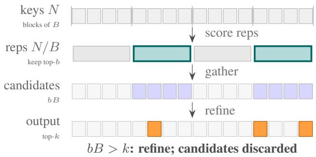  
(a) HISA: candidates discarded after refine

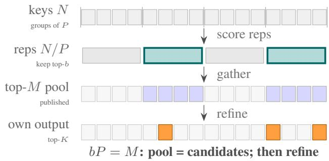  
(b) MLIPS-CP: candidates published as the pool, then refine  
Figure 5: Coarse-to-fine search and shared candidate production. Both score representatives and gather the highest-scoring groups. HISA refines the gathered candidates for one layer; MLIPS-CP publishes them as a pool and retains a fine selection for each producer and consumer. Group sizes differ in practice; the diagram uses equal granularity for illustration.

Table 4: Modeled scoring-work reductions with a coarse producer, $b = M / P .$ Values are factors relative to full indexing; representative construction and memory costs are excluded.
<table><tr><td></td><td colspan="3"> $P = 2$ </td><td colspan="5"></td></tr><tr><td></td><td> $q h = 0$ </td><td>1</td><td>2</td><td>3</td><td> $q h = 0$ </td><td></td><td>2</td><td>3</td></tr><tr><td> $h = 0$ </td><td>1.78</td><td>3.20</td><td>4.36</td><td>5.33</td><td> $h = 0$ </td><td>3.20</td><td>5.33 6.86</td><td>8.00</td></tr><tr><td> $h = 1$ </td><td>3.08</td><td>5.17</td><td>6.68</td><td>7.81</td><td> $h = 1$ </td><td>5.17 7.81</td><td>9.42</td><td>10.50</td></tr><tr><td> $h = 2$ </td><td>4.36</td><td>6.86</td><td>8.47</td><td>9.60</td><td> $h = 2$ </td><td>6.86 9.60</td><td>11.08</td><td>12.00</td></tr><tr><td> $h = 3$ </td><td>4.87</td><td>7.47</td><td>9.08</td><td>10.18</td><td> $h = 3$ </td><td>7.47 10.18</td><td>11.59</td><td>12.44</td></tr><tr><td></td><td></td><td> $P = 8$ </td><td></td><td></td><td></td><td> $P = 1 6$ </td><td></td><td></td></tr><tr><td></td><td> $q h = 0$ </td><td>1</td><td>2</td><td>3</td><td> $q h = 0$ </td><td></td><td>2</td><td>3</td></tr><tr><td> $h = 0$ </td><td>5.33</td><td>8.00</td><td>9.60</td><td>10.67</td><td> $h = 0$ </td><td>8.00 10.67</td><td>12.00</td><td>12.80</td></tr><tr><td> $h = 1$ </td><td>7.81</td><td>10.50</td><td>11.86</td><td>12.68</td><td> $h = 1$ </td><td>10.50 12.68</td><td>13.62</td><td>14.15</td></tr><tr><td> $h = 2$ </td><td>9.60</td><td>12.00</td><td>13.09</td><td>13.71</td><td> $h = 2$ </td><td>12.00 13.71</td><td>14.40</td><td>14.77</td></tr><tr><td> $h = 3$ </td><td>10.18</td><td>12.44</td><td>13.44</td><td>14.00</td><td> $h = 3$ </td><td>12.44 14.00</td><td>14.61</td><td>14.93</td></tr></table>

## B Implementation Details

We implement producer and consumer kernels for prefill and decode in vLLM’s DeepSeek-V4 sparse-attention path. The checkpoint weights, attention operator, scheduler, and KV-cache path are retained. Baseline and MLIPS use the same software, with configuration flags selecting the indexer path.

Integration and buffers. The implementation overrides the Lightning-Indexer selection stage and a gather module on vLLM’s DeepSeek-V4 path. Producers and consumers have separate prefill and decode kernel sites. An exact producer obtains its own top-K and the wider top-M pool from one scoring pass; a consumer gathers and scores its own keys at the pooled positions. A pool row contains M int32 indices: 64 KiB at $M = 1 6 { , } 3 8 4$ . Total metadata depends on query-row and persisted-pool counts, even though each row’s size is fixed at a given M.

During prefill, producers overwrite a transient candidate buffer before their consumers use it. During decode, perproducer buffers retain pools across rebuild cycles. Rows with at most M compressed keys use stock indexing, corresponding to $4 M = 6 5 { , } 5 3 6$ tokens at $r = 4 .$ This threshold helps explain why workloads with more short contexts obtain smaller gains.

Coarse representatives. Representatives are computed in fp32 from dequantized keys and quantized into the indexer key format. In prefill, running sums track keys appended to each group. In decode, completed representatives are addressed through the KV-page block table, with a running sum for an incomplete group. One $D _ { i } = 1 2 8$ MXFP4 representative uses 64 value bytes and four scale bytes. There is one representative per P keys; actual allocated overhead additionally depends on page layout and temporary state. The cache can be replaced by onthe-fly pooling at the cost of rereading the original keys. Coarse production is used above 32,768 compressed entries (131,072 tokens); shorter rows use exact production.

Decode graphs and recency. The persistent path captures rebuild and reuse variants separately. A field in the batch descriptor selects the replay outside the CUDA graph, avoiding a Python decision fixed at capture time. Evaluation disables speculative decoding. Within-step speculative grouping and reuse across successive steps are different schedules; their combined acceptance behavior and performance are not measured here.

For longer reuse windows, one possible policy is to admit newly materialized compressed keys and remove lowpriority pool entries. Such a policy needs its own selection rule and validation. It does not address older keys that become relevant after the pool was built.

Selection checks. The exact producer’s top-K differs from stock by at most 0.02% on the million-token prompts in the reported check, with mismatches attributed to equal scores. A probe at (h, qh) = (1, 1) performs a full scan on reuse steps and compares it with selection from the stored pool. Over ten RULER-1M prompts, mean overlap is 0.974 and median overlap is 1.000. This quantifies the probe’s selection fidelity; it is not an end-task accuracy test or a general guarantee against implementation errors.

## C Full Recall Measurements

Captures and native units. The recall study uses the ten largest prompts from each of LongBench-v2, RULER-1M, and MRCR-v2 for each captured model family. It records four consecutive query positions every 256 positions. DeepSeek-V4-Flash indexes compressed entries and selects K = 512; MiniMax-M3 selects 16 blocks of 128 tokens; GLM-5.1 selects 2,048 tokens (DeepSeek-AI, 2026a; Lai et al., 2026; Z.ai, 2026a). The configured broad pools contain 16,384 compressed entries, 128 blocks, and 16,384 tokens, respectively. These widths describe different token coverage and are not equal-cost comparisons. GLM-5.1 captures end near 198K tokens; the other two families include up-to-1M inputs.

Aggregation and distances. The layer-sharing surfaces average over consumers in a schedule with h consumers per producer. Producers are excluded because their own coverage is trivial. For h > 1, a cell averages multiple exact layer distances d and a different producer placement from neighboring schedules. The query-axis surfaces instead use explicit producer–consumer layer and query offsets. Their same-query column therefore need not exactly reproduce a schedule-average cell.

Position bands are ranges within prompts. A long prompt contributes queries to several bands; the below-200K figure is a subset of the all-position figure. The broadpool columns use nested prefixes of a producer ranking when available. MiniMax-M3 forces a local block into its selection. Its effective-containment convention counts the guaranteed local hit; the difference from unadjusted containment is about 0.010–0.016 at 128 blocks and at most 0.035 at narrow widths.

Scope of the evidence. These are count-based index recalls on sampled prefill activations, not attention-mass retention. Four-query bursts support query offsets only up to three. Within a fixed, identical causal prefix, prefill and decode evaluate the same indexing computation, but generated-token distributions and multi-step approximation effects require separate tests. The decode probe in Appendix B provides a limited additional check.

Schedule variation. Larger sharing groups generally lower coverage, but averages can rise locally when producer placements change. For example, MiniMax-M3 at its 128-block pool gives schedule-average coverage of 0.81 at h = 16 and 0.89 at h = 19. These observations motivate evaluating the actual schedule, rather than treating h as a smooth distance parameter. Original plots display schedules through h = 20; captures extend to h = 56 on MiniMax-M3 and h = 77 on GLM-5.1.

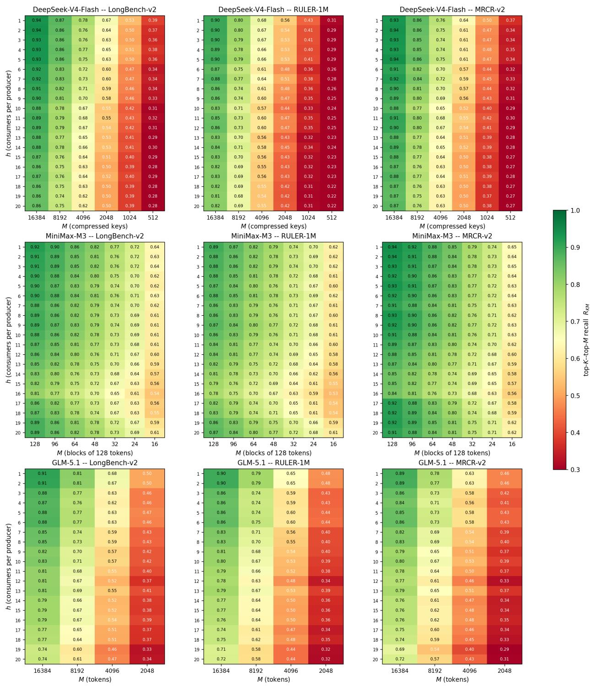  
Figure 6: Layer-sharing recall below 200K query positions. Rows are model families, columns are suites, and each panel varies schedul h and producer-pool width M. The rightmost column is the native top-K selection overlap; wider columns show pool coverage. Units differ across families as labeled.

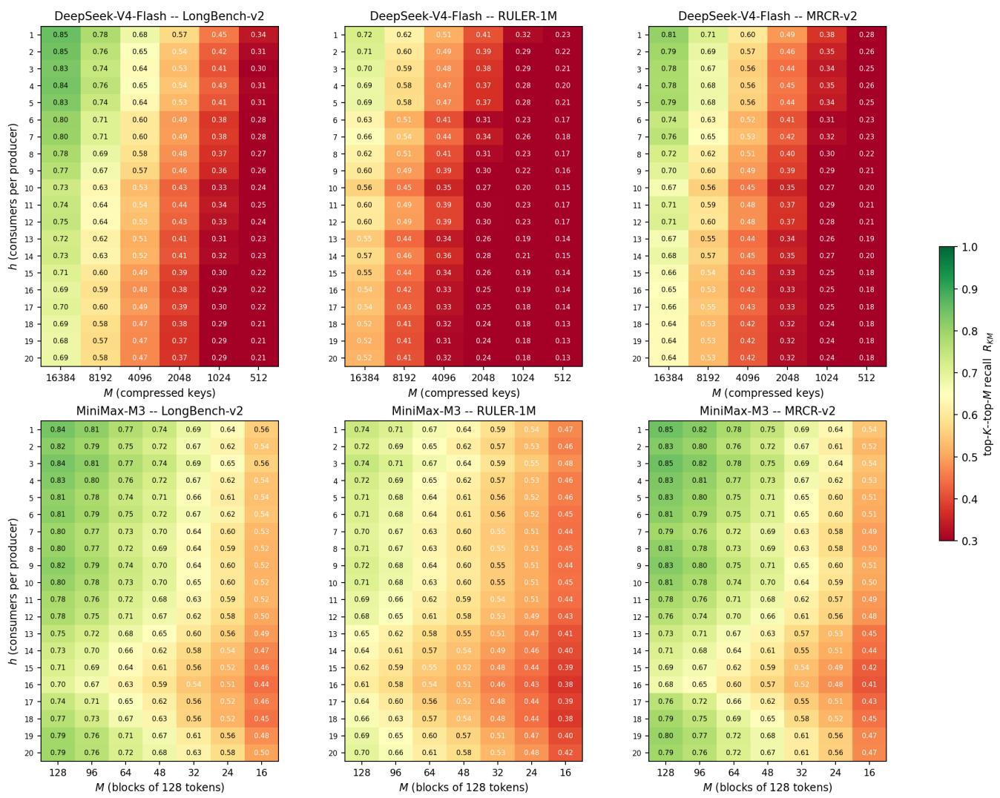  
Figure 7: Layer-sharing recall over all sampled positions in up-to-1M captures. Broad candidate pools retain more consumer choices than final-selection inheritance on these captures; neither measurement alone establishes downstream accuracy. Axes follow Figure 6.

DeepSeek-V4-Flash -- LongBench-v2 DeepSeek-V4-Flash -- RULER-1M  
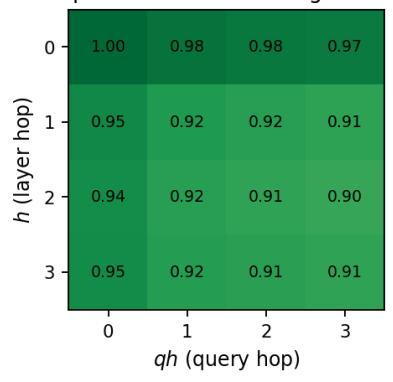

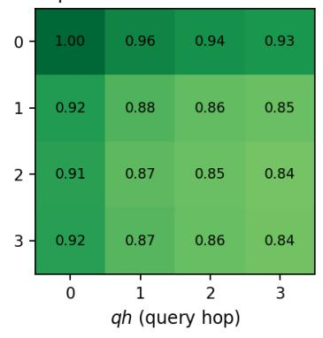

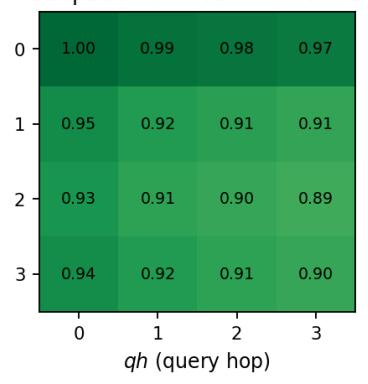

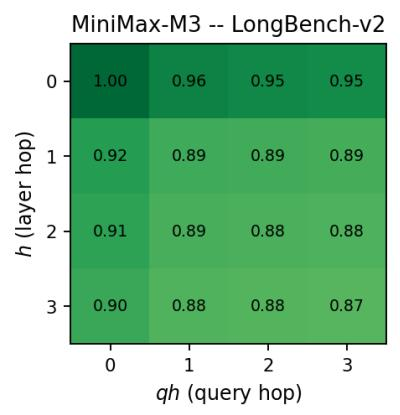

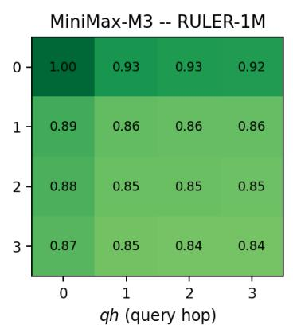

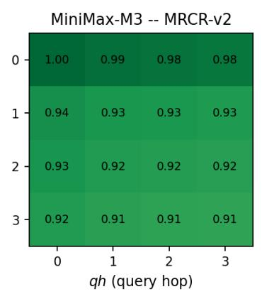

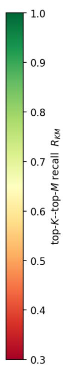

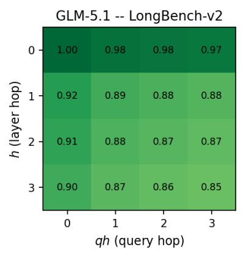

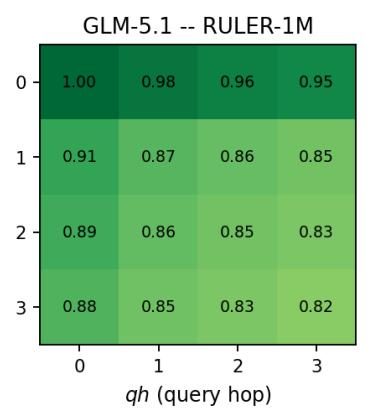

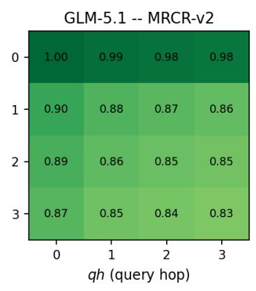  
Figure 8: Joint layer/query candidate coverage below 200K query positions. Each panel varies exact sparse-layer distance (labeled h in the original plot, d in the manuscript) and query offset qh at the configured broad pool. The zero-layer-distance row isolates cross-query reuse.

DeepSeek-V4-Flash -- LongBench-v2DeepSeek-V4-Flash -- RULER-1M  
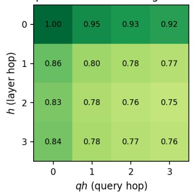

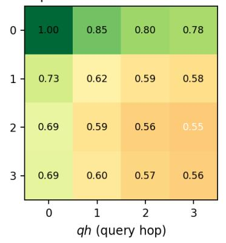

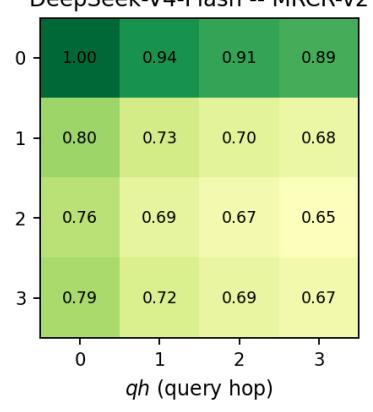

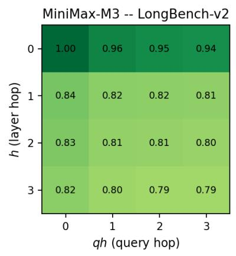

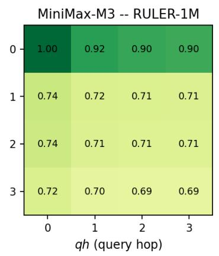

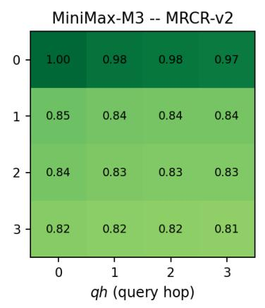  
Figure 9: Joint layer/query candidate coverage over all sampled positions in up-to-1M captures. Exact layer distance is labeled h in thi original plot. The self pair is 1.00; later queries retain substantial but imperfect coverage. The captured query offsets end at three.

## D Serving Setup and Complete Results

## D.1 Model, software, and measurement protocol

The served checkpoint is the released DeepSeek-V4-Flash. Its routed MoE expert weights are FP4, with E8M0 scales over blocks of 32 values, executed through vLLM’s MXFP4 kernels. Attention projections, the shared expert, and the indexer query projection use FP8 E4M3 weights with 128 × 128 blocks. The MoE router, indexer compressor, and normalization weights are bf16. Computation runs in bf16, with activations quantized on the fly to FP8 for the FP8 GEMMs and to MXFP8 for the expert GEMMs. The KV cache is FP8 and the indexer key cache is FP4.

We use vLLM 0.22.1 in the NVIDIA vLLM 26.06 container. Each run occupies four GPUs of a single NVIDIA GB300 node, with a 1,400 W power limit per GPU and tensor parallelism 4. Expert parallelism and speculative decoding are off; CUDA graphs are on. The chunked-prefill budget is 8,192 tokens, the maximum number of concur rent sequences is 24, the context limit is 1,048,576 tokens, and prefix caching is off. The client maintains 24 requests in flight. The exact-producer pool has $M = 1 6 { , } 3 8 4$ entries. Rows below the pooling threshold use the stock path as described in Appendix B.

The four suites contain 503 LongBench-v2 items, 130 RULER-1M items (ten in each of 13 task categories), 784 MRCR-v2 8-needle items, and 1,150 GraphWalks items. Scores are reported on a 0–100 scale, with ∆acc in percentage points. Speedup is stock workload wall time divided by configuration wall time. Energy saved is one minus the configuration-to-stock GPU-energy ratio. The ∆power column is the relative change in mean total GPU power. Retaining these separate quantities matters because shorter runs need not have lower mean power.

Each GPU’s power is sampled every 500 ms with nvidia-smi; energy integrates the four-GPU total from the end of warm-up to workload completion. Boot, JIT compilation, and CUDA-graph capture are excluded. The measurement does not include host CPUs, host memory, or network equipment. A second stock boot gives a limited reproducibility reference: suite scores differed by approximately one to two points or less, wall time by at most 1.3%, and GPU energy by at most 0.3%. Every configuration row remains a single serving run, so these two stock boots do not provide uncertainty estimates for treatment effects.

The stock configurations disable all MLIPS paths by flag. The exact sharing grid and max-representative experiment use the first stock rows shown in Tables 5 and 12. The mean-representative and group-size campaign uses the separate stock rows shown in Tables 10 and 11. We preserve these baselines rather than pooling measurements across campaigns. The coarse-producer comparisons do not include matched repeats or complete per-arm launch configurations in the current reporting. We interpret the group-size trend as an observed quality tradeoff, with representative dilution as one possible explanation. Verifying the cause requires matched launch configurations and repeated controls.

## D.2 Complete results and diagnostic observations

Layer sharing. Table 5 includes both the $h = 1 , 2 , 3$ configurations in the main paper and deeper schedules $h = 5 , 6$ Every measured setting improves wall time and GPU energy relative to its stock row. $\mathrm { A t } h = 6 .$ , speedups are 1.310, 1.572, 1.233, and 1.432× on LongBench-v2, RULER-1M, MRCR-v2, and GraphWalks, respectively. RULER-1M loses 3.33 and 4.42 points at $h \ = \ 5 , 6 ;$ the other suites have smaller aggregate score changes in these runs.

Per-task RULER summaries suggest particular sensitivity in niah\_multikey\_2 and niah\_multikey\_3, which contain many distractor keys. The three singleneedle tasks score 100 for stock and the reported layersharing settings, except for one prompt at $h = 6$ . The multikey task with one distractor type, multi-query retrieval, and multi-value retrieval remain at 100 or within one reported prompt of that value. At $h \ \leq \ 3 .$ , the two more difficult multi-key tasks change by at most one reported prompt; at $h \ : = \ : 5 , 6$ they lose one to two reported prompts each. $\mathrm { A t } h = 6 .$ , the source also reports one-prompt losses in a single-needle task, frequent-word retrieval, and each QA task. Other tasks remain within two reported prompts of stock; stock variable tracking and common-word scores are 22 and 0. These task patterns do not establish why a candidate restriction changes an answer. In particular, per-task scores should not be converted into fixed 0.77-point suite increments without accounting for the tasks’ scoring rules.

GraphWalks BFS scores are 34.6 for stock and 36.4, 34.4, 37.5, 33.5, and 37.2 for $h = 1 , 2 , 3 , 5 , 6 .$ On items longer than 256K tokens, the reported paired score change at h = 2 is −5.6 points; the corresponding changes at h = 1, 3 are −0.2 and +1.6 points. The aggregate and length-specific results therefore need not move together. The h = 2 configuration has one boot, and its cause has not been established.

At h = 1, energy savings are 8.9, 16.9, 6.6, and 13.9%, whereas the corresponding fractions of wall time saved are 6.2, 15.0, 1.5, and 11.6%. Mean GPU power falls by 2.2–5.2%. That reduction is not universal: at $h \ = \ 5 , 6$ on RULER-1M mean power rises by approximately 3–4%, while a shorter run still reduces energy.

Persistent decode reuse. Tables 6, 7, 8, and 9 give the entire $q h = 1 , 2 , 3$ grid at $h = 0 , 1 , 2 , 3$ . Together with

Table 5: Complete layer-sharing results $( q h = 0 )$ . Scores and changes use the stock row within each suite; energy is GPU-only and measured after warm-up. Every configuration is one serving run.
<table><tr><td>suite</td><td>config</td><td>acc</td><td>∆acc</td><td>wall (s)</td><td>speedup</td><td>energy (Wh)</td><td>saved</td><td>∆power</td></tr><tr><td rowspan="6">LongBench-v2</td><td>stock</td><td>50.50</td><td></td><td>2,970</td><td></td><td>3,326</td><td></td><td></td></tr><tr><td> $h { = } 1$ </td><td>49.11</td><td>-1.39</td><td>2,787</td><td>1.066×</td><td>3,029</td><td>8.9%</td><td>-3.0%</td></tr><tr><td>h=2</td><td>49.70</td><td>-0.80</td><td>2,556</td><td>1.162×</td><td>2,818</td><td>15.3%</td><td>-1.5%</td></tr><tr><td>h=3</td><td>50.10</td><td>-0.40</td><td>2,481</td><td>1.197×</td><td>2,756</td><td>17.1%</td><td>-0.8%</td></tr><tr><td> $h { = } 5$ </td><td>50.30</td><td>-0.20</td><td>2,352</td><td>1.263×</td><td>2,645</td><td>20.5%</td><td>+0.4%</td></tr><tr><td>h=6</td><td>49.11</td><td>-1.39</td><td>2,267</td><td>1.310×</td><td>2,588</td><td>22.2%</td><td>+1.9%</td></tr><tr><td rowspan="6">RULER-1M</td><td>stock</td><td>80.41</td><td></td><td>5,982</td><td></td><td>6,624</td><td></td><td></td></tr><tr><td> $h { = } 1$ </td><td>79.91</td><td>-0.50</td><td>5,084</td><td>1.177×</td><td>5,507</td><td>16.9%</td><td>-2.2%</td></tr><tr><td> $h { = } 2$ </td><td>78.46</td><td>-1.95</td><td>4,456</td><td>1.342×</td><td>4,960</td><td>25.1%</td><td>+0.5%</td></tr><tr><td>h=3</td><td>80.12</td><td>-0.29</td><td>4,278</td><td>1.398×</td><td>4,807</td><td>27.4%</td><td>+1.5%</td></tr><tr><td>h=5</td><td>77.08</td><td>-3.33</td><td>3,976</td><td>1.504×</td><td>4,534</td><td>31.6%</td><td>+3.0%</td></tr><tr><td>h=6</td><td>75.99</td><td>-4.42</td><td>3,805</td><td>1.572×</td><td>4,392</td><td>33.7%</td><td>+4.2%</td></tr><tr><td rowspan="6">MRCR-v2</td><td>stock</td><td>75.02</td><td></td><td>4,911</td><td></td><td>5,093</td><td></td><td></td></tr><tr><td>h=1</td><td>73.59</td><td>-1.43</td><td>4,839</td><td>1.015×</td><td>4,755</td><td>6.6%</td><td>-5.2%</td></tr><tr><td> $h { = } 2$ </td><td>74.64</td><td>-0.38</td><td>4,396</td><td>1.117×</td><td>4,423</td><td>13.2%</td><td>-3.0%</td></tr><tr><td> $h { = } 3$ </td><td>73.53</td><td>-1.49</td><td>4,312</td><td>1.139×</td><td>4,341</td><td>14.8%</td><td>-2.9%</td></tr><tr><td>h=5</td><td>74.05</td><td>-0.97</td><td>4,151</td><td>1.183×</td><td>4,197</td><td>17.6%</td><td>-2.5%</td></tr><tr><td>h=6</td><td>74.90</td><td>-0.12</td><td>3,984</td><td>1.233×</td><td>4,097</td><td>19.6%</td><td>-0.9%</td></tr><tr><td rowspan="6">GraphWalks</td><td>stock</td><td>53.35</td><td></td><td>12,264</td><td></td><td>12,976</td><td></td><td></td></tr><tr><td>h=1</td><td>54.50</td><td>+1.15</td><td>10,847</td><td>1.131×</td><td>11,178</td><td>13.9%</td><td>-2.6%</td></tr><tr><td> $h { = } 2$ </td><td>52.56</td><td>-0.79</td><td>9,504</td><td>1.290×</td><td>10,128</td><td>21.9%</td><td>+0.7%</td></tr><tr><td> $h { = } 3$ </td><td>53.64</td><td>+0.29</td><td>9,248</td><td>1.326×</td><td>9,898</td><td>23.7%</td><td>+1.2%</td></tr><tr><td> $h { = } 5$ </td><td>51.68</td><td>-1.67</td><td>8,812</td><td>1.392×</td><td>9,430</td><td>27.3%</td><td> $+ 1 . 1 \%$ </td></tr><tr><td> $h { = } 6$ </td><td>53.07</td><td>-0.28</td><td>8,562</td><td>1.432×</td><td>9,191</td><td>29.2%</td><td> $+ 1 . 4 \%$ </td></tr></table>

Table 5, they retain the full measured layer-and-query matrix. At a fixed $h \geq 1$ , the reported speedups across $q h = 0 , 1 , 2 , 3$ differ by at most 4.1%, and energy savings by at most 0.6 percentage points. The query-only configurations are no faster than stock, reaching 0.960–1.000×. This is consistent with limited opportunity for decode-only reuse in these workloads; it does not establish identical execution cost.

The largest reported score losses include RULER-1M at (h, qh) = (3, 2) (−9.68 points) and (3, 3) (−6.18), MRCRv2 at (1, 3) (−6.73) and (3, 2) (−5.29), and GraphWalks at (3, 2) (−3.01) and (3, 3) (−4.12). RULER-1M is not monotone in query reuse at h = 3: the changes are −5.44, −9.68, and −6.18 points. The corresponding task scores for niah\_multikey\_2 and niah\_multikey\_3 are 40 and 50 at (3, 2), and 90 and 40 at (2, 2). The source reports that single-needle, multi-query, and multi-value tasks remain at 100 or within one prompt in this grid. The matrix contains single runs and does not identify the mechanism behind individual task failures.

The isolated timing experiment in Table 2 uses 30 synthetic prompts of approximately 0.9M tokens, 24 sessions offered, and no prefix caching. Decode time is estimated as the difference between a $^ \mathrm { 4 0 , 0 0 0 }$ -token generation and a one-token generation. Each arm has one boot and two measured draws after discarding a warm-up draw. It measures $h = 0$ only; the reported 3.3% reduction at $q h = 3$ is not a measured combined layer-and-query speedup. This workload has no answer-quality evaluation.

Coarse producer and group size. Table 10 reports the mean-representative producer at $P = 2 , b = 8 , 1 9 2$ , and $M = 1 6 { , } 3 8 4 .$ , with and without $q h = 1 .$ . At $h = 1 , q h = 0 ,$ task-score changes are $- 0 . 6 0 , + 0 . 2 8 , - 0 . 7 5$ , and −0.01 points across the four suites; adding $q h = 1$ changes them $\mathrm { t o + 0 . 7 9 , + 1 . 2 8 , - 1 . 1 3 }$ , and −0.13. At h = 2, RULER-1M loses 5.71 points without query reuse and 5.58 with it. At h = 3, MRCR-v2 loses 3.30 and 3.36 points. The coarse producer is faster than its own stock row on most settings, but the h = 1 MRCR-v2 configuration is slower with either query setting.

Table 11 varies $P \ = \ 2 , 4 , 8 .$ 16 at $h \ = \ 1 , q h \ = \ 0$ while holding $b P \ = \ M$ fixed. Energy savings rise on all suites. RULER-1M score changes are +0.28, −4.08, −9.01, and −14.30 points, while its speedup rises from 1.229 to 1.352×. MRCR-v2 loses 3.47 points at $P = 1 6 ;$ GraphWalks loses 1.36 at $P = 8$ and 2.52 at $P \ = \ 1 6 .$ GraphWalks BFS falls from 36.1 for this campaign’s stock row to 31.9 at $P = 1 6 .$ . LongBench-v2 shows no monotone score trend. $\mathrm { A t } \ : P \geq 4 $ , mean GPU power falls by approximately 9–16%, compared with approximately 5–10% at $P = 2 .$

The reported RULER-1M single-needle tasks score 100 throughout this sweep. niah\_multikey\_3 scores 50, 10, and 10 at $P = 4 , 8 , 1 6$ , while the multi-query and multivalue scores at $P = 1 6$ are 78 and 75. This pattern motivates testing whether coarse candidate construction loses important groups. It does not, by itself, separate candidate loss from the earlier harness confound or explain each downstream error.

Table 6: Persistent decode reuse on LongBench-v2 $( q h \ge 1 )$ . The $h = 0$ rows use query reuse alone; $q h = 0$ results appear in Table 5. Ratios use the displayed stock row.
<table><tr><td>suite</td><td>config</td><td>acc</td><td>∆acc</td><td>wall (s)</td><td>speedup</td><td>energy (Wh)</td><td>saved</td><td>∆power</td></tr><tr><td>LongBench-v2</td><td>stock</td><td>50.50</td><td></td><td>2,970</td><td></td><td>3,326</td><td></td><td></td></tr><tr><td></td><td> $h { = } 0 , q h { = } 1$ </td><td>50.30</td><td>-0.20</td><td>3,076</td><td>0.966×</td><td>3,354</td><td>-0.8%</td><td>-2.6%</td></tr><tr><td></td><td> $h { = } 0 , q h { = } 2$ </td><td>50.70</td><td>+0.20</td><td>3,017</td><td>0.984×</td><td>3,339</td><td>-0.4%</td><td>-1.2%</td></tr><tr><td></td><td> $h { = } 0 , q h { = } 3$ </td><td>48.91</td><td>-1.59</td><td>3,031</td><td>0.980×</td><td>3,341</td><td>-0.4%</td><td>-1.6%</td></tr><tr><td></td><td> $h { = } 1 , q h { = } 1$ </td><td>49.50</td><td>-1.00</td><td>2,832</td><td>1.049×</td><td>3,039</td><td>8.6%</td><td>-4.2%</td></tr><tr><td></td><td> $h { = } 1 , q h { = } 2$ </td><td>49.50</td><td>-1.00</td><td>2,848</td><td>1.043×</td><td>3,045</td><td>8.4%</td><td>-4.5%</td></tr><tr><td></td><td> $h { = } 1 , q h { = } 3$ </td><td>50.70</td><td>+0.20</td><td>2,838</td><td>1.047×</td><td>3,041</td><td>8.6%</td><td>-4.3%</td></tr><tr><td></td><td> $h { = } 2 , q h { = } 1$ </td><td>48.91</td><td>-1.59</td><td>2,556</td><td>1.162×</td><td>2,819</td><td>15.3%</td><td>-1.5%</td></tr><tr><td></td><td> $h { = } 2 , q h { = } 2$ </td><td>49.90</td><td>-0.60</td><td>2,558</td><td>1.161×</td><td>2,815</td><td>15.4%</td><td>-1.7%</td></tr><tr><td></td><td> $h { = } 2 , q h { = } 3$ </td><td>49.70</td><td>-0.80</td><td>2,552</td><td>1.164×</td><td>2,813</td><td>15.4%</td><td>-1.6%</td></tr><tr><td></td><td> $h { = } 3 , q h { = } 1$ </td><td>49.30</td><td>-1.20</td><td>2,484</td><td>1.196×</td><td>2,759</td><td>17.0%</td><td>-0.8%</td></tr><tr><td></td><td> $h { = } 3 , q h { = } 2$ </td><td>48.71</td><td>-1.79</td><td>2,516</td><td>1.181×</td><td>2,768</td><td>16.8%</td><td>-1.8%</td></tr><tr><td></td><td> $h { = } 3 , q h { = } 3$ </td><td>49.50</td><td>-1.00</td><td>2,523</td><td>1.177×</td><td>2,770</td><td>16.7%</td><td>-2.0%</td></tr></table>

Table 7: Persistent decode reuse on RULER-1M $( q h \ge 1 )$ . The $h = 0$ rows use query reuse alone; $q h = 0$ results appear in Table 5. Ratios use the displayed stock row.
<table><tr><td>suite</td><td>config</td><td>acc</td><td> $\Delta \mathrm { a c c }$ </td><td>wall (s)</td><td>speedup</td><td>energy (Wh)</td><td>saved</td><td>∆power</td></tr><tr><td>RULER-1M</td><td>stock</td><td>80.41</td><td></td><td>5,982</td><td></td><td>6,624</td><td></td><td></td></tr><tr><td></td><td> $h { = } 0 , q h { = } 1$ </td><td>78.41</td><td>-2.00</td><td>6,081</td><td>0.984×</td><td>6,653</td><td>-0.4%</td><td>-1.2%</td></tr><tr><td></td><td> $h { = } 0 , q h { = } 2$ </td><td>82.51</td><td>+2.10</td><td>6,027</td><td>0.992×</td><td>6,638</td><td>-0.2%</td><td>-0.6%</td></tr><tr><td></td><td> $h { = } 0 , q h { = } 3$ </td><td>79.85</td><td>-0.56</td><td>6,032</td><td>0.992×</td><td>6,638</td><td>-0.2%</td><td>-0.6%</td></tr><tr><td></td><td> $h { = } 1 , q h { = } 1$ </td><td>80.46</td><td>+0.05</td><td>5,119</td><td>1.168×</td><td>5,519</td><td>16.7%</td><td>-2.7%</td></tr><tr><td></td><td> $h { = } 1 , q h { = } 2$ </td><td>78.36</td><td>-2.05</td><td>5,119</td><td>1.168×</td><td>5,514</td><td>16.8%</td><td>-2.8%</td></tr><tr><td></td><td> $h { = } 1 , q h { = } 3$ </td><td>75.69</td><td>-4.72</td><td>5,119</td><td>1.168×</td><td>5,516</td><td>16.7%</td><td>-2.7%</td></tr><tr><td></td><td> $h { = } 2 , q h { = } 1$ </td><td>78.99</td><td>-1.42</td><td>4,493</td><td>1.331×</td><td>4,964</td><td>25.1%</td><td>-0.3%</td></tr><tr><td></td><td> $h { = } 2 , q h { = } 2$ </td><td>74.71</td><td>-5.70</td><td>4,476</td><td>1.336×</td><td>4,961</td><td>25.1%</td><td>+0.1%</td></tr><tr><td></td><td> $h { = } 2 , q h { = } 3$ </td><td>76.59</td><td>-3.82</td><td>4,479</td><td>1.335×</td><td>4,963</td><td>25.1%</td><td>+0.1%</td></tr><tr><td></td><td> $h { = } 3 , q h { = } 1$ </td><td>74.97</td><td>-5.44</td><td>4,307</td><td>1.389×</td><td>4,819</td><td>27.2%</td><td>+1.0%</td></tr><tr><td></td><td> $h { = } 3 , q h { = } 2$ </td><td>70.73</td><td>-9.68</td><td>4,316</td><td>1.386×</td><td>4,820</td><td>27.2%</td><td>+0.8%</td></tr><tr><td></td><td> $h { = } 3 , q h { = } 3$ </td><td>74.23</td><td>-6.18</td><td>4,337</td><td>1.379×</td><td>4,826</td><td>27.1%</td><td>+0.5%</td></tr></table>

Representative operator. Table 12 replaces a group’s mean by its elementwise maximum at $P = 2 . { \mathrm { ~ A t ~ } } h = 1$ max-representative speedups against the displayed stock rows are 1.005, 1.203, 0.954, and 1.072×, compared with 1.027, 1.229, 0.979, and 1.087× for the separately measured mean campaign. The GPU energy savings are 10.4, 22.7, 7.7, and 17.1%, compared with 10.2, 22.5, 7.7, and 16.5%. These are campaign-specific ratios rather than a repeated paired comparison of the two operators.

the difficult RULER-1M configuration. Repeated comparisons with verified matched controls are needed to rank them confidently.

The max operator has RULER-1M score changes of $- 1 . 5 9 , \ - 9 . 2 3 .$ , and −2.14 points at $h \ = \ 1 , 2 , 3 .$ versus $+ 0 . 2 8 , \ - 5 . 7 1$ , and −0.57 for the mean. At $h \ = \ 2 ,$ niah\_multikey\_2 and niah\_multikey\_3 score 70 and 50 with the mean, compared with 70 and 10 with the max. The source reports every other task within one prompt of stock under both operators. Neither operator eliminates

Table 8: Persistent decode reuse on MRCR-v2 $( q h \ge 1 )$ . The $h = 0$ rows use query reuse alone; $q h = 0$ results appear in Table 5. Ratios use the displayed stock row.
<table><tr><td>suite</td><td> $\mathrm { c o n f i g }$ </td><td>acc</td><td>∆acc</td><td>wall (s)</td><td>speedup</td><td>energy (Wh)</td><td>saved</td><td>∆power</td></tr><tr><td>MRCR-v2</td><td>stock</td><td>75.02</td><td></td><td> $^ { 4 , 9 1 1 }$ </td><td></td><td>5,093</td><td></td><td></td></tr><tr><td></td><td> $h { = } 0 , q h { = } 1$ </td><td>73.70</td><td>-1.32</td><td>5,097</td><td>0.964×</td><td>5,148</td><td>-1.1%</td><td>-2.6%</td></tr><tr><td></td><td> $h { = } 0 , q h { = } 2$ </td><td>70.48</td><td>-4.54</td><td>5,114</td><td>0.960×</td><td>5,159</td><td>-1.3%</td><td>-2.7%</td></tr><tr><td></td><td> $h { = } 0 , q h { = } 3$ </td><td>72.24</td><td>-2.78</td><td>5,083</td><td>0.966×</td><td>5,154</td><td>-1.2%</td><td>-2.2%</td></tr><tr><td></td><td> $h { = } 1 , q h { = } 1$ </td><td>73.88</td><td>-1.14</td><td>4,839</td><td>1.015×</td><td>4,747</td><td>6.8%</td><td>-5.4%</td></tr><tr><td></td><td> $h { = } 1 , q h { = } 2$ </td><td>71.12</td><td>-3.90</td><td>4,872</td><td>1.008×</td><td>4,759</td><td>6.6%</td><td>-5.8%</td></tr><tr><td></td><td> $h { = } 1 , q h { = } 3$ </td><td>68.29</td><td>-6.73</td><td>4,906</td><td>1.001×</td><td>4,770</td><td>6.3%</td><td>-6.2%</td></tr><tr><td></td><td> $h { = } 2 , q h { = } 1$ </td><td>72.05</td><td>-2.97</td><td>4,453</td><td>1.103×</td><td>4,435</td><td>12.9%</td><td>-4.0%</td></tr><tr><td></td><td> $h { = } 2 , q h { = } 2$ </td><td>74.06</td><td>-0.96</td><td>4,478</td><td>1.097×</td><td>4,439</td><td>12.8%</td><td>-4.4%</td></tr><tr><td></td><td> $h { = } 2 , q h { = } 3$ </td><td>71.81</td><td>-3.21</td><td>4,445</td><td>1.105×</td><td>4,429</td><td>13.0%</td><td>-3.9%</td></tr><tr><td></td><td> $h { = } 3 , q h { = } 1$ </td><td>71.73</td><td>-3.29</td><td>4,347</td><td>1.130×</td><td>4,349</td><td>14.6%</td><td>-3.5%</td></tr><tr><td></td><td> $h { = } 3 , q h { = } 2$ </td><td>69.73</td><td>-5.29</td><td>4,421</td><td>1.111×</td><td>4,371</td><td>14.2%</td><td>-4.7%</td></tr><tr><td></td><td> $h { = } 3 , q h { = } 3$ </td><td>69.85</td><td>-5.17</td><td>4,382</td><td>1.121×</td><td>4,362</td><td>14.3%</td><td>-4.0%</td></tr></table>

Table 9: Persistent decode reuse on GraphWalks $( q h \ge 1 )$ . The $h = 0$ rows use query reuse alone; $q h = 0$ results appear in Table 5. Ratios use the displayed stock row.
<table><tr><td>suite</td><td>config</td><td>acc</td><td>∆acc</td><td>wall (s)</td><td>speedup</td><td>energy (Wh)</td><td>saved</td><td>∆power</td></tr><tr><td>GraphWalks</td><td>stock</td><td>53.35</td><td></td><td>12,264</td><td></td><td>12,976</td><td></td><td></td></tr><tr><td></td><td> $h { = } 0 , q h { = } 1$ </td><td>53.02</td><td>-0.33</td><td>12,269</td><td>1.000×</td><td>12,987</td><td>-0.1%</td><td>+0.1%</td></tr><tr><td></td><td> $h { = } 0 , q h { = } 2$ </td><td>53.17</td><td>-0.18</td><td>12,262</td><td>1.000×</td><td>13,004</td><td>-0.2%</td><td>+0.2%</td></tr><tr><td></td><td> $h { = } 0 , q h { = } 3$ </td><td>51.83</td><td>-1.52</td><td>12,363</td><td>0.992×</td><td>13,005</td><td>-0.2%</td><td>-0.6%</td></tr><tr><td></td><td> $h { = } 1 , q h { = } 1$ </td><td>51.98</td><td>-1.37</td><td>10,700</td><td>1.146×</td><td>11,111</td><td>14.4%</td><td>-1.8%</td></tr><tr><td></td><td> $h { = } 1 , q h { = } 2$ </td><td>52.05</td><td>-1.30</td><td>10,868</td><td>1.129×</td><td>11,149</td><td>14.1%</td><td>-3.0%</td></tr><tr><td></td><td> $h { = } 1 , q h { = } 3$ </td><td>52.62</td><td>-0.73</td><td>10,783</td><td>1.137×</td><td>11,115</td><td>14.3%</td><td>-2.6%</td></tr><tr><td></td><td> $h { = } 2 , q h { = } 1$ </td><td>51.50</td><td>-1.85</td><td>9,799</td><td>1.252×</td><td>10,192</td><td>21.5%</td><td>-1.7%</td></tr><tr><td></td><td> $h { = } 2 , q h { = } 2$ </td><td>51.45</td><td>-1.90</td><td>9,894</td><td>1.240×</td><td>10,195</td><td>21.4%</td><td>-2.6%</td></tr><tr><td></td><td> $h { = } 2 , q h { = } 3$ </td><td>51.98</td><td>-1.37</td><td>9,726</td><td>1.261×</td><td>10,165</td><td>21.7%</td><td>-1.2%</td></tr><tr><td></td><td> $h { = } 3 , q h { = } 1$ </td><td>51.49</td><td>-1.86</td><td>9,396</td><td>1.305×</td><td>9,914</td><td>23.6%</td><td>-0.3%</td></tr><tr><td></td><td> $h { = } 3 , q h { = } 2$ </td><td>50.34</td><td>-3.01</td><td>9,328</td><td>1.315×</td><td>9,895</td><td>23.7%</td><td>+0.3%</td></tr><tr><td></td><td> $h { = } 3 , q h { = } 3$ </td><td>49.23</td><td>-4.12</td><td>9,273</td><td>1.323×</td><td>9,867</td><td>24.0%</td><td>+0.6%</td></tr></table>

Table 10: Coarse producer with mean representatives, $P = 2$ and $b = 8 , 1 9 2 .$ . Ratios and score changes use this campaign’s stock rows. Every configuration is one serving run.
<table><tr><td>suite</td><td>config</td><td>acc</td><td>∆acc</td><td>wall (s)</td><td>speedup</td><td>energy (Wh)</td><td>saved</td><td>∆power</td></tr><tr><td rowspan="7">LongBench-v2</td><td>stock</td><td>50.70</td><td></td><td>2,990</td><td></td><td>3,339</td><td></td><td></td></tr><tr><td> $h { = } 1$ </td><td>50.10</td><td>-0.60</td><td>2,910</td><td>1.027×</td><td>2,998</td><td>10.2%</td><td>-7.8%</td></tr><tr><td> $h { = } 2$ </td><td>50.70</td><td>+0.00</td><td>2,602</td><td>1.149×</td><td>2,793</td><td>16.3%</td><td>-3.9%</td></tr><tr><td> $h { = } 3$ </td><td>49.90</td><td>-0.80</td><td>2,590</td><td>1.154×</td><td>2,736</td><td>18.1%</td><td>-5.4%</td></tr><tr><td> $h { = } 1 , q h { = } 1$ </td><td>51.49</td><td>+0.79</td><td>2,956</td><td>1.012×</td><td>2,988</td><td>10.5%</td><td>-9.5%</td></tr><tr><td> $h { = } 2 , q h { = } 1$ </td><td>51.49</td><td>+0.79</td><td>2,646</td><td>1.130×</td><td>2,780</td><td>16.7%</td><td>-5.9%</td></tr><tr><td> $h { = } 3 , q h { = } 1$ </td><td>48.71</td><td>-1.99</td><td>2,572</td><td>1.163×</td><td>2,730</td><td>18.3%</td><td>-5.0%</td></tr><tr><td rowspan="7">RULER-1M</td><td>stock</td><td>79.13</td><td></td><td>5,990</td><td></td><td>6,644</td><td></td><td></td></tr><tr><td> $h { = } 1$ </td><td>79.41</td><td>+0.28</td><td>4,876</td><td>1.229×</td><td>5,147</td><td>22.5%</td><td>-4.8%</td></tr><tr><td> $h { = } 2$ </td><td>73.42</td><td>-5.71</td><td>4,283</td><td>1.399×</td><td>4,723</td><td>28.9%</td><td>-0.6%</td></tr><tr><td> $h { = } 3$ </td><td>78.56</td><td>-0.57</td><td>4,247</td><td>1.411×</td><td>4,609</td><td>30.6%</td><td>-2.2%</td></tr><tr><td> $h { = } 1 , q h { = } 1$ </td><td>80.41</td><td>+1.28</td><td>4,935</td><td>1.214×</td><td>5,116</td><td>23.0%</td><td>-6.5%</td></tr><tr><td> $h { = } 2 , q h { = } 1$ </td><td>73.55</td><td>-5.58</td><td>4,320</td><td>1.387×</td><td>4,692</td><td>29.4%</td><td>-2.1%</td></tr><tr><td> $h { = } 3 , q h { = } 1$ </td><td>78.46</td><td>-0.67</td><td>4,212</td><td>1.422×</td><td>4,587</td><td>31.0%</td><td>-1.8%</td></tr><tr><td rowspan="7">MRCR-v2</td><td>stock</td><td>74.58</td><td>一</td><td>4,980</td><td></td><td>5,125</td><td></td><td></td></tr><tr><td> $h { = } 1$ </td><td>73.83</td><td>-0.75</td><td>5,089</td><td>0.979×</td><td>4,729</td><td>7.7%</td><td>-9.7%</td></tr><tr><td> $h { = } 2$ </td><td>73.45</td><td>-1.13</td><td>4,642</td><td>1.073×</td><td>4,438</td><td>13.4%</td><td>-7.1%</td></tr><tr><td> $h { = } 3$ </td><td>71.28</td><td>-3.30</td><td>4,535</td><td>1.098×</td><td>4,339</td><td>15.3%</td><td>-7.0%</td></tr><tr><td> $h { = } 1 , q h { = } 1$ </td><td>73.45</td><td>-1.13</td><td>5,136</td><td>0.970×</td><td>4,694</td><td>8.4%</td><td>-11.2%</td></tr><tr><td> $h { = } 2 , q h { = } 1$ </td><td>73.65</td><td>-0.93</td><td>4,663</td><td>1.068×</td><td>4,393</td><td>14.3%</td><td>-8.4%</td></tr><tr><td> $h { = } 3 , q h { = } 1$ </td><td>71.22</td><td>-3.36</td><td>4,550</td><td>1.095×</td><td>4,324</td><td>15.6%</td><td>-7.7%</td></tr><tr><td rowspan="7">GraphWalks</td><td>stock</td><td>53.82</td><td></td><td>12,094</td><td></td><td>12,976</td><td></td><td></td></tr><tr><td>h=1</td><td>53.81</td><td>-0.01</td><td>11,125</td><td>1.087×</td><td>10,834</td><td>16.5%</td><td>-9.2%</td></tr><tr><td>h=2</td><td>51.10</td><td>-2.72</td><td>9,787</td><td>1.236×</td><td>9,843</td><td>24.1%</td><td>-6.3%</td></tr><tr><td> $h { = } 3$ </td><td>53.83</td><td>+0.01</td><td>9,670</td><td>1.251×</td><td>9,688</td><td>25.3%</td><td>-6.6%</td></tr><tr><td> $h { = } 1 , q h { = } 1$ </td><td>53.69</td><td>-0.13</td><td>11,120</td><td>1.088×</td><td>10,702</td><td>17.5%</td><td>-10.3%</td></tr><tr><td> $h { = } 2 , q h { = } 1$ </td><td>52.54</td><td>-1.28</td><td>9,649</td><td>1.253×</td><td>9,799</td><td>24.5%</td><td>-5.3%</td></tr><tr><td> $h { = } 3 , q h { = } 1$ </td><td>54.08</td><td>+0.26</td><td>9,500</td><td>1.273×</td><td>9,649</td><td>25.6%</td><td>-5.3%</td></tr></table>

Table 11: Coarse-producer group-size sweep at $h = 1 , q h = 0$ , and fixed $b P = M = 1 6 { , } 3 8 4 .$ . The $P = 2$ rows repeat Table 10; all ratios use the displayed stock rows.
<table><tr><td>suite</td><td>config</td><td>acc</td><td>∆acc</td><td>wall (s)</td><td>speedup</td><td>energy (Wh)</td><td>saved</td><td>∆power</td></tr><tr><td rowspan="4">LongBench-v2</td><td>stock</td><td>50.70</td><td></td><td>2,990</td><td></td><td>3,339</td><td></td><td></td></tr><tr><td> $P { = } 2$ </td><td>50.10</td><td> $- 0 . 6 0$ </td><td>2,910</td><td>1.027×</td><td>2,998</td><td>10.2%</td><td> $- 7 . 8 \%$ </td></tr><tr><td> $P { = } 4$ </td><td>52.49</td><td>+1.79</td><td>2,878</td><td>1.039×</td><td>2,828</td><td>15.3%</td><td>-12.0%</td></tr><tr><td> $P { = } 8$ </td><td>49.90</td><td>-0.80</td><td>2,786</td><td>1.073×</td><td>2,722</td><td>18.5%</td><td>-12.5% -13.3%</td></tr><tr><td rowspan="5">RULER-1M</td><td> $P { = } 1 6$ </td><td>51.09</td><td>+0.39</td><td>2,768</td><td>1.080×</td><td>2,680</td><td>19.7%</td><td></td></tr><tr><td>stock</td><td>79.13</td><td></td><td>5,990</td><td></td><td>6,644</td><td></td><td></td></tr><tr><td> $P { = } 2$ </td><td>79.41</td><td>+0.28</td><td>4,876</td><td>1.229×</td><td>5,147</td><td>22.5%</td><td>-4.8%</td></tr><tr><td> $P { = } 4$ </td><td>75.05</td><td>-4.08</td><td>4,663</td><td>1.285×</td><td>4,695</td><td>29.3%</td><td>-9.2%</td></tr><tr><td> $P { = } 8$   $P { = } 1 6$ </td><td>70.12 64.83</td><td>-9.01 -14.30</td><td>4,458 4,432</td><td>1.344× 1.352×</td><td>4,449 4,347</td><td>33.0% 34.6%</td><td>-10.0% -11.6%</td></tr><tr><td rowspan="5">MRCR-v2</td><td></td><td></td><td></td><td></td><td></td><td></td><td></td><td></td></tr><tr><td>stock  $P { = } 2$ </td><td>74.58 73.83</td><td>-0.75</td><td>4,980 5,089</td><td>0.979×</td><td>5,125 4,729</td><td>7.7%</td><td>-9.7%</td></tr><tr><td> $P { = } 4$ </td><td>74.54</td><td>-0.04</td><td>4,984</td><td>0.999×</td><td>4,455</td><td>13.1%</td><td>-13.1%</td></tr><tr><td> $P { = } 8$ </td><td>74.75</td><td>+0.17</td><td>4,845</td><td>1.028×</td><td>4,301</td><td>16.1%</td><td>-13.7%</td></tr><tr><td>P=16</td><td>71.11</td><td>-3.47</td><td>4,910</td><td>1.014×</td><td>4,268</td><td>16.7%</td><td>-15.5%</td></tr><tr><td rowspan="5">GraphWalks</td><td>stock</td><td>53.82</td><td></td><td>12,094</td><td></td><td>12,976</td><td></td><td></td></tr><tr><td> $P { = } 2$ </td><td>53.81</td><td>-0.01</td><td>11,125</td><td>1.087×</td><td>10,834</td><td>16.5%</td><td>-9.2%</td></tr><tr><td> $P { = } 4$ </td><td>55.07</td><td>+1.25</td><td>10,398</td><td>1.163×</td><td>9,870</td><td>23.9%</td><td>-11.5%</td></tr><tr><td> $P { = } 8$ </td><td>52.46</td><td>-1.36</td><td>10,148</td><td>1.192×</td><td>9,431</td><td>27.3%</td><td>-13.4%</td></tr><tr><td>P=16</td><td>51.30</td><td>-2.52</td><td>9,825</td><td>1.231×</td><td>9,185</td><td>29.2%</td><td>-12.9%</td></tr></table>

Table 12: Coarse producer with elementwise-max representatives, $P = 2$ and $b = 8 ,$ ,192. Ratios and score changes use the displayed stock rows, also used in Table 5.
<table><tr><td>suite</td><td>config</td><td>acc</td><td> $\Delta \mathrm { a c c }$ </td><td>wall (s)</td><td>speedup</td><td>energy (Wh)</td><td>saved</td><td>∆power</td></tr><tr><td>LongBench-v2</td><td>stock</td><td>50.50</td><td></td><td>2,970</td><td></td><td>3,326</td><td></td><td></td></tr><tr><td></td><td> $\textstyle \operatorname* { m a x } , h = 1$ </td><td>50.30</td><td>-0.20</td><td>2,956</td><td> $1 . 0 0 5 \times$ </td><td>2,979</td><td>10.4%</td><td>-10.0%</td></tr><tr><td></td><td>max, h=2</td><td>51.29</td><td> $+ 0 . 7 9$ </td><td>2,657</td><td> $1 . 1 1 8 \times$ </td><td>2,782</td><td>16.3%</td><td>-6.5%</td></tr><tr><td></td><td>max, h=3</td><td>49.70</td><td>-0.80</td><td>2,616</td><td>1.136×</td><td>2,738</td><td>17.7%</td><td>-6.5%</td></tr><tr><td>RULER-1M</td><td>stock</td><td>80.41</td><td></td><td>5,982</td><td></td><td>6,624</td><td></td><td></td></tr><tr><td></td><td>max, h=1</td><td>78.82</td><td>-1.59</td><td>4,974</td><td>1.203×</td><td>5,118</td><td>22.7%</td><td>-7.1%</td></tr><tr><td></td><td>max, h=2</td><td>71.18</td><td>-9.23</td><td>4,378</td><td>1.366×</td><td>4,699</td><td>29.1%</td><td>-3.1%</td></tr><tr><td></td><td>max, h=3</td><td>78.27</td><td>-2.14</td><td>4,316</td><td>1.386×</td><td>4,610</td><td>30.4%</td><td>-3.5%</td></tr><tr><td>MRCR-v2</td><td>stock</td><td>75.02</td><td></td><td>4,911</td><td></td><td>5,093</td><td></td><td></td></tr><tr><td></td><td>max, h=1</td><td>75.59</td><td>+0.57</td><td>5,150</td><td>0.954×</td><td>4,702</td><td>7.7%</td><td>-12.0%</td></tr><tr><td></td><td>max, h=2</td><td>72.36</td><td>-2.66</td><td>4,638</td><td>1.059×</td><td>4,386</td><td>13.9%</td><td>-8.8%</td></tr><tr><td></td><td>max, h=3</td><td>73.10</td><td>-1.92</td><td>4,541</td><td>1.081×</td><td>4,311</td><td>15.3%</td><td>-8.4%</td></tr><tr><td>GraphWalks</td><td>stock</td><td>53.35</td><td></td><td>12,264</td><td></td><td>12,976</td><td></td><td></td></tr><tr><td></td><td>max, h=1</td><td>53.65</td><td>+0.30</td><td>11,445</td><td>1.072×</td><td>10,761</td><td>17.1%</td><td>-11.1%</td></tr><tr><td></td><td>max, h=2</td><td>50.92</td><td>-2.43</td><td>9,765</td><td>1.256×</td><td>9,799</td><td>24.5%</td><td>-5.1%</td></tr><tr><td></td><td>max, h=3</td><td>53.71</td><td>+0.36</td><td>9,509</td><td>1.290×</td><td>9,631</td><td>25.8%</td><td>-4.3%</td></tr></table>

## E Exploratory Top-G Construction and Trace Study

## E.1 Capture and measurement protocol

The Top-G study uses LB2 traces captured while running MLIPS. The capture contains eight sequences and 21 compressed sparse-attention (CSA) layers at physical layers $2 , 4 , \ldots , 4 2 \quad$ . One CSA-layer step therefore spans two physical model layers. Each recorded query supplies unordered producer Top-K and Top-M index sets, with $K \ = \ 5 1 2$ and nominal $M = 1 6 \mathrm { K }$ . The dump lacks aligned producerlayer scores, so the constructor below uses set membership. Array position within a captured Top-M set is not treated as an importance ranking. Pass identifiers are trace provenance and do not affect construction.

Four consecutive queries are recorded every 256 original query positions. Groups of 64, 256, and 1,024 recorded rows consequently represent nominal windows of 4,096, 16,384, and 65,536 original positions. Sequence-wide sharing uses all eligible recorded rows in a sequence. These labels describe sampling spans, not fully observed query groups. We cannot infer how recall changes when all intervening queries participate: additional queries may provide useful evidence but also compete for the same budget.

All reported pools have budget $G = 3 2 , 0 0 0$ . Measurements require context length at least G and average recall on capacity-eligible recorded rows. The primary aggregate in Figure 4 covers sequences 0–6 of the eight captured sequences and subsequent CSA-layer distances 1–6. Producer-layer fit, at distance zero, is excluded from reuse results. The headline results are restricted to these seven sequences. Per-sequence results below use the 11 producer layers with a complete ten-step consumer horizon. Each sequence–window–distance cell is a query-cell-weighted mean over eligible recorded rows and those producers.

For a recorded query q, write $K _ { q } ^ { \ell }$ and $M _ { q } ^ { \ell }$ for producer memberships. The pool satisfies Equation 6, and evaluation uses Equation 7. Recall is defined only for nonempty consumer selections. The pool is frozen before examining any consumer layer; consumer Top-K labels are used only for evaluation.

## E.2 Coverage-debt constructor

The constructor assigns more weight to queries whose producer selections remain uncovered. Define the residual producer membership $A _ { q } = M _ { q } ^ { \ell } \backslash K _ { q } ^ { \ell }$ and, for a partially filled pool ${ \mathcal { G } } _ { : }$ define

$$
D ( S ; \mathcal { G } ) = \left\{ { 1 - | S \cap \mathcal { G } | / | S | } , \quad | S | > 0 , \right.\tag{12}
$$

Let $d _ { q } ^ { K } = D ( K _ { q } ^ { \ell } ; \mathcal { G } )$ and $d _ { q } ^ { A } = D ( A _ { q } ; \mathcal { G } )$ ). An unselected candidate x receives primary and secondary scores

$$
P ( x ) = \sum _ { q \in C : | K _ { q } ^ { \ell } | > 0 } \frac { d _ { q } ^ { K } } { | K _ { q } ^ { \ell } | } \mathbf { 1 } [ x \in K _ { q } ^ { \ell } ] ,\tag{13}
$$

$$
S ( x ) = \sum _ { q \in C : | A _ { q } | > 0 } \frac { d _ { q } ^ { A } } { | A _ { q } | } \mathbf { 1 } [ x \in A _ { q } ] .\tag{14}
$$

Zero-size memberships contribute no vote, avoiding undefined normalization. Candidates are ranked lexicographically by descending $( P ( x ) , S ( x ) , \tau ( x ) )$ , where τ is a fixed seeded key-ID hash used for deterministic tie breaking; key ID resolves any remaining hash tie. Thus residual Top-M evidence never overrides a larger primary score. After each batch of 1,024 selected keys, debts and scores are recomputed. This is a batched coverage heuristic, not an optimization guarantee.

As a query becomes covered, its primary vote shrinks and the budget shifts toward other queries. This construction supplies a concrete example of how producer memberships can reveal a shared candidate working set. It uses no consumer-layer labels and no trained predictor. That restriction concerns the layer axis: constructing the pool from all queries in a group can still make the candidate set for an earlier query depend on later queries. Strict prefix-invariant inference therefore requires an explicit construction schedule and causal masks, and may require a different constructor. Masking future key positions alone does not remove dependence of pool membership on future query evidence.

Algorithm 1 Coverage-debt pool construction   
Require: Recorded sets $\{ K _ { q } ^ { \ell } , M _ { q } ^ { \ell } : q \in C \}$ , capacity G,   
batch $B = 1 , 0 2 4$   
1: $\mathcal { G }  \mathcal { D }$   
2: $A _ { q }  M _ { q } ^ { \ell } \backslash K _ { q } ^ { \ell }$ for every $q \in C$   
3: $\begin{array} { r } { U \gets \bigcup _ { q \in C } ( K _ { q } ^ { \bar { \ell } } \cup M _ { q } ^ { \ell } ) } \end{array}$   
4: while $| \mathcal { G } | ^ { - } < \operatorname* { m i n } ( G , | \mathcal { \dot { U } } | )$ do   
5: Compute debts using Equation 12   
6: Compute $P ( x ) , S ( x )$ for $x \in U \backslash { \mathcal { G } }$   
7: $b \gets \operatorname* { m i n } ( B , G - | \mathcal { G } | , | U \setminus \mathcal { G } | )$   
8: $V $ first b candidates in descending $( P , S , \tau )$ order   
9: ${ \mathcal { G } }  { \mathcal { G } } \cup V$   
10: end while   
11: return G

## E.3 Aggregate and per-sequence evidence

For a fixed budget of 32,000 indices, the mean recall across distances 1–6 is 77.6%, 69.4%, 52.9%, and 33.6% for nominal windows of 4,096, 16,384, 65,536, and the full sequence, respectively (Figure 4). The first-to-sixth-distance decrease is 82.4% to 73.5% for the smallest window. At 65,536 positions, the sampling span is sixteen times larger while mean recall remains 52.9%. These results reveal reuse across queries and layers, together with a clear capacity boundary as the query scope expands.

The ordering also holds separately for each primary sequence, 0–6: the mean over ten consumer distances decreases as the nominal window grows. For the 4,096- position window, per-sequence ten-distance mean recall ranges from 65.3% to 84.1%, and recall at distance ten ranges from 59.9% to 80.6%. The aggregate trend is consequently not confined to one input, although the coverage level remains workload dependent.

## E.4 What remains to be established

The trace study measures coverage of recorded selected indices. It does not evaluate every query, end-task accuracy, construction overhead, consumer selection cost, or serving performance. The constructor is an exploratory probe rather than a validated runtime policy. Comparisons against producer Top-K frequency, fixed Top-K/Top-M quotas, private producer Top-M pools, and a future-selection oracle would help isolate which parts of the construction explain coverage; the present aggregate alone does not establish their relative merit.

Shared candidate metadata and coordinated KV staging are potential applications, but a pool of G entries may exceed each query’s original Top-M budget and increase consumer scoring. A shared index set also does not imply that different layers share KV values. Realizing a residency benefit requires layer-specific data movement and memory measurements. Pool refresh, query-group boundaries, causal scheduling, and any recovery for missed candidates remain deployment choices to evaluate.

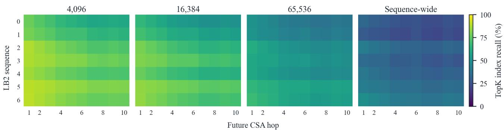  
Figure 10: Per-sequence Top-G coverage at $G = 3 2 { , } 0 0 0$ . Rows are LB2 sequences 0–6 and columns are subsequent CSA-layer distances; panels vary the nominal query window. Cells average eligible recorded queries over the 11 producers with a complete ten layer horizon. The original plot uses hop for exact layer distance d.

## F Candidate Working Sets and Offloading

Sharing candidate indices does not reduce the total KV state that an autoregressive model must preserve. A future pool may contain entries absent from the current one. Those entries must remain recoverable, for example in host memory, if they are evicted from the GPU. This section analyzes a possible resident working set, not an implemented or measured memory-saving mechanism.

A simplified capacity model. Suppose each producer keeps all N compressed positions resident, and each consumer keeps the indexer keys and attention KV for its current M candidates resident. Under that policy, the compressed-entry working set over n layers is $p N + c M$ giving the modeled ratio

$$
R _ { \mathrm { r e s i d e n t } } = { \frac { n N } { p N + c M } } .\tag{15}
$$

This equals the layerwise dot-product reduction because both counts assign N positions to a producer and M to a consumer. The identity is a property of this simplified policy, not an equivalence between compute savings and measured GPU memory. Attention itself reads only the selected top-K; alternative staging policies could use a different resident set.

If a producer also keeps only M entries during its qh reuse steps, the cycle-average ratio becomes

$$
R _ { \mathrm { a v g } } = \frac { n N ( q h + 1 ) } { p N + [ p q h + c ( q h + 1 ) ] M } .\tag{16}
$$

For $q h > 0$ , this is a time-average, not a reduction in the capacity needed for a rebuild step. The values match Table 3, so we do not repeat that table. Both models exclude weights, local windows, other attention layers, metadata, transfer buffers, and runtime allocation overhead.

Transfers and deadlines. Consumer keys that enter a refreshed pool must be fetched before re-scoring; the selected KV entries must arrive before attention. The pool becomes known only when the producer publishes it, leaving a short window before the first consumer. Persistent pools can lengthen this window on later reuse steps. Achieving the producer’s cycle-average working set additionally requires reloading its full search domain before the next rebuild.

Pool turnover, transfer bandwidth, staging buffers, and scheduling determine whether the policy is practical. The current top-K-in-pool recall measurements do not measure pool-to-pool turnover, so they cannot quantify this transfer volume. An offloading evaluation should report actual peak GPU residency, transferred bytes, latency, GPU energy, and task quality together.