# OptScientist: Automated Discovery of Optimization Laws

Ma ZhenYao∗1,2, Yue Liang1,3, and Jian-Qiao Zhu4

1Plokerm AI Lab 2Xiamen University 3University of Tübingen 4The University of Hong Kong

## Abstract

Many scientific phenomena are best understood as outcomes of underlying optimization problems, yet automated scientific discovery has largely focused on recovering equations that describe observed input–output patterns. We introduce OptScientist, a novel automated framework for discovering compact symbolic optimization laws directly from data. OptScientist comprises (i) a model that infers symbolic optimization problems by first learning to represent data as an optimization problem and then extracting its symbolic form, and (ii) an LLM agentic system embedding the model in a discovery process that integrates theoretical priors from scientific literature, discovers candidate laws, abstracts their underlying mechanisms, and suggests new data to collect. We first evaluate OptScientist on OptFeynman, a novel benchmark of 99 physics-derived optimization problems, where OptScientist recovers ground-truth laws for over 80% of the problems and remains robust to noisy contextual information, while substantially outperforming machine-learning, symbolic, and LLM-based model-discovery baselines. On human risky choice and central-bank monetary policy, OptScientist discovers compact symbolic optimization laws that achieve held-out predictive performance competitive with leading baselines, while using few parameters and substantially fewer tokens than LLM baselines. Overall, OptScientist extends automated scientific discovery to uncovering optimization laws that generate observed phenomena, enabling automated theory building across the physical, biological, behavioral, and social sciences.

## 1 Introduction

Across the sciences, many influential theories characterize observed phenomena as solutions to optimization problems. Examples include energy or free-energy minimization principles for charac terizing equilibrium states in statistical physics (Gibbs, 1902; Landau & Lifshitz, 2013), optimality models for explaining how biological fitness shapes evolutionary outcomes (Wright et al., 1932; Fisher, 1999), rational and resource-rational analyses of human behavior and cognition (Samuelson, 1948; Debreu, 1959; Anderson, 1991; Lieder & Griffiths, 2020), and intertemporal optimization for modelling dynamic macroeconomic systems (Ramsey, 1928; Ljungqvist & Sargent, 2018). Developing such theories requires identifying objectives and relevant constraints that jointly account for observed outcomes. However, these components are typically formulated by domain experts and only subsequently evaluated against data, making optimization-based theory construction largely manual and dependent on specialized insight. This reliance on expert formulation creates a substantial bottleneck for theory discovery across scientific domains. A fundamental question therefore remains: Can optimization laws be discovered automaticallyfrom observational data?

The complexity of real-world scientific data further exacerbates this bottleneck, as observations are often noisy, high-dimensional, and shaped by complex interactions. Hand-crafted interpretable models may fail to capture complex patterns, whereas flexible data-driven approaches, particularly machine-learning methods, have demonstrated strong predictive performance across physics (Baldi et al., 2014; Carleo & Troyer, 2017), biology (Poplin et al., 2018; Jumper et al., 2021), and behavioral and social sciences (Kosinski et al., 2013; Peterson et al., 2021; Zhu et al., 2025).

Recent advances in scientific machine learning have enabled data-driven discovery of symbolic laws (Champion et al., 2019; Udrescu & Tegmark, 2020; Cranmer et al., 2020), embedded mathematica structure into flexible ML models (Chen et al., 2018; Liu et al., 2025; Ma et al., 2026b), and integrated scientific theories with machine learning (Raissi et al., 2019; Peterson et al., 2021). However, these approaches have largely focused on recovering input–output equations or learning models without explicit symbolic structure, while optimization-structured scientific ML models (Ma et al., 2026b) still require human interpretation of optimization structures and lack an end-to-end process for automated theory discovery. Consequently, automatically discovering compact symbolic optimization laws from real-world data remains a fundamental challenge.

To address these challenges, we introduce OptScientist, a novelframework that uses AI methods to automate the discovery ofoptimization laws. OptScientist has two components: a novel symbolicdiscovery model and an agentic research system. First, the symbolic-discovery model (OptScientist Model) learns to represent observational data as an optimization problem using a hierarchical optimization network with an optimization representation bottleneck, enabling denoising, information compression, and automatic extraction of interpretable features. It then distills this learned optimization representation into a compact symbolic optimization problem. The second component, the OptScientist Agent, places this discovered symbolic model inside an automated scientific-discovery loop. A Theory Prior Agent proposes scientific priors, candidate variables and mechanism hypotheses. An Experiment Agent then uses the OptScientist Model to search for compact symbolic optimization laws from data. Finally, a Scientific Critic and Theory Abstraction Agent evaluates and selects the discovered laws, abstracts the selected laws into a general form and qualitative mechanisms, and suggests new variables or data for the next round of discovery. Together, the model and agent form an iterative system for proposing, discovering and refining optimization laws.

We conduct three experiments spanning physical systems, human behaviour, and macroeconomic policy. First, to test whether the core OptScientist Model can recover ground-truth optimization laws (Sec. 4.1), we introduce OptFeynman (Sec. 5.1), a novel synthetic benchmark of 99 optimization problems derived from analytic physics equations, where observations are generated as noisy samples from the induced optimization landscapes. On held-out contexts, OptScientist Model shows strong recovery of the generating laws, achieving perfect exact-order recovery on 88 of 99 discrete problems and 78 of 99 continuous problems, while substantially outperforming machine-learning, symbolicregression, and LLM model-discovery baselines. Our results also suggest that OptScientist remains robust even when context variables are noisy. We then apply OptScientist to two autonomous scientific-discovery tasks on real-world data for which the underlying laws are unknown. In human decisions under risk and ambiguity (Sec. 4.2), OptScientist discovers an optimization law combining expected reward, cognitive switching cost and counterfactual reward. In central-bank monetary decisions (Sec. 4.3), it discovers a law in which observed policy tracks a latent subjective target through squared-error minimization. Across both domains, the discovered laws remain competitive with the strongest baselines while using near-minimal parameter counts and symbolic complexity, and substantially fewer output tokens than LLM-based model-discovery methods.

Overall, our contributions are threefold. First, we introduce the OptScientist Model, which, to the best of our knowledge, is the first scientific machine-learning framework for learning symbolic optimization problems directly from observational data. Second, for science, we develop OptScientist, a hybrid symbolic–LLM system that extends automated scientific discovery to optimization-law discovery in domains associated with optimization models. Third, at the paradigm level, we contribute to inverse optimization, revealed preference and related fields by moving beyond parameter estimation for pre-specified optimization problems, providing a new methodology for directly recovering optimization laws themselves from data.

## 2 Related Work

Symbolic discovery. Recent advances in symbolic regression have enabled symbolic law discovery from data. Most existing approaches, however, recover input–output laws, such as $y = f ( x )$ (Koza, 1994; Schmidt & Lipson, 2009; Udrescu & Tegmark, 2020), or physical equations expressed through differential relationships, such as $\begin{array} { r } { \frac { d x } { d t } = f ( x , t ) } \end{array}$ (Brunton et al., 2016; Rudy et al., 2017; Champion et al., 2019). They are less suited to settings where the scientific law is itself an optimization problem. OptScientist learns symbolic optimization problems from observational data, providing a new symbolic-discovery model for scientific domains associated with optimization models.

LLM-based automated scientific discovery. LLMs have been used to propose and refine symbolic functional forms or governing equations (Merler et al., 2024; Du et al., 2024; Shojaee et al., 2025), and to automate broader scientific workflows such as hypothesis generation, experimentation and iterative refinement (Lu et al., 2026; Gottweis et al., 2026; Aygün et al., 2026). Recent LLM-based work also searches for symbolic utility expressions to support group-level prediction (Zhao et al., 2026), but rarely recovers parsimonious scientific laws. Despite their broad role in scientific automation, these systems are not designed to discover compact symbolic optimization problems from data. OptScientist does not remove LLMs entirely. Instead, it suggests that greater efficiency and performance can be achieved by combining a symbolic discovery model with an auxiliary LLM agentic system to improve and interpret the discovered laws and add semantic meaning to them.

Cognitive discovery. Some cognitive-discovery methods use black-box predictions or structured neural architectures to recover interpretable mechanisms from behavioural data (Agrawal et al., 2020; Peterson et al., 2021; Miller et al., 2023; Zhu et al., 2025; Ji-An et al., 2025; Ma et al., 2026b), while others use LLMs to generate and revise executable models, diagnose theory failures and design informative experiments (Binz et al., 2025; Rmus et al., 2026; Élteto et al.˝ , 2026; Jagadish et al., 2026). These approaches recover programs or reduced-form decision rules rather than compact symbolic optimization laws. Moreover, human behaviour is often modelled through resource-rational analysis (Debreu, 1959; Lieder & Griffiths, 2020; Zhu & Griffiths, 2026), which formulates behaviour using hand-specified optimization models. As a general framework for automated discovery of optimization laws, OptScientist can support automated resource-rational analysis.

Inverse optimization. Inverse optimization (Ahuja & Orlin, 2001; Aswani et al., 2018) and related approaches, including revealed preference (Afriat, 1967; Varian, 1982), inverse reinforcement learning (Ng et al., 2000; Ziebart et al., 2008), and optimization-based hierarchical network models (Ma et al., 2026b), infer latent objectives or estimate the parameters of pre-specified optimization problems. However, they generally assume the functional form of the optimization problems. OptScientist provides a new methodology in which the optimization law itself can be recovered from data without prespecifying its functional form.

## 3 The OptScientist

## 3.1 Formalizing Optimization-Law Discovery

Generally, a law expressed as optimization describes an outcome y as the solution to an objective under constraints,

$$
\operatorname* { m a x } _ { \mathbf { y } \in \mathcal { Y } } U ( \mathbf { x } , \mathbf { y } ) \quad \mathrm { s . t . } \quad \mathcal { C } ( \mathbf { x } , \mathbf { y } ) \leq 0 , \mathcal { T } ( \mathbf { x } , \mathbf { y } ) = 0 .\tag{1}
$$

Here x denotes the observed context, $U ( \cdot )$ is the objective, $\mathcal { C } ( \cdot )$ represents inequality constraints, and $\tau ( \cdot )$ represents equality constraints or target conditions. This form covers a broad class of scientific laws in which observed outcomes arise from maximizing a quantity, possibly under constraints.

For learning, it is useful to express the same object as a single scalar landscape. Under standard local regularity conditions, the constrained problem in Eq. (1) admits a locally exact penalty representation (Han & Mangasarian, 1979),

$$
\operatorname* { m a x } _ { \mathbf { y } \in \mathcal { Y } } \lambda _ { 0 } \phi \big ( U ( \mathbf { x } , \mathbf { y } ) \big ) - \lambda _ { 1 } ^ { \top } \rho \big ( \mathcal { C } ( \mathbf { x } , \mathbf { y } ) \big ) - \lambda _ { 2 } ^ { \top } \psi \big ( \mathcal { T } ( \mathbf { x } , \mathbf { y } ) \big ) ,\tag{2}
$$

Here ϕ is strictly increasing, $\rho ( z ) = \operatorname* { m a x } \{ z , 0 \}$ penalizes violated inequality constraints, and $\psi ( z ) = | z |$ penalizes deviations from equality constraints. This reformulation places objectives and constraints inside one optimization score, making the law easier to analyse and learn.

The outcome generated by an optimization law can be represented in two ways. In the deterministic case, the predicted outcome is $\widehat { \mathbf { y } } ( \mathbf { x } ) = \arg \operatorname* { m a x } _ { \mathbf { y } \in \mathcal { Y } } S ( \mathbf { x } , \mathbf { \bar { y } } )$ , where $S ( \mathbf { x } , \mathbf { y } )$ is a scalar representation

of the underlying optimization problem. For example, under the exact-penalty reformulation in Eq. (2), S is given by the objective together with penalties for violated constraints. In noisy systems, the same score defines a probability distribution over possible outcomes,

$$
p ( \mathbf { y } \mid \mathbf { x } ) = \exp ( S ( \mathbf { x } , \mathbf { y } ) / \tau ) / Z ( \mathbf { x } ) ,\tag{3}
$$

where $\tau > 0$ controls the level of noise and $Z ( \mathbf { x } )$ is the normalizing term. As τ decreases, the distribution concentrates on the maximizers of S; for larger $\tau ,$ it describes noisy realizations of the same underlying optimization principle.

Therefore, we formulate the central question of optimization-law discovery as follows.

Question 1 (Optimization-Law Discovery) Given observational data $\mathcal { D } = \{ ( \mathbf { x } _ { i } , \mathbf { y } _ { i } ) \} _ { i = 1 } ^ { N }$ 1 generated by an unknown optimization law $\mathcal { L } ^ { \ast }$ of the form

$$
\operatorname* { m a x } _ { \mathbf { y } \in \mathcal { Y } } U ^ { * } ( \mathbf { x } , \mathbf { y } ) \quad s . t . \quad \mathcal { C } ^ { * } ( \mathbf { x } , \mathbf { y } ) \leq 0 , \mathcal { T } ^ { * } ( \mathbf { x } , \mathbf { y } ) = 0 ,
$$

where outcomes arise either as optimal solutions or as stochastic realizations ofthe induced optimization landscape, can we recover a compact symbolic law

$$
\widehat { \mathcal { L } } = ( \widehat { U } , \widehat { \mathcal { C } } , \widehat { T } )
$$

without pre-specifying thefunctionalforms ofits components, such that it reproduces the observable implications of $\mathcal { L } ^ { \ast } \mathcal { ? }$

## 3.2 OptScientist Model

To discover compact optimization laws from data directly, the OptScientist Model consists of two stages: the Optimization Learner (OptLearner; see Figure 1a Left) and the Optimization Discoverer (OptDiscover; see Figure 1a Right).

## 3.2.1 Optimization Learner

Observational data rarely reveal the optimization law directly. They may be noisy, high-dimensional, redundant, or expressed in variables that are not yet suitable for symbolic modelling. The Optimiza tion Learner (OptLearner) addresses this challenge by learning to represent observational data as an optimization problem through a hierarchical optimization network with an optimization representation bottleneck. This process enables denoising, information compression, and automatic feature extraction, producing a learned optimization representation for subsequent symbolic discovery.

Behavior Learning backbone. OptLearner uses the Behavior Learning Network (BL) (Ma et al., 2026b;a) as its backbone to learn a scalar landscape over context–outcome pairs. For each context x and candidate outcome y, the network returns a score $S _ { \theta } ( \mathbf { x } , \mathbf { y } )$ that measures how strongly y is preferred under the latent optimization problem. Under Eq. (3), observed outcomes are treated as stochastic samples from the learned optimization landscape. Learning therefore reconstructs the latent landscape on which observed outcomes arise as preferred solutions. This corresponds to the representation-learning step in Figure 1 (a,b).

Optimization representation bottleneck. OptLearner builds on the BL backbone to represent observational data as a single optimization problem. Its early layers denoise and compress the observations, capturing interactions and latent features that may be difficult to express in the original coordinates. The final layer consists of a single BL block, forming an optimization representation bottleneck with learnable objective and optional constraint components, each potentially comprising multiple branches,

$$
\operatorname* { m a x } _ { \mathbf { y } \in \mathcal { Y } } \underbrace { U ( \mathbf { x } , \mathbf { y } ) } _ { [ \lambda _ { 0 } ] } \quad \mathrm { s . t . } \quad \underbrace { \mathcal { C } ( \mathbf { x } , \mathbf { y } ) } _ { [ \lambda _ { 1 } ] } \leq 0 , \ \underbrace { \mathcal { T } ( \mathbf { x } , \mathbf { y } ) } _ { [ \lambda _ { 2 } ] } = 0 .\tag{4}
$$

Here $\lambda _ { 0 }$ controls the scale of the objective, while $\lambda _ { 1 }$ and $\lambda _ { 2 }$ control the strengths of the inequality and equality terms. This bottleneck provides a structured optimization representation for subsequent symbolic discovery. When the input variables are already meaningful, OptLearner primarily denoises the optimization landscape. For high-dimensional or unstructured inputs, it additionally extracts and compresses relevant features before forming the learned optimization representation.

a  
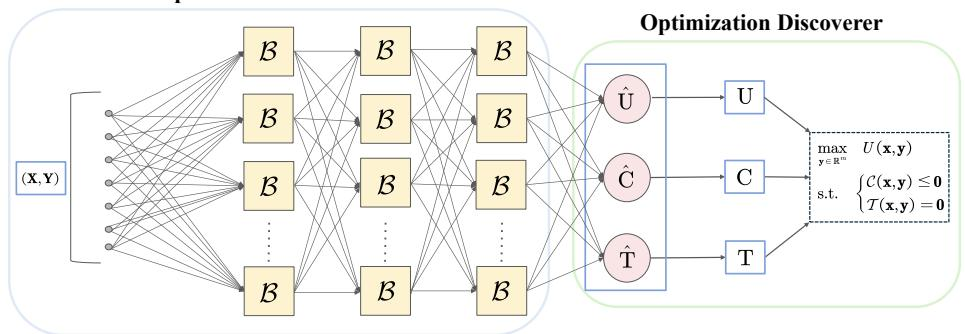

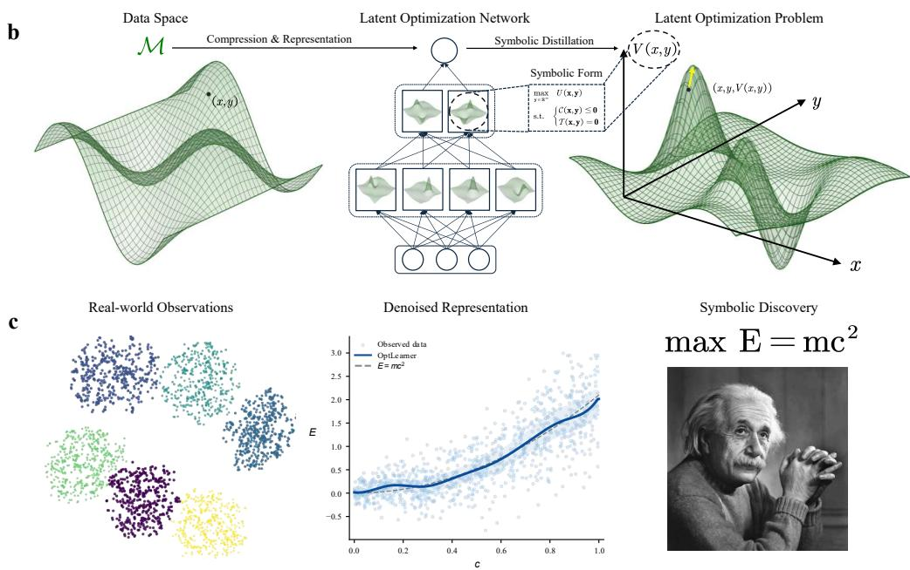  
Figure 1: The OptScientist Model. a, The OptScientist Model consists of an Optimization Learner and an Optimization Discoverer. The Optimization Learner learns to represent observational data as an optimization problem using a hierarchical network with an optimization representation bottleneck. The Optimization Discoverer then distills this learned optimization representation into a compact symbolic optimization problem. b, The OptScientist Model represents the data manifold through a latent optimization network. Raw observations are first compressed and represented by hierarchical optimization blocks. The learned representations are then expressed as a single optimization problem through the optimization representation bottleneck, from which a compact symbolic law is extracted. $\mathbf { c } ,$ The model follows the same logic in concrete discovery settings. Noisy real-world observations are first transformed into denoised representations, and symbolic regression is then applied to the learned optimization representation to recover symbolic laws.

Training objective. The training objective follows the same principle for discrete and continuous outcomes. For a finite outcome set Y, OptLearner evaluates all candidates and trains the score by cross-entropy,

$$
\mathcal { L } _ { \mathrm { d i s c } } = - \frac { 1 } { N } \sum _ { i = 1 } ^ { N } \log \frac { \exp ( S _ { \theta } ( \mathbf { x } _ { i } , \mathbf { y } _ { i } ) / \tau ) } { \sum _ { \mathbf { y } \in \mathcal { Y } } \exp ( S _ { \theta } ( \mathbf { x } _ { i } , \mathbf { y } ) / \tau ) } .\tag{5}
$$

For continuous outcomes, enumerating $\mathcal { V }$ is infeasible. OptLearner therefore compares the observed outcome with sampled alternatives $\widetilde { \mathbf { y } } _ { i k }$ using the same contrastive objective,

$$
\mathcal { L } _ { \mathrm { c o n t } } = - \frac { 1 } { N } \sum _ { i = 1 } ^ { N } \log \frac { \exp ( S _ { \theta } ( \mathbf { x } _ { i } , \mathbf { y } _ { i } ) / \tau ) } { \exp ( S _ { \theta } ( \mathbf { x } _ { i } , \mathbf { y } _ { i } ) / \tau ) + \sum _ { k = 1 } ^ { K } \exp ( S _ { \theta } ( \mathbf { x } _ { i } , \widetilde { \mathbf { y } } _ { i k } ) / \tau ) } .\tag{6}
$$

Both losses encode the same principle: under the observed context, the observed outcome should receive the highest optimization score.

## 3.2.2 Optimization Discoverer

The Optimization Learner represents observational data as an optimization problem, but the learned representation is not yet a compact symbolic law. The Optimization Discoverer (OptDiscover) addresses this by extracting the symbolic form of the learned optimization problem, as illustrated in Figure 1 (a,b). After OptLearner is trained, its parameters are frozen. OptDiscover then distills the components of the optimization representation bottleneck into compact symbolic expressions. This bottleneck consists of three types of components: objective terms $U _ { \theta } .$ , inequality-constraint terms $C _ { \theta } .$ , and equality-constraint terms $T _ { \theta } ,$ with each type optionally comprising multiple branches. OptDiscover searches for a compact symbolic expression for each active component,

$$
\widehat { H } _ { j } = \arg \operatorname* { m i n } _ { F \in \mathcal { F } _ { \Omega _ { j } } } \frac { 1 } { M } \sum _ { m = 1 } ^ { M } \left[ F ( \mathbf { x } _ { m } , \mathbf { y } _ { m } ) - H _ { \theta , j } ( \mathbf { x } _ { m } , \mathbf { y } _ { m } ) \right] ^ { 2 } , \qquad H _ { \theta , j } \in \{ U _ { \theta } , C _ { \theta } , T _ { \theta } \} .\tag{7}
$$

Here $\mathcal { F } _ { \Omega _ { j } }$ denotes the symbolic search space for the j-th term. The distilled expressions of the active components are assembled according to the learned optimization structure, yielding a symbolic optimization problem with explicit objectives, inequality constraints, and equality constraints.

Optional automatic feature extraction. OptDiscover can operate with or without automatic feature extraction. When the observed variables already form a meaningful symbolic language, the law is distilled directly from $\displaystyle ( \mathbf { x } , \mathbf { y } )$ . When the raw variables require transformation, interaction, or compression, OptLearner first maps them into denoised intermediate representations. Technically, these representations are the outputs of intermediate layers in OptLearner, taken before the optimization representation bottleneck. These layer-level variables act as automatically extracted features, and OptDiscover then extracts the symbolic law on this learned feature space. This allows the framework to handle both meaningful scientific variables and raw observations whose symbolic structure is more naturally expressed after representation learning.

Complexity penalty. Symbolic complexity is measured by expression-tree size, with each variable, numerical constant and operator counted as one node. OptDiscover controls symbolic complexity in two ways. First, it selects the simplest expression among candidates with near-minimal distillation loss. This favours parsimonious laws while preserving the learned optimization structure. Second, for the objective term, OptDiscover removes additive components that depend only on x. These components are constant across candidate outcomes y and therefore do not affect the optimizer.

## 3.3 OptScientist Agent

Symbolic discovery often requires scientific decisions both before and after model fitting: researchers construct meaningful variables, impose search priors, interpret candidate expressions, abstract qualitative mechanisms and decide how subsequent analysis should be revised. To automate this research loop, OptScientist Agent embeds the OptScientist Model in an iterative framework for optimization-law discovery (Figure 2). The system comprises four interacting modules: a Research Orchestrator, a Theory Prior Agent, an Experiment Agent and a Scientific Critic and Theory Abstraction Agent. A detailed description of the OptScientist Agent is provided in Appendix A.2.

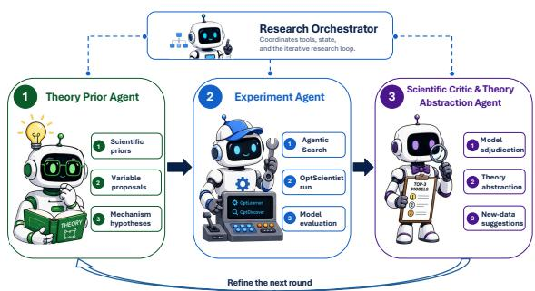  
Figure 2: OptScientist Agent as an iterative research framework. The framework embeds the OptScientist Model in a scientific-discovery loop.

Research Orchestrator. The Research Orchestrator maintains the shared research state and coordinates the discovery process. It integrates hypotheses, candidate variables, discovered laws and scientific findings across agents and discovery rounds, while carrying unresolved questions forward.

It also determines whether the workflow should terminate or enter another round of refinement, turning OptScientist runs into an iterative scientific-discovery process.

Theory Prior Agent. The Theory Prior Agent draws on the scientific literature to identify established theories and mechanisms relevant to the research question, and translates them into explicit, testable hypotheses. It then proposes scientifically meaningful variables or transformations that represent these mechanisms, together with symbolic-search priors when scientifically justified. These priors guide the search while keeping the final expression data-driven.

Experiment Agent. Guided by the priors from the Theory Prior Agent, the Experiment Agent translates scientific hypotheses, candidate variables and search priors into executable OptScientist configurations. It then uses the core OptScientist Model to search for candidate optimization laws from observational data. The resulting laws and supporting empirical evidence are returned for scientific critique and theory abstraction.

Scientific Critic and Theory Abstraction Agent. The Scientific Critic and Theory Abstraction Agent evaluates candidate laws as scientific explanations and identifies the best-supported structures across them. It synthesizes the supported laws into a more general theoretical form and summarizes their qualitative mechanisms and main scientific findings. Remaining uncertainty is then translated into new hypotheses, variables or data requirements for the next discovery round, moving OptScientist Agent from symbolic law recovery towards iterative theory refinement.

Embedding the OptScientist Model in the discovery loop. The OptScientist Model forms the empirical core of the agentic system. In each round, scientific hypotheses, candidate variable and search priors are translated into executable configurations, through which the model discovers candidate optimization laws from observational data. The resulting laws and empirical evidence are then returned to the agents for evaluation, theory abstraction and refinement of the next round.

## 4 Experiments

We evaluate OptScientist Model on OptFeynman, a new benchmark for optimization-law discovery, and the full framework on two real-world scientific-discovery tasks, with comparisons against machine-learning models, symbolic regression, and LLM model-discovery methods. The LLM baselines include an LLM-only researcher, GeCCo (Rmus et al., 2026) as a code-assisted LLM approach, and Model Discovery Agent (MDA; Murphy, 2026) as a Bayesian experiment-design approach. All LLM methods use DeepSeek-V4-Flash, the same LLM used by the optional OptScientist Agent. Data and evaluation are provided in Sec. 5, and comparison methods in Appendix B.1.

## 4.1 Recovering Ground-Truth Optimization Laws

Table 1: Examples of recovered OptFeynman laws. Examples show that OptScientist perfectly recovers effective ground-truth optimization expressions across diverse physical structures.

We first tested whether OptScientist Model can recover ground-truth optimization laws from observations. OptFeynman converts analytic physics equations into latent optimization problems and generates observations via Gibbs sampling. Because the generating objective is known, recovery can be evaluated directly on unseen test contexts by comparing the preference order and Gibbs distribution of the recovered and ground-truth laws. Notably, this experiment evaluates only the OptScientist Model, without any LLM assistance.

Ground-truth recovery on OptFeynman. OptScientist shows the strongest out-of-sample ability to recover the true optimization law across both discrete and continuous decision variables (Figure 3). For discrete decision vari-

<table><tr><td>able</td><td></td><td>Decision vari- Effective ground truth</td><td>Effective recovered expres- sion</td></tr><tr><td>y3</td><td> $\operatorname* { m a x } _ { y _ { 3 } } { \ x _ { 3 } y _ { 3 } }$ </td><td>y3</td><td>max x3y3</td></tr><tr><td>w</td><td> $\operatorname* { m a x } _ { w } \ w ^ { 2 }$ </td><td></td><td> $w ^ { 2 }$  max w</td></tr><tr><td> $E _ { f }$ </td><td> $\operatorname* { m a x } _ { E _ { f } } ~ E _ { f } \cos \theta$ </td><td> $\operatorname* { m a x } _ { E _ { f } }$ </td><td> $E _ { f } \cos \theta$ </td></tr><tr><td> $G$ </td><td> $\operatorname* { m a x } _ { G } G \left( { \frac { 1 } { r _ { 2 } } } - { \frac { 1 } { r _ { 1 } } } \right)$ </td><td></td><td> $G ( r _ { 1 } \textrm { -- } r _ { 2 } )$ </td></tr><tr><td> $^ d$ </td><td> $\operatorname* { m a x } _ { d } { \frac { T _ { 2 } - T _ { 1 } } { d } }$ </td><td></td><td> $\frac { T _ { 2 } - T _ { 1 } } { d }$ </td></tr><tr><td>r</td><td></td><td></td><td></td></tr><tr><td></td><td> $\operatorname* { m a x } _ { r } { \frac { 1 } { r ^ { 2 } } }$ </td><td></td><td> $\operatorname* { m a x } _ { r } \ { \frac { 1 } { r ^ { 2 } } }$ </td></tr><tr><td></td><td></td><td></td><td></td></tr><tr><td></td><td></td><td></td><td></td></tr><tr><td></td><td></td><td></td><td> $^ \mathrm { m a x } _ { G }$ </td></tr><tr><td></td><td></td><td></td><td></td></tr><tr><td></td><td></td><td></td><td>r1r2</td></tr><tr><td></td><td></td><td></td><td></td></tr><tr><td></td><td></td><td></td><td></td></tr><tr><td></td><td></td><td> $\operatorname* { m a x } _ { d }$ </td><td></td></tr><tr><td></td><td></td><td></td><td></td></tr><tr><td></td><td></td><td></td><td></td></tr><tr><td></td><td></td><td></td><td></td></tr><tr><td></td><td></td><td></td><td></td></tr><tr><td></td><td></td><td></td><td></td></tr><tr><td>d</td><td></td><td></td><td>1</td></tr><tr><td></td><td></td><td></td><td></td></tr><tr><td></td><td></td><td></td><td></td></tr><tr><td></td><td></td><td></td><td></td></tr><tr><td></td><td></td><td></td><td></td></tr><tr><td></td><td></td><td></td><td></td></tr><tr><td></td><td></td><td></td><td></td></tr><tr><td></td><td></td><td></td><td></td></tr><tr><td></td><td></td><td></td><td></td></tr><tr><td></td><td> $\operatorname* { m a x } _ { d } ~ { \frac { } { d } }$ </td><td></td><td></td></tr><tr><td></td><td></td><td></td><td></td></tr><tr><td></td><td></td><td> $\operatorname* { m a x } _ { d } ~ { \frac { } { d } }$ </td><td></td></tr><tr><td></td><td></td><td></td><td></td></tr><tr><td></td><td></td><td></td><td></td></tr><tr><td></td><td></td><td></td><td></td></tr><tr><td></td><td></td><td></td><td></td></tr><tr><td></td><td></td><td></td><td></td></tr><tr><td></td><td></td><td></td><td></td></tr><tr><td></td><td></td><td></td><td></td></tr><tr><td></td><td></td><td></td><td></td></tr><tr><td></td><td></td><td></td><td></td></tr><tr><td></td><td></td><td></td><td></td></tr><tr><td></td><td></td><td></td><td></td></tr><tr><td></td><td></td><td></td><td></td></tr><tr><td></td><td></td><td></td><td></td></tr><tr><td></td><td></td><td></td><td></td></tr><tr><td></td><td></td><td></td><td></td></tr><tr><td></td><td></td><td></td><td></td></tr><tr><td></td><td></td><td></td><td></td></tr><tr><td></td><td></td><td></td><td></td></tr><tr><td></td><td></td><td></td><td></td></tr><tr><td></td><td></td><td></td><td></td></tr><tr><td></td><td></td><td></td><td></td></tr><tr><td></td><td></td><td></td><td></td></tr><tr><td></td><td></td><td></td><td></td></tr><tr><td></td><td></td><td></td><td></td></tr><tr><td></td><td></td><td></td><td></td></tr><tr><td></td><td></td><td></td><td></td></tr><tr><td></td><td></td><td></td><td></td></tr><tr><td></td><td></td><td></td><td></td></tr><tr><td></td><td></td><td></td><td></td></tr><tr><td></td><td></td><td></td><td></td></tr><tr><td></td><td></td><td></td><td></td></tr><tr><td></td><td></td><td></td><td></td></tr></table>

ables, it achieves perfect exact-order recovery on $8 8 / 9 9$ problems, indicating that the recovered symbolic laws induce preference orders approximately equivalent to the ground-truth laws. For continuous decision variables, OptScientist achieves perfect exact-order recovery on 78/99 problems at K = 10, 50, and 100. In both settings, OptScientist substantially outperforms all evaluated baselines. The stability of performance across increasingly dense candidate sets shows robust discovery of the underlying law. The recovered symbolic laws also preserve the stochastic structure of the generating landscape, yielding Gibbs distributions close to the ground truth.

a  
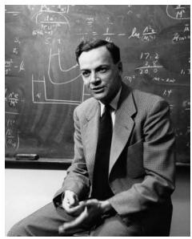

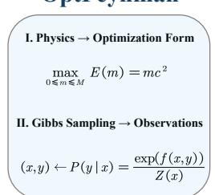

b  
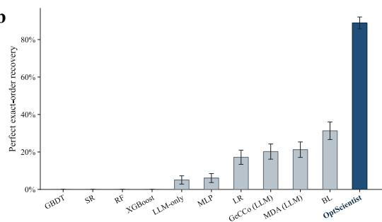

c  
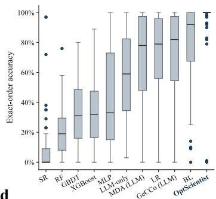

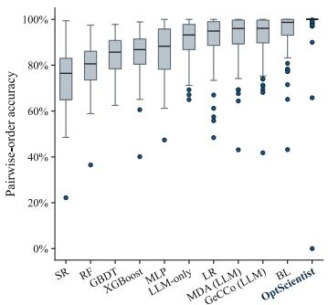

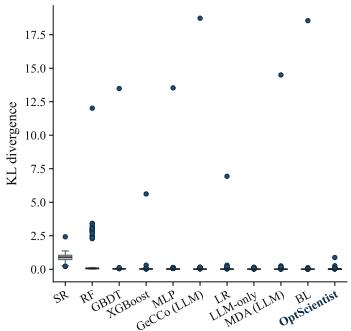

d  
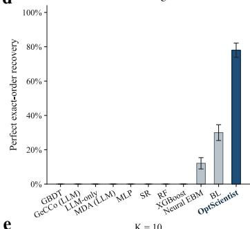

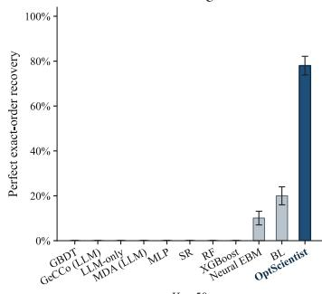

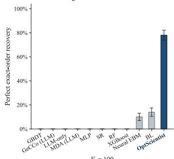

e  
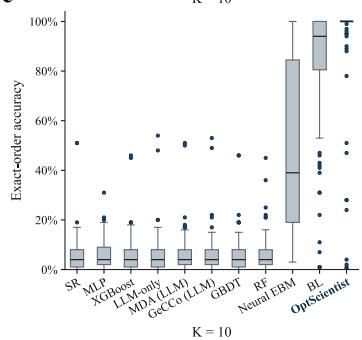

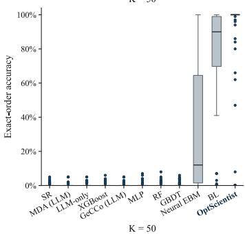

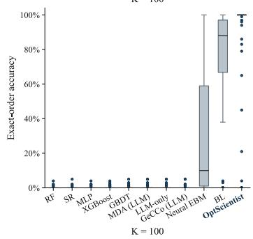  
Figure 3: Recovering ground-truth optimization laws on OptFeynman. a, OptFeynman converts analytic physics equations into latent optimization problems and generates observations by Gibbs sampling from the induced landscapes. ${ \bf { b , c , } }$ For discrete decision variables, OptScientist shows the strongest out-of-sample ability to recover the true optimization law on unseen test contexts, outperforming baselines. It achieves perfect exact-order recovery on $8 8 / 9 9$ tasks, indicating that the recovered symbolic laws induce preference orders approximately equivalent to the ground-truth laws. $\mathbf { d , e , }$ For continuous decision variables, the advantage persists on unseen test contexts across increasingly dense candidate sets. OptScientist perfectly recovers the exact order on $7 8 / 9 9$ tasks at $K = \bar { 1 0 , } \dot { K } = 5 0$ and $K = 1 0 0$ , showing robust discovery of the underlying optimization law beyond discrete-choice settings. Error bars denote standard errors across datasets where shown.

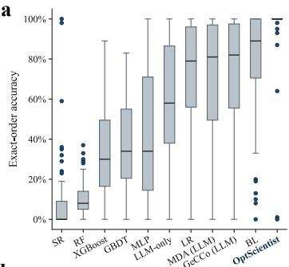

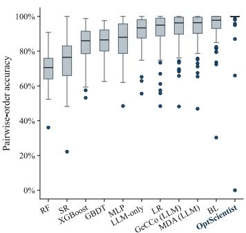

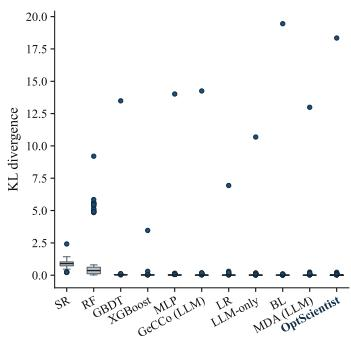

b  
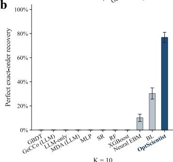

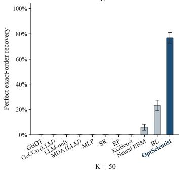

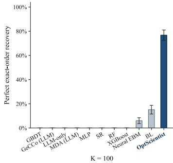

c  
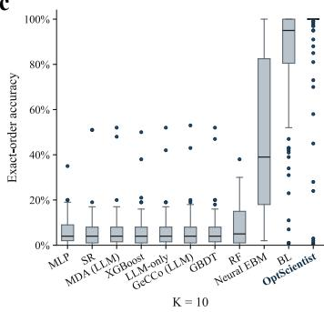

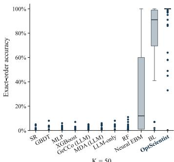

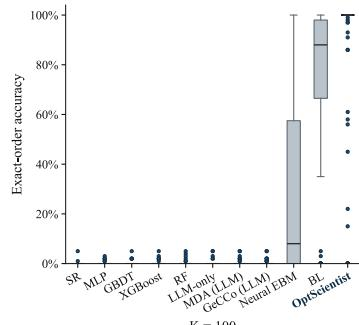  
Figure 4: Robust recovery of optimization laws under noisy context variables. Gaussian noise is added to the training context variables, while validation and test contexts remain clean. a, For discrete decision variables, OptScientist remains the strongest method for out-of-sample recovery of the true optimization law, achieving perfect exact-order recovery on 92/99 tasks and outperforming machinelearning, symbolic-regression, optimization-structured, and LLM-based automated model-discovery baselines. b,c, For continuous decision variables, OptScientist retains high recovery performance on unseen test contexts across K = 10, K = 50 and K = 100, perfectly recovering the exact order on 76/99 tasks at each candidate-set size and continuing to outperform the evaluated baselines. These results show that the model can recover approximately equivalent ground-truth optimization laws even when the training observations are corrupted by context noise. Error bars denote standard errors across datasets where shown.

Robustness to noisy context variables. We next evaluated whether recovery remains reliable when the training observations are corrupted by context noise (Figure 4). Specifically, Gaussian noise is added to the training context variables, while validation and test contexts remain clean. Under this setting, OptScientist remains the strongest method for out-of-sample recovery of the true optimization law. It achieves perfect exact-order recovery on 92/99 discrete problems and on 76/99 continuous problems at K = 10, K = 50 and $K = \mathrm { \dot { 1 } 0 0 }$ . These results show that OptScientist can recover approximately equivalent ground-truth optimization laws even when the training observations are corrupted by context noise.

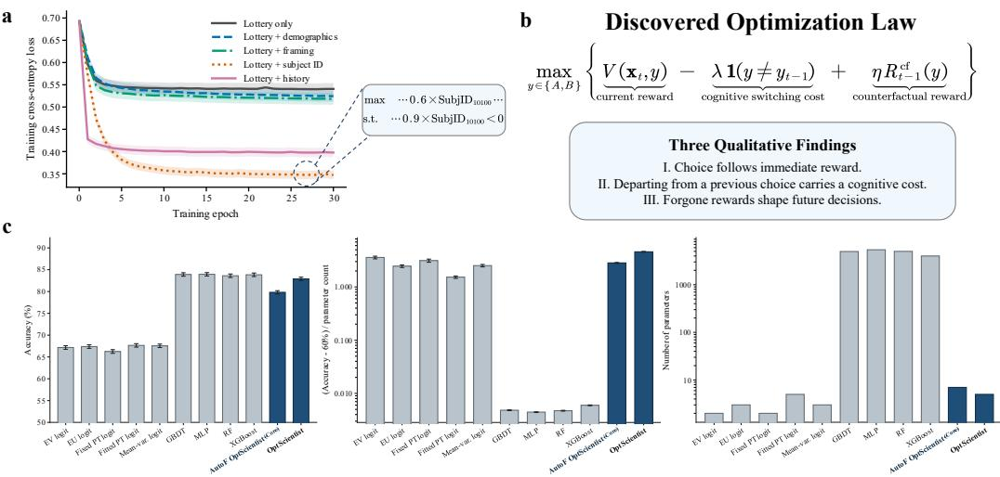  
c  
Figure 5: A compact law of human decision-making under risk and ambiguity. $\mathbf { a } , \mathbf { A }$ preliminary analysis of the CPC18 repeated-choice task shows that decision-history variables are particularly informative relative to lottery, demographic and framing variables, consistent with the sequential structure of the discovered optimization law. b, OptScientist recovers this sequential structure as a compact symbolic law: people tend to follow immediate reward, resist switching from a previous choice and remain sensitive to forgone outcomes. $\mathbf { c } ,$ Across behavioural baselines, machine-learning models and OptScientist variants, the recovered law achieves the near-best predictive performance with a near-minimal number of parameters. The result shows that human choice can be compressed into a simple optimization principle rather than explained by model scale alone. Error bars denote the standard error of the mean across participant-level metrics.

Representative recovered laws. Table 1 shows representative examples of successful symbolic recovery. The comparison focuses on the decision-relevant part of each optimization law after pruning numerical constants and scale factors that do not affect the optimizer. OptScientist recovers diverse physical structures, including linear interactions, quadratic energy terms, inverse-square laws, heat-transfer terms and algebraically equivalent rational forms. These examples illustrate that the recovered laws preserve the optimization law up to choice-equivalent symbolic transformations.

## 4.2 Human Choice under Risk and Ambiguity

a

We next applied OptScientist to human decisions under risk and ambiguity, where the underlying optimization law is unknown and human choices are shaped by repeated feedback, individual heterogeneity and noisy behavioural responses. The CPC18 dataset asks participants to repeatedly choose between two monetary prospects (Plonsky et al., 2019). This setting tests how OptScientist turns behavioural data into a compact symbolic optimization law.

Theory-guided generation of supplementary variables. Guided by scientific literature, the Theory Prior Agent constructs theoretically motivated variables beyond those in the original data, including expected value, forgone payoffs, gender and residence in wealthier regions. These variables are then considered in symbolic discovery. See Appendix B.3.2 for details.

A compact law of repeated choice. OptScientist recovered a compact symbolic optimization law (Figure 5b). In abstract form, the discovered law is

$$
\operatorname* { m a x } _ { y _ { t } \in \left\{ A , B \right\} } \left\{ V ( x _ { t } , y _ { t } ) - \lambda \mathbf { 1 } ( y _ { t } \neq y _ { t - 1 } ) + \eta R _ { t - 1 } ^ { \mathrm { c f } } ( y _ { t } ) \right\} .\tag{8}
$$

Here, $V ( x _ { t } , y _ { t } )$ is the current reward value of the candidate option, $\mathbf { 1 } ( y _ { t } \neq y _ { t - 1 } )$ captures the cognitive cost of switching from the previous choice, and $R _ { t - 1 } ^ { \mathrm { c f } } ( y _ { t } )$ captures sensitivity to the forgone reward from the previous round. This law summarizes three qualitative mechanisms: choice follow immediate reward, departing from a previous choice carries a cognitive cost, and forgone rewards shape future decisions. In this case, our approach can be viewed as performing an automated resourcerational analysis of human risky choices. The concrete score-difference expression and its mapping to this abstract law are given in Additional Experimental Details, Appendix B.3.3.

Automatic-feature symbolic discovery. Following the feature-mediated design introduced in the OptScientist Model, we also evaluated an automatic-feature variant, denoted AutoF OptScientist. In this variant, OptLearner first maps $( x _ { t } , y _ { t } )$ into denoised intermediate representations from its inner layers. These layer-level variables act as automatically extracted features, and OptDiscover then distills the final optimization score as a symbolic function on the learned feature space. This provides an additional compact symbolic description of the CPC18 dataset and allows representation learning to support symbolic discovery when behavioural variables are noisy, redundant or weakly structured. See Appendix B.3.4 for the recovered inner-feature expression.

Near-best performance with near-minimal complexity. Across behavioural baselines, machinelearning models and OptScientist variants, the recovered law achieves a favourable accuracy– complexity trade-off (Figure 5c). The direct OptScientist law reaches 82.9% accuracy with five numerical constants, approaching the strongest high-capacity machine-learning baselines that use thousands of parameters. Notably, predictive performance on CPC18 appears to saturate at approximately 83% held-out accuracy across strong predictive models. AutoF OptScientist achieves comparable ranking and calibration performance with seven numerical constants, including an AUC of 0.865, a probability MSE of 0.137, and an ECE of 0.116. Full predictive metrics and complexity definitions are reported in Additional Experimental Details, Appendix B.3.5. These results show that repeated human choice in CPC18 can be compressed into a simple optimization principle combining immediate reward, cognitive switching cost and counterfactual reward.

## 4.3 Central-Bank Monetary Policy

a

## Discovered Central-Bank Policy Law

$$
\begin{array} { l } { \displaystyle \underset { y \in \mathcal { Y } } { \operatorname* { m i n } }  ( y - \frac { N _ { t } } { 2 \kappa } ) ^ { 2 } + \varepsilon _ { t } ( y )  , ^ { N _ { t } = } \frac { m ( g _ { t } + \tau _ { t } ) } { \mathrm { m e } ^ { \mathrm { { m e n o m e n t s t r u m g h } } } } - \frac { m ( f _ { t } + q c _ { t } ) } { \mathrm { f u s t a i n f i e g i l i c } } - \frac { \rho \tau _ { t - 1 } } { \mathrm { i n e r t i e d i e g i l i c } \mathrm { { v i g h t w e s } } } + \frac { ( s + \rho ) \Delta _ { t } } { \mathrm { p a i g h t w e s t ~ p a r a m e n t } }  } \\ { \displaystyle \underset { y \in \mathcal { Y } } { \operatorname* { m i n } }  { ( \mathrm { p o l i c y } _ { t } - \mathrm { s u b j e c t i v e t a r g e t ~ p o l i c y } _ { t } ) ^ { 2 } + \mathrm { b e h a v i o r a l ~ r e s i d u a l } _ { t } ( y _ { t } ) }  , \mathrm { ~ s u b j e c t i v e t ~ o r o t o t o t o t o p t i c y } - \frac { \mathrm { n e t ~ p l i c y ~ p e s s u r e } } { 2 \times \mathrm { p l i c y } \mathrm { ~ i n t e n s i t y } \mathrm { ~ c o s i d e } } } \end{array}
$$

## Qualitative Findings

Ⅰ. Policy tracks a latent target through squared-error minimization. Ⅱ. Macro strength tightens; financial fragility loosens. Ⅲ. Policy momentum persists, but overshooting is restrained.

b  
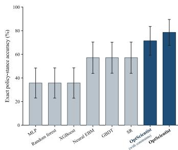

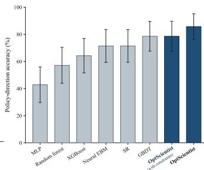

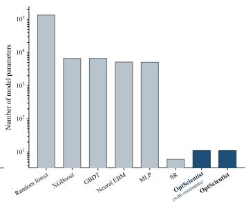  
Figure 6: Discovery of a central-bank policy law. a, OptScientist recovers a compact symbolic rule for quarterly monetary-policy decisions. The five-class policy stance, ranging from large easing to large tightening, is explained as tracking a latent policy target driven by macroeconomic strength, financial fragility, inherited tightness and policy momentum. b, On a future-period out-of-time test set, OptScientist attains the best policy-stance and policy-direction accuracy while using a near-minimal parameter count. Error bars denote bootstrap standard errors from 10,000 quarter-level resamples with replacement.

We then applied OptScientist to quarterly central-bank monetary-policy decisions, where the observed action is a five-class policy stance ranging from large easing to large tightening. The task is to discover a compact optimization law linking macro-financial conditions to policy actions. This setting tests how OptScientist recovers a symbolic policy rule from small, noisy and temporally structured macroeconomic data.

Discovery of a central-bank optimization law. OptScientist recovers a compact symbolic optimization law for monetary-policy decisions. For scientific interpretation, the selected law is abstracted into a policy-target tracking form (see Figure 6a),

$$
\operatorname* { m i n } _ { y _ { t } \in \mathcal { V } } \left\{ \left( y _ { t } - \frac { N _ { t } } { 2 \kappa } \right) ^ { 2 } + \varepsilon _ { t } ( y _ { t } ) \right\} ,\tag{9}
$$

where $y _ { t }$ is the policy stance, $\varepsilon _ { t } ( y _ { t } )$ is a residual decision term and $N _ { t } / ( 2 \kappa )$ is the latent subjective target policy. The recovered net policy pressure is $N _ { t } = m ( g _ { t } + \tau _ { t } ) - m ( f _ { t } + q c _ { t } ) - \rho r _ { t - 1 } + ( s + \rho ) \Delta _ { t }$ The first term captures macroeconomic strength, the second captures financial fragility, the third captures inherited policy tightness and the fourth captures policy momentum. The law therefore explains quarterly policy as tracking a latent target: macroeconomic strength tightens policy, financial fragility loosens policy, inherited tightness restrains further tightening, and policy momentum carries previous adjustments forward. The full symbolic expression and the algebraic rewriting into the target-tracking form are given in Additional Experimental Details, Appendix B.4.2 and B.4.3.

Constrained policy-law decomposition. OptScientist also recovers a constrained symbolic law with explicit U, C and $T$ components, decomposing the policy score into policy pressure, a onesided constraint and a quadratic risk or target-deviation term while retaining competitive predictive performance. The full expression and branch-level complexities are reported in Appendix B.4.4.

Near-best performance with near-minimal complexity. Across baselines and OptScientist variants, the single-U law achieves the best point estimates for exact and direction accuracy (Figure 6b), reaching 78.6% and 85.7%, respectively, on the out-of-time test set with only 11 numerical parameters. The constrained variant remains competitive at 71.4% and 78.6%, respectively, with the same parameter count. Full metrics and complexity details are reported in Appendix B.4.5.

## 4.4 Token-Efficient Model Discovery

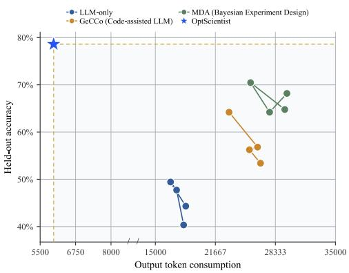

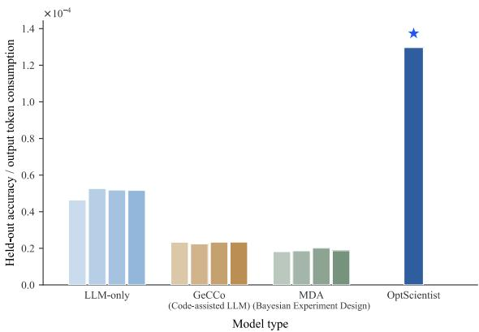  
Figure 7: Token-efficient automated model discovery. We further compare the token efficiency of OptScientist with three LLM-based automated model-discovery methods on the two real-world discovery tasks: LLM-only discovery, GeCCo (code-assisted LLM), and MDA (Bayesian experiment design). All LLM components use DeepSeek-V4-Flash. Left, On the central-bank monetarypolicy task (Sec. 4.3), OptScientist attains higher held-out policy-stance accuracy with substantially lower output-token consumption. Right, On human decisions under risk and ambiguity (Sec. 4.2), OptScientist reaches competitive held-out predictive accuracy with substantially fewer output tokens. Across both domains, OptScientist achieves a favourable accuracy–token-efficiency trade-off.

We finally compared the token efficiency of OptScientist with three LLM baselines on the two real-world discovery tasks in Secs. 4.2 and 4.3. All methods received the same research description, variable information, and training data; for the LLM baselines, we evaluated four maximum outputtoken settings and recorded held-out accuracy and cumulative output-token consumption.

Token efficiency. OptScientist achieves near-best held-out predictive performance with substantially fewer LLM output tokens (Figure 7). On central-bank monetary-policy decisions, OptScientist achieves 78.6% held-out policy-stance accuracy using 5,976 output tokens, exceeding the strongest LLM-based baseline result of 70.5%, while the baselines consume approximately 16,700–29,600 tokens. On human decisions under risk and ambiguity, OptScientist approaches the apparent predictive ceiling of approximately 83% held-out accuracy while using only 6,396 output tokens, compared with approximately 15,800–45,800 tokens for the LLM baselines.

## 5 Data and Evaluation

## 5.1 The OptFeynman

Benchmark design. To evaluate whether OptScientist can recover symbolic optimization laws, we construct OptFeynman, a benchmark derived from the AI Feynman equation collection (Udrescu & Tegmark, 2020). The original benchmark asks whether a method can recover an input–output equation. OptFeynman poses a different question: whether a method can recover the symbolic optimization problem that generates observed outcomes. Each analytic equation is therefore treated as a latent objective landscape, and the observed data are sampled as noisy outcomes of this landscape.

Optimization construction. For each multivariate Feynman equation, we separate its variables into a context x and a decision variable y. The original equation defines the ground-truth objective,

$$
U ( x , y ) = f ( x , y ) .
$$

Single-variable equations are excluded because they do not define a context-dependent decision problem, leaving 99 OptFeynman tasks. Context variables are sampled uniformly from the ranges specified in the original Feynman benchmark. For each task, we generate a set of unique contexts and partition them at the context level into training, validation and test sets. All stochastic outcomes generated from a given context are assigned to the same split. Thus, performance reflects generalization across unseen x-contexts, with stochastic outcomes from each context kept entirely within one split.

Gibbs sampling. Observed outcomes are generated from the optimization landscape through Gibbs sampling. In the discrete version, the decision variable is first discretized into five candidate actions within its original range,

$$
y _ { k } = y _ { \mathrm { m i n } } + k { \frac { y _ { \mathrm { m a x } } - y _ { \mathrm { m i n } } } { K - 1 } } , \qquad k = 0 , \dots , K - 1 , \quad K = 5 .
$$

For each context $x _ { i }$ , the ground-truth objective is evaluated on these candidates. The resulting scores are scaled by the standard deviation of the training objective values, estimated only from training contexts, and converted into a Gibbs choice distribution,

$$
P ( y = k \mid x _ { i } ) = { \frac { \exp ( U ( x _ { i } , y _ { k } ) / ( c T ) ) } { \sum _ { \ell = 0 } ^ { K - 1 } \exp ( U ( x _ { i } , y _ { \ell } ) / ( c T ) ) } } .
$$

Observed labels are then sampled from this categorical distribution, with multiple labels drawn for each context.

The continuous version follows the same principle, while keeping y continuous on its original interval [y , y ]. For each context, the target conditional density is defined by the exponentiated objective,

$$
p ( y \mid x _ { i } ) \propto \exp \left( U ( x _ { i } , y ) / ( c T ) \right) , \qquad y \in [ y _ { \operatorname* { m i n } } , y _ { \operatorname* { m a x } } ] .
$$

Because this density is not analytically tractable for arbitrary Feynman equations, it is approximated on a dense grid over the decision interval. Grid points are assigned normalized Gibbs weights, a grid point is sampled as the outcome, and the sampled value is optionally perturbed within its local grid cell and clipped back to the valid interval. The continuous setting uses the same context-level construction as the discrete setting, but draws a larger set of continuous outcomes from each context. Thus, the same symbolic objective is instantiated either over a finite action set or over a continuous decision interval.

Noisy-context version. We also construct a noisy-context version of OptFeynman. Starting from the clean dataset, Gaussian noise is added only to the training contexts,

$$
\widetilde { x } _ { i j } = x _ { i j } + \epsilon _ { i j } , \qquad \epsilon _ { i j } \sim { \mathcal N } ( 0 , \sigma _ { j } ^ { 2 } ) .
$$

The default noise scale is one percent of the sampling range of each context variable. The validation and test contexts remain clean, and the ground-truth objective, sampled outcomes, true scores, and evaluation files are unchanged. This setting tests whether OptScientist can recover a stable underlying law when the observations used for learning are corrupted by measurement noise.

Evaluation. Evaluation is based on the utility-representation view of optimization. By Debreu’s continuous utility representation theorem, preferences can be represented by a utility function when the preference relation is complete, transitive, and continuous (Debreu et al., 1953).

Theorem 5.1 (Continuous utility representation, Debreu) Let $\mathcal { Z } \subseteq \mathbb { R } ^ { n }$ , and $l e t \succeq$ be a complete, transitive, and continuous preference relation on $\mathcal { Z } .$ . Then there exists a continuousfunction u $, : \mathcal { Z } $ R such that,for all $z _ { 1 } , z _ { 2 } \in { \mathcal { Z } }$

$$
z _ { 1 } \succeq z _ { 2 } \iff u ( z _ { 1 } ) \geq u ( z _ { 2 } ) .
$$

This result motivates our evaluation: an equivalent optimization problem should preserve the preference structure induced by the latent objective, while also explaining its stochastic realizations. Since OptFeynman provides the generating objective $U ( x , y )$ , we evaluate whether the learned score and the distilled symbolic score recover the same ordinal and probabilistic structure.

For each context $x _ { i } ,$ let ${ \mathcal { V } } _ { i } = \{ y _ { i 1 } , . . . , y _ { i K } \}$ be the candidate outcome set. In discrete tasks, $\mathcal { \mathrm { V } } _ { i }$ contains the five candidate actions; in continuous tasks, it contains sampled continuous candidates. The ground-truth objective induces an ordered list $\pi _ { i } = ( j _ { 1 } , \ldots , j _ { K } )$

$$
U ( x _ { i } , y _ { i j _ { 1 } } ) \geq U ( x _ { i } , y _ { i j _ { 2 } } ) \geq \cdots \geq U ( x _ { i } , y _ { i j _ { K } } ) ,
$$

with $\widehat { \pi } _ { i }$ defined analogously by the recovered score ${ \widehat { S } } .$ Exact preference-order accuracy measures whether $\widehat { \pi } _ { i } = \pi _ { i }$ , and pairwise accuracy measures whether each pairwise comparison has the same direction under $U$ and ${ \widehat { S } } .$ These metrics test whether the recovered score represents the same optimization problem up to order-preserving transformations.

Because the observations are generated by Gibbs sampling, we also evaluate the induced stochastic landscape. For discrete tasks, the Gibbs distribution is computed over the five candidate actions. For continuous tasks, it is approximated on a dense grid over the decision interval. We compare the true and predicted distributions using KL divergence:

$$
D _ { \mathrm { K L } } ( P \Vert \widehat { P } ) = \frac { 1 } { N } \sum _ { i } \sum _ { y \in \mathcal { V } _ { i } } P ( y \mid x _ { i } ) \log \frac { P ( y \mid x _ { i } ) } { \widehat { P } ( y \mid x _ { i } ) } .
$$

Together, preference recovery evaluates whether the discovered expression captures the equivalent optimization law, while distribution recovery evaluates whether it also captures the stochastic strength of the generating landscape.

## 5.2 Real-world Datasets

Synthetic benchmarks test recovery when the generating optimization law is known. Real-world data test discovery under noise, redundancy and incomplete theoretical specification. We evaluate OptScientist on two domains: human risky choice and central-bank monetary decisions.

Human decisions under risk and ambiguity. The first dataset is the Choice Prediction Competition 2018 (CPC18), a large-scale dataset of repeated human choices between monetary prospects under risk and ambiguity (Plonsky et al., 2019). In each problem, a participant repeatedly chooses between two options, A and B. The target variable is the observed binary choice, indicating whether option B is selected. CPC18 contains several groups of variables. The main lottery variables describe the objective choice environment, including outcomes, probabilities, ambiguity and correlation between the two options. Identifier variables, such as participant and game identifiers, organize repeated decisions across participants and problems. Framing variables describe how the choice problem and feedback are presented. Demographic variables provide participant-level covariates. Because each participant faces repeated decisions with feedback, we also construct history variables indicating whether a previous round exists and which option was chosen in the previous round. This dataset tests whether OptScientist can recover the optimization law behind human decisions under risk, ambiguity and sequential feedback.

Central-bank monetary decisions. The second dataset studies central-bank monetary decisions from quarterly macroeconomic and financial conditions. The outcome y is a five-class quarterly policy stance, ranging from large easing to large tightening. We construct y from the quarter-to-quarter change in the average federal funds target rate. Before 2008, the daily target rate is taken from the single federal funds target-rate series. After 2008, it is computed as the midpoint of the target-rate corridor. The daily target rate is averaged within each quarter, and the quarterly change is measured in basis points. A decrease of at least 50 basis points is coded as −2, a decrease between 25 and 50 basis points as −1, a change within 25 basis points as 0, an increase between 25 and 50 basis points as 1, and an increase of at least 50 basis points as 2.

The context x contains twelve quarterly macro-financial variables. These include PCE inflation, core PCE inflation, unemployment and real GDP growth; two policy-inertia variables, given by the previous average target rate and the previous quarterly target-rate change; three financial-market variables, given by the Baa–Treasury credit spread, the 10-year–3-month term spread and the CBOE Volatility Index (VIX); and three financial-stress measures, given by the St. Louis Fed Financia Stress Index, the Chicago Fed National Financial Conditions Index and the Adjusted National Financial Conditions Index. The period variable is retained for temporal indexing and data splitting. This dataset tests whether OptScientist can recover a compact symbolic optimization law behind macroeconomic policy decisions.

All policy-rate, macroeconomic and financial variables are obtained from Federal Reserve Economic Data (FRED), maintained by the Federal Reserve Bank of St. Louis. The federal funds target-rate series and target-range bounds are used to construct the policy outcome, while the macroeconomic, financial-market and financial-stress variables are taken from their corresponding FRED series.

## 6 Conclusion and Limitations

We introduced OptScientist, a framework for automatically discovering compact symbolic optimization laws from observational data. OptScientist combines a model that learns and distills latent optimization structure with an agentic scientific-discovery system that incorporates theoretical priors, searches for candidate laws, evaluates empirical evidence, and abstracts supported mechanisms. On OptFeynman, OptScientist recovers ground-truth optimization laws across a broad range of physics-derived problems, substantially outperforms all evaluated baselines, and remains robust to noisy contextual information. Applied to human risky choice and central-bank monetary policy, it discovers interpretable optimization laws with competitive or stronger held-out predictive performance and compact symbolic representations. On the two real-world tasks, OptScientist also uses substantially fewer output tokens than LLM-based automated model-discovery approaches. These results establish symbolic optimization-law discovery as a new direction for automated scientific discovery and provide a general framework for learning compact optimization principles underlying observed phenomena.

Limitations and Future Research. When the structure of ground-truth models deviates substantially from an optimization formulation, our approach is likely to fail. Although, mathematically, a broad class of laws not originally formulated as optimization problems can be represented in optimization form, the OptFeynman results show that OptScientist can recover the original laws from such representations. Future research is needed to characterize the limits of the optimization assumption and identify the classes of models that remain discoverable within a feasible computational budget.

## References

Sydney N Afriat. The construction of utility functions from expenditure data. International economic review, 8(1):67–77, 1967.

Mayank Agrawal, Joshua C Peterson, and Thomas L Griffiths. Scaling up psychology via scientific regret minimization. Proceedings ofthe National Academy ofSciences, 117(16):8825–8835, 2020.

Ravindra K Ahuja and James B Orlin. Inverse optimization. Operations research, 49(5):771–783, 2001.

John R Anderson. The adaptive nature of human categorization. Psychological Review, 98(3):409, 1991.

Anil Aswani, Zuo-Jun Shen, and Auyon Siddiq. Inverse optimization with noisy data. Operations Research, 66(3):870–892, 2018.

Eser Aygün, Anastasiya Belyaeva, Gheorghe Comanici, Marc Coram, Hao Cui, Jake Garrison, Renee Johnston, Anton Kast, Cory Y McLean, Peter Norgaard, et al. An ai system to help scientists write expert-level empirical software. Nature, pp. 1–3, 2026.

Pierre Baldi, Peter Sadowski, and Daniel Whiteson. Searching for exotic particles in high-energy physics with deep learning. Nature communications, 5(1):4308, 2014.

Marcel Binz, Akshay Kumar Jagadish, Milena Rmus, and Eric Schulz. Automated scientific minimization of regret for cognitive modeling. In NeurIPS 2025 AIfor Science Workshop, 2025.

Leo Breiman. Random forests. Machine learning, 45(1):5–32, 2001.

Steven L Brunton, Joshua L Proctor, and J Nathan Kutz. Discovering governing equations from data by sparse identification of nonlinear dynamical systems. Proceedings of the national academy of sciences, 113(15):3932–3937, 2016.

Giuseppe Carleo and Matthias Troyer. Solving the quantum many-body problem with artificial neural networks. Science, 355(6325):602–606, 2017.

Kathleen Champion, Bethany Lusch, J Nathan Kutz, and Steven L Brunton. Data-driven discovery of coordinates and governing equations. Proceedings ofthe National Academy ofSciences, 116(45): 22445–22451, 2019.

Ricky TQ Chen, Yulia Rubanova, Jesse Bettencourt, and David K Duvenaud. Neural ordinary differential equations. Advances in neural information processing systems, 31, 2018.

Tianqi Chen and Carlos Guestrin. Xgboost: A scalable tree boosting system. In Proceedings ofthe 22nd acm sigkdd international conference on knowledge discovery and data mining, pp. 785–794, 2016.

David R Cox. The regression analysis of binary sequences. Journal ofthe Royal Statistical Society Series B: Statistical Methodology, 20(2):215–232, 1958.

Miles Cranmer. Interpretable machine learning for science with pysr and symbolicregression. jl. arXiv preprint arXiv:2305.01582, 2023.

Miles Cranmer, Alvaro Sanchez Gonzalez, Peter Battaglia, Rui Xu, Kyle Cranmer, David Spergel, and Shirley Ho. Discovering symbolic models from deep learning with inductive biases. Advances in neural information processing systems, 33:17429–17442, 2020.

Gerard Debreu. Theory ofvalue: An axiomatic analysis ofeconomic equilibrium, volume 17. Yale University Press, 1959.

Gerard Debreu et al. Representation of a preference ordering by a numerical function. Yale University, 1953.

Mengge Du, Yuntian Chen, Zhongzheng Wang, Longfeng Nie, and Dongxiao Zhang. Llm4ed: Large language models for automatic equation discovery. arXiv preprint arXiv:2405.07761, 2024.

Noémi Élteto, Nathaniel D Daw, Kimberly L Stachenfeld, and Kevin J Miller. Atlas: Active theory˝ learning for automated science. arXiv preprint arXiv:2606.12386, 2026.

Ronald Aylmer Fisher. The genetical theory of natural selection: a complete variorum edition. Oxford University Press, 1999.

Jerome H Friedman. Greedy function approximation: a gradient boosting machine. Annals of statistics, pp. 1189–1232, 2001.

Josiah Willard Gibbs. Elementary principles in statistical mechanics: developed with especial reference to the rationalfoundations ofthermodynamics. C. Scribner’s sons, 1902.

Juraj Gottweis, Wei-Hung Weng, Alexander Daryin, Tao Tu, Petar Sirkovic, Artiom Myaskovsky, Grzegorz Glowaty, Felix Weissenberger, Alessio Orlandi, Dan Popovici, et al. Accelerating scientific discovery with co-scientist. Nature, pp. 1–3, 2026.

S-P Han and Olvi L Mangasarian. Exact penalty functions in nonlinear programming. Mathematical programming, 17(1):251–269, 1979.

Akshay K Jagadish, Younes Strittmatter, Nori Jacoby, George Kachergis, Eric Schulz, Nathaniel Daw, Suyog H Chandramouli, and Thomas L Griffiths. Closing the loop to discover psychological theories with an automated cognitive scientist. arXiv preprint arXiv:2606.26448, 2026.

Li Ji-An, Marcus K Benna, and Marcelo G Mattar. Discovering cognitive strategies with tiny recurrent neural networks. Nature, 644(8078):993–1001, 2025.

John Jumper, Richard Evans, Alexander Pritzel, Tim Green, Michael Figurnov, Olaf Ronneberger, Kathryn Tunyasuvunakool, Russ Bates, Augustin Žídek, Anna Potapenko, et al. Highly accurate protein structure prediction with alphafold. nature, 596(7873):583–589, 2021.

Michal Kosinski, David Stillwell, and Thore Graepel. Private traits and attributes are predictable from digital records of human behavior. Proceedings of the national academy of sciences, 110(15): 5802–5805, 2013.

John R Koza. Genetic programming as a means for programming computers by natural selection. Statistics and computing, 4(2):87–112, 1994.

Lev Davidovich Landau and Evgenii Mikhailovich Lifshitz. Course of theoretical physics. Elsevier, 2013.

Yann LeCun, Sumit Chopra, Raia Hadsell, M Ranzato, Fujie Huang, et al. A tutorial on energy-based learning. Predicting structured data, 1(0), 2006.

Falk Lieder and Thomas L Griffiths. Resource-rational analysis: Understanding human cognition as the optimal use of limited computational resources. Behavioral and brain sciences, 43:e1, 2020.

Ziming Liu, Yixuan Wang, Sachin Vaidya, Fabian Ruehle, James Halverson, Marin Soljacic, Thomas Hou, and Max Tegmark. Kan: Kolmogorov–arnold networks. In International conference on learning representations, volume 2025, pp. 70367–70413, 2025.

Lars Ljungqvist and Thomas J Sargent. Recursive macroeconomic theory. MIT press, 2018.

Chris Lu, Cong Lu, Robert Tjarko Lange, Yutaro Yamada, Shengran Hu, Jakob Foerster, David Ha, and Jeff Clune. Towards end-to-end automation of ai research. Nature, 651(8107):914–919, 2026.

Zhenyao Ma, Yue Liang, and Dongxu Li. Behavior learning (bl): Learning hierarchical optimization structures from data. arXiv preprint arXiv:2602.20152, 2026a.

Zhenyao Ma, Yue Liang, and Dongxu Li. Behavior learning (BL). In International Conference on Learning Representations, volume 2026, pp. 115378–115425, 2026b.

Matteo Merler, Katsiaryna Haitsiukevich, Nicola Dainese, and Pekka Marttinen. In-context symbolic regression: Leveraging large language models for function discovery. In Proceedings of the 62nd Annual Meeting of the Association for Computational Linguistics (Volume 4: Student Research Workshop), pp. 427–444, 2024.

Kevin Miller, Maria Eckstein, Matt Botvinick, and Zeb Kurth-Nelson. Cognitive model discovery via disentangled rnns. Advances in Neural Information Processing Systems, 36:61377–61394, 2023.

Kevin Murphy. Model discovery agent: Llm-assisted bayesian experiment design for data-efficient discovery of mechanistic world models. arXiv preprint arXiv:2608.09696, 2026.

Andrew Y Ng, Stuart Russell, et al. Algorithms for inverse reinforcement learning. In Icml, volume 1, pp. 2, 2000.

Joshua C Peterson, David D Bourgin, Mayank Agrawal, Daniel Reichman, and Thomas L Griffiths. Using large-scale experiments and machine learning to discover theories of human decision-making. Science, 372(6547):1209–1214, 2021.

Ori Plonsky, Ido Erev, and Eyal Ert. All raw data for cpc18: Choice prediction competition 2018. Zenodo, 2019. Dataset.

Ryan Poplin, Pi-Chuan Chang, David Alexander, Scott Schwartz, Thomas Colthurst, Alexander Ku, Dan Newburger, Jojo Dijamco, Nam Nguyen, Pegah T Afshar, et al. A universal snp and small-indel variant caller using deep neural networks. Nature biotechnology, 36(10):983–987, 2018.

Maziar Raissi, Paris Perdikaris, and George E Karniadakis. Physics-informed neural networks: A deep learning framework for solving forward and inverse problems involving nonlinear partial differential equations. Journal of Computational physics, 378:686–707, 2019.

Frank Plumpton Ramsey. A mathematical theory of saving. The economic journal, 38(152):543–559, 1928.

Milena Rmus, Akshay Kumar Jagadish, Marvin Mathony, Tobias Ludwig, and Eric Schulz. Generating computational cognitive models using large language models. Advances in Neural Information Processing Systems, 38:87796–87833, 2026.

Samuel H Rudy, Steven L Brunton, Joshua L Proctor, and J Nathan Kutz. Data-driven discovery of partial differential equations. Science advances, 3(4):e1602614, 2017.

David E Rumelhart, Geoffrey E Hinton, and Ronald J Williams. Learning representations by back-propagating errors. nature, 323(6088):533–536, 1986.

Paul Anthony Samuelson. Foundations of economic analysis. Science and Society, 13(1), 1948.

Michael Schmidt and Hod Lipson. Distilling free-form natural laws from experimental data. science, 324(5923):81–85, 2009.

Parshin Shojaee, Kazem Meidani, Shashank Gupta, Amir Barati Farimani, and Chandan Reddy. Llmsr: Scientific equation discovery via programming with large language models. In International Conference on Learning Representations, volume 2025, pp. 16054–16085, 2025.

Silviu-Marian Udrescu and Max Tegmark. Ai feynman: A physics-inspired method for symbolic regression. Science advances, 6(16):eaay2631, 2020.

Hal R Varian. The nonparametric approach to demand analysis. Econometrica: Journal of the Econometric Society, pp. 945–973, 1982.

Sewall Wright et al. The roles of mutation, inbreeding, crossbreeding, and selection in evolution. 1932.

Anyi Xu, Bangcai Lin, Bing Xue, Bingxuan Wang, Bingzheng Xu, Bochao Wu, Bowei Zhang, Chaofan Lin, Chen Dong, Chenchen Ling, et al. Deepseek-v4: Towards highly efficient milliontoken context intelligence. arXiv preprint arXiv:2606.19348, 2026.

Yibo Zhao, Yang Zhao, Hongru Du, and Hao Frank Yang. Personalized decision modeling: Utility optimization or textualized-symbolic reasoning. Advances in Neural Information Processing Systems, 38:89317–89364, 2026.

Jian-Qiao Zhu and Thomas L Griffiths. Computation-limited Bayesian updating: A resource-rational analysis of approximate bayesian inference. Psychological Review, 133(3):619, 2026.

Jian-Qiao Zhu, Joshua C Peterson, Benjamin Enke, and Thomas L Griffiths. Capturing the complexity of human strategic decision-making with machine learning. Nature Human Behaviour, 9(10): 2114–2120, 2025.

Brian D Ziebart, Andrew L Maas, J Andrew Bagnell, Anind K Dey, et al. Maximum entropy inverse reinforcement learning. In Aaai, volume 8, pp. 1433–1438. Chicago, IL, USA, 2008.

## Appendix Contents

A Additional Architecture Details 21   
A.1 OptScientist Model 21   
A.2 OptScientist Agent 24   
B Additional Experimental Details 30   
B.1 Baselines 30   
B.2 OptFeynman Ground-Truth Recovery 30   
B.3 Human Choice under Risk and Ambiguity 36   
B.3.1 Dataset and evaluation 36   
B.3.2 Theory Prior Agent and variable discovery 36   
B.3.3 Direct symbolic law 37   
B.3.4 Automatic-feature symbolic law 37   
B.3.5 Predictive performance and complexity 37   
B.4 Central-Bank Monetary Policy 38   
B.4.1 Dataset and evaluation 38   
B.4.2 Single-U symbolic law 38   
B.4.3 Rewriting the symbolic law into target-tracking form 38   
B.4.4 Constrained U/C/T symbolic law . 39   
B.4.5 Predictive performance and complexity 40   
B.5 Token-Efficient Model Discovery 40

## A Additional Architecture Details

## A.1 OptScientist Model

The OptScientist Model implements the two-stage discovery procedure introduced in Sec. 3.2. The Optimization Learner (OptLearner) first learns to represent observational data as an optimization problem, and the Optimization Discoverer (OptDiscover) subsequently extracts its symbolic form. The discrete- and continuous-outcome implementations share the same model architecture, optimization procedure, validation protocol, and symbolic-distillation pipeline. They differ primarily in how candidate decisions are constructed for the OptLearner training objective.

Algorithm 1 OptScientist Model   
Require: Training data $\mathcal { D } _ { \mathrm { t r a i n } } ,$ validation data $\mathcal { D } _ { \mathrm { v a l } } .$ , decision domain Y, outcome type $r \in { }$   
{discrete, continuous}, OptLearner configuration M, symbolic search spaces Ω   
Ensure: Symbolic optimization law $\widehat { \mathcal { L } }$   
1: Initialize OptLearner $S _ { \theta } ( x , y )$ from $\mathcal { M }$   
2: Initialize best validation loss $\ell ^ { * }  \infty$   
3: for $e = 1 , \ldots , E _ { \mathrm { m a x } }$ do   
4: for minibatch $B \subset \mathcal { D } _ { \mathrm { t r a i n } }$ do   
5: for each $( x _ { i } , y _ { i } ) \in B$ do   
6: if $r =$ discrete then   
7: $A _ { i }  \mathcal { V }$ ▷ enumerate all feasible decisions   
8: else   
9: Sample $\widetilde { y } _ { i 1 } , \dots , \widetilde { y } _ { i K } \sim$ Unif(Y)   
10: $\mathcal { A } _ { i }  \{ y _ { i } , \widetilde { y } _ { i 1 } , . . . , \widetilde { y } _ { i K } \}$   
11: end if   
12: end for   
13: Compute   
$\mathcal { L } = - \frac { 1 } { \vert B \vert } \sum _ { i \in B } \log \frac { \exp ( S _ { \theta } ( x _ { i } , y _ { i } ) / \tau ) } { \sum _ { y \in A _ { i } } \exp ( S _ { \theta } ( x _ { i } , y ) / \tau ) }$   
14: Update θ using AdamW   
15: end for   
16: Evaluate validation loss $\ell _ { \mathrm { v a l } }$   
17: if $\ell _ { \mathrm { v a l } } < \ell ^ { * }$ then   
18: Save OptLearner checkpoin   
19: $\ell ^ { * }  \ell _ { \mathrm { v a l } } ^ { \overline { { } } }$   
20: Reset early-stopping counter   
21: else   
22: Increment early-stopping counter   
23: end if   
24: if early-stopping patience is reached then   
25: break   
26: end if   
27: end for   
28: Restore the checkpoint with lowest validation loss   
29: Freeze OptLearner   
30: Construct symbolic-distillation samples $\mathcal { D } _ { \mathrm { d i s t i l l } }$   
31: for each active component $H _ { \theta , j } \in \dot { \{ U _ { \theta } , C _ { \theta } , T _ { \theta } \} }$ do   
32: Evaluate $H _ { \theta , j }$ on $\mathcal { D } _ { \mathrm { d i s t i l l } }$   
33: Search $\mathcal { F } _ { \Omega _ { \mathcal { I } } }$ for symbolic approximations of $H _ { \theta , j }$   
34: Retain the simplest expression with near-minimal distillation loss   
35: end for   
36: Remove additive x-only terms from the distilled objective   
37: Assemble the retained components according to the learned optimization structure   
38: return $\widehat { \mathcal { L } }$

OptLearner architecture. OptLearner uses the Behavior Learning Network (BL) as its backbone to learn a scalar optimization landscape over context–outcome pairs. For each context x and candidate outcome y, the network returns a score $S _ { \theta } ( x , y )$ that measures how strongly y is preferred under the latent optimization problem.

Building on the BL backbone, OptLearner represents observational data as a single optimization problem. Its early layers denoise and compress observations, capturing interactions and latent features that may be difficult to express in the original coordinates. The final layer consists of a single BL block, forming an optimization representation bottleneck with learnable objective and optional constraint components, each potentially comprising multiple branches,

$$
\operatorname* { m a x } _ { y \in \mathcal { Y } } \underbrace { U _ { \theta } ( x , y ) } _ { [ \lambda _ { 0 } ] } \quad \mathrm { s . t . } \quad \underbrace { C _ { \theta } ( x , y ) } _ { [ \lambda _ { 1 } ] } \leq 0 , \qquad \underbrace { T _ { \theta } ( x , y ) } _ { [ \lambda _ { 2 } ] } = 0 .\tag{10}
$$

Here $\lambda _ { 0 }$ controls the scale of the objective, while $\lambda _ { 1 }$ and $\lambda _ { 2 }$ control the strengths of the inequality and equality terms. This bottleneck provides a structured optimization representation for subsequent symbolic discovery. When the input variables are already meaningful, OptLearner primarily denoises the optimization landscape. For high-dimensional or weakly structured inputs, it additionally extracts and compresses relevant features before forming the learned optimization representation.

In the default implementation, OptLearner contains two BL layers with widths [128, 1]. The first layer uses one $U$ branch and one C branch, and the default final block contains a single U branch. This configuration provides the default single-objective form used in the main OptFeynman experiments. Task-specific configurations can additionally activate C and T in the final block, as in the constrained OptScientist variants used in our experiments.

Unified learning objective. The discrete and continuous implementations can be written using the same candidate-ranking objective. For observation $( x _ { i } , y _ { i } )$ , let $A _ { i }$ denote the set of candidate decisions considered during that training step. OptLearner minimizes

$$
\mathcal { L } _ { \mathrm { O p t L e a r n e r } } = - \frac { 1 } { N } \sum _ { i = 1 } ^ { N } \log \frac { \exp ( S _ { \theta } ( x _ { i } , y _ { i } ) / \tau ) } { \sum _ { y \in A _ { i } } \exp ( S _ { \theta } ( x _ { i } , y ) / \tau ) } .\tag{11}
$$

For discrete outcomes, $\boldsymbol { A } _ { i } = \boldsymbol { y }$ and the model evaluates the complete finite decision set, giving the cross-entropy objective in Eq. (11). For continuous outcomes, OptLearner constructs a sampled candidate set,

$$
\mathcal { A } _ { i } = \{ y _ { i } , \widetilde { y } _ { i 1 } , . . . , \widetilde { y } _ { i K } \} , \qquad \widetilde { y } _ { i k } \sim \mathrm { U n i f } ( \mathcal { V } ) ,\tag{12}
$$

where the observed outcome is compared with K alternatives sampled uniformly from the feasible decision range. This gives the sampled contrastive Gibbs objective in Eq. (6). Both settings therefore train the same latent optimization score by assigning higher scores to observed outcomes than to feasible alternatives under the same context.

OptLearner is optimized on the training split and selected using validation loss. The best checkpoint is updated whenever validation loss improves. Training terminates after the specified number of consecutive epochs without validation improvement or when the maximum number of epochs is reached. The checkpoint with the lowest validation loss is then restored and frozen before symbolic discovery.

OptDiscover implementation. After OptLearner is trained, its parameters are frozen. OptDiscover extracts the symbolic form of the learned optimization problem by distilling the components of the optimization representation bottleneck. For each active component

$$
H _ { \theta , j } \in \{ U _ { \theta } , C _ { \theta } , T _ { \theta } \} ,
$$

the model generates a distillation dataset over context–decision pairs and records the corresponding learned component values. Symbolic regression then searches for an expression

$$
\widehat { H } _ { j } = \arg \operatorname* { m i n } _ { F \in \mathcal { F } _ { \Omega _ { j } } } \frac { 1 } { M } \sum _ { m = 1 } ^ { M } \left[ F ( x _ { m } , y _ { m } ) - H _ { \theta , j } ( x _ { m } , y _ { m } ) \right] ^ { 2 } ,\tag{13}
$$

where $\mathcal { F } _ { \Omega _ { j } }$ denotes the symbolic search space for the $j \cdot$ -th component.

Table 2: Default OptScientist Model hyperparameters. The discrete and continuous implementations use the same OptLearner architecture and training procedure, with different candidate construction for the learning objective. Symbolic operators are task-dependent; the table reports the default base language, and additional binary or unary operators can be introduced when required by the discovery problem. The default final block contains a single objective component U, while task-specific configurations can additionally activate C and $T$ components.
<table><tr><td>Hyperparameter</td><td>Discrete</td><td>Continuous</td></tr><tr><td colspan="3">OptLearner architecture</td></tr><tr><td>Number of BL layers</td><td>2</td><td>2</td></tr><tr><td>BL layer widths</td><td>[128, 1]</td><td>[128, 1]</td></tr><tr><td>Hidden-layer (U, C, T) branches</td><td>(1, 1, 0)</td><td>(1, 1,0)</td></tr><tr><td>Default final-layer (U, C, T) branches</td><td>(1, 0, 0)</td><td>(1, 0, 0)</td></tr><tr><td>U activation</td><td>Identity</td><td>Identity</td></tr><tr><td>C activation</td><td>ReLU</td><td>ReLU</td></tr><tr><td>Output-head bias</td><td>Yes</td><td>Yes</td></tr><tr><td>Decision encoding</td><td>Scalar</td><td>Scalar</td></tr><tr><td colspan="3">OptLearner training</td></tr><tr><td>Learning objective</td><td>Cross-entropy</td><td>Sampled contrastive Gibbs</td></tr><tr><td>Contrastive alternatives K</td><td></td><td>32</td></tr><tr><td>Temperature τ</td><td>1.0</td><td>1.0</td></tr><tr><td>Alternative-decision sampling</td><td></td><td>Uniform over feasible range</td></tr><tr><td>Optimizer</td><td>AdamW</td><td>AdamW</td></tr><tr><td>Learning rate</td><td> $2 \times { 1 0 } ^ { - 3 }$ </td><td> $2 \times { 1 0 } ^ { - 3 }$ </td></tr><tr><td>Weight decay</td><td> $1 0 ^ { - 5 }$ </td><td> $1 0 ^ { - 5 }$ </td></tr><tr><td>Batch size</td><td>128</td><td>128</td></tr><tr><td>Maximum epochs</td><td>480</td><td>480</td></tr><tr><td>Early-stopping patience</td><td>25</td><td>25</td></tr><tr><td>Random seed</td><td>42</td><td>42</td></tr><tr><td>Model-selection criterion</td><td>Validation loss</td><td>Validation loss</td></tr><tr><td colspan="3">OptDiscover symbolic distillation</td></tr><tr><td>Active final components</td><td>Task-dependent; default U</td><td>Task-dependent; default U</td></tr><tr><td>Distillation target</td><td>Activated component output</td><td>Activated component output</td></tr><tr><td>Binary operators</td><td>Task-dependent; default {+, −, ×}</td><td>Task-dependent; default  $\{ + , - , \times \}$ </td></tr><tr><td>Unary operators</td><td>Task-dependent</td><td>Task-dependent</td></tr><tr><td>Symbolic-search iterations</td><td>200</td><td>200</td></tr><tr><td>Maximum expression size</td><td>24</td><td>24</td></tr><tr><td>Distillation samples</td><td>1,000</td><td>800</td></tr><tr><td>Simplicity tolerance</td><td>0.042</td><td>0.05</td></tr><tr><td>Model-selection rule</td><td>Best</td><td>Best</td></tr></table>

The symbolic language $\Omega _ { j }$ is task-dependent. We use a compact base operator set by default, and additional binary or unary operators can be introduced when required by the scientific problem or by explicit search priors. This design allows the symbolic hypothesis space to reflect the mathematical structure of each discovery task.

Symbolic search is performed separately for the active components of the optimization representation bottleneck. The resulting expressions are assembled according to the learned optimization structure, yielding a compact symbolic optimization problem with an explicit objective and optional constraints. Among expressions with near-minimal distillation loss, OptDiscover selects the expression with the lowest effective symbolic complexity. For the objective component, additive terms that depend only on x are subsequently removed because they remain constant across candidate decisions and therefore do not affect the optimizer. The retained symbolic components define the final discovered optimization law.

Algorithm 1 summarizes the common implementation for discrete and continuous outcomes.

Implementation and hyperparameters. Table 2 reports the default implementation settings used in our experiments. These values specify the base OptLearner and OptDiscover configuration. The active $U \bar { / } C / T$ structure and symbolic operator language can vary across task-specific configurations. The operator entries in the table report the default symbolic search language.

The symbolic-search settings provide a base configuration that can be adapted to the scientific structure of each task. In particular, Ω can be expanded with task-relevant operators before OptDiscover is executed. This allows the OptLearner architecture to remain common across tasks while the symbolic hypothesis space adapts to each scientific domain.

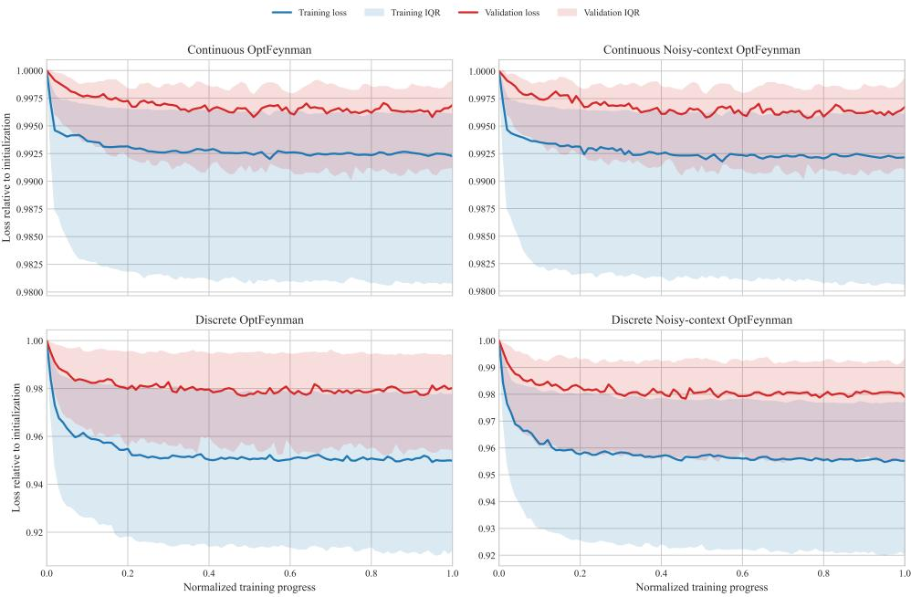  
Figure 8: OptLearner learning curves on OptFeynman. Training and validation losses for continuous and discrete OptFeynman tasks, with and without noisy context variables. Loss is the OptLearner objective defined in the main text: $L _ { \mathrm { { c o n t } } }$ for continuous outcomes and $L _ { \mathrm { d i s c } }$ for discrete outcomes. For each task, losses are normalized by their values at the first epoch, and training progress is normalized from the first epoch to the epoch selected by validation-based early stopping. Curves show the median across tasks and shaded regions show the interquartile range.

## A.2 OptScientist Agent

The OptScientist Agent implements the iterative scientific-discovery process introduced in Sec. 3.3. A Research Orchestrator maintains the research state and coordinates three specialized agents: a Theory Prior Agent, an Experiment Agent, and a Scientific Critic and Theory Abstraction Agent. Together, these components connect scientific reasoning with model training, symbolic discovery and empirical evaluation, allowing candidate optimization laws to be progressively proposed, tested, adjudicated and abstracted.

The architecture is organized around a shared research state that accumulates information across discovery rounds. This state contains the research question, variable definitions, theoretical hypotheses, fixed data split, search configurations, discovered symbolic laws, evaluation results and unresolved scientific questions. Maintaining these elements in a common state allows later stages to trace each candidate law back to the assumptions, variables and empirical evidence that produced it. It also enables the system to preserve informative failures: unstable symbolic structures, weakly supported mechanisms and missing explanatory variables can directly shape the next round of discovery.

Each specialized agent operates on a role-specific view of this state and returns structured outputs to the Research Orchestrator. Scientific priors therefore enter the workflow as explicit hypotheses and search constraints; empirical results enter through executed OptScientist runs; and scientific interpretations are formed from the accumulated evidence across candidate laws.

Embedding the OptScientist Model in the discovery loop. The OptScientist Model forms the empirical core of the agentic discovery system. In each discovery round, the Theory Prior Agent converts scientific knowledge into a structured set of candidate hypotheses, variables and search priors. These outputs can include newly constructed variables, transformations of observed variables, candidate mechanisms, preferred symbolic operators and restrictions on admissible functional forms. The Experiment Agent combines these proposals with model and training parameters to construct a bounded set of executable OptScientist runs.

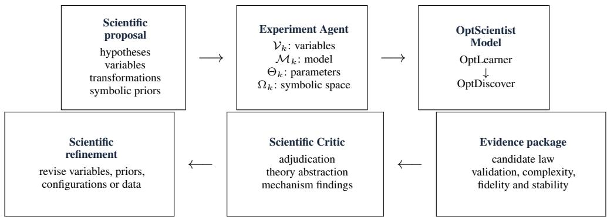  
Figure 9: Embedding the OptScientist Model in the agentic discovery loop. The Theory Prior Agent produces scientific hypotheses, candidate variables and symbolic priors. The Experiment Agent combines these proposals with model and search parameters into executable configurations $Q _ { k }$ Each configuration is passed through OptLearner and OptDiscover to produce candidate symbolic optimization laws and associated empirical evidence. The Scientific Critic evaluates this evidence, abstracts the supported laws into a more general theoretical form and qualitative mechanisms, and returns refinements that can modify the variables, priors, model configurations or data used in the next discovery round.

Concretely, each run is represented by a configuration

$$
Q _ { k } = ( \mathcal { V } _ { k } , \mathcal { M } _ { k } , \Theta _ { k } , \Omega _ { k } ) ,
$$

where $\nu _ { k }$ denotes the observed and theory-derived variables supplied to the model, $\mathcal { M } _ { k }$ specifies the OptScientist representation to be fitted, $\Theta _ { k }$ contains the corresponding model, training and search parameters, and $\Omega _ { k }$ defines the symbolic language used for distillation. For example, a prior analysis of the data informed by the scientific literature may suggest an expected-reward variable or a particular interaction between observed quantities. The Experiment Agent adds these variables to the corresponding model input, assigns an OptLearner architecture and training configuration, specifies the operators available to OptDiscover, and submits the resulting configuration as an OptScientist run. Different hypotheses, variable sets or parameter settings can therefore generate complementary runs within the same discovery round.

Figure 9 summarizes this interface. Scientific proposals are first converted into executable configurations. These configurations are passed to the OptScientist Model, which learns an optimization representation and distills it into symbolic laws. The resulting laws and their empirical evidence are then returned to the research state for scientific adjudication and refinement.

Each configuration is evaluated using the two-stage OptScientist Model introduced in Sec. 3.2. Given the training data restricted to the variables in $\nu _ { k }$ , OptLearner fits a scalar optimization landscape,

$$
S _ { \theta _ { k } } = { \mathrm { O P T L E A R N E R } } \left( { \mathcal { D } } _ { \mathrm { t r a i n } } [ \mathcal { V } _ { k } ] , \mathcal { M } _ { k } , \Theta _ { k } \right) .
$$

The learned hierarchy can denoise observations, compress redundant information, or construct intermediate representations, which are then expressed as a single optimization problem through the optimization representation bottleneck. The fitted model therefore provides a data-driven representation of how candidate outcomes are ranked under the observed contexts.

After training, the OptLearner parameters are frozen. OptDiscover receives the learned optimization representation together with the symbolic specification $\Omega _ { k }$ and distills its components into compact symbolic expressions,

$$
\mathcal { L } _ { k } = { \mathrm { O P T D I S C O V E R } } \left( S _ { \theta _ { k } } , \Omega _ { k } \right) .
$$

For a single-objective configuration, this procedure distills the learned objective directly. For a constrained configuration, the objective, inequality-constraint and equality-constraint components are distilled separately and then assembled according to the learned optimization structure. The symbolic-search specification controls the admissible operators and functional forms, while the distillation loss and complexity criterion determine which candidate expressions are retained.

The Experiment Agent collects the output of every successful run as an evidence package,

Ek = validation performance, symbolic complexity,

distillation fidelity, run stability, execution record.

The pair $( \mathcal { L } _ { k } , \mathcal { E } _ { k } )$ is written back to the shared research state. Repeated symbolic searches can contribute several low-complexity expressions with near-optimal distillation loss, allowing alternative structures to remain available when the data do not identify a unique symbolic form. The resulting candidate set therefore records both the discovered mathematical expressions and the evidence supporting each expression.

The Scientific Critic and Theory Abstraction Agent receives these candidate laws together with their evidence records and the hypotheses that generated the corresponding runs. It compares candidates using predictive performance, symbolic complexity, fidelity to the learned optimization landscape and stability across repeated searches, and identifies the laws and mathematical structures that receive the strongest empirical support. It then abstracts these supported structures into a more general theoretical form and summarizes the corresponding qualitative mechanisms and scientific findings. The exact candidate expressions are retained alongside this abstraction, preserving the connection between the empirical laws and the higher-level theory derived from them.

Remaining uncertainty is translated into concrete modifications of the next discovery round. These may include introducing a new theoretically motivated variable, removing a redundant representation, changing the symbolic operator set, evaluating an alternative OptScientist configuration or requesting additional observations. The resulting theory abstraction, mechanism findings and refinement proposals are written back to the shared research state and used to define the subsequent round of discovery.

This interface creates a direct path from scientific reasoning to model execution and back to scientific interpretation. Theory-guided variables, hypotheses and search priors are compiled by the Experiment Agent into explicit OptScientist configurations; OptLearner and OptDiscover recover candidate optimization laws from the data; and the resulting evidence is evaluated by the Scientific Critic and Theory Abstraction Agent. The supported laws are then adjudicated, abstracted into a more general theoretical form and summarized as qualitative mechanisms and scientific findings. These conclusions, together with the remaining uncertainties, determine how the subsequent discovery round is refined.

Algorithm 2 makes this interface explicit.

Research Orchestrator. The Research Orchestrator provides the control layer of the discovery process. It maintains the shared research state, coordinates information transfer among agents, manages the search budget and determines whether another discovery round is needed. The state records theoretical hypotheses, accepted variables, model configurations, discovered symbolic expressions, their empirical evaluations, theory abstractions and qualitative findings, creating a persistent scientific record across successive rounds.

This persistent state also provides continuity between scientific reasoning and empirical search. A hypothesis proposed early in the workflow remains associated with the variables introduced to test it, the model configurations used during discovery and the evidence obtained from the resulting symbolic laws. Similarly, unresolved mechanisms identified by the Scientific Critic can be translated into explicit requests for additional variables, alternative transformations or further model searches. The Orchestrator therefore allows the discovery process to accumulate evidence over time while preserving the provenance of intermediate scientific decisions.

Importantly, the Orchestrator also preserves the boundary between scientific reasoning and model execution. Agent outputs that define hypotheses, variables or search priors are converted into explicit OptScientist configurations before model fitting. Conversely, outputs from OptLearner and OptDiscover enter subsequent agent reasoning only through recorded candidate laws and their associated empirical evidence. This separation makes it possible to distinguish structures proposed as theoretical priors from structures that are subsequently supported by model fitting and symbolic discovery.

Algorithm 2 OptScientist Agent   
Require: Observational data $\overline { { \mathcal { D } } } .$ , research question $q ,$ decision variable $y ,$ search budget B   
Ensure: Supported symbolic optimization laws $\mathcal { L } ^ { \ast }$ and scientific abstraction with qualitative mecha  
nisms $\bar { \mathcal { A } } ^ { * }$   
1: Initialize shared research state $s$   
2: Fix training and validation splits $\mathcal { D } _ { \mathrm { t r a i n } } , \mathcal { D } _ { \mathrm { v a l } }$   
3: while discovery continues do   
4: $( \varkappa , \mathcal { V } , \Omega ) \dot {  } \mathbb { T }$ HEORYPRIORAGENT(S) ▷ hypotheses, variables, and search priors   
5: Validate proposed variables $\nu$   
6: Update $\bar { \cal S }$ with accepted hypotheses and variables   
7: $\mathcal { Q } $ EXPERIMENTAGENT $( \boldsymbol { S } , \mathcal { H } , \mathcal { V } , \Omega , \boldsymbol { B } )$ ▷ executable OptScientist configurations   
8: Initialize candidate-evidence set $c \gets \emptyset$   
9: for each configuration $Q \in \mathcal { Q }$ do   
10: $S _ { \theta _ { Q } } \gets \mathrm { O P T L E A R N E R } ( \mathcal { D } _ { \mathrm { t r a i n } } , Q )$ ▷ learn latent optimization landscape   
11: Freeze $S _ { \theta _ { Q } }$   
12: $\mathcal { L } _ { Q } \gets \mathrm { O P T D I S C O V E R } ( S _ { \theta _ { Q } } , Q )$ ▷ distill candidate symbolic laws   
13: $\mathcal { E } _ { Q } \gets \mathrm { E v A L U A T E } ( \mathcal { L } _ { Q } , S _ { \theta _ { Q } } , \mathcal { D } _ { \mathrm { v a l } } )$ ▷ predictive, structural, and symbolic evidence   
14: $\mathcal { C }  \mathcal { C } \cup \{ ( \mathcal { L } _ { Q } , \mathcal { E } _ { Q } , \bar { Q } ) \}$   
15: end for   
16: Record candidate laws, evidence, and execution traces in $s$   
17: (L∗, A∗, R) ← SCIENTIFICCRITICANDTHEORYABSTRACTION $( \boldsymbol { S } , \mathscr { H } , \mathscr { C } )$ ▷ adjudication,   
theory abstraction, mechanisms, and refinement   
18: Update S with supported laws $\mathcal { L } ^ { \ast }$ , theory abstraction and mechanism findings $A ^ { * } ,$ , associated   
evidence, and refinements $\mathcal { R }$   
19: if additional hypotheses, variables, or data are required then   
20: Initialize the next discovery round from S   
21: else   
22: break   
23: end if   
24: end while   
25: return $\mathcal { L } ^ { * } , \mathcal { A } ^ { * }$

Agent instructions. Each specialized agent is assigned a defined scientific role, information scope and output structure. The prompts emphasize testable hypotheses, executable empirical search and evidence-grounded scientific abstraction. Their principal instructions are summarized below.

Theory Prior Agent   
Role. Act as a scientific theorist preparing an optimization-law discovery problem.   
Input. Research question, decision variable, available variables, compact training-side data structure and   
allowed variable transformations.   
Instructions. Identify established scientific theories and mechanisms relevant to the research question and   
connect them to observed variables without treating theoretical priors as empirical conclusions. Formulate   
a small set of explicit and testable mechanism hypotheses. Identify scientifically meaningful, target  
independent variables or derived variables that provide observable representations of these mechanisms,   
and propose sparse symbolic-search priors over operators and functional structures when scientifically   
justified. Exclude variable constructions that depend on the observed target or validation and test   
information, and examine identifiability, redundancy and other theoretical risks. Express each proposal in   
a form that can be evaluated through subsequent model fitting and symbolic discovery.   
Output. Background theory, mechanism hypotheses, candidate variables, theoretical rationale, symbolic  
search priors, potential risks and unresolved scientific questions.

The Theory Prior Agent provides the scientific entry point to the discovery loop. Its role is particularly important when raw observations admit many possible representations. Domain concepts can suggest target-independent transformations that expose latent mechanisms, such as temporal differences, relative quantities, interaction terms or state variables. These proposals constrain the effective hypothesis space presented to symbolic discovery and provide an interpretable correspondence between discovered mathematical terms and candidate scientific mechanisms. Because the proposals remain explicit in the shared state, later stages can evaluate whether the resulting evidence supports, weakens or leaves each hypothesis unresolved.

The Theory Prior Agent does not determine the functional form of the final law. Its proposals define the scientific search space presented to OptScientist: which observed or derived variables may represent a mechanism, and which symbolic structures are scientifically plausible enough to prioritize during discovery. Whether those variables enter the final optimization law, and in what mathematical form, is determined subsequently by OptLearner and OptDiscover from the observational data.

## Experiment Agent

Role. Translate scientific priors into an empirical search for symbolic optimization laws.

Input. Theory priors, validated variables, task type, available OptScientist configurations, symbolic operators, fixed validation protocol and compute budget.

Instructions. Organize the theoretical mechanisms, proposed variables and symbolic-search priors into a bounded set of complementary OptScientist configurations. For each configuration, invoke OptLearner to fit the latent optimization landscape on the fixed training data and then invoke OptDiscover to distil the trained optimization representation into compact symbolic laws. Evaluate the resulting laws under the fixed validation protocol. Repeat symbolic discovery where useful for assessing structural stability, and preserve low-complexity, near-optimal complete expressions from each successful symbolic-search run rather than retaining only a single run-level expression. When variable construction fails, repair only the implementation while preserving its scientific meaning and target independence. Record the resulting candidate expressions, predictive performance, symbolic complexity, distillation evidence, repeated-run evidence and execution records. Preserve alternative high-performing structures for subsequent scientific adjudication rather than selecting the final scientific law.

Output. OptScientist configurations, candidate symbolic optimization laws, predictive metrics, symbolic complexity, distillation and repeated-run evidence, execution records and runtime issues.

The Experiment Agent provides the empirical interface between scientific reasoning and the OptScientist Model. Candidate hypotheses are not evaluated by asking the language model to directly write a final equation. Instead, the agent converts each hypothesis into an executable discovery configuration specifying the candidate variables, model structure, symbolic operators and relevant search settings. This produces a small set of scientifically differentiated model runs that can be compared under the same training and validation protocol.

Each run then follows the fixed internal logic of the OptScientist Model. OptLearner receives the observational variables selected for that configuration and learns a scalar optimization landscape $S _ { \theta } ( \mathbf { x } , \mathbf { y } )$ . Depending on the structure of the observations, OptLearner may primarily denoise meaningful scientific variables or additionally extract and compress features from high-dimensional or weakly structured inputs. Its final layer consists of a single BL block, forming an optimization representation bottleneck that represents the data as a single optimization problem. OptDiscover then extracts the symbolic form of the learned optimization problem.

After OptLearner has been trained, its parameters are frozen and OptDiscover operates on the learned representation rather than directly fitting the observed target. For a constrained representation, the learned objective, inequality-constraint and equality-constraint components are distilled separately and then assembled into a symbolic optimization problem. For a single-objective representation, the corresponding learned objective is distilled directly. The symbolic operators and structural priors proposed earlier in the discovery round determine the candidate symbolic language, while the distillation objective and complexity control determine which expressions are retained. This division of labour is important: the agent specifies the scientific search problem, whereas OptScientist learns and distills the optimization structure supported by the data.

The resulting evidence extends beyond predictive performance. Each symbolic-search run can contribute several low-complexity expressions with near-optimal distillation loss, allowing alternative structures to remain available when the symbolic evidence does not identify a unique expression. Candidate laws are therefore compared using their validation performance, symbolic complexity, fidelity to the learned optimization representation and stability across repeated searches. Recording these dimensions provides the Scientific Critic with evidence about both empirical adequacy and structural reliability, while preserving multiple competitive expressions when the available data do not clearly distinguish among them.

This explicit model interface also separates model discovery from scientific adjudication. The Experiment Agent records successful and unsuccessful runs but does not choose which expression should be interpreted as the final scientific law. Candidate-law adjudication, theory abstraction and mechanism-level interpretation occur only after the candidate expressions and their associated evidence have been returned to the shared research state.

## Scientific Critic and Theory Abstraction Agent

Role. Evaluate discovered optimization laws as candidate scientific explanations and abstract their bestsupported scientific structure.   
Input. Theory hypotheses, candidate symbolic laws, validation evidence, symbolic complexity, distillation evidence, repeated-run stability and available robustness evidence.   
Instructions. Compare candidate laws using their empirical evidence and characterize the level of support for each proposed mechanism. Adjudicate among candidate laws by jointly considering predictive performance, symbolic complexity, structural stability and consistency with plausible theoretical mechanisms, while treating theory as a prior rather than a substitute for empirical support. Preserve the exact selected candidate expressions and identify structures and qualitative mechanisms that recur across supported laws. Synthesize the supported candidates into a general-to-specific theory abstraction, progressing from a general optimization form to supported functional structure, exact parameterized laws and qualitative findings. Assess explicit research hypotheses, identify competing explanations, limitations and remaining failure modes, and propose additional variables, observations or targeted analyses that could resolve the remaining scientific uncertainty.   
Output. Candidate-law adjudication, supported symbolic laws, general-to-specific theory abstraction, qualitative mechanisms, hypothesis assessment, limitations and targeted suggestions for subsequent discovery.

The Scientific Critic connects symbolic recovery to theory formation. Symbolic regression can produce several expressions with similar predictive performance, including algebraically related forms and model-specific residual terms. The Critic evaluates these expressions collectively and identifies structures that remain stable across supported candidates. Recurring structures provide evidence for mechanism-level conclusions, whereas unstable or weakly identified terms are retained as sources of uncertainty.

The Critic receives the output of OptScientist as empirical evidence rather than as a finished theory. This distinction allows it to compare not only the symbolic expressions themselves but also how faithfully they reproduce the learned optimization landscape, how well they generalize under the fixed validation protocol, and whether similar structures reappear across repeated discovery runs. Scientific interpretation is therefore conditioned on the evidence produced by the model rather than on the plausibility of an expression in isolation.

Theory abstraction is performed hierarchically. At the highest level, the Critic identifies the general optimization principle expressed by the supported laws, such as reward maximization, target tracking or minimization of a deviation cost. It then constructs a parameter-tied general form where common parameter structure is empirically supported, followed by the specific functional structure associated with interpretable mechanisms. The exact parameterized candidate laws are retained at the next level, preserving their empirical expressions, and the final level summarizes the supported qualitative findings. This hierarchy allows OptScientist to synthesize candidate laws into a more general form and qualitative mechanisms while preserving the detailed mathematical structure from which those conclusions were derived.

The Critic also converts unresolved evidence into new scientific questions. A missing mechanism may motivate a new derived variable; competing symbolic structures may motivate additional observations capable of distinguishing their predictions; and systematic prediction failures may indicate omitted context or an insufficient symbolic language. These outputs are returned to the shared research state and provide structured inputs for a subsequent discovery round. In the next round, the Theory Prior and Experiment Agents translate these unresolved questions into revised variables, hypotheses or OptScientist configurations, so that scientific critique produces a concrete change in the subsequent model search rather than remaining a purely textual assessment.

Overall, the architecture organizes OptScientist into an iterative sequence of theory formation, modelbased empirical discovery, evidence evaluation and theory abstraction. The Theory Prior Agent establishes candidate mechanisms, scientifically meaningful representations and symbolic-search priors. The Experiment Agent converts these proposals into executable configurations and invokes the OptScientist Model. Within each run, OptLearner learns to represent observational data as an optimization problem through an optimization representation bottleneck, and OptDiscover then distills the learned representation into a compact symbolic optimization law. The Scientific Critic then adjudicates among the resulting candidates and synthesizes their supported structure into more general optimization forms and qualitative mechanisms. The Research Orchestrator preserves the connection between these stages and carries unresolved scientific questions across iterations. This division of labour places a specialized symbolic-discovery model at the empirical centre of the agentic workflow, allowing language-model agents to guide and interpret discovery without substituting linguistic generation for model-based evidence.

## B Additional Experimental Details

## B.1 Baselines

We compare OptScientist with standard machine-learning models, symbolic regression, optimization structured models, domain-specific models, and three LLM-based automated model-discovery meth ods. The general baselines include Multilayer Perceptron (MLP) (Rumelhart et al., 1986), Logistic Regression (LR) (Cox, 1958), Random Forest (RF) (Breiman, 2001), eXtreme Gradient Boosting (XGBoost) (Chen & Guestrin, 2016), Gradient-Boosted Decision Trees (GBDT) (Friedman, 2001), Symbolic Regression (SR) (Cranmer, 2023), Neural Energy-Based Models (Neural EBM) (LeCun et al., 2006), and Behavior Learning (BL) (Ma et al., 2026b). The LLM-based baselines are an LLM-only researcher, GeCCo (Rmus et al., 2026) as a code-assisted LLM approach, and Model Discovery Agent (MDA; Murphy, 2026) as a Bayesian experiment-design approach.

OptFeynman. For OptFeynman, we compare against MLP, LR, RF, XGBoost, and GBDT as standard machine-learning baselines, SR as a direct symbolic-discovery baseline, Neural EBM and BL as optimization-structured baselines, and the three LLM-based baselines.

Human decisions under risk and ambiguity. For CPC18, we compare against established behavioural models, including expected-value logit, expected-utility logit, prospect-theory logit with fixed or fitted parameters, and mean–variance logit. We additionally include GBDT, MLP, RF, and XGBoost as machine-learning baselines, together with the three LLM-based baselines.

Central-bank monetary decisions. For monetary-policy decisions, we compare against MLP, RF, XGBoost, and GBDT as machine-learning baselines, Neural EBM as an optimization-structured baseline, SR as a direct symbolic-discovery baseline, and the three LLM-based baselines.

## B.2 OptFeynman Ground-Truth Recovery

Statistical analysis. We report additional statistics for the OptFeynman experiments in Figures 3 and 4. The analysis uses results from the OptLearner score and the final OptScientist symbolic law produced by OptDiscover for 99 OptFeynman problems under each combination of decision type (discrete or continuous) and training condition. Throughout this section, OptLearner score refers to the learned optimization score before symbolic distillation, and OptScientist law refers to the final symbolic optimization law produced by OptDiscover. We use Clean for the original OptFeynman setting and Noisy-context for the noisy-context version defined in Sec. 5.1, in which Gaussian noise is added only to the training contexts. Each problem is treated as one observation when computing statistics across the benchmark. One duplicated record in the continuous Clean setting contained identical metrics and was counted once.

Recovery is evaluated using exact-order accuracy, pairwise preference accuracy, and the Gibbs distribution induced by the recovered score. Exact-order accuracy measures agreement between the complete preference order produced by the recovered and ground-truth objectives. Pairwise accuracy measures agreement across individual pairs of candidate outcomes. For continuous tasks, preference recovery is evaluated at $K = 1 0 , 5 0$ , and 100 candidate outcomes, and distribution recovery is evaluated on a dense grid over the decision interval.

Unless stated otherwise, reported uncertainty is the standard error across the 99 OptFeynman problems,

$$
{ \mathrm { S E } } = { \frac { s } { \sqrt { n } } } , \qquad n = 9 9 ,
$$

where s is the sample standard deviation across problems. Error bars in Figures 3 and 4 use mean ±1 SE. Medians and interquartile ranges are also reported for metrics with uneven distributions across problems. Perfect exact-order recovery denotes a task with exact-order accuracy equal to one.

Perfect exact-order recovery. Table 3 summarizes perfect ground-truth recovery. For discrete outcomes, OptScientist recovers the complete ground-truth preference order on 88/99 Clean problems and 92/99 Noisy-context problems. For continuous outcomes, it achieves perfect recovery on 78/99 Clean problems and 76/99 Noisy-context problems at $K = 1 0 , 5 0$ , and 100. The stability of these counts as K increases shows that the recovered laws from OptScientist continue to preserve the full ordering over increasingly dense sets of candidate outcomes.

The learned OptLearner score has substantially fewer perfectly recovered problems. In the continuous Clean setting, the count decreases from $3 0 / 9 9$ at $\bar { K } = 1 0$ to $1 4 / 9 9$ at $\mathrm { \tilde { K } = 1 0 0 }$ . This difference is also visible in the discrete setting, where OptLearner achieves perfect recovery on $3 1 / 9 9$ Clean problems and $2 7 / 9 9$ Noisy-context problems.  
Table 3: Perfect exact-order recovery on OptFeynman. Entries report the number and percentage of the 99 tasks with exact-order accuracy equal to one. OptScientist law denotes the final symbolic optimization law produced by OptDiscover.
<table><tr><td>Decision type</td><td>Representation</td><td>Candidate set</td><td>Clean</td><td>Noisy-context</td></tr><tr><td>Discrete</td><td>OptScientist law</td><td> $K = 5$ </td><td>88/99 (88.89%)</td><td>92/99 (92.93%)</td></tr><tr><td>Discrete</td><td>OptLearner score</td><td> $K = 5$ </td><td>31/99 (31.31%)</td><td>27/99 (27.27%)</td></tr><tr><td>Continuous</td><td>OptScientist law</td><td> $K = 1 0$ </td><td>78/99 (78.79%)</td><td>76/99 (76.77%)</td></tr><tr><td>Continuous</td><td>OptLearner score</td><td> $K = 1 0$ </td><td>30/99 (30.30%)</td><td>30/99 (30.30%)</td></tr><tr><td>Continuous</td><td>OptScientist law</td><td> $K = 5 0$ </td><td>78/99 (78.79%)</td><td>76/99 (76.77%)</td></tr><tr><td>Continuous</td><td>OptLearner score</td><td> $K = 5 0$ </td><td>20/99 (20.20%)</td><td>23/99 (23.23%)</td></tr><tr><td>Continuous</td><td>OptScientist law</td><td> $K = 1 0 0$ </td><td>78/99 (78.79%)</td><td>76/99 (76.77%)</td></tr><tr><td>Continuous</td><td>OptLearner score</td><td> $K = 1 0 0$ </td><td>14/99 (14.14%)</td><td>15/99 (15.15%)</td></tr></table>

Continuous outcomes. Table 4 reports continuous preference recovery. Under the Clean condition, mean OptScientist exact-order accuracy is 0.900 at $K = 1 0 , 0 . 8 7 1$ at $K = 5 0 ,$ , and 0.866 at $K = 1 0 0$ The corresponding values under Noisy-context are 0.902, 0.874, and 0.869.

Table 4: Preference recovery for continuous OptFeynman problems. Values are mean ± SE across 99 OptFeynman problems. Median and interquartile range refer to exact-order accuracy. Higher values indicate better recovery.
<table><tr><td>Condition</td><td>K</td><td>Representation</td><td>Exact order</td><td>Median [Q1,Q3]</td><td>Pairwise</td></tr><tr><td>Clean</td><td>10</td><td>OptScientist law</td><td> $0 . 9 0 0 \pm 0 . 0 2 7$ </td><td>1.000 [1.000, 1.000]</td><td> $0 . 9 6 3 \pm 0 . 0 1 5$ </td></tr><tr><td>Clean</td><td>10</td><td>OptLearner score</td><td> $0 . 8 2 5 \pm 0 . 0 2 6$ </td><td>0.940 [0.800, 1.000]</td><td> $0 . 9 6 0 \pm 0 . 0 0 7$ </td></tr><tr><td>Clean</td><td>50</td><td>OptScientist law</td><td> $0 . 8 7 1 \pm 0 . 0 3 2$ </td><td>1.000 [1.000, 1.000]</td><td> $0 . 9 6 3 \pm 0 . 0 1 5$ </td></tr><tr><td>Clean</td><td>50</td><td>OptLearner score</td><td> $0 . 7 4 3 \pm 0 . 0 3 5$ </td><td>0.900 [0.695, 0.990]</td><td> $0 . 9 6 0 \pm 0 . 0 0 8$ </td></tr><tr><td>Clean</td><td>100</td><td>OptScientist law</td><td> $0 . 8 6 6 \pm 0 . 0 3 3$ </td><td>1.000 [1.000, 1.000]</td><td> $0 . 9 6 3 \pm 0 . 0 1 5$ </td></tr><tr><td>Clean</td><td>100</td><td>OptLearner score</td><td> $0 . 7 1 9 \pm 0 . 0 3 5$ </td><td>0.880 [0.665, 0.970]</td><td> $0 . 9 6 0 \pm 0 . 0 0 8$ </td></tr><tr><td>Noisy-context</td><td>10</td><td>OptScientist law</td><td> $0 . 9 0 2 \pm 0 . 0 2 6$ </td><td>1.000 [1.000, 1.000]</td><td> $0 . 9 5 9 \pm 0 . 0 1 4$ </td></tr><tr><td>Noisy-context</td><td>10</td><td>OptLearner score</td><td> $0 . 8 2 6 \pm 0 . 0 2 6$ </td><td>0.950 [0.805, 1.000]</td><td> $0 . 9 6 0 \pm 0 . 0 0 8$ </td></tr><tr><td>Noisy-context</td><td>50</td><td>OptScientist law</td><td> $0 . 8 7 4 \pm 0 . 0 3 0$ </td><td>1.000 [1.000, 1.000]</td><td> $0 . 9 5 9 \pm 0 . 0 1 4$ </td></tr><tr><td>Noisy-context</td><td>50</td><td>OptLearner score</td><td> $0 . 7 4 3 \pm 0 . 0 3 5$ </td><td>0.910 [0.695, 0.990]</td><td> $0 . 9 6 0 \pm 0 . 0 0 8$ </td></tr><tr><td>Noisy-context</td><td>100</td><td>OptScientist law</td><td> $0 . 8 6 9 \pm 0 . 0 3 1$ </td><td>1.000 [1.000, 1.000]</td><td> $0 . 9 5 8 \pm 0 . 0 1 4$ </td></tr><tr><td>Noisy-context</td><td>100</td><td>OptLearner score</td><td> $0 . 7 2 2 \pm 0 . 0 3 5$ </td><td>0.880 [0.665, 0.980]</td><td> $0 . 9 6 0 \pm 0 . 0 0 8$ </td></tr></table>

For every value of K, the median and both quartiles of OptScientist exact-order accuracy are equal to one. Most problems therefore retain perfect ordering even when the candidate set becomes substantially denser. Pairwise recovery is similarly stable. Mean OptScientist pairwise accuracy remains approximately 0.96 across all candidate-set sizes and both training conditions, with a median of one.

Table 5: Distribution recovery for continuous OptFeynman problems. KL divergence is computed between the ground-truth and recovered Gibbs distributions on the dense test grid. Values are mean ± SE across 99 OptFeynman problems. Lower values indicate closer distribution recovery.
<table><tr><td>Condition</td><td>Representation</td><td>KL</td><td>Median [Q1,Q3]</td></tr><tr><td>Clean</td><td>OptScientist law</td><td> $0 . 0 4 6 1 \pm 0 . 0 1 1 1$ </td><td>0.0080 [0.0013, 0.0358]</td></tr><tr><td>Clean</td><td>OptLearner score</td><td> $0 . 0 0 7 8 \pm 0 . 0 0 3 2$ </td><td>0.0015 [0.0010, 0.0030]</td></tr><tr><td>Noisy-context</td><td>OptScientist law</td><td> $0 . 0 4 6 0 \pm 0 . 0 1 6 3$ </td><td>0.0071 [0.0012, 0.0382]</td></tr><tr><td>Noisy-context</td><td>OptLearner score</td><td> $0 . 0 0 8 2 \pm 0 . 0 0 3 6$ </td><td>0.0014 [0.0009, 0.0031]</td></tr></table>

OptLearner also achieves high pairwise accuracy, while its exact-order accuracy decreases more strongly with K. Under the Clean condition, mean OptLearner exact-order accuracy decreases from 0.825 at K = 10 to 0.719 at K = 100.

The recovered continuous laws from OptScientist also preserve the Gibbs distributions generated by the ground-truth objectives. Mean dense-grid KL divergence is 0.0461 under Clean and 0.0460 under Noisy-context. The corresponding medians are 0.0080 and 0.0071, showing low distributional error for most tasks. OptLearner achieves mean KL values of 0.0078 and 0.0082, consistent with its direct fit to the stochastic optimization landscape.

Discrete outcomes. The discrete results show a similar pattern. Under the Clean condition, the recovered OptScientist laws achieve mean exact-order accuracy 0.971 and pairwise accuracy 0.984. Under Noisy-context, these values are 0.974 and 0.984. The median and both quartiles of OptScientist exact-order accuracy are equal to one in both conditions.

Table 6: Preference recovery for discrete OptFeynman problems. Values are mean $\pm \mathrm { S E }$ across 99 problems. Median and interquartile range refer to exact-order accuracy.
<table><tr><td>Condition</td><td>Representation</td><td>Exact order</td><td>Median [Q1,Q3]</td><td>Pairwise</td><td> $\mathbf { E x a c t } = 1$ </td></tr><tr><td>Clean</td><td>OptScientist law</td><td> $0 . 9 7 1 \pm 0 . 0 1 4$ </td><td>1.000 [1.000, 1.000]</td><td> $0 . 9 8 4 \pm 0 . 0 1 1$ </td><td>88/99</td></tr><tr><td>Clean</td><td>OptLearner score</td><td> $0 . 8 0 5 \pm 0 . 0 2 5$ </td><td>0.920 [0.675, 1.000]</td><td> $0 . 9 4 7 \pm 0 . 0 0 9$ </td><td>31/99</td></tr><tr><td></td><td>Noisy-context OptScientist law</td><td> $0 . 9 7 4 \pm 0 . 0 1 5$ </td><td>1.000 [1.000, 1.000]</td><td> $0 . 9 8 4 \pm 0 . 0 1 1$ </td><td>92/99</td></tr><tr><td>Noisy-context</td><td>OptLearner score</td><td> $0 . 8 0 5 \pm 0 . 0 2 4$ </td><td>0.890 [0.705, 1.000]</td><td> $0 . 9 4 8 \pm 0 . 0 0 9$ </td><td>27/99</td></tr></table>

Training-context noise produces little change in the overall recovery statistics. Mean OptScientist exact-order accuracy changes from 0.971 to 0.974, while mean pairwise accuracy remains approximately 0.984. The number of perfectly recovered tasks changes from 88/99 to 92/99. These results are consistent with the robustness observed in Figure 4.

Table 7: Distribution recovery for discrete OptFeynman problems. The ground-truth Gibbs distribution over five candidate actions is compared with the distribution induced by the recovered score. Probability MAE is the mean absolute error between ground-truth and recovered Gibbs probabilities. Values are mean ± SE across 99 problems. Lower values indicate closer recovery.
<table><tr><td>Condition</td><td>Representation</td><td>Prob. MAE</td><td>MAE median [Q1,Q3]</td><td>KL</td><td>KL median [Q1,Q3]</td></tr><tr><td>Clean</td><td>OptScientist law</td><td> $0 . 0 1 8 2 \pm 0 . 0 0 2 5$ </td><td>0.0115 [0.0061, 0.0201]</td><td> $0 . 0 2 1 7 \pm 0 . 0 0 9 2$ </td><td>0.0036 [0.0008, 0.0109]</td></tr><tr><td>Clean</td><td>OptLearner score</td><td></td><td>0.0161 ± 0.0032 0.0112 [0.0083, 0.0154]</td><td> $0 . 1 9 3 2 \pm 0 . 1 8 7 3$ </td><td>0.0032 [0.0016, 0.0059]</td></tr><tr><td></td><td>Noisy-context OptScientist law</td><td> $0 . 0 2 0 8 \pm 0 . 0 0 3 6$ </td><td>0.0117 [0.0062, 0.0238]</td><td> $0 . 2 0 0 5 \pm 0 . 1 8 5 2$ </td><td>0.0036 [0.0010, 0.0132]</td></tr><tr><td></td><td>Noisy-context OptLearner score</td><td> $0 . 0 1 6 1 \pm 0 . 0 0 3 2$ </td><td>0.0110 [0.0080, 0.0146]</td><td> $0 . 2 0 2 5 \pm 0 . 1 9 6 4$ </td><td>0.0033 [0.0016, 0.0052]</td></tr></table>

For the Gibbs distributions over the five candidate actions, we additionally report probability MAE, defined as the mean absolute error between the ground-truth and recovered Gibbs probabilities across candidate actions. The OptScientist laws achieve mean probability MAE 0.0182 and mean KL divergence 0.0217 under the Clean condition. Their medians are 0.0115 and 0.0036, respectively. Under Noisy-context, mean probability MAE remains low at 0.0208, with a median of 0.0117. Mean OptScientist KL increases to 0.2005, while the median remains 0.0036 and the third quartile is

0.0132. The difference between the mean and median reflects a small number of tasks with large KL values.  
Table 8: Examples of recovered OptFeynman laws. Ground-truth and recovered laws are shown in optimization form after removing numerical constants and scale factors that do not affect the optimizer.
<table><tr><td>Decision variable</td><td>Effective ground truth</td><td>Effective recovered expression</td></tr><tr><td>Y3</td><td>max  $x _ { 3 } y _ { 3 }$  y3</td><td>max x3Y3 y3</td></tr><tr><td>w</td><td> $\operatorname* { m a x } _ { w } \ w ^ { 2 }$ </td><td> $w ^ { 2 }$  max w</td></tr><tr><td>X</td><td>max  $B \chi$  X</td><td>max  $B \chi$  X</td></tr><tr><td> $E _ { f }$ </td><td> $\operatorname* { m a x } _ { E _ { f } } E _ { f } \cos \theta$ </td><td>max  $E _ { f }$  cos θ Ef</td></tr><tr><td>θ</td><td>max sinθ θ</td><td>max sin θ θ</td></tr><tr><td>G</td><td> $\operatorname* { m a x } _ { G } G \left( { \frac { 1 } { r _ { 2 } } } - { \frac { 1 } { r _ { 1 } } } \right)$ </td><td> $\underline { { G ( r _ { 1 } - r _ { 2 } ) } }$  max G</td></tr><tr><td>x</td><td> $x ^ { 2 }$  max x</td><td>r1r2  $x ^ { 2 }$  max</td></tr><tr><td> $d$ </td><td> $T _ { 2 } - T _ { 1 }$  max d  $d$ </td><td>x  $T _ { 2 } - T _ { 1 }$  max  $d$ </td></tr><tr><td>r</td><td>1</td><td>d</td></tr><tr><td></td><td>max  $\overline { { r ^ { 2 } } }$  r  $1$ </td><td> $\frac { 1 } { r ^ { 2 } }$  max r</td></tr></table>

Effect of OptDiscover complexity control. Here we evaluate the expression-level reduction used within the symbolic complexity control of OptDiscover described in Sec. 3.2.2. In Table 9, Initial denotes the recovered symbolic expression before this reduction, and Final denotes the compact symbolic expression after it. We additionally compare exact-order recovery before and after this reduction. Discrete recovery is unchanged: mean exact-order accuracy remains 0.971 under Clean and 0.974 under Noisy-context, with 88 and 92 perfectly recovered problems, respectively.

For continuous outcomes, complexity control gives small improvements in exact-order recovery. Under Clean, mean accuracy increases by 0.010, 0.011, and 0.013 at $K = 1 0 , 5 0$ , and 100. At $K = 1 0 0$ , the number of perfectly recovered problems increases from 67 to 78. Under Noisy-context, changes in mean accuracy range from −0.001 to +0.005, and perfect recovery at $K = 1 0 0$ increases from 70 to 76 problems.

Held-out baseline comparison. Tables 10 and 11 report ground-truth recovery for the baseline models on unseen test contexts. The largest separation appears in exact-order recovery, which requires the recovered score to preserve the complete preference order induced by the ground-truth objective. In the discrete Clean setting, the two strongest baselines by mean exact-order accuracy are BL and logistic regression. BL achieves mean exact-order accuracy 0.805 with perfect recovery on 31.3% of tasks, and logistic regression achieves 0.716 with perfect recovery on 17.2%. OptScientist reaches 0.971 exact-order accuracy and perfectly recovers 88/99 tasks. The separation becomes larger for continuous outcomes as the candidate set grows. At $\dot { K } = 1 0 0$ , the two strongest baselines by mean exact-order accuracy, BL and Neural EBM, achieve exact-order accuracies of 0.719 and 0.294, with perfect recovery on 14.1% and 10.1% of tasks, respectively. OptScientist retains exact-order accuracy 0.866 and perfectly recovers 78/99 tasks.

Pairwise and distributional metrics provide complementary views of recovery. Several baselines preserve a substantial fraction of pairwise comparisons or closely approximate the Gibbs distribution while showing considerably weaker recovery of the complete ordering. For example, Neural EBM reaches pairwise accuracy 0.888 and dense-grid KL divergence 0.0098 at K = 100 in the continuous Clean setting, while its exact-order accuracy is 0.294. BL achieves a dense-grid KL divergence of 0.0078, lower than that achieved by OptScientist, while its exact-order accuracy decreases to 0.719 at K = 100. A similar pattern appears for the LLM-only baseline in the discrete Clean setting, which reaches KL divergence 0.0125 but exact-order accuracy 0.588, with perfect recovery on only 5.1% of tasks. These results show that accurate approximation of local pairwise relations or the stochastic landscape can coexist with substantial errors in the complete preference order. Because all preference metrics are evaluated on held-out contexts, exact-order recovery places a stronger requirement on the learned model: the recovered mechanism must preserve the full ordering generated by the ground-truth objective across unseen contexts.

Table 9: Exact-order recovery before and after OptDiscover complexity control. Mean accuracy is computed across matched OptFeynman problems. Initial denotes the recovered symbolic expression before expression-level reduction, and Final denotes the compact symbolic expression after it. The final column reports the number of problems with perfect exact-order recovery before and after this reduction.
<table><tr><td>Decision type</td><td>Condition</td><td>Initial</td><td>Final</td><td>∆</td><td>Perfect recovery</td></tr><tr><td>Continuous</td><td>Clean, K = 10</td><td>0.890</td><td>0.900</td><td> $+ 0 . 0 1 0$ </td><td> $7 7  7 8$ </td></tr><tr><td>Continuous</td><td>Clean, K = 50</td><td>0.860</td><td>0.871</td><td> $+ 0 . 0 1 1$ </td><td> $7 2  7 8$ </td></tr><tr><td>Continuous</td><td> $\mathrm { C l e a n } , K = 1 0 0$ </td><td>0.852</td><td>0.866</td><td> $+ 0 . 0 1 3$ </td><td> $6 7  7 8$ </td></tr><tr><td>Continuous</td><td>Noisy-context,  $K = 1 0$ </td><td>0.902</td><td>0.902</td><td>-0.001</td><td> $7 6  7 6$ </td></tr><tr><td>Continuous</td><td>Noisy-context,  $K = 5 0$ </td><td>0.872</td><td>0.874</td><td>+0.002</td><td> $7 5  7 6$ </td></tr><tr><td>Continuous</td><td>Noisy-context,  $K = 1 0 0$ </td><td>0.864</td><td>0.869</td><td>+0.005</td><td> $7 0  7 6$ </td></tr><tr><td>Discrete</td><td>Clean</td><td>0.971</td><td>0.971</td><td>0.000</td><td> $8 8  8 8$ </td></tr><tr><td>Discrete</td><td> $\mathrm { N o i s y - c o n t e x t }$ </td><td>0.974</td><td>0.974</td><td>0.000</td><td> $9 2  9 2$ </td></tr></table>

Table 10: Held-out baseline recovery for discrete OptFeynman problems. Exact-order and pairwise preference accuracy are evaluated on unseen test contexts. Exact = 1 reports the percentage of tasks with perfect exact-order recovery. KL divergence compares the ground-truth and recovered Gibbs distributions over the five candidate actions; lower values indicate closer distribution recovery. For discrete decisions, a standard multiclass MLP can be written in the same finite-action softmax form as a conditional Neural EBM, so we use the multiclass MLP directly rather than introducing a separate Neural EBM baseline.
<table><tr><td>Condition</td><td>Method</td><td>n</td><td>Exact order</td><td>Exact = 1</td><td>Pairwise</td><td>KL</td></tr><tr><td>Clean</td><td>GBDT</td><td>99</td><td>0.327</td><td>0.0%</td><td>0.844</td><td>0.1679</td></tr><tr><td>Clean</td><td>LR</td><td>99</td><td>0.716</td><td>17.2%</td><td>0.919</td><td>0.0859</td></tr><tr><td>Clean</td><td>MLP</td><td>99</td><td>0.420</td><td>6.1%</td><td>0.859</td><td>0.1580</td></tr><tr><td>Clean</td><td>RF</td><td>99</td><td>0.206</td><td>0.0%</td><td>0.794</td><td>0.5992</td></tr><tr><td>Clean</td><td>XGBoost</td><td>99</td><td>0.337</td><td>0.0%</td><td>0.847</td><td>0.0833</td></tr><tr><td>Clean</td><td>SR</td><td>99</td><td>0.076</td><td>0.0%</td><td>0.743</td><td>0.8855</td></tr><tr><td>Clean</td><td>LLM-only</td><td>99</td><td>0.588</td><td>5.1%</td><td>0.911</td><td>0.0125</td></tr><tr><td>Clean</td><td>GeCCo</td><td>99</td><td>0.715</td><td>20.2%</td><td>0.928</td><td>0.2025</td></tr><tr><td>Clean</td><td>MDA</td><td>99</td><td>0.700</td><td>21.2%</td><td>0.926</td><td>0.1579</td></tr><tr><td>Clean</td><td>BL</td><td>99</td><td>0.805</td><td>31.3%</td><td>0.947</td><td>0.1932</td></tr><tr><td>Clean</td><td>OptScientist</td><td>99</td><td>0.971</td><td>88.9%</td><td>0.984</td><td>0.0217</td></tr><tr><td>Noisy-context</td><td>GBDT</td><td>99</td><td>0.371</td><td>0.0%</td><td>0.854</td><td>0.1744</td></tr><tr><td>Noisy-context</td><td>LR</td><td>99</td><td>0.717</td><td>17.2%</td><td>0.919</td><td>0.0860</td></tr><tr><td>Noisy-context</td><td>MLP</td><td>99</td><td>0.418</td><td>6.1%</td><td>0.860</td><td>0.1635</td></tr><tr><td>Noisy-context</td><td>RF</td><td>99</td><td>0.104</td><td>0.0%</td><td>0.701</td><td>1.1334</td></tr><tr><td>Noisy-context</td><td>XGBoost</td><td>99</td><td>0.331</td><td>0.0%</td><td>0.842</td><td>0.0636</td></tr><tr><td>Noisy-context</td><td>SR</td><td>99</td><td>0.076</td><td>1.0%</td><td>0.743</td><td>0.8816</td></tr><tr><td>Noisy-context</td><td>LLM-only</td><td>99</td><td>0.593</td><td>8.1%</td><td>0.911</td><td>0.1214</td></tr><tr><td>Noisy-context</td><td>GeCCo</td><td>99</td><td>0.721</td><td>20.2%</td><td>0.930</td><td>0.1592</td></tr><tr><td>Noisy-context</td><td>MDA</td><td>99</td><td>0.703</td><td>18.2%</td><td>0.930</td><td>0.1417</td></tr><tr><td>Noisy-context</td><td>BL</td><td>99</td><td>0.805</td><td>27.3%</td><td>0.948</td><td>0.2025</td></tr><tr><td>Noisy-context</td><td>OptScientist</td><td>99</td><td>0.974</td><td>92.9%</td><td>0.984</td><td>0.2005</td></tr></table>

Table 11: Held-out baseline recovery for continuous OptFeynman problems. Within the exactorder, perfect-recovery and pairwise columns, entries correspond to K = 10/50/100, respectively. Exact = 1 reports the percentage of tasks with perfect exact-order recovery. KL divergence compares the ground-truth and recovered Gibbs distributions on the dense held-out test grid; lower values indicate closer distribution recovery.
<table><tr><td rowspan=1 colspan=8>Condition   Method     nExact order10/50/100Exact = 1 (%)10/50/100 Pairwise10/50/100   KL</td></tr><tr><td rowspan=2 colspan=8>Clean      GBDT     990.063/0.003/0.002      0.0/0.0/0.0     0.704/0.704/0.7040.63620.482/0.314/0.294                                          0.0098</td></tr><tr><td rowspan=1 colspan=4>Clean Neural EBM 99 0.482</td><td rowspan=1 colspan=3></td></tr><tr><td rowspan=1 colspan=4>Clean      MLP      990.061/</td><td rowspan=1 colspan=3>0.003/0.001     0.0/0.0/0.0     0.703/0.703/0.703</td><td rowspan=1 colspan=1>0.6349</td></tr><tr><td rowspan=1 colspan=4>Clean      RF       990.064/</td><td rowspan=1 colspan=3>0.003/0.001     0.0/0.0/0.0     0.703/0.702/0.703</td><td rowspan=2 colspan=1>0.64080.63994</td></tr><tr><td rowspan=1 colspan=4>Clean      XGBoost   990.061/</td><td rowspan=1 colspan=3>0.003/0.001     0.0/0.0/0.0     0.704/0.704/0.70</td></tr><tr><td rowspan=1 colspan=2>Clean      SR</td><td rowspan=1 colspan=1>99</td><td rowspan=1 colspan=1>0.060/0</td><td rowspan=1 colspan=4>.002/0.001      0.0/0.0/0.0     0.710/0.710/0.7110.6414</td></tr><tr><td rowspan=1 colspan=2>Clean      LLM-only</td><td rowspan=1 colspan=1>99</td><td rowspan=1 colspan=1>0.061/0</td><td rowspan=1 colspan=3>.003/0.002     0.0/0.0/0.0     0.701/0.702/0.702</td><td rowspan=2 colspan=1>0.6422.6353</td></tr><tr><td rowspan=1 colspan=1>Clean</td><td rowspan=1 colspan=1>GeCCo</td><td rowspan=1 colspan=1>99</td><td rowspan=1 colspan=1>0.062/0</td><td rowspan=1 colspan=1>.003/</td><td rowspan=1 colspan=2>0.002     0.0/0.0/0.0     0.703/0.704/0.704 0</td></tr><tr><td rowspan=1 colspan=1>Clean</td><td rowspan=1 colspan=1>MDA</td><td rowspan=1 colspan=1>99</td><td rowspan=1 colspan=1>0.062/0</td><td rowspan=1 colspan=1>.002/</td><td rowspan=1 colspan=2>0.002     0.0/0.0/0.0     0.704/0.704/0.70</td><td rowspan=1 colspan=1>0.63554</td></tr><tr><td rowspan=1 colspan=1>Clean</td><td rowspan=1 colspan=1>BL</td><td rowspan=1 colspan=1>99</td><td rowspan=1 colspan=1>0.825/</td><td rowspan=1 colspan=1>0.743/</td><td rowspan=1 colspan=1>0.719    30.3/20.2/14.1    0.960/0.960/</td><td rowspan=1 colspan=1>0.960</td><td rowspan=1 colspan=1>0.0078</td></tr><tr><td rowspan=1 colspan=1>Clean</td><td rowspan=1 colspan=1>OptScientist</td><td rowspan=1 colspan=1>99</td><td rowspan=1 colspan=1>0.900/</td><td rowspan=1 colspan=1>0.871/</td><td rowspan=1 colspan=1>0.866    78.8/78.8/78.8    0.963/0.963/</td><td rowspan=1 colspan=1>0.963</td><td rowspan=1 colspan=1>0.0461</td></tr><tr><td rowspan=1 colspan=1>Noisy-context</td><td rowspan=1 colspan=3>GBDT     990.063/</td><td rowspan=1 colspan=1>0.003/</td><td rowspan=1 colspan=2>0.001     0.0/0.0/0.0     0.704/0.704/0.705</td><td rowspan=1 colspan=1>0.6372</td></tr><tr><td rowspan=1 colspan=1>Noisy-context</td><td rowspan=1 colspan=1>Neural EBM</td><td rowspan=1 colspan=1>99</td><td rowspan=1 colspan=1>0.473/</td><td rowspan=1 colspan=1>0.307/</td><td rowspan=1 colspan=1>0.290     10.1/6.1/6.1     0.887/0.887/</td><td rowspan=1 colspan=1>0.888</td><td rowspan=1 colspan=1>0.0101</td></tr><tr><td rowspan=1 colspan=1>Noisy-context</td><td rowspan=1 colspan=1>MLP</td><td rowspan=1 colspan=1>99</td><td rowspan=1 colspan=1>0.061/0</td><td rowspan=1 colspan=1>.003/</td><td rowspan=1 colspan=1>0.001     0.0/0.0/0.0     0.703/0.703</td><td rowspan=1 colspan=1>/0.703</td><td rowspan=1 colspan=1>0.6351</td></tr><tr><td rowspan=1 colspan=1>Noisy-context</td><td rowspan=1 colspan=1>RF</td><td rowspan=1 colspan=1>99</td><td rowspan=1 colspan=1>0.081/0</td><td rowspan=1 colspan=1>.006/</td><td rowspan=1 colspan=1>0.002     0.0/0.0/0.0     0.675/0.674/0</td><td rowspan=1 colspan=1>.674 0</td><td rowspan=1 colspan=1>.8009</td></tr><tr><td rowspan=1 colspan=1>Noisy-context</td><td rowspan=1 colspan=1>XGBoost</td><td rowspan=1 colspan=1>99</td><td rowspan=1 colspan=1>0.062/0</td><td rowspan=1 colspan=1>.003/</td><td rowspan=1 colspan=2>0.002     0.0/0.0/0.0     0.704/0.704/0.704 0</td><td rowspan=1 colspan=1>.6399</td></tr><tr><td rowspan=1 colspan=1>Noisy-context</td><td rowspan=1 colspan=1>SR</td><td rowspan=1 colspan=1>99</td><td rowspan=1 colspan=1>0.061/0</td><td rowspan=1 colspan=1>.002/</td><td rowspan=1 colspan=1>0.001     0.0/0.0/0.0     0.710/0.710/0</td><td rowspan=1 colspan=1>.710 0</td><td rowspan=1 colspan=1>.6437</td></tr><tr><td rowspan=1 colspan=1>Noisy-context</td><td rowspan=1 colspan=1>LLM-only</td><td rowspan=1 colspan=1>99</td><td rowspan=1 colspan=1>0.062/0</td><td rowspan=1 colspan=1>.003/</td><td rowspan=1 colspan=1>0.002     0.0/0.0/0.0     0.704/0.704/0</td><td rowspan=1 colspan=1>.704 0</td><td rowspan=1 colspan=1>.6388</td></tr><tr><td rowspan=1 colspan=1>Noisy-context</td><td rowspan=1 colspan=1>GeCCo</td><td rowspan=1 colspan=1>99</td><td rowspan=1 colspan=1>0.062/0</td><td rowspan=1 colspan=1>.003/</td><td rowspan=1 colspan=1>0.002     0.0/0.0/0.0     0.704/0.704/0</td><td rowspan=1 colspan=1>.704 0</td><td rowspan=1 colspan=1>.6353</td></tr><tr><td rowspan=1 colspan=1>Noisy-context</td><td rowspan=1 colspan=1>MDA</td><td rowspan=1 colspan=1>99</td><td rowspan=1 colspan=1>0.062/</td><td rowspan=1 colspan=1>0.003/</td><td rowspan=1 colspan=1>0.002     0.0/0.0/0.0     0.703/0.704/0</td><td rowspan=1 colspan=1>.704 0</td><td rowspan=1 colspan=1>.6358</td></tr><tr><td rowspan=1 colspan=1>Noisy-context</td><td rowspan=1 colspan=1>BL</td><td rowspan=1 colspan=1>99</td><td rowspan=1 colspan=1>0.826/</td><td rowspan=1 colspan=1>0.743/</td><td rowspan=1 colspan=1>0.722    30.3/23.2/15.2    0.960/0.960/0</td><td rowspan=1 colspan=1>.960 0</td><td rowspan=1 colspan=1>.0082</td></tr><tr><td rowspan=1 colspan=1>Noisy-context O</td><td rowspan=1 colspan=3>ptScientist990.902/</td><td rowspan=1 colspan=4>0.874/0.869    76.8/76.8/76.8    0.959/0.959/0.958 0.0460</td></tr></table>

The LLM-based model-discovery baselines show particularly limited recovery in the continuous setting. On discrete Clean OptFeynman, GeCCo and MDA achieve exact-order accuracies of 0.715 and 0.700, respectively, remaining below BL and substantially below OptScientist. On continuous Clean OptFeynman, their performance decreases sharply as the candidate set becomes denser. At K = 100, LLM-only, GeCCo and MDA achieve exact-order accuracies of 0.0018, 0.0021, and 0.0017, respectively, with no perfectly recovered tasks; their pairwise accuracies remain around 0.70, and their dense-grid KL divergences remain around 0.64. A plausible interpretation is that LLM-based discovery depends strongly on the scientific and functional-form priors available in language. When such priors provide limited information about the generating mechanism, identifying a transferable law directly from observations becomes substantially more difficult. Strong textual priors may also favour familiar or plausible functional forms, creating a risk that the discovered expression reflects prior knowledge more strongly than the mechanism that generated the observations. The OptFeynman results therefore highlight the value of learning the optimization landscape from data before symbolic distillation, particularly when informative domain priors are unavailable or incomplete.

LLM baseline protocol. For the LLM-based baselines on OptFeynman, model generation, revision, and selection use only the training and validation splits. All methods use the same DeepSeek-V4- Flash model and follow their original discovery procedures with a unified budget of eight discovery rounds. To prevent semantic leakage from physics-specific notation, all OptFeynman variable names are replaced with neutral identifiers before being provided to the LLMs. The held-out test set is never exposed during model discovery or model selection. After the final model is selected, its predictive model is evaluated directly on the test set using the common OptFeynman metrics; this final evaluation is fully deterministic and involves no further LLM interaction.

Overall, the detailed statistics support the ground-truth recovery results reported in the main text. OptScientist recovers the complete preference order on most OptFeynman problems, with high pairwise agreement across the benchmark. It substantially outperforms the baseline methods in exact-order recovery, particularly in the fraction of problems for which the complete ground-truth preference order is perfectly recovered. Continuous recovery remains stable as the candidate set increases from $K = 1 0 \mathrm { t o } \dot { K } = 1 0 0$ , and recovery remains strong when Gaussian noise is added to the training contexts. The problem-level medians and quartiles show that these results hold across most of the benchmark optimization problems.

## B.3 Human Choice under Risk and Ambiguity

## B.3.1 Dataset and evaluation

The CPC18 experiment studies repeated binary choices between two monetary prospects under risk and ambiguity (Plonsky et al., 2019). We use a random split with 408,600, 51,060 and 51,090 observations for training, validation and testing, respectively. For Figure 5, test metrics are first computed at the participant level and then averaged across the 686 test participants. Error bars denote the standard error of the mean across participant-level metrics.

## B.3.2 Theory Prior Agent and variable discovery

Before symbolic discovery, the Theory Prior Agent used scientific theories of decision-making under risk, ambiguity and repeated feedback to construct theoretically motivated variables beyond those directly available in the CPC18 data. These variables were specified independently of validation and test performance and were subsequently considered as candidate inputs for symbolic discovery.

Let option $j \in \{ A , B \}$ have high payoff $H _ { j }$ , low payoff $L _ { j }$ , and probability $p _ { H , j }$ of the high payoff. The agent constructed expected-value representations

$$
\begin{array} { r } { \mathrm { E V } _ { A } = p _ { H , A } H _ { A } + ( 1 - p _ { H , A } ) L _ { A } , \qquad \mathrm { E V } _ { B } = p _ { H , B } H _ { B } + ( 1 - p _ { H , B } ) L _ { B } , } \end{array}
$$

together with relative probability and payoff-dispersion measures,

$$
\Delta p _ { H } = p _ { H , B } - p _ { H , A } , \qquad \Delta \mathrm { S p r e a d } = ( H _ { B } - L _ { B } ) - ( H _ { A } - L _ { A } ) .
$$

It also introduced an ambiguity–correlation interaction,

$$
\mathrm { A m b N e g C o r r } = \mathrm { A m b } \mathbb { 1 } \{ \mathrm { C o r r } < 0 \} ,
$$

and an indicator for the feedback framing condition,

$$
\mathrm { B y F B } = \mathbb { 1 } \{ \mathrm { C o n d i t i o n } = \mathtt { B y F B } \} .
$$

Participant-level variables included gender,

$$
\mathrm { M a l e = \mathbb { 1 } \{ G e n d e r = M \} , }
$$

and an indicator for residence in wealthier regions,

$$
\mathrm { W e a l t h y R e g i o n } = \mathbb { 1 } \{ \mathrm { R e g i o n } \in \mathcal { W } \} ,
$$

where W denotes the corresponding region classification used in preprocessing.

Because CPC18 contains repeated choices with feedback, the Theory Prior Agent also proposed lagged obtained and forgone payoff variables. Let $R _ { t } ^ { A }$ and $\dot { R } _ { t } ^ { B }$ denote the payoff feedback associated with options A and $B ,$ and let $y _ { t } \in \{ 0 , 1 \}$ indicate whether option $B$ was chosen. The obtained and forgone payoffs are

$$
R _ { t } ^ { \mathrm { o b t } } = ( 1 - y _ { t } ) R _ { t } ^ { A } + y _ { t } R _ { t } ^ { B } , \qquad R _ { t } ^ { \mathrm { f o r g o n e } } = y _ { t } R _ { t } ^ { A } + ( 1 - y _ { t } ) R _ { t } ^ { B } .
$$

For prediction at round $t ,$ only lagged quantities from preceding rounds were used. During symbolic discovery, OptScientist Model subsequently identified decision-relevant combinations of these variables, including the counterfactual payoff difference

$$
\Delta R _ { t } ^ { \mathrm { c f } } = R _ { t } ^ { \mathrm { f o r g o n e } } - R _ { t } ^ { \mathrm { o b t } } .
$$

Together, the Theory Prior Agent provides candidate representations of expected reward, probability sensitivity, risk, ambiguity, framing, demographic heterogeneity and feedback, while the OptScientist Model determines how these variables enter the discovered symbolic law.

## B.3.3 Direct symbolic law

For the binary-choice task presented in the CPC18 dataset, let $y _ { t } = 1$ denote choosing option B and $y _ { t } = 0$ denote choosing option A. The direct OptScientist law can be written as

$$
\widehat { U } ( x _ { t } , y _ { t } ) = y _ { t } D ( x _ { t } ) , \qquad \widehat { y } _ { t } = \arg \operatorname* { m a x } _ { y _ { t } \in \{ 0 , 1 \} } \widehat { U } ( x _ { t } , y _ { t } ) ,\tag{14}
$$

where $D ( x _ { t } )$ is the recovered score difference between choosing B and choosing A. The selected expression is

$$
\begin{array} { l } { { D ( x _ { t } ) = - 0 . 8 1 7 3 E V _ { A } + 0 . 5 7 0 1 E V _ { B } + 0 . 3 3 9 3 L _ { B } - 0 . 0 7 0 9 \mathrm { P r e v F o r g o n e } } } \\ { { \nonumber } } \\ { { \qquad - 0 . 8 1 7 3 \mathrm { P r e v E x p } + 1 . 6 5 4 1 \mathrm { P r e v C h o i c e } _ { B } + 0 . 0 7 0 9 \mathrm { P r e v P a y o f f } . } } \end{array}\tag{15}
$$

The model predicts that people would choose option B when $D ( x _ { t } ) > 0$ . Continuous variables are standardized using the training split. The expression has symbolic complexity 23 and contains five distinct numerical constants.

Equation (15) supports the abstract law shown in Figure 5b. The current lottery terms form the immediate reward component $V ( x _ { t } , y _ { t } )$ . The previous-choice term captures persistence in the last action, corresponding to the switching-cost component. The previous payoff and forgone-payoff terms capture sequential feedback from the previous round.

## B.3.4 Automatic-feature symbolic law

AutoF OptScientist follows the automatic-feature extraction route introduced in the OptScientist Model. It first maps $( x _ { t } , y _ { t } )$ into an intermediate representation,

$$
h ( x _ { t } , y _ { t } ) = ( h _ { 1 } , . . . , h _ { 8 } ) ,\tag{16}
$$

taken from an OptLearner inner layer. OptDiscover then distills the final score as a symbolic function of these learned features:

$$
\begin{array} { r } { s ( h ) = 0 . 0 4 3 4 5 h _ { 1 } + 0 . 0 0 9 7 6 h _ { 2 } + 0 . 1 1 9 7 0 h _ { 3 } + 0 . 0 4 3 4 5 h _ { 6 } + 0 . 1 5 7 6 0 h _ { 7 } } \\ { + 0 . 0 4 3 4 5 | h _ { 6 } | + 0 . 1 1 9 7 0 | 0 . 1 8 1 9 h _ { 3 } - 0 . 1 8 1 9 h _ { 4 } + 0 . 3 7 5 2 h _ { 7 } | - 1 . 3 4 0 8 . } \end{array}\tag{17}
$$

The induced binary score difference is

$$
D _ { \mathrm { F M } } ( x _ { t } ) = s ( h ( x _ { t } , 1 ) ) - s ( h ( x _ { t } , 0 ) ) .\tag{18}
$$

The model predicts that people would choose option B when $D _ { \mathrm { F M } } ( x _ { t } ) > 0$ . This expression has outer symbolic complexity 33 and contains seven distinct numerical constants. This automatic-feature route allows OptLearner to compress weakly structured behavioural information before symbolic extraction.

## B.3.5 Predictive performance and complexity

Table 12: Predictive performance and complexity on CPC18. Metrics are reported as participantlevel mean ± standard error across test participants. Parameter count denotes the number of distinct numerical constants in the recovered symbolic law.
<table><tr><td>Variant</td><td>Parameters</td><td>Accuracy↑</td><td>AUC↑</td><td>Prob. MSE↓</td><td>NLL↓</td><td>KL↓</td><td>ECE↓</td></tr><tr><td>Direct OptScientist</td><td>5</td><td> $0 . 8 2 9 \pm 0 . 0 0 4$ </td><td> $0 . 8 6 3 \pm 0 . 0 0 4$ </td><td> $0 . 1 4 9 \pm 0 . 0 0 2$ </td><td> $0 . 4 7 6 \pm 0 . 0 0 4$ </td><td> $0 . 0 1 1 \pm 0 . 0 0 1$ </td><td> $0 . 1 7 2 \pm 0 . 0 0 2$ </td></tr><tr><td>AutoF OptScientist</td><td>7</td><td> $0 . 7 9 8 \pm 0 . 0 0 4$ </td><td>0.865 ± 0.004 0.137 ± 0.002 0.422 ± 0.006 0.006 ± 0.000</td><td></td><td></td><td></td><td> $0 . 1 1 6 \pm 0 . 0 0 1$ </td></tr></table>

Table 12 reports participant-level predictive performance and parameter counts for the two OptScientist variants. Direct OptScientist achieves higher choice accuracy with fewer parameters, whereas AutoF OptScientist yields slightly higher AUC and better probabilistic calibration, with lower probability MSE, NLL, KL divergence and ECE. Thus, direct symbolic discovery provides the more parsimonious decision rule, while automatic feature extraction improves the fidelity of predicted choice probabilities.

Notably, the MLP baseline achieves approximately 84% held-out accuracy. Together with the clustering of the strongest predictive models around 82–84%, this suggests that predictive performance on CPC18 is already close to saturation.

## B.4 Central-Bank Monetary Policy

## B.4.1 Dataset and evaluation

The central-bank experiment studies quarterly monetary-policy decisions from macro-financial conditions. The dataset contains 127 quarterly observations. We use 90, 23 and 14 observations for training, validation and out-of-time testing, respectively. The outcome is a five-class monetary policy stance $y _ { t } \in \{ - 2 , - 1 , 0 , 1 , 2 \}$ , ranging from large easing to large tightening.

Continuous model predictions are mapped to the observed five policy classes before computing exact policy-stance accuracy. Policy-direction accuracy compares the sign of the mapped policy class, distinguishing easing, no change and tightening. Error bars in Figure 6 are bootstrap standard errors from 10,000 resamples of the 14 test quarters with replacement.

## B.4.2 Single-U symbolic law

The single-U OptScientist Model distills the learned policy landscape into one symbolic objective over the candidate policy stance y . The concrete distilled symbolic branch is

$$
\begin{array} { r l } & { U _ { t } ( y ) = y \Big ( 0 . 0 1 8 1 2 a _ { t } r _ { t - 1 } - 0 . 0 1 8 1 2 a _ { t } \Delta _ { t } + 0 . 0 1 8 1 2 a _ { t } \ell _ { t } + 0 . 0 1 8 1 2 a _ { t } y } \\ & { \qquad - 0 . 3 8 2 2 c _ { t } + 0 . 1 9 5 2 0 g _ { t } - 0 . 0 4 0 2 9 r _ { t - 1 } \Delta _ { t } + 0 . 0 1 8 1 2 r _ { t - 1 } \ell _ { t } + 0 . 0 1 8 1 2 r _ { t - 1 } u _ { t } } \\ & { \qquad + 0 . 0 4 0 2 9 r _ { t - 1 } y - 0 . 2 7 4 6 0 r _ { t - 1 } + 0 . 0 4 0 2 9 \Delta _ { t } ^ { 2 } - 0 . 0 5 8 4 1 \Delta _ { t } \ell _ { t } - 0 . 0 1 8 1 2 \Delta _ { t } u _ { t } } \\ & { \qquad - 0 . 0 8 0 5 8 \Delta _ { t } y + 0 . 9 3 7 6 9 \Delta _ { t } + 0 . 0 1 8 1 2 \ell _ { t } ^ { 2 } + 0 . 0 1 8 1 2 \ell _ { t } u _ { t } + 0 . 0 5 8 4 1 \ell _ { t } y } \\ & { \qquad - 0 . 4 6 9 8 0 \ell _ { t } + 0 . 1 9 5 2 0 \tau _ { t } + 0 . 0 1 8 1 2 u _ { t } y + 0 . 0 4 0 2 9 y ^ { 2 } - 0 . 9 3 7 6 9 y \Big ) , } \end{array}\tag{9}
$$

with final score

$$
\begin{array} { r } { S _ { t } ( y ) = 0 . 5 8 0 2 8 U _ { t } ( y ) + 0 . 7 2 0 3 0 . } \end{array}\tag{20}
$$

Here $a _ { t }$ denotes the adjusted national financial conditions index, $r _ { t - 1 }$ the previous average target rate, $\Delta _ { t }$ the previous quarterly change in the target rate, $\ell _ { t }$ the St. Louis financial stress index, $c _ { t }$ the credit spread, $g _ { t }$ real GDP growth, $u _ { t }$ unemployment and $\tau _ { t }$ the term spread. All continuous variables are standardized using the training split. The single-U expression has final effective symbolic complexity 131 under the decision-relevant complexity accounting used in the experiment.

## B.4.3 Rewriting the symbolic law into target-tracking form

The target-tracking form in Figure 6a is obtained by grouping the decision-relevant terms of the discovered score. Since $0 . 5 8 0 2 8 > 0$ , the positive head scale in Eq. (20) preserves the maximizer over $y .$ The head bias is constant across candidate policy actions and is removed from the decision-relevant expression. After this normalization, Eq. (19) can be collected as a polynomial in the candidate policy action:

$$
S _ { t } ( y ) \sim A _ { t } y + B _ { t } y ^ { 2 } + d y ^ { 3 } ,\tag{21}
$$

where $\sim$ denotes equivalence up to positive scaling and additive context-only constants. The linear policy-pressure term is

$$
\begin{array} { r l } & { A _ { t } = 0 . 0 1 8 1 2 a _ { t } r _ { t - 1 } - 0 . 0 1 8 1 2 a _ { t } \Delta _ { t } + 0 . 0 1 8 1 2 a _ { t } \ell _ { t } - 0 . 3 3 8 2 2 c _ { t } + 0 . 1 9 5 2 0 g _ { t } } \\ & { \qquad - 0 . 0 4 0 2 9 r _ { t - 1 } \Delta _ { t } + 0 . 0 1 8 1 2 r _ { t - 1 } \ell _ { t } + 0 . 0 1 8 1 2 r _ { t - 1 } u _ { t } - 0 . 2 7 4 6 0 r _ { t - 1 } } \\ & { \qquad + 0 . 0 4 0 2 9 \Delta _ { t } ^ { 2 } - 0 . 0 5 8 4 1 \Delta _ { t } \ell _ { t } - 0 . 0 1 8 1 2 \Delta _ { t } u _ { t } + 0 . 9 3 7 6 9 \Delta _ { t } } \\ & { \qquad + 0 . 0 1 8 1 2 \ell _ { t } ^ { 2 } + 0 . 0 1 8 1 2 \ell _ { t } u _ { t } - 0 . 4 6 9 8 0 \ell _ { t } + 0 . 1 9 5 2 0 \tau _ { t } . } \end{array}\tag{22}
$$

The quadratic and cubic decision-residual terms are

$$
\begin{array} { r l } & { B _ { t } = 0 . 0 1 8 1 2 a _ { t } + 0 . 0 4 0 2 9 r _ { t - 1 } - 0 . 0 8 0 5 8 \Delta _ { t } + 0 . 0 5 8 4 1 \ell _ { t } + 0 . 0 1 8 1 2 u _ { t } - 0 . 9 3 7 6 9 , } \\ & { ~ d = 0 . 0 4 0 2 9 . } \end{array}\tag{23}
$$

(24)

For better interpretability, the Scientific Critic Agent abstracts the leading linear term $A _ { t }$ into four macro-policy pressures,

$$
A _ { t }  N _ { t } = m ( g _ { t } + \tau _ { t } ) - m ( f _ { t } + q c _ { t } ) - \rho r _ { t - 1 } + ( s + \rho ) \Delta _ { t } .\tag{25}
$$

Here $g _ { t } + \tau _ { t }$ groups real activity and the term spread as macroeconomic strength; $f _ { t } + q c _ { t }$ groups financial stress and credit conditions as financial fragility; $r _ { t - 1 }$ summarizes inherited policy tightness; and $\Delta _ { t }$ summarizes policy momentum. Remaining interaction terms, state-dependent curvature and higher-order terms are retained in the residual decision term below.

Writing $B _ { t } = - \kappa + \delta _ { t }$ with $\kappa > 0$ , the decision-relevant score of $\operatorname { E q . 2 1 }$ can be rewritten as

$$
S _ { t } ( y ) \sim N _ { t } y - \kappa y ^ { 2 } + \delta _ { t } y ^ { 2 } + d y ^ { 3 } .\tag{26}
$$

Maximizing this score is equivalent to minimizing its negative:

$$
\operatorname* { m a x } _ { y \in \mathcal { V } } S _ { t } ( y ) \ \equiv \ \operatorname* { m i n } _ { y \in \mathcal { V } } \left\{ \kappa y ^ { 2 } - N _ { t } y - \delta _ { t } y ^ { 2 } - d y ^ { 3 } \right\} .\tag{27}
$$

Completing the square for the leading quadratic part gives

$$
\kappa y ^ { 2 } - N _ { t } y = \kappa \left( y - \frac { N _ { t } } { 2 \kappa } \right) ^ { 2 } - \frac { N _ { t } ^ { 2 } } { 4 \kappa } .\tag{28}
$$

The last term depends only on the context and does not affect the minimizing policy action. Dividing by the positive constant κ yields the displayed latent-target form:

$$
\operatorname* { m i n } _ { y _ { t } \in \mathcal { V } } \left\{ \left( y _ { t } - \frac { N _ { t } } { 2 \kappa } \right) ^ { 2 } + \varepsilon _ { t } ( y _ { t } ) \right\} ,\tag{29}
$$

where

$$
\varepsilon _ { t } ( y _ { t } ) = - \frac { \delta _ { t } } { \kappa } y _ { t } ^ { 2 } - \frac { d } { \kappa } y _ { t } ^ { 3 }\tag{30}
$$

collects residual decision-relevant deviations from the leading target-tracking structure. Thus, the abstract law used in Figure 6a is a mechanism-level rewriting of the discovered symbolic score: policy follows a latent target $N _ { t } / ( 2 \kappa )$ , with residual terms capturing state-dependent curvature and higher-order deviations.

## B.4.4 Constrained $U / C / T$ symbolic law

We further considered a constrained OptScientist Model whose optimization representation bottleneck contains three active components: an objective branch $U$ , an inequality-constraint branch $C ,$ and a target-deviation or risk branch T. OptDiscover distills these components into symbolic form, yielding the final score

$$
S _ { t } ( y ) = 1 . 3 9 7 3 7 U _ { t } ( y ) - 1 . 3 9 7 3 7 C _ { t } ( y ) - 1 . 3 9 7 3 7 T _ { t } ( y ) .\tag{31}
$$

The three branches are

$$
U _ { t } ( y ) = y \Big ( 0 . 0 2 0 3 5 a _ { t } + 0 . 0 2 0 3 5 \pi _ { t } ^ { \mathrm { c o r e } } + 0 . 0 4 0 7 1 \Delta _ { t } - 0 . 0 2 0 3 5 y - 0 . 5 1 4 0 5 \Big ) ,\tag{32}
$$

$$
\begin{array} { r l } & { C _ { t } ( y ) = 0 . 8 8 8 3 5 \operatorname* { m a x } \Big ( 0 , 0 . 4 2 8 9 a _ { t } - 0 . 4 2 8 9 c _ { t } + 0 . 4 2 8 9 g _ { t } + \Delta _ { t } } \\ & { \phantom { x x x x x x x x x x x x x x x x x x x x x x x x x x x x x x x x x x x x x x x x x x x x x x x x x } - 0 . 4 2 8 9 \ell _ { t } + 0 . 4 2 8 9 v _ { t } - 1 . 4 2 8 9 y - 0 . 9 2 0 3 3 \Big ) , } \end{array}\tag{33}
$$

and

$$
\begin{array} { r } { T _ { t } ( y ) = 0 . 1 1 8 3 9 \Big ( - 0 . 5 5 1 8 5 a _ { t } + 0 . 5 5 1 8 5 c _ { t } - 0 . 5 5 1 8 5 \Delta _ { t } + \ell _ { t } } \\ { - 0 . 5 5 1 8 5 \tau _ { t } + 0 . 5 5 1 8 5 v _ { t } + 2 y \Big ) ^ { 2 } . \qquad } \end{array}\tag{34}
$$

Here $\pi _ { t } ^ { \mathrm { c o r e } }$ is core PCE inflation and $v _ { t }$ is VIX. The U branch captures policy pressure from financial conditions, core inflation and policy momentum; the C branch captures a one-sided constraint involving financial stress, growth and market volatility; and the $\overset { \bullet } { T }$ branch captures a quadratic deviation penalty. The branch activations are identity for $U _ { : }$ , ReLU for $C$ and square for $T .$ . The final effective complexities are 19, 31 and 29, respectively, giving total effective complexity 79.

Table 13: Predictive performance on central-bank monetary-policy decisions. Exact accuracy is computed after mapping continuous predictions to the five policy classes. Direction accuracy compares easing, no-change and tightening directions. Values are mean ± bootstrap standard error over 10,000 quarter-level resamples. OptScientist-C denotes OptScientist with constraints.
<table><tr><td>Model</td><td>Params.</td><td>MSE↓</td><td>MAE↓</td><td> $R ^ { 2 } \uparrow$ </td><td>Exact acc.↑</td><td>Direction acc.↑</td></tr><tr><td>MLP</td><td>5,057</td><td> $1 . 6 0 9 3 \pm 0 . 6 0 2 6$ </td><td> $0 . 9 4 5 3 \pm 0 . 2 2 5 0$ </td><td> $- 0 . 1 5 5 4 \pm 0 . 5 0 0 5$ </td><td> $0 . 3 5 7 1 \pm 0 . 1 2 6 8$ </td><td> $0 . 4 2 8 6 \pm 0 . 1 3 1 3$ </td></tr><tr><td>Random forest</td><td>134,000</td><td> $1 . 0 9 6 0 \pm 0 . 3 6 3 9$ </td><td> $0 . 8 3 4 0 \pm 0 . 1 6 9 3$ </td><td> $0 . 2 1 3 2 \pm 0 . 1 6 6 3$ </td><td> $0 . 3 5 7 1 \pm 0 . 1 2 7 7$ </td><td> $0 . 5 7 1 4 \pm 0 . 1 3 2 3$ </td></tr><tr><td>XGBoost</td><td>6,600</td><td> $0 . 8 5 0 1 \pm 0 . 2 6 3 0$ </td><td> $0 . 7 6 1 6 \pm 0 . 1 3 8 7$ </td><td> $0 . 3 8 9 7 \pm 0 . 1 6 3 4$ </td><td> $0 . 3 5 7 1 \pm 0 . 1 2 8 4$ </td><td> $0 . 6 4 2 9 \pm 0 . 1 2 7 0$ </td></tr><tr><td>Neural EBM</td><td>5,121</td><td> $1 . 0 2 7 6 \pm 0 . 4 1 1 8$ </td><td> $0 . 6 3 4 3 \pm 0 . 2 1 3 2$ </td><td> $0 . 2 6 2 2 \pm 0 . 3 6 8 8$ </td><td> $0 . 5 7 1 4 \pm 0 . 1 3 2 7$ </td><td> $0 . 7 1 4 3 \pm 0 . 1 2 1 3$ </td></tr><tr><td>GBDT</td><td>6,600</td><td> $0 . 7 5 9 5 \pm 0 . 2 6 4 3$ </td><td> $0 . 6 8 8 4 \pm 0 . 1 4 3 0$ </td><td> $0 . 4 5 4 7 \pm 0 . 1 3 0 1$ </td><td> $0 . 5 7 1 4 \pm 0 . 1 3 1 4$ </td><td> $0 . 7 8 5 7 \pm 0 . 1 0 9 4$ </td></tr><tr><td>Symbolic regression</td><td>6</td><td> $0 . 6 7 8 8 \pm 0 . 3 4 2 8$ </td><td> $\mathbf { 0 . 5 6 3 6 \pm 0 . 1 6 1 6 }$ </td><td> $0 . 5 1 2 6 \pm 0 . 2 0 0 9$ </td><td> $0 . 5 7 1 4 \pm 0 . 1 3 2 2$ </td><td> $0 . 7 1 4 3 \pm 0 . 1 2 0 4$ </td></tr><tr><td>OptScientist</td><td>11</td><td> $\mathbf { 0 . 6 5 1 3 \pm 0 . 3 0 8 0 }$ </td><td> $0 . 5 7 5 0 \pm 0 . 1 5 2 1$ </td><td> $\mathbf { 0 . 5 3 2 4 \pm 0 . 1 6 5 5 }$ </td><td>0.7857 ± 0.1097</td><td> $\mathbf { 0 . 8 5 7 1 \pm 0 . 0 9 4 3 }$ </td></tr><tr><td>OptScientist-C</td><td>11</td><td> $0 . 6 7 9 2 \pm 0 . 3 2 3 9$ </td><td> $0 . 5 7 0 0 \pm 0 . 1 6 0 5$ </td><td> $0 . 5 1 2 4 \pm 0 . 2 2 6 5$ </td><td> $0 . 7 1 4 3 \pm 0 . 1 2 1 7$ </td><td> $0 . 7 8 5 7 \pm 0 . 1 1 0 9$ </td></tr></table>

## B.4.5 Predictive performance and complexity

Table 13 reports held-out test performance. All uncertainty values are bootstrapped standard errors from 10,000 quarter-level resamples with replacement. Parameter count follows the plotting convention: for neural and tree models it counts model parameters or tree capacity, whereas for symbolic models it counts distinct numerical constants in the final expression. Symbolic structural complexity is reported separately.

OptScientist shows the strongest overall out-of-time predictive performance. It attains the lowest MSE and highest $R ^ { 2 }$ , exact policy-stance accuracy and direction accuracy, while symbolic regression achieves a slightly lower MAE. OptScientist-C also remains competitive, with exact and direction accuracies of 0.7143 and 0.7857, respectively.

Under decision-relevant structural-complexity accounting, the single-U OptScientist law has effective complexity 131, the constrained $U / \bar { C ^ { \prime } } T$ law has total effective complexity 79, and the symbolicregression baseline has complexity 21. Thus, OptScientist-C yields a more compact and explicitly structured law, whereas the single-U formulation achieves stronger out-of-time performance on most metrics. This difference may arise because the single-U formulation retains richer state-dependent interactions and higher-order decision structure, whereas the constrained $U / C / T$ decomposition imposes stronger structural restrictions. These restrictions improve parsimony and interpretability, but may omit variation that remains predictive in unseen periods.

## B.5 Token-Efficient Model Discovery

We provide additional details for the token-efficient model-discovery experiment in Sec. 4.4. OptSci entist is compared with three LLM-based model-discovery baselines: (i) LLM-only discovery, which directly proposes and iteratively revises candidate models; (ii) GeCCo, a code-assisted LLM approach (Rmus et al., 2026); and (iii) MDA, a Bayesian experiment-design approach (Murphy, 2026). All methods use the same DeepSeek-V4-Flash (Xu et al., 2026) as the underlying language model and receive the same research description, variable information, and training data. The comparison is conducted on the CPC18 dataset and the central-bank monetary-policy dataset described in Secs. 4.2 and 4.3. For each LLM-based baseline, we evaluate maximum generation settings of 8,192, 12,000, 16,384 and 24,000 tokens per LLM call.

Evaluation protocol. Model generation, revision and selection use only the training and validation data. The held-out test set is not exposed during the discovery process and is evaluated after the final model has been selected. We record the held-out predictive accuracy of each discovered model together with cumulative LLM output-token consumption across the complete discovery run. The maximum-token setting denotes the generation limit for each individual LLM call and therefore differs from the cumulative number of generated tokens reported below.

Token accounting. We use cumulative output-token consumption as the primary measure of languagemodel budget. The discovery methods differ in their input representations, prompting structures and intermediate context, making input-token counts less directly comparable across approaches. Generated output tokens provide a common measure of the model-generation budget and are also the more expensive component under the API pricing used in these experiments. We additionally report held-out accuracy per output token as a descriptive summary of the accuracy–token trade-off. The analysis concerns LLM-token efficiency; training and symbolic-search computation outside the language model are not included in this measure.

Table 14: Token-efficient model discovery on the CPC18 dataset. Held-out predictive accuracy and cumulative LLM output-token consumption are reported for each discovery setting. The maximumtoken column gives the generation limit per LLM call. OptScientist achieves held-out accuracy near the apparent CPC18 predictive ceiling with substantially lower output-token consumption.
<table><tr><td>Model</td><td>Max tokens</td><td>Output tokens</td><td>Held-out acc.↑</td><td>Acc./token (×10−⁵)↑</td></tr><tr><td>LLM-only</td><td>8,192</td><td>17,981</td><td>83.354%</td><td>4.636</td></tr><tr><td></td><td>12,000</td><td>15,771</td><td>82.956%</td><td>5.260</td></tr><tr><td></td><td>16,384</td><td>16,048</td><td>83.173%</td><td>5.183</td></tr><tr><td></td><td>24,000</td><td>16,124</td><td>83.259%</td><td>5.164</td></tr><tr><td>GeCCo (Rmus et al., 2026)</td><td>8,192</td><td>35,947</td><td>83.777%</td><td>2.331</td></tr><tr><td></td><td>12,000</td><td>37,317</td><td>83.487%</td><td>2.237</td></tr><tr><td></td><td>16,384</td><td>35,873</td><td>83.667%</td><td>2.332</td></tr><tr><td></td><td>24,000</td><td>35,760</td><td>83.540%</td><td>2.336</td></tr><tr><td>MDA (Murphy, 2026)</td><td>8,192</td><td>45,761</td><td>83.114%</td><td>1.816</td></tr><tr><td></td><td>12,000</td><td>44,807</td><td>83.346%</td><td>1.860</td></tr><tr><td></td><td>16,384</td><td>41,550</td><td>83.395%</td><td>2.007</td></tr><tr><td></td><td>24,000</td><td>44,516</td><td>83.172%</td><td>1.868</td></tr><tr><td>OptScientist</td><td>一</td><td>6,396</td><td>82.900%</td><td>12.961</td></tr></table>

Table 15: Token-efficient model discovery on central-bank monetary-policy decisions. Heldout policy-stance accuracy and cumulative LLM output-token consumption are reported for each discovery setting. OptScientist achieves the highest held-out point estimate while using substantially fewer output tokens than the LLM-based discovery baselines.
<table><tr><td>Model</td><td>Max tokens</td><td>Output tokens</td><td>Held-out acc.↑</td><td> $\mathsf { A c c . / t o k e n } ( \times 1 0 ^ { - 5 } ) \uparrow$ </td></tr><tr><td>LLM-only</td><td>8,192</td><td>18,381</td><td>44.318%</td><td>2.411</td></tr><tr><td></td><td>12,000</td><td>16,691</td><td>49.432%</td><td>2.962</td></tr><tr><td></td><td>16,384</td><td>17,361</td><td>47.727%</td><td>2.749</td></tr><tr><td></td><td>24,000</td><td>18,142</td><td>40.341%</td><td>2.224</td></tr><tr><td>GeCCo (Rmus et al., 2026)</td><td>8,192</td><td>23,188</td><td>64.205%</td><td>2.769</td></tr><tr><td></td><td>12,000</td><td>26,350</td><td>56.818%</td><td>2.156</td></tr><tr><td></td><td>16,384</td><td>25,447</td><td>56.250%</td><td>2.210</td></tr><tr><td></td><td>24,000</td><td>26,677</td><td>53.409%</td><td>2.002</td></tr><tr><td>MDA (Murphy, 2026)</td><td>8,192</td><td>29,611</td><td>68.182%</td><td>2.303</td></tr><tr><td></td><td>12,000</td><td>27,687</td><td>64.205%</td><td>2.319</td></tr><tr><td></td><td>16,384</td><td>25,576</td><td>70.455%</td><td>2.755</td></tr><tr><td></td><td>24,000</td><td>29,373</td><td>64.773%</td><td>2.205</td></tr><tr><td>OptScientist</td><td>一</td><td>5,976</td><td>78.600%</td><td>13.153</td></tr></table>

Token-efficiency results. On human decisions under risk and ambiguity, the LLM-based baselines achieve closely clustered held-out accuracies while consuming between 15,771 and 45,761 output tokens. Notably, the strongest predictive models cluster around 82–84% held-out accuracy. Performance on the CPC18 dataset appears to saturate across all methods at approximately 83% held-out accuracy, suggesting that CPC18 poses a relatively less challenging model-discovery problem. Nevertheless, OptScientist reaches competitive held-out accuracy using 6,396 output tokens, corresponding to 59.4% fewer tokens than the lowest-token baseline. Its accuracy per output token is $1 2 . 9 6 1 \times 1 0 ^ { - 5 }$ compared with a maximum of $5 . 2 6 0 \times 1 0 ^ { - 5 }$ among the LLM-based baselines.

On central-bank monetary-policy decisions, OptScientist achieves the highest held-out policy-stance accuracy, reaching 78.6% with 5,976 output tokens. The strongest LLM-based baseline reaches 70.455% accuracy with 25,576 output tokens, while output-token consumption across the baseline settings ranges from 16,691 to 29,611. Compared with the CPC18 dataset, modeling monetarypolicy decisions appears more challenging for the LLM-based baselines, as the discovered models exhibit greater variability in performance. OptScientist also reaches an accuracy-per-token value of

$1 3 . 1 5 3 \times 1 0 ^ { - 5 }$ , compared with a maximum of $2 . 9 6 2 \times 1 0 ^ { - 5 }$ among the baselines. Together, the two tasks show that OptScientist reaches competitive or stronger held-out predictive performance with substantially less LLM generation, supporting the accuracy–token-efficiency trade-off reported in Figure 7.