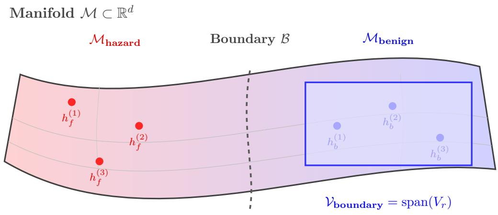
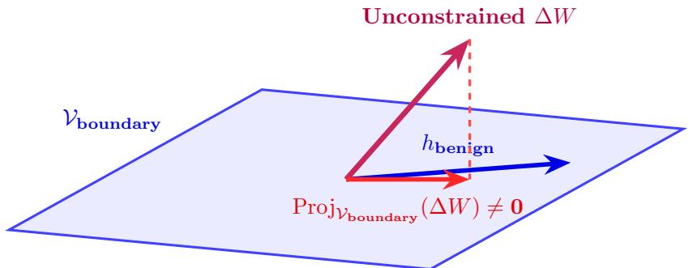
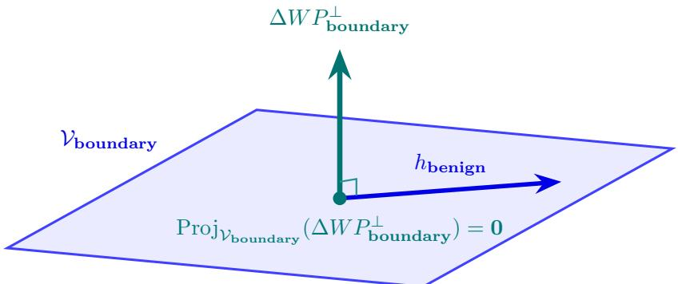

# Orthogonal Boundary Unlearning for Dual-Use Concepts in Large Language Models

Niccol\`o Ronchetti

## Abstract

Mitigating catastrophic risks from large language models requires excising hazardous operational capabilities, such as cyberwarfare exploitation and pathogen enhancement, without degrading benign scientific utility. In these dual-use domains, legitimate defensive science and malicious attacks share vocabulary, syntax, and internal model representations, causing standard unlearning methods to induce severe collateral damage (concept bleeding).

In this work, we present Orthogonal Boundary Unlearning (OBU), a mathematically grounded framework designed to eliminate collateral damage on benign dual-use capabilities. OBU extracts a domain-matched capability subspace from paired calibration queries via singular value decomposition on empirical activation covariances, and restricts parameter updates strictly to the orthogonal null space. This guarantees that benign representations experience zero parameter perturbation along the spanned calibration subspace.

We present two complementary realizations of OBU: Projected LoRA, which applies the orthogonal constraint during iterative gradient-based fine-tuning, and Closed-Form Weight Surgery, which directly edits model weights in a single analytical step without training. Across four modern open-weight foundation models (Gemma-3-4B, Qwen3.5-4B, SmolLM3- 3B, and Granite-4.2-3B), OBU achieves strong dual-use concept separation, substantially mitigates in-context priming attacks, and demonstrates durable resistance against adversarial relearning without degrading benign domain competence.

## 1 Introduction

Large language models (LLMs) trained on web-scale text corpora acquire extensive domain expertise spanning both transformative scientific disciplines and hazardous technologies [1, 16, 28]. A central challenge in artificial intelligence safety is mitigating risks from dual-use capabilities: domains where legitimate scientific utility and catastrophic hazards are deeply intertwined [27, 39]. Dual-use dilemmas emerge prominently in: (i) cybersecurity, where defensive firmware analysis, vulnerability patch verification, and intrusion detection share foundations with automated zero-day exploitation; (ii) computational biology and virology, where pathogen vaccine candidate modeling and therapeutic antibody design share generative mechanics with viral transmissibility enhancement; (iii) molecular chemistry, where industrial synthesis optimization mirrors the generation of schedule-one toxic precursors; and (iv) nuclear engineering, where civilian power reactor modeling, medical radioisotope production, and neutron transport simulations share theoretical foundations with proliferation-sensitive fissile enrichment and weaponization physics [28, 31].

When safety practitioners attempt to excise dangerous capabilities via standard machine unlearning techniques—such as gradient ascent (GA), Representation Misdirection for Unlearning (RMU) [28], or Negative Preference Optimization (NPO) [53]—they confront the pathology of concept bleeding [23, 27, 52]. Because hazardous and benign dual-use tasks share vocabulary, syntactic constructs, and reasoning pathways, unconstrained gradient updates propagate across shared weight matrices and degrade benign scientific competence [31, 46].

  
Figure 1: Dual-Use Representation Manifold and Benign Subspace Identification. In language model activation space $\mathbb { R } ^ { d }$ , capabilities reside on a continuous representation manifold M partitioned by an operational safety boundary B into hazardous capabilities $\mathcal { M } _ { \mathrm { h a z a r d } }$ (activations $\{ h _ { f } ^ { ( i ) } \}$ , where subscript $f$ denotes the forget set) and benign science $\mathcal { M } _ { \mathrm { b e n i g n } }$ (activations $\{ h _ { b } ^ { ( i ) } \} )$ . Because dual-use pairs lie in close proximity across $B ,$ isolating benign capabilities requires identifying their local geometry. OBU passes domain-matched calibration queries $\mathcal { D } _ { b }$ through the model to extract benign activations $\{ h _ { b } ^ { ( i ) } \}$ , computing the principal linear subspace $\mathcal { V } _ { \mathrm { b o u n d a r y } } = \operatorname { s p a n } ( V _ { r } )$ spanned by their leading r empirical singular vectors to tightly enclose the local benign capability manifold.

## 1.1 The Geometry of Dual-Use Entanglement

Dual-use capability entanglement is an intrinsic geometric property of transformer representations driven by three structural factors:

1. Extensive Lexical and Syntactic Overlap: In dual-use domains, benign scientific workflows and hazardous operations share identical technical vocabulary, syntactic constructs, and functional terminology (such as low-level system calls, chemical reaction equations, or genetic sequence notations). Because autoregressive pre-training optimizes next-token prediction across these shared lexical distributions, the model embeds benign and hazardous prompts into shared initial representation spaces.

2. Early-to-Mid Layer Representation Alignment: In transformer architectures, early and intermediate feed-forward and attention layers $( l \in \{ 1 , \ldots , L / 2 \} )$ construct general conceptual representations, token associations, and syntactical bindings [17, 38]. In these early-to-mid representations, dual-use pairs share substantial subspace structure, with task-specific operational trajectories diverging predominantly in deeper transformer layers.

3. Parametric Superposition: Deep networks store far more features than available dimensions through polysemantic superposition [14, 20]. Neurons and attention heads are shared across orthogonal concepts, so perturbing weight matrices without subspace constraints collides with adjacent factual associations.

We emphasize that our designation of paired contrastive tasks as residing at the “boundary” is an operational, qualitative characterization based on prompt construction, rather than an explicitly measured metric margin in activation space $\mathbb { R } ^ { d _ { \mathrm { i n } } }$ . As illustrated in Figure 1, because paired dual-use queries difer primarily in terminal generative intent (e.g., defensive patch verification versus weaponized exploitation), their activations $\{ h _ { f } ^ { ( i ) } \}$ and $\{ h _ { b } ^ { ( i ) } \}$ lie in close proximity across the operational safety boundary B on the representation manifold M.

To circumvent collateral damage, recent works propose null-space unlearning or representation erasure, such as Null-Space Constrained Low-Rank Adaptation (NSRU) [26] and ZeroUnlearn [30]. However, these approaches compute retain spaces globally over generic web text or broad instruction datasets. While such global null spaces protect generic capabilities (such as trivia or common coding), they fail to isolate the local benign region $\mathcal { M } _ { \mathrm { b e n i g n } }$ adjacent to $B ,$ leaving benign dual-use capabilities vulnerable to unlearning updates.

## 1.2 Contributions

To resolve dual-use capability entanglement without collateral damage, we introduce Orthogonal Boundary Unlearning (OBU), an unlearning framework that extracts the local benign subspace $\mathcal { V } _ { \mathrm { b o u n d a r y } } = \operatorname { s p a n } ( V _ { r } )$ (Figure 1) and restricts parameter updates strictly to its orthogonal complement $( { \mathrm { F i g u r e ~ } } 2 )$

• Boundary Subspace Projection: We construct layer-wise orthogonal projectors $P _ { \mathrm { b o u n d a r y } } ^ { ( l ) \perp } =$ $I - V _ { l , r } V _ { l , r } ^ { T }$ from the uncentered token-level second-moment matrix $K _ { \mathrm { b o u n d a r y } } ^ { ( l ) }$ of paired benign calibration queries, guaranteeing zero perturbation along $\mathcal { V } _ { \mathrm { b o u n d a r y } } ^ { ( l ) } = \operatorname { s p a n } ( V _ { l , r } )$ and bounding residual variance by $1 - \tau$

• Subspace Capacity and Layer Profiling: Across four open-weight models, we show that isolating the benign capability subspace $\mathcal { V } _ { \mathrm { b o u n d a r y } }$ does not exhaust model capacity: in the targeted final 25% of attention output layers (o proj), capturing 95% of benign activation variance requires on average only 8.0% of the layer dimensions, leaving 92.0% of the dimensions available in the orthogonal complement for unlearning (nearly twice as compact as empirical Fisher information at 16.2%, while avoiding the $1 6 \times - 2 5 \times$ covariance memory overhead of high-dimensional MLP projections). Even under a strict 99% variance threshold across large calibration sets, 27%–73% of the ambient dimensions remain available in the orthogonal null space.

• Complementary Algorithmic Realizations: We instantiate OBU in two algorithms that fold directly into base weights with zero inference overhead (reported below at $\tau = 0 . 9 5 )$

Projected LoRA filters adapter inputs through $P _ { \mathrm { b o u n d a r y } } ^ { ( l ) \perp }$ during gradient ascent on hazardous text, suppressing hazardous compliance on paired dual-use queries from 22.5% down to 3.9% on Qwen3.5-4B (and from 30.6% to 23.3% on Gemma-3-4B-IT) while preserving 100% accuracy on matched benign queries.

– Closed-Form Weight Surgery analytically subtracts the principal hazardous subspace within the benign null space $( \bar { W _ { l } } - \bar { W _ { l } } \bar { P } _ { f } ^ { ( l ) } \bar { P } _ { \mathrm { b o u n d a r y } } ^ { ( l ) \perp } )$ in a single training-free step, reducing multiple-choice hazardous accuracy on WMDP-Cyber from 41.1% to 39.1% on Gemma and from 38.4% to 31.5% on Granite while maintaining $\geq 9 9 . 6 \%$ accuracy on matched benign queries.

• Robustness to In-Context Priming and Adversarial Relearning: We evaluate whether unlearned capabilities can be re-elicited via in-context priming (prepending legitimate scientific demonstrations to hazardous requests) or adversarial fine-tuning on held-out hazardous text. On Qwen3.5-4B, Projected LoRA cuts direct 0-shot harmful compliance from 17.9% to 1.5% and 1-shot primed compliance from 37.4% to 15.8%. Furthermore, whereas standard unconstrained LoRA re-acquires 50% of its unlearned capability within 30 fine-tuning steps, both OBU realizations resist recovery across the entire 100-step fine-tuning horizon.

## 2 Related Work

## 2.1 Machine Unlearning and Dual-Use Collateral Damage

Machine unlearning originated in classification to remove the influence of specific training samples without full retraining [7, 37], and has since been adapted to LLMs to erase memorized text or hazardous capabilities [13, 25, 50]. Standard optimization methods—including Gradient Ascent (GA), Representation Misdirection for Unlearning (RMU) [28], and preference-based objectives such as DPO [40] and Negative Preference Optimization (NPO) [53]—penalize hazardous outputs directly across model weights. While efective when the target knowledge is isolated from general capabilities (such as forgetting fictitious author biographies in TOFU [34]), unconstrained updates in dual-use domains alter shared representations and induce severe concept bleeding (overforgetting) on adjacent benign tasks [31, 39]. Recent benchmarks specifically designed to measure forget-retain overlap—including ConceptGuard [27], BLUR [23], and PreUnlearn [46]—confirm that standard unlearning objectives struggle to suppress hazardous responses without degrading closely related benign expertise.

## 2.2 Subspace Projection and Null-Space Adaptation

Projecting updates onto orthogonal subspaces was originally developed in continual learning to prevent catastrophic forgetting across sequential tasks [15, 51] and in linear concept erasure to remove protected attributes from representations (INLP [41], LEACE [5, 42]). In parameter eficient fine-tuning, O-LoRA [48] penalizes overlap between sequential task adapters $( A _ { i } ^ { T } A _ { t } \approx 0 )$ while Safe LoRA [21] projects fine-tuned adapters onto the weight diference $( W _ { \mathrm { a l i g n e d } } - W _ { \mathrm { b a s e } } )$ to preserve safety guardrails during downstream fine-tuning. However, neither method can unlearn pre-trained capabilities or isolate entangled concepts within a single base model.

Most closely related to our approach, recent unlearning frameworks such as NSRU [26], ZeroUnlearn [30], and CIR [44] adapt activation null-space projection to LLM unlearning. While these works constrain updates using generic retain corpora or supervised refusal targets, they do not address the severe representation overlap of paired dual-use tasks—where a critical open question is whether projecting out domain-matched benign activations leaves suficient null-space capacity for unlearning. OBU directly addresses this regime by constructing $P _ { \mathrm { b o u n d a r y } } ^ { \perp }$ from paired contrastive boundary queries, profiling spectral capacity across module types and depths, and comparing iterative (Projected LoRA) and training-free (Closed-Form Surgery) realizations under in-context priming and relearning attacks.

## 2.3 Adversarial Stress-Testing and Mechanistic Auditing

Recent audits demonstrate that suppressing accuracy on multiple-choice benchmarks such as WMDP [28] does not guarantee genuine capability removal [12, 33]. Unlearned models frequently re-exhibit hazardous capabilities when subjected to optimization-based jailbreaks [9, 32, 36, 43, 54], in-context priming with benign or cooperative demonstrations [3, 6, 10, 49], or lightweight fine-tuning on a small number of hazardous examples (relearning attacks) [18, 45, 47]. To evaluate whether unlearning alters internal circuits or merely induces shallow refusals, mechanistic interpretability studies employ Sparse Autoencoders (SAEs) [8, 11, 29], linear representation probes [4, 35, 38], and gradient sensitivity analysis. We combine paired dual-use evaluation on ConceptGuard [27] with multi-shot priming attacks and 100-step fine-tuning relearning audits to evaluate OBU’s robustness.

## 3 Mathematical Formulation of OBU

This section formalizes the Orthogonal Boundary Unlearning (OBU) framework. We define the empirical boundary covariance, derive the truncated singular value decomposition (SVD) rank selection, establish the asymmetric defense mechanism, and present two complementary algorithmic realizations: Projected LoRA and Closed-Form Weight Surgery.

## 3.1 Empirical Boundary Covariance and Subspace Decomposition

Consider a transformer language model parameterized by weights W, with a targeted linear projection layer $W _ { l } \in \mathbb { R } ^ { d _ { \mathrm { o u t } } \times d _ { \mathrm { i n } } }$ at layer $l \in \{ 1 , \ldots , L \}$ . During autoregressive processing of a sequence of length T, the module receives hidden activation vectors $h _ { l , t } \in \mathbb { R } ^ { d _ { \mathrm { i n } } }$ at each token position $t \in \{ 1 , \ldots , T \}$ and produces intermediate output states $z _ { l , t } = W _ { l } h _ { l , t } \in \mathbb { R } ^ { d _ { \mathrm { o u t } } }$

To construct the projection operator, we curate a calibration dataset $\mathcal { D } _ { b } = \{ x _ { b } ^ { ( i ) } \} _ { i = 1 } ^ { M }$ of M domain-matched benign queries selected as contrastive counterparts to the hazardous domain. Passing each query $x _ { b } ^ { ( i ) }$ of token length $T _ { i }$ through the model, we extract the input activations $\{ h _ { l , t } ( x _ { b } ^ { ( i ) } ) \} _ { t = 1 } ^ { T _ { i } }$ immediately preceding $W _ { l }$ across all token positions.

Following prior null-space projection methods [26, 30, 51], we accumulate the uncentered empirical second-moment matrix (referred to hereafter as the empirical boundary covariance matrix) $K _ { \mathrm { b o u n d a r y } } ^ { ( l ) } \in \mathbb { R } ^ { d _ { \mathrm { i n } } \times d _ { \mathrm { i n } } }$ across all $\begin{array} { r } { N _ { \mathrm { t o k } } = \sum _ { i = 1 } ^ { M } T _ { i } } \end{array}$ calibration tokens:

$$
K _ { \mathrm { b o u n d a r y } } ^ { ( l ) } = \frac { 1 } { N _ { \mathrm { t o k } } } \sum _ { i = 1 } ^ { M } \sum _ { t = 1 } ^ { T _ { i } } h _ { l , t } ( x _ { b } ^ { ( i ) } ) \left( h _ { l , t } ( x _ { b } ^ { ( i ) } ) \right) ^ { T }\tag{1}
$$

Using the uncentered second moment rather than a mean-centered covariance is mathematically required because linear layers $z _ { l , t } = W _ { l } h _ { l , t }$ act directly on uncentered activations $h _ { l , t } ;$ ensuring $\Delta W _ { l } h _ { l , t } \approx \mathbf { 0 }$ requires projecting out the uncentered span of $h _ { l , t }$ (including its mean direction). Accumulating across all $N _ { \mathrm { t o k } }$ tokens rather than a single token per prompt enables rank estimation up to min $( N _ { \mathrm { t o k } } , d _ { \mathrm { i n } } )$ even when $M < d _ { \mathrm { i n } } ;$ ; although this includes common function words alongside domain terms, recurring syntactic directions are absorbed into the leading singular vectors (protecting general language fluency), while in deep causal layers each token state $h _ { l , t }$ already integrates the preceding query context.

Because $K _ { \mathrm { b o u n d a r y } } ^ { ( l ) }$ is symmetric and positive semi-definite, its singular value decomposition coincides with its eigendecomposition:

$$
K _ { \mathrm { b o u n d a r y } } ^ { ( l ) } = U _ { l } \Sigma _ { l } V _ { l } ^ { T } = V _ { l } \Sigma _ { l } V _ { l } ^ { T }\tag{2}
$$

where $V _ { l } = [ v _ { l , 1 } , v _ { l , 2 } , \ldots , v _ { l , d _ { \mathrm { i n } } } ] \in \mathbb { R } ^ { d _ { \mathrm { i n } } \times d _ { \mathrm { i n } } }$ is an orthonormal basis of singular vectors, and $\Sigma _ { l } = \operatorname { d i a g } ( \sigma _ { l , 1 } , \dots , \sigma _ { l , d _ { \mathrm { i n } } } )$ contains singular values sorted in descending order: $\sigma _ { l , 1 } \geq \sigma _ { l , 2 } \geq \cdot \cdot \cdot \geq$ $\sigma _ { l , d _ { \mathrm { i n } } } \geq 0$

## 3.2 Energy-Preserving Rank Selection

The singular values $\sigma _ { l , j }$ quantify the activation variance concentrated along principal direction $v _ { l , j }$ across benign boundary queries. Rather than fixing an arbitrary rank $r ,$ we determine r dynamically via a cumulative energy threshold $\tau \in ( 0 , 1 )$ :

$$
r ( \tau ) = \operatorname* { m i n } \left\{ k \in \{ 1 , \dots , d _ { \mathrm { i n } } \} \ \Bigg | \ \frac { \sum _ { j = 1 } ^ { k } \sigma _ { l , j } } { \sum _ { j = 1 } ^ { d _ { \mathrm { i n } } } \sigma _ { l , j } } \geq \tau \right\}\tag{3}
$$

Let $V _ { l , r } = [ v _ { l , 1 } , \ldots , v _ { l , r } ] \in \mathbb { R } ^ { d _ { \mathrm { i n } } \times r }$ denote the matrix of the top-r singular vectors. The principal benign capability subspace at layer l is defined as $\mathcal { V } _ { \mathrm { b o u n d a r y } } ^ { ( l ) } = \operatorname { s p a n } ( V _ { l , r } )$ . The orthogonal

boundary projection operator $P _ { \mathrm { b o u n d a r y } } ^ { ( l ) \perp } \in \mathbb { R } ^ { d _ { \mathrm { i n } } \times d _ { \mathrm { i n } } }$ is constructed as:

$$
P _ { \mathrm { b o u n d a r y } } ^ { ( l ) \perp } = I _ { d _ { \mathrm { i n } } } - V _ { l , r } V _ { l , r } ^ { T }\tag{4}
$$

By construction, $P _ { \mathrm { b o u n d a r y } } ^ { ( l ) \perp }$ is symmetric and idempotent $( ( P _ { \mathrm { b o u n d a r y } } ^ { ( l ) \perp } ) ^ { 2 } = P _ { \mathrm { b o u n d a r y } } ^ { ( l ) \perp } )$ , representing an orthogonal projection onto the null space of the benign calibration subspace: $\mathcal { V } _ { \mathrm { b o u n d a r y } } ^ { ( l ) \perp } =$ ker $( V _ { l , r } ^ { T } )$

## 3.3 Orthogonal Non-Interference Guarantee

OBU separates hazardous and benign capabilities asymmetrically: benign boundary queries $\mathcal { D } _ { b }$ define a hard geometric constraint $( \bar { P _ { \mathrm { b o u n d a r y } } ^ { ( l ) \perp } } )$ , while hazardous forget queries $\mathcal { D } _ { f }$ (where subscript f denotes the forget set) drive the weight update $( \Delta W _ { l } )$ within the remaining orthogonal complement. Consider any activation vector $h _ { b } \in \mathcal { V } _ { \mathrm { b o u n d a r y } } ^ { ( l ) }$ . Expressing $h _ { b } = V _ { l , r } c$ for some coeficient vector $c \in \mathbb { R } ^ { r }$ , we have:

$$
P _ { \mathrm { b o u n d a r y } } ^ { ( l ) \perp } h _ { b } = \left( I _ { d _ { \mathrm { i n } } } - V _ { l , r } V _ { l , r } ^ { T } \right) V _ { l , r } c = \left( V _ { l , r } - V _ { l , r } ( V _ { l , r } ^ { T } V _ { l , r } ) \right) c = \mathbf { 0 }\tag{5}
$$

since $V _ { l , r } ^ { T } V _ { l , r } = I _ { r }$ . Consequently, for any weight update $\Delta W _ { l } \in \mathbb { R } ^ { d _ { \mathrm { o u t } } \times d _ { \mathrm { i n } } }$ right-multiplied by $P _ { \mathrm { b o u n d a r y } } ^ { ( l ) \perp }$ (so that incoming activations are projected before $\Delta W _ { l }$ is applied; Figure 2), the perturbation along the benign boundary subspace is identically zero:

$$
\left( \Delta W _ { l } P _ { \mathrm { b o u n d a r y } } ^ { ( l ) \perp } \right) h _ { b } = 0 , \quad \forall h _ { b } \in \mathcal { V } _ { \mathrm { b o u n d a r y } } ^ { ( l ) }\tag{6}
$$

More generally, any benign activation can be decomposed into its in-subspace projection and orthogonal residual as $h _ { b } = h _ { b , \parallel } + h _ { b , \perp }$ , where $h _ { b , \parallel } \in \mathcal { V } _ { \mathrm { b o u n d a r y } } ^ { ( l ) }$ and $h _ { b , \perp } \in \mathcal { V } _ { \mathrm { b o u n d a r y } } ^ { ( l ) \perp }$ . The projected update then evaluates to $( \Delta W _ { l } P _ { \mathrm { b o u n d a r y } } ^ { ( l ) \perp } ) h _ { b } = \Delta W _ { l } h _ { b , \perp }$ . Because the eigenvalues $\sigma _ { l , j }$ of $K _ { \mathrm { b o u n d a r y } } ^ { ( l ) }$ equal the mean squared projections $\mathbb { E } [ \langle h _ { b } , v _ { l , j } \rangle ^ { 2 } ]$ over the calibration tokens, a cumulative energy threshold τ guarantees that the expected residual energy satisfies $\mathbb { E } [ | | h _ { b , \perp } | | ^ { 2 } ] =$ $\begin{array} { r } { \sum _ { j > r } \sigma _ { l , j } \le \left( 1 - \tau \right) \mathbb { E } [ \| h _ { b } \| ^ { 2 } ] } \end{array}$ , bounding perturbations along the $( 1 - \tau )$ truncation tail.

## 3.4 Realization 1: Projected LoRA

In gradient-based adaptation, low-rank adaptation (LoRA) [22] parameterizes weight updates as $\Delta W _ { l } = { \textstyle \frac { \alpha } { k } } B _ { l } A _ { l }$ , where $B _ { l } \in \mathbb { R } ^ { d _ { \mathrm { o u t } } \times k } , A _ { l } \in \mathbb { R } ^ { k \times d _ { \mathrm { i n } } }$ , and $k \ll \operatorname* { m i n } ( d _ { \mathrm { i n } } , d _ { \mathrm { o u t } } )$ denotes the adapter intrinsic rank (distinguished from the SVD boundary truncation rank r). OBU Projected LoRA enforces boundary orthogonality by projecting the incoming activation h before the low-rank adapter:

$$
h _ { \mathrm { o u t } } = W _ { l } h + \frac { \alpha } { k } B _ { l } A _ { l } \left( P _ { \mathrm { b o u n d a r y } } ^ { ( l ) \perp } h \right)\tag{7}
$$

During the backward pass, gradients with respect to adapter matrix $A _ { l }$ are strictly projected onto $\mathcal { V } _ { \mathrm { b o u n d a r y } } ^ { ( l ) \perp } \mathrm { : }$

$$
\nabla _ { A _ { l } } \mathcal { L } = \left( \frac { \alpha } { k } B _ { l } ^ { T } \frac { \partial \mathcal { L } } { \partial h _ { \mathrm { o u t } } } \right) \left( P _ { \mathrm { b o u n d a r y } } ^ { ( l ) \perp } h \right) ^ { T }\tag{8}
$$

so any gradient component residing in $\mathcal { V } _ { \mathrm { b o u n d a r y } } ^ { ( l ) }$ is identically zeroed. After optimization, the adapter weights fold into the base matrix as $\begin{array} { r } { W _ { l } ^ { \prime } = W _ { l } + \frac { \alpha } { k } B _ { l } A _ { l } P _ { \mathrm { b o u n d a r y } } ^ { ( l ) \perp } } \end{array}$ , incurring zero inference latency or parameter overhead.

  
(a) Standard Unlearning (Oblique Operator Alignment): Because parameter updates ∆W are unconstrained in parameter space, the operator’s principal input singular vector is tilted obliquely relative to the domain-matched benign subspace Vboundary. The resulting projection onto the benign subspace is non-zero $( \mathrm { P r o j } _ { \mathcal { V } _ { \mathrm { b o u n d a r y } } } ( \Delta W ) \neq \bf { 0 } )$ , causing collateral damage to benign capabilities.

  
(b) OBU Orthogonal Insulation (Zero Projection): Right-multiplication of $\Delta W$ by the orthogonal projector $P _ { \mathrm { b o u n d a r y } } ^ { \perp }$ (projecting incoming activations before $\Delta W$ is applied) restricts the operator’s co-image strictly to $\mathcal { V } _ { \mathrm { b o u n d a r y } } ^ { \perp } .$ , ensuring that $\mathcal { V } _ { \mathrm { b o u n d a r y } } \subseteq \mathrm { k e r } ( \Delta W P _ { \mathrm { b o u n d a r y } } ^ { \perp } )$ . The projection onto the benign subspace vanishes $( \mathrm { P r o j } _ { \mathcal { V } _ { \mathrm { b o u n d a r y } } } ( \Delta W P _ { \mathrm { b o u n d a r y } } ^ { \perp } ) = \bf { 0 } )$ , mathematically guaranteeing zero perturbation of benign activations.  
Figure 2: Operator Subspace Geometry and Orthogonal Projection in OBU. Parameter updates $\Delta W \in \mathbb { R } ^ { d _ { \mathrm { o u t } } \times d _ { \mathrm { i n } } }$ are depicted via their principal input singular direction in $\mathbb { R } ^ { d _ { \mathrm { i n } } }$ , where $\mathrm { P r o j } _ { \mathcal { V } _ { \mathrm { b o u n d a r y } } } ( \cdot )$ denotes the component of the update acting on the benign subspace Vboundary (its shadow on the blue plane).

We optimize the adapter parameters $\Theta = \{ A _ { l } , B _ { l } \}$ over hazardous forget sequences $x \sim D _ { f }$ by maximizing the language modeling cross-entropy loss $\begin{array} { r } { \mathcal { L } _ { \mathrm { C E } } ( \boldsymbol { x } ; \boldsymbol { \Theta } ) = - \frac { 1 } { T } \sum _ { t = 1 } ^ { T } \log P _ { \boldsymbol { \Theta } } ( x _ { t } \mid \boldsymbol { x } _ { < t } ) } \end{array}$ via a smooth, bounded gradient ascent objective:

$$
\mathcal { L } _ { \mathrm { O B U } } ( \Theta ) = - c \operatorname { t a n h } \left( \frac { \mathcal { L } _ { \mathrm { C E } } ( x ; \Theta ) } { c } \right)\tag{9}
$$

where $c > 0$ is a saturation constant that smoothly bounds the objective below by $- c ,$ preventing gradient explosion once hazardous sequences reach high perplexity.

## 3.5 Realization 2: Closed-Form Weight Surgery

As a training-free alternative to iterative adaptation, Closed-Form Weight Surgery computes the weight update directly from the empirical second-moment matrix of hazardous activations. Let $\mathcal { D } _ { f } = \{ x _ { f } ^ { ( i ) } \} _ { i = } ^ { M } .$ denote a forget corpus of M hazardous sequences comprising $\begin{array} { r } { N _ { \mathrm { t o k } } = \sum _ { i = 1 } ^ { M } T _ { i } } \end{array}$ total tokens. Analogous to Equation (1), we accumulate the uncentered hazardous empirical

covariance matrix:

$$
K _ { f } ^ { ( l ) } = \frac { 1 } { N _ { \mathrm { t o k } } } \sum _ { i = 1 } ^ { M } \sum _ { t = 1 } ^ { T _ { i } } h _ { l , t } ( x _ { f } ^ { ( i ) } ) \left( h _ { l , t } ( x _ { f } ^ { ( i ) } ) \right) ^ { T } \in \mathbb { R } ^ { d _ { \mathrm { i n } } \times d _ { \mathrm { i n } } }\tag{10}
$$

Applying truncated SVD to $K _ { f } ^ { ( l ) }$ at rank r (selected via cumulative energy threshold $\tau \in ( 0 , 1 )$ as in Equation (3)), we extract the leading singular vectors $V _ { f , l , r } \in \mathbb { R } ^ { d _ { \mathrm { i n } } \times r }$ and form the symmetric projector $P _ { f } ^ { ( l ) } = V _ { f , l , r } V _ { f , l , r } ^ { T }$

Directly applying the unconstrained subtraction $\Delta W _ { l } = - W _ { l } P _ { f } ^ { ( l ) }$ would damage shared benign representations [5]. Instead, OBU Closed-Form Surgery projects $\Delta W _ { l }$ through the boundary orthogonal projector:

$$
W _ { l } ^ { \prime } = W _ { l } - W _ { l } P _ { f } ^ { ( l ) } P _ { \mathrm { b o u n d a r y } } ^ { ( l ) \perp }\tag{11}
$$

By Equation (5), for any benign activation component $h _ { b } \in \mathcal { V } _ { \mathrm { b o u n d a r y } } ^ { ( l ) } ,$ the surgical update vanishes:

$$
W _ { l } ^ { \prime } h _ { b } = W _ { l } h _ { b } - W _ { l } P _ { f } ^ { ( l ) } \underbrace { P _ { \mathrm { b o u n d a r y } } ^ { ( l ) \perp } h _ { b } } _ { = \bf { 0 } } = W _ { l } h _ { b }\tag{12}
$$

Conversely, for activation components $h _ { f , \perp } = P _ { \mathrm { b o u n d a r y } } ^ { ( l ) \perp } h _ { f }$ residing in the orthogonal complement $\mathcal { V } _ { \mathrm { b o u n d a r y } } ^ { ( l ) \perp } ,$ the update subtracts ${ W _ { l } } P _ { f } ^ { ( l ) } h _ { f , \perp }$ , attenuating the module’s output along principal hazardous directions without iterative training.

## 4 Experimental Setup and Benchmarks

For each model under evaluation, we measure dual-use concept separation, multiple-choice domain retention, general capability preservation, multi-shot priming robustness, and fine-tuning relearning dynamics.

## 4.1 Target Model Architectures

We evaluate four 2025–2026 open-weight foundation models spanning distinct architectural families:

1. Gemma-3-4B-IT [16]: Google’s 4B-parameter model with 34 layers, residual dimension $d _ { \mathrm { m o d e l } } = 2 5 6 0$ , attention output projection input dimension $d _ { \mathrm { a t t n } } = 2 0 4 8$ , and MLP down-projection input dimension $d _ { \mathrm { f f } } = 1 0 , 2 4 0$

2. Qwen3.5-4B [1]: Alibaba’s 4B-parameter model with 32 layers, $d _ { \mathrm { m o d e l } } = 2 5 6 0 , d _ { \mathrm { a t t n } } =$ 4096, and $d _ { \mathrm { f f } } = 9 , 2 1 6$

3. SmolLM3-3B [2]: HuggingFace’s 3B-parameter model with 36 layers, $d _ { \mathrm { m o d e l } } = 2 0 4 8$ $d _ { \mathrm { a t t n } } = 2 0 4 8$ , and $d _ { \mathrm { f f } } = 1 1 , 0 0 8$

4. Granite-4.2-3B [24]: IBM’s 3B-parameter model with 40 layers, $d _ { \mathrm { m o d e l } } = 2 5 6 0 , d _ { \mathrm { a t t n } } =$ 2560, and $d _ { \mathrm { f f } } = 8 { , } 1 9 2$

## 4.2 Datasets, Splits, and Implementation Details

Our experimental pipeline uses three benchmarks with strict train-test separation:

• ConceptGuard [27]: 2,595 paired dual-use items split 80/20 (seed=42) into 2,076 training pairs and 519 held-out test pairs. Each item pairs a hazardous query with a domain-matched benign boundary query. The 2,076 benign training queries form $\mathcal { D } _ { b }$ for accumulating $K _ { \mathrm { b o u n d a r y } } ^ { ( l ) }$ , while the 519 held-out test pairs are used exclusively for evaluation.

• WMDP Cyber [28]: For unlearning optimization and closed-form covariance estimation, we use the cais/wmdp-corpora (cyber-forget-corpus) dataset of 1,000 passages, split $8 0 / 2 0$ (seed=42) into 800 training passages $\left( \mathcal { D } _ { f } \right)$ and 200 held-out test passages (reserved for adversarial relearning fine-tuning). For multiple-choice evaluation, we use the full 1,987-question wmdp-cyber test split (random guessing baseline: 25.0%).

• MMLU [19]: The complete 14,042-question test split across all 57 subjects to measure general reasoning utility.

We first profile boundary subspace geometry across layer depths and sub-layer projection types (o proj vs. down proj, and activation covariance vs. empirical Fisher; Sections 5.1–5.2). Based on this profiling, our unlearning interventions target the attention output projections (o proj) in the final 25% of layers (layers 25–33 in Gemma, 24–31 in Qwen, 27–35 in SmolLM, and 30–39 in Granite) using activation covariance $K _ { \mathrm { b o u n d a r y } } ^ { ( l ) }$ . We evaluate cumulative energy thresholds $\tau \in \{ 0 . 9 0 , 0 . 9 5 , 0 . 9 9 \}$ , fixing $\tau = 0 . 9 5$ for the adversarial and relearning stress tests in Section 5.4. For Projected LoRA, we use saturation constant $c = 5 . 0 \AA$ , adapter rank $k = 8 , \alpha = 1 6 . 0$ AdamW $( \mathrm { l r } = 1 0 ^ { - 4 } )$ , batch size 1 with 8 gradient accumulation steps (100 optimizer updates over the 800 forget passages), sequence truncation length 128, and gradient norm clipping at 1.0. Models are loaded in bfloat16, while all covariance accumulations and SVD factorizations are executed in float32.

## 4.3 Evaluation Metrics

We report six quantitative metrics across our evaluations:

1. Forget Accuracy $\left( \mathbf { A c c _ { f o r g e t } } \downarrow \right)$ : Multiple-choice accuracy on the 1,987 WMDP Cyber test questions, evaluated by comparing next-token logits over answer options $\{ { \mathrm { A } } , { \mathrm { B } } , { \mathrm { C } } , { \mathrm { D } } \}$

2. Boundary Accuracy $( \mathbf { A c c _ { b o u n d a r y } } \uparrow )$ : The fraction of the 519 held-out benign boundary queries in ConceptGuard that the model complies with rather than refusing (target: 1.0000).

3. General Utility (Gen Utility ↑): Overall multiple-choice accuracy across all 14,042 MMLU test questions.

4. Contextual Separation $( \Delta _ { \mathbf { s e p } } \uparrow )$ : The mean compliance diference between matched benign and hazardous queries across the 519 paired ConceptGuard test items:

$$
\Delta _ { \mathrm { s e p } } = \mathbb { E } _ { ( x _ { b } , x _ { f } ) } \left[ \mathrm { S c o r e } ( x _ { b } ) - \mathrm { S c o r e } ( x _ { f } ) \right] \in [ - 1 , 1 ]\tag{13}
$$

where Score $( x ) \in \{ 0 , 1 \}$ indicates whether the model complies with query $x \ ( 1 )$ or refuses (0), so $\Delta _ { \mathrm { s e p } } = 1 . 0$ corresponds to 100% benign accuracy alongside 100% hazardous refusal.

5. Attack Success Rate (ASR ↓): The fraction of the 519 held-out ConceptGuard hazardous queries that elicit compliant responses under 0-shot, 1-shot, 2-shot, and 4-shot benign in-context priming [6, 10].

6. Relearning Steps $( S _ { 5 0 } \uparrow )$ : During post-unlearning fine-tuning via SGD $( \mathrm { l r } = 5 \times 1 0 ^ { - 4 }$ batch size 1, accumulation 8, 100 steps) on the 200 held-out wmdp-corpora test passages, the number of steps required for $\mathrm { A c c } _ { \mathrm { f o r g e t } }$ to recover 50% of its post-unlearning drop.

## 5 Empirical Evaluation and Findings

We structure our empirical analysis around four research questions:

• Does boundary subspace isolation exhaust the model’s parameter capacity (Section 5.1)?

• Where in the transformer hierarchy are boundary representations most concentrated (Section 5.2)?

• How do iterative Projected LoRA and training-free Closed-Form Surgery compare in unlearning eficacy and benign utility (Section 5.3)?

• Does OBU withstand in-context priming and adversarial relearning (Section 5.4)?

## 5.1 Subspace Dimensionality and Degrees of Freedom

A central question for subspace-constrained unlearning is the Degrees of Freedom Squeeze hypothesis: if isolating the benign boundary requires projecting out a large fraction of the hidden space, the remaining orthogonal complement may be too small to support efective capability modification. To test this hypothesis, we first profile the pre-MLP residual stream activations $( d _ { \mathrm { m o d e l } } \in \{ 2 0 4 8 , 2 5 6 0 \} )$ at 50%, 62.5%, and 75% network depth across calibration sample sizes $M \in \{ 1 0 , 5 0 , 1 0 0 , 5 0 0 \}$ and cumulative energy thresholds $\tau \in \{ 0 . 9 0 , 0 . 9 5 , 0 . 9 9 \}$

Across all four foundation models, the singular value spectra refute the Degrees of Freedom Squeeze hypothesis:

• Null-Space Capacity Across Energy Thresholds (τ): Across all evaluated layers and models at $M = 5 0 0$ calibration queries, capturing 90%, 95%, and 99% of the benign activation variance $( \tau \in \{ 0 . 9 0 , 0 . 9 5 , 0 . 9 9 \} )$ ) leaves on average 85.8%, 73.4%, and 41.0% of the layer dimensions available in the orthogonal null space, respectively.

• Sub-Linear Subspace Growth Across Sample Sizes (M): Increasing the calibration set 50× from $M = 1 0$ to $M = 5 0 0$ queries (at $\tau = 0 . 9 5 )$ increases the mean protected subspace from 4.0% to 26.6% of the layer dimensions (16.0% at M = 100), indicating that benign boundary queries concentrate along shared principal directions rather than filling the ambient space linearly with M.

The complete layer-by-layer singular value spectra across all sample sizes M and thresholds τ are reported in Table 3 in Appendix A.

## 5.2 Module Locus and Layer Depth Trajectory

To determine where in the network to apply the boundary projector, we profile all layers across the four models at $M = 1 0 0$ and $\tau = 0 . 9 5$ , comparing attention output projections (o proj, input dimension $d _ { \mathrm { a t t n } } )$ against MLP down-projections (down proj, input dimension $d _ { \mathrm { f f } } )$ . Alongside the forward activation covariance $K _ { \mathrm { b o u n d a r y } } ^ { ( l ) }$ (Equation (1)), we also evaluate an alternative projector constructed from the empirical input-gradient Fisher information matrix $F _ { \mathrm { b o u n d a r y } } ^ { ( l ) } \in \mathbb { R } ^ { d _ { \mathrm { i n } } \times d _ { \mathrm { i n } } }$

$$
F _ { \mathrm { b o u n d a r y } } ^ { ( l ) } = \frac { 1 } { N _ { \mathrm { t o k } } } \sum _ { i = 1 } ^ { M } \sum _ { t = 1 } ^ { T _ { i } } g _ { l , t } ( x _ { b } ^ { ( i ) } ) \left( g _ { l , t } ( x _ { b } ^ { ( i ) } ) \right) ^ { T } , \quad g _ { l , t } ( x _ { b } ^ { ( i ) } ) = \nabla _ { h _ { l , t } ( x _ { b } ^ { ( i ) } ) } \mathcal { L } _ { \mathrm { C E } } ( x _ { b } ^ { ( i ) } )\tag{14}
$$

where $\mathcal { L } _ { \mathrm { C E } } ( x _ { b } ^ { ( i ) } )$ is the autoregressive cross-entropy loss on benign query $\boldsymbol { x } _ { b } ^ { ( i ) }$ , and $g _ { l , t } ( x _ { b } ^ { ( i ) } ) \in \mathbb { R } ^ { d _ { \mathrm { i n } } }$ is the gradient of $\mathcal { L } _ { \mathrm { C E } } ( x _ { b } ^ { ( i ) } )$ with respect to the module’s input activation $h _ { l , t } ( x _ { b } ^ { ( i ) } )$ at token t. Whereas $K _ { \mathrm { b o u n d a r y } } ^ { ( l ) }$ captures directions of high forward activation variance, $F _ { \mathrm { b o u n d a r y } } ^ { ( l ) }$ captures input directions to which the model’s output loss is most sensitive.

## Covariance vs. Empirical Fisher Information.

In attention output projections $_ { ( o _ { - } p r o j ) }$ , capturing 95% of boundary activation variance via $K _ { \mathrm { b o u n d a r y } } ^ { ( l ) }$ consumes on average 9.5% of the input dimension $d _ { \mathrm { a t t n } }$ across all layers (leaving 90.5% of the dimensions in the orthogonal complement), compared to 16.2% of $d _ { \mathrm { a t t n } }$ for empirical Fisher information $F _ { \mathrm { b o u n d a r y } } ^ { ( l ) }$ . In MLP down-projections (down proj), $K _ { \mathrm { b o u n d a r y } } ^ { ( l ) }$ and Fboundary $F _ { \mathrm { h . o . } } ^ { ( l ) }$ consume 6.3% and 4.7% of the wider intermediate dimension $d _ { \mathrm { f f } } .$ , respectively (leaving over 93% of $d _ { \mathrm { f } }$ in the orthogonal complement).

Because activation covariance provides substantially sharper isolation on o proj (and comparable null-space availability on $d o w n _ { - } p r o j )$ while requiring only forward passes rather than backward gradient passes, we adopt $K _ { \mathrm { b o u n d a r y } } ^ { ( l ) }$ for all subsequent unlearning experiments.

## Attention Output (o proj) vs. MLP Down-Projection (down proj).

Because down proj receives the expanded intermediate FFN activation $( d _ { \mathrm { f f } } \in \mathrm { [ 8 , 1 9 2 , 1 1 , 0 0 8 ] }$ versus $d _ { \mathrm { a t t n } } \in [ 2 , 0 4 8 , 4 , 0 9 6 ]$ for $o _ { - } p r o j )$ , both module types leave over 90% of their respective input dimensions available in the orthogonal null space at $\tau = 0 . 9 5$ (90.5% in $o _ { - } p r o j$ and 93.7% in down proj). However, because $d _ { \mathrm { f f } }$ is $3 . 5 \times - 5 \times$ wider than $d _ { \mathrm { a t t n } } ,$ constructing and factorizing the $d _ { \mathrm { i n } } \times d _ { \mathrm { i n } }$ projector on down proj requires $4 \times - 2 5 \times$ more memory and up to 125× more $O ( d _ { \mathrm { i n } } ^ { 3 } )$ SVD compute.

Targeting o proj avoids this high-dimensional FFN overhead while intervening directly where multi-head attention readouts enter the residual stream.

## Layer Depth Trajectory.

Partitioning each model’s layers sequentially into four quartiles along network depth reveals that the $o _ { - } p r o j$ boundary subspace $\mathcal { V } _ { \mathrm { b o u n d a r y } } ^ { ( l ) }$ contracts in deeper layers, occupying on average 11.7% of $d _ { \mathrm { a t t n } }$ in the first quartile, 9.4% in the second, 8.9% in the third, and 8.0% in the fourth (leaving 92.0% of the activation space available in the orthogonal complement $P _ { \mathrm { b o u n d a r y } } ^ { ( l ) \perp } )$

Beyond leaving the largest orthogonal subspace for adaptation, targeting the final 25% of layers aligns with how transformers process dual-use prompts: whereas earlier layers primarily encode shared token-level vocabulary and syntax that overlap across dual-use pairs, deeper layers integrate the full sentence context where the distinction between benign and hazardous intent becomes most pronounced.

## 5.3 Multi-Model Unlearning Eficacy and Utility Trade-ofs

We evaluate the trade-ofs between unlearning eficacy, benign boundary preservation, and general MMLU capability across all four target architectures. Table 1 reports the results across all models, unlearning methods, and energy thresholds $\tau \in \{ 0 . 9 0 , 0 . 9 5 , 0 . 9 9 \}$

Four empirical findings emerge from Table 1:

1. Iterative vs. Training-Free Separation $( \Delta _ { \mathbf { s e p } } )$ : Across all evaluated thresholds $\tau ,$ Projected LoRA achieves substantially higher open-ended dual-use separation than Closed-Form Surgery on every model with a baseline refusal prior.

At $\tau = 0 . 9 5$ , Projected LoRA increases $\Delta _ { \mathrm { s e p } }$ from 0.7746 to 0.9615 on Qwen3.5-4B (vs. 0.7784 for Closed-Form Surgery), from 0.6936 to 0.7669 on Gemma-3-4B-IT (vs. 0.5915), and from 0.2158 to 0.3295 on Granite-4.2-3B (vs. 0.2640), while SmolLM3-3B remains near zero under both methods $( \Delta _ { \mathrm { s e p } } \leq 0 . 0 1 1 6 )$ , as analyzed next.

2. Dependence on Baseline Refusal Behavior: Notably, Projected LoRA is trained purely via gradient ascent on raw domain text (wmdp-corpora) without any refusal target templates. As shown by the unmodified baseline rows in Table 1, Qwen3.5-4B $( \Delta _ { \mathrm { s e p } } = 0 . 7 7 4 6 )$ , Gemma-3-4B-IT (0.6936), and Granite-4.2-3B (0.2158) already refuse

Table 1: Unlearning Eficacy and Utility Across Architectures, Methods, and Energy Thresholds (τ ).
<table><tr><td>Model</td><td>Method</td><td>T</td><td>Acc Forget (↓)</td><td>Acc Boundary (↑)</td><td>Gen Utility (↑)</td><td> $\Delta _ { \mathbf { s e p } }$  (↑)</td></tr><tr><td>Gemma-3-4B-IT</td><td>Baseline (Unmodified)</td><td></td><td>0.4112</td><td>1.0000</td><td>0.5711</td><td>0.6936</td></tr><tr><td>Gemma-3-4B-IT</td><td>Projected LoRA</td><td>0.90</td><td>0.4066</td><td>1.0000</td><td>0.5664</td><td>0.7495</td></tr><tr><td>Gemma-3-4B-IT</td><td>Closed-Form Surgery</td><td>0.90</td><td>0.3503</td><td>1.0000</td><td>0.4957</td><td>0.5800</td></tr><tr><td>Gemma-3-4B-IT</td><td>Projected LoRA</td><td>0.95</td><td>0.4056</td><td>1.0000</td><td>0.5633</td><td>0.7669</td></tr><tr><td>Gemma-3-4B-IT</td><td>Closed-Form Surgery</td><td>0.95</td><td>0.3905</td><td>1.0000</td><td>0.5456</td><td>0.5915</td></tr><tr><td>Gemma-3-4B-IT</td><td>Projected LoRA</td><td>0.99</td><td>0.4061</td><td>1.0000</td><td>0.5628</td><td>0.7476</td></tr><tr><td>Gemma-3-4B-IT</td><td>Closed-Form Surgery</td><td>0.99</td><td>0.4011</td><td>1.0000</td><td>0.5652</td><td>0.6879</td></tr><tr><td>Qwen3.5-4B</td><td>Baseline (Unmodified)</td><td></td><td>0.4932</td><td>1.0000</td><td>0.7386</td><td>0.7746</td></tr><tr><td>Qwen3.5-4B</td><td>Projected LoRA</td><td>0.90</td><td>0.4766</td><td>1.0000</td><td>0.7201</td><td>0.9403</td></tr><tr><td>Qwen3.5-4B</td><td>Closed-Form Surgery</td><td>0.90</td><td>0.4912</td><td>1.0000</td><td>0.7263</td><td>0.7457</td></tr><tr><td>Qwen3.5-4B</td><td>Projected LoRA</td><td>0.95</td><td>0.4801</td><td>1.0000</td><td>0.7292</td><td>0.9615</td></tr><tr><td>Qwen3.5-4B</td><td>Closed-Form Surgery</td><td>0.95</td><td>0.4816</td><td>1.0000</td><td>0.7321</td><td>0.7784</td></tr><tr><td>Qwen3.5-4B</td><td>Projected LoRA</td><td>0.99</td><td>0.4927</td><td>1.0000</td><td>0.7373</td><td>0.9653</td></tr><tr><td>Qwen3.5-4B</td><td>Closed-Form Surgery</td><td>0.99</td><td>0.4831</td><td>1.0000</td><td>0.7377</td><td>0.6166</td></tr><tr><td>SmolLM3-3B</td><td>Baseline (Unmodified)</td><td></td><td>0.4273</td><td>1.0000</td><td>0.5796</td><td>0.0116</td></tr><tr><td>SmolLM3-3B</td><td>Projected LoRA</td><td>0.90</td><td>0.4137</td><td>1.0000</td><td>0.5795</td><td>0.0000</td></tr><tr><td>SmolLM3-3B</td><td>Closed-Form Surgery</td><td>0.90</td><td>0.4318</td><td>1.0000</td><td>0.5733</td><td>0.0077</td></tr><tr><td>SmolLM3-3B</td><td>Projected LoRA</td><td>0.95</td><td>0.4207</td><td>1.0000</td><td>0.5824</td><td>0.0039</td></tr><tr><td>SmolLM3-3B</td><td>Closed-Form Surgery</td><td>0.95</td><td>0.4162</td><td>1.0000</td><td>0.5731</td><td>0.0039</td></tr><tr><td>SmolLM3-3B</td><td>Projected LoRA</td><td>0.99</td><td>0.4202</td><td>1.0000</td><td>0.5826</td><td>0.0096</td></tr><tr><td>SmolLM3-3B</td><td>Closed-Form Surgery</td><td>0.99</td><td>0.4197</td><td>0.9981</td><td>0.5751</td><td>0.0077</td></tr><tr><td>Granite-4.2-3B</td><td>Baseline (Unmodified)</td><td></td><td>0.3840</td><td>0.9961</td><td>0.5237</td><td>0.2158</td></tr><tr><td>Granite-4.2-3B</td><td>Projected LoRA</td><td>0.90</td><td>0.2849</td><td>0.9981</td><td>0.3243</td><td>0.3950</td></tr><tr><td>Granite-4.2-3B</td><td>Closed-Form Surgery</td><td>0.90</td><td>0.2869</td><td>0.9942</td><td>0.3499</td><td>0.2197</td></tr><tr><td>Granite-4.2-3B</td><td>Projected LoRA</td><td>0.95</td><td>0.2813</td><td>0.9981</td><td>0.3231</td><td>0.3295</td></tr><tr><td>Granite-4.2-3B</td><td>Closed-Form Surgery</td><td>0.95</td><td>0.3145</td><td>0.9961</td><td>0.4106</td><td>0.2640</td></tr><tr><td>Granite-4.2-3B</td><td>Projected LoRA</td><td>0.99</td><td>0.3327</td><td>0.9961</td><td>0.4325</td><td>0.3911</td></tr><tr><td>Granite-4.2-3B</td><td>Closed-Form Surgery</td><td>0.99</td><td>0.3598</td><td>0.9961</td><td>0.4789</td><td>0.2486</td></tr></table>

22.0%–77.5% of hazardous queries out of the box, whereas unmodified SmolLM3-3B almost never refuses $( \Delta _ { \mathrm { s e p } } = 0 . 0 1 1 6$ , complying with 98.8% of hazardous queries).

This contrast suggests why Projected LoRA increases refusals without refusal training: when a model already assigns non-trivial probability to refusing hazardous prompts, suppressing technical continuation logits along $P _ { \mathrm { b o u n d a r y } } ^ { ( l ) \perp }$ shifts generation toward those existing refusal responses while leaving benign queries in $\mathcal { V } _ { \mathrm { b o u n d a r y } } ^ { ( l ) }$ unafected (100% compliance). Conversely, when a model exhibits almost no baseline refusal behavior (SmolLM3-3B), penalizing hazardous token probabilities alone does not produce refusal responses $( \Delta _ { \mathrm { s e p } } \leq 0 . 0 0 9 6 )$ .

3. Open-Ended Refusal vs. Multiple-Choice Knowledge: On Qwen3.5-4B, Gemma-3- 4B-IT, and SmolLM3-3B, OBU leaves WMDP multiple-choice accuracy $\left( \mathrm { A c c } _ { \mathrm { f o r g e t } } \right)$ nearly unchanged at τ = 0.95 (shifting by at most 0.6–2.1 percentage points across both methods) while preserving MMLU utility within 0.8–2.6 percentage points.

Contrasting this stability with the large $\Delta _ { \mathrm { s e p } }$ gains in the first point above shows that adapting the final 25% of o proj layers suppresses open-ended hazardous generation without erasing the underlying factual recognition tested by multiple-choice benchmarks.

4. Co-Movement of Forget Accuracy and General Utility: Across Table 1, multiplechoice hazardous accuracy $( \mathrm { A c c _ { f o r g e t } }$ , where lower is better) and general MMLU accuracy (Gen Utility, where higher is better) move together rather than independently.

Whereas the previous point noted configurations where both metrics remain nearly constant, in every configuration where $\mathrm { A c c } _ { \mathrm { f o r g e t } }$ drops substantially (most notably on Granite-4.2-3B and under Closed-Form Surgery at lower τ), MMLU general utility also decreases. Raising the threshold to $\tau = 0 . 9 9$ protects a larger benign subspace and recovers MMLU utility, but simultaneously reduces the drop in $\mathrm { A c c } _ { \mathrm { f o r g e t } }$

## 5.4 In-Context Priming and Relearning Resistance

Focusing on Qwen3.5-4B $( \tau = 0 . 9 5 )$ , the model that achieved the strongest dual-use separation in Table 1, we evaluate robustness against multi-shot in-context priming and fine-tuning relearning across four conditions: the unmodified baseline, OBU Projected LoRA, OBU Closed-Form Surgery, and an unconstrained LoRA control $( P _ { \mathrm { b o u n d a r y } } ^ { \perp } = I )$ . Results are reported in Table 2.

Table 2: In-Context Priming and Relearning Results on Qwen3.5-4B $( \tau = 0 . 9 5 )$
<table><tr><td>Condition</td><td>0-shot ASR (↓)</td><td>1-shot ASR (↓)</td><td>2-shot ASR (↓)</td><td>4-shot ASR (↓)</td><td>Overall ASR (↓)</td><td> $S _ { 5 0 } \ ( \uparrow )$ </td><td>∆Accbnd</td></tr><tr><td>Baseline</td><td>17.92%</td><td>37.38%</td><td>19.27%</td><td>15.99%</td><td>22.64%</td><td>N/A</td><td>0.0%</td></tr><tr><td>OBU Projected LoRA</td><td>1.54%</td><td>15.80%</td><td>12.14%</td><td>10.40%</td><td>9.97%</td><td>Unreached</td><td>0.0%</td></tr><tr><td>OBU Closed-Form</td><td>18.69%</td><td>30.06%</td><td>15.80%</td><td>12.14%</td><td>19.17%</td><td>Unreached</td><td>0.0%</td></tr><tr><td>Unconstrained LoRA</td><td>4.24%</td><td>0.00%</td><td>0.58%</td><td>0.19%</td><td>1.25%</td><td>30 steps</td><td>0.0%</td></tr></table>

In-Context Priming Dynamics.

In the unmodified baseline model, direct 0-shot hazardous queries yield an attack success rate of 17.92%. Prepending a single matched benign ConceptGuard Q&A pair (1-shot priming) more than doubles baseline ASR to 37.38% (2.09×), before subsiding to 19.27% (2-shot) and 15.99% (4-shot) as additional benign demonstrations shift completions toward benign educational explanations.

OBU Projected LoRA reduces 0-shot ASR by 91.4% (to 1.54%) and cuts 1-shot primed ASR by 57.7% (to 15.80%), lowering overall multi-shot ASR from 22.64% to 9.97%. In contrast, Closed-Form Surgery yields only modest multi-shot ASR reduction (19.17% overall), confirming that analytical weight projection alone does not actively steer generative refusal behavior.

## Unconstrained Control vs. Relearning Resistance $( S _ { 5 0 } )$

On direct 0-shot hazardous queries, OBU Projected LoRA achieves nearly $3 \times$ lower attack success than Unconstrained LoRA (1.54% vs. 4.24%). Under $1 / 2 / 4 – \mathrm { s h o t }$ priming, Unconstrained LoRA exhibits lower multi-shot ASR (0.00%–0.58%) because unconstrained gradient ascent $( P _ { \mathrm { b o u n d a r y } } ^ { \perp } =$ I) perturbs weights directly inside the benign boundary subspace $\mathcal { V } _ { \mathrm { b o u n d a r y } }$ , disrupting the processing of the prepended benign demonstrations themselves, whereas OBU explicitly preserves benign context representations.

In the relearning test, an adversary fine-tunes the unlearned model for 100 steps on the 200 held-out wmdp-corpora test passages to see how quickly hazardous multiple-choice accuracy $\left( \mathrm { A c c } _ { \mathrm { f o r g e t } } \right)$ climbs back toward its unmodified baseline level (49.37%). Under Unconstrained LoRA, $\mathrm { A c c } _ { \mathrm { f o r g e t } }$ starts at 47.26% after unlearning, rebounds past the halfway recovery point (48.54%) in 30 steps, and reaches 49.82% by step 100. In contrast, under both OBU Projected LoRA (48.16%) and OBU Closed-Form Surgery (48.36%), $\mathrm { A c c } _ { \mathrm { f o r g e t } }$ shows no upward recovery across the 100 fine-tuning steps $( S _ { 5 0 } = \mathrm { U n r e a c h e d } )$ , while benign boundary compliance experiences zero degradation $( \Delta \mathrm { A c c } _ { \mathrm { b n d } } = 0 . 0 \% )$

## 6 Conclusion

We introduced Orthogonal Boundary Unlearning (OBU), an unlearning framework that isolates the uncentered token-level covariance $K _ { \mathrm { b o u n d a r y } } ^ { ( l ) }$ of paired benign queries and restricts weight updates to its orthogonal complement $P _ { \mathrm { b o u n d a r y } } ^ { ( l ) \perp } = I - V _ { l , r } V _ { l , r } ^ { T }$ . Across Gemma-3-4B-IT, Qwen3.5-4B, SmolLM3-3B, and Granite-4.2-3B, our experiments show that late-layer attention output projections $( o _ { - } p r o j )$ concentrate the benign boundary into a low-rank subspace (8.0% of layer dimensions at $\tau = 0 . 9 5 )$ , leaving 92.0% of the activation space available for adaptation. $\mathrm { A t } ~ \tau = 0 . 9 5$ , Projected LoRA achieves strong contextual separation $( \Delta _ { \mathrm { s e p } } = 0 . 9 6 1 5$ on Qwen3.5- 4B) and cuts 0-shot and 1-shot primed ASR by 91.4% and 57.7% while maintaining $\geq 9 9 . 6 \%$ benign boundary accuracy across all models, whereas Closed-Form Weight Surgery provides a direct, training-free alternative that modifies multiple-choice logits in a single analytical step.

## 6.1 Limitations

We highlight three methodological limitations that scope our findings:

## Incomplete Removal of Multiple-Choice Knowledge.

Although OBU Projected LoRA strongly reduces open-ended compliance on hazardous requests (cutting 0-shot ASR by 91.4% on Qwen3.5-4B), it barely reduces multiple-choice accuracy on WMDP Cyber $( \mathrm { A c c } _ { \mathrm { f o r g e t } } : 4 9 . 3 2 \%  4 8 . 0 1 \% )$ . Moreover, in the configurations where $\mathrm { A c c } _ { \mathrm { f o r g e t } }$ does drop substantially (such as on Granite-4.2-3B), general MMLU accuracy drops alongside it. This indicates that our late-layer o proj intervention primarily steers the model toward refusing open-ended hazardous prompts rather than erasing the underlying hazardous facts—meaning an adversary who can already narrow a problem down to a few candidate options could still use multiple-choice queries to identify the correct one [12].

## Relearning Horizon and Threat Model.

Our relearning evaluation on Qwen3.5-4B tests recovery across 100 LoRA fine-tuning steps on held-out wmdp-corpora passages. Because Qwen3.5-4B’s initial WMDP multiple-choice shift is small $( 4 9 . 3 2 \% \to 4 8 . 1 6 \% )$ , the $S _ { 5 0 }$ recovery metric operates over a narrow multiple-choice margin. Future work should extend relearning evaluations to longer, multi-epoch full-parameter fine-tuning regimes across additional model families.

## Baseline Scope and Model Scale.

Our multi-model evaluation compares OBU Projected LoRA and Closed-Form Surgery against unmodified baselines and an unconstrained LoRA control (Table 2), without directly benchmarking external unlearning methods such as RMU [28], NPO [53], or LEACE [5]. Extending these comparisons and scaling OBU beyond 3B–4B dense models to 70B+ and Mixture-of-Experts (MoE) architectures remain important directions for future work.

## Acknowledgments

Generative AI tools were used to assist with coding and manuscript editing; the author reviewed, verified, and takes full responsibility for all code, experimental results, and text in this work.

## References

[1] Alibaba Qwen Team. Qwen3.5 technical report. 2026. https://huggingface.co/Qwen/ Qwen3.5-4B.

[2] Loubna Ben Allal and HuggingFace TB Team. Smollm3: Small models, big impact. 2025. https://huggingface.co/HuggingFaceTB/SmolLM3-3B.

[3] Cem Anil, Esin Durmus, Mrinank Sharma, Joe Benton, Sandipan Kundu, Joshua Batson, Nina Rimsky, Meg Tong, Jesse Mu, Daniel Ford, et al. Many-shot jailbreaking. Advances in Neural Information Processing Systems (NeurIPS), 2024.

[4] Nora Belrose, Zach Furman, Logan Smith, Danny Halawi, Igor Ostrovsky, Lev McKinney, Stella Biderman, and Jacob Steinhardt. Eliciting latent predictions from transformers with the tuned lens. arXiv preprint arXiv:2303.08112, 2023.

[5] Nora Belrose, David Schneider-Joseph, Shauli Ravfogel, Ryan Cotterell, Edward Raf, and Stella Biderman. LEACE: Perfect linear concept erasure in closed form. In Advances in Neural Information Processing Systems (NeurIPS), 2023.

[6] Manish Bhatt, Sahana Chennabasappa, Cyrus Nikolaidis, Shengye Wan, Ivan Evtimov, Dominik Gabi, Daniel Song, Faizan Ahmad, Cornelius Aschermann, Lorenzo Fontana, et al. Purple Llama CyberSecEval: A secure coding benchmark for language models. arXiv preprint arXiv:2312.04724, 2023.

[7] Lucas Bourtoule, Varun Chandrasekaran, Christopher A Choquette-Choo, Hengrui Jia, Adelin Travers, Baiwu Zhang, David Lie, and Nicolas Papernot. Machine unlearning. In 2021 IEEE Symposium on Security and Privacy (SP), pages 141–159. IEEE, 2021.

[8] Trenton Bricken, Adly Templeton, Joshua Batson, Brian Chen, Adam Jermyn, Tom Conerly, Nick Turner, Cem Anil, Carson Denison, Amanda Askell, et al. Towards monosemanticity: Decomposing language models with dictionary learning. Transformer Circuits Thread, 2023.

[9] Patrick Chao, Alexander Robey, Edgar Dobriban, Hamed Hassani, George J Pappas, and Eric Wong. Jailbreaking black box large language models in twenty queries. arXiv preprint arXiv:2310.08419, 2023.

[10] Patrick Chao, Alexander Robey, Edgar Dobriban, Hamed Hassani, George J Pappas, and Eric Wong. JailbreakBench: An open robustness benchmark for jailbreaking large language models. arXiv preprint arXiv:2404.01318, 2024.

[11] Hoagy Cunningham, Aidan Ewart, Logan Riggs, Robert Huben, and Lee Sharkey. Sparse autoencoders find highly interpretable features in language models. In International Conference on Learning Representations, 2024.

[12] Noam Diamant, Neta Glazer, and Ethan Fetaya. Stress testing unlearning algorithms. arXiv preprint arXiv:2608.22527, 2026.

[13] Ronen Eldan and Mark Russinovich. Who’s Harry Potter? approximate unlearning in LLMs. arXiv preprint arXiv:2310.02238, 2023.

[14] Nelson Elhage, Tristan Hume, Catherine Olsson, Nicholas Schiefer, Tom Henighan, Shauna Kravec, Zac Hatfield-Dodds, Robert Lasenby, Dawn Drain, Carol Chen, et al. Toy models of superposition. Anthropic, 2022.

[15] Mehrdad Farajtabar, Navid Azizan, Alex Mott, and Ang Li. Orthogonal gradient descent for continual learning. In International Conference on Artificial Intelligence and Statistics, 2020.

[16] Gemma Team, Google DeepMind. Gemma 3: Open models for research and innovation. 2025. https://huggingface.co/google/gemma-3-4b-it.

[17] Mor Geva, Roei Schuster, Jonathan Berant, and Omer Levy. Transformer feed-forward layers are key-value memories. In Proceedings of the 2021 Conference on Empirical Methods in Natural Language Processing, 2021.

[18] Peter Henderson, Eric Mitchell, Christopher D Manning, Dan Jurafsky, and Chelsea Finn. Self-destructing models: Increasing the costs of harmful dual uses of foundation models. In Proceedings of the 2023 AAAI/ACM Conference on AI, Ethics, and Society (AIES), 2023.

[19] Dan Hendrycks, Collin Burns, Steven Basart, Andy Zou, Mantas Mazeika, Dawn Song, and Jacob Steinhardt. Measuring massive multitask language understanding. In International Conference on Learning Representations (ICLR), 2021.

[20] Tom Henighan, Shan Carter, Tristan Hume, Nelson Elhage, Robert Lasenby, Stanislav Fort, Nicholas Schiefer, and Christopher Olah. Superposition, memorization, and double descent. Transformer Circuits Thread, 2023.

[21] Chia-Yi Hsu, Yu-Lin Tsai, Chih-Hsun Lin, Pin-Yu Chen, Chia-Mu Yu, and Chun-Ying Huang. Safe LoRA: The silver lining of reducing safety risks when fine-tuning large language models. In Advances in Neural Information Processing Systems (NeurIPS), 2024.

[22] Edward J Hu, Yishen Shen, Phillip Wallis, Zeyuan Allen-Zhu, Yuanzhi Li, Shean Wang, Lu Wang, and Weizhu Chen. Lora: Low-rank adaptation of large language models. arXiv preprint arXiv:2106.09685, 2021.

[23] Shengyuan Hu, Neil Kale, Pratiksha Thaker, Yiwei Fu, Steven Wu, and Virginia Smith. BLUR: A benchmark for LLM unlearning robust to forget-retain overlap. arXiv preprint arXiv:2506.15699, 2025.

[24] IBM Granite Team. Granite 4.2: Scalable and eficient language models. 2026. https: //huggingface.co/ibm-granite/granite-4.2-3b.

[25] Joel Jang, Dongkeun Yoon, Sohee Yang, Sungdong Cha, Sang-Woo Mo, Yejin Choi, and Minjoon Seo. Knowledge unlearning for mitigating privacy risks in language models. In Proceedings of the 61st Annual Meeting of the Association for Computational Linguistics, 2023.

[26] Bocheng Ju, Jianhua Wang, Chengliang Liu, and Xiaolin Chang. Null-space constrained low-rank adaptation for response-specified large language model unlearning. arXiv preprint arXiv:2606.10989, 2026.

[27] Sahil Kale and Ian Harris. Conceptguard: Benchmarking context-sensitive unlearning in large language models. arXiv preprint arXiv:2608.20338, 2026.

[28] Nathaniel Li, Alexander Pan, Anjali Gopal, Summer Yue, Daniel Berrios, Alice Gatti, Justin D Li, Ann-Kathrin Dombrowski, Shashwat Goel, Long Phan, et al. The WMDP benchmark: Measuring and reducing malicious use with unlearning. In International Conference on Machine Learning (ICML), 2024.

[29] Tom Lieberum, Senthooran Rajamanoharan, Arthur Conmy, Lewis Smith, Nicolas Sonnerat, Vikrant Varma, J´anos Kram´ar, Anca Dragan, Rohin Shah, and Neel Nanda. Gemma Scope: Open sparse autoencoders everywhere all at once on Gemma 2. arXiv preprint arXiv:2408.05147, 2024.

[30] Yujie Lin, Chengyi Yang, Zhishang Xiang, Yiping Song, and Jinsong Su. Zerounlearn: Few-shot knowledge unlearning in large language models. arXiv preprint arXiv:2605.18879, 2026.

[31] Sijia Liu, Yuanshun Yao, Jinghan Jia, Stephen Casper, Nathalie Baracaldo, Peter Hase, Yuguang Yao, Chris Yuhao Liu, Xiaojun Xu, Hang Li, Kush R Varshney, Mohit Bansal, Sanmi Koyejo, and Yang Liu. Rethinking machine unlearning for large language models. Nature Machine Intelligence, 7(2):181–194, 2025.

[32] Xiaogeng Liu, Nan Xu, Muhao Chen, and Chaowei Xiao. AutoDAN: Generating stealthy jailbreak prompts on aligned large language models. In International Conference on Learning Representations (ICLR), 2024.

[33] Aengus Lynch, Phillip Guo, Aidan Ewart, Stephen Casper, and Dylan Hadfield-Menell. Eight methods to evaluate robust unlearning in LLMs. arXiv preprint arXiv:2402.16835, 2024.

[34] Pratyush Maini, Zhili Feng, Avi Schwarzschild, Zachary C Lipton, and J Zico Kolter. TOFU: A task of fictitious unlearning for LLMs. arXiv preprint arXiv:2401.06121, 2024.

[35] Samuel Marks and Max Tegmark. The geometry of truth: Emergent linear structure in large language model representations of true/false datasets. arXiv preprint arXiv:2310.06824, 2023.

[36] Anay Mehrotra, Manolis Zampetakis, Paul Kassianik, Blaine Nelson, Hyrum Anderson, Yaron Singer, and Amin Karbasi. Tree of attacks: Jailbreaking black-box LLMs automatically. In Advances in Neural Information Processing Systems (NeurIPS), 2024.

[37] Thanh Tam Nguyen, Thanh Trung Huynh, Phi Le Nguyen, Alan Wee-Chung Liew, Hongzhi Yin, and Quoc Viet Hung Nguyen. A survey of machine unlearning. IEEE Access, 10: 121982–122009, 2022.

[38] Kiho Park, Yo Joong Choe, and Victor Veitch. The linear representation hypothesis and the geometry of large language models. In International Conference on Machine Learning (ICML), 2024.

[39] Amit Peleg, Naman Deep Singh, Naama Pearl, Bibhabasu Mohapatra, and Matthias Hein. Forget narrowly, retain broadly: Unlearning as an asymmetric generalization problem. arXiv preprint arXiv:2607.09236, 2026.

[40] Rafael Rafailov, Archit Sharma, Eric Mitchell, Christopher D Manning, Stefano Ermon, and Chelsea Finn. Direct preference optimization: Your language model is secretly a reward model. In Advances in Neural Information Processing Systems, 2023.

[41] Shauli Ravfogel, Yanai Elazar, Hila Gonen, Michael Twiton, and Yoav Goldberg. Null it out: Guarding protected attributes by iterative nullspace projection. In Proceedings of the 58th Annual Meeting of the Association for Computational Linguistics, 2020.

[42] Shauli Ravfogel, Michael Twiton, Yoav Goldberg, and Ryan Cotterell. Linear adversarial concept erasure. In International Conference on Machine Learning, 2022.

[43] Leo Schwinn, David Dobre, Sophie Xhonneux, Gauthier Gidel, and Stephan Gunnemann. Soft prompt threats: Attacking safety alignment and unlearning in open-source LLMs through the embedding space. In Advances in Neural Information Processing Systems (NeurIPS), 2024.

[44] Filip Sondej and Yushi Yang. Collapse of irrelevant representations (cir) ensures robust and non-disruptive llm unlearning. arXiv preprint arXiv:2509.11816, 2025.

[45] Zirui Song, Huaxing Liu, Xiang Wang, Shuai Li, and Xinye Li. Measure, don’t optimize: Forecasting recovery in LLM unlearning. arXiv preprint arXiv:2608.11408, 2026.

[46] Bo Su, Ankit Shah, and Thai Le. Preunlearn: Auditing collateral knowledge damage before large language model unlearning. arXiv preprint arXiv:2606.18473, 2026.

[47] Rishub Tamirisa, Bhrugu Bharathi, Long Phan, Andy Zhou, Alice Gatti, Tarun Suresh, Maxwell Lin, Justin Wang, Rowan Wang, Ron Arel, Andy Zou, Dawn Song, Bo Li, Dan Hendrycks, and Mantas Mazeika. Tamper-resistant safeguards for open-weight LLMs. In International Conference on Learning Representations (ICLR), 2025.

[48] Xiao Wang, Tianze Chen, Qiming Ge, Han Xia, Rong Bao, Rui Zheng, Qi Zhang, Tao Gui, and Xuanjing Huang. Orthogonal subspace learning for language model continual learning. In Findings of the Association for Computational Linguistics: EMNLP 2023, 2023.

[49] Alexander Wei, Nika Haghtalab, and Jacob Steinhardt. Jailbroken: How does llm safety training fail? In Advances in Neural Information Processing Systems, 2023.

[50] Yuanshun Yao, Xiaojun Xu, and Yang Liu. Large language model unlearning. In Advances in Neural Information Processing Systems (NeurIPS), 2024.

[51] Guanxiong Zeng, Yang Chen, Bo Cui, and Shan Yu. Continual learning of context-dependent processing in neural networks. Nature Machine Intelligence, 1(8):364–372, 2019.

[52] Jiewei Zhang, Song Guo, Peiran Dong, Jie Zhang, Ziming Liu, Yue Yu, and Xiao-Ming Wu. Easing concept bleeding in difusion via entity localization and anchoring. In International Conference on Machine Learning (ICML), 2024.

[53] Ruiqi Zhang, Licong Lin, Yu Bai, and Song Mei. Negative preference optimization: From catastrophic collapse to efective unlearning. arXiv preprint arXiv:2404.05868, 2024.

[54] Andy Zou, Zifan Wang, J Zico Kolter, and Matt Fredrikson. Universal and transferable adversarial attacks on aligned language models. arXiv preprint arXiv:2307.15043, 2023.

## A Detailed SVD Rank Spectra Across Depth and Sample Sizes

Table 3: SVD Rank Analysis of the Boundary Subspace Across Architectures, Depths, and Sample Sizes (M).
<table><tr><td>Model</td><td>Layer</td><td>Samples (M)</td><td>Rank (τ = 0.90)</td><td>Rank (τ = 0.95)</td><td>Rank (τ = 0.99)</td><td>Null Space (τ = 0.99)</td></tr><tr><td rowspan="18">Gemma-3-4B-IT</td><td>17</td><td>10</td><td>5</td><td>26</td><td>104</td><td>2456</td></tr><tr><td>17</td><td>50</td><td>4</td><td>45</td><td>306</td><td>2254</td></tr><tr><td>17</td><td>100</td><td>4</td><td>45</td><td>398</td><td>2162</td></tr><tr><td>17</td><td>500</td><td>5</td><td>61</td><td>688</td><td>1872</td></tr><tr><td>21</td><td>10</td><td>29</td><td>63</td><td>132</td><td>2428</td></tr><tr><td>21</td><td>50</td><td>50</td><td>144</td><td>430</td><td>2130</td></tr><tr><td>21</td><td>100</td><td>51</td><td>166</td><td>586</td><td>1974</td></tr><tr><td>21</td><td>500</td><td>66</td><td>243</td><td>1024</td><td>1536</td></tr><tr><td>25</td><td>10</td><td>53</td><td>86</td><td>142</td><td>2418</td></tr><tr><td>25</td><td>50</td><td>118</td><td>229</td><td>502</td><td>2058</td></tr><tr><td>25</td><td>100</td><td>136</td><td>287</td><td>708</td><td>1852</td></tr><tr><td>25</td><td>500</td><td>199</td><td>468</td><td>1288</td><td>1272</td></tr><tr><td rowspan="14">Qwen3.5-4B</td><td>16</td><td>10</td><td>79</td><td>113</td><td>162</td><td>2398</td></tr><tr><td>16</td><td>50</td><td>200</td><td>337</td><td>620</td><td>1940</td></tr><tr><td>16</td><td>100</td><td>243</td><td>442</td><td>914</td><td>1646</td></tr><tr><td>16</td><td>500</td><td>363</td><td>723</td><td>1602</td><td>958</td></tr><tr><td>20</td><td>10</td><td>75</td><td>108</td><td>158</td><td>2402</td></tr><tr><td>20</td><td>50</td><td>185</td><td>306</td><td>582</td><td>1978</td></tr><tr><td>20</td><td>100</td><td>219</td><td>391</td><td>838</td><td>1722</td></tr><tr><td>20</td><td>500</td><td>317</td><td>620</td><td>1469</td><td>1091</td></tr><tr><td>24</td><td>10</td><td>80</td><td>111</td><td>157</td><td>2403</td></tr><tr><td>24</td><td>50</td><td>207</td><td>330</td><td>593</td><td>1967</td></tr><tr><td>24</td><td>100</td><td>252</td><td>429</td><td>864</td><td>1696</td></tr><tr><td>24</td><td>500</td><td>393</td><td>723</td><td>1560</td><td>1000</td></tr><tr><td>18</td><td>10</td><td>87</td><td>119</td><td>164</td><td></td></tr><tr><td rowspan="14">SmolLM3-3B</td><td>18</td><td>50</td><td>240</td><td></td><td></td><td>1884</td></tr><tr><td>18</td><td></td><td></td><td>373</td><td>632</td><td>1416</td></tr><tr><td>18</td><td>100</td><td>302</td><td>496</td><td>925</td><td>1123</td></tr><tr><td>22</td><td>500</td><td>473</td><td>810</td><td>1489</td><td>559</td></tr><tr><td>22</td><td>10 50</td><td>89</td><td>119</td><td>162</td><td>1886</td></tr><tr><td>22</td><td>100</td><td>239</td><td>367</td><td>621</td><td>1427</td></tr><tr><td>22</td><td></td><td>298</td><td>483</td><td>901</td><td>1147</td></tr><tr><td>27</td><td>500</td><td>468</td><td>791</td><td>1471</td><td>577</td></tr><tr><td>27</td><td>10 50</td><td>95</td><td>123</td><td>163</td><td>1885</td></tr><tr><td>27</td><td>100</td><td>256</td><td>381</td><td>627</td><td>1421</td></tr><tr><td>27</td><td>500</td><td>318 500</td><td>502</td><td>911</td><td>1137</td></tr><tr><td>20</td><td>10</td><td></td><td>825</td><td>1492</td><td>556</td></tr><tr><td></td><td>50</td><td>86</td><td>121</td><td>168</td><td>2392</td></tr><tr><td rowspan="14">Granite-4.2-3B</td><td>20 20</td><td></td><td>236</td><td>378</td><td>651</td><td>1909</td></tr><tr><td></td><td>100</td><td>300</td><td>511</td><td>980</td><td>1580</td></tr><tr><td>20</td><td>500</td><td>475</td><td>867</td><td>1728</td><td>832</td></tr><tr><td>25</td><td>10</td><td>78</td><td>113</td><td>165</td><td>2395</td></tr><tr><td>25</td><td>50</td><td>212</td><td>350</td><td>630</td><td>1930</td></tr><tr><td>25</td><td>100</td><td>267</td><td>469</td><td>937</td><td>1623</td></tr><tr><td>25</td><td>500</td><td>425</td><td>801</td><td>1665</td><td>895</td></tr><tr><td>30</td><td>10</td><td>70</td><td>105</td><td>160</td><td>2400</td></tr><tr><td>30</td><td>50</td><td>173</td><td>303</td><td>590</td><td>1970</td></tr><tr><td>30</td><td>100</td><td>208</td><td>393</td><td>861</td><td>1699</td></tr><tr><td>30</td><td>500</td><td>305</td><td>639</td><td>1529</td><td>1031</td></tr></table>