# Parameter-Efficient Adaptation of Time Series Foundation Models for Electrical Load Forecasting

Aliullah1,2\*, Julian Oelhaf1\*, Edouard Fouche´2, Jessica Deuschel2, Christian Bergler3,

Andreas Maier1, Siming Bayer1

1Pattern Recognition Lab, Friedrich-Alexander-Universitat Erlangen-N ¨ urnberg¨

2Siemens AG, Smart Infrastructure

3Department of Electrical Engineering, Media and Computer Science, Ostbayerische Technische Hochschule Amberg-Weiden \*Corresponding authors: ali.ullah@fau.de, julian.oelhaf@fau.de

Abstract—Accurate electrical load forecasting supports powersystem operation across countries, regions, cities, and buildings, but repeated development of target-specific models is costly. Time series foundation models (TSFMs) provide reusable pretrained backbones, although multi-domain pretraining may not fully capture load-specific characteristics. This paper compares pretrained inference, full fine-tuning, and low-rank adaptation (LoRA) in terms of forecasting accuracy and adaptation efficiency across four electrical load aggregation levels. MOIRAI 1.0 Large serves as the primary backbone, while Chronos-2 assesses whether the findings transfer across model families. The evaluation covers both in-distribution (ID) and out-of-distribution (OOD) settings and examines whether compact adaptation provides consistent gains over strong pretrained checkpoints. Pretrained foundation models outperform the implemented seasonal naive and XGBoost baselines across the evaluated aggregation levels. On MOIRAI Large, rank-16 LoRA reduces normalized mean absolute error (NMAE) by 7.5 % on average while updating 3.146 million parameters, about 1 % of the model, and retains most of the improvement from full fine-tuning. Chronos-2 achieves lower pretrained NMAE than MOIRAI, while its relative adaptation gains remain smaller overall. OOD results show that adaptation benefits vary by target, with the clearest gains for the local-area series and several buildings. Overall, LoRA provides a favorable accuracy–efficiency trade-off when adaptation yields a meaningful gain over a strong pretrained checkpoint.

Index Terms—electrical load forecasting, time series foundation models, parameter-efficient fine-tuning, LoRA, MOIRAI

## I. INTRODUCTION

Accurate electrical load forecasting is essential for reliable and economically viable power-system operation. Short-term forecasts inform generation scheduling, balancing and reserve decisions, market participation, demand response, and the operation of local energy systems and buildings. Forecasting difficulty also changes with aggregation: national and regional demand is comparatively smooth, while city and building loads are more strongly affected by weather, occupancy, operating schedules, and local equipment behavior [1], [2].

In practice, many systems, market areas, customer groups, and buildings require individual load forecasts. Conventional forecasting approaches can provide strong local performance, but they often require models to be trained separately for individual series or datasets [3]. As the number of forecasting targets grows, model configuration and training must therefore be repeated across more series. For comparison, a weekly seasonal naive model provides a meaningful reference because electrical load exhibits daily, weekly, and seasonal structure, with many series showing strong weekly repetition. Gradientboosted trees provide a supervised machine-learning alternative using lagged load and external covariates [4]. Both approaches can be effective, but target-specific models and feature pipelines limit their scalability across large forecasting collections.

Time series foundation models (TSFMs) offer a reusable pretrained alternative. TSFMs aim to transfer temporal representations learned from large and heterogeneous datasets. MOIRAI, a TSFM, provides a universal and covariate-aware architecture for forecasting across frequencies and dimensions [5]. Chronos formulates forecasting as token prediction [6], and Chronos-2 extends this model family to univariate, multivariate, and covariate-informed forecasting [7]. Recent peak-aware evaluation across area-code, secondary-substation, and low voltage-feeder levels found that Chronos-2 performed strongly during high-demand periods across all three distribution-grid aggregation levels [8]. A strong pretrained checkpoint can therefore provide zero-shot forecasts, meaning forecasts without target-specific training, across diverse electrical load series.

The remaining question is how much downstream adaptation such a pretrained model requires for electrical load forecasting. Three practical options exist: (i) pretrained inference applies the pretrained checkpoint without downstream training; (ii) full fine-tuning specializes the complete model by updating all model parameters; and (iii) low-rank adaptation (LoRA) provides an intermediate option by freezing the pretrained backbone and learning compact low-rank updates in selected transformations [9]. Quantized low-rank adaptation (QLoRA) combines low-rank adaptation with a quantized backbone [10], and weight-decomposed low-rank adaptation (DoRA) decomposes weight updates into directional and magnitude components [11]. The present work focuses on LoRA because the primary question is not which parameter-efficient finetuning (PEFT) variant performs best, but whether compact adaptation retains sufficient forecasting accuracy to provide an operationally attractive alternative to full fine-tuning. The value of LoRA therefore depends on whether it retains the relevant accuracy gains of full fine-tuning while updating far

fewer task-specific parameters.

Existing work shows that pretrained models can be competitive in electricity and building load forecasting and that lightweight adaptation can be effective in narrower settings [12], [13]. However, it remains unclear when PEFT is preferable to pretrained inference or full fine-tuning across electrical load aggregation levels, and whether adaptation gains transfer to unseen systems and buildings. This study addresses that gap through a systematic benchmark of pretrained inference, full fine-tuning, and LoRA across country-level, regional-level, city-level, and building-level load series. MOIRAI 1.0 Large serves as the primary backbone, while Chronos-2 tests whether the central findings transfer to a second model family. The benchmark combines in-distribution (ID) and out-of-distribution (OOD) evaluation with analyses of adapter rank, PEFT method, training-data composition, trainable parameters, and graphics processing unit (GPU) configurations.

## II. METHODOLOGY

This section describes the datasets, forecasting setup, model configurations, adaptation methods, and evaluation protocols across four electrical load aggregation levels.

## A. Data and Forecasting Setup

The study compiles the experimental data from three sources. The Worldwide Electricity Load Dataset provides the countrylevel, regional-level, and most city-level series [14]. The collection is supplemented with three city series from the Power Consumption of Tetouan City dataset [15] and building series from Building Data Genome 2 [16]. Depending on the source, the available observations cover periods between 2016 and 2025.

The preprocessing pipeline aligns all sources to a common hourly schema. It excludes series with more than 20 % missing observations or runs of at least 24 identical values. Observations with an absolute series-level z-score above six are treated as missing, and the remaining gaps are filled using preceding values only. After these quality checks, the main collection contains 10 national systems, 13 regional or system-level series, 22 local electricity market zones, the three Tetouan zones, and 36 educational and office buildings. Temperature over the forecast horizon serves as a future covariate in the city-level and building-level experiments.

The training setup divides each series chronologically into approximately 80 % training, 10 % validation, and 10 % test data. Forecast targets remain within each partition, while historical context may extend into preceding partitions. The experiments use a context length of 2048 hours, matching the initial Chronos-2 pretraining context [7], together with a 96-hour forecast horizon and a stride of 96.

## B. Models and Adaptation

The weekly Seasonal Naive baseline predicts each target from the observation recorded 168 hours earlier. The gradientboosted tree baseline, implemented with XGBoost, uses load lags of 1, 24, 168, and 336 hours, together with temperature for the city-level and building-level series, and generates the 96-hour forecast recursively. The pretrained model pool includes MOIRAI 1.0 Small, Base, and Large. The study retains MOIRAI 1.0 Large, which contains approximately 311 million parameters, for systematic adaptation because it achieves the strongest pretrained result within the MOIRAI family. Crossmodel replication uses the publicly released Chronos-2 model, which contains approximately 120 million parameters.

Full fine-tuning updates all trainable model parameters. For MOIRAI, the PEFT configuration inserts LoRA into the query, key, value, and output projections of the attention layers. Rank 16 serves as the primary configuration because it is the smallest evaluated rank and updates approximately 3.146 million parameters, corresponding to about 1 % of MOIRAI Large. Ranks 32, 64, and 128 are evaluated as supporting ablations to determine whether additional adapter capacity improves forecasting performance.

The MOIRAI experiments use AdamW, validation-loss checkpoint selection, and early stopping. Full fine-tuning follows the official Uni2TS configuration released with MOIRAI and uses a learning rate of $1 0 ^ { - 5 }$ [5]. For LoRA, a learning rate of $1 0 ^ { - 4 }$ is used as a conservative task-specific configuration informed by the original LoRA methodology [9]. The Chronos-2 full fine-tuning and LoRA experiments use 2000 optimization steps, FP16 precision, and the same context length and forecast horizon. Supporting ablations additionally compare LoRA, QLoRA, and DoRA, examine building-level training coverage, and evaluate the same LoRA ranks for Chronos-2.

## C. Evaluation

The ID evaluation uses chronological test observations from series that contribute training windows during adaptation. Test observations are excluded from optimization, early stopping, and checkpoint selection. The Chronos-2 rank comparison is retrospective and reports the lowest test NMAE at each aggregation level. The evaluation datasets are not explicitly listed in Chronos-2’s reported pretraining data, while MOIRAI includes BDG2 subsets, so pretraining overlap cannot be ruled out. The OOD evaluation comprises eight series excluded from downstream adaptation and checkpoint selection: one national system, one regional system, one local operational area, two healthcare buildings, and three residential buildings. The pretrained, LoRA-adapted, and fully fine-tuned checkpoints are applied without additional training using the same fixed 2048-hour context as the ID experiments. All four LoRA ranks were evaluated retrospectively on each OOD series, with the lowest observed error reported for each target and metric.

The evaluation uses NMAE as the primary metric. The OOD analysis additionally reports normalized root mean square error (NRMSE), which gives greater weight to larger forecast errors. For each series k,

$$
\mathrm { N M A E } _ { k } = \frac { \frac { 1 } { n _ { k } } \sum _ { i = 1 } ^ { n _ { k } } \left| y _ { k , i } - \hat { y } _ { k , i } \right| } { \operatorname* { m a x } _ { 1 \leq i \leq n _ { k } } \left| y _ { k , i } \right| } ,\tag{1}
$$

where $n _ { k }$ denotes the number of evaluated observations, $y _ { k , i }$ denotes the observed load, and ${ \hat { y } } _ { k , i }$ denotes the corresponding point forecast. Equation (1) defines the error for each test series. The aggregation procedure then averages the resulting series-level NMAE values within each aggregation level, giving every series equal weight. Probabilistic models contribute their median forecasts as point predictions.

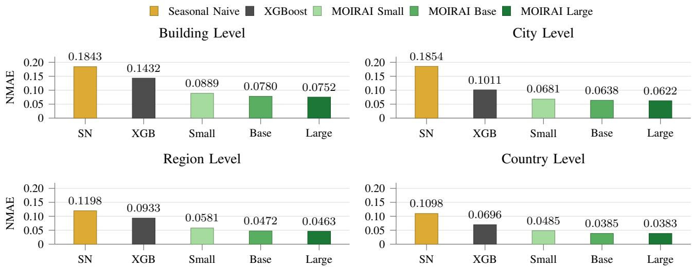  
Fig. 1. Mean NMAE of the weekly seasonal naive baseline, XGBoost, and pretrained MOIRAI variants across the four electrical load aggregation levels. Lower values indicate better forecasting performance.

Parameter efficiency is reported using the number of trainable parameters and their percentage of the model’s total parameter count. The GPU configuration used for each adaptation method is reported for context.

## III. RESULTS AND DISCUSSION

The results follow five stages: pretrained backbone selection, comparison of full fine-tuning and LoRA for MOIRAI, replication of the central comparison with Chronos-2, OOD transfer, and derivation of a practical model-selection rule.

## A. Pretrained Performance and Backbone Selection

The first stage evaluates whether pretrained TSFMs provide useful electrical load forecasts before downstream adaptation. Fig. 1 compares Seasonal Naive, XGBoost, and the three pretrained MOIRAI variants across the four aggregation levels. Every pretrained MOIRAI configuration achieves lower NMAE than both implemented baselines. This result shows that broad pretraining transfers effectively to the evaluated electrical load series and provides a meaningful starting point before adaptation is considered.

MOIRAI Large gives the strongest pretrained result within its family, with mean NMAE values of approximately 0.0752, 0.0622, 0.0463, and 0.0383 for building-level, city-level, regional-level, and country-level data, respectively. The results also follow the expected aggregation pattern: country-level and regional-level load series are easier to forecast than local building load series because aggregation smooths individual operating events. This result motivates the selection of MOIRAI Large for the primary adaptation study.

## B. MOIRAI Adaptation Accuracy and Efficiency

Fig. 2 separates the effects of full fine-tuning and rank-16 LoRA so that the adaptation gains remain visible within the MOIRAI family. Relative to pretrained MOIRAI Large, full fine-tuning reduces NMAE by approximately 0.8 %, 10.1 %, 13.8 %, and 12.0 % for building-level, city-level, regionallevel, and country-level data. Rank-16 LoRA follows the same pattern, with reductions of approximately 0.8 %, 6.3 %, 12.5 %, and 10.7 %. Averaged across the four levels, LoRA improves pretrained MOIRAI by approximately 7.5 %. Across the four levels, rank-16 LoRA retains most of the improvement achieved by full fine-tuning, although full fine-tuning provides a clearer advantage at city level.

Both full fine-tuning and LoRA produce only limited improvement at the building level, suggesting that adapter capacity is not the only limiting factor. Historical load and temperature alone may not fully represent the heterogeneous functions, schedules, occupancy patterns, and equipment states that influence building demand. For these targets, broader building coverage and more informative operational covariates may be more valuable than updating additional model parameters.

Rank-16 LoRA updates 3.146 million parameters, approximately 1 % of MOIRAI Large, compared with all 311 million parameters under full fine-tuning. The LoRA and full finetuning experiments were executed on an NVIDIA V100 with 16 GB and an NVIDIA A100 with 80 GB, respectively. These values describe the hardware used rather than the minimum memory required by either method.

The broader ablation results support rank-16 LoRA as a practical default for MOIRAI. Increasing the rank from 16 to 128 raises the number of trainable parameters from 3.146 million to 25.166 million without producing a consistent improvement across aggregation levels. LoRA, QLoRA, and DoRA achieve similar mean NMAE, with no method showing a consistent advantage. A broader building-level training set improves building-level accuracy but has mixed effects on the other aggregation levels. These findings shift the practical focus from adapter complexity toward pretrained model strength, representative training data, and validation on the intended electrical load targets.

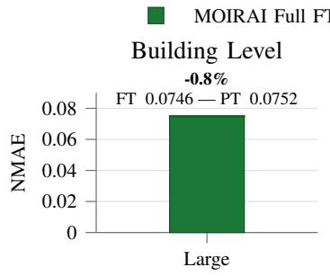

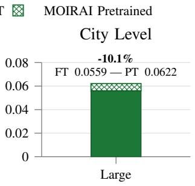

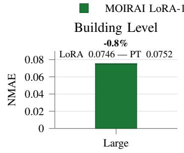

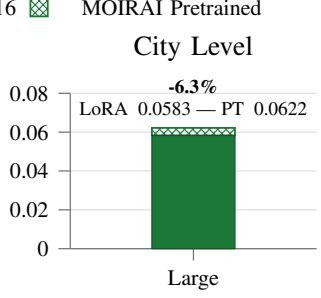

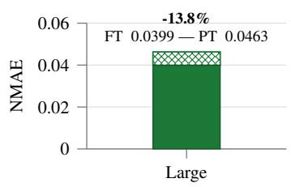  
(a) Pretrained and fully fine-tuned MOIRAI Large.

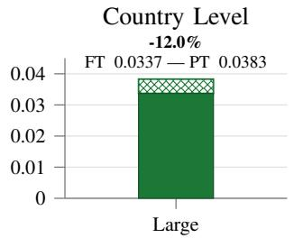

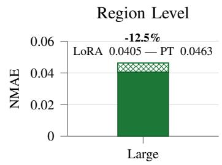

(b) Pretrained MOIRAI Large and rank-16 LoRA.  
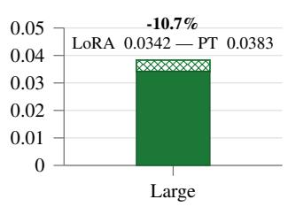  
Fig. 2. Within-model effect of full fine-tuning and rank-16 LoRA across electrical load aggregation levels.

## C. Cross-Model In-Distribution Comparison

Fig. 3 compares the selected MOIRAI Large and Chronos-2 configurations on the same NMAE scale because adaptation gains depend on the pretrained starting point. Chronos-2 already outperforms MOIRAI Large before adaptation, leaving less room for downstream improvement.

Relative to pretrained Chronos-2, full fine-tuning reduces NMAE by approximately 0.1 %, 4.5 %, 0.3 %, and 2.4 % for building-level, city-level, regional-level, and country-level data, respectively. LoRA reduces NMAE by approximately 4.6 %, 5.9 %, 3.1 %, and 3.3 % when using the best-performing tested rank at each level. Rank 128 gives the lowest NMAE for building-level and regional-level data, while rank 64 gives the lowest NMAE for city-level and country-level data. Averaged across the four aggregation levels, full fine-tuning and LoRA reduce NMAE by approximately 1.8 % and 4.2 %, respectively. In this retrospective comparison, the lowest observed LoRA test NMAE is slightly below that of full fine-tuning at all four levels, although the absolute differences remain small. Across both backbones, pretrained error falls with aggregation, but adaptation gains differ: MOIRAI benefits mainly at city, regional, and country levels, whereas Chronos-2 gains most at building and city levels.

## D. Out-of-Distribution Transfer

Table I compares NMAE and NRMSE across eight OOD series, each spanning one year, using a fixed 2048-hour context, a 96-hour forecast horizon, and a 96-hour stride. For Chronos-2, using the lowest observed OOD error across the four evaluated LoRA ranks for each target and metric reduces mean NMAE from 0.0636 to 0.0504 and mean NRMSE from 0.1205 to 0.0960. Ci-AVA shows the largest improvement, with NMAE decreasing from 0.0459 to 0.0207 and NRMSE from 0.0732 to 0.0332. Both metrics also improve for BDS3–BDS5, whereas the pretrained checkpoint remains strongest for BDS1 and BDS2. C-IRE and R-DNK change only slightly. For MOIRAI, rank 16 already gives the lowest NMAE for five of the eight targets, while higher ranks provide only marginal improvements for the remaining three; the lowest-error Chronos-2 rank varies more across targets. The agreement between the two metrics indicates that adaptation benefits vary by target, with the clearest gains for the local-area series and selected buildings.

Fig. 4 illustrates one building-level case using a withheld healthcare building. Pretrained Chronos-2 captures the broad daily pattern but smooths rapid transitions and underestimates several peaks. The adapted variants follow changes in demand amplitude more closely. The NRMSE results provide complementary evidence that larger forecast errors decrease for BDS3–BDS5, although BDS1 and BDS2 do not improve. The building-level benefit therefore remains target-dependent.

The ID and OOD findings do not identify one universally best adaptation configuration. ID improvement demonstrates specialization to the load sources represented during adaptation, whereas performance on a new target depends on whether the learned electrical load structure transfers to its geography, consumer mix, or building function. Operators should therefore validate an adapted checkpoint on representative external data before deploying it as the default for a new system.

## E. Practical Adaptation Guide

1) Evaluate the strongest pretrained checkpoint and retain it when performance is sufficient.

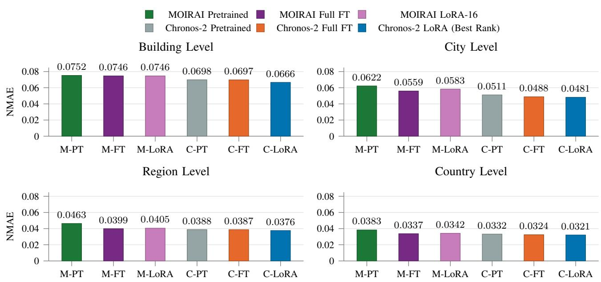  
Fig. 3. Final ID NMAE comparison of pretrained, fully fine-tuned, and LoRA-adapted MOIRAI 1.0 Large and Chronos-2 across the four electrical load aggregation levels. MOIRAI uses rank 16, while the Chronos-2 LoRA result at each level denotes the lowest test NMAE observed in the retrospective rank comparison. All panels use the same scale to support direct comparison.

TABLE I  
OUT-OF-DISTRIBUTION NMAE AND NRMSE USING THE FIXED 2048-HOUR CONTEXT. LOWER VALUES INDICATE BETTER PERFORMANCE. BOLD AND UNDERLINED VALUES DENOTE THE BEST AND SECOND-BEST RESULTS, RESPECTIVELY.
<table><tr><td>Method</td><td>Metric</td><td>C-IRE</td><td>R-DNK</td><td>Ci-AVA</td><td>BDS1</td><td>BDS2</td><td>BDS3</td><td>BDS4</td><td>BDS5</td></tr><tr><td>Seasonal Naive</td><td>NMAE NRMSE</td><td>0.0302 0.0460</td><td>0.0584 0.0902</td><td>0.0672 0.1024</td><td>0.0768 0.1280</td><td>0.0955 0.1742</td><td>0.1037 0.2158</td><td>0.1672 0.3670</td><td>0.1424 0.2484</td></tr><tr><td>XGBoost</td><td>NMAE NRMSE</td><td>0.0371 0.0562</td><td>0.0713 0.1091</td><td>0.0806 0.1274</td><td>0.0749 0.1221</td><td>0.0868 0.1560</td><td>0.1121 0.2267</td><td>0.1676 0.3769</td><td>0.1197 0.2129</td></tr><tr><td>MOIRAI Pretrained</td><td>NMAE NRMSE</td><td>0.0246 0.0375</td><td>0.0456 0.0709</td><td>0.0503 0.0783</td><td>0.0573 0.0972</td><td>0.0782 0.1403</td><td>0.0792 0.1650</td><td>0.1115 0.2457</td><td>0.0984 0.1755</td></tr><tr><td>MOIRAI LoRA</td><td>NMAE NRMSE</td><td>0.0224 0.0346</td><td>0.0435 0.0676</td><td>0.0468 0.0729</td><td>0.0520 0.0882</td><td>0.0718 0.1306</td><td>0.0768 0.1611</td><td>0.1110 0.2469</td><td>0.0960 0.1707</td></tr><tr><td>MOIRAI Full FT</td><td>NMAE NRMSE</td><td>0.0227 0.0349</td><td>0.0437 0.0680</td><td>0.0467 0.0732</td><td>0.0585 0.0983</td><td>0.0755 0.1368</td><td>0.0787 0.1651</td><td>0.1150 0.2585</td><td>0.0965 0.1709</td></tr><tr><td>Chronos-2 Pretrained</td><td>NMAE NRMSE</td><td>0.0210 0.0330</td><td>0.0415 0.0645</td><td>0.0459 0.0732</td><td>0.0494 0.0848</td><td>0.0660 0.1236</td><td>0.0768 0.1627</td><td>0.1112 0.2483</td><td>0.0972 0.1740</td></tr><tr><td>Chronos-2 LoRA</td><td>NMAE NRMSE</td><td>0.0200 0.0315</td><td>0.0405 0.0630</td><td>0.0207 0.0332</td><td>0.0530 0.0907</td><td>0.0665 0.1239</td><td>0.0603 0.1293</td><td>0.0688 0.1647</td><td>0.0731 0.1316</td></tr><tr><td>Chronos-2 Full FT</td><td>NMAE NRMSE</td><td>0.0204 0.0319</td><td>0.0404 0.0627</td><td>0.0218 0.0352</td><td>0.0521 0.0895</td><td>0.0679 0.1256</td><td>0.0601 0.1288</td><td>0.0698 0.1678</td><td>0.0737 0.1326</td></tr></table>

C-IRE, R-DNK, and Ci-AVA denote the national load of Ireland, the regional load of Denmark, and the AVA local-area series, respectively; BDS1–BDS5 denote withheld Building Data Genome 2 buildings. All four LoRA ranks were evaluated on the OOD series. For both MOIRAI and Chronos-2, LoRA reports the lowest observed OOD error across ranks for each target and metric.

2) Start with a compact LoRA configuration and retain the adapted model only when validation shows a meaningful gain, then verify performance on external systems or buildings.

3) Consider larger ranks or full fine-tuning only when validation shows a meaningful additional accuracy gain.

For irregular building profiles, the deployment process should first consider broader training coverage and informative covariates before increasing adapter complexity, as recent buildingenergy results show that covariate integration can provide substantial gains without additional fine-tuning [17].

## IV. LIMITATIONS

The selected datasets, 96-hour forecast horizon, fixed 2048- hour context, model families, and adaptation settings limit the generalizability of the findings. The large adaptation experiments were not repeated across seeds, and the ID and OOD rank comparisons are retrospective test-set ablations.

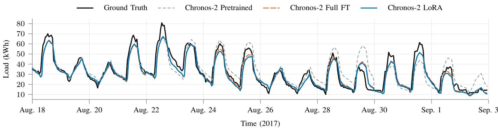  
Fig. 4. Illustrative contiguous OOD test segment from a withheld healthcare building, containing rapid load transitions and peak-demand behavior. The fully fine-tuned and LoRA-adapted Chronos-2 variants follow the observed amplitude changes more closely than the pretrained checkpoint.

NRMSE complements NMAE by giving greater weight to larger forecast errors, but neither metric directly quantifies forecast bias, peak timing, or probabilistic calibration. The city-level and building-level experiments assume access to temperature over the complete forecast horizon. The source datasets do not consistently provide occupancy, equipment, tariff, holiday, or operating-schedule information.

## V. CONCLUSION

This study examined when parameter-efficient adaptation is worthwhile for electrical load forecasting. Pretrained TSFMs outperform the implemented Seasonal Naive and XGBoost baselines across the evaluated aggregation levels. On MOIRAI Large, rank-16 LoRA retains most of the full fine-tuning improvement while updating approximately 1 % of the model. For Chronos-2, the lowest observed LoRA ID test NMAE is slightly lower than that of full fine-tuning across all four levels, although the absolute differences remain small. Its stronger pretrained performance also leaves less room for downstream improvement than MOIRAI.

The OOD NMAE and NRMSE results show that adaptation benefits vary by target, with the clearest adaptation gains for the local-area series and several buildings.

Adaptation is therefore not automatically necessary. Pretrained inference can perform strongly for smoother countrylevel and regional-level demand, whereas adaptation gains for local-area and building targets are more target-dependent and vary with the pretrained backbone. The resulting decision rule is to start with the strongest pretrained checkpoint and introduce compact adaptation only when representative validation shows a clear target-specific gain; the adapted checkpoint should then be verified on external systems or buildings before deployment.

## ACKNOWLEDGMENT

This project was funded in part by the Deutsche Forschungsgemeinschaft (DFG, German Research Foundation) - 535389056.

## REFERENCES

[1] R. Sevlian and R. Rajagopal, “A scaling law for short term load forecasting on varying levels of aggregation,” International Journal of Electrical Power & Energy Systems, vol. 98, pp. 350–361, 2018.

[2] Y. Peng, Y. Wang, X. Lu, H. Li, D. Shi, Z. Wang, and J. Li, “Shortterm load forecasting at different aggregation levels with predictability analysis,” in 2019 IEEE Innovative Smart Grid Technologies–Asia (ISGT Asia), 2019, pp. 3385–3390.

[3] S. P. Arango et al., “ChronosX: Adapting pretrained time series models with exogenous variables,” in Proceedings of The 28th International Conference on Artificial Intelligence and Statistics, ser. Proceedings of Machine Learning Research, Y. Li, S. Mandt, S. Agrawal, and E. Khan, Eds., vol. 258. PMLR, 03–05 May 2025, pp. 2242–2250. [Online]. Available: https://proceedings.mlr.press/v258/arango25a.html

[4] T. Chen and C. Guestrin, “XGBoost: A scalable tree boosting system,” in Proceedings of the 22nd ACM SIGKDD International Conference on Knowledge Discovery and Data Mining, 2016, pp. 785–794.

[5] G. Woo, C. Liu, A. Kumar, C. Xiong, S. Savarese, and D. Sahoo, “Unified training of universal time series forecasting transformers,” in Proceedings of the 41st International Conference on Machine Learning, vol. 235, 2024, pp. 53 140–53 164.

[6] A. F. Ansari et al., “Chronos: Learning the language of time series,” Transactions on Machine Learning Research, 2024.

[7] ——, “Chronos-2: From univariate to universal forecasting,” 2025, arXiv:2510.15821.

[8] S. Chattopadhyay, J. Oelhaf, A. Schoening, J. Deuschel, B. Bhattacharyya, C. Bergler, A. Maier, and S. Bayer, “Peak-aware short-term load forecasting across distribution grid aggregation levels,” in 2026 IEEE PES Innovative Smart Grid Technologies Conference Europe (ISGT Europe). Budapest, Hungary: IEEE, Oct. 2026, arXiv:2609.18588.

[9] E. J. Hu et al., “LoRA: Low-rank adaptation of large language models,” in International Conference on Learning Representations, 2022.

[10] T. Dettmers, A. Pagnoni, A. Holtzman, and L. Zettlemoyer, “QLoRA: Efficient finetuning of quantized LLMs,” in Advances in Neural Information Processing Systems, vol. 36, 2023, pp. 10 088–10 115.

[11] S.-Y. Liu et al., “DoRA: Weight-decomposed low-rank adaptation,” in Proceedings of the 41st International Conference on Machine Learning, vol. 235, 2024, pp. 32 100–32 121.

[12] D. Gupta et al., “Low-rank adaptation of time series foundational models for out-of-domain modality forecasting,” in Proceedings of the 26th International Conference on Multimodal Interaction, 2024, pp. 382–386.

[13] Y.-J. Park et al., “Probabilistic forecasting for building energy systems using time-series foundation models,” Energy and Buildings, vol. 348, p. 116446, 2025.

[14] M. H. Ullah et al., “Worldwide electricity load dataset,” Mendeley Data, Version 1, 2026.

[15] A. Salam and A. El Hibaoui, “Power consumption of tetouan city,” UCI Machine Learning Repository, 2018.

[16] C. Miller et al., “The building data genome project 2, energy meter data from the ASHRAE great energy predictor III competition,” Scientific Data, vol. 7, p. 368, 2020.

[17] A. Kreusel, M. Hertel, M. Noskiewicz, F. Zahn, H. Maaß, R. Mikut, and V. Hagenmeyer, “Covariates are the key to accurate probabilistic building energy forecasting with time series foundation models,” in Proceedings of the 2026 ACM Sustainability Week. Association for Computing Machinery, 2026, pp. 172–182.