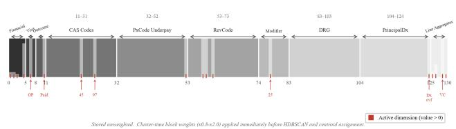
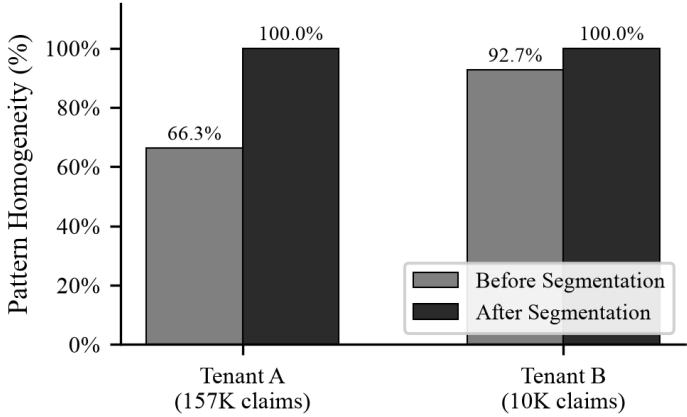
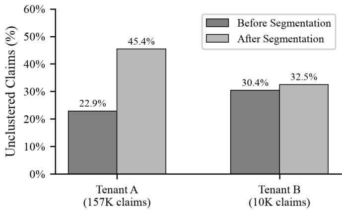
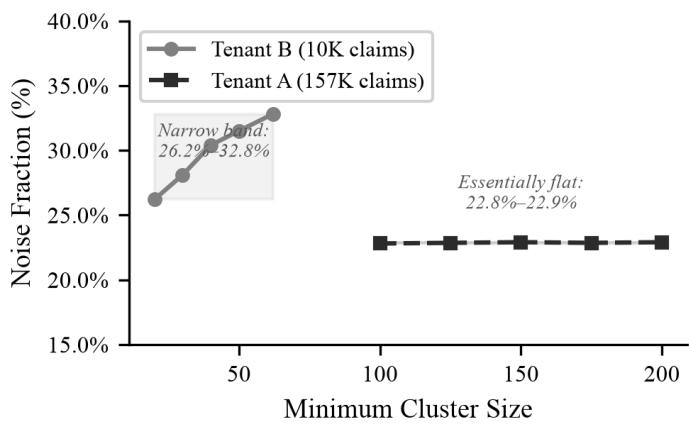
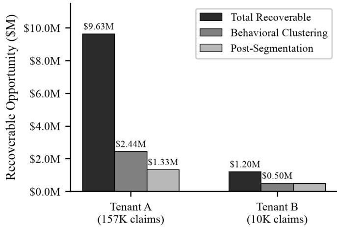

# Pattern Intelligence: Unsupervised, LLM-Interpreted Discovery of Systematic Underpayment and Denial Patterns in Healthcare Revenue Cycle Management

Harshil Lodhiya, Alex McManus

SlicedHealth

Woodstock, Georgia, United States

hlodhiya@slicedhealth.com; amcmanus@slicedhealth.com

Abstract—Healthcare providers lose substantial revenue to systematic payer underpayments and claim denials, yet identifying the recurring, correctable patterns behind them remains largely manual and does not scale to the hundreds of thousands of claims a hospital adjudicates. We present Pattern Intelligence, a deployed system that discovers such patterns without supervision by clustering claims on their adjudication behaviour rather than their identity. Each claim is embedded in a 130-dimensional feature vector combining per-line expected-versus-actual payment ratios, claim adjustment reason (CARC) codes, denial and payment signals, and service composition. Payer and contract identity are deliberately excluded from the distance metric we show they dominate the geometry and collapse clusters into trivial per-payer groups — and are reintroduced only as a post-hoc segmentation (by contract and visit type) that keeps every surfaced pattern coherent and actionable. We cluster with HDBSCAN, recover additional structure from the noise set via a second-pass sub-clustering, and gate low-confidence memberships so that a pattern’s claims genuinely represent it. A large language model translates each cluster centroid into an analyst-ready description — dominant procedures, adjustment reasons, and a plain-language failure mode. We report a recurring empirical finding that a substantial fraction of high-dollar denials between roughly one-third and one-half, depending on tenant and segmentation — forms an irreducible, idiosyncratic long tail that no density-clustering configuration or representation we tried groups, and argue this reflects a property of the domain rather than a modeling deficiency. We evaluate pattern validity through cluster-coherence analysis (per-pattern homogeneity before and after segmentation) and quantify impact with a recoverableopportunity (\$) metric, reported on two production tenants of contrasting scale (≈10K and ≈157K claims). We further describe a multi-tenant deployment, currently across six hospital systems (deployment expanding) at ∼10K–157K claims each. Rather than a new algorithm, the contribution is a problem formulation, a representation-design insight, and empirical findings from a production system on real claims data.

Index Terms—revenue cycle management, claim denials and underpayments, unsupervised pattern discovery, behavioral clustering, HDBSCAN, healthcare claims analytics, representation design, LLM-based cluster interpretation, claim adjustment reason codes (CARC), deployed machine learning

## I. INTRODUCTION

Revenue cycle management (RCM) is the set of administrative and financial processes by which healthcare providers are reimbursed for care. A material fraction of billed charges is never fully collected: payers deny claims, apply contractual adjustments, or reimburse below the expected contracted rate. Many of these shortfalls are not random — they recur systematically for a given payer, service, contract term, or coding pattern, and are therefore correctable. Identifying which shortfalls are systematic (and thus worth an appeal, a contract renegotiation, or a coding fix) is today performed by analysts reviewing claims largely one at a time, a process that does not scale to the volume a modern hospital adjudicates.

Machine learning applied to healthcare has concentrated on clinical prediction; the operational and financial layer of RCM — denials, underpayments, and their systematic causes — is comparatively under-studied. The task is a poor fit for supervised learning: there is no reliable label for “this is a systematic, correctable pattern,” the space of failure modes is open-ended and drifts as payers change policy, and any labeling scheme would encode the very analyst intuition we wish to scale. We therefore frame the problem as unsupervised discovery: surface coherent groups of claims that fail (or under-pay) for the same reason, and present each group to an analyst in actionable terms.

This paper describes Pattern Intelligence, a system deployed in production across multiple hospital tenants. Our contributions are:

• A problem formulation for unsupervised discovery of systematic underpayment and denial patterns in RCM claims, distinct from clinical prediction and from supervised denial-propensity models.

• A representation-design insight: clustering on adjudication behaviour while deliberately excluding payer and contract identity from the distance metric, because those features dominate the geometry and shatter clusters trivially; identity is reintroduced as post-hoc segmentation.

• A coherence mechanism — contract-and-visit segmentation plus confidence gating and a homogeneity criterion — that keeps every surfaced pattern one an analyst can act on without dismissing it as mixed data.

• An LLM interpretation layer that converts cluster centroids into analyst-ready, coded (CARC-referenced) descriptions and failure modes.

• Empirical findings from a real deployment, including an honest negative result: an irreducible long tail of highdollar, idiosyncratic denials that resists density clustering under every configuration we tried.

## II. RELATED WORK

Denials and RCM analytics. Prior work on claim denials is dominated by supervised denial-propensity or paymentprediction models (e.g., [1], [2], [3]). These require labeled outcomes and predict whether a claim will be denied rather than surfacing the systematic, correctable structure across many claims. Our aim is complementary and unsupervised.

Density-based clustering. We build on DBSCAN [4] and its hierarchical density-based extension HDBSCAN [5], [6], which does not require a preset number of clusters and yields a principled noise label — both essential when the number and prevalence of failure modes are unknown a priori. Clustervalidity for density methods (e.g., DBCV [7]) informs our parameter selection.

Representationfor tabular/administrative data and interpretation. Representation and feature engineering for tabular and administrative data is an active area [8], [9]. Recent work uses large language models to label or summarize clusters and topics [10], [11]; adaptive routing strategies for selecting among language models under non-stationary workloads have also been studied [12]. We apply this specifically to translate claim-cluster centroids into coded, operationally actionable descriptions.

## III. PROBLEM FORMULATION

Let a claim be adjudicated at the service-line level, producing for each line an expected (contracted) payment, an actual payment, and zero or more adjustment reason (CARC) codes with group codes and amounts. A claim carries a payer, a contract, a visit type (e.g., professional, outpatient), and derived financial quantities (charged, expected, actual, variance). We seek a partition of a tenant’s claims into groups such that (i) claims in a group share an adjudication behavior — the same manner of underpayment or denial — and (ii) each surfaced group is homogeneous enough in payer, contract, and visit that an analyst can act on it as a unit. Groups need not cover all claims: claims with no shared, recurring behavior should be labeled noise rather than forced into a group.

Fig. 5. Sample Outpatient Claim and 130-Dimensional Feature Vector Construction
<table><tr><td>SAMPLE CLAIM</td><td></td><td colspan="8">CHARGE LINES (estimatedPaymentDetails → per-line encoding inputs)</td></tr><tr><td>Claim ID:</td><td>CLM-20260314-4872</td><td>PxCode</td><td>Mod. RevCode</td><td></td><td>Charged</td><td>Expected Actual</td><td></td><td>Variance Role in vector</td><td></td></tr><tr><td>Visit Type:</td><td>Outpatient</td><td>29881</td><td></td><td>0360</td><td>S3,200</td><td>$1,850</td><td>$1,538</td><td>+$312 ▲</td><td>PxCode underpay 100%; RevCode 0360 (OR)</td></tr><tr><td>Payer:</td><td>[excluded from vector]</td><td>99213</td><td>25</td><td>0510</td><td>$350</td><td></td><td>$0</td><td>Modifier 25;</td><td></td></tr><tr><td>Contract: Charged:</td><td>[excluded from vector] $4,150.00</td><td></td><td></td><td></td><td></td><td>$420</td><td>$420</td><td></td><td>RevCode 0510 (Clinid)</td></tr><tr><td>Expected Pay:</td><td>$2,480.00</td><td>73562</td><td></td><td>0320</td><td>$600</td><td>$210 $210</td><td>$0</td><td></td><td>RevCode 0320 (Radiqlog</td></tr><tr><td>Actual Paid:</td><td>$2,168.00</td><td colspan="7">→ Net variance 312 &gt; 10 threshold → underpayment gate = I → PxCode underpay block and line-aggregate underpay dims are ACTIVE</td></tr><tr><td>Net Variance:</td><td>+$312.00 ← underpaid</td><td colspan="7">→ Payer and contract identity deliberately EXCLUDED from vector</td></tr><tr><td>CARC Codes:</td><td>45,97</td><td colspan="7">(reintroduced as post-hoc segmentation at cluster time)</td></tr><tr><td>Denial/Paid:</td><td>No / Yes</td><td colspan="7"></td></tr></table>

<table><tr><td>Block</td><td>Dims</td><td>Weight</td><td>Encoding &amp; Interpretation</td><td>Sample Values (this claim)</td></tr><tr><td>Financial</td><td>0–4</td><td>×1.0</td><td>patient responsibility, paid ratio varisnce/underpay ratios, charge magnitude, (batch min-max normalized at ingest)</td><td>0.126, 0.126, 0.083, 0.000, 0.875</td></tr><tr><td>Visit</td><td>5-7</td><td>×1.0</td><td>One-hot visit type: [is_inpatient, is_outpatient, is_professional]</td><td>[0, 1, 0]</td></tr><tr><td>Outcome</td><td>8-10</td><td>×2.0</td><td>Binary outoome flags: [is_denial=0, is_zero_allow=0, is_paid-1]</td><td>[0, 0, 1]</td></tr><tr><td>CAS Codes</td><td>11-31</td><td>×2.0</td><td>Code 45: charge &gt; fee schedule Multi-hot CARC reasom codes Cod   e    o</td><td>code 45=1, code 97=1, others=0; overflow=0</td></tr><tr><td>PxCode Underpay 32–52</td><td></td><td>×1.5</td><td>29881 (knee arthroscopy) drives 100% ent share per procedure. of net underpayment; gate=1.</td><td>29881=1.00, others=0.00; overflow=0</td></tr><tr><td>RevCode</td><td>53-73</td><td>×0.8</td><td>0360-OR, 0510-Clinic, 0320-Radiology Binary revemme code presence:</td><td>0360=1, 0510=1, 0320=1, others=0</td></tr><tr><td>Modifier</td><td>74–82</td><td>×0.8</td><td>Modifier 25 on E&amp;M 99213. CPT modifier presence + overflow.</td><td>25=1, others=0; overflow=0</td></tr><tr><td>DRG</td><td>83-103</td><td>×1.5</td><td>DRG presence (inpatient only). Zeroed for outpatient visit.</td><td>all zeros (outpatient)</td></tr><tr><td>PrincipalDx</td><td>104-124</td><td>×1.0</td><td>M23.201 not in top-20 vocab ICD-10 principal Dx presence.</td><td>overflow=1 (M23.201) top-20 dims=0;</td></tr><tr><td>Line Aggregates</td><td>125-129</td><td>×1.5</td><td>Lineevel agregates [all in 0,1]: line_et_nom, underpaid_frac,</td><td>0.15, 0.33, 0.00, 1.00, 0.17</td></tr></table>

130-Dimensional Feature Vector (unweighted; stored in Pinecone per claim)

  
Fig. 1. Sample outpatient claim and 130-dimensional feature vector construction. The claim card (top) shows the claim-level and per-line inputs; the table (middle) gives the block layout, cluster-time weights, and the encoded values for this claim; the strip (bottom) shows the resulting vector with active dimensions marked.

## IV. METHODS

## A. Behavior-based representation

Each claim is embedded in a 130-dimensional vector composed of blocks: (a) financial-behavior ratios (expected-vsactual, variance-to-charge, underpayment fraction), gated by a significant-variance threshold so that net-even redistributions do not read as underpayments; (b) a multi-hot encoding of the most frequent CARC adjustment codes; (c) per-line signals derived from the estimated payment details (procedure, revenue code, DRG, diagnosis presence, line-level behavior); and (d) service-group composition. Continuous blocks are loadbearing: purely categorical variants degraded cluster quality in our experiments.

Crucially, payer and contract identity are excluded from the vector used for the distance metric. When included, they dominate Euclidean distance and cause HDBSCAN to partition trivially by payer, destroying the behavioral signal we want. We instead retain identity as metadata and reintroduce it post hoc (Section IV-C). A frozen encoder — vocabularies of the top-k codes and global financial min/max — guarantees that every claim in a tenant is embedded in the same feature space, a prerequisite for comparable distances; the encoder is fit once over the full corpus and persisted.

## B. Density clustering

We cluster with HDBSCAN, which infers the number of clusters from density structure and assigns a noise label to points with no dense neighborhood. Parameters (minimum cluster size, minimum samples, selection method) are derived from tenant size, with a cap so that a value sensible for a large tenant does not force all-noise on a smaller one; we optionally auto-tune the minimum cluster size using a densitybased validity score with a NaN-safe fallback.

## C. Coherence: segmentation, noise recovery, and confidence gating

A behavioral cluster may legitimately span payers and visit types, which is undesirable when the surfaced pattern must be acted on per contract. We therefore segment each cluster by (contract, visit type): a claim’s pattern is its behavioral cluster intersected with its contract and visit. This guarantees that the payer and visit shown on a surfaced pattern describe every claim in it, eliminating the failure mode in which, e.g., an out-of-family outpatient claim appears under a professional pattern labeled for a different payer.

We run a second-pass sub-clustering over the noise set to recover structure that the global pass missed, applying the same segmentation so that recovered patterns are equally coherent. Finally, we gate low-confidence memberships: claims whose density-membership probability falls below a threshold are returned to noise rather than assigned, so a pattern’s reported membership equals its analyst-visible membership and marginal claims do not contaminate a pattern’s characterization.

## D. LLM interpretation

Cluster geometry is opaque to an analyst. For each pattern we decode the centroid into its dominant driver codes and line-level behavior, translate the associated CARC codes into human-readable reasons, classify a failure mode (e.g., denial vs. contractual zero-allowable vs. underpayment), and prompt a large language model to produce a short, specific pattern name and an analyst-ready summary grounded in these decoded signals. Names are disambiguated so distinct patterns do not collide. The result turns a dense centroid into concrete review guidance.

## V. SYSTEM AND DEPLOYMENT

Pattern Intelligence runs multi-tenant. A historical ingest streams a tenant’s claims from the source system, fits the encoder, embeds and stores vectors, then clusters and writes back each claim’s pattern assignment and each pattern’s description. An incremental daily job embeds new claims and assigns them to the nearest existing pattern; periodic housekeeping and reconciliation keep the vector store consistent with the source of truth. The pipeline is checkpointed and resumable, and coverage is summarized to analysts via an anomalous-claim percentage and a recoverable-opportunity dollar metric. At the time of writing the system is deployed across six hospital tenants, with deployment expanding, processing approximately 10K–157K claims each.

  
Fig. 2. Per-pattern homogeneity before and after segmentation. Behavioral clusters are already largely coherent; segmentation brings homogeneity to 100% by construction.

## VI. EVALUATION

Evaluating unsupervised discovery on proprietary claims data is the central difficulty: there is no gold-standard partition. We address it two ways: an internal analysis of cluster coherence and the noise floor, and an operational, dollar-weighted measure of impact. All figures below are measured on two production tenants of contrasting scale — Tenant A (157,184 claims) and Tenant B (10,318 claims).

## A. Coherence and the irreducible long tail

We measure per-pattern homogeneity as the claim-weighted fraction of clustered claims that match their pattern’s dominant (contract, visit type) pair. Before segmentation, the behavioral clusters are already largely coherent — 92.7% on Tenant B and 66.3% on the larger, more heterogeneous Tenant A — confirming that a purely behavioral cluster can nonetheless span contracts and visit types. After (contract, visit) segmentation, homogeneity is 100% by construction on both tenants: every surfaced pattern is, by definition, actionable as a single contract-and-visit unit. This coherence is not free. Segmentation returns contract-and-visit fragments below the minimum segment size to noise, so the unclustered fraction rises (Tenant A 22.9%→45.4%, Tenant B 30.4%→32.5%) and the share of recoverable dollars captured in coherent patterns falls (Section VI-B). The design therefore trades coverage for guaranteed actionability, and the cost is larger for the large, heterogeneous tenant.

A substantial fraction of claims remains unclustered under every configuration we evaluated — 22.9%–45.4% depending on tenant and segmentation, and, viewed on anomalous (denial / zero-allowable / high-variance) claims specifically, 34.8%– 54.5% of them fall outside any pattern post-segmentation. This residue is concentrated in high-dollar, idiosyncratic denials. Two sweeps indicate it is a property of the data rather than a tuning artifact. First, varying the HDBSCAN minimum cluster size does not dislodge it: on Tenant B the noise floor stays in a narrow 26.2%–32.8% band across minimum-cluster-size candidates from 20 to 62, and on Tenant A it is essentially flat (22.8%–22.9%) across candidates 100 and 200. Second, representation matters in the expected direction but does not remove the floor: dropping the continuous financial and perline behavior blocks to a categorical-only vector on Tenant B raised noise (30.4%→32.8%) and coarsened the solution (92→73 clusters), confirming that the continuous behavior blocks are load-bearing and that no representation we tried clusters the tail. We therefore argue the actionable objective is dollar-weighted triage rather than exhaustive coverage.

  
Fig. 3. Unclustered claim fraction before and after (contract, visit) segmentation. Segmentation trades coverage for guaranteed per-contract actionability.

  
Fig. 4. Noise fraction as a function of HDBSCAN minimum cluster size. The floor is stable across a wide parameter range, indicating an irreducible property of the data.

## B. Operational impact

We quantify impact as recoverable opportunity: the sum of positive net variance on anomalous claims (denials, zeroallowables, and claims whose net variance exceeds a significance threshold), and the fraction of those dollars that lands in a coherent, analyst-visible pattern. Tenant A carries \$9.63M in recoverable opportunity across 55,648 anomalous claims; Tenant B carries \$1.20M across 5,912. Behavioral clustering alone captures 25.3% of that opportunity on Tenant A and 41.7% on Tenant B in analyst-reviewable groups. After (contract, visit) segmentation — the form in which patterns are actually surfaced — capture is 13.8% (\$1.33M) on Tenant A and 39.0% (\$469K) on Tenant B. The gap between the two tenants, and the drop induced by segmentation, both reflect the same underlying fact established in Section VI-A: the large tenant’s recoverable dollars are more dispersed across one-off, high-dollar denials, so more of them fall in the irreducible tail. We report opportunity surfaced rather than dollars recovered; downstream appeal and recovery outcomes are not tracked within the system and are left to future work. Even so, capturing on the order of \$1.3M (Tenant A) and \$0.47M (Tenant B) of concentrated, contract-attributable opportunity per tenant is the operationally relevant result, and it is consistent with a triage objective that prioritizes dollardense patterns over exhaustive coverage.

  
Fig. 5. Recoverable opportunity by pipeline stage. Total recoverable dollars, the fraction captured by behavioral clustering alone, and the fraction retained after (contract, visit) segmentation.

## VII. DISCUSSION

The central design tension is that the signal we want (shared adjudication behavior) and the axis analysts act on (payer/contract/visit) are different: optimizing distance on the latter destroys the former. Separating them — behavior in the metric, identity in segmentation — resolves the tension and is, we believe, transferable to other administrative-data settings where a dominant categorical field would otherwise capture the clustering. The confidence gate and homogeneity criterion encode a product requirement often left implicit in clustering papers: a surfaced group is only useful if a user can trust that its members belong together.

## VIII. LIMITATIONS AND ETHICAL CONSIDERATIONS

• Evaluation without ground truth. Absent a gold partition, our validity evidence is indirect (cluster-coherence analysis and dollar-weighted opportunity outcomes) and is drawn from two tenants; we do not claim to recover a ‘true’ clustering, and controlled fault-injection recovery and blinded analyst adjudication remain future work.

• Data. Results derive from proprietary claims data across a limited set of tenants and one vendor pipeline; generalization to other providers and payers is untested. The data cannot be released.

• Privacy. All analysis is on de-identified, aggregate quantities derived from claims data; no protected health information is accessed or reported, and no individual claim is disclosed. This study is a retrospective analysis of de-identified, aggregated operational claims data and does not constitute human-subjects research; institutional review board review was therefore not required.

• Methods. The components are established (HDBSCAN, LLM prompting); the contribution is applied — formulation, representation design, and deployment findings — not a new algorithm.

## IX. CONCLUSION

We described a deployed system that discovers systematic underpayment and denial patterns in healthcare claims without supervision by clustering on adjudication behavior, keeping payer and contract identity out of the distance metric and reintroducing them as segmentation, and interpreting clusters with an LLM. We reported an honest limit — an irreducible idiosyncratic long tail — and argued for dollar-weighted triage over exhaustive coverage. We hope the representation-design insight and the deployment findings are useful to others applying unsupervised learning to administrative healthcare data.

## COMPETING INTERESTS

Harshil Lodhiya and Alex McManus are employed by SlicedHealth, the company that develops the Pattern Intelligence system described in this manuscript. The authors hold stock options in SlicedHealth. The authors have no other competing interests to declare.

## FUNDING

This work was funded by SlicedHealth, Woodstock, Georgia, United States, which provided support in the form of a salary for authors H.L. and A.M., as well as the claims data and computational resources used in the study. As the authors are employees of SlicedHealth, the funder was involved in the study design, analysis, and preparation of the manuscript.

## DATA AVAILABILITY

The claims data underlying this study are proprietary and contain protected health information; they cannot be shared publicly. The aggregate and derived statistics reported in this manuscript are available from the corresponding authors on reasonable request, subject to a data-use agreement. The Pattern Intelligence software described here is proprietary to SlicedHealth and is not publicly available.

## REFERENCES

[1] M. Kumar, R. Ghani, and Z.-S. Mei, “Data mining to predict and prevent errors in health insurance claims processing,” in Proc. 16th ACM SIGKDD Int. Conf. Knowledge Discovery and Data Mining (KDD), Washington, DC, USA, 2010, pp. 65–74.

[2] B.-H. Kim, S. Sridharan, A. Atwal, and V. Ganapathi, “Deep Claim: Payer response prediction from claims data with deep learning,” arXiv:2007.06229, 2020.

[3] M. Johnson, A. Albizri, and A. Harfouche, “Responsible artificial intelligence in healthcare: Predicting and preventing insurance claim denials for economic and social wellbeing,” Information Systems Frontiers, vol. 25, no. 6, pp. 2179–2195, 2023.

[4] M. Ester, H.-P. Kriegel, J. Sander, and X. Xu, “A density-based algorithm for discovering clusters in large spatial databases with noise,” in Proc. 2nd Int. Conf. Knowledge Discovery and Data Mining (KDD-96), Portland, OR, USA, 1996, pp. 226–231.

[5] R. J. G. B. Campello, D. Moulavi, and J. Sander, “Density-based clustering based on hierarchical density estimates,” in Advances in Knowledge Discovery and Data Mining (PAKDD 2013), LNCS vol. 7819. Berlin, Heidelberg: Springer, 2013, pp. 160–172.

[6] L. McInnes, J. Healy, and S. Astels, “hdbscan: Hierarchical density based clustering,” Journal of Open Source Software, vol. 2, no. 11, p. 205, 2017.

[7] D. Moulavi, P. A. Jaskowiak, R. J. G. B. Campello, A. Zimek, and J. Sander, “Density-based clustering validation,” in Proc. 2014 SIAM Int. Conf. Data Mining (SDM), Philadelphia, PA, USA, 2014, pp. 839– 847.

[8] R. Miotto, L. Li, B. A. Kidd, and J. T. Dudley, “Deep Patient: An unsupervised representation to predict the future of patients from the electronic health records,” Scientific Reports, vol. 6, p. 26094, 2016.

[9] Y. Gorishniy, I. Rubachev, V. Khrulkov, and A. Babenko, “Revisiting deep learning models for tabular data,” in Advances in Neural Information Processing Systems 34 (NeurIPS 2021), 2021, arXiv:2106.11959.

[10] Z. Wang, J. Shang, and R. Zhong, “Goal-driven explainable clustering via language descriptions,” in Proc. 2023 Conf. Empirical Methods in Natural Language Processing (EMNLP), Singapore, 2023, pp. 10626– 10649.

[11] C. M. Pham, A. Hoyle, S. Sun, P. Resnik, and M. Iyyer, “TopicGPT: A prompt-based topic modeling framework,” in Proc. 2024 Conf. North American Chapter of the Association for Computational Linguistics: Human Language Technologies (NAACL-HLT), vol. 1, Mexico City, Mexico, 2024, pp. 2956–2984.

[12] H. Lodhiya, “Feedback control for adaptive language model routing under non-stationary workloads,” J. Comput. Sci. Technol. Stud., vol. 8, no. 8, pp. 238–243, Jul. 2026, doi: 10.32996/jcsts.2026.8.8.17.