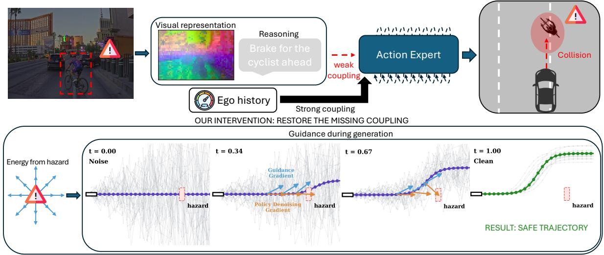
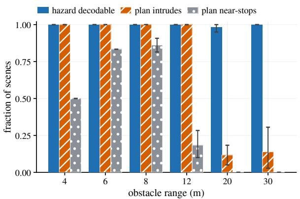
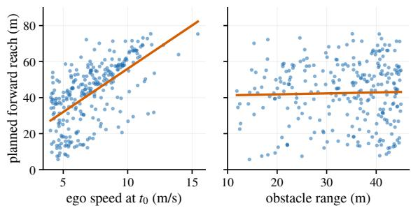
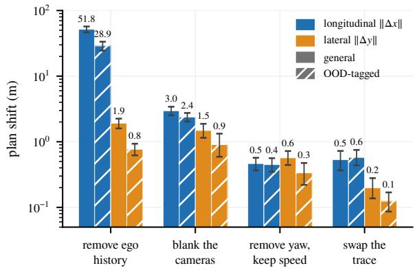
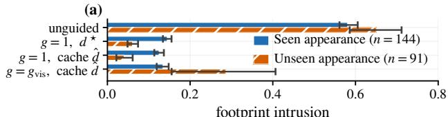
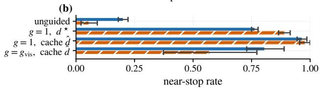
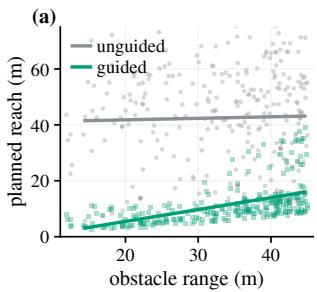
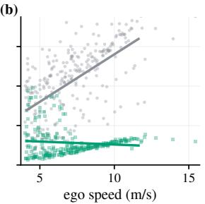

# Perceives but Doesn’t Brake: A Perception–Action Binding Gap in Reasoning Driving VLAs

Matteo Cercola1, Katie Z Luo2, Simone Formentin1 and Marco Pavone2,3

Abstract— Reasoning-augmented vision-language-action (VLA) driving models can perceive and reason about safetycritical hazards yet fail to translate that evidence into safe actions. We characterize this failure as a perception–action binding gap: hazard information is available inside the model but exerts insufficient control over trajectory generation. Using matched simulated counterfactuals and logged driving replay, we show that in-path hazards are actually encoded in the visual representation, but longitudinal plans are dominated by ego-speed history and respond only weakly to hazard proximity or the model’s own reasoning trace. Further analysis shows that the trajectory generator is capable of braking but sometimes fails to do so due to the perception-action binding gap. Without retraining or modifying any weights, we inject a hazard-conditioned energy into the frozen flow-matching sampler of Alpamayo-1.5, restoring the missing coupling at generation time. With exact obstacle geometry, guidance cuts footprint intrusion from 58.1% to 14.5% and recovers safe braking whenever sufficient stopping distance remains, eliminating collisions entirely in our braking-relevant closed-loop battery. It also reverses the diagnosed dependence of the plan, from tracking ego speed to responding to obstacle range. These results separate hazard perception from hazard control in driving VLAs, show that unsafe behavior can arise even when the model has both the evidence and the ability to act on it, and propose a simple fix for bridging this binding gap.

## I. INTRODUCTION

Reasoning-augmented vision–language–action (VLA) models are increasingly designed to do more than map observations directly to actions: they perceive the scene, produce an explicit reasoning trace, and then generate a driving trajectory. This architecture suggests a natural safety premise: if the model correctly identifies a hazard and reasons that the vehicle should respond, that evidence should influence the resulting action. However, on simulated scenes containing a stationary obstacle in the ego lane, a state-of-the-art reasoning VLA [1] generates trajectories that enter the obstacle footprint on 58.1% of samples, and its selected actions collide with a reconstructed version of that obstacle in most closed-loop rollouts, even though a comfortable stop was still possible. Crucially, the failure does not arise because the hazard is absent from the model. The obstacle is recoverable from the visual representation and is often explicitly identified in the model’s own reasoning, yet neither source of evidence exerts sufficient influence on the generated longitudinal plan. Instead, the plan remains strongly governed by the supplied ego-speed history. We call this dissociation between accessible hazard evidence and its influence on action a perception–action binding gap (Figure 1); here perceives means recoverable from the model’s representation (formalized as availability, Section IV), not awareness.

This distinction matters because an unsafe action can have at least three different causes. First, the relevant hazard may not be represented at all (availability). Second, the trajectory generator may be incapable of producing an appropriate response even when the hazard is known (actionside sufficiency). Third, the evidence may be available and a safe action may be expressible, but the evidence may have insufficient action authority: changing the hazard does not sufficiently change the generated plan. These cases imply different remedies, yet standard driving metrics typically conflate them.

We disentangle them with matched simulated interventions that vary visual hazard content, obstacle range, ego-speed history, and textual reasoning while holding competing inputs fixed. Hazard information is available throughout, yet longitudinal behavior is far more sensitive to ego history than to the hazard itself, under closed-loop control in AlpaSim/NuRec [2] as well as open-loop scoring.

Next, we ask whether the missing coupling can be restored without retraining the policy. We inject a differentiable hazard energy into the frozen flow-matching sampler of Alpamayo-1.5, steering trajectory generation during flow integration while leaving all model parameters unchanged. Supplied exact obstacle geometry, this reduces footprint intrusion from 58.1% to 14.5% and changes the governing dependence of the generated plan: trajectory reach becomes primarily responsive to obstacle range rather than ego speed. Controlled CARLA sweeps further show that the remaining failures are those in which insufficient stopping distance remains.

Finally, we ask how far this intervention can be driven by signals already present in the frozen model, rather than by privileged geometry. Lightweight readouts of the visual cache estimate both when an in-path hazard is present and where it lies. The key is to preserve the spatial structure needed for that estimate: on sites held out in both geometry and appearance, a spatially aware readout reduces footprint intrusion from 65.0% to 11.7%, approaching the 6.0% obtained with exact geometry, with no measured reach loss on matched clear scenes. Thus, much of the safety constraint needed to restore perception-action binding is already recoverable from the model’s own representation. Autonomous binding is therefore feasible within the evaluated visual domain, while robust semantic triggering under domain shift remains open.

Our contributions are threefold. First, our primary contribution is to identify and causally diagnose a perception– action binding gap in a reasoning driving VLA. Across logged driving, matched counterfactuals, and closed-loop replay, we separate hazard availability from action authority and show that longitudinal planning is dominated by egospeed history; to our knowledge, this is the first causal, rather than correlational, separation of hazard availability from action authority in a reasoning driving VLA. Second, we show that the missing coupling can be enforced at inference time without retraining. A differentiable hazard-conditioned energy steers the frozen flow-matching sampler toward safe braking and, when supplied an accurate constraint, shifts the plan’s dependence from ego speed toward obstacle range, demonstrating action-side sufficiency. Third, we show why standard logged evaluation can miss such a failure. Because a binding gap is a failure of hazardconditioned action response rather than average prediction quality, standard logged evaluation can miss it: safety-critical states in which a moving ego must brake for a stationary in-path obstacle are rare because human drivers typically avoid them.

  
Fig. 1. Where perception–action binding fails, and where we intervene. Binding gap: visual hazard evidence and the model’s reasoning trace have substantially weaker authority over the longitudinal plan than ego history. Intervention: a hazard-conditioned energy gradient is added during flow integration, steering the frozen trajectory generator toward a safe plan without modifying model weights.

## II. RELATED WORK

## A. Ego-State Shortcuts and Driving Evaluation

Prior work shows that open-loop driving benchmarks can be solved surprisingly well from ego dynamics alone [3], and that planners remain nearly unchanged under severe visual corruption while responding strongly to ego-velocity perturbations [4]. These findings establish an ego-state shortcut but do not distinguish whether visual evidence is absent from the representation or present yet uncoupled from action.

## B. Reasoning and Video–Action Driving Models

Recent driving policies increasingly couple visual observations, language or reasoning, and action generation. Alpamayo-1.5 combines chain-of-causation reasoning with a flow-matching trajectory expert [1]; Senna predicts languagelevel driving decisions [5]; LMDrive combines language, perception, navigation, and explicit ego state [6]; and VaVAM is a language-free video–action policy without explicit egostate input [7].

## C. Reasoning–Action Faithfulness

Prior work shows that stated reasoning and executed behavior can disagree, including within the same model family [8], and that embodied reasoning faithfulness can be improved with learned critics [9]. These studies show language and action can diverge, but do not separate hazard availability from whether it exerts causal authority over the trajectory.

## D. Inference-Time Guidance for Generative Policies

Gradient guidance can steer pretrained diffusion and flow samplers during generation without retraining [10], [11], [12]; runtime reasoning–action alignment has also used sample-and-rerank schemes [13]. We use guidance as a diagnostic intervention rather than proposing a new control mechanism: by granting a safety constraint direct authority during sampling, we test whether the frozen generator can produce a response that its native conditioning fails to elicit.

## III. BACKGROUND

## A. Model and Evaluation Instruments

We evaluate Alpamayo-1.5 [1] frozen and zero-shot, preserving its native input and ego history conditioning. The flow-matching trajectory expert generates a 6.4 s trajectory; unless otherwise noted, we sample K=6 trajectories per state. All instruments study the same critical state: an approaching ego vehicle facing a stationary in-path obstacle.

a) Logged scenes: From held-out US test clips of the NVIDIA PhysicalAI-AV set [14], we select states where ego speed is at least 4 m/s and a stationary object lies 8–45 m ahead in the ego corridor, using only contemporaneous labels and never the driver’s future trajectory, yielding n=273 states from 185 clips. These states form a nominal diagnostic set, not a hazard benchmark: the objects are predominantly vehicles parked at the curb, no braking is required of the ego, and at the model’s native input its plans enter the footprint on only 2.50% of samples. We use these scenes only to measure which input variable the plan’s forward reach tracks.

b) Designed hazards in controlled simulation: Using CARLA [15] through Fail2Drive [16], we construct matcheddespawn pairs: identical sites, rendering, ego motion, history, and native four-camera temporal input, differing only in whether the stationary obstacle is present, isolating the causal effect of hazard content. Hazards span six object kinds at 8– 30 m. We report two populations: seen sites (n=144 hazard and 24 empty scenes over six sites, evaluated leave-onesite-out) and new sites (n=91 and 12 over six disjoint sites held out in both geometry and appearance). Unless stated otherwise, 95% confidence intervals (CIs) are site-clustered bootstraps (B=104).

c) Closed-loop replay: In AlpaSim/NuRec, we test repeated replanning with the native four-camera Alpamayo-1.5 controller, using two stimuli. In the static one we re-pose a reconstructed vehicle 40 m ahead in the ego lane and freeze it, paired with its unedited reconstruction as control; 24 of 27 candidate scenes completed both rollouts. In the dynamic one, we instead use a lead vehicle already present in the simulation. For each of 38 scenes in which this vehicle remains ahead of the ego in the same lane, we compare two matched rollouts: in the Drives on control, it continues along its logged motion, while in the Stops condition, we stop it at a pose it actually occupies in the logged scene. Thus, unlike the static stimulus, no vehicle is inserted or repositioned; only the lead vehicle’s subsequent motion is changed.

For the static stimulus, placing the obstacle 40 m ahead only initializes the encounter: the policy then replans repeatedly as the ego approaches it. Crucially, the failure occurs while braking is still physically feasible. At the relevant replanning states, the obstacle is 8–24 m ahead and stopping would require only 0.35–1.4 m/s2 of deceleration.

## B. Metrics

Our primary open-loop metric is footprint intrusion: the fraction of sampled trajectories whose swept ego footprint intersects the obstacle’s. We also report forward reach, the distance traveled before rest (or over the full horizon), and minimum clearance, the smallest separation between swept ego and obstacle footprints, signed negative when they overlap. For close-range CARLA experiments, near-stop denotes forward reach below 8 m.

For the static closed-loop stimulus we report the frontcollision rate: rollouts whose ego forward footprint edge overlaps another agent’s or the obstacle’s footprint, distinguishing forward from rear/lateral impacts. For the dynamic stimulus, where a rollout-level flag would not isolate the edited vehicle, we instead report whether the ego footprint ever overlaps its footprint, and its minimum clearance over the rollout.

## IV. DIAGNOSING THE PERCEPTION–ACTION BINDING GAP

An unsafe plan can arise because hazard evidence is unavailable, because the trajectory generator cannot express an adequate response, or because available evidence has insufficient authority over the action. We distinguish these cases explicitly. Let h denote a safety-relevant scene variable, o the observation, e the ego history, $z _ { v } ( o )$ the visual representation before ego-state fusion, trace(o) the model’s own reasoning output, and $z ( o , e ) ~ = ~ F ( z _ { v } ( o ) , e , \mathrm { t r a c e } ( o ) )$ the representation consumed by the trajectory generator, with $F$ the (unspecified) fusion function. Let $q ( z )$ denote its trajectory distribution. Availability asks whether h is recoverable from $z _ { v } ( o )$ ; action authority asks whether changing h while holding the remaining conditioning fixed changes the action,

$$
\Delta _ { h } ( e ) = D ( q ( z ( o _ { h _ { 1 } } , e ) ) , q ( z ( o _ { h _ { 0 } } , e ) ) ) ,\tag{1}
$$

where D is a divergence between trajectory distributions and $h _ { 1 } , h _ { 0 }$ denote the scene with and without the hazard present, respectively, and action-side sufficiency asks whether the frozen generator can produce the required safe response when an equivalent constraint is supplied directly during generation. We define a perception–action binding gap as the case in which hazard evidence is available and a safe response is expressible, yet changes in that evidence exert insufficient causal influence on the generated action. In practice, $\Delta _ { h }$ is read off simpler proxies for how much the action moves: the sensitivity of forward reach to a swept or matched channel, that channel’s correlation with reach, and the change in footprint-intrusion probability under matched pairs. We call authority insufficient when this movement is small next to a channel already known to matter, and the plan still makes contact.

## A. The Failure Holds Open- and Closed-Loop

On matched CARLA hazard scenes, contact rate, defined as footprint intrusion, is 58.1% (56.1, 60.5) at seen sites and 65.0% (58.6, 71.1) at new sites held out in both geometry and appearance. Note that each hazard scene is constructed with an identical twin where just the obstacle is removed, so this gap is a causal effect of the hazard, not a property of the site. This result is open-loop: it scores a single predicted trajectory against a frozen scene, so in principle the failure could vanish once the model is allowed to observe and react as it approaches. To check this, we insert a frozen vehicle into AlpaSim/NuRec [2] and let the native controller replan repeatedly as it closes the distance. The failure does not vanish; it gets worse. Across 24 paired reconstructions, the front-collision rate rises from about one in four rollouts to about four in five, a paired increase of 54.2 points (+33.3, +75.0), and of the 18 scenes the unedited policy drives cleanly, 13 collide only once the hazard is added. A control replay of the unedited policy on these same scenes shows no comparable shift (95% CI includes zero), ruling out sampling noise as the explanation.

To better isolate whether this response reflects a genuine failure to avoid a real obstacle rather than an artifact of rendering a vehicle where none originally stood, we run a second, stricter closed-loop test that uses a vehicle the reconstruction already contains. In the dynamic stimulus (Section III), a logged lead vehicle either stops where the log places it or keeps driving; only this choice differs between arms. The policy again fails to avoid the frozen car (Table I): minimum clearance drops by a paired 23.7 m and improves in none of the 38 scenes, and the ego’s footprint overlaps the stopped car’s in most freeze rollouts but in none of the controls. To further isolate the braking response, we restrict our analysis to scenes where the ego would collide with the frozen vehicle unless it brakes. Fourteen of the 38 scenes do not meet this criterion: in eleven, the unperturbed policy’s own path already clears the frozen vehicle, and in three, the control rollout never reaches it. In the remaining 24 “mustbrake” scenes, the policy does respond, slowing by about 2 m/s relative to its own control, but not enough to avoid the car: it still contacts the stopped vehicle in 13 of the 24.

TABLE I  
THE DYNAMIC CLOSED-LOOP HAZARD: THE FROZEN VEHICLE IS NOT AVOIDED. CLEARANCE IS MINIMUM SEPARATION; ∆ IS PAIRED VS. CONTROL (95% CI, SCENE-CLUSTERED BOOTSTRAP, $B { = } 1 0 ^ { 4 } )$ . THE GUIDED ROW IS PAIRED AGAINST THE CAR-STOPS ARM, I.E. THE EFFECT OF THE INTERVENTION. THE Must brake SET CONSISTS OF 24 SCENES WHERE AVOIDING THE CAR REQUIRES BRAKING.
<table><tr><td></td><td>Arm: Other Car&#x27;s Motion</td><td>Contact ↓ (%)</td><td>Clear. ↑ (m)</td><td>∆ clear. (m)</td></tr><tr><td rowspan="2">All (n=38)</td><td rowspan="2">Drives on Stops</td><td>0.0</td><td>24.31</td><td></td></tr><tr><td>42.1 (26.3,57.9)</td><td>0.09</td><td>-23.7(-29.0,-18.5)</td></tr><tr><td rowspan="2">Must brake (n=24) Stops</td><td>Drives on</td><td>0.0</td><td>24.31</td><td></td></tr><tr><td></td><td>54.2 (33.3, 75.0)</td><td>-0.02</td><td>-23.1(−28.6,-17.5)</td></tr><tr><td rowspan="2"></td><td>+ guidance</td><td></td><td></td><td></td></tr><tr><td></td><td>0.0</td><td>18.08</td><td>+17.3(+15.0,+19.6)</td></tr></table>

  
Fig. 2. Hazard presence is decodable well before the plan reacts. In matched CARLA pairs, hazard presence is decodable at an area under the curve (AUC) of 0.998, yet every evaluated scene at 8–12 m intrudes. Whiskers are 95% CIs, clustered by site.

## B. Hazard Availability Does Not Imply Avoidance

To understand why the model contacts the hazard, we first test its availability: whether the model’s visual representation encodes the hazard at all. Using matched CARLA despawn pairs, we probe whether hazard presence is decodable from the frozen visual cache on the same samples where we measure the action (Figure 2). This test is necessary because the intrusion result alone cannot distinguish a model that fails to act on a hazard from one that never perceives it. A linear decoder reliably separates hazard from empty-road representations, yet every matched hazard scene at 8–12 m still intrudes: the evidence is present in the representation but does not change the plan enough. Nor is the failure a simple absence of braking. Most trajectories at 8 m do brake, nearly to a stop, but still enter the obstacle footprint; the response comes too late to maintain clearance.

Fig. 3. The real-scene plan tracks ego speed, not obstacle range. On heldout real scenes at the planner’s native four-camera input, planned forward reach tracks logged ego speed (left) far better than privileged obstacle range (right).  
  
Fig. 4. Longitudinal action authority is concentrated in ego history. Removing ego history changes longitudinal motion far more than blanking vision or the reasoning trace; the gap mostly disappears for lateral motion. Hatched bars repeat the same ablation on n=120 OOD clips. Whiskers are 95% CIs bootstrapped over clips.

The real logged scenes reproduce the same asymmetry without relying on a probe (Figure 3): if the plan were driven by the hazard, obstacle range should predict forward reach at least as well as ego speed does. Instead, range predicts reach far worse than ego speed does, weakly enough that the range correlation is not reliably distinguishable from zero.

## C. Longitudinal Authority Is Concentrated in Ego History

We next test action authority directly: what does the plan listen to instead? We use a sample of n=120 US clips (moderate-speed driving with real curvature, not straight-line cruising). For each clip, we run the planner with its full input, then re-run the same state while ablating one channel at a time: blanking the cameras, removing ego history, removing yaw while preserving speed, or swapping the reasoning trace. We measure each channel’s effect by the RMS displacement of the resulting K=6 mean trajectory from the full-input trajectory, separately in longitudinal and lateral motion.

The contrast is large (Figure 4). Removing ego history produces by far the largest longitudinal shift, roughly an order of magnitude larger than blanking vision, while removing yaw or swapping the reasoning trace has still smaller effects. The imbalance is specific to longitudinal regulation: for lateral motion, vision has substantially greater relative authority.

To check that this dominance is not an artifact of easy, uneventful driving, we repeated the ablation on a separate n=120 sample that NVIDIA itself flags as long-tail events: work zones, dense pedestrian traffic, and unusual vehicle behavior. Ego history still dominates the longitudinal plan over vision by roughly the same order of magnitude, about 12×. The absolute effect is smaller only because these scenes are driven more slowly to begin with.

## D. Reasoning Has Little Longitudinal Authority

Ego history and vision are inputs to the frozen fusion function; the model’s own reasoning trace is a third, causally distinct channel, so we test its action authority with two complementary interventions on different substrates. We first swap the reasoning trace across the same n=120 U.S. clips used for the modality ablation in Figure $4 ;$ the resulting longitudinal shift is the smallest of any channel tested. We then use a separate matched CARLA intervention at a fixed 8 m range, rotating a stopped vehicle from lane-aligned to broadside while holding site, actor, ego motion, and native four-camera input otherwise matched. This changes the fraction of traces demanding a stop from 10.4% to 99.0%, yet changes planned reach by only +0.41 m. Because rotation also changes the observation, we treat it as corroborating, not isolated, evidence: stated intent shifts far more than the plan does.

## V. RESTORING PERCEPTION–ACTION BINDING AT SAMPLING TIME

Our analysis shows that the model encodes the hazard but acts on it too late. Building on this insight, we aim to restore the missing coupling at sampling time while keeping the model frozen. We separate enforcement from sensing in two steps. First, we test whether an accurate safety constraint can steer the frozen generator. Then, we replace the privileged geometry behind that constraint with signals the model itself provides. We describe the method in detail below.

## A. Energy Guidance as a General Binding Intervention

Let $x _ { k }$ denote the partially integrated trajectory at flow time $t _ { k } ,$ , c the model conditioning, and s an inference-time safety signal. We modify the flow-matching update [11] as

$$
\boldsymbol { x } _ { k + 1 } = \boldsymbol { x } _ { k } + \Delta t \boldsymbol { v } _ { \theta } ( \boldsymbol { x } _ { k } , t _ { k } ; c ) - \eta _ { k } \nabla _ { x } E ( \boldsymbol { x } _ { k } ; s ) .\tag{2}
$$

Here, $E ( x ; s )$ converts the safety signal into a differentiable constraint on the trajectory. The signal s may originate from the visual representation, the reasoning trace, an external oracle, or a combination; Section V-C later changes the source of s without changing E itself. Importantly, the energy acts only on the trajectory as it is generated, so the intervention changes how much authority an explicitly supplied safety signal has over the action, not what the frozen network represents.

Our diagnosis in Section IV localized the missing coupling to longitudinal stopping authority, using stationary in-path obstacles as the controlled setting. We therefore instantiate the general energy as a longitudinal stopping energy. For planned speed $v _ { \tau }$ and cumulative forward reach $r _ { \tau }$ at waypoint $\tau =$ $1 , \ldots , T$ , we define

$$
\begin{array} { r l } & { E _ { \mathrm { s t o p } } ( x ; s ) = g \big \langle w _ { \tau } \big [ \mathrm { s p } ( v _ { \tau } - v _ { \mathrm { t a r g e t } } ) ^ { 2 } + \mathrm { s p } ( - v _ { \tau } ) ^ { 2 } \big ] \big \rangle _ { \tau } } \\ & { \qquad + g \lambda _ { \mathrm { r } } \big \langle w _ { \tau } \mathrm { s p } ( r _ { \tau } - d _ { \mathrm { s a f e } } ) ^ { 2 } \big \rangle _ { \tau } + \lambda _ { \mathrm { j } } \big \langle ( \Delta a _ { \tau } ) ^ { 2 } \big \rangle _ { \hat { \lambda } } } \end{array}\tag{3}
$$

  
Fig. 5. Exact geometry is sufficient for safe braking, and sourcing it from the model narrows most of the gap. All arms share the same guidance energy and differ only in the signal $s { = } \bar { ( } g , \hat { d } , \hat { \ell } ) \colon d ^ { \star }$ is the privileged ground-truth range, $\hat { d }$ the cache-derived estimate, and $g _ { \mathrm { v i s } }$ its learned gate. (a) Footprint intrusion and (b) near-stop rate on matched CARLA hazard sites, seen and six new sites held out in appearance. Whiskers are 95% CIs, site-clustered bootstraps.

The first term limits excessive acceleration and softly penalizes reversal. The second penalizes forward motion beyond the desired stopping position and provides the braking authority of the intervention. The final term regularizes jerk. The fixed waypoint weights $w _ { \tau }$ emphasize the end of the planning horizon, while $\eta _ { k } ~ = ~ \eta _ { 0 } \sin ( \pi t _ { k } )$ introduces the guidance gradually during flow integration.

For this instantiation, the safety signal is $s = ( g , \hat { d } , \hat { \ell } )$ where $g$ is an activation gate, $\hat { d }$ an estimated obstaclecenter range, and $\hat { \ell }$ an estimated obstacle half-length. These quantities define the stopping constraint as

$$
\begin{array} { r } { d _ { \mathrm { s a f e } } = \operatorname* { m a x } \left( \hat { d } - \hat { \ell } - L _ { \mathrm { e g o } } - b , \ 1 \right) , } \\ { v _ { \mathrm { t a r g e t } } = \operatorname* { m a x } \left( v _ { 0 } , \sqrt { 2 a _ { \mathrm { c } } [ \hat { d } - 3 ] _ { + } } \right) , } \end{array}\tag{4}
$$

where $L _ { \mathrm { e g o } }$ accounts for the rear-axle offset and front overhang, b is a fixed safety buffer, and $a _ { \mathrm { c } }$ a comfortable deceleration bound. Flooring $v _ { \mathrm { t a r g e t } }$ at v keeps the speed term from requesting deceleration on its own; braking comes entirely from the stopping-position term. All primary experimental arms share this energy and its hyperparameters, differing only in how s is obtained, and guidance is cheap: computing the gradient through trajectory kinematics rather than back through the network adds 3.8 ms, 0.2% of the 2.30 s base replan, at the native K=6 budget.

B. Oracle Constraint: The Frozen Generator Can Close the Gap

We first test action-side sufficiency: if the correct safety constraint is given explicit authority during sampling, can the frozen generator produce the missing braking response? To isolate this question, we remove all uncertainty from the safety signal by supplying ground-truth obstacle geometry $( g = 1$ $\hat { d } = d ^ { \star } , \hat { \ell } = \ell ^ { \star } / 2 )$ . All other inputs and components remain unchanged, including the visual observations, reasoning trace, ego history, network weights, initial noise, and sampling budget. Note that this is deliberately an oracle experiment, not a deployable method.

With exact geometry, footprint intrusion falls from 58.1% to 14.5% on seen sites and from 65.0% to 6.0% on new ones, and the near-stop rate rises from 20.1% to 76.4% on seen sites and 5.5% to 89.0% on new ones (Figure 5a,b). The residual is a physical floor rather than slack: on seen sites all of it sits at the 8 m range bin, where a car or truck leaves no stopping distance even with its exact geometry supplied, and it is 0.0% at 12, 20 and 30 m. The intervention is intentionally conservative: the experiment asks whether safe braking is expressible by the generator, not whether the resulting trajectory is the maneuver a human would choose. Because the same frozen generator produces the required braking response once the constraint is given direct authority, an inability to express safe braking cannot by itself explain the original failure.

(b)  

  
Fig. 6. Guidance restores obstacle authority over longitudinal planning. Planned reach on 273 held-out real scenes vs. (a) ground-truth obstacle range and (b) logged ego speed. Without guidance (gray), reach tracks ego speed but not range (ρ = +0.645 (+0.552, +0.721) vs. +0.009 (−0.110, +0.125)); exact-geometry guidance (green) reverses this, tracking range but not speed (ρ = +0.678 (+0.599, +0.744) vs. +0.177 (+0.025, +0.337)).

More importantly, guidance changes the dependence that defined the binding gap. On the same real-scene instrument, the dominant relationship with planned reach shifts from ego speed toward obstacle range, and the within-clip range slope goes from −0.261 (−0.905, +0.283), statistically indistinguishable from zero, to +0.474 (+0.142, +0.921), reliably positive (Figure 6). This leads to a few insights:

a) Guidance changes the generated samples rather than merely reranking them: A cheaper alternative would be to rerank the unguided samples rather than steer them. At the native K=6 budget, 21.5% of real scenes have all six unguided samples intruding, so no reranking selector could have rescued them. Guidance clears 91% of these outright (sample-level intrusion drops from 98.5% to 4.8%): it transports trajectories during flow integration rather than selecting one already present in the unguided set.

b) The effect persists under closed-loop: Guidance so far was scored on logged, single-step states; Section IV-A showed that the unguided failure actually gets worse once the model can replan repeatedly, so we check whether the fix survives the same test. We run it on a stricter dynamic instrument: a lead vehicle drives its logged path, then stops at a pose it was actually observed at, and the reconstruction renders it throughout the approach. Where avoiding the car requires braking, the unguided model slows but does not avoid it, striking the stopped car in 13 of 24 rollouts. Guidance removes this entirely: minimum clearance rises from a median −0.02 m to 18.08 m, improving all 24 scenes; collisions fall from 13 of 24 to zero, and every rollout comes to rest short of the car rather than driving through it. Here the gate is deliberately fixed to $g { = } 1 ,$ , so the constraint is always active. This experiment therefore isolates whether the frozen generator can enforce an accurately specified stopping constraint; deciding when that constraint should be activated is addressed separately in the next section.

TABLE II  
INPUT COVERAGE AND SPATIAL READOUT DETERMINE THE QUALITY OF MODEL-DERIVED GUIDANCE. RESULTS FROM THE SAME CARLA SITES AS FIGURE 5. ATTENTION ROW IS AVERAGED OVER FIVE SEEDS.
<table><tr><td></td><td>readout</td><td>MAE (m) recall ceiling intrusion clear cost ↓</td><td>↑</td><td>↑</td><td>↓</td><td>↓</td></tr><tr><td rowspan="3">Seen (n=144)</td><td>pooled, front-wide</td><td>2.20</td><td>81%</td><td>83%</td><td>13.4%</td><td>4.63 m</td></tr><tr><td>+ front-tele</td><td>1.23</td><td>74%</td><td>74%</td><td>16.1%</td><td>0.00 m</td></tr><tr><td>attention, front-wide</td><td>1.99</td><td>76%</td><td>76%</td><td>16.3%</td><td>0.00 m</td></tr><tr><td rowspan="3">Unseen (n=91) + front-tele</td><td>pooled, front-wide</td><td>3.28</td><td>55%</td><td>63%</td><td>28.6%</td><td>0.00 m</td></tr><tr><td></td><td>2.43</td><td>66%</td><td>68%</td><td>18.5%</td><td>0.00 m</td></tr><tr><td>attention, front-wide</td><td>2.21</td><td>81%</td><td>81%</td><td>11.7%</td><td>0.00 m</td></tr></table>

## C. Model-Derived Constraints: Toward Autonomous Binding

The oracle experiment above assumes both when to intervene (g=1) and where to stop (exact obstacle geometry). We now ask how much of this safety constraint can instead be recovered from the frozen model itself. This requires estimating both whether guidance should be activated and where the relevant obstacle lies.

a) Safety constraints can be read from the visual representation: We first test whether the frozen visual representation contains enough information to replace the oracle gate and obstacle range. Using clips disjoint from evaluation, we fit a logistic hazard-presence readout $p _ { \phi } ( \bar { z } _ { v } )$ and a ridge range readout $\hat { r } _ { \psi } ( \bar { z } _ { v } )$ from a pooled descriptor of the forward-view vision tokens (mean, maximum, and standard deviation). We then replace the oracle signal with:

$$
g _ { \mathrm { v i s } } = p _ { \phi } ( \bar { z } _ { v } ) { \bf 1 } [ p _ { \phi } ( \bar { z } _ { v } ) > \gamma ] , \qquad \hat { d } = \hat { r } _ { \psi } ( \bar { z } _ { v } ) , \qquad \hat { \ell } = \ell _ { 0 } ,\tag{5}
$$

where $\ell _ { 0 } = 2  { \mathrm { m } }$ . The energy itself is unchanged.

On the designed-hazard instrument, this fully modelderived arm reduces intrusion from 65.0% to 28.6% on unseen sites. Thus, signals recoverable from the frozen representation are sufficient to recover a substantial fraction of the oracle intervention, but a gap remains under appearance shift. Table II next tests where that gap comes from.

b) Autonomous guidance requires spatially resolved hazard evidence: We next ask why model-derived guidance approaches the oracle on seen appearances but degrades under appearance shift. We test two possible bottlenecks: input coverage, by adding the front-tele camera to the front-wide input, and spatial readout, by replacing pooled token statistics with a small attention readout over the same frozen tokens. All variants use the same site splits and operating threshold.

Table II isolates the source of this failure: under appearance shift, the range readout overestimates nearby distances and underestimates distant ones. The near-field error is the one that matters, since it inflates the stopping distance the gate compares against and lets real hazards slip past the intervention. This stems not from the representation itself but from how it is read: the deployed descriptor collapses the token grid into pooled statistics, discarding the spatial information a distance estimate needs. Reading the same frozen tokens with a small attention mechanism removes most of this near-field bias, and with it most missed intrusions, without increasing false activation on hazard-free frames.

TABLE III  
VISION AND REASONING ROUTE ON DIFFERENT EVIDENCE. ON THE ROUTING CORPUS, COMBINING VISION AND REASONING RAISES RECALL FROM 71% TO 87%.
<table><tr><td>Router</td><td>Gating recall ↑ (%, 95% CI)</td><td>Nominal STOP ↓ (%, 95% CI)</td></tr><tr><td>Vision detector</td><td>71% (62,80)</td><td>11% (6, 16)</td></tr><tr><td>Reasoning trace</td><td>55% (45,65)</td><td>15% (10,21)</td></tr><tr><td>Union</td><td>87% (80,93)</td><td>18% (12, 25)</td></tr></table>

The results identify both bottlenecks (Table II). Under appearance shift, adding the front-tele camera improves intrusion from 28.6% to 18.5%, showing that the frontwide view alone does not always expose the relevant inpath obstacle strongly enough. Preserving spatial structure is even more effective: the attention readout reduces intrusion to 11.7% and improves range MAE from 3.28 to 2.21 m, without measured reach loss on clear frames. The pooled readout loses this information because it collapses the token grid into global statistics; under shift, its range estimates are particularly biased in the near field, where accurate stopping distance matters most.

The remaining errors also clarify the limit of decodability. Far-field range error persists across readouts, consistent with limited spatial resolution of distant tokens, while adding the tele camera and preserving token structure largely address the near field. Thus, hazard presence being decodable is not sufficient: autonomous guidance requires a signal that is both spatially accurate and available in the views used by the gate.

c) Cross-domain generalization remains the bottleneck for automatic guidance: The automatic arm generalizes across held-out CARLA sites, but not yet across the larger CARLAto-NuRec rendering shift encountered in closed-loop replay. Applied unchanged to NuRec frames, the CARLA-fitted presence readout no longer separates hazard from matchedcontrol rollouts, while range estimates are not sufficiently obstacle-specific for reliable gating. Refitting the readouts on NuRec frames improves detection and ranging, showing that the frozen representation remains usable, but exposes a deeper selectivity problem: the gate distinguishes vehicles from empty road more readily than stopped blocking vehicles from moving lead vehicles. Thus, the remaining challenge for a general automatic arm is twofold: robustness across visual domains and hazard-specific triggering within the target domain.

d) The reasoning trace provides complementary evidencefor when to intervene: We next test whether the model’s reasoning provides complementary evidence for when to activate guidance. On a separate held-out routing corpus, we parse each sampled trace into an ordered caution decision and define

$$
\begin{array} { r } { g _ { \mathrm { c o t } } = { \bf 1 } [ \kappa ( \mathrm { t r a c e } ) \succeq \mathrm { S L O W } ] , \qquad g _ { \mathrm { U } } = \mathrm { m a x } ( g _ { \mathrm { v i s } } , g _ { \mathrm { c o t } } ) . } \end{array}\tag{6}
$$

The range estimate $\hat { d }$ is unchanged from Equation (5): the reasoning trace only re-sources the gate.

On the routing corpus, $g _ { \cup }$ raises recall from 71% to 87% (Table III), confirming that reasoning provides complementary gating evidence, but also increases false activations. Against the stronger presence readout used by the guidance arm, however, the trace adds only 0.9 recall points for 16.7 points of false flags. Reasoning also provides no metric obstacle range, so localization still depends on the visual readout.

## VI. SCOPE ACROSS DRIVING ARCHITECTURES

We test whether analogous hazard-response failures appear in other driving policies beyond Alpamayo-1.5, each exercised through its own native interface. Because these models differ jointly in training data, sensing, action space, language use, and ego-state conditioning, the comparisons bound the scope of the phenomenon rather than establish a shared cause.

a) Senna: Senna [5] predicts language-level decisions rather than trajectories, so we test whether its braking decision changes under matched hazard and clear observations. It does not: the DECELERATE+STOP rate is 12% in both conditions, even though the model frequently describes the stopped vehicle in its output. Varying the supplied ego-speed token, in contrast, changes the overall braking rate. As in Alpamayo-1.5, ego state influences the action while the hazard itself produces little selective response.

b) VaVAM: VaVAM [7] predicts trajectories from video without explicit ego-state conditioning. On a matched set of logged scenes scored at a single forward camera, its footprintintrusion rate is substantially lower than Alpamayo-1.5’s, but this does not translate into safer closed-loop behavior: the two policies collide on the same scenes at the same rate, and VaVAM leaves the drivable surface in most rollouts. The difference is therefore in the form of the response, not its safety: VaVAM reacts more laterally, Alpamayo-1.5’s failure is predominantly longitudinal, and a geometric footprint metric can count that lateral displacement as avoidance even when the trajectory is not admissible. The same metric can be gamed even more directly: as a stress test, we feed VaVAM a motion-free input (the same frame repeated instead of a real clip), which drops footprint intrusion to zero, but only because the resulting trajectories are too short to reach the obstacle, not because the model avoids it.

Across the models tested, we find no evidence the failure is unique to Alpamayo-1.5, though the comparisons cannot attribute a common cause.

## VII. WHY STANDARD EVALUATION CAN MISS A BINDING GAP

The binding gap is easy to miss because it is a conditionalresponse failure rather than simply a failure of average prediction quality. The relevant question is not whether a policy achieves low trajectory error or collision rate on the observed data distribution, but whether introducing a hazard, while holding competing conditioning fixed, causes an appropriate change in action. Standard logged evaluation does not provide this counterfactual: hazard presence, ego motion, scene geometry, and driver behavior vary together, so their individual influence on the generated plan cannot in general be separated. Moreover, the critical state studied here is itself rare in real driving data. Under our strict filter, nuScenes contains only a handful of frames in which a moving ego vehicle is still approaching a stationary in-path obstacle at speed. A substantial failure of hazard-conditioned response can therefore remain nearly invisible to aggregate open-loop or closed-loop metrics.

This motivates the designed simulation instruments used throughout the paper. Simulation supplies the missing counterfactual: we can vary hazard presence and obstacle range while holding scene geometry, ego motion, and ego-history conditioning fixed, directly measuring whether hazard evidence has causal authority over the generated action. We therefore use simulation not to estimate the frequency of realworld collisions, but as a controlled instrument for isolating perception–action coupling.

## VIII. LIMITATIONS

Our claims have several directions for follow-up studies. Currently, every hazard we measure is synthetic: obstacles rendered in CARLA, and reconstructed vehicles re-posed or frozen in AlpaSim/NuRec. Logged driving enters this paper only as a coupling corpus, because the state we study, a moving ego that must brake for a stationary in-path obstacle, is close to absent from logged data. Future studies should validate the result in real-world, counterfactual scenarios. Second, footprint intrusion is an open-loop planning metric, not crash probability. We therefore validate the failure in closed-loop replay, where it persists; matched A/A replays show no comparable shift. Third, the model-derived guidance arm generalizes across held-out CARLA sites, but not across the CARLA-to-NuRec rendering shift. Refitting on NuRec restores detection and range, but not the stopped-versusmoving discrimination needed for selective activation. Thus, the remaining challenge for a general automatic arm is robust, hazard-specific triggering across domains. Fourth, decodability establishes that hazard information is recoverable from the representation, not that it is actively used by the policy; we therefore interpret our matched CARLA probes only as evidence of availability. Finally, the cross-model study shows analogous failures beyond Alpamayo, but cannot establish a shared underlying cause.

## IX. CONCLUSION

We identify a perception–action binding gap in reasoning driving VLAs: hazard evidence is available in the visual representation and in the reasoning trace, yet exerts little causal authority over the generated longitudinal action. Supplying the missing constraint during flow integration lets the same frozen generator produce safe braking plans, cutting footprint intrusion from 58.1% to 14.5% and eliminating collisions entirely under closed-loop replanning, and reversing the diagnosed dependence from ego speed toward obstacle range. The failure is therefore one of binding, not perception or trajectory expressivity: the evidence is present and a safe response is available, but the two are never connected. While the full causal diagnosis and intervention experiments are conducted on Alpamayo-1.5, the cross-model results show that weak hazard-conditioned action response is not unique to this architecture. Moreover, the guidance mechanism itself is not Alpamayo-specific: it applies in principle to all VLAs with a flow-matching action generator.

## ACKNOWLEDGMENT

Generative AI (Claude, Anthropic) drafted and revised prose throughout the main text (Sections I–IX) from author-supplied results, and wrote the analysis and figure-generation code producing Figs. 2–6 and Tables I–III; Fig. 1 was authored directly by the authors. Figures and tables report real results, not AI-generated content; only their code was AI-assisted. All AIassisted code was executed and checked against the underlying run data, all AI-drafted text was reviewed and revised by the authors, and all claims were verified against those results; the authors take responsibility for the content.

## REFERENCES

[1] Y. Wang, W. Luo, J. Bai, Y. Cao, T. Che, K. Chen et al., “Alpamayo-R1: Bridging reasoning and action prediction for generalizable autonomous driving in the long tail,” arXiv preprint arXiv:2511.00088, 2025.

[2] NVIDIA, Y. Cao, R. de Lutio, S. Fidler, G. G. Cobo, Z. Gojcic, M. Igl, B. Ivanovic, P. Karkus, J. M. Esturo, M. Pavone, A. Smith, E. Tanimura, M. Tyszkiewicz, M. Watson, Q. Wu, and L. Zhang, “Alpasim: A modular, lightweight, and data-driven research simulator for autonomous driving,” October 2025. [Online]. Available: https://github.com/NVlabs/alpasim

[3] J.-T. Zhai, Z. Feng, J. Du, Y. Mao, J.-J. Liu, Z. Tan, Y. Zhang, X. Ye, and J. Wang, “Rethinking the open-loop evaluation of end-to-end autonomous driving in nuScenes,” arXiv preprint arXiv:2305.10430, 2023.

[4] Z. Li, Z. Yu, S. Lan, J. Li, J. Kautz, T. Lu, and J. M. Alvarez, “Is ego status all you need for open-loop end-to-end autonomous driving?” in Proc. IEEE/CVF Conf. on Computer Vision and Pattern Recognition (CVPR), 2024.

[5] B. Jiang, S. Chen, B. Liao, X. Zhang, W. Yin, Q. Zhang, C. Huang, W. Liu, and X. Wang, “Senna: Bridging large vision-language models and end-to-end autonomous driving,” arXiv preprint arXiv:2410.22313, 2024.

[6] H. Shao, Y. Hu, L. Wang, G. Song, S. L. Waslander, Y. Liu, and H. Li, “LMDrive: Closed-loop end-to-end driving with large language models,” in Proc. IEEE/CVF Conf. on Computer Vision and Pattern Recognition (CVPR), 2024, pp. 15 120–15 130.

[7] F. Bartoccioni, E. Ramzi, V. Besnier, S. Venkataramanan, T.-H. Vu, Y. Xu et al., “VaViM and VaVAM: Autonomous driving through video generative modeling,” arXiv preprint arXiv:2502.15672, 2025.

[8] N. Mayumu, X. Deng, and P. Mukala, “Is VLA reasoning faithful? probing safety of chain-of-causation in autonomous driving models,” arXiv preprint arXiv:2605.17268, 2026.

[9] M. Foutter, M. Cercola, L. Wild, Y. Wang, M. Li, D. Gammelli, and M. Pavone, “Do vision-language-action models mean what they say? on the role of faithfulness in embodied reasoning,” arXiv preprint arXiv:2607.04681, 2026.

[10] P. Dhariwal and A. Nichol, “Diffusion models beat GANs on image synthesis,” in Advances in Neural Information Processing Systems (NeurIPS), 2021.

[11] Y. Lipman, R. T. Q. Chen, H. Ben-Hamu, M. Nickel, and M. Le, “Flow matching for generative modeling,” in Proc. Int. Conf. on Learning Representations (ICLR), 2023.

[12] Q. Zheng, M. Le, N. Shaul, Y. Lipman, A. Grover, and R. T. Q. Chen, “Guided flows for generative modeling and decision making,” arXiv preprint arXiv:2311.13443, 2023.

[13] Y. Wu, A. Li, T. Hermans, F. Ramos, A. Bajcsy, and C. Pérez-D’Arpino, “Do what you say: Steering vision-language-action models via runtime reasoning-action alignment verification,” arXiv preprint arXiv:2510.16281, 2025.

[14] NVIDIA, “PhysicalAI autonomous vehicles dataset,” https: //huggingface.co/datasets/nvidia/PhysicalAI-Autonomous-Vehicles, 2025.

[15] A. Dosovitskiy, G. Ros, F. Codevilla, A. Lopez, and V. Koltun, “CARLA: An open urban driving simulator,” in Proc. 1st Conf. on Robot Learning (CoRL), 2017.

[16] S. Gerstenecker, A. Geiger, and K. Renz, “Fail2Drive: Benchmarking closed-loop driving generalization,” arXiv preprint arXiv:2604.08535, 2026.