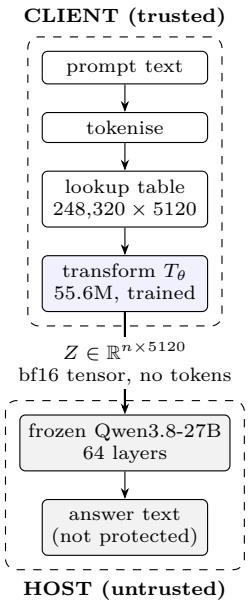
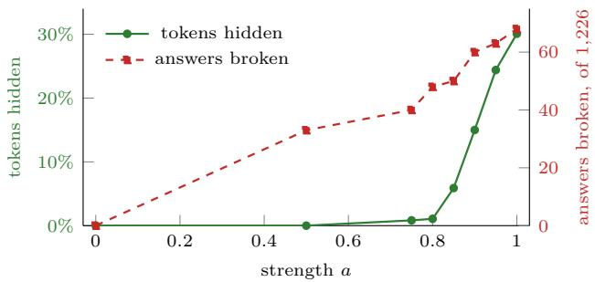

# Privacy-preserving inference on hosted models: a learned input-embedding transform for frozen Qwen3.8-27B

Mahendra Roopa Spinal mahendra@getspinal.com

Srikanth Roopa Spinal srikanth@getspinal.com

20.10.2026

## Abstract

Every prompt sent to a hosted language model is readable by whoever runs it. We study whether the prompt can remain on the client while the host receives transformed vectors that stand in for it. A language model converts text to vectors exactly once, with a public lookup table; we perform that step locally and pass the vectors through a small trained network (55.6M parameters) before they leave the perimeter. The host runs a frozen 27B model (Qwen3.8-27B) on the transformed vectors and never receives text or token ids.

We train the transform against the frozen model as a fixed judge, combining a forward-KL utility term with an auxiliary term that pushes each vector away from its original direction. On 1,490 MMLU questions held out from training, the transform costs 1.5 points of accuracy (80.7% vs. 82.3%), breaking 68 of the 1,226 questions the unmodified model answers correctly (5.5%), while 30.1% of content tokens no longer decode to their original token under a nearest-neighbour lookup. We report sweeps over the inference-time strength scalar and the training-time hiding weight, and two continuation budgets. Neither sweep improves the trade: hiding collapses to 1.1% at strength 0.8 while 48 answers are still broken, and every hiding weight above 0.3 roughly doubles the breaks. Continued training is the one exception, improving both axes at 2,000 additional examples on two seeds before reversing at 6,000.

Nearest-neighbour hiding is only a diagnostic; it is not a privacy guarantee. An adversary that can run a transform of this family on inputs of its own choosing recovers the prompt outright. Estimating the displacement subspace at rank 64 and projecting it out returns all 2,794 content tokens of a held-out 96-prompt set from the checkpoint reported above. The hiding rate on that same set reads 59.7%. Recovery is equally complete in all 42 cross-checkpoint pairs tested, so keeping the transform’s weights on-prem does not help either. That an unkeyed transform of this family falls to an adaptive attacker is already known [4]. We additionally report the transfer between checkpoints and the utility cost measured alongside it. Accordingly, we do not claim privacy. The transform preserves much of the model’s utility under the measurement protocol given here, and fails against a simple adaptive attack.

## 1 Introduction

A hosted model needs the whole input to do its work. Whatever is sent, the host holds a copy for at least the duration of the request. For sensitive inputs such as customer records, medical notes or internal documents, this means the provider sees the data during inference.

Each of the usual mitigations gives something up. Redaction changes the question the model is asked, so it can change the answer that comes back. Self-hosting removes the host from the picture, but the cost of serving a 27B model then falls on the user. A trusted execution environment seals the input inside the host’s hardware [17], which helps as far as the host’s configuration can be trusted.

This paper measures a diferent route. A transformer consumes text only through its first step: tokenisation followed by a lookup in a public embedding table. Every later layer is arithmetic on vectors. The lookup can therefore be moved to the client, and the host given vectors instead of tokens. The table is public, so the move alone hides nothing: anyone can invert a raw embedding by a table lookup. We therefore measure whether a learned transform can displace those vectors far enough to frustrate recovery while the frozen model still computes the right answer.

Both properties have to hold at once, and either one alone is easy to get. Neither extreme is useful: raw embeddings are trivially invertible, whereas noise strong enough to hide the input destroys the model’s utility. The dificulty is in obtaining the two together, which is what the rest of this paper measures. We do not obtain them: the utility side is afordable and we characterise its price, and the privacy side fails outright to an adversary that can run the transform on inputs of its own choosing (§5.7).

## Contributions.

1. A contextual input-embedding transform (§3) trained against frozen Qwen3.8-27B, initialised exactly at the identity, with a single inference-time strength scalar. It uses the same objective as [4], applied here to Qwen3.8-27B (§7).

2. A measurement protocol (§4) that separates utility from obfuscation, pre-registers pass/fail conditions before each scored utility run, and verifies that an untrained transform changes nothing bit-for-bit.

3. Results on 1,490 MMLU questions held out from training (§5), including sweeps over inference strength, training hiding weight and continuation budget, with per-question paired counts.

4. A chosen-input attack that recovers every content token of the evaluated checkpoint at rank 64 (§5.7). The recovery transfers across all 42 checkpoint pairs tested, so the victim’s own transform is not required, and the hiding rate registers none of it.

## 2 Threat model and scope

What is in scope. The prompt, as it crosses the client boundary. The host receives a floating-point tensor and generation settings. It gets no text and no token ids, and it never runs the tokeniser. §5.7 tests whether transmitting only transformed vectors is suficient to conceal the prompt.

Out of scope. The answer. The host generates it and can read it. Any fact the answer discloses is disclosed to the host, so a request whose output restates a sensitive field cannot hide that field from the host by this mechanism. Prompt length is visible, as is the number of generated tokens and the timing of the request.

Adversary. We distinguish two. A passive adversary observes the transmitted tensor and knows the public embedding table. An active adversary additionally submits inputs of its own choosing and observes the corresponding tensors, learning the transform’s response on chosen plaintexts. The hiding rate of §4.2 characterises

the weakest passive attack, nearest-neighbour decoding.   
What the active adversary achieves is reported in §5.7.

Custody of the transform. The transform runs on the client, so a deployment may hold θ on-prem and never publish it. We treat that as an operational control rather than part of the boundary, and assume the adversary knows θ. The attack of §5.7 does not rely on knowing θ. The reason is structural: the rows of $\Delta$ lie in the row space of $W _ { 2 } .$ at most $r = 1 0 2 4$ of $d = 5 1 2 0$ dimensions, and with $\varepsilon = 0$ the remaining dimensions carry E unchanged. That subspace is what the attack of §5.7 estimates, and it is a property of the architecture and its training recipe rather than of one checkpoint— which is why the attack transfers between checkpoints (§5.7) and why an adversary holding any member of the family is as dangerous as one holding θ itself.

We expect, but have not shown, that an adversary confined to observing ordinary protected trafic can reach the same subspace without submitting anything: the positions that still decode correctly—the majority, or utility would fail—supply matched pairs $( Z _ { i } , E _ { i } )$ whose diferences span it. The one observer-side attack we implemented, on a 7B pilot, had to guess E and recovered nothing. Closing that gap would remove the last operational restriction on the adversary, and we flag it as untested rather than unavailable.

Not a cryptographic claim. The transform has no key and admits no ε. It is empirical obfuscation measured against specific decoders, and nothing stronger [18].

## 3 Method

## 3.1 Setup and notation

Let $x = ( x _ { 1 } , \ldots , x _ { n } ) $ be the prompt’s tokens and $E =$ table[x] $\in \mathbb { R } ^ { n \times d }$ the corresponding rows of the frozen host model’s input embedding table, with $d \ : = \ : 5 1 2 0$ and 248,320 rows. Let $M ( \cdot , y )$ denote the frozen host model’s next-token distributions along a reference continuation $y ,$ given input vectors in place of an embedded prompt. The host model M and its table are never modified. Only the transform is trained.

## 3.2 The transform

The transform $T _ { \theta } : \mathbb { R } ^ { n \times d }  \mathbb { R } ^ { n \times d }$ maps the prompt’s embeddings through a low-dimensional contextual bottleneck of width $r = 1 0 2 4$ :

$$
h = { \mathrm { B l o c k s } } ( E W _ { 1 } + P ) , \qquad h \in \mathbb { R } ^ { n \times r } ,\tag{1}
$$

$$
\Delta = \mathrm { g e l u } ( h W _ { 3 } ) W _ { 2 } , \qquad \Delta \in \mathbb { R } ^ { n \times d } ,\tag{2}
$$

$$
\sigma = \mathrm { s o f t p l u s } \big ( \mathrm { g e l u } ( h W _ { 4 } ) W _ { 5 } \big ) , ~ \sigma \in \mathbb { R } ^ { n \times d } ,\tag{3}
$$

$$
Z = E + a \Delta + \varepsilon \odot \sigma , \qquad \varepsilon \sim { \mathcal { N } } ( 0 , I ) ,\tag{4}
$$

with $W _ { 1 } \in \mathbb { R } ^ { d \times r } , W _ { 2 } , W _ { 5 } \in \mathbb { R } ^ { r \times d } , W _ { 3 } , W _ { 4 } \in \mathbb { R } ^ { r \times r }$ , P a sinusoidal position encoding, and Blocks a stack of three pre-norm transformer encoder layers of width r with 16 heads and feed-forward width 4096. Biases are omitted from the equations for readability. The parameters $\theta =$ $\{ W _ { 1 } , \ldots , W _ { 5 }$ , Blocks} total 55,627,776.

Because the blocks attend across positions, $\Delta _ { i }$ depends on the whole prompt, not on token $x _ { i }$ alone: two occurrences of the same token in diferent contexts are displaced diferently. The noise scale σ is produced in embedding space by a second projection $W _ { 5 }$ , so the sampled perturbation has a diagonal covariance in $\mathbb { R } ^ { d }$ 1

Pass-through positions. Rows of special and formatting tokens are transmitted unchanged, $Z _ { i } ~ = ~ E _ { i }$ since the host’s chat template makes them public anyway. Content rows are the only ones transformed, and the only ones scored.

Identity initialisation. $W _ { 2 }$ is zero at initialisation, so $\Delta = 0$ and $Z = E$ exactly, and σ is initialised at $1 0 ^ { - 3 }$ . The untrained transform is therefore the identity function, and $Z = E$ is an exact global optimum of the utility term alone: identical inputs give identical logits, zero divergence and zero gradient. We verify $Z = E$ bitwise before every run. Training moves $W _ { 2 }$ of zero.

## 3.3 Objective

With y the reference answer, the transform minimises

$$
\begin{array} { r l } & { L ( \theta ) = \mathrm { K L } \big ( M ( E , y ) \| M ( Z , y ) \big ) } \\ & { \qquad + \lambda _ { c } \operatorname* { m e a n } \big | \cos ( E _ { i } , Z _ { i } ) \big | } \\ & { \qquad + \lambda _ { n } \operatorname* { m e a n } \big ( \| Z _ { i } \| - \| E _ { i } \| \big ) ^ { 2 } } \\ & { \qquad + \lambda _ { \sigma } L _ { \sigma } , \qquad L _ { \sigma } = - \operatorname* { m e a n } \log \sigma , } \end{array}\tag{5}
$$

with $\lambda _ { c } = 0 . 3 , \lambda _ { n } = 0 . 1$ and $\lambda _ { \sigma } ~ = ~ 0 . 0 0 1$ The first term is a forward KL between the frozen model’s answer distributions under clean and transformed inputs, averaged over answer positions, in the manner of distillation [14]. The reference answer is appended to both runs and never reaches the transform. The second term, which we call the hiding term, pushes each transmitted vector of its original direction. The third holds vector length. The fourth rewards larger noise (− log σ is minimised by growing σ). At $\lambda _ { \sigma } = 0 . 0 0 1$ against a utility weight of 1.0 its contribution is negligible in our experiments. The ε of Eq. (4) is sampled during training and set to zero at scoring, following the usual reparameterised sampling construction [15].

Numerical precision. The KL is accumulated in 64- bit precision. In 32-bit, softmax and log-softmax over a 248k vocabulary do not cancel for bitwise-identical logits: the loss reads $1 . 4 \times 1 0 ^ { - 8 }$ instead of zero and carries a $9 . 0 \times 1 0 ^ { - 8 }$ gradient. AdamW normalises by the gradient’s own magnitude, so that residue is amplified into a full-size step and walks the transform of the exact optimum described above. In 64-bit the same quantity is $3 . 6 \times 1 0 ^ { - 1 7 }$

  
Figure 1: Where each step runs. Text never crosses the boundary; only the transformed tensor does. The generated answer returns in the clear and is readable by the host.

## 3.4 Inference-time strength

A trained transform is deployed with a scalar $a \in [ 0 , 1 ]$

$$
Z ( a ) = ( 1 - a ) E + a T _ { \theta } ( E ) ,\tag{6}
$$

so $a = 0$ transmits the original vectors and $a = 1$ the fully transformed ones. Training always uses a = 1. We vary a at inference only (§5.4). At evaluation time we verify numerically that $a = 0$ reproduces E bitwise and $a = 1$ reproduces $T _ { \theta } ( E )$ bitwise.

## 4 Experimental setup

## 4.1 Model, data and optimisation

The host model is Qwen3.8-27B, a frozen open-weight transformer $( d = 5 1 2 0 , 6 4$ layers, 248,320 vocabulary rows) run in bfloat16 with a pinned revision. The transform is trained on 800 instruction prompts from Alpaca [2], all of at most 96 tokens, for 20,000 examples in 2,050 updates. Optimisation is AdamW [16] at $\eta \ : = \ : 1 . 9 2 \times 1 0 ^ { - 5 }$ with gradient clipping at 1.0, on a single NVIDIA H200. Training the transform requires a forward pass of the frozen model on both clean and transformed inputs and a backward pass through the frozen model into the transform; the frozen weights receive no update.

## 4.2 Metrics

Hiding rate. For each transformed content row we find the nearest row of the public table and check whether it is still the original token:

$$
\mathrm { h i d e } ( i ) = \mathbf { 1 } \big [ \mathrm { a r g } \mathrm { m i n } \big \| Z _ { i } - \mathrm { t a b l e } [ j ] \big \| \ne x _ { i } \big ] .\tag{7}
$$

We report the macro rate, the mean over inputs of the per-input share, so that each input counts equally, and also the pooled rate over all content tokens. This is a cheap test that can be run on every input and compared across transforms. It tests one decoder. §6 sets out what it does not establish.

Break rate. Utility is scored on 1,490 MMLU questions [1], four options each, spanning all 57 subjects, none of them used in training. This is not an upstream MMLU split. It is carved from the upstream validation split (1,531 items) by removing every item whose group contains an item of the upstream test split, and by collapsing duplicates within validation itself; 41 items are removed. Groups are formed on two keys at once, the normalised question with its options sorted, which catches permuted options, and the normalised question stem alone, which catches a repeated question carrying diferent distractors. The published splits overlap, and test is reserved here for a single final evaluation, so the exploration split gives up an overlapping group and the sealed split keeps it. The carved file is frozen and hash-checked; the scorer refuses a split whose hash does not match its manifest. Each question is asked twice, once from $E$ and once from Z, and the model’s chosen letter is recorded. Of the n0 questions answered correctly from $E ,$ the break rate is the share answered incorrectly from Z:

$$
\operatorname { b r e a k } = { \frac { | \{ q : { \mathrm { c o r r e c t } } _ { E } ( q ) \land \neg { \mathrm { c o r r e c t } } _ { Z } ( q ) \} | } { n _ { 0 } } } .\tag{8}
$$

Questions that go from wrong to right are counted separately and are never allowed to ofset breaks. We therefore report repairs separately. We prefer this paired quantity to token-level agreement with the clean generation, which has two defects: it rewards matching the clean wording even when both answers are wrong, and it desynchronises after the first difering token.

## 4.3 Protocol

Each run’s pass/fail conditions, budgets and analysis code are written and frozen before the run, with their hashes recorded; post-hoc arms are labelled as such in the artifact. Every scored run additionally asserts: the transform is the identity at initialisation; the endpoints of Eq. (6) are bitwise correct; the host actually received the transformed tensor; the checkpoint hash matches the launcher and the scored manifest; and a formatting gate on answer extraction. Every number reported below was recomputed from the per-question rows by a separate reviewer model, and the diferences that review produced are recorded with the run. All of this describes the scored utility runs. The attack of §5.7 carried no pre-registered thresholds, and we report it as an exploratory red-team result rather than a gated experiment.

Table 1: Main result on 1,490 MMLU questions held out from training, a = 1, noise of.
<table><tr><td></td><td>Without transform</td><td>With transform</td></tr><tr><td>Correct answers</td><td>1,226</td><td>1,203</td></tr><tr><td>Accuracy</td><td>82.3%</td><td>80.7%</td></tr><tr><td>Right → wrong (breaks)</td><td></td><td>68</td></tr><tr><td>Break rate (of 1,226)</td><td></td><td>5.55%</td></tr><tr><td>95% interval</td><td></td><td>4.51–6.74%</td></tr><tr><td>Wrong → right</td><td></td><td>45</td></tr><tr><td>Tokens hidden, macro</td><td>0%</td><td>30.08%</td></tr><tr><td>Tokens hidden, pooled</td><td>0%</td><td>24.85%</td></tr></table>

## 4.4 Artifacts

Each run writes a directory holding its frozen conditions, the training log, the per-question rows of every scored evaluation, the analysis script that produced the reported quantities, and a manifest binding the scored checkpoint’s SHA-256 to the launcher that trained it and to the transform configuration it was built with. Every number in Tables 1–5, Figure 2 and §5.7 is read directly from those files. Checkpoints are indexed by SHA-256 alongside the evaluation line of each run that scored them. Superseded and failed runs are kept in place.

At the time of writing these artifacts are internal. This paper neither publishes them nor quotes the hashes that identify them, so a reader outside the project can neither inspect the provenance described here nor reproduce Tables 1–5, Figure 2 or §5.7 from source. We record this as a limitation of the present version.

## 5 Results

## 5.1 Accuracy cost

Table 1 gives the headline measurement. The transform costs 1.5 accuracy points overall (1,226 correct answers become 1,203). Per question, the change is larger than the aggregate suggests: 68 correct answers become wrong, while 45 wrong answers become correct.

Table 2: Breaks by the clean decision margin, in logit units.
<table><tr><td>Margin</td><td>Questions</td><td>Broken</td><td>Share</td></tr><tr><td>[0, 0.5)</td><td>73</td><td>29</td><td>39.7%</td></tr><tr><td>[0.5, 1)</td><td>85</td><td>17</td><td>20.0%</td></tr><tr><td>[1, 2)</td><td>161</td><td>11</td><td>6.8%</td></tr><tr><td>[2, 4)</td><td>310</td><td>8</td><td>2.6%</td></tr><tr><td>≥4</td><td>597</td><td>3</td><td>0.5%</td></tr></table>

Table 3: Macro hiding rate by prompt length, $a = 1$
<table><tr><td>Prompt length</td><td>Inputs</td><td>Hidden</td></tr><tr><td>≤ 96 tokens</td><td>564</td><td>41.5%</td></tr><tr><td>97-192</td><td>666</td><td>26.1%</td></tr><tr><td>193-384</td><td>216</td><td>16.1%</td></tr><tr><td>≥ 385</td><td>44</td><td>13.0%</td></tr></table>

## 5.2 Where the breaks fall

Grouping the 1,226 clean-correct questions by the host model’s decision margin before transformation (the gap between the top option’s score and the runner-up) shows that breaks concentrate almost entirely in near-ties (Table 2). Confident answers are essentially untouched: 3 of 597. The 45 repairs come from the same neartie groups. Whether this holds outside multiple-choice scoring is untested.

## 5.3 Hiding depends on prompt length

The hiding rate is strongly length-dependent (Table 3): 41.5% on prompts of at most 96 tokens against 13.0% beyond 384. The transform was trained only on prompts of at most 96 tokens, and on a held-out set of 96 short Alpaca prompts of that kind—the anchor set, used again in §5.7—it hides 59.7%. Training length and hiding are associated here. We did not test whether the association is causal, and the evaluation distribution difers from the training distribution in more than length.

## 5.4 Turning the strength down

The sweep shows no useful intermediate operating point (Figure 2). Hiding collapses long before the breaks do: at $a \ = \ 0 . 8$ only 1.1% of tokens are hidden while 48 answers are still broken, and at $a = 0 . 5$ nothing at all is hidden while 33 answers are broken. The vectors have moved at these settings, but at $a = 0 . 5$ none has crossed into another token’s cell. Against a working reference of a break rate below 1%, no setting other than $a = 0$ comes close.

  
Figure 2: The same transform and evaluation set at eight inference strengths. Hiding (green, left axis) is near zero at $a \leq 0 . 8$ , by which point roughly two thirds of the breaks (red, right axis) have already occurred.

Table 4: Training-time hiding weight, one run each. “Price” is additional breaks per additional point of macro hiding, relative to $\lambda _ { c } = 0 . 3$
<table><tr><td> $\lambda _ { c }$ </td><td>Breaks</td><td>Hidden (macro/pooled)</td><td>Price</td></tr><tr><td>0.3</td><td>68</td><td>30.08% / 24.85%</td><td></td></tr><tr><td>0.5</td><td>144</td><td>36.56% / 32.18%</td><td>11.7</td></tr><tr><td>0.7</td><td>156</td><td>34.84% / 30.32%</td><td>18.5</td></tr><tr><td>1.0</td><td>134</td><td>39.59% / 36.03%</td><td>6.9</td></tr></table>

## 5.5 The hiding weight

The hiding weight $\lambda _ { c }$ is a training-time choice, so each value requires a new transform. Table 4 reports one run each at $\lambda _ { c } \in \{ 0 . 3 , 0 . 5 , 0 . 7 , 1 . 0 \}$ with every other setting held fixed, including seed, batching and schedule. Every value above 0.3 breaks roughly twice as many answers $( 1 . 9 7 \mathrm { - } 2 . 2 9 \times )$ for 5 to 10 additional points of hiding, and none reaches 50% hiding on this evaluation. The four points are not monotone in either axis: $\lambda _ { c } = 1 . 0$ both hides more and breaks fewer than 0.5 and 0.7. With one seed per point we cannot treat that ordering as reliable. The sweep therefore supports only the weaker conclusion: no value of $\lambda _ { c }$ tested improves hiding at a proportionate cost in breaks.

## 5.6 Continued training

Continuing training on the same data with a restarted optimiser improves both axes at a 2,000-example budget, on two seeds, but reverses at 6,000 (Table 5): breaks rise to 102 and 72 against the parent’s 68, at slightly higher hiding. The 6,000-example arms were a preregistered test that failed on both seeds. Because the optimiser was restarted, these arms do not isolate the efect of additional training examples. A single parent checkpoint underlies all four.

Table 5: Continuation budgets from the same parent checkpoint.
<table><tr><td>Arm</td><td>Breaks</td><td>Hidden (macro)</td></tr><tr><td>Parent</td><td>68</td><td>30.08%</td></tr><tr><td>+2,000 examples, seed A</td><td>52</td><td>33.30%</td></tr><tr><td>+2,000 examples, seed B</td><td>55</td><td>30.61%</td></tr><tr><td>+6,000 examples, seed A</td><td>102</td><td>33.60%</td></tr><tr><td>+6,000 examples, seed B</td><td>72</td><td>34.31%</td></tr></table>

## 5.7 The chosen-input attack

The recovery reported here is conditional, and the conditions are worth stating before the result. The adversary needs two things: a copy of a transform trained by this recipe—not necessarily the victim’s own—and the ability to run it on inputs of its choosing. Both are ordinary in a client-side deployment, since the transform ships to the client in order to be used, but they are conditions, and an adversary with neither is outside what this subsection measures.

Given both, the method is direct. For the evaluated attack we use the same inference configuration as the main result: $a = 1$ and $\varepsilon = 0$ . On inputs it chooses, the adversary knows E exactly, so it observes $Z - E = \Delta$ . It takes the leading right singular vectors of the displacements it has collected, projects intercepted trafic onto their orthogonal complement, and applies the nearestneighbour lookup of $\operatorname { E q } .$ . (7). The displacement cancels and E survives, because Eq. (2) confines $\Delta$ to at most r of d dimensions and leaves the remaining $d - r$ directions of E untouched.

Rank 64 sufices. On the anchor set of §5.3—96 heldout Alpaca prompts—the attack returns 2,794 of 2,794 content tokens from the checkpoint of Table 1, with no learned weights and no gradient steps. The hiding rate of §4.2 reads 59.7% on that same set, measured on the same tensors. The two numbers together show that nearest-neighbour hiding substantially overstates protection against this attack: the rate reports one decoder’s failure, and a decoder that removes the displacement is not that decoder.

The adversary’s copy need not be the victim’s. Estimating the subspace from one checkpoint and applying it to trafic protected by a diferent one recovers every content token in all 42 (attacker, victim) pairs tested. The subspace appears to be a property of the architecture and training recipe rather than of a particular run, which is what removes on-prem custody of θ (§2) from the set of controls that would help.

The broader vulnerability of an unkeyed transform is already known. [4], whose objective is ours (§7), reports 100% attack success against the unkeyed ablation of its own method under an adaptive white-box attacker, and identifies key-conditioning as the diference between that row and a defensible system. The transform measured here is unkeyed, and this result is what that predicts. In our evaluation a rank-64 subspace estimate is suficient, and the attack transfers between checkpoints. Eq. (2) explains the low-rank structure it exploits: the displacement lies in a subspace of rank at most $r = 1 0 2 4$

Scope of the claim. One attack family was run. We did not implement a learned inverter or iterative correction [13] against this checkpoint, and the passive adversary of $\ S 2$ —restricted to observing ordinary trafic, with no inputs of its own—remains untested. The result above therefore establishes that this construction fails against one specific and cheap adversary, which is suficient to withhold a privacy claim. It is not a general statement that every attack succeeds. The utility measurements of $\ S 5$ were not collected under a threat model this paper defends.

## 6 Limitations and future work

The hiding rate is not a privacy measure. It reports the failure of one decoder: nearest-neighbour lookup in the public table, position by position. A fixed rotation of the embedding space defeats that decoder completely while preserving every pairwise relationship in the data, so a high hiding rate licenses no conclusion. A low hiding rate does show exposure, but a high one does not show protection. §5.7 measures that gap directly: 59.7% hidden on the anchor set of $\ S 5 . 3 ,$ , whose every content token the chosen-input adversary returns. We report the rate because it is cheap enough to run on every input and comparable across transforms. We use it only as a decoder-specific diagnostic.

The fixed displacement subspace is structurally vulnerable. Under the deterministic inference setting evaluated here $( \varepsilon \ = \ 0 )$ , §5.7 is decisive against the residual form $Z = E + a \Delta$ at any setting of the weights: Eq. (2) confines the displacement to at most r dimensions, so E passes through unchanged in at least $d - r = 4 0 9 6$ directions and no amount of training moves it. Sampled noise is a separate case we have not tested, since $\varepsilon \odot \sigma$ has diagonal covariance in $\mathbb { R } ^ { d }$ (§3) rather than lying in the row space of $W _ { 2 } .$ . Avoiding this attack appears to require either a displacement spanning $\mathbb { R } ^ { d }$ or a secret the adversary does not hold. We have evaluated neither. Keying is the route the literature has taken [4], and it relocates the problem rather than removing it: the same ablation that shows the keyed model resisting a mismatched-key attacker shows it yielding completely to one holding the right key, so what is being defended is key management. Raising r towards d is the cheaper of the two to test here and is the first item of future work. Whether the utility cost measured here survives either change is unknown. The inversion literature (§7)

points the same way, though none of those attacks is implemented here.

The answer is unprotected. The host generates the reply and can read it. A workload whose answer restates the sensitive field gains nothing for that field.

Evaluation is multiple-choice. The break rate scores a single letter per question, which bounds the damage to a four-way decision and says nothing about free-form generation quality. A pilot on 96 free-text prompts broke 3 of 70 correct answers, too few to conclude from; a larger blind-graded run is outstanding.

Statistical scope. One seed per point in Table 4; two seeds per continuation budget in Table 5. Confidence intervals treat questions as independent, which questions within a subject are not, so the stated intervals are op timistic. The paired tests between arms are exploratory and gate no decision.

Distribution. The transform saw only Alpaca instruction prompts of at most 96 tokens. Hiding degrades with length (Table 3), and the evaluation distribution difers from training in domain as well as length.

Scale. Every number here comes from one small configuration: a 55.6M-parameter transform with a bottleneck of r = 1024, trained on 800 Alpaca prompts for 20,000 examples on a single H200. Three scaling questions remain. A corpus matched to the evaluation distribution would separate the length dependence above from the training set that produced it. A larger compute budget would allow more seeds and training schedules. A wider bottleneck bears on §2 directly, since the rank bound on the displacement is set by r: the question is whether subspace estimation still recovers the input as r approaches d, which a higher hiding rate does not answer. The one scale result we have settles none of the three, since the continuation arms improved both axes at 2,000 additional examples and reversed at 6,000 (Table 5) with the optimiser restart confounded with the extra examples.

## 7 Related work

Cryptographic and hardware routes. Confidential computing seals the input inside host hardware, which moves the trust to the hardware vendor and leaves the data itself unchanged [17]. Secure multi-party and homomorphic protocols give provable guarantees at a cost in latency that is still the binding constraint for models of this size; [12] surveys the practical trade-ofs across this space. Our method provides no comparable cryptographic or hardware-backed guarantee, and is not an alternative to these routes.

Inversion attacks. These are the adversarial baseline. Embeddings leak substantial input content to learned inverters [3], iterative correction recovers most short texts exactly [13], and vocabulary-matching against hidden states recovers text in the third-party inference setting specifically [5]. Our nearest-neighbour hiding rate (§4.2) is weaker than all three. The attack of §5.7 assumes more than any of them—query access to a transform of the family—but needs no training in exchange, and recovers everything.

Client-side perturbation of representations. This is the family the present transform belongs to: the client holds the embedding step and sends perturbed vectors onward. [6] obfuscates word representations while keeping them usable; [7] splits the model so the embedding layer runs on the client, adds locally diferentially private noise, and denoises the output clientside; [8] and [9] sanitise at the text level for closed-box models.

These methods difer primarily in the guarantees they provide. [7] carries a local diferential privacy budget; [10] derives its protection from (k, ϵ)-anonymity; [11] states Rényi-DP guarantees for a keyed permutation scheme. Those are claims of a diferent type from the one available here, which is empirical obfuscation measured against named decoders and nothing more. The transform in this paper belongs to the last group, and §5.7 is the cost of that position.

What these systems are evaluated against. The evaluation norm in this family is a passive decoder. [7] reports nearest-neighbour token inversion and an attribute-inference attack; [6] reports textreconstruction attacks; [10] reports nearest-search attacks together with a trained inverter, which is a stronger decoder than any we run against our own checkpoint; [11] reports token-frequency matching and a learned substitution-deciphering attack; [4] reports nearest-neighbour retrieval and vocabulary matching. An adaptive adversary appears once in this set, in [4]’s key ablation, and a chosen-input subspace estimation appears nowhere. We do not read this as an oversight peculiar to any one paper. [12] makes a related observation, that methods of this class “do not protect model parameters, inference internals, or adaptive multi-query interactions”—which is the adversary of §5.7.

Relation to OSNIP. [4] is the closest prior work. Its objective is ours: a forward KL between a frozen model’s predictive distributions under clean and perturbed embeddings, plus a penalty on $| \cos ( h , z )$ |, with the perturbation applied residually and the norm held fixed—in their case by projecting back onto the sphere of radius ∥h∥, in ours by the penalty $\lambda _ { n }$ of Eq. (5), and in both cases by backpropagating through the frozen host. Their hiding term is hinged at a margin ϵ where ours is not, and they train on a mixture that is 80% Alpaca and evaluate on MMLU among others. We claim no methodological novelty over that construction.

The substantive diference is the key. OSNIP conditions the transform on a user-specific secret and adds a diversity term that forces diferent keys to produce geometrically separated outputs; the transform measured here is unkeyed. [4] directly evaluates the efect of key conditioning in its ablation, which reports 100% attack success against the no-key variant under an adaptive white-box attacker, against 0% for the keyed model under a mismatched key. §5.7 is therefore an independent confirmation of that row rather than a new finding, at 27B scale and with the attack named and costed—rank 64, one SVD, no learned weights—and with the structural reason it works $\left( \mathrm { E q . ~ } \left( 2 \right) \right.$ bounds the displacement to r of d dimensions) made explicit.

Relative to [4] we additionally evaluate crosscheckpoint transfer and report utility as paired answer changes. Our recovery needs no access to the victim’s own transform, only to a sibling trained by the same recipe, which holds across all 42 checkpoint pairs tested and shows that on-prem custody of the victim’s θ does not prevent this attack. [4] reports 98.49–101.48% retained performance; we report the same kind of configuration as 68 broken answers against 45 repaired ones on paired questions (§5), concentrated in near-ties (Table 2). Both readings can be true of one system, and §4.2 explains why we think only the second is informative for a user who cares which answers change. We also note that [4]’s own ablation records 100% attack success against the keyed model when the attacker holds the correct key. In that ablation, resistance depends on the attacker not possessing the correct key.

Mechanics. Our objective is a distillation-style divergence between a frozen teacher’s answer distributions under clean and perturbed inputs [14], with reparameterised sampling [15].

## 8 Conclusion

A contextual transform on input embeddings can be trained against frozen Qwen3.8-27B without touching the host model. On 1,490 MMLU questions held out from training, the host scores 80.7% through the transform against 82.3% clean, and 5.5% of the answers it previously got right come back wrong. At the same time 30.1% of content tokens no longer decode to themselves under a nearest-neighbour lookup. The damage concentrates in near-ties, and neither the inference-time strength scalar nor the training-time hiding weight buys a better trade: hiding disappears at $a \leq 0 . 8$ while most of the answer damage remains, and every larger hiding weight roughly doubles the breaks.

The utility cost is therefore modest and reasonably well characterised, and it is not the binding constraint.

An adversary that holds a transform of this family— any member of it, not the victim’s—and can run it on chosen inputs recovers every content token of the evaluated checkpoint at rank 64 (§5.7), in all 42 pairs tested. Against that adversary neither the hiding rate nor on-prem custody of the weights is a control. The experiments therefore characterise the utility cost of this transform and give a protocol for measuring it. They do not support a privacy claim: the residual architecture does not protect the prompt from an adversary who can query it.

The mechanism is not obviously beyond repair, and the repair the field has adopted is a secret key [4]. In its own ablation the keyed model resists an attacker holding the wrong key completely and yields to one holding the right key completely. Resistance there depends on the attacker not possessing the correct key, not on the geometry of the embedding space. A displacement spanning Rd rather than a fixed r-dimensional subspace is the other direction, untested here. Whether either preserves the utility measured above is unknown. The next experiments should test a wider bottleneck, a corpus matched to the evaluation distribution, and a budget afording several seeds per point. The chosen-input attack of §5.7, with thresholds declared in advance, should be run against any checkpoint they produce before it is described as private.

## References

[1] D. Hendrycks, C. Burns, S. Basart, A. Zou, M. Mazeika, D. Song, and J. Steinhardt. Measuring Massive Multitask Language Understanding. ICLR, 2021. arXiv:2009.03300.

[2] R. Taori, I. Gulrajani, T. Zhang, Y. Dubois, X. Li, C. Guestrin, P. Liang, and T. B. Hashimoto. Stanford Alpaca: An Instruction-following LLaMA model. GitHub repository, 2023.

[3] C. Song and A. Raghunathan. Information Leakage in Embedding Models. ACM CCS, 2020. arXiv:2004.00053.

[4] Z. Cao, Z. Ma, C. Yang, H. Zheng, and M. Chen. OSNIP: Breaking the Privacy-Utility-Eficiency Trilemma in LLM Inference via Obfuscated Semantic Null Space. arXiv:2601.22752, 2026.

[5] R. K. Thomas, L. Zahran, E. Choi, A. Potti, M. Goldblum, and A. Pal. Hidden No More: Attacking and Defending Private Third-Party LLM Inference. ICML, 2025.

[6] X. Zhou, Y. Lu, R. Ma, T. Gui, Y. Wang, Y. Ding, Y. Zhang, Q. Zhang, and X. Huang. TextObfuscator: Making Pre-trained Language Model a Privacy Protector via Obfuscating Word Representations. Findings of ACL, 2023, pp. 5459–5473.

[7] P. Mai, R. Yan, Z. Huang, Y. Yang, and Y. Pang. Splitand-Denoise: Protect Large Language Model Inference with Local Diferential Privacy. arXiv:2310.09130, 2023.

[8] M. Tong, K. Chen, J. Zhang, Y. Qi, W. Zhang, N. Yu, T. Zhang, and Z. Zhang. InferDPT: Privacy-Preserving Inference for Closed-Box Large Language Models. IEEE Transactions on Dependable and Secure Computing, 22(5):4625–4640, 2025.

[9] J. Zhang, Z. Tian, M. Zhu, Y. Song, T. Sheng, S. Yang,

Q. Du, X. Liu, M. Huang, and D. Li. DYNTEXT: Semantic-Aware Dynamic Text Sanitization for Privacy-Preserving LLM Inference. Findings of ACL, 2025, pp. 20243–20255.

[10] Y. Lin, R. Yang, Y. Mao, Q. Zhang, J. Hong, Q. Cai, Y. Wu, H. Liu, Z. Chen, B. Duan, and S. Zhong. ObfusLM: Privacy-preserving Language Model Service against Embedding Inversion Attacks. ACL (Volume 1: Long Papers), 2025, pp. 1160–1174.

[11] Y. Lin, Q. Zhang, W. Ruan, D. Zhang, J. Hong, Y. Wu, H. Xia, Y. Mao, and S. Zhong. Towards Privacy-Preserving LLM Inference via Covariant Obfuscation. arXiv:2603.01499, 2026.

[12] D. Andreoletti, A. Rudi, E. Carpanzano, F. Lelli, and T. Leidi. Privacy-Preserving LLM Inference in Practice: A Comparative Survey of Techniques, Trade-Ofs, and Deployability. IACR Cryptology ePrint Archive, 2026/105.

[13] J. X. Morris, V. Kuleshov, V. Shmatikov, and A. M. Rush. Text Embeddings Reveal (Almost) As Much As Text. EMNLP, 2023. arXiv:2310.06816.

[14] G. Hinton, O. Vinyals, and J. Dean. Distilling the Knowledge in a Neural Network. NeurIPS Deep Learning Workshop, 2015. arXiv:1503.02531.

[15] D. P. Kingma and M. Welling. Auto-Encoding Variational Bayes. ICLR, 2014. arXiv:1312.6114.

[16] I. Loshchilov and F. Hutter. Decoupled Weight Decay Regularization. ICLR, 2019. arXiv:1711.05101.

[17] V. Costan and S. Devadas. Intel SGX Explained. IACR Cryptology ePrint Archive, 2016/086.

[18] C. Dwork and A. Roth. The Algorithmic Foundations of Diferential Privacy. Foundations and Trends in Theoretical Computer Science, 9(3–4):211–407, 2014.