# Projected Distillation: On Learning to Solve Hard Problems from Close, Correct Targets

Shripad V. Deshmukh2∗ Christian Bock1 Kangrui Ruan1 Abhijeet Awasthi1 Vijay Lingam1 Rein Houthooft1 Manish Prajapat1†

1AWS AI Labs 2University of Massachusetts

## Abstract

On-policy learning is central to post-training: training on a model’s own generations limits distribution shift and helps preserve existing capabilities. On hard problems, however, on-policy RL provides no reward-based learning signal when all attempts fail. On-policy distillation provides next-token supervision from a teacher, but on hard problems, if a rollout goes wrong early, subsequent supervision is conditioned on prefixes that already contain the mistake. Correct behavior can instead come from a gold or teacher solution, but such off-policy targets can differ substantially from the model’s generations and, as we show, may erode existing capabilities. We therefore treat on-policyness as a continuum and propose projected distillation, which minimally edits the student’s failed attempts into correct targets. The method uses contrastive updates to favor corrections over failed attempts and refreshes these corrections as the student evolves, enabling near-on-policy learning even when all student attempts fail. Theoretically, we prove that the student’s learning regret grows with the edit size: it scales linearly with the horizon under minimal correction, as in DAgger, and quadratically under full-answer replacement, as in behavior cloning. Empirically, across two students (Qwen3-8B and OLMo-2-7B) and five domains spanning math, code, science, and tool use, projected distillation gives the highest area under the specialization–retention frontier (best on 8 of 9 cells against GRPO and OPD, and 7 of 9 against SPOT and SODA). Our ablations highlight the importance of online corrections, the contrastive loss, and on-policyness: moving targets farther off-policy steadily worsens the specialization–retention trade-off, with retention falling from 0.916 to 0.744 when minimal corrections are replaced by student-agnostic gold solutions.

## 1 Introduction

Post-training adapts general-purpose language models to reason, follow instructions, and use tools. The dominant approaches are reinforcement learning from verifiable rewards (RLVR; Shao et al., 2024; Schulman et al., 2017), distillation from a stronger teacher (Agarwal et al., 2023), and supervised fine-tuning (Wei et al., 2022). Across these approaches, the training signal is most effective when it remains on-policy, that is, close to the model’s own output distribution. Updates near this distribution can strengthen the target behavior while preserving capabilities acquired during pretraining (Agarwal et al., 2023; Yang et al., 2024). Post-training is particularly important for models with only a few billion parameters: although they are inexpensive to run and easy to deploy, they often lack the proficiency required for specialized tasks. We study how to teach such models to solve hard problems that they currently answer only rarely, if at all, without degrading their existing capabilities.

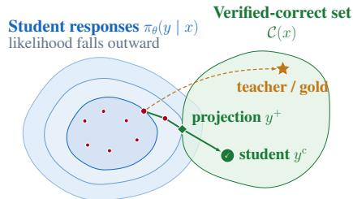  
k attempts, all wrong: R(x, y ) = 0 i  
Figure 1: Learning from the nearest correct answer. Correct answers form a set (x), but the student assigns them very different likelihoods. On a hard problem, its k on-policy attempts ( ) are all wrong and earn no reward. A teacher or gold answer ( ) supplies correctness, but may lie far from what the student writes. Projected distillation instead minimally edits a failed attempt into a newly computed projection ( ) and refreshes that target as the student changes. The green path illustrates repeated online rounds: successive wrong rollouts may move closer until the student produces a correct answer itself ( ✓ ). The resulting small edits keep supervision near-policy; writing m for edit size and H for the generation horizon, our analysis bounds their drift by a term proportional to mH.

A fundamental challenge of on-policy RL is that on very hard problems the on-policy signal disappears. RLVR requires the model to succeed occasionally, so when every sampled attempt fails the reward is zero everywhere and nothing is reinforced. On-policy distillation (OPD; Agarwal et al., 2023) keeps the update on the model’s own rollouts and corrects them token by token to be closer to a response of a stronger teacher. However, the student rollout of a difficult task contains many mistakes: feedback on the later tokens is computed on top of an already-wrong prefix, so it largely patches earlier errors instead of teaching the step at hand (Zhang et al., 2026). Additionally, the later-token feedback in OPD is inefficient: as the student learns, the prefix on which later-token feedback was given and training budget was spent becomes less probable.

Alternatively, the training signal can come from a complete correct answer supplied from outside, either ground-truth data or a stronger teacher’s solution. Unlike OPD, which corrects the student’s own rollout token by token, this target replaces the rollout entirely: the whole training budget goes on producing a correct answer rather than on patching the one the student wrote. Such a target is drawn from a distribution other than the student’s own, so it is off-policy. The further it lies from what the student would produce, the more the student specializes on the task while eroding its abilities elsewhere. This suggests keeping the target a complete correct answer but choosing the one closest to what the student already writes, so the supervision stays near-on-policy.

Several recent works pursue similar ideas. SPOT (Lin and Han, 2026), SODA (Chen et al., 2026), and SuperCorrect (Yang et al., 2025) fix the student’s mistakes with a strong black-box teacher and learn from the corrections. What they leave unexamined is the on-policyness of the correction itself, how it changes with the size of the edit, and whether refreshing the corrections online against the evolving student matters. We focus on these aspects. We call the recipe of minimal, online corrections projected distillation (Fig. 1) and study it along five axes: how well it learns from close, correct solutions relative to other post-training approaches; why the edit must be minimal to keep the correction near-on-policy; why the corrections must be refreshed against the still-training student; which objective learns best from a correction; and how the projector itself can be improved. A regret analysis in the imitation-learning setting shows the importance of the edit size.

## Our contributions.

1. We introduce projected distillation, a post-training recipe that learns from minimal, online corrections of the student’s mistakes. It needs only the correction text, so any capable black-box model can serve as the projector. Across two students and five benchmarks it attains the best specialization–retention trade-off, and retains prior abilities where standard post-training forgets on continual-learning metrics (Sec. 4.1)

2. Holding correctness fixed, we show that the correction must be both minimal and online. Pushing it off-policy monotonically worsens the trade-off (Sec. 4.2), and freezing the pool instead of refreshing it makes it collapse as the student drifts (Sec. 4.3). We further give an efficient training objective, a diff-localized contrast with self-training on correct rollouts (Sec. 4.4), and a refinement procedure that improves the projections from a mid-capacity (32B) teacher without updating its parameters (Sec. 4.5).

3. We theoretically analyze projected distillation through imitation learning. The edit size interpolates between DAgger’s linear-in-horizon regret and behavior cloning’s quadratic regret (Sec. 5).

## 2 Related Work

Methods for improving a model on hard problems. Approaches differ in where the correct target comes from and how far that target lies from the model’s own distribution; together these largely determine the specialization–retention trade-off. Reinforcement learning from verifiable reward (RLVR; GRPO (Shao et al., 2024), PPO (Schulman et al., 2017)) draws the target from the model’s own rollouts, but on the pass@k=0 set every rollout is wrong and no signal remains. On-policy distillation (GKD (Agarwal et al., 2023)) and self-distillation (Yang et al., 2024) keep the update on those rollouts while matching a teacher’s token distribution, which requires teacher logits. Supervised fine-tuning on an external gold or teacher solution supplies correctness directly but is maximally off-policy, so fitting it forgets. Between these, there is scope to manufacture a correct target based on the student’s attempt. This opens up the possibility of treating the correct solutions along a continuum from on-policy to off-policy with respect to the model’s current generation style. Our work studies how far the edits may go, whether they need to be recomputed as the model changes, and what objective to use for effective learning.

Closest work. The literature presents approaches similar to ours: LeMa (An et al., 2023) mines corrections once, from an assortment of models rather than the student, with free-form rewrites and an objective that uses response likelihood maximization. SPOT (Lin and Han, 2026) gathers mistakes of the base model, rectifies the mistakes using minimal edits from an oracle, creates a preference dataset and learns with a reward-based binary cross-entropy objective. SODA (Chen et al., 2026) creates mistake–correction pairs without emphasizing minimal edits, performs an SFT warm-up, and then, with the SFT’ed policy fixed, learns from static preference pairs. SuperCorrect (Yang et al., 2025) distills thought templates from a teacher and applies collaborative DPO over the teacher’s correction traces. We also work in the hard-task regime where the model fails. However, our paper focuses mainly on the regime of online learning from close, correct targets to teach the student how to effectively solve hard tasks. We perform a controlled study of the edit sizes used to provide corrections (Sec. 4.2), static vs. online-refreshed pools of corrections (Sec. 4.3) and effective learning objectives for black-box learning (Sec. 4.4). In addition, we theoretically analyze how the edit-size influences the learning regret, which distinguishes our work from the previous ones. Concurrent work (Karan et al., 2026) explores self-projection with an MCMC sampler, in which the student itself rewrites its response with the reference solution in view; Appendix I compares it with black-box projection on its math benchmark.

## 3 Projected Distillation

We study post-training on problems the model rarely solves, where its own samples earn no reward and correctness has to come from outside.

Setup. Given a problem $x ,$ a solution is a token sequence $y \in \mathcal { V } ^ { \leq H }$ drawn from a vocabulary with a generation horizon H. The student produces y autoregressively via $\begin{array} { r } { \pi _ { \theta _ { S } } ( y \mid x ) = \prod _ { t } \pi _ { \theta _ { S } } ( y _ { t } \mid x , y _ { < t } ) } \end{array}$ where $y _ { t }$ denotes the t-th token, $y _ { < t }$ its prefix, and $\pi _ { \mathrm { r e f } }$ the frozen initialization of the student. Correctness is judged by a verifier $R ( x , y ) \in \{ 0 , 1 \}$ (e.g., exact-match checking or unit tests), inducing the set of accepted solutions $\mathcal { C } ( \overset { \cdot } { x } ) = \{ \overset { \cdot } { y } : \overset { \cdot } { R } ( \overset { \cdot } { x } , \overset { \cdot } { y } ) = 1 \}$ . Our focus is on problems that lie beyond the student’s current ability, i.e., pass@k=0 set, for which all k sampled attempts fail. Further, in Sec. 5, we formalize the generation process using a dynamic-token sequence MDP to provide theoretical insights.

Projection. The accepted set $\mathcal C ( x )$ typically contains many solutions, but these solutions can differ substantially in likelihood under the student. Training toward a solution the student already considers likely requires less movement of its output distribution and therefore better preserves unrelated capabilities (Kirkpatrick et al., 2017; Kumar et al., 2022). We therefore choose, among the verifieraccepted solutions in $\mathcal C ( x )$ , the one with highest likelihood under the student.

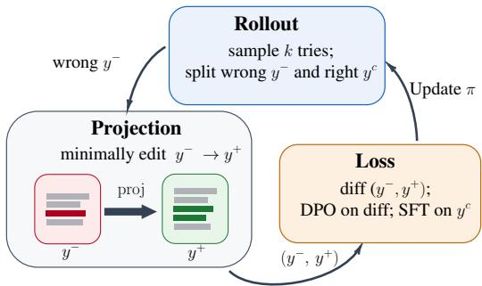  
Figure 2: One round of projected distillation. The student answers each problem k times, and its responses split into the wrong ones $y ^ { - }$ and the correct ones $y ^ { \mathrm { c } }$ . A projector rewrites a wrong response into a correct one $y ^ { + }$ with the smallest edit that works. The two are aligned token by token, and the preference term acts only on the spans that differ (removed, added), while $y ^ { \mathrm { c } }$ is supervised directly. The updated student begins the next round, so its corrections are recomputed as it changes.

Definition 1 (Projection). For a student $\pi _ { \theta _ { S } }$ and a problem x, the projection is the correct answer the student is most likely to produce, proj(x)  arg m $\operatorname { a x } _ { y ^ { \prime } \in \mathcal { C } ( x ) } \log \pi _ { \theta _ { S } } ( y ^ { \prime } \mid x )$

Practically, searching the true projection within $\mathcal C ( x )$ is intractable. We propose to find a close approximation with the help of the student’s attempt itself. The intuition behind this is that a wrong attempt is a sample from the student and is therefore already likely under it; a correction that preserves most of its tokens preserves most of that likelihood, while the verifier places the result in $\mathcal C ( x )$ Minimal editing is thus a tractable surrogate for Definition 1, with the verifier supplying correctness and the retained tokens supplying proximity. We test the surrogate directly in Sec. 4.2, varying the edit size and recording the likelihood shift $\Lambda = \log \pi _ { \theta _ { S } } ( y ^ { + } \mid \bar { x } ) - \log \pi _ { \theta _ { S } } ( y ^ { - } \mid x )$ that each size demands. A projector receives the problem and the attempt in context and is prompted to make the smallest change that corrects the answer (examples in Appendix B; prompts in Appendix C.3).

Learning from projection. In each round we prompt the student on the hard problems and collect a batch of responses. Most of them are wrong. We write $y ^ { - }$ for a wrong response and $y ^ { + }$ for its projection, and $y ^ { \mathrm { c } }$ for the responses the student gets correct on its own. We have access only to the text the projector returns, not to its logits, so we cannot match its token distribution. We learn from the pair $( y ^ { - } , y ^ { + } )$ by preference instead. The projection edits only a small part of the attempt, so $y ^ { - }$ and ${ \overline { { y } } } ^ { + }$ agree almost everywhere, and a contrast over their full length would spend most of its gradient on text that was already correct. We therefore restrict the contrast to the tokens the edit changed. A token-diff of $y ^ { - }$ against $y ^ { + }$ marks a mistake span $E ^ { - }$ and afix span $E ^ { + }$ ; for instance, for $y ^ { - } = \mathtt { A B C D }$ and $y ^ { + } = \tt A X C Z , \breve { E } ^ { - } = \left\{ B , D \right\}$ and $E ^ { + } = \{ { \tt X } , { \tt Z } \}$ . We apply a DPO contrast (Rafailov et al., 2023) to those spans alone, using the frozen initialization $\pi _ { \mathrm { r e f } }$ as reference and $\beta$ for its strength:

$$
\begin{array} { r } { \mathcal { L } _ { \mathrm { D i f f - L o c a l - D P O } } = - \mathbb { E } _ { x } \log \sigma \bigg ( \beta \left[ \sum _ { t \in E ^ { + } } \log \frac { \pi _ { \theta _ { S } } ( y _ { t } ^ { + } \mid x , y _ { < t } ^ { + } ) } { \pi _ { \mathrm { r e f } } ( y _ { t } ^ { + } \mid x , y _ { < t } ^ { + } ) } - \sum _ { t \in E ^ { - } } \log \frac { \pi _ { \theta _ { S } } ( y _ { t } ^ { - } \mid x , y _ { < t } ^ { - } ) } { \pi _ { \mathrm { r e f } } ( y _ { t } ^ { - } \mid x , y _ { < t } ^ { - } ) } \right] \bigg ) , } \end{array}\tag{1}
$$

Here σ is the logistic function. The contrast constrains only how likely $y ^ { + }$ is relative to $y ^ { - }$ , so we add a term that supervises the student’s own correct responses directly:

$$
\begin{array} { r } { \mathcal { L } _ { \mathrm { P r o j e c t e d - D i s t i l l a t i o n } } = \mathcal { L } _ { \mathrm { D i f f - L o c a l . D P O } } + \mathcal { L } _ { \mathrm { S F T } } , \mathrm { ~ w h e r e ~ } \mathcal { L } _ { \mathrm { S F T } } = - \mathbb { E } _ { x } \sum _ { t } \log \pi _ { \theta _ { S } } ( y _ { t } ^ { c } \mid x , y _ { < t } ^ { c } ) . } \end{array}\tag{2}
$$

Therefore, the wrong responses supply the contrast and the correct ones the supervised term. The next round re-prompts the student on the same problems and projects whatever it gets wrong then, so the targets follow the current policy. Fig. 2 summarizes one round of our approach. Sec. 4.3 compares rebuilding the targets each round against reusing a static correction pool, and Sec. 4.4 compares our loss (2) against five alternatives on the same data.

## 4 Experiments

First, we compare projected distillation with standard post-training approaches in the hard-task regime, and ask whether what a student learns on one benchmark’s hard set carries over to the hard problems of other benchmarks (Sec. 4.1). The remaining sections examine the recipe itself, each component of which could have been set differently: the correction may change more or fewer of the attempt’s tokens (Sec. 4.2), it may be computed once or recomputed as the student learns (Sec. 4.3), and several objectives may be applied to it (Sec. 4.4). We vary each in turn while holding the remainder fixed, then ask whether the projections can be improved further by test-time scaling (Sec. 4.5), and finally whether the same model can serve as its own projector when given privileged information (Sec. 4.6).

Experimental Setup: We study two instruction-tuned students from different families, Qwen3- 8B (Qwen Team, 2025) and OLMo-2-7B (OLMo Team, 2024), on five benchmarks spanning math, code, tools and science: GSM8K (Cobbe et al., 2021), MATH (Hendrycks et al., 2021b), LiveCodeBench v6 (Jain et al., 2024), SciKnowEval (Feng et al., 2024), and ToolAlpaca (Tang et al., 2023). For each (student, benchmark) pair we train only on its hard set: the problems on which the base student fails all k=16 sampled attempts at temperature 0.8. The hard set is mined from the benchmark’s training split (Appendix C.2), and retention is measured in-domain on a disjoint held-out slice of the same benchmark. All methods use matched budgets for optimization updates and per-step generation. The remaining configuration is in Appendix C.1, with prompt templates in Appendix C.3 and further training details in Appendix C.4. Unless noted, results are averaged over 3 training seeds, and Appendix C.5 separates training-seed from evaluation-seed spread. Appendix D.3 additionally evaluates the trained checkpoints on suites they never saw, and Appendix D.5 on the hard problems of benchmarks they never saw.

Baselines. We compare against four baselines, each probing a different axis of the post-training design space. GRPO (Shao et al., 2024) performs on-policy RL with verifiable rewards, where positive rewards are scarce. OPD (Agarwal et al., 2023) performs white-box distillation from the token-level logits of a strong teacher conditioned on the student’s own prefixes, using a same-family 32B teacher (Qwen3-32B or OLMo-2-32B) for each student; our method uses these same 32B teachers as its projection models, and both methods are given the gold answer as privileged information. Surgical Post-Training (SPOT; Lin and Han, 2026) minimally corrects the student’s initial attempts and trains on the resultingfrozen preference data, while Semi-On-policy Distillation (SODA; Chen et al., 2026) fine-tunes the student on teacher corrections and then contrasts a teacher response against a frozen copy of that fine-tuned student. Against SPOT and SODA every method draws its corrections from one shared black-box model, which isolates the learning algorithm from the projector.

Metrics. We report specialization, pass@1 on the hard set, and retention, pass@1 on the held-out slice. A method can raise either at the other’s expense, so neither effectively ranks methods on its own. Our headline metric is the area under the specialization–retention Pareto frontier (AUPF), the retention a method sustains as it specializes further, anchored at a shared untrained base. AUPF is low both for a method that never specializes and for one that specializes by giving up retention. We report it alongside three continual-learning summaries of the retention trajectory, backward transfer (Lopez-Paz and Ranzato, 2017), forgetting (Chaudhry et al., 2018) and training-averaged accuracy (Kemker et al., 2018), and retention-safe specialization, the highest specialization reached while retention stays within ε of base. Full definitions are in Appendix D.

## 4.1 RQ1: How does projected distillation compare with baselines?

We compare against the four baselines, drawing our corrections first from a same-family 32B teacher and then from a shared black-box projector, and report AUPF in Tab. 1, the continual-learning metrics in Tab. 3, and the pooled frontiers in Fig. 3.

Projected distillation attains the highest AUPF on eight of nine cells against GRPO and OPD and on seven of nine against SPOT and SODA (Tab. 1), under both projector settings. The margins are largest on SciKnowEval and ToolAlpaca, reaching 0.179 against OPD’s 0.027 on Qwen SciKnowEval and 0.676 against 0.128 on Qwen ToolAlpaca. The baselines are not short of specialization; SPOT and SODA both reach real hard-set accuracy (Tab. 3). However, they retain poorly. In Fig. 3 our frontier runs flat along the untrained base across the whole specialization range while every baseline’s falls away from it. Pooled across projectors, our mean AUPF is 0.256 with the mid-capacity same-family 32B teacher and 0.275 with the black-box projector, so the mid-capacity projector performs slightly worse. In Sec. 4.5, we investigate how to improve learning with such a teacher.

The two baseline families fall short for different reasons. GRPO has little to learn from, since the hard set is mined at pass@k=0; continued sampling still recovers occasional correct rollouts, enough for the highest specialization of any method on OLMo SciKnowEval, but its retention is the lowest there as well (Tab. 8), because reinforcing a rare correct rollout sharpens the student onto that solution at the expense of what it produces elsewhere (Yue et al., 2025). SPOT and SODA hold correct targets throughout, so they are not limited by correctness. They are rather limited by how far the correction moves the attempt and how often it is rebuilt, as shown further in sections 4.2 and 4.3. Three AUPF result cells are not in our favour. On Qwen MATH, SPOT and SODA fit the hard-set answers more closely, SODA reaching 0.136 specialization against our 0.031, and give up some retention for it (0.664 against our 0.760; Tab. 8). On Qwen SciKnowEval SODA leads on both axes, in the one cell whose retention carries a standard error of 0.131 across seeds, several times that of any other method there. On OLMo GSM8K, OPD reaches 0.496 specialization against our 0.236 at comparable retention, so token-level feedback apparently keeps its effectiveness there.

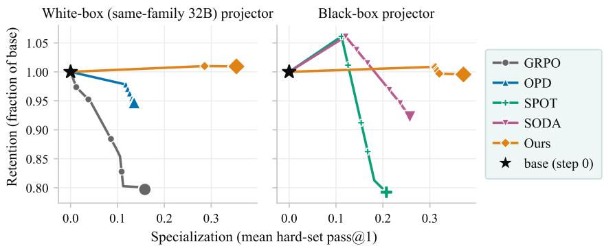  
Figure 3: Aggregate specialization–retention Pareto frontier, one curve per method pooled over both students, all benchmarks and seeds, split by projector class. Left: same-family (32B) projectors. Right: black-box projector. GRPO uses no projector. y-axis is retention measured as held-out accuracy as a fraction of the untrained base. x-axis is specialization measured as average hard-set accuracy. Each curve is the monotone Pareto frontier of the pooled trajectory anchored at ${ \bf \nabla } \star = ( 0 , 1 . 0 ) ;$ up-and-to-the-right is better. Every baseline ends below its untrained base: GRPO and OPD decline from the outset, while SPOT and SODA exceed base early and then fall below it. Projected distillation holds retention at base across the range and attains the highest specialization.

Table 1: RQ1: area under the specialization–retention frontier (AUPF). Higher is better (Appendix D); mean $\pm \ : s . e .$ over 3 seeds. GRPO uses no projector and is shown for reference. The OLMo-2-7B LiveCodeBench cell is omitted, since no method moves specialization appreciably above zero there. Bold = best per row within each projector block. Ours attains the highest AUPF on 8 of 9 cells with the same-family teacher and 7 of 9 with the black-box projector.
<table><tr><td rowspan="2" colspan="2"></td><td>RLVR</td><td colspan="2">same-family 32B teacher</td><td colspan="3">black-box projector</td></tr><tr><td>GRPO</td><td>OPD</td><td>Ours</td><td>SPOT</td><td>SODA</td><td>Ours</td></tr><tr><td rowspan="4">Ow-8B</td><td>GSM8K</td><td> $0 . 0 6 1 \pm . 0 1 1$ </td><td> $0 . 1 4 5 { \scriptstyle \pm . 0 0 6 }$ </td><td> $\mathbf { 0 . 2 0 5 } \pm . \mathbf { 0 1 2 }$ </td><td> $0 . 2 0 9 { \scriptstyle \pm . 0 3 0 }$ </td><td> $0 . 2 3 1 { \scriptstyle \pm . 0 1 6 }$ </td><td> $\mathbf { 0 . 2 6 2 { \scriptstyle \pm . 0 2 0 } }$ </td></tr><tr><td>MATH</td><td> $0 . 0 0 0 { \scriptstyle \pm . 0 0 0 }$ </td><td> $0 . 0 0 3 { \scriptstyle \pm . 0 0 1 }$ </td><td> $\mathbf { 0 . 0 0 8 } \pm . 0 \mathbf { 0 } 2$ </td><td> $0 . 1 4 5 { \scriptstyle \pm . 0 1 0 }$ </td><td> $\mathbf { 0 . 1 5 9 } 2 . 0 0 9$ </td><td> $0 . 0 3 5 { \scriptstyle \pm . 0 1 0 }$ </td></tr><tr><td>LCB</td><td> $0 . 0 0 0 { \scriptstyle \pm . 0 0 0 }$ </td><td> $0 . 0 6 8 { \scriptstyle \pm . 0 1 8 }$ </td><td> $\mathbf { 0 . 1 3 8 } \pm . 0 \mathbf { 0 3 }$ </td><td> $0 . 0 9 5 { \scriptstyle \pm . 0 0 5 }$ </td><td> $0 . 0 9 1 { \scriptstyle \pm . 0 0 1 }$ </td><td> $\mathbf { 0 . 1 2 3 } \pm . 0 \mathbf { 0 6 }$ </td></tr><tr><td>SciKnow</td><td> $0 . 0 4 5 { \scriptstyle \pm . 0 0 8 }$ </td><td> $0 . 0 2 7 { \scriptstyle \pm . 0 0 2 }$ </td><td> $\mathbf { 0 . 1 7 9 } 2 . 0 0 5$ </td><td> $0 . 1 2 4 { \scriptstyle \pm . 0 0 8 }$ </td><td> $\mathbf { 0 . 1 5 5 \pm . 0 1 3 }$ </td><td> $0 . 1 2 4 { \scriptstyle \pm . 0 0 5 }$ </td></tr><tr><td>Tool</td><td></td><td> $0 . 2 4 8 { \scriptstyle \pm . 1 5 2 }$ </td><td> $0 . 1 2 8 { \scriptstyle \pm . 0 0 4 }$ </td><td> $\mathbf { 0 . 6 7 6 { \scriptstyle \pm . 0 1 3 } }$ </td><td> $0 . 5 9 4 { \scriptstyle \pm . 0 1 0 }$ </td><td> $0 . 6 3 5 { \scriptstyle \pm . 0 1 4 }$ </td><td> $\mathbf { 0 . 6 6 7 \pm . 0 1 5 }$ </td></tr><tr><td rowspan="4">O-77B</td><td>GSM8K</td><td> $0 . 1 9 5 { \scriptstyle \pm . 0 8 4 }$ </td><td> $\mathbf { 0 . 4 1 7 \pm . 0 1 1 }$ </td><td> $0 . 2 1 7 { \scriptstyle \pm . 0 1 4 }$ </td><td> $0 . 1 8 6 { \scriptstyle \pm . 0 0 7 }$ </td><td> $0 . 2 1 0 { \scriptstyle \pm . 0 0 4 }$ </td><td> $\mathbf { 0 . 3 3 6 { \scriptstyle \pm . 0 6 7 } }$ </td></tr><tr><td>MATH</td><td> $0 . 0 0 9 { \scriptstyle \pm . 0 0 3 }$ </td><td> $0 . 0 1 4 { \scriptstyle \pm . 0 0 2 }$ </td><td> $\mathbf { 0 . 0 1 7 \pm . 0 0 2 }$ </td><td> $0 . 0 1 3 { \scriptstyle \pm . 0 0 1 }$ </td><td> $0 . 0 1 5 { \scriptstyle \pm . 0 0 2 }$ </td><td> $\mathbf { 0 . 0 1 6 } \pm . 0 \mathbf { 0 1 }$ </td></tr><tr><td>SciKnow</td><td> $0 . 1 9 8 { \pm } . 0 2 2$ </td><td> $0 . 0 6 0 { \scriptstyle \pm . 0 1 3 }$ </td><td> $\mathbf { 0 . 2 3 6 { \scriptstyle \pm . 0 1 0 } }$ </td><td> $0 . 1 1 6 { \pm } . 0 1 1$ </td><td> $0 . 1 0 1 { \scriptstyle \pm . 0 0 1 }$ </td><td> $\mathbf { 0 . 2 3 4 } \pm . \mathbf { 0 1 5 }$ </td></tr><tr><td>Tool</td><td> $0 . 1 7 1 { \scriptstyle \pm . 1 1 1 }$ </td><td> $0 . 3 1 9 { \scriptstyle \pm . 0 3 8 }$ </td><td> $\mathbf { 0 . 6 2 6 { \scriptstyle \pm . 0 1 8 } }$ </td><td> $0 . 2 2 2 { \scriptstyle \pm . 0 3 1 }$ </td><td> $0 . 4 8 8 { \pm } . 0 2 9$ </td><td> $\mathbf { 0 . 6 8 2 } \pm . 0 3 8$ </td></tr></table>

Training on a hard set risks catastrophic forgetting due to limited model capacity, so Tab. 3 reports four continual-learning measures, each summarizing a whole run. Training-averaged specialization and retention give the mean of each axis over the run: ours is highest on specialization $( \bar { x } = 0 . 2 6 4$ and 0.276 against SODA’s 0.224) and holds retention at base $( \bar { y } _ { \mathrm { n o r m } } = 1 . 0 0 0$ and 0.995 against 0.776), so what it gains is not paid for out of retention during training. Backward transfer is the net change in retention from the untrained base to the final checkpoint, and ours are the only values that are not significantly negative (0.009 and 0.004). Forgetting is the drop from a run’s highest retention to its final retention, so it registers ability lost during training even when the endpoint looks acceptable: ours are 0.084 and 0.107 against 0.509 for SPOT and 0.355 for SODA, which specialize early and lose retention through the rest of training (Fig. 10). Retention-safe specialization, the most a run reaches at any checkpoint whose retention is within ε of base, is highest for both our variants at either tolerance. Retention here is measured on a held-out slice of the trained benchmark; Appendix D.3 evaluates the math-trained checkpoints on suites they never saw.

Table 2: RQ1: learning one benchmark’s hard set, tested on other benchmarks’. Qwen3-8B trained on the MATH hard set with each black-box method and GRPO. Sampled pass@1 over 16 generations per problem at $T { = } 0 . 8 ;$ pass@16 is the share of problems solved at least once in those 16. Every method is run for one training seed, evaluated every 50 updates, and entered at its own best value for each column, so the checkpoint is selected on the same problems the number is reported on. The rule is applied identically to the baselines and to ours.
<table><tr><td rowspan="2">Method</td><td colspan="2">MATH held-out, hard (127)</td><td colspan="2">Other benchmarks, hard (2,885)</td></tr><tr><td>pass@1</td><td>pass@16</td><td>pass@1</td><td>pass@16</td></tr><tr><td>Base</td><td>0.013</td><td>0.150</td><td>0.011</td><td>0.114</td></tr><tr><td>GRPO</td><td>0.020</td><td>0.205</td><td>0.011</td><td>0.108</td></tr><tr><td>SPOT</td><td>0.020</td><td>0.197</td><td>0.012</td><td>0.114</td></tr><tr><td>SODA</td><td>0.031</td><td>0.291</td><td>0.016</td><td>0.127</td></tr><tr><td>Ours</td><td>0.056</td><td>0.354</td><td>0.020</td><td>0.154</td></tr></table>

Transfer to other benchmarks’ hard problems. We test whether performance improvement on one benchmark’s hard problems extends to hard problems from other benchmarks. For this experiment, we train Qwen3-8B with each black-box method and with GRPO on 501 MATH problems that it fails on all 16 attempts. We evaluate it on 127 held-out hard MATH problems not seen during training, and on 2,885 hard problems from OlympiadBench (He et al., 2024), Omni-MATH (Gao et al., 2024a), AIME 1983–2023 and DAPO-Math (Yu et al., 2025). More details of the setup are provided in Appendix D.5.

We report the results in Tab. 2. Projected distillation shows stronger performance than the baselines in hard-to-hard generalization. On the held-out MATH problems it raises pass@1 from 0.013 to 0.056 and pass@16 from 0.150 to 0.354, against 0.031 and 0.291 for the best baseline. On the four other benchmarks it raises pass@1 from 0.011 to $0 . 0 2 0 \left( + 0 . 0 0 9 \pm 0 . 0 0 1 \right)$ and pass@16 from 0.114 to 0.154, where the best baseline gains 0.005 in pass@1 and SPOT and GRPO gain nothing.

What the student learns on one benchmark’s hard problems therefore carries to hard problems it never trained on. In Appendix D.5, we provide a breakdown of the gain across individual benchmarks and an analysis of a projected distillation model trained on Omni-MATH.

## 4.2 RQ2: How does edit size influence learning in projected distillation?

A correction may be correct and still lie far from what the student would have produced, and this question concerns the cost of that distance. We construct four arms that hold correctness fixed and vary only how much the correction rewrites the attempt: a minimal edit, two progressively larger rewrites obtained by re-prompting the projector, and $g o l d ,$ the dataset’s GSM8K reference solution, which discards the attempt altogether. Each arm trains a separate Qwen3-8B student from the same base under identical hyperparameters, so only the target $y ^ { + }$ varies; the rejected side remains the student’s own wrong rollout y−. The projector rather than the prompt settles how much text is replaced, so we identify the arms by the edit size they realize and measure the distance a correction imposes by the likelihood shift it demands, $\Lambda = \log \pi _ { \boldsymbol { \theta } } ( y ^ { + } \mid x ) - \log \pi _ { \boldsymbol { \theta } } ( y ^ { - } \mid x )$ , reported as $| \Lambda |$

Fig. 4 shows that among the three arms that differ only in edit size, relative specialization falls to 0.54 and then 0.45 of the minimal-edit arm and retention from 0.916 to 0.807, while Λ falls from 86 $\mathrm { t o - 4 3 3 }$ . The arms are equally correct, so what the larger rewrites cost is distance from the student. Gold sits outside that ordering: its edit is 926 tokens, between the two rewrites, yet it specializes better than either (0.87 of the minimal edit) and returns the lowest retention of any arm (0.744). The token count understates its distance, since gold keeps none of the attempt and counts small only because a reference solution is short; its likelihood shift does not say the same: at $\Lambda = + 3 9 6 9$ it is the one arm the student finds more likely than its own attempt, the sign opposite to every rewrite, and that value is dominated by the length difference rather than lying on the rewrites’ scale. We therefore read edit size as the quantity governing the trade-off among matched rewrites, with the minimal edit best balanced, and report gold on the behavioral axes only; Appendix E gives the per-arm values and the mechanism measurements.

Table 3: RQ1: continual-learning metrics, pooled over students, benchmarks and seeds $( \mathrm { m e a n } \pm \mathrm { s . e . } )$ , with arrows marking the better direction. x¯ and $\bar { y } _ { \mathrm { n o r m } }$ are specialization and retention averaged over training, BWT is backward transfer against the base, $F$ the drop from a run’s retention peak, and ${ \mathrm { S a f e S p e c } } _ { \varepsilon }$ the most specialization reached at any checkpoint whose retention is within ε of base (Appendix D). Bold = best, underline = second best per column. Our variants specialize most while holding retention at base, where the baselines either barely specialize or forget.
<table><tr><td>Method</td><td>x↑</td><td> $\bar { y } _ { \mathrm { n o r m } } \uparrow$ </td><td>BWT↑</td><td> $F \downarrow$ </td><td> $\mathrm { S a f e S p e c _ { 2 \% } } \uparrow$ </td><td> $\mathrm { S a f e S p e c _ { 5 \% } } \uparrow$ </td></tr><tr><td>GRPO</td><td> $0 . 1 1 4 { \scriptstyle \pm 0 . 0 3 4 }$ </td><td> $0 . 8 2 6 { \scriptstyle \pm 0 . 0 4 8 }$ </td><td> $\cdot 0 . 2 0 3 { \pm } 0 . 0 5 8$ </td><td> $0 . 2 2 1 { \scriptstyle \pm 0 . 0 5 7 }$ </td><td> $0 . 0 3 5 { \scriptstyle \pm 0 . 0 1 2 }$ </td><td> $0 . 0 5 6 { \scriptstyle \pm 0 . 0 2 2 }$ </td></tr><tr><td>OPD</td><td> $0 . 1 1 8 { \scriptstyle \pm 0 . 0 2 2 }$ </td><td> $0 . 9 5 1 { \scriptstyle \pm 0 . 0 3 1 }$ </td><td>一  $- 0 . 0 6 2 { \scriptstyle \pm 0 . 0 4 3 }$ </td><td> $0 . 1 3 6 { \scriptstyle \pm 0 . 0 4 1 }$ </td><td> $0 . 1 0 1 { \scriptstyle \pm 0 . 0 1 9 }$ </td><td> $0 . 1 3 5 { \scriptstyle \pm 0 . 0 2 6 }$ </td></tr><tr><td>SPOT</td><td> $0 . 1 8 4 { \scriptstyle \pm 0 . 0 3 1 }$ </td><td> $0 . 7 0 6 { \scriptstyle \pm 0 . 0 7 4 }$ </td><td> $- 0 . 3 8 0 { \pm } 0 . 0 8 2$ </td><td> $0 . 5 0 9 { \scriptstyle \pm 0 . 0 6 4 }$ </td><td> $0 . 1 4 7 { \scriptstyle \pm 0 . 0 2 0 }$ </td><td> $0 . 1 4 9 { \scriptstyle \pm 0 . 0 2 0 }$ </td></tr><tr><td>SODA</td><td> $0 . 2 2 4 { \scriptstyle \pm 0 . 0 3 1 }$ </td><td> $0 . 7 7 6 { \scriptstyle \pm 0 . 0 5 3 }$ </td><td> $- 0 . 2 6 6 { \pm } 0 . 0 5 9$ </td><td> $0 . 3 5 5 { \scriptstyle \pm 0 . 0 4 4 }$ </td><td> $0 . 1 4 0 { \scriptstyle \pm 0 . 0 2 1 }$ </td><td> $0 . 1 9 0 { \scriptstyle \pm 0 . 0 2 2 }$ </td></tr><tr><td>Ours (32B)</td><td> $0 . 2 6 4 { \scriptstyle \pm 0 . 0 4 2 }$ </td><td> $\mathbf { 1 . 0 0 0 } { \scriptstyle \pm 0 . 0 2 0 }$ </td><td> ${ \bf 0 . 0 0 9 } \pm 0 . 0 2 8$ </td><td> $\mathbf { 0 . 0 8 4 } \pm 0 . 0 1 5$ </td><td> $\mathbf { 0 . 2 0 2 } { \scriptstyle \pm 0 . 0 4 0 }$ </td><td> $\mathbf { 0 . 2 9 5 { \scriptstyle \pm 0 . 0 4 8 } }$ </td></tr><tr><td>Ours (bb)</td><td> $\mathbf { 0 . 2 7 6 { \scriptstyle \pm 0 . 0 4 2 } }$ </td><td> $\underline { { 0 . 9 9 5 } } \pm 0 . 0 2 4$ </td><td> $- 0 . 0 0 4 { \scriptstyle \pm 0 . 0 3 4 }$ </td><td> $0 . 1 0 7 { \scriptstyle \pm 0 . 0 2 7 }$ </td><td> $0 . 1 6 0 { \scriptstyle \pm 0 . 0 3 7 }$ </td><td> $0 . 2 3 5 { \scriptstyle \pm 0 . 0 4 0 }$ </td></tr></table>

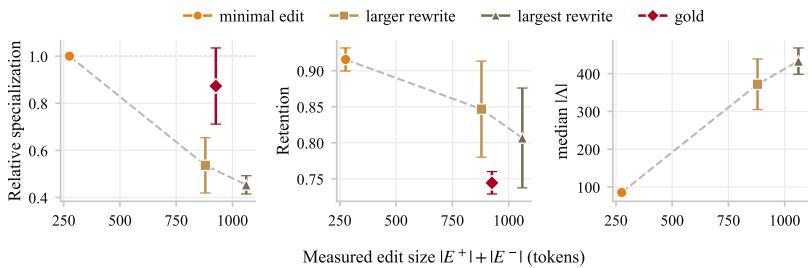  
Figure 4: RQ2: what a larger edit costs. Qwen3-8B student per arm on the GSM8K hard set, varying only how much a verified-correct correction rewrites the student’s own attempt $( \mathrm { m e a n } \pm \mathrm { s . e }$ over 3 seeds). Arms sit at their measured edit size, since the projector rather than the prompt sets it, and the dashed line joins the three matched arms. Left to right: hard-set pass@1 relative to the minimal-edit arm, absolute held-out pass@1, and the median likelihood shift $| \Lambda |$ . Both behavioural axes fall as the edit grows while $| \Lambda |$ rises. Gold appears on the first two panels only: it keeps none of the attempt, so its edit count understates how far it sits, and its $| \Lambda |$ of 3969 is off the scale.

## 4.3 RQ3: How much does refreshing corrections online help?

Projected distillation recomputes its corrections at every round, so that each target is an edit of an attempt the current student has just produced. Naturally, we ask what role this mechanism plays in projected distillation learning. For comparison, we gather a static pool: minimal-edit corrections of the initial checkpoint’s responses, mined once before training and reused for the remainder of the run. This is the same regime occupied by methods like SPOT (Lin and Han, 2026) and LeMa (An et al., 2023). The projector for both static and online-refreshed arms is the same black-box projector. We report results pooled over all model benchmark cells and three seeds in figure 5.

Refreshing the corrections is essential. Online refresh improves specialization steadily throughout training, reaching 0.37 pass@1, whereas the static pool rises over the first few updates and then flattens near 0.20 (Fig. 5, left). Retention separates more sharply: online refresh holds it at base for the whole run, while the static pool climbs slightly above base over the first 25 steps, falls to 0.76 by step 50, and declines from there to 0.60 (Fig. 5, right). The fall sets in once the pool has been reused for several rounds. A static pool cannot follow the student to the failures it develops afterwards, so repeated passes fit it to a fixed set of targets, while its generalization degrades.

## 4.4 RQ4: How best to learn from projections of wrong responses?

In a typical round of projected distillation, we have access to wrong attempts $y ^ { - }$ , their corrections $y ^ { + }$ and correct student responses $y ^ { \mathrm { c } }$ . These three quantities admit several learning objectives, and in this section we study an effective objective for learning. The simplest is supervised fine-tuning on the projection, optionally combined with a term on the student’s own correct responses. Keeping only

Online refresh Static pool

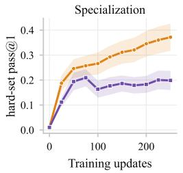

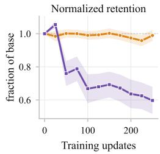  
Figure 5: RQ3: online refresh against a static pool, pooled over all model benchmark cells and 3 seeds. Both arms take minimal edits from the same black-box projector; the static pool mines them once against the base checkpoint and reuses them for the run, the regime of minedonce correction methods. Refreshing holds retention at base throughout, while the pool climbs briefly above base and then falls to 0.60.

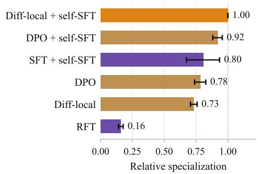

Figure 6: RQ4: loss recipes. Specialization of each recipe as a fraction of diff-local DPO + self-SFT, the recipe adopted in Sec. 3. Qwen3-8B, GSM8K hard set, mean and stderr on 3 seeds. The adopted recipe is orange, the other contrastive arms amber, and the arms without a contrast violet. Held-out retention stays between 0.88 and 0.94 for every arm, so the ordering reflects specialization and not differences in forgetting. SFT on the projection carries a wider spread across seeds.

that second term is rejection fine-tuning (RFT; Yuan et al., 2023), which learns from the student’s successes alone and ignores the projection. Further, because the wrong attempt is also retained, a contrastive objective is available: DPO (Rafailov et al., 2023) over the full response, again optionally combined with the self-SFT term. Since a minimal edit leaves most of the response unchanged, the contrast may instead be localized to the edited spans ((1)). We compare the six resulting recipes on the GSM8K hard set and report the outcome in Fig. 6.

The projection is necessary: training on the student’s own correct responses alone recovers 0.16 of the adopted recipe, since the hard set is mined at pass@k=0 and the student’s rollouts stay correct on about 6% of attempts through the run, so RFT has almost nothing to train on. Among objectives that do use the projection, the contrast is the more reliable choice: SFT on the projection reaches 0.81 on average but carries a standard error of 0.078 across seeds, three to sixteen times that of any contrastive arm. The self-SFT term then settles the ordering among those arms. A contrast constrains the likelihood of $y ^ { + }$ only relative to y−, and a localized one does so over a handful of tokens, so both gain from a term that raises the likelihood of correct text outright, and the localized one gains more: without it the diff-localized contrast underperforms the full-sequence one (0.73 against 0.78), and with it the ordering reverses (1.00 against 0.92). We adopt the diff-localized contrast with self-SFT as the default recipe (Sec. 3); per-arm objectives and absolute values are in Appendix F.

## 4.5 RQ5: Can we improve the quality of projections for better learning?

In this section, we explore ways to make projections from a mid-capacity projector more effective. The natural approach would be to fine-tune the projector; we instead take a computationally efficient test-time route and ask a frozen Qwen3-32B to refine its own correction over several rounds. At each round it is re-prompted with its previous correction and the spans it edited, and across rounds we retain the valid correction most likely under the base student, measured by log-likelihood over the edited tokens. We sweep the refinement budget over $K \in \{ 0 , 1 , 2 \}$ on a Qwen3-8B student and the GSM8K hard set with the default recipe.

Refinement improves the corrections in two ways (Fig. 7). More of the student’s failures become correctable, the correction rate rising from 9.2% at K=0 to 15.4% at $K { = } 1$ and $1 6 . 7 \%$ at $K { = } 2$ (Fig. 7, left), so a larger part of the hard set contributes a training pair at all. At the same time the edits become smaller, from 256 to 130 tokens (Fig. 7, right), which by the account of Sec. 4.2 should make each target easier to learn from. Downstream, hard-set pass@1 rises from 0.37 to 0.44 while retention stays near 0.91–0.93, with most of the gain arriving in the first round. Test-time refinement can therefore improve the projections, leading to effective performance. Additional details are in Appendix G.

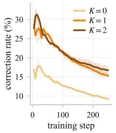

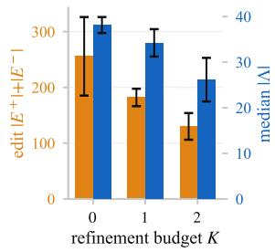  
Figure 7: RQ5: refining the projector at test time. A frozen Qwen3-32B projector iteratively refines its own correction and the Qwen3-8B student trains on the result (GSM8K hard set, $K \in \{ 0 , 1 , 2 \}$ , 3 seeds), with the running correction rate on the left and edit size and off-policyness against the refinement budget on the right. More refinement corrects more wrong attempts with a smaller edit, and the projector is never finetuned.

Table 4: RQ6: a self-projector recovers about 40% of the specialization. Qwen3-8B on the GSM8K hard set, 250 updates, mean s.e. over 3 seeds. The self-projector is a frozen copy of the student’s own base weights, given the verified answer. Gold replaces the attempt with the dataset’s reference solution. Further arms and the full setup are in Appendix H.
<table><tr><td>Projector</td><td>Hard set</td><td>Held-out</td></tr><tr><td>none (untrained student)</td><td>0.000</td><td>≈0.955</td></tr><tr><td>the student itself</td><td>0.219±0.012</td><td>0.924±0.021</td></tr><tr><td>gold solution</td><td>0.489</td><td>0.744</td></tr><tr><td>black-box projector</td><td>0.560</td><td>0.916</td></tr></table>

## 4.6 RQ6: Can we use the same model for projection given privileged information?

Use of the same model to provide the learning signal is a popular choice in post-training. One well-known example is on-policy self-distillation (OPSD) (Zhao et al., 2026). Similarly, in this section, we test how much we can gain by replacing external projections with the model’s own self-projections given the ground truth answer. We experiment with Qwen3-8B on the GSM8K dataset. The full setup is provided in Appendix H.

Tab. 4 reports the result. Self-projection does produce usable corrections: the student lifts its hard set from 0.000 to 0.219 while retention stays at 0.924, so a model that is told the answer can repair enough of its own reasoning to learn from it. It does not, however, substitute for a stronger projector. The black-box projector reaches 0.560 on the same problems, and even the student-agnostic gold solution reaches 0.489. Concurrent work (Karan et al., 2026) proposes a self-projection scheme of its own, in which an MCMC sampler has the student rewrite its response with a reference solution in view, and Appendix I compares it against black-box projection on its own math benchmark.

## 5 A Patch-MDP Analysis of Projected Distillation

Setup. We model generation as a deterministic patch MDP with a token budget H (Definition 2). A state is a prompt together with the tokens generated so far. An action is a patch, a span of tokens appended to that state, and every token carries a reward in [0, 1]. A patch may span several tokens, but the reward and every bound below decompose token by token (Lemma 1), so decisions are indexed by token position throughout and H counts them. The student is a policy π in a class Π, with expected return $J ( \pi )$ and optimum $J ^ { \star }$ . Choosing action w at state s forfeits some return against the best action available in s. We denote this optimality gap with $\Delta ( s , w )$ , which is upper-bounded by a constant $\Delta _ { \mathrm { m a x } }$ (Definition 3). Owing to telescoping (Lemma 1), a full rollout’s shortfall can be accounted for one token at a time. The regret $J ^ { \star } - \bar { J ( \pi ) }$ then equals H times the average per-token optimality gap, taken over π’s state occupancy (Lemma 2). We write m for the edit size (Definition 4): the tokens the correction changes relative to the attempt, counted over the H decisions Definition 2 gives both and so including the padding that equalizes their lengths. It relates to the token diff $\left| E ^ { + } \right| + \left| E ^ { - } \right|$ of Sec. 3, the quantity Sec. 4.2 reports, by $m = | E ^ { + } | + | E ^ { - } | + \left| | E ^ { + } | - | E ^ { - } | \right| = 2 \operatorname* { m a x } ( | E ^ { + } | , | E ^ { - } | )$ the extra term being the change in answer length. Appendices J.1 and J.2 give the full treatment. Learning protocol. Training runs for M rounds. Each round is one batch of rollouts, the corrections Learning protocol. Training runs for M rounds. Each round is one batch of rollouts, the corrections made to them, and the gradient update that follows. $\pi _ { i }$ is the policy entering round i. Ideally we would query the projector at every student mistake as the student generates a response. That would let us minimize the gap under the student’s own state occupancy. This is exactly the DAgger (Ross et al., 2011) approach, where an expert labels states under the learner’s own occupancy, leading to a learning regret of $O ( H )$ , linear in the horizon. Per-mistake labeling as an LLM student responds is infeasible, since it demands a projector call and a forward pass at every mistake. In projected distillation, we instead correct the rollout once and perform a single forward pass over the response. This minimizes the optimality gap under a state occupancy drifted away from the student’s own.

Fitting error. The projector edits the student’s wrong response such that for each state in the rewritten response, the next token has zero optimality gap. We define two further quantities: (i) the policy fit error $\tilde { \varepsilon } ,$ , the irreducible error in fitting the best policy in the class to the expert projections; and (ii) the optimization term $\tilde { \gamma } _ { M }$ , the student’s excess disagreement over that best policy, which vanishes for a no-regret learner (Definition 5). Since a single disagreement costs at most $\Delta _ { \mathrm { m a x } }$ , the gap loss at these prefixes is bounded by $\Delta _ { \mathrm { m a x } }$ times the disagreement rate (Lemma 3).

We assume that the drift caused by earlier token edits at a given decision point has a smooth, bounded effect on the optimality gap. We denote the maximum per-token effect on the optimality gap by η.

Assumption 1 (Prefix sensitivity). Write $e ( s , s ^ { \prime } )$ for the number of insertions and deletions carrying the generated tokens of one history into those of the other (Definition 4). The map $s \mapsto \bar { \mathbb { E } } _ { w \sim \pi ( \cdot | s ) } \bar { [ \Delta ( s , w ) ] }$ is η-Lipschitz in that count:

$$
\begin{array} { r l r } { \big | \mathbb { E } _ { w \sim \pi ( \cdot | s ^ { \prime } ) } [ \Delta ( s ^ { \prime } , w ) ] - \mathbb { E } _ { w \sim \pi ( \cdot | s ) } [ \Delta ( s , w ) ] \big | \le \eta e ( s , s ^ { \prime } ) } & { } & { \forall \pi \in \Pi , \forall s , s ^ { \prime } . } \end{array}
$$

Theorem 1 (Best-iterate suboptimality of projected distillation). Let Assumption 1 hold, let the projector be as above, and let m be the mean edit size over the rounds. Then after M rounds

$$
\operatorname* { m i n } _ { i \leq M } \left[ J ^ { \star } - J ( \pi _ { i } ) \right] \ \leq \ H \Delta _ { \operatorname* { m a x } } \left( \tilde { \varepsilon } + \tilde { \gamma } _ { M } \right) \ + \ \eta m H .
$$

The first term collects the fitting and optimization costs. The second is drift, which does not decrease with M; a smaller edit is the only lever on it.

Horizon regimes. For a minimal edit the edit size is $m = O ( 1 )$ , making the drift ${ \cal O } ( \eta H )$ and hence the regret $O ( H )$ , linear in the horizon. A complete rewrite of the response leads to $m = \Theta ( H )$ making the drift ${ \cal O } ( \eta H ^ { 2 } )$ and therefore the regret $O ( H ^ { 2 } )$ , quadratic in the horizon (Corollary 1). In a controlled experiment in Sec. 4.2 we vary m (Definition 4) and observe that the student’s performance suffers as the edit size increases. The two endpoints recover the rates of DAgger and of behavior cloning, though not those algorithms themselves.

## 6 Conclusion

We introduced projected distillation, a post-training recipe to enable lower-capacity LLMs to solve hard problems beyond their current reach. We demonstrated that standard on-policy post-training methods such as RLVR and OPD struggle to specialize on the hard task, while training on gold solutions leads to catastrophic forgetting. Our proposed approach avoids these issues by maintaining rich learning targets close to the student’s current policy. This is done by iteratively transforming the student’s failed attempts into correct solutions through minimal edits. Our extensive empirical analyses showed that our approach achieved a better specialization–retention Pareto frontier than previous approaches. We showed that it is important to learn from minimal edits rather than from larger edits or full rewrites, and from the mistakes of the latest checkpoint rather than only those of the base model. Theoretical analysis with a smoothness assumption on the effects of token edits described a spectrum where minimal edits lead to DAgger-like linear-in-horizon regret, while full rewrites lead to behavior-cloning-like quadratic regret. Thus, our work provides empirical and theoretical evidence on the utility of the underlying continuum of on-policyness for continual learning on hard tasks.

Limitations and future work. We instantiate the projection as a minimal token edit; exploring likelihood-based alternatives is also an important future direction. The uniform per-token sensitivity assumed in Assumption 1 may be strong and needs further investigation. Our recipe assumes a cheap correctness check, leaving open the domains without a readily available verifier. We also study single turn tasks, where the student produces one response and the projector edits that response. Multi-turn tasks, in which a failure can originate several turns before it becomes visible in the outcome, would require deciding which turn to project, and we leave this to future work.

## References

Rishabh Agarwal, Nino Vieillard, Yongchao Zhou, Piotr Stanczyk, Sabela Ramos, Matthieu Geist, and Olivier Bachem. On-policy distillation of language models: Learning from self-generated mistakes. International Conference on Learning Representations, 2023. URL https://arxiv. org/abs/2306.13649.

Shengnan An, Zexiong Ma, Zeqi Lin, Nanning Zheng, Jian-Guang Lou, and Weizhu Chen. Learning from mistakes makes LLM better reasoner. arXiv preprint arXiv:2310.20689, 2023. URL https://arxiv.org/abs/2310.20689.

Arslan Chaudhry, Puneet K. Dokania, Thalaiyasingam Ajanthan, and Philip H. S. Torr. Riemannian walk for incremental learning: Understanding forgetting and intransigence. In European Conference on Computer Vision (ECCV), 2018. URL https://arxiv.org/abs/1801.10112.

Mark Chen, Jerry Tworek, Heewoo Jun, Qiming Yuan, Henrique Ponde de Oliveira Pinto, Jared Kaplan, Harri Edwards, Yuri Burda, Nicholas Joseph, Greg Brockman, Alex Ray, Raul Puri, Gretchen Krueger, Michael Petrov, Heidy Khlaaf, Girish Sastry, Pamela Mishkin, Brooke Chan, Scott Gray, Nick Ryder, Mikhail Pavlov, Alethea Power, Lukasz Kaiser, Mohammad Bavarian, Clemens Winter, Philippe Tillet, Felipe Petroski Such, Dave Cummings, Matthias Plappert, Fotios Chantzis, Elizabeth Barnes, Ariel Herbert-Voss, William Hebgen Guss, Alex Nichol, Alex Paino, Nikolas Tezak, Jie Tang, Igor Babuschkin, Suchir Balaji, Shantanu Jain, William Saunders, Christopher Hesse, Andrew N. Carr, Jan Leike, Josh Achiam, Vedant Misra, Evan Morikawa, Alec Radford, Matthew Knight, Miles Brundage, Mira Murati, Katie Mayer, Peter Welinder, Bob McGrew, Dario Amodei, Sam McCandlish, Ilya Sutskever, and Wojciech Zaremba. Evaluating large language models trained on code. arXiv preprint arXiv:2107.03374, 2021.

Xiwen Chen, Jingjing Wang, Wenhui Zhu, Peijie Qiu, Xuanzhao Dong, Yueyue Deng, Hejian Sang, Zhipeng Wang, Alborz Geramifard, and Feng Luo. SODA: Semi on-policy black-box distillation for large language models. arXiv preprint arXiv:2604.03873, 2026. URL https: //arxiv.org/abs/2604.03873.

Karl Cobbe, Vineet Kosaraju, Mohammad Bavarian, Mark Chen, Heewoo Jun, Lukasz Kaiser, Matthias Plappert, Jerry Tworek, Jacob Hilton, Reiichiro Nakano, Christopher Hesse, and John Schulman. Training verifiers to solve math word problems. arXiv preprint arXiv:2110.14168, 2021. URL https://arxiv.org/abs/2110.14168.

Kehua Feng, Xinyi Shen, Weijie Wang, Xiang Zhuang, Yuqi Tang, Qiang Zhang, and Keyan Ding. SciKnowEval: Evaluating multi-level scientific knowledge of large language models. arXiv preprint arXiv:2406.09098, 2024. URL https://arxiv.org/abs/2406.09098.

Bofei Gao, Feifan Song, Zhe Yang, Zefan Cai, Yibo Miao, Qingxiu Dong, Lei Li, Chenghao Ma, Liang Chen, Runxin Xu, Zhengyang Tang, Benyou Wang, Daoguang Zan, Shanghaoran Quan, Ge Zhang, Lei Sha, Yichang Zhang, Xuancheng Ren, Tianyu Liu, and Baobao Chang. Omni-MATH: A universal olympiad level mathematic benchmark for large language models. arXiv preprint arXiv:2410.07985, 2024a. URL https://arxiv.org/abs/2410.07985.

Leo Gao, Jonathan Tow, et al. The language model evaluation harness, 07 2024b. URL https: //zenodo.org/records/12608602.

Chaoqun He, Renjie Luo, Yuzhuo Bai, Shengding Hu, Zhen Leng Thai, Junhao Shen, Jinyi Hu, Xu Han, Yujie Huang, Yuxiang Zhang, Jie Liu, Lei Qi, Zhiyuan Liu, and Maosong Sun. Olympiad-Bench: A challenging benchmark for promoting AGI with olympiad-level bilingual multimodal scientific problems. In Proceedings of the 62nd Annual Meeting of the Association for Computational Linguistics, 2024. URL https://arxiv.org/abs/2402.14008.

Dan Hendrycks, Collin Burns, Steven Basart, Andy Zou, Mantas Mazeika, Dawn Song, and Jacob Steinhardt. Measuring massive multitask language understanding. In International Conference on Learning Representations, 2021a. URL https://arxiv.org/abs/2009.03300.

Dan Hendrycks, Collin Burns, Saurav Kadavath, Akul Arora, Steven Basart, Eric Tang, Dawn Song, and Jacob Steinhardt. Measuring mathematical problem solving with the MATH dataset. In

Advances in Neural Information Processing Systems (NeurIPS) Datasets and Benchmarks Track, 2021b. URL https://arxiv.org/abs/2103.03874.

D. S. Hirschberg. A linear space algorithm for computing maximal common subsequences. Communications ofthe ACM, 18(6):341–343, 1975. URL https://doi.org/10.1145/360825.360861.

Naman Jain, King Han, Alex Gu, Wen-Ding Li, Fanjia Yan, Tianjun Zhang, Sida Wang, Armando Solar-Lezama, Koushik Sen, and Ion Stoica. LiveCodeBench: Holistic and contamination free evaluation of large language models for code. arXiv preprint arXiv:2403.07974, 2024. URL https://arxiv.org/abs/2403.07974.

Aayush Karan, Sitan Chen, and Yilun Du. Finetuning with sampling: SFT learns better than you think. arXiv preprint arXiv:2610.02140, 2026. URL https://arxiv.org/abs/2610.02140.

Ronald Kemker, Marc McClure, Angelina Abitino, Tyler Hayes, and Christopher Kanan. Measuring catastrophic forgetting in neural networks. In AAAI Conference on Artificial Intelligence (AAAI), 2018. URL https://arxiv.org/abs/1708.02072.

James Kirkpatrick, Razvan Pascanu, Neil Rabinowitz, Joel Veness, Guillaume Desjardins, Andrei A. Rusu, Kieran Milan, John Quan, Tiago Ramalho, Agnieszka Grabska-Barwinska, Demis Hassabis, Claudia Clopath, Dharshan Kumaran, and Raia Hadsell. Overcoming catastrophic forgetting in neural networks. Proceedings of the National Academy of Sciences (PNAS), 114(13):3521–3526, 2017. URL https://arxiv.org/abs/1612.00796.

Ananya Kumar, Aditi Raghunathan, Robbie Jones, Tengyu Ma, and Percy Liang. Fine-tuning can distort pretrained features and underperform out-of-distribution. In International Conference on Learning Representations (ICLR), 2022. URL https://arxiv.org/abs/2202.10054.

Woosuk Kwon, Zhuohan Li, Siyuan Zhuang, Ying Sheng, Lianmin Zheng, Cody Hao Yu, Joseph E. Gonzalez, Hao Zhang, and Ion Stoica. Efficient memory management for large language model serving with PagedAttention. In Proceedings of the 29th Symposium on Operating Systems Principles, 2023. URL https://arxiv.org/abs/2309.06180.

Hunter Lightman, Vineet Kosaraju, Yura Burda, Harri Edwards, Bowen Baker, Teddy Lee, Jan Leike, John Schulman, Ilya Sutskever, and Karl Cobbe. Let’s verify step by step. arXiv preprint arXiv:2305.20050, 2023. URL https://arxiv.org/abs/2305.20050.

Wenye Lin and Kai Han. Surgical post-training: Proximal on-policy distillation for reasoning with knowledge retention. arXiv preprint arXiv:2603.01683, 2026. URL https://arxiv.org/abs/ 2603.01683.

Mingyang Liu, Gabriele Farina, and Asuman Ozdaglar. UFT: Unifying supervised and reinforcement fine-tuning. arXiv preprint arXiv:2505.16984, 2025. URL https://arxiv.org/abs/2505. 16984.

David Lopez-Paz and Marc’Aurelio Ranzato. Gradient episodic memory for continual learning. In Advances in Neural Information Processing Systems (NeurIPS), 2017. URL https://arxiv. org/abs/1706.08840.

OLMo Team. 2 OLMo 2 furious. arXiv preprint arXiv:2501.00656, 2024. URL https://arxiv. org/abs/2501.00656.

Qwen Team. Qwen3 technical report. arXiv preprint arXiv:2505.09388, 2025. URL https: //arxiv.org/abs/2505.09388.

Rafael Rafailov, Archit Sharma, Eric Mitchell, Stefano Ermon, Christopher D. Manning, and Chelsea Finn. Direct preference optimization: Your language model is secretly a reward model. Advances in Neural Information Processing Systems, 2023. URL https://arxiv.org/abs/2305.18290.

Stéphane Ross, Geoffrey J. Gordon, and J. Andrew Bagnell. A reduction of imitation learning and structured prediction to no-regret online learning. In Proceedings ofthe 14th International Conference on Artificial Intelligence and Statistics (AISTATS), 2011. URL https://arxiv.org/ abs/1011.0686.

John Schulman, Filip Wolski, Prafulla Dhariwal, Alec Radford, and Oleg Klimov. Proximal policy optimization algorithms. arXiv preprint arXiv:1707.06347, 2017. URL https://arxiv.org/ abs/1707.06347.

Zhihong Shao, Peiyi Wang, Qihao Zhu, Runxin Xu, Junxiao Song, Xiao Bi, Haowei Zhang, Mingchuan Zhang, Y. K. Li, Y. Wu, and Daya Guo. DeepSeekMath: Pushing the limits of mathematical reasoning in open language models. arXiv preprint arXiv:2402.03300, 2024. URL https://arxiv.org/abs/2402.03300.

Guangming Sheng, Chi Zhang, Zilingfeng Ye, Xibin Wu, Wang Zhang, Ru Zhang, Yanghua Peng, Haibin Lin, and Chuan Wu. HybridFlow: A flexible and efficient RLHF framework. arXiv preprint arXiv:2409.19256, 2024. URL https://arxiv.org/abs/2409.19256.

Qiaoyu Tang, Ziliang Deng, Hongyu Lin, Xianpei Han, Qiao Liang, Boxi Cao, and Le Sun. ToolAlpaca: Generalized tool learning for language models with 3000 simulated cases. arXiv preprint arXiv:2306.05301, 2023. URL https://arxiv.org/abs/2306.05301.

Leandro von Werra, Younes Belkada, Lewis Tunstall, Edward Beeching, Tristan Thrush, Nathan Lambert, Shengyi Huang, Kashif Rasul, and Quentin Gallouédec. TRL: Transformers reinforcement learning. https://github.com/huggingface/trl, 2020.

Robert A. Wagner and Michael J. Fischer. The string-to-string correction problem. Journal ofthe ACM, 21(1):168–173, 1974. URL https://doi.org/10.1145/321796.321811.

Jason Wei, Maarten Bosma, Vincent Y. Zhao, Kelvin Guu, Adams Wei Yu, Brian Lester, Nan Du, Andrew M. Dai, and Quoc V. Le. Finetuned language models are zero-shot learners. In International Conference on Learning Representations (ICLR), 2022. URL https://arxiv. org/abs/2109.01652.

Ling Yang, Zhaochen Yu, Tianjun Zhang, Minkai Xu, Joseph E Gonzalez, Bin Cui, and Shuicheng Yan. SuperCorrect: Advancing small LLM reasoning with thought template distillation and self-correction. In International Conference on Learning Representations (ICLR), 2025. URL https://arxiv.org/abs/2410.09008.

Zhaorui Yang, Tianyu Pang, Haozhe Feng, Han Wang, Wei Chen, Minfeng Zhu, and Qian Liu. Self-distillation bridges distribution gap in language model fine-tuning. In Proceedings of the 62nd Annual Meeting of the Association for Computational Linguistics (ACL), 2024. URL https://arxiv.org/abs/2402.13669.

Qiying Yu, Zheng Zhang, Ruofei Zhu, Yufeng Yuan, Xiaochen Zuo, Yu Yue, Weinan Dai, Tiantian Fan, Gaohong Liu, Lingjun Liu, Xin Liu, Haibin Lin, Zhiqi Lin, Bole Ma, Guangming Sheng, Yuxuan Tong, Chi Zhang, Mofan Zhang, Wang Zhang, Hang Zhu, Jinhua Zhu, Jiaze Chen, Jiangjie Chen, Chengyi Wang, Hongli Yu, Yuxuan Song, Xiangpeng Wei, Hao Zhou, Jingjing Liu, Wei-Ying Ma, Ya-Qin Zhang, Lin Yan, Mu Qiao, Yonghui Wu, and Mingxuan Wang. DAPO: An open-source LLM reinforcement learning system at scale. arXiv preprint arXiv:2503.14476, 2025. URL https://arxiv.org/abs/2503.14476.

Zheng Yuan, Hongyi Yuan, Chengpeng Li, Guanting Dong, Keming Lu, Chuanqi Tan, Chang Zhou, and Jingren Zhou. Scaling relationship on learning mathematical reasoning with large language models. arXiv preprint arXiv:2308.01825, 2023. URL https://arxiv.org/abs/2308.01825.

Yang Yue, Zhiqi Chen, Rui Lu, Andrew Zhao, Zhaokai Wang, Shiji Song, and Gao Huang. Does reinforcement learning really incentivize reasoning capacity in LLMs beyond the base model? arXiv preprint arXiv:2504.13837, 2025. URL https://arxiv.org/abs/2504.13837.

Yaocheng Zhang, Jiajun Chai, Yuqian Fu, Songjun Tu, Xiaohan Wang, Wei Lin, Guojun Yin, Qichao Zhang, Yuanheng Zhu, and Dongbin Zhao. Are full rollouts necessary for on-policy distillation? arXiv preprint arXiv:2605.31490, 2026.

Siyan Zhao, Zhihui Xie, Mengchen Liu, Jing Huang, Guan Pang, Feiyu Chen, and Aditya Grover. Self-distilled reasoner: On-policy self-distillation for large language models. arXiv preprint arXiv:2601.18734, 2026. URL https://arxiv.org/abs/2601.18734.

## A Notation

Tab. 5 consolidates the notation used throughout the paper, with each symbol’s meaning and where it is defined or used.

Table 5: Notation reference.
<table><tr><td colspan="2"></td></tr><tr><td colspan="2">Problem, student, verifier (Sec. 3)</td></tr><tr><td>x  $y \in \mathcal { V } ^ { \leq H }$ </td><td>problem / prompt (drawn from a problem distribution) answer: a token sequence of length  $\leq H$ </td></tr><tr><td></td><td>student policy (autoregressive, parameters</td></tr><tr><td> $\pi _ { \theta _ { S } }$ </td><td> $\theta _ { S } )$ </td></tr><tr><td> $\pi _ { \mathrm { r e f } } = \pi _ { \theta _ { S , 0 } }$ </td><td>frozen initial student, used as the DPO reference</td></tr><tr><td> $R ( x , y ) \in \{ 0 , 1 \}$ </td><td>verifier (marks an answer correct or not)</td></tr><tr><td> $\mathcal { C } ( x )$   $\scriptstyle { \mathrm { p a s s } } @ k = 0$ </td><td>set of correct answers  $\{ y : R ( x , y ) = 1 \}$  problems on which all k sampled attempts are wrong</td></tr><tr><td></td><td></td></tr><tr><td colspan="2">Projection and objective (Definition 1, Equation (1))</td></tr><tr><td> $\Lambda$ </td><td>likelihood shift the correction demands of the student</td></tr><tr><td> $\operatorname { p r o j } ( x )$ </td><td>projection: the most likely correct answer (Definition 1)</td></tr><tr><td> $y ^ { - } = y$ </td><td>student&#x27;s wrong attempt (rejected)</td></tr><tr><td> $y ^ { + }$ </td><td>the projector&#x27;s minimal-edit correction (chosen)</td></tr><tr><td> $y ^ { \mathrm { c } }$ </td><td>student&#x27;s own correct rollout (self-SFT target)</td></tr><tr><td> $E ^ { - } , E ^ { + }$ </td><td>mistake span (unlearn) and fix span (learn) from the token-diff</td></tr><tr><td> $\beta$ </td><td>DPO contrast strength (temperature)</td></tr><tr><td> ${ \mathcal { L } } _ { \mathrm { D i f f - L o c a l . } }$  DPO,  $\mathcal { L } _ { \mathrm { S F T } } ,$  L</td><td>diff-local contrast; self-SFT; full objective</td></tr><tr><td colspan="2">Patch MDP (Definition 2, Appendix J.1)</td></tr><tr><td> $\nu , H$ </td><td>vocabulary; horizon, the token budget of a rollout</td></tr><tr><td> $\boldsymbol { s } _ { t } = \left( \boldsymbol { x } , y _ { 1 : t } \right)$ </td><td>state before decision t: prompt and the first t generated tokens</td></tr><tr><td> $_ w$ </td><td>action: a variable-length patch (a continuation that fits the budget)</td></tr><tr><td> $\boldsymbol { \mathcal { A } } ( \boldsymbol { s } )$ </td><td>admissible actions  $\{ w \in \mathcal { V } ^ { h } : 1 \leq h \leq H - | s | \}$ </td></tr><tr><td> $p : s ^ { \prime } = s \oplus w$ </td><td>deterministic transition (append the patch)</td></tr><tr><td> $r _ { \mathrm { t o k } } \in [ 0 , 1 ]$ </td><td>per-token reward;  $r ( s , w )$  sums it over the patch</td></tr><tr><td> $\rho$ </td><td>initial state distribution: the distribution over problems</td></tr><tr><td> $\gamma = 1$ </td><td>no discounting</td></tr><tr><td> $\pi , \ \pi _ { \theta }$ </td><td>policy; underlying token model</td></tr><tr><td> $V ^ { \star } , Q ^ { \star }$ </td><td>optimal value and action-value</td></tr><tr><td> $J ( \pi ) , J ^ { \star }$ </td><td>expected return of π; its optimum, (6)</td></tr><tr><td> $d ^ { \pi } , \tilde { d } _ { i }$ </td><td>occupancy induced by π; the corrected prefixes of round i</td></tr><tr><td> $\Delta ( s , w )$ </td><td>optimality gap  $V ^ { \star } ( s ) - Q ^ { \star } ( s , w ) \in [ 0 , \Delta _ { \operatorname* { m a x } } ]$ </td></tr><tr><td colspan="2">The regret analysis (Sec. 5, Theorem 1)</td></tr><tr><td> $M , \pi _ { i }$ </td><td>rounds of training; the learner entering round ¿</td></tr><tr><td> $\Pi , \Theta$ </td><td>policy class and its parameter set (Appendix J.1)</td></tr><tr><td> $w ^ { \star } ( s )$ </td><td>the projector&#x27;s token at s, assumed optimal there</td></tr><tr><td> $m$ </td><td>edit size of a correction (Definition 4); in Theorem  $^ { 1 , }$  its mean over rounds</td></tr><tr><td> $e ( s , s ^ { \prime } )$ </td><td>edit count between two histories (Definition 4)</td></tr><tr><td> $e _ { t } , \bar { e } _ { i }$ </td><td>edit count at decision t; its mean over round i (Lemma 4)</td></tr><tr><td> $\eta$ </td><td>per-edited-token drift (Assumption 1)</td></tr><tr><td> $\Delta _ { \mathrm { m a x } }$ </td><td>largest return one decision can forfeit (Definition 3)</td></tr><tr><td> $L ( d , \pi )$ </td><td>mean gap of π under a state distribution d, (7)</td></tr><tr><td> $\tilde { \varepsilon } _ { i } ( \pi )$ </td><td>rate at which π disagrees with w* at those prefixes</td></tr><tr><td> $\tilde { \varepsilon }$ </td><td>approximation error: the disagreement of the best policy in the class</td></tr><tr><td> $\tilde { \gamma } _ { M }$ </td><td>optimization error: the learner&#x27;s excess disagreement over it</td></tr><tr><td> $D , G$ </td><td>parameter-set diameter; gradient bound (Proposition 1)</td></tr></table>

## B Projection examples

This appendix shows complete wrong projected pairs, so the minimal-edit property can be read at the level of full solutions. In each pair the projector reuses the student’s derivation verbatim and changes only what is needed to make the answer correct; the changed spans are the token-diff $E ^ { - }$ (mistake) and $E ^ { + } \left( \operatorname { f i x } \right)$ that the diff-local DPO loss (1) contrasts. All student answers are from

Qwen3-8B (base); all projections are from the black-box projector. Appendix B.1 works through the single-edit example of Fig. 8 in full, and Appendix B.2 a multi-edit one.

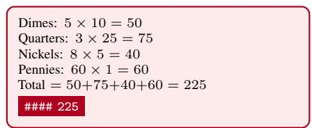  
(a) Student’s wrong attempt (keeps a quarter).

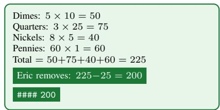  
(b) Correction inserts the single missing step.  
Figure 8: A minimal-edit projection on GSM8K (Cindy’s wishing pond, gold answer 200). The student’s wrong attempt (a) and the projector’s correction (b) are token-identical except for one inserted step and the final answer line, which changes from 225 to 200. Only the changed spans E− E+ enter the contrast in (1).

## B.1 A single edit: Cindy’s wishing pond

Problem. Cindy tosses 5 dimes into the wishing pond. Eric flips 3 quarters into the pond. Garrick throws in 8 nickels. Ivy then drops 60 pennies in. IfEric dips his hands into the water and pulls out a quarter, how much money, in cents, did they put into the pond? (Gold: 200.)

y− (rejected, wrong — #### 225)   
Dimes: 5 10 = 50. Quarters: 3 25 = 75. Nickels: 8 5 = 40. Pennies: 60 1 = 60. Total   
= 50 + 75 + 40 + 60 = 225. #### 225

y+ (chosen, minimal edit — #### 200)   
Dimes: 5 10 = 50. Quarters: 3 25 = 75. Nickels: 8 5 = 40. Pennies: 60 1 = 60. Total   
= 50 + 75 + 40 + 60 = 225. Eric removes a quarter: 225  25 = 200. #### 200

The entire count is reused verbatim; the projector inserts the single step the student omitted (subtracting the withdrawn quarter). The token-diff is a one-span edit: E− = #### 225 , E+ = “Eric removes. . . = 200”, #### 200 .

## B.2 Several edits: John’s computer

Problem. John’s new computer cost \$1500. He needs a monitor and other peripherals that cost 1/5 that much. He also wants to upgrade the \$300 video card in the base computer with one that costs twice as much. How much did he spend? (Gold: 2100.)

y− (rejected, wrong — #### 2400)   
Computer: \$1500. Peripherals: 1 × 1500 = 300. Upgraded video card: 2 × 300 = 600. Total:   
1500 + 300 + 600 = 2400. #### 2400

y+ (chosen, minimal edit — #### 2100)   
Computer: \$1500. Peripherals: 1 × 1500 = 300. Upgraded video card: 2 × 300 = 600. Since the   
base computer already includes the \$300 card, he pays only the extra: 600 300 = 300. Total:   
1500 + 300 + 300 = 2100. #### 2100

Here two spans change—the video-card line and the total—while the computer and peripheral steps are reused unchanged. This is a multi-edit projection: the correction threads the fix (charging only the upgrade difference) through to the final sum.

## C Experimental setup

## C.1 Reproducibility Details

Model families and projectors. The two students are open-weight instruction-tuned models from different families, Qwen3-8B (Qwen Team, 2025) and OLMo-2-7B (OLMo Team, 2024), chosen so the effect is tested as a property of the method rather than of one pretraining recipe. The samefamily projector shares the student’s tokenizer, as OPD requires, and unless noted it is Qwen3-32B for the Qwen student and OLMo-2-32B for the OLMo student. The black-box path (Sec. 3) needs only the correction text, so it is tokenizer-free and draws its corrections from a single black-box model shared across students. The exact checkpoints are: students Qwen/Qwen3-8B and allenai/OLMo-2-1124-7B-Instruct; same-family 32B teachers Qwen/Qwen3-32B and allenai/OLMo-2-0325-32B-Instruct.

Benchmarks. Five benchmarks spanning math, code, tools, and science, each contributing a mined hard set for training and a held-out slice for evaluation:

• GSM8K (Cobbe et al., 2021): grade-school math, numeric answers graded by exact match. Mine from the 7,473-example train split; evaluate on a 200-problem held-out slice of the test split.

• MATH (Hendrycks et al., 2021b): competition math, \boxed{} answers graded by symbolic equivalence. Mine from the 12k train split; evaluate on the MATH-500 slice (Lightman et al., 2023).

• ToolAlpaca (Tang et al., 2023): tool use and API calling. Mine from the 468-API, 4,255- instance release. The model must emit the first tool call for a request, and a call counts as correct when the action is a valid function of that API, its arguments parse as JSON with all required parameters present, and the action matches the reference call.

• LiveCodeBench v6 (Jain et al., 2024): contamination-resistant competitive-programming problems, graded by unit-test execution (pass@1). Mine hard problems from the v6 release; evaluate on a held-out slice.

• SciKnowEval (Feng et al., 2024): multi-level scientific knowledge. We use the L3 four-choice subset (4,135 items) of the 28,392-item release, graded by a letter match against the reference option.

Evaluation protocol. Specialization and retention are evaluated identically at step 0 and every 25 steps thereafter, so each student and benchmark serves as its own reference; the continual-learning summaries built from these two series are defined in Appendix D. Every benchmark is scored by the grader listed above, always as sampled pass@1 on its held-out slice, a 200-problem slice for GSM8K. The full-suite evaluations of Appendix D.3 instead score the final checkpoints on complete test splits. Answer extraction is per benchmark: the ####-delimited final number for GSM8K, with a last-number fallback for free-form generations; the \boxed{} expression for MATH, compared by symbolic equivalence; the final Answer: letter for SciKnowEval; the first Action and Action Input pair for ToolAlpaca; and the extracted program for LiveCodeBench, executed against the unit tests.

Hardware and software. The main experiments ran on a single pod of 8 NVIDIA A100-SXM4 (40 GB) GPUs, which was the compute available to us. The stack is PyTorch 2.8.0 (CUDA 12.8), TRL 1.6.0 (von Werra et al., 2020), Transformers 5.12.1, and Accelerate 1.14.0. Multi-GPU training uses fully-sharded data parallelism (FSDP2, full-shard) with gradient checkpointing. Final checkpoints are gathered and consolidated from the sharded (DTensor) state.

Training configuration. Unless noted, all methods train for 250 update steps at a constant learning rate with the Adam optimizer in bf16, computing loss on assistant response tokens only. GRPO and OPD use $5 \times 1 0 ^ { - 6 }$ , and SPOT, SODA, and projected distillation use $1 \times 1 0 ^ { - 5 }$ . The per-step generation budget is matched at 8 rollouts: the distillation methods (OPD, SPOT, SODA, and ours) draw 8 problems per step, while GRPO draws a group of 8 samples on a single problem. The DPO-based objectives use β=0.1; SODA runs a brief SFT warmup on $y ^ { + }$ (first 25 steps) before its preference phase. GRPO keeps TRL’s default KL coefficient of zero toward the reference policy.

## C.2 Hard-Set Construction and Statistics

Mining rule. Training targets problems the student cannot already solve. For each candidate problem we draw k=16 samples from the untrained student at temperature 0.8 (seed 0) and keep the problem only if all 16 are graded wrong by that benchmark’s grader, i.e. pass@16 = 0. The retained problems form the frozen hard set; the 16 failed samples are stored with each record, which is what allows an offline arm to be built without re-generating.

Because the criterion is defined against a specific student, hard sets are per student: the same benchmark yields a different hard set for Qwen3-8B than for OLMo-2-7B, and a checkpoint is only ever scored against the hard set mined for its own base model.

Tab. 6 reports the mining statistics for Qwen3-8B and Tab. 7 the split sizes for OLMo-2-7B. Hard-set size is a property of the student, not of the benchmark: GSM8K is hard for only 1.63% of Qwen3-8B’s training pool, whereas MATH yields roughly twice as many hard problems for OLMo-2-7B (4,046) as for Qwen3-8B (1,991).

Table 6: Hard-set mining for Qwen3-8B. A problem enters the hard set when all 16 samples drawn from the untrained student at T=0.8 are wrong. “Base sample accuracy” is the fraction of all 16 (screened) samples that were correct, i.e. the student’s accuracy over the pool before any training. The evaluation slice is disjoint from the hard set and comes from the benchmark’s test split.
<table><tr><td>Benchmark</td><td>Screened</td><td>Hard set</td><td>Hard %</td><td>Base sample acc.</td><td>Eval slice</td></tr><tr><td>GSM8K</td><td>7,473</td><td>122</td><td>1.63</td><td>0.949</td><td>200</td></tr><tr><td>MATH</td><td>12,000</td><td>1,991</td><td>16.59</td><td>0.703</td><td>500</td></tr><tr><td>SciKnowEval</td><td>3,721</td><td>1,003</td><td>26.96</td><td>0.323</td><td>400</td></tr><tr><td>ToolAlpaca</td><td>3,584</td><td>467</td><td>13.03</td><td>0.845</td><td>300</td></tr><tr><td>LiveCodeBench</td><td></td><td>100</td><td></td><td></td><td>50</td></tr></table>

Table 7: Hard-set sizes for OLMo-2-7B. The mining summary files were not retained for these runs, so the screened pool size and base sample accuracy are unavailable; the split sizes are taken directly from the mined files.
<table><tr><td>Benchmark</td><td>Hard set</td><td>Eval slice</td></tr><tr><td>GSM8K</td><td>230</td><td>200</td></tr><tr><td>MATH</td><td>4,046</td><td>200</td></tr><tr><td>SciKnowEval</td><td>493</td><td>200</td></tr><tr><td>ToolAlpaca</td><td>471</td><td>200</td></tr><tr><td>LiveCodeBench</td><td>810</td><td>131</td></tr></table>

Train/evaluation disjointness. We verify rather than assume separation. Comparing question text lower-cased with LATEX commands stripped and non-alphanumeric characters removed — so that a problem reformatted between two source releases is still caught, which a byte-level comparison would miss — gives zero overlap between hard set and evaluation slice for both math benchmarks: 1,991 versus 500 for MATH and 122 versus 200 for GSM8K. AMC23, MMLU (Hendrycks et al., 2021a) and HumanEval are evaluation-only and were never trained on by any method. Four problems appear twice inside the MATH hard set (1,991 records, 1,987 unique) and therefore carry double weight during training.

## C.3 Prompt Templates

All prompts are single user turns passed through the model’s own chat template. For Qwen3 the thinking mode is disabled in mining, training and evaluation alike, so the same decoding regime holds throughout. The instruction appended to a question is selected by the benchmark’s answer type, which fixes the output format the grader expects; the grader always follows the evaluation benchmark, not the benchmark a checkpoint was trained on.

## C.3.1 Student prompts

The student prompt is the question followed by one of the four instructions below.

## Numeric (GSM8K):

Solve the problem by showing your full step-by-step reasoning. After the reasoning, write the final answer on a new line by itself in the exact format "#### N", where N is just the final number (no units, words, or commas). Always include this #### line as the last line.

## Boxed (MATH, MATH-500, AMC23):

Solve the problem by showing your full step-by-step reasoning. Put your final answer inside \boxed{...} at the end. The content of the box must be exactly the final answer (a number or a simplified expression), with no surrounding words.

## Multiple choice (SciKnowEval, MMLU):

Answer the multiple-choice question. Think step by step, then write the final answer on a new line by itself as "Answer: X" where X is A, B, C, or D.

## Code (LiveCodeBench, HumanEval):

Complete the Python function. Return the full function definition inside a \`\`\`python code block. Do not include tests or explanation.

## C.3.2 Projection prompt

The projector is instructed to edit the student’s wrong attempt rather than to solve the problem afresh; this is what keeps the target near the student’s own distribution and makes the token-level diff small. The role is set per domain (“expert math tutor” for numeric and boxed answers, “expert science tutor” for multiple choice, “expert assistant for tool/function calling” for tool use).

## System message:

You are an {role}. A student answered a problem incorrectly.   
PROJECT their attempt onto a correct solution: keep the student’s   
overall approach, wording, and structure as much as possible,   
changing ONLY what is needed to make it correct. Do NOT rewrite   
from scratch in your own style –- stay as close to how the student   
writes as possible. {end-format requirement}

## User message:

Problem:   
{problem}   
Student’s incorrect attempt:   
{wrong attempt}   
Minimally edit the student’s attempt into a correct solution,   
staying as close to their style as possible. {end-format   
requirement}

The end-format requirement names the graded target exactly: End with the correct final answer, {gold}. for math, the correct option for multiple choice, and the required Action / Action Input pair for tool calling. A projection that does not end in the graded format is rejected by the verifier, so a correction cannot be accepted on the strength of its prose alone; every accepted projection has been re-graded by the same grader used for evaluation.

Code is different in kind. For programming problems the correctness signal given to the projector is execution feedback on the student’s own attempt — which tests failed, with input, expected and actual values — and not the hidden test suite:

You are an expert competitive programmer helping a student. The student wrote a solution that FAILS some tests. PROJECT their attempt onto a correct one: keep the student’s overall approach, structure, and variable names as much as possible, changing ONLY what is needed to make it pass. Do NOT rewrite from scratch in your own style –- stay as close to how the student writes as possible. Return the corrected solution as a single code block.

## C.4 Training Configuration: Additional Details

Appendix C.1 gives the models, learning rates, optimizer, per-step generation budget and hardware.   
This section records the details that a re-implementation additionally needs.

Generation budget per domain, and why it varies. The rollout budget must be at least the budget the hard set was mined with. A problem is in the hard set precisely because the student failed it under the mining budget, so giving the student a smaller budget during training truncates its derivation mid-proof and the problem cannot be solved even in principle. Competition MATH attempts run a median of roughly 805 tokens, with 61% needing at least 690, so a 700-token budget both pinned hard-set accuracy near zero and trained the model on truncated derivations, collapsing held-out accuracy from 0.39 to 0.16. The experiments of Sec. 4 therefore use a uniform 2,048-token rollout budget, across both students and all five benchmarks, which is above the mining budget everywhere. Rollouts are sampled at T=0.8. This is also why the mean deleted span reported for the gold arm in Tab. 15 exceeds 700 tokens. The transfer runs of Appendix D.5 and the replication of Appendix I use their own budgets, stated in those sections.

Projector configuration. The black-box projector is Claude Opus 4.8, accessed through a hosted API and run off-GPU, which is what allows the whole pod to be spent on the student. Each wrong sample gets at most two projection attempts and the first verified-correct projection is kept; if neither verifies, the sample contributes no preference pair for that step. The same-family projector variant is served locally.

GPU allocation. Of the eight GPUs in the pod, seven hold FSDP2 shards of the student and one is reserved for the in-loop vLLM (Kwon et al., 2023) generator that produces on-policy rollouts and runs the periodic evaluations. Sharing the generator GPU with a training rank starves the generator and stalls the step, so the split is fixed rather than dynamic.

Loss variants. The arms and their objectives are given in Appendix F. Two further switches are fixed throughout: the adopted default uses unnormalized rather than token-mean-normalized DPO log-probabilities, and the auxiliary SFT term acts on the student’s own correct rollouts $y ^ { \mathrm { c } } ,$ , as in (2), not on the projection $y ^ { + }$

## C.5 Evaluation: Statistical Resolution and Seed Variance

Two kinds of seed. Two sources of variation are easy to conflate and differ by roughly a factor of fifty in magnitude.

• A training seed indexes an independently trained checkpoint. Different weights. The spread is large: the three math-trained projected-distillation seeds score 0.749, 0.311 and 0.688 on MATH-500.

• An evaluation seed indexes which generations were sampled from one fixed checkpoint. The model is identical across replicates. The spread is small, typically 0.006 on the large suites.

The two are reported in different places. The in Tabs. 11 and 12 is the standard error over evaluation seeds of a single training-seed-0 checkpoint: it certifies that a measurement would reproduce under re-sampling, and says nothing about whether a different training run would land near it. Everywhere else, including Tabs. 8 to 10, the is the standard error over the three training seeds. Claims about a method rather than about a particular checkpoint have to be read against training-seed spread, which is the dominant term.

Greedy decoding cannot be averaged this way. It is deterministic, so replicates return the same number and a standard deviation of exactly zero, which reports nothing about how well the mean is pinned down. Sampling one generation per problem and repeating over independent seeds gives an error bar that means something. For pass@k estimated from n > k samples we use the unbiased estimator of Chen et al. (2021), pass@ $\begin{array} { r } { k = 1 - \binom { n - c } { k } \binom { n } { k } } \end{array}$ . The pass@16 figures in this paper are not estimated that way: they are computed from $n { = } 1 6$ draws as the share of problems solved at least once. That indicator is unbiased for pass@16 when $n = k$ , but it carries more variance than an estimate from more draws would.

Resolution limits of the small suites. Suite size sets the granularity of any difference that can be claimed. AMC23 has only 40 problems, so one problem is 0.025 and the base standard error alone is 0.030; differences below roughly 0.06 there should not be argued. GSM8K (1,319) and MMLU (14,042) are the suites where small differences resolve.

A note on greedy reproducibility. Repeating a greedy evaluation with identical prompts and identical suite size did not return bit-identical scores. The cause is continuous-batching non-determinism in the inference server, which changes numerics enough to flip borderline argmax tokens. Greedy numbers therefore carry a small amount of unreported jitter of their own, which is a further reason to report a sampled mean with an explicit error bar.

## D RQ1: Comparison with baselines

## D.1 Metrics

Area under the Pareto frontier (AUPF). For a single run, evaluation at checkpoints $i = 1 , \ldots , n$ yields points $( x _ { i } , y _ { i } ) \in [ 0 , 1 ] ^ { 2 }$ , where $x _ { i }$ is specialization (hard-set pass@1) and $y _ { i }$ is retention (held-out pass@1). A point is dominated if another point is at least as good on both axes, and the Pareto frontier is the non-dominated set

$$
{ \mathcal { F } } = \left\{ i : { \mathrm { ~ } } { \mathrm { ~ } } { \mathrm { ~ } } { \mathrm { ~ } } { \mathrm { ~ } } { \mathrm { ~ } } { \mathrm { ~ w i t h ~ } } x _ { j } \geq x _ { i } { \mathrm { , ~ } } y _ { j } \geq y _ { i } { \mathrm { , ~ } } \left( x _ { j } , y _ { j } \right) \neq \left( x _ { i } , y _ { i } \right) \right\} .\tag{3}
$$

We anchor the frontier at a shared untrained base $B = ( 0 , H _ { 0 } )$ : specialization 0 and retention $H _ { 0 }$ the untrained held-out accuracy, both estimated as the mean step-0 value over the methods that start untrained. Specialization at the anchor is measured at step 0 rather than inferred from the mining criterion; it averages 0.012 across those methods, which we round to zero. $B$ is a forced left anchor (it is never subject to domination); using a shared base rather than each run’s own first checkpoint prevents methods that begin with an SFT warmup (e.g. SODA) from being scored against an already-elevated starting specialization. Indexing $\{ B \} \cup { \mathcal { F } }$ in order of increasing specialization, $0 = \tilde { x } _ { 0 } < \tilde { x } _ { 1 } < \cdot \cdot \cdot < \tilde { x } _ { K }$ , AUPF is the area under the piecewise-linear frontier $y _ { \mathcal { F } } ( \cdot )$ by the trapezoidal rule:

$$
\mathrm { A U P F } \ = \ \int _ { 0 } ^ { \tilde { x } _ { K } } y _ { \mathcal { F } } ( x ) d x \ = \ \sum _ { k = 1 } ^ { K } \frac { 1 } { 2 } \big ( \tilde { y } _ { k - 1 } + \tilde { y } _ { k } \big ) \big ( \tilde { x } _ { k } - \tilde { x } _ { k - 1 } \big ) .\tag{4}
$$

We compute AUPF per seed and report the mean $\pm \ : s . e$ . across seeds. Because retention is integrated over specialization from the base at $x { = } 0 ,$ a method that never specializes $( \tilde { x } _ { K } \approx 0 )$ has $\mathrm { A U P F } { \approx } 0 ;$ a higher AUPF means pushing specialization further while holding retention.

Continual-learning metrics (Tab. 3). For a run with per-step specialization $x _ { t }$ and retention $y _ { t }$ $( t = 1 , \ldots , T )$ and the shared untrained base $( 0 , H _ { 0 } )$ , define

$$
\begin{array} { r } { \bar { x } = \frac { 1 } { T } \sum _ { t = 1 } ^ { T } x _ { t } , \quad } \\ { \mathrm { B W T } = y _ { T } - H _ { 0 } , \quad } \\ { \mathrm { S a f e S p e c } _ { \varepsilon } = \operatorname* { m a x } \Bigl \{ x _ { t } : y _ { t } \geq H _ { 0 } - \varepsilon \Bigr \} , } \end{array}
$$

$$
\begin{array} { r l } & { \bar { y } = \frac { 1 } { T } \sum _ { t = 1 } ^ { T } y _ { t } , } \\ & { F = \operatorname* { m a x } _ { \tau \leq T } y _ { \tau } - y _ { T } \mathrm { ~ w i t h ~ } y _ { 0 } { : = } H _ { 0 } , } \\ & { \mathrm { ~ ~ \ ~ 0 ~ i f ~ t h e ~ s e t ~ i s ~ e m p t y } . } \end{array}
$$

x,¯ y¯ are training-averaged accuracies in the spirit of the AUC metrics of Kemker et al. (2018); BWT is the backward transfer of Lopez-Paz and Ranzato (2017) and $F$ the forgetting measure of Chaudhry et al. (2018). SafeSpec is the highest specialization reached at any checkpoint whose retention is within ε of the untrained base. For the aggregate row in Tab. 3, retention is expressed as a fraction of base so panels with different retention scales are commensurate: $\bar { y } _ { \mathrm { n o r m } } = \bar { \bar { y } } / H _ { 0 } , F _ { \mathrm { n o r m } } = F / H _ { 0 }$ $\mathrm { B W T _ { n o r m } } = ( y _ { T } - H _ { 0 } ) / H _ { 0 }$ , and pooled SafeSpec uses $y _ { t } / H _ { 0 } \geq 1 - \varepsilon _ { \mathrm { r e l } }$ with $\varepsilon _ { \mathrm { r e l } } \in \{ 0 . 0 2 , 0 . 0 5 \}$ Each metric is computed per seed and averaged over 3 seeds; the aggregate pools further over (family, benchmark), with GRPO on Qwen-LiveCodeBench entered as no learning.

## D.2 Per-cell results

Tab. 8 gives the exact final-checkpoint accuracies behind Fig. 3: hard-set pass@1 (specialization) and held-out pass@1 (retention), as mean standard error across seeds at 250 steps. Fig. 9 breaks that figure down per benchmark, Fig. 10 gives the pooled trajectories over training, and Tabs. 9 and 10 break the two continual-learning summaries of Tab. 3 down per cell.

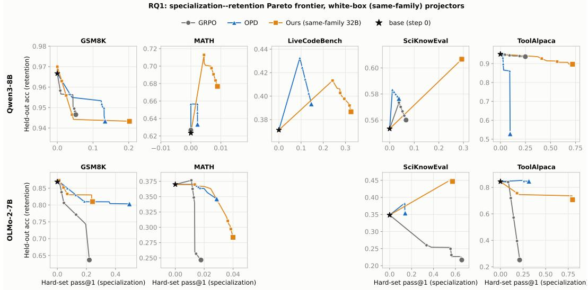

RQ1: specialization--retention Pareto frontier, black-box projecto  
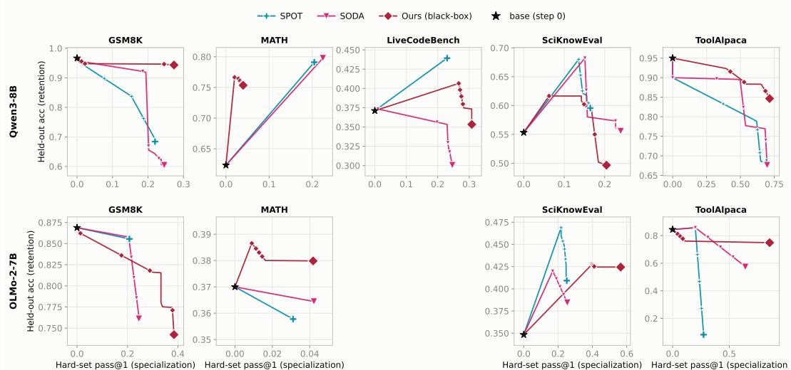  
Figure 9: Per-benchmark specialization–retention Pareto frontier (detailed breakdown of Fig. 3). Top: same-family (32B) projectors; bottom: black-box projector. Each block has two rows (Qwen3- 8B, OLMo-2-7B) and one column per benchmark. Axes: hard-set pass@1 (x, specialization) and held-out pass@1 (y, retention). Bold line = monotone Pareto frontier of the seed-averaged trajectory (larger marker = final checkpoint) anchored at the untrained base ⋆ (specialization 0); axes auto-scale per panel. GRPO on Qwen-LiveCodeBench is entered as no learning.

RQ1: learning curves (pooled), white-box (same-family) projectors  
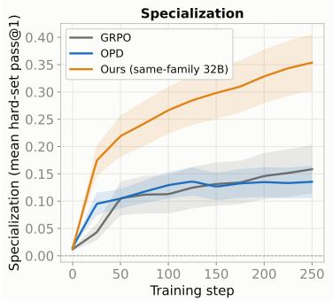

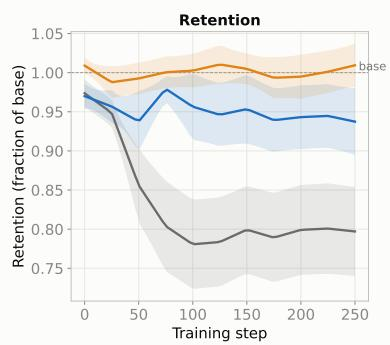

RQ1: learning curves (pooled), black-box projector  
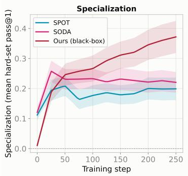

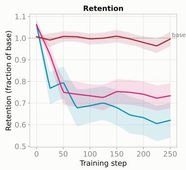  
Figure 10: RQ1 pooled learning curves. Top: same-family (32B) projectors; bottom: black-box projector. Left panels: specialization (mean hard-set pass@1) over training. Right panels: retention as a fraction of the untrained base (base = 1.0 dashed). Curves pool over students, benchmarks, and seeds (same pooling as Fig. 3); shaded bands are s.e. over the pooled runs. The early specialization and subsequent retention loss of SPOT and SODA (retention falls by step 50) and the retention preservation of both Ours variants are visible directly. GRPO on Qwen-LiveCodeBench entered as no learning.

Table 8: RQ1 per-cell final accuracies at the 250-step checkpoint, mean s.e. across seeds. Hard = hard-set pass@1 (specialization); Held = held-out pass@1 (in-domain retention), measured on a disjoint slice of the same benchmark’s training split, with sizes in Tabs. 6 and 7. These slices are not the public test suites used in Tab. 11, so the two are not comparable cell by cell. Higher is better on both, and a method is preferable where it raises Hard without lowering Held. Bold = best on each axis within a (student, benchmark) block. Our two variants take the best Hard in 6 of 9 blocks and the best Held in 5 of 9, so the AUPF ordering in Tab. 1 rests on the two axes together rather than on either alone. † This is the one cell reported from a single training seed: OLMo-2-7B/MATH GRPO seeds 0 and 1 stopped with CUDA out-of-memory before the 250-step checkpoint, so only seed 2 is reported and the there is the standard error of one value, not of three. Every other cell is three seeds.
<table><tr><td>Student Benchmark</td><td>Method</td><td>Hard ↑</td><td>Held ↑</td></tr><tr><td rowspan="7">GSM8K</td><td>GRPO OPD</td><td>0.044 ± 0.012 0.123 ± 0.013</td><td>0.950 ± 0.006</td></tr><tr><td></td><td></td><td>0.953 ± 0.007</td></tr><tr><td></td><td>Ours (32B) 0.197 ± 0.019</td><td>0.943 ± 0.019</td></tr><tr><td>SPOT</td><td>0.090 ± 0.005</td><td>0.216±0.039</td></tr><tr><td>SODA</td><td>0.246 ± 0.021</td><td>0.604± 0.140</td></tr><tr><td>Ours (bb)</td><td>0.273 ± 0.022</td><td>0.943 ± 0.009</td></tr><tr><td></td><td></td><td></td></tr><tr><td rowspan="5">MATH</td><td>GRPO OPD</td><td>0.000 ± 0.000 0.627 ± 0.003 0.002 ± 0.002</td><td></td></tr><tr><td></td><td></td><td>0.633 ±0.017</td></tr><tr><td>Ours (32B) SPOT</td><td>0.087 ± 0.008</td><td>0.007 ± 0.004 0.700 ± 0.015</td></tr><tr><td>SODA</td><td>0.136 ± 0.023</td><td>0.258 ± 0.028</td></tr><tr><td>Ours (bb)</td><td></td><td>0.664 ± 0.002</td></tr><tr><td rowspan="8">Oe-8B</td><td></td><td>0.031 ± 0.004</td><td>0.760 ± 0.006</td></tr><tr><td>GRPO</td><td>0.000 ± 0.000</td><td>0.371 ± 0.000</td></tr><tr><td>OPD</td><td>0.093 ± 0.032</td><td>0.367 ± 0.018</td></tr><tr><td>LiveCodeBench</td><td>Ours (32B)</td><td>0.325 ± 0.014 0.387 ± 0.013</td></tr><tr><td>SPOT</td><td></td><td>0.217 ± 0.003 0.413 ± 0.027</td></tr><tr><td>SODA</td><td>0.237 ± 0.009</td><td>0.313 ± 0.041</td></tr><tr><td>Ours (bb)</td><td></td><td>0.308 ± 0.008 0.353 ± 0.007</td></tr><tr><td>GRPO OPD</td><td></td><td></td></tr><tr><td rowspan="8">SciKnowEval</td><td></td><td>0.027 ± 0.004 0.567 ± 0.026</td><td>0.067 ± 0.024 0.560 ± 0.000</td></tr><tr><td>Ours (32B)</td><td>0.293 ± 0.015 0.607 ± 0.022</td><td></td></tr><tr><td>SPOT</td><td></td><td></td></tr><tr><td>SODA</td><td>0.227 ± 0.033</td><td>0.164 ± 0.026 0.596 ± 0.004</td></tr><tr><td>Ours (bb)</td><td>0.204 ± 0.019</td><td>0.573 ± 0.037 0.497 ± 0.131</td></tr><tr><td></td><td></td><td></td></tr><tr><td>GRPO</td><td></td><td>0.249 ± 0.154 0.937 ± 0.009</td></tr><tr><td>OPD Ours (32B)</td><td>0.078 ± 0.039</td><td>0.463±0.274</td></tr><tr><td rowspan="6">ToolAlpaca</td><td></td><td>0.720 ± 0.010 0.897 ± 0.015</td><td></td></tr><tr><td>SPOT</td><td></td><td>0.691 ± 0.006 0.678 ± 0.073</td></tr><tr><td>SODA</td><td>0.667 ± 0.023</td><td>0.691 ± 0.067</td></tr><tr><td>Ours (bb)</td><td></td><td>0.716 ± 0.008 0.847 ± 0.023</td></tr><tr><td>GRPO</td><td></td><td>0.220 ± 0.070 0.637 ± 0.048</td></tr><tr><td>OPD Ours (32B)</td><td>0.496 ± 0.016 0.803 ± 0.015</td><td></td></tr><tr><td rowspan="6">GSM8K</td><td></td><td>0.236 ± 0.008 0.830 ± 0.006</td><td></td></tr><tr><td>SPOT</td><td>0.115 ± 0.045</td><td>0.313 ±0.153</td></tr><tr><td>SODA</td><td>0.153 ± 0.007</td><td>0.527±0.020</td></tr><tr><td>Ours (bb)</td><td>0.378 ± 0.091</td><td>0.774±0.018</td></tr><tr><td>GRPO†</td><td></td><td></td></tr><tr><td></td><td></td><td>0.020 ± 0.000 0.330 ± 0.000</td></tr><tr><td rowspan="8">MATH OL-7B SciKnowEval</td><td>OPD Ours (32B)</td><td>0.013 ± 0.004</td><td>0.370 ± 0.025</td></tr><tr><td>SPOT</td><td>0.036 ± 0.008</td><td>0.307 ± 0.009</td></tr><tr><td>SODA</td><td>0.009 ± 0.006</td><td>0.133 ± 0.020</td></tr><tr><td>Ours (bb)</td><td></td><td>0.011 ± 0.002 0.151 ± 0.008 0.016 ± 0.006 0.380 ± 0.010</td></tr><tr><td>GRPO</td><td></td><td></td></tr><tr><td>OPD</td><td></td><td>0.658 ± 0.037 0.217 ± 0.047</td></tr><tr><td></td><td></td><td>0.113 ± 0.024 0.353 ± 0.033</td></tr><tr><td>Ours (32B)</td><td>0.573 ± 0.023</td><td>0.447 ± 0.003</td></tr><tr><td rowspan="5"></td><td>SPOT</td><td>0.224 ± 0.008</td><td>0.431 ± 0.019</td></tr><tr><td>SODA</td><td>0.089 ± 0.016</td><td>0.371 ± 0.002</td></tr><tr><td>Ours (bb)</td><td>0.564 ± 0.035</td><td>0.424± 0.024</td></tr><tr><td>GRPO</td><td>0.171 ± 0.171</td><td>0.140 ± 0.140</td></tr><tr><td>OPD</td><td></td><td>0.273 ± 0.015 0.840 ± 0.015</td></tr><tr><td rowspan="5">ToolAlpaca</td><td></td><td>Ours (32B) 0.798 ± 0.006 0.707 ± 0.047</td><td></td></tr><tr><td></td><td></td><td></td></tr><tr><td>SPOT</td><td></td><td>0.193 ± 0.112 0.069 ± 0.049</td></tr><tr><td></td><td></td><td></td></tr><tr><td>SODA Ours (66)</td><td></td><td>0.220 ± 0.070 0.189 ± 0.059 0.856 ± 0.026 0.749 ± 0.036</td></tr></table>

Table 9: RQ1 per-cell backward transfer, $\mathrm { B W T } = y _ { T } - H _ { 0 }$ (Lopez-Paz and Ranzato, 2017), mean s.e. across seeds in raw retention points. Higher is better: a positive value means the run ended above the untrained base, a negative one that it ended below, and zero that it returned to base. Bold = highest per row. Our variants take the highest value in 5 of 9 cells and SPOT the lowest in 5. Every method ends below base on GSM8K and ToolAlpaca for both students, so those two benchmarks carry the retention cost regardless of how the correction is obtained. GRPO on Qwen-LiveCodeBench is entered as no learning.
<table><tr><td rowspan="2">Student</td><td rowspan="2">Benchmark</td><td>RLVR</td><td colspan="2">same-family 32B teacher</td><td colspan="3">black-box projector</td></tr><tr><td>GRPO</td><td>OPD</td><td>Ours</td><td>SPOT</td><td>SODA</td><td>Ours</td></tr><tr><td rowspan="5">Qwen3-8B</td><td>GSM8K</td><td>-0.017±0.006</td><td>-0.013±0.007</td><td>-0.023±0.019</td><td>-0.751±0.039</td><td>-0.362±0.140</td><td>-0.023±0.009</td></tr><tr><td>MATH</td><td>+0.003±0.003</td><td>+0.010±0.017</td><td>+0.077±0.015</td><td>-0.366±0.028</td><td>+0.041±0.002</td><td>+0.137±0.006</td></tr><tr><td>LiveCodeBench</td><td>+0.000±0.000</td><td>-0.004±0.018</td><td>+0.016±0.013</td><td>+0.042±0.027</td><td>-0.058±0.041</td><td>-0.018±0.007</td></tr><tr><td>SciKnowEval</td><td>+0.007±0.000</td><td>+0.013±0.026</td><td>+0.053±0.022</td><td>+0.042±0.004</td><td>+0.020±0.037</td><td>-0.057±0.131</td></tr><tr><td>ToolAlpaca</td><td>-0.013±0.009</td><td>-0.487±0.274</td><td>-0.053±0.015</td><td>-0.272±0.073</td><td>-0.259±0.067</td><td>-0.103±0.023</td></tr><tr><td rowspan="4">OLMo-2-7B</td><td>GSM8K</td><td>-0.232±0.048</td><td>-0.066±0.015</td><td>-0.039±0.006</td><td>-0.556±0.153</td><td>-0.342±0.020</td><td>-0.094±0.018</td></tr><tr><td>MATH</td><td>-0.123±0.049</td><td>-0.000±0.025</td><td>-0.063±0.009</td><td>-0.237±0.020</td><td>-0.219±0.008</td><td>+0.010±0.010</td></tr><tr><td>SciKnowEval</td><td>-0.132±0.047</td><td>+0.005±0.033</td><td>+0.098±0.003</td><td>+0.083±0.019</td><td>+0.023±0.002</td><td>+0.076±0.024</td></tr><tr><td>ToolAlpaca</td><td>-0.704±0.140</td><td>-0.004±0.015</td><td>-0.137±0.047</td><td>-0.775±0.049</td><td>-0.655±0.059</td><td>-0.095±0.036</td></tr></table>

Table 10: RQ1 per-cell forgetting, $F = \mathrm { m a x } _ { \tau \leq T } y _ { \tau } - y _ { T }$ with $H _ { 0 }$ included in the max (Chaudhry et al., 2018), mean s.e. across seeds in raw retention points. Smaller is better: $F$ is the retention a run gave up between its best checkpoint and its last, so a small value means retention was held throughout rather than lost and partly regained. Bold = smallest per row. SPOT is largest in 5 of 9 cells. The smallest is split evenly between OPD, GRPO and our same-family variant, so $F$ alone does not separate methods and should be read alongside specialization, since a run that moves the student little also has little to give up. GRPO on Qwen-LiveCodeBench is entered as no learning.
<table><tr><td colspan="2"></td><td>RLVR</td><td colspan="2">same-family 32B teacher</td><td colspan="3">black-box projector</td></tr><tr><td>Student</td><td>Benchmark</td><td>GRPO</td><td>OPD</td><td>Ours</td><td>SPOT</td><td>SODA</td><td>Ours</td></tr><tr><td rowspan="5">Qwen3-8B</td><td>GSM8K</td><td>0.020±0.006</td><td>0.016±0.007</td><td>0.030±0.015</td><td>0.751±0.039</td><td>0.362±0.140</td><td>0.024±0.009</td></tr><tr><td>MATH</td><td>0.001±0.001</td><td>0.030±0.012</td><td>0.027±0.015</td><td>0.533±0.030</td><td>0.133±0.004</td><td>0.010±0.006</td></tr><tr><td>LiveCodeBench</td><td>0.000±0.000</td><td>0.073±0.029</td><td>0.047±0.018</td><td>0.040±0.020</td><td>0.070±0.038</td><td>0.053±0.007</td></tr><tr><td>SciKnowEval</td><td>0.040±0.010</td><td>0.047±0.026</td><td>0.023±0.012</td><td>0.084±0.009</td><td>0.109±0.046</td><td>0.153±0.129</td></tr><tr><td>ToolAlpaca</td><td>0.013±0.009</td><td>0.490±0.272</td><td>0.053±0.015</td><td>0.272±0.073</td><td>0.259±0.067</td><td>0.103±0.023</td></tr><tr><td rowspan="4">OLMo-2-7B</td><td>GSM8K</td><td>0.233±0.048</td><td>0.070±0.016</td><td>0.043±0.007</td><td>0.556±0.153</td><td>0.342±0.020</td><td>0.095±0.018</td></tr><tr><td>MATH</td><td>0.147±0.038</td><td>0.023±0.015</td><td>0.077±0.009</td><td>0.240±0.022</td><td></td><td>0.219±0.008 0.027±0.015</td></tr><tr><td>SciKnowEval</td><td>0.132±0.047</td><td>0.063±0.032</td><td>0.013±0.009</td><td></td><td></td><td>0.062±0.006 0.060±0.014 0.033±0.018</td></tr><tr><td>ToolAlpaca</td><td>0.704±0.140</td><td></td><td></td><td></td><td></td><td>0.030±0.006 0.139±0.048 0.789±0.048 0.669±0.058 0.098±0.037</td></tr></table>

## D.3 Math-domain evaluation: in-domain and out-of-domain behavior

Sec. 4.1 measures retention on a held-out slice of the benchmark a method was trained on. Here we ask what training on one domain does to abilities elsewhere. For each math-trained Qwen3-8B method we evaluate its final checkpoint on five full test suites: GSM8K (1,319 problems) and MATH 500 (500) in the trained domain, and AMC23 (40), MMLU (14,042) and HumanEval (164), none of which any method was trained on. The metric is sampled pass@1, one generation per problem at T=0.8 and top-p 0.95. Each evaluation is repeated with three evaluation seeds and averaged, with the checkpoint held fixed: an evaluation seed changes only which generations are sampled from that one model. The reported  is the standard error of that mean across the three replicates. Training and evaluation data are disjoint, with zero overlap between the 1,991-problem math hard set and the 500-problem evaluation slice on normalized, LaTeX-stripped text. Tab. 11 reports the absolute scores and Tab. 12 the change relative to the untrained student.

Table 11: Training on math corrections suggests retention is held outside the trained domain. Final-checkpoint evaluation of the training-seed-0 math-trained Qwen3-8B methods, sampled pass@1 at $T { = } 0 . 8$ averaged over three evaluation seeds, the standard error of that mean, on full public test splits. These are distinct from the in-domain held-out slices that Tab. 8 uses for retention. GSM8K and MATH-500 are in the trained domain; AMC23, MMLU and HumanEval were never trained on. The black-box variant is the only arm whose score rises on the held-out split of the domain it trained on (0.709 0.749 on MATH-500, where the same recipe with a 32B projector reaches 0.615, SPOT 0.513 and SODA 0.590), and it reaches 0.765 on MMLU while remaining within a few points of base on GSM8K and HumanEval. Bold = best and underline = second best per column among the six trained methods; the untrained base is a reference row and is not ranked. GRPO ranks high on several columns because it moves the student least, as Tab. 12 makes plain, so these absolute scores are best read alongside that table. These are single checkpoints on one domain, so the pattern is suggestive rather than conclusive, and AMC23 has only 40 problems, where small differences should not be read as meaningful.
<table><tr><td>Method</td><td>GSM8K</td><td>MATH-500</td><td>AMC23</td><td>MMLU</td><td>HumanEval</td></tr><tr><td>Base (Qwen3-8B)</td><td> $0 . 9 3 4 \pm 0 . 0 0 3$ </td><td> $0 . 7 0 9 \pm 0 . 0 0 5$ </td><td> $0 . 4 3 3 \pm 0 . 0 3 0$ </td><td> $0 . 7 0 2 \pm 0 . 0 0 2$ </td><td> $0 . 8 2 1 \pm 0 . 0 0 2$ </td></tr><tr><td>OURS</td><td> $0 . 9 1 5 \pm 0 . 0 0 1$ </td><td> ${ \bf 0 . 7 4 9 \pm 0 . 0 0 3 }$ </td><td> ${ \bf 0 . 4 9 2 \pm 0 . 0 3 6 }$ </td><td> $0 . 7 6 5 \pm 0 . 0 0 1$ </td><td> $0 . 7 8 7 \pm 0 . 0 0 0$ </td></tr><tr><td>OURS-32B</td><td> $0 . 9 1 7 \pm 0 . 0 0 1$ </td><td> $0 . 6 1 5 \pm 0 . 0 0 5$ </td><td> $0 . 4 0 0 \pm 0 . 0 5 0$ </td><td> $0 . 7 2 4 \pm 0 . 0 0 1$ </td><td> $\mathbf { 0 . 8 2 7 \pm 0 . 0 0 5 }$ </td></tr><tr><td>SODA</td><td> $0 . 8 8 2 \pm 0 . 0 0 4$ </td><td> $0 . 5 9 0 \pm 0 . 0 1 9$ </td><td> $0 . 3 4 2 \pm 0 . 0 2 2$ </td><td> $\mathbf { 0 . 7 6 6 \pm 0 . 0 0 2 }$ </td><td> $0 . 7 9 7 \pm 0 . 0 0 5$ </td></tr><tr><td>SPOT</td><td> $0 . 9 1 6 \pm 0 . 0 0 2$ </td><td> $0 . 5 1 3 \pm 0 . 0 1 1$ </td><td> $0 . 3 2 5 \pm 0 . 0 2 9$ </td><td> $0 . 7 5 0 \pm 0 . 0 0 2$ </td><td> $0 . 8 1 3 \pm 0 . 0 1 4$ </td></tr><tr><td>GRPO</td><td> $\mathbf { 0 . 9 3 2 \pm 0 . 0 0 4 }$ </td><td> $0 . 7 0 0 { \scriptstyle \pm 0 . 0 0 8 }$ </td><td> $0 . 4 2 5 \pm 0 . 0 2 9$ </td><td> $0 . 7 0 2 \pm 0 . 0 0 2$ </td><td> $0 . 8 2 1 \pm 0 . 0 0 2$ </td></tr><tr><td>OPD</td><td> $\underline { { 0 . 9 2 7 } } \pm 0 . 0 0 2$ </td><td> $\overline { { 0 . 6 9 2 } } \pm 0 . 0 0 5$ </td><td> $0 . 4 0 8 \pm 0 . 0 0 8$ </td><td> $0 . 6 7 7 \pm 0 . 0 0 2$ </td><td> $0 . 8 1 5 \pm 0 . 0 0 5$ </td></tr></table>

Table 12: Only the black-box variant improves in the trained domain. Change relative to the untrained Qwen3-8B, from the same evaluation as Tab. 11. Ours is alone in moving up on MATH-500 $\left( + 0 . 0 4 1 \right)$ and on AMC23 (+0.058), and gains +0.063 on MMLU. The same recipe with a 32B projector loses 0.093 on MATH-500, and the mined-once and static-snapshot corrections lose 0.119 and 0.195. GRPO is flat throughout and OPD moves down. Bold = largest change and underline = second largest per column; GRPO is near zero everywhere, so where it places second it has simply moved the least.
<table><tr><td>Method</td><td>GSM8K</td><td>MATH-500</td><td>AMC23</td><td>MMLU</td><td>HumanEval</td></tr><tr><td>OURS</td><td>-0.019</td><td>+0.041</td><td>+0.058</td><td>+0.063</td><td>-0.035</td></tr><tr><td>OURS-32B</td><td>-0.017</td><td>-0.093</td><td>-0.033</td><td>+0.022</td><td>+0.006</td></tr><tr><td>SODA</td><td>-0.052</td><td>-0.119</td><td>-0.092</td><td>+0.064</td><td>-0.024</td></tr><tr><td>SPOT</td><td>-0.018</td><td>-0.195</td><td>-0.108</td><td>+0.047</td><td>-0.008</td></tr><tr><td>GRPO</td><td>-0.002</td><td>-0.009</td><td>-0.008</td><td>-0.001</td><td>+0.000</td></tr><tr><td>OPD</td><td>-0.006</td><td>-0.017</td><td>-0.025</td><td>-0.025</td><td>-0.006</td></tr></table>

## D.4 Discussion

Sec. 4.1 names three cells that go to a baseline; the full rows are in Tab. 8. On Qwen MATH, SODA reaches 0.136 specialization at 0.664 retention and SPOT 0.087 at 0.258, against our 0.031 at 0.760: both fit the hard set further than we do, and SPOT gives up most of its held-out accuracy doing so. On Qwen SciKnowEval, SODA reaches 0.227 at 0.573 against our 0.204 at 0.497, leading on both axes; our retention there carries a standard error of 0.131 across seeds, against 0.037 for SODA and 0.004 for SPOT, so that cell is the least stable in the panel. On OLMo GSM8K, OPD reaches 0.496 at 0.803 against our 0.236 at 0.830.

The OLMo-2-7B LiveCodeBench cell is omitted from every RQ1 table and figure. No method moves specialization appreciably above zero there, so a frontier anchored at the base is degenerate and the cell contributes an area near zero for every method, our own included.

## D.5 Transfer to other benchmarks’ hard problems

This subsection gives the setup and the full results of the transfer experiment summarized in Sec. 4.1 and Tab. 2.

Hard sets. For every problem of every pool we draw 16 samples from the untrained Qwen3-8B at T=0.8 (seed 0, thinking mode disabled, 3,072 new tokens) and grade them with the MATH grader. A problem is hard when all 16 are wrong, as in Appendix C.2. The budget is set so that a hard problem is one the student cannot solve rather than one it cannot finish (Appendix C.4). This leaves 628 of the 11,998 MATH training problems hard. We split the 628 into 501 training and 127 held-out problems, stratified by subject and level. Every other pool is used only for testing. A test problem is removed when a MATH training problem covers at least 60% of its 13-word phrases with the same answer, which removes 410 AIME and 474 DAPO-Math problems.

Training and evaluation. Each method trains Qwen3-8B on the 501 problems for 250 updates (about four passes) with the configuration of Appendix C.1 and a 3,072-token rollout budget, saving a checkpoint every 50 updates, under one training seed. Ours, SPOT and SODA draw their corrections from the black-box projector, which corrects 1,798 of our 1,844 wrong attempts (97.5%). The base model and every checkpoint draw 16 samples per problem at T=0.8 and top-p 0.95 (seed 1, so the base scores slightly above zero on its own hard set); pass@1 is the mean over the samples and pass@16 the share of problems solved at least once. A change against the base is marked when it is at least twice its paired standard error. The four other benchmarks contribute 2,885 hard problems in all, by benchmark in Tab. 13, out of 6,874 that survive filtering and decontamination.

Which benchmarks transfer. Tab. 13 splits the cross-benchmark gain of our best checkpoint by benchmark. It concentrates in Omni-MATH and DAPO-Math, which together hold 2,536 of the 2,885 hard problems, and it holds under sampling and under greedy decoding alike. OlympiadBench moves within its standard error and the AIME problems do not move.

Table 13: Cross-benchmark gain of Ours at its best checkpoint, by benchmark, on each benchmark’s hard problems. Sampled pass@1 over 16 generations and one greedy decode; changes against the base paired standard error.
<table><tr><td></td><td></td><td colspan="3">Sampled pass@1</td><td></td><td>Greedy</td></tr><tr><td>Benchmark</td><td>Hard</td><td></td><td>Base → Ours</td><td>Change</td><td>pass@16</td><td>change</td></tr><tr><td>OlympiadBench</td><td>150</td><td></td><td>0.011 → 0.017</td><td>+0.006±0.004</td><td>0.133 → 0.147</td><td>+0.000±0.013</td></tr><tr><td>Omni-MATH</td><td>2,178</td><td></td><td>0.010 → 0.019</td><td>+0.009±0.001</td><td>0.096 → 0.132</td><td>+0.015±0.003</td></tr><tr><td>AIME 1983–2023</td><td>199</td><td></td><td>0.016 → 0.013</td><td>-0.003±0.003</td><td>0.146 → 0.126</td><td>-0.010±0.010</td></tr><tr><td>DAPO-Math</td><td>358</td><td></td><td>0.018 → 0.033</td><td>+0.016±0.004</td><td>0.201 → 0.307</td><td>+0.034±0.010</td></tr><tr><td>All four</td><td>2,885</td><td></td><td>0.011 → 0.020</td><td>+0.009±0.001</td><td>0.114 → 0.154</td><td>+0.015±0.003</td></tr></table>

A second training benchmark. To check that the transfer is not specific to MATH, we repeat the experiment for our method with Omni-MATH as the training benchmark: 501 of its 2,178 hard problems, drawn in proportion to its difficulty levels and topics, and otherwise the same recipe and protocol. The projector corrects 86 to 96% of the wrong attempts. The two runs share most test problems, so Tab. 14 compares them on identical sets: the 127 held-out MATH hard problems, the 1,677 Omni-MATH hard problems that neither run trained on, and the three benchmarks that neither run trained on (OlympiadBench, AIME 1983–2023 and DAPO-Math). Transfer runs in both directions and to a similar degree. Training on Omni-MATH lifts the held-out MATH hard problems about as much as training on MATH does (pass@16 0.362 against 0.354), and training on MATH lifts the Omni-MATH hard problems nearly as much as training on Omni-MATH does (pass@1 0.018 against 0.022). The Omni-MATH run transfers more to the three olympiad-style benchmarks (0.030 against 0.024). The direction of training therefore does not decide where the gain appears.

Table 14: Training on MATH against training on Omni-MATH, on identical problems (our method, 1 training seed each, each at its own best checkpoint). “3 others” = OlympiadBench, AIME 1983–2023 and DAPO-Math, which neither run trained on, pooled over their hard problems. Sampled pass@1 unless marked. Each run’s ∗ is against its own evaluation of the base model; the two base evaluations agree to within 0.001 in pass@1 and 0.008 in pass@16.
<table><tr><td rowspan="2">Trained on</td><td colspan="2">MATH held-out, hard</td><td colspan="2">Omni-MATH held-out, hard 3 others</td><td rowspan="2">hard</td></tr><tr><td>pass@1</td><td>pass@16</td><td>pass@1</td><td>pass@16</td></tr><tr><td>Base</td><td>0.013</td><td>0.150</td><td>0.009</td><td>0.092</td><td>0.016</td></tr><tr><td>MATH</td><td>0.056*</td><td>0.354</td><td>0.018*</td><td>0.128</td><td>0.024*</td></tr><tr><td>Omni-MATH</td><td>0.045*</td><td>0.362</td><td>0.022*</td><td>0.146</td><td>0.030*</td></tr></table>

## E RQ2: Edit size

## E.1 Setup and measurement

Qwen3-8B student, GSM8K hard set (mined pass@k=0, 122 problems), black-box projector, one objective shared by every arm, lr 1e 5, β=0.1, 250 steps, 3 seeds. The axis is realized by edit magnitude: the minimal edit, then re-prompting the projector for progressively larger rewrites of the same attempt, plus the student-agnostic gold anchor. Because the projector rather than the prompt determines how much text it actually replaces, arms are identified by their measured edit size (Tab. 15); the two larger arms realize $3 . 2 \times$ and 3.9 the minimal edit. Off-policyness is the log-likelihood difference between the correction and the attempt under the current student $\pi _ { \theta } .$

$$
\Lambda = \log \pi _ { \theta } ( y ^ { + } \mid x ) - \log \pi _ { \theta } ( y ^ { - } \mid x ) ,\tag{5}
$$

and a larger Λ means the correction sits farther from what the student would itself produce. We summarize Λ by its median over training steps rather than its mean: the per-step quantity is heavytailed, since a rollout is scored against a policy that has advanced by up to five optimizer steps since it was sampled, and occasional large excursions dominate an average. The median is stable across seeds (Tab. 15) whereas the mean is not. For gold, which replaces a long attempt with a short reference solution, Λ moves chiefly through length; Tab. 15 reports its value with that caveat, and it is omitted from the $| \Lambda |$ panel of Fig. 4.

## E.2 Ablation arms

Tab. 15 lists the per-arm endpoint accuracies with the off-policyness scalar Λ and the mean edit-span sizes $| { E } ^ { + } | , | { E } ^ { - } |$ that define the arms. Both spans grow together across the edit arms, so the two are not separable here. gold is the exception in kind rather than in degree, inserting the fewest tokens of any arm while deleting the entire attempt.

Table 15: RQ2 edit-size ablation (Qwen3-8B, GSM8K hard set, 3 seeds, $\mathrm { m e a n } \pm \mathrm { s . e . } )$ . hard and held are final sampled pass@1; Λ is the median signed likelihood shift over training under the current student ((5)); a negative value means the correction is less likely than the attempt. $| E ^ { + } | , | E ^ { - } |$ are mean edit-span sizes in tokens, and $| E ^ { + } | + | E ^ { - } |$ is the measured edit size by which the arms are identified. In the three outcome columns bold = best and underline = second best, with Λ read as nearer zero is better; the two edit-size columns describe the arms and are not ranked. †gold is the one arm whose shift is positive: it replaces a long attempt with a short reference solution, which the student finds more likely, not less. Its value moves chiefly through length and is not on the scale of the rewrites; its standard error is 62% of the value against 5 to 18% for the edit arms.
<table><tr><td>Arm</td><td>|E+|+|E−|</td><td> $\left| E ^ { + } \right| / \left| E ^ { - } \right|$ </td><td>hard</td><td>held</td><td>Λ</td></tr><tr><td>minimal (ours)</td><td>276</td><td>160 / 116</td><td>0.560±0.015</td><td>0.916±0.016</td><td>-86±4</td></tr><tr><td>3.2×</td><td>879</td><td>308 /572</td><td> $0 . 3 0 1 { \scriptstyle \pm 0 . 0 6 5 }$ </td><td>0.847±0.067</td><td> $- 3 7 2 \pm 6 7$ </td></tr><tr><td>3.9×</td><td>1061</td><td>359 / 702</td><td> $0 . 2 5 4 { \scriptstyle \pm 0 . 0 2 1 }$ </td><td>0.807±0.069</td><td> $= 4 3 3 \pm 3 5$ </td></tr><tr><td>gold (anchor)</td><td>926</td><td>85 / 841</td><td>0.489±0.090</td><td>0.744±0.016</td><td> $+ 3 9 6 9 { \pm } 2 4 7 1 ^ { \dagger }$ </td></tr></table>

## E.3 Mechanism

Full-utterance and diff-localized shift. Fig. 11 compares Λ measured over the whole utterance against the same quantity restricted to the changed spans $E ^ { - } / E ^ { + }$ . The two agree at $r = 0 . 9 9 9 9$ across all 2,249 logged steps of the edit arms, with the localized quantity retaining 94 to 95% of the magnitude, because the tokens before the first edit are both identical and identically conditioned, so their contributions cancel exactly. Shared tokens after an edit do not: they are scored on prefixes that have already diverged, and they are what the remaining 5 to 6% measures. Localizing the measurement, as the objective of (1) does, therefore keeps almost all of the signal.

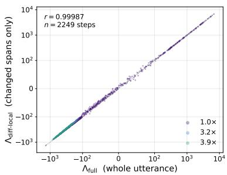

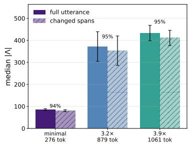  
Figure 11: Full-utterance against diff-localized likelihood shift. Left: every logged step of the three edit arms, on symmetric log axes with the identity line dotted. Right: median $| \Lambda |$ per arm under both measurements, with the localized value as a percentage of the full one.

Edit size and the likelihood shift, step by step. Fig. 12 plots every logged step of the edit arms, with the edit size realized at that step against the likelihood shift it demands. The relation is strongly monotone but not linear. Pooling the arms, the median Λ rises across every edit-size decile, from 82 in the smallest to 570 in the largest (Spearman $\rho = 0 . 8 3 )$ , while the Pearson correlation is only 0.28. Both concavity and a heavy tail depress it, and the tail dominates: dropping the largest 2% of Λ raises Pearson to 0.71, whereas linearizing the concavity alone, by correlating against log Λ , reaches 0.50. The effect also diminishes with the size of the edit: the per-step Theil–Sen slope is 0.72 [0.63, 0.82] at the minimal edit against 0.17 [0.16, 0.18] and 0.14 [0.13, 0.15] at the two larger rewrites, and the relation holds within each arm on its own $( \rho = 0 . 5 2 , 0 . 8 2 , 0 . 7 8 )$ . We therefore read edit size as a monotone indicator of the likelihood shift rather than a proportional one.

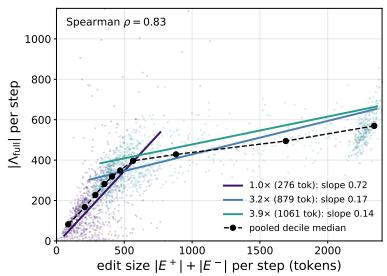  
Figure 12: Per-step edit size against the likelihood shift it demands, for the three edit arms (one point per logged step, $n = 2 2 4 9 )$ . Colored lines are per-arm Theil–Sen fits with their slopes; the dashed black line joins the pooled decile medians. Axes are clipped at the 98th/99.5th percentile, so a few staleness-affected steps fall outside the view.

Insertion and deletion across the arms. Fig. 13 reports the per-step ratio $| E ^ { + } | / | E ^ { - } |$ . It falls monotonically along the axis, from 2.46 at the minimal edit through 1.33 and 0.99 at the larger rewrites to 0.13 for gold, so what changes across the arms is not only the amount rewritten but whether the correction predominantly adds to the attempt or replaces it.

The two edit-size measures. That asymmetry is also what separates the quantity Sec. 4.2 reports from the one Theorem 1 uses. Tab. 16 gives both for every arm.

Table 16: Token diff against the edit size of Definition 4. The token diff $| E ^ { + } | + | E ^ { - } |$ is what Sec. 4.2 reports. The edit size m counts over the H decisions Definition 2 gives both rollouts, so it also carries the padding that equalizes their lengths: $m = | E ^ { + } | + | E ^ { - } | + \mathbf { \bar { | } } | E ^ { + } | - | E ^ { - } | |$ . Means over training steps and 3 seeds, rounded. The two measures order the arms the same way except for gold, which is intermediate under the token diff and the largest edit of any arm under m.
<table><tr><td>Arm</td><td>|E+|</td><td>|E⁻|</td><td>token diff</td><td>length change</td><td>m</td></tr><tr><td>minimal (ours)</td><td>160</td><td>116</td><td>276</td><td>44</td><td>319</td></tr><tr><td>3.2×</td><td>308</td><td>572</td><td>879</td><td>264</td><td>1144</td></tr><tr><td>3.9×</td><td>359</td><td>702</td><td>1061</td><td>343</td><td>1405</td></tr><tr><td>gold</td><td>85</td><td>841</td><td>926</td><td>755</td><td>1681</td></tr></table>

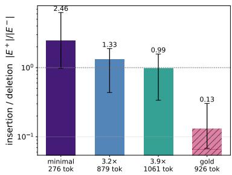  
Figure 13: Insertion-to-deletion balance per arm, per-step median with interquartile range on a logarithmic axis. The dotted line marks equal insertion and deletion.

## E.4 Additional results

Specialization–retention plane. Fig. 14 plots the two axes against each other. The minimal edit occupies the upper-right region, dominating both larger rewrites on both axes, while gold attains intermediate specialization at the lowest retention of any arm.

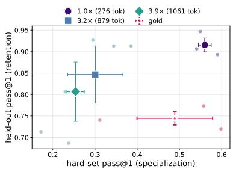  
Figure 14: RQ2 specialization–retention plane (3 seeds; faint markers are individual seeds). The minimal edit dominates both larger rewrites on both axes; gold is dominated on retention.

Held-out trajectory. Fig. 15 tracks held-out accuracy over training. The edit arms separate in edit-size order and decline smoothly, the minimal edit holding near its base value throughout. gold instead destabilizes early, falling to 0.54 by step 75 and remaining volatile for the rest of the run before settling at 0.744.

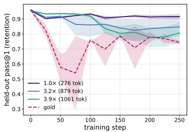  
Figure 15: Held-out accuracy over training (mean s.e. over 3 seeds). The edit arms decline smoothly and in edit-size order; only gold destabilizes.

## F RQ4: Loss-recipe details

## F.1 Objectives

Rollout terminology. Each training step, the student rolls out attempts on the hard problems and the verifier splits them: a correct rollout $y ^ { \mathrm { c } }$ is one it solves on its own ${ \mathsf { \bar { \Phi } } } ( R ( x , y ^ { \mathrm { c } } ) = 1 ) ;$ a wrong rollout $y ^ { - }$ is one it fails $( R = 0 )$ . For each wrong rollout the frozen projector produces the minimal-edit projection $y ^ { + }$ (verified-correct, Sec. 3), and a token-diff aligns $( y ^ { - } , y ^ { + } )$ into the mistake span $E ^ { - }$ and fix span $E ^ { + }$ used by (1). Thefull-sequence DPO variant replaces E+, $E ^ { - }$ in (1) with the full sequences $y ^ { + } , y ^ { - }$

Per-arm objectives. The four contrastive arms optimize $\mathcal { L } _ { \mathrm { D P O } } ^ { E }$ (diff-local, on the changed spans $E ^ { \pm } )$ or $\mathcal { L } _ { \mathrm { D P O } } ^ { \mathrm { s e q } ^ { - } }$ (full-sequence, on $y ^ { \pm } )$ , each with or without an added self-SFT term $\bar { \mathcal { L } } _ { \mathrm { S F T } } ( y ^ { \mathrm { c } } )$ on the student’s own correct rollouts. RFT optimizes $\mathcal { L } _ { \mathrm { S F T } } ( y ^ { \mathrm { c } } )$ alone (no projected target, no contrast); SFT on projection + self-SFT optimizes $\mathcal { L } _ { \mathrm { S F T } } ( y ^ { + } ) + \mathcal { L } _ { \mathrm { S F T } } ( y ^ { \mathrm { c } } )$ (SFT on the projected correction $y ^ { + }$ plus self-SFT on the student’s own correct rollouts, no contrast).

## F.2 Results

Compute (batch size), number of epochs and learning rate are matched across arms. Tab. 17 gives the absolute numbers behind Fig. 6.

Table 17: RQ4 per-arm results on the GSM8K hard set with Qwen3-8B, mean  s.e. across 3 seeds. hard is hard-set pass@1 and rel. the same quantity as a fraction of the adopted recipe, which is also the best arm; held is held-out pass@1. Bold = best per column. SFT on the projection carries the widest spread on both axes.
<table><tr><td>Arm</td><td>hard↑</td><td>rel. ↑</td><td>held↑</td></tr><tr><td>Diff-local DPO + self-SFT</td><td>0.601±0.005</td><td>1.000</td><td>0.938±0.002</td></tr><tr><td>Full-sequence DPO + self-SFT</td><td>0.552±0.022</td><td>0.918</td><td>0.911±0.014</td></tr><tr><td>SFT on projection + self-SFT</td><td>0.484±0.078</td><td>0.805</td><td>0.877±0.054</td></tr><tr><td>Full-sequence DPO</td><td>0.470±0.026</td><td>0.782</td><td>0.902±0.002</td></tr><tr><td>Diff-local DPO</td><td>0.440±0.015</td><td>0.732</td><td>0.920±0.014</td></tr><tr><td>RFT</td><td>0.096±0.011</td><td>0.159</td><td>0.944±0.002</td></tr></table>

Three things the table does not show. RFT is limited by how rarely the student succeeds unaided: the hard set is mined at pass@k=0, and its rollouts stay correct on about 6% of attempts through the run, so it trains on very little. The instability of SFT on the projection runs across both axes, its standard error of 0.078 on specialization and 0.054 on retention being three to sixteen and four to twenty-seven times those of any other arm. And the self-SFT term is worth +0.082 to the full-sequence contrast and +0.161 to the diff-local one in absolute pass@1: because the projection edits few tokens, a full-sequence contrast is spread over spans that are already correct while a diff-local one acts only where the edit fell, and that concentration leaves it with less absolute signal of its own, so it gains more from a term that raises the likelihood of correct text outright.

## G RQ5: Refinement details

## G.1 Refinement protocol

A correction is valid only if a reasoning check confirms that its derivation process actually yields the answer, so a projection that reaches the right answer by an unsound route is discarded. Round 0 is a single correction pass. In each subsequent round the frozen projector is re-prompted with its own previous correction together with the spans it edited in that correction, and returns a refined correction. Across rounds we keep the valid correction that the student itself is most likely to produce, scored by the base student’s log-likelihood on the edited tokens, which selects for corrections the student can absorb rather than for the ones the projector prefers. The projector is never updated. All arms train the Qwen3-8B student for 250 steps with the default recipe of Sec. 3 over 3 seeds.

## G.2 Results

Table 18: RQ5 per-budget results on the GSM8K hard set with Qwen3-8B, mean s.e. across 3 seeds. The first three columns describe the corrections the frozen projector supplies, averaged over training; the last two the student that learns from them, at the final checkpoint. corr. is the running correction rate $\textstyle \sum _ { t } n _ { t } ^ { \mathrm { c o r r } } / \sum _ { t } n _ { t } ^ { \mathrm { w r o n g } }$ plotted in Fig. 7 (left), and edit and median Λ are the two bars in Fig. 7 (right). Bold = best per column. Every column describing the corrections improves monotonically with the budget; downstream, the specialization gain arrives in the first round.
<table><tr><td rowspan="2">K</td><td colspan="3">Corrections</td><td colspan="2">Student</td></tr><tr><td>corr. (%) ↑</td><td>edit  $| E ^ { + } | { + } | E ^ { - } | \downarrow$ </td><td>median |∆| ↓</td><td>hard↑</td><td>held↑</td></tr><tr><td>0</td><td>9.2±0.2</td><td>256±70</td><td>38.1±1.8</td><td>0.366±0.023</td><td>0.911±0.014</td></tr><tr><td>1</td><td>15.4±0.7</td><td>182±16</td><td>34.2±3.0</td><td>0.440±0.010</td><td>0.909±0.010</td></tr><tr><td>2</td><td>16.7±1.1</td><td>130±24</td><td>26.2±4.8</td><td>0.440±0.021</td><td>0.929±0.006</td></tr></table>

Projection quality. Refinement improves the corrections on three counts at once, and the three are linked. Re-prompting the projector with the spans it has already edited pushes it to consolidate rather than rewrite, so the correction it returns reaches the right answer more often and departs from the student’s own attempt less: the median Λ falls from 38.1 to 26.2 over the two rounds, placing the refined targets nearer the student in the sense Sec. 4.2 measures, and the edit size falls with it. The K=0 edit size carries a standard error of 70 tokens across seeds, so the level of that row is the least settled number in the table; the ordering across budgets is what the comparison rests on.

Downstream trade-off. Fig. 16 traces the attainable frontier over training for each budget. Refinement extends it: the furthest specialization reached on the frontier rises from 0.393 at K=0 to 0.459 at K=1 and 0.475 at K=2. The K=2 frontier also lies above the other two over the whole sweep, and is the only one that rises above the shared base in retention, reaching 0.960 against the base’s 0.955, while K=0 and K=1 only decline from it; the extension in specialization is therefore not paid for out of retention. At the final checkpoint (Tab. 18) the two budgets that refine are level on specialization and K=2 holds retention slightly higher; against standard errors of 0.010–0.021 neither difference is resolved, and what separates the three budgets is the first round.

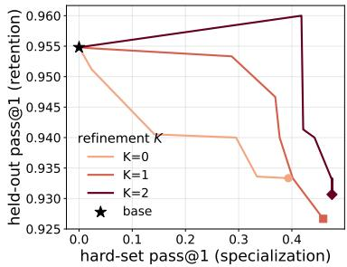  
Figure 16: Specialization–retention frontiers over training for $K \in \{ 0 , 1 , 2 \}$ (3 seeds pooled, frontier over the pooled points), gold-known, with the shared base marked ⋆. More refinement extends the frontier to higher specialization, and the $K { = } 2$ frontier dominates the other two: it is the only one that rises above the base in retention. Note the narrow retention axis, which spans 0.925–0.960.

Correction rate over training. Fig. 17 shows the per-step correction rate for $K \in \{ 0 , 1 , 2 \}$ . For every K the rate rises early and then declines as training proceeds, because the student learns the easily-correctable problems and the wrong attempts that remain in later training are the hardest ones, which even the refined projector rarely corrects. The main-text Fig. 7 reports the running (cumulative) version of this quantity.

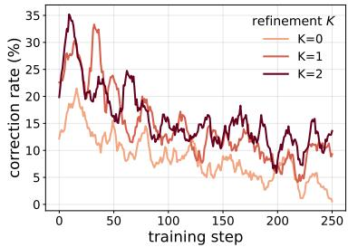  
Figure 17: Per-step correction rate over training (pooled over 3 seeds, 11-step moving average), gold-known, $K \in \{ 0 , 1 , 2 \}$ . The rate peaks early and declines as only the hardest problems remain uncorrected; more refinement holds it higher throughout.

## H RQ6: Self-projection details

Everywhere else in this paper the projector is a separate and stronger model. Here we make the same model write the correction. We give the student its own wrong attempt together with privileged information, the verified final answer, and ask it for a correct solution that stays close to what it wrote. That output is then used exactly as a projector’s correction would be, with the same objective and the same training loop. Nothing else changes, so the run measures how much of the method depends on the projector being stronger than the student.

The student is Qwen3-8B and the hard set is the 122 GSM8K problems it fails on all 16 attempts. The teacher is a frozen copy of the student’s own base weights, so it does not improve as the student does. We train for 250 updates over 3 seeds, with the same data, budget and evaluation as the edit-size runs of Sec. 4.2, from which the reference rows are taken. The answer is supplied with an instruction to derive it rather than assert it; without that, the model appends the answer line to unchanged wrong reasoning and the grader accepts it. We also run the same idea at the logit level, where the frozen base model scores the student’s own generation under a prompt carrying the answer and the student trains on that token distribution instead of on edited text.

Table 19: Self-projection recovers about 40% of the specialization. Qwen3-8B on the GSM8K hard set, 250 updates, mean s.e. over 3 seeds. The two middle rows use the student’s own frozen base weights as the teacher. The reference rows come from Appendix E, on the same hard set and budget.
<table><tr><td>Teacher</td><td>Correction enters as</td><td>Hard set</td><td>Held-out</td></tr><tr><td>none (base student)</td><td>一</td><td>0.000</td><td>≈0.955</td></tr><tr><td>the student itself the student itself</td><td>edited text</td><td> $0 . 2 1 9 { \scriptstyle \pm 0 . 0 1 2 }$ </td><td>0.924±0.021</td></tr><tr><td></td><td>token distribution</td><td>0.046±0.010</td><td>0.937±0.003</td></tr><tr><td>gold solution</td><td>full replacement</td><td>0.489</td><td>0.744</td></tr><tr><td>black-box projector</td><td>minimal edit</td><td>0.560</td><td>0.916</td></tr></table>

Self-projection works, but it does not match a stronger projector. It lifts the hard set from 0.000 to 0.219 while retention stays at 0.924, so an 8B model that is told the answer can repair its own reasoning often enough to learn from it. A black-box projector reaches 0.560 on the same problems, and even the gold solution reaches 0.489. Self-projection recovers about 40% of the specialization, which says that the projector’s strength, and not the privileged answer by itself, is what the method mostly relies on.

The logit version gives almost nothing, 0.046 after 250 updates. The answer does reach the teacher, and the student never sees it, so the two token distributions differ from the first step; what is missing is not information but capability. The teacher is the student’s own base weights, and being told which answer is correct does not let those weights produce a correct derivation, so the distribution it supplies over the student’s own tokens carries little the student can use. The measured loss stays between 0.003 and 0.006 throughout, and making the target denser, a pure forward KL against the teacher’s top-20 tokens rather than its top-1, roughly doubled the result from a very small base.

Two points help in reading the table. The text-level and logit-level arms inherit different learning rates from their respective families in the main experiments $( 1 0 ^ { - 5 }$ and $5 \times 1 0 ^ { - 6 } )$ , so each is comparable to its own column rather than to the other; the comparison against the black-box projector is at a matched $1 0 ^ { - 5 }$ . The 8B also does not edit minimally. It appends a fresh derivation rather than repairing the attempt, which is part of why it falls short: producing a small, targeted edit is precisely what the weaker projector cannot do.

## I Comparison with concurrent self-projection

Concurrent work (Karan et al., 2026) also moves the supervision toward the student, but does so by self-projection: an MCMC sampler in which the student itself, shown the problem, a reference solution and a partial response, regenerates the response block by block (32 blocks of 58 tokens, 10 proposals per block), accepting a proposal when it raises the student’s mean log-likelihood. The student is then fine-tuned on the resulting traces (Sampling SFT), optionally followed by GRPO (Sampling SFT + RL). We reproduce the math setting of that work’s Table 1 with its released code, data, training recipes and evaluation scripts, and change only where the correction comes from: the black-box projector minimally edits each wrong attempt given the reference answer (Appendix C.3), and that work’s grader must accept the edit.

Setup. The student is Qwen2.5-3B, trained on that work’s 7,962 MATH training problems. It answers each once with that work’s prompt (T=0.6, 1,856 tokens) and solves 3,675; the projector corrects 4,265 of the other 4,287 attempts within two tries (4,317 calls, 11.2M tokens). We train four arms from these data, one training seed each:

• Black-box projection + SFT: that work’s SFT recipe (learning rate $5 \times 1 0 ^ { - 5 }$ , 2 epochs, batch 16, cosine schedule with 10 warm-up steps, sequences up to 2,048 tokens) on the 3,675 correct answers and the 4,265 projections, in place of its MCMC traces.

• Black-box projection ${ \bf \Pi } + { \bf S } { \bf F } { \bf T } + { \bf R } { \bf L }$ : that work’s RL stage on the previous arm (GRPO for 500 updates of 256 problems 4 rollouts, learning rate $1 0 ^ { - 6 }$ , KL coefficient 0.001).

• Ours, static pool: the objective of (2) on the same data, the 4,265 pairs $( y ^ { - } , y ^ { + } )$ ) supplying the contrast and the 3,675 correct answers the self-SFT term, for 1,985 updates of 8 records (2 passes, as for SFT) at learning rate $1 0 ^ { - 5 }$ . As in Sec. 4.3, the corrections are mined once against the untrained student.

• Ours, online refresh: the full recipe of Sec. 3, in which every update samples the current student on 8 problems and projects its wrong answers, for 250 updates.

Evaluation follows that work’s protocol: one sample per problem at T=0.6 with up to 1,856 tokens, on MATH levels 3–5 (1,024 problems), AMC (83), MATH-500 (500) and GSM8K (1,320) for the trained skill, and on SciKnowEval chemistry (600) and MMLU (lm-evaluation-harness (Gao et al., 2024b), 0-shot) for prior capabilities. Our SFT ran in TRL rather than verl (Sheng et al., 2024), with the same settings.

Table 20: Black-box projection matches self-projection in the math setting of Karan et al. (2026) (Qwen2.5-3B). Upper block as reported there, not rerun; lower block ours, evaluated with its released scripts and protocol (one sample per problem). Avg. is the mean of the four math columns. $^ * =$ paired change of at least two standard errors against our own evaluation of the untrained student (math and chemistry columns).
<table><tr><td></td><td>MATH(3,4,5)</td><td>AMC</td><td>MATH-500</td><td>GSM8K</td><td>Avg.</td><td>Chemistry</td><td>MMLU</td></tr><tr><td>Base (reported)</td><td>0.315</td><td>0.133</td><td>0.245</td><td>0.579</td><td>0.318</td><td>0.283</td><td>0.651</td></tr><tr><td>SFT</td><td>0.243</td><td>0.100</td><td>0.168</td><td>0.455</td><td>0.241</td><td>0.222</td><td>0.648</td></tr><tr><td>OPSD (Zhao et al., 2026)</td><td>0.267</td><td>0.084</td><td>0.332</td><td>0.524</td><td>0.302</td><td>0.242</td><td>0.652</td></tr><tr><td>GRPO</td><td>0.457</td><td>0.249</td><td>0.313</td><td>0.808</td><td>0.457</td><td>0.278</td><td>0.652</td></tr><tr><td>UFT (Liu et al., 2025)</td><td>0.470</td><td>0.293</td><td>0.297</td><td>0.746</td><td>0.452</td><td>0.283</td><td>0.653</td></tr><tr><td>Sampling SFT</td><td>0.495</td><td>0.277</td><td>0.582</td><td>0.782</td><td>0.534</td><td>0.266</td><td>0.651</td></tr><tr><td>Sampling SFT + RL</td><td>0.545</td><td>0.241</td><td>0.652</td><td>0.830</td><td>0.567</td><td>0.285</td><td>0.652</td></tr><tr><td>Black-box projection + SFT</td><td>0.514*</td><td>0.277</td><td>0.578</td><td>0.812*</td><td>0.545</td><td>0.287</td><td>0.649</td></tr><tr><td>Black-box projection + SFT + RL</td><td>0.561*</td><td>0.301</td><td>0.622*</td><td>0.832*</td><td>0.579</td><td>0.268</td><td>0.645</td></tr><tr><td>Ours, static pool</td><td>0.553*</td><td>0.277</td><td>0.586</td><td>0.812*</td><td>0.557</td><td>0.262</td><td>0.651</td></tr><tr><td>Ours, online refresh</td><td>0.488*</td><td>0.277</td><td>0.536</td><td>0.805*</td><td>0.527</td><td>0.250</td><td>0.654</td></tr></table>

Findings. SFT on black-box projections reaches a math average of 0.545 against 0.534 for Sampling SFT, and 0.579 against 0.567 once the same RL stage is added (Tab. 20). Within our own runs, the objective of (2) on the static pool beats SFT on the same data (0.557 against $0 . 5 4 5 ; + 0 . 0 3 9 \pm 0 . 0 1 4$ on $\mathbf { M A T H } ( 3 , 4 , 5 ) )$ and matches $\mathrm { S F T } + \mathrm { R I }$ on MATH(3,4,5) to within noise, at $1 / 2 4$ of its compute (Tab. 21). Prior capabilities hold for every arm: MMLU stays within 0.006 of base, and no change in Chemistry is significant.

Two features of this setting bear on the online arm. The static pool covers 7,962 problems and is passed over only twice, so it never reaches the regime in which a pool has been reused for several rounds, which is where the static arm of Sec. 4.3 falls; and the online run trains on an eighth as many records. Under these conditions the static pool scores higher (0.557 against 0.527).

Table 21: Training compute of each arm. Student FLOPs use 2N per forward token, 6N per training token and 12N per RL token (N=3.09B; attention’s context term omitted, about 5% at these lengths). The MCMC sampler is counted with prefix caching, which is the accounting most favourable to it; counted from its released implementation without caching it costs $1 . 3 \times 1 0 ^ { 1 9 }$ and the ratios become 46 , 24 and 184 .
<table><tr><td>Arm</td><td>Student FLOPs</td><td>Against Sampling SFT</td></tr><tr><td>Sampling SFT</td><td> $8 . 4 \times 1 0 ^ { 1 8 }$ </td><td>1×</td></tr><tr><td>Sampling SFT + RL</td><td> $2 . 1 \times 1 0 ^ { 1 9 }$ </td><td></td></tr><tr><td>Black-box projection + SFT</td><td> $2 . 8 \times 1 0 ^ { 1 7 }$ </td><td>30× less</td></tr><tr><td>Black-box  $\mathrm { p r o j e c t i o n } + \mathrm { S F T } + \mathrm { R L }$ </td><td> $1 . 3 \times 1 0 ^ { 1 9 }$ </td><td></td></tr><tr><td>Ours, static pool</td><td> $5 . 3 \times 1 0 ^ { 1 7 }$ </td><td>16× less</td></tr><tr><td>Ours, online refresh</td><td> $6 . 9 \times 1 0 ^ { 1 6 }$ </td><td>121× less</td></tr></table>

Compute. The MCMC sampler accounts for 98% of Sampling SFT’s compute: each proposal re-reads a 521-token prompt, regenerates part of the response and is re-scored, about $2 . 5 \times \bar { 1 0 ^ { 5 } }$ token passes per training problem. Black-box projection uses at least 30 less compute on the student’s hardware. The RL stage costs about as much as the whole MCMC step, so it dominates both arms that include it.

## J Theoretical analysis

## J.1 The Patch MDP: Model and Assumption

This appendix gives the model and the assumption behind Sec. 5; Appendix J.2 gives the proofs.

Definition 2 (Patch MDP). We define a patch $M D P$ as the tuple $\mathcal { M } = ( \mathcal { S } , \mathcal { A } , p , r , \rho , \gamma )$ over a vocabulary with token budget H:

$s \colon$ a state is a full history $\boldsymbol { s } = ( x , y ^ { \prime } )$ , a problem together with the tokens $y ^ { \prime }$ generated so far;   
$\boldsymbol { s } _ { t } = \left( \boldsymbol { x } , y _ { 1 : t } \right)$ is the state before decision t, and $| s |$ counts the generated tokens.

$\mathcal { A } \mathrm { : }$ an action is a patch, a token span fitting the remaining budget, ${ \mathcal { A } } ( s ) = \{ w \in \mathcal { V } ^ { h } : 1 \leq h \leq$ $H - | s | \}$

$p \mathrm { : }$ transitions are deterministic and append the patch, $p ( s \oplus w \mid s , w ) = 1$

• r: the reward is token-additive, $\begin{array} { r } { r ( s , w ) = \sum _ { j = 1 } ^ { | w | } r _ { \mathrm { t o k } } ( s \oplus w _ { < j } , w _ { j } ) } \end{array}$ with $r _ { \mathrm { t o k } } \in [ 0 , 1 ]$ , so a rollout returns at most H.

$\rho \colon$ the initial state distribution is the distribution over problems, $s _ { 0 } = ( x , \emptyset )$ with $x \sim \rho .$

$\gamma = 1 \colon$ no discounting. contains a terminal symbol, and a rollout that emits it moves to an absorbing state of zero reward and zero value.

Each decision emits one token, so a rollout takes exactly H of them, indexed $t = 0 , \ldots , H - 1$ with $s _ { H }$ absorbing. Then $\begin{array} { r } { d ^ { \pi } ( s ) = \frac { 1 } { H } \sum _ { t = 0 } ^ { H - 1 } \operatorname* { P r } _ { \pi } [ s _ { t } = s ] } \end{array}$ is a probability distribution over states, the normalized occupancy of π.

Write $V ^ { \star }$ and $Q ^ { \star }$ for the optimal value and action-value of . The return of a policy and its optimum are

$$
J ( \pi ) \ = \ \mathbb { E } _ { s _ { 0 } \sim \rho } \mathbb { E } _ { \pi } \Big [ \sum _ { t = 0 } ^ { H - 1 } r _ { \mathrm { t o k } } \big ( s _ { t } , w _ { t } \big ) \Big ] , \qquad J ^ { \star } \ = \ \operatorname* { m a x } _ { \pi } J ( \pi ) \ = \ \mathbb { E } _ { s _ { 0 } \sim \rho } \big [ V ^ { \star } ( s _ { 0 } ) \big ] ,\tag{6}
$$

the second equality because an optimal policy is optimal from every state.

Definition 3 (Optimality gap). $\Delta ( s , w ) : = V ^ { \star } ( s ) - Q ^ { \star } ( s , w )$ is the return an action forfeits against the best one available at s, and $\begin{array} { r } { \Delta _ { \operatorname* { m a x } } : = \operatorname* { s u p } _ { s , w } \Delta ( s , w ) } \end{array}$ , finite because returns lie in $[ 0 , H ]$ . It is a constant of , and plays the role of the cost-to-go constant u of Ross et al. (2011).

Definition 4 (Edit count and edit size). For histories $s , s ^ { \prime } .$

$$
e ( s , s ^ { \prime } ) : = | s | + | s ^ { \prime } | - 2 \big | \mathrm { L C S } ( s , s ^ { \prime } ) \big | ,
$$

where $\mathrm { L C S } ( s , s ^ { \prime } )$ is a longest common subsequence (Hirschberg, 1975) of their generated tokens. This counts the insertions and deletions carrying one into the other, the string-to-string correction distance of Wagner and Fischer (1974) restricted to those two operations. The edit size of a correction is $m : = e ( y ^ { - } , y ^ { + } )$ , the two rollouts compared at the H decisions Definition 2 gives them, absorbing padding included. It exceeds the token-diff count $| E ^ { - } | + | E ^ { + } |$ of Sec. 3, which Sec. 4.2 measures, by exactly the change in answer length: $m = | E ^ { - } | + | E ^ { + } | + \big | | y ^ { - } | - | y ^ { + } | \big |$

The learning problem. Training runs for M rounds. In round i the learner $\pi _ { i }$ samples rollouts, a frozen projector rewrites the wrong ones, and the learner is scored on those rewrites and updated once. The learner ranges over a policy class $\Pi = \{ \pi _ { \theta } : \theta \in \Theta \}$ with $\Theta \subseteq \mathbb { R } ^ { d }$ convex of Euclidean diameter D, so minimizing over $\pi \in \Pi$ and over $\theta \in \Theta$ are the same operation; only Proposition 1 uses this.

Where the loss is read. The learner corrects a whole rollout once and scores the correction in a single forward pass, so the loss is evaluated at corrected prefixes, not at the states the learner visits. Write $\begin{array} { r } { \tilde { d } _ { i } ( \tilde { s } ) = \frac { 1 } { H } \sum _ { t = 0 } ^ { H - 1 } \mathrm { P r } [ \tilde { s } _ { t } = \tilde { s } ] } \end{array}$ for the occupancy of those corrected prefixes in round $i ,$ the state-visitation distribution the loss is read under and the counterpart of $d ^ { \pi _ { i } }$ . For any distribution d over states, let

$$
L ( d , \pi ) : = \mathbb { E } _ { s \sim d } \mathbb { E } _ { w \sim \pi ( \cdot | s ) } \big [ \Delta ( s , w ) \big ]\tag{7}
$$

be the mean gap of π under d. Performance is controlled by $L ( d ^ { \pi _ { i } } , \pi _ { i } )$ , but the algorithm can only reduce $L ( \tilde { d } _ { i } , \pi )$

The projector. The projector edits a wrong attempt into a correct one, and $w ^ { \star } ( s )$ denotes its token at s. We idealize it as an expert: its token is optimal wherever we read it, so $\Delta ( s , w ^ { \star } ( s ) ) = 0$ Corollary 2 gives the bound for a projector that is suboptimal.

Definition 5 (Surrogate, realizability, average regret). The surrogate objective $\tilde { \varepsilon } _ { i } ( \pi )$ for policy π is the 0–1 disagreement with the projector, measured under ${ \tilde { d } } _ { i } \colon$

$$
\tilde { \varepsilon } _ { i } ( \pi ) : = \mathbb { E } _ { \tilde { s } \sim \tilde { d } _ { i } } \Big [ \operatorname* { P r } _ { w \sim \pi ( \cdot | \tilde { s } ) } \big [ w \neq w ^ { \star } ( \tilde { s } ) \big ] \Big ] = \mathbb { E } _ { \tilde { s } \sim \tilde { d } _ { i } } \big [ 1 - \pi ( w ^ { \star } ( \tilde { s } ) \mid \tilde { s } ) \big ] .
$$

The approximation and optimization terms are

$$
\tilde { \varepsilon } : = \operatorname* { m i n } _ { \pi \in \Pi } \frac { 1 } { M } \sum _ { i = 1 } ^ { M } \tilde { \varepsilon } _ { i } ( \pi ) , \qquad \tilde { \gamma } _ { M } : = \frac { 1 } { M } \Big ( \sum _ { i = 1 } ^ { M } \tilde { \varepsilon } _ { i } ( \pi _ { i } ) - \operatorname* { m i n } _ { \pi \in \Pi } \sum _ { i = 1 } ^ { M } \tilde { \varepsilon } _ { i } ( \pi ) \Big ) ,
$$

so that $\begin{array} { r } { \frac { 1 } { M } \sum _ { i } \tilde { \varepsilon } _ { i } ( \pi _ { i } ) = \tilde { \varepsilon } + \tilde { \gamma } _ { M } } \end{array}$ and the learner is no-regret when $\tilde { \gamma } _ { M } \to 0$ . Here ε˜ is a minimum over the policy class, so it measures how well the class can reproduce the projector’s tokens. It is unaffected by how much return those tokens forfeit; that enters separately, as ¯δ in Corollary 2.

## J.1.1 The assumption

The analysis rests on Assumption 1, stated in Sec. 5: the map $s \mapsto \mathbb { E } _ { w \sim \pi ( \cdot | s ) } [ \Delta ( s , w ) ]$ is η-Lipschitz in the edit count $e ( \cdot , \cdot )$ , uniformly over $\pi \in \Pi$ . It is the only assumption the analysis makes about the MDP. Three points about it follow.

The Lipschitz constant is uniform over Π and over pairs of histories, but the proof invokes it only at the pairs $( s _ { t } , \tilde { s } _ { t } )$ that Lemma 4 compares, so η may be taken as the largest shift over those pairs.

The condition is placed on the averaged gap rather than on $\Delta ( s , w )$ at a fixed w. The proof compares $\mathbb { E } _ { w \sim \pi } [ \Delta ]$ at two different prefixes, and moving from one to the other shifts the action distribution as well as the gap, so both must be controlled. Two pointwise conditions suffice. Suppose the gap is itself Lipschitz, $| \Delta ( s ^ { \prime } , w ) - \Delta ( s , w ) | \leq \eta _ { \Delta } e ( s , s ^ { \bar { \prime } } )$ , and the policy is smooth in the same count, $\mathrm { T V } \bigl ( \pi ( \cdot \mid s ) , \pi ( \cdot \mid s ^ { \prime } ) \bigr ) \leq \kappa e ( s , s ^ { \prime } )$ . Adding and subtracting $\mathbb { E } _ { w \sim \pi ( \cdot | s ^ { \prime } ) } [ \Delta ( s , w ) ]$ splits the difference in two, bounded by $\eta _ { \Delta } e$ and, since ∆ takes values in $[ 0 , \Delta _ { \mathrm { m a x } } ]$ and its oscillation is therefore at most $\Delta _ { \mathrm { m a x } } ,$ by $\Delta _ { \mathrm { m a x } } \kappa e$ . Together they give Assumption 1 with $\eta \leq \eta _ { \Delta } + \Delta _ { \operatorname* { m a x } } \kappa .$

Assumption 1 is also the only reason any result below depends on the size of an edit. An argument that knows only which decisions sit downstream of an edit pays $\Delta _ { \mathrm { m a x } }$ at each of them, which is identical for a one-token edit and for a hundred-token edit at the same position: “the prefix differs” is a binary predicate and it saturates. Assumption 1 instead charges in proportion to $e ( \cdot , \cdot )$ , which every edit-size claim below uses.

## J.2 Proofs

## J.2.1 The gap decomposes across a patch

Lemma 1 (Patch additivity). For patch MDP, $\begin{array} { r } { \Delta ( s , w _ { 1 : h } ) = \sum _ { j = 1 } ^ { h } \Delta ( s \oplus w _ { < j } , w _ { j } ) . } \end{array}$

Proof. Since the transitions of Patch MDP are deterministic (c.f. Definition 2), $Q ^ { \star } ( s , w _ { 1 : h } ) =$ $r ( s , w _ { 1 : h } ) + V ^ { \star } ( s \oplus w _ { 1 : h } )$ , and by Definition 2 the reward splits as $\begin{array} { r } { r ( s , w _ { 1 : h } ) = \sum _ { j = 1 } ^ { h } r _ { \mathrm { t o k } } ( s \oplus } \end{array}$

$w _ { < j } , w _ { j } )$ . Hence

$$
\begin{array} { r l r } {  { \Delta ( s , \boldsymbol { w } _ { 1 : k } ) = V ^ { * } ( s ) - r ( s , \boldsymbol { w } _ { 1 : k } ) - V ^ { * } ( s \oplus \boldsymbol { w } _ { 1 : k } ) } } & { \quad \mathrm { ( b y ~ d e t e r m i n i s m ) } } \\ & { = V ^ { * } ( s ) - V ^ { * } ( s \oplus \boldsymbol { w } _ { 1 : k } ) - \sum _ { j = 1 } ^ { h } r _ { \mathrm { t o b } } ( s \oplus \boldsymbol { w } _ { < j } , \boldsymbol { w } _ { j } ) } & { \quad \mathrm { ( b y ~ D e f i n i t i o n ~ 2 ) } } \\ & { = \sum _ { j = 1 } ^ { h } [ V ^ { * } ( s \oplus \boldsymbol { w } _ { < j } ) - V ^ { * } ( s \oplus \boldsymbol { w } _ { < j + 1 } ) ] - \sum _ { j = 1 } ^ { h } r _ { \mathrm { t o b } } ( s \oplus \boldsymbol { w } _ { < j } , \boldsymbol { w } _ { j } ) } & { \quad \mathrm { ( t e l e s c o p i n g ) } } \\ & { = \displaystyle \sum _ { j = 1 } ^ { h } [ V ^ { * } ( s \oplus \boldsymbol { w } _ { < j } ) - r _ { \mathrm { t o b } } ( s \oplus \boldsymbol { w } _ { < j } , \boldsymbol { w } _ { j } ) - V ^ { * } ( s \oplus \boldsymbol { w } _ { < j + 1 } ) ] } \\ & { = \sum _ { j = 1 } ^ { h } \Delta ( s \oplus \boldsymbol { w } _ { < j } , \boldsymbol { w } _ { j } ) } & { \quad \mathrm { ( b y ~ d e t e r m i n i s m ) } } \end{array}
$$

$$
\begin{array} { r } { \mathrm { w h e r e ~ t h e ~ l a s t ~ s t e p ~ u s e s ~ } Q ^ { \star } ( s \oplus w _ { < j } , w _ { j } ) = r _ { \mathrm { t o k } } ( s \oplus w _ { < j } , w _ { j } ) + V ^ { \star } ( s \oplus w _ { < j + 1 } ) . } \end{array}
$$

The total gap along a rollout is therefore the same however the rollout is cut into patches; only the per-step decomposition changes.

## J.2.2 Regret is the accumulated gap, under the learner’s own occupancy

Lemma 2 (No distribution shift). Under Definition $^ { 2 , }$ for every round $i ,$

$$
J ^ { \star } - J ( \pi _ { i } ) = \mathbb { E } _ { \pi _ { i } } \Big [ \sum _ { t = 0 } ^ { H - 1 } \Delta ( s _ { t } , w _ { t } ) \Big ] = H L ( d ^ { \pi _ { i } } , \pi _ { i } ) ,
$$

where $\mathbb { E } _ { \pi _ { i } }$ is over trajectories $\left( s _ { 0 } , w _ { 0 } , \dots , s _ { H - 1 } , w _ { H - 1 } \right)$ generated by $\pi _ { i } f _ { }$ rom $s _ { 0 } \sim \rho ,$ , and $L$ is as in $( 7 )$

Proof. Fix one trajectory $\left( s _ { 0 } , w _ { 0 } , \dots , s _ { H - 1 } , w _ { H - 1 } \right)$ generated by $\pi _ { i } .$ By Definition 2 it has exactly H decisions and $\check { V } ^ { \star } ( s _ { H } ) \dot { = } \dot { 0 }$ , since $s _ { H }$ is the absorbing state with zero value. Then

$$
\begin{array} { c } { { \displaystyle V ^ { \star } ( s _ { 0 } ) - \sum _ { t = 0 } ^ { H - 1 } r _ { \mathrm { t o k } } ( s _ { t } , w _ { t } ) = \sum _ { t = 0 } ^ { H - 1 } \left[ V ^ { \star } ( s _ { t } ) - r _ { \mathrm { t o k } } ( s _ { t } , w _ { t } ) - V ^ { \star } ( s _ { t + 1 } ) \right] } } \\ { { { } } } \\ { { = \displaystyle \sum _ { t = 0 } ^ { H - 1 } \Delta ( s _ { t } , w _ { t } ) \qquad ( Q ^ { \star } ( s _ { t } , w _ { t } ) = r _ { \mathrm { t o k } } ( s _ { t } , w _ { t } ) + V ^ { \star } ( s _ { t + 1 } ) ) } } \end{array}
$$

Taking $\mathbb { E } _ { \pi _ { i } }$ over trajectories turns the left side into $\begin{array} { r } { \mathbb { E } \big [ V ^ { \star } ( s _ { 0 } ) \big ] - \mathbb { E } \big [ \sum _ { t } r _ { \mathrm { t o k } } ( s _ { t } , w _ { t } ) \big ] = J ^ { \star } - J ( \pi _ { i } ) } \end{array}$ which is the stated identity. For the second equality,

$$
\begin{array} { r l r } {  { \mathbb { E } _ { \pi _ { i } } \Big [ \sum _ { t = 0 } ^ { H - 1 } \Delta ( s _ { t } , w _ { t } ) \Big ] = \sum _ { t = 0 } ^ { H - 1 } \mathbb { E } \big [ \Delta ( s _ { t } , w _ { t } ) \big ] } } & { \mathrm { ( e x a c t l y ~ } H \mathrm { \ t e r m s , ~ b y ~ D e f i n i t i o n ~ 2 ) } } \\ & { = H \mathbb { E } _ { s \sim d ^ { \pi _ { i } } } \mathbb { E } _ { w \sim \pi _ { i } } \big [ \Delta ( s , w ) \big ] } & { \mathrm { ( b y ~ t h e ~ d e f i n i t i o n ~ o f ~ } d ^ { \pi _ { i } } \big ) } \\ & { = H L ( d ^ { \pi _ { i } } , \pi _ { i } ) } & \end{array}
$$

Both expectations in $L ( d ^ { \pi _ { i } } , \pi _ { i } )$ are taken under $\pi _ { i } { } ^ { \prime } { \bf s }$ own occupancy. No change of measure is performed, so no concentrability coefficient appears.

## J.2.3 Disagreement with the projector dominates the gap

Lemma 3 (Reduction). Under Definition $^ { 3 , }$ with the projector idealized as above, for every $\pi \in \Pi$ and every round i,

$$
L ( \tilde { d } _ { i } , \pi ) \ \leq \ \Delta _ { \operatorname* { m a x } } \tilde { \varepsilon } _ { i } ( \pi ) .
$$

Proof. Fix a corrected state s˜ and split the expectation over the projector’s token and the rest:

$$
\begin{array} { r l r } {  { \mathbb { E } _ { w \sim \pi } \big [ \Delta ( \tilde { s } , w ) \big ] = \pi ( w ^ { \star } \mid \tilde { s } ) \Delta ( \tilde { s } , w ^ { \star } ) + \displaystyle \sum _ { w \neq w ^ { \star } } \pi ( w \mid \tilde { s } ) \Delta ( \tilde { s } , w ) } } \\ & { } & \\ & { = \displaystyle \sum _ { w \neq w ^ { \star } } \pi ( w \mid \tilde { s } ) \Delta ( \tilde { s } , w ) \qquad ( \Delta ( \tilde { s } , w ^ { \star } ) = 0 , \mathrm { i d e a l i z e d p r o j e c t o r } ) } \\ & { } & { \leq \Delta _ { \operatorname* { m a x } } \displaystyle \sum _ { w \neq w ^ { \star } } \pi ( w \mid \tilde { s } ) \qquad ( \mathrm { b y ~ D e f i n i t i o n ~ 3 } ) } \\ & { } & \\ & { } & { = \Delta _ { \operatorname* { m a x } } \big ( 1 - \pi ( w ^ { \star } \mid \tilde { s } ) \big ) } \end{array}
$$

Taking $\mathbb { E } _ { \widetilde { s } \sim \widetilde { d } _ { i } }$ of both sides and applying Definition 5 gives the claim.

This is the reduction of Ross et al. (2011), applied at the corrected prefixes rather than at the learner’s own states.

## J.2.4 Transfer from the corrected prefixes to the learner’s own

Lemma 4 (Transfer). Under Assumption 1 and Definition 2,for every round $i ,$

$$
L ( d ^ { \pi _ { i } } , \pi _ { i } ) \ \leq \ L ( \tilde { d } _ { i } , \pi _ { i } ) + \eta \bar { e } _ { i } , w h e r e \bar { e } _ { i } \ : = \ \mathbb { E } _ { i } \Big [ \frac { 1 } { H } \sum _ { t = 0 } ^ { H - 1 } e _ { t } \Big ]
$$

and $\boldsymbol { e } _ { t } : = \boldsymbol { e } ( s _ { t } , \tilde { s } _ { t } )$ is the edit count between the learner’s own prefix at decision t and the corrected prefix at that decision. A round draws one problem, one rollout of $\pi _ { i }$ on $i t ,$ and the one correction the projector returns for that rollout; $\mathbb { E } _ { i }$ is the average over that draw.

Proof. Pair the two distributions decision by decision: the t-th term pairs the learner’s own prefix $s _ { t }$ with the corrected prefix $\tilde { s } _ { t } .$ , which differ by $e _ { t }$ tokens (Definition 4). By Definition 2 both sides of (7) are averages of exactly H such terms, so

$$
\begin{array} { r l } & { L ( d ^ { \pi _ { i } } , \pi _ { i } ) = \displaystyle \frac { H ^ { - 1 } } { H } \sum _ { t = 0 } ^ { H - 1 } \mathbb { E } _ { i } \mathbb { E } _ { w \sim \pi _ { i } ( \cdot \vert s _ { t } ) } \big [ \Delta ( s _ { t } , w ) \big ] } \\ & { \qquad \leq \displaystyle \frac { H - 1 } { H } \sum _ { t = 0 } ^ { H - 1 } \mathbb { E } _ { i } \Big [ \mathbb { E } _ { w \sim \pi _ { i } ( \cdot \vert \tilde { s } _ { t } ) } \big [ \Delta ( \tilde { s } _ { t } , w ) \big ] + \eta e _ { t } \Big ] } \\ & { \qquad = L ( \tilde { d } _ { i } , \pi _ { i } ) + \eta \mathbb { E } _ { i } \Big [ \frac { H - 1 } { H } \sum _ { t = 0 } ^ { H - 1 } e _ { t } \Big ] } \\ & { \qquad = L ( \tilde { d } _ { i } , \pi _ { i } ) + \eta \bar { e } _ { i } } \end{array}\tag{by Definition 2}
$$

(by Assumption 1)

## J.2.5 How much edited text a rollout carries

Lemma 5 (Edit budget). Let y be the learner’s rollout in round i and $\tilde { y }$ its correction, each of H decisions by Definition 2, and let $m = e ( y , \tilde { y } )$ be the edit size, with $e _ { t }$ as in Lemma 4. Then $e _ { t } \le m$ at every decision $0 \leq t < H$ , and consequently

$$
\sum _ { t = 0 } ^ { H - 1 } e _ { t } \ \leq \ m H .
$$

Proof. Let u index the tokens of y and v those of ${ \tilde { y } } .$ . A monotone matching between them is a set Φ of pairs $( u , v )$ with $y _ { u } = \tilde { y } _ { v }$ , whose order agrees on both sides: $u < u ^ { \prime } \iff v < v ^ { \prime }$ for distinct $( u , \mathbf { \bar { \boldsymbol { v } } } ) , ( u ^ { \prime } , v ^ { \prime } ) \in \boldsymbol \Phi$ . The matched tokens read in order form a common subsequence of y and ${ \tilde { y } } ,$ so a largest matching has $| \Phi | = | \mathrm { L C S } ( y , \tilde { y } )$ . Take such a Φ. Since y and $\tilde { y }$ each have H tokens, $m = 2 { \bar { H } } - 2 | \Phi |$ by Definition 4. For a decision t put $\Phi _ { t } = \{ ( u , v ) \in \Phi : u \leq t , v \leq t \}$ , the pairs falling inside both prefixes, whose matched tokens form a common subsequence of $y _ { 1 : t }$ and $\tilde { y } _ { 1 : t }$ . Both coordinates increase along $\Phi ,$ so max(u, v) does too, strictly; every pair outside $\Phi _ { t }$ has max $\langle u , v \rangle \geq t + 1$ , and distinct pairs take distinct values there, so

$$
\left| \Phi \setminus \Phi _ { t } \right| \ \leq \ H - \ t .\tag{8}
$$

Therefore

$$
\begin{array} { r l } & { e _ { t } = 2 t - 2 \left| \mathrm { L C S } ( y _ { 1 : t } , \tilde { y } _ { 1 : t } ) \right| } \\ & { \quad \leq 2 t - 2 \left| \Phi _ { t } \right| } \\ & { \quad = 2 t - 2 \left| \Phi \right| + 2 \left| \Phi \setminus \Phi _ { t } \right| } \\ & { \quad \leq 2 t - 2 \left| \Phi \right| + 2 \left( H - t \right) } \\ & { \quad = 2 H - 2 \left| \Phi \right| = m } \end{array}\tag{by Definition 4}
$$

(Φt is a matching)

(by (8))

(by Definition 4)

Summing over the H decisions gives the claim.

An insertion early in the answer shifts every later prefix, and a count of mismatched positions would read that shift as a rewrite of the whole suffix. Definition 4 charges it at the size of the insertion instead, which is why the drift of Theorem 1 scales with m and not with H.

## J.2.6 The bound

Theorem 1 of Sec. 5 states that under Definitions 2 and 3, Assumption 1, an idealized projector and m the mean edit size over the rounds,

$$
\operatorname* { m i n } _ { i \le M } \left[ J ^ { \star } - J ( \pi _ { i } ) \right] \ \le \ \underbrace { H \Delta _ { \operatorname* { m a x } } \left( \tilde { \varepsilon } + \tilde { \gamma } _ { M } \right) } _ { \mathrm { f i t a n d o p t i m i z a t i o n } } + \underbrace { \eta m H } _ { \mathrm { c o r r e c t e d - p r e f i x ~ d r i f t } } .
$$

Proof of Theorem 1.

$$
\operatorname* { m i n } _ { i \leq M } [ J ^ { \star } - J ( \pi _ { i } ) ] \leq \frac { 1 } { M } \sum _ { i = 1 } ^ { M } [ J ^ { \star } - J ( \pi _ { i } ) ]
$$

$$
\leq \frac { H } { M } \sum _ { i } L ( d ^ { \pi _ { i } } , \pi _ { i } )\tag{by Lemma 2}
$$

$$
\leq \frac { H } { M } \sum _ { i } L ( \tilde { d } _ { i } , \pi _ { i } ) + \eta H \bar { e }\tag{by Lemma 4}
$$

$$
\leq H \Delta _ { \operatorname* { m a x } } \cdot \frac { 1 } { M } \sum _ { i } \tilde { \varepsilon } _ { i } ( \pi _ { i } ) + \eta H \bar { e }\tag{by Lemma 3}
$$

$$
\leq H \Delta _ { \operatorname* { m a x } } ( \tilde { \varepsilon } + \tilde { \gamma } _ { M } ) + \eta H \bar { e }\tag{by Definition 5}
$$

$$
\leq H \Delta _ { \operatorname* { m a x } } ( \tilde { \varepsilon } + \tilde { \gamma } _ { M } ) + \eta m H\tag{by Lemma 5}
$$

where $\begin{array} { r } { \bar { e } = \frac { 1 } { M } \sum _ { i } \bar { e } _ { i } } \end{array}$ . Lemma 5 bounds round i by its own edit size, $\begin{array} { r } { H \bar { e } _ { i } = \mathbb { E } _ { i } \big [ \sum _ { t = 0 } ^ { H - 1 } e _ { t } \big ] \leq m _ { i } H , } \end{array}$ so $\begin{array} { r } { \bar { e } \le \frac 1 M \sum _ { i } m _ { i } = m ; } \end{array}$ no bound on the largest round is needed.

## J.2.7 Rate in the number of rounds

Proposition 1 (Convex reference rate). Let Π and Θ be as in Appendix J.1, and suppose in addition that $\theta \mapsto \tilde { \varepsilon } _ { i } ( \pi _ { \theta } )$ is convex on $\Theta f o r$ every i, with gradient bound $G = \mathrm { m a x } _ { i } \mathrm { s u p } _ { \theta \in \Theta } \| \nabla _ { \theta } \widetilde { \varepsilon } _ { i } ( \pi _ { \theta } ) \|$ Then projected online gradient descent on Θ with step size $\alpha = D / ( G { \sqrt { M } } )$ attains $\tilde { \gamma } _ { M } \leq D G / \sqrt { M }$

Proof. Since Π is parameterized by Θ, the minimum over π $\in$ Π in Definition 5 is a minimum over $\theta \in { \dot { \Theta } }$ . Write $\theta ^ { \star } \in$ arg minθ∈Θ $\sum _ { i } \tilde { \varepsilon } _ { i } ( \pi _ { \theta } )$ for a minimiser, so that the comparator in the definition and the comparator in the analysis are the same point. Then, with $g _ { i } = \nabla _ { \theta } \tilde { \varepsilon } _ { i } ( \pi _ { \theta _ { i } } )$

$$
\begin{array} { l } { { \displaystyle M \tilde { \gamma } _ { M } = \sum _ { i } \tilde { \varepsilon } _ { i } ( \pi _ { \theta _ { i } } ) - \sum _ { i } \tilde { \varepsilon } _ { i } ( \pi _ { \theta ^ { \star } } ) } } \\ { { \displaystyle \quad \quad \quad \leq \sum _ { i } g _ { i } ^ { \top } ( \theta _ { i } - \theta ^ { \star } ) } } \\ { { \displaystyle \quad \quad \leq \frac { D ^ { 2 } } { 2 \alpha } + \frac { \alpha } { 2 } M G ^ { 2 } } } \\ { { \displaystyle \quad \leq D G \sqrt { M } } } \end{array}
$$

(by Definition 5)

$$
( \mathrm { a t } \alpha = D / ( G \sqrt { M } ) )\tag{convexity}
$$

where $D$ is the Euclidean diameter of Θ and G the gradient bound. Dividing by M gives $\tilde { \gamma } _ { M } \leq$ $D G / \sqrt { M }$

Remark 1 (Scope of the rate). Proposition 1 is the standard online-convex-optimization guarantee, stated to show how regret decays in the number of rounds. Its convexity hypothesis does not hold for a neural policy. Theorem 1 uses only $\tilde { \gamma } _ { M }$ as defined, so nothing below depends on Proposition 1; the $O ( 1 / \sqrt { M } )$ form should be read as a convex reference point.

## J.2.8 Reading the bound

Corollary 1 (Edit size affects the horizon dependence). Under the hypotheses of Theorem 1, the drift term has two extremes:

(a) minimal edits, $m = O ( 1 )$ , give drift $O ( \eta H )$ ;

(b) a correction rewriting the whole answer, $m = \Theta ( H )$ , gives drift ${ \cal O } ( \eta H ^ { 2 } )$

The quantity being bounded is itself of order $H _ { \cdot }$ , since the return lies in [0, H] by Definition 2. Read against that scale, case (a) puts the drift at the same order as the fit term and the bound is informative, while case (b) puts it an order above the trivial bound $J ^ { \star } - J \leq H$ and the bound says nothing. The horizon dependence is therefore linear at one end and quadratic at the other, and what selects between them is the edit we choose rather than any property of the environment.

## J.2.9 Scope of the analysis

Remark 2 (The analysis assumes a dense per-token reward). Definition 2 makes the reward tokenadditive with $r _ { \mathrm { t o k } } \in [ 0 , 1 ]$ , so a rollout’s return is at most H and the trivial bound on $J ^ { \star } - J ( \pi )$ is $H$ The experiments verify only the final answer, a single 0–1 outcome, under which the trivial bound is 1. The drift term ηmH is therefore informative only where $\eta m$ is small: the guarantee is a statement about the dense-reward model, and the per-token credit it assumes is not what the verifier supplies. Remark 3 (A statement about horizon dependence, not about algorithm identity). Setting $e _ { t } \equiv 0$ which corresponds to a projector queried at every mistake on the learner’s own prefix so that no edited token enters a conditioning prefix, removes the drift and leaves $H \Delta _ { \operatorname* { m a x } } ( \tilde { \varepsilon } + \bar { \gamma } _ { M } )$ , the shape of the DAgger guarantee (Ross et al., 2011). The linear–quadratic dichotomy of Corollary 1 is the same dichotomy that separates DAgger from behavior cloning. It does not follow that projected distillation is either algorithm: minimal-edit projection does not query a projector at every visited state and carries a drift term DAgger does not have, and a full rewrite is not behavior cloning for the reason in Remark 4. The correspondence is between rates.

Remark 4 (The drift does not vanish under a perfect fit). In Ross et al. (2011) the quadratic term for behavior cloning scales with the fit error, so a learner that imitates perfectly suffers no compounding. The drift ηmH of Theorem 1 carries no factor of ε˜. A learner that matches the projector exactly at every corrected prefix still pays it, because the mismatch between $\tilde { d } _ { i }$ and $d ^ { \pi _ { i } }$ is exogenous, fixed by the edit that was chosen, rather than a consequence of imperfect fitting.

Remark 5 (The analyzed loss is not the deployed loss). Theorem 1 is proved for the 0–1 disagreement of Definition 5. Three consequences.

First, no gradient method minimizes a 0–1 loss. Following Ross et al. (2011) we state the guarantee for the 0–1 loss and note that any convex upper bound may be substituted, with ε˜ and $\tilde { \gamma } _ { M }$ read as the floor and regret of that surrogate; the bound holds verbatim with a larger $\tilde { \varepsilon } .$

Second, cross-entropy on the correction is such a bound. Since log $p \le p - 1$ for $p \in ( 0 , 1 ]$ , we have $1 - \pi ( w ^ { \star } \mid \tilde { s } ) \stackrel {  } { \leq } - \log \pi ( w ^ { \star } \mid \tilde { s } )$ , so Theorem 1 covers maximum-likelihood fine-tuning on the projection.

Third, the deployed objective is not covered. The recipe minimizes a diff-localized contrast on the changed spans together with a self-SFT term on the learner’s own correct rollouts. A preference contrast is not an upper bound on the disagreement with the projector: it can be reduced by lowering the likelihood of $y ^ { - }$ without raising that of $y ^ { + }$ , so a small contrast loss does not imply a small ε˜. The analysis characterizes the target: how far the correction lies from the attempt, the quantity the edit-size experiment varies and the one both objectives share. It does not characterize the contrast.

Corollary 2 (A projector that is not optimal). Suppose the projector’s token forfeits $\delta ( \tilde { s } ) : = $ $\Delta ( \tilde { s } , w ^ { \star } ( \bar { \tilde { s } } ) ) \geq 0$ rather than nothing, and let ¯δ be its average over the corrected prefixes. Then, under the remaining hypotheses ofTheorem $^ { l , }$

$$
\operatorname* { m i n } _ { i \leq M } \left[ J ^ { \star } - J ( \pi _ { i } ) \right] \ \leq \ H \bar { \delta } \ + \ H \Delta _ { \operatorname* { m a x } } \left( \tilde { \varepsilon } + \tilde { \gamma } _ { M } \right) \ + \ \eta m H .
$$

Proof. The term $\pi ( w ^ { \star } \mid \tilde { s } ) \Delta ( \tilde { s } , w ^ { \star } )$ dropped in Lemma 3 no longer vanishes, so that lemma reads $L ( \tilde { d } _ { i } , \pi ) \le \bar { \delta } + \Delta _ { \mathrm { m a x } } \tilde { \varepsilon } _ { i } ( \pi )$ . Substituting it at the Lemma 3 step of Theorem 1 adds $H \bar { \delta } ,$ every term there already carrying the factor H from Lemma 2, and leaves the rest of the chain unchanged.

The two error sources stay separate: $\bar { \delta }$ measures the projector and shrinks only with a better one, while ε˜ measures the policy class and shrinks with a larger one.