# QUANTUM-JEPA: QUANTUM BORN PRIORS FOR LATENT-ACTION JEPA WORLD MODELS

Zhiyuan Liu∗,1,2 Sicheng Liu1 Haiyu Wu3

1Qinous Technology Co., Ltd., Beijing, China

2Tsinghua University, Beijing, China

3University of Notre Dame, Notre Dame, IN, USA

∗liuzhiyu22@mails.tsinghua.edu.cn

## ABSTRACT

A single observation can admit several plausible futures, making uncertainty an essential part of world modelling. However, quantum generative models remain underexplored for this task. We introduce Quantum-JEPA, a latent-action JEPA framework that learns distributions of future representations using a conditional quantum Born prior. Circuit measurements generate binary latent actions, which a shared predictor maps to alternative future representations. We train the quantum prior through the quality and diversity of these predictions using a sampled energy objective. Our model learns distinct continuations on constructed multimodal tasks and captures latent-action correlations that support coordinated multi-agent futures. On D3IL, a benchmark of diverse human demonstrations, our trained models generate multiple obstacle-crossing routes from a common starting point without observed motion. On the controlled tasks, our classical and quantum prior implementations improve prediction validity and distributional fidelity over the evaluated variational baselines. Our quantum priors combine competitive predictive quality with a parameter-efficient sampling structure: they avoid an exponentially sized categorical output layer while supporting correlated latent actions. We further validate finite-shot parameter-shift training, including training with readout noise. Unlike most prior work, which focuses on simulation, we also verify the feasibility of inference with trained priors on a real QPU. These results establish a trainable quantum component for JEPA future prediction and a basis for exploring quantum-enhanced world models at larger scales.

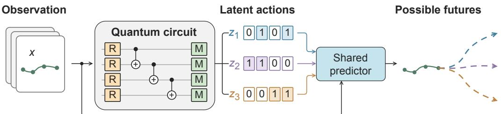  
Figure 1: Conditional quantum Born prior for latent-action generation. The circuit samples binary actions conditioned on an observation; a shared predictor maps these inputs to alternative future representations. The solid trace depicts the observation, and colour-matched dashed branches illustrate possible continuations.

## 1 INTRODUCTION

LeCun’s blueprint for autonomous machine intelligence assigns unpredictable aspects of a future state to a latent variable within a representation-space world model (LeCun, 2022). The latent variable can act as an unobserved action: several continuations may be compatible with the same observation, although only one is realized. Modelling this uncertainty requires both a transition mechanism and a way to generate the missing information. Figure 1 illustrates how we connect these two components through quantum-sampled latent actions.

Joint-embedding predictive architectures (JEPAs) learn a transition by comparing a prediction with an encoded target (Assran et al., 2023; Bardes et al., 2024). A point-valued predictor supplies one representation for each observation. Stochastic extensions instead describe a distribution of successor representations (Huang, 2026; Song et al., 2026). We study how to learn this distribution through sampled latent actions. A useful prior must generate valid alternatives, coordinate dependent changes and remain compact as the action space grows. This motivates our joint study of the predictive-learning mechanism and the quantum circuits that implement its generative prior.

Quantum machine learning explores how quantum representations and operations can contribute to learning, including generative tasks in which sampling is central (Biamonte et al., 2017). We bring this perspective to JEPA by using a conditional quantum circuit Born machine (QCBM) to generate latent actions. Measuring an n-qubit register produces an n-bit code; one shared neural predictor turns that code and the observation into a future representation. We optimize the resulting predictive distribution with an energy score. The observed future supplies a training signal for the conditional Born distribution through the predictions generated from its samples. We test both ideal-gradient optimization and parameter-shift gradients estimated from finite measurement samples, including a readout-error channel for our hardware-oriented reference circuits. Encoding each action as an n-dimensional binary vector keeps the predictor interface linear in register size while sharing features across 2n possible codes.

Quantum Born machines offer a direct connection between binary latent variables and a physical sampling process. Product-QCBM circuits generate conditionally independent bits, while entangling gates allow correlated measurements (Liu & Wang, 2018; Benedetti et al., 2019). This provides a circuit-level way to encode correlations between latent actions. Classical autoregressive models and mixtures also generate correlations, and a shared neural predictor can create output dependence even from independent random inputs. We therefore restrict each local predictor to its own action bits in the multi-agent experiment, isolating the prior’s role in coordinating futures. Our comparison considers predictive quality, consistency across training runs and prior resources together, since each captures a different requirement of a useful world model.

We evaluate the framework on stochastic MovingMNIST, HighwayEnv-Priority18 (HEP18), a controlled four-agent intersection with 18 coordinated futures, and public D3IL human demonstrations (Jia et al., 2024). The controlled tasks reveal mode recovery and coordination; D3IL tests learning from individual observed continuations and recursively predicting alternative routes from the same starting point. Comparisons with variational learning methods assess the predictive mechanism, while classical prior comparisons isolate the quantum implementation. Our experiments test whether sampled actions produce valid image continuations and coordinated motion, and whether those predictions retain the frequencies of alternative futures. Measurement-based training in simulation and real-QPU inference experiments test the two stages of this hybrid workflow. Our resource analysis compares the parameters, sampling operations and storage required by each prior. At fixed circuit depth, the QCBM uses linearly many conditional angles and local quantum gates rather than one logit for each joint code. On D3IL its prior uses fewer parameters than AR-GRU and Softmax-Categorical.

Our contributions are:

1. A sampled latent-action JEPA framework that jointly learns future representations and a conditional generative prior, improving sample validity and distributional fidelity over the evaluated variational baselines on our controlled tasks.

2. A trainable quantum Born implementation that learns alternative futures and useful crossagent correlations through finite-shot parameter-shift training, together with deployment of trained priors on a QPU.

3. A performance–resource study spanning controlled multimodal tasks and public demonstra tions, with strong autoregressive controls, recursive prediction and task-specific simplification checks. Our quantum priors offer a competitive quality–parameter trade-off through circuit-based sampling with a shared latent-action predictor.

## 2 RELATED WORK

Stochastic predictive world models. Stochastic video models use learned latent variables to represent alternative continuations (Denton & Fergus, 2018; Babaeizadeh et al., 2018). JEPA moves prediction into representation space: I-JEPA and V-JEPA learn by predicting target embeddings (Assran et al., 2023; Bardes et al., 2024). Within this setting, Variational JEPA learns a predictive distribution through a variational formulation (Huang, 2026), while Branch-JEPA represents a contextweighted finite set of future embeddings and trains it with specialization or distributional scores (Song et al., 2026). FlowWM models stochastic futures directly in frozen pretrained visual features using conditional flow matching (Porcher et al., 2026). In contrast, we jointly train the JEPA encoder, shared predictor and discrete latent-action prior through a sampled predictive energy objective. Together, these works establish representation-space uncertainty modelling as a broader direction beyond point prediction. Our focus is how a sampled binary prior can learn through its consequences in a shared latent transition model. We separate two questions experimentally: how our sampled predictive-learning framework compares with other stochastic learning objectives, and how quantum and classical priors compare within that same framework.

Latent actions. Action-conditioned world models predict the consequences of a supplied control. V-JEPA 2-AC extends pretrained predictive representations to this setting (Assran et al., 2025); LeWorldModel (LeWM) learns latent dynamics from observation–action trajectories using prediction and SIGReg losses (Maes et al., 2026). When action labels are unavailable, latent-action models instead learn a control interface from observed changes. VQ-VAE provides a discrete representation through vector quantization (van den Oord et al., 2017), and LAPA and Genie learn action-like variables from videos without action labels (Ye et al., 2025; Bruce et al., 2024). Work on latent-action world models in the wild also studies constrained continuous actions and transfer across videos (Garrido et al., 2026). We use latent actions to index possible continuations of the same observation. Their conditional distribution is learned jointly with predictive representations, and binary codes provide a direct interface to quantum measurements. Our intervention experiments test whether changing this interface redirects the learned continuation.

Sample-based distribution learning. Proper scoring rules evaluate a predictive distribution against an observed outcome (Gneiting & Raftery, 2007). Energy scores are useful when a generator can sample but cannot conveniently evaluate its likelihood. Scoring-rule minimization has been developed for neural probabilistic forecasting (Pacchiardi et al., 2024). We use this sample-based interface to connect a generative prior to the JEPA prediction task: the score assesses the future embeddings produced from sampled actions and supplies the prior’s learning signal. Since the target space is learned, a predictive score alone does not prevent representation collapse. VICReg, LeJEPA and VISReg address this separate problem through feature regularization (Bardes et al., 2022; Balestriero & LeCun, 2025; Wu et al., 2026). Our framework combines a sampled predictive objective with VISReg; its quantum instance estimates prior gradients through circuit executions.

Quantum generative models. Quantum circuit Born machines parameterize discrete probability distributions with trainable quantum circuits, drawing binary samples by measuring the states they prepare (Liu & Wang, 2018; Benedetti et al., 2019). Conditional versions use classical side information to adapt the circuit’s output distribution to a given input (Kiss et al., 2022). Parameter-shift rules make derivatives accessible through shifted circuit executions (Schuld et al., 2019). Their usefulness depends on the loss and ansatz: quantum generative modelling can encounter trainability barriers, including weak statistical signals in high-dimensional objectives (Rudolph et al., 2024). HQ-JEPA uses a quantum fidelity loss for cross-modal remote-sensing representation learning, with its quantum module evaluated through classical simulation (Hossain et al., 2026). We instead place the circuit in the generative prior, where it samples latent actions and learns through their downstream predictive energy. This ties quantum distribution learning to future uncertainty in a learned world model. We also deploy trained priors on a real QPU and pass their measured actions through the complete prediction pipeline. This establishes inference feasibility beyond simulation and complements our classical-prior comparisons and correlation tests.

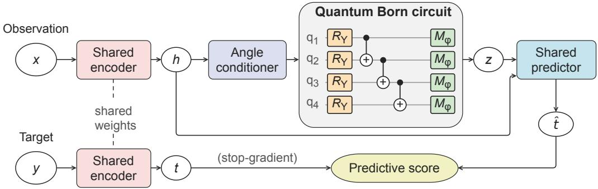  
Figure 2: Quantum-JEPA architecture. Filled blocks denote modules and outlined tokens denote data. The observation representation h conditions both the Born prior and the shared predictor. Measured bits z select a predicted future representation $\widehat { t } ,$ which is scored against the encoded target t. This score trains the predictor and prior; feature regularization stabilizes the shared encoder and is omitted for clarity. The circuit is schematic; $M _ { \varphi }$ denotes the measurement stage.

## 3 METHOD

## 3.1 OBSERVATION, LATENT ACTION, AND PREDICTIVE ENERGY

Let x denote an observation and y one realized future. A shared encoder $f _ { \xi }$ maps the two views to d-dimensional representations,

$$
h = f _ { \xi } ( x ) , \qquad t = f _ { \xi } ( y ) .\tag{1}
$$

A prior $p _ { \theta } ( z \mid h )$ generates $z \in \{ 0 , 1 \} ^ { n }$ , and a shared predictor $P _ { \psi }$ produces

$$
Z \mid x \sim p _ { \theta } ( \cdot \mid f _ { \xi } ( x ) ) , \qquad { \widehat { T } } = P _ { \psi } ( f _ { \xi } ( x ) , Z ) , \qquad { \widehat { T } } \mid x \sim Q _ { \xi , \psi , \theta } ( \cdot \mid x ) .\tag{2}
$$

Here $\widehat { T }$ is the random future representation; a sampled code z gives one prediction $\widehat { t } = P _ { \psi } ( h , z )$ . We use the latent action to represent transition information that remains uncertain given the observation. The model learns its effect by comparing sampled predictions with the target representation. Within the predictive-energy gradient, we hold the target fixed so that this update improves the prediction towards a reference representation. We train both encoder views through representation regularization. Figure 2 summarizes the training paths.

## 3.2 CONDITIONAL BORN PRIOR AND SHARED CODE PREDICTOR

We use several circuit structures with the same Born-sampling interface. Our hardware-oriented RY/CNOT reference uses a conditioner $g _ { \eta } : \mathbb { R } ^ { d }  \mathbb { R } ^ { L \times \hat { n } }$ , which sets the angles of an L-layer conditional QCBM. Our ansatz comprises rotation–entangling layers and a final layer of single-qubit rotations:

$$
\begin{array} { r } { \alpha _ { \ell j } ( h ) = g _ { \eta } ( h ) _ { \ell j } + \vartheta _ { \ell j } + \frac { \pi } { 2 } \mathbf { 1 } _ { \ell = 1 } , } \end{array}\tag{3}
$$

$$
U _ { \alpha , \varphi } = \left[ \bigotimes _ { j = 1 } ^ { n } R _ { Y } ( \varphi _ { j } ) \right] \prod _ { \ell = 1 } ^ { L } \left[ E _ { \ell } \bigotimes _ { j = 1 } ^ { n } R _ { Y } ( \alpha _ { \ell j } ) \right] , \qquad p _ { \theta } ( z \mid h ) = | \langle z | U _ { \alpha , \varphi } | 0 ^ { n } \rangle | ^ { 2 } .\tag{4}
$$

The body layers act in temporal order, followed by the terminal rotations and computational-basis measurement; $\theta = ( \eta , \vartheta , \bar { \varphi } )$ . Each $E _ { \ell }$ is a fixed CNOT matching, or the identity for the product circuit. The conditioner is a two-layer SiLU MLP whose output layer starts at zero. Small offsets around the first-layer $\pi / 2$ rotation provide broad initial support. We initialize the n terminal angles at zero and share them across observations.

The final $R _ { Y } ( \varphi _ { j } )$ rotations provide a trainable local readout basis for the binary actions, without increasing the conditioner output dimension. The prior generates bit strings by measurement, and the predictor maps each string to a future representation. We estimate the prior gradient from the resulting predictive costs. The measurement-based update does not require a table of code probabilities.

The predictor embeds the raw signed bits with a two-layer MLP,

$$
\begin{array} { r } { u ( z ) = \sigma ( W _ { z 2 } \sigma ( W _ { z 1 } ( 2 z - { \bf 1 } ) + b _ { z 1 } ) + b _ { z 2 } ) , \quad c ( h ) = W _ { h } h + b _ { h } , } \end{array}\tag{5}
$$

where $\sigma$ is SiLU. A residual transition then combines context, action, and their elementwise interaction:

$$
\begin{array} { r } { P _ { \psi } ( h , z ) = \mathcal { N } \left( h + W _ { 2 } \sigma ( W _ { 1 } [ c ( h ) ; u ( z ) ; c ( h ) \odot u ( z ) ] + b _ { 1 } ) + b _ { 2 } \right) . } \end{array}\tag{6}
$$

Here $\mathcal { N }$ is an output normalization map, specified with each benchmark architecture in Appendix A.2. The input width grows linearly with $n ,$ , sharing parameters across all joint codes. The D3IL implementation also learns a bounded output scale and offset, described in Appendix B.

## 3.3 SAMPLED PREDICTIVE OBJECTIVE

For $K \geq 2$ independent prior samples, write $\widehat { t } _ { k } = P _ { \psi } ( h , z _ { k } )$ and $\rho ( u , v ) = \| u - v \| _ { 2 } / \sqrt { d }$ . We use the empirical energy loss

$$
\mathcal { L } _ { \mathrm { p r e d } } = \frac { 1 } { K } \sum _ { k = 1 } ^ { K } \rho ( \widehat { t } _ { k } , t ) - \frac { 1 } { 2 K ( K - 1 ) } \sum _ { k \neq l } \rho ( \widehat { t } _ { k } , \widehat { t } _ { l } ) .\tag{7}
$$

The first term brings predictions closer to the observed target. The second encourages diversity among predictions, balancing target accuracy with coverage of different possible futures. Excluding self-pairs gives an unbiased estimate of the population energy score for a fixed representation and independent draws (Gneiting & Raftery, 2007). When several realized futures share an observation, we average the first term over those targets. The prior still depends only on the observation.

The encoder could reduce the predictive score simply by making its features uninformative. We therefore use VISReg (Wu et al., 2026) to maintain feature scale and spread while learning the predictive task. We use its decoupled centre, scale and shape components,

$$
R ( v ) = \lambda _ { \mathrm { c e n t e r } } \mathcal { L } _ { \mathrm { c e n t e r } } ( v ) + \lambda _ { \mathrm { s c a l e } } \mathcal { L } _ { \mathrm { s c a l e } } ( v ) + \lambda _ { \mathrm { s h a p e } } \mathcal { L } _ { \mathrm { s h a p e } } ( v ) .\tag{8}
$$

These terms centre features, control their coordinate-wise scale, and match normalized random projections to Gaussian quantiles. Appendix ${ \mathrm { A } } . 3$ specifies their implementation and weights. We regularize the observation and target representations:

$$
\mathscr { L } _ { \mathrm { r e g } } = \frac { R ( h ) + R ( t ) } { 2 } .\tag{9}
$$

Our world-model objective is

$$
\boxed { \mathcal { L } _ { \mathrm { J E P A } } = \mathcal { L } _ { \mathrm { p r e d } } + \lambda _ { \mathrm { r e g } } \mathcal { L } _ { \mathrm { r e g } } . }\tag{10}
$$

For repeated target views, we average $R ( t )$ over views before combining the two terms.

## 3.4 TRAINING LATENT PRIORS FROM PREDICTIVE QUALITY

We update the encoder and predictor by backpropagation with sampled codes held fixed. We train the prior through the distribution of its predictions. For a fixed context, target and predictor, the first variation of the population predictive loss at prediction u is

$$
C ( u ; t , Q ) = \rho ( u , t ) - \mathbb { E } _ { V \sim Q } \rho ( u , V ) .\tag{11}
$$

The second term has coefficient one because both draws in the pairwise energy depend on the prior. This cost rewards target fit together with useful predictive diversity. We average its first term over target views when several realized futures share an observation.

Classical prior update. For a classical prior, we use a leave-one-out estimate of this cost and differentiate the log probability of each sampled code:

$$
C _ { k } ^ { \mathrm { L O O } } = \rho ( \widehat { t } _ { k } , t ) - \frac { 1 } { K - 1 } \sum _ { l \neq k } \rho ( \widehat { t } _ { k } , \widehat { t } _ { l } ) ,\tag{12}
$$

$$
\mathcal { L } _ { \mathrm { p r i o r } } ^ { \mathrm { s u r } } = \frac { 1 } { K } \sum _ { k } \log p _ { \theta } ( z _ { k } \mid \mathrm { s g } ( h ) ) \mathrm { s g } ( C _ { k } ^ { \mathrm { L O O } } ) .\tag{13}
$$

Here sg stops gradients, restricting this update to the prior and favouring codes with lower predictive cost. We average the target term over available futures; classical priors supply their respective code log probabilities.

Measurement-based quantum update. Let a collect the body and terminal $R _ { Y }$ rotation angles of the conditional QCBM. For each angle $a _ { j }$ , the parameter-shift rule (Schuld et al., 2019) gives

$$
\frac { \partial \overline { { \mathcal { L } } } _ { \mathrm { p r e d } } } { \partial a _ { j } } = \frac { 1 } { 2 } \left[ \mathbb { E } _ { Z \sim p _ { a + \frac { \pi } { 2 } c _ { j } } } C ( P _ { \psi } ( h , Z ) ; t , Q ) - \mathbb { E } _ { Z \sim p _ { a - \frac { \pi } { 2 } c _ { j } } } C ( P _ { \psi } ( h , Z ) ; t , Q ) \right] .\tag{14}
$$

We estimate the two expectations with shifted-circuit measurements and use independent unshifted predictions as references for Q. The target, predictor and reference distribution are fixed during this prior update. The estimated angle derivatives are backpropagated through the classical conditioner, which receives $\mathrm { s g } ( h )$ . This trains the Born prior through its downstream predictions without differentiating a quantum statevector.

We subsample observations and angle coordinates with inverse-probability corrections to control measurement cost. The rule remains valid with a parameter-independent readout channel, which we apply to shifted and unshifted samples in the RY/CNOT reference experiments. Ideal-gradient quantum experiments use Eq. (13) with differentiable Born log probabilities (Appendix A.4). All priors share the predictive objective and K prediction samples; quantum gradients require additional shots. Appendix A gives their budgets and the warm-up schedule.

## 4 CORRELATED LATENT PRIORS AND RESOURCE SCALING

## 4.1 PRIOR FAMILIES

We compare explicit categorical, independent-bit, autoregressive, mixture and quantum priors for the same n-bit action space. Their parameterizations trade off joint-distribution capacity, parameter count and sampling work. Section 5.1 defines each method; Appendix A gives its implementation.

## 4.2 RESOURCE COMPARISON

Let $H _ { p }$ be the prior’s hidden width, L the circuit depth in layers, and R the number of mixture components. Table 1 excludes the encoder and predictor, which are shared across comparison methods. The classical conditioner of the Born prior is part of its cost.

At fixed depth and conditioner width, QCBM parameter and gate counts grow linearly with $n ,$ without a 2n-entry output layer. Independent bits are also compact but factorized; mixtures introduce a component-count cost, and AR-GRU samples bits sequentially. A QCBM produces correlated bits in one circuit execution per draw, with correlations determined by its gates and depth. Appendix C.1 gives working-memory assumptions.

## 5 EXPERIMENTAL PROTOCOL

## 5.1 COMMON TRAINING AND COMPARISON METHODS

Within each experiment, stochastic discrete-prior comparisons share the encoder, predictor, loss, read out and training schedule. Deterministic JEPA predicts one future per observation; Uniform-Bernoull uses independent fair bits, and Frozen-QCBM keeps the initialized prior fixed. Softmax-Categorical learns one probability per code, whereas Independent-Bernoulli learns a separate probability for each bit. AR-GRU conditions each bit on preceding bits; a Bernoulli mixture first samples a shared component and then draws conditionally independent bits. Product-QCBM uses single-qubit rotations, while Entangled-QCBM adds CNOT gates between them to couple the sampled bits. Mixture-2 for MovingMNIST and Mixture-4 for HEP18 and D3IL have parameter counts close to the corresponding QCBM. For complete-method comparisons, our Variational JEPA adaptation (Huang, 2026) predicts a mean representation and calibrates Gaussian uncertainty. Latent-CVAE (Denton & Fergus, 2018; Babaeizadeh et al., 2018) learns a future-conditioned posterior and context-conditioned prior with a reconstruction–KL objective. Both use their own objectives with matched data, readouts and evaluation budgets. The reference results in Tables 2 and 3 use three independent trainings and 128 actual prior draws per observation. Their trained QCBMs use finite-shot parameter shift with independent 0.5% readout bit flips during training and evaluation; classical methods and fixed controls retain their stated sampling protocols. Appendix D compares this setting with ideal gradients and noise-free parameter shift. D3IL training covers three seeds across three demonstration folds; the common-start diagnostic evaluates all nine models per method. Its trainable QCBMs also use finite-shot parameter shift with 0.5% readout bit flips; the frozen quantum control receives the same readout noise. We report each experiment separately, without pooling checkpoints across circuit families, gradient estimators or data splits. Architectures, optimizers and external adaptations appear in Appendices A, C and E.

Table 1: Leading prior costs for one observation and K sampled n-bit codes. Parameter counts are asymptotic; constants, biases, and normalization parameters are omitted. Classical costs allow cached context projections and alias-table categorical sampling. Quantum gate counts assume compatible connectivity. Every method also stores $\bar { \boldsymbol { O } } ( K \boldsymbol { n } )$ measured or sampled bits.
<table><tr><td>Prior</td><td>Parameters</td><td>Generation work</td></tr><tr><td>Softmax-Categorical</td><td> $O ( d H _ { p } + H _ { p } 2 ^ { n } )$ </td><td> $O ( d H _ { p } + H _ { p } 2 ^ { n } + K n )$ </td></tr><tr><td>Independent-Bernoulli</td><td> $O ( d \bar { H _ { p } } + \bar { H _ { p } } n )$ </td><td> $O ( d \dot { H _ { p } } + \dot { H _ { p } } n + K n )$ </td></tr><tr><td>Mixture-R</td><td></td><td> $O \dot { ( } d \dot { H _ { p } } + \dot { H _ { p } } \dot { R } n ) O \dot { ( } d \dot { H _ { p } } + \dot { H _ { p } } R n + \dot { R ^ { } } + K n )$ </td></tr><tr><td>AR-GRU</td><td> $O ( d \bar { H _ { p } } + \bar { H _ { p } ^ { 2 } } )$ </td><td> $O ( d \bar { H _ { p } } + \bar { K n } H _ { p } ^ { 2 } )$ </td></tr><tr><td>Conditional QCBM</td><td> $O ( d H _ { p } + H _ { p } n L )$ </td><td> $O ( d H _ { p } + H _ { p } n L )$  classical  $O ( K n L )$  quantum gates</td></tr></table>

## 5.2 STOCHASTIC MOVINGMNIST

We construct a stochastic single-digit variant of MovingMNIST (Srivastava et al., 2015) using $6 4 \times 6 4$ videos with three horizontal-motion observation frames and three future frames. Eight equally spaced directions have probabilities 0.15 for each cardinal direction and 0.10 for each diagonal direction. We use 800 training and 80 test observations from disjoint MNIST splits. Training receives image pairs, not motion labels; a three-bit prior learns the action codes. These frequencies admit a product-bit representation, so this task does not require entanglement. We train with Eq. (10), using VISReg on the observation and target representations. A separately trained frozen-JEPA readout predicts translations and renders future images from the last observation frame. Appendix F.2 gives the full construction and readout protocol.

## 5.3 HIGHWAYENV PRIORITY INTERSECTION (HEP18)

HEP18 is a controlled four-agent task on HighwayEnv’s straight intersection lanes (Leurent, 2018). Each observation admits 18 equally likely futures: either NS or EW has priority, each priority vehicle chooses one of three speed schedules, and both yielding vehicles decelerate to a stop. The reference experiment splits 448 observations into 256 training, 64 validation and 128 test contexts, keeping each observation’s futures together. We train the JEPA for 6,000 updates and fit the readout for 16,000 updates. All 18 futures are available during HEP18 training; their probabilities are uniform and do not depend on the initial state. The model consumes structured position–speed histories and predicts three stages over nine seconds.

We use twelve bits, three per agent. Each local predictor sees the full deterministic context but only its own action bits, so stochastic coordination must come from the prior. Training scores the concatenated scene with the smoothed power distance in Eq. (18) and adds $\lambda _ { \Delta } R ( t - h )$ to preserve change information. A frozen per-agent readout predicts speeds for kinematic integration. Appendix F.3 specifies these task-specific choices; Appendix G tests change regularization.

## 5.4 D3IL DEMONSTRATION CONTINUATION

We use 96 public human demonstrations from D3IL Avoiding (Jia et al., 2024), a simulated robotic obstacle-avoidance task with three obstacle rows. We train the models on observed planar trajectories, without enumerating alternative futures for each observation or supplying route labels to the model. We train on demonstration-disjoint folds of 64 trajectories, reserving 32 in each fold, with three training seeds and eight methods. For the common-start evaluation below, we evaluate all nine trained models per method. We average the three folds within each training seed, then report the mean and sample standard deviation of the three seed-level means. Figures use the first training seed and first fold for every method, without selecting checkpoints by performance. The dataset informed earlier development, and this diagnostic is not a previously untouched blind test.

An observation is a 24-point trajectory segment. We predict the next 8 cm of motion, also represented by 24 points, using eight latent-action bits. After decoding a prediction, we re-encode its coordinates for the next step. We stop at the goal line or after 16 calls, retaining failures in evaluation. This is offline recursive prediction, not robot execution. Training uses the Euclidean energy score and VISReg on h and t. Here Entangled-QCBM uses four layers of local rotations and brickwork CNOT gates, followed by terminal local rotations; Product-QCBM omits the CNOTs. Frozen-QCBM retains its input-independent initialized distribution while the encoder and predictor learn. Deterministic JEPA uses representation MSE in place of the energy score. AR-GRU uses the same recurrent prior architecture as in the other two tasks. A frozen-JEPA spline readout translates future features into coordinates. We retain a final 1,000-update predictor/prior stage on real consecutive segments, with encoder and readout fixed. Appendix B gives all stages and architecture differences, including the CVAE schedule.

All 96 recorded trajectories begin at exactly the same planar position. We use that point as the entire initial observation, repeating it 24 times to retain the encoder’s input shape without supplying a motion direction. Subsequent calls re-encode the predicted segment as usual. During training, the first observation is a moving segment interpolated from recorded frames 4–8. At evaluation, we keep the trained models fixed and begin prediction at the shared stationary point, before any motion has been observed.

## 5.5 PREDICTION QUALITY AND COORDINATION METRICS

Coverage measures how many true futures are recovered; validity measures the fraction of draws matching a true future. Total variation (TV) compares sampled mode frequencies, including an invalid category, with the target distribution. MovingMNIST uses a 4-pixel endpoint threshold. HEP18 requires every agent to match the same joint target within 2 m and 1 m/s at all future times. We also report minimum ADE and Euclidean trajectory energy score (ES). Independently re-pairing agents’ predictions preserves their marginals but disrupts coordination. Appendix F.4 gives complete definitions and Appendix H reports tolerance and sampling-budget checks.

For D3IL, the three obstacle rows define $2 \times 3 \times 4 = 2 4$ routes. We draw 384 recursive continuations per checkpoint from the same point. A geometrically accepted path reaches the goal, crosses all three rows, avoids continuous-path collisions and passes a workspace-envelope check. We report the exact expected route coverage and TV of a uniform random subset of 60 accepted paths, against the uniform 24-route reference. One Latent-CVAE checkpoint supplies only 61 accepted paths; the common 60-path budget retains every stochastic checkpoint without additional draws. Unlike the controlled-task TV above, this TV is conditioned on geometric validity; it does not measure the probability of producing an invalid path. All raw candidates are retained. Appendix B.4 gives the definitions, the empirical demonstration reference and a finite-pool sampling-sensitivity check.

Table 2: MovingMNIST (80 observations, 128 draws each). Mean ± sample s.d. over three trainings; coverage/validity in percent, minADE/ES in pixels. The first two rows are external methods. Trained QCBMs use parameter shift with 0.5% readout flips. Shading marks trained QCBMs; bold/underline mark best/second-best displayed means, including ties.
<table><tr><td>Method / prior</td><td>Cov. ↑</td><td>Valid ↑</td><td>TV↓</td><td>minADE↓</td><td>ES↓</td></tr><tr><td>Variational JEPA</td><td> $6 3 . 3 \pm 8 . 1$ </td><td> $3 1 . 0 \pm 2 . 3$ </td><td> $0 . 7 3 0 \pm 0 . 0 0 9$ </td><td> $2 . 4 3 \pm 0 . 3 0$ </td><td> $1 1 . 5 5 \pm 0 . 6 6$ </td></tr><tr><td>Latent-CVAE</td><td> ${ \bf 9 8 . 6 \pm 1 . 0 }$ </td><td> $5 3 . 5 \pm 2 . 3$ </td><td> $0 . 4 7 0 \pm 0 . 0 2 3$ </td><td> ${ \bf 0 . 7 0 \pm 0 . 0 3 }$ </td><td> $9 . 9 6 \pm 0 . 0 5$ </td></tr><tr><td>Deterministic JEPA</td><td> $0 . 0 \pm 0 . 0$ </td><td> $0 . 0 \pm 0 . 0$ </td><td> $1 . 0 0 0 \pm 0 . 0 0 0$ </td><td> $8 . 0 4 \pm 0 . 0 1$ </td><td> $1 5 . 0 4 \pm 0 . 0 1$ </td></tr><tr><td>Uniform-Bernoulli</td><td> $\underline { { 9 4 . 4 } } \pm 1 . 6$ </td><td></td><td>96.5 ±1.2 0.168 ±0.018</td><td> $0 . 8 1 \pm 0 . 0 8$ </td><td> $9 . 6 0 \pm 0 . 0 2$ </td></tr><tr><td>Softmax-Categorical</td><td> $9 3 . 6 \pm 0 . 5$ </td><td></td><td>95.8 ± 0.5 0.145 ± 0.002</td><td> $0 . 7 9 \pm 0 . 0 4$ </td><td> ${ \bf 9 . 5 8 \pm 0 . 0 2 }$ </td></tr><tr><td>AR-GRU</td><td> $9 0 . 5 \pm 4 . 1$ </td><td> $9 6 . 0 \pm 1 . 1$ </td><td> $0 . 1 8 0 \pm 0 . 0 1 5$ </td><td> $0 . 9 7 \pm 0 . 1 8$ </td><td> $9 . 6 5 \pm 0 . 0 6$ </td></tr><tr><td>Mixture-2</td><td> $8 8 . 5 \pm 4 . 4$ </td><td> $9 5 . 8 \pm 1 . 2$ </td><td>0.186 ± 0.020</td><td> $0 . 9 8 \pm 0 . 1 9$ </td><td> $9 . 6 3 \pm 0 . 0 5$ </td></tr><tr><td>Frozen-QCBM</td><td> $9 3 . 3 \pm 3 . 7$ </td><td>95.6±1.8</td><td></td><td>0.176 ± 0.027 0.84 ± 0.13</td><td> $9 . 6 1 \pm 0 . 0 4$ </td></tr><tr><td>Product-QCBM</td><td> $9 4 . 3 \pm 2 . 4$ </td><td></td><td>96.2±1.6 0.167±0.019</td><td> $0 . 8 0 \pm 0 . 0 8$ </td><td> $9 . 6 0 \pm 0 . 0 2$ </td></tr><tr><td>Entangled-QCBM</td><td> $9 4 . 0 \pm 2 . 3 $ </td><td></td><td>96.5±1.1 0.160±0.024</td><td> $0 . 8 4 \pm 0 . 1 1$ </td><td> $9 . 6 1 \pm 0 . 0 3$ </td></tr></table>

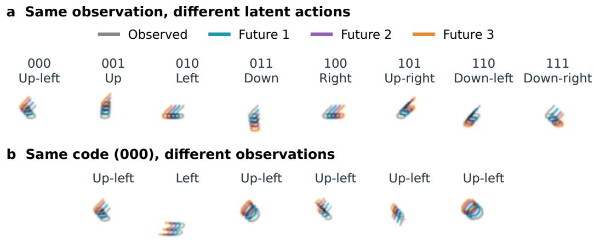  
Figure 3: Latent-action interventions using the ideal-gradient reference checkpoint. (a) One observation, all eight codes. (b) Code 000, different digits. Grey shows the observation; cyan, purple and orange show future frames 1–3. Red labels mark invalid endpoints. Quantitative evaluation uses prior sampling; direction frequencies appear in Appendix H (Figure 7).

## 6 RESULTS

## 6.1 MULTIMODAL PREDICTION ON MOVINGMNIST

Both quantum circuit structures learn multiple image continuations under finite-shot parameter-shift training with readout noise (Table 2). Their validity, trajectory errors and energy scores remain close to the strongest within-framework classical priors. Softmax-Categorical has better frequency matching, while QCBM uses fewer prior parameters (Table 7). Product-QCBM performs comparably to Entangled-QCBM on this task: the target frequencies admit a product-bit representation, so entanglement is not required. The paired training comparisons in Appendix D show that these conclusions survive replacing ideal gradients with measurement-based estimates. Figure 3 shows the continuations produced by different latent-action codes, including unsuccessful predictions. Changing the code redirects the continuation, but its direction need not be identical across digit images. Appendix I tests whether the Born prior adapts to different direction probabilities for different digits.

Table 3: HEP18 (128 observations, 128 draws each). Mean ± sample s.d. over three trainings; coverage/validity in percent, minADE/ES in metres. The first two rows are external methods. Training and highlighting follow Table 2.
<table><tr><td>Method / prior</td><td>Cov. ↑</td><td>Valid ↑</td><td> $\mathrm { T V } \downarrow$ </td><td>minADE↓</td><td>ES↓</td></tr><tr><td>Variational JEPA</td><td> $0 . 0 0 \pm 0 . 0 0$ </td><td> $0 . 0 0 \pm 0 . 0 0$ </td><td> $1 . 0 0 0 \pm 0 . 0 0 0$ </td><td> $5 . 6 8 \pm 0 . 5 1$ </td><td> $4 4 . 7 8 \pm 1 . 5 9$ </td></tr><tr><td>Latent-CVAE</td><td> $5 9 . 8 2 \pm 4 . 7 3$ </td><td> $1 4 . 6 4 \pm 1 . 6 5$ </td><td> $0 . 8 5 4 \pm 0 . 0 1 6$ </td><td> $0 . 6 0 \pm 0 . 0 9$ </td><td> $3 4 . 5 4 \pm 0 . 0 7$ </td></tr><tr><td>Deterministic JEPA</td><td> $2 . 6 8 \pm 2 . 7 8$ </td><td> $4 8 . 1 8 \pm 5 0 . 1 0$ </td><td> $0 . 9 7 3 \pm 0 . 0 2 8$ </td><td> $1 5 . 1 9 \pm 0 . 1 6$ </td><td> $6 4 . 5 8 \pm 0 . 6 8$ </td></tr><tr><td>Uniform-Bernoulli</td><td> $2 9 . 4 1 \pm 1 . 5 3$ </td><td> $6 . 5 3 \pm 0 . 1 5$ </td><td> $0 . 9 3 5 \pm 0 . 0 0 1$ </td><td> $1 . 4 0 \pm 0 . 0 7$ </td><td> $4 0 . 8 6 \pm 0 . 0 2$ </td></tr><tr><td>Softmax-Categorical</td><td> ${ \bf 9 9 . 9 7 \pm 0 . 0 3 }$ </td><td> ${ \bf 9 8 . 0 0 \pm 0 . 4 2 }$ </td><td> $\mathbf { 0 . 1 5 7 \pm 0 . 0 0 5 }$ </td><td> $0 . 2 0 \pm 0 . 0 3$ </td><td> $3 4 . 3 4 \pm 0 . 0 5$ </td></tr><tr><td>Independent-Bernoulli</td><td> $4 1 . 3 2 \pm 4 . 5 6$ </td><td> $2 5 . 6 6 \pm 2 . 4 9$ </td><td> $0 . 7 6 4 \pm 0 . 0 2 0$ </td><td> $4 . 3 7 \pm 0 . 6 7$ </td><td> $4 2 . 6 3 \pm 0 . 6 5$ </td></tr><tr><td>AR-GRU</td><td> $9 4 . 1 6 \pm 9 . 9 4$ </td><td> $9 5 . 5 4 \pm 0 . 8 5$ </td><td> $0 . 2 0 6 \pm 0 . 0 5 2$ </td><td> $0 . 2 8 \pm 0 . 1 5$ </td><td> $3 4 . 3 5 \pm 0 . 0 3$ </td></tr><tr><td>Mixture-4</td><td> $9 9 . 9 6 \pm 0 . 0 4$ </td><td> $9 7 . 8 8 \pm 1 . 8 0 $ </td><td> $0 . 1 5 9 { \pm } 0 . 0 0 9$ </td><td> ${ \bf 0 . 1 9 \pm 0 . 0 2 }$ </td><td> $\mathbf { 3 4 . 3 0 \pm 0 . 0 2 }$ </td></tr><tr><td>Frozen-QCBM</td><td> $2 9 . 2 4 \pm 1 . 7 5$ </td><td> $6 . 6 5 \pm 0 . 6 6$ </td><td> $0 . 9 3 3 \pm 0 . 0 0 7$ </td><td> $1 . 3 6 \pm 0 . 1 1$ </td><td> $4 0 . 7 9 \pm 0 . 1 2$ </td></tr><tr><td>Product-QCBM</td><td> $3 8 . 7 7 \pm 5 . 1 3$ </td><td> $2 4 . 5 0 \pm 4 . 1 1$ </td><td> $0 . 7 7 7 \pm 0 . 0 3 3$ </td><td> $4 . 2 3 \pm 0 . 4 9$ </td><td> $4 2 . 4 5 \pm 0 . 5 3$ </td></tr><tr><td>Entangled-QCBM</td><td> $9 9 . 7 3 \pm 0 . 2 5$ </td><td> $9 3 . 3 8 \pm 6 . 0 4$ </td><td> $0 . 1 8 8 \pm 0 . 0 3 6$ </td><td> $0 . 2 0 \pm 0 . 0 2$ </td><td> $3 4 . 3 6 \pm 0 . 0 3$ </td></tr></table>

Table 4: D3IL from one direction-free starting point, evaluated with all three folds and three training seeds per method. Each checkpoint supplies 384 raw rollouts. We compute exact expected route statistics for a uniformly selected subset of 60 geometrically accepted paths. Entries are mean ± sample s.d. over three seed-level means, each averaging three folds; coverage is a percentage of 24 routes. Six deterministic checkpoints have no accepted paths, giving zero coverage and undefined TV. Quantum models use finite-shot parameter-shift training and 0.5% readout flips. Metrics describe accepted-path diversity, not raw generation success.
<table><tr><td>Method / prior</td><td>Routes ↑</td><td>Coverage ↑</td><td>TV↓</td></tr><tr><td>Deterministic JEPA</td><td> $0 . 3 3 \pm 0 . 3 3$ </td><td> $1 . 3 9 \pm 1 . 3 9$ </td><td></td></tr><tr><td>Latent-CVAE</td><td> $1 4 . 3 1 \pm 0 . 7 1$ </td><td> $5 9 . 6 3 \pm 2 . 9 6$ </td><td> $0 . 5 4 2 \pm 0 . 0 0 8$ </td></tr><tr><td>Softmax-Categorical</td><td> $1 8 . 0 8 \pm 0 . 8 9$ </td><td> $7 5 . 3 3 \pm 3 . 7 1$ </td><td> $0 . 4 0 1 \pm 0 . 0 2 8$ </td></tr><tr><td>AR-GRU</td><td> $1 7 . 6 5 \pm 0 . 6 9$ </td><td> $7 3 . 5 4 \pm 2 . 8 7$ </td><td> $0 . 4 1 2 \pm 0 . 0 1 8$ </td></tr><tr><td>Mixture-4</td><td> $1 7 . 7 7 \pm 0 . 1 8$ </td><td> $7 4 . 0 5 \pm 0 . 7 5$ </td><td> $0 . 4 1 9 \pm 0 . 0 1 4$ </td></tr><tr><td>Frozen-QCBM</td><td> $1 7 . 3 7 \pm 0 . 6 8$ </td><td> $7 2 . 3 6 \pm 2 . 8 2$ </td><td> $0 . 4 3 0 \pm 0 . 0 1 1$ </td></tr><tr><td>Product-QCBM</td><td> $1 8 . 0 7 \pm 0 . 5 9$ </td><td> $7 5 . 3 1 \pm 2 . 4 4$ </td><td> $0 . 4 0 8 \pm 0 . 0 2 2$ </td></tr><tr><td>Entangled-QCBM</td><td> $1 8 . 0 1 \pm 0 . 0 9$ </td><td> $7 5 . 0 6 \pm 0 . 3 7$ </td><td> $0 . 4 1 9 \pm 0 . 0 0 5$ </td></tr></table>

## 6.2 COORDINATED PREDICTION ON HEP18

Entangled-QCBM recovers nearly all coordinated futures under noisy parameter-shift training (Table 3). It outperforms Product-QCBM and Frozen-QCBM, while the strongest classical priors retain higher mean validity.

For the three Entangled-QCBM runs in Table 3, re-pairing agents within each test observation reduces mean joint validity from 93.38% to 12.71%. All four agents are individually valid in 96.61% of original scenes, showing that local plausibility alone does not ensure coordination. We use ten independent permutations per observation (Appendix F.4).

Trajectory errors and energy scores remain close to compact classical correlated priors; Appendix D separates finite-shot and readout-noise effects. Qualitative examples are retained in Appendix F (Figure 6).

## 6.3 ALTERNATIVE ROUTES FROM A COMMON STARTING POINT

Our trained quantum priors generate multiple obstacle-crossing routes even when the initial observation contains no motion direction (Table 4 and Figure 4). Across the repeated models, both trainable QCBMs recover a comparable number of routes to Softmax-Categorical and AR-GRU. Softmax-Categorical has the lowest mean TV, with Product-QCBM and AR-GRU close behind. Each deterministic checkpoint returns only one repeated path, so it cannot express multiple alternatives from this input.

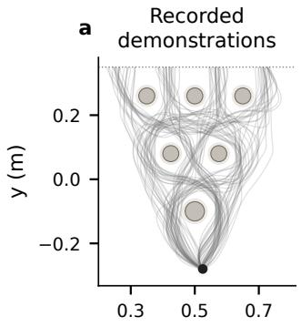  
x (m)

b  
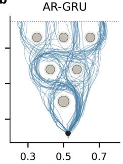  
x (m)

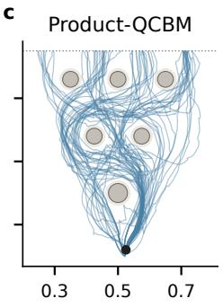  
x (m)

d  
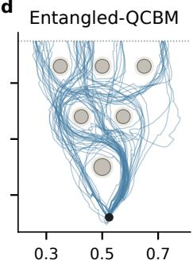  
x (m)  
Figure 4: D3IL continuations from one direction-free starting point (black dot). The reference panel contains all 96 recorded demonstrations. Each prediction panel shows 64 accepted paths from the first training seed and first fold, selected from 384 draws without route balancing. Table 4 instead aggregates all nine models per method at a common 60-accepted-path budget. All panels use common axes; grey discs mark obstacles and pale rings the scoring margin. Geometric acceptance does not ensure smooth motion, and residual bends are retained. Appendix B.5 shows all eight methods.

Each trainable QCBM used 4,792 prior parameters versus Softmax-Categorical’s 15,792, a 69.7% reduction. The complete deployed model was 4.2% smaller, since the encoder, predictor and readout dominated storage. AR-GRU used 10,641 prior parameters, and Mixture-4 used 5,012.

Product-QCBM versus entangled sampling. Product-QCBM covers more routes in the illustrated 64-path sample, but the repeated-model analysis gives similar coverage for the two circuit families. Appendix B.4 separates variation across trained models from selection of a finite display sample. More fundamentally, independent latent bits do not require independent trajectory choices: the shared nonlinear predictor and recursive re-encoding can map product-distributed codes into correlated routes. This differs from HEP18, where separate agent predictors restrict how stochastic coordination can arise. Product-QCBM sampling is consequently a sufficient source of diverse latent actions for this D3IL setting; the results do not establish a stable advantage from adding entanglement.

We use geometric acceptance only to define the route-distribution analysis, not to alter generation or optimize the models. No collision penalty or obstacle-based correction is used during training or recursive prediction. The current protocol measures route diversity conditional on geometric acceptance; it does not evaluate a learned collision-avoidance objective. Its frequency estimates concern one initial input and accepted trajectories. Training with the same stationary first input would remove the initial-input mismatch tested here.

## 6.4 COMPARISON OF COMPLETE LEARNING METHODS

Our correlated classical and quantum implementations improve validity, TV and energy score over both external adaptations (Tables 2 and 3), identifying a framework-level benefit. Latent-CVAE has higher coverage and lower minimum ADE on MovingMNIST (Table 2), but many draws fall between valid continuations. On HEP18, our correlated models also improve coverage and trajectory error. Appendix E.1 discusses these benchmark adaptations and their distance–coordination trade-offs.

## 6.5 REAL-QPU INFERENCE

We ran trained quantum priors on real QPUs and used their sampled actions in the complete prediction pipeline. Hardware noise can change the latent-action distribution and, in turn, the frequencies of predicted futures. This shift can improve or reduce individual benchmark metrics; its effect depends on the learned distribution, task and metric. On MovingMNIST, the reference RY/CNOT and Product-QCBM circuits closely matched the ideal-sampling results (Table 14).

For HEP18’s 12-qubit circuit, hardware errors reduced joint prediction validity. We improved execution by choosing better-performing physical qubits and connections, without retraining or changing the circuit’s ideal distribution. Joint validity rose from 76.88% to 86.69%, compared with 98.41% under ideal sampling. After optimization, coverage and trajectory errors were close to the ideal reference (Table 15). Appendix J details these hardware implementations and their matched evaluations.

On D3IL, the trained Product-QCBM and Entangled-QCBM priors generated the latent actions for complete recursive trajectory prediction. Their route coverage fell within the ranges observed across matched GPU sampling repetitions. Each recursive step requires a new conditional circuit execution, so we used a smaller hardware budget of 40 raw rollouts per prior. We matched the GPU runs to this budget; the main D3IL comparison uses 384 raw rollouts per checkpoint. Appendix J.3 explains the resulting differences in sample counts and reports the matched comparisons.

## 7 CONCLUSION

We introduce Quantum-JEPA, which trains a conditional Born prior through the predictive consequences of sampled latent actions. Our model learns multimodal and coordinated futures on constructed tasks and produces recursive predictions from diverse human demonstrations in D3IL under finite-shot, noisy training. On the controlled tasks, our framework improves over the evaluated variational baselines through classical and quantum prior implementations. On D3IL, the trained quantum priors produce diverse routes from a common direction-free starting point, with route coverage comparable to classical discrete priors in this fixed-input diagnostic. Within this framework, our quantum priors offer competitive prediction quality and a parameter-efficient representation of binary action distributions. We validate finite-shot parameter-shift training and real-QPU inference, establishing a practical route for quantum generative models to participate in representation-space future prediction.

Limitations and future work. Our experiments establish training and inference feasibility, but the quantum priors do not consistently outperform strong classical methods across all predictive metrics. Our current circuits are shallow, with performance and optimization stability depending on the task and circuit. Larger implementations face hardware noise and substantial measurement costs. We will develop circuit structures and training algorithms tailored to multimodal prediction and correlated latent actions, and investigate quantum implementations of more of the JEPA predictor. We will also formulate latent-action reasoning and planning as optimization problems for special-purpose quantum platforms.

## REPRODUCIBILITY STATEMENT

We specify the objective and prior update in Section 3; data construction, observation-level splits, readouts and metrics in Appendix F; architectures, circuits, optimization and parameter counts in Appendices A and C; evaluation sensitivity and direction frequencies in Appendix H; external-method adaptations in Appendix E; and QPU procedures in Appendices J and J.3. Appendix B describes the public-demonstration study, including its training stages, data splits and recursive evaluation.

## REFERENCES

Mahmoud Assran, Quentin Duval, Ishan Misra, Piotr Bojanowski, Pascal Vincent, Michael Rabbat, Yann LeCun, and Nicolas Ballas. Self-supervised learning from images with a joint-embedding predictive architecture. In CVPR, pp. 15619–15629, 2023. doi: 10.1109/CVPR52729.2023.01499.

Mido Assran, Adrien Bardes, David Fan, Quentin Garrido, Russell Howes, Mojtaba Komeili, Matthew Muckley, Ammar Rizvi, Claire Roberts, Koustuv Sinha, Artem Zholus, Sergio Arnaud, Abha Gejji, Ada Martin, Francois Robert Hogan, Daniel Dugas, Piotr Bojanowski, Vasil Khalidov, Patrick Labatut, Francisco Massa, Marc Szafraniec, Kapil Krishnakumar, Yong Li, Xiaodong Ma, Sarath Chandar, Franziska Meier, Yann LeCun, Michael Rabbat, and Nicolas Ballas. V-JEPA 2: Self-supervised video models enable understanding, prediction and planning. arXiv preprint, 2025. doi: 10.48550/arXiv.2506.09985. URL https://arxiv.org/abs/2506.09985.

Mohammad Babaeizadeh, Chelsea Finn, Dumitru Erhan, Roy H. Campbell, and Sergey Levine. Stochastic variational video prediction. In International Conference on Learning Representations, 2018. URL https://openreview.net/forum?id=rk49Mg-CW.

Randall Balestriero and Yann LeCun. LeJEPA: Provable and scalable self-supervised learning without the heuristics. arXiv preprint, 2025. doi: 10.48550/arXiv.2511.08544.

Adrien Bardes, Jean Ponce, and Yann LeCun. VICReg: Variance-invariance-covariance regularization for self-supervised learning. In International Conference on Learning Representations, 2022. URL https://openreview.net/forum?id=xm6YD62D1Ub.

Adrien Bardes, Quentin Garrido, Jean Ponce, Xinlei Chen, Michael Rabbat, Yann LeCun, Mahmoud Assran, and Nicolas Ballas. Revisiting feature prediction for learning visual representations from video. Transactions on Machine Learning Research, 2024. URL https://openreview. net/forum?id=QaCCuDfBk2.

Marcello Benedetti, Delfina Garcia-Pintos, Oscar Perdomo, Vicente Leyton-Ortega, Yunseong Nam, and Alejandro Perdomo-Ortiz. A generative modeling approach for benchmarking and training shal low quantum circuits. npj Quantum Information, 5(1):45, 2019. doi: 10.1038/s41534-019-0157-8.

Jacob Biamonte, Peter Wittek, Nicola Pancotti, Patrick Rebentrost, Nathan Wiebe, and Seth Lloyd. Quantum machine learning. Nature, 549(7671):195–202, 2017. doi: 10.1038/nature23474.

Jake Bruce, Michael D. Dennis, Ashley Edwards, Jack Parker-Holder, Yuge Shi, Edward Hughes, Matthew Lai, Aditi Mavalankar, Richie Steigerwald, Chris Apps, Yusuf Aytar, Sarah Maria Elisabeth Bechtle, Feryal Behbahani, Stephanie C.Y. Chan, Nicolas Heess, Lucy Gonzalez, Simon Osindero, Sherjil Ozair, Scott Reed, Jingwei Zhang, Konrad Zolna, Jeff Clune, Nando De Freitas, Satinder Singh, and Tim Rocktäschel. Genie: Generative interactive environments. In Proceedings of the 41st International Conference on Machine Learning, volume 235 of Proceedings ofMachine Learning Research, pp. 4603–4623, 2024. URL https://proceedings.mlr. press/v235/bruce24a.html.

Emily Denton and Rob Fergus. Stochastic video generation with a learned prior. In Proceedings of the 35th International Conference on Machine Learning, volume 80 of Proceedings ofMachine Learning Research, pp. 1174–1183, 2018. URL https://proceedings.mlr.press/ v80/denton18a.html.

Quentin Garrido, Tushar Nagarajan, Basile Terver, Nicolas Ballas, Yann LeCun, and Michael Rabbat. Learning latent action world models in the wild. arXiv preprint, 2026. doi: 10.48550/arXiv.2601. 05230.

Tilmann Gneiting and Adrian E. Raftery. Strictly proper scoring rules, prediction, and estimation. Journal of the American Statistical Association, 102(477):359–378, 2007. doi: 10.1198/016214506000001437.

Md Aminur Hossain, Ayush V. Patel, Sanjay K. Singh, and Biplab Banerjee. HQ-JEPA: Hybrid quantum joint-embedding predictive architecture for cross-modal remote sensing representation learning. arXiv preprint, 2026. doi: 10.48550/arXiv.2605.31068. URL https://arxiv.org/ abs/2605.31068.

Yongchao Huang. VJEPA: Variational joint embedding predictive architectures as probabilistic world models. arXiv preprint, 2026. doi: 10.48550/arXiv.2601.14354. URL https://arxiv.org/ abs/2601.14354.

Xiaogang Jia, Denis Blessing, Xinkai Jiang, Moritz Reuss, Atalay Donat, Rudolf Lioutikov, and Gerhard Neumann. Towards diverse behaviors: A benchmark for imitation learning with human demonstrations. In International Conference on Learning Representations, volume 2024, pp. 41666– 41686, 2024. URL https://proceedings.iclr.cc/paper\_files/paper/2024/ hash/b63cb503757f9f31e5d74e3567dd160a-Abstract-Conference.html.

Oriel Kiss, Michele Grossi, Enrique Kajomovitz, and Sofia Vallecorsa. Conditional born machine for monte carlo event generation. Physical Review A, 106(2):022612, 2022. doi: 10.1103/PhysRevA. 106.022612.

Yann LeCun. A path towards autonomous machine intelligence. OpenReview, 2022. URL https: //openreview.net/forum?id=BZ5a1r-kVsf. Position paper.

Edouard Leurent. An environment for autonomous driving decision-making. GitHub repository, 2018. URL https://github.com/Farama-Foundation/HighwayEnv.

Jin-Guo Liu and Lei Wang. Differentiable learning of Quantum Circuit Born Machines. Physical Review A, 98(6):062324, 2018. doi: 10.1103/PhysRevA.98.062324.

Lucas Maes, Quentin Le Lidec, Damien Scieur, Yann LeCun, and Randall Balestriero. LeWorldModel: Stable end-to-end joint-embedding predictive architecture from pixels. arXiv preprint, 2026. doi: 10.48550/arXiv.2603.19312. URL https://arxiv.org/abs/2603.19312.

Lorenzo Pacchiardi, Rilwan A. Adewoyin, Peter Dueben, and Ritabrata Dutta. Probabilistic forecasting with generative networks via scoring rule minimization. Journal of Machine Learning Research, 25(45):1–64, 2024. URL https://jmlr.org/papers/v25/23-0038.html.

François Porcher, Nicolas Carion, Karteek Alahari, and Shizhe Chen. Flow matching in feature space for stochastic world modeling. arXiv preprint, 2026. doi: 10.48550/arXiv.2606.29059.

Manuel S. Rudolph, Sacha Lerch, Supanut Thanasilp, Oriel Kiss, Oxana Shaya, Sofia Vallecorsa, Michele Grossi, and Zoë Holmes. Trainability barriers and opportunities in quantum generative modeling. npj Quantum Information, 10(1):116, 2024. doi: 10.1038/s41534-024-00902-0.

Maria Schuld, Ville Bergholm, Christian Gogolin, Josh Izaac, and Nathan Killoran. Evaluating analytic gradients on quantum hardware. Physical Review A, 99(3):032331, 2019. doi: 10.1103/ PhysRevA.99.032331.

Zhi Song, Ximing Xing, Zhenchao Tang, Hanbo Huang, Jiehui Huang, Weilong Yan, Tianxu Lv, Minghao Yang, Zhongzheng Niu, Fan Xu, Bing He, Lusheng Wang, and Jianhua Yao. Branch-JEPA: Finite-support predictive distributions for JEPA world models. arXiv preprint, 2026. doi: 10.48550/arXiv.2607.05238. URL https://arxiv.org/abs/2607.05238v3.

Nitish Srivastava, Elman Mansimov, and Ruslan Salakhutdinov. Unsupervised learning of video representations using LSTMs. In Proceedings ofthe 32nd International Conference on Machine Learning, volume 37 of Proceedings ofMachine Learning Research, pp. 843–852, 2015. URL https://proceedings.mlr.press/v37/srivastava15.html.

Aaron van den Oord, Oriol Vinyals, and Koray Kavukcuoglu. Neural discrete representation learning. In Advances in Neural Information Processing Systems, volume 30, pp. 6306–6315, 2017. URL https://proceedings.neurips.cc/paper/2017/hash/ 7a98af17e63a0ac09ce2e96d03992fbc-Abstract.html.

Haiyu Wu, Randall Balestriero, and Morgan Levine. VISReg: Variance-invariance-sketching regularization for JEPA training. arXiv preprint, 2026. doi: 10.48550/arXiv.2606.02572.

Seonghyeon Ye, Joel Jang, Byeongguk Jeon, Se June Joo, Jianwei Yang, Baolin Peng, Ajay Mandlekar, Reuben Tan, Yu-Wei Chao, Bill Yuchen Lin, Lars Liden, Kimin Lee, Jianfeng Gao, Luke Zettlemoyer, Dieter Fox, and Minjoon Seo. Latent action pretraining from videos. In International Conference on Learning Representations, volume 2025, pp. 28213–28239, 2025. URL https://proceedings.iclr.cc/paper\_files/paper/2025/hash/ 45d74e190008c7bff2845ffc8e3facd3-Abstract-Conference.html.

## APPENDIX

## A IMPLEMENTATION AND TRAINING DETAILS

## A.1 CLASSICAL PRIOR ARCHITECTURES

All learned classical priors receive the observation representation h. Here d is its dimension, $H _ { p }$ is the prior’s hidden width, and n is the number of action bits.

Softmax-Categorical. We apply layer normalization, a $\iota d \to H _ { p }$ linear layer, SiLU, and an $H _ { p } \to 2 ^ { n }$ output layer. The output gives one logit for every possible binary code. We draw a categorical index and convert it to an n-bit string. We evaluate this prior at both three and twelve bits. At twelve bits, its explicit enumeration of code probabilities requires more parameters than the other priors.

Independent-Bernoulli. This prior uses the same conditioner architecture, but its output layer produces n logits. Each logit defines one bit’s probability of being one, and we sample the bits independently.

AR-GRU. We project the layer-normalized observation representation into a width- $\cdot H _ { p }$ hidden state. A shared GRU cell generates the bits sequentially, receiving the previous bit as input. The initial input bit is zero, and a shared scalar output head predicts the next Bernoulli logit. Later bits can therefore depend on both the observation and earlier sampled bits.

Bernoulli mixture (Mixture-R). A SiLU MLP maps the layer-normalized observation through widths $d \to H _ { p } \to R ( n + 1 )$ . Its outputs are R component logits and Rn Bernoulli logits. We first sample one mixture component, then sample all bits independently using that component’s Bernoulli probabilities. For the training update, we compute each sampled code’s probability by summing over components, using log-sum-exp for numerical stability.

The main HEP18 comparison uses $R = 4$ , with 5,796 allocated prior parameters, compared with 5,628 for the QCBM. We also report $R = 2$ and $R = 8$ to show how predictive accuracy changes with mixture capacity. MovingMNIST uses $R = 2$ , with 3,640 prior parameters, close to the three-bit QCBM’s 3,435. Here R counts mixture components, not future modes. Each component can assign probability to every one of the $2 ^ { n }$ binary codes.

## A.2 BENCHMARK ENCODERS, PREDICTORS AND READOUTS

MovingMNIST. The shared encoder takes a three-frame clip, stacking the frames as input channels. It then applies convolutions $3 \to 2 4 ( 5 \times 5 ) , 2 4 \to 4 8 ( 3 \times 3 )$ , and $4 8 \to 6 4 ( 3 \times 3 )$ . All three layers use stride 2 and SiLU, with padding of 2, 1 and 1 pixels, respectively. These layers reduce the spatial resolution from 64 × 64 to ${ \bar { 8 } } \times 8 .$ . We flatten the resulting $6 4 \times 8 \times 8$ feature grid and map it through fully connected widths 96 and 64, followed by layer normalization. The predictor follows Eqs. (5) and (6) with width 96 and layer normalization at its output. Appendix C describes the two-layer, three-qubit circuit.

The image readout maps $[ h ; t ]$ through widths $1 2 8 \to 9 6 \to 6$ with SiLU. We interpret the six outputs as three two-dimensional displacements, bounding each component by 18 tanh $( a / 1 8 )$ , where a is the raw output. At inference, the readout receives $\widehat { t }$ in place of t. A bilinear spatial transformer applies each displacement to the last observation image, with zero padding and aligned corners.

The readout minimizes weighted image L1 error, mean $[ ( 1 + 4 y ) | \widehat { y } - y | ]$ , plus one half of the soft Dice loss. Here $y$ and $\widehat { y }$ are the target and predicted pixel intensities. The L1 weight emphasizes digit pixels, while Dice measures image overlap. We average over frames and use Dice smoothing $1 0 ^ { = 6 }$ The readout’s final layer is initialized to zero, so its initial predictions have zero displacement. We train it for 4,000 iterations with batch size 64. AdamW uses learning rate 0.002, weight decay 0.01, and gradient clipping at norm 5.

HEP18. Each agent’s encoder receives its three position–speed pairs as six scalars. The shared MLP has hidden widths 64 and 64, SiLU activations, and a 16-dimensional output. Concatenating the four agent outputs gives the scene representation with $d = 6 4$ . The residual predictor uses a width-64 local-code MLP. Its output remains in the encoder’s coordinates, without output normalization.

Table 5: Reference training configuration for Tables 2 and 3. Readout training is a separate stage with all JEPA parameters frozen. These trained QCBMs use finite-shot parameter shift and a 0.5% independent readout-flip probability per bit.
<table><tr><td>Setting</td><td>MovingMNIST</td><td>HEP18</td></tr><tr><td>Latent dimension d / predictor width</td><td>64 / 96</td><td>64 / 64</td></tr><tr><td>Prior width  $H _ { p }$ </td><td>48</td><td>48</td></tr><tr><td>Bits n / body layers L</td><td>3/2</td><td>12/4</td></tr><tr><td>Terminal Ry angles</td><td>3</td><td>12</td></tr><tr><td>World-model iterations</td><td>4,000</td><td>6,000</td></tr><tr><td>Batch size / prior samples</td><td>64 /32</td><td>32 / 32</td></tr><tr><td>Target views per observation in a batch</td><td>1</td><td>18</td></tr><tr><td>Representation-only / fixed-prior warm-up</td><td>200 / 300</td><td>200 / 300</td></tr><tr><td>Encoder learning rate, initial / later</td><td> $3 1 0 ^ { - 4 } / 1 0 ^ { - 5 }$ </td><td> $3 1 0 ^ { - 4 } / 1 0 ^ { - 5 }$ </td></tr><tr><td>Predictor / prior learning rate</td><td> $1 0 ^ { - 3 } / 1 0 ^ { - 3 }$ </td><td> $1 0 ^ { - 3 } / 1 0 ^ { - 3 }$ </td></tr><tr><td>Readout iterations / batch</td><td> $4 { , } 0 0 0 / 6 4$ </td><td>16,000 / 128</td></tr><tr><td>Readout learning rate</td><td> $2 1 0 ^ { - 3 }$ </td><td>210⁻³</td></tr><tr><td>Shifted observations b / batch B</td><td>8 / 64</td><td>8/ 32</td></tr><tr><td>Shifted coordinates r / total G</td><td>9/9</td><td>12 / 60</td></tr><tr><td>Shots per shifted circuit</td><td>256</td><td>512</td></tr></table>

The trajectory readout is a shared 16 → 64 → 3 SiLU MLP. It receives an agent’s encoded target during readout training and its predicted representation at inference. The three outputs give speeds bounded by 12 sigmoid(a) m/s, where a denotes the raw outputs. We recover positions using the fixed integration procedure in Appendix F.3. The readout loss sums position and speed MSE, after scaling position errors by 20 m and speed errors by 5 m/s. We train for 16,000 AdamW steps with batch size 128, learning rate 0.002 and weight decay 0.01.

## A.3 OPTIMIZATION AND GRADIENT ESTIMATION

We use AdamW with weight decay $1 0 ^ { - 5 }$ for world-model training. Before each update, we clip each parameter group’s gradient norm at 5. We set $\lambda _ { \mathrm { r e g } } = 4 / 3$ , which gives $R ( h )$ and $R ( t )$ a coefficient of 2/3 each. The encoder learning rate decreases after 200 iterations, when predictive training begins. Prior updates start after 300 iterations. Table 5 lists the learning rates, iteration counts and sampling budgets.

VISReg implementation. For a feature batch $v \in \mathbb { R } ^ { B \times d }$ , each row is one observation and each column is one feature coordinate. We compute the coordinate-wise mean $\mu$ and population standard deviation s across the $B$ rows. For the shape term, we normalize features as $\widetilde v = ( v - \mu ) / ( \mathrm { s g } ( s ) + \epsilon )$ with $\epsilon = 1 0 ^ { - 6 }$ . The stop-gradient operator sg treats s as fixed in this normalization. We also draw J independent Gaussian vectors and normalize them to unit directions $w _ { j }$ . The three components of the regularizer in Eq. (8) are

$$
\begin{array} { r l } & { \mathcal { L } _ { \mathrm { c e n t e r } } ( v ) = \| \mu \| _ { 2 } ^ { 2 } / d , ~ \mathcal { L } _ { \mathrm { s c a l e } } ( v ) = \| s - \mathbf { 1 } \| _ { 2 } ^ { 2 } / d , } \\ & { \mathcal { L } _ { \mathrm { s h a p e } } ( v ) = \displaystyle \frac { 1 } { B J } \sum _ { j = 1 } ^ { J } \sum _ { i = 1 } ^ { B } \left( [ \mathrm { s o r t } ( \widetilde { v } w _ { j } ) ] _ { i } - \Phi ^ { - 1 } \left( \frac { i } { B + 1 } \right) \right) ^ { 2 } , } \end{array}
$$

Here Φ is the standard-normal cumulative distribution function, and $\Phi ^ { - 1 }$ gives its quantiles. The centre term moves each coordinate’s batch mean towards zero. The scale term moves each coordinate’s standard deviation towards one. For the shape term, we project the normalized features onto each direction $w _ { j }$ and sort the resulting B values. We compare these ordered projections with Gaussian quantiles at probabilities $i / ( B + \bar { 1 } )$ , then average their squared differences.

Our implementation averages over coordinates and projected samples. The regularizer weights therefore absorb normalization factors that appear in norm-based expressions of VISReg. We use $J = 1 2 8 , \lambda _ { \mathrm { c e n t e r } } = 1 { \mathrm { a n d } } \lambda _ { \mathrm { s c a l e } } = 1 0 ; \lambda _ { \mathrm { s h a p e } }$ increases linearly from zero to one over the first 100 iterations. All priors use these same weights and schedule, with the original VISReg component functions. Only the standard deviation in the shape normalization is detached; the scale term still differentiates through s. Both observation and target encoder branches receive gradients from representation regularization.

## A.4 CLASSICAL AND IDEAL-GRADIENT REFERENCE UPDATES

Classical priors use the leave-one-out score-function update in Eq. (13). For each sampled code, this update combines its predictive cost with the gradient of its log probability. When an observation has several target futures, we average the prediction–target distance over those futures. Each classical prior computes the code log probability using its own parameterization.

The ideal-gradient QCBM reference uses the same sampled-cost update, but differentiates Born log probabilities through the simulator. Gradients reach the classical conditioner, body-angle offsets and terminal rotation angles. These references still sample codes for the predictive objective; they do not enumerate predictions for every possible code. The trainable QCBMs in Tables 2 to 4 replace this simulator gradient with the measurement-based update in Section 3.4. Ideal-gradient circuit comparisons and earlier D3IL ablations are identified separately in their respective appendices.

Prior-gradient estimator. The prior affects both the target-fit term and the pairwise diversity term in the energy score. To see the resulting derivative, write a discrete objective as $a ^ { \top } p + p ^ { \top } B \bar { p }$ , with probability vector p and symmetric matrix B. Here a contains prediction–target distances, while B contains the negative half-distances between pairs of predictions. The derivative with respect to p is $a + 2 B p$ , giving Eq. (11) after substituting the energy terms. This explains why the prior’s cost uses the full pairwise-distance expectation, even though the energy loss contains a factor of one half. This vector notation explains the derivative; our sampled update does not construct these probability or distance tables.

The leave-one-out estimate in Eq. (13) compares each sample with the other K − 1 predictions, excluding its self-pair. For the prior update, we detach this cost and differentiate only the sampled code’s log probability. Classical priors and ideal-gradient QCBM references use this estimator. The reference QCBMs in Tables 2 and 3 instead use shifted-circuit measurements to estimate the same prior derivative through Eq. (14).

During parameter shift, we hold the reference predictions fixed and evaluate the cost under positive and negative angle shifts. Independent reference and shifted samples give the population derivative in expectation. The pairwise term depends on two draws from the prior. Holding one reference distribution fixed lets the shifted circuits estimate the derivative through the other draw. The factor of two in the cost accounts for both draws’ dependence on the prior. For the RY/CNOT reference, we uniformly select r of the $G = n ( L + 1 )$ ) rotation coordinates and b of the B observations in a batch. The factors $G / r$ and $B / b$ correct for the coordinates and observations that were not evaluated. Table 5 gives the subsampling and shot budgets used for each task.

Training sequence. Once the warm-up stages are complete, each world-model iteration proceeds as follows:

1. We draw a batch of observations and their realized future views, then encode both with the shared encoder.

2. We sample K actions per observation and predict one future representation for each sampled action.

3. We compute predictive energy with the target representations detached, and representation regularization with both encoder branches trainable. For HEP18, we also regularize the change representations as specified in Appendix F.3.

4. We compute a separate prior gradient, using parameter shift for QCBMs or the scorefunction estimator for classical priors. This update changes the prior only; it holds the encoded observations, targets and predictor fixed.

5. We combine the gradients for each parameter group, clip its norm at 5, and take an AdamW step.

Iterations 1–200 train the encoder using only representation regularization. Iterations 201–300 also train the predictor, while retaining the initialized prior. Later iterations update all trainable groups; frozen-prior controls continue to omit prior updates. After world-model training, we freeze all JEPA parameters for readout training and evaluation. We use the final checkpoints, without selecting them by test performance.

## B D3IL DATA, MODELS AND OFFLINE EVALUATION

## B.1 DEMONSTRATIONS AND INPUT CONSTRUCTION

We use 96 public human demonstrations of the D3IL Avoiding task, recorded in a simulated obstacle course (Jia et al., 2024). Each of three route-stratified folds assigns 64 complete demonstrations to training and 32 to evaluation. Route labels are used only to construct these splits and evaluate predictions.

We construct the first training observation by interpolating recorded frames 4–8 to 24 points. For subsequent predictions, the observation is the preceding segment. We divide futures into 8 cm arclength segments, each resampled to 24 points, retaining shorter final segments and excluding padding. This gives 1,030 segments from the 96 source demonstrations. Coordinates are normalized as (xy − $( 0 . 5 , - 0 . 2 8 ) ) / 0 . 4 ;$ ; evaluation restores metres. Training and evaluation use separate demonstrations within each fold.

## B.2 ENCODER, PREDICTOR AND READOUT

The shared encoder forms seven-dimensional tokens from position, first and second differences, and a normalized sequence index. A linear layer, layer normalization and SiLU map tokens to width 128, followed by a width-128 GRU. Its final and mean states are concatenated and projected to 64 dimensions. A parallel 16 → 128 → 64 SiLU MLP encodes kinematic summaries: final displacement; displacement mean and standard deviation; first-difference mean, standard deviation and final value; and second-difference mean and standard deviation. Each quantity has two coordinates. We add this branch to the GRU output.

The width-128 predictor uses the shared eight-bit code embedding in Eqs. (5) and (6). D3IL additionally uses a two-output head from its hidden activation, setting $s = 2 \mathrm { s i g m o i d } ( a )$ and $b =$ 0.25 tanh(c). For layer-normalized residual output q with affine parameters $w _ { \mathrm { L N } } , b _ { \mathrm { L N } }$ , its prediction is

$$
\widehat t = q + ( s - 1 ) ( q - b _ { \mathrm { L N } } ) + w _ { \mathrm { L N } } b .\tag{15}
$$

Zero initialization gives $s = 1 , b = 0$ . This bounded scale and offset head is shared by all discreteprior and deterministic D3IL comparisons; MovingMNIST and HEP18 do not use it.

The readout is a 128→128→128→16 SiLU MLP receiving $[ h ; t ] , \mathrm { o r } [ h ; \widehat { t } ]$ at inference. Its outputs are eight two-dimensional control points for a clamped cubic B-spline. We evaluate the spline at 24 evenly spaced parameter values, excluding the starting point and including the endpoint. The readout imposes no obstacle or path-length constraints. Table 6 gives model sizes.

## B.3 TRAINING AND COMPARISON METHODS

The sampled models use normalized Euclidean energy with regularization $( 2 / 3 ) [ R ( h ) + R ( t ) ]$ . The initial JEPA stage follows the AdamW, warm-up, learning-rate and VISReg settings in Appendix A, for 12,000 updates with batch size 64 and 32 prior samples. For each quantum prior update, we select eight observations and twelve of forty rotation angles uniformly without replacement. Each signed shift uses 512 shots plus 32 independent unshifted reference draws per selected observation. We scale coordinate gradients by 40/12 and average over the selected observations. The noise model applies independent 0.5% readout flips to forward, shifted and evaluation samples.

Next, we freeze the JEPA and train the readout on encoded real targets with Smooth L1 coordinate loss. We use 8,000 steps at learning rate 0.002 and 2,000 at 0.0002. Batch size is 64, AdamW weight decay is $1 0 ^ { - 5 }$ , and gradient norms are clipped at five. Finally, we freeze encoder and readout and train predictor and prior for 1,000 steps at rate $1 0 ^ { - 4 }$ . Sixteen real three-segment windows provide

Table 6: D3IL model resources. The first three numeric columns count trainable parameters in their respective stages; deployment includes fixed prior weights but excludes the CVAE posterior. Frozen-QCBM stores 4,792 fixed prior values in addition to its trainable neural modules. Quantum counts include 64 inactive coordinates retained for checkpoint compatibility. AR-GRU uses the same width-48 recurrent prior as MovingMNIST and HEP18.
<table><tr><td>Method / prior</td><td>Prior</td><td>JEPA training</td><td>Readout</td><td>Deployment</td></tr><tr><td>Deterministic JEPA</td><td>0</td><td>211,266</td><td>35,088</td><td>246,354</td></tr><tr><td>Latent-CVAE</td><td>4,296</td><td>169,248</td><td>35,088</td><td>184,728</td></tr><tr><td>Softmax-Categorical 15,792</td><td></td><td>227,058</td><td>35,088</td><td>262,146</td></tr><tr><td>AR-GRU</td><td>10,641</td><td>221,907</td><td>35,088</td><td>256,995</td></tr><tr><td>Mixture-4</td><td>5,012</td><td>216,278</td><td>35,088</td><td>251,366</td></tr><tr><td>Frozen-QCBM</td><td>0</td><td>211,266</td><td>35,088</td><td>251,146</td></tr><tr><td>Product-QCBM</td><td>4,792</td><td>216,058</td><td>35,088</td><td>251,146</td></tr><tr><td>Entangled-QCBM</td><td>4,792</td><td>216,058</td><td>35,088</td><td>251,146</td></tr></table>

48 local observation–future pairs per batch. The same energy and prior updates apply; quantum gradients select eight pairs under the same measurement settings. This last stage trains on recorded segment pairs rather than generated rollouts. The training objective contains no obstacle penalties.

Frozen-QCBM fixes the entire initialized prior throughout both predictive stages. Its zero-initialized conditioner output remains zero, so its distribution is input-independent; the predictor still receives the observation. The trainable QCBMs have 11,700 initial and 1,000 final prior updates, consuming 1,277,824,000 simulated training shots per run. Frozen-QCBM uses 26,112,000 forward shots without shifts. These shot counts cover training in the simulator and exclude evaluation.

Prior implementations. Entangled-QCBM has four RY/CNOT body layers and terminal RY rotations: forty rotations and fourteen CNOTs. Even-indexed layers couple (0, 1), $( 2 , 3 ) , . . . . ^ { . }$ oddindexed layers couple (1, 2), (3, 4), . . ., with lower-index controls. The conditioner has widths 64→48→32. Product-QCBM removes CNOTs; Frozen-QCBM fixes the entangled initialization. AR-GRU uses the common width-48 prior in Appendix A; Mixture-4 has four Bernoulli components, and Softmax-Categorical has 256 logits. All six sampled priors share the encoder, predictor, readout and schedule. Deterministic JEPA fixes the code to zero and uses representation MSE; it retains the final predictor-only training stage.

Latent-CVAE. The twelve-dimensional Gaussian prior has widths 64→48→24, and the futureconditioned posterior has widths 128 → 128 → 24. A residual 76 → 128 → 64 transition predicts features. Its objective combines target-feature MSE, dimension-averaged Gaussian KL with weight one, and the same two-view VISReg. It uses 13,000 Adam updates at a fixed learning rate of $1 0 ^ { - 3 }$ followed by the common 10,000-step readout fit. The posterior’s 19,608 parameters are used only during training.

We evaluate the final checkpoint of every training run. The resource table distinguishes prior size from full deployed size. Each trainable QCBM allocates 4,792 prior values, including 64 inactive coordinates; Frozen-QCBM retains these values at deployment despite having no trainable prior parameters.

## B.4 COMMON-START GENERATION AND ROUTE COVERAGE

All 96 raw trajectories have exactly the same starting point, approximately (0.52492847, −0.27973673) m. For evaluation, we repeat that point 24 times, giving no observed motion or heading. Sequence indices supply token order only. We encode this observation, sample a code, predict and decode a segment, then re-encode its coordinates before the next call. Generation stops when the trajectory first crosses y = 0.35 m or after sixteen calls. We interpolate the endpoint at the crossing. Every trajectory starts directly from the stationary point. This differs from the moving observations used for training. We evaluate the resulting trajectories offline.

A path is accepted only if it reaches the goal, crosses every obstacle row, avoids all inflated obstacles and stays within the geometric reach envelope. We include starting and inter-segment connections and the final partial edge in continuous collision checks. Obstacle radii add 1 cm for the manipulator tip; the reach bound is approximately 1.0913 m with tolerance $1 0 ^ { - 6 } \mathrm { m }$ . Acceptance depends on this planar geometry; robot dynamics, orientation and joint limits are not evaluated.

We classify routes by the first upward crossing of each obstacle-row centre line. The rows have two, three and four gaps, yielding $2 \times 3 \times 4 = 2 4$ routes. For a set of accepted paths, let $N _ { r }$ count route r, $\begin{array} { r } { N = \sum _ { r } N _ { r } } \end{array}$ , and $\dot { C }$ be the number of routes represented by at least one path. Then

$$
{ \mathrm { C o v e r a g e } } = { \frac { C } { 2 4 } } , \qquad { \mathrm { T V } } = { \frac { 1 } { 2 } } \sum _ { r = 1 } ^ { 2 4 } \left| { \frac { N _ { r } } { N } } - { \frac { 1 } { 2 4 } } \right| .\tag{16}
$$

Coverage is expressed as a percentage in the tables. An empty accepted set has zero coverage and undefined TV. The uniform reference approximates the recorded route frequencies: 22 routes have four demonstrations, one has three and one has five. It includes training trajectories and is not a separately measured conditional ground truth for the stationary input.

Each of the nine models per method supplies three 128-path repetitions, forming a 384-raw-path pool. All stochastic pools have at least 61 accepted paths; one Latent-CVAE pool has fewer than 64. We therefore use a common 60-accepted-path budget, without replenishing pools or discarding checkpoints. We compute expected coverage and TV over uniformly drawn 60-path subsets. The route counts follow a hypergeometric distribution, allowing exact expectations without repeated subsampling. No route balancing or nearest-target selection is applied. Six deterministic models have no accepted paths; the other three repeat one accepted route. We therefore report the aggregate deterministic TV as undefined.

We average folds within each seed, then report the mean and sample standard deviation of the three seed-level means in Table 4. The three seed-level means measure training variation, while every model is evaluated from the same starting point. The metrics describe route diversity among geometrically accepted paths, rather than the success rate of all generated paths.

## B.5 QUALITATIVE COMPARISON

The figure shows the first 64 accepted paths under one common random ordering for the first fold and training run. This illustrates one trained model per method; Table 4 summarizes all nine models using the common 60-path budget. All methods receive the same stationary point, and the reference contains all 96 demonstrations. We retain bends and backtracking without smoothing. Figure 4 enlarges three of these method panels.

## C CIRCUIT LAYOUTS AND PARAMETER ACCOUNTING

The MovingMNIST circuit has two body layers, followed by three terminal $R _ { Y }$ rotations. The first body layer uses CNOT (0, 1), and the second uses CNOT (1, 2). In each ordered pair, the first index is the control and the second is the target. The complete circuit has nine single-qubit rotations and two CNOTs.

For HEP18, we arrange the twelve qubits as four rows of three bits, ordered north, west, south and east. Row and column indices both start at zero. The four body layers use the following CNOT connections:

1. Within every row, layer 1 couples columns (0, 1).

2. At every column, layer 2 couples rows (0, 1) and (2, 3).

3. Within every row, layer 3 couples columns (1, 2).

4. At every column, layer 4 couples rows (1, 2) and (3, 0).

Each ordered pair again specifies control followed by target. Twelve terminal rotations follow the fourth layer, giving a total of 60 RY rotations and 20 CNOTs.

The Product-QCBM configuration removes all CNOT gates and retains the same rotation parameters and conditioner. All rotations on a given qubit then act about the same axis. Only their summed angle affects that bit’s Bernoulli probability. The extra rotation layers preserve the matched parameterization, but do not introduce correlations between bits.

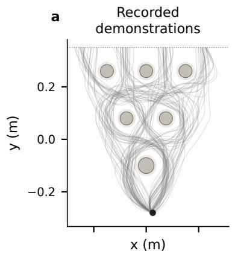

b  
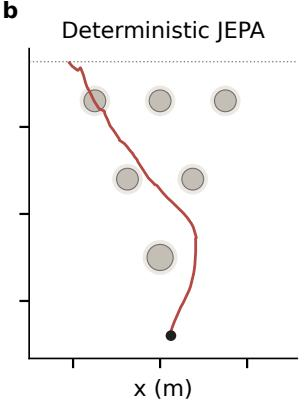

c  
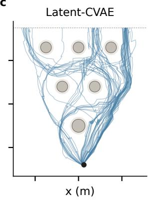

d  
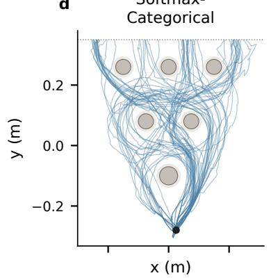

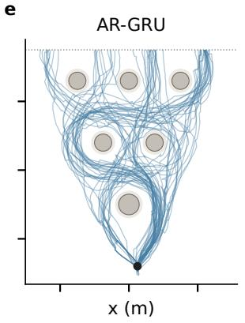

f  
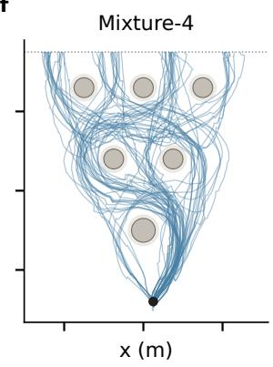

g  
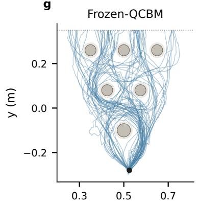  
x (m)

h  
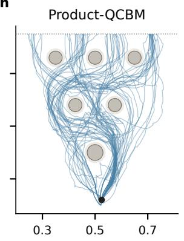  
x (m)

i  
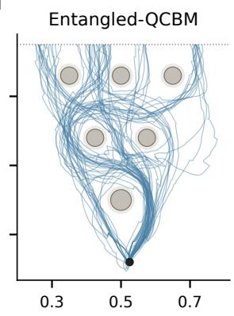  
x (m)  
Figure 5: D3IL from one common point, with no observed direction. The reference shows all demonstrations; stochastic panels show 64 accepted paths per method. The single deterministic prediction is red because it collides. All panels share the starting point (black dot), axes and obstacle geometry. Paths are not balanced across routes or smoothed. Trainable QCBMs use noisy parametershift training and 0.5% readout flips at evaluation.

For memory accounting, we distinguish allocated parameters from parameters used in the forward computation. The implementation allocates three body-angle coordinates per qubit and layer, but this ansatz uses only the Y coordinate. HEP18 therefore has 96 unused body-angle entries, and MovingMNIST has 12. All terminal angles are used in the forward computation. The shared code predictor also includes an agent-identity offset, including in the single-digit model.

Table 7: Parameter counts for MovingMNIST (Digits, 3-bit) and HEP18 (Traffic, 12-bit). The Prior column counts all allocated prior parameters; Active counts only those used in the forward computation. Frozen-QCBM has the same architecture as Entangled-QCBM but receives no prior updates. Product-QCBM has the same active rotation count, although only their sum on each qubit affects its output probability.
<table><tr><td>Task / prior</td><td>Encoder</td><td>Predictor</td><td>Prior</td><td>Active</td><td>Readout</td></tr><tr><td>Digits / Deterministic JEPA</td><td>439,600</td><td>50,112</td><td>0</td><td>0</td><td>12,966</td></tr><tr><td>Digits / Uniform-Bernoulli</td><td>439,600</td><td>50,112</td><td>0</td><td>0</td><td>12,966</td></tr><tr><td>Digits / Frozen-QCBM</td><td>439,600</td><td>50,112</td><td>3,435</td><td>3,423</td><td>12,966</td></tr><tr><td>Digits / Softmax-Categorical</td><td>439,600</td><td>50,112</td><td>3,640</td><td>3,640</td><td>12,966</td></tr><tr><td>Digits / AR-GRU</td><td>439,600</td><td>50,112</td><td>10,641</td><td>10,641</td><td>12,966</td></tr><tr><td>Digits / Mixture-2</td><td>439,600</td><td>50,112</td><td>3,640</td><td>3,640</td><td>12,966</td></tr><tr><td>Digits / Product-QCBM</td><td>439,600</td><td>50,112</td><td>3,435</td><td>3,423</td><td>12,966</td></tr><tr><td>Digits / Entangled-QCBM</td><td>439,600</td><td>50,112</td><td>3,435</td><td>3,423</td><td>12,966</td></tr><tr><td>Traffic / Deterministic JEPA</td><td>5,648</td><td>22,800</td><td>0</td><td>0</td><td>1,283</td></tr><tr><td>Traffic / Uniform-Bernoulli</td><td>5,648</td><td>22,800</td><td>0</td><td>0</td><td>1,283</td></tr><tr><td>Traffic / Frozen-QCBM</td><td>5,648</td><td>22,800</td><td>5,628</td><td>5,532</td><td>1,283</td></tr><tr><td>Traffic / Softmax-Categorical</td><td>5,648</td><td>22,800</td><td>203,952</td><td>203,952</td><td>1,283</td></tr><tr><td>Traffic / Independent-Bernoulli</td><td>5,648</td><td>22,800</td><td>3,836</td><td>3,836</td><td>1,283</td></tr><tr><td>Traffic / AR-GRU</td><td>5,648</td><td>22,800</td><td>10,641</td><td>10,641</td><td>1,283</td></tr><tr><td>Traffic / Mixture-4</td><td>5,648</td><td>22,800</td><td>5,796</td><td>5,796</td><td>1,283</td></tr><tr><td>Traffic / Product-QCBM</td><td>5,648</td><td>22,800</td><td>5,628</td><td>5,532</td><td>1,283</td></tr><tr><td>Traffic / Entangled-QCBM</td><td>5,648</td><td>22,800</td><td>5,628</td><td>5,532</td><td>1,283</td></tr><tr><td>Traffic / Mixture-2</td><td>5,648</td><td>22,800</td><td>4,522</td><td>4,522</td><td>1,283</td></tr><tr><td>Traffic / Mixture-8</td><td>5,648</td><td>22,800</td><td>8,344</td><td>8,344</td><td>1,283</td></tr></table>

## C.1 RESOURCE-SCALING DETAILS

At fixed numerical precision, weight storage follows the parameter counts in Table 1. Working memory excludes these weights and the common $O ( K n )$ storage for sampled bit strings. Softmax-Categorical, Independent-Bernoulli and Mixture-R require $O ( 2 ^ { n } { + } H _ { p } ) , O ( { n + } H _ { p } )$ and $\bar { O } ( R n + H _ { p } )$ temporary storage, respectively. AR-GRU requires $O ( K H _ { p } )$ recurrent-state storage when generating K codes in parallel, with n sequential decisions per code. A hardware QCBM uses n qubits and $O ( n L + H _ { p } )$ classical conditioner memory. Parallel two-qubit matchings give depth $O ( L )$ per draw, assuming compatible hardware connectivity.

## D FINITE-SHOT TRAINING AND READOUT-NOISE COMPARISON

We compare three gradient-estimation settings for each QCBM family: ideal-gradient simulation, noise-free finite-shot parameter shift, and parameter shift with independent 0.5% readout flips per bit. The noisy setting supplies the Product-QCBM and Entangled-QCBM rows in the main tables, Tables 2 and 3. Each setting uses three independent initializations, matched across settings, and we retain every training run. We keep the architecture, data, losses, iteration counts, readout training and 128-draw evaluation budget fixed.

The two parameter-shift settings estimate gradients from measured bit strings rather than from differentiable simulated probabilities. In the noisy setting, the same readout-flip channel is active during both training and evaluation. Its results therefore reflect noise in both gradient estimation and prediction-time sampling.

For each selected observation and angle, we sample circuits with positive and negative $\pi / 2$ shifts. Each shifted circuit supplies 256 shots on MovingMNIST or 512 on HEP18. The 32 unshifted predictions provide the independent reference samples used to evaluate the shifted costs. Across the full training schedule, the recorded budgets are approximately 144.6 million shots per MovingMNIST model and 566.5 million per HEP18 model. These totals include both shifted measurements and unshifted training samples. The experiments establish a measurement-based route to training the prior; practical hardware training would also require reducing this sampling cost.

Table 8: MovingMNIST: quantum-training comparison. Mean ± sample standard deviation of three matched trainings. Coverage and validity are percentages; ADE and ES are in pixels. Noise denotes 0.5% independent bit flips at training and evaluation. All settings use 128 evaluation samples per observation.
<table><tr><td>Training</td><td colspan="2">Cov. ↑</td><td colspan="2">Valid ↑</td><td colspan="2">TV↓</td><td colspan="2">minADE↓</td><td colspan="2">ES↓</td><td colspan="2">Dice ↑</td></tr><tr><td colspan="9">Product-QCBM</td><td colspan="2"></td><td colspan="2"></td></tr><tr><td>Ideal gradient</td><td> $9 0 . 9 \pm 5 . 1$ </td><td></td><td> $9 5 . 6 \pm 1 . 9$ </td><td></td><td> $0 . 1 7 9 \pm 0 . 0 2 3$ </td><td></td><td></td><td> $0 . 9 2 \pm 0 . 1 4$ </td><td> $9 . 6 4 \pm 0 . 0 3$ </td><td></td><td></td><td> $0 . 5 9 1 \pm 0 . 0 1 4$ </td></tr><tr><td>Parameter shift</td><td> $9 4 . 2 \pm 2 . 7$ </td><td></td><td> $9 6 . 4 \pm 1 . 6$ </td><td></td><td> $0 . 1 6 8 \pm 0 . 0 1 8$ </td><td></td><td></td><td> $0 . 8 0 \pm 0 . 0 7$ </td><td> $9 . 6 0 \pm 0 . 0 2$ </td><td></td><td></td><td> $0 . 6 0 1 \pm 0 . 0 0 5$ </td></tr><tr><td>Shift + noise</td><td></td><td> $9 4 . 3 \pm 2 . 4$ </td><td> $9 6 . 2 \pm 1 . 6$ </td><td></td><td> $0 . 1 6 7 \pm 0 . 0 1 9$ </td><td></td><td></td><td> $0 . 8 0 \pm 0 . 0 8$ </td><td> $9 . 6 0 \pm 0 . 0 2$ </td><td></td><td></td><td> $0 . 6 0 2 \pm 0 . 0 0 7$ </td></tr><tr><td colspan="9">Entangled-QCBM</td><td></td><td></td><td></td><td></td></tr><tr><td>Ideal gradient</td><td></td><td> $9 3 . 1 \pm 2 . 3$ </td><td> $9 6 . 6 \pm \ : 0 . 9$ </td><td></td><td></td><td> $0 . 1 5 9 \pm 0 . 0 1 6$ </td><td></td><td> $0 . 8 5 \pm 0 . 1 1$ </td><td></td><td> $9 . 6 0 \pm 0 . 0 3$ </td><td></td><td> $0 . 5 9 7 \pm 0 . 0 1 3$ </td></tr><tr><td>Parameter shift</td><td></td><td> $9 3 . 5 \pm 2 . 8$ </td><td> $9 5 . 9 \pm 1 . 6$ </td><td></td><td></td><td> $0 . 1 6 5 \pm 0 . 0 3 2$ </td><td></td><td> $0 . 8 4 \pm 0 . 1 1$ </td><td></td><td> $9 . 6 1 \pm 0 . 0 4$ </td><td></td><td> $0 . 5 9 8 \pm 0 . 0 1 2$ </td></tr><tr><td>Shift + noise</td><td></td><td> $9 4 . 0 \pm 2 . 3$ </td><td> $9 6 . 5 \pm 1 . 1$ </td><td></td><td></td><td> $0 . 1 6 0 \pm 0 . 0 2 4$ </td><td></td><td> $0 . 8 4 \pm 0 . 1 1$ </td><td></td><td> $9 . 6 1 \pm 0 . 0 3$ </td><td></td><td> $0 . 5 9 5 \pm 0 . 0 1 4$ </td></tr></table>

Table 9: HEP18: quantum-training comparison. Mean ± sample standard deviation of three matched trainings. Coverage and validity are percentages; ADE and ES are in metres. Noise denotes 0.5% independent bit flips at training and evaluation. All settings use 128 evaluation samples per observation.
<table><tr><td>Training</td><td>Cov. ↑</td><td>Valid ↑</td><td></td><td>TV↓</td><td>minADE↓</td><td></td><td>ES↓</td></tr><tr><td colspan="6">Product-QCBM</td><td></td><td></td></tr><tr><td>Ideal gradient</td><td> $3 9 . 4 5 \pm 1 0 . 3 1$ </td><td> $2 5 . 5 6 \pm 4 . 2 1$ </td><td></td><td> $0 . 7 6 5 \pm 0 . 0 3 7$ </td><td></td><td> $4 . 1 5 5 \pm 0 . 5 3 0$ </td><td> $4 2 . 5 3 \pm 0 . 6 3$ </td></tr><tr><td>Parameter shift</td><td> $4 1 . 1 7 \pm 5 . 0 7$ </td><td> $2 5 . 8 0 \pm 4 . 4 6$ </td><td></td><td> $0 . 7 6 3 \pm 0 . 0 3 7$ </td><td></td><td> $4 . 3 3 2 \pm 0 . 4 8 2$ </td><td> $4 2 . 5 8 \pm 0 . 5 2$ </td></tr><tr><td>Shift + noise</td><td> $3 8 . 7 7 \pm 5 . 1 3$ </td><td> $2 4 . 5 0 \pm 4 . 1 1$ </td><td></td><td> $0 . 7 7 7 \pm 0 . 0 3 3$ </td><td></td><td> $4 . 2 3 0 \pm 0 . 4 9 0$ </td><td> $4 2 . 4 5 \pm 0 . 5 3$ </td></tr><tr><td colspan="6">Entangled-QCBM</td><td></td><td></td></tr><tr><td>Ideal gradient</td><td> $9 9 . 8 3 \pm 0 . 1 7$ </td><td> $9 8 . 5 5 \pm 0 . 4 0$ </td><td></td><td> $0 . 1 6 4 \pm 0 . 0 1 3$ </td><td> $0 . 1 8 9 \pm 0 . 0 1 9$ </td><td></td><td> $3 4 . 3 1 \pm 0 . 0 1$ </td></tr><tr><td>Parameter shift</td><td> $9 9 . 8 0 \pm 0 . 1 6$ </td><td> $9 6 . 9 1 \pm 2 . 1 8$ </td><td></td><td> $0 . 1 6 9 \pm 0 . 0 2 3$ </td><td></td><td> $0 . 1 8 7 \pm 0 . 0 1 6$ </td><td> $3 4 . 3 2 \pm 0 . 0 4$ </td></tr><tr><td> $\mathrm { S h i f t } + \mathrm { n o i s e }$ </td><td> $9 9 . 7 3 \pm 0 . 2 5$ </td><td> $9 3 . 3 8 \pm 6 . 0 4$ </td><td></td><td> $0 . 1 8 8 \pm 0 . 0 3 6$ </td><td></td><td> $0 . 1 9 9 \pm 0 . 0 2 3$ </td><td> $3 4 . 3 6 \pm 0 . 0 3$ </td></tr></table>

MovingMNIST results. Both circuit families retained high validity and similar frequency accuracy when trained with parameter shift. Some displayed means improved slightly over ideal-gradient training, but three runs do not establish a benefit from adding noise.

HEP18 results. Noise-free parameter shift retained nearly complete coverage and similar trajectory errors for Entangled-QCBM. The noisy setting had mean joint validity of 93.38%, compared with 98.55% for the ideal-gradient reference. Its between-training standard deviation increased to 6.04 percentage points. The three noisy runs ranged from 86.41–97.09% validity, while each recovered more than 99% of the joint future modes.

Product-QCBM had substantially lower joint validity under all three training settings. Thus, Entangled-QCBM continued to learn useful cross-agent correlations when gradients were estimated from measurements. The noisy model nevertheless had lower mean validity than the strongest classical correlated priors in the main comparison.

## E EXTERNAL LEARNING-METHOD IMPLEMENTATIONS

These comparisons test different ways of learning a predictive distribution. They complement the prior comparisons in Section 5.1, which keep our sampled predictive objective fixed. All models receive observations and realized futures, without action or mode labels. We retain the same benchmark encoder architectures and 64-dimensional representations. The external prediction networks use hidden width H = 96 for MovingMNIST and H = 64 for HEP18. For HEP18, the encoder concatenates four 16-dimensional agent representations. External predictors receive the complete observation representation; we do not impose our agent-local code restriction on these baselines.

Variational JEPA visual adaptation. We use the training objective from the authors’ public MovingMNIST visual implementation of Variational JEPA (Huang, 2026). An online encoder produces the observation representation h. A second encoder, updated by exponential moving average (EMA), produces the target representation t. Separate $d { \xrightarrow { } } H \to d$ SiLU MLPs predict the mean $\mu ( h )$ and log variance $\ell ( h )$ of a Gaussian future representation. We clamp the predicted log variances to the range $[ - 1 0 , 1 0 ]$

We train the mean prediction using VICReg between $\mu ( h )$ and the detached target. The MSE term has weight 25, each branch’s variance-hinge term has weight 25, and the off-diagonal covariance term has weight 1. The variance head uses the Gaussian calibration loss

$$
\mathcal { L } _ { \mathrm { v a r } } = \frac { 1 } { 2 } \mathbb { E } \left[ \sum _ { j = 1 } ^ { d } \ell _ { j } + \frac { ( t _ { j } - \mu _ { j } ) ^ { 2 } } { \exp ( \ell _ { j } ) } \right] .
$$

We give this term weight 0.1 and detach the observation representation, mean prediction and target when computing it. It therefore updates only the variance head, which learns the uncertainty around the mean prediction. At inference, we draw future representations from $\widehat { t } \sim \mathcal { N } ( \mu ( h )$ , diag(exp ℓ(h))). This adaptation follows the visual implementation’s VICReg and variance-calibration training procedure, rather than reproducing every objective considered in the paper.

We use the benchmark-specific encoder and readout to accommodate each task’s input and output, replacing the original single-frame CNN. Training uses Adam with learning rate $5 \times 1 0 ^ { - 4 }$ and global gradient clipping at norm 5. We update the EMA encoder after every optimizer step, using coefficient 0.99 for MovingMNIST and 0.999 for HEP18. Development evaluation selected these settings from the two coefficients and the original once-per-pair-epoch update schedule. A pair epoch counts observation–future pairs, including all target views when a batch groups several futures under one observation. We train for 4,000 updates on MovingMNIST and 6,000 on HEP18, without test-selected early stopping.

Conditional variational latent-state baseline. Latent-CVAE uses one trainable encoder for both observations and targets. Its posterior $q _ { \omega } ( z \mid h , t )$ sees the observation and realized future during training. Its prior $p _ { \eta } ( z \mid h )$ sees only the observation and is used for sampling at inference. Both distributions are diagonal Gaussians over $z \in \mathbb { R } ^ { 1 2 }$ . We parameterize them with $1 2 8  H  2 4$ and $6 4 \to 4 8 \to 2 4$ SiLU MLPs, respectively. Each network’s 24 outputs split into 12 means and 12 log variances, with log variances clamped to $[ - 1 0 , 1 0 ]$ . During training, we sample the posterior through the reparameterization $z = \mu _ { q } + \exp ( \ell _ { q } / 2 ) \odot \varepsilon , \varepsilon \sim \mathcal { N } ( 0 , I )$ , and predicts $\widehat t = h + g ( [ h ; z ] )$ ), where $g$ is a $7 6 \to H \to 6 4$ SiLU MLP. The objective is

$$
\frac { 1 } { d } \mathbb { E } \| \widehat { t } - \mathrm { s g } ( t ) \| _ { 2 } ^ { 2 } + \frac { \beta } { 1 2 } \mathbb { E } D _ { \mathrm { K L } } ( q _ { \omega } \| p _ { \eta } ) + \frac { 4 } { 3 } \frac { R ( h ) + R ( t ) } { 2 } .
$$

The first term trains the prediction to match the encoded future. The KL term encourages the observation-only prior to match the future-conditioned posterior. VISReg regularizes both state representations using the implementation in Appendix A.3. The reconstruction target is detached, but gradients can still reach the target encoder through the posterior and regularization paths. At inference, we sample only from $p _ { \eta } ( { \bar { z } } \mid h )$ , with no target input.

We use Adam at learning rate $1 0 ^ { - 3 }$ , global gradient clipping at norm $^ { 5 , }$ and the same update budgets as Variational JEPA. Development evaluation over $\beta \in \{ 0 . 0 1 , 0 . 1 , 1 , 3 , 1 0 \}$ selected $\bar { \beta } = 1$ for both tasks.

Readout and evaluation. For both baselines, we freeze the complete world model before fitting the benchmark-specific readout on encoded real futures. Variational JEPA supplies targets from its EMA encoder; Latent-CVAE uses its shared encoder. At inference, each readout decodes sampled predicted representations instead. We train readouts for 4,000 updates on MovingMNIST and 16,000 on HEP18. The data splits, decoded-output validity thresholds and sample counts match the within-framework comparisons. Each baseline is trained three times from independent initializations. Reported standard deviations describe variation across these trained models, not variation among a single model’s 128 draws.

Table 10: Trainable world-model parameters in the two external-method adaptations, reported separately for each dataset. Counts include the encoder and the networks that predict future representations or their distributions. They exclude the non-trainable EMA encoder in Variational JEPA and the separately fitted readout in both methods.
<table><tr><td>Task</td><td>Method</td><td>Trainable parameters</td></tr><tr><td>MovingMNIST</td><td>Variational JEPA</td><td>464,496</td></tr><tr><td>MovingMNIST</td><td>Latent-CVAE</td><td>472,208</td></tr><tr><td>HEP18</td><td>Variational JEPA</td><td>22,288</td></tr><tr><td>HEP18</td><td>Latent-CVAE</td><td>28,848</td></tr></table>

## E.1 INTERPRETING THE COMPLETE-METHOD COMPARISON

The improvements shared by classical and quantum priors in Tables 2 and 3 support the evaluated sampled latent-action training recipes. These comparisons change several training choices and do not isolate an individual loss or regularizer. Their conclusions apply to the adaptations and budgets specified above.

Best-sample accuracy and distributional validity need not agree. Latent-CVAE has higher MovingMNIST coverage and lower minimum ADE, yet many draws fall between the valid directions. On HEP18, its energy score is close to ours despite much lower joint validity: incompatible agent combinations can still have moderate average trajectory error. Variational JEPA also has low joint validity, although its readout accurately decodes encoded real targets, pointing to errors in predicted features rather than target reconstruction.

## F EXPERIMENTAL PROTOCOL DETAILS

## F.1 COMMON TRAINING AND COMPARISON METHODS

Section 5.1 defines the comparison methods. Within each stochastic discrete-prior comparison, models are trained separately with the same encoder, predictor, energy loss and schedule. Appendix A gives their network and optimizer settings; Appendix C specifies the circuits and parameter counts. The external learning methods replace the objective as detailed in Appendix E, while retaining the benchmark data, encoder architectures, readouts and evaluation budgets.

For MovingMNIST and HEP18, we evaluate three independent training runs per method, using 128 prior draws per observation and retaining repeated codes. Deterministic JEPA repeats its single continuation 128 times under the same metrics. The trained QCBMs use noisy parameter shift; Frozen-QCBM keeps its initialized, noise-free prior. D3IL’s distinct training and aggregation protocol is specified in Appendix B. Table shading identifies trained QCBMs; bold and underlined entries mark the best and second-best displayed means, not statistical significance.

Simulation and readout noise. We run the neural networks and PennyLane circuit sampler on an RTX 5090. This paragraph describes the reference experiments; Appendix B specifies the demonstration study. The simulator evolves a statevector internally, but the parameter-shift update receives only measured bit strings. It estimates gradients from samples, without differentiating the simulated quantum probabilities. Circuit simulation uses double precision for MovingMNIST and single precision for HEP18.

In the noisy setting, we independently flip each measured bit with probability 0.005, during both training and evaluation. The noise-free parameter-shift reference uses the same procedure without these flips. This noise model covers readout flips only; it does not include gate errors, decoherence or device-specific calibration noise.

## F.2 STOCHASTIC MOVINGMNIST

We construct single-digit videos from MNIST sprites using the MovingMNIST setting (Srivastava et al., 2015). Each observation contains three 64 × 64 frames showing the same digit moving horizontally. The digit centre passes through $x = 1 8 , 2 1 , 2 4$ pixels at a fixed vertical coordinate drawn uniformly from integers 24–40. Each future contains three more frames, with a displacement of four pixels per frame. The future direction is one of eight angles, separated by $4 5 ^ { \circ }$ and starting from horizontal rightward motion in image coordinates. The four cardinal directions each have probability 0.15; the four diagonal directions each have probability 0.10. A separate digit-dependent probability experiment appears in Appendix I; it does not replace this reference task.

We use 800 training observations from MNIST’s training split and 80 test observations from its test split. We reserve another 80 observations from the MNIST training split for development, disjoint from the 800 fitting observations. Development first checks readout viability and then compares decoded trajectory energy score; the official test split is not used for this selection. Each training observation has 20 records in permuted order, comprising three continuations per cardinal direction and two per diagonal direction. These frequencies implement the specified 0.15 and 0.10 direction probabilities. Each training example supplies the observation images and one realized future clip. Direction labels, centre coordinates and the list of possible futures are used only for evaluation, not as model inputs. The three-bit register provides eight possible codes, whose effects on motion are learned. Multiple codes may learn similar continuations; we do not impose a one-to-one assignment.

The target probabilities can be represented by independent bits under a suitable learned assignment of codes to directions. One bit with probability 0.6 and two fair bits give four code probabilities of 0.15 and four of 0.10. We do not provide this assignment to the model during training. The benchmark therefore tests whether the model learns distinct futures and their frequencies; it does not require entanglement.

The shared encoder maps each three-frame clip to a representation. The predictor combines the observation representation with a three-bit action to predict a future representation. Appendix A.2 specifies the encoder, predictor and readout architectures.

Frozen translation-based image readout. We train the image readout after freezing the encoder, predictor and prior. During readout training, its input is the concatenation of the observation and target representations, $[ h ; t ]$ . At inference, we replace the encoded target with the predicted representation and supply $[ h ; \widehat { t } ]$ instead. The readout predicts one two-dimensional displacement for each future frame. A bilinear spatial transformer shifts the last observed image by these displacements to produce the future clip.

This design uses the benchmark’s translation structure, so the learned readout estimates motion rather than synthesizing digit appearance from scratch. Its image loss updates only the readout, leaving all JEPA parameters fixed. Every method uses the same readout architecture, training budget and target-feature training procedure, detailed in Appendix A.2.

## F.3 HIGHWAYENV PRIORITY INTERSECTION (HEP18)

We construct HEP18 on the straight intersection lanes of HighwayEnv (Leurent, 2018), with four approaching vehicles and 18 possible joint futures. The vehicles approach the intersection from north, west, south and east. For each vehicle, we sample its initial speed uniformly over [8, 9] m/s and its distance from the centre over [43, 47] m. The observation records two seconds of motion at these constant speeds. The future spans nine seconds, divided into three stages of three seconds each. Within each stage, acceleration is constant and we integrate the motion exactly. We use HighwayEnv’s road geometry with these specified motion schedules, rather than its default driver policy.

For each observation, either the north–south (NS) or east–west (EW) axis has priority, with probability one half. Each vehicle on the priority axis independently chooses one of three equally likely acceleration schedules:

$$
A = ( - 0 . 5 , 0 , 0 . 5 ) , \quad B = ( 0 , 0 , 0 ) , \quad C = ( 0 . 5 , 0 , 0 ) \quad \mathrm { i n ~ m / s ^ { 2 } . }\tag{17}
$$

The entries specify acceleration during the first, second and third stages. Schedule A decelerates, maintains speed and then accelerates; B maintains speed throughout; C accelerates first and then maintains speed. Both yielding vehicles use the braking schedule $\bar { D } = ( - v _ { 0 } / 5 , - v _ { 0 } / 1 0 , - v _ { 0 } / 3 0 )$ in $\mathrm { { m } / \mathrm { { s } ^ { 2 } } }$ , where $v _ { 0 }$ is their initial speed in m/s and each coefficient has units $\mathrm { s } ^ { - 1 }$ . Their speeds after the three stages are $0 . 4 v _ { 0 } , 0 . 1 v _ { 0 }$ and zero, respectively. The two priority choices and three schedules per priority vehicle give $2 \times 3 ^ { 2 } = 1 8$ equally probable joint futures. The initial-state ranges let yielding vehicles stop before the intersection and let priority vehicles clear it even under schedule A. During construction, we check vehicle rectangles for overlap at intervals of 0.05 s along every trajectory.

The dataset contains 448 observations, with 256 for training, 64 for validation and 128 for testing. We split by observation, keeping all 18 associated futures together. We choose the final HEP18 training configuration using only the 64 validation observations. Each final checkpoint is then evaluated on the separate 128-observation test split, without further parameter updates.

Each stored state contains $( x / 5 0 , y / 5 0 , v _ { x } / 1 0 , v _ { y } / 1 0 , \cos \phi , \sin \phi )$ . Here $\phi$ is the vehicle heading, and positions and velocities are scaled as shown. For learning, we project position and velocity onto each vehicle’s known straight route. Each agent is then described by three longitudinal position–speed pairs. Observation times are $- 2 , - 1 , 0 \mathrm { s } ,$ , and future times are $3 , 6 , 9 \mathrm { s }$ . Both views therefore contain six scalar inputs per agent, despite covering different time intervals.

The same per-agent encoder maps both views to local representations. We concatenate the four agent representations to describe the complete scene. The predictor learns a residual change in these learned representation coordinates. Training uses the structured states, while schedule labels are reserved for evaluation. Appendix A.2 gives the network dimensions.

Agent-local latent actions. We divide the twelve action bits into four groups of three, one per vehicle. This lets us test whether correlations in the prior coordinate the vehicles’ predicted futures. Each agent’s predictor receives the full observation representation and its own three random bits. Before the shared code MLP, a mask sets the other agents’ signed-bit inputs to zero. The predictor updates only that agent’s 16-dimensional representation, and the trajectory readout also decodes each agent separately. For a fixed observation, cross-agent stochastic coordination must therefore come from correlations among the prior’s bit groups.

Joint predictive energy. We evaluate one energy score on the concatenated four-agent representation. A prediction is therefore compared with a complete target scene, rather than matching each vehicle to a different target future. This makes the loss sensitive to coordination between vehicles as well as their individual motion. For representation dimension $d ,$ we use

$$
\rho _ { \beta , \epsilon } ( u , v ) = \left( \frac { \| u - v \| _ { 2 } ^ { 2 } } { d } + \epsilon ^ { 2 } \right) ^ { \beta / 2 } - \epsilon ^ { \beta } , \qquad \beta = 0 . 5 , \quad \epsilon = 1 0 ^ { - 4 } .\tag{18}
$$

With $\beta = 0 . 5$ , the distance grows sublinearly, giving more relative weight to differences between nearby representations. The positive ϵ keeps the derivative smooth when two representations coincide. We average the prediction–target term over all 18 encoded futures associated with the observation. Both the neural-network update and the prior update use this distance. For evaluation in physical coordinates, we use the ordinary Euclidean energy score instead.

Change regularization. For HEP18, we additionally regularize the change representation with $\lambda _ { \Delta } R ( \bar { t } - h )$ , where $\lambda _ { \Delta } = 2 / 3$ . Here $t - h$ measures the change from the observed representation to a realized future representation. Regularizing it encourages the encoder to preserve variation in how the scene continues. The constraint acts on learned features; it does not assume that physical changes in position or speed follow a Gaussian distribution. We compute $R ( t - h )$ for each of the 18 target views and average the results. Together with Eq. (9), this gives a coefficient of $2 / 3$ on each of $R ( h )$ , R(t) and $R ( t - h )$ . MovingMNIST uses only the observation and target regularizers, $R ( h )$ and $R ( t )$ . Appendix G tests the effect of change regularization while keeping the predictive objective and per-state weights fixed.

Frozen trajectory readout. We train the trajectory readout after freezing all JEPA parameters. A shared per-agent MLP maps an encoded real future to three predicted speeds, one at each future time. At inference, it receives the model’s predicted representation in place of the encoded real future. Starting from the observed position and speed, we integrate these speeds with the trapezoidal rule at three-second intervals. The MLP receives no observation features; the observed state only initializes this fixed integration step.

We fit a separate readout for each trained model using encoded real futures. Readout training never changes the encoder, predictor or prior. Appendix $\bar { \mathbf { A . } } 2$ specifies the readout architecture, loss and optimization settings.

## F.4 PREDICTION QUALITY AND MULTI-AGENT COORDINATION METRICS

The reference benchmark metrics use 128 prior samples per observation, including repeated codes.   
We decode these samples before evaluating prediction quality.

MovingMNIST validity and coverage. We assign each prediction to the true direction with the nearest final endpoint. The sample is valid if this endpoint error is less than 4 pixels; otherwise, we assign it to an invalid category. Coverage is the fraction of the eight directions reached by at least one valid sample. Validity is the fraction of all 128 samples that pass the endpoint test. These metrics answer different questions: coverage measures how many alternatives are recovered, whereas validity measures how reliably the prior samples plausible futures.

HEP18 joint validity and coverage. A joint prediction must match one complete four-agent target future. At each of the three future times, every agent must have position error at most 2 m and speed error at most 1 m/s. For each candidate target, we divide the errors by their respective tolerances and take the largest value across agents and times. We assign the prediction to the target with the smallest resulting error. If this error exceeds one, the sample enters the invalid category. Coverage is the fraction of the 18 targets matched by at least one sample; validity is the fraction of valid joint samples. The target identities are used for evaluation only, without supplying mode labels during training.

Frequency accuracy. Total variation (TV) compares the sampled category frequencies with the specified target probabilities, including the invalid category. It equals one half of the sum of absolute frequency differences across categories. MovingMNIST has eight direction categories plus one invalid category; HEP18 has 18 joint-future categories plus one invalid category. The target probability of the invalid category is zero for both tasks. MovingMNIST uses the specified cardinal and diagonal probabilities, while HEP18 assigns probability 1/18 to each valid future. Lower TV indicates a closer match to these probabilities, accounting for both invalid samples and incorrect frequencies among valid futures.

Trajectory and image accuracy. For minimum average displacement error (minADE), we find the sampled rollout with the smallest mean position error for each true future. Minimum final displacement error (minFDE) instead uses the position error at the last future time. Each metric selects a complete rollout, rather than combining different samples across agents or time steps. We average over target futures using their specified probabilities: the cardinal/diagonal weights for MovingMNIST and uniform weights for HEP18.

The trajectory energy score (ES) uses Euclidean distances between flattened complete trajectories, measured in pixels for MovingMNIST and metres for HEP18. It evaluates the sampled distribution, rather than only the closest prediction to each target. For MovingMNIST, we also report the bestsample image Dice score, averaged over true futures with their specified probabilities. The Dice score measures overlap between predicted and target digit images. When evaluating the readout alone, we replace predicted features with encoded real targets. This diagnostic separates readout reconstruction quality from errors introduced by the world model.

Cross-agent coordination. For each observation, we independently shuffle the sampled trajectories of each vehicle and recombine them into four-agent scenes. This preserves every vehicle’s set of trajectories and frequencies, while breaking their original association with other vehicles. We recompute joint validity and average the result over ten shuffles. A drop in validity shows that the original pairing contained useful cross-agent coordination. Separately, local validity checks whether each vehicle matches any of its four allowed schedules, without requiring a compatible four-agent combination. Appendix H reports checks with different sampling budgets and validity tolerances.

## G CHANGE-REGULARIZATION STABILITY

We test whether regularizing t − h improves training stability on HEP18. The alternative removes only R(t − h), retaining the joint predictive energy and the same coefficients on R(h) and R(t). We train each configuration from three matched initializations and evaluate it on the 64-observation validation split. Quantum models use ideal circuit gradients in this ablation, so finite-shot noise does not confound the objective comparison (Table 11).

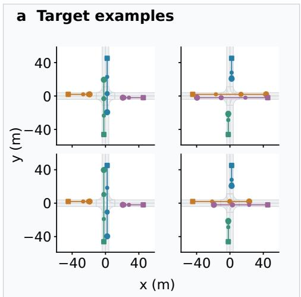

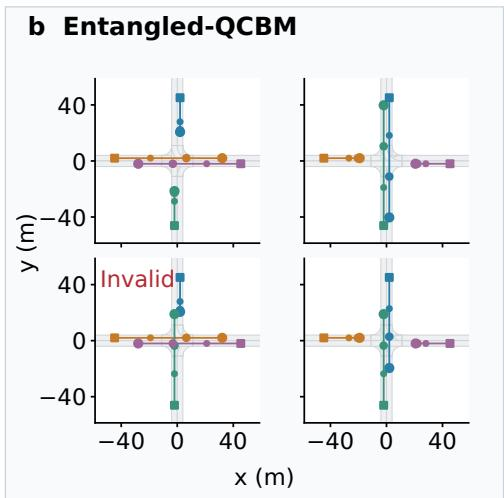

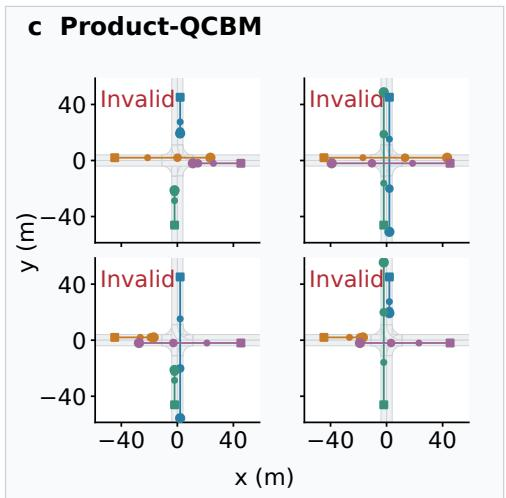

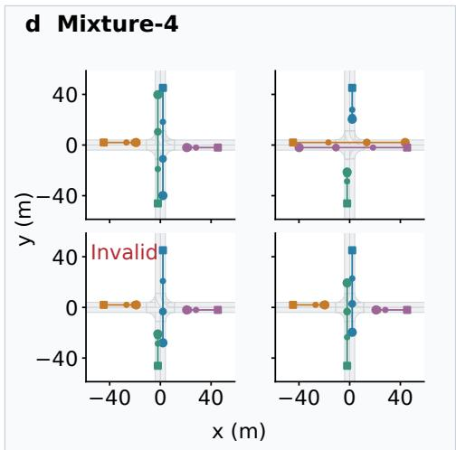  
Figure 6: Diverse continuation examples in HEP18, using ideal-gradient reference checkpoints. Each group shows four examples for the same test observation, with targets in (a) and sampled predictions in (b–d). We select distinct combinations of local behaviours from the 18 targets or each model’s 128 prior draws, favouring visibly different trajectories. All groups use the first test observation and first training run. Selection is independent across groups, so examples in corresponding positions are not paired. The display illustrates different continuations; their counts do not estimate how often the model samples them. Invalid predictions are labelled, and all groups share agent colours and spatial limits. Increasing marker sizes indicate 3, 6 and 9 s; squares mark the observed positions. The numerical tables use all prior draws, without this selection for display.

Table 11: Effect of change regularization on 64 HEP18 validation observations. Values are means ± sample standard deviations across three matched initializations, with 128 prior draws per observation. All rows use joint predictive energy and coefficient $2 / 3$ on each of $R ( h )$ and $R ( t )$ . The retained configuration also includes ${ \textstyle \frac { 2 } { 3 } } R ( t - h )$ . Coverage and validity are percentages, and every run is retained, including unsuccessful training outcomes.
<table><tr><td>Prior</td><td> $R ( t - h )$ </td><td> $\mathbf { C o v . \uparrow }$ </td><td> $\mathrm { V a l i d } \uparrow$ </td><td> $\mathrm { T V } \downarrow$ </td></tr><tr><td>Entangled-QCBM</td><td>Yes</td><td> $9 9 . 8 8 \pm 0 . 0 5$ </td><td> $9 8 . 6 2 \pm 0 . 3 7$ </td><td> $0 . 1 6 6 \pm 0 . 0 1 2$ </td></tr><tr><td>Entangled-QCBM</td><td>No</td><td> $7 0 . 7 2 \pm 5 0 . 3 4$ </td><td> $6 7 . 4 7 \pm 5 2 . 7 4$ </td><td> $0 . 4 1 7 \pm 0 . 4 5 1$ </td></tr><tr><td>Mixture-4</td><td>Yes</td><td> $9 9 . 8 0 \pm 0 . 0 5$ </td><td> $9 7 . 8 6 \pm 1 . 6 9$ </td><td> $0 . 1 5 7 \pm 0 . 0 0 4$ </td></tr><tr><td>Mixture-4</td><td>No</td><td> $9 0 . 6 5 \pm 1 6 . 1 1$ </td><td> $9 1 . 9 1 \pm 1 0 . 3 7$ </td><td> $0 . 2 2 8 \pm 0 . 1 2 1$ </td></tr></table>

Removing change regularization produced much greater variation across training runs for Entangled QCBM. Two runs retained high coverage and validity, but the third generated mostly invalid continuations. For that run, decoding encoded real targets still gave 100% validity. The readout could therefore reconstruct valid motion from target features; the failure arose when using the model’s predicted features. Mixture-4 also lost accuracy in its third run, although less severely.

With change regularization, all three Entangled-QCBM runs retained high coverage and validity. This ablation supports retaining $R ( t - h )$ to stabilize the present HEP18 training setup. It evaluates ideal-gradient training; the separate finite-shot comparison is reported in Appendix D.

## H EVALUATION CHECKS AND DIRECTION FREQUENCIES

The sampling-budget checks and direction-frequency figure use ideal-gradient reference checkpoints, as indicated in their captions.

Interpreting the metrics. For HEP18, each sampled four-agent trajectory is assigned to its nearest target using the normalized-error rule in Appendix F.4. If the sample exceeds the tolerance, it enters the invalid category. A model can therefore have high coverage but low validity: it may occasionally reach every target while producing many invalid samples. Conversely, a model that repeatedly predicts one valid future can have high validity but low coverage. TV also measures whether the frequencies of valid futures are correct. The metrics capture different properties and need not rank methods identically. A deterministic model repeats the same continuation within each observation, so shuffling its draws leaves all metrics unchanged.

Sampling-budget and tolerance checks. We reevaluate the first 32 and first 64 draws from each existing 128-draw sample set. Using these nested subsets changes the sampling budget without drawing a new set of predictions. We also test position/speed tolerances of 1 m/0.5 m/s and 3 m/1.5 m/s, keeping all 128 draws. The main evaluation retains its fixed tolerances of 2 m and 1 m/s. These checks show how the reported metrics respond to stricter matching or fewer samples.

For a finite-sample reference, we draw 128 futures directly from the true uniform distribution over the 18 targets. Its empirical TV is generally nonzero because sampled frequencies fluctuate, even when the underlying distribution is correct.

Run variation and repeated numerical entries. The ± values in the training-result tables are sample standard deviations across independently trained models. They do not describe variation among the 128 draws from one model. Equal rounded entries can occur when different sample sets contain the same codes needed to achieve the best predictions. Further repetitions change code frequencies, but not coverage or best-sample errors once those codes have been drawn. Equa displayed values therefore do not imply identical sampled distributions.

Table 12: Ideal-gradient reference: sampling-budget and tolerance checks on 128 HEP18 test observations. Values are means over three independent training runs. The sample-budget rows use the first K draws from the same 128-draw set, with position/speed tolerances of 2 m/1 m/s. The tolerance rows retain all 128 draws and change only the matching thresholds.
<table><tr><td>Prior</td><td>Setting</td><td>Coverage (%)</td><td>Validity (%)</td><td>TV</td></tr><tr><td>Entangled-QCBM</td><td>K = 32</td><td>82.60</td><td>98.59</td><td>0.31</td></tr><tr><td>Entangled-QCBM</td><td>K = 64</td><td>96.88</td><td>98.53</td><td>0.22</td></tr><tr><td>Entangled-QCBM</td><td>K = 128</td><td>99.83</td><td>98.55</td><td>0.16</td></tr><tr><td>Entangled-QCBM</td><td>1 m / 0.5 m/s</td><td>91.42</td><td>82.84</td><td>0.28</td></tr><tr><td>Entangled-QCBM</td><td>3 m / 1.5 m/s</td><td>99.83</td><td>98.70</td><td>0.16</td></tr><tr><td>Product-QCBM</td><td>K = 32</td><td>25.77</td><td>25.44</td><td>0.80</td></tr><tr><td>Product-QCBM</td><td>K = 64</td><td>34.33</td><td>25.48</td><td>0.78</td></tr><tr><td>Product-QCBM</td><td>K = 128</td><td>39.45</td><td>25.56</td><td>0.77</td></tr><tr><td>Product-QCBM</td><td>1 m / 0.5 m/s</td><td>24.68</td><td>10.78</td><td>0.89</td></tr><tr><td>Product-QCBM</td><td>3 m / 1.5 m/s</td><td>44.24</td><td>27.96</td><td>0.74</td></tr><tr><td>Mixture-4</td><td>K = 32</td><td>82.83</td><td>97.97</td><td>0.30</td></tr><tr><td>Mixture-4</td><td>K = 64</td><td>96.70</td><td>97.94</td><td>0.22</td></tr><tr><td>Mixture-4</td><td>K = 128</td><td>99.96</td><td>97.88</td><td>0.16</td></tr><tr><td>Mixture-4</td><td>1 m / 0.5 m/s</td><td>92.00</td><td>85.36</td><td>0.26</td></tr><tr><td>Mixture-4</td><td>3 m / 1.5 m/s</td><td>99.96</td><td>98.68</td><td>0.16</td></tr><tr><td>AR-GRU</td><td>K = 32</td><td>78.43</td><td>95.43</td><td>0.34</td></tr><tr><td>AR-GRU</td><td>K = 64</td><td>91.48</td><td>95.39</td><td>0.26</td></tr><tr><td>AR-GRU</td><td>K = 128</td><td>94.16</td><td>95.54</td><td>0.21</td></tr><tr><td>AR-GRU</td><td>1 m / 0.5 m/s</td><td>81.05</td><td>75.07</td><td>0.35</td></tr><tr><td>AR-GRU</td><td>3 m / 1.5 m/s</td><td>94.33</td><td>96.57</td><td>0.20</td></tr></table>

Prior-sampled motion probability (%)  
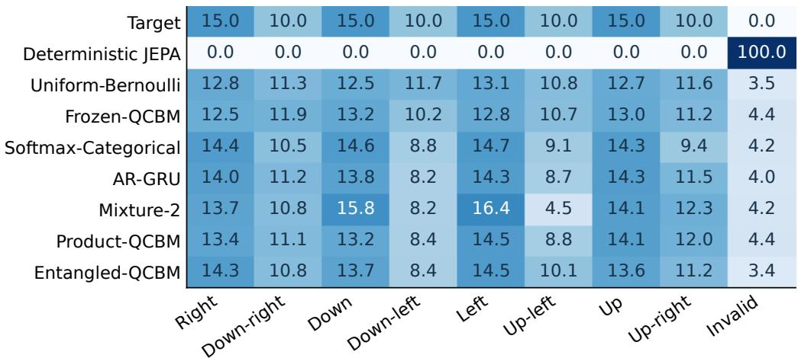  
Figure 7: MovingMNIST direction frequencies from the ideal-gradient reference models. We average sampled frequencies over all test observations and three independently trained models, retaining the invalid category. Printed values give the actual percentages in every cell. Colour intensity is capped at 25%, so concentrated rows do not obscure differences among the more evenly distributed rows.

## I LEARNING DIGIT-DEPENDENT FUTURE PROBABILITIES

We first train on data in which different digits have different future-direction probabilities. We then test whether the trained prior uses the observation by changing only its input features during evaluation.

Table 13: Digit-dependent MovingMNIST: mean ± sample s.d. over three training runs. Only the prior input changes between conditions; the predictor and readout keep the original observation. Each test observation has 384 sampled futures. TV includes invalid predictions; coverage and validity are percentages. Training uses finite-shot parameter shift and 0.5% readout flips for both priors.
<table><tr><td>Prior</td><td>Prior input</td><td> $\mathrm { T V } \downarrow$ </td><td>Coverage ↑</td><td> $\mathrm { { V a l i d } \uparrow }$ </td></tr><tr><td>Product-QCBM</td><td>Original observation</td><td> $0 . 1 9 9 \pm 0 . 0 0 9$ </td><td> $8 3 . 0 2 \pm 1 . 4 2$ </td><td> $9 4 . 6 7 \pm 0 . 4 8$ </td></tr><tr><td></td><td>Other image, same digit</td><td> $0 . 2 1 0 \pm 0 . 0 0 7$ </td><td> $8 3 . 0 2 \pm 1 . 4 2$ </td><td> $9 4 . 7 2 \pm 0 . 5 8$ </td></tr><tr><td></td><td>Other digit</td><td> $0 . 2 1 9 \pm 0 . 0 1 9$ </td><td> $8 3 . 0 2 \pm 1 . 4 2$ </td><td> $9 4 . 6 3 \pm 0 . 5 8 $ </td></tr><tr><td></td><td>Training-input mixture</td><td> $0 . 2 0 7 \pm 0 . 0 1 2$ </td><td> $8 3 . 0 2 \pm 1 . 4 2$ </td><td> $9 4 . 5 5 \pm 0 . 6 8$ </td></tr><tr><td>Entangled-QCBM</td><td>Original observation</td><td> $0 . 1 7 0 \pm 0 . 0 1 4$ </td><td> $8 7 . 3 4 \pm 0 . 7 8$ </td><td> $9 5 . 0 2 \pm 1 . 9 3$ </td></tr><tr><td></td><td>Other image, same digit</td><td> $0 . 1 9 7 \pm 0 . 0 1 8$ </td><td> $8 7 . 3 4 \pm 0 . 7 8$ </td><td> $9 4 . 2 9 \pm 2 . 2 9$ </td></tr><tr><td></td><td>Other digit</td><td> $0 . 2 3 6 \pm 0 . 0 2 6$ </td><td> $8 7 . 3 4 \pm 0 . 7 8$ </td><td> $9 4 . 7 5 \pm 1 . 7 3$ </td></tr><tr><td></td><td>Training-input mixture</td><td> $0 . 1 9 9 \pm 0 . 0 2 1$ </td><td> $8 7 . 3 4 \pm 0 . 7 8$ </td><td> $9 4 . 3 6 \pm 2 . 0 0$ </td></tr></table>

Step 1: digit-dependent data and ordinary training. We use handwritten zeros and ones. Both retain all eight directions, starting with rightward motion and advancing by $4 5 ^ { \circ }$ in image coordinates. Their direction probabilities are

$$
q _ { 0 } = ( 0 . 2 4 , 0 . 0 6 , 0 . 1 6 , 0 . 0 4 , 0 . 2 4 , 0 . 0 6 , 0 . 1 6 , 0 . 0 4 ) ,\tag{19}
$$

$$
q _ { 1 } = ( 0 . 1 2 5 , 0 . 1 2 5 , 0 . 1 2 5 , 0 . 1 2 5 , 0 . 1 2 5 , 0 . 1 2 5 , 0 . 1 2 5 , 0 . 1 2 5 , 0 . 1 2 5 ) .\tag{20}
$$

The direction distribution is non-uniform for digit 0 and uniform for digit 1. Per digit, we use 400 training and 40 disjoint development sprites from $\mathrm { M N I S T ^ { \circ } s }$ training split, and 40 sprites from its official test split. Vertical positions are paired across digit classes. The clips and motion steps follow Appendix F.2. Each training example supplies observation images and one sampled future. Digit labels only set the sampling probabilities; the model is trained from images.

Both QCBMs use the three-bit MovingMNIST architectures, energy score, two-view VISReg, optimizers and warm-up schedule in Appendix A. We train three models per circuit family, each with 4,000 JEPA updates followed by 4,000 readout updates with the JEPA weights frozen. We use the parameter-shift budgets in Table 5, with 0.5% independent readout flips during training and evaluation. The recorded budget is 145,536,000 simulated training shots per run. We retain all six final checkpoints without using the reserved development bank for tuning or checkpoint selection. The “Original observation” rows in Table 13 report normal prediction on this new dataset, averaged across both digits.

Step 2: testing the prior’s use of the observation. Both the prior and predictor receive the observation, so either can make the predicted direction distribution depend on the digit. To isolate the prior’s contribution, we fix all weights and keep the original observation representation h at the predictor and readout. We replace only the prior input with $\widetilde { h } \colon Z \sim p _ { \theta } ( \cdot \mid \widetilde { h } )$ and $\widehat { t } = P _ { \psi } ( h , Z )$ Normal inference uses ${ \widetilde { h } } = h$

We compare the original input with three replacements. These are the next image of the same digit, the other digit at the same vertical position, and a randomly selected training observation. For the last condition, we draw a new training observation for every prior sample. For example, a zero still enters the predictor while the prior receives features of a one; predictions are still scored against $q _ { 0 }$ . All conditions are scored against the original digit’s target probabilities. The random training inputs remove the link between the prior input and the current observation. The same-digit replacement can also change vertical position. For each of 80 test observations, we pool three groups of 128 predictions, compute TV including invalid samples, and average over observations. We report standard deviations across the three independent training runs.

Results and interpretation. Replacing the prior input with the other digit increases prediction TV in all three runs of both circuit families. The paired mean increase is $0 . 0 2 0 \pm 0 . 0 1 4$ for Product-QCBM and $0 . 0 6 5 \pm 0 . 0 2 3$ for Entangled-QCBM. For Entangled-QCBM, the training-input mixture worsens TV in all three runs; the Product-QCBM effect is smaller and reverses slightly in one run. Thus the prior contributes useful observation-dependent probabilities, with a stronger effect for Entangled-QCBM in this check.

Table 14: Real-QPU inference on the first eight MovingMNIST test observations, using the first trained model of each circuit family. GPU and QPU rows both use 128 actual draws per observation; each circuit-family pair shares its frozen neural networks. Coverage and validity are percentages; ADE and ES are in pixels. These are single-model deployment results, not means across independent trainings.
<table><tr><td>Prior</td><td>Sampling</td><td>Cov. ↑</td><td>Valid ↑</td><td>TV↓</td><td>minADE↓</td><td>ES↓</td><td>Dice ↑</td></tr><tr><td>Product-QCBM</td><td>GPU / ideal</td><td>89.06</td><td>98.44</td><td>0.1678</td><td>1.059</td><td>9.633</td><td>0.567</td></tr><tr><td>Product-QCBM</td><td>QPU</td><td>89.06</td><td>98.73</td><td>0.1674</td><td>1.059</td><td>9.670</td><td>0.567</td></tr><tr><td>Entangled-QCBM</td><td>GPU / ideal</td><td>96.88</td><td>96.48</td><td>0.1482</td><td>0.680</td><td>9.565</td><td>0.607</td></tr><tr><td>Entangled-QCBM</td><td>QPU</td><td>96.88</td><td>97.17</td><td>0.1520</td><td>0.680</td><td>9.548</td><td>0.607</td></tr></table>

After averaging sampled code frequencies within each digit class, the TV between the two classes is $0 . 0 4 1 \pm 0 . 0 1 8$ for Product-QCBM and $0 . 0 7 4 \pm 0 . 0 2 8$ for Entangled-QCBM. Every input condition samples all eight codes, and each code’s predicted future stays fixed because the predictor input is unchanged. Coverage therefore stays the same, while the direction frequencies change. These differences are computed within each trained model, because bit codes need not have the same meaning across initializations. Decoding encoded real targets gives mean endpoint errors of 0.66 pixels for both families, below the four-pixel matching threshold.

These results show that the prior uses observation features to adjust future probabilities. Replacements within the same digit class also affect TV, indicating sensitivity to more than digit identity.

## J REAL-QPU INFERENCE DETAILS

Hardware access and division of work. We used the LQCloud cloud service to access the MQ02 and AGate-100 quantum processors for MovingMNIST and HEP18, respectively. The QPU generated latent-action bit strings, while the encoder, conditioner, predictor and readout ran classically. Each measurement shot denotes one circuit execution and returns one bit string.

## J.1 MOVINGMNIST DEPLOYMENT

We deployed trained three-qubit Product-QCBM and Entangled-QCBM priors on the MQ02 quantum processor. Both use unchanged ideal-gradient reference weights, rather than the noisy parameter-shift checkpoints in the main tables. For each of the first eight MovingMNIST test observations, the encoder and conditioner produce the circuit’s nine rotation angles. The Entangled-QCBM circuit contains two CNOT gates, while Product-QCBM omits them. Both circuit families include their trained terminal rotations.

Before submission, we checked that each exported circuit reproduced the simulator’s ideal probabilities. We then used three basis-state preparations to verify the ordering of bits returned by the device. For each circuit, we collected 1,024 measurement shots without readout correction. Each measured code was passed directly through the frozen predictor and image readout.

The primary comparison uses the first 128 shots per observation, matching the main evaluation’s sample budget. We divide the remaining shots into seven further groups of 128. These groups measure repeated sampling of the same trained circuit, not variation across independent training runs.

Table 14 shows that hardware-generated actions can drive the complete prediction pipeline with similar results to ideal sampling. Within each circuit family, coverage and minimum ADE were identical for the two sampling sources. Both sources recovered all eight codes for these observations, so they supplied the same set of possible decoded predictions. Their code frequencies differed, which changed TV and energy score. This three-qubit experiment evaluates hardware deployment; the larger-register resource analysis is given in Section 4.2.

Table 15: HEP18 deployment on AGate-100: one frozen 12-qubit Entangled-QCBM checkpoint and eight observations held out from layout selection. Values average all eight disjoint 128-draw groups per observation (1,024 draws total), including the matched ideal reference. All QPU layouts use the same angles and 29 CZ gates. Coverage and validity are percentages; ADE and ES are in metres.
<table><tr><td>Sampling / layout</td><td>Cov. ↑</td><td>Valid ↑</td><td>TV↓</td><td>minADE↓</td><td>ES↓</td></tr><tr><td>Ideal sampling</td><td>99.91</td><td>98.41</td><td>0.166</td><td>0.218</td><td>34.38</td></tr><tr><td>QPU: original layout</td><td>99.05</td><td>76.88</td><td>0.308</td><td>0.238</td><td>34.99</td></tr><tr><td>QPU: selected layout</td><td>98.78</td><td>81.53</td><td>0.280</td><td>0.241</td><td>34.86</td></tr><tr><td>QPU: reflected layout</td><td>99.57</td><td>86.69</td><td>0.239</td><td>0.227</td><td>34.66</td></tr></table>

## J.2 HEP18 DEPLOYMENT WITH EQUIVALENT CIRCUIT LAYOUTS

Why the hardware layout matters. A hardware layout assigns the circuit’s qubits to physical qubits and connections on the processor. Gate and measurement errors vary across the device, so layouts implementing the same ideal circuit can produce different sampled code frequencies.

Frozen model and circuit compilation. We used one fixed 12-qubit Entangled-QCBM checkpoint trained with the noisy parameter-shift configuration in Table 3. The encoder, conditioner, predictor, readout and every circuit parameter remained unchanged throughout deployment. The four-layer circuit contains 60 single-qubit rotations, including the terminal rotations, and 20 logical CNOT gates.

On the AGate-100 quantum processor, we mapped the twelve circuit qubits to a 4 × 3 physical grid. Three SWAP gates moved quantum states between connected qubits to implement the required interactions. The compiled circuit used 29 two-qubit controlled-Z (CZ) gates and 67 single-qubit instructions. After measurement, we restored the logical bit order before passing codes to the predictor. Numerical checks found absolute differences below 10−16 between the ideal output probabilities before and after compilation.

Layout selection. We screened six physical layouts using device calibration information and simulated sensitivity to individual injected gate errors. We selected the layout with the lowest joint TV on four development observations, then confirmed its improvement on 16 additional observations. Next, we tested four reflected orientations of the grid using the same four development observations. We fixed the best orientation before evaluating the final observations.

These layout changes leave circuit angles, gate counts and the ideal Born distribution unchanged. The final assignment of virtual wires (the numbered qubits in the exported circuit) to physical qubits was (67, 66, 3, 68, 65, 36, 69, 64, 37, 70, 63, 38). The logical-to-wire permutation was (0, 1, 2, 6, 7, 8, 9, 10, 11, 3, 4, 5). Its entries specify the virtual wire used by each logical qubit; both lists use zero-based indices.

Final measurement protocol. The final comparison used eight further HEP18 test observations. None was used for layout selection or the intermediate confirmation. For each observation, we ran the original, selected and reflected layouts with 1,024 shots each. We rotated submission order across observations, completing and saving each job before submitting the next.

Twelve binary-index basis preparations verified bit order across the three layouts. These control prepare known patterns of zeros and ones, so returned bits can be matched to their intended logical positions. Six final all-zero/all-one controls completed the 42-job protocol. We used no readout correction, dynamical decoupling, sample rejection or model updates. Every measured code entered the same frozen prediction pipeline.

Aggregation and results. For each observation and layout, we divide the 1,024 shots into eight disjoint groups of 128. We compute metrics within each group, then average over all groups and observations in Table 15. The ideal reference uses the same observations, grouping and sample budget. Thus each metric evaluation retains the 128-draw budget used in the main experiments. All evaluations use the position and speed tolerances in Appendix F.4. The repeated groups characterize sampling from one checkpoint, not variation across independently trained models.

The reflected layout increased validity by 9.81 percentage points relative to the original layout. It also reduced joint TV for each of the eight observations. Its joint validity reached 86.69%, compared with 98.41% under ideal sampling. All individual-agent continuations remained locally valid, but 13.31% of joint samples combined local actions that were incompatible with the same priority choice. Independently re-pairing agents reduced validity to 12.95%. The original measured samples therefore retained substantial cross-agent coordination despite the remaining hardware errors.

Using only the first group of 128 shots gave validity of 75.00%, 81.35% and 83.59% for the original, selected and reflected layouts. The headline averages retain every group, rather than selecting the most favourable one. This is a matched comparison of layouts on one device; it does not measure robustness across different days.

Other deployment checks. We also tested readout bit-flip averaging and equivalent changes to the circuit’s phase frame. Further tests split rotations into half-angle gates or executed CZ gates sequentially instead of concurrently. These alternatives did not consistently improve development results and were omitted from the final setup. An earlier confirmation batch was interrupted because some cloud-task records became unavailable. We retained that batch separately and did not combine it with the complete final comparison.

## J.3 D3IL COMMON-START RECURSIVE INFERENCE

Deployment. We deployed the eight-qubit Product-QCBM and Entangled-QCBM checkpoints from the first fold and training run of Table 4. Both were trained with noisy parameter shift and kept fixed during deployment. Each prior generated 40 raw rollouts from the common stationary point using the re-encoding and stopping rules in Appendix B.4. Every latent action came from a fresh QPU measurement, including after re-encoding a predicted segment. The neural networks ran on the GPU.

We used an eight-qubit chain on AGate-100, selected from device calibration without target trajectories or predictive scores. CNOT-to-CZ compilation and single-qubit gate fusion gave eight local gate blocks for Product-QCBM, and 36 local blocks plus 14 CZs for Entangled-QCBM. Noiseless compilation checks preserved Born probabilities to within 4.22 × 10−15 for both circuits. Four known basis patterns, each measured with 128 shots, verified bit order. Identical circuits within a recursive step shared a submission, with a separate measurement shot for each path. We used raw measurements without readout correction, dynamical decoupling or additional simulated noise. Product-QCBM and Entangled-QCBM supplied 458 and 437 latent actions, respectively. Together with the controls, this required 775 tasks and 1,407 measurement shots. We checked returned instructions, mappings and shot counts, and replayed the saved measurements to reproduce all 80 paths exactly.

Evaluation budget and metrics. We use the same geometric checks, route definitions and uniform 24-route reference as in Table 4. That table summarizes nine models per method, each evaluated with 384 raw rollouts, and reports expected metrics for a subset of 60 accepted paths. The hardware check uses one checkpoint per prior and 40 raw rollouts, because each recursive step requires a new conditional circuit execution. Both accepted pools are smaller than the 60-path budget of the main comparison. We therefore report the routes and TV of each complete accepted pool. The route count C corresponds to coverage C/24. Coverage and TV depend on sample count, so we compare hardware results with GPU sampling at the same budget.

For each fixed checkpoint, we ran 20 GPU sampling repetitions with the same budget of 40 raw paths. We tested both noiseless sampling and sampling with 0.5% readout flips. Each hardware row in Table 16 reports one run; GPU standard deviations measure variation across the sampling repetitions.

Product-QCBM produced 13 accepted paths spanning 10 routes; Entangled-QCBM produced 17 spanning 13 routes. The noisy GPU references covered 5–13 and 6–14 routes, respectively. Hardware coverage falls within these ranges, showing that the trained priors can support complete recursive prediction on a QPU.

Table 16: D3IL inference from the common stationary point. Each source uses 40 raw rollouts per prior. GPU rows give mean ± sample s.d. over 20 sampling repetitions of the same checkpoint; each QPU row is one 40-path run. All checkpoints use noisy parameter-shift training. Routes (out of 24) and TV are computed within geometrically valid paths.
<table><tr><td>Prior</td><td>Sampling</td><td>Routes ↑</td><td>TV↓</td></tr><tr><td>Product-QCBM</td><td>GPU (0% flips)</td><td> $9 . 4 5 \pm 1 . 8 2$ </td><td> $0 . 6 0 6 \pm 0 . 0 7 6$ </td></tr><tr><td>Product-QCBM</td><td>GPU (0.5% flips)</td><td> $8 . 4 5 \pm 1 . 9 3$ </td><td> $0 . 6 4 8 \pm 0 . 0 8 1$ </td></tr><tr><td>Product-QCBM</td><td>Real QPU</td><td>10.00</td><td>0.583</td></tr><tr><td></td><td>Entangled-QCBM GPU (0% flips)</td><td> $9 . 3 0 \pm 1 . 9 2$ </td><td> $0 . 6 1 3 \pm 0 . 0 8 0$ </td></tr><tr><td></td><td>Entangled-QCBM GPU (0.5% flips)</td><td> $9 . 4 0 \pm 1 . 8 5$ </td><td> $0 . 6 0 8 \pm 0 . 0 7 7$ </td></tr><tr><td>Entangled-QCBM Real QPU</td><td></td><td>13.00</td><td>0.458</td></tr></table>

Table 17: D3IL route coverage standardized to eight accepted paths. Entries give the exact expected number of routes in an eight-path subset drawn uniformly without replacement from each saved valid pool. GPU means and sample s.d.s include only pools containing at least eight paths: 19/20 and 18/20 repetitions for Product-QCBM at 0% and 0.5% flips, and 19/20 and 20/20 for Entangled-QCBM. Each hardware entry describes one saved pool.
<table><tr><td>Prior</td><td>GPU (0%)</td><td>GPU (0.5%) Real QPU</td><td></td></tr><tr><td>Product-QCBM</td><td> $6 . 4 2 \pm 0 . 5 4$ </td><td> $6 . 2 4 \pm 0 . 6 7$ </td><td>6.92</td></tr><tr><td>Entangled-QCBM</td><td> $6 . 4 7 \pm 0 . 5 3$ </td><td> $6 . 1 8 \pm 0 . 5 3$ </td><td>7.05</td></tr></table>

With $N \leq 2 4$ accepted paths, each occupied route has frequency at least $1 / N \geq 1 / 2 4$ . TV against the uniform catalogue therefore equals $\bar { 1 } - C / 2 4$ , where $\dot { C }$ counts occupied routes. At this sample size, TV conveys the same information as route coverage.

We also compare the expected number of routes in a uniform eight-path subset of each accepted pool (Table 17). Pools with fewer than eight accepted paths are omitted only from this supplementary statistic; their counts appear in the caption. The hardware values are 6.92 and 7.05 routes, close after matching the number of accepted paths.