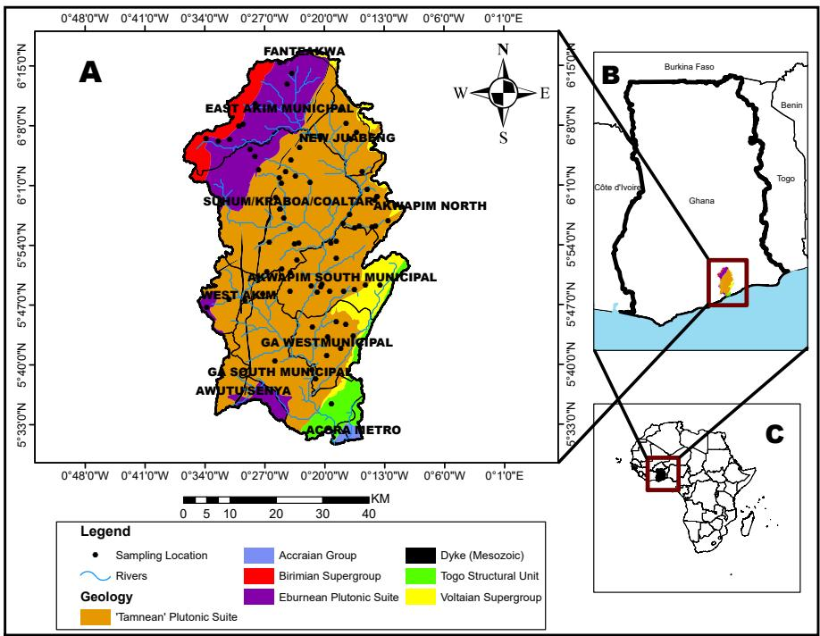
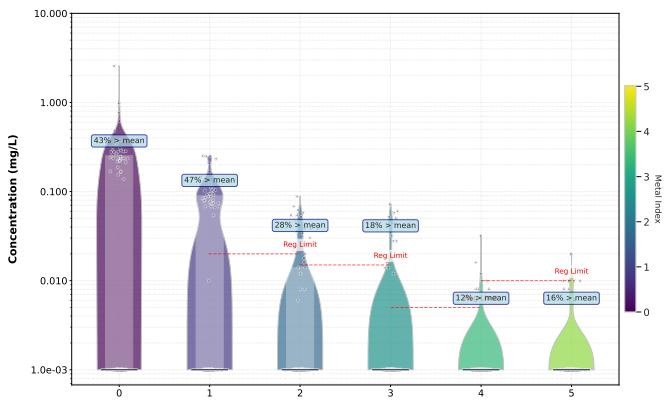
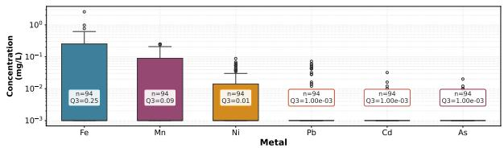
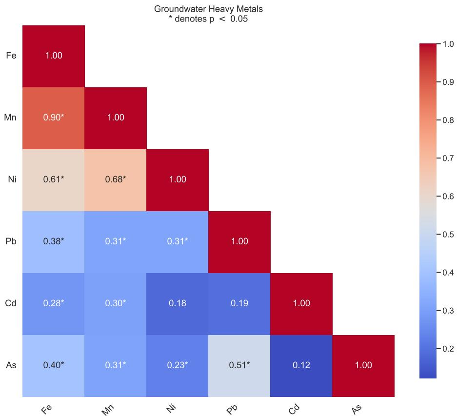
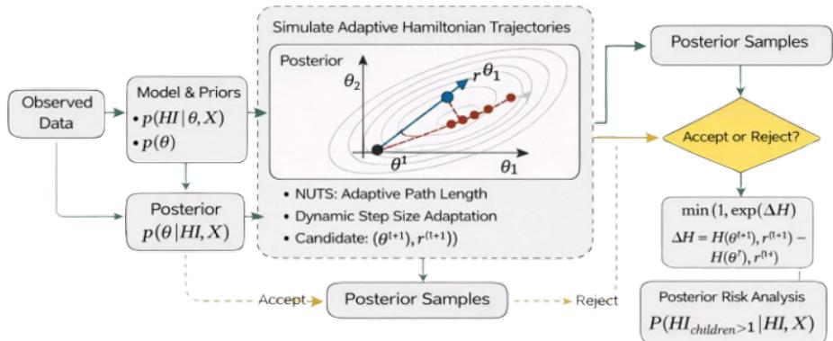
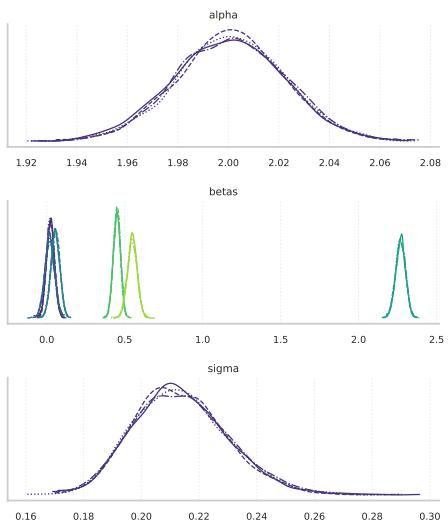
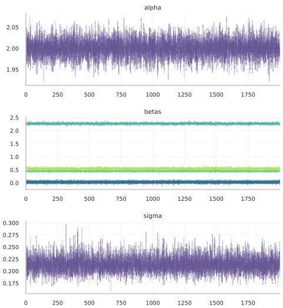
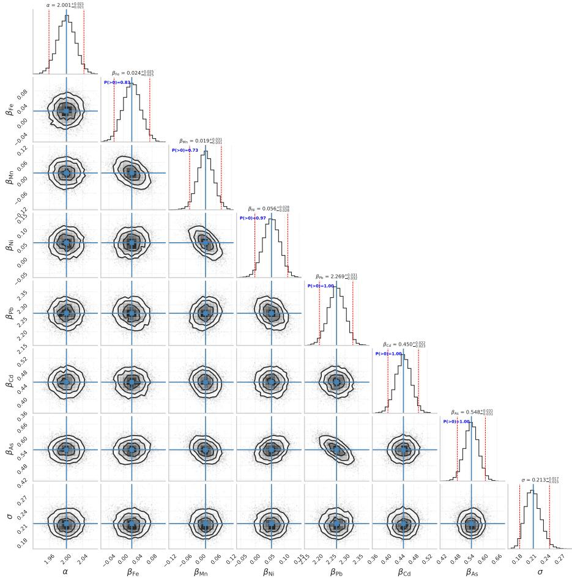
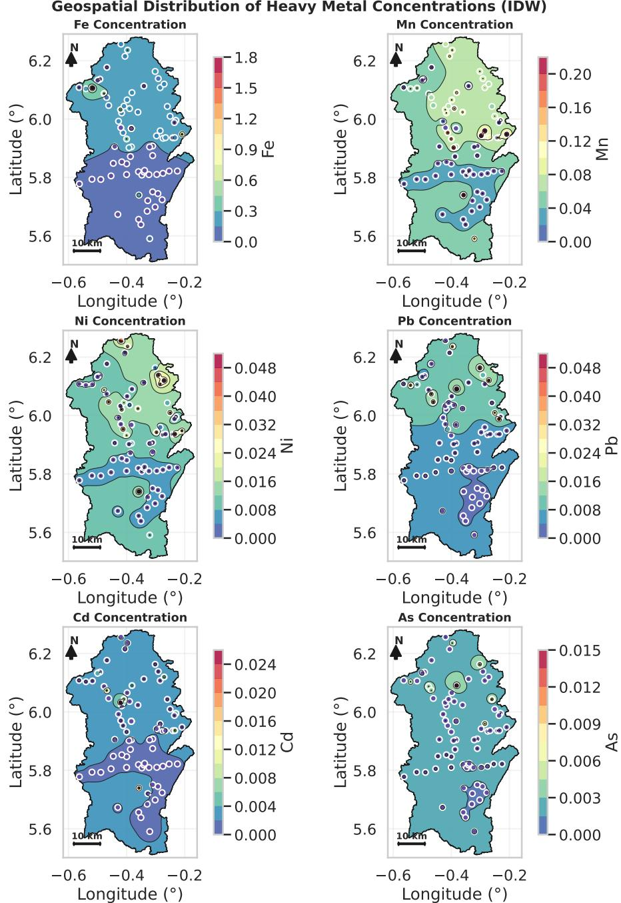
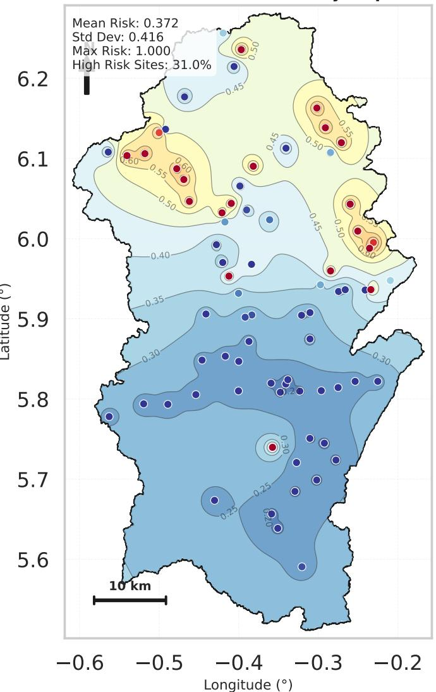

# Quantifying the Threat: A Bayesian Probabilistic Framework for Heavy Metal Health Risks among Children in the Densu

Basin, Ghana

T. Ansah-Narh1\*, G. Y. Afrifa1, J. B. Tandoh1, E. N. N. Nortey2, D. Adjei3, R. Opoku-Sarkordie4 and R. Davis5

1Ghana Space Science and Technology Institute, Ghana Atomic   
Energy Commission, P. O. Box LG 80, Accra, Ghana.   
2Department of Statistics and Actuarial Science, University of   
Ghana, P. O. Box LG 115, Legon, Accra, Ghana.   
3Institut de Chimie Physique, Universit´e Paris-Saclay / CNRS   
UMR8000, 91400, Rue Michel Magat, Orsay, France.   
4Department of Information Technology and Mathematical   
Sciences, Methodist University Ghana, P. O. Box DC 940,   
Dansoman, Accra, Ghana.   
5Department of Mathematics and Actuarial Science, Pentecost   
University, P. O. Box KN 1739, Kaneshie, Accra, Ghana.

\*Corresponding author(s). E-mail(s): theophilus.ansah-narh@gaec.gov.gh;

## Abstract

Groundwater remains a critical source of domestic water for many communities in the Densu River Basin, Ghana, yet contamination by potentially toxic elements poses persistent public health concerns, particularly for children. Existing health risk assessments in the region have largely relied on deterministic hazard index calculations, which ofer

limited insight into uncertainty, co-exposure efects, and the spatial variability of risk. This limitation constrains evidence-based decision-making in hydrogeologically complex and data-limited settings. To address this gap, this study develops and applies a Bayesian probabilistic health risk assessment framework to quantify non-carcinogenic risks associated with multi-metal groundwater exposure among children. Concentrations of Fe, Mn, Ni, Pb, Cd, and As, measured in 94 groundwater samples, were integrated into a Bayesian regression model that explicitly propagates parameter uncertainty and jointly accounts for contaminant co-occurrence. Posterior inference was performed using adaptive Hamiltonian Monte Carlo sampling, enabling robust estimation of metalspecific risk contributions and posterior predictive health outcomes. Site-level posterior risk probabilities were subsequently translated into spatially continuous risk surfaces using inverse distance weighting, ensuring consistency with sampling density and hydrogeological constraints. The results indicate that lead, arsenic, and cadmium are the dominant contributors to cumulative health risk, with posterior probabilities providing strong evidence of their positive association with the child Health Index. Posterior predictive analysis reveals that approximately 31% of sampling locations exhibit probabilities exceeding 0.5 for HI > 1, indicating that unsafe exposure is more likely than not at these sites under the assumed exposure conditions. The spatial risk surface is characterised by substantial heterogeneity, with a posterior mean risk probability of 0.372 and a standard deviation of 0.416, reflecting both pronounced variability in groundwater chemistry and uncertainty propagated through the Bayesian model. Importantly, high-risk zones emerge that are not readily identifiable from individual metal concentration maps alone, demonstrating that cumulative risk often arises from moderate co-exposure rather than extreme contamination by a single metal. By moving beyond binary threshold-based classification, the proposed framework provides uncertainty-aware, spatially explicit risk information that is directly relevant for groundwater management and public health planning. The approach ofers a transparent and adaptable tool for prioritising monitoring, mitigation, and policy interventions in groundwaterdependent regions, with broader applicability across sub-Saharan Africa.

Keywords: Densu river basin, Heavy metals, Groundwater contamination, Bayesian health risk assessment, Spatial risk mapping, Hydrogeochemical uncertainty

## 1 Background and Motivation

Groundwater constitutes a cornerstone of domestic, agricultural, and industrial water supply worldwide, particularly in regions where surface water availability is constrained by climatic variability, seasonal intermittency, and infrastructural limitations. It is estimated that nearly half of the global population relies on groundwater for drinking and daily use, with substantially higher dependence observed in rural and peri-urban areas of low- and middleincome countries (WHO, 2024). This reliance places considerable importance on groundwater quality, especially in settings where alternative water sources and advanced treatment options are limited.

Despite its widespread perception as a relatively protected resource, groundwater quality is increasingly compromised by both natural and anthropogenic processes. Geochemical weathering of aquifer materials can mobilise trace elements, while agricultural intensification, industrial activities, mining, and improper waste disposal contribute to potential contamination pathways. Potentially toxic elements (PTEs), including lead (Pb), cadmium (Cd), and arsenic (As), are of particular concern because of their persistence in subsurface environments and their potential to cause adverse health efects following prolonged exposure (Kapoor et al, 2024; Smedley and Kinniburgh, 2002; Raja et al, 2021). Chronic ingestion of contaminated groundwater has been associated with a range of adverse health outcomes, underscoring the need for robust and context-specific risk assessment frameworks.

The occurrence and distribution of PTEs in groundwater depend on the interaction between geological characteristics, hydrogeochemical conditions, groundwater flow pathways, and land-use pressures. Weathering of mineralbearing formations may release elements into groundwater, whereas changes in redox conditions, pH, and mineral-surface interactions can alter their mobility and persistence. Anthropogenic activities may introduce additional contaminants or modify existing geochemical conditions, resulting in spatially heterogeneous contamination patterns. Research on lead-zinc mine tailings in

## 4 Bayesian Assessment of Heavy Metal Health Risk

South China has examined the spatial distribution of heavy metals and their environmental implications, illustrating the relevance of spatially explicit characterisation in contaminated environments (Chen et al, 2018). More recently, Isah et al. investigated heavy metal contamination associated with artisanal gold mining in the Ile-Ife–Ilesha Schist Belt of Nigeria, using geospatial assessment to examine pollution sources and contamination hotspots (Isah et al, 2025a). Although mining and mine-tailings environments difer from the groundwater-dependent setting examined in this study, these investigations demonstrate the importance of considering spatial heterogeneity and potential contamination sources when characterising environmental metal pollution.

Children represent a population group that is especially susceptible to the health impacts of PTE exposure through drinking water. Relative to adults, children typically consume greater volumes of water per unit body weight and undergo critical stages of neurological, immunological, and physiological development. These characteristics can increase exposure on a body-weight basis and heighten vulnerability to certain toxic substances (Zhao et al, 2023; Hui et al, 2021). Epidemiological studies have consistently linked early-life exposure to metals such as Pb and Cd with impaired neurodevelopment, diminished cognitive function, and elevated risks of long-term morbidity (Grandjean, 2019; Lanphear et al, 2019; Choi et al, 2012). Consequently, international public health guidelines emphasise the need to evaluate exposure in vulnerable population groups, including children in groundwater-dependent communities. For these populations, assessments that consider the combined contribution of multiple contaminants are particularly relevant because exposure may occur simultaneously through water containing several potentially harmful elements.

The challenges associated with groundwater contamination are particularly pronounced in sub-Saharan Africa, where groundwater serves as an

## Bayesian Assessment of Heavy Metal Health Risk

important source of potable water. Rapid population growth, unplanned urbanisation, agricultural expansion, extractive activities, and inadequate waste management can intensify pressures on groundwater systems across the region. Previous assessments have documented contamination associated with geogenic processes and anthropogenic inputs, including mining and waste disposal (Owusu et al, 2024; Lapworth et al, 2017). In southwestern Nigeria, Isah et al. investigated groundwater-level conditions and heavy metal contamination around the Olubunku dumpsite and its surroundings (Isah et al, 2023). Their subsequent work examined groundwater contamination flow paths and heavy metal mobilisation near a waste site in the same broader region (Isah et al, 2025b). These studies are relevant to the present investigation because they address the relationship between groundwater conditions, contaminant mobilisation, and potential sources of pollution. However, the transferability of their findings to other aquifer systems must be considered in relation to diferences in geology, hydrogeology, land use, and contaminant sources.

Despite growing attention to groundwater contamination, monitoring remains spatially sparse and temporally irregular in many settings, limiting the ability to characterise contaminant distributions and associated exposure patterns comprehensively. Concentration measurements from individual sampling locations provide important information about local water quality, but they do not, in isolation, establish the probability of adverse health-risk thresholds being exceeded across a population or geographical area. Spatial variability in contaminant concentrations also means that basin-wide summaries may conceal localised areas of concern. These challenges are particularly important where groundwater is used directly for drinking and where resources for routine monitoring and treatment are limited.

## 6 Bayesian Assessment of Heavy Metal Health Risk

Within this broader regional context, Ghana exemplifies a setting where groundwater plays a critical role in meeting domestic and productive water demands. The Densu Basin supports a dense and rapidly growing population and encompasses a heterogeneous mosaic of land uses, including urban settlements, agriculture, and industrial activities. Previous studies have documented spatially variable groundwater quality within the basin, with reported concentrations of certain heavy metals approaching or exceeding international drinking water guidelines at specific locations (Duncan et al, 2018; Awuah, 2016). Such variability reflects the complex hydrogeological structure of the basin and the diverse potential sources of contamination. The regional evidence from mining- and waste-afected environments in Nigeria further reinforces the need to investigate contaminant distributions within their local hydrogeological contexts rather than assuming that the patterns observed elsewhere apply directly to the Densu Basin (Isah et al, 2023, 2025a,b).

Notwithstanding these concerns, groundwater quality assessments commonly employ deterministic evaluation frameworks. These include comparisons of measured concentrations against guideline values and the calculation of non-carcinogenic health-risk metrics, such as the Hazard Index (HI), using fixed exposure parameters (Donkor et al, 2005; Means, 1989). Such approaches provide useful screening-level information and remain valuable for identifying contaminants or locations that warrant further investigation. However, a single calculated HI does not directly quantify the probability that the underlying risk exceeds a specified threshold when concentrations, exposure conditions, and model parameters are uncertain. Moreover, assessing each element separately may not adequately communicate the implications of simultaneous exposure to multiple contaminants. Consequently, deterministic estimates alone may provide an incomplete representation of uncertainty in cumulative health-risk characterisation.

## Bayesian Assessment of Heavy Metal Health Risk

These limitations become particularly consequential when groundwater risk assessments inform public health interventions and water-resource management decisions. Environmental contamination studies increasingly recognise the importance of identifying spatial variability, characterising potential sources, and distinguishing localised hotspots from broader contamination patterns (Chen et al, 2018; Isah et al, 2025a,b). Nevertheless, spatial identification of contamination does not necessarily establish the probability of a health-risk threshold being exceeded. Concentration-based hotspot analysis and health-risk assessment address related but distinct questions: the former characterises environmental contamination, whereas the latter evaluates the implications of exposure under specified assumptions. Integrating contaminant measurements with an explicit probabilistic health-risk framework can therefore provide complementary information for prioritising monitoring and mitigation.

Recent methodological research in environmental health sciences has called for probabilistic approaches that explicitly integrate uncertainty into risk estimates and provide distributions of potential outcomes rather than single-value indicators (Spiegelman, 2010). Bayesian statistical methods ofer a principled framework for this purpose by representing unknown quantities as probability distributions and updating prior information with observed data to obtain posterior inferences (Edition, 2013; Carlin and Louis, 2008). In water-quality and exposure assessment, Bayesian approaches can support uncertainty propagation, estimation of posterior distributions, and probabilistic interpretation of health-risk metrics (Yan et al, 2019). In particular, posterior predictive simulation enables the estimation of the probability that a health-risk measure exceeds a defined threshold, thereby providing information that is not available from a single deterministic estimate.

## Springer Nature 2021 LAT X template

## 8 Bayesian Assessment of Heavy Metal Health Risk

Despite the growing application of spatial contamination assessment and probabilistic risk analysis, important challenges remain when these approaches are applied to groundwater-dependent communities with limited sampling data. Geospatial characterisation can identify areas with elevated contaminant concentrations, but the resulting maps do not automatically represent uncertainty in cumulative health risks. Conversely, a probabilistic health-risk model can quantify uncertainty in a risk metric but may provide limited spatial decision support unless its outputs are explicitly linked to geographical locations. These distinctions motivate approaches that combine contaminantspecific measurements, probabilistic risk estimation, and spatial representation while clearly communicating the assumptions and limitations associated with each component.

Addressing this gap, the present study adopts a Bayesian probabilistic modelling framework to assess non-carcinogenic health risks associated with exposure to six potentially toxic elements (Fe, Mn, Ni, Pb, Cd, and As) among children in the Densu Basin, Ghana. By integrating field measurements of contaminant concentrations with Bayesian regression and posterior predictive simulation, the analysis propagates uncertainty in model parameters and observations and estimates location-specific probabilities of exceeding the conventional health-index threshold. The resulting probabilities are subsequently represented spatially to support the identification of areas that may warrant further investigation and monitoring. Rather than replacing conventional concentration-based assessment, the proposed framework complements it by providing an uncertainty-aware interpretation of cumulative health-risk estimates.

The contribution of this study lies in the integration of Bayesian probabilistic health-risk estimation with spatial representation of site-level risk

## Bayesian Assessment of Heavy Metal Health Risk

probabilities in a groundwater-dependent setting. The analysis focuses on the probability of exceeding a specified non-carcinogenic health-risk threshold rather than relying exclusively on deterministic HI values. This distinction is relevant for decision-making because locations with similar point estimates may difer in the uncertainty associated with their risk characterisation. The resulting framework provides a basis for prioritising groundwater monitoring and further investigation, while recognising that the inferred probabilities are conditional on the observed data, exposure assumptions, statistical model, and spatial interpolation procedure. The study therefore contributes a locally grounded approach to uncertainty-aware groundwater health-risk assessment in data-limited environments.

The remainder of this paper is organised as follows. Section 2 describes the study area and the groundwater quality dataset used in the analysis, including the hydrogeological setting of the Densu River Basin. Section 3 outlines the conventional deterministic Health Index framework employed for baseline risk assessment. The Bayesian probabilistic health-risk model is introduced in Section 4, followed by the posterior predictive risk-assessment methodology in Section 5, which quantifies uncertainty in cumulative exposure outcomes. Section 6 presents the spatial risk-mapping approach used to represent site-level probabilistic risk estimates across the basin. The results and their hydrogeological and public-health implications are discussed in Section 7. Finally, Section 8 summarises the key findings, limitations, and policy-relevant implications of the study.

## 2 Study Area and Dataset

## 2.1 Study Area: Densu Basin

The Densu River Basin presented in Fig. 2.1 is located in southern Ghana between latitudes $5 ^ { \circ } 3 0 ^ { \prime } \mathrm { N }$ and $6 ^ { \circ } 2 0 ^ { \prime } \mathrm { N }$ and longitudes $0 ^ { \circ } 1 0 ^ { \prime } \mathrm { W }$ and $0 ^ { \circ } 3 5 ^ { \prime } \mathrm { W }$ The basin drains southwards into the Gulf of Guinea and occupies a strategic hydrological position, supplying surface and groundwater resources to both rural communities and major urban centres, including the Accra Metropolitan Area. Administratively, the basin spans three regions: the Eastern Region $( \approx 7 2 \% )$ , the Greater Accra Region (23%), and the Central Region (5%) (Nyamekye et al, 2016). This spatial extent encompasses a diverse range of land-use activities and hydrogeological conditions, making the basin particularly relevant for groundwater quality and health risk investigations.

Hydroclimatic conditions within the Densu Basin are governed by a semiequatorial climate, resulting in a bimodal rainfall regime with dominant precipitation periods between April–July and September–November. Mean annual rainfall decreases from the upper catchment towards the southeastern lowlands, reflecting the transition from wetter forested zones to comparatively drier coastal conditions. These seasonal rainfall patterns exert a strong control on groundwater recharge processes, surface groundwater interactions, and the mobilisation and transport of dissolved constituents within the basin’s aquifer systems (Amoako et al, 2011). Periods of intense rainfall may enhance vertical percolation and contaminant leaching, while prolonged dry seasons can concentrate dissolved species through reduced dilution and increased residence times.

Hydrogeologically, the basin is underlain by a complex assemblage of crystalline basement and sedimentary formations that exert a first-order control on groundwater occurrence, storage, and chemistry. The dominant lithological units include the Birimian Supergroup and associated Tarkwaian sequences, granitoid intrusions of the Eburnean and Tamnean Plutonic Suites, the Accraian Group, the Togo Structural Unit, and portions of the Voltaian Supergroup, together with Mesozoic intrusive dykes (Amoako et al, 2011; Akurugu et al, 2022). Groundwater within these formations is typically hosted in weathered regolith layers and secondary fracture systems, resulting in aquifers of variable transmissivity, limited storage, and pronounced spatial heterogeneity.

  
Fig. 2.1: Location and geological setting of the Densu River Basin, Ghana. (A) Geological map of the Densu Basin showing major lithological units, river networks, administrative boundaries, and groundwater sampling locations used in this study. (B) Map of Ghana indicating the position of the Densu Basin within the national context. (C) Regional map of Africa highlighting the location of Ghana. The spatial distribution of lithological units reflects the geological heterogeneity of the basin, which exerts a strong control on groundwater occurrence, flow pathways, and geochemical characteristics.

## 12 Bayesian Assessment of Heavy Metal Health Risk

The geological complexity of the Densu Basin has important implications for groundwater geochemistry. Basement-derived aquifers are known to exhibit strong lithological controls on major ion composition and trace metal occurrence, with weathering of sulphide-bearing minerals, feldspars, and mafic components contributing to the release of elements such as iron, manganese, and trace metals under favourable geochemical conditions. While not uniformly elevated across the basin, localised zones of enhanced metal mobilisation may arise from the interaction of mineralogical composition, groundwater residence time, redox conditions, and recharge dynamics (Akurugu et al, 2022). These natural controls are further modulated by land-use practices that influence infiltration pathways and subsurface geochemical environments.

Land use within the basin is dominated by agriculture, which includes subsistence food crops such as maize, cassava, plantain, yam, banana, and cocoyam, alongside commercial cultivation of pineapple, oil palm, cocoa, papaya, mango, and citrus (Amoako et al, 2011). In addition to agriculture, expanding residential development, sand winning, small-scale animal rearing, and salt mining are prevalent in parts of the basin. These activities have contributed to substantial land-cover change and vegetation loss, with associated impacts on runof generation, soil erosion, sediment transport, and recharge processes. Such alterations can indirectly afect groundwater quality by modifying contaminant loading and transport mechanisms, particularly during high-intensity rainfall events.

Anthropogenic pressures further compound natural hydrogeochemical controls on groundwater quality. The application of agrochemicals, unmanaged waste disposal, urban efluent discharge, and small-scale artisanal mining activities have been identified as potential sources of groundwater contamination in parts of the basin (Tay and Kortatsi, 2008; Amoako et al, 2011). While the relative contribution of these sources varies spatially, their presence underscores the vulnerability of shallow and fractured aquifers to surface-derived contaminants. In groundwater-dependent communities, particularly those relying on untreated boreholes and hand-dug wells, such vulnerability has direct implications for chronic exposure through drinking water.

Population dependence on groundwater within the Densu Basin remains high, especially in peri-urban and rural settlements where piped surface water supply is intermittent or absent. For children in these communities, groundwater represents a primary exposure pathway for dissolved contaminants, given higher water intake per unit body weight and limited access to alternative water sources. The combination of hydrogeological heterogeneity, spatially variable land-use pressures, and reliance on groundwater for domestic consumption makes the Densu Basin a critical setting for examining uncertainty-aware health risks associated with heavy metal exposure. Accordingly, the basin provides a scientifically and societally relevant context for the probabilistic assessment of groundwater-related health risks among vulnerable populations.

## 2.2 Groundwater Dataset and Sampling Design

## 2.2.1 Hydrochemical data collection and laboratory analysis

This study is based on a hydrochemical dataset comprising groundwater concentrations of six trace and major metals of public health relevance: lead (Pb), nickel (Ni), cadmium (Cd), iron (Fe), manganese (Mn), and arsenic (As). These elements were selected due to their documented occurrence in crystalline basement aquifers and their recognised implications for drinking water quality and human health within groundwater-dependent settings such as the Densu River Basin.

## 14 Bayesian Assessment of Heavy Metal Health Risk

Groundwater sampling was conducted during a targeted field campaign in January 2020, corresponding to the dry season, when groundwater abstraction for domestic use is typically highest and dilution from surface runof is limited. A total of 94 sampling locations were selected using a stratified random sampling strategy designed to capture the spatial variability of the basin’s principal aquifer systems and dominant land-use settings. Sampled sources included both mechanised boreholes and hand-dug wells, which together constitute the primary drinking water infrastructure for much of the basin’s population.

All samples were collected in accordance with internationally recognised protocols for trace metal analysis, consistent with the Standard Methods for the Examination of Water and Wastewater. Groundwater was collected in precleaned 500 mL low-density polyethene bottles that were rinsed with sample water prior to collection. Immediately after sampling, each sample was preserved by acidification with 1 mL of ultrapure nitric acid $\mathrm { ( H N O _ { 3 } }$ , trace metal grade) to achieve a pH below 2, thereby minimising adsorption of dissolved metals and inhibiting precipitation. Samples were stored in insulated containers at temperatures below $4 ^ { \circ } \mathrm { C }$ and transported under cold-chain conditions to the central analytical laboratory at the National Nuclear Research Institute, Ghana Atomic Energy Commission.

Prior to instrumental analysis, samples underwent acid digestion to ensure quantification of total recoverable metal concentrations. A 100 mL aliquot of each preserved sample was digested with 5 mL of concentrated $\mathrm { H N O _ { 3 } }$ on a hot plate at approximately $9 5 ^ { \circ } \mathrm { C }$ until the volume was reduced to about 50 mL. The digested samples were then cooled, filtered to remove particulate matter, and diluted to the original volume with deionised water.

Concentrations of As, Cd, Pb, Ni, Fe, and Mn were determined using flame atomic absorption spectrophotometry (FAAS) following established analytical procedures. Quality assurance and quality control measures included the analysis of procedural blanks, duplicate samples, and certified reference materials (CRMs). Recoveries for CRMs ranged between 90% and 105%, indicating acceptable analytical performance.

## 2.2.2 Univariate statistical characteristics of heavy metals

Univariate characterisation was performed to examine the empirical distribution, dispersion, and concentration structure of heavy metals in groundwater across the Densu River Basin, with explicit attention to how these statistical properties reflect underlying hydrogeological and geochemical controls. Figure 2.2 integrates three complementary elements: violin plots illustrating distributional density, box plots summarising central tendency and spread, and an embedded summary statistics table quantifying dispersion metrics and regulatory exceedances. These components provide a descriptive basis for interpreting groundwater metal behaviour prior to formal exposure or risk modelling.

Groundwater concentrations of Fe, Mn, Ni, Pb, Cd, and As within the Densu Basin display strongly non-symmetric distributions, with a pronounced accumulation of values at low concentrations and elongated upper tails. This behaviour is clearly depicted in the violin plots, where the widest density occurs near the analytical detection limit $( 0 . 0 0 1 \mathrm { m g } \mathrm { L } ^ { - 1 } )$ , while progressively narrowing density extends towards higher concentrations. The corresponding box plots reinforce this structure, showing medians fixed at the detection limit and compressed interquartile ranges for most metals. Such distributional patterns are characteristic of crystalline basement aquifers, where groundwater

## Bayesian Assessment of Heavy Metal Health Risk

chemistry is governed by spatially heterogeneous weathering profiles, fracturecontrolled flow, and localised geochemical micro-environments rather than uniform basin-scale processes (Apambire et al, 1997; Edmunds and Smedley, 1996).

Fe displays the broadest concentration range and the most pronounced dispersion, with values spanning more than three orders of magnitude and a coeficient of variation exceeding 180%. The violin plot reveals a dominant low-concentration mode accompanied by a substantial high-concentration tail, while the box plot indicates that variability is driven almost entirely by upperend values rather than central spread. Such extreme variability in the basin is consistent with redox-controlled mobilisation in weathered and fractured basement aquifers, where Fe is released under reducing conditions associated with organic-rich regolith zones and stagnant flow paths (McArthur et al, 2012; Smedley and Kinniburgh, 2002). The annotation indicating that approximately 43% of Fe observations exceed the mean further underscores the influence of a small number of elevated values in inflating average concentrations, a hallmark of strongly heterogeneous geochemical systems.

Mn exhibits a similar but less extreme distributional structure, with a coeficient of variation exceeding 120%. The co-occurrence of broad Fe and Mn variability is hydrogeochemically meaningful, reflecting their shared redox sensitivity and common association with the reductive dissolution of Fe-Mn oxyhydroxides. The violin density for Mn shows a narrower upper tail than Fe, suggesting more constrained mobilisation, which is consistent with the relative solubility and redox thresholds of Mn-bearing phases in basement-derived aquifers (Zahid et al, 2008; Postma et al, 2007; Goldberg, 2006; Appelo and Postma, 2004). The observation that nearly half of Mn measurements exceed the mean again indicates dominance of localised enrichment over uniform background conditions.

Ni displays a distinct statistical signature characterised by low central concentrations but pronounced relative variability $\mathrm { ( C V \approx 1 7 0 \% ) }$ . The violin plot indicates a narrow core distribution near the detection limit, punctuated by a discrete upper tail extending beyond regulatory guideline values. The box plot confirms that exceedances are driven by a limited number of samples rather than widespread elevation. In basement terrains such as the Densu Basin, this pattern is consistent with lithological controls, particularly the weathering of mafic minerals or sulphide-bearing assemblages within specific geological units, rather than difuse anthropogenic loading (Alloway, 2012; Kabata-Pendias, 2000). The annotation showing that only a minority of samples exceed the mean highlights the episodic nature of Ni enrichment.

Pb, Cd, and As exhibit the most strongly censored distributions, with medians and interquartile ranges coincident with the detection limit and exceptionally high coeficients of variation exceeding 140–200%. The violin plots for these elements show minimal density at intermediate concentrations and sparse but distinct upper tails, while the box plots collapse at the lower bound. This statistical structure indicates that background concentrations are generally negligible across most of the basin, with elevated values confined to a small number of locations. In fractured basement settings, such behaviour is typically associated with highly localised sources, including mineralised zones, discrete fracture intersections, or point-scale surface inputs, rather than basinwide geochemical processes (Lapworth et al, 2012; Smedley and Kinniburgh, 2002). The annotated exceedance proportions relative to regulatory limits further emphasise that these metals occur as sporadic anomalies rather than pervasive contaminants.

HEAVY METAL CONCENTRATION DISTRIBUTION ANALYSIS  

Summary Statistics
<table><tr><td></td><td>Count</td><td>Mean</td><td>Median</td><td>Std</td><td>Min</td><td>Max</td></tr><tr><td></td><td>94</td><td>0.1691</td><td>1.00e-03</td><td>0.3097</td><td>1.00e-03</td><td>2.5640</td></tr><tr><td>Mn</td><td>94</td><td>0.0524</td><td>1.00e-03</td><td>0.0653</td><td>1.00e-03</td><td>0.2500</td></tr><tr><td>Ni</td><td>94</td><td>0.0111</td><td>1.00e-03</td><td>0.0190</td><td>1.00e-03</td><td>0.0880</td></tr><tr><td></td><td>94</td><td>0.0078</td><td>1.00e-03</td><td>0.0162</td><td>1.00e-03</td><td>0.0720</td></tr><tr><td>cd</td><td>94</td><td>0.0022</td><td>1.00e-03</td><td>0.0041</td><td>1.00e-03</td><td>0.0320</td></tr><tr><td></td><td>94</td><td>0.0023</td><td>1.00e-03</td><td>0.0033</td><td>1.00e-03</td><td>0.0200</td></tr></table>

  
Fig. 2.2: Univariate distribution of heavy metal concentrations in groundwater samples from the Densu River Basin. Violin plots illustrate the kernel density of concentration values for each metal on a logarithmic scale, with individual observations overlaid as points. Box plots displayed below each violin indicate the median, interquartile range, and extreme values. Red dashed horizontal lines denote relevant regulatory guideline limits for drinking water. The distributions reveal pronounced right skewness, strong concentration at the analytical detection limit, and elevated variability driven by a limited number of high-concentration observations.

## 2.2.3 Bivariate association analysis

To characterise pairwise associations among groundwater metal concentrations, a bivariate analysis was conducted using Spearman’s rank correlation coeficient. This non-parametric measure was selected in preference to momentbased alternatives because the concentration data exhibit pronounced right skewness, extensive left-censoring at the analytical detection limit, and strong influence from extreme values, as demonstrated in the univariate analysis.

Under such conditions, rank-based measures provide a more robust representation of monotonic dependence structures than linear correlation coeficients that assume approximate normality and homoscedasticity (Smeeton et al, 2025; Helsel, 2011; Conover, 1999).

Let $\{ ( X _ { i } , Y _ { i } ) \} _ { i = 1 } ^ { n }$ denote paired observations of two metal concentrations measured at n sampling locations. Spearman’s correlation coeficient, denoted $\rho _ { s }$ in Eq. (1), is defined as the Pearson correlation between the rank-transformed variables,

$$
\rho _ { s } = \operatorname { c o r r } ( \operatorname { r a n k } ( X ) , \operatorname { r a n k } ( Y ) ) ,\tag{1}
$$

where tied observations are assigned average ranks. Statistical significance of the observed correlations was evaluated using permutation-based inference, whereby the empirical null distribution of $\rho _ { s }$ was generated through repeated random reordering of one variable while preserving the marginal distributions. Statistical significance of the rank-based associations was evaluated using permutation-based inference, which constructs an empirical null distribution without relying on asymptotic normality assumptions. This approach is particularly well suited to datasets characterised by tied ranks, left-censoring at analytical detection limits, and strongly non-Gaussian distributions (Unseld et al, 2025; Annis, 2005; Good, 2005; Davison and Hinkley, 1997).

Formally, let $\rho _ { s } ^ { \mathrm { o b s } }$ denote the observed Spearman rank correlation computed from paired observations $\{ ( X _ { i } , Y _ { i } ) \} _ { i = 1 } ^ { n }$ . Under the null hypothesis of no monotonic association, the joint rank structure is invariant to permutations of one variable. An empirical null distribution is therefore generated via Eq. (2), by repeatedly permuting the ranks of one variable while holding the other fixed,

$$
\rho _ { s } ^ { ( b ) } = \rho _ { s } ( X , \pi _ { b } ( Y ) ) , \qquad b = 1 , \ldots , B ,\tag{2}
$$

where $\pi _ { b } ( \cdot )$ denotes the b-th random permutation and B is the total number of permutations. The two-sided permutation-based p-value is then defined in Eq. (3) as

$$
p _ { \mathrm { p e r m } } = \frac { 1 + \sum _ { b = 1 } ^ { B } \mathbb { I } \Big ( | \rho _ { s } ^ { ( b ) } | \geq | \rho _ { s } ^ { \mathrm { o b s } } | \Big ) } { 1 + B } ,\tag{3}
$$

where I(·) is the indicator function. Correlations with permutation-based $p \mathrm { - }$ values below the 5% significance level were considered statistically significant and are indicated by an asterisk in the correlation matrix.

The resulting correlation structure reveals coherent patterns that are hydrogeochemically meaningful within the context of the Densu River Basin. The strongest association is observed between iron (Fe) and manganese (Mn) $( \rho _ { s } = 0 . 9 0 , p < 0 . 0 5 )$ , indicating near-synchronous variability across the sampled aquifers. Such a high degree of correlation is characteristic of groundwater systems developed within weathered and fractured crystalline basement terrains, where Fe and Mn mobility is primarily controlled by redox conditions rather than by independent source inputs. In basement aquifers, Fe and Mn commonly occur in the solid phase as ferric and manganic oxyhydroxides under oxic conditions. As groundwater residence times increase and dissolved oxygen is progressively depleted along flow paths, these mineral phases become thermodynamically unstable and undergo reductive dissolution. This process releases soluble ferrous and manganous species into groundwater, leading to concurrent increases in Fe and Mn concentrations. The mobilisation pathways may be schematically represented by the following redox reactions:

$$
\mathrm { F e ( I I I ) { - } o x y h y d r o x i d e } + e ^ { - }  \mathrm { F e ^ { 2 + } } ,
$$

$$
\mathrm { M n } ( \mathrm { I V } ) { \mathrm { - o x i d e } } + 2 e ^ { - }  \mathrm { M n } ^ { 2 + } .
$$

The close correspondence between Fe and Mn concentrations observed in the correlation matrix therefore reflects a shared geochemical control associated with reducing micro-environments within the aquifer system, such as organicrich regolith layers, low-permeability fracture zones, or hydraulically stagnant portions of the flow system. In the Densu Basin, where groundwater circulation occurs predominantly within weathered profiles and secondary fracture networks, such redox-driven mobilisation is expected to be spatially heterogeneous but process-consistent across sites (McArthur et al, 2012; Postma et al, 2007). The magnitude of the Fe-Mn correlation further suggests that their observed variability is governed predominantly by common hydrogeochemical processes rather than by independent anthropogenic sources. This interpretation is consistent with the univariate distribution patterns, which show strong right skewness and extreme coeficients of variation driven by localised enrichment rather than uniform basin-wide elevation. Together, these statistical and geochemical indicators support a conceptual model in which Fe and Mn concentrations in the Densu Basin are controlled by redox-sensitive mineral dissolution within the crystalline basement aquifer framework.

Ni exhibits moderate to strong positive correlations with both Fe $( \rho _ { s } =$ 0.61) and Mn $( \rho _ { s } = 0 . 6 8 )$ , implying partial co-mobilisation. In basement terrains, Ni is commonly associated with mafic and ultramafic minerals and may be released during the weathering of ferromagnesian phases or adsorbed onto Fe–Mn oxyhydroxides that subsequently dissolve under reducing conditions.

  
Fig. 2.3: Spearman rank correlation matrix of heavy metal concentrations in groundwater samples from the Densu River Basin. Correlation coeficients $\left( \rho _ { s } \right)$ quantify monotonic associations between metal pairs based on ranked concentrations, reducing sensitivity to skewness, outliers, and left-censored observations. Statistically significant correlations $( p \ < \ 0 . 0 5 )$ are indicated by an asterisk. The matrix highlights coherent co-variation among selected metals, reflecting shared hydrogeochemical controls such as lithological composition and redox-sensitive mobilisation within the basin’s crystalline basement aquifers.

The observed correlations therefore suggest that Ni enrichment in the basin is linked, at least in part, to the same lithological and geochemical processes influencing Fe and Mn, rather than arising solely from difuse surface inputs.

## Bayesian Assessment of Heavy Metal Health Risk

Pb and As display a moderate positive association $( \rho _ { s } = 0 . 5 1 , p < 0 . 0 5 )$ 2 despite their generally low median concentrations. This relationship is consistent with their known afinity for adsorption onto Fe-bearing mineral surfaces and subsequent release during changes in redox conditions or pH. In fractured basement aquifers, such co-variation often reflects mobilisation along discrete flow paths intersecting mineralised zones or iron-rich weathering horizons, rather than basin-wide geochemical uniformity.

Cd shows weak and largely non-significant correlations with the other metals, indicating a decoupled spatial distribution. This statistical independence suggests that Cd concentrations may be influenced by more heterogeneous or site-specific factors, including localised anthropogenic inputs or distinct mineralogical sources, rather than the dominant redox-driven processes controlling Fe and Mn. Similar patterns have been reported in basement aquifers where Cd occurrence is sporadic and poorly correlated with major redox-sensitive elements.

## 3 Conventional Health Risk Assessment Framework

## 3.1 Conceptual Basis of the Health Index

In groundwater quality assessment, the Health Index (HI) is widely employed as a screening-level metric for evaluating potential non-carcinogenic risks associated with chronic exposure to multiple contaminants through drinking water. The index is designed to condense information from several exposure pathways into a single dimensionless quantity, thereby facilitating comparison across locations and against established benchmarks for acceptable risk (Maurya et al, 2025; Okyere et al, 2025; NRC, 2009). Within this framework, the HI does not

## Bayesian Assessment of Heavy Metal Health Risk

seek to predict clinical outcomes, but rather to provide an integrative indicator of relative concern that can inform prioritisation and further investigation.

The conceptual foundation of the HI rests on the principle of dose additivity, whereby the combined efect of multiple contaminants is approximated as the sum of their individual hazard contributions. This approach is rooted in regulatory risk assessment practice and has been adopted extensively in groundwater studies due to its transparency, computational simplicity, and compatibility with limited datasets (Simpson et al, 2014). As a scalar diagnostic variable, the HI enables spatial comparison of aggregate exposure conditions and supports preliminary assessment of whether contaminant levels may warrant closer scrutiny.

Children are commonly considered as a distinct exposure group within the HI framework owing to physiological and behavioural characteristics that diferentiate their exposure profiles from those of adults. Higher water intake per unit body mass, ongoing developmental processes, and greater sensitivity to toxicological stressors render children particularly relevant for conservative risk screening in groundwater-dependent communities (Ferguson et al, 2017; Kavcar et al, 2009; Williams et al, 2003; Weaver et al, 1998). Accordingly, the HI(children) formulation is widely used in environmental health studies as a protective indicator of potential vulnerability.

## 3.2 Computation of the Health Index for Children

The conventional computation of the Health Index for children, denoted $\mathrm { H I _ { c h i l d } }$ , involves aggregating contaminant-specific hazard quotients (HQs). For each contaminant j, the hazard quotient is defined as the ratio of the estimated average daily dose to a reference dose considered to be without appreciable

risk of adverse efects:

$$
\mathrm { H Q } _ { j } = \frac { \mathrm { A D D } _ { j } } { \mathrm { R f D } _ { j } } ,\tag{4}
$$

where $\mathrm { A D D } _ { j }$ is the average daily dose $( \mathrm { m g { k g ^ { - 1 } d a y ^ { - 1 } } ) }$ and $\mathrm { R f D } _ { j }$ is the oral reference dose for contaminant $j$ (USEPA, 2011).

For ingestion of contaminated groundwater, the average daily dose for children is conventionally expressed as

$$
\mathrm { A D D } _ { j } = \frac { C _ { j } \times I R \times E F \times E D } { B W \times A T } ,\tag{5}
$$

where $C _ { j }$ denotes the measured concentration of contaminant $j$ in drinking water (mg L−1), IR is the ingestion rate (L day−1), EF is the exposure frequency (days year−1), ED is the exposure duration (years), BW is body weight (kg), and AT is the averaging time (days). Parameter values for children are typically obtained from standard exposure-factor compilations and reflect age-specific intake patterns and body mass distributions.

The overall Health Index for children is calculated by summing the hazard quotients across the M contaminants considered:

$$
\mathrm { H I } _ { \mathrm { c h i l d } } = \sum _ { j = 1 } ^ { M } \mathrm { H Q } _ { j } .\tag{6}
$$

Values of $\mathrm { H I _ { c h i l d } < 1 }$ are conventionally interpreted as indicating a lower likelihood of appreciable non-carcinogenic concern under the specified exposure assumptions, whereas values $\mathrm { H I } _ { \mathrm { c h i l d } } \geq 1$ indicate potential concern and warrant further assessment or management consideration. The threshold is a screening criterion rather than a direct measure of the probability or severity of an adverse health outcome.

## Bayesian Assessment of Heavy Metal Health Risk

Although the Health Index provides a widely used screening measure, its interpretation depends on the assumptions underlying the exposure assessment. In conventional applications, contaminant concentrations and exposure parameters are often represented by fixed values, which may not adequately reflect spatial variability, temporal fluctuations, or measurement uncertainty. In heterogeneous hydrogeological settings, such as crystalline basement aquifers, these simplifications may obscure local variation in groundwater quality and potential exposure.

The HI formulation also assumes additive contributions from individual hazard quotients. This is consistent with screening-level risk assessment practice, but it does not explicitly represent interactions among contaminants or dependence arising from shared hydrogeochemical controls, such as redox-driven mobilisation in groundwater systems (Altenburger et al, 2013).

An important consideration for the present study is that the Health Index is itself calculated from the measured contaminant concentrations and the specified exposure parameters. Consequently, any subsequent regression of HI against those same concentrations involves mathematical dependence between the response and its predictors. The regression should therefore not be interpreted as establishing independent relationships between contaminant concentrations and health outcomes. Instead, its results must be understood in relation to the construction of HI and the assumptions of the statistical model.

The Health Index is intended primarily as a screening indicator of potential non-carcinogenic concern, rather than a predictive measure of clinical outcomes. Its deterministic formulation does not, by itself, quantify uncertainty in the estimated risk or the probability that the screening threshold will be exceeded. These limitations motivate the probabilistic assessment developed in this study, in which uncertainty in the model parameters and residual variability is propagated into estimates of HI exceedance. The resulting probabilities are conditional on the specified model and exposure assumptions and should not be interpreted as probabilities of observed adverse health efects.

## 4 Bayesian Health Risk Model

Health risk assessments based on groundwater quality involve uncertainty arising from variation in contaminant concentrations, measurement error, exposure assumptions, and the limitations of the risk-assessment model. This study adopts a Bayesian regression framework to represent uncertainty in model parameters through posterior probability distributions and propagate that uncertainty into estimates of Health Index (HI) exceedance (Edition, 2013; Carlin and Louis, 2008; Gelman et al, 1995). The objective is to characterise uncertainty in the calculated screening index under the specified statistical model, rather than to predict independently observed clinical health outcomes.

The groundwater metal concentrations used as model inputs reflect the combined influence of hydrogeological processes operating within the study area, including aquifer lithology, geochemical conditions, and groundwater flow pathways. These processes are not modelled explicitly; inference is instead conditioned on the observed concentrations and the constructed Health Index values.

Let $\mathrm { H I } _ { i }$ denote the Health Index for children at sampling location i, calculated using the formulation in Section 3.2. The second-stage regression represents this index as a linear function of the standardised metal concentrations with an additive stochastic component:

$$
\mathrm { H I } _ { i } = \alpha + \sum _ { j = 1 } ^ { 6 } \beta _ { j } X _ { i j } + \varepsilon _ { i } ,\tag{7}
$$

## Bayesian Assessment of Heavy Metal Health Risk

where $\alpha$ is the intercept, $\beta _ { j }$ is the regression coeficient for metal $j ,$ , and $X _ { i j }$ denotes the standardised concentration of metal j at location i. The six metals considered are Fe, Mn, Ni, Pb, Cd, and As. Standardisation is performed by subtracting the sample mean and dividing by the sample standard deviation for each contaminant. This transformation places the predictors on comparable scales and supports numerical stability during estimation.

The residual term represents variation in HI not captured by the specified linear predictor. Such variation may reflect departures from the assumed linear relationship, variation in the constructed index associated with exposure assumptions, and other sources of unexplained variability. The residuals are assumed to follow a Gaussian distribution:

$$
\varepsilon _ { i } \sim { \mathcal { N } } ( 0 , \sigma ^ { 2 } ) ,\tag{8}
$$

which implies the likelihood

$$
p \big ( \mathbf { H } \mathbf { I } \mid \alpha , \beta , \sigma , \mathbf { X } \big ) = \prod _ { i = 1 } ^ { n } { \mathcal { N } } \left( \mathrm { H I } _ { i } \mid \alpha + \sum _ { j = 1 } ^ { 6 } \beta _ { j } X _ { i j } , \sigma ^ { 2 } \right) ,\tag{9}
$$

where n is the number of sampling locations.

The relationship specified in Eq. (7) requires careful interpretation because HI is calculated from the same metal concentrations used as predictors. The response and predictors are therefore not independent quantities, and the regression cannot be regarded as an independent test of contaminant efects or as evidence of causal relationships with health outcomes. In particular, the estimated coeficients describe conditional associations within the specified regression representation of the calculated HI; they do not necessarily quantify the independent contribution of each metal to health risk beyond its contribution to the original HI calculation.

The rationale for this second-stage model is to represent the calculated HI through a probabilistic regression and propagate parameter uncertainty and residual variability into the subsequent exceedance assessment. Its additional output is a model-conditional distribution of HI values and corresponding probabilities of exceeding the screening threshold, rather than a new or independent measure of health risk. These quantities depend on the assumed linear predictor, likelihood, prior distributions, observed concentrations, and exposure assumptions. The probabilistic regression should therefore be interpreted as an uncertainty-propagation framework, not as evidence that the HI calculation itself has been independently validated or that the model improves on direct probabilistic modelling of HI without a comparative analysis.

Prior distributions are specified to complete the Bayesian model. Weakly informative normal priors are assigned to the intercept and regression coeficients:

$$
\alpha \sim \mathcal { N } ( 0 , 1 ) , \qquad \beta _ { j } \sim \mathcal { N } ( 0 , 1 ) , \quad j = 1 , \ldots , 6 ,\tag{10}
$$

reflecting prior uncertainty centred on zero while permitting substantial deviations when supported by the data. The residual standard deviation is assigned a half-normal prior:

$$
\sigma \sim \mathcal { H N } ( 1 ) ,\tag{11}
$$

which constrains $\sigma$ to positive values and provides regularisation without imposing a restrictive assumption on unexplained variability (Browne and Draper, 2006; Gelman, 2006; Gustafson et al, 2006).

Combining the likelihood in Eq. (9) with the prior distributions in Eqs. (10) and (11) yields the joint posterior distribution:

$$
p ( \alpha , \beta , \sigma \mid \mathbf { H } \mathbf { I } , \mathbf { X } ) \propto p ( \mathbf { H } \mathbf { I } \mid \alpha , \beta , \sigma , \mathbf { X } ) p ( \alpha ) \prod _ { j = 1 } ^ { 6 } p ( \beta _ { j } ) p ( \sigma ) .\tag{12}
$$

This posterior distribution defines the target for inference. Because the likelihood couples the parameters, the posterior is not available in a convenient closed form and is estimated numerically.

Posterior inference is carried out using Markov Chain Monte Carlo (MCMC) sampling. Specifically, the No-U-Turn Sampler (NUTS), an adaptive variant of Hamiltonian Monte Carlo, is employed to explore the posterior distribution defined by Eq. (12) (Hase et al, 2025; Marsden Jr, 2025; Oberd¨orster, 2025; Betancourt, 2017; Hofman et al, 2014). As illustrated in Fig. 4.1, NUTS uses gradient information from the log-posterior to simulate Hamiltonian dynamics, allowing proposals to move eficiently through regions of high posterior density. Adaptation of the step size and trajectory length reduces sensitivity to tuning parameters and can mitigate the random-walk behaviour associated with simpler MCMC algorithms. Convergence is assessed using the potential scale reduction factor $( { \hat { R } } )$ , efective sample size, and visual inspection of trace plots.

## 5 Posterior Predictive Risk Assessment

Posterior samples obtained from Section 4 are propagated into predicted Health Index values to quantify uncertainty in health risk outcomes. For each posterior draw k, replicated Health Index values are generated according to

  
Fig. 4.1: Schematic illustration of the Adaptive Hamiltonian Monte Carlo (HMC) sampling framework employed for Bayesian health risk assessment. Observed groundwater contaminant data are combined with prior distributions to define the posterior density of the model parameters $\pmb { \theta } = ( \alpha , \beta , \sigma )$ as specified in Eq. (12). Posterior exploration is performed using the No-U-Turn Sampler (NUTS), which adaptively simulates Hamiltonian trajectories by dynamically tuning the step size and trajectory length. Candidate states $( \bar { \pmb { \theta } } ^ { ( t + 1 ) } , \mathbf { r } ^ { ( t + 1 ) } )$ ) are accepted with probability min $\{ 1 , \exp ( \Delta H ) \}$ , where $\Delta H$ denotes the change in Hamiltonian energy between successive states. Accepted samples are subsequently propagated through the posterior predictive model in Eq. (13) to estimate the probability of exceedance of the health risk threshold defined in Eq. (14).

$$
\mathrm { H I } _ { i } ^ { ( k ) } \sim \mathcal { N } \left( \alpha ^ { ( k ) } + \sum _ { j = 1 } ^ { 6 } \beta _ { j } ^ { ( k ) } X _ { i j } , \sigma ^ { ( k ) 2 } \right) ,\tag{13}
$$

thereby yielding a posterior predictive distribution that reflects uncertainty arising from both parameter estimation and unexplained variability in the Health Index.

The posterior predictive distribution is used here to propagate uncertainty in the model parameters and residual variability into the assessment of Health Index exceedance. Its principal role is to quantify uncertainty associated with the specified risk-assessment framework, rather than to establish independent out-of-sample predictive performance. Accordingly, the resulting exceedance probabilities are interpreted conditionally on the observed groundwater data,

## Bayesian Assessment of Heavy Metal Health Risk

the assumed regression structure, and the exposure assumptions underlying the Health Index.

In regulatory health risk assessment, values of the Health Index exceeding unity are commonly interpreted as indicating potential non-carcinogenic concern. Accordingly, the primary risk metric considered in this study is the posterior probability of exceedance,

$$
P ( { \mathrm { H I } } _ { \mathrm { c h i l d r e n } } > 1 \mid { \bf H I } , { \bf X } ) ,\tag{14}
$$

which represents the probability, conditional on the observed data and model assumptions, that cumulative exposure levels for children exceed the accepted safety threshold. This quantity provides a probabilistic characterisation of health risk, rather than a binary classification based on a single deterministic estimate.

To further elucidate the contribution of individual contaminants to cumulative risk, the posterior probability that each regression coeficient is positive is computed as

$$
P ( \beta _ { j } > 0 ) = \frac { 1 } { N } \sum _ { k = 1 } ^ { N } \mathbb { I } \Bigl ( \beta _ { j } ^ { ( k ) } > 0 \Bigr ) ,\tag{15}
$$

where ${ \beta } _ { j } ^ { ( k ) }$ denotes the kth posterior draw for metal $j$ and I(·) is the indicator function. When interpreted alongside the exceedance probability in Eq. (14), this measure provides an uncertainty-aware assessment of the likelihood of exceeding the Health Index threshold and the direction of the association between individual metals and the Health Index. A positive coeficient indicates a positive conditional association within the specified regression model; it does not, by itself, establish a causal contribution to cumulative health risk.

## 6 Spatial Risk Mapping

The final stage of the proposed framework translates posterior predictive health risk estimates into a spatially continuous representation of risk across the Densu Basin. While the Bayesian model yields probabilistic estimates of Health Index exceedance at discrete sampling locations, environmental management and public health decision-making require spatially explicit information that extends beyond individual points. Spatial risk mapping therefore, provides a methodological bridge between Bayesian inference and geographically targeted risk assessment.

## 6.1 Site-Level Posterior Risk Estimation

Posterior predictive samples obtained from Section 5 were used to quantify the probability of health risk exceedance at each sampling location. For a given location i, the posterior risk probability was computed as

$$
R _ { i } = P ( \mathrm { H I } _ { i } > 1 \mid \mathbf { H I } , \mathbf { X } ) = \frac { 1 } { N } \sum _ { k = 1 } ^ { N } \mathbb { I } \Big ( \mathrm { H I } _ { i } ^ { ( k ) } > 1 \Big ) ,\tag{16}
$$

where $\mathrm { H I } _ { i } ^ { ( k ) }$ denotes the kth posterior predictive draw of the Health Index at location i, N is the total number of posterior samples across all chains, and I(·) is the indicator function. As defined in Eq. (16), $R _ { i }$ represents the posterior probability that cumulative exposure at location i exceeds the noncarcinogenic risk threshold. The resulting set $\{ R _ { i } \} _ { i = 1 } ^ { n }$ constitutes discrete, uncertainty-aware estimates of health risk at observed locations. These values, bounded on the interval [0, 1], form the input for spatial interpolation and enable the subsequent construction of continuous posterior risk surfaces.

## Bayesian Assessment of Heavy Metal Health Risk

## 6.2 Spatial Interpolation of Posterior Risk

To represent the spatial distribution of health risk across the Densu Basin, the site-specific posterior risk probabilities $\{ R _ { i } \}$ were interpolated onto a regular spatial grid. Inverse Distance Weighting (IDW) was used to estimate risk values at grid locations between the observed groundwater sampling points. This deterministic interpolation method estimates the value at an unsampled location as a weighted average of the observed values, assigning greater weight to sampling locations that are geographically closer to the prediction point. Consequently, the interpolated surface reflects the spatial pattern of the estimated posterior risk probabilities while retaining the observed site-level estimates as the underlying data.

The choice of IDW defines how information from the sampling locations is transferred to the intervening grid cells. Unlike geostatistical methods such as ordinary kriging, IDW does not require estimation of a variogram or specification of a spatial covariance structure. However, it also does not explicitly model spatial autocorrelation or provide a model-based estimate of interpolation uncertainty. Its use in this study is therefore restricted to constructing a continuous spatial representation of the site-level posterior risk estimates; the interpolated values are not treated as independently observed risk probabilities or as evidence of validated predictive accuracy at unsampled locations. The spatial surface is interpreted in conjunction with the original sampling locations and their associated posterior risk estimates.

Formally, the interpolated posterior risk at grid location s is given by

$$
\hat { R } ( \mathbf { s } ) = \frac { \sum _ { i = 1 } ^ { n } w _ { i } ( \mathbf { s } ) R _ { i } } { \sum _ { i = 1 } ^ { n } w _ { i } ( \mathbf { s } ) } , \qquad w _ { i } ( \mathbf { s } ) = \frac { 1 } { d ( \mathbf { s } , \mathbf { s } _ { i } ) ^ { p } } ,\tag{17}
$$

where $d ( \mathbf { s } , \mathbf { s } _ { i } )$ denotes the Euclidean distance between the prediction location s and observation location $\mathbf { s } _ { i } .$ , and $p$ is a positive distance decay exponent controlling the rate at which the influence of observations decreases with distance. As shown in Eq. (17), the interpolated risk surface is a convex combination of site-level posterior risk probabilities.

The selection of IDW is motivated by both methodological and data-related considerations. First, the spatial density and distribution of groundwater sampling points within the basin are insuficient to reliably estimate spatial covariance structures required for higher-order geostatistical approaches such as kriging (Cressie, 2015). Second, IDW imposes minimal assumptions on the underlying spatial process, thereby reducing the risk of artefacts associated with over-parameterisation under sparse sampling conditions (Li and Heap, 2008). Third, the use of IDW ensures methodological consistency with the interpolation framework applied to individual heavy metal concentrations, facilitating coherent comparison between contaminant distributions and posterior risk patterns. To constrain interpolation to the spatial support of the available data, risk estimation was restricted to locations within the basin boundary and masked based on proximity to the nearest observation. This procedure limits extrapolation beyond empirically informed regions and ensures that the resulting risk surface remains anchored to observed posterior risk estimates.

The computational procedure used to implement IDW interpolation of posterior risk probabilities is summarised in Algorithm 1, which details the calculation of distance-based weights and the construction of the interpolated risk field on the prediction grid.

Algorithm 1 Inverse Distance Weighting (IDW) Interpolation of Posterior   
Risk   
Require: Observed locations $\{ \mathbf { s } _ { i } \} _ { i = 1 } ^ { n }$ , posterior risk probabilities $\{ R _ { i } \} _ { i = 1 } ^ { n }$   
prediction grid $\{ \mathbf { s } _ { g } \} _ { g = 1 } ^ { G }$ , distance exponent $p > 0$   
Ensure: Interpolated risk surface $\{ \hat { R } ( \mathbf { s } _ { g } ) \} _ { g = 1 } ^ { G }$   
1: for $g = 1$ to $G$ do   
2: Initialise numerator $\gets 0$   
3: Initialise denominator $ 0$   
4: for $i = 1$ to n do   
5: Compute distance d $ \| \mathbf { s } _ { g } - \mathbf { s } _ { i } \|$   
6: if $d > 0$ then   
7: Compute weight w $ d ^ { - p }$   
8: Update numerator $\gets$ numerator $+ w \cdot R _ { i }$   
9: Update denominator ← denominator $+ w$   
10: end if   
11: end for   
12: if denominator $> 0$ then   
13: $\hat { R } ( \mathbf { s } _ { g } ) \gets$ numerator $/$ denominator   
14: else   
15: $\hat { R } ( \mathbf { s } _ { g } ) \gets \mathrm { N a N }$   
16: end if   
17: end for

## $\mathbf 7$ Results and Discussion

## 7.1 Bayesian Diagnostic Assessment and Parameter Inference

The adequacy of the Bayesian health risk model was first assessed through diagnostic evaluation of the MCMC output. Figure 7.1 shows the trace plots and marginal posterior distributions for the intercept (α), the metal-specific regression coeficients $( \beta _ { i } )$ , and the residual standard deviation (σ). Across all parameters, the trace plots exhibit stable behaviour, with no discernible trends, abrupt shifts, or evident signs of multimodality. The chains fluctuate around well-defined means, suggesting satisfactory mixing and exploration of the posterior distribution.

  
Fig. 7.1: Trace plots and marginal posterior distributions for the intercept (α), metal-specific regression coeficients $( \beta _ { i } )$ , and residual standard deviation (σ) from the Bayesian health risk model. The stable trace behaviour and unimodal posterior densities indicate satisfactory convergence and efective exploration of the posterior parameter space.

These diagnostic patterns provide evidence that the sampling algorithm has explored the posterior distribution without obvious sampling pathologies. In particular, the absence of persistent drift or abrupt changes supports the reliability of the posterior summaries used in the subsequent risk assessment. However, convergence diagnostics assess the behaviour of the sampling algorithm and do not, on their own, establish the adequacy of the assumed likelihood or guarantee accurate predictions at unobserved locations. The diagnostic evidence is therefore interpreted in relation to the principal objective of this study, which is to quantify uncertainty in groundwater-related Health Index exceedance.

The posterior distribution of the intercept α is unimodal and relatively narrow, indicating a comparatively well-constrained estimate of the baseline Health Index under the specified regression model and after standardisation of the predictor variables. In this model, α represents the expected baseline

## Bayesian Assessment of Heavy Metal Health Risk

level of the Health Index when the standardised predictor variables are at their reference values. It should not be interpreted as a direct measure of the efects of specific unmeasured exposure pathways, such as dietary intake or household water-handling practices, unless these influences are explicitly represented in the model.

The posterior distribution of the residual standard deviation σ characterises the variability in the child Health Index that remains unexplained by the modelled metal concentrations. From a hydrogeological perspective, this residual variability may reflect local lithological heterogeneity, diferences in redox conditions, variation in groundwater residence time, and site-specific exposure pathways. These processes may contribute to spatial variation that is not fully captured by the measured predictors. The posterior distribution of $\sigma$ therefore provides information about residual variability conditional on the specified model, rather than, by itself, establishing whether the model is adequate or inadequate. Such variability is consistent with the complexity of groundwater systems, in which microscale geochemical processes and local exposure conditions may not be fully resolved using regional-scale data (Edmunds and Shand, 2008; Jordana and Batista, 2004).

The joint posterior structure of the model parameters is illustrated in Fig. 7.2. Importantly, this figure depicts posterior distributions of the regression parameters themselves rather than the observed metal concentrations. The diagonal panels show marginal posterior densities, while the of-diagonal panels reveal pairwise dependencies between parameters. The predominantly elliptical contours observed for most parameter pairs indicate weak to moderate posterior correlations, suggesting that the model is able to disentangle the individual contributions of co-occurring metals. This is particularly relevant in hydrogeological settings where multiple trace elements may be mobilised simultaneously through shared processes such as mineral weathering, reductive dissolution, and groundwater–rock interaction along common flow paths.

  
Fig. 7.2: Corner plot showing the joint posterior distribution of model parameters, including the intercept (α), regression coeficients for individual heavy metals $( \beta _ { \mathrm { F e } } , \beta _ { \mathrm { M n } } , \beta _ { \mathrm { N i } } , \beta _ { \mathrm { P b } } , \beta _ { \mathrm { C d } } , \beta _ { \mathrm { A s } } )$ , and the residual error term (σ). Diagonal panels display marginal posterior distributions with 95% credible intervals (red dashed lines), while of-diagonal panels illustrate pairwise parameter dependencies. Annotated values denote the posterior probability of a positive efect, $P ( \beta _ { i } > 0 )$

Several regression coeficients exhibit posterior distributions that are clearly shifted away from zero, whereas others remain centred closer to zero with wider credible intervals. To translate these parameter estimates into an

## Bayesian Assessment of Heavy Metal Health Risk

interpretable measure of health relevance, the posterior probability of a positive efect, $P ( \beta _ { i } > 0 )$ , was computed for each metal. This quantity represents the Bayesian degree of belief that increasing concentrations of a given metal are associated with an increase in the child Health Index, conditional on the observed data and model assumptions. By reporting $P ( \beta _ { i } \ > \ 0 )$ alongside 95% credible intervals, the analysis explicitly links statistical inference with environmental interpretation in a transparent and reproducible manner.

Based on posterior efect magnitude and $P ( \beta _ { i } > 0 )$ , the metals can be ranked according to their inferred contribution to cumulative health risk as Pb $> \mathrm { A s } > \mathrm { C d } > \mathrm { N i } > \mathrm { M n } > \mathrm { F e }$ . This ranking reflects relative strength of association within the probabilistic framework rather than absolute toxicity. The dominant role of Pb is consistent with its well-documented neurotoxic efects in children and its persistence in groundwater systems influenced by anthropogenic activities, including informal mining, waste disposal, and ageing distribution infrastructure (Fewtrell et al, 2005). From a hydrogeological perspective, lead mobilisation is often enhanced under mildly acidic conditions and in aquifers afected by urban and peri-urban land use, which characterise parts of the study area.

Arsenic also exhibits a high posterior probability of positive association with the Health Index, consistent with its predominantly geogenic origin in many groundwater systems. Reductive dissolution of iron oxyhydroxides is a well-established mechanism for arsenic release, particularly under lowoxygen conditions common in deeper or poorly flushed aquifer zones. The joint posterior structure involving $\beta _ { \mathrm { A s } }$ and $\beta _ { \mathrm { F e } }$ provides additional support for this hydrogeochemical linkage, even though iron itself shows a comparatively weaker direct association with health risk.

## Bayesian Assessment of Heavy Metal Health Risk

Cadmium and Ni display moderate posterior probabilities, suggesting context-dependent contributions that likely reflect mixed geogenic and anthropogenic sources, including mineral weathering, agricultural inputs, and localised industrial activities. Their wider credible intervals indicate greater spatial variability in source intensity and transport processes, consistent with heterogeneous aquifer conditions and variable land-use pressures. In contrast, Mn and Fe, while frequently elevated in groundwater from a geochemical standpoint, exhibit lower posterior probabilities of positive association with the Health Index. This distinction underscores the importance of separating geochemical abundance from toxicological relevance, particularly in probabilistic frameworks that explicitly account for uncertainty and co-exposure.

## 7.2 Spatial Distribution of Metal Concentrations and Posterior Health Risk

Figure 7.3 presents the spatial distribution of dissolved heavy metal concentrations across the Densu Basin, interpolated using the IDW method, while Fig. 7.4 shows the corresponding posterior predictive probability of cumulative health risk exceedance, $P ( { \mathrm { H I } } _ { \mathrm { c h i l d r e n } } > 1 )$ . Together, these maps provide complementary perspectives: the former characterises the hydrogeochemical structure of groundwater contamination, whereas the latter integrates contaminant co-occurrence, toxicological weighting, and uncertainty within a Bayesian framework to yield a spatially explicit risk metric.

The individual metal concentration maps (Fig. 7.3) reveal marked spatial heterogeneity across the basin, reflecting the combined influence of lithological controls, groundwater flow pathways, and localised anthropogenic inputs. Elevated concentrations of Fe and Mn are observed primarily in the central

  
Fig. 7.3: Spatial distribution of dissolved heavy metal concentrations across the Densu Basin derived using IDW interpolation. Panels show interpolated concentrations of Fe, Mn, Ni, Pb, Cd, and As based on groundwater samples collected at discrete locations (circles). The maps highlight pronounced spatial heterogeneity, reflecting the combined influence of aquifer lithology, groundwater flow pathways, redox conditions, and localised anthropogenic inputs. Concentration patterns provide a hydrogeochemical context for subsequent Bayesian health risk integration, but do not, on their own, represent cumulative exposure or probabilistic health risk.

## Bayesian Assessment of Heavy Metal Health Risk

and northern sectors, consistent with reducing conditions commonly associated with weathered crystalline basement aquifers and prolonged residence times (Edmunds, 2012; Appelo and Postma, 2004). In contrast, Pb and As display more spatially clustered anomalies, particularly in the north-eastern and north-western portions of the basin. Such patterns are indicative of mixed geogenic and anthropogenic influences, including mineralised lithologies, legacy contamination, and interactions with surface activities along recharge zones.

Nickel and cadmium exhibit comparatively localised hotspots with broader regions of low background concentration. This spatial fragmentation suggests point or line sources rather than basin-wide mobilisation processes, potentially linked to agricultural inputs, waste disposal, or small-scale industrial activities. Importantly, while several metals show elevated concentrations in isolation, the maps also highlight areas where multiple contaminants spatially overlap, underscoring the limitation of single-contaminant interpretations in assessing cumulative exposure.

The posterior risk probability map (Fig. 7.4) synthesises these heterogeneous concentration fields into a single probabilistic indicator of health concern. Unlike the individual metal maps, which represent measured concentrations at discrete locations, the posterior risk surface reflects the joint posterior predictive distribution defined in Eq. (16) and interpolated according to Eq. (17). Areas of elevated posterior risk are concentrated predominantly in the northern and north-central parts of the basin, where the probability of HI > 1 locally exceeds 0.5, indicating a greater than even posterior likelihood of non-carcinogenic risk.

The spatial coherence of these higher-risk zones is notable. Regions exhibiting moderate-to-high posterior risk coincide with areas where Pb, As, and Cd concentrations overlap spatially, even when individual concentrations do not

## Posterior Risk Probability Map

  
Fig. 7.4: Posterior predictive spatial distribution of cumulative noncarcinogenic health risk for children, expressed as the probability of Health Index exceedance, $P ( \mathrm { H I _ { c h i l d r e n } } > 1 )$ . Site-level posterior risk probabilities, computed from the Bayesian health risk model (Eq. (16)), were interpolated using inverse distance weighting to produce a continuous risk surface constrained to the basin boundary. Contours denote equal-risk probability levels, while point symbols indicate sampling locations coloured by their posterior risk estimates. Summary statistics reported on the map (mean, standard deviation, maximum risk, and proportion of high-risk sites) quantify spatial variability and uncertainty in cumulative exposure across the basin.

## Bayesian Assessment of Heavy Metal Health Risk

uniformly exceed guideline values. This outcome illustrates a central advantage of the Bayesian framework: risk emerges not solely from extreme values of a single contaminant, but from the combined efect of multiple metals under uncertainty. The posterior mean risk of 0.372 and standard deviation of 0.416, reported on Fig. 7.4, further indicate substantial spatial and inferential variability, reflecting both heterogeneity in groundwater chemistry and uncertainty propagated from the Bayesian model.

From a hydrogeological perspective, the north–south gradient is evident in the risk surface aligns with known variations in aquifer characteristics across the Densu Basin. Northern sectors are characterised by relatively shallow groundwater tables, fractured bedrock aquifers, and stronger surface–groundwater interactions, conditions that can enhance both contaminant mobilisation and human exposure (MacDonald et al, 2012). In contrast, the southern basin exhibits generally lower posterior risk probabilities, consistent with shorter residence times, greater dilution, and reduced accumulation of trace metals along flow paths.

It is also noteworthy that approximately 31% of sampling locations are classified as high-risk sites based on posterior probabilities exceeding 0.5. This proportion does not imply uniform hazard across these areas but instead quantifies the degree of epistemic uncertainty associated with cumulative exposure. Such probabilistic characterisation provides a more informative basis for risk management than binary exceedance mapping, allowing decision-makers to prioritise areas where both risk magnitude and uncertainty are high (Helton and Burmaster, 1996; Ascough et al, 2008).

Overall, the juxtaposition of individual metal concentration maps with the posterior predictive risk surface demonstrates how Bayesian integration alters the spatial narrative of groundwater quality. While raw concentration maps are

## Bayesian Assessment of Heavy Metal Health Risk

essential for identifying contaminant sources and hydrogeochemical processes, the posterior risk map ofers a policy-relevant synthesis that explicitly accounts for co-exposure and uncertainty. This distinction is particularly important in data-sparse settings such as the Densu Basin, where conventional deterministic mapping may underestimate cumulative health risks or obscure priority intervention zones.

## 7.3 Implications for Water Quality Management and Public Health Policy

Beyond statistical inference, the Bayesian results have direct implications for groundwater management and public health policy within the Densu Basin. The posterior risk attribution indicates that Pb, As, and Cd consistently dominate the cumulative non-carcinogenic risk for children, suggesting that mitigation eforts should prioritise contaminants that combine elevated toxicity with a high posterior probability of contribution to overall exposure. This finding highlights the limitations of regulatory approaches based solely on concentration exceedances of individual contaminants, which may overlook co-exposure efects and associated uncertainty.

From a policy perspective, the posterior probability of Health Index exceedance, $P ( \mathrm { H I _ { c h i l d r e n } } > 1 )$ , provides a more informative decision metric than deterministic thresholds alone. Rather than classifying sites as simply compliant or non-compliant, probabilistic exceedance estimates enable risk-based prioritisation, allowing regulators to distinguish between locations where exceedance is highly likely, marginal, or uncertain. Such diferentiation is particularly valuable in settings where monitoring density is limited and management resources are constrained.

The probabilistic ranking of metals further suggests that targeted monitoring and intervention strategies should focus on Pb- and As-enriched groundwater zones, especially in areas influenced by urban expansion, informal mining activities, or hydrogeochemical conditions conducive to metal mobilisation, such as reductive dissolution of iron-bearing minerals. In these zones, risk-informed measures including source protection, wellhead treatment, selective well replacement, or point-of-use filtration may be prioritised over basin-wide interventions that assume spatially uniform risk.

More broadly, the Bayesian framework adopted in this study supports adaptive water quality management by explicitly incorporating uncertainty and co-exposure into risk assessment. Posterior uncertainty estimates can be used to guide the design of monitoring programmes, for example by identifying locations where additional sampling would most reduce uncertainty in risk classification. This adaptive, evidence-based approach ofers particular value in data-limited regions, where incremental improvements in information must be balanced against logistical and financial constraints. By moving beyond binary regulatory thresholds, the framework provides a transparent basis for staged and proportionate public health interventions.

## 8 Conclusions

This study applied a Bayesian probabilistic framework to assess noncarcinogenic health risks associated with multi-metal groundwater exposure among children in the Densu River Basin, Ghana. By integrating groundwater chemistry, the child Health Index, posterior inference, and spatial risk mapping, the analysis provides a probabilistic characterisation of potential health risk under the specified exposure and modelling assumptions. The

## Bayesian Assessment of Heavy Metal Health Risk

findings identify Pb, As, and Cd as the principal contributors to the modelled cumulative Health Index and indicate that the likelihood of exceeding the conventional health-risk threshold varies across sampling locations. These results demonstrate the importance of considering contaminant co-occurrence and uncertainty when interpreting groundwater-related health risks, rather than relying exclusively on individual metal concentrations or deterministic threshold classifications.

The study also illustrates how site-specific posterior risk estimates can be represented spatially to support the identification of areas that may warrant further investigation. The resulting maps provide a basin-scale view of the distribution of estimated risk, while their spatial detail remains constrained by the number and distribution of groundwater sampling locations. The interpolated surfaces should therefore be interpreted alongside the observed site-level estimates, rather than as independently validated predictions of risk at unsampled locations.

Several limitations define the scope of these conclusions. Groundwater samples were collected during a single sampling campaign in January 2020, corresponding to the dry season. Consequently, the analysis does not capture seasonal variation in groundwater metal concentrations that may arise from changes in recharge, dilution, groundwater levels, and geochemical conditions. The reported risk estimates therefore characterise the sampled conditions and cannot establish whether the same risk patterns persist throughout the year. In addition, the assessment is based on the specified Health Index formulation and regression structure, which do not explicitly represent non-linear exposure–risk relationships, interactions among contaminants, or exposure pathways beyond those included in the assessment.

## Bayesian Assessment of Heavy Metal Health Risk

Future work should incorporate repeated wet- and dry-season sampling to establish the temporal stability of contaminant concentrations and associated risk estimates. Further development of spatial Bayesian models could also provide a more explicit representation of spatial dependence and uncertainty between sampling locations. Incorporating additional exposure pathways and evaluating alternative exposure–risk formulations would further strengthen the assessment.

Overall, this study provides a probabilistic assessment of potential child health risks associated with multi-metal groundwater exposure in the Densu River Basin. Its principal contribution is the characterisation of uncertainty in Health Index exceedance and the identification of contaminant priorities and locations for further investigation. These outputs can inform groundwater monitoring and risk-management decisions, provided that the estimates are interpreted in the context of the study’s temporal coverage, sampling distribution, and modelling assumptions.

## 9 Statements and Declarations

## Competing interests

The authors declare that they have no competing financial interests or personal relationships that could have influenced the work reported in this study.

## Funding

The authors declare that no funds, grants, or other support were received during the preparation of this manuscript.

## Bayesian Assessment of Heavy Metal Health Risk

## Author Contributions

T. Ansah-Narh conceived the study, designed the methodology, performed the Bayesian modelling and spatial analysis, interpreted the results, and led the writing of the manuscript. G. Y. Afrifa contributed to data acquisition, preprocessing, and the conventional health risk assessment framework. J. B. Tandoh assisted with hydrogeological interpretation, groundwater chemistry analysis, and contextualisation of results within the study area. E. N. N. Nortey contributed to statistical analysis, validation of model outputs, and critical review of the manuscript. D. Adjei contributed to the interpretation of the results and critically reviewed the manuscript for intellectual content. R. Opoku-Sarkordie supported the spatial analysis and mapping components and assisted with data visualisation. R. Davis provided conceptual guidance, contributed to the interpretation of results, and critically reviewed the manuscript for intellectual content.

## Acknowledgements

T.A-N. acknowledges the Ghana Space Science and Technology Institute (GSSTI) for providing access to its High-Performance Computing (HPC) cluster, which supported the computational analysis. The authors also acknowledge the French Embassy in Ghana for its support through the Artificial Intelligence for Sustainable Development (AI4SD) initiative, which promotes the application of artificial intelligence to sustainable development challenges.

## Data availability

The datasets generated and/or analysed during the current study are not publicly available, as the project is ongoing, but are available from the corresponding author upon reasonable request.

## References

Akurugu BA, Obuobie E, Yidana SM, et al (2022) Groundwater resources assessment in the densu basin: A review. Journal of Hydrology: Regional Studies 40:101,017

Alloway BJ (2012) Heavy metals in soils: trace metals and metalloids in soils and their bioavailability, vol 22. Springer Science & Business Media

Altenburger R, Backhaus T, Boedeker W, et al (2013) Simplifying complexity: Mixture toxicity assessment in the last 20 years. Environmental toxicology and chemistry 32(8):1685–1687

Amoako J, Karikari AY, Ansa-Asare OD (2011) Physico-chemical quality of boreholes in densu basin of ghana. Applied Water Science 1(1–2):41–48. https://doi.org/10.1007/s13201-011-0007-0

Annis DH (2005) Permutation, parametric, and bootstrap tests of hypotheses

Apambire WB, Boyle DR, Michel FA (1997) Geochemistry, genesis, and health implications of fluoriferous groundwaters in the upper regions of ghana. Environmental Geology 33(1):13–24. https://doi.org/10.1007/ s002540050221

Appelo CAJ, Postma D (2004) Geochemistry, groundwater and pollution. CRC press

Ascough J, Maier H, Ravalico J, et al (2008) Future research challenges for incorporation of uncertainty in environmental and ecological decisionmaking. Ecological Modelling 219(3–4):383–399. https://doi.org/10.1016/j. ecolmodel.2008.07.015

## Bayesian Assessment of Heavy Metal Health Risk

Awuah GK (2016) Assessment of heavy metal concentrations in sediment, water and fish from the ankobra and tano river basins in ghana. PhD thesis, University of Ghana

Betancourt M (2017) A conceptual introduction to hamiltonian monte carlo. arXiv preprint arXiv:170102434

Browne WJ, Draper D (2006) A comparison of bayesian and likelihood-based methods for fitting multilevel models. Bayesian Analysis 1(3). https://doi. org/10.1214/06-ba117

Carlin BP, Louis TA (2008) Bayesian methods for data analysis. CRC press

Chen T, Lei C, Yan B, et al (2018) Spatial distribution and environmental implications of heavy metals in typical lead (pb)-zinc (zn) mine tailings impoundments in guangdong province, south china. Environmental Science and Pollution Research 25(36):36,702–36,711. https://doi.org/10.1007/ s11356-018-3493-x

Choi AL, Sun G, Zhang Y, et al (2012) Developmental fluoride neurotoxicity: a systematic review and meta-analysis. Environmental health perspectives 120(10):1362

Conover WJ (1999) Practical nonparametric statistics. john wiley & sons

Cressie N (2015) Statistics for spatial data. John Wiley & Sons

Davison AC, Hinkley DV (1997) Bootstrap Methods and their Application. Cambridge University Press, https://doi.org/10.1017/cbo9780511802843

Donkor AK, Bonzongo JCJ, Nartey VK, et al (2005) Heavy metals in sediments of the gold mining impacted pra river basin, ghana, west africa. Soil & sediment contamination 14(6):479–503

Duncan AE, De Vries N, Nyarko KB (2018) Assessment of heavy metal pollution in the main pra river and its tributaries in the pra basin of ghana. Environmental nanotechnology, monitoring & management 10:264–271

Edition S (2013) Bayesian data analysis

Edmunds WM (2012) Limits to the availability of groundwater in africa. Environmental Research Letters 7(2):021,003. https://doi.org/10.1088/ 1748-9326/7/2/021003

Edmunds WM, Shand P (2008) Natural groundwater quality. Wiley Online Library

Edmunds WM, Smedley PL (1996) Groundwater geochemistry and health: an overview. Geological Society, London, Special Publications 113(1):91–105. https://doi.org/10.1144/gsl.sp.1996.113.01.08

Ferguson A, Penney R, Solo-Gabriele H (2017) A review of the field on children’s exposure to environmental contaminants: A risk assessment approach. International journal of environmental research and public health 14(3):265

Fewtrell L, Kaufmann RB, Kay D, et al (2005) Water, sanitation, and hygiene interventions to reduce diarrhoea in less developed countries: a systematic review and meta-analysis. The Lancet Infectious Diseases 5(1):42–52. https: //doi.org/10.1016/s1473-3099(04)01253-8

Gelman A (2006) Prior distributions for variance parameters in hierarchical models

Bayesian Assessment of Heavy Metal Health Risk

Gelman A, Carlin JB, Stern HS, et al (1995) Bayesian data analysis. Chapman and Hall/CRC

Goldberg S (2006) Geochemistry, groundwater and pollution

Good P (2005) Permutation, parametric and bootstrap tests of hypotheses. Springer

Grandjean P (2019) Developmental fluoride neurotoxicity: an updated review. Environmental Health 18(1):110

Gustafson P, Hossain S, Macnab YC (2006) Conservative prior distributions for variance parameters in hierarchical models. Canadian Journal of Statistics 34(3):377–390

Hase J, Wagner FM, Weigand M, et al (2025) Probabilistic geophysical inversion of complex resistivity measurements using the hamiltonian monte carlo method. Geophysical Journal International 240(1):349–361

Helsel DR (2011) Statistics for censored environmental data using Minitab and R, vol 77. John Wiley & Sons

Helton JC, Burmaster DE (1996) Treatment of aleatory and epistemic uncertainty. Reliability engineering & systems safety 54(2-3)

Hofman MD, Gelman A, et al (2014) The no-u-turn sampler: adaptively setting path lengths in hamiltonian monte carlo. J Mach Learn Res 15(1):1593–1623

Hui W, Mao WF, Jiang DG, et al (2021) Cumulative risk assessment of exposure to heavy metals through aquatic products in china. Biomedical and environmental sciences 34(8):606–615

Isah A, Akinbiyi OA, Ugwoke JL, et al (2023) Detection of groundwater level and heavy metal contamination: A case study of olubunku dumpsite and environs, ede north, southwestern nigeria. Journal of African Earth Sciences 197:104,740. https://doi.org/10.1016/j.jafrearsci.2022.104740

Isah A, Akinbiyi OA, Hansen-Ayoola A, et al (2025a) Heavy metal contamination driven by artisanal gold mining in the ile-ife–ilesha schist belt, nigeria: Geospatial assessment of pollution sources and hotspots. Environmental Monitoring and Assessment 197(10). https://doi.org/10.1007/ s10661-025-14561-x

Isah A, Bassey EN, Akinbiyi OA, et al (2025b) Characterizing groundwater contamination flow-paths and heavy metal mobilization near a waste site in southwestern nigeria. Journal of African Earth Sciences 221:105,460. https: //doi.org/10.1016/j.jafrearsci.2024.105460

Jordana S, Batista E (2004) Natural groundwater quality and health. Geologica Acta: an international earth science journal 2(2):175–188

Kabata-Pendias A (2000) Trace elements in soils and plants. CRC press

Kapoor K, Kumar S, Vishwakarma DK, et al (2024) Health risk assessment of heavy metals in groundwater sources: carcinogenic and non-carcinogenic evaluation. Journal of Water and Health 22(10):1972–1987

Kavcar P, Sofuoglu A, Sofuoglu SC (2009) A health risk assessment for exposure to trace metals via drinking water ingestion pathway. International journal of hygiene and environmental health 212(2):216–227

Lanphear BP, Hornung R, Khoury J, et al (2019) Erratum:“low-level environmental lead exposure and children’s intellectual function: an international

## Bayesian Assessment of Heavy Metal Health Risk

pooled analysis”. Environmental health perspectives 127(9):099,001

Lapworth D, Baran N, Stuart M, et al (2012) Emerging organic contaminants in groundwater: A review of sources, fate and occurrence. Environmental Pollution 163:287–303. https://doi.org/10.1016/j.envpol.2011.12.034

Lapworth D, Nkhuwa D, Okotto-Okotto J, et al (2017) Urban groundwater quality in sub-saharan africa: current status and implications for water security and public health. Hydrogeology journal 25(4):1093–1116

Li J, Heap AD (2008) A review of spatial interpolation methods for environmental scientists. Geoscience Australia Canberra

MacDonald AM, Bonsor HC, Dochartaigh BE´O, et al (2012) Quantitative ´ maps of groundwater resources in africa. Environmental Research Letters 7(2):024,009

Marsden Jr MS (2025) Randomized integrators and adaptive step-size selection for hamiltonian monte carlo. PhD thesis, Stanford University

Maurya S, More AB, Gupta G, et al (2025) Hydrochemical evaluation of groundwater quality and human health risk assessment of fluoride and nitrate: A case study of pratapgarh district up, india. Water, Air, & Soil Pollution 236(3):1–26

McArthur J, Sikdar P, Hoque M, et al (2012) Waste-water impacts on groundwater: Cl/br ratios and implications for arsenic pollution of groundwater in the bengal basin and red river basin, vietnam. Science of The Total Environment 437:390–402. https://doi.org/10.1016/j.scitotenv.2012.07.068

## Bayesian Assessment of Heavy Metal Health Risk

Means B (1989) Risk-assessment guidance for superfund. volume 1. human health evaluation manual. part a. interim report (final). Tech. rep., Environmental Protection Agency, Washington, DC (USA). Ofice of Solid Waste.

NRC (2009) Science and decisions: Advancing risk assessment. National Academies Press, https://doi.org/10.17226/12209

Nyamekye C, Nyame FK, Ofosu SA, et al (2016) Using geospatial information component to monitor the watersheds along the densu basin in ghana. Journal of Geographic Information System 8(05):618

Oberd¨orster S (2025) On accelerated mixing of the no-u-turn sampler. arXiv preprint arXiv:250713259

Okyere E, Bentil E, Kusi-Addai NA, et al (2025) Human health risk from groundwater consumption: A case study in the apaaso-tafo community in the bono east region of ghana. Heliyon 11(3)

Owusu C, Ofori A, Adusei-Mensah F, et al (2024) Water quality, physicochemical, heavy metal content, and health risk assessment of borehole-water from selected mining communities in ghana. Groundwater for Sustainable Development 26:101,230

Postma D, Larsen F, Minh Hue NT, et al (2007) Arsenic in groundwater of the red river floodplain, vietnam: Controlling geochemical processes and reactive transport modeling. Geochimica et Cosmochimica Acta 71(21):5054–5071. https://doi.org/10.1016/j.gca.2007.08.020

Raja V, Lakshmi RV, Sekar CP, et al (2021) Health risk assessment of heavy metals in groundwater of industrial township virudhunagar, tamil nadu, india. Archives of environmental contamination and toxicology 80(1):144– 163

Simpson MW, Allen DM, Journeay MM (2014) Assessing risk to groundwater quality using an integrated risk framework. Environmental Earth Sciences 71(11):4939–4956

Smedley P, Kinniburgh D (2002) A review of the source, behaviour and distribution of arsenic in natural waters. Applied Geochemistry 17(5):517–568. https://doi.org/10.1016/s0883-2927(02)00018-5

Smeeton N, Spencer NH, Sprent P (2025) Applied nonparametric statistical methods. CRC press

Spiegelman D (2010) Approaches to uncertainty in exposure assessment in environmental epidemiology. Annual review of public health 31(1):149–163

Tay C, Kortatsi B (2008) Groundwater quality studies: A case study of the densu basin, ghana. West African Journal of Applied Ecology 12(1). https: //doi.org/10.4314/wajae.v12i1.45760

Unseld T, Ruckerbauer L, Mayer B (2025) Permutation tests are a useful alternative approach for statistical hypothesis testing in small sample sizes. Alternatives to Laboratory Animals 53(3):130–137

USEPA (2011) Exposure factors handbook: 2011 edition. Technical Report EPA/600/R-09/052F, Ofice of Research and Development, United States Environmental Protection Agency, Washington, DC, available at http:// www.epa.gov/ncea/efh/report.html

Weaver VM, Buckley TJ, Groopman JD (1998) Approaches to environmental exposure assessment in children. Environmental health perspectives 106(Suppl 3):827

WHO (2024) Guidelines for drinking-water quality, 4th edn, incorporating the 1st addendum, 2017

Williams PR, Holicky KC, Paustenbach DJ (2003) Current methods for evaluating children’s exposures for use in health risk assessment. Journal of Children’s Health 1(1):41–98

Yan X, Dong W, An Y, et al (2019) A bayesian-based integrated approach for identifying groundwater contamination sources. Journal of Hydrology 579:124,160

Zahid A, Hassan MQ, Balke KD, et al (2008) Groundwater chemistry and occurrence of arsenic in the meghna floodplain aquifer, southeastern bangladesh. Environmental Geology 54(6):1247–1260

Zhao S, Gong Y, Yang S, et al (2023) Health risk assessment of heavy metals and disinfection by-products in drinking water in megacities in china: A study based on age groups and monte carlo simulations. Ecotoxicology and Environmental Safety 262:115,330