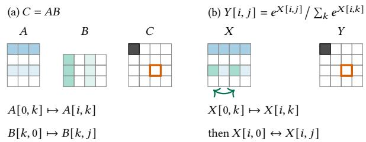
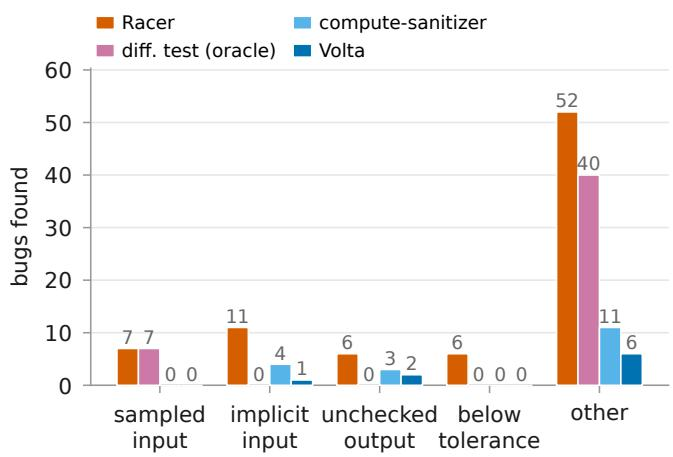

# Racer: Hunting GPU Kernel Bugs with Symbolic Equivalence Checking

Tuan Truong Vu and Cheng Tan

Northeastern University

## Abstract

GPU kernels are critical to the performance of today’s AI services, yet the same operators are rewritten repeatedly: for each GPU generation, numeric format, serving regime, and kernel language. Every rewrite must preserve the function computed by the implementation it replaces. Today, this obligation depends almost entirely on diferential testing: run the new kernel and a trusted reference on randomly sampled tensors, then compare their outputs within a tolerance. This approach has blind spots that additional test cases cannot eliminate. For example, a logical bug may produce an error smaller than the tolerance required to accommodate a correct optimized kernel.

We propose symbolic equivalence checking, which executes a kernel and its reference on symbolic inputs, turning each output cell into an exact algebraic expression, and then checks whether the paired expressions agree for all inputs. Because these expressions are exact, symbolic equivalence checking distinguishes floating-point error from logical bugs, while a single check covers the entire input space.

We implement Racer, a PTX-level symbolic equivalence checking engine, with three techniques that make this approach practical for production kernels: (1) Shape Reduction to control checking cost, (2) a lockstep CTA scheduler to handle concurrency, and (3) idiom templates with exact numeric refutation for otherwise inconclusive results. Across 2,408 production kernels from 41 collection targets, Racer found 82 real bugs in 23 libraries, including 76 previously unknown bugs and 41 confirmed so far.

## 1 Introduction

GPUs power modern AI, and GPU kernels largely determine its performance. AI model throughput is closely tied to the throughput of its GPU kernels [54]. Optimized kernels are therefore central to the performance of modern AI systems: they directly determine inference latency and serving throughput, and can make impractical workloads feasible. FlashAttention, for example, substantially reduced the cost of attention and enabled eficient long-context inference [14].

Because performance matters, the same GPU kernel gets written over and over. Attention alone has been rewritten for each architecture generation as new primitives arrived, from Ampere’s asynchronous copies to Hopper’s TMA and warpgroup MMA [7, 10, 13]; specialized per head dimension and per serving regime, prefill against decode [62]; re-tuned for each numeric format [18, 29, 40]; and written again in new languages such as Triton [21, 50, 58]. It happens across serving platforms too: vLLM [24] and SGLang [60] each ship their own fused RMSNorm, one written to accept any hidden size, the other optimized for the shapes it expects to serve.

This rewriting paradigm is the norm in modern GPU kernel development: a set of mathematical functions is implemented repeatedly, with each new implementation striving to outperform its predecessors.

Beyond performance, every rewrite carries a critical obligation: it must still compute the same function as the implementation it replaces. For today, meeting that obligation is left almost entirely to diferential testing: run the new kernel and a trusted implementation, usually PyTorch’s, on randomly sampled input tensors, and compare the outputs elementwise within an absolute and relative tolerance [38, 46]. This practice is widespread in production, and for good reason. The operator set is bounded, and each operator has a precise mathematical meaning, so a trusted reference implementation is almost always available. Moreover, kernels are typically pure functions from input tensors to output tensors, making side-by-side execution straightforward.

And yet, production systems still ship GPU kernels with bugs. By studying 82 bugs we found in deployed libraries (§7) that slipped through diferential testing, we identified four major obstacles: (a) sampling cannot cover the input space: some bugs trigger only on needle-in-a-haystack values that random sampling is unlikely to produce; (b) not every input is an explicit argument: many bugs depend on implicit inputs, such as uninitialized memory that happens to contain zeros during testing but may hold arbitrary values in practice; (c) not every output is checked: some bugs we found corrupt memory outside the intended output region, which tests therefore never inspect; and most notably, (d) floating-point error can be indistinguishable from a bug: 6 bugs we found cause only small numerical errors—smaller than the tolerance required for correct optimized kernels.

As a real bug example, FlagGems’ InstanceNorm reconstructs the variance from the stored rstd $= 1 / \sqrt { \mathrm { v a r } + \epsilon }$ as $1 / \mathrm { r s t d } ^ { 2 } + \epsilon ,$ , instead of the correct $1 / \mathrm { r s t d } ^ { 2 } - \epsilon .$ . Such a bug cannot be detected by diferential testing. This is because, for typical input tensors, the output deviation caused by the logical bug is smaller than the tolerance required to accommodate normal floating-point error. But this is not harmless numerical noise: the kernel computes the wrong function, and the resulting systematic error can compound over millions of training steps and ultimately cause training to fail.

We argue that ensuring the correctness of GPU kernels requires a more systematic and principled approach than diferential testing. To this end, we propose symbolic equivalence checking. Symbolic equivalence checking executes two GPU programs over symbolic inputs rather than concrete values. As a result, each output element is represented by an algebraic expression over free variables rather than a concrete number. The two kernels are equivalent exactly when, for every output element, the corresponding expressions evaluate to the same value for all possible inputs.

In symbolic equivalence checking, each blind spot of diferential testing is eliminated by design rather than by testing harder. First, a free variable stands for every input value at once, so one check covers the entire space. Second, uninitialized memory is symbolic too, so a kernel that depends on what the previous launch left behind is checked over every value it could have left. Third, symbolic execution knows the address of every store, so a write outside a declared tensor is caught where it happens. Finally, expressions are exact rather than floating-point, removing floating-point error from the checking problem. Any diference between the two kernels therefore reflects a diference in the function they compute, rather than an artifact of rounding.

In this paper, we introduce Racer, a symbolic equivalence checking engine for GPU kernels. Racer takes two kernels— one under test and one reference implementation—together with a launch configuration, and returns one of three outcomes: Equivalent, Inequivalent with a concrete input that distinguishes the two kernels, or Unknown.

Racer executes symbolic equivalence checking at the level of PTX, NVIDIA’s virtual instruction set [44]. PTX provides a stable interface across GPU generations and is, in fact, the lowest-level instruction set that NVIDIA publicly documents. As a result, many front ends, including CUDA C++ and Triton, compile to it. Moreover, PTX exposes memory operations explicitly, allowing the engine to model the address space that a kernel actually accesses.

Checking production GPU kernels poses three technical challenges for Racer. First, symbolic equivalence checking is expensive at the scale of real kernels. For example, a naive implementation of symbolic equivalence checking times out under a 600s budget even for a simple Softmax kernel with tensor shape 4 × 64. Second, a kernel launch is not a single piece of code running on one core, but thousands of concurrent threads executing and interacting through synchronization and shared memory. Racer must therefore reason not only about each thread’s arithmetic computation, but also about synchronization and cross-thread interactions. Finally, deciding the equivalence of arbitrary arithmetic expressions is fundamentally dificult. In many cases, the underlying computer algebra system cannot establish equivalence and returns Unknown. Racer must therefore reduce the frequency of such inconclusive cases while preserving soundness.

Racer introduces three techniques to answer the three challenges: Shape reduction proves one representative output cell per uniformity class and transports the proof to the rest by a verified renaming, rather than paying for every cell (§5.1); a CTA scheduler steps every thread in lockstep between synchronization points and refuses what it cannot order, so that no verdict rests on an interleaving the engine chose (§5.2); and idiom templates with exact numeric refutation plus a second prover for inconclusive results (§5.3).

We evaluate Racer on production kernels from 41 GitHub repositories. In total, Racer checks 2,408 GPU kernels. It identifies 82 real bugs, including 76 previously unknown bugs, of which 41 have been confirmed. These bugs are nontrivial: among the 82 bugs, an oracle diferential tester could, in theory, detect only 47. In comparison, NVIDIA’s compute-sanitizer [42] detects 18, while Volta [16], the closest existing equivalence checker, detects only 9 (§7.2).

We are not the first to check GPU kernels symbolically, nor the first to decide equivalence of tensor programs [2, 16, 34]. We are, to our knowledge, the first to scale symbolic equivalence checking to bug detection in production GPU kernels: handling whole grids rather than a single thread block, multi-launch programs, atomics, and asynchronous copies, while achieving the performance needed to check real-world kernels. This paper contributes:

• A study of 82 real bugs in production GPU kernels that identifies four blind spots of diferential testing and shows, bug by bug, why the practice cannot close them (§2, §6).

• Racer, a symbolic equivalence checking engine that decides kernel equivalence at PTX level over exact arithmetic, models GPU execution faithfully, and fails closed rather than approximating (§4).

• Three techniques that make the check practical on production kernels: shape reduction, a lockstep CTA scheduler, and idiom templates (§5).

• An evaluation on 2,408 production kernels: 82 real bugs across 23 libraries, 76 previously unknown, and 41 confirmed at the moment. (§7).

## 2 Motivation: Kernel Correctness Today

The same operators are repeatedly rewritten. Unlike traditional software, the functionality of GPU kernels for LLMs is bounded: a few dozen operators (e.g., matrix multiply, attention, normalization, activation) account for nearly all of the computation a large language model performs. Yet those same operators are written again and again: once per framework, per hardware generation, per data type, per fusion opportunity, per workload regime [4, 7, 13, 14, 21, 50, 58, 59, 62].

What forces the rewrites is performance. A kernel that is correct but slow is worthless, because the functional implementation already exists; the only reason to write it at all is to make it faster or cheaper. Each rewrite therefore buys speed with specialization: tiling and vectorization tuned to a shape, hand-staged shared memory, warp-level collectives, asynchronous copies, low-precision accumulation [4, 7, 10, 13, 14]. Every one of those is a place to get the code wrong.

Compounding these optimizations, the code can also go wrong because of the underlying arithmetic: tensor algebra, whose indices, strides, reductions, and broadcast semantics are tricky and error-prone. An index ofset by one stride, or a reduction over the wrong axis, is easy to write and dificult to spot. For example, a buggy log-softmax kernel in FlagGems [12] normalizes along the tensor’s last axis, even when asked to normalize along a diferent one, thereby combining the wrong group of elements. Similarly, a buggy multi-head attention kernel in attorch [1] maps every head to head 0, causing all heads to compute the same output.

Diferential testing is the de facto approach for correctness evaluation: a test samples random input tensors, runs the newly developed kernel and a trusted reference (e.g., PyTorch’s implementation) on the same data, and compares the two outputs element-wise. The comparison uses absolute and/or relative tolerances. The kernel passes only if the discrepancy falls within a predefined threshold.

Diferential testing fits naturally into GPU kernel develop ment. Because the operator set is bounded and each operator has a crisp mathematical meaning, a trusted reference is almost always at hand, and because kernels are pure functions from input tensors to output tensors, comparing the two is simple. In practice, nearly all GPU kernels today ship with tests of this form.

However, diferential testing misses bugs. Despite widespread use of diferential testing, GPU kernels continue to ship with bugs: scanning 2,408 GPU kernels from 41 production-quality libraries, we found 82 bugs (§7.1). Study ing those bugs, we find four reasons why diferential testing is insuficient, each a challenge that any stronger correctness check must meet.

1. Sampling cannot cover the input space. Testing samples insuficient input space is an old complaint, but the kernel setting amplifies it. A single argument is a tensor of thousands of elements, and an element is not drawn from a handful of categories but from a floating-point domain of billions of bit patterns. The combination of the two makes good coverage infeasible. Meanwhile, we do find bugs that manifest only for specific input tensor values, for example, attorch’s hardshrink keeps an input equal to exactly ±�, where PyTorch’s keep-set is strict (|�| > �); the two difer only where an input element equals the threshold � exactly (default 0.5).

2. Not every input is an argument. Further, a kernel’s result depends on state that never appears in its signature. Some kernels depend on allocated but uninitialized memory, which often happens to contain zeros during testing but is not guaranteed to be zero in production. For example, a reduction kernel in Triton-distributed [61] has each CTA atomically add its partial sum into an output cell that is only allocated but not initialized as zero, so the result is the sum plus whatever the cell held before the launch.

3. Not every output is checked. A test compares the tensors the kernel declares; the kernel writes wherever its computed addresses point. A miscomputed index or a missing bounds guard on a ragged final tile scribbles outside the intended region, into a neighboring tensor or into a bufer another kernel owns, while the declared output still matches the reference element for element. For example, fla’s squared-ReLU [58] backward writes past the tensor end when the length is not a multiple of block size.

4. Floating-point error is indistinguishable from a bug. Most importantly, numeric thresholds cannot distinguish an incorrect function from a correct one evaluated under a diferent floating-point order, leading to errors in both directions. A correct kernel may exceed the tolerance due to reduction reordering; more seriously, an incorrect kernel may remain within the tolerance on sampled inputs. Loosening the tolerance suppresses false alarms but can also mask real bugs. We have found 6 cases in this category, where incorrect logic is hidden by the floating-point error threshold.

These four points lead to one conclusion: a test compares numbers, but correctness is a statement about functions. What the setting calls for is a check that ranges over all inputs rather than sampled ones, that accounts for the memory a kernel actually touches rather than the tensors it declares, and that decides whether two implementations compute the same value rather than producing nearby ones.

## 3 Equivalence Checking for GPU Kernels

## 3.1 Beyond Testing: Toward Principled Checking

We believe testing cannot address the four challenges described in §2. Our answer is symbolic equivalence checking.

Symbolic equivalence checking. This method executes a kernel over symbolic inputs, so each instruction builds an algebraic expression instead of computing a number, and every output tensor holds one expression per cell rather than one value. Running the new kernel and its reference this way yields, for every output cell, a pair of expressions over the same input variables. The two kernels are equivalent when both expressions result in the same value for all possible inputs. Nothing is sampled and compared numerically.

All four challenges dissolve at this level. Input coverage: a free variable stands for every value at once, so a single check covers the entire input space. Implicit inputs: the cells of an uninitialized bufer are free variables too, so the check ranges over whatever the running context may have left in that memory. Unchecked outputs: the execution records the address of every store, and each expression records which inputs reached the cell, so a write outside a declared tensor is caught where it happens instead of surfacing later as someone else’s wrong number. Floating-point error: expressions are exact rather than floating point, so reordering a reduction changes an expression’s shape but not its value. There is no tolerance parameter to tune; any diference between two expressions corresponds to a diference in the computed function, not to floating-point rounding.

Prior equivalence checkers. The idea of proving two implementations equivalent is not new, and §8 returns to it. For example, TrainVerify [34] checks a distributed training program against its single-device specification; TensorRight [2] applies equivalence reasoning to tensor-graph rewrites, certifying that a rewritten graph computes what the original did; Volta [16], the closest to us, brings equivalence checking to GPU kernels themselves. Racer difers from prior work in its focus on finding bugs: of the 82 bugs Racer finds, Volta detects only 9. We explain this gap in §7.2.

## 3.2 Background: GPU Execution and PTX

GPU programs have distinctive characteristics that shape how symbolic equivalence checking must be built. This subsection reviews the basics of GPU execution, then PTX [44], the instruction set at which Racer operates.

GPU execution. A GPU is a massively parallel processor that runs tens of thousands of threads at once. The program those threads run is a kernel: a single function, written from the perspective of one thread, that every thread executes over its own slice of the data. To run a kernel, the CPU host launches a grid of cooperative thread arrays (CTAs), also called thread blocks; the grid and block dimensions, chosen at launch time together with the kernel’s arguments, form the launch configuration. Every thread runs the same kernel body and is distinguished only by its block and thread indices: the single-instruction, multiple-thread (SIMT) model. Threads advance in groups of 32, called warps, whose members can exchange values directly.

A kernel reads and writes three memory spaces ofdiferent scope and lifetime: registers and local memory, private to a thread; shared memory, a per-CTA scratchpad that dies with the CTA; and global memory, visible to every thread in the launch and persistent across launches. Threads within a CTA synchronize with a barrier (bar.sync), but threads in diferent CTAs cannot synchronize within an ordinary launch, so a computation needing a grid-wide handof is split into several launches, each reading through global memory what the previous one wrote. Split-K matrix multiplication is the standard example: one launch has each CTA reduce its own slice of K into a partial-product bufer, and a second launch sums those partials. Both facts matter later: the engine must reproduce this ordering discipline faithfully (§5.2).

// CUDA C++ (nvcc)   
h[i] = \_\_float2half\_rn(x[i] + y[i]);   
# Triton (MLIR/LLVM)   
tl.store(H + i, (tl.load(X + i)   
+ tl.load(Y + i)).to(tl.float16))   
// PTX (both front ends compile to the same PTX)   
add.rn.f32 %   
cvt.rn.f16.f32 %   
st.global.b16 [%  
Figure 1. Add two fp32 values and narrow to fp16, in CUDA C++, in Triton, and the PTX both compile to.

PTX. PTX is NVIDIA’s stable virtual instruction set. Kernels written in diferent front ends, such as CUDA C++ [43], Triton [53], Numba [26], TVM [11], and CuPy [45], all lower to PTX before reaching the GPU, which makes it the one level at which kernels from diferent front ends can be compared instruction for instruction. For example, Figure 1 shows one add-and-narrow computation in CUDA C++ and Triton, both of which are compiled to the same PTX instructions.

## 3.3 Challenges in Applying Symbolic Execution

A: t = x + y; out = t \* t   
B: out = x\*x + 2\*x\*y + y\*y   
�<sub>�</sub> = (� + <sub>�</sub>)<sup>2</sup>, �<sub>�</sub> = �<sup>2</sup> + 2� <sub>�</sub> + <sub>�</sub><sup>2</sup>,   
simplify(�<sub>�</sub> − �<sub>�</sub> ) → 0 ⇒ ∀�, �, � ≡ �  
Figure 2. Symbolic execution and CAS equality: each program yields an expression in the free inputs, and their diference simplifying to zero proves their equivalence.

Symbolic execution and computer algebra. Symbolic execution runs a program over free variables instead of concrete data: each arithmetic instruction builds an algebraic expression in those variables rather than computing a number, and each branch on a symbolic condition is resolved under the constraint that selects its path. A computer algebra system (CAS) [36, 37, 39, 52, 55] then manipulates those expressions exactly, using unbounded-precision rational arithmetic and algebraic rewriting instead of evaluating them as floating-point approximations. We use SymPy [39], a CAS implemented as a Python library. To check whether two expressions are equivalent, we simplify their diference and check whether it reduces to zero. Figure 2 shows an example.

Symbolic executing PTX code. Applying symbolic execution on PTX code yields a recipe for symbolic equivalence checking. Bind every cell of every input tensor to a free variable instead of a number. Execute the kernel’s PTX one instruction at a time, interpreting each by the mathematical operation it denotes in the CAS: a floating-point instruction becomes the corresponding operation over the reals. When the launch ends, every output cell holds an exact expression in the input variables, and no rounding has been lost to an approximation along the way. Checking two kernels is then subtraction: run both over the same symbolic inputs, form the diference of their expressions cell by cell, and ask the CAS whether every diference is zero. A logical bug is found if the two kernels disagree.

Challenges. Naively applying a CAS to PTX instructions, however, does not work. Three challenges arise in practice.

• Scalability. A GPU kernel launch can contain thousands of threads, each performing thousands of arithmetic operations. Executing all threads and proving each output cell independently scales poorly with both thread count and expression size: an output at the end of a long reduction carries the full expression chain that produced it, which the CAS must repeatedly simplify.

• Concurrency. GPU kernels are highly concurrent, with many threads cooperating to complete a computation. A symbolic engine must therefore model concurrency primitives such as barriers, warp collectives, asynchronous copies, atomic instructions, and tensor-core instructions. Moreover, the result may depend on thread interleavings, so the engine must detect and reason about data races. Each construct must either be modeled faithfully or re jected outright (§5.2).

• Inconclusive results. Deciding whether two symbolic ex pressions are equal is a hard problem. For expressions involving a suficiently rich set of functions, modern CASs may fail to reach a conclusion or may time out. In practice, this happens often. We therefore need to minimize the chance that the engine returns Unknown (§5.3).

## 4 Racer: a Symbolic Equivalence Checker

Racer answers the question: do the two given GPU kernels compute the same function? A user poses this ques tion as a checking instance containing two GPU programs— the second serving as the reference implementation, as in diferential testing—the tensors they read and write, and their launch configurations. Racer runs the checking instance. When done, Racer returns one of three verdicts: Equivalent, Inequivalent with a concrete input that separates the two, or Unknown.

It takes four steps for Racer to produce the verdict. Racer (1) reads the checking instance, (2) lowers both programs to PTX whatever front end they were written in, (3) executes every thread of every CTA of both programs symbolically, leaving one algebraic expression in each output cell, and (4) decides, cell by cell, whether the two expressions denote the same value. The rest of this section walks the four steps on a running example in Figure 3, a bug from vLLM (#941).

Step 1: posing the question as a checking instance. In Racer, a checking instance is a Python class with three methods. The first, setup, declares the tensors both sides share;

the other two, program\_a and program\_b, each declare one program as a sequence of launches. Tensor declarations specify shapes, data types, and initial contents: vk.input() introduces a free variable for each cell, vk.empty() leaves cells uninitialized, and vk.zeros() or vk.full() initializes cells to a specified constant. Each program records a sequence of kernel launches through launch call, specifying the kernel, its arguments, and its launch configuration. Tensor arguments are wrapped in vk.read, vk.write, or vk.readwrite to declare how each launch accesses them. Successive launches exchange data by accessing the same tensors. Each program method returns a dictionary naming the output tensors whose corresponding cells Racer should compare.

In Figure 3(b), setup declares the tensors: a 2×4 activation x and the rotation tables cosv and sinv as inputs (free variable) and the output out as empty. Each program is a single launch of one of the two kernels over the same arguments: one CTA per token, one thread per CTA, the head dimension �=4 passed as a scalar, and out wrapped as vk.write where the inputs are vk.read. The checking instance poses the question: at this configuration, do these two kernels compute the same function of x, cosv, and sinv?

Step 2: lowering GPU programs to PTX. Each launched kernel is lowered to PTX before analysis, making all subsequent stages front-end agnostic (§3.2). The current Racer implementation supports three input forms: CUDA C++, Triton, and PTX. In principle, Racer can support any GPU programming language whose toolchain compiles to PTX. Racer only requires a language-specific adapter.

In our example, both programs are written in CUDA and lower to diferent PTX instructions: Figure 3(c) excerpts the loop body. The bug lives in the address arithmetic. rope\_gptj loads adjacent elements from [%rd40+-4] and [%rd40], advancing %rd40 by 8 bytes per iteration. rope\_neox instead loads from [%rd45] and [%rd39], where %rd39 is computed as %rd45 plus (�/2) · 4 bytes. Advancing %rd45 by 4 bytes per iteration therefore pairs elements from the two halves of the head.

Step 3: executing PTX symbolically. Racer implements a symbolic execution engine that interprets each PTX instruction into a CAS representation. Across threads, Racer uses a lockstep scheduler to coordinate execution within each thread block. For example, consider the first iteration (� = 0) of rope\_neox for token �, with � = 4. Address calcu lations resolve to concrete input and output cells, while the values loaded from inputs remain symbolic. The following instruction sequence illustrates how Racer constructs the expression for out[�,0]. Each row shows an instruction and its efect on symbolic state, with floating-point arithmetic interpreted over the reals:

```lisp
(a) The two kernels (CUDA C++) (b) The checking instance (Python)
// reference: GPT-J rotates the pairs (2i, 2i+1) import vk
__global__ void rope_gptj(float* out, const float* x, 2
3 const float* cosv, const float* sinv, int D) { 3 class RopeGptjNeox(vk.VerifyCase):
4 int t = blockIdx.x; 4 T, D = 2, 4 # tokens, head dim
5 for (int i = 0; i < D / 2; i++) { 5
6 float a = x[t*D + 2*i], b = x[t*D + 2*i+1]; 6 def setup(self):
7 float c = cosv[i], s = sinv[i]; 7 self.x = vk.input("x", (self.T, self.D))
8 out[t*D + 2*i] = a*c - b*s; 8 self.cosv = vk.input("cosv", (self.D // 2,))
out[t*D + 2*i+1] = a*s + b*c; 9 self.sinv = vk.input("sinv", (self.D // 2,))
10 } } 10 self.out = vk.empty("out", (self.T, self.D))
11 11
12 // shipped for GPT-J heads (#941): the NeoX pairing 12 def _run(self, kernel):
13 _global__ void rope_neox(...) { // same prologue 13 vk.launch(
14 for (int i = 0; i < D / 2; i++) { 14 source="rope.cu", kernel=kernel,
15 float a = x[t*D + i], b = x[t*D + i + D/2]; 15 grid=(self.T, 1, 1),
16 float c = cosv[i], s = sinv[i]; 16 block=(1, 1, 1),
17 out[t*D + i] = a*c - b*s; 17 args=[vk.write(self.out),
18 out[t*D + i + D/2] = a*s + b*c; 18 vk.read(self.x),
19 } } 19 vk.read(self.cosv),
20 vk.read(self.sinv),
(c) The PTX loop bodies 21 self.D])
22 return {"out": self.out}
1 // rope_gptj: one pointer, stepping 8B per iteration 23
2 $L__BB0_2:
24 def program_a(self): # the shipped kernel
3 ld.global.f32 % 25 return self._run("rope_neox")
4 ld.global.f32 % 26
5 // rope_neox: two pointers (D/2)*4B apart, each 4B 27 def program_b(self): # the reference
6 $L__BB1_2: 28 return self._run("rope_gptj")
7 ld.global.f32 %
8 ld.global.f32 %
```

Figure 3. The running example, vLLM #941. (a) two CUDA rotary-embedding kernels that difer only in which elements they pair; (b) the checking instance declaring both over the same symbolic inputs at one launch configuration; (c) the PTX loop bodies the two kernels lower to: same arithmetic, diferent addresses.  
PTX instruction Symbolic state update   
ld.global.f32 %f37,[%rd47] %f37 ← �<sub>0</sub>   
ld.global.f32 %f38,[%rd45] %f38 ← �<sub>�,0</sub>   
mul.f32 %f39,%f38,%f37 %f39 ← �<sub>0</sub> �<sub>�,0</sub>   
ld.global.f32 %f40,[%rd48] %f40 ← �<sub>0</sub>   
ld.global.f32 %f41,[%rd39] %f41 ← �<sub>� 2</sub>   
mul.f32 %f42,%f41,%f40 %f42 ← �<sub>0</sub> �<sub>�,2</sub>   
sub.f32 %f43,%f39,%f42 %f43 ← �<sub>0</sub>�<sub>�,0</sub> − �<sub>0</sub>�<sub>�,2</sub>   
st.global.f32 [%rd46],%f43 out[�, 0] ← �<sub>0</sub>�<sub>� 0</sub> − �<sub>0</sub>�<sub>� 2</sub>

Each arithmetic instruction builds an expression from those already held in its source registers; the store writes the resulting expression to the addressed output cell. In rope\_gptj, the corresponding second activation load reads $x _ { t , 1 }$ instead of $x _ { t , 2 } ,$ , producing $c _ { 0 } x _ { t , 0 } - s _ { 0 } x _ { t , 1 }$

Step 4: checking output cells. When both programs have run, their declared output tensors are paired by name, giving for every output cell a pair of expressions to compare. The checker forms the diference of each pair and hands it to the underlying CAS (§3.3). A checking instance is Equivalent only if every cell of every output tensor simplified to zero; a single refuted cell fails the case. If the CAS leaves a cell unresolved, Racer applies exact numeric refutation, which substitutes a concrete rational assignment for the free variables and evaluates expressions exactly: a non-zero result is an Inequivalent witness, and its absence leaves the cell Unknown, since exact evaluation at one point can refute but never prove.

In the running example, for cells at position [�, 0],

$$
\begin{array} { r l r } { e _ { a } [ t , 0 ] = c _ { 0 } x _ { t , 0 } - s _ { 0 } x _ { t , 2 } , } & { { } \stackrel { ? } { = } } & { e _ { b } [ t , 0 ] = c _ { 0 } x _ { t , 0 } - s _ { 0 } x _ { t , 1 } . } \end{array}
$$

Their diference is $e _ { a } - e _ { b } = s _ { 0 } \left( x _ { t , 1 } - x _ { t , 2 } \right)$ . Exact numeric refutation establishes that this expression is not identically zero: substituting $s _ { 0 } { = } 1 , x _ { t , 1 } { = } 1$ , and $x _ { t , 2 } { = } 0$ yields $e _ { a } - e _ { b } = 1$ This assignment is a concrete witness, so Racer returns Inequivalent.

## 5 Technical Challenges

The design in §4 must address the three challenges introduced in §3.3: scalability, concurrency, and inconclusive results. This section explains how Racer addresses them with shape reduction, a lockstep CTA scheduler, and idiom templates with exact numeric refutation and a second prover based on Z3.

## 5.1 Scalability

To prove equality at output cell $^ { c , }$ the CAS attempts to simplify $e _ { c } ^ { a } - e _ { c } ^ { \bar { b } }$ to zero using algebraic transformations such as expanding products, cancelling factors, and combining fractions. This process can be costly for large expressions. For an output tensor with thousands of cells, deciding each cell independently repeats this work even when the expression pairs difer only in the input variables they reference. Shape reduction reduces the deciding cost by reusing proofs across output cells with the same expression structure.

Racer : Huntin<sub>g</sub> GPU Kernel Bu<sub>g</sub>s with S<sub>y</sub>mbolic E<sub>q</sub>uivalence Checkin<sub>g</sub>

  
Figure 4. Candidate renamings from representative (black) to target (outlined) cells.

Reusing a representative’s proof. GPU kernels commonly apply the same function to diferent slices of an input tensor. Their output expressions then difer only in the input variables they reference. Shape reduction groups output cells into uniformity classes: their expression pairs match under a shared renaming of input variables.

Let $e _ { r } ^ { a }$ and $e _ { r } ^ { b }$ be the expressions produced by the two programs at a representative cell $r ,$ and suppose the deciding procedure has proved $e _ { r } ^ { a } = e _ { r } ^ { b }$ . Another cell � can reuse this proof if a renaming � satisfies

$$
e _ { c } ^ { a } = \tau ( e _ { r } ^ { a } ) \quad \mathrm { a n d } \quad e _ { c } ^ { b } = \tau ( e _ { r } ^ { b } ) ,
$$

hence $e _ { c } ^ { a } = e _ { c } ^ { b } .$

For each output tensor, Racer processes cells in sequence and tries to reuse a proved representative. It validates each candidate renaming by comparing both expression pairs structurally, allowing reordering of commutative arguments without invoking CAS simplification.

Finding candidate renamings. Candidates come from input footprints: the indices in each input tensor referenced by either program’s expression at a cell. Racer first proposes a translation that maps each representative footprint onto the target footprint. When the output position identifies an element within an input footprint, it also proposes exchanging the translated representative position with the target position. Figure 4 illustrates both patterns: matrix multiplication translates a row of � and a column of $B ;$ row softmax translates a row of � and exchanges two entries to select the target numerator while preserving the denominator’s sum. Footprints only generate candidates; proof reuse requires the structural validation above. Algorithm 1 in Appendix A gives the candidate-generation procedure.

## 5.2 Concurrency

Threads can compute correct expressions individually and still produce an incorrect result if one reads a value before another writes it. To address the concurrency challenge in §3.3, Racer models both what each thread computes and when threads can exchange values.

Coordinating threads. Racer executes every thread symbolically. Within each CTA, its scheduler runs a thread until it exits or reaches a synchronization point. At a barrier, the thread waits until all required participants arrive; only then can they continue. The scheduler also coordinates the participants of supported warp and tensor-core collectives. If required threads cannot meet at the same synchronization point, execution is refused. Thus, a thread cannot pass a barrier simply because the engine happened to execute it first. Algorithm 2 in Appendix A gives the scheduler pseudocode.

Ordering memory accesses. Scheduling alone cannot detect a missing barrier: running a writer before a reader could hide the error. Racer therefore records reads and writes in epochs, the intervals between CTA-wide barriers, and reports conflicting accesses that lack the required ordering. A CTA barrier orders accesses within that CTA; conflicts across CTAs are tracked separately, and global memory is retained across launches. Asynchronous copies require another ordering rule: issuing a copy does not make its data available. Racer exposes the copied data only at the modeled completion point—the corresponding wait for cp.async, or completion of the associated barrier for TMA—and refuses accesses that would use it earlier.

Combining atomic updates. Multiple threads may atomically update the same cell in diferent orders. Racer collects these updates and combines them at the next CTA barrier for shared memory, or at launch completion for global memory. This is valid only when the final value is independent of update order under the arithmetic model, as with addition over exact reals (§3.3) and supported integer add, min, max, and bitwise operations. The engine refuses uses of an atomic’s returned old value, mixtures of atomic operations on one cell, and ordinary accesses that conflict with pending updates.

## 5.3 Inconclusive Results

The CAS may fail to prove equality within its time budget even when two expressions denote the same function (§3.3). Racer uses three techniques to reduce these inconclusive outcomes.

Idiom templates. Compilation can turn a familiar function, such as log(�), into a long sequence of bit operations and polynomial arithmetic that obscures its meaning to the CAS. Racer recognizes supported routines using templates that match their coeficients, operations, guards, and register dependencies. It replaces each matched sequence with the corresponding mathematical operation under the realarithmetic model of §3.3. For example, an inlined libdevice \_nv\_logf contains the following PTX instructions:

```asm
mov.b32 %
add.s32 %
and.b32 %
// ...
mov.f32 %
fma.rn.ftz.f32 %
// ...
setp.lt.u32 %
// ...
selp.f32 %
```

Matching the full routine lets Racer represent its result in %f37 as log(�) for a positive input �, rather than carrying this instruction sequence into the output comparison.

Exact numeric refutation. If the CAS leaves a cell unresolved, Racer evaluates both expressions at the same concrete input: rational values for free real inputs and integers for index inputs, satisfying the checking instance’s constraints and the expressions’ domains. It computes their diference using exact fractions for rational arithmetic. For functions such as square roots, exponentials, and logarithms, it uses interval evaluation with outward rounding to bound the true diference. A nonzero exact diference, or an interval excluding zero, yields an Inequivalent witness; otherwise, the cell remains unresolved.

A second prover. When both the CAS and numeric refutation leave a cell unresolved, Racer uses Z3 [15] to search for an input where its expressions difer. This can target boundaries that random inputs rarely reach: $x \ \geq \ \lambda$ and $x > \lambda ,$ , for example, difer only at $x \ = \ \lambda$ . For supported expressions, the query encodes both outputs and the checking instance’s input constraints. A proposed counterexample yields Inequivalent only after the numeric procedure above confirms a nonzero diference in the original expressions. An unsatisfiable query proves equality only if the encoding preserves the expressions’ arithmetic semantics and input domain. Like a CAS proof, this proof can be reused by shape reduction after validating the shared renaming. Unsupported translations, timeouts, inconclusive solver results, and unvalidated candidates leave the cell unresolved.

A concrete refutation yields Inequivalent. Otherwise, the checking instance is Equivalent only when every output cell has been proved equal, directly or by proof reuse; any remaining unresolved cell makes it Unknown. For an Unknown case, we manually inspect the kernel code alongside the unresolved symbolic expressions. This helps us identify bugs or limitations of the deciding procedure.

## 6 Bug Study

Our study of 82 bugs across 23 libraries, including 76 previously unknown bugs and six rediscoveries, reveals how real GPU kernel defects escape testing. We assign each bug to one category based on the primary reason a test can overlook it, illustrating the four limitations in §2 before describing the other findings.

Sampled input. Some bugs manifest only at a special input value that random tests rarely produce, even when they exercise the faulty code.

For example, hardshrink should return zero when $| x | \leq$ � and leave the input unchanged otherwise. The attorch implementation instead keeps values equal to the threshold: with $\lambda \ : = \ : 0 . 5$ , it returns 0.5 for input 0.5 instead of zero. Inputs on either side give correct results, so exposing the bug requires hitting the boundary. The seven findings in this category require values rarely produced or omitted by the studied generators, including special labels that mark elements to ignore.

Implicit input. A kernel’s result can depend on memory state or execution conditions that tests leave unchanged while varying tensor values.

For example, a Triton-distributed reduction allocates an output cell with torch.empty and atomically adds each block’s partial sum without first setting the cell to zero. The cell may retain data from an earlier use: if it initially contains �, the result is � + � instead of the intended sum �. Atomic addition prevents lost updates but does not initialize the cell. Racer reports an uninitialized-memory diagnostic, which disappears after zero-initialization. The 11 findings in this category also involve tensor layouts and parameter settings left unvaried by the studied tests, even when these are explicit arguments.

Unchecked output. A kernel can compute the output tensor correctly yet write past its allocated bufer. A test comparing only that tensor does not inspect the extra writes.

For example, fla’s squared-ReLU backward kernel handles 4,096 elements per block and should limit the final block’s writes to valid elements. Instead, it writes all 4,096 results even when the output has only 64 elements. Those 64 values match the reference, but the remaining 4,032 writes exceed the output allocation and overwrite memory beyond it. This category contains six out-of-bounds write bugs across five libraries.

Below tolerance. A wrong formula can produce values close enough to the reference to pass a test: tolerances intended to allow floating-point rounding can also hide programming errors.

For example, FlagGems’ InstanceNorm recovers variance from a stored value rstd $. = { 1 } / { \sqrt { \mathrm { v a r } + \epsilon } } .$ . Squaring and inverting gives var + �, so recovery requires subtracting �. The kernel adds it instead, overestimating the variance by 2� before updating the running statistics. For small �, the resulting error can fall within the test’s tolerance. The six findings in this category are masked by the tolerances used for the studied inputs.

Other. Other findings involve gaps in test coverage, invalid memory accesses, and synchronization errors. For example, the rotary-embedding kernel in Figure 3 pairs the wrong input elements. Of these 52 bugs, 40 can be exposed by comparison with an independent reference at a triggering configuration; existing tests miss relevant paths, share faulty logic, or omit a comparison. Seven read outside an allocated bufer, e.g. FlagGems’ bucketize fetches elements past the input’s end. Four are data races: threads access the same memory, with at least one writing, without synchronization to order the accesses. Their efects depend on thread timing, so a passing run does not establish correct synchronization. One further bug modifies padding within the allocation without changing the operator’s semantic output.

## 7 Evaluation

We evaluate Racer’s bug findings, detection by other methods, equivalence coverage, and end-to-end checking cost.

Experimental setup. We conduct the experiments on a server with two AMD EPYC 9575F CPUs (128 cores), Python 3.11.16, and SymPy 1.13.1. An NVIDIA RTX PRO 6000 captures launches, replays witnesses, and runs the concrete baselines. The server runs Rocky Linux 9.6 with CUDA 13.1. Racer compiles CUDA sources with nvcc 12.4 and Triton kernels with Triton 3.2.0, both emitting PTX ISA 8.4.

## 7.1 Finding Bugs in Production Kernels

We examine production kernels from 41 collection targets with Racer and identify 82 distinct bugs across 23 libraries: 76 previously unknown bugs and six rediscoveries. §6 analyzes the defects; here we describe how they were found and counted.

Pipeline. We first harvest kernel entry points from open source implementations and capture the kernel together with the grid, block, and shared-memory size ofa real GPU launch as a checking instance (§4). We then construct comparisons against an independent implementation, a naive reference drafted by an LLM-based agent under our direction, or an other configuration of the same kernel. The last comparison uses the same inputs and changes a configuration expected to preserve the operator’s semantics.

Counting. We review refuted and unresolved output comparisons alongside engine diagnostics. Of the 82 bugs, 35 are exposed by race or memory diagnostics, 41 by output refutations, and six by manual inspection of cases that remain Unknown. An Unknown result alone does not establish a bug.

The study excludes duplicates and previously unknown findings not filed upstream. All 76 new bugs have an upstream issue or pull request. Table 1 reports their distribution. These counts refer to distinct bugs, not distinct buggy kernels or the number of refuted kernels in §7.3. 41 of the 76 new bugs are confirmed: 29 are fixed upstream, four are acknowledged by maintainers, and eight are independently validated (six with a proposed fix and two with a public endorsement).

## 7.2 Comparison with Other Methods

We compare Racer with diferential testing and two tools: Volta [16], used as shipped, and compute-sanitizer from NVIDIA [42]. The comparison uses the set of 82 bugs found by Racer.

Table 1. Bugs in the study by library. Found includes previously unknown bugs and rediscoveries; new denotes previously unknown bugs filed upstream; confirmed denotes new bugs fixed or acknowledged by maintainers, or validated by an independent contributor.
<table><tr><td>Library</td><td>Found</td><td>New</td><td>Confirmed</td></tr><tr><td>FlagGems</td><td>25</td><td>23</td><td>5</td></tr><tr><td>flash-linear-attention</td><td>11</td><td>11</td><td>11</td></tr><tr><td>Attorch</td><td>6</td><td>6</td><td>6</td></tr><tr><td>CuPy</td><td>6</td><td>6</td><td>1</td></tr><tr><td>Triton-distributed</td><td>4</td><td>3</td><td>1</td></tr><tr><td>torchao</td><td>4</td><td>4</td><td>3</td></tr><tr><td>Liger-Kernel</td><td>3</td><td>2</td><td>2</td></tr><tr><td>vLLM</td><td>2</td><td>0</td><td>0</td></tr><tr><td>15 others</td><td>21</td><td>21</td><td>12</td></tr><tr><td>Total</td><td>82</td><td>76</td><td>41</td></tr></table>

  
Figure 5. Comparison of Racer, oracle diferential-testing, compute-sanitizer, and Volta on the 82-bug set.

We assess an oracle diferential tester with unlimited compute: given a triggering launch configuration and an independent reference, it tests every possible tensor input using a tolerance-based output comparison. This is a per-bug assessment, not a measured testing campaign. Sanitizer and Volta results come from recorded runs. Figure 5 groups the results using the categories of §6.

Diferential testing. Under exhaustive input enumeration, diferential testing can detect all seven sampled-input bugs: it reaches the exact boundary values and special inputs that random generators can miss. Together with the 40 bugs in Other identified by the audit, this gives 47 of 82 bugs. Exhausting tensor inputs does not by itself ensure variation of prior memory state or thread schedules, inspection of writes outside the output tensor, or detection of diferences within the tolerance. The remaining assessments retain the audit’s judgments under these conditions; they do not establish that no concrete test can expose those bugs.

Table 2. Coverage over 2,408 kernels, summarized across their checking instances. Each kernel appears in exactly one row.
<table><tr><td>Kernel summary</td><td>Kernels</td><td>Share</td></tr><tr><td>Equivalent</td><td>1,698</td><td>70.5%</td></tr><tr><td>Bug candidates</td><td>197</td><td>8.2%</td></tr><tr><td>Timeout, no decision</td><td>14</td><td>0.6%</td></tr><tr><td>Execution refused</td><td>499</td><td>20.7%</td></tr><tr><td>Total</td><td>2,408</td><td>100.0%</td></tr></table>

compute-sanitizer. The recorded runs detect 18 bugs: four in implicit input, three in unchecked output, and eleven in Other. Seven of the detections in Other are read-only overruns. These results illustrate the value of checking memory accesses in addition to comparing output values. None of these runs reports the four race bugs; this result is specific to the configurations and executions evaluated.

Volta. We run the shipped Volta baseline and it detects 9 bugs: one in implicit input, two in unchecked output, and six in Other. It detects none of the sampled-input or belowtolerance bugs, and none of the four races.

The recorded failures identify concrete barriers to applying Volta to these kernels. In 41 cases, unsupported instructions prevent execution. One example is the Tritondistributed reduction in §6: Volta stops at an atomic instruction before it can expose the uninitialized-memory bug.

Another limitation arises when the two implementations divide work diferently across CTAs. In the FlagGems MSEbackward comparison, the tested kernel writes four output cells in CTA 0, while the reference writes one cell per CTA across four CTAs. Because Volta compares only CTA 0 on each side, it encounters diferent sets of written cells and cannot compare their values. Racer executes both grids in full, allowing it to compare corresponding output cells regardless of which CTA writes them. Three study cases encounter this limitation in Volta. Four others require comparing programs with multiple launches, which Volta does not support.

## 7.3 Coverage

We assess Racer’s coverage by measuring how many kernels it can execute and how often it reaches an equivalence decision. Each kernel is evaluated through several check ing instances, each specifying a launch configuration. Their outcomes can difer: a kernel may be proved equivalent at one configuration, remain unresolved at another, and be refuted at a third. Table 2 summarizes the evidence across these instances. We group kernels with an Inequivalent or Unknown result, or a race or memory diagnostic, as bug candidates. This group takes priority over a proof at another configuration. An Unknown result alone does not establish a bug; these candidates require triage.

The Equivalent row contains 1,698 kernels with at least one proof and no recorded bug-candidate outcome. Each proof applies only to the outputs and index assignments checked at that configuration. The 197 candidates include 77 kernels with refutations, 23 with Unknown results, and 110 with race or memory diagnostics; these counts overlap. A kernel appears in this row even if another configuration is proved equivalent. Timeouts can also coexist with other outcomes: 132 of the 146 kernels with timed-out instances have a proof or refutation elsewhere; the remaining 14 appear separately.

Extending coverage. The remaining 499 kernels (20.7%) fall in the execution-refusal row. These refusals include unsupported integer operations, addresses or control flow that depend on symbolic data, synchronization patterns beyond the current model, and execution limits (§5). We leave extending this coverage to future work.

Resolving inconclusive results. Of the 82 bugs, 35 produce race or memory diagnostics. Among the remaining bugs, CAS cancellation alone detects one: a constant bias in FlagGems’ running-statistics update leaves a nonzero constant after cancellation. For the other output comparisons, symbols remain in the diference, so cancellation leaves these comparisons unresolved. Exact numeric refutation resolves 36 of these cases, and the Z3 second prover resolves four more. Together, these techniques resolve 40 of the 46 cases (87.0%) left inconclusive by cancellation. Including the diagnostics and constant-bias refutation, Racer automatically exposes 76 of the 82 bugs (92.7%). The remaining six retain Unknown verdicts; we identify their bugs by manually inspecting the kernel code and symbolic expressions.

## 7.4 Shape Reduction vs. Whole-Grid Checking

We compare deciding each output cell independently (wholegrid checking) with reusing proofs through shape reduction (§5.1). We measure end-to-end wall-clock time, including symbolic execution, deciding, and other engine stages.

Our sample contains 50 kernels: 40 with Equivalent verdicts at their captured shapes and ten with bugs. We run each at its captured shape (×1) and at ×2 and ×4, scaling one selected dimension while keeping the others fixed. This gives 150 kernel–configuration pairs.

Shape reduction preserves every proof and refutation returned by whole-grid checking: the methods agree on all 148 kernel–configuration pairs that both decide. Both decide all 50 kernels at ×1 and ×2, and both refute all ten bugs at every shape. At ×4, whole-grid checking decides 48 kernels and shape reduction decides 49; one kernel times out under both methods. Thus, there are no contradictory verdicts, and shape reduction proves one additional configuration within the budget.

Shape reduction substantially reduces the cost of repeated proofs. For the linear-attention backward kernel chunk\_ttt\_ linear\_bwd\_dv, it reduces end-to-end time from 204.9 s to 17.4 s at ×1 and from 415.8 s to 34.0 s at ×2, speedups of 11.8× and 12.2×. At ×4, whole-grid checking exceeds 600 s without a proof, whereas shape reduction proves equivalence in 70.7 s. It uses only 16 representative proofs for 2,048, 4,096, and 8,192 output cells, respectively. A separate configuration of this kernel, scaling a diferent shape dimension, shows the same benefit: whole-grid checking again exceeds 600 s, while shape reduction requires only 66.7 s.

Table 3. Mean end-to-end time in seconds for the same 38 equivalent kernels completed by both methods at all three shapes. Kernels with a timeout under either method are excluded at every shape.
<table><tr><td>Shape multiplier</td><td>X1</td><td>×2</td><td>X4</td></tr><tr><td>Whole-grid checking</td><td>9.5</td><td>22.2</td><td>47.0</td></tr><tr><td>Shape reduction</td><td>5.5</td><td>14.3</td><td>30.3</td></tr><tr><td>End-to-end speedup</td><td>1.72×</td><td>1.55×</td><td>1.55×</td></tr></table>

Across the 40 equivalent kernels at ×1, shape reduction lowers mean end-to-end time from 14.5 s to 6.0 s, an aggregate speedup of 2.4×. Aggregate speedup is the ratio of summed end-to-end times over the same completed comparisons. Table 3 follows the fixed set of 38 equivalent kernels completed by both methods at every shape. It excludes both kernels with timeouts from all three columns. Shape reduction reduces their mean end-to-end cost by 1.72×, 1.55×, and 1.55×, respectively. At ×4, mean deciding time falls from 18.7 s to 2.1 s, while symbolic execution still takes about 28 s under either method. Symbolic execution therefore limits the end-to-end speedup even when proof reuse substantially reduces deciding time.

## 8 Related Work

Testing and property checking for GPU kernels. Existing tools expose functional errors through testing or check specific kernel properties. NNSmith [30], Tzer [32], and NeuRI [31] generate or mutate tensor programs to expose compiler bugs. Diferential output comparisons can reveal functional errors, subject to the testing limitations discussed in §2. cuFuzz [51] uses coverage-guided fuzzing of CUDA applications with sanitizer integration. NVIDIA’s computesanitizer [42] checks memory accesses and synchronization during execution. Race detectors include Barracuda [17], CURD [47], and ScoRD [23]; Simulee [57] models memory accesses to detect synchronization bugs. PUG [27], GPUVerify [5, 6], GKLEE [28], and ESBMC-GPU [48] use symbolic execution or formal verification to check properties such as race freedom and synchronization correctness within their supported execution models and analysis bounds; PUG and GKLEE also check functional assertions. Model execution can provide input constraints for checking kernel memory safety. M2K [20] checks CUDA memory safety under argument constraints inferred from model execution, using symbolic tensor sizes and thread identifiers to cover variable shapes and launch configurations. Racer instead compares the functions computed by two programs at declared tensor shapes and launch configurations, an equivalence question that memory and synchronization checks alone do not resolve.

Program equivalence and translation validation. Comparing program behavior provides a basis for validating compiler transformations and alternative implementations. Translation validation checks the correctness of individual compiler transformations [41, 49]; Alive2 [33] provides bounded validation for LLVM. Regression verification, SymDif, and product programs reason about relationships between programs [3, 19, 25]; KLEE [8] uses symbolic execution to cross-check implementations along explored paths. GPUkernel equivalence additionally requires modeling communication and synchronization among threads whose work assignments may difer between implementations (§3.3).

Tensor-program verification. Tensor-program verifiers reason about computations expressed in tensor graphs or specialized languages. At the tensor-graph level, TASO [22] and TensorRight [2] prove rewrites correct under their operator semantics. TrainVerify [34] checks a distributed training plan against its single-device specification. Its shape reduction shrinks tensor shapes while preserving the equivalence question over the modeled operators. Racer instead executes the compiled kernels and reuses an output-cell proof only when a validated shared renaming relates both programs’ expression pairs (§5.1). Mirage [56] uses probabilistic equivalence verification with formal guarantees over its representation of tensor programs at the kernel, thread-block, and thread levels. Ave [35] guides kernel optimization by checking data-flow invariants expressed as symbolic tags and assertions in its tensor language, and tests candidate kernels for functional correctness. Racer compares symbolic output expressions derived from compiled PTX, modeling the memory accesses and synchronization that implement the computation.

GPU-kernel equivalence checking. Functional proofs can also connect CUDA kernels to high-level specifications. ProofWright [9] uses LLMs to generate VerCors annotations for CUDA memory and thread safety, and combines Rocq proofs with functional annotations to relate kernels to Py-Torch specifications. Its evaluated functional proofs cover a subclass of element-wise kernels; the translation from Rocq specifications to VerCors annotations is manually validated.

Volta [16] is the closest prior work, sharing Racer’s approach of symbolically executing PTX over exact reals to check equivalence. It provides an equality decision procedure for its supported expression class. It also checks concurrency properties under its structured-CTA model and rejects programs outside that model. Racer compares complete output tensors across all CTAs and successive launches, allowing the two implementations to partition work diferently. It also supports additional production PTX constructs and reuses output-cell proofs through shape reduction.

## Acknowledgments

ChatGPT and Claude assisted with drafting and revising the manuscript. LLM-based agents also assisted with constructing reference kernels and investigating candidate bugs, as described in Section 7.1. The authors are responsible for the paper’s content and conclusions.

## References

[1] Borna Ahmadzadeh. 2024. attorch: A Subset ofPyTorch’s NN Module Written in Python Using Triton. htps://github.com/BobMcDear/ <sub>a</sub>t<sub>orc</sub>h

[2] Jai Arora, Sirui Lu, Devansh Jain, Tianfan Xu, Farzin Houshmand, Phitchaya Mangpo Phothilimthana, Mohsen Lesani, Praveen Narayanan, Karthik Srinivasa Murthy, Rastislav Bodik, et al. 2025. Ten sorright: Automated verification of tensor graph rewrites. Proceedings ofthe ACM on Programming Languages 9, POPL (2025), 832–863.

[3] Gilles Barthe, Juan Manuel Crespo, and César Kunz. 2011. Relational Verification Using Product Programs. In FM 2011: Formal Methods (Lecture Notes in Computer Science, Vol. 6664). Springer, 200–214. doi:10. 1007/978-3-642-21437-0<sub>\_</sub>17

[4] Maximilian Beck, Korbinian Pöppel, Phillip Lippe, and Sepp Hochreiter. 2026. Tiled flash linear attention: More eficient linear rnn and xlstm kernels. Advances in Neural Information Processing Systems 38 (2026), 75093–75148.

[5] Adam Betts, Nathan Chong, Alastair Donaldson, Shaz Qadeer, and Paul Thomson. 2012. GPUVerify: A Verifier for GPU Kernels. In Proceedings of the ACM International Conference on Object Oriented Programming Systems Languages and Applications (OOPSLA). 113–132. doi:10.1145/2384616.2384625

[6] Adam Betts, Nathan Chong, Alastair F. Donaldson, Jeroen Ketema, Shaz Qadeer, Paul Thomson, and John Wickerson. 2015. The Design and Implementation of a Verification Technique for GPU Kernels. ACM Trans. Program. Lang. Syst. 37, 3, Article 10 (2015), 49 pages. doi:10.1145/2743017

[7] Ganesh Bikshandi and Jay Shah. 2023. A case study in CUDA kernel fusion: Implementing FlashAttention-2 on NVIDIA Hopper architecture using the CUTLASS library. arXiv preprint arXiv:2312.11918 (2023).

[8] Cristian Cadar, Daniel Dunbar, and Dawson Engler. 2008. KLEE: Unassisted and Automatic Generation of High-Coverage Tests for Complex Systems Programs. In 8th USENIX Symposium on Operating Systems Design and Implementation (OSDI). USENIX Association.

[9] Bodhisatwa Chatterjee, Drew Zagieboylo, Sana Damani, Siva Hari, and Christos Kozyrakis. 2025. ProofWright: Towards Agentic Formal Verification of CUDA. arXiv:2511.12294 [cs.SE] htps://arxiv.org/abs/ 2511.12294

[10] Hongzheng Chen, Bin Fan, Alexander Collins, Bastian Hagedorn, Evghenii Gaburov, Masahiro Masuda, Matthew Brookhart, Chris Sullivan, Jason Knight, Zhiru Zhang, et al. 2026. Tawa: Automatic Warp Specialization for Modern GPUs with Asynchronous References. In 2026 IEEE/ACM International Symposium on Code Generation and Optimization (CGO). IEEE, 255–267.

[11] Tianqi Chen, Thierry Moreau, Ziheng Jiang, Lianmin Zheng, Eddie Yan, Haichen Shen, Meghan Cowan, Leyuan Wang, Yuwei Hu, Luis Ceze, et al. 2018. {TVM}: An automated {End-to-End} optimizing

compiler for deep learning. In 13th USENIX symposium on operating systems design and implementation (OSDI 18). 578–594.

[12] The FlagOS contributors. 2024. FlagOS/FlagGems: An operator library for large language models implemented in the Triton language. htps: //<sub>g</sub>ithub.com/fla<sub>g</sub>os-ai/Fla<sub>g</sub>Gems

[13] Tri Dao. 2024. Flashattention-2: Faster attention with better parallelism and work partitioning. In International Conference on Learning Representations, Vol. 2024. 35549–35562.

[14] Tri Dao, Dan Fu, Stefano Ermon, Atri Rudra, and Christopher Ré. 2022. Flashattention: Fast and memory-eficient exact attention with io-awareness. Advances in neural information processing systems 35 (2022), 16344–16359.

[15] Leonardo de Moura and Nikolaj Bjørner. 2008. Z3: An Eficient SMT Solver. In Tools and Algorithms for the Construction and Analysis of Systems (TACAS) (Lecture Notes in Computer Science, Vol. 4963). Springer, 337–340. doi:10.1007/978-3-540-78800-3\_24

[16] Benjamin Driscoll, Kshitij Dubey, Anjiang Wei, Neeraj Kayal, Rahul Sharma, and Alex Aiken. 2026. Equivalence Checking of ML GPU Kernels. Proc. ACM Program. Lang. 10, OOPSLA2, Article 338 (2026), 28 pages. doi:10.1145/3839470

[17] Ariel Eizenberg, Yuanfeng Peng, Toma Pigli, William Mansky, and Joseph Devietti. 2017. BARRACUDA: Binary-Level Analysis of Runtime RAces in CUDA Programs. In Proceedings ofthe 38th ACM SIG-PLANConference on Programming Language Design and Implementation (PLDI). 126–140. doi:10.1145/3062341.3062342

[18] Elias Frantar, Roberto L Castro, Jiale Chen, Torsten Hoefler, and Dan Alistarh. 2025. Marlin: Mixed-precision auto-regressive parallel inference on large language models. In Proceedings of the 30th ACM SIGPLAN Annual Symposium on Principles and Practice of Parallel Programming. 239–251.

[19] Benny Godlin and Ofer Strichman. 2009. Regression Verification. In Proceedings of the 46th Annual Design Automation Conference (DAC). 466–471. doi:10.1145/1629911.1630034

[20] Mengting He, Shihao Xia, Haomin Jia, Wenfei Wu, and Linhai Song. 2026. M2K: Making the Model-Kernel Interface Explicit for Reliable CUDA Kernel Verification. In Proceedings ofthe 32nd ACM SIGOPS Symposium on Operating Systems Principles (SOSP). htps://arxiv.org/ abs/2603.24595 To appear.

[21] Pin-Lun Hsu, Yun Dai, Vignesh Kothapalli, Qingquan Song, Shao Tang, Siyu Zhu, Steven Shimizu, Shivam Sahni, Haowen Ning, and Yanning Chen. 2024. Liger kernel: Eficient triton kernels for llm training. arXiv preprint arXiv:2410.10989 (2024).

[22] Zhihao Jia, Oded Padon, James Thomas, Todd Warszawski, Matei Zaharia, and Alex Aiken. 2019. TASO: Optimizing Deep Learning Computation with Automatic Generation of Graph Substitutions. In Proceedings of the 27th ACM Symposium on Operating Systems Principles (SOSP). 47–62. doi:10.1145/3341301.3359630

[23] Aditya K. Kamath, Alvin A. George, and Arkaprava Basu. 2020. ScoRD: A Scoped Race Detector for GPUs. In Proceedings ofthe 47th Annual International Symposium on Computer Architecture (ISCA). 1036–1049. doi:10.1109/ISCA45697.2020.00088

[24] Woosuk Kwon, Zhuohan Li, Siyuan Zhuang, Ying Sheng, Lianmin Zheng, Cody Hao Yu, Joseph E. Gonzalez, Hao Zhang, and Ion Stoica. 2023. Eficient Memory Management for Large Language Model Serving with PagedAttention. In Proceedings ofthe ACM SIGOPS 29th Symposium on Operating Systems Principles.

[25] Shuvendu K. Lahiri, Chris Hawblitzel, Ming Kawaguchi, and Henrique Rebêlo. 2012. SYMDIFF: A Language-Agnostic Semantic Dif Tool for Imperative Programs. In Computer Aided Verification (CAV) (Lecture Notes in Computer Science, Vol. 7358). Springer, 712–717. doi:10.1007/ 978-3-642-31424-7<sub>\_</sub>54

[26] Siu Kwan Lam, Antoine Pitrou, and Stanley Seibert. 2015. Numba: A llvm-based python jit compiler. In Proceedings ofthe Second Workshop on the LLVM Compiler Infrastructure in HPC. 1–6.

[27] Guodong Li and Ganesh Gopalakrishnan. 2010. Scalable SMT-Based Verification of GPU Kernel Functions. In Proceedings ofthe 18th ACM SIGSOFT International Symposium on Foundations ofSoftware Engineering (FSE). 187–196. doi:10.1145/1882291.1882320

[28] Guodong Li, Peng Li, GeofSawaya, Ganesh Gopalakrishnan, Indradeep Ghosh, and Sreeranga P. Rajan. 2012. GKLEE: Concolic Verification and Test Generation for GPUs. In Proceedings ofthe 17th ACMSIGPLAN Symposium on Principles and Practice ofParallel Programming (PPoPP). 215–224. doi:10.1145/2145816.2145844

[29] Ji Lin, Jiaming Tang, Haotian Tang, Shang Yang, Wei-Ming Chen, Wei-Chen Wang, Guangxuan Xiao, Xingyu Dang, Chuang Gan, and Song Han. 2024. AWQ: Activation-aware Weight Quantization for LLM Compression and Acceleration. In MLSys.

[30] Jiawei Liu, Jinkun Lin, Fabian Rufy, Cheng Tan, Jinyang Li, Aurojit Panda, and Lingming Zhang. 2023. NNSmith: Generating Diverse and Valid Test Cases for Deep-Learning Compilers. In Proceedings of the 28th ACM International Conference on Architectural Support for Programming Languages and Operating Systems (ASPLOS). ACM.

[31] Jiawei Liu, Jinjun Peng, Yuyao Wang, and Lingming Zhang. 2023. NeuRI: Diversifying DNN Generation via Inductive Rule Inference. In Proceedings of the 31st ACM Joint European Software Engineering Conference and Symposium on the Foundations of Software Engineering (ESEC/FSE). 657–669. doi:10.1145/3611643.3616337

[32] Jiawei Liu, Yuxiang Wei, Sen Yang, Yinlin Deng, and Lingming Zhang. 2022. Coverage-Guided Tensor Compiler Fuzzing with Joint IR-Pass Mutation. Proc. ACM Program. Lang. 6, OOPSLA1 (2022), 26 pages. doi:10.1145/3527317

[33] Nuno P. Lopes, Juneyoung Lee, Chung-Kil Hur, Zhengyang Liu, and John Regehr. 2021. Alive2: Bounded Translation Validation for LLVM. In Proceedings ofthe 42nd ACM SIGPLAN International Conference on Programming Language Design and Implementation (PLDI). 65–79. doi:10.1145/3453483.3454030

[34] Yunchi Lu, Youshan Miao, Cheng Tan, Peng Huang, Yi Zhu, Xian Zhang, and Fan Yang. 2025. Trainverify: Equivalence-based verifica tion for distributed LLM training. In Proceedings of the ACM SIGOPS 31st Symposium on Operating Systems Principles. 237–253.

[35] Haohui Mai, Xiaoyan Guo, Xiangyun Ding, Daifeng Li, Qiuchu Yu, Chenzhun Guo, Cong Wang, Jiacheng Zhao, Christos Kozyrakis, and Binhang Yuan. 2026. Ave: Guiding Agentic GPU Optimization Using Data-Flow Invariants. In Proceedings of the 32nd ACM SIGOPS Symposium on Operating Systems Principles (SOSP). htps: //arxiv.org/abs/2604.18616 To appear. Preprint circulated as ARGUS.

[36] Maplesoft, a division of Waterloo Maple Inc. 2024. Maple 2024. htps: //www.ma<sub>p</sub>lesoft.com

[37] Maxima.sourceforge.net. 2024. Maxima, a Computer Algebra System, Version 5.47.0. htps://maxima.sourceforge.io/

[38] William M McKeeman. 1998. Diferential testing for software. Digital Technical Journal 10, 1 (1998), 100–107.

[39] Aaron Meurer, Christopher P. Smith, Mateusz Paprocki, Ondřej Čertík, Sergey B. Kirpichev, Matthew Rocklin, Amit Kumar, Sergiu Ivanov, Jason K. Moore, Sartaj Singh, Thilina Rathnayake, Sean Vig, Brian E. Granger, Richard P. Muller, Francesco Bonazzi, Harsh Gupta, Shivam Vats, Fredrik Johansson, Fabian Pedregosa, Matthew J. Curry, Andy R. Terrel, Štěpán Roučka, Ashutosh Saboo, Isuru Fernando, Sumith Kulal, Robert Cimrman, and Anthony Scopatz. 2017. SymPy: symbolic computing in Python. PeerJ Computer Science 3 (Jan. 2017), e103. doi:10.7717/peerj-cs.103

[40] Paulius Micikevicius, Dusan Stosic, Neil Burgess, Marius Cornea, Pradeep Dubey, Richard Grisenthwaite, Sangwon Ha, Alexander Heinecke, Patrick Judd, John Kamalu, et al. 2022. Fp8 formats for deep learning. arXiv preprint arXiv:2209.05433 (2022).

[41] George C. Necula. 2000. Translation Validation for an Optimizing Compiler. In Proceedings ofthe ACM SIGPLAN 2000 Conference on Programming Language Design and Implementation (PLDI). 83–94.

doi:10.1145/349299.349314

[42] NVIDIA Corporation 2026. Compute Sanitizer API Reference Manual. NVIDIA Corporation. htps://docs.nvidia.com/compute-sanitizer/ SanitizerApiGuide/index.html Accessed: 2026-08-28.

[43] NVIDIA Corporation 2026. CUDA C++ Programming Guide. NVIDIA Corporation. htps://docs.nvidia.com/cuda/cuda-c-programmingguide/index.html Accessed: 2026-09-05.

[44] NVIDIA Corporation 2026. Parallel Thread Execution ISA. NVIDIA Corporation. htps://docs.nvidia.com/cuda/parallel-thread-execution/ index.html Accessed: 2026-08-28.

[45] Ryosuke Okuta, Yuya Unno, Daisuke Nishino, Shohei Hido, and Crissman Loomis. 2017. CuPy: A NumPy-Compatible Library for NVIDIA GPU Calculations. In Proceedings of Workshop on Machine Learning Systems (LearningSys) in The Thirty-first Annual Conference on Neural Information Processing Systems (NIPS). htp://learningsys.org/nips17/ <sup>assets/</sup>p<sup>a</sup>p<sup>ers/</sup>p<sup>a</sup>p<sup>er</sup>\_<sup>16.</sup>p<sup>d</sup>

[46] Adam Paszke, Sam Gross, Francisco Massa, Adam Lerer, James Bradbury, Gregory Chanan, Trevor Killeen, Zeming Lin, Natalia Gimelshein, Luca Antiga, et al. 2019. Pytorch: An imperative style, high-performance deep learning library. Advances in neural information processing systems 32 (2019).

[47] Yuanfeng Peng, Vinod Grover, and Joseph Devietti. 2018. CURD: A Dy namic CUDA Race Detector. In Proceedings of the 39th ACM SIGPLAN Conference on Programming Language Design and Implementation (PLDI). 390–403. doi:10.1145/3192366.3192368

[48] Phillipe Pereira, Higo Albuquerque, Hendrio Marques, Isabela Silva, Celso Carvalho, Lucas Cordeiro, Vanessa Santos, and Ricardo Ferreira. 2016. Verifying CUDA Programs Using SMT-Based Context-Bounded Model Checking. In Proceedings ofthe 31st Annual ACM Symposium on Applied Computing (SAC). 1648–1653. doi:10.1145/2851613.2851830

[49] Amir Pnueli, Michael Siegel, and Eli Singerman. 1998. Translation Validation. In Tools and Algorithms for the Construction and Analysis of Systems (TACAS) (Lecture Notes in Computer Science, Vol. 1384). Springer, 151–166. doi:10.1007/BFb0054170

[50] Benjamin Frederick Spector, Simran Arora, Aaryan Singhal, Arjun Parthasarathy, Daniel Y Fu, and Christopher Re. 2025. ThunderKittens: Simple, Fast, and \$\textit{Adorable}\$ Kernels. In The Thirteenth International Conference on Learning Representations. htps://openreview. net/forum?id=0fJfVOSUra

[51] Mohamed Tarek Ibn Ziad and Christos Kozyrakis. 2026. Hunting CUDA Bugs at Scale with cuFuzz. Proc. ACM Program. Lang. 10, OOPSLA1 (2026), 877–904. doi:10.1145/3798231

[52] The Sage Developers. 2024. SageMath, the Sage Mathematics Software System (Version 10.4). htps://www.sagemath.org htps://www. sagemath.org.

[53] Philippe Tillet, Hsiang-Tsung Kung, and David Cox. 2019. Triton: an intermediate language and compiler for tiled neural network computa tions. In Proceedings ofthe 3rd ACM SIGPLAN International Workshop on Machine Learning and Programming Languages. 10–19.

[54] Haonan Wang, Xuxin Xiao, Mingyu Yan, Zhuoyuan Zhu, Dengke Han, Duo Wang, Wenming Li, Xiaochun Ye, Cunchen Hu, Hongyang Chen, et al. 2025. A systematic characterization of llm inference on gpus. arXiv preprint arXiv:2512.01644 (2025).

[55] Wolfram Research, Inc. 2024. Mathematica, Version 14.1. htps: //www.wolfram.com/mathematica Champaign, IL.

[56] Mengdi Wu, Xinhao Cheng, Shengyu Liu, Chunan Shi, Jianan Ji, Man Kit Ao, Praveen Velliengiri, Xupeng Miao, Oded Padon, and Zhihao Jia. 2025. Mirage: A Multi-Level Superoptimizer for Tensor Programs. In 19th USENIX Symposium on Operating Systems Design and Implementation (OSDI). USENIX Association, 21–38.

[57] Mingyuan Wu, Yicheng Ouyang, Husheng Zhou, Lingming Zhang, Cong Liu, and Yuqun Zhang. 2020. Simulee: Detecting CUDA Synchronization Bugs via Memory-Access Modeling. In Proceedings of the ACM/IEEE 42nd International Conference on Software Engineering

(ICSE). 937–948. doi:10.1145/3377811.3380358

[58] Songlin Yang and Yu Zhang. 2024. FLA: A Triton-Based Library for Hardware-Eficient Implementations ofLinear Attention Mechanism. ht<sub>p</sub>s://<sub>g</sub>ithub.com/fla-or<sub>g</sub>/flash-linear-atention

[59] Yang Yu, Peiyu Zang, Chi Hsu Tsai, Haiming Wu, Yixin Shen, Jialing Zhang, Haoyu Wang, Zhiyou Xiao, Jingze Shi, Yuyu Luo, et al. 2026. Towards automated kernel generation in the era of llms. arXiv preprint arXiv:2601.15727 (2026).

[60] Lianmin Zheng, Liangsheng Yin, Zhiqiang Xie, Chuyue Sun, Jef Huang, Cody Hao Yu, Shiyi Cao, Christos Kozyrakis, Ion Stoica, Joseph E. Gonzalez, Clark Barrett, and Ying Sheng. 2024. SGLang: Efi cient Execution of Structured Language Model Programs. In Advances in Neural Information Processing Systems (NeurIPS).

[61] Size Zheng, Wenlei Bao, Qi Hou, Xuegui Zheng, Jin Fang, Chenhui Huang, Tianqi Li, Haojie Duanmu, Renze Chen, Ruifan Xu, Yifan Guo, Ningxin Zheng, Ziheng Jiang, Xinyi Di, Dongyang Wang, Jianxi Ye, Haibin Lin, Li-Wen Chang, Liqiang Lu, Yun Liang, Jidong Zhai, and Xin Liu. 2025. Triton-distributed: Programming Overlap ping Kernels on Distributed AI Systems with the Triton Compiler. arXiv:2504.19442 [cs.DC] htps://arxiv.org/abs/2504.19442

[62] Yinmin Zhong, Shengyu Liu, Junda Chen, Jianbo Hu, Yibo Zhu, Xuanzhe Liu, Xin Jin, and Hao Zhang. 2024. {DistServe}: Disaggregating prefill and decoding for goodput-optimized large language model serving. In 18th USENIX symposium on operating systems design and implementation (OSDI 24). 193–210.

Racer : Huntin<sub>g</sub> GPU Kernel Bu<sub>g</sub>s with S<sub>y</sub>mbolic E<sub>q</sub>uivalence Checkin<sub>g</sub>

## A Shape Reduction and CTA Scheduling Algorithms

Algorithm 1 gives the candidate-renaming procedure used by shape reduction (§5.1). The candidates must pass structural validation on both programs’ expressions before a proof can be reused. Algorithm 2 gives the CTA scheduler described in §5.2; each thread’s memory accesses are checked by the memory model as it executes.

Algorithm 1 Candidate renamings for shape reduction   
(§5.1): candidate re-indexings � from a proven cell � to a   
cell �, read of their input footprints alone; $\rho _ { T } ( c )$ is the set   
of flattened indices in input tensor � referenced by either   
program’s expression at �. Cell � reuses $r { \mathrm { } } s$ equality proof   
only if $e _ { c } ^ { a } = \tau ( e _ { r } ^ { a } )$ and $e _ { c } ^ { b } = \tau ( e _ { r } ^ { b } )$ structurally.   
1: function Propose(�, �)   
2: $\mathbf { i f } \rho ( r )$ and $\rho ( c )$ name diferent tensors then return ∅   
3: end if   
4: for all input tensors � do   
5: $d _ { T } \gets$ min ${ \rho _ { T } ( c ) - }$ min �<sub>�</sub> (�) ⊲ shift of the lowest index   
6: if $\rho _ { T } ( r ) + d _ { T } \neq \rho _ { T } ( c )$ then return ∅ ⊲ not a translation   
7: end if   
8: end for   
9: $\tau _ { 1 } \gets \left( T [ x ] \mapsto T [ x + d _ { T } ] \right)$ for every � ⊲ translation   
10: $\mathbf { i f } \ r \in$ �<sub>�</sub> (�) and $c \in \rho _ { T } ( c )$ for some � then ⊲ row softmax   
11: $\tau _ { 2 }  \tau _ { 1 }$ followed by $T [ r + d _ { T } ]  T [ c ]$   
12: return $\{ \tau _ { 1 } , \tau _ { 2 } \}$   
13: end if   
14: return $\left\{ \tau _ { 1 } \right\}$   
15: end function

Algorithm 2 The CTA scheduler.   
Notation.   
�: the threads of one CTA; $Q \subseteq T { \mathrm { : } }$ the threads ready to run.   
�: the synchronization points of the kernel.   
$P ( s ) \subseteq T { \mathrm { : } }$ the threads that � ∈ � synchronizes.   
$W [ s ] \subseteq P ( s ) ;$ : the threads waiting at �.   
�: the CTA’s memory model.   
1: $Q  T ; \quad W [ s ]  \emptyset$ for every $s \in S$   
2: while $Q \neq \emptyset$ do   
3: pop a thread � from �   
4: run � symbolically on �, checking every access, until it exits or   
reaches some $s \in S$   
5: if � reached � then   
6: $W [ s ]  W [ s ] \cup \{ t \}$   
7: $\mathbf { i f } \ W [ s ] = P ( s )$ then ⊲ every thread � waits for has met   
8: if $P ( s ) = T$ then �.endEpoch() ⊲ publish writes   
9: end if   
10: resolve �; $Q  Q \cup W [ s ] ; W [ s ]  \emptyset$   
11: end if   
12: end if   
13: end while   
14: if ${ \bf \dot { W } } [ s ] \neq 0$ for some $s \in S$ then   
15: refuse: divergence ⊲ some threads never met   
16: end if