# Reframing Object-Centric Reinforcement Learning: From Absolute to Relative Representations

Cedric Derstrof∗   
The Hessian Center for Artificial Intelligence (hessian.AI)   
Technische Universität Darmstadt

cedric.derstrof@tu-darmstadt.de

Jannis Blüml∗   
The Hessian Center for Artificial Intelligence (hessian.AI)   
Technische Universität Darmstadt

Janosch Moos Technische Universität Darmstadt jannis.blueml@tu-darmstadt.de

Michael Girstl   
The Hessian Center for Artificial Intelligence (hessian.AI)   
Technische Universität Darmstadt

Zihan Ye

The Hessian Center for Artificial Intelligence (hessian.AI) Technische Universität Darmstadt

Debora Clever

Technische Universität Darmstadt

Kristian Kersting   
The Hessian Center for Artificial Intelligence (hessian.AI)   
Centre for Cognitive Science   
German Research Center for Artificial Intelligence (DFKI)   
Technische Universität Darmstadt

janosch.moos@tu-darmstadt.de

michael.girstl@tu-darmstadt.de

zihan.ye@tu-darmstadt.de

debora.clever@tu-darmstadt.de

kristian.kersting@tu-darmstadt.de

## Abstract

Object-centric reinforcement learning agents typically receive each object’s position in a fixed global frame, even though their decisions usually depend on where objects are relative to one another. These absolute views often fail to capture the local context that is most relevant to the agent’s behavior. As a result, an agent must relearn the same response at every location where a configuration can occur, and its performance collapses when the scene is merely shifted. In this work, we propose a shift toward Object-Relative Coordinates fixed to Anchor (ORCA), where entities are described in a relative frame of reference. To operationalize this idea, we introduce Object-Relative inductive-Bias Transformers (ORBiT), a transformer-based architecture for processing anchor-relative inputs in reinforcement learning. Our results suggest these relative representations improve performance for both MLP and transformer agents. Furthermore, we demonstrate that ORBiT outperforms the pixel based PPO baseline, achieving an aggregate HNS IQM greater than 1.0 over 13 Atari games. ORBiT learns the game of Foosball from scratch, dominating all baselines. In our controlled Tag environment, we further show that ORCA extends to rotations, that ORBiT generalizes to unseen numbers of distractors, and that these gains require a decision-relevant anchor.

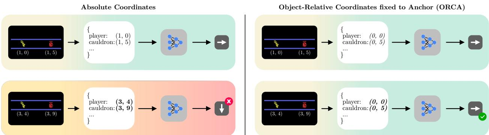  
Figure 1: With ORCA inputs, the agent only needs to learn strategies for similar situations once, enabling direct generalization. When the player (Asterix ) is in the same row as the target collectible (cauldron ), e.g., the cauldron (1, 5) is right of Asterix (1, 0), the absolute coordinates of the objects should not influence the agent’s decision. The agent should behave the same even if the cauldron is at (3, 9), which is also on the right of Asterix (3, 4), but on a diferent platform. Object-Relative Coordinates fixed to Anchor (ORCA) performs this transformation in object space, simplifying the agent’s decision.

## 1 Introduction

Ask a person where their keys are, and they will not answer in coordinates; they will say next to the bowl, on the left side of the desk, or behind you. Human spatial reasoning often uses spatial anchors and relative frames of reference (Levinson, 2003). Scenes are parsed into bounded objects with persistent identity, and the position of each object is encoded in a frame tied to the body or to nearby landmarks rather than in a single fixed global system (Klatzky, 1998; Spelke, 1990; Scholl, 2001; Burgess, 2006). Object-centric reinforcement learning (OCRL) has internalized the first of these two ideas: rather than feeding pixels to a policy, OCRL extracts a set of objects with type, position, and velocity, and lets the agent reason over the resulting structured representation (Diuk et al., 2008; Baker et al., 2020; Delfosse et al., 2024a;b; Ye et al., 2025; 2026). The second idea, using anchors and relative frames of reference, has been independently adopted in multi-agent reinforcement learning, robotics, biology, and linguistics, where observations relative to the agent’s position are more commonly used (Gupta et al., 2017; Wang et al., 2020; Shang et al., 2021; Levinson, 2003), yet it remains largely absent from OCRL. The absolute-coordinate convention appears to have been inherited from early object-vector pipelines and rarely revisited.

From classical object-vector pipelines using multi-layer perceptrons (MLPs) to recent transformer-based variants, OCRL serves object features to the policy in the absolute frame of reference or global coordinates (Anand et al., 2019; Zadaianchuk et al., 2021; Mambelli et al., 2022; Haramati et al., 2024; Delfosse et al., 2024a). This leaves inter-object relations implicit: For example, a cauldron 5 pixels to the right of the player in Asterix maps to a diferent input at every screen location, so the agent must relearn the same response from scratch at each position (see Figure 1). The result is fragility under spatial perturbations, frame translation, and platform shifts, even when the relative scene is unchanged.

We close this gap with ORBiT (Object-Relative inductive-Bias Transformer): an Object-Relative Coordinates fixed to Anchor (ORCA) input that encodes each object’s position and velocity in the relative frame of a designated anchor object (typically the player or important entities like the ball in Foosball), fed into a transformer encoder that is order-invariant and count-flexible by construction. When trained on the Arcade Learning Environment (ALE) (Bellemare et al., 2013; Machado et al., 2018b) and tested across the Hack-Atari benchmark (Delfosse et al., 2025), switching the inputs from absolute coordinates to ORCA raises the interquartile mean (IQM) performance from 0.54 to 1.10 in the human-normalized score (HNS, see Appendix A), moving it from below a pixel baseline without access to objects (0.69) to approximately human level. Testing robustness, we see that ORBiT loses only 4% of its score on the HackAtari test suite, whereas absolute coordinates yield a 30% drop. In Foosball — a challenging 8-DoF (degrees of freedom) robotics environment that requires robust policies in the presence of changing opponent behavior (Moos et al., 2024) ORBiT concedes only 73 goals out of 50,000 against its absolute-coordinate baseline OCT. In Tag, an environment where the player has to catch a target without being distracted by other moving objects, ORBiT reaches 22.4 catches within 500 steps, whereas OCT is barely able to catch the target (1.8).

## Contributions.

• We formalize Object-Relative Coordinates fixed to Anchor (ORCA) representations, in which object positions and velocities are expressed relative to a task-relevant object.

• We present ORBiT, a transformer encoder over ORCA-encoded object sets that is order-invariant and count-flexible by construction.

• We show that ORBiT improves end performance and robustness to spatial perturbations (translation and platform shifts) compared to absolute-coordinate variants, which substantially degrade under the same perturbations.

• We introduce Tag, a controlled environment with oriented, moving objects in which object count, the anchor, and landmarks can be varied independently. This lets us evaluate ORCA with an oriented anchor, where it applies the full rigid-body transform.

• We demonstrate on Foosball that ORBiT transfers to continuous-control tasks and outperforms both OCT (the same transformer with absolute coordinates) and classical MLP models $( \mathrm { P P O ^ { M L P } } )$

In the remainder of the paper, we formalize ORCA representations, describe the ORBiT architecture, and evaluate its efectiveness across multiple environments and generalization settings.

## 2 From Absolute to Relative Representations

We model the environment with object-centric representations, where the agent receives at each step t a set of $N _ { t }$ objects $\mathbf { \bar { \mathcal { O } } } _ { t } ~ = ~ \{ o _ { t } ^ { 1 } , . . . , o _ { t } ^ { N _ { t } } \}$ from an upstream detector, such as SAM3 (Carion et al., 2026), OCAtari (Delfosse et al., 2024a), or similar. Each object $o _ { t } ^ { i }$ is a feature vector of intrinsic $\mathbf { c } _ { t } ^ { i }$ and extrinsic ${ \bf e } _ { t } ^ { i }$ attributes. Intrinsic attributes may cover the object type, color, and size, while the extrinsic attributes feature the absolute position $\mathbf { p } _ { t } ^ { i } .$ , velocity $\mathbf { v } _ { t } ^ { i }$ , acceleration $\mathbf { a } _ { t } ^ { i } .$ , and the heading angle φi of the object in the absolute environment frame. In our experiments, we limit $\mathbf { c } _ { t } ^ { i }$ to a one-hot encoding of the object type and ${ \bf e } _ { t } ^ { i }$ to $\mathbf { p } _ { t } ^ { i }$ and $\mathbf { v } _ { t } ^ { i } .$ , where we use $\mathbf { v } _ { t } ^ { i } = \mathbf { p } _ { t } ^ { i } - \mathbf { p } _ { t - 1 } ^ { i }$ for Atari (for Foosball, see Appendix F). OCRL typically passes ${ \mathcal { O } } _ { t }$ directly to the policy as global values within an absolute frame of reference.

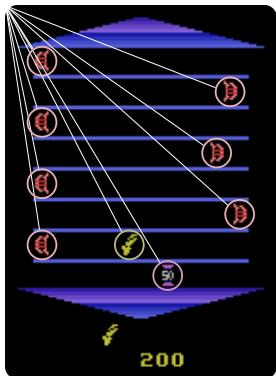  
(a) Absolute

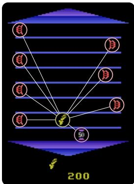  
(b) Relative (ORCA)  
Figure 2: Comparison of absolute and relative representations in Asterix. $L e f t .$ : Absolute representations encode object positions with respect to a fixed origin in the environment (e.g., top-left corner). Right: Relative representations encode object positions with respect to the anchor object (e.g., the agent’s location).

We instead express each object’s position and velocity relative to a designated anchor object ψt. The anchor should represent the most important object in the game. In Atari, we typically use the player object — e.g., the paddle in Pong or Asterix in Asterix — as the relative anchor, whereas in Foosball, we use the ball.

Concretely, rather than encoding “the cauldron at pixel $( 3 , 9 ) ^ { \dag }$ in Asterix, we encode “the cauldron 5 pixels right and 0 pixels above the player” (see Figure 2). Formally, let $\psi _ { t }$ have position $ { \mathbf { p } } _ { t } ^ { \psi }$ , velocity $\mathbf { v } _ { t } ^ { \psi }$ , and orientation $\mathbf { Q } _ { t } \in S O ( d )$ ; in $d = 2$ dimensions, $\mathbf { Q } _ { t } = \mathbf { R } ( \varphi _ { t } )$ for a heading angle $\varphi _ { t }$ , where $\mathbf { R } ( \varphi _ { t } )$ denotes the 2d rotation matrix parameterized by $\varphi _ { t }$ . The anchor-relative observation

$$
\tilde { \mathcal { O } } _ { t } = \{ \tilde { o } _ { \psi , t } ^ { i } \} _ { i = 1 } ^ { N _ { t } }\tag{1}
$$

is defined by the transformation

$$
\tilde { o } _ { \psi , t } ^ { i } = T ( \psi _ { t } , o _ { t } ^ { i } ) = \big [ \phi _ { \mathrm { i n t } } ( o _ { t } ^ { i } ) , \ \phi _ { \mathrm { r e l } } ( \psi _ { t } , o _ { t } ^ { i } ) \big ] ,\tag{2}
$$

where $\phi _ { \mathrm { i n t } }$ returns $\mathbf { c } _ { t } ^ { i }$ unchanged and $\phi _ { \mathrm { r e l } }$ maps positions and velocities into the anchor’s frame. With $\mathbf { R } _ { t } : = \mathbf { Q } _ { t } ^ { \top } = \mathbf { R } ( - \varphi _ { t } )$ in $d = 2 .$

$$
\begin{array} { r } { \phi _ { \mathrm { r e l } } ( \psi _ { t } , o _ { t } ^ { i } ) = \big [ \underbrace { \mathbf { R } _ { t } \cdot ( \mathbf { p } _ { t } ^ { i } - \mathbf { p } _ { t } ^ { \psi } ) } _ { \Delta \mathbf { p } _ { t } ^ { i } } , \mathbf { R } _ { t } \cdot ( \mathbf { v } _ { t } ^ { i } - \mathbf { v } _ { t } ^ { \psi } ) \big ] . } \end{array}\tag{3}
$$

For Atari and Foosball, where the player and ball have no meaningful orientation, we assume $\mathbf { R } _ { t } = \mathbf { I }$ and Equation (3) reduces to subtracting the anchor’s position and velocity from each object. Every Atari result we report is, therefore, evidence for translation invariance only; see Appendix B. For objects with a heading $\varphi _ { t } ^ { i } .$ , the rotation matrix $\mathbf { R } ( - \varphi _ { t } )$ encodes the frame from the perspective of the anchor object itself, as we can see in Tag. Tag also uses an extended version of Equation (3) (see Appendix G). The anchor object is self-encoded as $T ( \psi _ { t } , \psi _ { t } )$ , giving $\Delta \mathbf { p } _ { t } ^ { \psi } = \mathbf { 0 }$ and zero relative velocity; this keeps the anchor object as a regular member of the object set (see Figure 2). ORCA however discards the anchor’s absolute pose and velocity. As we will see in the results, this does not pose a problem in most environments, since these environments contain static objects that can serve as landmarks. Furthermore, our method assumes that the anchor object exists at all times and can always be localized. RQ5 measures the extent to which the anchor choice matters.

Invariance. A practical consequence is that the policy does not need to relearn responses across spatial positions: two scenes that difer only by a global shift or rotation produce identical ORCA observations. Formally, $\tilde { \mathcal { O } } _ { t }$ is invariant to any rigid transformation of the world frame applied jointly to all objects, so a policy acting on ${ \tilde { O } } _ { t }$ returns the same action distribution for all scenes related by such a transformation, with no auxiliary losses. A formal proof over $S E ( d )$ and the orientation-free specialization used in our Atari experiments are in Appendix B. Where the anchor object carries a meaningful orientation, and actions are expressed in the world frame, the policy’s output must be mapped back through $\mathbf { Q } _ { t } .$ , making the composite policy equivariant rather than invariant.

Example. In Asterix, the same configuration — a lyre or cauldron on the left of Asterix — maps to a diferent absolute input on every platform; however, under ORCA, it is always the same relative vector, so the policy only has to learn the response once (see Figures 1 and 2). Similarly, this holds for the cars relative to the player (chicken) in Freeway.

ORCA adds no learnable parameters and wraps any object-vector environment without modifying the downstream policy class. As such, ORCA can be used with any object-centric approach with an identifiable potential anchor object. This includes methods such as an object-centric PPO (PPObj) and an absolute-coordinate transformer (OCT).

Scene Graphs and GNNs. Representing the scene as a graph over all objects is a genuine alternative, with a long history in relational RL, object-oriented MDPs, and graph networks (Battaglia et al., 2018); see Section 5. Given displacement edge features $p _ { t } ^ { i } - p _ { t } ^ { j }$ , such a model obtains the same translation invariance that ORCA does, so the choice between the two is not about whether the invariance is available, but about what it costs to obtain. A graph-based policy constructs edge features that scale quadratically with $N _ { t }$ evaluates a learned edge function on each, and introduces design decisions, such as edge parameterization or aggregation schemes, that must be specified and tuned before the invariance can be of any use. ORCA changes the input representation while keeping the rest untouched: the policy, training algorithm, and reward stay as they are. The relational content is preserved rather than traded away, as for any two objects i and $j ,$

$$
\mathbf { R } _ { t } \cdot \left( \mathbf { p } _ { t } ^ { i } - \mathbf { p } _ { t } ^ { \psi } \right) - \mathbf { R } _ { t } \cdot \left( \mathbf { p } _ { t } ^ { j } - \mathbf { p } _ { t } ^ { \psi } \right) \ = \ \mathbf { R } _ { t } \cdot \left( \mathbf { p } _ { t } ^ { i } - \mathbf { p } _ { t } ^ { j } \right) ,\tag{4}
$$

so every pairwise displacement remains recoverable as the diference between two anchor-relative tokens, and self-attention can form whichever of them the task requires. This keeps the relational information that an explicit graph would provide while leaving the pipeline as simple as possible. The cost is the anchor itself:

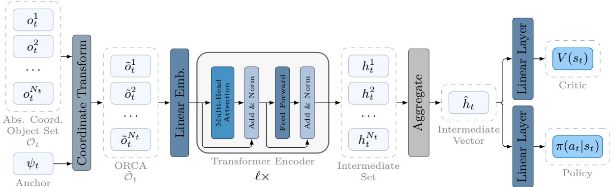  
Figure 3: ORBiT architecture: a versatile transformer with ORCA inputs. The absolute coordinate object set ${ \mathcal { O } } _ { t }$ is transformed into the anchor-relative set $\tilde { \mathcal { O } } _ { t }$ . These ORCA inputs are embedded into the working dimension of the transformer. The transformer’s output sequence is aggregated (mean-pooled) into a single vector $\hat { h } _ { t }$ before being passed through the linear critic and policy heads. OCT uses ${ \mathcal { O } } _ { t }$ directly within the otherwise identical architecture.

a graph over all objects needs no designated object, whereas ORCA requires one that exists and can be identified at every step. We do not evaluate an explicit scene-graph variant and leave that comparison to future work.

## Anchor Choice

Forgoing a full graph evaluation requires selecting a single anchor object. This choice mirrors real-world human spatial cognition, which is fundamentally biased toward an egocentric frame of reference (Wang & Spelke, 2002). When playing video games, humans naturally adopt a player-centric perspective, which motivated our design of the coordinate system. We therefore use the player object as the anchor wherever the game provides one. More generally, we select as anchor the object whose relations to the rest of the scene are most decision-relevant, i.e., the object that the agent’s actions most directly act upon or through.

However, a player-centric anchor is not the only possible choice. In Foosball, the ideal spatial reference shifts. Unlike the Atari environments, Foosball features eleven distinct player objects under the agent’s control. Rather than anchoring to any single player, the most critical element in the game is the ball. Consequently, we use the ball as our anchor for the game of Foosball. We further use Tag to systematically investigate the influence of diferent anchor choices in ORBiT (see Section 3). This illustrates that the anchor is best understood as a task-dependent design parameter rather than a fixed convention; automatically identifying the anchor, or combining several anchors, is a promising direction for future work.

## Object-Relative inductive-Bias Transformers (ORBiT)

To process object-centric observations flexibly and expressively, we build on the transformer architecture (Vaswani et al., 2017), which has proven efective at modeling interactions among sets of entities. The transformer’s raw self-attention mechanism enables reasoning over unordered inputs (Vaswani et al., 2017), making it a natural fit for RL agents operating on object-based sets extracted from structured environments. ORBiT builds such a transformer over the ORCA-encoded object set $\tilde { \mathcal { O } } _ { t }$ from Section 2.

Each token $\tilde { o } _ { \psi , t } ^ { i } \in \tilde { \mathcal { O } } _ { t }$ concatenates intrinsic attributes $\mathbf { c } _ { t } ^ { i }$ and relative spatial features $\phi _ { \mathrm { r e l } } ( \psi _ { t } , o _ { t } ^ { i } )$ . Object types are one-hot encoded, and the type vocabulary is fixed at initialization. A shared linear layer projects each token to a d-dimensional embedding, giving $N _ { t }$ embeddings as input to the transformer encoder layers. After ℓ encoder layers, the resulting set is aggregated into a single vector before being passed into the linear value and policy head (see Figure 3). More details in Appendix C.

Our baseline OCT uses the same architecture and hyperparameters as ORBiT but takes absolute coordinates as input rather than ORCA.

## 3 Empirical Evaluation

We evaluate whether ORCA representations and the ORBiT architecture (Section 2) improve reinforcement learning performance and generalization. Our empirical analysis is organized around the following research questions:

RQ1. Does ORCA outperform absolute-coordinate object inputs in OCRL?

RQ2. Is ORCA architecture-agnostic?

RQ3. Are ORCA-based agents more robust to test-time spatial perturbations (translation, frame shifts, platform repositioning) than absolute-coordinate agents?

RQ4. Does ORBiT transfer to continuous-control tasks beyond Atari?

RQ5. How much do ORCA’s gains depend on the choice of anchor?

Environments and Setup. We train all agents on 13 Atari games and evaluate robustness zero-shot using the HackAtari perturbation suite (Delfosse et al., 2025), as well as random translations as proposed by Laskin et al. (2020); perturbations are never seen during training. Object states are extracted with OCAtari’s RAM extraction method (Delfosse et al., 2024a) at each step. We use IQM for aggregated comparisons to reduce sensitivity to outliers (Agarwal et al., 2021) and report it together with the 95% confidence interval (CI) (see Appendix A). Retained performance is described as

$$
\varrho = \frac { r _ { v a r } - r _ { m i n } } { r _ { o r g } - r _ { m i n } }\tag{5}
$$

and measures the robustness to close variations of the game, with $r _ { o r g }$ being the return after an episode in the original game, $r _ { v a r }$ in the respective variant, and $r _ { m i n }$ the minimal return possible. For our standard Atari experiments, we instead use the human-normalized score (HNS; see Appendix A and Badia et al. (2020)) to enable aggregation across games. Five agents are compared throughout: $\mathbf { P P O } ^ { \mathbf { c N N } }$ (pixel-based CNN, no object extraction), PPObj (MLP over absolute-coordinate object vectors, no transformer), PPObj-ORCA (same architecture as PPObj, but with ORCA feature representation), OCT (transformer over absolutecoordinate objects, same architecture as ORBiT), and ORBiT (transformer over ORCA-encoded objects; ours). PPObj and OCT together independently isolate the contributions of the transformer and the ORCA representation. All agents are trained on 40 million frames or 10 million time steps across 5 seeds; the implementation follows CleanRL (Huang et al., 2022b) for PPO-like training and is extended for OCT and ORBiT. Each run takes approximately 4 hours and 15 minutes on average on a single NVIDIA V100 GPU. These experiments are the basis for addressing research questions RQ1–RQ3.

For RQ4, ORBiT is evaluated against OCT and PPOMLP (absolute coordinates and joint values, classical MLP) on a Foosball environment derived from Moos et al. (2024). Each agent is trained for roughly 6.6 billion time steps on 4,096 parallel environments.

For RQ5, we additionally use Tag (see Appendix G), a controlled 2D environment. In a bounded arena, the agent must catch the orange target, while purple targets act as distractors. Unlike Atari and Foosball, objects in Tag carry a heading, so ORCA applies the full rigid-body transform (translation and rotation) rather than translation alone. Tag also lets us vary the number of objects and the choice of anchor. Starting from a base configuration (5 distractors, the player as anchor), we vary one factor at a time. We train OCT, ORBiT, PPObj, and PPObj-ORCA for 3 million time steps across 5 seeds.

Full hyperparameter details, as well as a complete list of the used Atari games, are in Appendices D to F.

## Evaluating the Performance

RQ1 — Relative coordinate systems heavily improve object-centric methods. Figure 4 shows that player-relative ORCA inputs outperform global coordinates. The transformer agent gains ∆+0.56 HNS (from 0.54 to 1.10) with 95 % CI [0.49, 0.63], reaching human level.

While the absolute coordinate transformer OCT falls behind the pixel-input $\mathrm { P P O ^ { c N N } }$ (IQM: 0.69, 95% CI: [0.66, 0.72]), despite receiving clean object states rather than raw pixels, ORBiT gains enough performance through ORCA to clear this baseline. This means that without a reference anchor, the transformer fails to capture positiondependent correlations that do not hold across the game’s spatial extent. The confidence interval for ORBiT (OCT+ORCA) spans 1.04–1.16 IQM and still shows a substantial improvement over pure OCT. The same holds in the Tag environment, where ORBiT reaches 22.4 catches, compared with 1.8 for OCT (see Figure 7).

RQ2 — ORCA benefits both MLP and transformer agents. To separate these contributions, we isolate two efects: first, the improvement using ORCA; second, we measure the diference between OCT and PPObj, isolating the architecture efect (both use global inputs). Here, the transformer alone does not help.

Besides the benefits of using ORCA within the transformer agent, we can also observe an improvement in performance of ∆+0.15 (from 0.62 to 0.77) with 95% CI [0.09, 0.22] within the MLP agent PPObj to bring it in line with the PPOCNN baseline (IQM: 0.69, 95% CI: [0.66, 0.72]).

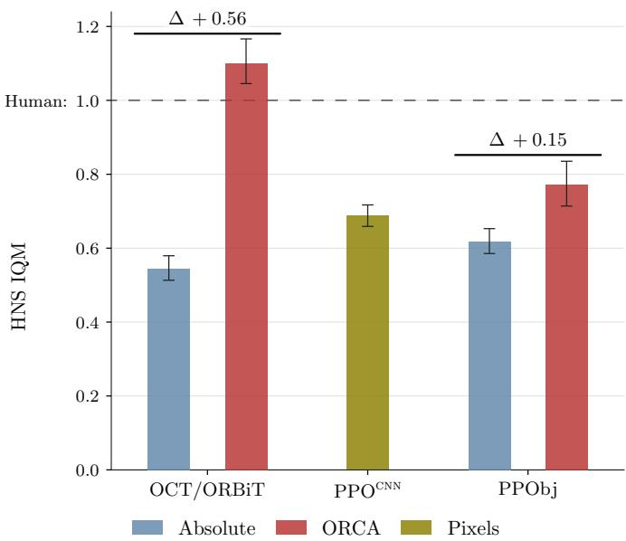  
Figure 4: ORCA improves both architectures in Atari. The gain in HNS IQM is larger for the transformer (OCT/ORBiT, ∆+0.56) than for the MLP (PPObj, ∆+0.15). Both absolute-coordinate models fall below the pixel baseline $( \mathrm { P P O } ^ { \mathrm { C N N } } )$ ; only ORBiT approaches human level (dotted). Aggregated end performance (HNS IQM) with 95% confidence intervals. Higher is better. Full pergame numbers in Appendix H.

However, neither improvement alone clears the human baseline; PPObj-ORCA sits at 0.77 (95% CI [0.71, 0.84]) and OCT at 0.54 (95% CI [0.51, 0.58]), but the combination does, reaching 1.10 (see Figure 4) with a 95% CI [1.04, 1.16].

The most plausible explanation is that the transformer can attend to each object’s anchor-relative features independently and compose them, whereas an MLP concatenates all objects into a fixed-size vector and must re-learn any relational structure the ORCA encoding makes explicit. Overall, we can say that ORCA improved performance in both cases. The substantial gap between ∆+0.56 and ∆+0.15 is primarily driven by a few games, e.g., Asterix (see Table 8), suggesting that the transformer may disproportionately amplify ORCA in specific games while maintaining a similar impact across most others.

The benefits of ORCA are consistent across both architectures we test. This implies that relative coordinates should be used instead of absolute coordinates whenever the task structure allows.

## Robustness and Generalization

RQ3 — ORBiT is more robust to perturbations. We evaluate agents’ zero-shot performance on three types of perturbations and report the retained performance ϱ relative to clean performance. Results can be seen in Figure 5. Translate trims a random portion of the empty border, shifting the game content without cutting any of it and keeping the relative scene unchanged. For object-based agents, the same pixel ofset is added to all extracted coordinates. Shuffle permutes the object set indices: the scene is identical, but any reliance on slot order breaks. Note that Translate and HackAtari variants are only available on a set of 10 of 13 games, though not the same 10; details and full per-game numbers in Appendix H. Examples are in Appendix I.

As shown in Theorem 1 (Appendix B), ORCA is guaranteed to be invariant to transformations in the coordinate frame. Hence, these results on Translate serve as an empirical check of the follow-up Corollary 1.

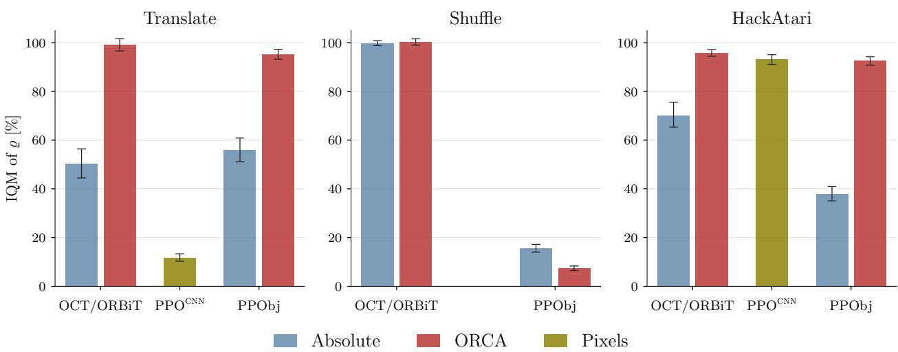  
Figure 5: ORBiT enhances robustness and retains the highest performance in most settings. The transformer alone explains the full performance in OCT and ORBiT for shuffle, which is not applicable for the CNN-based $\mathrm { P P O } ^ { \mathrm { C N N } }$ that operates on image data. In HackAtari, ORBiT retains its performance similar to $\mathrm { P P O ^ { c N N } }$ , and translate tests Corollary 1. The IQM of the retained performance ϱ when evaluating zeroshot under translated inputs (left, shifts the absolute reference frame while keeping relative structure) and shuffle (middle, permutes the object list while preserving the scene). Bars compare absolute coordinates and player-centric (ORCA) representations across architectures: OCT (transformer over objects), PPOCNN (pixel CNN; no relative variant), and PPObj (MLP over objects). Higher is better. IQM over 5·10 episodes.

OCT loses $\Delta = - 5 0 \%$ under global and is essentially unafected (≈ 1%) under player-centric (ORBiT). PPObj drops 44% under global inputs and is also essentially unafected (5%) with ORCA. Since ORCA inputs are identical by construction, deviations from 100% reflect evaluation stochasticity. $\mathrm { P P O ^ { c N N } }$ collapses by 88%, with no anchor-relative variant to compare. Looking at shuffle, OCT is unafected regardless of representation $( \Delta \approx 0 )$ permutation-invariance holds at test time and does not depend on ORCA being active. PPObj drops 85–93% regardless of representation; its MLP has no analogous bias, and ORCA does not compensate.

In the HackAtari results, we observe that the global coordinates in OCT and PPObj exhibit poor generalization, with performance dropping by 30% and 62%, respectively. ORCA helps mitigate this, with $\mathrm { P P O b j }$ using player-centric coordinates, reducing the drop to 7% and ORBiT dropping by only 4%, both comparable to $\mathrm { P P O ^ { c N N } }$ (7%).

These results highlight the biggest advantages of using ORCA with a transformer. ORCA prevents catastrophic failure when the information in the game screen is slightly shifted in the observations (translate).

## Continuous Control and Anchor Choice

RQ4 — Beyond Atari, relative coordinates (ORCA) also boost continuous-control tasks. To investigate this, we have used ORBiT on an additional task: Foosball (see Moos et al. (2024), Figure 6).

We trained the agents to play the full game of Foosball (all rods with all figurines) with 4 rods per player using the mixed self-play setup (see Appendix F) and the ball as the anchor object. All algorithms, i.e., ORBiT, OCT, and $\mathrm { P P O ^ { M L P } }$ , were trained on 5 diferent random seeds, producing 15 Foosball agents. The details of the training setup are in Appendix F.

To evaluate the diferent approaches, we compare them by pairing every seed from one algorithm with every seed from the other. Each match-up is 1,000 goals per side (black/white), totaling 50,000 goals per algorithm pair. The results are shown in Figure 6b. We observe that $\mathrm { P P O ^ { M L P } }$ scored only 330 goals against ORBiT, while ORBiT shot approximately 49.7k goals, accounting for over 99% of all possible goals. The results of

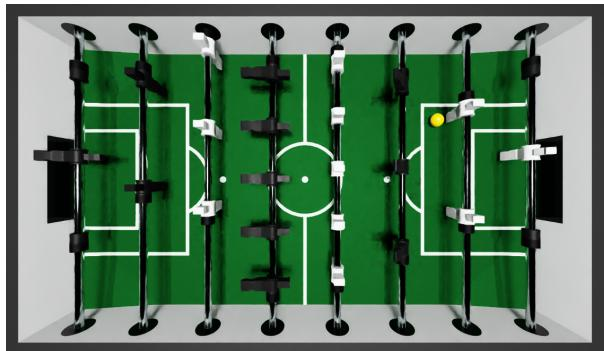  
(a) The Foosball environment

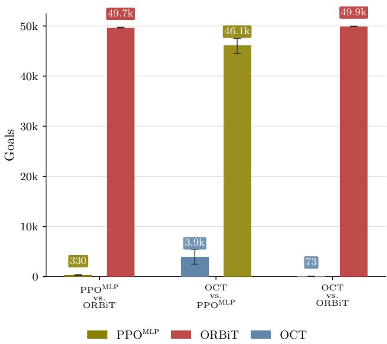  
(b) Head-to-head goals  
Figure 6: ORBiT consistently dominates in the Foosball environment (a). (b) Both $\mathrm { P P O ^ { M L P } }$ and OCT are decisively outperformed by ORBiT; they score only 330 and 73 goals out of 50k. With ORCA, ORBiT learns efective policies, while OCT (absolute coordinates) remains far behind $\mathrm { P P O ^ { M L P } }$ . Full permatch numbers are in Appendix H.

ORBiT (ORCA) vs. OCT (absolute coordinates) are even clearer, with OCT only able to score 73 times out of 50,000. This not only shows the strong benefit of ORCA over absolute coordinates, but also ORBiT’s dominance in the Foosball task. Neither baseline approach comes even close to ORBiT’s strong policy. Detailed results of the diferent match-ups are in Appendix H.

To the best of our knowledge, ORBiT enables the first autonomous agent trained from scratch via self-play to play the full game of Foosball. This demonstrates that ORBiT can scale efectively to continuous, highly dynamic physical domains with complex multi-body coordination. These results suggest that ORCA and ORBiT are promising candidates for real-world robotic control, though validating them on physical hardware with imperfect object detection remains future work.

RQ5 — Choosing a meaningful anchor is necessary for ORBiT to work. Atari and Foosball fix the orientation of the objects, the number of objects, and the anchor; Tag lets us vary each in isolation.

ORBiT accepts sets of any size by construction, but accepting a set of unseen size does not mean it performs well on it. Since distractors difer from targets only in type (represented by color), an agent that attends to targets should not care about how many distractors surround it. We train with $m = 5$ distractors and evaluate with $m ^ { \prime } \in \{ 0 , 1 , 5 , 1 0 \}$ , including more distractors than seen during training. PPObj concatenates a fixed number of object slots $( N _ { \mathrm { m a x } } = 9 \colon$ 1 player, 1 target, 2 landmarks, 5 distractors) and cannot be evaluated beyond it. ORBiT’s number of catches stays the same for every $m ^ { \prime } { . }$ , whereas OCT slightly falls with the number of distractors (see Appendix H).

Theorem 1 holds for any object that is part of the scene. We therefore train ORBiT with four diferent anchors: the player (default), the target, a distractor, and a static landmark at $\mathbf { p } ^ { L }$ , and measure the influence of anchor choice. The landmark anchor is the informative case. Since $\mathbf { p } _ { t } ^ { i } - \mathbf { p } ^ { L }$ difers from absolute coordinates only by a constant, it preserves invariance to frame shifts. The player and target anchors reach IQMs of 22.4 and 20.7, the distractor anchor 0.7, and the landmark anchor 1.4, close to OCT (Figure 7b). This highlights the importance of the choice of anchor.

Together, ORBiT is unafected by the number of distractors, while the choice of anchor decides the amount of improvement through ORCA. PPObj results are in Appendix H.

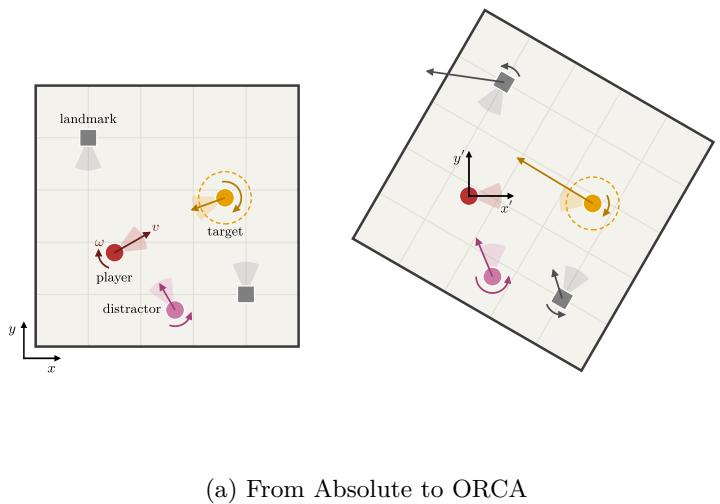

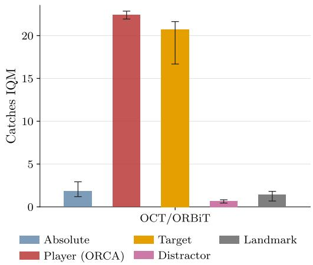  
(b) Results for Diferent Anchor Choices  
Figure 7: In Tag, ORBiT outperforms absolute coordinates, but the anchor choice matters. The ORCA observations compute all object observations relative to an anchor object. (a) For example, selecting the player as the anchor transforms absolute (left) into relative (right) representations via a kinematic transformation that sets the player as a static origin (aligned with its heading) and applies the player’s linear velocity v and angular velocity ω in reverse to all objects. The headings, shown as shaded cones, match the direction of motion in the absolute frame but not in the player’s frame: every object inherits the player’s reversed velocity, plus a sideways velocity due to its rotation. Even static landmarks thus appear to move, and the target’s velocity points past the player, although the target heads almost straight at it. The figure is a schematic, with arrow lengths and turn arcs not drawn to scale. (b) The performance results vary strongly for diferent anchor choices. Choosing an important game object, such as the player, clearly dominates a randomly moving anchor (distractor).

## 4 Discussion

An agent receiving world-frame positions must learn that the same relative configuration, i.e., a cauldron 5 pixels to the right of the player in Asterix, is equivalent everywhere it can occur, and thus the agent must learn it again at every location. This is evident in the results of the translated-frame experiment. ORCA states the equivalence directly: two scenes difering by a global translation produce identical inputs. The robustness results follow from the same property, since perturbations that shift absolute coordinates without changing relative structure are invisible to an ORCA policy and catastrophic for one trained on world-frame inputs.

We showed this in three domains. In Atari, PPObj and OCT benefit from ORCA, with ORBiT being the strongest agent. In Foosball and Tag, this is even more prominent. We expect the advantage of ORCA to scale with how often a task reuses relative configurations across the world frame, and to shrink wherever the world frame is itself the task structure.

We do not claim this inductive bias is novel: anchoring observations to the acting agent has proven efective in multi-agent RL (Shang et al., 2021). Object-centric RL, however, has largely retained absolute coordinates, feeding object features to the policy in a fixed global frame. Our results show that revisiting this input convention yields substantial gains in both performance and robustness.

Broader Applicability. ORCA is a drop-in observation wrapper, with no change to the policy architecture, the training algorithm, or the reward. As such, any pipeline that consumes absolute-coordinate object vectors can adopt it by substituting a single transformation at the input. Furthermore, our Foosball results show that ORBiT handles fast, continuous control in simulation. Although a game, Foosball shares key demands with real-world robotics, including fast system dynamics and 8-DoF continuous action execution. This makes ORBiT a promising candidate for robotic and other continuous-control domains, pending validation on physical hardware with imperfect object detection.

Limitations and Future Work. First, our current implementation is constrained to 2D environments; extending this approach to 3D continuous spaces will be necessary for broader real-world robotic deployment. Second, our state formulation evaluates coordinates relative to a single target entity. This anchor is currently selected manually per environment based on domain knowledge; learning to identify the most decision-relevant anchor automatically would remove this design choice and make the approach more readily transferable to new tasks. Our evaluation in Tag highlights this matter; with an anchor that is not decisionrelevant, most of the gain disappears. Looping back to relational RL, i.e., modeling inter-object spatia relationships across all entities in the scene, is a promising direction for enhancing relational reasoning in the context of relative coordinate frames. Further, we assume a perfect object extractor in our work. The influence of detection quality should be studied in general for OCRL. Finally, in most of our experiments, we restricted our inputs to positional coordinates and velocities only. Studying richer feature spaces, such as object bounding dimensions, dynamic properties, or semantic labels, could unlock further improvements in OCRL.

## 5 Related Work

Object-Centric Representations in deep RL. Unlike traditional pixel-based inputs or global feature vectors, object-centric views abstract the environment into discrete entities, enabling relational reasoning and compositional learning. Foundational methods such as Slot Attention (Locatello et al., 2020) have enabled unsupervised object discovery, while platforms like OCAtari (Delfosse et al., 2024a) provide structured objectlevel access to classic benchmarks. Empirical studies report the benefits of such representations for policy learning (Ye et al., 2025; 2026) and transferability (Yoon et al., 2023; Didolkar et al., 2025). More recently, Ugadiarov et al. (2025) combine actor-critic learning with an object-centric world model to exploit relational structure in RL. In contrast, ORBiT is model-free and focuses on the representational choice itself: objects are encoded relative to a task-relevant anchor rather than in absolute coordinates. While most approaches encode objects in a global coordinate frame, they frequently overlook the perspective-dependent structure that often guides agent behavior.

Relational Reinforcement Learning and Object-Oriented MDPs. Similar to ORBiT, Relational Reinforcement Learning (Džeroski et al., 2001; Van Otterlo & Kersting, 2004; Kersting et al., 2004) and Object-Oriented MDPs (OO-MDPs) (Diuk et al., 2008), address the following problem: how to exploit objects and their relations so an RL agent can generalize across environments and diferent numbers of objects. The main diference from ORBiT is their focus: classical Relational RL, on the one hand, typically uses first-order logic or relational rules to describe relations. OO-MDP, on the other hand, centers around the object interactions within the transition model. In contrast, ORBiT instead utilizes an egocentric view, encoding objects relative to a specified anchor object.

Transformers for Relational and Object-Centric RL. Transformers have become increasingly popular in RL due to their capacity to model relational structure via self-attention. For example, the Set Transformer (Lee et al., 2019) introduced an attention-based architecture for permutation-invariant processing of unordered sets. Early applications, such as the Decision Transformer (Chen et al., 2021), framed RL as a sequence-modeling problem, while others (Parisotto et al., 2020; Hu et al., 2021; Yang et al., 2022; Esslinger et al., 2022) adapted transformers for partially observable or multi-agent settings. In object-centric settings, transformers have been used to model interactions between entities (Zadaianchuk et al., 2021; Mambelli et al., 2022), though these models often rely on goal conditioning or absolute positions, thereby limiting their ability to generalize across spatial variations. Additionally, they typically employ aggregation mechanisms that are sensitive to input size or ordering, reducing flexibility in dynamic environments. More recently, Haramat et al. (2024) introduced an entity interaction transformer for OCRL that combines object-centric representations with attention-based state, goal, and entity-interaction modeling, enabling multi-object manipulation from pixels and generalizing to more objects than were seen during training. ORBiT complements these works. It uses a transformer to reason over sets of objects in relative frames of reference and therefore leans on anchor-relative object representations as an inductive bias to guide and elevate learning.

Inductive Biases for Spatial Generalization. A growing body of work explores how inductive biases can enhance generalization in spatially structured tasks. Works on relational architectures, including Graph Networks (Battaglia et al., 2018), argue that representing entities, relations, and compositional structure provides a useful bias for systematic generalization. Building on this perspective, transformer-based architectures with explicit relational structure (Altabaa et al., 2024; Altabaa & Laferty, 2025) and object-centric attention mechanisms (Blüml et al., 2026) have shown promising results in learning eficiency and transfer. These methods highlight the importance of modeling relations between entities, but they typically assume absolute positions in global coordinate frames. Drawing inspiration from cognitive science and neuroscience, recent work has suggested that egocentric inductive biases can improve robustness and behavioral relevance in reinforcement learning systems (see next paragraph). Our work follows this motivation, but instead of relying on explicit graph structure, we use self-attention over object tokens and introduce anchor-relative spatial coordinates as an inductive bias for object-centric RL.

Egocentric and Relative Representations. The distinction between egocentric (agent-relative) and allocentric (world-relative) representations has been extensively studied in cognitive science and neuroscience, with evidence that biological agents frequently operate in egocentric frames to support robust spatial reasoning (Klatzky, 1998; Galati et al., 2000; Burgess, 2006). Similar principles have informed navigation and control in robotics, where encoding observations relative to an agent or task-relevant anchor improves sample eficiency and generalization (Hu et al., 2025). Despite these precedents, most RL approaches continue to rely on absolute spatial encodings. ORBiT also operates on sets of object observations, but our focus is on RL with anchor-relative object representations. Agent-centric methods have been explored in multi-agent RL, where representing observations relative to the acting agent improves sample eficiency and generalization (Shang et al., 2021). Our work brings this idea to single-agent object-centric RL by encoding each object relative to a task-relevant anchor and combining this with a transformer-based policy.

Playing Foosball. Aside from the methodological part of this work, we test our approach on the game of Foosball. Moos et al. (2024) identify Foosball as a challenging robotic environment and an important stepping stone towards more complex robotics applications. In recent years, a couple of works have automated a Foosball table and created a digital twin (So et al., 2025; Croenen et al., 2024; Rohrer et al., 2021; De Blasi et al., 2021), highlighting the interest in, and challenges of this task. While the idea of an automated Foosball table is not new (Weigel & Nebel, 2002), the majority of Foosball agents are still rule-based and hand-coded (Založnik & Šoln, 2024). As training the full game with 4 rods from scratch is demanding, much of the work focuses on learning individual skills such as scoring, passing, and blocking (Moos et al., 2024; Croenen et al., 2024). In contrast, in this work, we use ORBiT to learn to play Foosball from scratch via self-play using the PPO algorithm. For this, we base our implementation on the work of Moos et al. (2024) and introduce mixed self-play, a form of domain randomization (Tobin et al., 2017), to boost early-stage training by enabling training across highly varied strategic scenarios.

## 6 Conclusion

Object-centric RL uses the fixed world frame as its dominant coordinate system. We revisit this convention and present an alternative. Object-Relative Coordinates fixed to Anchor (ORCA) expresses each object’s position and features in the frame relative to a task-relevant anchor object. ORCA does not introduce any learnable parameters, nor impose any constraints on the approaches for which this input representation can be used, except that access to the objects themselves is required. We pair ORCA with a transformer to create ORBiT.

Across our test set of 13 Atari games, where we replaced absolute coordinates with ORCA, both the transformer and the MLP outperformed their baselines (see Figure 4). Under zero-shot perturbations, described in Section 3, we demonstrate that ORCA and ORBiT both improve robustness in out-of-distribution examples.

Beyond Atari, ORBiT learns the full game of Foosball, an 8-DoF continuous-control task, from scratch via self-play. Against it, PPOMLP scores only 330 and OCT only 73 of 50,000 goals. In Tag, where the anchor carries an orientation, ORBiT reaches 22.4 catches per episode versus 1.8 for OCT. Although trained with 5 distractors, it maintains this performance across diferent numbers of distractors from 0 to 10. Furthermore, it shows the importance of the choice of anchor, with semantically meaningful objects like the player object or the target showing better performance than static landmarks or distractors.

Together, these results suggest that object-centric RL should use relative rather than absolute coordinates whenever the task provides a meaningful anchor. Selecting the anchor automatically, combining several anchors, and extending ORCA to 3D environments and imperfect object detectors are the next steps towards extending ORBiT.

## Acknowledgments

This research work has been funded by the Deutsche Forschungsgemeinschaft (DFG, German Research Foundation) under Germany’s Excellence Strategy (EXC-3057/1 ”Reasonable Artificial Intelligence“, Project No. 533677015).

## References

Rishabh Agarwal, Max Schwarzer, Pablo Samuel Castro, Aaron C. Courville, and Marc G. Bellemare. Deep reinforcement learning at the edge of the statistical precipice. In Advances in Neural Information Processing Systems (NeurIPS), pp. 29304–29320, 2021.

Awni Altabaa and John Laferty. Disentangling and integrating relational and sensory information in transformer architectures. In Proceedings of the International Conference on Machine Learning (ICML), 2025.

Awni Altabaa, Taylor Webb, Jonathan Cohen, and John Laferty. Abstractors and relational cross-attention: An inductive bias for explicit relational reasoning in transformers. In B. Kim, Y. Yue, S. Chaudhuri, K. Fragkiadaki, M. Khan, and Y. Sun (eds.), Proceedings of the International Conference on Learning Representations (ICLR), pp. 24597–24613, 2024.

Ankesh Anand, Evan Racah, Sherjil Ozair, Yoshua Bengio, Marc-Alexandre Côté, and R Devon Hjelm. Unsupervised state representation learning in atari. In Advances in Neural Information Processing Systems (NeurIPS), 2019.

Adrià Puigdomènech Badia, Bilal Piot, Steven Kapturowski, Pablo Sprechmann, Alex Vitvitskyi, Zhaohan Daniel Guo, and Charles Blundell. Agent57: Outperforming the atari human benchmark. In Proceedings of the International Conference on Machine Learning (ICML), volume 119, pp. 507–517, 2020.

Bowen Baker, Ingmar Kanitscheider, Todor Markov, Yi Wu, Glenn Powell, Bob McGrew, and Igor Mordatch. Emergent tool use from multi-agent autocurricula. In Proceedings of the International Conference on Learning Representations (ICLR), 2020.

Peter W. Battaglia, Jessica B. Hamrick, Victor Bapst, Alvaro Sanchez-Gonzalez, Vinicius Zambaldi, Mateusz Malinowski, Andrea Tacchetti, David Raposo, Adam Santoro, Ryan Faulkner, Caglar Gulcehre, Francis Song, Andrew Ballard, Justin Gilmer, George Dahl, Ashish Vaswani, Kelsey Allen, Charles Nash, Victoria Langston, Chris Dyer, Nicolas Heess, Daan Wierstra, Pushmeet Kohli, Matt Botvinick, Oriol Vinyals, Yujia Li, and Razvan Pascanu. Relational inductive biases, deep learning, and graph networks. ArXiv preprint arXiv:1806.01261, 2018.

Marc G. Bellemare, Yavar Naddaf, Joel Veness, and Michael Bowling. The arcade learning environment: An evaluation platform for general agents. Journal of Artificial Intelligence Research (JAIR), 47:253–279, 2013.

Jannis Blüml, Cedric Derstrof, Bjarne Gregori, Elisabeth Dillies, Quentin Delfosse, and Kristian Kersting. Do object channels improve robustness in deep reinforcement learning? Transactions on Machine Learning Research (TMLR), 2026. ISSN 2835-8856.

Neil Burgess. Spatial memory: how egocentric and allocentric combine. Trends in Cognitive Sciences, pp. 551–557, 2006.

Nicolas Carion, Laura Gustafson, Yuan-Ting Hu, Shoubhik Debnath, Ronghang Hu, Didac Suris Coll-Vinent, Chaitanya Ryali, Kalyan Vasudev Alwala, Haitham Khedr, Andrew Huang, Jie Lei, Tengyu Ma, Baishan Guo, Arpit Kalla, Markus Marks, Joseph Greer, Meng Wang, Peize Sun, Roman Rädle, Triantafyllos Afouras, Efrosyni Mavroudi, Katherine Xu, Tsung-Han Wu, Yu Zhou, Liliane Momeni, Rishi Hazra, Shuangrui Ding, Sagar Vaze, Francois Porcher, Feng Li, Siyuan Li, Aishwarya Kamath, Ho Kei Cheng, Piotr Dollar, Nikhila Ravi, Kate Saenko, Pengchuan Zhang, and Christoph Feichtenhofer. SAM 3: Segment anything with concepts. In Proceedings of the International Conference on Learning Representations (ICLR), 2026.

Lili Chen, Kevin Lu, Aravind Rajeswaran, Kimin Lee, Aditya Grover, Misha Laskin, Pieter Abbeel, Aravind Srinivas, and Igor Mordatch. Decision transformer: Reinforcement learning via sequence modeling. In Advances in Neural Information Processing Systems (NeurIPS), volume 34, pp. 15084–15097, 2021.

Jonathan Croenen, Jens Bürger, and Wannes Meert. Reinforcement learning of action sequences in table football. In BNAIC/BeNeLearn: Joint International Scientific Conferences on AI and Machine Learning, 2024.

Stefano De Blasi, Sebastian Klöser, Arne Müller, Robin Reuben, Fabian Sturm, and Timo Zerrer. Kicker: An industrial drive and control foosball system automated with deep reinforcement learning. Journal of Intelligent & Robotic Systems, 102(1):20, 2021.

Quentin Delfosse, Jannis Blüml, Bjarne Gregori, Sebastian Sztwiertnia, and Kristian Kersting. OCAtari: Object-centric Atari 2600 reinforcement learning environments. Reinforcement Learning Journal (RLJ), 1:400–449, 2024a.

Quentin Delfosse, Sebastian Sztwiertnia, Mark Rothermel, Wolfgang Stammer, and Kristian Kersting. Interpretable concept bottlenecks to align reinforcement learning agents. In Advances in Neural Information Processing Systems (NeurIPS), 2024b.

Quentin Delfosse, Jannis Blüml, Fabian Tatai, Théo Vincent, Bjarne Gregori, Elisabeth Dillies, Jan Peters, Constantin A. Rothkopf, and Kristian Kersting. Deep reinforcement learning agents are not even close to human intelligence. ArXiv preprint arXiv:2505.21731, 2025.

Aniket Rajiv Didolkar, Andrii Zadaianchuk, Anirudh Goyal, Michael Curtis Mozer, Yoshua Bengio, Georg Martius, and Maximilian Seitzer. On the transfer of object-centric representation learning. In Proceedings of the International Conference on Learning Representations (ICLR), 2025.

Carlos Diuk, Andre Cohen, and Michael L Littman. An object-oriented representation for eficient reinforcement learning. In Proceedings of the International Conference on Machine Learning (ICML), pp. 240–247, 2008.

Sašo Džeroski, Luc De Raedt, and Kurt Driessens. Relational reinforcement learning. Machine learning, 2001.

Kevin Esslinger, Robert Platt, and Christopher Amato. Deep Transformer Q-Networks for Partially Observable Reinforcement Learning. ArXiv preprint arXiv:2206.01078, 2022.

Gaspare Galati, Elie Lobel, Giuseppe Vallar, Alain Berthoz, Luigi Pizzamiglio, and Denis Le Bihan. The neural basis of egocentric and allocentric coding of space in humans: a functional magnetic resonance study. Experimental Brain Research, 2000.

Saurabh Gupta, James Davidson, Sergey Levine, Rahul Sukthankar, and Jitendra Malik. Cognitive mapping and planning for visual navigation. In Proceedings of the IEEE/CVF Conference on Computer Vision and Pattern Recognition (CVPR), pp. 2616–2625, 2017.

Dan Haramati, Tal Daniel, and Aviv Tamar. Entity-centric reinforcement learning for object manipulation from pixels. In Proceedings of the International Conference on Learning Representations (ICLR), 2024.

Siyi Hu, Fengda Zhu, Xiaojun Chang, and Xiaodan Liang. UPDeT: Universal multi-agent RL via policy decoupling with transformers. In Proceedings of the International Conference on Learning Representations (ICLR), 2021.

Yuhang Hu, Boyuan Chen, and Hod Lipson. Egocentric visual self-modeling for autonomous robot dynamics prediction and adaptation. npj Robotics, 3(1), 2025.

Shengyi Huang, Rousslan Fernand Julien Dossa, Antonin Rafin, Anssi Kanervisto, and Weixun Wang. The 37 implementation details of proximal policy optimization. The ICLR Blog Track, 2022a.

Shengyi Huang, Rousslan Fernand Julien Dossa, Chang Ye, Jef Braga, Dipam Chakraborty, Kinal Mehta, and João G. M. Araújo. Cleanrl: High-quality single-file implementations of deep reinforcement learning algorithms. Journal of Machine Learning Research (JMLR), 23(274):1–18, 2022b.

Kristian Kersting, Martijn Van Otterlo, and Luc De Raedt. Bellman goes relational. In Proceedings of the International Conference on Machine Learning (ICML), 2004.

Roberta L Klatzky. Allocentric and egocentric spatial representations: Definitions, distinctions, and interconnections. In Spatial Cognition: An Interdisciplinary Approach to Representing and Processing Spatial Knowledge, pp. 1–17, 1998.

Michael Laskin, Kimin Lee, Adam Stooke, Lerrel Pinto, Pieter Abbeel, and Aravind Srinivas. Reinforcement learning with augmented data. In Advances in Neural Information Processing Systems (NeurIPS), 2020.

Juho Lee, Yoonho Lee, Jungtaek Kim, Adam Kosiorek, Seungjin Choi, and Yee Whye Teh. Set transformer: A framework for attention-based permutation-invariant neural networks. In Proceedings of the International Conference on Machine Learning (ICML), 2019.

Stephen C Levinson. Space in language and cognition, volume 10. Cambridge: Cambridge University Press, 2003.

Francesco Locatello, Dirk Weissenborn, Thomas Unterthiner, Aravindh Mahendran, Georg Heigold, Jakob Uszkoreit, Alexey Dosovitskiy, and Thomas Kipf. Object-centric learning with slot attention. In Advances in Neural Information Processing Systems (NeurIPS), 2020.

Marlos C. Machado, Marc G. Bellemare, Erik Talvitie, Joel Veness, Matthew J. Hausknecht, and Michael Bowling. Revisiting the arcade learning environment: Evaluation protocols and open problems for general agents (extended abstract). In Proceedings of the International Joint Conferences on Artificial Intelligence (IJCAI), pp. 5573–5577, 2018a.

Marlos C. Machado, Marc G. Bellemare, Erik Talvitie, Joel Veness, Matthew J. Hausknecht, and Michael Bowling. Revisiting the arcade learning environment: Evaluation protocols and open problems for general agents. Journal of Artificial Intelligence Research (JAIR), 61:523–562, 2018b.

Davide Mambelli, Frederik Träuble, Stefan Bauer, Bernhard Schölkopf, and Francesco Locatello. Compositional multi-object reinforcement learning with linear relation networks. ArXiv preprint arXiv:2201.13388, 2022.

Volodymyr Mnih, Koray Kavukcuoglu, David Silver, Andrei A Rusu, Joel Veness, Marc G Bellemare, Alex Graves, Martin Riedmiller, Andreas K Fidjeland, Georg Ostrovski, Stig Petersen, Charles Beattie, Amir Sadik, Ioannis Antonoglou, Helen King, Dharshan Kumaran, Daan Wierstra, Shane Legg, and Demis Hassabis. Human-level control through deep reinforcement learning. nature, 518(7540):529–533, 2015.

Janosch Moos, Cedric Derstrof, Niklas Schröder, and Debora Clever. Learning to play foosball: System and baselines. In Proceedings of the IEEE International Conference on Robotics and Automation (ICRA), pp. 4326–4332, 2024.

Emilio Parisotto, Francis Song, Jack Rae, Razvan Pascanu, Caglar Gulcehre, Siddhant Jayakumar, Max Jaderberg, Raphaël Lopez Kaufman, Aidan Clark, Seb Noury, Matthew Botvinick, Nicolas Heess, and Raia Hadsell. Stabilizing transformers for reinforcement learning. In Hal Daumé III and Aarti Singh (eds.), Proceedings of the International Conference on Machine Learning (ICML), volume 119, pp. 7487– 7498, 2020.

Tobias Rohrer, Ludwig Samuel, Adriatik Gashi, Gunter Grieser, and Elke Hergenröther. Foosball table goalkeeper automation using reinforcement learning. In LWDA’21: Lernen, Wissen, Daten, Analysen, pp. 173–182, 2021.

Brian J Scholl. Objects and attention: The state of the art. Cognition, 80(1-2):1–46, 2001.

John Schulman, Filip Wolski, Prafulla Dhariwal, Alec Radford, and Oleg Klimov. Proximal policy optimization algorithms. ArXiv preprint arXiv:1707.06347, 2017.

Wenling Shang, Lasse Espeholt, Anton Raichuk, and Tim Salimans. Agent-centric representations for multiagent reinforcement learning. ArXiv preprint arXiv:2104.09402, 2021.

Matthew So, Kwansoo Lee, Judah Goldfeder, and Hod Lipson. Open-source foosball benchmark for deep reinforcement learning. In Championing Open-source DEvelopment in ML Workshop (CODEML) @ ICML, 2025.

Elizabeth S Spelke. Principles of object perception. Cognitive Science, 14(1):29–56, 1990.

Josh Tobin, Rachel Fong, Alex Ray, Jonas Schneider, Wojciech Zaremba, and Pieter Abbeel. Domain randomization for transferring deep neural networks from simulation to the real world. In Proceedings of the IEEE/RSJ International Conference on Intelligent Robots and Systems (IROS), pp. 23–30, 2017.

Leonid Anatolievich Ugadiarov, Vitaliy Vorobyov, and Aleksandr Panov. Relational object-centric actorcritic. In Proceedings of the Conference on Causal Learning and Reasoning (CLeaR), 2025.

Martijn Van Otterlo and Kristian Kersting. Challenges for relational reinforcement learning. In Workshop on Relational Reinforcement Learning (RRL) @ ICML, 2004.

Ashish Vaswani, Noam Shazeer, Niki Parmar, Jakob Uszkoreit, Llion Jones, Aidan N Gomez, Łukasz Kaiser, and Illia Polosukhin. Attention is all you need. In Advances in Neural Information Processing Systems (NeurIPS), 2017.

Cheng Wang, Xiaojing Chen, and James J Knierim. Egocentric and allocentric representations of space in the rodent brain. Current Opinion in Neurobiology, 2020.

Ranxiao Frances Wang and Elizabeth S Spelke. Human spatial representation: Insights from animals. Trends in Cognitive Sciences, 6(9):376–382, 2002.

Thilo Weigel and Bernhard Nebel. Kiro — an autonomous table soccer player. In Robot Soccer World Cup, pp. 384–392, 2002.

Yiming Yang, Dengpeng Xing, and Bo Xu. Eficient spatiotemporal transformer for robotic reinforcement learning. IEEE Robotics and Automation Letters (RA-L), 7(3):7982–7989, 2022.

Zihan Ye, Oleg Arenz, and Kristian Kersting. Learning from less: Guiding deep reinforcement learning with diferentiable symbolic planning. In Workshop on Programmatic Reinforcement Learning (PRL) @ RLC, 2025.

Zihan Ye, Phil Chau, Raban Emunds, Jannis Blüml, Cedric Derstrof, Quentin Delfosse, Oleg Arenz, and Kristian Kersting. Boosting deep reinforcement learning using pretraining with logical options. ArXiv preprint arXiv:2603.06565, 2026.

Jaesik Yoon, Yi-Fu Wu, Heechul Bae, and Sungjin Ahn. An investigation into pre-training object-centric representations for reinforcement learning. In Proceedings of the International Conference on Machine Learning (ICML), volume 202, pp. 40147–40174, 2023.

Andrii Zadaianchuk, Maximilian Seitzer, and Georg Martius. Self-supervised visual reinforcement learning with object-centric representations. In Proceedings of the International Conference on Learning Representations (ICLR), 2021.

Marcel Založnik and Kristjan Šoln. Multi-agent system for autonomous table football: A winning strategy. In Proceedings of Information Society, 2024.

## A Evaluation Metrics

To evaluate the agents’ performance, we use three metrics following best practices from Agarwal et al. (2021): (1) Human-Normalized Score (HNS), (2) Interquartile Mean (IQM), and (3) 95% Confidence Intervals (CI).

Human-Normalized Score (HNS). To compare performance across diferent ALE environments with varying reward ranges, we use HNSs introduced by Mnih et al. (2015), defined via mean agent score $S _ { A }$ , the human score $S _ { H }$ , and the random score $S _ { R } { \mathrm { : } }$

$$
\mathrm { H N S } = \frac { S _ { A } - S _ { R } } { | S _ { H } - S _ { R } | } .\tag{6}
$$

A value of 1.0 resembles human-level performance, while values near 0 indicate behavior close to random. Scores exceeding 1.0 imply superhuman performance. The human and random scores are taken from Badia et al. (2020).

Aggregation via Interquartile Mean (IQM). To ensure robustness against outliers, we aggregate scores using the IQM, which computes the mean over the middle 50% of the data (the 25th to 75th percentiles). For our experiments, we report the IQM computed using the rliable library (Agarwal et al., 2021).

## B Proof of Rigid Invariance

We give a formal proof of the claim made in Section 2: When each object position $\mathbf { p } ^ { i }$ is expressed relative to an anchor position $\mathbf { p } ^ { \psi }$ , the agent’s policy is invariant to rotations $\mathbf { R } _ { g }$ and translations ${ \bf b } _ { g }$ of the coordinate system. The theorem below makes this precise.

## Setup

Let d denote the spatial dimension of the environment; $d = 2$ in all of our experiments. We write $S O ( d ) =$ $\left\{ \mathbf { Q } \in \mathbb { R } ^ { d \times d } : \mathbf { Q } ^ { \top } \mathbf { Q } = \mathbf { I } \right.$ , det $\mathbf Q = 1 \}$ for the group of rotations about the origin, and

$$
S E ( d ) \ = \ S O ( d ) \ltimes \mathbb { R } ^ { d }\tag{7}
$$

for the special Euclidean group of rigid motions, whose elements $g = ( \mathbf { R } _ { g } , \mathbf { b } _ { g } )$ pair a rotation $\mathbf { R } _ { g } \in S O ( d )$   
with a translation $\mathbf { b } _ { g } \in \mathbb { R } ^ { d }$ . Concretely, for $d = 2$ 2

$$
S O ( 2 ) = \left\{ \mathbf { R } ( \alpha ) = \left( \cos \alpha \quad - \sin \alpha \right) : \alpha \in [ 0 , 2 \pi ) \right\} ,\tag{8}
$$

the rotations of the plane about the origin, and SE(2) additionally allows the origin to move. Every element of $S E ( 2 )$ is only a rotation followed by a shift; hence, rigid motions preserve all distances and angles between points, which is why they leave the relations among objects intact while changing every absolute coordinate.

At time t, the agent receives $\mathcal { O } _ { t } = \{ o _ { t } ^ { i } \} _ { i = 1 } ^ { N _ { t } }$ , where $o _ { t } ^ { i } = ( \mathbf { c } _ { t } ^ { i } , \mathbf { p } _ { t } ^ { i } , \mathbf { v } _ { t } ^ { i } )$ are intrinsic attributes, position, and velocity in the world frame. The anchor $\psi _ { t }$ has position $ { \mathbf { p } } _ { t } ^ { \psi }$ , velocity $\mathbf { v } _ { t } ^ { \psi }$ , and orientation $Q _ { t } \in S O ( d )$ . Given $\mathbf { R } _ { t } = { Q } _ { t } ^ { \top }$ , the ORCA transformation is

$$
T ( \psi _ { t } , o _ { t } ^ { i } ) = \left[ \mathbf { c } _ { t } ^ { i } , \mathbf { R } _ { t } \cdot ( \mathbf { p } _ { t } ^ { i } - \mathbf { p } _ { t } ^ { \psi } ) , \mathbf { R } _ { t } \cdot ( \mathbf { v } _ { t } ^ { i } - \mathbf { v } _ { t } ^ { \psi } ) \right]
$$

and the ORCA observation is $\tilde { \mathcal { O } } _ { t } = \{ T ( \psi _ { t } , o _ { t } ^ { i } ) \} _ { i = 1 } ^ { N _ { t } }$

Let a rigid transformation $g = ( \mathbf { R } _ { g } , \mathbf { b } _ { g } ) \in S E ( d ) = S O ( d ) \ltimes \mathbb { R } ^ { d }$ act by

$$
g \cdot \mathbf { c } = \mathbf { c }
$$

(intrinsics are coordinate-free),

$$
\begin{array} { l } { g \cdot \mathbf { p } = \mathbf { R } _ { g } \mathbf { p } + \mathbf { b } _ { g } , } \\ { g \cdot \mathbf { v } = \mathbf { R } _ { g } \mathbf { v } . } \end{array}
$$

The velocity is not shifted because it corresponds to the first derivative of the position, canceling all static translations. It also rotates the anchor’s frame: $g \cdot Q _ { t } = \mathbf { R } _ { g } Q _ { t }$ , giving ${ \boldsymbol { g } } \cdot \mathbf { R } _ { t } = \mathbf { R } _ { t } \mathbf { R } _ { g } ^ { \top }$ . We write $\left( g \cdot \psi _ { t } , g \cdot \mathcal { O } _ { t } \right)$ for the scene with g applied jointly to every object and to the anchor.

## Invariance theorem

Theorem 1 (Joint rigid invariance of ORCA). For every $g \in S E ( d )$ , anchor $\psi _ { t }$ , and object set ${ \mathcal { O } } _ { t }$

$$
\tilde { \mathcal { O } } _ { t } ^ { g } = \{ T ( g \cdot \psi _ { t } , g \cdot { o } _ { t } ^ { i } ) \} _ { i = 1 } ^ { N _ { t } } \stackrel { ! } { = } \{ T ( \psi _ { t } , { o } _ { t } ^ { i } ) \} _ { i = 1 } ^ { N _ { t } } = \tilde { \mathcal { O } } _ { t }\tag{9}
$$

Proof. To show this equivalence, it sufices to show that $T ( g \cdot \psi _ { t } , g \cdot o _ { t } ^ { i } ) = T ( \psi _ { t } , o _ { t } ^ { i } )$ for each i. Let us do this by looking at all elements of $o _ { t } ^ { i }$ separately:

Intrinsics. $g \cdot \mathbf { c } _ { t } ^ { i } = \mathbf { c } _ { t } ^ { i }$ by definition. As such, all intrinsic information is invariant.

Positions. Since we apply ${ \bf b } _ { g }$ to all objects, we can show that ${ \bf b } _ { g }$ cancels out. As such, we can show that positions are invariant under positional and rotational change:

$$
{ \begin{array} { r l r l } & { ( g \cdot \mathbf { R } _ { t } ) { \big ( } ( g \cdot \mathbf { p } _ { t } ^ { i } ) - ( g \cdot \mathbf { p } _ { t } ^ { \psi } ) { \big ) } } \\ & { = \mathbf { R } _ { t } \mathbf { R } _ { g } ^ { \top } \left( ( \mathbf { R } _ { g } \mathbf { p } _ { t } ^ { i } + \mathbf { b } _ { g } ) - ( \mathbf { R } _ { g } \mathbf { p } _ { t } ^ { \psi } + \mathbf { b } _ { g } ) \right) } & & { \qquad { \mathrm { ( s u b s t i t u t e ~ g r o u p ~ a c t i o n ) } } } \\ & { = \mathbf { R } _ { t } \mathbf { R } _ { g } ^ { \top } \left( \mathbf { R } _ { g } \mathbf { p } _ { t } ^ { i } - \mathbf { R } _ { g } \mathbf { p } _ { t } ^ { \psi } \right) } & & { \qquad { \mathrm { ( b _ { g } ~ c a n c e l s ) } } } \\ & { = \mathbf { R } _ { t } \mathbf { R } _ { g } ^ { \top } \mathbf { R } _ { g } \left( \mathbf { p } _ { t } ^ { i } - \mathbf { p } _ { t } ^ { \psi } \right) } & & { \qquad { \mathrm { ( f a c t o r ~ } } \mathbf { R } _ { g } ) } \\ & { = \mathbf { R } _ { t } \cdot ( \mathbf { p } _ { t } ^ { i } - \mathbf { p } _ { t } ^ { \psi } ) . } & & { \qquad ( \mathbf { R } _ { g } ^ { \top } \mathbf { R } _ { g } = \mathbf { I } ) } \end{array} }
$$

Velocities. The same cancellation holds without a translation term b:

$$
\begin{array} { r l r l } & { ( g \cdot \mathbf { R } _ { t } ) ( g \cdot \mathbf { v } _ { t } ^ { i } - g \cdot \mathbf { v } _ { t } ^ { \psi } ) } \\ & { = \mathbf { R } _ { t } \mathbf { R } _ { g } ^ { \top } ( \mathbf { R } _ { g } \mathbf { v } _ { t } ^ { i } - \mathbf { R } _ { g } \mathbf { v } _ { t } ^ { \psi } ) } & & { \mathrm { ( s u b s t i t u t e ~ g r o u p ~ a c t i o n ) } } \\ & { = \mathbf { R } _ { t } \mathbf { R } _ { g } ^ { \top } \mathbf { R } _ { g } \left( \mathbf { v } _ { t } ^ { i } - \mathbf { v } _ { t } ^ { \psi } \right) } & & { \mathrm { ( f a c t o r ~ \mathbf { R } _ { g } \boldsymbol { ) } } } \\ & { = \mathbf { R } _ { t } \cdot ( \mathbf { v } _ { t } ^ { i } - \mathbf { v } _ { t } ^ { \psi } ) . } & & { \mathrm { ( \mathbf { R } _ { g } ^ { \top } \mathbf { R } _ { g } = \mathbf { I } ) } } \end{array}
$$

From this $T ( g \cdot \psi _ { t } , g \cdot o _ { t } ^ { i } ) = T ( \psi _ { t } , o _ { t } ^ { i } )$ follows.

## Policy invariance

Corollary 1. Any policy $\pi ( a \mid \tilde { \mathcal { O } } _ { t } ^ { g } )$ satisfies

$$
\pi ( \cdot \mid \tilde { \mathcal { O } } _ { t } ^ { g } ) ~ = ~ \pi ( \cdot \mid \tilde { \mathcal { O } } _ { t } )
$$

for all $g \in S E ( d )$ ; the value function V inherits the same property.

Proof. The two inputs are identical by Theorem 1.

Two scenes related by any rigid transform produce the same action distribution, with no data augmentation or auxiliary loss required.

## Permutation invariance

Rigid invariance and permutation invariance are independent properties handled at diferent layers. ORCA is applied element-wise, so $\tilde { \mathcal { O } } _ { t }$ is an unordered set; whether the policy respects that structure depends on the encoder. ORBiT uses a transformer with mean-pooling, which is permutation-invariant by construction. MLPs are not. Losing either guarantee can cause catastrophic failure. Agents without ORCA fail under translations; agents without a set-equivariant encoder fail under shuffles (Figure 5). ORBiT satisfies both.

Remark (What the experiments exercise). The Atari player objects and the ball in Foosball have no meaningful orientation, so we set ${ \bf Q } _ { t } = { \bf R } _ { t } = { \bf I }$ throughout those experiments. Theorem 1 then only looks at $\{ ( \mathbf { I } , \mathbf { b } ) : \mathbf { b } \in \mathbb { R } ^ { d } \} \cong \mathbb { R } ^ { d }$ , and ORCA reduces to subtracting the anchor’s position and velocity from every object. Every Atari and Foosball result is, therefore, evidence for translation invariance only; the rotational half of the theorem is exercised only where the anchor carries an orientation, e.g., the Tag experiments.

## C The ORBiT Architecture

This section gives details about the architecture used for ORBiT.

Transformer encoder. The encoder has ℓ stacked layers, each with multi-head self-attention (MHSA), a position-wise feedforward network (FFN), residual connections, and layer normalization (Vaswani et al., 2017). The transformer is a natural fit here: it operates on sets rather than sequences, so no positional encodings are needed, and the encoder is permutation-equivariant by construction. It also handles any $N _ { t }$ without modification.

Aggregation The transformer encoder layers output as many tokens as objects in the input. Therefore, we need to aggregate them into a single vector before we can input them into the next neural network layers. There are several options to do this: max-aggregation, which takes the elementwise maximum of the tokens, mean-aggregation, which takes the elementwise mean of the tokens, just using the first token (see e.g., Yoon et al. (2023)), sum-aggregation, which takes the elementwise sum of the tokens. While the last one does not scale well with the number of objects, the former ones do. In our early experiments, we found that mean-aggregation worked best, so we used it for all our experiments.

Policy and Value Heads The aggregated vector feeds two linear heads: a policy head that produces a distribution over actions and a value head that produces a scalar state-value estimate. The full network trains end-to-end with PPO (Schulman et al., 2017), without auxiliary losses. Hyperparameter details (ℓ, d, attention heads, PPO schedule) are in Appendix D.

## D Hyperparameters and Code

Key hyperparameters for our experimental setups are given in Tables 1 to 5. The source code to replicate our findings is available at https://anonymous.4open.science/r/ORBiT\_TMLR and will be made publicly available after acceptance.

Table 1: Key hyperparameters regarding the used Atari environments. We are using Gymnasium and ALE, following best practices from Machado et al. (2018a) and the community.
<table><tr><td rowspan=1 colspan=1>Hyperparameter</td><td rowspan=1 colspan=1>Value</td></tr><tr><td rowspan=1 colspan=1>ALE version</td><td rowspan=1 colspan=1>0.8.1</td></tr><tr><td rowspan=1 colspan=1>Gymnasium version</td><td rowspan=1 colspan=1>0.29.1</td></tr><tr><td rowspan=1 colspan=1>Environment version</td><td rowspan=1 colspan=1>v5</td></tr><tr><td rowspan=1 colspan=1>Frameskip</td><td rowspan=1 colspan=1>4</td></tr><tr><td rowspan=1 colspan=1>Buffer Window Size</td><td rowspan=1 colspan=1>4</td></tr><tr><td rowspan=1 colspan=1>Observation Mode</td><td rowspan=1 colspan=1>RGB</td></tr><tr><td rowspan=1 colspan=1>Repeat Action Probability</td><td rowspan=1 colspan=1>0.25</td></tr><tr><td rowspan=1 colspan=1>Full Action Space</td><td rowspan=1 colspan=1>False</td></tr><tr><td rowspan=1 colspan=1>Continuous</td><td rowspan=1 colspan=1>False</td></tr><tr><td rowspan=1 colspan=1>Number of Evaluation Episodes</td><td rowspan=1 colspan=1>10</td></tr></table>

Table 2: Key hyperparameters used for ORBiT.
<table><tr><td rowspan=1 colspan=1>Hyperparameter</td><td rowspan=1 colspan=1>Value</td></tr><tr><td rowspan=1 colspan=1>Number of Transformer Blocks (l)</td><td rowspan=1 colspan=1>3</td></tr><tr><td rowspan=1 colspan=1>Embedding Dimension (d)</td><td rowspan=1 colspan=1>128</td></tr><tr><td rowspan=1 colspan=1>Number of Attention Heads</td><td rowspan=1 colspan=1>8</td></tr><tr><td rowspan=1 colspan=1>Include Width and Height</td><td rowspan=1 colspan=1>False</td></tr></table>

Table 3: Key hyperparameters regarding the used Foosball environments.
<table><tr><td rowspan=1 colspan=1>Hyperparameter</td><td rowspan=1 colspan=1>Value</td></tr><tr><td rowspan=1 colspan=1>Gym version</td><td rowspan=1 colspan=1>0.23.1</td></tr><tr><td rowspan=1 colspan=1>Task</td><td rowspan=1 colspan=1>FoosballMixedSelfplay</td></tr><tr><td rowspan=1 colspan=1>DistToBallReward</td><td rowspan=1 colspan=1>True</td></tr><tr><td rowspan=1 colspan=1>WinReward</td><td rowspan=1 colspan=1>150</td></tr><tr><td rowspan=1 colspan=1>LossPenalty</td><td rowspan=1 colspan=1>150</td></tr><tr><td rowspan=1 colspan=1>StagnationPenalty</td><td rowspan=1 colspan=1>150</td></tr><tr><td rowspan=1 colspan=1>TerminationPenalty</td><td rowspan=1 colspan=1>150</td></tr><tr><td rowspan=1 colspan=1>TimeoutPenalty</td><td rowspan=1 colspan=1>0</td></tr></table>

Table 4: Key hyperparameters used for training, following Huang et al. (2022a;b); Moos et al. (2024). We adopt these parameters without additional tuning to ensure a fair comparison across all methods.
<table><tr><td rowspan=1 colspan=1>Hyperparameter</td><td rowspan=1 colspan=1>Value (Atari)V</td><td rowspan=1 colspan=1>alue (Foosball)</td></tr><tr><td rowspan=1 colspan=1>Seed</td><td rowspan=1 colspan=1>{0, 1,</td><td rowspan=1 colspan=1>2, 3, 4}</td></tr><tr><td rowspan=1 colspan=1>Learning Rate (α)</td><td rowspan=1 colspan=1>2.5 · 10−4</td><td rowspan=1 colspan=1>3· 10−4</td></tr><tr><td rowspan=1 colspan=1>Total Timesteps†/Max Epochs‡</td><td rowspan=1 colspan=1>†107</td><td rowspan=1 colspan=1>$6·107</td></tr><tr><td rowspan=1 colspan=1>Number of Environments</td><td rowspan=1 colspan=1>10</td><td rowspan=1 colspan=1>4,096</td></tr><tr><td rowspan=1 colspan=1>Batch Size (B)</td><td rowspan=1 colspan=1>1,280</td><td rowspan=1 colspan=1>4,096</td></tr><tr><td rowspan=1 colspan=1>Minibatch Size (b)</td><td rowspan=1 colspan=1>320</td><td rowspan=1 colspan=1>4,096</td></tr><tr><td rowspan=1 colspan=1>Update Epochs</td><td rowspan=1 colspan=1>4</td><td rowspan=1 colspan=1>1</td></tr><tr><td rowspan=1 colspan=1>GAE Lambda (λ)</td><td rowspan=1 colspan=1>0.95</td><td rowspan=1 colspan=1>0.95</td></tr><tr><td rowspan=1 colspan=1>Discount Factor (γ)</td><td rowspan=1 colspan=1>0.99</td><td rowspan=1 colspan=1>0.99</td></tr><tr><td rowspan=1 colspan=1>Value Function Coefficient (cv)</td><td rowspan=1 colspan=1>0.5</td><td rowspan=1 colspan=1>4.0</td></tr><tr><td rowspan=1 colspan=1>Entropy Coefficient (ce)</td><td rowspan=1 colspan=1>0.01</td><td rowspan=1 colspan=1>0.0001</td></tr><tr><td rowspan=1 colspan=1>Clipping Coefficient (€)</td><td rowspan=1 colspan=1>0.1</td><td rowspan=1 colspan=1>0.2</td></tr><tr><td rowspan=1 colspan=1>Clip Value Loss</td><td rowspan=1 colspan=1>True</td><td rowspan=1 colspan=1>True</td></tr><tr><td rowspan=1 colspan=1>Max Gradient Norm (∥g∥max)</td><td rowspan=1 colspan=1>0.5</td><td rowspan=1 colspan=1>1.0</td></tr></table>

Table 5: Hardware configuration used for our experiments. We used NVIDIA DGX systems and followed standardized training pipelines.
<table><tr><td rowspan=1 colspan=1>Component</td><td rowspan=1 colspan=1>Specification (Atari)</td><td rowspan=1 colspan=1>Specification (Foosball)</td></tr><tr><td rowspan=1 colspan=1>System</td><td rowspan=1 colspan=1>NVIDIA DGX v.5.1.0</td><td rowspan=1 colspan=1>NVIDIA DGX v.7.5.0</td></tr><tr><td rowspan=1 colspan=1>GPUs</td><td rowspan=1 colspan=1>16 × NVIDIA V100 32GB</td><td rowspan=1 colspan=1>8 × NVIDIA A100 40GB</td></tr><tr><td rowspan=1 colspan=1>CPUs</td><td rowspan=1 colspan=1>Intel Xeon Platinum 8174</td><td rowspan=1 colspan=1>AMD EPYC 7742</td></tr><tr><td rowspan=1 colspan=1>System Memory</td><td rowspan=1 colspan=1>1.58 TB</td><td rowspan=1 colspan=1>2.05 TB</td></tr><tr><td rowspan=1 colspan=1>Operating System</td><td rowspan=1 colspan=1>Ubuntu 20.04 LTS</td><td rowspan=1 colspan=1>Ubuntu 24.04 LTS</td></tr><tr><td rowspan=1 colspan=1>CUDA Version</td><td rowspan=1 colspan=1>12.4</td><td rowspan=1 colspan=1>13.0</td></tr><tr><td rowspan=1 colspan=1>Python Version</td><td rowspan=1 colspan=1>3.10</td><td rowspan=1 colspan=1>3.10</td></tr><tr><td rowspan=1 colspan=1>Docker Base Image</td><td rowspan=1 colspan=1>nvcr.io/nvidia/pytorch:23.09-py3</td><td rowspan=1 colspan=1>nvcr.io/nvidia/isaac-sim:4.0.0</td></tr></table>

Table 6: The HackAtari modifications used to evaluate generalization.
<table><tr><td>Game</td><td>HackAtari Modification</td></tr><tr><td>Alien</td><td>last_egg</td></tr><tr><td>Amidar</td><td>pig_enemies</td></tr><tr><td>Boxing</td><td>switch_position</td></tr><tr><td>Breakout</td><td>gravity</td></tr><tr><td>Freeway</td><td>stop_all_cars_tunnel</td></tr><tr><td>Frostbite</td><td>reposition_floes_easy</td></tr><tr><td>Kangaroo</td><td>randomize_kangaroo_position</td></tr><tr><td>MsPacman</td><td>set_level_2</td></tr><tr><td>Pong</td><td>hidden_enemy</td></tr><tr><td>SpaceInvaders</td><td>disable_shield_left</td></tr></table>

## E Atari Games

We trained all approaches in 13 Atari 2600 games from the Arcade Learning Environment (ALE), training each algorithm with 5 random seeds: Alien, Amidar, Asterix, Boxing, Breakout, Freeway, Frostbite, Gopher, Kangaroo, MsPacman, Pong, SpaceInvaders, and Tennis.

HackAtari Modifications. After training in the original environment, we also evaluated each agent in modified versions of these to test generalization using the HackAtari framework (Delfosse et al., 2025). Table 6 lists the used variants.

## F Foosball

For the Foosball task (see Figure 6), we build on the implementation of Moos et al. (2024). However, we introduce some adaptations to make the environment fit for our use case. Firstly, we introduce mixed selfplay (FoosballMixedSelfplay). In this training setup, the Foosball table’s rod configuration is randomized. The first Foosball table always has the full setup (i.e., the agent and the opponent control all 4 rods), but the other tables can vary. While the agent always controls at least one rod, the opponent does not; for example, the agent’s keeper rod can be the only active rod on the table. However, if there are opponent rods, the agent always controls a rod closer to its own goal than the opponent’s ofense-most rod. The ball is given randomly to any of the figurines on the active rods such that both agent and opponent may be in control of the ball at the beginning of an episode. This setup provides experiences in highly varied strategic scenarios. Mixed self-play was used only for training; we always evaluated on the full game.

The observations for PPOMLP are the same as defined in the original paper, i.e., the joint positions and velocities, as well as the ball’s X- and Y positions.

In the object-centric setting, the agent can observe the ball, the goals, and all figurines of each team independently. Each object is passed to the agent as an 11d vector that consists of the following properties:

• a one-hot embedding of the object type (5d),

• the object’s X- and Y positions,

• the object’s X- and Y velocities,

• the object’s rotation around the Y axis (only non-zero for the figurines),

• the object’s rotational velocity around the Y axis (only non-zero for the figurines).

## G Tag

Tag is an object-centric 2D environment in a bounded square arena of side length 10. Each episode contains the player, the target, five distractors, and two static landmark objects. The agent’s task is to catch the moving target object. A catch is registered when the player comes within 1 unit of the target. On each catch, the agent receives a reward of +1, and the target, as well as the five distractors, are randomly redistributed in the environment more than 3 units away from the player, each with a random heading and a speed drawn uniformly from [0, 0.5]. The landmarks are positioned at (2.5, 2.5) and (7.5, 7.5) with opposing heading angles. The episode ends either on catch or after 500 environment steps during training; during evaluation, it ends after 500 environment steps, and we report the number of catches made within this time frame.

Observations. Each object is represented by a vector consisting of a one-hot type (player, target, distractor, landmark), its position, its orientation (heading angle), its speed, and its angular velocity. The target and the distractors difer only in type.

ORCA. Since objects in Tag also have a heading and an angular velocity, ORCA uses the full kinematic transform into the co-moving and co-rotating frame of the anchor:

$$
\begin{array} { r l r l } & { x ^ { \prime } = ( x - x _ { a } ) \cos \theta _ { a } + ( y - y _ { a } ) \sin \theta _ { a } , \qquad } & & { y ^ { \prime } = - ( x - x _ { a } ) \sin \theta _ { a } + ( y - y _ { a } ) \cos \theta _ { a } , } \\ & { v _ { x } ^ { \prime } = v \cos ( \theta - \theta _ { a } ) - v _ { a } + \omega _ { a } y ^ { \prime } , \qquad } & & { v _ { y } ^ { \prime } = v \sin ( \theta - \theta _ { a } ) - \omega _ { a } x ^ { \prime } , } \\ & { \theta ^ { \prime } = \operatorname { w r a p } ( \theta - \theta _ { a } ) , \qquad } & & { \omega ^ { \prime } = \omega - \omega _ { a } . } \end{array}
$$

Here, the index a corresponds to the anchor’s parameters. Note that we need to split the velocity into two components $( v _ { x } ^ { \prime } , v _ { y } ^ { \prime } )$ when applying the ORCA transform because the velocity no longer aligns with the heading angle of the object.

Dynamics and actions. All moving objects are implemented as unicycles controlled by a continuous throttle $\boldsymbol { a } _ { v }$ and a steering action $a _ { \omega }$ with $a _ { v } , a _ { \omega } \in [ - 1 , 1 ]$ . Let v be the speed in the direction of the object’s heading, ω the angular velocity, θ the heading angle, and x, y the position in the absolute coordinate frame. Then, on each environment step, these properties are updated as follows:

$$
\begin{array} { r l r l r l r l r l } { v  \mathrm { c l i p } ( v + 0 . 0 5 a _ { v } , 0 , 0 . 5 ) , } & { } & { \omega  \frac { \pi } { 8 } a _ { \omega } , } & { } & { \theta  \mathrm { w r a p } ( \theta + \omega ) , } & { } & { x  x + v \cos \theta , } & { } & { y  y + v \sin \theta } \end{array}
$$

for each moving object, where clip $( z , z _ { \mathrm { m i n } } , z _ { \mathrm { m a x } } )$ limits z to the interval $[ z _ { \mathrm { m i n } } , z _ { \mathrm { m a x } } ]$ and wrap maps an angle to $[ - \pi , \pi )$ . While the player’s position is clipped at the walls, the target and distractors bounce of them: their positions are reflected back into the arena, and their heading angles are mirrored (and, with this, the implicit velocity vector). All objects preserve their speed and angular velocity in those collisions. Further, the target and distractor actions are selected via

$$
\begin{array} { r l } & { \epsilon _ { v } \sim \mathcal { N } ( 0 , 0 . 5 ^ { 2 } ) , \epsilon _ { v } \sim \mathcal { N } ( 0 , 0 . 5 ^ { 2 } ) , } \\ & { u _ { v }  0 . 9 u _ { v } + \sqrt { 1 - 0 . 9 ^ { 2 } } \epsilon _ { v } , \epsilon _ { w } \sim \qquad } \\ & { \varphi  \mathrm { a t a n 2 } ( y - y _ { \mathrm { p l a y e r } } , x - x _ { \mathrm { p l a y e r } } ) , \qquad \hat { \varphi }  \mathrm { c l i p } ( \mathrm { w r a p } ( \varphi - \theta ) / \frac { \pi } { 8 } , - 1 , 1 ) , } \\ & { a _ { v }  \mathrm { c l i p } ( 0 . 5 u _ { v } + 0 . 5 , - 1 , 1 ) , \qquad } \end{array}
$$

at each timestep, which corresponds to a smooth, random control that actively avoids the player. Whenever an object is (re)spawned, $u _ { v }$ and $u _ { \omega }$ are drawn from $\mathcal { N } ( 0 , 0 . 5 ^ { 2 } )$ . Within a step, the player moves first, so xplayer and $y _ { \mathrm { p l a y e r } }$ already refer to its new position.

Experiments. In our experiments, we train for $3 \cdot 1 0 ^ { 6 }$ timesteps and use 10 parallel environments. Table 10 lists the number of catches within 500 environment steps after training for diferent objects as anchors.

## H Extended Results

This section provides further results on the Foosball task, i.e., more evaluations of all possible match-ups (see Table 7), and the per-game results for the Atari plots (Figures 4 and 5) in Table 8. Except in Kangaroo and Pong, ORBiT consistently yields improvements over OCT. The lower average in Kangaroo is driven by a single seed (Table 9), while Pong likely presents a greater challenge without absolute position information. However, further data is required to draw more definitive conclusions. Table 10 displays the influence of diferent numbers of objects and anchor choices in Tag.

Table 7: Extended Foosball results: Goals scored by every agent against every other agent. ORBiT easily defeats the PPOMLP agents on all seed combinations, as well as the OCT without ORCA. The values show the number of goals scored by the first agent (top) against the second agent (left) out of 2,000 total goals; e.g., 7 in (a) means PPOMLP scored 7 goals while ORBiT scored 1,993. Each agent plays 1,000 goals and then switches sides. The bottom row shows the sum of goals scored by the first agent $\left( \Sigma _ { s } \right)$ , while the last column shows the number of goals conceded by the second agent $\left( \Sigma _ { c } \right)$  
(a) PPOMLP vs. ORBiT.
<table><tr><td colspan="7">PPOMLP</td></tr><tr><td>seed</td><td>0</td><td>1</td><td>2</td><td>3</td><td>4</td><td> $\Sigma _ { c }$ </td></tr><tr><td rowspan="5">ORT</td><td>0 12</td><td>9</td><td>13</td><td>6</td><td>11</td><td>51</td></tr><tr><td>1</td><td>17 7</td><td>14</td><td>11</td><td>12</td><td>61</td></tr><tr><td>2</td><td>24 9</td><td>10</td><td>8</td><td>5</td><td>56</td></tr><tr><td>3</td><td>35 18</td><td>20</td><td>26</td><td>25</td><td>124</td></tr><tr><td>4</td><td>9 4</td><td>14</td><td>5</td><td>6</td><td>38</td></tr><tr><td> $\Sigma _ { s }$ </td><td>97</td><td>47</td><td>71</td><td>56</td><td>59</td><td>330</td></tr></table>

(b) PPOMLP Agents.
<table><tr><td colspan="8">PPOMLP</td></tr><tr><td></td><td>seed</td><td>0</td><td>1</td><td>2</td><td>3</td><td>4</td><td> $\Sigma _ { c }$ </td></tr><tr><td>PTP</td><td>0</td><td></td><td>514</td><td>458</td><td>1690</td><td>539</td><td>3201</td></tr><tr><td></td><td>1</td><td>1486</td><td></td><td>1574</td><td>1765</td><td>1139</td><td>5964</td></tr><tr><td></td><td>2</td><td>1542</td><td>426</td><td></td><td>1882</td><td>874</td><td>4724</td></tr><tr><td></td><td>3</td><td>310</td><td>235</td><td>118</td><td></td><td>357</td><td>1020</td></tr><tr><td></td><td>4</td><td>1461</td><td>861</td><td>1126</td><td>1643</td><td></td><td>5091</td></tr><tr><td></td><td> $\Sigma _ { s }$ </td><td>4799</td><td>2036</td><td>3276</td><td>6980</td><td>2909</td><td>20000</td></tr></table>

(c) Absolute Coordinates vs. ORCA.
<table><tr><td colspan="7">OCT</td></tr><tr><td>seed</td><td>0</td><td>1</td><td>2</td><td>3</td><td>4</td><td> $\Sigma _ { c }$ </td></tr><tr><td rowspan="5">ORIT</td><td>0 2</td><td>1</td><td>1</td><td>4</td><td>1</td><td>9</td></tr><tr><td>1</td><td>1 1</td><td>0</td><td>5</td><td>4</td><td>11</td></tr><tr><td>2</td><td>0 2</td><td>0</td><td>1</td><td>1</td><td>4</td></tr><tr><td>3</td><td>17</td><td>9 3</td><td>10</td><td>4</td><td>43</td></tr><tr><td>4</td><td>0 0</td><td>0</td><td>5</td><td>1</td><td>6</td></tr><tr><td> $\Sigma _ { s }$ </td><td>20</td><td>13</td><td>4</td><td>25</td><td>11</td><td>73</td></tr></table>

(d) OCT Agents.
<table><tr><td colspan="7">OCT</td></tr><tr><td>seed</td><td>0</td><td>1</td><td>2</td><td>3</td><td>4</td><td> $\Sigma _ { c }$ </td></tr><tr><td rowspan="6">0CT</td><td>0 一</td><td>1052</td><td>1129</td><td>1174</td><td>999</td><td>4354</td></tr><tr><td>1</td><td>948</td><td>897</td><td>1002</td><td>904</td><td>3751</td></tr><tr><td>2</td><td>871 1103</td><td></td><td>1162</td><td>958</td><td>4094</td></tr><tr><td>3</td><td>826</td><td>998 838</td><td></td><td>782</td><td>3444</td></tr><tr><td>4</td><td>1001</td><td>1096</td><td>1042</td><td>1218</td><td>4357</td></tr><tr><td> $\Sigma _ { s }$ </td><td>3646</td><td>4249</td><td>3906</td><td>4556</td><td>3643 20000</td></tr></table>

(e) OCT vs. PPOMLP.
<table><tr><td colspan="7">OCT</td></tr><tr><td>seed</td><td>0</td><td>1</td><td>2</td><td>3</td><td>4</td><td> $\Sigma _ { c }$ </td></tr><tr><td rowspan="5">POP</td><td>0</td><td>13 190</td><td>158</td><td>177</td><td>34</td><td>572</td></tr><tr><td>1</td><td>419</td><td>193 297</td><td>200</td><td>285</td><td>1394</td></tr><tr><td>2</td><td>12</td><td>59</td><td>73 66</td><td>16</td><td>226</td></tr><tr><td>3</td><td>14</td><td>10</td><td>9</td><td>11 13</td><td>57</td></tr><tr><td>4</td><td>189</td><td>478 500</td><td>355</td><td>124</td><td>1646</td></tr><tr><td></td><td> $\Sigma _ { s }$ </td><td>647</td><td>930 1037</td><td>809</td><td>472</td><td>3895</td></tr></table>

(f) ORBiT Agents.
<table><tr><td colspan="7">ORBiT</td></tr><tr><td>seed</td><td>0</td><td>1</td><td>2</td><td>3</td><td>4</td><td>∑c</td></tr><tr><td rowspan="6">OR:T</td><td>0</td><td>—</td><td>1228</td><td>1379</td><td>750 963</td><td></td><td>4320</td></tr><tr><td>1</td><td>772</td><td></td><td>828</td><td>748</td><td>826</td><td>3174</td></tr><tr><td>2</td><td>621</td><td>1172</td><td></td><td>606</td><td>692</td><td>3091</td></tr><tr><td>3</td><td>1250</td><td>1252</td><td>1394</td><td></td><td>1311</td><td>5207</td></tr><tr><td>4</td><td>1037</td><td>1174</td><td>1308</td><td>689</td><td></td><td>4208</td></tr><tr><td> $\Sigma _ { s }$ </td><td>3680</td><td>4826</td><td>4909</td><td>2793</td><td>3792</td><td>20000</td></tr></table>

Table 8: Per-game results on the Atari environments; mean and standard deviation over 5 random seeds. Higher is better. Games marked with ∗ do not have a translate variant as the game screen content covers the entire frame and a lossless translation is not possible.
<table><tr><td rowspan="2">Game</td><td colspan="2">ORCA</td><td colspan="2">Absolute Coordinates</td><td rowspan="2">Pixel  $\mathrm { P P O ^ { c N N } }$ </td></tr><tr><td>ORBiT</td><td> $\mathrm { P P O b j }$ </td><td>OCT</td><td>PPObj</td></tr><tr><td>Alien</td><td> $1 5 1 1 \pm 7 2 7$ </td><td> $1 6 5 8 \pm 5 3 0$ </td><td> $4 7 4 \pm 3 4 1$ </td><td> $7 4 8 \pm 6 0 5$ </td><td> $1 6 4 4 \pm 6 4 9$ </td></tr><tr><td>translate</td><td> $1 6 8 6 \pm 7 8 2$ </td><td> $1 6 1 3 \pm 5 4 5$ </td><td> $2 4 2 \pm 2 9 7$ </td><td> $5 8 4 \pm 3 2 3$ </td><td> $2 7 7 \pm 2 2 3$ </td></tr><tr><td>shuffle</td><td> $1 6 3 9 \pm 7 1 3$ </td><td> $3 1 0 \pm 1 8 6$ </td><td> $4 9 4 \pm 3 1 4$ </td><td> $2 2 8 \pm 8 9$ </td><td></td></tr><tr><td>last_egg</td><td> $1 5 8 4 \pm 7 0 3$ </td><td> $1 7 4 1 \pm 6 0 3$ </td><td> $1 0 0 \pm 3 0 3$ </td><td> $6 0 \pm 2 4 0$ </td><td> $1 9 0 8 \pm 1 2 7 5$ </td></tr><tr><td>Amidar</td><td> $1 9 5 \pm 8 8$ </td><td> $3 4 7 \pm 7 8$ </td><td> $1 0 5 \pm 7 8$ </td><td> $2 5 5 \pm 1 2 4$ </td><td> $5 7 8 \pm 1 2 8$ </td></tr><tr><td>translate</td><td> $1 8 2 \pm 8 3$ </td><td> $3 0 5 \pm 9 2$ </td><td> $1 1 3 \pm 7 9$ </td><td> $9 1 \pm 1 0 5$ </td><td> $2 2 \pm 2 8$ </td></tr><tr><td>shuffle</td><td> $1 9 3 \pm 9 5$ </td><td> $1 5 \pm 1 9$ </td><td> $9 4 \pm 6 2$ </td><td> $6 \pm 1 3$ </td><td></td></tr><tr><td>pig_enemies</td><td> $1 8 9 \pm 8 5$ </td><td> $3 4 3 \pm 7 0$ </td><td> $1 8 5 \pm 1 5 4$ </td><td> $1 3 1 \pm 5 3$ </td><td> $5 9 1 \pm 1 2 3$ </td></tr><tr><td>Asterix</td><td> $2 1 3 5 4 2 \pm 1 2 5 7 2 8$ </td><td> $1 2 6 5 \pm 5 6 6$ </td><td>10848 ± 12061</td><td> $1 2 2 6 \pm 6 1 2$ </td><td> $2 8 0 0 \pm 5 0 3$ </td></tr><tr><td>translate</td><td> $1 8 7 2 5 9 \pm 1 2 7 9 1 3$ </td><td> $1 0 0 2 \pm 5 9 9$ </td><td> $3 3 8 8 \pm 5 7 8 6$ </td><td> $7 3 9 \pm 5 0 5$ </td><td> $2 5 6 \pm 3 6 4$ </td></tr><tr><td>shuffle</td><td> $2 3 4 7 4 7 \pm 1 2 9 2 9 2$ </td><td> $1 9 7 \pm 1 7 0$ </td><td> $1 0 4 8 7 \pm 8 1 5 5$ </td><td> $2 3 7 \pm 1 3 4$ </td><td></td></tr><tr><td>Boxing</td><td> $9 0 \pm 8$ </td><td> $9 1 \pm 7$ </td><td> $- 1 1 \pm 2 5$ </td><td> $9 3 \pm 8$ </td><td> $9 2 \pm 6$ </td></tr><tr><td>translate</td><td> $8 8 \pm 8$ </td><td> $9 2 \pm 7$ </td><td> $- 3 0 \pm 3 0$ </td><td> $1 8 \pm 4 8$ </td><td> $1 1 \pm 3 4$ </td></tr><tr><td>shuffle</td><td> $8 8 \pm 8$ </td><td> $3 2 \pm 3 5$ </td><td> $- 1 1 \pm 2 6$ </td><td> $1 0 \pm 1 2$ </td><td></td></tr><tr><td>switch_position</td><td> $9 2 \pm 7$ </td><td> $9 0 \pm 7$ </td><td> $- 1 1 \pm 2 5$ </td><td> $9 3 \pm 7$ </td><td> $9 1 \pm 6$ </td></tr><tr><td>Breakout</td><td> $3 3 0 \pm 9 9$ </td><td> $1 9 3 \pm 1 0 9$ </td><td> $3 2 3 \pm 1 0 8$ </td><td> $1 3 1 \pm 8 7$ </td><td> $2 0 5 \pm 1 0 5$ </td></tr><tr><td>translate</td><td> $3 0 9 \pm 1 1 3$ </td><td> $1 8 3 \pm 1 1 8$ </td><td> $9 8 \pm 1 3 9$ </td><td> $9 5 \pm 7 8$ </td><td> $9 \pm 1 8$ </td></tr><tr><td>shuffle</td><td> $3 1 4 \pm 1 1 1$ </td><td> $2 \pm 2$ </td><td> $3 1 3 \pm 9 9$ </td><td> $2 \pm 1$ </td><td></td></tr><tr><td>gravity</td><td> $2 7 7 \pm 1 2 0$ </td><td> $2 1 3 \pm 1 1 7$ </td><td> $2 7 3 \pm 1 1 4$ </td><td> $1 5 5 \pm 9 8$ </td><td> $1 8 5 \pm 1 0 1$ </td></tr><tr><td>Freeway*</td><td> $3 2 \pm 1$ </td><td> $3 2 \pm 1$ </td><td> $3 1 \pm 1$ </td><td> $3 1 \pm 1$ </td><td> $3 2 \pm 1$ </td></tr><tr><td>shuffle</td><td> $3 2 \pm 1$ </td><td> $1 2 \pm 7$ </td><td> $3 1 \pm 1$ </td><td> $1 6 \pm 3$ </td><td></td></tr><tr><td>stop_all_cars_tunnel</td><td> $3 2 \pm 1$ </td><td> $3 2 \pm 1$ </td><td> $8 \pm 1 6$ </td><td> $0 \pm 0$ </td><td> $3 2 \pm 1$ </td></tr><tr><td>Frostbite*</td><td> $2 6 1 \pm 1 4$ </td><td> $2 8 8 \pm 1 2 6$ </td><td> $2 5 8 \pm 1 4$ </td><td> $5 1 6 \pm 6 3 8$ </td><td> $2 8 5 \pm 1 9$ </td></tr><tr><td>shuffle</td><td> $2 5 8 \pm 1 3$ </td><td> $5 1 \pm 5 1$ </td><td> $2 5 6 \pm 1 5$ </td><td> $6 6 \pm 3 8$ </td><td></td></tr><tr><td>reposition_floes_easy</td><td> $2 1 5 \pm 4 5$ </td><td> $1 6 8 \pm 4 6$ </td><td> $1 1 8 \pm 1 1 0$ </td><td> $3 2 \pm 4 4$ </td><td> $4 6 \pm 7 0$ </td></tr><tr><td>Gopher</td><td> $7 9 8 5 \pm 1 3 5 6 4$ </td><td> $6 8 0 8 \pm 9 5 9 9$ </td><td> $2 8 6 6 \pm 5 0 1 2$ </td><td> $2 6 1 1 \pm 3 0 8 8$ </td><td> $1 1 4 9 \pm 7 1 6$ </td></tr><tr><td>translate</td><td> $8 0 4 6 \pm 1 4 0 3 7$ </td><td> $8 6 1 4 \pm 1 1 3 2 7$ </td><td> $2 1 8 8 \pm 3 1 1 1$ </td><td> $9 6 4 \pm 1 1 8 6$ </td><td> $7 8 2 \pm 5 4 5$ </td></tr><tr><td>shuffle</td><td> $1 3 7 7 6 \pm 2 1 4 8 9$ </td><td> $4 3 8 \pm 4 0 3$ </td><td> $2 7 5 3 \pm 3 7 8 4$ </td><td> $4 1 5 \pm 2 1 8$ </td><td></td></tr><tr><td rowspan="2">Game</td><td colspan="2">ORCA</td><td colspan="2">Absolute Coordinates</td><td>Pixel</td></tr><tr><td>ORBiT</td><td> $\mathrm { P P O b j }$ </td><td>OCT</td><td> $\mathrm { P P O b j }$ </td><td> $\mathrm { P P O ^ { c N N } }$ </td></tr><tr><td>Kangaroo*</td><td> $3 5 2 6 \pm 1 4 3 3$ </td><td> $3 7 5 6 \pm 4 4 8 5$ </td><td> $4 9 4 6 \pm 4 0 6 4$ </td><td> $4 3 4 4 \pm 3 9 0 4$ </td><td> $6 1 8 8 \pm 3 8 9 5$ </td></tr><tr><td>shuffle</td><td> $3 5 0 6 \pm 1 4 1 6$ </td><td> $8 \pm 4 0$ </td><td> $5 0 0 6 \pm 4 1 2 4$ </td><td> $4 5 \pm 1 1 5$ </td><td></td></tr><tr><td>randomize_kangaroo_position</td><td> $3 4 0 6 \pm 1 3 9 0$ </td><td> $3 1 8 2 \pm 3 6 1 5$ </td><td> $4 8 2 8 \pm 3 9 6 1$ </td><td> $4 3 1 8 \pm 3 6 7 6$ </td><td> $6 0 0 6 \pm 3 9 2 9$ </td></tr><tr><td>MsPacman</td><td> $2 4 4 9 \pm 1 0 6 7$ </td><td> $3 6 4 3 \pm 1 2 1 0$ </td><td> $2 1 7 \pm 3 0 7$ </td><td> $2 3 9 9 \pm 1 0 2 4$ </td><td> $3 9 0 7 \pm 7 2 3$ </td></tr><tr><td>translate</td><td> $2 4 6 4 \pm 1 1 0 0$ </td><td> $3 4 7 5 \pm 1 2 2 0$ </td><td> $1 1 7 \pm 7 6$ </td><td> $1 8 5 6 \pm 1 0 0 3$ </td><td> $4 7 4 \pm 6 6 9$ </td></tr><tr><td>shuffle</td><td> $2 1 4 3 \pm 9 4 7$ </td><td> $3 9 6 \pm 1 6 7$ </td><td> $2 2 6 \pm 3 2 8$ </td><td> $5 3 6 \pm 5 8 6$ </td><td></td></tr><tr><td> $\mathsf { s e t } _ { - } \mathsf { l e v e l } _ { - } 2$ </td><td> $2 1 4 \pm 1 8 3$ </td><td> $2 4 1 \pm 1 4 5$ </td><td> $4 1 3 \pm 3 6 9$ </td><td> $1 2 8 \pm 4 0$ </td><td> $4 6 6 \pm 5 9 1$ </td></tr><tr><td>Pong</td><td> $1 3 \pm 7$ </td><td> $1 8 \pm 2$ </td><td> $1 8 \pm 2$ </td><td> $1 8 \pm 2$ </td><td> $1 7 \pm 4$ </td></tr><tr><td>translate</td><td> $1 4 \pm 6$ </td><td> $1 8 \pm 3$ </td><td> $- 1 5 \pm 1 1$ </td><td> $- 9 \pm 1 3$ </td><td> $- 1 9 \pm 7$ </td></tr><tr><td>shuffle</td><td> $1 4 \pm 6$ </td><td> $- 2 1 \pm 1$ </td><td> $1 8 \pm 3$ </td><td> $- 2 1 \pm 1$ </td><td></td></tr><tr><td>hidden_enemy</td><td> $1 4 \pm 6$ </td><td> $1 8 \pm 2$ </td><td> $- 2 0 \pm 2$ </td><td> $- 1 9 \pm 4$ </td><td> $1 7 \pm 3$ </td></tr><tr><td>SpaceInvaders</td><td> $5 1 3 \pm 1 2 3$ </td><td> $4 8 8 \pm 1 6 3$ </td><td> $4 2 4 \pm 2 1 0$ </td><td> $3 6 7 \pm 1 7 4$ </td><td> $7 3 5 \pm 1 9 3$ </td></tr><tr><td>translate</td><td> $5 5 2 \pm 1 3 0$ </td><td> $4 7 8 \pm 1 3 2$ </td><td> $3 3 4 \pm 1 6 5$ </td><td> $3 5 5 \pm 1 8 0$ </td><td> $2 5 8 \pm 1 9 5$ </td></tr><tr><td>shuffle</td><td> $5 1 6 \pm 1 1 4$ </td><td> $1 4 7 \pm 9 4$ </td><td> $4 0 0 \pm 1 7 3$ </td><td> $2 1 8 \pm 1 3 4$ </td><td></td></tr><tr><td> $\mathtt { d i s a b l e \_ s h i e l d \_ l e f t }$ </td><td> $5 3 0 \pm 1 3 3$ </td><td> $3 3 5 \pm 1 5 7$ </td><td> $3 8 8 \pm 1 7 6$ </td><td> $3 8 4 \pm 1 9 2$ </td><td> $6 2 2 \pm 1 9 0$ </td></tr><tr><td>Tennis</td><td> $1 8 \pm 4$ </td><td> $2 2 \pm 1$ </td><td> $1 2 \pm 1 0$ </td><td> $8 \pm 1 3$ </td><td> $- 6 \pm 9$ </td></tr><tr><td>translate</td><td> $1 6 \pm 6$ </td><td> $2 2 \pm 2$ </td><td> $- 8 \pm 1 1$ </td><td> $- 5 \pm 1 0$ </td><td> $- 8 \pm 1 0$ </td></tr><tr><td>shuffle</td><td> $1 8 \pm 4$ </td><td> $- 2 3 \pm 2$ </td><td> $1 3 \pm 1 1$ </td><td> $- 1 6 \pm 1 0$ </td><td></td></tr></table>

Table 9: The higher average score of OCT in Kangaroo depends on a single seed. The other seeds result in very similar performance, yielding a comparable IQM as well. IQM over all episodes.
<table><tr><td rowspan="2">Method</td><td colspan="5">Seed</td><td rowspan="2">IQM</td></tr><tr><td>0</td><td>1</td><td>2</td><td>3</td><td>4</td></tr><tr><td>OCT</td><td>3980</td><td>1800</td><td>12680</td><td>4470</td><td>1800</td><td>3435</td></tr><tr><td>ORBiT</td><td>4700</td><td>1800</td><td>4620</td><td>4710</td><td>1800</td><td>3727</td></tr></table>

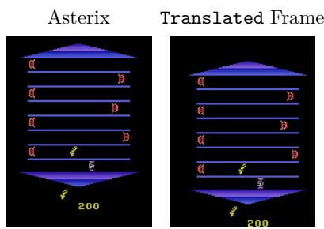

Table 10: Per-configuration results in Tag: catches IQM with 95% CI over 5 seeds, each averaged over 100 episodes. Higher is better. Extended results for Figure 7. PPObj cannot be evaluated beyond its $N _ { \mathrm { m a x } }$ object slots, i.e., 1 Player, 1 Target, 2 Landmarks, and 5 Distractors. Landmarks are always spaced evenly along the box diagonal and in orientation, so changing their number moves all of them. The number of distractors and landmarks is changed only during testing, without retraining.
<table><tr><td rowspan="3">Configuration</td><td colspan="2">ORCA</td><td colspan="2">Absolute Coordinates</td></tr><tr><td>ORBiT</td><td>PPObj</td><td>OCT</td><td>PPObj</td></tr><tr><td>Base (m = 5, Anchor: Player)</td><td>22.4 [21.9, 22.9]</td><td> $2 1 . 6 [ 1 8 . 1 , 2 2 . 0 ]$ </td><td> $1 . 8 [ 1 . 2 , 2 . 9 ]$ </td><td> $5 . 6 \ [ 1 . 6 , 7 . 4 ]$ </td></tr><tr><td> $m ^ { \prime } = 0$  distractors</td><td>21.9 [21.1, 22.4]</td><td></td><td>2.4 [1.0, 4.8]</td><td></td></tr><tr><td> $m ^ { \prime } = 1$  distractors</td><td>22.1 [21.7, 22.5]</td><td></td><td>2.1 [1.0, 4.0]</td><td></td></tr><tr><td>m&#x27; = 10 distractors</td><td>22.5 [21.8, 23.3]</td><td></td><td>1.5 [1.1, 2.4]</td><td></td></tr><tr><td>k′ = 0 landmarks</td><td>21.9 [20.7, 22.4]</td><td></td><td>1.1 [0.8, 1.6]</td><td></td></tr><tr><td>k′ = 4 landmarks</td><td>22.2 [21.8, 22.8]</td><td></td><td>1.7 [1.1, 2.2]</td><td></td></tr><tr><td>Anchor: Target</td><td>20.7 [16.7, 21.6]</td><td>10.3 [0.9, 14.7]</td><td></td><td></td></tr><tr><td>Anchor: Distractor</td><td>0.7 [0.4, 0.8]</td><td>1.0 [0.5, 1.1]</td><td></td><td></td></tr><tr><td>Anchor: Landmark</td><td>1.4 [0.7, 1.8]</td><td>5.4 [3.8, 12.5]</td><td></td><td></td></tr></table>

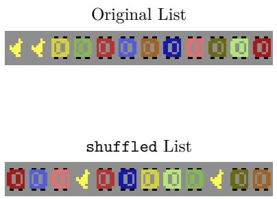  
(a) Shuffled Object List

(b) Random Translation  
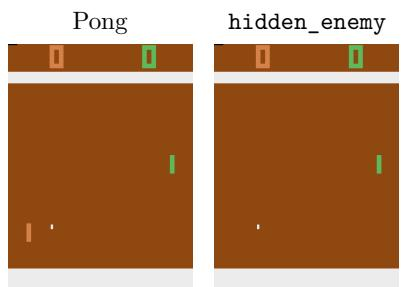  
(c) HackAtari  
Figure 8: The perturbed environment variants to test the generalizability of ORBiT and ORCA. In the shuffled object list variant (a), the order of $\mathcal { O } _ { t } \ ( \mathrm { o r } \ \tilde { \mathcal { O } } _ { t } )$ is randomized before it is passed to the agent. The random translation (b) shifts the actual game content within the video frame without cutting any content. The HackAtari framework (c) features a variety of variants of the Atari games from level changes to logic changes, e.g., hiding the opponent in $P o n g$

## I Input Perturbations

In addition to testing in training environments, we investigate the generalization capabilities of ORCA and ORBiT by evaluating the trained agents in perturbed environments. For that, we use a RAD-like perturbation, i.e., random translation, random shuffling the object set, and the HackAtari framework. Examples are shown in Figure 8, and full per-game results are in Table 8.