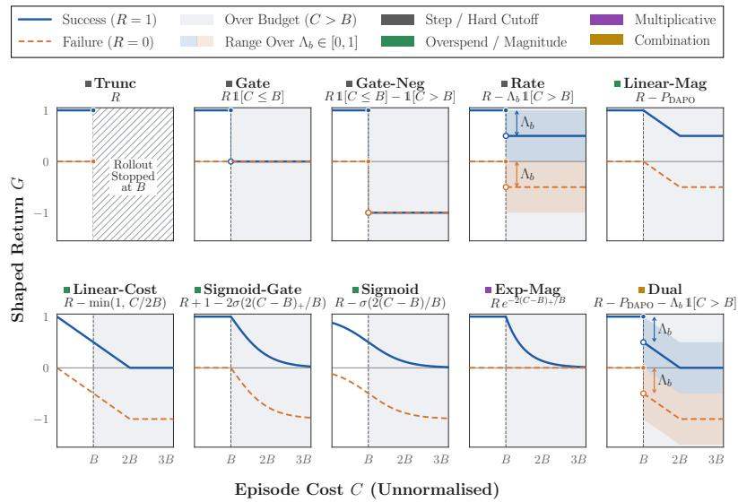
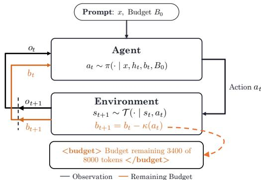
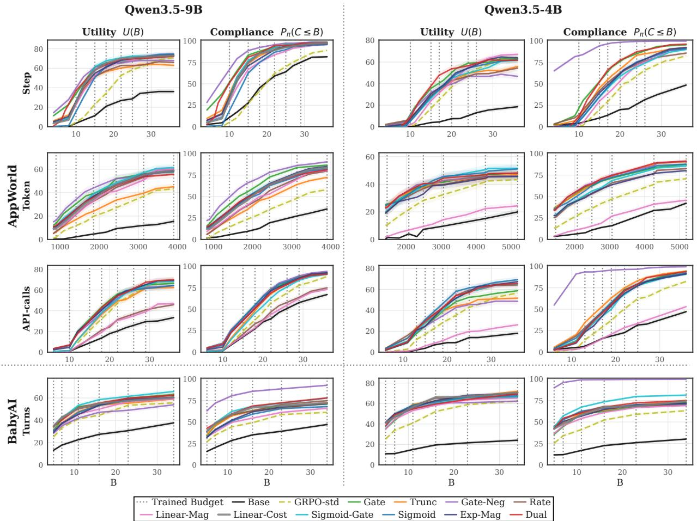
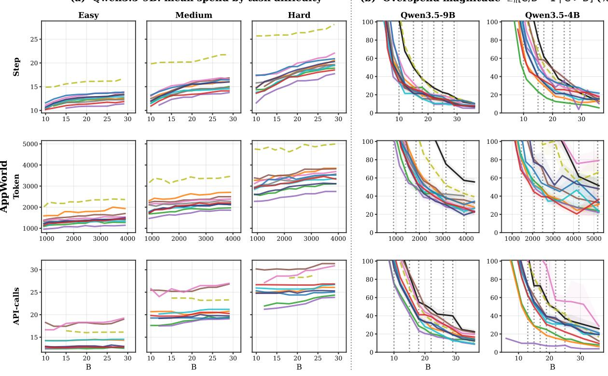
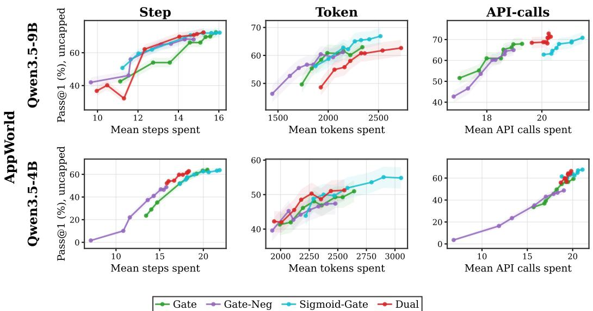
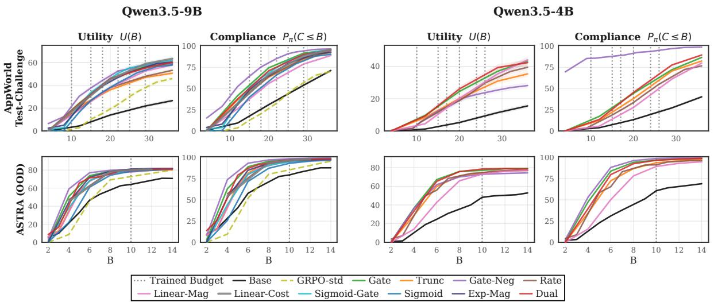
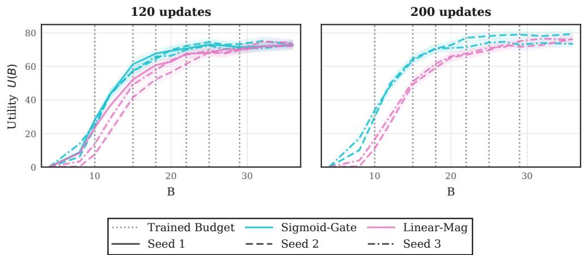
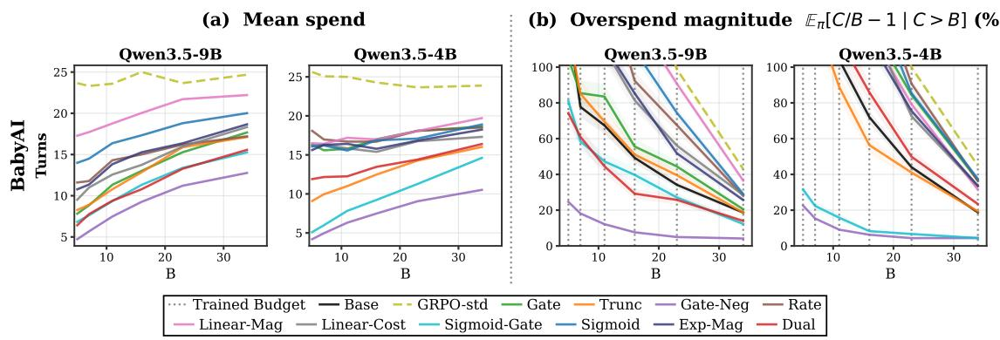

# Rewards for Budget-Aware Multi-Turn Agents That Adapt to Arbitrary Test-Time Constraints

Tom A. Lamb1,2,∗, Adam Golinski1, Eleonora Gualdoni1, Sinead Williamson1, Michael Kirchhof1

1Apple, 2University of Oxford

∗Work completed during an internship at Apple.

Large language model agents are often given an inference budget and asked to maximise success within it. A multi-turn agent has to allocate this budget across many environment interactions. An external harness can enforce the budget, but it remains unclear whether the agent itself can learn when and how much to spend. We ask whether agents can learn this allocation across dynamically specified budgets and which rewards best teach this behaviour. We adapt existing length penalties to budget constraints spanning multiple resource types, introduce new reward formulations, and compare eleven objectives in a shared training pipeline. We train Qwen3.5 models at 4B and 9B on AppWorld with budgets over tokens, API calls, and environment steps, and on the BabyAI gridworld with turn budgets. We train a separate policy for each environment and resource type, with each policy trained across budget values. Training with rewards that penalise overspending substantially improves within-budget success and natural compliance over untrained models and over training on task success alone, with agents learning to adapt their resource use to stated budgets and task difficulty. These gains extend to unseen budgets and, zero-shot, to a shifted task distribution and a new benchmark. Reward objectives trade off success within budget and natural compliance. A sigmoid penalty for overspending most often achieves the highest within-budget success at an individual budget, while a fixed negative reward for overspending generally yields the strongest natural compliance. Combining penalties for overspend frequency and magnitude gives the smallest average gap to the best method at each budget. Overall, we show that a single agent can learn to allocate resources across turns and adapt its behaviour to user-specified budgets using budget feedback without external budget-allocation controllers.

Correspondence: Tom A. Lamb: thomas.lamb@eng.ox.ac.uk Date: October 21, 2026

## 1 Introduction

Agents can solve harder tasks by spending more at test time, thinking for longer and taking more actions in an environment (Snell et al., 2024; Guo et al., 2025; Yu et al., 2026). Current frontier agents give users some control over the efort in terms of generated tokens, tool calls, or environment actions (Liu et al., 2025b). To respond to diferent budgets, an agent needs to adapt its strategy to maximise success under the allowance it receives.

Budget-aware training has largely focused on controlling the cost of a single model generation (Aggarwal and Welleck, 2025; Liu et al., 2026; Wen et al., 2025). A multi-turn agent instead shares one budget across many turns, and at each turn the policy has to decide when and how much to spend given what remains (Liu et al., 2025b). This allocation is usually left to external machinery at inference time, including planners, harnesses, or routers, and is not learned by the policy itself (Zhang et al., 2026; Liu et al., 2025b). That machinery adds complexity at inference, and it remains unclear whether the task-performing policy can learn to allocate these resources itself. Diferent constraints may also call for diferent behaviour. This leads to our first question. Can we train a multi-turn agent to maximise task success under dynamically specified budgets, across diferent inference resources?

<table><tr><td></td><td></td><td></td><td></td><td></td><td>0</td><td></td></tr><tr><td></td><td>Budot Cot</td><td>But dmp</td><td>Int Cggost</td><td>Oved Srdze</td><td> Riuuure Riturn</td><td>Ied PPnce</td></tr><tr><td>Trunc</td><td>√</td><td>x</td><td>×</td><td>x</td><td>x</td><td>x</td></tr><tr><td>Gate</td><td>×</td><td>√</td><td>×</td><td>×</td><td>×</td><td>×</td></tr><tr><td>Gate-Neg</td><td>×</td><td>√</td><td>×</td><td>×</td><td>√</td><td>×</td></tr><tr><td>Rate</td><td>×</td><td>√</td><td>×</td><td>×</td><td>√</td><td>√</td></tr><tr><td>Linear-Mag</td><td>x</td><td></td><td>×</td><td>√</td><td></td><td></td></tr><tr><td>Linear-Cost</td><td>x</td><td>× ×</td><td></td><td>√</td><td></td><td></td></tr><tr><td>Sigmoid-Gate</td><td>×</td><td>×</td><td></td><td></td><td></td><td></td></tr><tr><td>Sigmoid</td><td>×</td><td>××</td><td>√×√××</td><td>ノノVノ</td><td>ノノVノ×</td><td>×××××</td></tr><tr><td>Exp-Mag</td><td>×</td><td></td><td></td><td></td><td></td><td></td></tr><tr><td>Dual</td><td>x</td><td>√</td><td></td><td></td><td>√</td><td>√</td></tr></table>

Figure 1 Cost-conditioned rewards. [Left] Return G against episode cost C for successful $\scriptstyle ( R = 1 )$ and failed $( R { = } 0 )$ trajectories across diferent cost-conditional rewards. Shading marks $C > B$ . Bands illustrate $\Lambda _ { b } \in [ 0 , 1 ]$ for Rate and Dual. [Right] Reward properties: Budget Cutof stops rollouts before exceeding B, Budget Jump denotes a return discontinuity at B, In-Budget Cost penalises resource use before B, Overspend Size makes the return depend on the extent of overspending, Failure Return < 0 means failed trajectories can receive negative return, and Learned Price denotes a separate learned violation price for each training budget.

We study this through reward shaping. In single-generation tasks, length penalties are often subtracted from rewards when an agent exceeds a token limit. Overlong trajectories are still collected, and they can show how to solve a task, which helps most when successes within budget are rare. Some frontier models use linear penalties (Yu et al., 2026; Xu et al., 2026), and others use step functions (Team et al., 2026). Learned budget penalties draw on constrained optimisation (Altman, 2021; Stooke et al., 2020), while cost penalties have also been used to train budget-aware routers (Zhang et al., 2026). It is not clear in advance which objectives best train a single multi-turn policy across dynamically specified budgets and diferent resource types. This leads to our second question. Which training objectives best teach multi-turn agents to maximise task success while complying with dynamically specified budgets?

To address these two questions, we introduce a framework for training a single policy across dynamically specified episode-level budget values, with a separate policy for each environment and resource type. The policy is told its total and remaining budget in natural language at every turn, so it can learn to allocate resources as the episode goes on. Within this framework, we adapt existing penalised objectives that punish excessive resource use or budget violations to the multi-turn, multi-budget setting and introduce new reward formulations. We then compare these objectives directly to see which ones best teach budget-aware behaviour. We train and evaluate on AppWorld (Trivedi et al., 2024), with budgets on generated tokens, environment interactions, or tool calls. We test generalisation to budgets not seen during training, distribution shift on AppWorld test-challenge, and zero-shot transfer to ASTRA (Xiu et al., 2026). To broaden the evaluation to a diferent environment and task format, we also train and evaluate on BabyAI (Chevalier-Boisvert et al., 2019), a text-based gridworld.

Our contributions are as follows:

• We introduce a framework for training and evaluating multi-turn agents across dynamically specified budgets and resource types, with metrics for task success within budget and natural budget compliance.

• We adapt existing cost-conditioned objectives to the multi-turn, multi-budget setting and introduce new reward formulations, covering hard success gating, continuous cost shaping, and fixed or learned overspend penalties.

• We show that the strongest budget-shaped objectives improve within-budget success and natural compliance over untrained models and budget-independent task-reward training across token, tool-call, and environment-step budgets. On AppWorld, learned resource allocation responds to the stated budget and task dificulty and generalises to unseen budget values. Under step budgets, improvements persist on test-challenge and under zero-shot transfer to ASTRA. We also evaluate budget-aware behaviour in BabyAI.

• We identify distinct trade-ofs between budget utility, natural compliance, and overspend severity, with no single objective dominating across all criteria. Dual has the smallest average utility gap to the best method at each budget, Sigmoid-Gate most often achieves the highest utility at an individual budget, and Gate-Neg generally achieves the highest natural compliance.

## 2 Related Work

Token budgets. On-policy budget-aware training without an external harness has mostly controlled the length of a single model generation, rather than how resources are allocated across a multi-turn episode. Existing methods optimise adherence to token budgets (Aggarwal and Welleck, 2025; Liu et al., 2026; Han et al., 2025) or learn levels of reasoning efort (Arora and Zanette, 2026), largely in mathematical reasoning. In these settings, the model controls resource use within one generation, and tokens are the resource of interest. A multi-turn agent faces a diferent allocation problem: it must distribute a shared budget across successive generations and environment interactions, deciding how much to spend at each turn to maximise task success. The constrained resource may also be tool calls or environment steps, rather than just tokens.

Wen et al. (2025) trains across a curriculum of token budgets and uses control tokens inserted during decoding to signal the remaining budget. DAPO (Yu et al., 2026) introduces an overspend penalty for a fixed generationlength budget. Kimi K3 (Team et al., 2026) handles several efort levels in agentic domains by training a separate expert for each with step-function reward shaping and then distilling them. We study how to train one policy across dynamically specified episode-level budget values, with separate training for each environment and resource type.

Budget feedback and allocation. Budget-aware behaviour can also be added without training it into the taskperforming policy. Liu et al. (2025b) show that raising a search agent’s tool-call budget does not by itself improve results, while reporting the total and remaining budget to the agent can improve scaling for large models when combined with planning and verification strategies. In our evaluation, the untrained 4B and 9B models struggle to succeed within budget despite receiving total and remaining budget feedback (Figure 3). Other approaches predict how much compute a task requires (Damani et al., 2025) or route between cheaper and more expensive models under a budget (Zhang et al., 2026). Li et al. (2026) search a value tree at inference time on multi-hop question answering and scale node values by the remaining resource ratio, so the search moves from exploration to exploitation as the budget runs down. These methods all handle allocation in planning, harnesses, or routers at inference time. We instead train the task-performing policy to condition its actions on the total and remaining budget, learning to allocate resources efectively across turns.

Constrained decision-making and budgeted MDPs. Constrained Markov decision processes (cMDPs; Altman, 2021; Achiam et al., 2017) typically bound expected cumulative cost and can be optimised using Lagrangian relaxation (Stooke et al., 2020). If the constraints are pooled across the training distribution, a policy can break tight budgets and make up for it on generous ones. Budgeted MDPs (Carrara et al., 2019) extend this to families of budgets by conditioning on the remaining budget allowance, and chance-constrained formulations (Geibel and Wysotzki, 2005; Haskell and Jain, 2015; Chow, 2017) bound violation probabilities directly. We carry these formulations over to multi-turn LLM agent training with a separate rate constraint for each budget, so the constrained objective treats every budget separately and does not pool compliance across budgets.

## 3 Budget-Aware Policy Optimisation

## 3.1 Preliminaries

We write $\mathcal { P } ( \mathcal { V } )$ for the set of probability measures over a set $\mathcal { V } _ { ; }$ and model a task as a POMDP $\mathcal { M } = \langle \boldsymbol { S } , \boldsymbol { A } , \mathcal { T } , \Omega , \mathcal { O } , R , \gamma , \mu _ { 0 } \rangle$ Here , and Ω are the state, action and observation spaces. The transition and observation kernels are $\mathcal { T } : \mathcal { S } \times \mathcal { A }  \mathcal { P } ( \mathcal { S } )$ and $\mathcal { O } : \mathcal { S } \times \mathcal { A }  \mathcal { P } ( \Omega )$ , with R the reward, which Section 3.2 specialises to a binary terminal reward, $\gamma \in ( 0 , 1 ]$ the discount factor and $\mu _ { 0 } ~ \in ~ \mathcal { P } ( S )$ the initial state distribution. Tasks $x \sim p _ { \mathcal { X } } \in \mathcal { P } ( \mathcal { X } )$ are drawn from a distribution over the task set . At turn t, the agent receives the observation history $h _ { t } : = ( o _ { 1 } , a _ { 1 } , \ldots , a _ { t - 1 } , o _ { t } )$ , comprising previous actions and the resulting environment observations. Writing for the set of all such histories, the agent acts according to a policy $\pi : \mathcal { X } \times \mathcal { H }  \mathcal { P } ( \mathcal { A } )$

We optimise policies with Dr. GRPO (Liu et al., 2025c), a variant of group relative policy optimisation (GRPO, Shao et al., 2024) that baselines each rollout against its group mean

  
Figure 2 Budget-augmented POMDP. The policy receives the task $x ,$ total budget $B _ { 0 } .$ , and remaining budget $b _ { t }$ alongside the environment observation $o _ { t }$ . Each action’s cost is deducted from $b _ { t } .$ , and the updated budget $b _ { t + 1 }$ is appended in natural language to the next observation (Section 3.2).

and removes response-length and reward-standard-deviation normalisation (Appendix E.6). Removing these normalisers addresses biases that can encourage failed rollouts to grow longer. The practical training pipeline is described in Appendix F.6.

## 3.2 Budget-Augmented POMDP

Budget augmentation. We augment the task POMDP of Section 3.1 by pairing the environment state $s _ { t }$ with a scalar remaining budget $b _ { t } ,$ , following the state augmentation used in budgeted MDPs (Carrara et al., 2019). This gives the budget-augmented POMDP $\mathrm { ( F i g u r e ~ 2 ) } \ \tilde { \mathcal { M } } = \langle \tilde { S } , A , \tilde { \mathcal { T } } , \tilde { \Omega } , \tilde { \mathcal { O } } , R , \gamma , \tilde { \mu } _ { 0 } \rangle$ , with states $\tilde { s } _ { t } =$ $\left( { { s _ { t } } , { b _ { t } } } \right)$ and state space $\tilde { \mathcal { S } } : = \mathcal { S } \times \mathbb { R }$ . Resource use is measured by a cost map $\kappa : S \times A \times S  \mathbb { R } _ { \geq 0 }$ . Each action is the whole string the policy emits at a turn, including thinking tokens. Its step cost is one, its token cost is its length in tokens, and its API-call cost counts the calls actually executed. These raw costs are independent of the remaining budget. We abbreviate the realised transition cost as $\kappa ( a _ { t } ) = \kappa ( s _ { t } , a _ { t } , s _ { t + 1 } ) \in \mathbb { R } _ { \geq 0 }$ The remaining budget informs the policy’s action selection. After each turn, we subtract the realised cost from the remaining budget:

$$
b _ { t + 1 } = b _ { t } - \kappa ( a _ { t } ) .\tag{3.1}
$$

The augmented transition kernel combines the unchanged environment dynamics with this budget update.

$$
\tilde { \mathcal { T } } \big ( s _ { t + 1 } , b _ { t + 1 } ~ | ~ s _ { t } , b _ { t } , a _ { t } \big ) = \mathcal { T } \big ( s _ { t + 1 } ~ | ~ s _ { t } , a _ { t } \big ) \mathbf { 1 } \big [ b _ { t + 1 } = b _ { t } - \kappa ( a _ { t } ) \big ] .\tag{3.2}
$$

Budget-conditioned policy. The initial budget $B _ { 0 } \in \mathbb { R } _ { > 0 }$ and the remaining budget $b _ { t }$ are written into the text of the observations the agent sees (Appendix F.5). At the next turn, the augmented observation is $\tilde { o } _ { t + 1 } = \left( o _ { t + 1 } , b _ { t + 1 } \right) \in \tilde { \Omega } : = \Omega \times \mathbb { R }$ , where $b _ { t + 1 }$ is given by Equation (3.1). The observation kernel preserves the task observation and reveals the updated budget exactly.

$$
\begin{array} { r } { \tilde { \mathcal { O } } \big ( o _ { t + 1 } , b \mid s _ { t + 1 } , b _ { t + 1 } , a _ { t } \big ) = \mathcal { O } \big ( o _ { t + 1 } \mid s _ { t + 1 } , a _ { t } \big ) \mathbf { 1 } \big [ b = b _ { t + 1 } \big ] . } \end{array}\tag{3.3}
$$

An augmented history splits into the history $h _ { t }$ of and the observed budgets, so the budget-conditioned policy

$$
\pi ( \cdot \mid x , h _ { t } , b _ { t } , B _ { 0 } ) \in { \mathcal { P } } ( { \mathcal { A } } ) , \qquad \pi : { \mathcal { X } } \times { \mathcal { H } } \times \mathbb { R } \times \mathbb { R } _ { > 0 } \to { \mathcal { P } } ( { \mathcal { A } } ) ,\tag{3.4}
$$

can weigh both the allowance left and the fraction $b _ { t } / B _ { 0 }$ still available against what is needed to continue toward successfully solving a task from a given state. We write Π for the set of all such policies. Throughout post-training the budget is an explicit input to the policy. Since Equation (3.4) conditions directly on $B _ { 0 }$ and $b _ { t } ,$ , which are written into the environment observations, a budget outside the training grid needs no change to the policy or to inference, and Section 4 shows that budget-aware behaviour carries over to such unseen budgets and to new environments zero-shot.

Episode termination. Each episode draws a task $x \sim p _ { \mathcal { X } }$ and, independently of ${ \mathrm { i t } } ,$ a budget $B _ { 0 } \sim p _ { B }$ from the budget prior defined below, initialising the episode at $b _ { 1 } = B _ { 0 }$ with the opening observation $o _ { 1 }$ the prompt stating the task and its budget (see Appendix F.5 for the prompts in full). Most methods allow $b _ { t } < 0$ , so the agent can overspend and learn from doing so, possibly with a penalty. In AppWorld and $\mathrm { A S T R A }$ , a special complete\_task action $a _ { \perp } \in { \mathcal { A } }$ lets the agent end the episode and has cost $\kappa ( { a \lrcorner } ) > 0$ . An episode can also end through environment termination, as when the agent completes a BabyAI mission, or at a finite horizon $T _ { \mathrm { m a x } } \in \mathbb { Z } _ { > 0 }$ . Writing $\tau _ { \mathrm { e n v } }$ for the first turn at which the environment terminates, the stopping time is τ :=min $\big ( \operatorname* { i n f } \{ t \geq 1 : a _ { t } = a _ { \perp } \} , \ \tau _ { \mathrm { e n v } } , \ T _ { \mathrm { m a x } } \big )$ , with unavailable termination conditions assigned + .

Reward and budget penalties. We score the completed trajectory $\zeta : = \left( o _ { 1 } , a _ { 1 } , \ldots , o _ { \tau } , a _ { \tau } , o _ { \tau + 1 } \right)$ by a binary task reward $R ( \zeta ) \in \{ 0 , 1 \}$ and transform it into a budget-conditioned return $\begin{array} { r } { \dot { R } ( \zeta , B _ { 0 } ) \in \mathbb { R } } \end{array}$ . The agent is trained to maximise the expected shaped return

$$
\operatorname* { m a x } _ { \pi \in \Pi } ~ \mathbb { E } _ { x \sim p x } , B _ { 0 } \sim p _ { B } , \zeta \sim \pi ( \cdot | x , B _ { 0 } ) \big [ \tilde { R } ( \zeta , B _ { 0 } ) \big ] .\tag{3.5}
$$

We do not discount, so any pressure to finish early comes from the budget and any overspending shaping or penalties. We fix a finite set of $M \in \mathbb { Z } _ { > 0 }$ training budgets $\boldsymbol { B } = \{ b ^ { ( 1 ) } < \dot { \cdots } < b ^ { ( M ) } \} \subset \mathbb { R } _ { > 0 }$ and draw budgets uniformly at random during training. The raw spend $\begin{array} { r } { C ( \zeta ) : = \sum _ { t < \tau } \kappa ( \boldsymbol { a } _ { t } ) \in \mathbb { R } _ { \geq 0 } } \end{array}$ is always the budgeted quantity, e.g. steps, tool calls, or tokens, consumed over the entire multi-step trajectory. Rewards are shaped as a function of this spend as a fraction of the prompted budget $B _ { 0 }$ , the normalised cost

$$
\bar { C } ( \zeta , B _ { 0 } ) : = \frac { C ( \zeta ) } { B _ { 0 } } = \frac { 1 } { B _ { 0 } } \sum _ { t \leq \tau } \kappa ( a _ { t } ) \in \mathbb { R } _ { \geq 0 } ,\tag{3.6}
$$

with $\bar { C } \leq 1$ within budget and $\bar { C } > 1$ over budget.

## 3.3 Cost-Conditioned Rewards

We compare existing reward objectives and new formulations motivated by heuristics, common practice, or constrained optimisation. We organise them into four groups: (a) hard boundary mechanisms that act at the budget limit, (b) within-budget cost pressure that penalises resource use before the limit, (c) gradual post-budget shaping that penalises the amount of overspend, and (d) learned per-budget violation prices that adapt penalties to the overspend rate at each training budget. The objectives also difer in whether overspending can produce negative returns. Figure 1 and Appendix C give their mathematical definitions and further details.

Hard boundary mechanisms. At the budget, these methods either stop the rollout or assign a fixed outcome to a violation.

• Trunc (Liu et al., 2025a) is a baseline that does not permit any overspending. Every rollout is terminated at $B _ { 0 }$ , and the reward is the binary task reward obtained within $B _ { 0 }$

• Gate relaxes this constraint. The policy may overspend, but any rollout that exceeds $B _ { 0 }$ receives zero reward regardless of task success. This provides a simple objective that rewards only success within budget.

• Gate-Neg (Team et al., 2026) assigns a reward of 1 whenever the policy exceeds $B _ { 0 }$ , regardless of task success. Unlike Gate, it therefore prefers a failure within budget to a failure over budget.

Within-budget cost pressure. These methods begin penalising cost before the budget is exhausted.

• Sigmoid smooths the hard overspend indicator that Rate and Dual apply as a step into a symmetric sigmoid penalty, which applies pressure to solve successfully within budget from the start of a policy’s rollout.

• Linear-Cost (Xu et al., 2026) penalises cost linearly from the first action onwards, so the pressure starts well before the budget is reached.

Gradual post-budget shaping. These methods preserve the full in-budget return, then change it continuously with the amount of overspend.

• Sigmoid-Gate subtracts a sigmoid-shaped penalty only after $B _ { 0 }$ . It leaves the in-budget return unchanged and continuously lowers the return of both successes and failures as overspend grows. Unlike Gate, it can assign negative returns to overspending failures.

• Linear-Mag has no step at $B _ { 0 }$ and instead reduces the reward linearly beyond it. It was popularised by DAPO (Yu et al., 2026), and we generalise it to multiple budgets in Appendix D.

• Exp-Mag decays a successful trajectory’s reward exponentially in how far it overspends. Failures always receive a reward of 0, regardless of spend.

Learned per-budget violation prices. These methods learn an overspend price separately at each budget.

• Rate tracks the overspend rate at each budget and applies a larger penalty the more often the policy exceeds that budget. We derive it from a Lagrangian perspective in Appendix C. Its price is capped at 1.0, so an overspending success never scores below a compliant failure.

• Dual combines a step penalty with a linear one. A learned Lagrangian step penalty prices how often rollouts at the given budget overspend, and a linear penalty prices how much the current rollout overspends. Each term subtracts at most 0.5. We study the dual optimisation in Appendix E.7 and why the two penalties are complementary in Appendix E.5.

## 4 Experiments

We first test whether a single policy can learn to adapt across dynamically specified budget values, including values unseen during training (Section 4.1). We then compare which reward objectives best teach success within budget and natural compliance (Section 4.2). Finally, we test whether the learned behaviour persists under an AppWorld task-distribution shift and transfers to ASTRA without retraining (Section 4.3).

Experimental setup. We train 4B and 9B Qwen3.5 models (Qwen Team, 2026) from their post-trained checkpoints (Appendix F.6). All trained methods use the same Dr. GRPO pipeline (Liu et al., 2025c), prompts, budget grids, and seed within each setting. They difer in the training return, and Trunc additionally stops training rollouts at the budget boundary. We compare against Base, the untrained model, and GRPO-Std, which is trained with the binary task reward R alone. Like the budget-aware methods, GRPO-Std receives budget information in its prompt during training and evaluation, but its reward is independent of the budget and its rollouts are not cut of at the budget, unlike Trunc. This baseline represents task-reward-only agent training, without a budget-dependent return.

We train and evaluate on AppWorld (Trivedi et al., 2024), an interactive coding-agent benchmark where agents complete requests by writing Python over multiple turns. We evaluate on held-out test-normal tasks, the distribution-shifted test-challenge split, and ASTRA (Xiu et al., 2026), an out-of-domain personalassistant benchmark. We also evaluate on BabyAI (Chevalier-Boisvert et al., 2019), a text-based gridworld with tasks distinct from code generation (Appendix F). Across these settings, we consider budgets over steps (agent turns), tool calls (API calls), and tokens (all generated tokens, including reasoning), as defined by the cost map κ.

At each budget b, we measure budget utility (b), the probability of solving a task within budget, and compliance Comp(b), the probability that the agent terminates within budget when rollouts are not cut of:

$$
\begin{array} { r } { \mathcal { U } ( b ) : = \mathbb { E } _ { \boldsymbol { x } \sim p _ { \mathcal { X } _ { \mathrm { t e s t } } } , \boldsymbol { \zeta } \sim \pi ( \cdot | \boldsymbol { x } , b ) } \left[ R ( \boldsymbol { \zeta } ) \mathbf { 1 } \left[ \boldsymbol { \bar { C } } ( \boldsymbol { \zeta } , b ) \leq 1 \right] \right] , } \end{array}\tag{4.1}
$$

$$
\mathrm { C o m p } ( b ) : = \mathbb { P } _ { x \sim p _ { \mathcal { X } _ { \mathrm { t e s t } } } , \zeta \sim \pi ( \cdot | x , b ) } \mathopen { } \mathclose \bgroup \left( \bar { C } ( \zeta , b ) \leq 1 \aftergroup \egroup \right) ,\tag{4.2}
$$

where expectations are over held-out tasks $\mathcal { X } _ { \mathrm { t e s t } }$ . Budget utility counts a success only if the rollout finishes successfully within budget, matching the practical setting in which the agent is cut of at the budget limit. Natural compliance measures whether the rollout finishes within budget regardless of task success, without an external budget cutof.

  
Figure 3 In-domain budget utility and compliance. Budget utility U(b) and natural compliance Comp(b) against stated budget b for Qwen3.5-9B and 4B. Rows show AppWorld test-normal under step, token, and API-call budgets, followed by BabyAI under turn budgets. Each policy is trained for one environment and resource type. Vertical dashed lines mark training budgets, with other points unseen during training. Bands show ±1 standard deviation of the binomial rate estimates.

## 4.1 Agents Learn to Adapt Across Dynamically Specified Budgets

We first test our first question: whether agents can learn to succeed within dynamically specified budgets and adapt their resource use to the task and available allowance.

Budget-shaped returns improve success within budget and compliance. Figure 3 reports budget utility and natural compliance for Base, GRPO-Std, and the budget-shaped objectives across both model scales, AppWorld’s step, token, and API-call budgets, and BabyAI turn budgets. Despite receiving the same budget information as other methods, Base, the Qwen3.5 checkpoints before our additional training, show poor success within budget and compliance. At a step budget of B = 36, the 9B and 4B Base models reach only 37% and 19% budget utility, respectively, while the 9B Base model complies on fewer than half of episodes across the tokenbudget range. GRPO-Std improves on Base through standard agent post-training, but its budget-independent return still gives weak compliance and lower budget utility than the leading budget-shaped objectives.

The stronger budget-shaped objectives improve both metrics over these baselines, although not every reward improves on GRPO-Std in every setting. Thus, before looking into diferences between the reward functions (which we do in the next section), we can record that budget-shaped post-training, using budget feedback without an external budget-allocation controller, can teach a single agent to use its total and remaining budget to improve success within budget and natural compliance across dynamically specified step, token, and APIcall budgets. The BabyAI results show the same overall trends under turn budgets in an environment distinct

(a) Qwen3.5-9B: mean spend by task dificulty

Trained Budget Base GRPO-std Gate Trunc Gate-Neg Rate Linear-Mag Linear-Cost Sigmoid-Gate Sigmoid Exp-Mag Dual

(b) Overspend magnitude π[C/B − 1 ∣ C > B] (%)  
  
Figure 4 Spend by task dificulty and overspend magnitude. AppWorld test-normal under step, token, and API-call budgets. (a) Mean spend by task dificulty for Qwen3.5-9B. (b) Mean relative overspend Eπ $[ \bar { C } - 1 | \bar { C } > 1 ]$ for Qwen3.5-9B and 4B, shown as a percentage of the budget. Horizontal axes show the stated budget B. Overspend axes are capped at 100%.

from AppWorld. At larger budgets, the utility curves of the stronger objectives often converge, indicating that these policies maintain similar task utility once the budget is no longer as binding. No method attains perfect natural compliance across every budget and setting. The objectives yield diferent trade-ofs between success within budget and natural compliance. We compare them in Section 4.2.

Resource use varies with task difficulty and the stated budget. Figure 4(a) shows the mean spend of the 9B AppWorld policies by task dificulty. GRPO-Std spends comparatively uniformly across stated budgets, despite changing its spend with task dificulty. Across the budget-shaped policies, step and token spend generally increase with the stated budget allowance and with task dificulty, most clearly for hard tasks. Under API-call budgets, spend rises sharply with task dificulty but changes comparatively little with the stated allowance, indicating that call use is driven more strongly by task dificulty. Examples from BabyAI and AppWorld in Appendix G.4 also show explicit budget planning and action batching in the policies’ reasoning.

Table 1 shows that budget-aware training helps agents use the prompt’s guidance to batch API calls (Prompt 3). All methods receive this guidance, but GRPO-Std uses around one API call per turn across budgets. In contrast, Gate, Sigmoid-Gate, and Dual use around 1.9 calls per turn at $B ~ = ~ 1 0$ , compared with around 1.5 to 1.6 at $B \ = \ 3 2$ These averages include successful and failed rollouts completed within budget. The budgetaware policies batch more calls and increase batching under tighter step budgets. Together with their improved within-budget success and natural compliance, these results suggest that the policies learn to use batching as part of allocating their available steps more efectively.

Table 1 Mean API calls per step by budget. Qwen3.5-9B, restricted to episodes completed within budget on AppWorld test-normal with step budgeting. Bold: highest per budget.
<table><tr><td></td><td>B = 10</td><td>B = 15</td><td> $B = 3 2$ </td></tr><tr><td>Base</td><td> $1 . 6 5 \pm 0 . 5 6$ </td><td> $1 . 4 5 \pm 0 . 5 3$ </td><td> $1 . 4 6 \pm 0 . 4 0$ </td></tr><tr><td>GRPO-Std</td><td> $1 . 0 2 \pm 0 . 0 5$ </td><td> $1 . 0 3 \pm 0 . 1 6$ </td><td> $1 . 0 5 \pm 0 . 1 7$ </td></tr><tr><td>Gate</td><td> ${ \bf 1 . 9 3 \pm 0 . 6 6 }$ </td><td> $1 . 7 3 \pm 0 . 5 0$ </td><td> $1 . 5 3 \pm 0 . 3 9$ </td></tr><tr><td>Sigmoid-Gate</td><td> $1 . 8 7 \pm 0 . 6 9$ </td><td> $1 . 6 3 \pm 0 . 4 5$ </td><td> $1 . 5 3 \pm 0 . 3 6$ </td></tr><tr><td>Dual</td><td> $1 . 9 2 \pm 0 . 6 2$ </td><td> ${ \bf 1 . 7 6 \pm 0 . 4 8 }$ </td><td> ${ \bf 1 . 6 1 \pm 0 . 3 8 }$ </td></tr></table>

Budget-aware behaviour generalises beyond the training budgets. The dashed vertical lines in Figure 3 mark the six budgets used during training. On AppWorld, the step and API-call evaluations include both interpolated budgets between these lines and extrapolated budgets outside the training grid. The stronger budget-aware policies retain improved budget utility and compliance at these unseen values.

Takeaway. With total and remaining budget feedback, agents can learn to allocate a shared budget across turns. Budget-shaped training improves success within budget and natural compliance over the base models and over task-reward-only training. Resource use and batching vary with task demands and the available budget, and the gains extend to unseen budget values on AppWorld.

## 4.2 Which Rewards Best Teach Budget-Aware Behaviour?

We now address our second research question by comparing how reward objectives balance success within budget and natural compliance.

Utility rankings of budget-shaped rewards. Table 2 aggregates budget utility across the eight AppWorld and BabyAI experiments. Near-best rate measures how often a method is within two percentage points of the best budget utility at each budget, while mean regret is the average gap to the best observed budget utility at each budget, measured in percentage points. Sigmoid-Gate most often attains the highest utility at an individual budget, with a 20.1% win rate. Gate has the highest near-best rate at 39.8%. Dual has the lowest observed mean regret at 2.92 percentage points, followed by Gate at 3.33, Linear-Cost at 3.75, and Sigmoid-Gate at 3.82. Thus, Sigmoid-Gate wins most often at an individual budget and Dual has the smallest observed average loss to the best method across the evaluation. Gate performs surprisingly well for a simple objective that rewards only within-budget success and adds no explicit overspend penalty.

Table 2 Utility across budgets. Win and nearbest (≤2pp) rates and mean regret against the per-budget best method, averaged equally over the eight AppWorld and BabyAI experiments (Appendix G.1).
<table><tr><td>Method</td><td>Win (%) ↑</td><td>Near-best Regret (%) ↑</td><td>(pp) ↓</td></tr><tr><td>Linear-Mag</td><td>3.1</td><td>6.5</td><td>14.01</td></tr><tr><td>Trunc</td><td>6.6</td><td>20.5</td><td>7.56</td></tr><tr><td>Rate</td><td>3.1</td><td>26.0</td><td>7.46</td></tr><tr><td>Gate-Neg</td><td>16.1</td><td>26.0</td><td>6.00</td></tr><tr><td>Exp-Mag</td><td>7.8</td><td>22.9</td><td>4.32</td></tr><tr><td>Sigmoid</td><td>14.0</td><td>39.2</td><td>4.31</td></tr><tr><td>Sigmoid-Gate</td><td>20.1</td><td>36.9</td><td>3.82</td></tr><tr><td>Linear-Cost</td><td>11.6</td><td>39.3</td><td>3.75</td></tr><tr><td>Gate</td><td>12.4</td><td>39.8</td><td>3.33</td></tr><tr><td>Dual</td><td>10.8</td><td>38.8</td><td>2.92</td></tr></table>

Allowing training rollouts beyond the budget improves pooled utility. Table 2 shows that Gate surpasses Trunc on all three pooled utility metrics, with a higher win rate and near-best rate and a lower mean regret. Gate permits an overspending rollout to finish and assigns it zero return. Tokens generated after the budget boundary remain in the rollout and contribute to training. When the same group contains a positive-return rollout, the overspending rollout receives a negative advantage, providing a learning signal on its actions, including those beyond the budget. Trunc instead ends the rollout at the budget boundary, removing these post-budget tokens from training. The comparison supports retaining overspending trajectories even when they receive no success reward. Note, however, that Trunc has a higher throughput due to not having to generate the additional over budget steps.

Penalty design affects success, compliance, and their trade-off. Gate-Neg assigns every overspent trajectory a reward of 1, ranking an in-budget failure above any overspent result. In Figure 3, Gate-Neg generally attains high natural compliance, but its mean regret is 6.00 percentage points, compared with 3.33 for Gate in Table 2. The strong overspend penalty may make the policy more hesitant near the budget boundary, sacrificing some success within budget to avoid a violation.

Rate alone is less competitive than Dual, with mean regrets of 7.46 and 2.92 percentage points, respectively. This is consistent with a learned price on the overspend event being more useful when combined with information about the overspend size. Linear-Cost and Sigmoid, which apply cost pressure before the budget boundary, have mean regrets of 3.75 and 4.31 percentage points, respectively. These results suggest that early pressure to finish does not necessarily improve within-budget utility.

  
Figure 5 Raw task success against spend. AppWorld test-normal pass@1 without a budget cutof against mean spend for Gate, Gate-Neg, Sigmoid-Gate, and Dual. Each point corresponds to a stated budget. Policies retain budget feedback, but successes count regardless of compliance. Bands show ±1 standard deviation of the binomial rate estimates.

Small overruns without magnitude penalties. Even a policy with high natural compliance can substantially overspend on the episodes where it violates the budget. We therefore also examine conditional excess spend in Figure 4(b), that is, in rollouts that do overspend, how much do they overspend in percent compared to the prompted budget. Gate and Gate-Neg generally have comparatively small conditional overruns, despite neither applying a penalty that grows with overspend magnitude. Explicit magnitude penalties are therefore not necessary to obtain comparatively small overruns in these experiments.

Raw task success generally increases with spend. This paper so far focussed on the evaluation setup where the agent is cut of at the budget in each task. We may, however, also be interested in the tradeof between how much compute is used overall versus how many tasks are solved. Figure 5 reports pass@1 against mean spend, counting successes regardless of whether the rollout finishes within budget. At both model scales, greater spending is generally associated with higher overall success across steps, tokens, and API calls. This complements the earlier evidence of budget-responsive resource use by showing that spending diferences are also accompanied by diferences in overall task success.

Takeaway. Reward objectives produce diferent trade-ofs between success within budget and natural compliance. Dual is closest to the per-budget optimal method on average, Sigmoid-Gate most often achieves the highest withinbudget success at an individual budget, and Gate-Neg generally achieves the highest natural compliance. Allowing training rollouts to continue beyond the budget can improve success within budget. The simple Gate objective, which rewards only success within budget, is often surprisingly competitive with more complex methods.

## 4.3 Budget-Aware Behaviour Generalises Beyond the Training Distribution

Budget-aware behaviour persists on shifted AppWorld tasks. We next test whether policies trained to condition on the budget remain responsive to it under distribution shift. Figure 6 (top) evaluates the AppWorld-trained policies on test-challenge, which includes unseen apps and more dificult tasks. As on test-normal, the stronger budget-shaped objectives generally achieve higher budget utility and natural compliance than Base and GRPO-Std at both model scales. Utility rises with the stated step budget and, for the 9B model, continues to increase beyond the largest training budget of 29. These results suggest that both the learned budgeting behaviour and the gains over budget-independent training methods extend to shifted tasks. Gate-Neg once again generally achieves the highest compliance, while utility rankings vary with the budget and model scale.

  
20A st 25 25Figure 6 Distribution shift. AppWorld-trained policies evaluated without retraining on AppWorld test-challenge 0 0 0 0(top) and ASTRA (bottom) under step budgets. Curves show budget utility U(b) and natural compliance Comp(b) against stated budget b. Bands show ±1 standard deviation of the binomial rate estimates.

Budget-aware behaviour transfers zero-shot to ASTRA. We also test zero-shot generalization to a new environment. Figure 6 (bottom) evaluates the same policies on ASTRA without retraining. As on test-challenge, the stronger budget-shaped objectives generally retain higher budget utility and natural compliance than Base and GRPO-Std. At both model scales, utility increases over tighter step budgets before flattening at looser budgets, while natural compliance also increases with the allowance. Gate-Neg remains among the most compliant methods, and several objectives achieve similar utility at looser budgets. These results suggest that budget responsiveness and the improvements over the baselines transfer to ASTRA’s distinct personal-assistant tasks and tool domain, using the same Python-REPL action interface (Appendix F.2).

Takeaway. Budget-aware policies remain responsive to stated budgets under distribution shift and zero-shot transfer to ASTRA. Gate-Neg remains the best choice when prioritising natural budget adherence without requiring external enforcement.

## 5 Conclusion

Simply prompting an agent with an inference budget is not enough to make it adhere to that budget or succeed within it. Without consequences for overspending during training, agents frequently exceed the stated allowance. Budget-aware reward objectives provide a simple remedy, teaching a single policy to adapt its resource use across tasks and budget values. We show that this behaviour extends to unseen budgets, persists under a shifted task distribution, and transfers zero-shot to a separate environment. The choice of objective determines the resulting trade-of. Dual is most consistently close to the best method across budgets, Sigmoid-Gate most often yields the highest within-budget success, and Gate-Neg yields the strongest natural compliance. All three are competitive and require no external budget-allocation controller. We encourage practitioners to experiment with these objectives to select the balance between task success and natural budget adherence that best fits their application.

All tool-use experiments in this work are conducted in research-only simulated environments. The APIs, tasks, datasets, verifier infrastructure, and training procedures described here do not represent or imply any deployed Apple product, production system, or product roadmap.

## References

Joshua Achiam, David Held, Aviv Tamar, and Pieter Abbeel. Constrained policy optimization. In International conference on machine learning, pages 22–31. Pmlr, 2017.

Pranjal Aggarwal and Sean Welleck. L1: Controlling how long a reasoning model thinks with reinforcement learning. In Second Conference on Language Modeling, 2025. URL https://openreview.net/forum?id=4jdIxXBNve.

Eitan Altman. Constrained Markov decision processes. Routledge, 2021.

Daman Arora and Andrea Zanette. Training language models to reason eficiently. Advances in Neural Information Processing Systems, 38:60770–60808, 2026.

Nicolas Carrara, Edouard Leurent, Romain Laroche, Tanguy Urvoy, Odalric-Ambrym Maillard, and Olivier Pietquin. Budgeted reinforcement learning in continuous state space. Advances in neural information processing systems, 32, 2019.

Maxime Chevalier-Boisvert, Dzmitry Bahdanau, Salem Lahlou, Lucas Willems, Chitwan Saharia, Thien Huu Nguyen, and Yoshua Bengio. BabyAI: First steps towards grounded language learning with a human in the loop. In International Conference on Learning Representations, 2019. URL https://openreview.net/forum?id=rJeXCo0cYX.

Yinlam Chow. Risk-sensitive and data-driven sequential decision making. PhD thesis, Stanford University, 2017. URL https://stanfordasl.github.io/wp-content/papercite-data/pdf/Chow.PhD17.pdf.

Mehul Damani, Idan Shenfeld, Andi Peng, Andreea Bobu, and Jacob Andreas. Learning how hard to think: Input adaptive allocation of lm computation. In International Conference on Learning Representations, volume 2025, pages 102783–102802, 2025.

Peter Geibel and Fritz Wysotzki. Risk-sensitive reinforcement learning applied to control under constraints. Journal of Artificial Intelligence Research, 24:81–108, 2005.

Daya Guo, Dejian Yang, Haowei Zhang, Junxiao Song, Peiyi Wang, Qihao Zhu, Runxin Xu, Ruoyu Zhang, Shirong Ma, Xiao Bi, et al. Deepseek-r1: Incentivizing reasoning capability in llms via reinforcement learning. arXiv preprint arXiv:2501.12948, 2025.

Tingxu Han, Zhenting Wang, Chunrong Fang, Shiyu Zhao, Shiqing Ma, and Zhenyu Chen. Token-budget-aware llm reasoning. In Findings of the Association for Computational Linguistics: ACL 2025, pages 24842–24855, 2025.

William B Haskell and Rahul Jain. A convex analytic approach to risk-aware markov decision processes. SIAM Journal on Control and Optimization, 53(3):1569–1598, 2015.

Yushu Li, Wenlong Deng, Jiajin Li, and Xiaoxiao Li. Spend less, reason better: Budget-aware value tree search for llm agents. arXiv preprint arXiv:2603.12634, 2026.

Chang Liu, Yiran Zhao, Lawrence Liu, Yaoqi Ye, Csaba Szepesvári, and Lin F Yang. Laconic: Length-aware constrained reinforcement learning for llm. arXiv preprint arXiv:2602.14468, 2026.

Shih-Yang Liu, Xin Dong, Ximing Lu, Shizhe Diao, Mingjie Liu, Min-Hung Chen, Hongxu Yin, Yu-Chiang Frank Wang, Kwang-Ting Cheng, Yejin Choi, et al. Dler: Doing length penalty right-incentivizing more intelligence per token via reinforcement learning. arXiv preprint arXiv:2510.15110, 2025a.

Tengxiao Liu, Zifeng Wang, Jin Miao, I Hsu, Jun Yan, Jiefeng Chen, Rujun Han, Fangyuan Xu, Yanfei Chen, Ke Jiang, et al. Budget-aware tool-use enables efective agent scaling. arXiv preprint arXiv:2511.17006, 2025b.

Zichen Liu, Changyu Chen, Wenjun Li, Penghui Qi, Tianyu Pang, Chao Du, Wee Sun Lee, and Min Lin. Understanding r1-zero-like training: A critical perspective. In Second Conference on Language Modeling, 2025c. URL https: //openreview.net/forum?id=5PAF7PAY2Y.

Jiarui Lu, Thomas Holleis, Yizhe Zhang, Bernhard Aumayer, Feng Nan, Haoping Bai, Shuang Ma, Shen Ma, Mengyu Li, Guoli Yin, et al. Toolsandbox: A stateful, conversational, interactive evaluation benchmark for llm tool use capabilities. In Findings of the Association for Computational Linguistics: NAACL 2025, pages 1160–1183, 2025.

Qwen Team. Qwen3.5: Towards native multimodal agents, 2026. URL https://qwen.ai/blog?id=qwen3.5.

John Schulman, Filip Wolski, Prafulla Dhariwal, Alec Radford, and Oleg Klimov. Proximal policy optimization algorithms. arXiv preprint arXiv:1707.06347, 2017.

Zhihong Shao, Peiyi Wang, Qihao Zhu, Runxin Xu, Junxiao Song, Xiao Bi, Haowei Zhang, Mingchuan Zhang, YK Li, Yang Wu, et al. Deepseekmath: Pushing the limits of mathematical reasoning in open language models, 2024. URL https://arxiv. org/abs/2402.03300, 2(3):5, 2024.

Charlie Snell, Jaehoon Lee, Kelvin Xu, and Aviral Kumar. Scaling llm test-time compute optimally can be more efective than scaling model parameters. arXiv preprint arXiv:2408.03314, 2024.

Adam Stooke, Joshua Achiam, and Pieter Abbeel. Responsive safety in reinforcement learning by pid lagrangian methods. In International conference on machine learning, pages 9133–9143. PMLR, 2020.

Kimi Team, Tongtong Bai, Yifan Bai, Yiping Bao, Jianfeng Cai, Xinyuan Cai, Peizhou Cao, Yuxuan Cao, Ziwei Chai, Y Charles, et al. Kimi k3: Open frontier intelligence. arXiv preprint arXiv:2607.24653, 2026.

Harsh Trivedi, Tushar Khot, Mareike Hartmann, Ruskin Manku, Vinty Dong, Edward Li, Shashank Gupta, Ashish Sabharwal, and Niranjan Balasubramanian. Appworld: A controllable world of apps and people for benchmark ing interactive coding agents. In Proceedings of the 62nd Annual Meeting of the Association for Computational Linguistics (Volume 1: Long Papers), pages 16022–16076, 2024.

Hao Wen, Xinrui Wu, Yi Sun, Feifei Zhang, Liye Chen, Jie Wang, Yunxin Liu, Yunhao Liu, Ya-Qin Zhang, and Yuanchun Li. Budgetthinker: Empowering budget-aware llm reasoning with control tokens. arXiv preprint arXiv:2508.17196, 2025.

Zidi Xiu, David Q Sun, Kevin Cheng, Maitrik Patel, Yizhe Zhang, Jiarui Lu, Omar Attia, Raviteja Vemulapalli, Oncel Tuzel, Meng Cao, et al. Astra-bench: Evaluating tool-use agent reasoning and action planning with personal user context. arXiv preprint arXiv:2603.01357, 2026.

Anyi Xu, B Li, Bangcai Lin, Bing Xue, BingCheng Xian, Bingzheng Xu, Bochao Wu, Bowei Zhang, Boyi Deng, CC Yu, et al. Deepseek-v4. 1-flash: Pushing the limits of kv cache compression. arXiv preprint arXiv:2609.19969, 2026.

Qiying Yu, Zheng Zhang, Ruofei Zhu, Yufeng Yuan, Xiaochen Zuo, Yu Yue, Weinan Dai, Tiantian Fan, Gaohong Liu, Lingjun Liu, et al. Dapo: An open-source llm reinforcement learning system at scale. Advances in Neural Information Processing Systems, 38:113222–113244, 2026.

Caiqi Zhang, Menglin Xia, Xuchao Zhang, Daniel Madrigal, Ankur Mallick, Samuel Kessler, Victor Ruehle, and Saravan Rajmohan. Budget-aware agentic routing via boundary-guided training. arXiv preprint arXiv:2602.21227, 2026.

## Appendix

## Appendix Contents

A Notation 15   
B Limitations and Future Work 16   
C Budget-Conditioned Rewards in Full 16   
D Adapting DAPO to Multi-Budget Settings 17   
E Optimising Budget-Conditioned Objectives 18   
E.1 Background 18   
E.2 Setup 19   
E.3 Rearrangement of the Lagrangian 19   
E.4 Gradients of the Lagrangian . 19   
E.5 Complementary Roles of the Two Penalties 21   
E.6 Group-Relative Policy Optimisation 21   
E.7 Policy and Multiplier Updates . 22   
E.8 Training Algorithms 23   
F Experimental Setup 24   
F.1 AppWorld . 24   
F.2 ASTRA 24   
F.3 BabyAI 24   
F.4 Cost Maps and Budgeted Quantities 25   
F.5 Budget Conditioning and Prompt Templates 25   
F.6 Models and Dr. GRPO Settings . 29   
F.7 Budget and Constraint Settings 29   
F.8 Compute 29   
G Additional Results 30   
G.1 Across-Budget Utility Metrics . 30   
G.2 Seed Robustness and Longer Training 31   
G.3 Resource Use on BabyAI . 31   
G.4 Qualitative Examples of Budget Use 32

## A Notation

Table 3 acts as a reference for the notation used throughout the paper, grouped by where they are introduced.

<table><tr><td colspan="2">Task and environment (Sections 3.1 and 3.2)</td></tr><tr><td> $s , \tilde { s } , \tilde { s } , \Omega , \tilde { \Omega }$   $\tau , \tilde { \tau } , \mathcal { O } , \tilde { \mathcal { O } }$ </td><td>Task and budget-augmented state spaces, action space, and observation spaces</td></tr><tr><td></td><td>Task and budget-augmented transition and observation kernels</td></tr><tr><td> $\mathcal { M } , \tilde { \mathcal { M } }$ </td><td>Task POMDP and budget-augmented POMDP</td></tr><tr><td> $\gamma , \mu _ { 0 }$ </td><td>Discount factor and initial state distribution</td></tr><tr><td> $x , p _ { \mathscr { X } }$ </td><td>Task and task distribution over  $\mathcal { X }$ </td></tr><tr><td> $h _ { t } , \mathcal { H }$ </td><td>Observation history at step  $t ,$  and set of all histories</td></tr><tr><td> $\pi , \Pi$ </td><td>Policy, and set of policies</td></tr><tr><td> $\kappa$ </td><td>Realised transition cost, abbreviated as  $\kappa ( { a } _ { t } )$ </td></tr><tr><td> $a \perp$ </td><td>complete_task action that ends an episode</td></tr><tr><td> $T _ { \mathrm { m a x } , \tau , \tau _ { \mathrm { e n v } } }$ </td><td>Truncation horizon, episode stopping time, and environment termination time</td></tr><tr><td> $\zeta$ </td><td>Completed trajectory</td></tr><tr><td> $R ( \zeta )$ </td><td>Binary terminal reward</td></tr><tr><td colspan="2">Budgets and cost (Section 3.2 and Appendix C)</td></tr><tr><td> $B _ { 0 } , b _ { t }$ </td><td>Episode budget, and remaining budget at step t</td></tr><tr><td> $B , M$ </td><td>Finite set of training budgets, and its size  $M = | \boldsymbol { B } |$ </td></tr><tr><td> $p _ { B }$ </td><td>Budget prior over B</td></tr><tr><td> $C ( \zeta )$ </td><td></td></tr><tr><td> $\bar { C } ( \zeta , B _ { 0 } )$ </td><td>Raw trajectory spend, e.g. steps, tool calls, or tokens Normalised trajectory cost,  $C ( \zeta ) / B _ { 0 }$ </td></tr><tr><td> $\delta$ </td><td>Permitted overspend rate</td></tr><tr><td colspan="2">Objectives and rewards (Section 3.3 and Appendix E)</td></tr><tr><td> $P _ { \mathrm { D A P O } }$   $\alpha$ </td><td>Soft-overlong penalty, adapted from DAPO</td></tr><tr><td> $\lambda _ { b }$ </td><td>Coefficient of  $P _ { \mathrm { D A P O } }$  , fixed at  $1 / 2$ </td></tr><tr><td> $\Lambda _ { b }$ </td><td>Lagrange multiplier at budget b</td></tr><tr><td> $\mathcal { L } _ { \mathrm { r a t e } } , \mathcal { L } _ { \mathrm { d u a l } }$ </td><td>Effective price at budget b,  $\Lambda _ { b } = \lambda _ { b } / p _ { B } ( b )$ </td></tr><tr><td> $\tilde { R } ( \zeta , B _ { 0 } )$ </td><td>Lagrangians of Rate and Dual, with  $\mathcal { L }$  abbreviating  ${ \mathcal { L } } _ { \mathrm { d u a l } }$  in the derivations</td></tr><tr><td></td><td>Shaped return</td></tr><tr><td> $\tilde { R } _ { \mathrm { g a t e } } , \tilde { R } _ { \mathrm { t r u n c } }$ </td><td>Gated and truncated within-budget success rewards</td></tr><tr><td> $\tilde { R } _ { \mathrm { D A P O } } , \tilde { R } _ { \mathrm { r a t e } }$ </td><td>Rewards with only the overspend magnitude or only the overspend rate penalty</td></tr><tr><td> $J ( \pi ) , { \tilde { J } } ( \pi )$ </td><td>Success objective, and its shaped counterpart</td></tr><tr><td> $g _ { b } ( \pi )$ </td><td>Constraint functional at budget b</td></tr><tr><td colspan="2">Policy optimisation (Appendices E.6 and E.7)</td></tr><tr><td> $\theta , \pi _ { \theta }$ </td><td>Policy parameters, and the policy they induce</td></tr><tr><td> $K , G$ </td><td>Number of task-budget groups per iteration, and rollouts per group</td></tr><tr><td> $A ^ { ( g , i ) }$ </td><td>Dr. GRPO advantage of rollout i in group g</td></tr><tr><td> $\sigma ( \cdot ) , \sigma ^ { ( g ) }$ </td><td>Logistic sigmoid in the reward definitions, and group reward standard deviation in GRPO</td></tr><tr><td>€</td><td>PPO clip range</td></tr><tr><td> $r _ { t , l } ^ { ( g , i ) } ( \theta )$ </td><td>Token-level importance ratio</td></tr><tr><td> $\beta$ </td><td>Dual step size</td></tr><tr><td> $\Lambda _ { \mathrm { m a x } }$ </td><td>Cap on the effective price</td></tr><tr><td> $\hat { p } _ { b } , \mathcal { T } _ { b }$ </td><td>Batch overspend rate at budget  $b ,$  and the rollouts it is estimated from</td></tr><tr><td colspan="2">Evaluation (Section 4)</td></tr><tr><td> $\mathcal { U } ( b ) , \mathrm { C o m p } ( b )$ </td><td></td></tr><tr><td> $\varPsi _ { \mathrm { t e s t } } , p \mathscr { x } _ { \mathrm { t e s t } }$ </td><td>Budget utility and compliance at budget b Held-out evaluation task set and its distribution</td></tr><tr><td> $\bar { C } ( \zeta , b )$ </td><td>Normalised trajectory cost at budget b</td></tr></table>

Table 3 Notation. Symbols used throughout the main paper and the appendix.

## B Limitations and Future Work

Each policy currently manages one resource type at a time. Extending the framework to jointly manage several resources would allow an agent to balance constraints such as tokens, tool calls, and environment steps within the same episode. Although the remaining budget is updated after every turn, the total budget and resource definition are fixed at the start of the episode. Future work could consider budgets that are revised during execution or costs that change with the environment state. The framework could also incorporate stochastic costs such as latency or monetary spend and be combined with inference-time allocation methods that build on the budget awareness already internalised by the policy.

Our evidence covers two scales of one model family and simulated environments. Most method comparisons use one training seed; the additional seeds cover two objectives in one AppWorld setting and do not establish a reliable ordering among all leading methods. Unseen-budget evaluation covers AppWorld interpolation for all three resources and extrapolation for steps and API calls; BabyAI is evaluated only at trained budgets. ASTRA transfer uses step budgets and an action interface aligned with AppWorld.

Natural compliance is imperfect, and the capped multiplier updates do not guarantee the target violation rate. A strict deployment budget therefore still requires a cutof. Our prompts provide remaining-budget feedback and resource-specific advice, including instructions to batch actions. Without ablations of these prompt components, the experiments establish the behaviour of the combined prompting and training procedure, rather than the separate contribution of each component.

## C Budget-Conditioned Rewards in Full

This appendix defines every reward of Figure 1 and derives the per-budget price of Rate and Dual. All rewards are written using normalised cost $\bar { C } = \bar { C } ( \zeta , B _ { 0 } )$ of Equation (3.6), so that the budget sits at $\bar { C } = 1$ and allows a generalised application across budget types.

## Hard gates and fixed penalties.

• Trunc enforces the budget in the environment. It halts the episode before executing any action that would overdraw the budget, at $\tau _ { B _ { 0 } } : =$ min τ, in $\{ t \ge 1 : b _ { t } - \kappa ( a _ { t } ) < 0 \} - 1 \big$ , and scores the truncated trajectory by the task reward alone, $\tilde { R } _ { \mathrm { t r u n c } } ( \zeta , B _ { 0 } ) : = R ( \zeta _ { \le \tau _ { B _ { 0 } } } )$ . Every training trajectory then complies by construction, but the policy receives no training on continuations beyond the budget boundary. Compliance during training is therefore not evidence that it has learned to stop without a cutof.

• Gate lets the rollout continue past the budget but withholds the task reward from any overspending trajectory, $\tilde { R } _ { \mathrm { g a t e } } ( \zeta , B _ { 0 } ) : = R \mathbf { 1 } [ \bar { C } \leq 1 ]$

• Gate-Neg (Team et al., 2026) extends Gate with a fixed penalty for overspending, $R \mathbf { 1 } [ \bar { C } \leq 1 ] - \mathbf { 1 } [ \bar { C } > 1 ]$

• Linear-Cost (Xu et al., 2026) penalises cost linearly from the first action, $R - \operatorname* { m i n } ( 1 , { \bar { C } } / 2 )$ , so it applies pressure before the budget is reached.

Continuous cost shaping. Sigmoid-Gate and Sigmoid use the logistic sigmoid $\sigma ( x ) : = ( 1 + e ^ { - x } ) ^ { - 1 }$ to supply continuous cost feedback. They difer in whether that feedback starts only after the budget or also acts within it.

• Sigmoid-Gate has return $R + 1 - 2 \sigma \big ( 2 ( \bar { C } - 1 ) _ { + } \big )$ . Its additive penalty is zero for $\bar { C } \leq 1$ and increases con tinuously towards 1 beyond the budget. Thus, overspending successes approach return 0 and overspending failures approach 1. Despite its name, this is not a multiplicative smoothing of Gate’s success gate; the positive-part operation also introduces a kink at the budget.

• Sigmoid smooths the overspend indicator $\mathbf { 1 } [ \bar { C } > 1 ]$ that Rate and Dual apply as a hard step, $R { - } \sigma \left( 2 ( \bar { C } { - } 1 ) \right)$ . Unlike Sigmoid-Gate, this penalty also acts within budget, with a slope that varies with cost.

Magnitude shaping. We adapt the DAPO shaping Equation (D.1) to the normalised cost so that one form covers every budget in every cost unit,

$$
\begin{array} { r } { P _ { \mathrm { D A P O } } ( \zeta , B _ { 0 } ) : = \alpha \mathrm { c l i p } \big ( \bar { C } ( \zeta , B _ { 0 } ) - 1 , 0 , 1 \big ) , } \end{array}\tag{C.1}
$$

where $\alpha : = 1 / 2$ is set by DAPO’s reward scale and is not tuned (derived in Appendix D). Its reward $\tilde { R } _ { \mathrm { D A P O } } : = R - P _ { \mathrm { D A P O } }$ extends DAPO from one cap fixed before training to a budget sampled each episode. Its fixed coeficient penalises how far a policy overspends but not how often. Exp-Mag instead decays a success exponentially in the overspend, $R e ^ { - 2 ( \mathbf { \hat { C } } - 1 ) } +$ , and leaves every failure at 0.

A per-budget constrained objective. A cost penalty sets a single trade-of between success and spending, but does not directly control how often the policy overspends. To define the Rate and Dual objectives, we instead maximise success subject to a separate constraint on the probability of overspending at each budget. This gives the constrained objective

$$
\operatorname* { m a x } _ { \pi \in \Pi } \mathbb { E } _ { x \sim p _ { \mathcal { X } } , \ B _ { 0 } \sim p _ { B } } \big [ R ( \zeta ) \big ] \quad \mathrm { s . t . } \quad \mathbb { P } _ { \zeta \sim \pi ( \cdot | x , b ) } \big ( \bar { C } ( \zeta , b ) > 1 \big ) \leq \delta , \quad \forall b \in \mathcal { B } ,\tag{C.2}
$$

where $\delta \in ( 0 , 1 )$ is the permitted overspend rate. The objective averages over tasks and budgets together, whereas each constraint conditions on the budget and averages over tasks alone, so it is the overspend rate a user would measure at budget b across the distribution of tasks that they wish to have completed. Slack may therefore move between tasks but never between budgets.

Subtracting $P _ { \mathrm { D A P O } }$ from the objective of Equation (C.2), with the constraints unchanged, gives our Dual training objective,

$$
\operatorname* { m a x } _ { \pi \in \Pi } \mathbb { E } _ { x \sim p _ { \mathcal { X } } , \ B _ { 0 } \sim p _ { B } } \big [ R ( \zeta ) - P _ { \mathrm { D A P O } } ( \zeta , B _ { 0 } ) \big ] \quad \mathrm { s . t . } \quad \mathbb { P } _ { \zeta \sim \pi ( \cdot \vert x , b ) } ( \bar { C } ( \zeta , b ) > 1 ) \leq \delta , \quad \forall b \in B .\tag{C.3}
$$

Lagrangian relaxation. Introducing a non-negative multiplier $\lambda _ { b }$ for each budget-specific constraint gives the Lagrangian for Rate:

$$
{ \mathcal { L } } _ { \mathrm { r a t e } } \bigl ( \pi , \{ \lambda _ { b } \} \bigr ) = \mathbb { E } _ { x \sim p \mathcal { X } , ~ B _ { 0 } \sim p _ { B } } \bigl [ R ( \zeta ) - \Lambda _ { B _ { 0 } } { \mathbf { 1 } } [ \bar { C } ( \zeta , B _ { 0 } ) > 1 ] \bigr ] + \delta \sum _ { b \in \mathcal { B } } \lambda _ { b } .\tag{C.4}
$$

Adding the DAPO magnitude penalty gives the Lagrangian for Dual:

$$
\mathcal { L } _ { \mathrm { d u a l } } \big ( \pi , \{ \lambda _ { b } \} \big ) = \mathbb { E } _ { \boldsymbol { x } \sim p _ { \mathcal { X } } , \ \boldsymbol { B _ { 0 } } \sim p _ { B } } \big [ R ( \zeta ) - P _ { \mathrm { D A F O } } ( \zeta , \boldsymbol { B _ { 0 } } ) - \Lambda _ { B _ { 0 } } \mathbf { 1 } [ \bar { C } ( \zeta , \boldsymbol { B _ { 0 } } ) > 1 ] \big ] + \delta \sum _ { b \in \mathcal { B } } \lambda _ { b } .\tag{C.5}
$$

Here $\Lambda _ { b } : = \lambda _ { b } / p _ { B } ( b )$ is the efective price of overspending at budget $b ;$ the factor $1 / p _ { B } ( b )$ corrects for how often that budget is sampled. The final term is constant in $\pi _ { \mathrm { : } }$ , leaving the per-trajectory shaped return used by each method. In particular, $\tilde { R } _ { \mathrm { r a t e } } : = R - \Lambda _ { B _ { 0 } } \mathbf { 1 } [ \bar { C } > 1 ] ,$ , and Dual additionally subtracts $P _ { \mathrm { D A P O } }$ . Both methods update the multipliers in response to the overspend rate at each budget (Appendix E.7). The rate penalty targets how often the policy overspends, while $P _ { \mathrm { D A P O } }$ in Dual additionally distinguishes overspending trajectories by how far they exceed the budget (Appendix E.5).

## D Adapting DAPO to Multi-Budget Settings

We give DAPO’s original soft-overlong penalty and show how we adapt it from a single fixed token cap to a family of budgets.

DAPO (Yu et al., 2026) introduces a soft-overlong penalty for truncated responses in long-chain-of-thought reinforcement learning, evaluated on mathematical reasoning tasks. The penalty increases with response length within a soft window near the maximum generation length. Given a maximum response length $L _ { \mathrm { m a x } } \in \mathbb { Z } _ { > 0 }$ and a soft window $L _ { \mathrm { s } } \in \mathbb { Z } _ { > 0 }$ with $L _ { \mathrm { s } } \leq L _ { \mathrm { m a x } }$ , it shapes the reward according to the response length $L ( o ) \in \mathbb { Z } _ { \geq 0 }$ as

$$
R _ { \mathrm { l e n } } ( o ) = \left\{ \begin{array} { l l } { 0 , } & { L ( o ) \le L _ { \mathrm { m a x } } - L _ { \mathrm { s } } , } \\ { \displaystyle \frac { ( L _ { \mathrm { m a x } } - L _ { \mathrm { s } } ) - L ( o ) } { L _ { \mathrm { s } } } , } & { L _ { \mathrm { m a x } } - L _ { \mathrm { s } } < L ( o ) \le L _ { \mathrm { m a x } } , } \\ { - 1 , } & { L ( o ) > L _ { \mathrm { m a x } } . } \end{array} \right.\tag{D.1}
$$

The penalty is zero up to the soft threshold $L _ { \mathrm { m a x } } - L _ { \mathrm { s } }$ , decreases linearly to 1 over a window of width $L _ { \mathrm { s } } ,$ and remains at 1 beyond $L _ { \mathrm { m a x } } .$ . It therefore supplies a continuous penalty based on overspend magnitude.

This construction was designed for a single token-length cap fixed before training. Our setting instead requires one policy to work across a family of budgets $B _ { 0 }$ , with the budget varying between episodes, and with budgeted quantities other than tokens, such as steps or tool calls. We adapt DAPO’s penalty to this setting by expressing spend relative to the budget of the current episode.

Concretely, set $L _ { \mathrm { s } } = B _ { 0 }$ and $L _ { \mathrm { m a x } } = 2 B _ { 0 }$ in Equation (D.1). The soft threshold $L _ { \mathrm { m a x } } - L _ { \mathrm { s } }$ is then exactly $B _ { 0 }$ , and the middle branch becomes

$$
\frac { ( 2 B _ { 0 } - B _ { 0 } ) - L ( o ) } { B _ { 0 } } = \frac { B _ { 0 } - L ( o ) } { B _ { 0 } } = - \left( \frac { L ( o ) } { B _ { 0 } } - 1 \right) .\tag{D.2}
$$

We therefore apply the linear ramp to the normalised trajectory cost $\bar { C } ( \zeta , B _ { 0 } )$ of Equation (3.6) instead of to the raw token count $L ( o )$ against one fixed cap. Reversing the sign so that it is written as a positive penalty to be subtracted from the return gives the same ramp in normalised-cost units, clip $\left( \bar { C } ( \zeta , B _ { 0 } ) - 1 , 0 , 1 \right)$ . The cost map κ determines the quantity being budgeted, while normalisation by $B _ { 0 }$ makes the soft threshold $\bar { C } ( \zeta , B _ { 0 } ) = 1$ for every budget. The same DAPO penalty therefore applies to any budget and to any cost unit.

It remains to match the scale of DAPO’s original reward. DAPO pairs a task reward $R _ { \mathrm { D A P O } } \in \{ - 1 , + 1 \}$ with a penalty $R _ { \mathrm { l e n } } \in [ - 1 , 0 ]$ , whereas our terminal reward $R ( \zeta ) \in \{ 0 , 1 \}$ . The map $x \mapsto ( x + 1 ) / 2$ takes DAPO’s task-reward scale to ours. Applying the same map to DAPO’s shaped return gives

$$
\frac { R _ { \mathrm { D A P O } } + R _ { \mathrm { l e n } } + 1 } { 2 } = \underbrace { \frac { R _ { \mathrm { D A P O } } + 1 } { 2 } } _ { R ( \zeta ) } + \frac { 1 } { 2 } R _ { \mathrm { l e n } } ,\tag{D.3}
$$

so preserving DAPO’s relative weighting between task success and the soft-overlong penalty introduces a factor of $\begin{array} { l } { { \frac { 1 } { 2 } } } \end{array}$ . Combining this rescaling with the normalised expression above gives our penalty

$$
\begin{array} { r } { P _ { \mathrm { D A P O } } ( \zeta , B _ { 0 } ) = \frac { 1 } { 2 } \exp \bigl ( \bar { C } ( \zeta , B _ { 0 } ) - 1 , 0 , 1 \bigr ) , } \end{array}\tag{D.4}
$$

which is Equation (C.1) with $\alpha = { \textstyle { \frac { 1 } { 2 } } }$ . We therefore set $\alpha = 0 . 5$ throughout (Appendix F.7). In raw spend, C, the penalty has slope $1 / ( 2 B _ { 0 } )$ within the linear overspending region, so a fixed absolute overspend carries a larger penalty under a tighter budget than under a looser budget.

The rescaling preserves the relative weighting of task success and the length penalty. The Dr. GRPO advantage centres each trajectory’s return within its group (Appendix E.7), so an afine transformation $\tilde { R } \mapsto a \tilde { R } + c$ with $a > 0$ removes the additive constant under centring and multiplies every advantage by a. For the unfiltered surrogate, this preserves the advantage signs and relative magnitudes and rescales its gradient by a constant.

## E Optimising Budget-Conditioned Objectives

This appendix describes the optimisation used in Section 3. Appendix E.2 fixes the policy class and constraint functionals, Appendix E.3 verifies the rearrangement of the Lagrangian Equation (C.5), Appendix E.4 derives the policy and multiplier updates of Appendix E.7 from it, and Appendix E.5 explains the distinct signals supplied by Dual’s two penalties. Appendices E.6 and E.7 give the shared Dr. GRPO policy update and the additional multiplier updates used by Rate and Dual. Appendix E.8 gives a general training algorithm for fixed reward objectives, followed by the shared algorithm for Rate and Dual.

## E.1 Background

Constrained MDPs (cMDPs) typically bound expected cumulative cost for a single fixed threshold (Altman, 2021; Achiam et al., 2017), often using Lagrangian methods for optimisation (Stooke et al., 2020). Budgeted MDPs (Carrara et al., 2019) extend cMDPs to families of budgets by conditioning value functions on the remaining allowance, but still constrain expected discounted cost return via fitted Q-iteration. This does not directly express budget compliance at the level of individual requests, where an expected-cost constraint can hide frequent individual violations. Risk-aware and chance-constrained formulations instead bound the probability of undesirable events (Geibel and Wysotzki, 2005; Haskell and Jain, 2015), and Chow (2017) studies trajectory-level probabilistic constraints under Lagrangian relaxation.

## E.2 Setup

Throughout we work with the trajectory law induced by a policy π on the budget-augmented POMDP $\tilde { \mathcal { M } }$ of Section 3.2. We write $\mathbb { P } _ { \pi }$ for that law, i.e. $\mathbb { P } _ { \pi } ( \cdot ) = \mathbb { P } _ { x \sim p x }$ , B0∼pB, $\zeta \sim \pi ( \cdot | x , B _ { 0 } ) ^ { ( \cdot ) }$ and likewise $\mathbb { E } _ { \pi }$ for expectation under ${ \mathrm { i t } } ,$ matching the sampling made explicit in Equations (C.2) and (C.5). We include the task draw in this law rather than writing it separately because every quantity below averages over tasks. Conditioning on a fixed budget, written $\mathbb { P } _ { \pi } ( \cdot \mid B _ { 0 } = b )$ below, still draws $x \sim p _ { x }$ and then rolls out $\zeta$ under $\pi ( \cdot \mid x , b )$ . We define the objective and per-budget constraint functionals

$$
J ( \pi ) : = \mathbb { E } _ { \pi } \big [ R ( \zeta ) \big ] , \qquad g _ { b } ( \pi ) : = \mathbb { P } _ { \pi } \big ( \bar { C } ( \zeta , B _ { 0 } ) > 1 \big | B _ { 0 } = b \big ) - \delta , \qquad b \in \mathcal { B } ,\tag{E.1}
$$

so that the constrained objective Equation (C.2) reads max $_ { \mathrm { { \tiny ~ \pi } \in \Pi } } J ( \pi )$ subject to $g _ { b } ( \pi ) \le 0$ for every $b \in B$ . The conditioning in Equation (E.1) is well-defined because $p _ { B }$ has full support on the finite set $B .$ . Equation (C.3) keeps these constraints and shapes the objective,

$$
\begin{array} { r } { \tilde { J } ( \pi ) : = \mathbb { E } _ { \pi } [ R ( \zeta ) - P _ { \mathrm { D A P O } } ( \zeta , B _ { 0 } ) ] , } \end{array}\tag{E.2}
$$

so that it reads ma $\operatorname { \mathrm { x } } _ { \pi \in \Pi } \tilde { J } ( \pi )$ subject to the same $g _ { b } ( \pi ) \leq 0$ . Its Lagrangian is ${ \mathcal { L } } _ { \mathrm { d u a l } }$ in Equation (C.5), which we abbreviate as $\mathcal { L }$ below. Results below are stated for ${ \tilde { J } } ,$ and setting $\alpha = 0$ recovers $J$ and Equation (C.2).

## E.3 Rearrangement of the Lagrangian

Relaxing Equation (C.3) prices each budget with its own multiplier, through the penalty

$$
\sum _ { b \in B } \lambda _ { b } \big ( \mathbb { P } _ { \pi } ( \bar { C } ( \zeta , B _ { 0 } ) > 1 \mid B _ { 0 } = b ) - \delta \big ) .
$$

Folding that sum into a single expectation produces the compact Lagrangian Equation (C.5) and its pertrajectory integrand, the shaped return of Dual (Figure 1). Writing each overspend probability as an expectation and splitting the outer expectation over the prior $B _ { 0 } \sim p _ { B }$

$$
\begin{array} { r l } {  { \sum _ { b \in \mathcal { B } } \lambda _ { b } \mathbb { P } _ { \pi } \big ( \bar { C } ( \zeta , B _ { 0 } ) > 1 \big | B _ { 0 } = b \big ) = \sum _ { b \in \mathcal { B } } \lambda _ { b } \mathbb { E } _ { \pi } \big [ { \mathbf { 1 } } [ \bar { C } ( \zeta , B _ { 0 } ) > 1 ] \big | B _ { 0 } = b \big ] } \quad } & { } \\ & { = \sum _ { b \in \mathcal { B } } p _ { B } ( b ) \frac { \lambda _ { b } } { p _ { B } ( b ) } \mathbb { E } _ { \pi } \big [ { \mathbf { 1 } } [ \bar { C } ( \zeta , B _ { 0 } ) > 1 ] \big | B _ { 0 } = b \big ] } \\ & { = \mathbb { E } _ { \pi } \bigg [ \frac { \lambda _ { B _ { 0 } } } { p _ { B } ( B _ { 0 } ) } { \mathbf { 1 } } [ \bar { C } ( \zeta , B _ { 0 } ) > 1 ] \bigg ] , } \end{array}\tag{E.3}
$$

where the second line divides and multiplies by $p _ { B } ( b ) > 0$ and the third recognises the resulting sum as an expectation over $B _ { 0 } \sim p _ { B }$ . The importance weight $1 / p _ { B } ( B _ { 0 } )$ therefore corrects for the frequency with which each budget is sampled, so that a budget contributes to the penalty in proportion to $\lambda _ { b }$ alone and not to how often it is drawn. The remaining term $\delta \sum _ { b } \lambda _ { b }$ is constant in π and plays no part in the policy update. Under the uniform prior used in our experiments, $1 / p _ { B } ( b ) = | \boldsymbol { B } |$ for every budget, so the efective price appearing in the shaped return is $\Lambda _ { b } = \left| \boldsymbol B \right| \lambda _ { b }$

## E.4 Gradients of the Lagrangian

This section derives the policy and multiplier updates of Appendix E.7 from the Lagrangian Equation (C.5), whose per-trajectory integrand is the shaped return $\tilde { R }$ of Dual (Figure 1) and whose trailing term $\delta \sum _ { b \in B }$ λb is constant in π.

Policy gradient. Fix $\left\{ \lambda _ { b } \right\}$ and parameterise the policy by $\pi _ { \theta }$ as in Equation (3.4). In the budget-augmented POMDP $\tilde { \mathcal { M } }$ of Section 3.2, neither the kernels $\tilde { \tau } , \tilde { \mathcal { O } }$ nor the budget recursion $b _ { t + 1 } = b _ { t } - \kappa ( a _ { t } )$ depends on $\theta ,$ so their log-derivatives vanish and the trajectory score reduces to a sum over the policy’s own factors,

$$
s _ { \theta } ( \zeta , x , B _ { 0 } ) : = \nabla _ { \theta } \log p _ { \theta } ( \zeta \mid x , B _ { 0 } ) = \sum _ { t \leq \tau } \nabla _ { \theta } \log \pi _ { \theta } ( a _ { t } \mid x , h _ { t } , b _ { t } , B _ { 0 } ) .\tag{E.4}
$$

Since $\delta \sum _ { b } \lambda _ { b }$ is constant in $\pi ,$ the score-function gradient of the Lagrangian is

$$
\begin{array} { r } { \nabla _ { \theta } \mathcal { L } \big ( \pi _ { \theta } , \{ \lambda _ { b } \} \big ) = \mathbb { E } _ { x \sim p _ { \mathcal { X } } , { B _ { 0 } } \sim p _ { B } , \zeta \sim \pi _ { \theta } ( \cdot \vert x , B _ { 0 } ) } \Big [ \tilde { R } ( \zeta , B _ { 0 } ) s _ { \theta } ( \zeta , x , B _ { 0 } ) \Big ] . } \end{array}\tag{E.5}
$$

Each action $a _ { t }$ is itself a token sequence, so each factor of Equation (E.4) expands into per-token logprobabilities and $s _ { \theta }$ sums over all generated tokens. The return is terminal and undiscounted, so Equation (E.5) weights every token of a trajectory by the same scalar ${ \tilde { R } } _ { : }$ , with no length normaliser.

We reduce variance by centring returns within each group. Write

$$
\tilde { R } ^ { ( g , i ) } : = \tilde { R } \big ( \zeta ^ { ( g , i ) } , B _ { 0 } ^ { ( g ) } \big ) , \qquad s _ { \theta } ^ { ( g , i ) } : = s _ { \theta } \big ( \zeta ^ { ( g , i ) } , x ^ { ( g ) } , B _ { 0 } ^ { ( g ) } \big ) , \qquad \bar { \tilde { R } } ^ { ( g ) } : = G ^ { - 1 } \sum _ { j = 1 } ^ { G } \tilde { R } ^ { ( g , j ) } .
$$

Within a group, trajectories are i.i.d. given the task and budget. Given that pair, $\mathbb { E } _ { \zeta \sim \pi _ { \theta } ( \cdot | x , B _ { 0 } ) } [ s _ { \theta } ( \zeta , x , B _ { 0 } ) ] =$ 0, so the cross terms vanish. Each trajectory also appears in its own group mean, leaving a factor of $1 - 1 / G$ after averaging over the task and budget draws,

$$
\mathbb { E } _ { \boldsymbol { \zeta } ^ { ( g , 1 ) } , \boldsymbol { \zeta } ^ { ( g , G ) } \sim \pi _ { \theta } \sim \boldsymbol { \mathcal { \Lambda } } \times \boldsymbol { \mathcal { P } } _ { B } } \left[ \left( \tilde { R } ^ { ( g , i ) } - \bar { \tilde { R } } ^ { ( g ) } \right) s _ { \theta } ^ { ( g , i ) } \right] = \left( 1 - \frac { 1 } { G } \right) \nabla _ { \theta } \mathcal { L } \big ( \pi _ { \theta } , \{ \lambda _ { b } \} \big ) ,\tag{E.6}
$$

with the constant absorbed into the learning rate. We omit GRPO’s standard-deviation and length normalisers of Equation (E.10), which do not preserve this gradient (Appendix E.6).

In practice we replace Equation (E.5) by the clipped Dr. GRPO surrogate Equation (E.14), recovering the advantage Equation (E.13). Before the segment filtering of Appendix F.6, its expected gradient agrees with the policy gradient up to the factor $1 - 1 / G$ at $\theta = \theta _ { \mathrm { o l d } }$ , where every ratio $r _ { t , l } ^ { ( g , i ) } ( \theta )$ equals one, while clipping controls the of-policy change over repeated optimisation steps on one batch of rollouts (Appendix E.6).

Multiplier gradient. Now fix π and let $p _ { b } : = \mathbb { P } _ { \pi } \big ( \bar { C } ( \zeta , B _ { 0 } ) > 1 \big | B _ { 0 } = b \big ) = g _ { b } ( \pi ) + \delta$ be the overspend rate at budget b. Diferentiating Equation (C.5) in $\lambda _ { b } .$ , with the penalty written per budget as in Equation (E.3), gives

$$
\frac { \partial \mathcal { L } } { \partial \lambda _ { b } } = - g _ { b } ( \pi ) = - ( p _ { b } - \delta ) .\tag{E.7}
$$

Since the multipliers minimise $\mathcal { L }$ subject to $\lambda _ { b } \geq 0 .$ , projected gradient descent in $\lambda _ { b }$ gives the projected dual update of Algorithm 2,

$$
\lambda _ { b } \gets \left[ \lambda _ { b } - \beta \frac { \partial \mathcal { L } } { \partial \lambda _ { b } } \right] _ { + } = \left[ \lambda _ { b } + \beta ( p _ { b } - \delta ) \right] _ { + } .\tag{E.8}
$$

Replacing $p _ { b }$ by the batch estimate $\hat { p } _ { b }$ gives Equation (E.15). Each multiplier therefore increases when $p _ { b } > \delta$ and decreases when $p _ { b } < \delta$ , subject to projection at zero. The batch estimate $\hat { p } _ { b }$ is unbiased for $p _ { b }$ under the current policy. We use it without smoothing across updates to keep the estimate on-policy. By Equation (E.7) the gradient at budget b does not involve $\lambda _ { b ^ { \prime } }$ for $\boldsymbol { b ^ { \prime } } \ne \boldsymbol { b } ,$ , so all multipliers update in parallel from one batch, as in Algorithm 2.

At a fixed point of the exact-rate update away from the upper cap in Equation (E.15), $\lambda _ { b } > 0$ implies $p _ { b } = \delta$ while $\lambda _ { b } = 0$ implies $p _ { b } \leq \delta$ . Thus, a budget with a positive, uncapped multiplier has overspend rate δ.

## E.5 Complementary Roles of the Two Penalties

Both penalties in the Dual return Equation (C.5) activate on the same event $\{ { \bar { C } } ( \zeta , B _ { 0 } ) > 1 \}$ but act on diferent quantities. As a function of the normalised cost $c = \bar { C } ( \zeta , b )$ at a fixed task outcome, the rate term $\Lambda _ { b } \mathbf { 1 } [ c > 1 ]$ is constant on $\{ c > 1 \}$ , whereas $P _ { \mathrm { D A P O } }$ of Equation (C.1) has slope α on $( 1 , 2 )$ . The rate term alone is therefore indiferent between a marginal and a gross overspend. Conversely, $\alpha = { \textstyle { \frac { 1 } { 2 } } }$ is fixed and shared across budgets, so the overspend rate it induces at any budget is not controlled, whereas an interior fixed point of the dual update gives $p _ { b } = \delta \ ( \mathrm { A p p e n d i x \ E . 4 } )$

What reaches the policy is the group-centred advantage Equation (E.13). Fix a group g at budget b and drop the index $^ { g , }$ writing $R ^ { ( i ) }$ for the task reward of rollout $i , u ^ { ( i ) } : = \mathbf { 1 } [ \bar { C } ( \zeta ^ { ( i ) } , b ) > 1 ]$ for its overspend indicator, $P ^ { ( i ) } : = \bar { P _ { \mathrm { D A P O } } } \big ( \zeta ^ { ( i ) } , b \big )$ for its magnitude penalty and $\textstyle { \hat { p } } : = G ^ { - 1 } \sum _ { j } { \bar { u ^ { ( j ) } } }$ for the overspend fraction of the group. Centring each term of the return separately gives

$$
\begin{array} { r } { A ^ { ( i ) } = \underbrace { \left( R ^ { ( i ) } - \bar { R } \right) } _ { \mathrm { t a s k ~ o u t c o m e } } - \underbrace { \left( P ^ { ( i ) } - \bar { P } \right) } _ { \mathrm { m a g n i t u d e } } - \underbrace { \Lambda _ { b } \left( u ^ { ( i ) } - \hat { p } \right) } _ { \mathrm { r a t e } } , } \end{array}\tag{E.9}
$$

with bars denoting group means. Which terms survive depends on how the group splits on the budget. If no rollout overspends, both penalty terms vanish and the group reduces to ordinary task learning whatever $\Lambda _ { b }$ has reached. If every rollout overspends, the rate term cancels however large $\Lambda _ { b }$ is, and only diferences in the magnitude penalty distinguish rollouts with the same task outcome. This signal also vanishes if every magnitude penalty has saturated. Without it, a group that also shares its task outcome has zero advantage. Such groups can occur at tight budgets early in training, when every rollout overspends and none succeeds; rate-only shaping then supplies no policy-gradient signal. If compliance is mixed, the rate term separates compliant from overspending rollouts by exactly $\Lambda _ { b }$ however far the overspenders ran over, while the magnitude term orders the overspending rollouts by at most $\alpha .$ . The dual therefore sets the price of overspending at all, adjusted per budget towards the target rate $\delta ,$ and $P _ { \mathrm { D A P O } }$ orders overspending trajectories by how far they ran over. Neither is recoverable from the other by rescaling, so Dual keeps both.

## E.6 Group-Relative Policy Optimisation

GRPO (Shao et al., 2024) is a critic-free variant of PPO (Schulman et al., 2017). For each prompt, it samples a group of $G \in \mathbb { Z } _ { > 0 }$ responses with rewards $\{ r ^ { ( g , i ) } \} _ { i = 1 } ^ { G } \subset$ R and uses the group mean as a baseline. For each group $^ { g , }$ its advantage is

$$
A ^ { ( g , i ) } = \frac { 1 } { \sigma ^ { ( g ) } } \left( r ^ { ( g , i ) } - \frac { 1 } { G } \sum _ { j = 1 } ^ { G } r ^ { ( g , j ) } \right) ,\tag{E.10}
$$

where $\sigma ^ { ( g ) }$ is the standard deviation of the rewards within group $g .$ This expression applies to groups with nonzero reward variance. GRPO applies this advantage to each response token through a clipped PPO surrogate, averaging the token-level objective within each response. For a batch of K groups with G responses per group, this objective is

$$
\mathcal { I } _ { \mathrm { G R P O } } ( \theta ) = \frac { 1 } { K G } \sum _ { g = 1 } ^ { K } \sum _ { i = 1 } ^ { G } \frac { 1 } { N ^ { ( g , i ) } } \sum _ { t \leq \tau ^ { ( g , i ) } } \sum _ { l \leq L _ { t } ^ { ( g , i ) } } \operatorname* { m i n } \Bigl ( r _ { t , l } ^ { ( g , i ) } ( \theta ) A ^ { ( g , i ) } , \mathrm { c l i p } \Bigl ( r _ { t , l } ^ { ( g , i ) } ( \theta ) , 1 - \epsilon , 1 + \epsilon \Bigr ) A ^ { ( g , i ) } \Bigr )\tag{E.11}
$$

where $\begin{array} { r } { N ^ { ( g , i ) } : = \sum _ { t < \tau ^ { ( g , i ) } } L _ { t } ^ { ( g , i ) } } \end{array}$ is the total number of generated tokens in trajectory $( g , i )$ , and $r _ { t , l } ^ { ( g , i ) } ( \theta )$ i the token-level importance ratio between the current and behaviour policies.

Liu et al. (2025c) identify biases from both normalisers in these equations. Dividing by σ gives greater weight to groups with lower reward variance. Dividing the surrogate by response length gives shorter positive advantage responses larger per-token updates, while giving longer negative-advantage responses smaller pertoken updates. This can encourage failed responses to grow longer. Dr. GRPO removes both normalisers, using

$$
A ^ { ( g , i ) } = r ^ { ( g , i ) } - \frac { 1 } { G } \sum _ { j = 1 } ^ { G } r ^ { ( g , j ) }\tag{E.12}
$$

and summing the clipped surrogate over response tokens without dividing by response length. The batch averaging factor $1 / ( K G )$ remains.

We use Dr. GRPO throughout, grouping trajectories by task and budget so that the within-group baseline compares rollouts subject to the same budget. Appendix E.7 gives the resulting policy update for our shaped return.

## E.7 Policy and Multiplier Updates

Policy update. At each iteration, we draw $K \in \mathbb { Z } _ { > 0 }$ task-budget pairs $( x ^ { ( g ) } , B _ { 0 } ^ { ( g ) } ) \sim p _ { \mathcal { X } } \otimes p _ { B } , g = 1 , \dotsc , K$ and sample $G \in \mathbb { Z } _ { > 0 }$ trajectories $\zeta ^ { ( g , i ) } \sim \pi _ { \theta } ( \cdot \mid x ^ { ( g ) } , B _ { 0 } ^ { ( g ) } ) , i = 1 , \dots , G ,$ for each pair. Writing ${ \tilde { R } } ^ { ( g , i ) } : =$ $\tilde { R } ( \zeta ^ { ( g , i ) } , B _ { 0 } ^ { ( g ) } ) \in \mathbb { R }$ for the chosen training return, we centre it within each group:

$$
A ^ { ( g , i ) } = \tilde { R } ^ { ( g , i ) } - \frac { 1 } { G } \sum _ { j = 1 } ^ { G } \tilde { R } ^ { ( g , j ) } .\tag{E.13}
$$

Each group therefore contains rollouts for one task at one budget. For Rate and Dual, the group also shares the same multiplier $\lambda _ { B _ { 0 } ^ { ( g ) } }$ . Centring within groups compares trajectories that faced identical budgets. This is Equation (E.12) with $r ^ { ( i ) }$ replaced by $\tilde { R } ^ { ( g , i ) }$

At step $t ,$ collect the policy’s inputs into $z _ { t } ^ { ( g , i ) } : = \left( x ^ { ( g ) } , h _ { t } ^ { ( g , i ) } , b _ { t } ^ { ( g , i ) } , B _ { 0 } ^ { ( g ) } \right)$ and write the action as its token sequence $a _ { t } ^ { ( g , i ) } = \big ( a _ { t , 1 } ^ { ( g , i ) } , \dots , a _ { t , L _ { t } ^ { ( g , i ) } } ^ { ( g , i ) } \big )$ . The token-level importance ratio is

$$
r _ { t , l } ^ { ( g , i ) } ( \theta ) = \frac { \pi _ { \theta } \big ( a _ { t , l } ^ { ( g , i ) } \mid z _ { t } ^ { ( g , i ) } , a _ { t , < l } ^ { ( g , i ) } \big ) } { \pi _ { \theta _ { \mathrm { o l d } } } \big ( a _ { t , l } ^ { ( g , i ) } \mid z _ { t } ^ { ( g , i ) } , a _ { t , < l } ^ { ( g , i ) } \big ) } .
$$

For clip range $\epsilon \in ( 0 , 1 )$ , we ascend the Dr. GRPO surrogate

$$
\mathcal { I } ( \theta ) = \frac { 1 } { K G } \sum _ { g = 1 } ^ { K } \sum _ { i = 1 } ^ { G } \sum _ { t \leq \tau ^ { ( g , i ) } } \sum _ { l \leq L ^ { ( g , i ) } } \operatorname* { m i n } \Bigl ( r _ { t , l } ^ { ( g , i ) } ( \theta ) A ^ { ( g , i ) } , \mathrm { c l i p } \Bigl ( r _ { t , l } ^ { ( g , i ) } ( \theta ) , 1 - \epsilon , 1 + \epsilon \Bigr ) A ^ { ( g , i ) } \Bigr ) .\tag{E.14}
$$

As in Dr. GRPO, the trajectory-level advantage is applied to every token without a response-length normaliser. This policy update applies to every reward objective. For Dual, Appendix E.4 relates it to the policy gradient of Equation (C.5).

Multiplier update. For Rate and Dual, each multiplier $\lambda _ { b }$ increases when the policy overspends at budget b more often than the permitted rate $\delta ,$ and decreases otherwise. We estimate the overspend rate from the batch rollouts collected at budget $b ,$ pooled over their tasks. Let

$$
\bar { C } ^ { ( g , i ) } : = \bar { C } \big ( \zeta ^ { ( g , i ) } , B _ { 0 } ^ { ( g ) } \big ) , \qquad \bar { \mathcal { T } } _ { b } : = \{ ( g , i ) : B _ { 0 } ^ { ( g ) } = b \} ,
$$

and let $\beta \in \mathbb { R } _ { > 0 }$ be the multiplier step size. The batch estimate and projected update are

$$
\hat { p } _ { b } = \frac { 1 } { \left| \mathcal { I } _ { b } \right| } \sum _ { ( g , i ) \in \mathcal { L } _ { b } } \mathbf { 1 } \left[ \bar { C } ^ { ( g , i ) } > 1 \right] , \qquad \lambda _ { b } \gets \operatorname* { m i n } \Bigl \{ \left[ \lambda _ { b } + \beta ( \hat { p } _ { b } - \delta ) \right] _ { + } , \Lambda _ { \operatorname* { m a x } } p _ { B } ( b ) \Bigr \} .\tag{E.15}
$$

For budgets with $\vert \mathcal { T } _ { b } \vert > 0$ , this is projected gradient descent on the Lagrangian in $\lambda _ { b }$ , whose gradient at the true overspend rate $p _ { b }$ is $\delta - p _ { b }$ (Appendix E.4). Budgets absent from the batch retain their previous multiplier. The raw batch estimate is not smoothed across updates, keeping the multiplier update on-policy.

The efective-price cap $\Lambda _ { \mathrm { m a x } }$ depends on the reward. For Rate, which has no magnitude penalty, we set $\Lambda _ { \operatorname* { m a x } } = 1$ . For Dual, we set $\Lambda _ { \operatorname* { m a x } } = \textstyle \frac { 1 } { 2 }$ because the DAPO penalty is also bounded by $\bar { \frac { 1 } { 2 } }$ . In each case, the cap ensures that an overspending success is not valued below a compliant failure. We project the multiplier itself, rather than clipping only the price in the shaped return, so that the price can decrease when the overspend rate falls below $\delta .$ The cap makes this a bounded-price relaxation: a budget can retain an overspend rate above $\delta$ when its price reaches the cap, and we do not claim constraint satisfaction or convergence for the parameterised policy.

## E.8 Training Algorithms

Algorithm 1 optimises Equation (3.5) for a chosen fixed return ${ \tilde { R } } .$ For simplicity, both algorithms sample budgets uniformly from , as in our experiments. Rollouts receive budget feedback and end on agent or environment termination, or at $T _ { \mathrm { m a x } } . \mathsf { G R P 0 - S t d }$ sets $\tilde { R } ( \zeta , B _ { 0 } ) = R ( \zeta )$ , while the fixed budget-shaped objectives use the returns in Appendix C. Trunc also applies its budget cutof. Both algorithms use the segment filtering described in Appendix F.6.

Algorithm 1 Budget-aware training with a fixed reward objective   
Require: Policy $\pi _ { \boldsymbol { \theta } } ;$ task distribution $p _ { \mathcal { X } } ;$ budget set $B ;$ cost map κ; fixed return ${ \tilde { R } } ;$ groups $K ;$ group size $G ;$ clip   
range $\epsilon ;$ horizon $T _ { \mathrm { m a x } }$   
1: for each training iteration do   
2: $\theta _ { \mathrm { o l d } }  \theta$   
3: Draw K pairs $\left( x ^ { ( g ) } , B _ { 0 } ^ { ( g ) } \right) \sim p _ { \mathcal { X } } \otimes \operatorname { U n i f } ( \mathcal { B } )$   
4: for each group g do   
5: for each rollout $i = 1 , \dots , G$ do   
6: Reset the environment for $x ^ { ( g ) }$ and set $b _ { 1 } ^ { ( g , i ) }  B _ { 0 } ^ { ( g ) }$   
7: Collect $\zeta ^ { ( g , i ) }$ under $\pi _ { \theta _ { \mathrm { o l d } } }$ with budget feedback and the update in Equation (3.1)   
8: Compute $R ^ { ( g , i ) } \in \{ 0 , 1 \}$ and $\bar { C } ^ { ( g , i ) } \in \mathbb { R } _ { \geq 0 }$ from $\zeta ^ { ( g , i ) }$ (Equation (3.6))   
9: $\tilde { R } ^ { ( g , i ) }  \tilde { R } ( \zeta ^ { ( g , i ) } , B _ { 0 } ^ { ( g ) } )$   
10: end for   
11: $\begin{array} { r } { A ^ { ( g , i ) } \gets \tilde { R } ^ { ( g , i ) } - \frac { 1 } { G } \sum _ { j = 1 } ^ { G } \tilde { R } ^ { ( g , j ) } } \end{array}$ for each i   
12: end for   
13: Apply segment filtering (Appendix F.6)   
14: Update $\theta$ using the clipped Dr. GRPO surrogate in Equation (E.14)   
15: end for

Algorithm 2 covers Rate and Dual by adding a learned violation price and updating it from the same rollouts. Under uniform budget sampling, the efective price is $\Lambda _ { b } = | \boldsymbol B | \lambda _ { b }$

Algorithm 2 Budget-aware training with learned violation prices (Rate and Dual)   
Require: Policy $\pi _ { \boldsymbol { \theta } } ;$ task distribution pX; budget set $\begin{array} { r } { B ; { } } \end{array}$ cost map $\kappa ;$ objective Rate or Dual; tolerance $\delta ;$ dual step $\beta ;$   
groups $K ;$ group size $G ;$ clip range $\epsilon ;$ horizon $T _ { \mathrm { m a x } }$   
1: Set $( \alpha , \Lambda _ { \mathrm { m a x } } )  ( 0 , 1 )$ for Rate or $\bigl ( \frac { 1 } { 2 } , \frac { 1 } { 2 } \bigr )$ for Dual   
2: Initialise $\lambda _ { b } \gets 0$ for each $b \in B$   
3: for each training iteration do   
4: $\theta _ { \mathrm { o l d } }  \theta$   
5: Draw K pairs $\left( x ^ { ( g ) } , B _ { 0 } ^ { ( g ) } \right) \sim p _ { \mathcal { X } } \otimes \operatorname { U n i f } ( \mathcal { B } )$   
6: for each group g do   
7: for each rollout $i = 1 , \dots , G$ do   
8: Reset the environment for $x ^ { ( g ) }$ and set $b _ { 1 } ^ { ( g , i ) }  B _ { 0 } ^ { ( g ) }$   
9: Collect $\zeta ^ { ( g , i ) }$ under $\pi _ { \theta _ { \mathrm { o l d } } }$ with budget feedback and the update in Equation (3.1)   
10: Compute $R ^ { ( g , i ) } \in \{ 0 , 1 \}$ and $\bar { C } ^ { ( g , i ) } \in \mathbb { R } _ { \ge 0 }$ from $\zeta ^ { ( g , i ) }$ (Equation (3.6))   
11: $\tilde { R } ^ { ( g , i ) } \gets R ^ { ( g , i ) } - \alpha \mathrm { c l i p } ( \bar { C } ^ { ( g , i ) } - 1 , 0 , 1 ) - \bar { | \mathcal { B } | } \lambda _ { B _ { o } ^ { ( g ) } } \mathbf { 1 } [ \bar { C } ^ { ( g , i ) } > 1 ]$   
12: end for   
13: $\begin{array} { r } { A ^ { ( g , i ) } \gets \tilde { R } ^ { ( g , i ) } - \frac { 1 } { G } \sum _ { j = 1 } ^ { G } \tilde { R } ^ { ( g , j ) } } \end{array}$ for each i   
14: end for   
15: Apply segment filtering (Appendix F.6)   
16: Update θ using the clipped Dr. GRPO surrogate in Equation (E.14)   
17: for each budget b sampled in the batch do   
18: $\mathcal { T } _ { b }   \{ ( g , \bar { i } ) : B _ { 0 } ^ { ( g ) } \bar { = } b \}$   
19: $\begin{array} { r } { \hat { p _ { b } } \gets \frac { 1 } { | \mathcal { T } _ { b } | } \sum _ { ( g , i ) \in \mathcal { T } _ { b } } \mathbf { 1 } [ \bar { C } ^ { ( g , i ) } > 1 ] } \end{array}$   
20: $\lambda _ { b } \gets \operatorname* { m i n } \{ [ \lambda _ { b } + \tilde { \beta ( p _ { b } - \delta ) ] } _ { + } , \Lambda _ { \operatorname* { m a x } } / | \mathcal { B } | \}$   
21: end for   
22: end for

## F Experimental Setup

We describe the environments, data splits, cost maps, budget grids, and budget-conditioning instructions used in our experiments. Each environment uses the budget-augmented POMDP of Section 3.2. The total budget $B _ { 0 }$ is given at the start of the episode, and the remaining budget $b _ { t }$ is reported after each turn. All evaluations use four rollouts per evaluation instance and budget, while training uses groups of eight rollouts.

## F.1 AppWorld

AppWorld (Trivedi et al., 2024) is an interactive coding-agent benchmark in which the agent completes digital tasks by writing Python code that calls simulated app APIs. Each executed code block is one model turn, including the terminal apis.supervisor.complete\_task() call.

We train on the AppWorld training split and evaluate on the 168 tasks in test-normal. With four rollouts per task, this gives 672 rollouts per budget. We also evaluate under distribution shift on the 417 tasks in test-challenge. AppWorld labels each task as easy, medium, or hard, which we use to split spend by dificulty in Figure 4(a). Unless stated otherwise, uncertainty bands for binary success and compliance rates show 1 standard deviation of the binomial rate estimate.

Episodes have a horizon of $T _ { \mathrm { m a x } } = 4 0$ turns for Qwen3.5-9B and $T _ { \mathrm { m a x } } = 5 0$ turns for Qwen3.5-4B. These horizons exceed the largest training step budgets, allowing overspending to remain observable rather than being hidden by the episode horizon.

## F.2 ASTRA

ASTRA is a personal-assistant benchmark built on ToolSandbox (Lu et al., 2025), with tasks involving email, calendars, messages, and contacts. Its native interface uses structured tool calls, whereas AppWorld uses Python code. We expose all ASTRA tools through a single all namespace and retain AppWorld’s Python-REPL interface. Calls therefore take the form apis.all.api\_name(kwarg=val). This keeps the action interface aligned with AppWorld for the transfer experiments of Section 4.3. ASTRA grades success by similarity to a set of reference milestones. We binarise this score at a threshold of 0.8 for our evaluation.

We use ASTRA only to evaluate the AppWorld-trained policies without retraining. The evaluation covers 3116 ASTRA scenarios under step budgets from 2 to 14, with a horizon of 40 turns. It uses the AppWorld step-budget block of Prompt 3. The ASTRA task instruction retains the AppWorld REPL framing and general instructions where possible and difers only where required by the ASTRA tool interface. Prompts 1 and 2 give both task instructions in full.

## F.3 BabyAI

We use a text interface to BabyAI (Chevalier-Boisvert et al., 2019), a partially observed gridworld environment built on MiniGrid. The agent receives textual observations and selects moves from a small fixed vocabulary, including turn left, turn right, move forward, pick up, drop, and toggle. This provides a task and environment type distinct from the multi-turn coding settings of AppWorld and ASTRA.

We budget BabyAI by model turns rather than individual moves. Each action block may contain multiple moves and costs one unit regardless of how many moves it contains. This parallels the AppWorld step budget, where an agent can batch multiple API calls within a single turn. The moves execute sequentially without intermediate observations. An invalid move invalidates the entire block while still consuming the turn. The agent can therefore conserve budget by batching moves, at the cost of acting further ahead without observing intermediate states.

We use 15 BabyAI levels covering a range of navigation and object-interaction tasks. Each level defines a family of related tasks rather than a single fixed environment. We generate concrete task instances from each level using fixed random seeds. A seed determines the mission, environment layout, object and door placement, and the agent’s initial state.

We construct non-overlapping training and evaluation sets using disjoint seed pools. No concrete task instance therefore appears in both splits, although both cover the same level families. The evaluation seeds are fixed and shared across methods, so every policy is evaluated on the same missions and environment configurations.

## F.4 Cost Maps and Budgeted Quantities

We vary the budgeted quantity through the cost map κ while leaving the rest of the training framework unchanged. Table 4 gives the three cost maps used in our experiments.

Table 4 Budgeted quantities. Quantities defined by the cost map κ. The domain abbreviations denote AppWorld, ASTRA, and BabyAI.
<table><tr><td>Unit</td><td> $\kappa ( { a } _ { t } )$ </td><td>Interpretation of  $B _ { 0 }$ </td><td>Domains</td></tr><tr><td>Steps</td><td>1</td><td>Model turns available to the agent</td><td>AW, AS, BA</td></tr><tr><td>Tool calls</td><td># API calls in</td><td>API calls available to the agent</td><td>AW</td></tr><tr><td>Tokens</td><td> $\left| a _ { t } \right|$  in tokens</td><td>Generated tokens, including reasoning and actions</td><td>AW</td></tr></table>

Under a step budget, each model turn costs one unit. On BabyAI, one model turn may contain several primitive moves. Under a tool-call budget, each API call is charged independently. Under a token budget, all tokens generated by the policy are charged, including its reasoning and actions. Tokens in the task instruction and environment observations are not charged.

Budget grids. On AppWorld, we construct a separate six point training grid for each model and cost unit. The grid is based on the empirical resource use of GRPO-Std, trained with the shared Dr. GRPO pipeline and a budget-independent task reward. We select budgets at the 1st, 10th, 25th, 50th, 75th, and 90th percentiles of its spend distribution. This produces budgets spanning the observed range of task demands, from highly constrained settings to comparatively generous ones. All reward formulations use the same training and evaluation grids within each model and cost unit.

All AppWorld evaluation grids include training budgets and unseen budgets between the training points. The step and API-call grids also include budgets below and above the training range; the token grids remain within it. Table 5 gives the grids. For BabyAI, all methods and both model scales use the same six turn budgets, 5, 7, 11, 16, 23, 34 , for training and evaluation.

Table 5 Budget grids. Training and evaluation budget grids by cost unit and model. All methods use the same grids.
<table><tr><td>Unit</td><td>Model</td><td>Training grid B</td><td>Evaluation grid  $\scriptstyle B _ { \mathrm { e v a l } }$ </td></tr><tr><td>Steps</td><td>Qwen3.5-9B Qwen3.5-4B</td><td>{10, 15, 18, 22, 25, 29}</td><td>{4, 8, 10, 12, 15, 18, 20, 22, 25, 27, 29, 32, 36} {4, 8, 9, 10, 11, 12, 15, 17, 18, 20, 21, 22, 24, 26,</td></tr><tr><td></td><td></td><td>{10, 15, 17, 20, 24, 26}</td><td>29, 31, 32, 34, 36}</td></tr><tr><td></td><td>Tool calls Qwen3.5-9B Qwen3.5-4B</td><td>{10, 15, 18, 22, 26, 29}</td><td>{6, 10, 12, 15, 18, 20, 22, 24, 26, 29, 32, 36} {6, 10, 11, 12, 13, 14, 15, 17, 19, 20, 21, 22, 24, 25,</td></tr><tr><td></td><td></td><td>{13, 15, 17, 19, 22, 25}</td><td>26, 27, 30, 31, 35, 36}</td></tr><tr><td>Tokens</td><td>Qwen3.5-9B</td><td>{896, 1408, 1856, 2432, 3136, 3904}</td><td>{896, 1152, 1408, 1600, 1856, 2112, 2432, 2752, 3136, 3520, 3904}</td></tr><tr><td></td><td>Qwen3.5-4B</td><td>{1452, 2073, 2489, 3066, 4264, 5186}</td><td>{1452, 1728, 2073, 2240, 2489, 2752, 3066, 3584, 4264, 4672, 5186}</td></tr><tr><td>Turns</td><td></td><td>Qwen3.5-4B, 9B {5, 7, 11, 16, 23, 34}</td><td>{5, 7, 11, 16, 23, 34}</td></tr></table>

## F.5 Budget Conditioning and Prompt Templates

At the start of each episode, the policy receives a domain-specific task instruction followed immediately by a <budget> block. The block states the total budget $B _ { 0 }$ . After every model turn, the environment appends the remaining budget $b _ { t }$ to the next observation. The policy therefore observes both the original and remaining budgets throughout the episode, as required by Equation (3.4).

Prompt 1 gives the AppWorld task instruction, and Prompt 2 gives its ASTRA adaptation. AppWorld uses separate budget blocks for step, API-call, and token budgets, which are given in Prompts 3 to 5. Prompts 6 and 7 give the BabyAI task instruction and turn-budget block. All models, methods, and splits within a domain and cost unit receive the same text. Only the task-specific fields and total budget vary, together with the user and date fields where applicable.

## Prompt 1 AppWorld Task Instruction

I am your supervisor and you are a super intelligent AI Assistant whose job is to achieve my day-to-day tasks completely autonomously.

To do this, you will need to interact with app/s (e.g., spotify, venmo etc) using their associated APIs on my behalf. For this you will undertake a \*multi-step conversation\* using a python REPL environment. That is, you will write the python code and the environment will execute it and show you the result, based on which, you will write python code for the next step and so on, until you’ve achieved the goal. This environment will let you interact with app/s using their associated APIs on my behalf.

Here are three key APIs that you need to know to get more information

\# To get a list of apps that are available to you.

print(apis.api\_docs.show\_app\_descriptions())

\# To get the list of apis under any app listed above, e.g. spotify

print(apis.api\_docs.show\_api\_descriptions(app\_name=’spotify’))

\# To get the specification of a particular api, e.g. spotify app’s login api

print(apis.api\_docs.show\_api\_doc(app\_name=’spotify’, api\_name=’login’))

Each code execution will produce an output that you can use in subsequent calls. Using these APIs, you can now generate code, that I will execute, to solve the task.

\*\*Key instructions\*\*:

(1) Make sure to end code blocks with \`\`\` followed by a newline(\n).

(2) Remember you can use the variables in your code in subsequent code blocks.

(3) You can use the “supervisor” app to get information about my accounts and use the “phone” app to get information about friends and family.

(4) Always look at API specifications (using apis.api\_docs.show\_api\_doc) before calling an API.

(5) Write small chunks of code and only one chunk of code in every step. Make sure everything is working correctly before making any irreversible change.

(6) Many APIs return items in “pages”. Make sure to run through all the pages by looping over page\_index.

(7) Once you have completed the task, make sure to call apis.supervisor.complete\_task(). If the task asked for some information, return it as the answer argument, i.e. call apis.supervisor.complete\_task(answer=<answer>). Many tasks do not require an answer, so in those cases, just call apis.supervisor.complete\_task() i.e. do not pass any argument.

(8) Do exactly what the task asks for, nothing more. Do not create, modify, or delete any data that the task does not explicitly require. If the task only asks you to read information, do not write or modify anything. If the task asks you to perform a specific action, perform only that action using the most direct approach available.

(9) If the task mentions a message, email, or request from someone, always read the actual content of that

message/email first — it may contain important details, constraints, or filters not stated in the task description.

(10) When a task depends on the current date, time, or day of the week, always determine it programmatically (e.g., from datetime import datetime; datetime.now()) — never guess or assume.

(11) When filtering entities by category or relationship (e.g., “friends”, “coworkers”), verify membership using the primary/authoritative data source for that relationship — do not infer it from other app-specific lists.

(12) When a task references a time range like “last N days including today”, today counts as day 1 — so the start date is N-1 days ago, not N days ago.

(13) When writing structured output files (CSV, etc.), use minimal formatting — do not add unnecessary quoting or encoding around values.

(14) You should follow three phases: First, explore the APIs and all relevant data. You can explore a bit more alternative data just to go sure that you did not miss anything. Second, summarize your findings and compare them to the task again. Think about whether you might have missed something. Look it up and verify. Third, once you have all information, start conducting the task and complete it. Before you finish, verify that every aspect of the task has been accounted for.

Using these APIs, now generate code to solve the actual task:

My name is: {{ main\_user.first\_name }} {{ main\_user.last\_name }}. My personal email is {{ main\_user.email }} and phone number is {{ main\_user.phone\_number }}. The current date is {{ main\_user.session\_start\_time }}. Task: {{ input\_str }}

⟨ budget-conditioning block, appended here ⟩

I am your supervisor and you are a super intelligent AI Assistant whose job is to achieve my day-to-day tasks completely autonomously.

To do this, you will need to interact with apps using their associated APIs on my behalf. For this you will undertake a \*multi-step conversation\* using a python REPL environment. That is, you will write the python code and the environment will execute it and show you the result, based on which, you will write python code for the next step and so on, until you’ve achieved the goal. This environment will let you interact with these APIs on my behalf.

Here are three key APIs that you need to know to get more information

\# To get a list of apps that are available to you (this only ever lists the single ’all’ app).

print(apis.api\_docs.show\_app\_descriptions())

\# To get the list of apis under the ’all’ app.

print(apis.api\_docs.show\_api\_descriptions(app\_name=’all’))

\# To get the specification of a particular api, e.g. the ’all’ app’s send\_email api

print(apis.api\_docs.show\_api\_doc(app\_name=’all’, api\_name=’send\_email’))

Each code execution will produce an output that you can use in subsequent calls. Using these APIs, you can now generate code, that I will execute, to solve the task.

\*\*Key instructions\*\*:

(1) Make sure to end code blocks with \`\`\` followed by a newline(\n).

(2) Remember you can use the variables in your code in subsequent code blocks.

(3) There is exactly one app, named ’all’, which holds every task API. Use the apis.api\_docs.\* calls only to look up documentation, and call every task API as apis.all.api\_name(kwarg1=val1, ...). Do not invent other app names, and do not paste documentation output back as code.

(4) Always look at API specifications (using apis.api\_docs.show\_api\_doc) before calling an API.

(5) Call APIs using only keyword arguments like apis.all.api\_name(kwarg1=val1, ...)

(6) Write small chunks of code and only one chunk of code in every step. Make sure everything is working correctly before making any irreversible change.

(7) Many APIs return items in “pages”. Make sure to run through all the pages by looping over page\_index.

(8) Once you have completed the task, make sure to call apis.supervisor.complete\_task(). If the task asked for some information, return it as the answer argument, i.e. call apis.supervisor.complete\_task(answer=<answer>). Many tasks do not require an answer, so in those cases, just call apis.supervisor.complete\_task() i.e. do not pass any argument.

(9) Do exactly what the task asks for, nothing more. Do not create, modify, or delete any data that the task does no explicitly require. If the task only asks you to read information, do not write or modify anything. If the task asks you to perform a specific action, perform only that action using the most direct approach available.

(10) If the task mentions a message, email, or request from someone, always read the actual content of that

message/email first — it may contain important details, constraints, or filters not stated in the task description.

(11) When a task depends on the current date, time, or day of the week, always determine it programmatically — never guess or assume.

(12) When filtering entities by category or relationship (e.g., “friends”, “coworkers”), verify membership using the primary/authoritative data source for that relationship — do not infer it from other app-specific lists.

(13) When a task references a time range like “last N days including today”, today counts as day 1 — so the start date is N-1 days ago, not N days ago.

(14) When writing structured output files (CSV, etc.), use minimal formatting — do not add unnecessary quoting or encoding around values.

(15) You should follow three phases: First, explore the APIs and all relevant data. You can explore a bit more (15) You should follow three phases: First, explore the APIs and all relevant data. You can explore a bit more alternative data just to go sure that you did not miss anything. Second, summarize your findings and compare them to the task again. Think about whether you might have missed something. Look it up and verify. Third, once you have all information, start conducting the task and complete it. Before you finish, verify that every aspect of the task has been accounted for.

Using these APIs, now generate code to solve the actual task:

The current date is {{ session\_start\_time }}.

Task: {{ input\_str }}

⟨ budget-conditioning block, appended here ⟩

## Prompt 3 Budget-conditioning block for step budgets on AppWorld and ASTRA

<budget>You have a budget of B0 steps.

Only the code blocks you send count toward your step budget. After each step you are told how many steps remain. Before sending a code block, think carefully about how many steps you have left and plan how best to use them to complete the task within budget. Because a whole block costs just one step, batch several API calls into a single block whenever they don’t depend on each other’s results — making one call per step wastes budget. Only split work across steps when a later call genuinely needs an earlier call’s output. Solve the task successfully while staying strictly within your allocated step budget.</budget>

<budget>You have a budget of B API calls.   
Every apis.<app>.<endpoint>() call you make costs 1 from your budget — this includes apis.api\_docs lookups, not just calls to the task apps themselves. Thinking and plain code are free, and it doesn’t matter how many turns your calls are spread across: batching several into one turn costs the same as spreading them out — only making fewer calls total reduces cost. After each step you are told how many API calls remain.   
Before making a call, check whether you already have what you need from an earlier call, an earlier doc lookup, or the task description — don’t re-look up something you’ve already seen this episode, and don’t make a call just in case. Plan which calls are actually necessary to solve the task.   
Solve the task successfully while staying strictly within your allocated API-call budget.</budget> <budget>You have a budget of B0 tokens.   
Every token you generate counts toward your token budget: your reasoning between <think> and </think>, plus the code you write after </think>. The task description and the environment’s replies are free — only your own output is charged.   
After each step you are told how many tokens you have left and how many your previous step used, so you can calibrate as you go. Before each step, decide the total number of tokens that step will use across your reasoning and your code, state that number in your first line, and keep to it — think enough to act well but no more, since verbose reasoning spends budget just like long code. Then re-plan at the next step using the updated count.   
Batch independent API calls into one block whenever they don’t depend on each other’s results; only split work across steps when a later call needs an earlier call’s output.   
Solve the task successfully while staying strictly within your allocated token budget.</budget> You are an agent in a 2D gridworld. You see only a 7 × 7 area in front of you, and parts of the grid remain hidden until you explore them. At each turn, you receive a text description of what you can currently see and the direction you face. You reply with one or more moves. The available moves are listed below.   
left turns left by 90 degrees without moving.   
right turns right by 90 degrees without moving.   
forward moves one tile forward.   
pick picks up the object directly in front of you.   
drop drops the object you are carrying.   
toggle opens, closes, or activates the object directly in front of you.   
Give one or more moves in a single action block, with one move per line. The moves execute sequentially from your current state. An unrecognised move invalidates the entire block. None of its moves are executed, but the turn is still consumed.   
Task instruction {{ mission }}   
⟨ budget-conditioning block, appended here ⟩

<budget>You have a budget of B0 turns. After each turn, you will be told how many turns remain. Each action block you send costs one turn. You may batch several moves into one action block when you are confident about the sequence. The moves execute sequentially without intermediate observations, so use a new turn when you need to observe the result before deciding what to do next. Solve the task successfully while staying strictly within your allocated turn budget.</budget>

At every subsequent turn, the environment appends the remaining budget as <budget>Budget remaining $b _ { t }$ of $B _ { 0 }$ {{ unit }}.</budget>, with the unit matching the cost map. Once the policy exceeds its budget, the message reports zero remaining and states how far the policy is over budget. Under a token budget, it also reports the tokens used by the preceding turn and repeats the request to estimate the length of the next turn.

The guidance difers by resource type because each budget can be conserved in a diferent way. Batching API calls into one code block conserves steps but does not conserve API calls. Token budgets charge both reasoning and code. BabyAI allows several primitive moves to be placed in one turn, but the agent receives no intermediate observation between those moves.

## F.6 Models and Dr. GRPO Settings

We train Qwen3.5 at 4B and 9B parameters and report both scales throughout. Every method continues training from each model’s released post-trained checkpoint, with no supervised warm start of our own. All parameters are updated, with no LoRA, adapters, or frozen layers.

Optimisation uses the group-centred Dr. GRPO advantage Equation (E.13), with neither length nor standarddeviation normalisation, at $\gamma = 1$ , for 120 updates on Qwen3.5-9B and 80 on Qwen3.5-4B. The learning rate is flat at $3 \times 1 0 ^ { - 6 }$ with no schedule. Thinking is enabled, with a 768-token allowance on Qwen3.5-9B and 512 on Qwen3.5-4B. Under the step and tool-call cost maps these tokens do not count against the budget, whereas under the token cost map of Appendix F.4 they are priced.

Each iteration draws K groups (Equation (E.13)), with $K = 8$ on Qwen3.5-9B and $K = 3 2$ on Qwen3.5-4B, each comprising $G = 8$ completions for a shared task and a shared budget, sampled at temperature 1.0 with nucleus and top-k truncation disabled. The policy update is the clipped surrogate Equation (E.14) with symmetric clip range $\epsilon = 0 . 2$ and no KL penalty or entropy bonus, so the return is shaped only by each method’s own objective (Section 3.3). Qwen3.5-9B takes 2 epochs per update with gradient accumulation over 8 microbatches of at most 4 segments, and Qwen3.5-4B takes 1 epoch over 2 microbatches of at most 8. Before the update, groups whose advantages are all zero are dropped, and negative-advantage segments are subsampled so that they make up at most a quarter of the batch. This additional sampling step changes the relative weighting of positive and negative advantages; the unfiltered gradient calculation in Appendix E.4 does not establish unbiasedness of the implemented update.

## F.7 Budget and Constraint Settings

Budgets are drawn uniformly from , so $1 / p _ { B } ( b ) = | B |$ and the efective price of Dual and Rate (Figure 1) is $\Lambda _ { b } = | \boldsymbol B | \lambda _ { b }$ . The AppWorld horizons of Appendix F.1 exceed the largest training step budgets, so step-budget overspending remains observable to both the dual and soft-overlong penalties. The ramp of Equation $\left( \mathrm { C . 1 } \right)$ saturates at twice the budget, so under the step cost map it reaches its maximum of α only when $2 b \leq T _ { \mathrm { m a x } } .$ On AppWorld, the top three budgets of the Qwen3.5-9B step grid and the top budget of the Qwen3.5-4B step grid fall outside this range. At these budgets, the penalty grades overspending across the entire reachable range without saturating.

We set the permitted overspend rate to $\delta \ : = \ : 0 . 0 5$ . The dual step size is $\beta = 0 . 0 1$ for Qwen3.5-9B and $\beta = 0 . 0 4$ for Qwen3.5-4B. Under the uniform six-rung budget prior, these give efective-price step sizes of $| B | \beta = 0 . 0 6$ and 0.24, respectively. We update the dual using the raw within-batch overspend rate in Equation (E.15), without smoothing across batches. The soft-overlong coeficient is $\alpha = 0 . 5$ , following the reward-scale argument in Appendix D.

Multipliers are initialised at $\lambda _ { b } = 0$ for every budget. For Rate, they are projected onto $\left[ 0 , p _ { B } ( b ) \right]$ , giving an efective-price cap of $\Lambda _ { b } \leq 1$ . For Dual, they are projected onto $\left\lceil 0 , ( 1 - \alpha ) p _ { B } ( b ) \right\rceil$ , giving an efective-price cap of $\Lambda _ { b } \leq 1 - \alpha = 0 . 5$ . These are the largest prices for which an overspending success is not valued below a compliant failure under the corresponding reward formulation.

## F.8 Compute

Training runs on $8 \times$ B200 GPUs with tensor-parallel vLLM generation and an FSDP trainer. Evaluation runs on 8 H100 GPUs for Qwen3.5-9B and 4 H100 for Qwen3.5-4B.

Table 6 Training hyperparameters. Budget grids are given by model and cost unit in Table 5. Settings that difer between model scales or reward formulations are stated explicitly. All other settings are shared across methods and domains.  
Hyperparameter Value   
Model and optimisation   
Model families and scales Qwen3.5 4B and 9B (released post-trained checkpoints)   
Fine-tuning full-parameter, no LoRA or adapters   
Optimiser Dr. GRPO, γ = 1   
Training updates 120 (Qwen3.5-9B), 80 (Qwen3.5-4B)   
Learning rate flat, no schedule, $3 \times 1 0 ^ { - 6 }$   
Budget family and constraint   
Budget grid B six rungs per model and cost unit (Table 5)   
Budget prior pB uniform on B   
Episode horizon $T _ { \mathrm { m a x } }$ AppWorld 40 (Qwen3.5-9B) and 50 (Qwen3.5-4B); BabyAI 50; ASTRA 40 at   
evaluation   
Overspend rate δ 0.05   
Dual step β 0.01 (Qwen3.5-9B), 0.04 (Qwen3.5-4B)   
Initial multipliers $\lambda _ { b }$ 0 for all b, with $\Lambda _ { b }$ capped at 1 for Rate and at $1 - \alpha = 0 . 5$ for Dual   
Soft-overlong coeficient α 0.5   
Rollout collection and policy update   
Groups per iteration K 8 (Qwen3.5-9B), 32 (Qwen3.5-4B)   
Group size G 8   
Sampling temperature 1.0 (top-p, top-k disabled)   
Thinking tokens 768 (Qwen3.5-9B), 512 (Qwen3.5-4B)   
PPO clip range ϵ 0.2 (symmetric)   
PPO epochs per update 2 (Qwen3.5-9B), 1 (Qwen3.5-4B)   
Gradient accumulation 8 microbatches of $\leq 4$ segments (Qwen3.5-9B), 2 of $\leq 8$ (Qwen3.5-4B)   
Gradient-norm clip 1.0   
Entropy and KL coeficients 0, no KL term

What the dual costs to train. Dual and Linear-Mag provide a direct comparison of the additional algorithmic cost of the dual update. The dual introduces only scalar multipliers, which are updated once per iteration using Equation (E.15). It requires no additional model parameters, rollouts, forward passes, or backward passes. Both methods use the same rollout configuration, optimiser settings, and hardware. Their realised compute may nevertheless difer because the learned policies generate trajectories of diferent lengths and advantage filtering may retain diferent numbers of segments. We therefore treat the methods as matched in training configuration rather than claiming identical wall-clock or optimiser cost.

## G Additional Results

## G.1 Across-Budget Utility Metrics

We define the summary metrics reported in Table 2. An evaluation setting is a combination of model scale, environment, and budget unit. We consider eight settings. These comprise $\mathrm { A p p W o r l d }$ step, tool-call, and token budgets and BabyAI turn budgets for each of Qwen3.5-9B and Qwen3.5-4B.

We compare the ten budget-shaping mechanisms and exclude Base and GRPO-Std because their rewards do not depend on the budget.

Metrics. Let  denote the set of evaluation settings and let $\mathcal { M } _ { r }$ denote the methods evaluated in setting $r \in \mathcal { R }$ . Let $B _ { r }$ be the evaluation budget grid for setting r, and let $\mathcal { U } _ { m , r } ( b )$ denote the observed budget utility

of method m at budget b. The highest observed utility at each budget is

$$
\mathcal { U } _ { r } ^ { * } ( b ) = \operatorname* { m a x } _ { m \in \mathcal { M } _ { r } } \mathcal { U } _ { m , r } ( b ) .\tag{G.1}
$$

For each method $m ,$ let $\mathcal { R } _ { m } \subseteq \mathcal { R }$ contain the settings in which it was evaluated. We define

$$
\mathrm { W i n } ( m ) = \frac { 1 } { | \mathcal { R } _ { m } | } \sum _ { r \in \mathcal { R } _ { m } } \frac { 1 } { | B _ { r } | } \sum _ { b \in B _ { r } } \mathbf { 1 } \left[ \mathcal { U } _ { m , r } ( b ) = \mathcal { U } _ { r } ^ { * } ( b ) \right] ,\tag{G.2}
$$

$$
\mathrm { N e a r B e s t } _ { \epsilon } ( m ) = \frac { 1 } { | \mathcal { R } _ { m } | } \sum _ { r \in \mathcal { R } _ { m } } \frac { 1 } { | B _ { r } | } \sum _ { b \in B _ { r } } \mathbf { 1 } \left[ \mathcal { U } _ { m , r } ( b ) \geq \mathcal { U } _ { r } ^ { * } ( b ) - \epsilon \right] ,\tag{G.3}
$$

$$
\mathrm { R e g r e t } ( m ) = \frac { 1 } { | \mathcal { R } _ { m } | } \sum _ { r \in \mathcal { R } _ { m } } \frac { 1 } { | B _ { r } | } \sum _ { b \in B _ { r } } \left[ \mathcal { U } _ { r } ^ { * } ( b ) - \mathcal { U } _ { m , r } ( b ) \right] .\tag{G.4}
$$

Win rate measures how often a method attains the highest observed utility at an individual budget. It is a strict measure and can be sensitive to small diferences between methods. Near-best rate measures how often a method remains within ϵ of the best observed utility and is therefore less sensitive to small estimation diferences. Mean regret measures the average utility lost relative to the best observed method and accounts for the magnitude of each diference.

We use $\epsilon = 0 . 0 2$ , corresponding to two percentage points of budget utility. Exact ties count as wins for every tied method, so win rates need not sum to 100%. Each metric is first averaged over budgets within a setting and then averaged equally across settings. Settings with denser evaluation grids therefore receive no additional weight. Win and near-best rates are reported as percentages, while regret is reported in percentage points.

Uncertainty. Budget evaluations within a setting share a trained policy and overlapping tasks, so individual budget points are not independent replicates. Table 2 reports descriptive point estimates, without confidence intervals or a test of diferences between methods. The separate seed study below assesses training variability for two objectives in one setting; it does not quantify uncertainty for every pooled ranking.

## G.2 Seed Robustness and Longer Training

The comparisons in Section 4.2 use one training seed per method and setting. To check how much of the spread between methods is training noise, we retrain Sigmoid-Gate and Linear-Mag on Qwen3.5-9B with AppWorld step budgets using two further seeds, and continue these runs from the 120 updates of the main results to 200 updates. Figure 7 reports their budget utility on test-normal.

After 120 updates, the three Linear-Mag seeds difer by around ten percentage points at intermediate budgets, and the Sigmoid-Gate seeds by a few points. The broad ranking of the two methods is preserved across seeds and with longer training, with Sigmoid-Gate generally achieving higher utility at tighter and intermediate budgets. The curves become closer and can cross at the loosest budgets, where the budget is less restrictive. Training for 200 updates improves utility at many budgets.

## G.3 Resource Use on BabyAI

Budget utility measures whether a task is completed within budget, but it does not show how a policy adjusts its spending or how severely it exceeds the budget when it fails to comply. Figure 8 therefore reports mean trajectory spend and conditional overspend magnitude across BabyAI turn budgets.

Mean spend is the average number of turns used by the policy. It shows whether resource use changes with the available budget. Lower spend is not necessarily better because using additional turns may improve task success. We define conditional overspend magnitude as

$$
\operatorname { E x c e s s } ( b ) = \mathbb { E } \left[ { \bar { C } } ( \zeta , b ) - 1 \mid { \bar { C } } ( \zeta , b ) > 1 \right] .\tag{G.5}
$$

Figure 7 Seed robustness and longer training. Budget utility U(b) on AppWorld test-normal under step budgets for Qwen3.5-9B Sigmoid-Gate and Linear-Mag. Two additional seeds are evaluated after 120 updates (left) and 200 updates (right), with the main 120-update seed shown in both panels. Dotted lines mark training budgets. Bands show ±1 standard error over tasks.  
  
Figure 8 Resource use on BabyAI. (a) Mean turns used and (b) mean percentage overspend among rollouts that exceed the budget, for Qwen3.5-9B and 4B. Horizontal axes show the stated turn budget B, with dotted lines marking training budgets. Overspend axes are capped at 100%.

This is the expected relative excess among trajectories that exceed the budget. Compliance measures how often the policy stays within budget, while Excess(b) measures the severity of its violations. We report Excess(b) as a percentage in the figure.

Violations are generally most severe under the tightest budgets and become less severe as the budget grows.

## G.4 Qualitative Examples of Budget Use

## BabyAI: batching moves under a turn budget

Qwen3.5-9B Sigmoid-Gate, OpenTwoDoors, B = 7. The policy first plans the route against its stated allowance: “This should take 5 turns maximum, well within my 7 turn budget.” It then sends the seven-move trip to the second door in one action block and completes the task in four turns.

## AppWorld: batching tool operations under a step budget

Qwen3.5-9B Sigmoid-Gate training rollout, B = 15, two steps remaining. The policy states: “I can batch multiple delete calls in one step,” and combines independent tool operations in a single code block.