# S2-MAS: A Society-Scale Multi-Agent Simulation Framework with 500 Million Household Persona Agents

Yang Li1, Di Wan1, Yike Wang1, Chujun He2, Zongsi Xu1, Xiyu Chen1, Sheng Zhong3, Deng Binjie Zhenwei Guo4, Hou Jun1, Kunhan Guo5, Weihao Lin2, Tuo Zhou1, Hai Liu6, Ye Luo1,†

1The University of Hong Kong 2Faculty of Business and Economics, The University of Hong Kong   
3HKU Business School Shenzhen Research Institutes, The University of Hong Kong 4Risk Management Institute, National University of Singapore 5School of Computing and Data Science, The University of Hong Kong   
6School of Artificial Intelligence, Jiangxi Science and Technology Normal University †Corresponding author: Ye Luo

20 October 2026

## Abstract

Simulating economic responses at society scale requires agents whose decisions reflect household circumstances and the efects of earlier actions. We introduce S2-MAS, a society-scale multi-agent simulation framework built on 500 million synthetic household personas grounded in real-survey data. Its Genese engine separates decisions from state updates, while reusable financial scenarios and application ledgers track consumption, cash, debt and payments. FinL-mlx, a compact decision model trained with SFT + RLCD on 2.93 million examples, achieves 74.55% accuracy and 38.37% question-macro F1 in consumer financial-choice scenarios, outperforming Jev 1.13 and GLM-5.3-Flash on both measures. We evaluate eight financial task families and simulate 12 million distinct household agents in paired purchase-funding conditions. Jointly raising purchase goals and approved credit limits increases consumption, with responses difering across age and income groups. Education, employment and household-size diferences persist after age–income standardization and mainly reflect transitions from deferral to purchase. Asset and debt groups difer in cash drawdown, repayment and closing debt. A 24-month panel varies purchase goals under a common credit product, with repayment and arrears updating subsequent ofers. S2-MAS links heterogeneous household decisions to evolving consumption, cash and repayment paths, supporting economic experiments across household groups, population scales and time horizons.

## 1. Introduction

Language-model-based multi-agent simulation ofers a way to study how heterogeneous populations respond to changing environments and interventions. At society scale, three challenges arise together: decisions must respond to individual circumstances, actions must produce consistent changes in resources and obligations, and inference and execution must remain eficient enough to repeat experiments across conditions. We introduce S2-MAS, a society-scale multi-agent simulation framework integrating household populations, trainable decision policies and explicit state transitions (Figure 1).

Survey-conditioned agents allow predictions to be evaluated against recorded human responses [26], [27]. MatrAIx constructs heterogeneous persona populations for simulated-user evaluation [1], while OneSim and OASIS support large-scale agent execution in social environments [17], [18]. Economic experiments require these capabilities together: diferences among households shape their decisions, and the resulting changes in resources and obligations shape what they can do next.

Household finance provides observed responses for decision learning and budget rules for calculating the consequences of selected plans. After an income loss, a household may draw on reserves to sustain consumption, reduce spending to preserve cash, or leave payments unmet. Bufer-stock saving, consumption commitments and heterogeneous-household models explain why resources and obligations matter for these adjustments [23], [24], [32]. Consumption, cash reserves and payment histories therefore reveal how the same financial condition afects households with diferent starting positions.

S2-MAS combines 500 million synthetic household personas grounded in real-survey data, domain-adapted decision models, reusable financial tasks and the Genese execution engine. FinL and FinQ implement encoder and decoder decision policies, respectively. FinL uses 2,925,263 examples for SFT + RLCD; FinL-mlx is its runtime used in the completed financial applications. Genese separates decision proposals from state updates, while independent application ledgers calculate consumption, cash, debt payments and shortfalls. Paired experiments retain the same households and accounting rules across conditions. Monthly experiments carry realized resources, obligations and payment histories into subsequent decisions.

Component evaluation measures the contribution of household information, policy substitution and execution eficiency. In consumer financial-choice scenarios, FinL-mlx achieves 74.55% accuracy and 38.37% question-macro F1. Its accuracy exceeds Jev 1.13 by 9.30 percentage points and GLM-5.3-Flash by 5.68 points. In a controlled 1,000-agent benchmark with the same model allocation, Genese completes accepted decisions and state writeback faster than OneSim and OASIS (Section 5.5).

FinL-mlx runs eight financial task families. A paired one-shot purchase-funding experiment with 12 million distinct synthetic households shows that jointly raising purchase goals and approved limits increases consumption. Responses difer by age and income; education, employment and household-size diferences persist after standardization to a common age–income distribution. Much of this variation reflects transitions from deferral to purchase. Asset and debt groups difer in cash drawdown, repayment and closing debt. A 24-month extension follows the same 10,000-household panel across five shock paths and an unshocked reference, comparing higher and lower purchase goals under the same credit product and ofer rules. Re payment and arrears update subsequent credit ofers. Persistent income loss erodes cash bufers and narrows the consumption gap between the goals, while sustained income gains widen it.

## 2. Related work

## 2.1. Survey-grounded populations and user simulation

Survey-conditioned agents connect language modeling to empirical response distributions. Argyle et al. condition GPT-3 on sociodemographic backstories and compare generated subpopulation responses with survey samples [26]. Park et al. construct interview- and survey-grounded agents for 1,052 Americans and evaluate held-out responses against the represented individuals’ test–retest consistency [27]. FinL learns direct decisions from observed consumer survey responses. Question-majority and matched-profile controls measure the contribution of respondent information to held-out answer prediction. The application ledger calculates the financial consequences of selected plans.

MatrAIx combines dependency-aware population construction with biographies, reviews, surveys and self-reports [1]. $S ^ { 2 } \cdot$ MAS uses a 36-field household representation constructed through processing and statistical calibration of real-survey data. PCA characterizes the economic structure of the resulting population.

Published MatrAIx AI–human within-one agreement is 93.8% for Claude and 79.2% for GPT on its own 100-persona cohort [1]. Its protocol provides methodological background for comparing ajudge with a human reference; the present study evaluates its judges on the processed-field cohort described in Supplementary Methods M7.

## 2.2. Direct decision models and financial supervision

Direct decision models score named alternatives or return structured probabilities without generating a prose answer. Jev’s oficial introduction names RLCD as its training approach and its API defines typed outputs [36], [12]. Kev-4B publishes option-classification CE for its LoRA/pointer adapter; Laya’s open trainer combines noisy-logit proper-reward policy gradients with soft CE [38], [37]. Encoder interfaces include Laya and Von; decoder decision readouts include Kev, Clef and Nimble [3]–[5], [9], [10]. S2-MAS adapts Laya’s existing option-scoring interface to recorded household answers and coded states. Supplementary Methods M5 compares available interfaces on the same held-out consumer questions.

Table S7 records the decision interfaces, backbones and readouts; Table S8 distinguishes financial adaptation from general decision training, instruction tuning and financial-language pretraining. Table S9 reports the populations and execution units of selected simulation studies.

Financial language adaptation spans large-corpus pretraining, instruction tuning and expert numerical QA. BloombergGPT uses 363B financial tokens plus 345B general tokens for pretraining [13]. PIXIU’s NeurIPS 2023 FIT release contains 128,640 instruction samples for financial NLP and prediction [14]. FinGPT distributes task-specific instruction sets, including 76.8K sentiment, 82.2K headline and 17.1K financial-QA training rows [15]. FinQA targets expert-written numerical reasoning over financial reports [16]. These resources measure document interpretation, linguistic tasks and market prediction.

Financial Laya checkpoints adapt the same direct-decision interface to narrower tasks. The public Laya-Finance card lists financial sentiment, topics, central-bank text, headlines and terminology [28]. A Banking77 adaptation trains typed decision heads on 7,994 customer-service messages while keeping its encoder frozen [29]. FinL updates its encoder and decision head with observed household and respondent survey targets. Supplementary Methods M5 evaluates the external Laya-Finance checkpoint on the same held-out consumer questions.

Laya-Fintiment uses 61,017 gradient-training examples for three-class financial sentiment [33]. The Ariadne-Laya financetopic model trains a 1,049,600-parameter interface over a frozen 421M base for twenty news topics [34]. Household survey supervision adds income, spending, wealth, debt, product participation and attitudes to the decision target, connecting the model’s inputs to a consumer’s economic circumstances.

The training corpus combines recorded financial answers with coded household-state, education and occupation targets. Its 2,925,263 training examples correspond to approximately 48 times Laya-Fintiment’s 61,017 examples and 122 times Chinese-Jev Finance’s 24,000 decisions [33], [35].

## 2.3. Simulation execution and household financial analysis

OneSim, OASIS, AgentSociety and Generative Agents study multi-agent activity at diferent population sizes and interaction depths [17]–[20]. Their published workloads use environment populations, events, calls or trials (Table S9). S2-MAS connects a completed 12M-agent purchase-funding application with a 24-month extension of the purchase task across five shock paths and an unshocked reference.

Household-finance research studies consumption responses through the distribution of resources and obligations. Kaplan, Moll and Violante’s HANK framework links uninsured income risk and assets with diferent liquidity to heterogeneous consumption responses [32]. S2-MAS represents income, spending, assets and debt jointly and evaluates how those states change the executable response to a shared financial condition.

Population counts in Table S10 distinguish the S2-MAS resources and executed cohorts beside aggregate and banking-study sample sizes. A real-survey aggregate reference reports 494,157,423 family households [2]. Wheat and Eckerd analyze account inflows covering 10 million U.S. households [30]. The JPMorgan Chase Institute healthcare study uses a two-million-family framing and 2.3 million core customers aged 18–64 over 2013–2016 [31].

## 3. From population resources to executable experiments

An experiment in S2-MAS specifies four inputs: a population, a policy adapter, a task and condition specification, and statetransition rules. The population supplies whole-agent attributes. The task converts current state and available information into a question with explicit alternatives. The adapter returns an option and its probabilities; the execution layer applies the registered consequence and records the resulting state. Ordinary agent, condition and task IDs connect these stages across partitions and retries.

A static episode evaluates a selected plan through its horizon. A stateful episode builds the next observation from the previous transition, retaining dated obligations, realized payments and unmet quantities. FinQ and FinL provide two trainable policy routes within the same contract. Changing a policy or designated condition preserves the other inputs and the same-household pairing. Policy proposals and their feasible execution remain separately observable.

The financial task library instantiates this contract across eight families (Table 1). A medical-bill task changes the outflow to be funded; a loan-term task changes payment dates; an asset-sale task changes when proceeds enter cash. Each task defines its alternatives and action-to-ledger mapping while retaining the population and choice interfaces. Outputs link selected actions to monthly consumption, cash, debt and shortfalls.

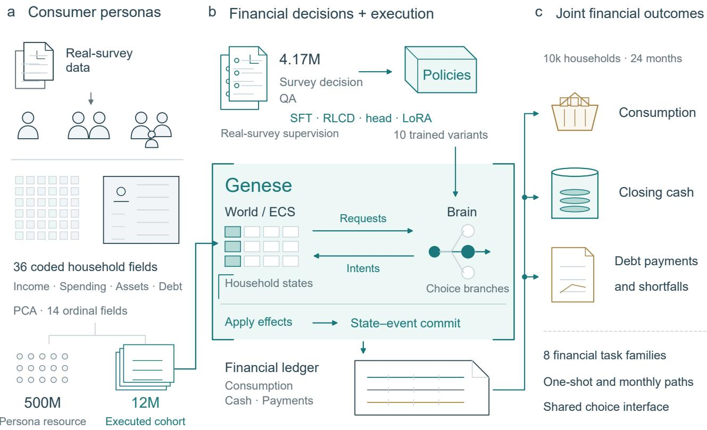

Figure 1 | Population-scale and repeated household decisions in $S ^ { 2 } .$ -MAS. a, Real-survey data support 36 coded household attributes. The constructed 500M persona resource supplies the 12M execution cohort, selected without replacement before inference; PCA summarizes economic structure using 14 ordinal fields. b, Real-survey supervision supports trainable policies. FinQ is the selected Qwen3.5-4B-Base LoRA-plus-head route, while FinL is the full-data Laya encoder adaptation. The fixed-budget study contains five native Laya and five Qwen adaptations, including FinQ; full-data FinL is a separate system reference. Genese World/ECS exchanges requests and intents with Brain and applies registered efects to state. The application ledger executes financial plans. c, Eight financial task families share the choice interface. FinL-mlx supplies the completed task, population and monthly applications. A fixed 10,000-household panel covers initial response patterns in the 12M cohort and is retained across shock paths and purchase goals for 24 months. Joint outcomes trace consumption, closing cash, debt payments and shortfalls.

The static task suite contains 45,473 cases per language, including 22,736 baseline/intervention pairs and one additional case. Task specifications separate model-visible information from execution-only realizations and provide 147,787 conditional option paths over twelve months. The completed suite uses FinL-mlx and the original Laya reference. The population-scale application fixes one T3 contrast; its monthly extension reselects from evolving state under common bank rules. Survey QA tests prediction of recorded answers and coded targets.

Table 1 | Financial task specifications and reported applications
<table><tr><td>Task / changed condition</td><td>Offered actions</td><td>Financial measures</td><td>Evidence reported here</td></tr><tr><td>T1: income and consumption</td><td>Adjust discretionary spending</td><td>Consumption, cash, unmet needs</td><td>Paired static FinL/Laya execution (Appendix S11)</td></tr><tr><td>T2: medical expense funding</td><td>Use savings, borrow or combine both</td><td>Cash, debt, unmet needs</td><td>paired FinL/Laya execution (Appendix S11)</td></tr><tr><td>T3: purchase-funding need</td><td>Defer purchase or finance a partial/full amount</td><td>Consumption, cash, payments, debt</td><td>Paired bilingual execution and 12M application (§6.2, Tables S32–S33)</td></tr><tr><td>T4: loan product and term</td><td>Choose a short/long contract or defer purchase</td><td>Payments, cash, arrears</td><td>paired FinL/Laya execution (Appendix S11)</td></tr><tr><td>T5: liquid saving and risky assets</td><td>Allocate between liquid and risky holdings</td><td>Cash, assets, unfunded needs</td><td>paired FinL/Laya execution (Appendix S11)</td></tr><tr><td>T6: multiple-debt payments</td><td>Allocate a payment budget across debts</td><td>Debt balances, arrears, default</td><td>paired FinL/Laya execution (Appendix S11)</td></tr><tr><td>T7: repayment difficulty</td><td>Retain schedule, prepay or request extension</td><td>Payments, debt, extension outcome</td><td>paired FinL/Laya execution (Appendix S11)</td></tr><tr><td>T8: liquidity shortfall</td><td>Sell assets, refinance or combine both</td><td>Cash, assets, debt</td><td>paired FinL/Laya execution (Appendix S11)</td></tr></table>

All eight families have paired specifications, conditional option paths and completed FinL/original-Laya execution with Chinese variants included. The static task set is derived from 207 financial parent records; parameter variants are not independent households. The separate DeepSeek workflow study remains in Appendix S9.

Consider a synthetic household assigned CNY 6,000 monthly income, CNY 3,000 opening cash, CNY 3,500 essential and CNY 1,800 usual adjustable spending, and no opening debt. A CNY 20,000 purchase goal ofers deferral, half financing or full financing at 5% nominal annual interest over 24 installments. Selecting full financing buys CNY 20,000 immediately and records the dated purchase contract. Month-0 cash is $3 , 0 0 0 + 6 , 0 0 0 + 2 0 , 0 0 0 - 2 0 , 0 0 0 - 3 , 5 0 0 - 1 , 8 0 0 = \mathrm { C N Y }$ 3,700, with repayment beginning in month 1. A later observation contains this closing cash, the remaining purchase need and the next dated obligation. The supplied CPU saved-action example executes these transitions without model calls.

## 4. Data, computable personas and simulation components

## 4.1. Survey data and computable household personas

Real-survey data support the household attributes, recorded responses and coded financial states used here. Cleaning, translation and statistical harmonization produce a common 36-field representation of demographics, household structure, income, expenditure, assets, debt and attitudes. Conditional construction preserves the dependence of financial attributes on household characteristics, and statistical calibration aligns selected population margins. Numeric codes support population operations, while decoded fields form model-visible personas. PCA summarizes joint economic structure after construction (Supplementary Methods M1–M3).

The reusable 10M consumer bank supports descriptive analysis of the constructed representation. The 12M execution cohort selects whole records without replacement from two 10M-row shards of the 500M resource, with the cohort fixed before inference. The monthly shock extension uses the same 10,000-household panel in every route and purchase-goal condition (Supplementary Methods M11).

The same preparation produces supervision for policy learning. The 4,172,421 underlying QA observations have aligned bilingual views, retaining wording, alternatives and monetary units. Target-related fields are omitted from the input, and all questions and language copies for a respondent group share a split. The grouped training partition contains 2,925,263 examples per language. FinL uses the full training partition; the matched downstream comparisons use nested 50k/200k training sets, including the selected 200k FinQ route (Appendix S10).

## 4.2. Decision execution and financial accounting

Genese separates decision proposals from authoritative state updates (Figure 2). World stores numeric state in entity– component–system arrays indexed by entity ID. Brain receives bounded decision partitions, reuses model connections and returns policy intents. World validates these intents, resolves registered efects and applies updates. Production PostgreSQL commits world state, the event outbox and command result together; a failed pre-commit transition restores the tick snapshot. An outbox relay publishes committed events asynchronously.

The household application evaluates financial consequences in a separate monthly ledger. Input preparation, decision inference and ledger calculation overlap across partitions, while household and condition IDs retain the pairing. Integer-cent accounting applies income, selected financing, consumption priorities and scheduled debt payments in a fixed order. The resulting paths record funded amounts and shortfalls.

The controlled engine benchmarks measure accepted decisions and writeback. The 12M application measures the asynchronous policy-to-ledger runner, and the monthly application adds evolving household states and a synchronization point for bank feedback. Section 5.5 reports the workloads and measurements for each execution setting.

Entity IDs map to array rows
<table><tr><td rowspan=1 colspan=1>Row</td><td rowspan=1 colspan=1>Position</td><td rowspan=1 colspan=1>Energy</td><td rowspan=1 colspan=1>Health</td></tr><tr><td rowspan=1 colspan=1>i</td><td rowspan=1 colspan=1>x[i]</td><td rowspan=1 colspan=1>e[i]</td><td rowspan=1 colspan=1>h[i]</td></tr><tr><td rowspan=1 colspan=1>i+1</td><td rowspan=1 colspan=1>x[i+1]</td><td rowspan=1 colspan=1>e[i+1]</td><td rowspan=1 colspan=1>h[i+1]</td></tr><tr><td rowspan=1 colspan=1>i+2</td><td rowspan=1 colspan=1>x[i+2]</td><td rowspan=1 colspan=1>e[i+2]</td><td rowspan=1 colspan=1>h[i+2]</td></tr></table>

Boolean activity / component masks Sparse relationship matrices

Registered effect handlers Batch updates to component arrays

Structural-command buffer Entity and component changes b Decisions, commit and event delivery

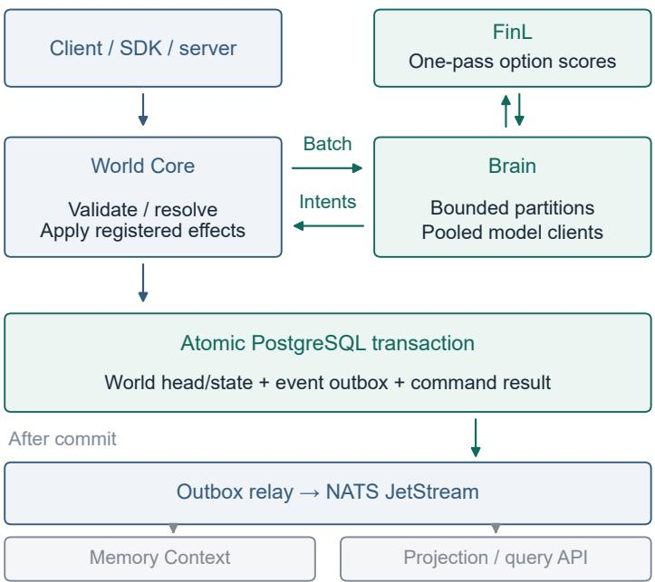

## c Overlap across workload partitions

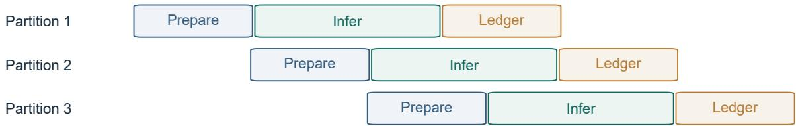

Figure 2 | ECS computation and the Genese state-transition boundary. a, Entity IDs index numeric component arrays; masks select active rows, registered systems update components, and a structural-command bufer controls structural changes. b, World Core requests decisions from Brain through bounded partitions and pooled model connections, then validates intents, resolves efects and commits authoritative world state, the event outbox and command result together in production PostgreSQL. The outbox relay publishes committed events to NATS JetStream; memory and projection consumers process them asynchronously. The shaded commit boundary covers database state and outbox records. c, Schematic overlap across workload partitions places input preparation, model inference and ledger calculation on distinct stages; the segment widths are illustrative.

## 4.3. Learning and substituting decision policies

FinQ and FinL learn choices from household states and task alternatives. FinQ combines a decoder backbone with LoRA and a learned decision head; FinL adapts a compact encoder and option-marker head. Existing approaches include Jev’s RLCD [36], Kev’s option cross-entropy [38] and Laya’s encoder-based SFT and RLCD [3], [37]. Figure 3 groups the benchmarked interfaces into six routes. The fixed-budget study contains ten trained versions: five native Laya adaptations and five Qwen head-only or LoRA adaptations, including FinQ. Full-data FinL is reported separately.

FinQ is the selected Qwen3.5-4B-Base LoRA-plus-decision-head checkpoint trained on 200,000 unique examples. Candidate contexts independently encode the state, question and alternatives with the evaluated candidate marked. The final nonpadding representation is L2-normalized and scored by a shared scalar head. LoRA updates the backbone adapters together with that head [39]. The fixed 20k development set selects the checkpoint; the complete 412,873-example development partition compares the two 200k 4B methods before the corresponding Qwen3.5-9B run.

FinL is the full-data, six-round financial adaptation of Laya’s 421M-parameter encoder and option-marker head [3]. Two SFT stages and native RLCD produce the three-round FinL-family policy. A further SFT and RLCD continuation broadens task coverage over 2.93M examples. Checkpoints are selected on development data, and probability temperatures are fitted on independent calibration data (Supplementary Methods M4–M6). FinL-mlx denotes execution of this full-data checkpoint through MLX; FinL-bilingual is the separate multilingual-base adaptation.

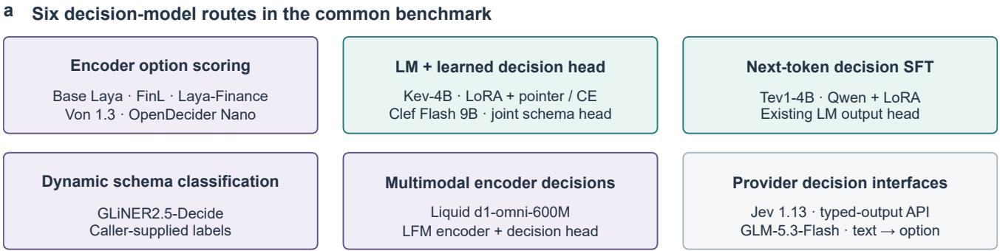

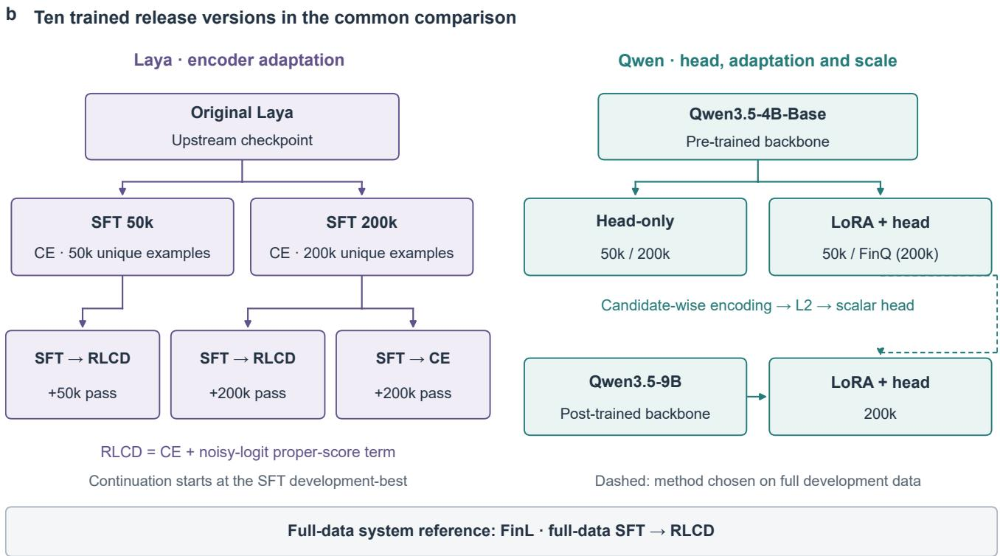  
Common test: 240,458 records · 119 question versions · accuracy + question-macro F1  
Ten development-best release versions + original-Laya zero-new-training reference

Figure 3 | Decision interfaces and training routes. a, Twelve benchmarked models are grouped into six architecture or interface routes; all receive text inputs in this benchmark. b, Ten fixed-budget trained versions compare encoder adaptation, repeated CE training, low-rank adaptation and larger backbones. FinQ is the selected Qwen3.5-4B-Base LoRA-plus-head checkpoint at the 200k budget. Qwen candidates are encoded separately, L2-normalized and scored by a shared scalar head; head-only training freezes the backbone. Native continuations start from the matching SFT development-best checkpoint, and native RLCD combines CE with a proper-score policy-gradient term over noisy logits. Full development data (412,873 records) compare the two 200k 4B methods; the dashed arrow applies the selected method to an independently initialized 9B backbone Each run uses fixed 20k development data for checkpoint selection. All ten trained versions and the zero-new-training native reference share the held-out test. Full-data FinL is the principal encoder route and a separate system reference. CE, cross-entropy.

The controls retain nested 50k/200k Qwen4B head-only and LoRA routes, the selected 200k Qwen9B LoRA route, and native Laya SFT on the same example sets. Additional native RLCD and CE-continuation controls start from the same SFT parent and share an added full-pass budget and development rule. Unique examples, repeated exposures, selected checkpoints and allocated GPU-hours are reported in Appendix S10.

All adapters preserve the state, question and semantic alternatives while translating the policy’s scoring interface. The final 240,458-record test evaluates every fixed trained version and the original native reference after method and budget selection.

## 5. Evaluating the framework components

We evaluate household information, decision-policy training and substitution, and action execution. FinQ and FinL provide the two principal training routes; matched controls compare adaptation choices, and execution benchmarks time accepted choices and state updates.

## 5.1. Population structure and cohort coverage

PCA summarizes 14 standardized ordinal attributes in the constructed 10M bank. Among 7,227,206 complete records, PC1 explains 32.8904% of variance and PC2 explains 11.5234%. Income, spending, assets and debt load positively on the main axis, while age loads negatively. The 500M resource separately has a shard-mean PC1 explained variance of 32.62%, with loading standard deviations at most 0.0003. Tables S17–S18 report the bank analysis, and M2–M3 give the descriptive protocol. The independent synthetic companion supplies a reusable population with assigned financial states: Figures S1 and S4 describe its 2M personas, including the income, liquidity and obligation dimensions that enter the scenario interface.

Rendered-persona evaluation finds high field coverage and uneven sensitivity to reconstruction errors (Figure 4). Six human raters score 100 personas against processed reference fields, with a pooled mean of 4.570/5. DeepSeek and GLM agree within one point of the human mean on 94.0% of persona-dimension comparisons, while giving higher scores for avoidance of unsupported inference and overall fidelity. Their omission sensitivity difers: GLM detects 24 of 24 valid omitted-target pairs, compared with 2 of 24 for DeepSeek. M7 describes the rendering, scoring and perturbation design.

Persona fidelity and the reliability of AI judges

100 processed reference personas ꞏ 44 fields ꞏ Six human raters

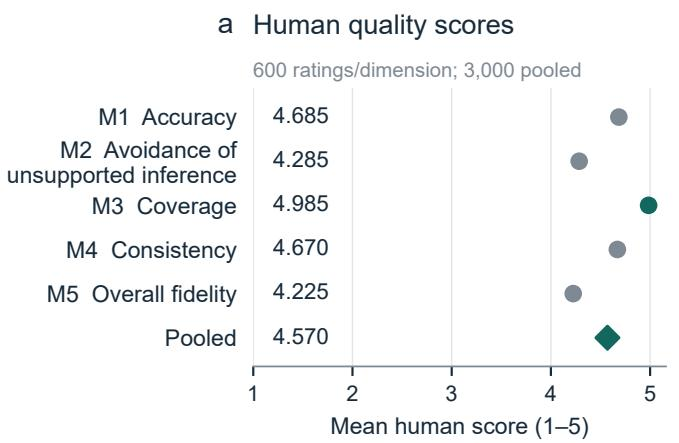

b AI minus human mean  
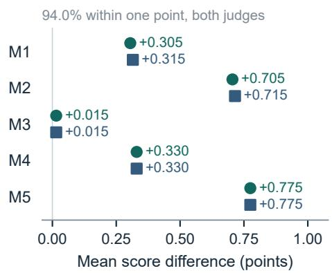

c Detection of known persona errors  
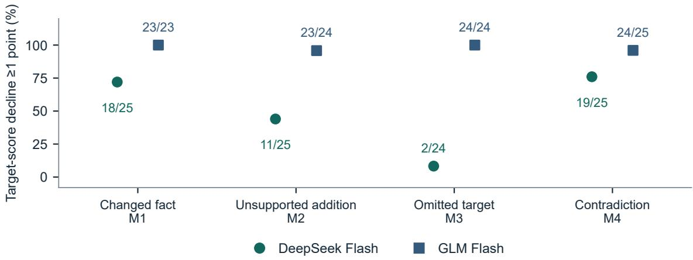  
Figure 4 | Human persona fidelity, judge bias and known-error detection. a, Six raters score five dimensions for 100 processed survey-derived personas rendered from 44 processed fields, producing 600 ratings per dimension and 3,000 in total. Points show mean human scores on the five-point scale; pooled mean is 4.570. M2 measures avoidance of unsupported inference, so a higher score indicates fewer unsupported inferences. b, Mean AI score minus the six-rater mean for each dimension, based on 100 persona-level comparisons per judge. Both judges agree within one point on 470/500 comparisons (94.0%), while giving higher M2 and M5 scores. c, The proportion of valid original–perturbed pairs with a target-dimension decline of at least one score point after a known error is injected. Labels give detected/valid pairs; valid denominators vary from 23 to 25 per judge and error type. DeepSeek detects 2/24 omitted targets, compared with 24/24 for GLM. Supplementary Figure S3 shows the full human-score distributions and Table S16 reports scoring thresholds and non-target specificity.

## 5.2. Persona information and policy adaptation

Financial supervision improves shared-question prediction in the FinL family (Figure 5). The three-round policy raises native BF16 accuracy from 60.2080% to 74.5336% and question-macro F1 from 29.5574% to 38.0164%. Full-data FinL maintains shared-question accuracy at 74.5586% while extending supervised task coverage: accuracy on the expanded test rises from 56.3657% to 67.2728%. The auxiliary FinL-bilingual policy evaluated in Chinese gains 21.61 accuracy points and 10.60 F1 points over its multilingual base.

Financial training improves shared-question prediction

Shared financial test · 240,458 observations · 119 question versions · PyTorch BF16

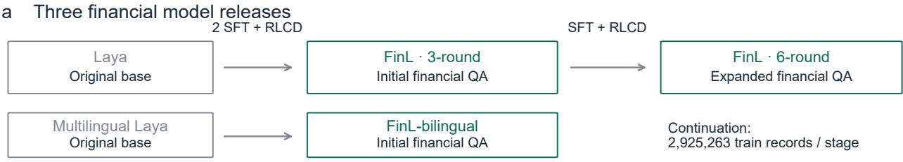

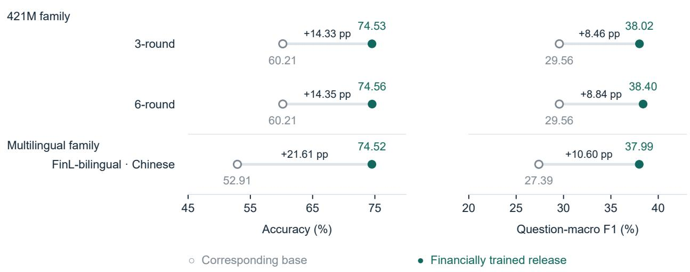

Figure 5 | Financial training improves shared-question prediction in the FinL family. a, The three-round FinL-family policy uses financial-question supervision; full-data FinL adds expanded financial supervision through another SFT and RLCD stage. FinL-bilingual derives from multilingual Laya and remains an initial-supervision adaptation. b, Accuracy gains over the corresponding base are 14.33 and 14.35 percentage points for the native variants and 21.61 points for FinL-bilingual evaluated in Chinese. c, Question-macro F1 rises by 8.46, 8.84 and 10.60 points. Comparisons use 240,458 shared financial-question QA observations, 119 question versions and PyTorch BF16. Connectors pair adaptations with their corresponding base; labels show scores and percentage-point diferences. Accuracy weights observations equally; F1 averages candidate-class F1 within version, then weights supported versions equally.

Respondent information also improves prediction when the trained policy and questions remain fixed (Figure 6; Table 3). On the matched 20,000-QA panel, full profiles add 6.2475 question-macro F1 points over empty profiles (95% interval 5.4958– 6.7267) and 3.6047 points over another respondent’s profile for the same question (2.7977–4.3155). Full profiles outperform both the question-only and training-majority controls, showing that household attributes contribute information beyond the question’s answer distribution. The gain appears in financial knowledge, risk and investment attitudes, and saving and credit products.

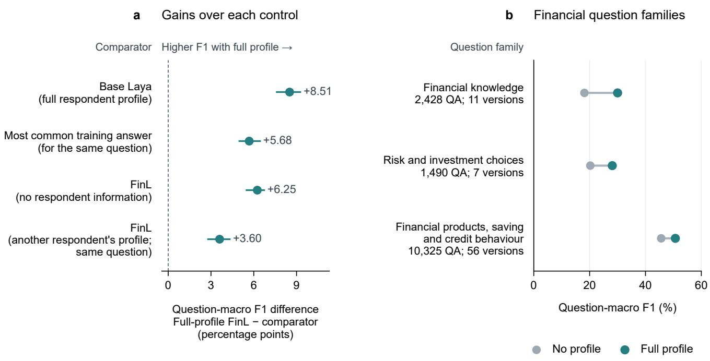

Figure 6 | Respondent information improves survey-answer prediction. a, Question-macro F1 of full-profile FinL minus each labelled comparator, in percentage points; zero indicates equal scores and positive values favour full-profile FinL. Points show paired diferences on 20,000 QA; lines show 95% bootstrap intervals from 2,000 resamples of 6,752 household/respondent groups. The wrong-profile control supplies another respondent’s information for the same question. b, FinL scores with full profiles (teal) and no respondent information (grey), grouped by financial question family. Counts give QA and question versions. Full profiles improve F1 in all three families.

The adaptation controls distinguish the training choices supported by the common interface (Tables 2 and 5). FinQ is the selected 200k Qwen4B LoRA-plus-head route; updating the backbone is more efective than training only its head. The evaluated FinQ and Qwen9B LoRA200 routes reach similar accuracy under the common downstream protocol. Native Laya controls show that supervised adaptation supplies most of the encoder’s predictive gain. Additional RLCD raises accuracy slightly over SFT, whereas CE continuation yields higher question-macro F1 than RLCD. Table 2 retains every fixed-budget version, and Appendix S10 reports development selection, repeated exposures, training cost and paired intervals.

Native SFT200 uses 0.733 allocated H100 GPU-hours, versus 24.043 for FinQ and 29.782 for Qwen9B LoRA200 (Table S24). These downstream-stage totals include validation and saving.

Table 2 | Common-test performance of every fixed-budget trained version
<table><tr><td>Model / adaptation</td><td>Unique training QA</td><td>Selected cumulative ex- posures</td><td>Accuracy (%)</td><td>Question-macro F1 (%)</td></tr><tr><td>Original native Laya</td><td>0</td><td>0</td><td>60.1972</td><td>29.5995</td></tr><tr><td>Qwen4B head only</td><td>50,000</td><td>100,000</td><td>67.3369</td><td>31.0166</td></tr><tr><td>Qwen4B LoRA + head</td><td>50,000</td><td>50,000</td><td>73.7289</td><td>36.6225</td></tr><tr><td>Qwen4B head only</td><td>200,000</td><td>200,000</td><td>67.2841</td><td>30.8995</td></tr><tr><td>FinQ (Qwen4B LoRA + head)</td><td>200,000</td><td>200,000</td><td>74.1435</td><td>36.7343</td></tr><tr><td>Qwen9B LoRA + head</td><td>200,000</td><td>200,000</td><td>74.0919</td><td>36.6622</td></tr><tr><td>Native Laya SFT</td><td>50,000</td><td>50,000</td><td>72.6942</td><td>34.8511</td></tr><tr><td>Native Laya SFT</td><td>200,000</td><td>200,000</td><td>73.8753</td><td>35.9949</td></tr><tr><td>Native SFT → RLCD</td><td>50,000</td><td>100,000</td><td>72.9258</td><td>34.7841</td></tr><tr><td>Native SFT → RLCD</td><td>200,000</td><td>400,000</td><td>73.9268</td><td>36.0503</td></tr><tr><td>Native SFT → CE continuation</td><td>200,000</td><td>250,688</td><td>73.8986</td><td>36.1732</td></tr></table>

shared test: 240,458 records, 119 question versions and 8,275 respondent groups; invalid decisions count as incorrect. All ten trained versions use their development-best checkpoint. Exposures count downstream example presentations in this experiment, including the SFT parent for continued native models. Original Laya has zero new downstream training here, in addition to its upstream training. FinL’s full-data training is reported separately. Native and Qwen inference use BF16; the full-data FinL system comparison in Table 4 uses MLX FP16. The complete training costs and terminal exposures appear in Appendix S10.

Table 3 | Matched respondent-information controls
<table><tr><td>Model / information condition</td><td>QA</td><td>Weighted accuracy (%)</td><td>Question-macro F1 (%)</td></tr><tr><td>Base Laya, full profile</td><td>20000</td><td>60.14</td><td>29.26</td></tr><tr><td>FinL, full profile</td><td>20000</td><td>74.40</td><td>37.77</td></tr><tr><td>FinL, no profile</td><td>20000</td><td>71.19</td><td>31.53</td></tr><tr><td>FinL, wrong same-question profile</td><td>20000</td><td>69.56</td><td>34.17</td></tr><tr><td>Training-question majority</td><td>20000</td><td>71.71</td><td>32.09</td></tr></table>

The same 20,000 held-out QA and 119 question versions enter every row. Accuracy uses full-test question frequencies. The majority baseline uses training answers only; wrong profiles are drawn within question version.

## 5.3. Substituting decision models on common questions

Twelve decision models and a question-majority baseline receive the same 240,458 test records and semantic alternatives (Table 4). FinL-mlx has the highest accuracy, 74.5544%, and question-macro F1 of 38.3746%. Compared with Jev 1.13, its accuracy improves by 9.2960 percentage points (95% interval 9.0637–9.5174) and F1 by 0.8953 points (0.5448–1.2834). These paired intervals resample 8,275 household/respondent groups jointly across models.

Clef Flash 9B has the highest F1, 38.5193%; the paired FinL-mlx–Clef diference is -0.1447 percentage points (95% interval -0.6208 to 0.4380). At 421M parameters, FinL reaches a similar measured F1 to the 9B comparator through this runtime, while scoring higher in accuracy. Relative to the question-majority baseline, its F1 increases by 6.2058 points.

FinL-mlx also exceeds GLM-5.3-Flash [41] on the same complete financial-question test: 74.5544% versus 68.8756% accuracy, a paired gain of 5.6787 percentage points (95% interval 5.5090–5.8459). Its question-macro F1 is 38.3746% versus 37.9991%, a gain of 0.3754 points (0.0398–0.7234).

Table 4 | Decision models on the common household-survey benchmark
<table><tr><td>Model</td><td>Parameters</td><td>Backend</td><td>QA / valid</td><td>Accuracy (%)</td><td>Question-macro F1 (%)</td></tr><tr><td>FinL-mlx</td><td>421M</td><td>MLX CUDA FP16</td><td>240,458 / 240,458</td><td>74.5544</td><td>38.3746</td></tr><tr><td>Question-majority baseline</td><td></td><td>CPU; training labels</td><td>240,458 / 240,458</td><td>71.7710</td><td>32.1688</td></tr><tr><td>GLM-5.3-Flash</td><td>Provider API</td><td>API; provider precision</td><td>240,458 / 240,360</td><td>68.8756</td><td>37.9991</td></tr><tr><td>Jev 1.13</td><td>Not disclosed</td><td>API; provider</td><td>240,458 / 240,458</td><td>65.2584</td><td>37.4793</td></tr><tr><td>Kev 4B</td><td>4B</td><td>precision CUDA BF16</td><td>240,458 / 240,458</td><td>64.9120</td><td>36.0435</td></tr><tr><td>Clef Flash 9B</td><td>9B</td><td>CUDA BF16</td><td>240,458 / 240,458</td><td>63.6490</td><td>38.5193</td></tr><tr><td>Base Laya</td><td>421M</td><td>MLX CUDA FP16</td><td>240,458 / 240,458</td><td>60.1831</td><td>29.5760</td></tr><tr><td>Laya-Finance (hravi)</td><td>Not disclosed</td><td>CUDA FP32</td><td>240,458 / 240,458</td><td>59.8317</td><td>28.7871</td></tr><tr><td>Tev1 4B</td><td>4B</td><td>CUDA BF16</td><td>240,458 / 240,458</td><td>58.8909</td><td>35.4105</td></tr><tr><td>Liquid d1-omni-600M</td><td>587M</td><td>CUDA FP16</td><td>240,458 / 240,458</td><td>58.4227</td><td>28.2825</td></tr><tr><td>OpenDecider Nano</td><td>~400M</td><td>Ettin / CUDA FP32</td><td>240,458 / 240,458</td><td>57.3572</td><td>28.3874</td></tr><tr><td>Von 1.3</td><td>395M</td><td>CUDA FP32</td><td>240,458 / 240,458</td><td>42.4873</td><td>26.8372</td></tr><tr><td>GLiNER2.5-Decide</td><td>340M</td><td>CUDA FP32</td><td>240,458 / 240,458</td><td>30.8815</td><td>19.6371</td></tr></table>

All rows use the same 240,458 held-out QA records and 119 question versions. QA / valid gives total records and legal decisions; invalid responses count as incorrect. GLM has 98 invalid responses, and the other rows have none. Sizes are reported model sizes; the majority baseline uses training labels. FinL and base Laya use MLX CUDA FP16 here; Table 2 reports the controlled BF16 adaptations. Supplementary Methods M5 describes adapters and input settings.

Tables 2 and 4 place the two principal training routes within the shared test: FinQ appears in the fixed-budget BF16 comparison, and full-data FinL appears through FinL-mlx in the complete-system comparison. FinL-mlx has the highest accuracy; Clef has the highest F1 point estimate, with a paired diference that spans zero. The complete-system comparison exposes accuracy/F1 tradeofs, while matched controls isolate downstream changes within a backbone (Table 5).

Table 5 | What the component controls and policy comparisons establish
<table><tr><td>Tested component and contrast</td><td>Observed result</td><td>Contribution to the framework</td></tr><tr><td>Respondent information: full versus empty profile, same FinL policy and questions; 20,000 QA</td><td>Full profiles add 6.2475 points of question-macro F1 (95% interval 5.4958–6.7267)</td><td>Agent attributes contribute predictive information beyond the question alone</td></tr><tr><td>Compact domain adaptation: original native Laya versus SFT on 200k unique QA; same 421M architecture, BF16</td><td>Accuracy rises from 60.1972% to 73.8753%</td><td>Survey supervision supplies most of the native policy&#x27;s downstream gain</td></tr><tr><td>Continuation objective: same SFT200 parent and added 200k-example pass budget; development-selected RLCD and CE checkpoints</td><td>RLCD raises accuracy from SFT&#x27;s 73.8753% to 73.9268%. Against CE continuation, RLCD&#x27;s F1 is 0.1229 points lower (95% interval -0.2073 to -0.0330)</td><td>The continuation objective changes the metric balance after SFT; CE has higher F1 in this comparison</td></tr><tr><td>Representation adaptation: Qwen4B head only versus LoRA plus head on the same 200k QA</td><td>Accuracy is 67.2841% with head-only training and 74.1435% with LoRA</td><td>Updating the representation adds value beyond the frozen-backbone route</td></tr><tr><td>Backbone substitution: Qwen4B-Base and Qwen9B, same 200k-example one-pass LoRA protocol; different upstream histories</td><td>Accuracy is 74.1435% and 74.0919%; 9B minus 4B is -0.0516 points (-0.0981 to -0.0071)</td><td>These two adaptation routes reach similar accuracy on the common test</td></tr><tr><td>External policy substitution: full-data FinL versus complete decision-model systems on common records and alternatives</td><td>FinL exceeds Jev by 9.2960 accuracy points and 0.8953 F1 points. Clef has the highest F1: 38.5193%, versus FinL&#x27;s 38.3746%; their paired F1 difference includes zero</td><td>A common interface exposes accuracy/F1 tradeoffs across decision systems with different readouts</td></tr></table>

F1 denotes question-macro F1; diferences are percentage points. The information control uses 6,752 respondent/household groups. The remaining rows use the common test of 240,458 records, 119 question versions and 8,275 respondent/household groups. Matched adaptations use BF16; the full-data FinL system comparison uses MLX FP16. Equal continuation pass budgets permit development to select diferent cumulative exposures: 400,000 for RLCD and 250,688 for CE. Tables 2 and 4 retain all version scores; Appendix S10 gives the training work and paired comparisons. External systems difer in upstream training and readout, so their row evaluates policy substitution rather than an architecture ablation.

## 5.4. MLX deployment paths

FinL-mlx is the MLX CUDA FP16 runtime used for the completed population and monthly applications. Its common Englishquestion scores are 74.5544% accuracy and 38.3746% question-macro F1, versus Jev’s 65.2584% and 37.4793% (Table S5a).

The separate single-request deployment benchmark evaluates FinL-bilingual in PyTorch and FinL-bilingual-mlx through MLX (Table S5b). On that measured workload, FinL-bilingual-mlx delivers 2.42 times the same checkpoint’s PyTorch shared input-token throughput and 22.72 times Jev API’s measured throughput. The three fixed Chinese inputs and single-request timing protocol are described in Supplementary Methods M9.

## 5.5. Scaling execution and persistent state

Fixed-upstream comparisons hold the task and model allocation common, timing one accepted choice and writeback per agent. At 1,000 agents with one T4 replica, Genese takes 6.17 seconds, versus 7.45 for OASIS and 7.70 for OneSim. Twenty randomized interleaved immediate-response blocks isolate execution overhead: Genese’s medians are 2.788 seconds with default partitions and 2.743 with parallel partitions. All 280 rounds across the two population sizes accept and write back every requested choice (Figure 7; Table 6). These local adapters use a memory-backed SQLite WAL state–event store; production uses PostgreSQL.

The 12M purchase-funding run tests the preparation–inference–ledger pipeline at population scale using FinL-mlx. The shock application uses the same full-data checkpoint and runtime, extending the purchase task to monthly re-selection, evolving contracts and lagged bank feedback over 24 months (Sections 6.4–6.6). Household states advance through accepted transitions; each monthly world closes before its aggregate repayment feedback sets the next month’s ofers.

The 12M-household application executes 24M one-shot choices and 288M monthly ledger states through the asynchronous HTTP policy–ledger runner. A total of 14 GPUs (eight H100 and six A100) complete the common end-to-end interval in 3 h 59 min 17 s, sustaining 1,671.66 choices/s with full private tracing (Figure 8a). The runner overlaps input preparation, direct option scoring, ledgers and compressed writes across 2,400 work units, using service batches of at most sixteen requests. Supplementary Methods M9 defines the measured interval, token accounting and completed-result recovery.

d 1,000 agents · immediate backend · 20 blocks  
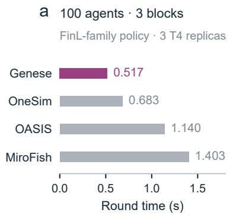

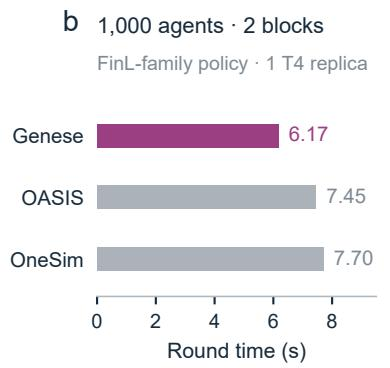

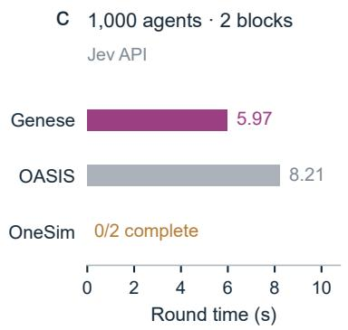

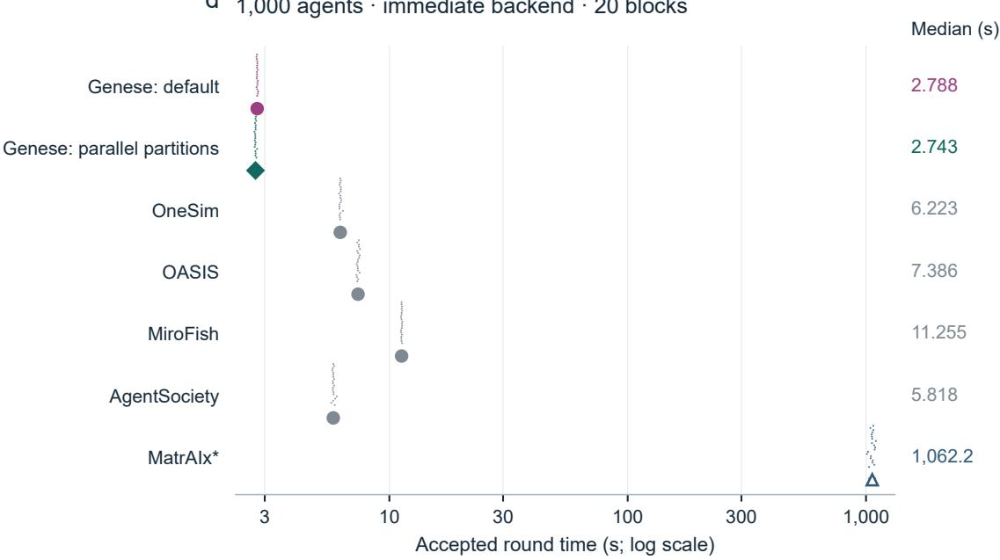  
d: small points, all 20 blocks; thick segment, IQR; large symbol, median.  
\* Parallel one-shot adapter. Each timed agent makes one accepted choice, including writeback.

Figure 7 | Agent-round times under fixed upstream allocations. Each timed agent makes one accepted model choice, including answer writeback; initialization is separate. a–b, 100 agents with three T4 FinL replicas and 1,000 agents with one replica, with medians over three and two randomized blocks, respectively. c, 1,000 agents with Jev API, two blocks; OneSim completes 0/2 attempts. d, Immediate-response execution at 1,000 agents, twenty randomized interleaved blocks per configuration after one warm-up. Small points show rounds, large symbols medians and thick segments inclusive interquartile ranges. Genese default and parallel partitions have distinct symbols and colors; an asterisk and open triangle mark the parallel MatrAIx one-shot adapter. Supplementary Methods M9 gives the common host, allocation and persistence settings.

Table 6 | Fixed benchmark matrices and completed execution
<table><tr><td>Measurement</td><td>Configuration / scope</td><td>Genese result</td><td>Other results</td></tr><tr><td>1,000 agents, immediate backend</td><td>2×Xeon Platinum 8268; threads; 20 interleaved blocks</td><td>Default 2.788 s; partitions 2.743 s</td><td>AgentSociety 5.818; OneSim 6.223; OASIS 7.386; MiroFish 11.255; MatrAIx 1,062.153 s</td></tr><tr><td>100 agents, immediate backend</td><td>2×Xeon Platinum 8268; threads; 20 interleaved blocks</td><td>Default 0.362 s; partitions 0.360 s</td><td>AgentSociety 1.063; OneSim 0.521; OASIS 0.931; MiroFish</td></tr><tr><td>100 agents, FinL fl4</td><td>3 T4 model replicas; 3 blocks</td><td>0.517 s</td><td>1.163; MatrAIx 96.529 s OneSim 0.683; OASIS 1.140; MiroFish 1.403 s</td></tr><tr><td>100 agents, FinL f15</td><td>Separate adapter matrix; 3 blocks</td><td>0.509 s</td><td>MatrAIx uses this separate refer- ence (Supplementary Figure S5d)</td></tr><tr><td>1,000 agents, FinL 1,000 agents, Jev</td><td>1 T4 model replica; 2 blocks</td><td>6.17 s</td><td>OASIS 7.45; OneSim 7.70 s</td></tr><tr><td></td><td>2 blocks</td><td>5.97 s</td><td>OASIS 8.21 s; OneSim 0/2 com- pleted</td></tr></table>

In the agent-round benchmarks, each agent makes one choice; round time includes answer writeback and excludes initialization. Immediate-backend entries use all twenty accepted block times per configuration. Framework CPU50 and proxy CPUs60–63 have nonexclusive afinity during concurrent training, with memory-backed comparison storage. MatrAIx uses a parallel one-shot adapter.

## 6. Applications across financial tasks and horizons

## 6.1. Three application groups

The three FinL-mlx application groups comprise an eight-task suite, the 12M purchase-funding experiment and a monthly extension with evolving household histories and bank feedback (Table 7). FinQ is evaluated as the selected trainable decoder route in the component study. A separate two-million-household fixed-plan credit application supplies supporting consumption and cash evidence in Appendix S13.

In that sixteen-month task, a 2,000-household comparison holds households, the available menu and the ledger fixed. FinL selects fully funded plans for 87.00% of households, compared with 79.30% for original Laya and 88.05% for the fixed restrained-consumption plan C0. Relative to C0, FinL executes CNY 1,146.60 more consumption and retains CNY 1,115.34 less cash. Information and menu controls separate changes in what agents are told from changes in the available plans (Appendix S13).

Table 7 | Applications connecting task reuse, population scale and repeated decisions
<table><tr><td>Application</td><td>Population and conditions</td><td>Choices and state horizon</td><td>Framework capability</td></tr><tr><td>Eight one-shot financial families</td><td>207 financial parents; FinL and original Laya, with Chinese vari- ants</td><td>181,892 one-shot choices; twelve- month ledgers</td><td>Reuse one decision interface across eight mechanisms</td></tr><tr><td>12M purchase-funding simulation</td><td>12M distinct synthetic households; goals and tied approved limits of CNY 20k/30k</td><td>24M one-shot choices; 288M monthly ledger states</td><td>Execute the same task and account- ing rules at population scale</td></tr><tr><td>Purchase goals under five shocks</td><td>Same 10,000 households; five shock paths plus an unshocked reference; two purchase goals</td><td>2.88M logical monthly choices: 2.16M new model requests and 0.72M reused choices; 24 months</td><td>Connect choices, full household histories and bank-portfolio feed- back</td></tr></table>

One-shot selections govern the subsequent fixed ledger path. Monthly episodes select again from current state. The dynamic application changes only the purchase goal (CNY 20k/30k); both conditions share a CNY 30k product ceiling and the same ofer rules. Tables S32–S33 give full 12M results and measurement scopes; M11 defines the shock paths, matched panel and feedback rules.

## 6.2. Reusing one-shot task interfaces at scale

FinL-mlx and original Laya completed 181,892 one-shot choices across the eight-task suite in English and Chinese: 181,888 choices in complete condition pairs and four supplemental T1 choices. Each task contains 2,842 pairs from its eligible financial parents within a 207-parent pool. Table S27 specifies the income, medical-bill, purchase, loan-rate, return, payment-budget and asset-value changes, together with their action consequences. Task-specific parent counts define the response intervals. In the exploratory T3 grid, raising the purchase goal and tied approved limit by 50% raised FinL-mlx’s consumption by CNY 17,148.49 (95% interval 14,818.58–19,601.23), versus 1,194.03 with Chinese inputs (638.59–1,825.40). These intervals resampled the 207 parents. Both input languages use the same English-base checkpoints with identical financial specifications. The input-language diference accompanied changes in payments, debt and unmet routine needs (Appendix S11).

The purchase-funding application uses one fixed T3 comparison for 12M distinct synthetic household agents, with English inputs and frozen FinL-mlx: the full-data English-base FinL checkpoint in MLX CUDA FP16. Each household faced a deferrable purchase goal and tied approved limit of CNY 20,000 or 30,000, with alternatives to defer, finance half, or finance the full purchase at an assigned 5% annual rate over 24 months. The bounded HTTP decision service returned one selection per condition, which the independent accounting path carried through a twelve-month ledger (Figure 8a; Table S33).

Executed purchase spending rose by CNY 2,890.97 per household; a CNY 3.79 reduction in routine consumption yielded a CNY 2,887.18 increase in total twelve-month consumption. Closing cash fell by CNY 928.76 and closing debt rose by CNY 2,072.45; actual debt payments and accrued interest also increased. Unfunded routine needs rose by CNY 3.79, and simulated default rose by 1.6663 percentage points (Figure 8b–c). The ledger followed the first twelve months of the twenty-four-month financing contract (Tables S32–S33).

a A completed 12M-agent framework workload  
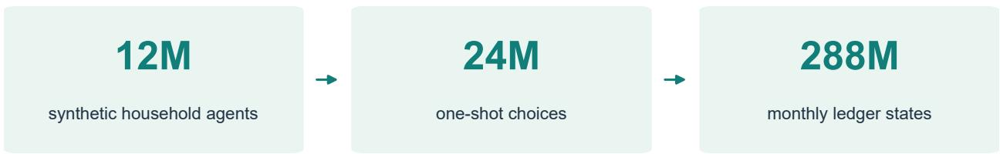  
FinL-mlx FP16 · paired purchase-funding conditions

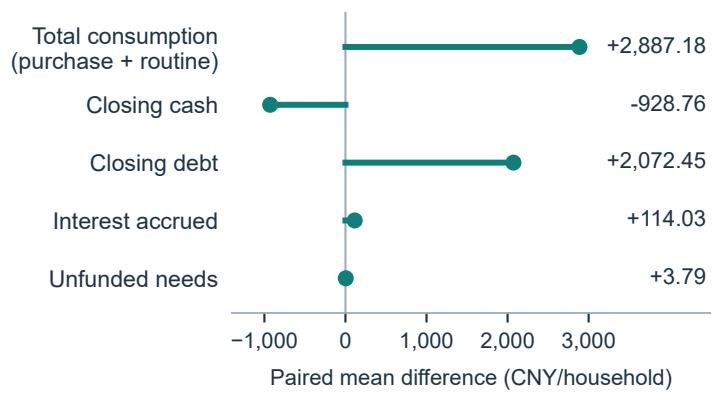  
T3: deferrable purchase need 20,000 → 30,000 CNY · 5% annual interest · 24-month loan

## c 12-month default

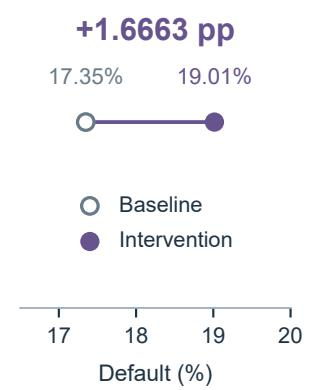  
Same 12M synthetic agents · paired conditions · 12-month ledgers

Figure 8 | Population-scale execution and paired financial outcomes. a, FinL-mlx FP16 executes two frozen T3 conditions for 12M synthetic household agents, producing 24M one-shot choices and 288M monthly ledger states. Each selected action is executed through twelve accounting months. b, Full-panel paired mean changes, with total consumption comprising purchase and routine spending, when the deferrable purchase goal and tied approved limit rise from CNY 20,000 to 30,000, with an assigned 5% annual rate and 24-month loan. c, Simulated default over the twelve-month ledger horizon rises from 17.35% to 19.01%. Diferences are intervention minus baseline for the same synthetic agents. Tables S32–S33 give complete financial means and measurement definitions.

## 6.3. Consumption heterogeneity and its financial channels

Consumption increases most among households with decision makers aged 25–34, with larger age–income-standardized responses also among the employed, college-educated and three-person households. In the 24-month panel, households earning below CNY 20,000 a year most often exhaust cash and enter simulated default by month 3, while the CNY 50,000–100,000 income group contributes over half of the additional repayment-and-arrears pressure entering the bank rule under persistent income loss (Table S48).

Households whose decision makers are aged 25–34 show a consumption increment of CNY 9,161.69, compared with 12.88 at ages 55–64 and zero at ages 65 and above. Reweighting each age group to the full panel’s income distribution preserves the contrast: the 25–34 mean becomes 9,181.62 and the age-65+ mean remains zero. Across annual-income groups, the mean increment rises from CNY 1,059.67 below 20,000 to 6,052.72 at 500,000 or above. Within ages 25–34, the income pattern is nonmonotonic, linking the marginal gradient to the joint household profile (Tables S41–S43). All 2,364,307 households with decision makers aged 65+ deferred the purchase in both conditions. At ages 55–64, 99.96% also deferred in both; 859 switched from deferral to the full purchase, 36 kept the full-purchase option and two switched to deferral, producing the CNY 12.88 mean increment.

The ledger connects these selected purchases to subsequent resources and payments (Figure 9c). The lowest income bracket increases purchase spending by CNY 1,061.72 and reduces routine spending by 2.04; the highest bracket increases purchases by 6,052.72 with routine spending unchanged. Their additional actual debt payments are 60.45 and 2,877.92, respectively. T3 purchases are fully financed at origination; subsequent cash use and repayment determine the debt carried through the horizon. With income and opening resources fixed within each pair, $\Delta C = \Delta D - \Delta K - \Delta I$ links additional consumption to additional closing debt, cash drawdown and accrued interest.

Education, employment and household size also distinguish purchase responses under the same age–income mixture. The consumption increment is CNY 398.12 for decision makers with primary education or below and 3,820.99 for the collegeeducated group; it is 1,406.09 for those not working and 3,437.93 for the employed. One-person households show an increment of 1,666.17, compared with 3,797.16 for three-person households. Each group contains all 42 age–income cells (Table S47).

30k − 20k purchase goal · 12-month outcomes · same 12M household agents

a Age of decision maker  
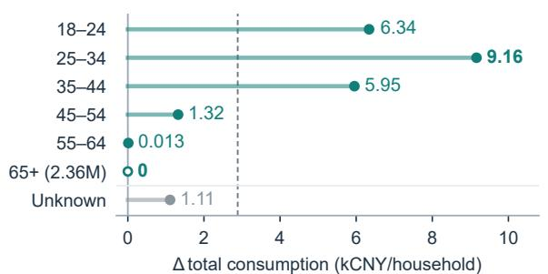  
c Funding the income gradient

b Annual household income (kCNY)  
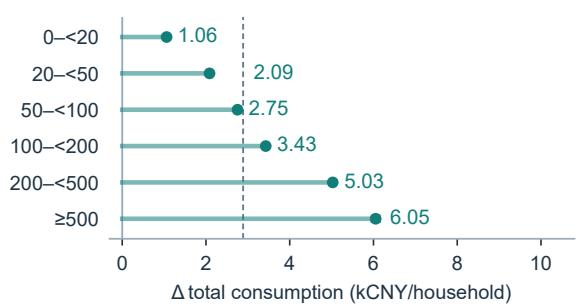  
ΔC = Δdebt − Δcash − Δinterest

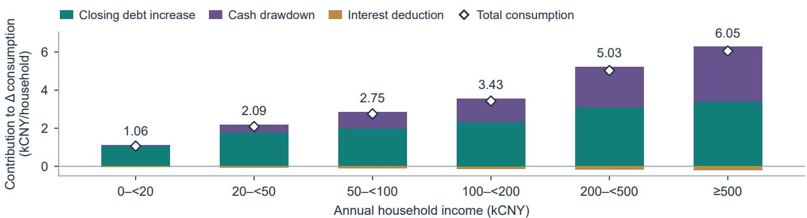  
Paired means; short bars: mean ± 1.96 SE. Dashed: cohort mean (2,887.18 CNY).

Figure 9 | Household profiles shape the consumption response and its financial channels. a, Paired mean consumption diferences by decision-maker age. b, The same contrast by annual household income. Diferences are CNY 30k minus 20k purchase goal and tied approved limit over twelve accounting months. All 12M households contribute to each partition; unknown age remains a separate group. Dashed lines mark the full-panel mean; short bars show mean ±1.96 synthetic-row standard-error references. c, For each income bracket, additional closing debt plus cash drawdown minus additional accrued interest equals the additional consumption. Amounts are thousand CNY per household; closing debt includes unpaid interest. Table S41 gives actual debt payments. Tables S41–S45 and source aggregates give group sizes, financial-stock partitions, standardized contrasts and variation decompositions.

The choice transitions explain most of these diferences. Of the CNY 3,427.57 diference in purchase response between the college-educated and primary-or-below groups, 3,183.17 comes from switching from deferral to a purchase and 234.46 from expanding the amount under the same half- or full-purchase choice. The routine-spending diference is 4.70, giving a consumption-response diference of 3,422.87. This diference accompanies 1,004.78 more cash drawdown, 1,009.48 more actual debt payments and 2,555.05 more closing debt. Employment and household-size contrasts follow the same dominant deferral-to-purchase channel. Risk preference and housing tenure add only 0.13 and 0.07 percentage points, respectively, to the consumption variation explained by age–income groups (Table S46).

Financial assets distinguish consumption size from the way households carry the obligation. The raw consumption increment is CNY 2,580.88 for financial assets below 10,000 and 3,054.60 for assets of 1–2 million. Reweighting both asset groups to the same age–income distribution reverses that ordering to 3,014.26 and 2,361.25. The higher-asset group nevertheless makes more additional actual payments (1,137.87 versus 905.61), uses more cash (1,136.28 versus 905.61) and retains less additional closing debt (1,311.52 versus 2,229.04). Higher financial-asset stock therefore accompanies a larger cash-and-payment contribution to a smaller consumption increment under the common profile mixture (Table S44).

Opening debt reveals a diferent adjustment. Under the same age–income mixture, households without old debt increase consumption by CNY 2,864.61 and actual payments by 1,063.72. Households with CNY 2–5 million of opening debt increase consumption by 1,811.13 and actual payments by 44.31; their cash drawdown is 43.97 and closing-debt increment 1,848.23. The high-debt group’s additional consumption is carried predominantly as debt through the twelve-month window. Adding debt stock to age–income groups increases the between-group share of consumption-response variation by 1.40 percentage points and payment-response variation by 2.15 points (Tables S44–S45).

## 6.4. Purchase goals across five shock paths

The monthly application retains the purchase task and adds changing income, spending needs and bank ofers (Figure 10). It uses English state descriptions, instructions and alternatives with the same frozen FinL-mlx policy, the full-data English-base FinL checkpoint in MLX CUDA FP16. The same 10,000-household panel faces CNY 20,000 and 30,000 deferrable purchase goals for 24 months under each of five shock paths and an unshocked reference. Temporary and persistent income losses, a one-time necessary expense, their combination and sustained income gains probe diferent resource channels. Both goal conditions use the same bank product: a CNY 30,000 ceiling on outstanding new principal, 5% annual interest, 24 installments and zero fees. This extension changes only the purchase goal; the 12M one-shot application jointly changes the goal and tied approved limit.

Each month the policy sees the full household profile, current resources, remaining purchase need, all executed monthly history and dated contracts. It chooses adjustable consumption and whether to wait, buy with cash or finance a partial/full purchase. Purchases reduce the remaining goal, so another monthly decision does not replenish demand. Income and necessary spending enter the ledger, and actual repayments and arrears update the following month’s ofers. A route-specific portfolio factor combines lagged repayment coverage and material thirty-day arrears with individual afordability. The same policy rules apply in all twelve worlds (M11).

c: repayment coverage; d: 30-day-arrears share of borrower-months (last three closed months). Common bank product: 30k CNY outstanding new principal · 5% annual rate · 24 instalments · no fee  
a One population, twelve matched worlds  

b Exogenous routes: income relative to its original monthly level
<table><tr><td rowspan=1 colspan=2></td><td rowspan=2 colspan=1></td><td rowspan=1 colspan=1>Months 1-6</td><td rowspan=1 colspan=1>7</td><td rowspan=1 colspan=1>8</td><td rowspan=1 colspan=1>9</td><td rowspan=1 colspan=1>10</td><td rowspan=1 colspan=1>11-24</td></tr><tr><td rowspan=4 colspan=2>RO   No shockR1   Temporary income lossR2   Cumulative income lossR3   Essential expense</td><td rowspan=1 colspan=1>100%</td><td rowspan=1 colspan=1>100%</td><td rowspan=1 colspan=1>100%</td><td rowspan=1 colspan=1>100%</td><td rowspan=1 colspan=1>100%</td><td rowspan=1 colspan=1>100%</td></tr><tr><td rowspan=1 colspan=1>100%</td><td rowspan=1 colspan=1>70%</td><td rowspan=1 colspan=1>70%</td><td rowspan=1 colspan=1>70%</td><td rowspan=1 colspan=1>100%</td><td rowspan=1 colspan=1>100%</td></tr><tr><td rowspan=1 colspan=1>100%</td><td rowspan=1 colspan=1>90%</td><td rowspan=1 colspan=1>81%</td><td rowspan=1 colspan=1>72.9%</td><td rowspan=1 colspan=1>72.9%</td><td rowspan=1 colspan=1>72.9%</td></tr><tr><td rowspan=1 colspan=1>100%</td><td rowspan=1 colspan=1>100%</td><td rowspan=1 colspan=1>100%</td><td rowspan=1 colspan=1>100%</td><td rowspan=1 colspan=1>100% *</td><td rowspan=1 colspan=1>100%</td></tr><tr><td rowspan=3 colspan=2>R4   Combined shockR5   Cumulative income gain</td><td></td><td></td><td></td><td></td><td></td><td></td></tr><tr><td rowspan=1 colspan=1>100%</td><td rowspan=1 colspan=1>70%</td><td rowspan=1 colspan=1>70%</td><td rowspan=1 colspan=1>70%</td><td rowspan=1 colspan=1>100% *</td><td rowspan=1 colspan=1>100%</td></tr><tr><td rowspan=1 colspan=1>100%</td><td rowspan=1 colspan=1>110%</td><td rowspan=1 colspan=1>121%</td><td rowspan=1 colspan=1>133.1%</td><td rowspan=1 colspan=1>133.1%</td><td rowspan=1 colspan=1>133.1%</td></tr></table>

\* Month 10: an extra essential need of 0.9 × original monthly income in R3 and R4.

c The same policy and state update run in every monthly world  
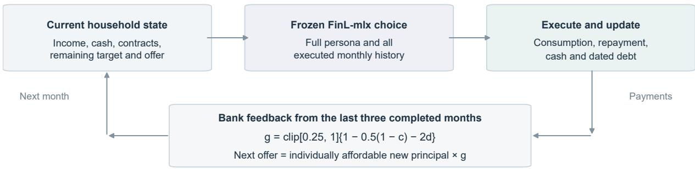

Figure 10 | Five shock paths extend the purchase task to a stateful financial environment. Income is relative to the original household income; the necessary-expense shock adds 90% of one original month’s income in month 10. R0 supplies the unshocked reference. The same 10,000 households face both purchase goals in every path. Monthly choices update cash, purchases and dated obligations; completed repayment and arrears records update next-month bank ofers under a common rule.

## 6.5. How shocks change household resources and choices

At a fixed CNY 20,000 purchase goal, sustained income gains support more purchases and cash accumulation, while persistent income loss reduces both (Table 8). Cumulative routine consumption varies by about CNY 1,016 across routes, compared with 91,085 in closing cash. Base necessary needs are mostly unchanged and paid before debt service; cash and purchases absorb more of the adjustment. Available ofers respond to lagged income, scheduled payments and portfolio repayment stress.

● 20k purchase goal 30k purchase goal

Table 8 | Month-24 household outcomes under a fixed CNY 20k purchase goal
<table><tr><td>Shock path</td><td>Cumulative purchases</td><td>Cumulative routine consumption</td><td>Closing cash</td><td>Available new-principal offer</td></tr><tr><td>RO: no shock</td><td>14,950</td><td>90,093</td><td>125,248</td><td>8,407</td></tr><tr><td>R1: temporary income loss</td><td>14,574</td><td>90,109</td><td>117,195</td><td>8,140</td></tr><tr><td>R2: persistent income loss</td><td>13,080</td><td>89,693</td><td>85,354</td><td>3,231</td></tr><tr><td>R3: necessary expense</td><td>14,747</td><td>90,093</td><td>117,137</td><td>8,277</td></tr><tr><td>R4: combined shock</td><td>14,292</td><td>90,109</td><td>109,393</td><td>7,842</td></tr><tr><td>R5: sustained income gains</td><td>16,088</td><td>90,708</td><td>176,439</td><td>14,996</td></tr></table>

CNY per household, rounded to the nearest yuan, for the same 10,000-household panel and fixed CNY 20,000 purchase goal. Purchases and routine consumption accumulate through month 24; cash is the closing stock and ofers are quoted at the month-24 decision using months 21–23. Routine consumption comprises executed base necessary and adjustable spending, excluding the added shock expense. R1 applies temporary income loss in months 7–9; R2 retains the reduced income level after month 9; R3 adds one necessary expense in month 10; R4 combines R1 and R3; R5 retains the higher income level after month 9. All paths share the CNY 30k ceiling on outstanding new principal, 5% annual interest and 24 installments. Figure 10 and M11 specify the paths and financial rules.

Relative to the same-goal unshocked path, temporary income loss reduces cumulative purchases by CNY 376.57/1,033.50 per household and closing cash by 8,052.79/7,369.20 (20k/30k goals). Income recovers in month 10, but the earlier resource loss remains visible at month 24. Persistent income loss produces larger purchase reductions of 1,869.92/2,644.34 and cash reductions of 39,894.13/39,118.74. Its income loss continues through month 24, whereas the compound route combines a temporary loss with a single expense. The longer loss therefore removes more cash than the compound shock (Figure 11; Table 9).

The expense shock primarily uses reserves. Additional executed necessary spending is CNY 8,407.09/8,406.47; purchases fall by 203.21/322.33 and closing cash by 8,110.85/8,009.13. Combining this expense with temporary income loss reduces purchases by 658.55/1,373.97 and increases necessary-spending shortfalls by 518.89/574.08. The higher expenditure total in these routes records the additional need being paid. Sustained income gains raise purchases by 1,137.62/1,764.62 and cash by 51,190.89/50,665.33.

## How shocks change household outcomes

Month 24 · each shock minus R0 at the same purchase goal · 10,000 households

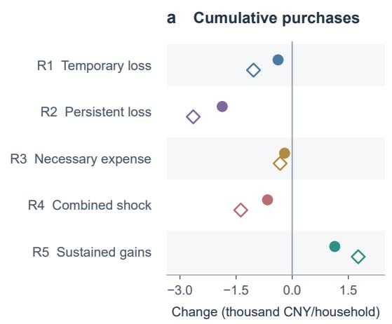

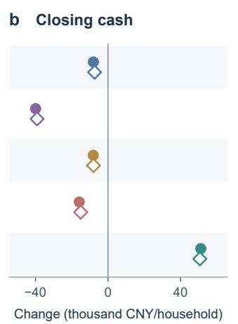

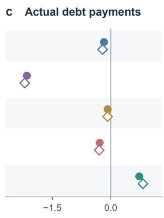  
Purchases and payments are cumulative; cash is the closing stock. Each goal uses its own unshocked reference.

Figure 11 | Household adjustments relative to the unshocked path. Each point subtracts the same-goal R0 mean from a shock-route mean at month 24 for the same 10,000 households. Filled circles and open diamonds denote the CNY 20k and 30k purchase goals. a, Cumulative purchases. b, Closing cash. c, Cumulative actual debt payments. Amounts are thousand CNY per household. The two symbols distinguish goal conditions; Table 9 gives their values. Figure 13 separately compares the goals within each route.

Table 9 | Five shocks relative to the same-goal unshocked reference
<table><tr><td>Route</td><td>Purchase change</td><td>Cash change</td><td>Actual-payment change</td></tr><tr><td>R1: temporary income loss</td><td>-377 / -1,033</td><td>-8,053 / -7,369</td><td>-176 /-211</td></tr><tr><td>R2: persistent income loss</td><td>-1,870 / -2,644</td><td>-39,894 / -39,119</td><td>-2,156 / -2,213</td></tr><tr><td>R3: necessary expense</td><td>-203 / -322</td><td>-8,111 / -8,009</td><td>-82 / -83</td></tr><tr><td>R4: combined shock</td><td>-659 / -1,374</td><td>-15,855 / -15,045</td><td>-287 / -298</td></tr><tr><td>R5: sustained income gains</td><td>+1,138 /+1,765</td><td>+51,191 / +50,665</td><td>+730/+825</td></tr></table>

CNY per household, shock minus R0 at month 24. Each cell gives 20k / 30k goal values for the same 10,000 households. Purchases and actual debt payments are cumulative; cash is the closing stock. Figure 10 defines the routes. Tables S34–S35 retain goal contrasts and financial levels.

Average reserves coexist with liquidity exhaustion. Under persistent income loss, the month-24 zero-cash share reaches 17.60%/18.28%, compared with 7.54%/7.74% in R0. Actual cumulative debt payments fall by CNY 2,155.95/2,212.99 relative to R0; under sustained income gains they rise by 729.93/825.50.

## 6.6. How resource paths reshape the CNY 20k–30k gap

Shock efects compare each route with R0 at a fixed purchase goal (Figure 12, left). Goal efects compare the CNY 30k and 20k goals within the same route (Figure 12, right; Figure 13). Routine consumption comprises base necessary and adjustable spending. Total consumption is routine consumption plus purchases and the additional shock expense; debt payments enter the cash budget separately. Income changes occur in months 7–9 and the additional expense in month 10.

Month 24: directions of household responses  
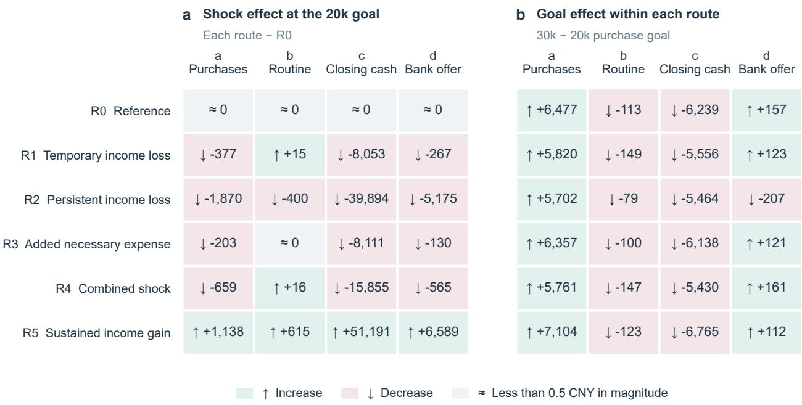  
Values: CNY/household, rounded to integers. Colour encodes direction, not effect size.  
Routine consumption excludes the added shock expense. All comparisons use the same 10,000 households.

Figure 12 | Directions of shock efects and purchase-goal efects at month 24. Left, each route minus R0 with the purchase goal fixed at CNY 20k. Right, the 30k goal minus the 20k goal within each route. Columns follow the four outcomes in Figure 13a–d: cumulative purchases, cumulative routine consumption excluding the additional shock expense, closing cash and available new-principal ofers. Cells show CNY per household, rounded to the nearest yuan. Arrows and colour encode direction. A neutral cell denotes an absolute diference below CNY 0.5. Cash is measured at month end and ofers at the month-24 decision using the preceding three completed months. All cells use the same 10,000 households.

All routes coincide in months 1–6, before the shocks are announced. The larger goal changes allocation in month 1: purchases are CNY 1,989.84/2,938.88 and adjustable spending 25.04/8.10 for the 20k/30k goals. Base necessary spending is identical, so the initial routine gap of 16.94 comes entirely from adjustable spending. By month 6, monthly adjustable spending is 13.88/18.94: the higher-goal world’s 5.06 advantage that month narrows its cumulative routine gap, which remains negative at 37.37. The month-1 ofer gap is zero because ofers are quoted before these choices.

Cumulative purchases are higher under the 30k goal in every route and month (Figure 13a). At month 24, shocks R1–R4 lower purchases relative to the same-goal R0 reference, while R5 raises them (Figure 12, left). The slope of the cumulative goal gap is the diference in that month’s purchases, so the gap falls when the lower-goal world catches up. In month 12 under the combined shock, purchases average CNY 571.65 for the 20k goal and 288.68 for the 30k goal, reducing the cumulative gap by 282.97; the gap rises again in month 13. Completed purchases reduce the remaining, nonreplenishing goal, slowing later growth. By month 24 the purchase gap is largest under sustained income gains (CNY 7,103.53) and smaller under persistent income loss (5,702.11; Table S34).

The 30k goal produces less cumulative routine consumption in every route and month, mainly through lower adjustable spending (Figure 13b). Under persistent income loss, routine consumption falls by CNY 400.36/366.50 relative to R0 (20k/30k). Executed base necessary spending falls by 349.68 in both goals, while adjustable spending falls by 50.68/16.83. The larger fall in the lower-goal world narrows the goal gap from 112.77 in R0 to 78.91 in R2, even as both routineconsumption levels fall.

After the one-time necessary expense, cumulative routine spending at month 24 is virtually unchanged under the 20k goal and CNY 12.27 higher under the 30k goal than in R0; the goal gap narrows to 100.50. The temporary and combined shocks change routine spending by +15.25/ 21.24 and +16.01/ 18.57 for the two goals. These households maintain routine spending while reducing purchases and cash reserves.

Sustained income gains increase routine consumption by CNY 615.15/604.92 relative to R0, while increasing purchases by 1,137.62/1,764.62. The lower-goal world retains 10.24 more of the routine-spending increase, widening the negative goal gap to 123.00. Under R5 the 30k goal thus produces 7,103.53 more purchases and 123.00 less routine consumption than the 20k goal. The green income-gain curve crosses below the gold expense curve in month 18, when their monthly adjustable-spending gaps are 18.30 and 3.49. Their cumulative routine gaps reach 95.33 and 84.72 that month (Table S49).

Equal opening cash and income across the two goals imply $\begin{array} { r } { \Delta K _ { t } = \sum _ { m < t } ( \Delta B _ { m } - \Delta C _ { m } - \Delta P _ { m } ) } \end{array}$ , where B is new principal received, C executed consumption and P actual debt payments. Sustained income gains raise closing cash relative to the same-goal unshocked world by CNY 51,190.89/50,665.33 (20k/30k). They also make the goal diference more negative: 6, 764.79 versus 6, 239.23 in R0. Relative to R0, the higher-goal contrast adds 616.76 in consumption and 95.57 in debt payments, with only 186.78 more credit inflow; the balance is 525.56 more cash drawdown. In R4, the month-12 purchase catch-up in the lower-goal world temporarily narrows the cash gap by CNY 206.28, producing the upward cash bend in Figure 13c.

## Monthly target responses across shock routes

30k − 20k CNY purchase target · identical financing policy · 10,000 matched households

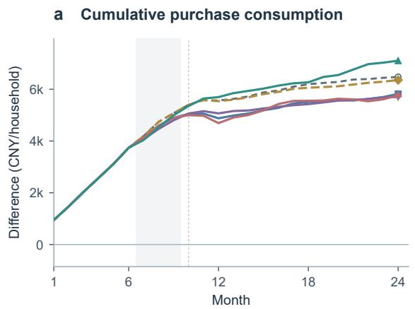

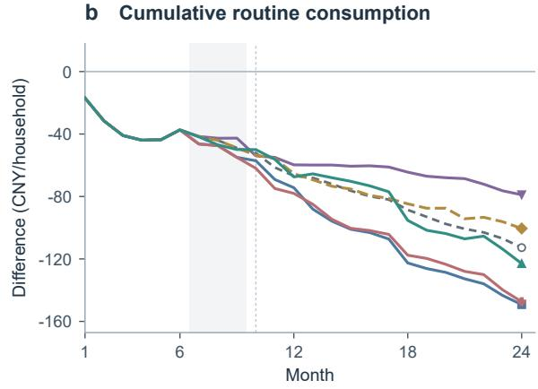

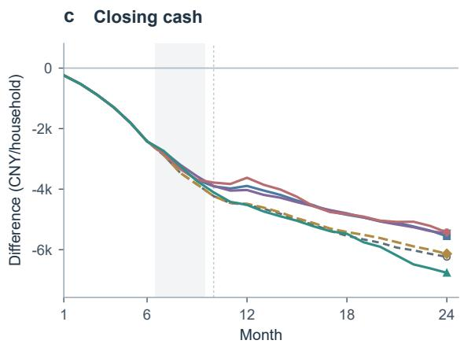

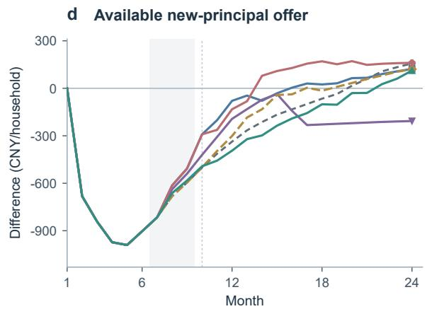  
Shading: months 7–9 income sequence. Dashed vertical line: month-10 essential-expense event.

Figure 13 | Resource paths reshape the response to a larger purchase goal. Every curve is a within-route purchase-goal contrast, $\Delta X = X _ { 3 0 k } - X _ { 2 0 k }$ , averaged over the same 10,000 households. a, Cumulative optional purchases. b, Cumulative routine spending: necessary spending excluding the additional shock expense, plus adjustable spending. c, Closing cash. d, Available new-principal ofers. Shading marks the income changes in months 7–9; the dashed line marks the month-10 expense. R0 is unshocked; R1–R5 follow Figure 10. Table S34 reports total consumption including the additional necessary expense.

Bank ofers combine individual afordability with a portfolio multiplier (Figure 13d). The ofer contrast starts at zero; financing the larger goal then uses more principal headroom and adds installments, reducing subsequent individual capacity. The rule is $g = \operatorname* { m i n } ( 1 , \operatorname* { m a x } ( 0 . 2 5 , 1 - 0 . 5 ( 1 - c ) - 2 d ) )$ , where c is repayment coverage and d the thirty-day-arrears share over the preceding three completed months. The assigned 0.25 floor caps the portfolio-wide reduction at 75% of individually afordable principal. For example, CNY 20,000 of individual capacity becomes a CNY 5,000 ofer at the floor; a household frozen by recent arrears still receives zero. Existing contracts retain their dated terms. A one-percentage-point fall in coverage reduces the multiplier by 0.005, while a one-point rise in the arrears share reduces it by 0.02, until the floor binds.

Persistent income loss is the only route in which the portfolio factor reaches 0.25. Income remains at 72.9% of its original level from month 9, while contractual payments continue and unpaid amounts enter later payable obligations. Repayment coverage falls from 49.97%/52.27% in the month-12 ofer window to 16.92%/18.10% in month 24. Coverage is higher in the 30k world within each window, while deteriorating over time in both worlds. Between months 12 and 15, the ofer gap narrows from CNY 193.12 to 36.13, while ofers fall from 6,081.26/5,888.14 to 3,475.76/3,439.63. The negative individual-capacity contribution shrinks from 515.37 to 273.29, outweighing a fall in the positive factor contribution from 322.24 to 237.28 (Table S50).

In R2, the ofer gap falls in months 16–17 as the two goal conditions reach the floor at diferent times. Their factors are 0.2737/0.2931 in month 15, 0.25/0.2580 in month 16 and 0.25/0.25 from month 17. The larger goal’s positive factor contribution falls from CNY 237.28 to 98.13 and then zero. The ofer gap falls from 36.13 to 142.40 and 232.43, even as the individual-capacity penalty becomes smaller. Once both factors equal 0.25, the remaining negative gap mainly reflects the higher goal’s outstanding principal and scheduled payments; amortization gradually releases principal headroom, easing the gap to 206.78 by month 24 (Table S50).

The other curves turn positive when a higher portfolio factor outweighs the larger goal’s lower individual capacity. This occurs first in R4 at month 14, then R1 at 16, R3 at 17 with a brief reversal at 18, R0 at 20 and R5 at 22. In R4 at month 14, repayment coverage is 45.21%/47.33% and the thirty-day-arrears share 15.69%/14.72%, producing factors of 0.4122/0.4423. The higher-goal world has 17,522 active borrower-months and 2,579 in thirty-day arrears, compared with 16,574 and 2,601 under the lower goal. Better coverage and the larger active-borrower denominator raise the factor enough to add CNY 533.71 to the ofer gap, outweighing a 454.67 individual-capacity penalty. Rolling windows also delay the response: month-12 income capacity uses months 9–11, temporary-loss income fully leaves that window in month 13, and the month-10 expense leaves the portfolio window in month 14 (M11; Table S50).

The CNY 50,000–100,000 annual-income group accounts for 52.35%/52.95% of the persistent-loss increase in repaymentand-arrears pressure relative to R0. In the opening-debt partition, households owing more than CNY 10,000 and up to 100,000 contribute 72.09%/69.70% of the persistent-loss path’s pressure while comprising 36.59% of the panel (Table S48).

## 7. Discussion and future work

In S2-MAS, personas provide decision information and household states, tasks specify alternatives and consequences, and policy adapters let diferent models use the same accounting rules. The applications cover task families, a population-scale paired comparison and repeated monthly choices.

## Purchase choices and financial channels

The household results distinguish the decision to purchase from the resources used to carry that purchase through time. Age and income organize diferent purchase responses. Education, employment and household size retain distinct responses under a common age–income mixture, largely through transitions from deferral to purchase. Assets and existing debt then distinguish cash drawdown, actual payments and the obligation remaining at the horizon. Standardizing the profile mixture reverses the ordering of the illustrated asset groups’ consumption increments while preserving diferences in cash use and payments. The high-debt group carries much of its added consumption as closing debt. Risk preference and housing tenure add less variation in this application.

The age profile also identifies a boundary of the current FinL-mlx policy and purchase menu. All 2,364,307 households with decision makers aged 65 or above selected deferral in both conditions, comprising 19.70% of the panel and contributing zero to its consumption increment. Income standardization retains this behavior. Its correspondence to observed lifecycle demand remains untested.

## Resource paths and monthly financing conditions

The monthly extension separates resource adjustment from sensitivity to the purchase goal. Persistent income loss removes more cash than a temporary loss plus one expense because the loss continues longer. Sustained gains support purchases and larger reserve accumulation, while insuficient bufers leave some households with exhausted liquidity. These resource paths narrow or widen the consumption diference between purchase goals under common financing rules.

Under the assigned accounting order, purchases and routine spending use resources before dated debt is serviced. Realized payments, arrears and contracts enter the next household observation, and the common bank rule converts recent repayment histories into subsequent ofers. The simulated paths reflect both FinL-mlx choices and these financial rules. Financial diaries, contract schedules and bank-ofer histories would provide targets for estimating the behavioral and institutional responses represented by those rules.

## Trainable policies and framework extension

FinQ and FinL demonstrate two trainable policy routes within the shared interface. FinQ uses LoRA and a decision head on Qwen3.5-4B-Base; FinL uses full-data encoder adaptation and is deployed through FinL-mlx in the completed financial applications. The matched controls show the value of LoRA over head-only adaptation and of supervised adaptation for native

Laya; the evaluated 4B and 9B routes reach similar accuracy. Full-data FinL-mlx exceeds GLM-5.3-Flash in accuracy and question-macro F1 on the common financial questions. Task-level financial responses also vary by model and input language (Appendix S11).

Controlled Genese benchmarks time decision execution and writeback; the large applications measure policy-to-ledger workloads. The monthly application adds state histories and a synchronization point for aggregate bank feedback. Further applications could add asset repricing through changes in holding values and liquidation proceeds, and represent employment transitions and transfers as additional resource channels.

## 8. Conclusion

S2-MAS combines household personas, trainable decision policies and financial state updates. FinQ and FinL provide two training routes; completed FinL-mlx applications cover eight task families, a twelve-million-household paired one-shot experiment and a 24-month panel under five shock paths and an unshocked reference. Purchase responses difer across household groups, largely through transitions from deferral to purchase. Cash drawdown, repayments and closing debt show how households fund those purchases. In the monthly panel, income losses narrow the consumption gap between purchase goals and sustained gains widen it, while repayment histories update subsequent ofers.

## Data and code availability

FinQ and FinL are the principal decision policies; FinL-mlx provides the full FinL checkpoint in MLX format. Model weights and cards are available at https://huggingface.co/ya9919/FinQ, https://huggingface.co/ya9919/FinL and https://huggingface.co/ya9919/FinL-mlx.

Scientific reproduction code and reported non-identifying aggregates accompany the project repository. The model catalog identifies the ten trained release versions and additional checkpoints and runtime formats. Project model releases use noncommercial research terms prohibiting redistribution and reverse engineering. Survey-derived decision QA, study-cohort records and individual trajectories remain under restricted access.

A companion resource contains 2M independently constructed financial household personas and 32,000 unlabelled task inputs from 2,000 households, eight authored task families and two conditions. Its resource entry provides generation code, schema, component terms and the data-archive entry. A separate CC0 Wikidata component contains 38 entities and 66 relations. These companion records are separate from the populations used in model training and reported simulation. The public scientific code provides aggregate figure reproduction, decision-model training and evaluation interfaces, and independent companion generation. The GENESE/MAS engine implementation remains private.

## References

[1] MatrAIx: Simulating the World with 8.3 Billion Persona Agents. 2026. arXiv:2608.04205.

[2] Real-survey aggregate reference.

[3] LeonaDavinci. 2026. Laya: Open-source System One decision models. Oficial model and training documentation.

[4] Victor Hugo Panisa. 2026. Von 1.3: An Open-Source System One Decision Model. Oficial model card.

[5] Jared Palmer. 2026. Kev: System One decision models. Oficial model and training documentation.

[6] Manjunath Janardhan. 2026. OpenDecider. Oficial model and training documentation.

[7] Fastino Labs. 2026. GLiNER2.5-Decide. Oficial model card.

[8] Liquid AI. 2026. d1-omni-600M. Oficial model card.

[9] Cloudflare. 2026. Introducing Clef: our open-source decision models, and new RL fine-tuning platform.

[10] Bespoke Labs. 2026. Bespoke Nimble. Oficial model, data and recipe documentation.

[11] Together AI. 2026. tev1-4B-experimental. Oficial model and training documentation.

[12] TypeSafe. 2026. System One / Jev. Oficial API documentation.

[13] Shijie Wu et al. 2023. BloombergGPT: A Large Language Model for Finance. arXiv:2303.17564.

[14] Qianqian Xie et al. 2023. PIXIU: A Comprehensive Benchmark, Instruction Dataset and Large Language Model for Finance. NeurIPS 2023, Datasets and Benchmarks.

[15] AI4Finance Foundation. FinGPT: Open-Source Financial Large Language Models. Oficial instruction-tuning dataset documentation.

[16] Zhiyu Chen et al. 2021. FinQA: A Dataset of Numerical Reasoning over Financial Data. EMNLP 2021.

[17] Lei Wang et al. 2025. YuLan-OneSim: Towards the Next Generation of Social Simulator with Large Language Models. arXiv:2505.07581.

[18] OASIS: Open Agent Social Interaction Simulations with One Million Agents. 2024. arXiv:2411.11581.

[19] A Parallelized Framework for Simulating Large-Scale LLM Agents with Realistic Environments and Interactions. 2025. ACL Industry Track.

[20] Joon Sung Park et al. 2023. Generative Agents: Interactive Simulacra of Human Behavior. arXiv:2304.03442.

[21] MiroFish. Oficial project documentation.

[22] TwinMarket: A Scalable Behavioral and Social Simulation for Financial Markets. 2025. arXiv:2502.01506.

[23] Christopher D. Carroll. 1997. Bufer-Stock Saving and the Life Cycle/Permanent Income Hypothesis. Quarterly Journal of Economics, 112(1):1–55.

[24] Raj Chetty and Adam Szeidl. 2007. Consumption Commitments and Risk Preferences. Quarterly Journal of Economics, 122(2):831–877.

[25] People’s Bank of China. 2022. Financial Institutions Loan Allocation Statistics, Quarter One 2022. Oficial report reproduced by the State Council.

[26] Lisa P. Argyle et al. 2023. Out of One, Many: Using Language Models to Simulate Human Samples. Political Analysis, 31(3):337–351.

[27] Joon Sung Park et al. 2026. LLM Agents Grounded in Self-Reports Enable General-Purpose Simulation of Individuals. arXiv:2411.10109v3.

[28] hravi. 2026. Laya-Finance. Oficial model card.

[29] Dimitris Dais. 2026. Language Aware Decisions for Banking. Oficial model and training documentation.

[30] Chris Wheat and George Eckerd. 2022. The Purchasing Power of Household Incomes from 2019 to 2022. JPMorgan Chase Institute.

[31] JPMorgan Chase Institute. 2017. Paying Out-of-Pocket: The Healthcare Spending of 2 Million U.S. Families.

[32] Greg Kaplan, Benjamin Moll and Giovanni L. Violante. 2018. Monetary Policy According to HANK. American Economic Review, 108(3):697–743.

[33] shanaka95. 2026. Laya-Fintiment. Oficial financial sentiment model card.

[34] GoatHerder. 2026. Ariadne-Laya-FinanceTopics. Oficial financial topic model card.

[35] Zexiao Wang et al. 2026. Chinese-Jev: Bringing System One Model to Chinese-Language Tasks. arXiv:2609.36965.

[36] Diogo Almeida / TypeSafe. 2026. Introducing System One Models & Jev. Oficial model and RLCD introduction.

[37] Laya maintainers. 2026. Typed-decision training objectives: soft cross-entropy and RLCD. Oficial training implementation.

[38] Jared Palmer. 2026. Kev-4B model card: architecture, training data and procedure.

[39] Hu, E. J. et al. 2021. LoRA: Low-Rank Adaptation of Large Language Models. arXiv:2106.09685.

[40] Gneiting, T. and Raftery, A. E. 2007. Strictly Proper Scoring Rules, Prediction, and Estimation. Journal of the American Statistical Association 102(477), 359–378.

[41] Z.AI. 2026. GLM-5.3-Flash/FlashX. Oficial model and text-output API documentation.

Supplementary Methods M1. Financial observations and split construction

Inputs and evaluations use English by default; Chinese and bilingual settings are labelled explicitly.

Real-survey data provide 4,172,421 underlying QA observations with aligned Chinese and English views. The corpus contains 1,211 question or task versions and 142,647 operational household/respondent groups. Repeated questions and both languages remain together within an operational group; changing identifiers remain separate unless an established identity bridge is available.

Supervision combines recorded questionnaire answers and targets formed from observed financial, occupation and education categories. Cleaning preserves question wording, complete alternatives, monetary units and the distinction between missing values and zero. Targetrelated fields are removed from each input as specified below.

Table S1 | Grouped bilingual supervision
<table><tr><td>Partition</td><td>QA observations per language</td></tr><tr><td>Training</td><td>2,925,263</td></tr><tr><td>Development</td><td>412,873</td></tr><tr><td>Calibration</td><td>415,688</td></tr><tr><td>Test</td><td>418,597</td></tr><tr><td>Total</td><td>4,172,421</td></tr></table>

bilingual views represent the same underlying observations.

Translation uses Grok 4.7 and GPT-6 Luna across preparation, with glossary review and static translations. Amounts, rates, units, negation and option meanings remain aligned. Input profiles contain 27 harmonized dimensions; the population bank uses 36 coded fields, while persona-text evaluation uses 44 processed reference fields.

Income tasks remove income inputs; spending tasks remove total and component expenditure; debt tasks remove amount and type. Housing, occupation and education tasks similarly exclude target-related fields. Missing, skipped, refused and undefined targets are excluded, while questionnaire-defined do-not-know alternatives remain eligible. Development chooses checkpoints; a separate calibration partition fits probability temperatures. The financial task rules define conditions and execution independently of these observed-answer targets.

## Supplementary Methods M2. Population construction and economic structure

## Constructed household records

The population resource contains 500 million constructed household financial decision-maker records in 50 Parquet shards of 10 million rows. Real-survey data inform a common household representation. Financial attributes are sampled jointly conditional on age, household income and total spending, while eligibility constraints maintain coherent category combinations. Unknown categories remain explicit.

The 500M expansion calibrates household size in five bins from one person to five or more, together with selected debt, homeownership and financial-asset margins; rural debt retains its sampled distribution. It also refines upper monetary categories. The 10M consumer bank uses its specified 36-field representation and five income, spending and asset brackets. Population operations use numeric codes; the policy receives decoded text.

Supplementary Methods M3 defines the descriptive bank and the 12M execution cohort.

## Economic structure and cohort preservation

PCA evaluates standardized ordinal attributes in the completed constructed records. In the 10M bank, 7,227,206 rows have all 14 fields known. The analysis forms their correlation matrix, extracts its eigenvectors and orients PC1 toward positive total spending. PC1 explains 32.8904% of variance and PC2 11.5234%.

The separate 500M resource has approximately 4.626 million complete records per shard for the same analysis. Its shard-mean PC1 explains 32.62% of variance, with across-shard loading standard deviations at most 0.0003 (Table S15). The independent companion contains 2M separately constructed synthetic personas with assigned household and financial states. Figure S1 summarizes its full distributions. Figure S4 applies PCA to household size and seven financial variables after log transformation of CNY amounts and standardization. All 2M records are complete for these variables; PC1 and PC2 explain 45.6450% and 18.0043% of variance. The companion’s schema and generation code accompany the resource entry.

## Composition of the synthetic persona companion

2,000,000 households · complete-population descriptive statistics

a Household size  
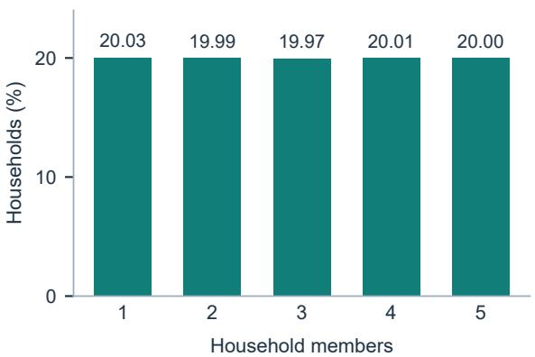  
c Cash buffer

b Monthly income  
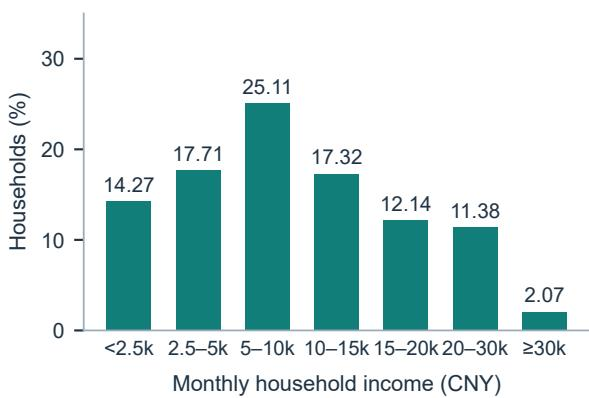  
d Debt exposure

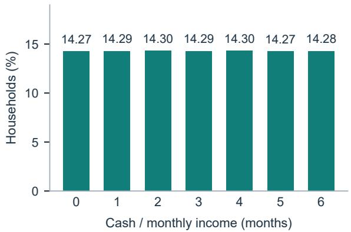

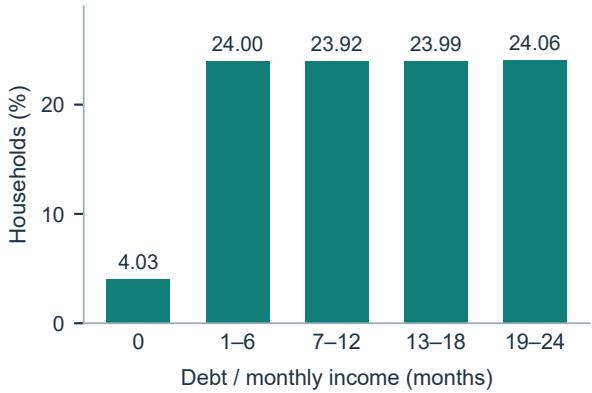  
Counts describe the independently constructed companion; all financial amounts are assigned states.

Supplementary Figure S1 | Composition of the independent synthetic persona companion. All 2,000,000 constructed households contribute to each distribution. a, Assigned household size. b, Monthly household income in CNY; k denotes thousands, and finite income intervals include their lower endpoint and exclude their upper endpoint. c, Opening cash divided by monthly income. d, Opening debt principal divided by monthly income. Heights and labels give the percentage of households; the ratio panels group the assigned integer income multiples. The companion provides reusable scenario inputs, separate from the 12M purchase-funding execution cohort and its monthly follow-up.

The 500M resource supports population construction; the 10M bank supports descriptive analysis of the representation; the separate 12M cohort executes the purchase-funding application. The monthly extension uses a separate matched panel with full histories and explicit shock paths (M11).

## Supplementary Methods M3. Experimental-bank sampling and descriptive checks

The 10M consumer bank contains constructed, survey-derived records. Its delivered selection retains the first 10,000,000 distinct eligible rows in shard order from the documented 100M parent; eligible records have known financial assets, debt amount and type, investment activity and trust.

The 14-field PCA uses complete cases from the delivered 10M bank; loading and completeness summaries appear in Tables S17–S18.

For the 12M purchase-funding application, two staged shards contain 20M distinct constructed records from the 500M resource. Seed 20261018, finite-pool inclusion caps and randomized cell-count rounding select whole rows without replacement before inference; uniform row draws operate within the selected cells. The 12M panel retains each selected profile, including 2,818,405 households with assigned baseline deficits and 543,327 with debt above CNY 500,000. The 35,000-household pilot is a nested subset whose completed choices are retained in the full run. Equal household weights define the reported fixed-panel means. The separate monthly panel is retained across all shock paths and goals (M11).

## Supplementary Methods M4. Full prediction and respondent-information results

FinL receives a household description, question and named alternatives through Laya’s existing option-scoring interface. We evaluate 3- round, 6-round and bilingual variants against their corresponding Laya bases. Laya uses ModernBERT-large with 421M parameters; the multilingual base uses mmBERT with 322M [3]. Native PyTorch and MLX implementations support training and deployment.

The serialized input places the question and candidate descriptions before the respondent state, with a marker for each candidate. The encoder and choice head score those markers; inference returns the semantic option with the highest calibrated probability. SFT and native

Laya RLCD adapt the model to observed answers or coded household targets. The reused RLCD objective adds a normalized-advantage policy-gradient term over Gaussian-perturbed option logits to soft cross-entropy; the perturbations are scored against target distributions by proper rewards [37].

The primary comparison uses 240,458 shared financial-question test records and 119 question versions in PyTorch BF16. Accuracy pools correct choices across records. Question-macro F1 averages candidate-class F1 within each question version and then weights versions equally; classes with zero denominators receive zero (Figure 5).

Figure 5 reports the shared-question native and bilingual predictions. On the expanded-supervision test, native question-macro F1 rises from 19.2395% for FinL 3-round to 27.8355% for FinL 6-round. Appendix S3 reports the shared- and expanded-test results in MLX.

A training-question majority baseline predicts each question’s most frequent observed training answer. On all 240,458 shared test records, it obtains 71.7710% accuracy and 32.1688% question-macro F1. FinL 6-round in MLX obtains 74.5544% and 38.3746%, gains of 2.7834 and 6.2058 percentage points.

Matched information controls use 20,000 held-out QA drawn proportionally within all 119 question versions, with at least one record per version and seed 20261014. Empty-profile requests remove only the respondent state. Wrong-profile requests use another held-out respondent’s profile for the same question; questions, candidate meanings and gold answers remain fixed. Accuracy weights question versions by their full-test frequencies; F1 retains equal weighting of versions. Table 3 reports all five conditions.

Intervals in Figure 6 use 2,000 paired bootstrap draws over the 6,752 household/respondent groups in this panel. The corresponding accuracy gains for full versus empty and wrong profiles are 3.2058 points (95% interval 2.7336–3.6138) and 4.8406 points (4.3626–5.3266).

The registry defines three financial families: financial knowledge, risk and investment attitudes, and financial-product, saving and credit behavior. Full-profile versus empty-profile F1 is 30.0124% versus 18.1357% for financial knowledge, 28.1147% versus 20.2383% for risk and investment, and 50.6979% versus 45.6257% for saving and credit products (Figure 6). The panel contains 14,243 QA across 74 versions in these families. Table S22 reports the remaining registry domains.

On the complete shared test, FinL exceeds the training-majority F1 in 80 of 119 question versions, falls below it in two and ties in 37. The equal-version gain is 6.2058 percentage points (95% interval 5.8711–6.4951); weighting those same version-level F1 scores by test frequency gives 7.4109 points (7.2111–7.6073). The two versions with fewer than 30 responses contain 22 QA and contribute -0.2489 points to the overall equal-version gain. Financial-knowledge, risk-attitude and saving/credit families each improve over majority (Table S2).

Table S2 | Complete financial-family gains over training majority
<table><tr><td>Financial family</td><td>Test QA</td><td>Question versions</td><td>Macro-F1 gain, pp</td><td>95% confidence interval</td></tr><tr><td>Financial knowledge</td><td>29,198</td><td>11</td><td>12.40</td><td>11.51 to 13.28</td></tr><tr><td>Financial products, saving and credit</td><td>124,129</td><td>56</td><td>4.79</td><td>4.25 to 5.32</td></tr><tr><td>Risk and investment attitudes</td><td>17,923</td><td>7</td><td>7.79</td><td>7.36 to 8.18</td></tr></table>

All 119 versions remain in the primary shared 240,458-QA comparison. Intervals use 1,000 joint resamples of 8,275 linked household/respondent groups. Equal-version and sample-weighted results accompany the complete version-level data.

## Supplementary Methods M5. External decision-model comparison

Decision models, including GLM-5.3-Flash, receive the same financial-test questions, respondent states and semantic alternatives. Oficial model adapters map their returned choices back to the original candidate IDs. Table 4 reports all models, backends, valid-decision counts and scores. Paired diferences use 1,000 whole-group bootstrap resamples across 8,275 household/respondent groups, carrying all question records from a selected group together. GLM’s 98 invalid responses remain in the full denominator. Table 2 gives the controlled BF16 adaptations, and Figure 5 gives the native full-data predictions.

QA caps are 512 input and 256 head tokens for Fin/base MLX, 512/192 for Laya-Finance, and 2,048 input tokens for OpenDecider. Decoder adapters preserve their released longer windows. CPU replay of the evaluated MLX input preparation finds no profile truncation on the full test or any matched information-control condition; full-profile inputs average 159.75 tokens and reach at most 230. The supplementary training procedure specifies the separate complete-context budgets used for financial deployment.

FinL 6-round has the highest answer accuracy in the complete comparison. Clef Flash 9B obtains 38.5193% question-macro F1 versus FinL’s 38.3746%. The paired FinL-minus-Clef diference is -0.1447 F1 points (95% interval -0.6208 to 0.4380), alongside a 10.9054-point accuracy gain (10.6636–11.1576). The external Laya-Finance checkpoint obtains 59.8317% accuracy and 28.7871% F1; FinL’s paired gains are 14.7227 points (14.5391–14.9281) and 9.5874 points (9.2879–9.8604).

## Supplementary Methods M6. Training procedure and continuation variability

The training sequence is original-base → sft-1 → sft-2 → rlcd-1 → sft-3 → rlcd-2. Two SFT stages and one RLCD stage on financial questions produce the 3-round model from 1,721,623 training observations per language. The continuation for FinL 6-round adds expanded financial supervision through one SFT epoch and one native RLCD epoch over all 2,925,263 training examples, using BF16 on six A100 GPUs. The continuation updates encoder and choice-head parameters. FinL-bilingual uses two SFT stages and one RLCD stage on initialsupervision material. Household or respondent groups and their language copies stay together within each split.

Two independent full continuation replicas repeat the 6-round recipe from the same completed 3-round initialization, each with one SFT pass and one RLCD pass over 2,925,263 training QA. All three runs use stage-specific calibration temperatures and evaluate the same 119-version, 240,458-QA financial-question test with RLCD fixed as the final stage.

Across the three native BF16 RLCD runs, accuracy averaged 74.5647% with sample standard deviation 0.0067 percentage points and range 74.5586–74.5719%. Question-macro F1 averaged 38.3277% with sample standard deviation 0.1254 points and range 38.1829–38.4016% (Table S3). These repeats quantify continuation variability conditional on the common initialization, survey preparation and splits; the respondent bootstrap quantifies sample variation for a fixed checkpoint. The direct decision comparison in Table 4 evaluates the 6-round rlcd-2 checkpoint in MLX CUDA FP16 on the same shared test.

On the expanded 418,597-record test, FinL 6-round obtains 67.2726% accuracy and 27.8955% F1 in MLX, and 67.2728% and 27.8355% natively. The paired MLX shared-QA gain over base is 14.3713 percentage points, with a stratified household/respondent bootstrap 95% interval of 14.1686–14.5719. Supplementary Figure S2 provides deployment and expanded-scope results.

Table S3 | Continuation for FinL 6-round: seed variability
<table><tr><td>Training run</td><td>SFT / RLCD seed</td><td>SFT Accuracy / F1 (%)</td><td>RLCD Accuracy / F1 (%)</td></tr><tr><td>Reference</td><td>202610120/202610121</td><td>74.5315 / 37.8775</td><td>74.5586 / 38.3986</td></tr><tr><td>Replica 1</td><td>202610140/202610141</td><td>74.5519 / 37.9777</td><td>74.5635 / 38.4016</td></tr><tr><td>Replica 2</td><td>202610150/202610151</td><td>74.5739 / 37.8331</td><td>74.5719 / 38.1829</td></tr></table>

Both stages evaluate the identical 240,458 shared QA and 119 versions. Accuracy weights QA records; F1 is the equally weighted mean of per-version candidate-macro F1.

## Supplementary Methods M7. Persona rendering and judge evaluation

Six human raters evaluate 100 processed survey-derived personas against the same 44 processed fields. Five dimensions assess accuracy (M1), avoidance of unsupported inference (M2), coverage (M3), internal consistency (M4) and overall fidelity (M5). The 3,000 scores average 4.570/5; 87.8% are 4 or 5. Coverage averages 4.985, with 591 of 600 ratings equal to 5. Nine predefined targets cover income, consumption, debt, budget status, risk preference, financial assets, insurance and income source (Figure 4; Table S4).

Accuracy and consistency average 4.685 and 4.670; avoidance of unsupported inference and overall fidelity average 4.285 and 4.225. DeepSeek Flash and GLM Flash each score within one point of the six-rater mean on 94.0% of 500 persona-dimension comparisons. Relative to the human mean, AI scores are higher for avoidance of unsupported inference (M2, +0.705 and +0.715 points) and overall fidelity (M5, +0.775 points for both judges). Reevaluation with DeepSeek V4 Pro and GLM 5.3 gives 94.3% on 98 valid personas and 94.0% on 100, respectively. Supplementary Figure S3 gives the full human-score distributions.

Perturbed personas test changed facts, unsupported additions, missing targets and contradictions. GLM lowers the intended score on 95.8–100% of valid pairs. DeepSeek’s response ranges from 8.3% for omissions to 76.0% for contradictions. For omitted targets, GLM lowers the intended score in all 24 valid pairs, whereas DeepSeek does so in 2 of 24. Scoring proximity and known-error sensitivity therefore measure diferent properties of these judges (Appendix Table S16). These evaluations assess reconstruction of processed survey fields.

Appendix S9 reports a separate DeepSeek financial-workflow study, comparing single-pass choice, self-check and multi-agent execution on constraint and goal adherence.

Table S4 | Construction-quality and judge comparison design
<table><tr><td>Evaluation</td><td>Reference</td><td>Raters / judges</td><td>Scoring units</td><td>Main result</td></tr><tr><td>Human construction qual- ity</td><td>100 processed survey- derived personas; 44 processed fields</td><td>Six human raters</td><td>3,000 dimension scores</td><td>4.570 /5</td></tr><tr><td>Coverage, M3</td><td>Nine predefined financial targets</td><td>Six human raters</td><td>600 scores</td><td>4.985 / 5; 591 scores of 5</td></tr><tr><td>Human-AI proximity</td><td>AI score vs six-rater mean Same processed-field co-</td><td>DeepSeek / GLM</td><td>500 comparisons per judge</td><td>94.0% / 94.0% within one</td></tr><tr><td>Pro human-AI proximity</td><td>hort</td><td>DeepSeek V4 Pro / GLM 5.3</td><td>98 / 100 valid personas</td><td>94.3% / 94.0%within one</td></tr></table>

Within-one agreement compares each AI score with the six-human mean for the same persona and dimension. Known-error pairs and judge-specific valid denominators appear in Table S16.

## Supplementary Methods M8. State ownership and execution paths

The shared contract passes a household state, a question and named alternatives to a policy adapter, which returns an option ID and available probabilities. The execution layer retains the state to which that choice applies. Figure 2 describes the Genese state-transition architecture.

In the controlled Genese benchmarks, World owns authoritative state and Brain requests bounded decision partitions through pooled model connections. World validates the returned intents and applies registered efects. Numeric components use indexed NumPy arrays, Boolean activity masks and registered systems; a structural-command bufer defers entity changes to the transition boundary. The timed local adapter stores state, events and command results in a SQLite WAL transaction on memory-backed storage.

The static-task and monthly-decision runners call the policy service through bounded asynchronous requests and advance the assigned financial ledger. Monthly episodes retain cash, dated contracts and arrears, then form the next observation from updated state. The existing MAS scheduler overlaps input preparation, inference and accounting across independent episodes, with accepted responses and monthly continuation states indexed by ordinary task IDs.

Full Genese inference uses the separately supplied runtime, model service and deployment configuration. The independent synthetic fixture exercises local decision recording and accounting. The 12M deployment follows the asynchronous HTTP service and independentledger path. The production PostgreSQL/outbox transaction remains the reference architecture described in Section 4.2; local benchmark measurements use the SQLite adapter.

## Supplementary Methods M9. Execution benchmarks and measured scopes

We time fixed-input framework benchmarks, the complete 12M one-shot workload, and the monthly shock extension separately. The shock extension interval runs from the first request to the final accepted month and includes preparation, bank barriers, storage and recovery waits.

## Complete 12M execution and trace accounting

The completed purchase-funding application comprises 2,400 disjoint work units of 5,000 households. Ordinary unit IDs cover the complete allocation, with 1,548 completed units on the eight-H100 pool and 852 on the six-A100 pool. Each household completes the two frozen T3 conditions once. The same FinL checkpoint, MLX CUDA FP16, tokenizer and semantic candidates serve both pools; service batches contain at most sixteen requests, with sixty-four bounded in-flight requests per endpoint. Preparing the next work unit overlaps current inference, CPU accounting and compressed trace writes.

The common end-to-end interval starts with preparation of the first nested-pilot inputs and ends when the final work unit completes. It includes input transfer waits, subsequent preparation, tokenization, policy calls, twelve-month ledgers, trace persistence and recovery waits. Its 14,356.9775 seconds cover 24M choices and 12M paired households, giving 1,671.661 choices/s and 835.831 households/s. Actual nonpadding candidate input totals 12,719,522,472 tokens, or 885,947.092 tokens/s over the same interval. The discriminative service reports zero autoregressive output tokens. Table S33 separates this interval from batch-processing and summed forward-call wall measurements.

The private compressed traces total 67,664,771,925 bytes. They retain full model inputs and state, semantic alternatives, selected options and available probabilities, ordinary household/condition/task/attempt IDs, model and service usage, preparation/inference/save timestamps, and each twelve-month cash, debt and payment ledger. All 24M requests have recorded responses and complete-input indicators; HTTP and response-validation errors are zero. Fourteen process/status finalization retries afect eleven already complete work units. Their saved summaries are adopted with the existing choices, preserving one forward result per logical request.

Final aggregation checks complete condition counts, unique work-unit coverage and disjoint pool ownership. Per-household diferences retain both conditions. Table S32 reports exact full-panel financial means and defines the supplementary row-variation reference.

Fixed-input benchmarks hold the agent task and upstream model allocation constant; immediate-response backends measure dispatch, storage and adapter overhead.

Each timed agent produces one model choice in one round. Round time includes accepted-answer writeback; initialization is measured separately. The immediate-response matrices comprise twenty randomized interleaved measured blocks per configuration at 100 and 1,000 agents, after one warm-up. All 280 measured rounds accept and write back every requested choice.

With FinL and three T4 model replicas, the 100-agent Genese round takes 0.517 seconds, compared with 0.683 for OneSim, 1.140 for OASIS and 1.403 for MiroFish. At 1,000 agents on one T4 replica, Genese takes 6.17 seconds, OASIS 7.45 and OneSim 7.70 (Figure 7a–b). The completed 1,000-agent immediate-backend matrix gives Genese default a median of 2.788 seconds and parallel partitions 2.743. The corresponding medians are 5.818 for AgentSociety, 6.223 for OneSim, 7.386 for OASIS, 11.255 for MiroFish and 1,062.153 for the parallel MatrAIx questionnaire adapter (Figure 7d). The 1,000-agent Jev API matrix reports 5.97 seconds for Genese and 8.21 for OASIS; OneSim completes neither of its two attempted runs (Figure 7c).

At 100 agents, Genese default and parallel partitions take 0.362 and 0.360 seconds (Supplementary Figure S6). The host has two Intel Xeon Platinum 8268 processors and 96 logical threads. Framework CPU50 and proxy CPUs60–63 have nonexclusive afinities during concurrent training; the isolated comparison directory is memory-backed. Initialization is timed separately: Genese default and parallel partitions have 1,000-agent medians of 0.400 and 0.405 seconds. Observed one-minute host load spans 18.87–66.69 in the 100-agent matrix and 4.19–31.89 at 1,000 agents. The immediate-response Genese arms use the local Brain–World adapter and a SQLite WAL commit store on tmpfs, with state, outbox and result committed in one transaction. The production PostgreSQL design is described in Section 4.2.

Tables S12–S14 compare Genese’s array-based state, batched decision requests and transactional state–event design with native action constraints, saved-state continuation and request-level controls in the other frameworks. These measurements cover the local SQLite adapter and application ledgers; they exclude production crash recovery and outbox delivery.

## Single-request model deployment benchmark

The 11 October 2026 deployment benchmark uses three fixed Chinese financial-choice cases: income loss, a payment plan and loan-product choice. FinL-bilingual is the released multilingual-base adaptation, evaluated in local PyTorch and as FinL-bilingual-mlx in MLX CUDA on one NVIDIA A100 PCIe 40GB. The third local arm is its original multilingual Laya base. The hosted arm requests Jev and records the returned version jev-1.13.0. Every arm receives three warm-ups and twenty timed repetitions per case, with batch size and concurrency one. The local models use FP16; Jev’s server hardware and precision are provider-managed.

The timing interval covers input preparation, tokenization, synchronized prediction and response formatting. Jev includes its HTTPS round trip. The client does not cache responses; provider prompt caching is uncontrolled. The shared mmBERT tokenizer counts compact, sorted JSON requests without special tokens outside the timed interval. The three cases contain 218, 393 and 398 shared tokens, producing 20,180 tokens across sixty measured calls per arm. Input-token throughput is total shared tokens divided by total measured time; choice throughput is sixty divided by that time.

For income loss, payment planning and product choice respectively, FinL-bilingual-mlx reaches 26,177, 37,506 and 46,840 shared input tokens/s; Jev reaches 1,051, 1,888 and 1,944. Pooled throughputs are 36,955.47 and 1,626.63 tokens/s, a ratio of 22.72. The same-checkpoint PyTorch arm reaches 15,247.34 tokens/s, giving an MLX/PyTorch ratio of 2.42373. The MLX and PyTorch financial models agree on all 69 warm-up and timed choices, with maximum probability diference approximately 0.0006. Source aggregates contain per-case summaries, individual elapsed times and the common-token protocol.

b, Single-request deployment  
Table S5 | Financial prediction and deployment measurements  
a, Common question benchmark
<table><tr><td>Model and runtime</td><td>Accuracy (%)</td><td>Question-macro F1 (%)</td></tr><tr><td>FinL-mlx</td><td>74.5544</td><td>38.3746</td></tr><tr><td>Jev 1.13 · API</td><td>65.2584</td><td>37.4793</td></tr></table>

<table><tr><td>Model and runtime</td><td>Mean latency (ms)</td><td>Choices/s</td><td>Input tokens/s</td></tr><tr><td>FinL-bilingual · PyTorch A100</td><td>22.06</td><td>45.33</td><td>15,247</td></tr><tr><td>FinL-bilingual-mlx ·MLX CUDA A100</td><td>9.10</td><td>109.88</td><td>36,955</td></tr><tr><td>Jev 1.13· API</td><td>206.77</td><td>4.84</td><td>1,627</td></tr></table>

a, The 6-round release on 240,458 held-out QA records and 119 question versions. b, Measured 11 October 2026 using the FinL-bilingual checkpoint, three fixed Chinese inputs and sixty timed calls per arm. Local FP16 inference uses one NVIDIA A100 PCIe 40GB, batch size and concurrency one. Timings include input preparation and synchronized prediction; Jev includes the API round trip and service response. Loading is excluded. Shared input tokens use the mmBERT tokenizer on identical serialized requests. Supplementary Methods M9 gives the complete protocol.

## Supplementary Methods M10. Authored tasks, purchase funding and financial accounting

The eight task families cover income and consumption adjustment, medical funding, purchase funding, product terms, asset allocation, multiple-debt payments, restructuring and asset sale or refinancing. Each language contains 45,473 decision inputs: 22,736 complete baseline/intervention pairs and one additional T1 intervention input. Each pair retains the household while changing a designated condition. The suite uses financial-anchor income, spending, deposits, loan principal and scheduled payments, with adjustable spending assigned as 10–30% of usual spending. Table S27 defines the sampled conditions and the action-to-ledger mapping.

Bufer-stock saving motivates joint measurement of consumption and cash [23]; consumption commitments motivate harder-to-adjust and adjustable spending [24]. Household liquidity and income risk motivate comparing the response across financial states [32]. The 12M purchase-funding application assigns the following monetary amounts and contracts to constructed household records.

Monetary brackets use their midpoints; an open upper bracket uses 1.25 times its lower bound. Annual income and consumption are divided by twelve. Missing annual income is assigned CNY 72,000, consumption 80% of income, assets one income month and debt CNY 50,000. Opening liquid cash is assigned 39.1% of financial assets and essential spending 70% of total spending. Mixed old debt is split equally between housing and other debt. Housing contracts use 5.42% annual interest and 240 remaining months; other debt uses 7.68% and 36 months, with rates referenced to March 2022 newly issued household lending [25]. These assignments are common within household pairs and retain initial budget deficits

Opening debt in the 12M application is assigned from the selected 500M record’s debt-principal category. The no-debt category assigns zero; finite positive brackets assign their midpoint; the open bracket above CNY 5 million assigns CNY 6.25 million; and an unknown category assigns CNY 50,000. Debt type selects the housing or other-debt contract, with mixed housing debt split equally between the two. The two conditions share these opening amounts, scheduled payments and remaining terms.

Each household faces a deferrable purchase goal of CNY 20,000 or 30,000 and a tied approved borrowing limit equal to that goal. Both conditions permit financing. Options defer the purchase, finance half, or finance its full amount. Borrowed funds purchase the good at disbursement. The assigned contract has a 5% annual nominal rate, 24 monthly installments, no fee and its first payment in month 1. Both arms share the profile, opening cash, existing obligations and income; the goal and tied approved amount change jointly. The twelve-month ledger begins on 1 November 2026.

Income arrives before current-month spending. Routine essential and selected adjustable consumption precede dated bank payments; oldest dues are paid first and interest before principal. Integer-cent cash remains nonnegative, unmet selected spending remains a gap, and unpaid obligations stay in arrears. Default records bank dues of at least CNY 1 remaining over ninety calendar days overdue, retaining an event after cure. Exposure at first default includes outstanding principal and accrued unpaid interest. A 24-month loan can retain debt at the end of the twelve-month observation window. Table S32 reports mean total, purchase and routine consumption, cash, payments, interest, debt and risk.

## Consumption heterogeneity from the completed 12M panel

Crossing decision-maker age, annual household-income bracket, financial-asset-stock bracket and debt-principal-stock bracket defines 4,509 occupied analysis cells. For metric Y, the group contrast is $\Delta \bar { Y } _ { g } = ( 1 / n _ { g } ) \sum _ { i \in a } ( Y _ { i , 3 0 k } - Y _ { i , 2 0 k } )$ . Marginal partitions sum to all 12M households and retain unknown categories. Groups use the constructed profile fields supplied to the completed application. Tables S41–S42 report all occupied marginal groups.

For age comparisons, direct income standardization uses $\begin{array} { r } { \Delta \bar { C } _ { a } ^ { \mathrm { s t d } } = \sum _ { i = 1 } ^ { 6 } ( n _ { j } / N ) \Delta \bar { C } _ { a , j } , } \end{array}$ , where $n _ { j } / N$ is the full-panel share in income bracket j. Every age group has observations in all six brackets. The standardized contrast uses a common income mixture and retains each group’s other profile composition. Table S43 gives the raw and standardized means. Source aggregates include age-by-income and financialstock cross-tabulations. Fixed-panel means are primary; optional mean ±1.96 synthetic-row standard-error references use the saved paired sums and squared sums.

With B the cumulative new disbursement, P actual debt payments, K closing cash, D closing debt including unpaid interest, and I accrued interest, the paired cash and debt changes satisfy $\Delta K = \Delta B - \Delta C - \Delta P$ and $\Delta D = \Delta B + \Delta I - \Delta P$ . Thus $\Delta C = \Delta D - \Delta K - \Delta I .$ Each purchase is fully financed at origination, so its contrast is $\Delta B = \Delta P + \Delta D - \Delta I ;$ the routine-spending contrast is minus the change in unfunded routine needs. Integer-cent sums satisfy these identities in every occupied cell.

Financial stocks under a common household composition

For a financial-stock group g, direct standardization uses $\begin{array} { r } { \Delta \bar { Y } _ { g } ^ { \mathrm { s t d } } = \sum _ { a , j } w _ { a j } \Delta \bar { Y } _ { g , a , j } } \end{array}$ , where $w _ { a j } = n _ { a j } / N$ is the full panel’s joint age– income share. The four illustrative stock groups in Table S44 each contain all 42 age–income cells. Source aggregates give raw and standardized means for each stock category, with full-mixture estimates for categories covering all cells. Financial assets denote the initial stock bracket used in the common cash assignment; debt denotes opening principal. Standardized cash, debt and interest means retain the same funding identity as the raw contrasts.

For paired household response $d _ { i } \ = \ Y _ { i , 3 0 k } - Y _ { i , 2 0 k }$ and grouping G, the between-group variation share is $R _ { G } ^ { 2 } \ = \ \sum _ { q } n _ { g } ( \bar { d } _ { g } \ -$ $\textstyle { \bar { d } } ) ^ { 2 } / \sum _ { i } ( d _ { i } - { \bar { d } } ) ^ { 2 }$ . Saved paired sums and squared sums supply both terms. Table S45 first reports each marginal partition, then nested partitions that add financial assets or debt to the 42 age–income groups. The increment is the nested share minus the age–income share, in percentage points. Each partition includes all 12M households and unknown categories.

## Extended profile groups and purchase-choice decomposition

We reaggregated the completed result events for all 2,400 work units into 18 additional profile partitions: household size; child and oldermember indicators; employment; main income source; housing tenure; debt type; risk preference; financial literacy; investment activity; education; urban/rural residence; region; gender; marital status; income–expenditure status; general trust; and annual household spending. Ordinary unit and household IDs preserve the same-household pairing. Each partition retains all 12M households, including unknown categories. For each partition, we retained paired sums and squared sums for consumption, executed initial purchases, routine spending, closing cash, closing debt, actual payments, accrued interest and unfunded needs, together with the nine baseline-to-intervention choice counts.

The same joint age–income weights standardize each profile category. Table S47 reports full-mixture means for categories with all 42 cells. Categories missing any of the 42 reference cells have blank standardized entries in Table S47. Pairwise shared-support comparisons use the intersection of the compared categories’ occupied cells, with full-panel weights renormalized within that set. The older-member comparison uses 36 cells, with reference population 9,635,693 (80.30% of the panel); the no-older-member category has no age-65+ decision makers. Table S46 extends the nested variation calculation to all 18 attributes. These group comparisons retain the other characteristics within each profile category.

Options A, B and C defer the purchase, purchase half the goal and purchase the full goal. The baseline-to-intervention transition contributions to purchases are CNY 0, 15,000, 30,000, −10, 000, 5,000, 20,000, −20, 000, −5, 000 and 10,000 for $\mathrm { A {  } A , \mathrm { A {  } B , \mathrm { A {  } C , B {  } A } } }$ $\mathbf { B } {  } \mathbf { B } , \mathbf { B } {  } \mathbf { C } , \mathbf { C } {  } \mathbf { A } , \mathbf { C } {  } \mathbf { B }$ and C→C, respectively. Weighting these amounts by group transition frequencies exactly reconstructs the purchase response. A→B and A→C form the deferral-to-purchase channel; B→B and C→C capture amount increases under an unchanged partial- or full-purchase choice. Adding the routine-consumption response gives the total consumption response. Table S46 applies thi decomposition after the same age–income standardization.

## Supplementary Methods M11. Purchase goals, shock paths and monthly feedback

The fixed monthly panel contains 10,000 households selected to cover initial one-shot consumption responses in the 12M cohort. Groups use the twelve-month total-consumption diference, CNY 30k minus 20k: negative, zero, positive up to CNY 5,000, and above CNY 5,000. Their final counts are 420, 4,740, 5 and 4,835. A 100,000-household roster retains all 3,641 negative and five low-positive records and 48,177 financial-cell prototypes from each larger group. Prototype cells cross income quintile, cash-bufer quartile and debt-service quartile. The monthly panel retains 196 development households and selects the other 9,804 by seeded sampling without replacement through a 20,000- household staging panel, with uniform draws within its execution shards. Panel means use equal household weights and a denominator of 10,000; the response-group mixture difers from that of the 12M cohort. The same household IDs, opening states and dated obligations enter all twelve route–goal worlds; paired contrasts are averaged within this fixed panel. Only the nonreplenishing purchase goal changes, from CNY 20,000 to 30,000. Both conditions use a CNY 30,000 ceiling on outstanding new bank principal, a 5% annual nominal rate, 24 installments, no fee and a CNY 100 minimum draw. Previous contracts continue on their dated terms.

R0 keeps original income and needs throughout. R1 assigns 70% of original income in months 7–9 and restores it in month 10. R2 multiplies income by 0.9 in each of months 7, 8 and 9, then maintains 72.9% of original income through month 24. R3 adds necessary spending equal to 90% of one original month’s income in month 10. R4 combines R1 and R3. R5 multiplies income by 1.1 in each of months 7, 8 and 9, maintaining 133.1% thereafter. Three-step income paths are announced in month 7; future shocks are not revealed before their event. Amounts are rounded to cents at each step.

Every monthly observation includes the complete persona, income and resources, current shock information, all previous executed monthly records in a compact numeric table, all dated contracts with rates, installments and arrears, the current ofer and the remaining purchase goal. The monthly service uses an 8,192-token total input budget, a 1,024-token question/options allocation and up to 192 tokens per option. The action menu combines zero, half-normal or normal adjustable consumption with deferral, cash funding or partial/full financing. The ledger executes the selected feasible purchase first, then necessary and adjustable spending, then dated debt payments from remaining cash; unmet needs and arrears carry forward. A zero adjustable-spending choice leaves necessary-spending execution active. Remaining purchase need falls by executed purchases.

Individual ofer capacity uses the preceding three months’ mean income and existing scheduled debt payments. A new monthly payment budget is the positive part of half the income remaining after base necessary needs, less existing scheduled installments. The ofer is the smaller of the principal supported by that budget and the remaining product ceiling. Material thirty-day arrears in the previous three months freeze the new ofer. Each world’s portfolio factor uses its last three completed months: repayment coverage c is actual bank payments divided by payable obligations including arrears, capped at one; d is the material thirty-day-arrears share of active borrower-months. The factor is min(1, max $( 0 . 2 5 , 1 - 0 . 5 ( 1 - c ) - 2 d ) $ ), rounded to basis points. It multiplies individual ofer capacity. Initial coverage and factor equal one. These assigned simulation rules link liquidity and repayment stress to subsequent credit capacity. The 0.25 floor retains a quarter of individual capacity after the portfolio adjustment, with recent-arrears freezes applied before scaling and the CNY 100 minimum draw applied afterward. For the ofer decomposition, let $A _ { j }$ be mean individual capacity after freezes and $g _ { j }$ its world factor for goal j. The exact diference is $\Delta \bar { O } = \bar { g } \Delta A + \bar { A } \Delta g + \Delta r .$ , where bars over g and A average the two goal worlds and r contains cent rounding and the minimum-draw rule. Individual capacity is further split into capacity before the arrears freeze and capacity removed by that freeze. Table S50 reports the resulting accounting components.

All 10,000 households in a world complete a month before its aggregate feedback sets the next month’s ofers. Worlds difer only in the assigned shock path and goal; the bank rule remains common. FinL-mlx uses the same frozen checkpoint and complete-input protocol throughout. Identical complete household inputs within the same month reuse their saved response by ordinary task ID. Changed inputs receive a new choice. Exact-panel means and within-household goal diferences describe this constructed panel; Tables S34–S36 retain financial and execution summaries.

For the initial-resource group analysis, annual income equals twelve times assigned first-month income; cash and debt are opening stocks. Cash exhaustion is the first completed month ending at zero cash; default uses the ledger’s cumulative material-delinquency indicator. All opening cash balances are positive. Month-24 bank feedback uses months 21–23. For each resource partition and world w, group g contributes pressure $P _ { g , w } = 0 . 5 ( U _ { g , w } - A _ { g , w } ) / U _ { w } + 2 D _ { g , w } / B _ { w , }$ , where U denotes payable obligations, A actual payments, D material thirty-day-arrears borrower-months and B active borrower-months. Group pressures sum to the portfolio pressure before the factor is clipped. A group’s share of the persistent-loss pressure increase is $( P _ { g , R 2 } - P _ { g , R 0 } ) / ( P _ { R 2 } - P _ { R 0 } )$ . Table S48 applies these definitions to the saved R0/R2 household-month records.

## Supplementary Resources

Table S6 describes the recorded resources, aggregate evidence and reproduction interfaces. Household records, decision QA and trained project weights retain restricted access.

Table S6 | Recorded resources and reproduction interfaces
<table><tr><td>Component</td><td>Recorded scope</td><td>Interface or evidence</td></tr><tr><td>Survey-derived QA</td><td>4,172,421 underlying observations; bilingual views</td><td>Grouped partitions, target exclusion and aggre- gate evaluation</td></tr><tr><td>Training partition</td><td>2,925,263 examples per language</td><td>Restricted observed-answer and coded-state su- pervision</td></tr><tr><td>Constructed bank</td><td>10M rows; 36 coded fields</td><td>Restricted survey-derived household represen- tation</td></tr><tr><td>Financial tasks</td><td>8 rule families; 45,473 executed cases per lan- guage</td><td>Authored task rules are separable from re- stricted household-instantiated cases</td></tr><tr><td>Decision adaptations</td><td>Ten trained versions; 50k/200k budgets</td><td>Defined candidate interface, exposure counts and aggregate scores</td></tr><tr><td>Common-question benchmark</td><td>240,458 records; 119 versions</td><td>Accuracy, candidate-class macro-F1 and grouped paired intervals</td></tr><tr><td>Population application</td><td>24M choices / 12M households / 12 months</td><td>Defined ledgers, complete aggregate outcomes and restricted trajectories</td></tr><tr><td>Synthetic companion</td><td>2M independently constructed financial house- hold personas; 32,000 unlabelled inputs from</td><td>Generation code, schema, component terms and companion archive</td></tr><tr><td>Wikidata companion</td><td>2,000 households, 8 families and 2 conditions 38 entities and 66 parent/type relations</td><td>Separate CCO knowledge component</td></tr><tr><td>Synthetic task-example subset</td><td>20 generated households; 8 families; 320 inputs</td><td>Input-only illustration under CC BY 4.0, with- out model labels or ledgers</td></tr><tr><td>Five-shock extension</td><td>10,000 households; 2.88M monthly choices over 24 months</td><td>Household state and lagged bank-portfolio feedback</td></tr></table>

## Supplementary tables: related-system comparisons

Table S7 | Representative direct decision interfaces, October 2026

<table><tr><td>Model</td><td>Backbone / declared size</td><td>Decision readout</td></tr><tr><td>Laya</td><td>ModernBERT-large / 421M</td><td>Bidirectional option scoring</td></tr><tr><td>Von 1.3</td><td>ModernBERT-large / 395M</td><td>Option-marker head</td></tr><tr><td>OpenDecider Nano</td><td>Ettin encoder / ~400M</td><td>Encoder scoring</td></tr><tr><td>GLiNER2.5-Decide</td><td>DeBERTa-v3-large / 340M</td><td>Schema label scoring</td></tr><tr><td>d1-omni-600M</td><td>LFM2.5 encoder; multimodal / 587M</td><td>Shared-trunk option probabilities</td></tr><tr><td>Kev</td><td>Qwen3.5 / Qwen3.8; 0.8B–27B</td><td>Pointer decision head</td></tr><tr><td>Clef / Clef-Flash</td><td>Qwen3.8-27B / Qwen3.5-9B</td><td>Decision head; option probabilities</td></tr><tr><td>Nimble</td><td>Qwen3.5 / 9B</td><td>Candidate-token logits</td></tr><tr><td>Tev1</td><td>Qwen3.5 / 4B</td><td>Answer-letter output</td></tr><tr><td>Jev</td><td>Hosted service; undisclosed size</td><td>Structured decision API</td></tr></table>

Parameter counts follow the named oficial model cards. The GLiNER row refers to its decision variant; encoder classification and decoder decision readouts share a structured-output objective.

Table S8 | Financial decision post-training and related training resources
<table><tr><td>Training family</td><td>Resource / model</td><td>Disclosed training scale</td><td>Supervision and objective</td></tr><tr><td>Financial decision model</td><td>FinL 6-round</td><td>2,925,263 training examples</td><td>Observed survey answers and coded socioeconomic states;</td></tr><tr><td>Financial decision model</td><td>Laya-Fintiment</td><td>61,017 examples</td><td>encoder + head SFT and RLCD Financial sentiment; three-way choice; RLCD</td></tr><tr><td>Financial decision model</td><td>Chinese-Jev Finance</td><td>24,000 decisions</td><td>Financial knowledge, lan- guage tasks and rule-based choice/noul/score; full-parameter</td></tr><tr><td>Financial decision model</td><td>Laya, Banking77</td><td>7,994 messages</td><td>RLCD Banking service intents; frozen encoder and trained typed heads</td></tr><tr><td>Financial decision model</td><td>Laya-Finance (hravi)</td><td>Not disclosed</td><td>Financial sentiment, topics, head- lines and terminology</td></tr><tr><td>Financial decision model</td><td>Ariadne FinanceTopics</td><td>Not disclosed</td><td>Financial-news topics; trained in- terface over frozen Laya</td></tr><tr><td>General decision model</td><td>Chinese-Jev General</td><td>10,000,000 decisions</td><td>General Chinese choice/noul/score adaptation; separate from financial specializa-</td></tr><tr><td>General decision model</td><td>Von 1.3</td><td>~290K initial items</td><td>tion Operational decisions; additional continuation</td></tr><tr><td>General decision model</td><td>Nimble, original-2676</td><td>2,676 train; 324 held out</td><td>Curated typed decisions; answer- token fine-tuning</td></tr><tr><td>General decision model</td><td>Tev1, 4B new-v1</td><td>37,840 train; 4,568 validation</td><td>Decision examples; answer-letter fine-tuning</td></tr><tr><td>Financial generative</td><td>PIXIU / FIT</td><td>128,640 instruction samples</td><td>Financial NLP and prediction; FinMA instruction tuning</td></tr><tr><td>Financial generative</td><td>FinGPT task sets</td><td>76.8K sentiment; 82.2K headline; 17.1K QA train</td><td>Task-specific financial instruction tuning</td></tr><tr><td>Financial generative</td><td>BloombergGPT</td><td>363B financial + 345B general to- kens</td><td>Mixed-domain language pretrain- ing</td></tr></table>

FinL has 4,172,421 underlying corpus observations, including 2,925,263 training examples per language. The financial decision-model comparison uses disclosed domain post-training decisions; general decision training, instruction samples and pretraining tokens are reported in their original units. Bilingual translations represent the same underlying records.

Table S9 | Populations in selected completed simulation studies
<table><tr><td>Framework</td><td>Simulated population</td><td>Cited study / cohort</td></tr><tr><td>S²-MAS</td><td>12,000,000 synthetic households</td><td>Completed T3 application; 24M paired- condition choices and 12 ledger months</td></tr><tr><td>OASIS [18]</td><td>1,000,000 users</td><td>Social-media population; inference follows user activation</td></tr><tr><td>OneSim [17]</td><td>Approximately 100,000 agents</td><td>2025 v1 cultural-dissemination study; three rounds</td></tr><tr><td>AgentSociety [19] MatrAIx [1]</td><td>30,000 agents</td><td>Published LLM-agent scaling test; ten rounds</td></tr><tr><td></td><td>Approximately 1,000 personas</td><td>Per study and model in Survey, Chatbot and Web evaluations</td></tr><tr><td>Generative Agents [20]</td><td>25 agents</td><td>Smallville deployment; two game days</td></tr><tr><td>MiroFish [21]</td><td>Not specified</td><td>Primary project documentation gives no exact completed-run population</td></tr><tr><td>TwinMarket [22]</td><td>1,000 agents</td><td>Selected scaling study; social participation with daily trading</td></tr></table>

Counts refer to the cited study populations or model-specific cohorts. Persona resources are described in Section 4.1; MatrAIx’s 8.3B records and S2-MAS’s 500M records are resource sizes.

Table S10 | Roles of population resources and executed cohorts

<table><tr><td>Quantity</td><td>Financial research role</td><td>Empirical scale reference</td></tr><tr><td>500M persona resource</td><td>Household persona resource at national popu- lation scale</td><td>494,157,423 family households in a real-survey aggregate reference [2]</td></tr><tr><td>10M consumer bank</td><td>Reusable income-spending-wealth-debt pop- ulation</td><td>JPMorgan purchasing-power study: account in- flows covering 10M U.S. households [30]</td></tr><tr><td>12M executed panel</td><td>T3 purchase choices with twelve-month state transitions</td><td>A separate constructed cohort selected from 20M staged resource rows</td></tr></table>

S2-MAS materializes survey-derived household states and executes two financial choices per household.

## Appendix S1. Bilingual supervision

Bilingual views express the same underlying financial observations. Table S1 reports the four grouped partitions per language; the common model comparison uses the fixed 240,458-record, 119-version subset described in M4–M5.

## Appendix S2. Financial units and execution assignments

Recorded income and consumption categories describe annual CNY flows; assets and debt describe balance stocks. Applications assign representative monetary amounts and convert annual flows to monthly inputs before ledger execution. Cash, payments and unpaid obligations use integer cents. Both conditions use the same assignments; M10 gives the accounting rules.

Appendix S3. MLX and expanded-scope model results

## Shared and expanded financial test performance

MLX FP16 · candidate-complete question-macro F1

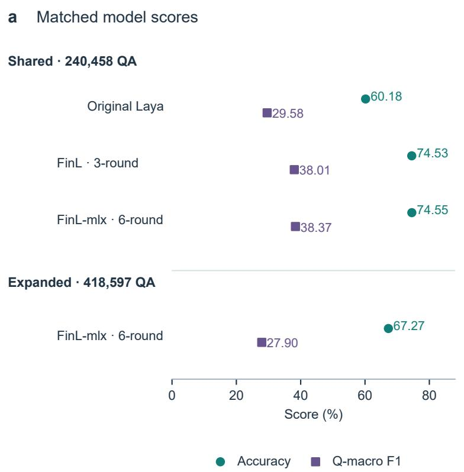  
b 6-round accuracy gain

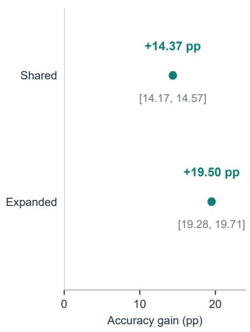

Supplementary Figure S2 | MLX performance on shared and expanded financial questions. a, Accuracy and question macro F1 for Original Laya, FinL 3-round and FinL 6-round on 240,458 shared QA records (119 question versions). The expanded test contains 418,597 records and 862 question versions; its 6-round scores are shown separately. Accuracy weights QA records equally; F1 averages over the complete candidate classes and then equally over question versions. b, Paired accuracy gains of FinL 6-round over Original Laya for the shared and expanded tests. Error bars show stratified household/respondent-group bootstrap 95% intervals from 2,000 draws. The shared-test gain is 14.3713 percentage points (14.1686–14.5719).

## Appendix S4. Human-score distributions and judge shifts

Human ratings reveal stricter judgments than AI scores

100 processed reference personas ꞏ six human raters ꞏ five dimensions a Human score distributions

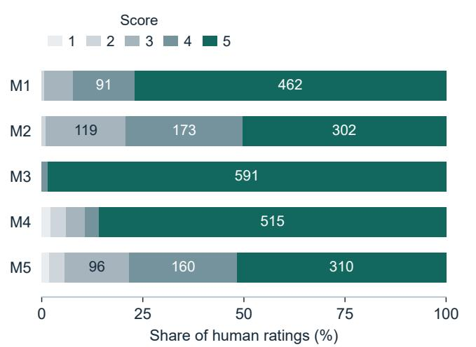  
600 ratings per dimension; 3,000 ratings total  
b AI minus human mean

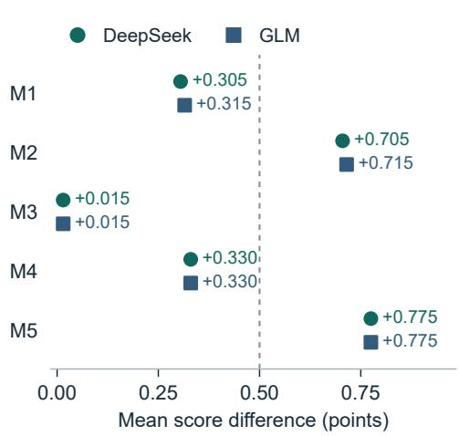  
Dashed line: reported bias criterion (+0.5)

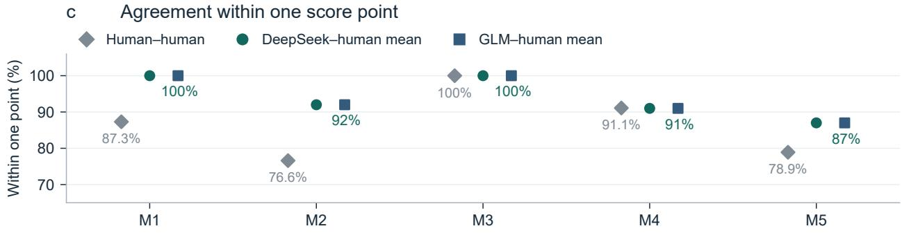  
AI–AI exact agreement: 498/500 dimension scores (99.6%)

Supplementary Figure S3 | Human ratings identify the dimensions on which AI judges are more permissive. a, Rating distributions for 100 fixed processed survey-derived personas, each evaluated by six human raters on five dimensions (600 ratings per dimension; 3,000 total). Numbers inside bars are rating counts. M1 denotes accuracy; M2, absence of over-inference; M3, coverage of nine predefined important fields; M4, internal consistency; and M5, independent overall fidelity. M3 receives 591/600 maximum scores, whereas M2 and M5 have broader distributions. b, DeepSeek (deepseek-flash) and GLM (glm-5.3-flash) mean scores minus human means; the dashed line marks the reported +0.5-point bias criterion. M2 and M5 exceed that criterion. c, Reported within-one-point agreement; each AI is compared with the six-rater mean for each persona (100 comparisons per dimension). AI–AI exact agreement is 498/500 scores. High within-one agreement coexists with systematically higher AI scores.

Appendix S5. Joint structure of the synthetic companion Joint financial structure of synthetic personas 2,000,000 complete records · eight standardized state variables

a State contributions

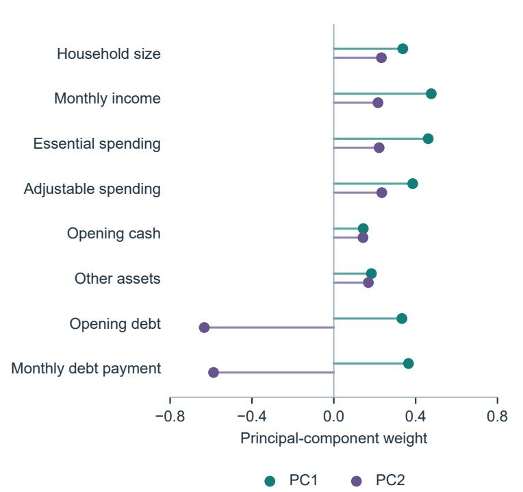  
b Variance captured

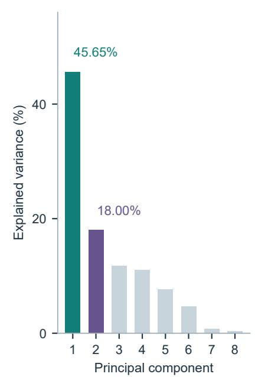  
PC1 + PC2: 63.65%  
Financial fields: log(1 + CNY); household size: untransformed. All variables standardized.

Supplementary Figure S4 | Principal-component structure of the independent synthetic persona companion. The analysis includes all 2,000,000 households and eight complete state variables: household size, monthly income, essential and adjustable spending, opening cash, other assets, opening debt and monthly debt payment. The seven financial variables use log(1 + CNY); household size is untransformed, and all eight variables are standardized. a, Unit-length eigenvector weights for PC1 and PC2, with each sign oriented toward positive income. b, Variance explained by each component. PC1 accounts for 45.6450% and PC2 for 18.0043%, together 63.6493%.

## Appendix S6. Initialization, resources and matrix settings Supplementary engine timing and resource profiles Single-call choice task; fixed reported benchmark matrices

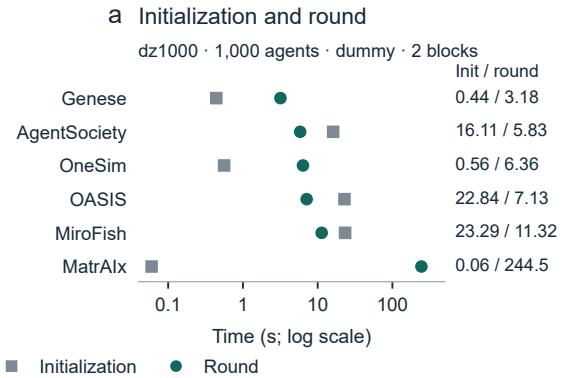  
b Process CPU time dz1000 · includes child processes

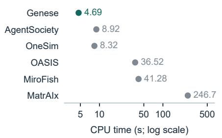  
c Peak resident memory dz1000 · same 1,000-agent workload  
d FinL­family policy parallel adapters fl5 · 100 agents · 3 T4 replicas · 3 blocks

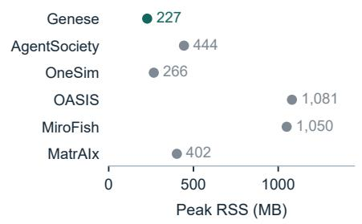

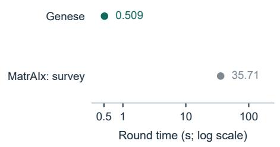  
e 100-agent dummy comparison m2 · 8 blocks; excluded warm-up

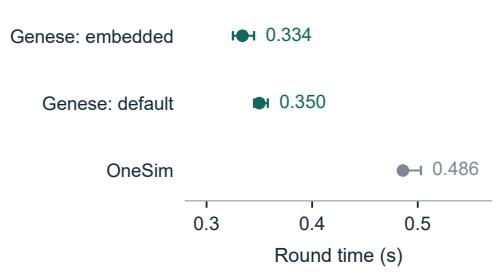

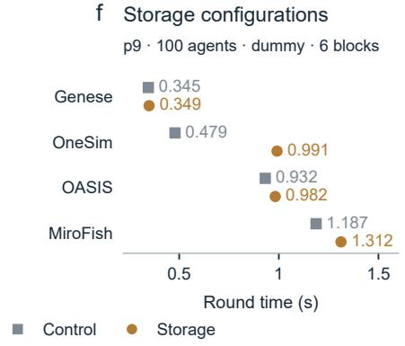  
MatrAIx: parallel survey adapter.

Supplementary Figure S5 | Initialization, resources and configuration-specific engine costs. a–c, The dz1000 matrix compares six single-call framework configurations at 1,000 agents per round on dual Xeon Platinum 8268 (96 threads): initialization and round time, process CPU time including child processes, and peak RSS. Genese reports 4.69 s CPU time. d, The separate fl5 FinL matrix uses 100 agents and three T4 model replicas; Genese’s reference is 0.509 s. e, The m2 dummy matrix contrasts embedded and default Genese with OneSim. f, p9 contrasts framework-specific storage controls: Genese disk versus RAM-disk SQLite FULL + WAL; OneSim PostgreSQL versus memory; OASIS and MiroFish SQLite FULL versus OFF. Points show reported medians. Only panel e shows the three reported 95% intervals from eight randomized blocks; the other panels show point summaries. Randomized blocks number 2, 3, 8 and 6 for dz1000, fl5, m2 and p9, respectively. Round timing excludes initialization. MatrAIx uses a parallel single-call adapter.

Indexed action and partition lookups replace quadratic scans with linear work. Shared action descriptors are decoded once per request. Connection pools scale with concurrency; parallel partitions retain bounded queues. State, events and command results use one durable transaction. The optimization study reduces 1,000-agent rounds from 7.37 to 3.10 seconds and 5,000-agent rounds from 90.14 to 16.66 seconds. At 100 agents, durable and in-memory paths take 0.349 and 0.345 seconds, respectively (Table S11).

Table S11 | Execution-path optimization measurements
<table><tr><td>Path</td><td>Previous implementation</td><td>Optimized implementation</td><td>Effect</td></tr><tr><td>Action lookup and synchroniza- tion</td><td>Repeated linear searches; O(N2) Indexed lookup; O(N) work total work</td><td></td><td>Lower overhead as the choice batch grows</td></tr><tr><td>Operation-state queries</td><td>Revalidate all agents for each Read the relevant shard and state query</td><td></td><td>Avoid repeated cohort-wide scans</td></tr><tr><td>Decision-request construction</td><td>Copy whole requests; decode re- peated descriptors per agent</td><td>descriptors once</td><td>Reduce copying; decode identical Less allocation and serialization</td></tr><tr><td>Snapshot handling</td><td>Copy matrix rows in Python</td><td>Compact matrix representation with C-level copying</td><td>Lower snapshot cost</td></tr><tr><td>Model connections</td><td>Shared client limited to 100 con- nections</td><td>Scale the pool with concurrency; shard pools above 100</td><td>Higher utilization of model capac- ity</td></tr><tr><td>Partition decisions</td><td>Process same-session partitions sequentially</td><td>Optional parallel partitions with bounded dispatch</td><td>Overlap inference without over- running the service</td></tr><tr><td>Durable writeback</td><td>Multiple independent write opera- tions</td><td>One atomic transaction per round</td><td>100-agent storage control: 0.349 s vs 0.345 s in memory-backed stor- age</td></tr></table>

Table S12 | Native execution paths and tested adapters
<table><tr><td>Framework</td><td>Native execution organization</td><td>State persistence</td><td>Tested choice adapter</td></tr><tr><td>Genese</td><td>Partitioned World/Brain requests; bounded queues and pooled model connections</td><td>Production PostgreSQL: world state, event outbox and command result in one transaction</td><td>Accepted option actions and World writeback</td></tr><tr><td>OneSim</td><td>Event-driven agents; dis- tributed workers and reusable model/connection resources</td><td>PostgreSQL environment and agent states when the data module is enabled</td><td>One decision event per sampled agent</td></tr><tr><td>OASIS</td><td>Asynchronous agents share a plat- form Channel</td><td>Platform SQLite; action-level commits</td><td>Question-to-platform action map- ping</td></tr><tr><td>MiroFish</td><td>Simulation subprocess; concur- rent OASIS platform coroutines</td><td>Per-platform SQLite and action logs</td><td>Native OASIS simulation path</td></tr><tr><td>AgentSociety v2</td><td>Ray worker batches and local adaptive LLM admission</td><td>Per-step workspace checkpoints and replay JSONL</td><td>Single-worker Ray choice task</td></tr><tr><td>MatrAIx</td><td>Concurrent independent Harbor trials and resumable jobs</td><td>Trial results and completed-job progress</td><td>Added threaded questionnaire trial</td></tr></table>

Genese uses PostgreSQL for production state transitions.

Capability labels describe the inspected native execution paths. Yes means the framework implements the defined mechanism, including through a configurable native module. Partial means only part of that function is implemented, and N/D means the mechanism is not documented. Array-based ECS requires indexed numeric component arrays. Synchronized state persistence requires a database transaction or explicit synchronized writes protecting saved state. OneSim’s enabled PostgreSQL path qualifies. State saving and restart support are evaluated separately from synchronization and whole-world atomicity.

Native action-rule enforcement requires programmatic execution constraints on business state, permissions or spatial movement. OASIS and MiroFish enforce platform business rules; AgentSociety enforces permissions and workspace boundaries. Event registration or answerformat checks alone receive Partial. Policy-intent/world-efect separation requires the engine to resolve a proposed intent before applying authoritative efects. Atomic state–event commit couples world state, outbox and command result. The combined isolation/rollback row receives Partial for AgentSociety’s independent agent tasks and MatrAIx’s independent trials, which isolate failures without rolling back the complete world step.

Recovery/resume requires a native restart path from saved state or completed-task progress: AgentSociety checkpoints and MatrAIx job progress qualify. Execution/connection pooling includes framework-managed reusable workers, connections or model instances; OneSim’s connection pools and AgentSociety’s Ray workers qualify. Task admission/flow control requires waiting for execution capacity or reducing admission under overload. OASIS and MiroFish gate LLM calls, AgentSociety uses local adaptive admission, and MatrAIx gates trials. Decision/trial concurrency control requires a configured or adaptive execution allowance. OneSim’s event queues and distributed coordination receive Partial because the inspected decision path launches tasks without such an allowance. Local admission does not establish a globally bounded waiting queue.

The comparison uses versioned native sources: OneSim 9829d72, OASIS dded86a, MiroFish 7657031 with OASIS 0.2.5, AgentSociety 8cc5bb9, MatrAIx 3633d8d.

Table S13 | Native execution capabilities
<table><tr><td>Capability</td><td>Genese</td><td>OneSim</td><td>OASIS</td><td>MiroFish</td><td>AgentSociety</td><td>MatrAIx</td></tr><tr><td>Array-based ECS storage</td><td>Yes</td><td>N/D</td><td>N/D</td><td>N/D</td><td>N/D</td><td>N/D</td></tr><tr><td>Synchronized state persistence</td><td>Yes</td><td>Yes</td><td>No</td><td>No</td><td>No</td><td>No</td></tr><tr><td>Native action-rule enforcement</td><td>Yes</td><td>Partial</td><td>Yes</td><td>Yes</td><td>Yes</td><td>Partial</td></tr><tr><td>Policy-intent / world-effect separation</td><td>Yes</td><td>No</td><td>No</td><td>No</td><td>No</td><td>No</td></tr><tr><td>Atomic state-event commit</td><td>Yes</td><td>No</td><td>No</td><td>No</td><td>No</td><td>No</td></tr><tr><td>World-step isolation / rollback</td><td>Yes</td><td>No</td><td>No</td><td>No</td><td>Partial</td><td>Partial</td></tr><tr><td>Recovery / resume</td><td>Yes</td><td>No</td><td>No</td><td>No</td><td>Yes</td><td>Yes</td></tr><tr><td>Execution / connection pooling</td><td>Yes</td><td>Yes</td><td>No</td><td>No</td><td>Yes</td><td>No</td></tr><tr><td>Task admission / flow control</td><td>Yes</td><td>Partial</td><td>Yes</td><td>Yes</td><td>Yes</td><td>Yes</td></tr><tr><td>Decision / trial concurrency control</td><td>Yes</td><td>Partial</td><td>Yes</td><td>Yes</td><td>Yes</td><td>Yes</td></tr></table>

Action-rule scope: OASIS/MiroFish platform rules and AgentSociety permissions/workspace. Resume scope: checkpoints (AgentSociety) andjobs (MatrAIx). Admission covers native LLM or trial entrypoints. OneSim retains Partial for event/interface checks and decision-flow control; MatrAIx retains Partial for questionnaire-output checks. AgentSociety and MatrAIx isolate tasks but do not roll back a complete world step.

Table S14 | Resource pooling and native persistence
<table><tr><td>Framework</td><td>Pooling</td><td>State saving and synchronization</td></tr><tr><td>Genese production</td><td>Yes</td><td>PostgreSQL; one transaction for world head/state, event outbox and command result</td></tr><tr><td>OneSim</td><td>Yes</td><td>PostgreSQL state saving when the data module is enabled; reusable connection pools</td></tr><tr><td>OASIS</td><td>No</td><td>SQLite action commits; native synchronous=OFF</td></tr><tr><td>MiroFish</td><td>No</td><td>OASIS SQLite action commits and simulation logs; native synchronous=OFF</td></tr><tr><td>AgentSociety</td><td>Yes</td><td>Ray execution workers; workspace checkpoints and replay JSONL; atomic file replacement without explicit fsync</td></tr><tr><td>MatrAIx</td><td>No</td><td>Trial results and job-progress files; restart continues remaining trials; ordinary file writes</td></tr></table>

Pooling includes framework-managed execution or connection resources. SQLite entries describe action-level saving with the inspected native synchronization setting. AgentSociety checkpoints use temporary-file replacement without an explicit fsync barrier. Saved-state continuation, synchronized persistence and atomic world-state transactions are separate mechanisms. Benchmark-added thread pools are excluded from native pooling.

## Appendix S7. Stability of the population economic axis

Table S15 | Economic-axis stability across 50 population shards

<table><tr><td>Quantity</td><td>500M expansion</td></tr><tr><td>Complete records in the 14-field PCA</td><td>Approximately 4.626M per shard</td></tr><tr><td>PC1 variance explained</td><td>32.62% (shard mean)</td></tr><tr><td>Largest across-shard loading SD</td><td>At most 0.0003</td></tr></table>

Standardized ordinal attributes and a positive-expenditure PC1 sign are used within each resource. Values summarize 50 constructed-population shards.

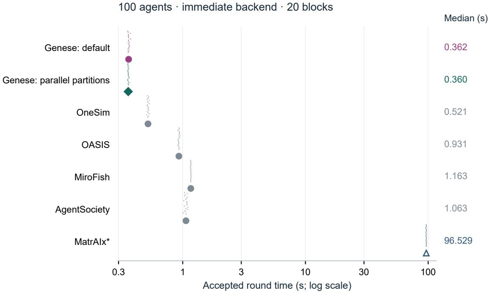  
Small points: all 20 blocks. Segment: IQR. Large symbol: median. \* Parallel one-shot adapter.

Supplementary Figure S6 | Complete 100-agent immediate-backend runtime distribution. Seven configured execution arms each contribute twenty randomized interleaved measured blocks after one warm-up. Every round accepts and writes back all 100 choices. Small points show individual times with vertical ofsets by block number; large symbols mark medians and thick segments the inclusive 25th–75th percentiles. Configurations follow protocol order. Genese default and parallel partitions are distinct; an asterisk and open triangle identify the parallel MatrAIx one-shot adapter. The host has two Intel Xeon Platinum 8268 processors and 96 logical threads. Framework CPU50 and proxy CPUs60–63 have nonexclusive afinities during concurrent training; the isolated comparison directory is memory-backed. Initialization is measured separately, with medians of 0.157 seconds for Genese default and 0.158 seconds for parallel partitions. Source Data includes all 280 measured cells across both agent counts, fourteen warm-ups, initialization, process time, throughput and observed host load.

## Supplementary table: known-error judge sensitivity

Table S16 | Responses to injected persona errors
<table><tr><td>Error / target</td><td>Judge</td><td>Valid n</td><td>Score ≤3</td><td>Paired decline ≥1</td><td>Non-target specificity</td></tr><tr><td>Changed fact / M1</td><td>DeepSeek Flash</td><td>25</td><td>64%</td><td>72%</td><td>98.7%</td></tr><tr><td>Changed fact / M1</td><td>GLM Flash</td><td>23</td><td>91.3%</td><td>100%</td><td>89.9%</td></tr><tr><td>Unsupported addition /M2</td><td>DeepSeek Flash</td><td>25</td><td>0%</td><td>44%</td><td>100%</td></tr><tr><td>Unsupported addition /M2</td><td>GLM Flash</td><td>24</td><td>79.2%</td><td>95.8%</td><td>97.2%</td></tr><tr><td>Omitted target / M3</td><td>DeepSeek Flash</td><td>24</td><td>0%</td><td>8.3%</td><td>100%</td></tr><tr><td>Omitted target / M3 Contradiction / M4</td><td>GLM Flash</td><td>24</td><td>100%</td><td>100%</td><td>100%</td></tr><tr><td></td><td>DeepSeek Flash</td><td>25</td><td>44%</td><td>76%</td><td>100%</td></tr><tr><td>Contradiction / M4</td><td>GLM Flash</td><td>25</td><td>96%</td><td>96%</td><td>58%</td></tr></table>

Each of 100 personas receives one known error, with 25 per type; the 44-field reference is unchanged. Rates use each judge’s valid responses. Specificity is the proportion of non-target dimension scores remaining ≥4, under the protocol’s exclusions.

Supplementary analysis: actual consumer-bank structure Table S17 | Ordinal PC1 loadings in the actual 10M bank
<table><tr><td>Field</td><td>10M bank</td></tr><tr><td>household_size</td><td>0.037</td></tr><tr><td>age_group</td><td>-0.156</td></tr><tr><td>education</td><td>0.204</td></tr><tr><td>household_income_bracket</td><td>0.345</td></tr><tr><td>spending.total</td><td>0.429</td></tr><tr><td>spending.food</td><td>0.341</td></tr><tr><td>spending.clothing</td><td>0.297</td></tr><tr><td>spending.housing</td><td>0.298</td></tr><tr><td>spending.transport_comm spending.education</td><td>0.315</td></tr><tr><td>spending.health</td><td>0.185</td></tr><tr><td>spending.other</td><td>0.182</td></tr><tr><td>financial_asset_bracket</td><td>0.335</td></tr><tr><td>debt_amount_bracket</td><td>0.170</td></tr><tr><td></td><td>0.168</td></tr></table>

The bank is standardized on the same 14 ordinal attributes. Unknown values are jointly excluded; PC1 sign is oriented toward positive total spending. Complete records: 7,227,206. PC1 explains 32.8904% and PC2 11.5234% of variance.

Table S18 | Representation completeness and consistency
<table><tr><td>Property</td><td>Records</td><td>Share of 10M bank</td></tr><tr><td>Known income, assets and debt brackets</td><td>10,000,000</td><td>100%</td></tr><tr><td>Known total-spending bracket</td><td>9,499,649</td><td>94.9965%</td></tr><tr><td>One-person household with a child</td><td></td><td>0%</td></tr><tr><td>Decision maker aged 65+ with explicit no-elder flag</td><td></td><td>0%</td></tr><tr><td>Debt amount/type none mismatch (known fields)</td><td></td><td>0%</td></tr><tr><td>Personal-income bracket above household- income bracket</td><td>82,864</td><td>0.8286%</td></tr></table>

Consistency counts use the consumer bank. Personal-income comparisons require both income fields to be known. Household financial assignments use household income.

The delivered consumer-bank reader selects the first 10,000,000 distinct rows in shard order from its documented 100M parent. Selection requires known financial-asset bracket, debt amount, debt type, investment activity and general trust. The separate 500M expansion applies additional calibration and is evaluated as a population resource.

## Supplementary analysis: training trajectory and prediction controls

## Training procedure and input lengths

SFT minimizes cross-entropy against the observed answer or coded target. Native Laya RLCD adds a policy-gradient term over four zeromean Gaussian logit perturbations to this cross-entropy [37]. Proper scoring rules motivate its probability-based rewards [40]. Choice examples receive a clipped log-score and spherical-score reward, with spherical weight 0.75. Each example’s sample rewards are centered, their advantages are standardized, and those advantages weight the perturbed logits’ Gaussian log-density. Noise decreases linearly from 0.4 to 0.1. The ranked-probability reward is used for Score-typed targets; the survey examples use Choice targets.

Training uses AdamW, weight decay 0.01, gradient-norm clipping at 1.0, 5% linear warm-up and cosine decay to 5% of the initial learning rate. Separate encoder and head rates, batch sizes and stage seeds appear in Table S19 and Table S21. Option order is shufled during training. Checkpoint temperatures are fitted on the independent calibration split. Development question-macro negative log-likelihood records checkpoint selection before test evaluation; the released 6-round model is final rlcd-2.

The QA training encoding uses 512 total tokens, a 256-token question/options allocation and up to 48 tokens per option. One-shot financial deployment uses a 2,048-token complete input, a 1,024-token question/options allocation and up to 192 tokens per option so that monetary paths and repayment terms remain in the model input. The monthly shock extension uses the 8,192-token service budget specified in M11. The original option markers, weights, probability calibration and decoder are retained. The 12M purchase-funding application processes a mean 529.98 actual nonpadding candidate input tokens per choice.

Two independent full continuation replicas repeated the 6-round recipe from the same completed 3-round initialization. Each processed 2,925,263 training QA in one SFT pass and one RLCD pass, using six cards, efective batch 768 and 3,809 optimizer updates per stage. Stagespecific temperatures were fitted on the fixed calibration split. All three runs evaluated the same 119-version, 240,458-QA financial-question test with RLCD fixed as the final stage.

Table S19 | Continuation for FinL 6-round: training configuration
<table><tr><td>Parameter</td><td>SFT continuation</td><td>Native RLCD continuation</td></tr><tr><td>Starting checkpoint</td><td>3-round rlcd-1</td><td>6-round sft-3</td></tr><tr><td>Training examples / epoch</td><td>2,925,263 1</td><td>2,925,263</td></tr><tr><td>Epochs</td><td></td><td>1</td></tr><tr><td>Precision / hardware</td><td>BF16 / 6 × A100 PCIe 40GB</td><td>BF16 / 6 × A100 PCIe 40GB</td></tr><tr><td>Micro-batch / accumulation</td><td>32 /4 768</td><td>32 / 4</td></tr><tr><td>Effective batch</td><td></td><td>768</td></tr><tr><td>Encoder / head learning rate</td><td> $1 . 2 5 \times 1 0 ^ { - 5 } / 5 \times 1 0 ^ { - 5 }$ </td><td> $5 \times 1 0 ^ { - 6 } / 2 \times 1 0 ^ { - 5 }$ </td></tr><tr><td>Input / head length</td><td>512 / 256</td><td>512 / 256</td></tr><tr><td>RLCD samples; sigma; weights</td><td></td><td> $4 ; 0 . 4  0 . 1 ; \mathrm { w \_ s p h } 0 . 7 5 , \mathrm { w \_ r p s } 1 . 0$ </td></tr></table>

Training sequence: original-base → sft-1 → sft-2 → rlcd-1 → sft-3 → rlcd-2. 3-round and bilingual training use 1,721,623 training observations per language.

Table S20 | 6-round training trajectory on expanded QA
<table><tr><td>Checkpoint</td><td>Accuracy (%)</td><td>Question-macro F1 (%)</td></tr><tr><td>Original Laya</td><td>47.8324</td><td>18.1810</td></tr><tr><td>SFT1</td><td>44.1382</td><td>18.2350</td></tr><tr><td>SFT2</td><td>57.4760</td><td>19.3338</td></tr><tr><td>RLCD1 / 3-round release</td><td>56.3657</td><td>19.2395</td></tr><tr><td>SFT3 / continuation</td><td>67.2152</td><td>27.6787</td></tr><tr><td>RLCD2 / 6-round release</td><td>67.2728</td><td>27.8355</td></tr></table>

Native PyTorch; 418,597 expanded QA. Each checkpoint has independently fitted calibration temperatures. The SFT continuation stage contributes most of the gain from FinL 3-round to FinL 6-round; final RLCD adds 0.0576 accuracy and 0.1568 F1 points along this training trajectory.

Table S21 | training-stage configuration
<table><tr><td>Stage</td><td>Unique training QA</td><td>Replay QA</td><td>Effective batch</td><td>Encoder / head LR</td></tr><tr><td>SFT1; 21 versions</td><td>307,807</td><td>0</td><td>192</td><td>2.5e-5 / 1.0e-4</td></tr><tr><td>SFT2; 119 versions</td><td>1,721,623</td><td>43,935</td><td>768</td><td>1.25e-5 / 5.0e-5</td></tr><tr><td>RLCD1 / 3-round release</td><td>1,721,623</td><td>43,935</td><td>768</td><td>5.0e-6 / 2.0e-5</td></tr><tr><td>SFT3 / continuation</td><td>2,925,263</td><td>0</td><td>768</td><td>1.25e-5 / 5.0e-5</td></tr><tr><td>RLCD2 / 6-round release</td><td>2,925,263</td><td>0</td><td>768</td><td>5.0e-6 / 2.0e-5</td></tr></table>

All stages use one pass through the unique training examples. Initial-supervision stages replay supported questions with 200–3,999 training examples up to 4,000 per question. Expanded-supervision stages have no replay. SFT1 uses microbatch 16 and accumulation 2 across six GPUs; later stages use 32 and 4. Continuation SFT/RLCD seeds: 202610120/202610121. AdamW weight decay 0.01; clipping 1.0; 5% warm-up, cosine decay to 5% of initial LR.

Table S22 | Matched-control F1 by question-registry domain
<table><tr><td>Domain</td><td>QA</td><td>Versions</td><td>Base</td><td>No profile</td><td>Wrong profile</td><td>Full FinL</td></tr><tr><td>risk and invest- ment attitudes</td><td>1490</td><td>7</td><td>20.88</td><td>20.24</td><td>22.69</td><td>28.11</td></tr><tr><td>financial product saving and credit</td><td>10325</td><td>56</td><td>44.34</td><td>45.63</td><td>46.90</td><td>50.70</td></tr><tr><td>behavior</td><td></td><td></td><td></td><td></td><td></td><td></td></tr><tr><td>well being</td><td>642</td><td>4</td><td>9.81</td><td>13.38</td><td>16.68</td><td>17.61</td></tr><tr><td>income change pension trust</td><td>149</td><td>3</td><td>16.89</td><td>16.32</td><td>19.02</td><td>20.31</td></tr><tr><td>financial knowl-</td><td>826 2428</td><td>4 11</td><td>7.23 7.62</td><td>11.39 18.14</td><td>16.13 22.36</td><td>20.18 30.01</td></tr><tr><td>edge financial educa-</td><td></td><td></td><td></td><td></td><td></td><td></td></tr><tr><td>tion retirement prefer-</td><td>530</td><td>2</td><td>53.95</td><td>48.14</td><td>50.67</td><td>52.93</td></tr><tr><td>ence</td><td>517</td><td>2</td><td>32.18</td><td>27.12</td><td>31.46</td><td>36.33</td></tr><tr><td>financial attention retirement plan-</td><td>928 528</td><td>4 2</td><td>7.69 37.99</td><td>12.23 37.99</td><td>16.69</td><td>22.91</td></tr><tr><td>ning retirement re-</td><td></td><td></td><td></td><td></td><td>39.41</td><td>38.81</td></tr><tr><td>sponsibility</td><td>591</td><td>3</td><td>8.52</td><td>12.14</td><td>24.12</td><td>28.54</td></tr><tr><td>social trust bank service sat-</td><td>195 284</td><td>2 2</td><td>13.73 14.56</td><td>12.73</td><td>13.70</td><td>15.31</td></tr><tr><td>isfaction</td><td></td><td></td><td></td><td>12.93</td><td>15.16</td><td>13.41</td></tr><tr><td>social fairness insurance partici-</td><td>67 265</td><td>1 4</td><td>4.86 20.07</td><td>12.93 30.30</td><td>12.93</td><td>12.93</td></tr><tr><td>pation perceived eco-</td><td></td><td></td><td></td><td></td><td>30.33</td><td>34.92</td></tr><tr><td>nomic status</td><td>66</td><td>1</td><td>20.65</td><td>13.60</td><td>13.93</td><td>18.77</td></tr><tr><td>wage structure</td><td>15</td><td>1</td><td>6.25</td><td>7.95</td><td>7.95</td><td>8.33</td></tr><tr><td>cash flow</td><td>15</td><td>1</td><td>23.19</td><td>21.21</td><td>42.74</td><td>33.17</td></tr><tr><td>work schedule</td><td>74</td><td>5</td><td>18.43</td><td>23.96</td><td>28.20</td><td>29.16</td></tr><tr><td>work satisfaction income satisfac-</td><td>15 21</td><td>1 1</td><td>25.91 5.56</td><td>13.91 6.41</td><td>13.91 8.03</td><td>20.26</td></tr><tr><td>tion</td><td></td><td></td><td></td><td></td><td></td><td>11.41</td></tr><tr><td>liquidity</td><td>15</td><td>1</td><td>20.10</td><td>10.53</td><td>19.58</td><td>13.81</td></tr><tr><td>work compensa- tion</td><td>14</td><td>1</td><td>10.00</td><td>16.67</td><td>25.14</td><td>21.90</td></tr></table>

Question-macro F1 (%), on matched selected QA. Results are aggregated by domain. The three financial families are defined in M4.

## Appendix S9. Auxiliary financial workflow evaluation

A separate controlled behavioral study contains 1,120 decisions with DeepSeek Flash as actor. Twenty personas drawn from a 1,000-persona parent cohort complete four financial tasks under two conditions. Single-pass choice (SP), candidate generation with self-check (SC), and multi-agent planning, constraint checking and execution use one, two and three model calls per decision. All 480 workflow decisions return legal options (Table S23).

Strict adherence requires all hard ledger constraints and the assigned persona goal. Across 160 decisions per workflow, adherence is 67.5% for SP, 81.9% for SC and 86.9% for multi-agent workflow. Hard-constraint violations are 23.1%, 14.4% and 6.9%. Multi-agent workflow improves adherence over SP by 19.4 percentage points, with a persona-clustered exploratory 95% bootstrap interval of 13.1–25.0; the multi-agent workflow–SC diference is 5.0 points, with an interval of -1.9 to 11.9 (Supplementary Figure S7a).

Borrowing-amount adherence rises from 22.5% with SP to 77.5% with SC and 90.0% with multi-agent workflow. Consumption adjustment rises from 57.5% to 65.0% and 80.0%. Risk allocation stays near 95%; debt-payment allocation is 95.0%, 87.5% and 82.5%. Additional decision steps are most useful for borrowing and consumption in this task set (Supplementary Figure S7c).

A second study fixes ledger and options while changing one goal at a time in 20 constructed personas. Four axes, two polarities, two workflows and two repeats produce 640 decisions and 160 pairs per workflow. Multi-agent workflow changes choices in 96.2% of pairs, compared with 77.5% for SC. Both ends satisfy their goals in 66.2% and 58.1% of pairs. Persona-clustered exploratory intervals are 15.0– 22.5 points for the 18.8-point response diference and 1.2–15.0 for the 8.1-point attainment diference (Supplementary Figure S7b).

On the borrowing-versus-purchase axis, multi-agent workflow changes choices in 87.5% of pairs and attains both targets in 60.0%; SC reaches 10.0% for both metrics. On the loss-cap axis, both workflows change every choice, while two-end attainment is 10.0% for multiagent workflow and 22.5% for SC. Goal sensitivity and successful goal attainment capture diferent aspects of persona-conditioned financial behavior.

## DeepSeek Flash adherence across decision workflows

1,120 choices · Single-pass, self-check and multi-agent workflows

a Workflow adherence 20 personas · 160 decisions/workflow

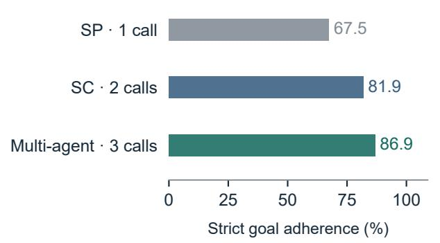  
b Counterfactual target response 20 personas · 160 pairs/workflow

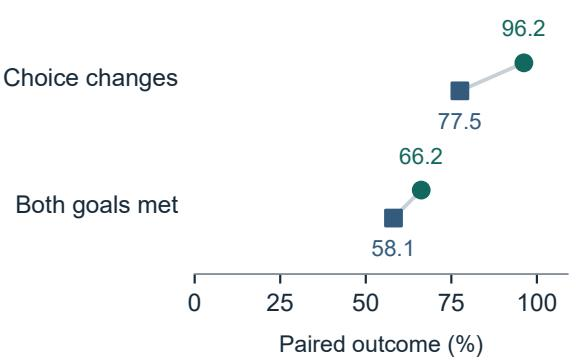

Supplementary Figure S7 | DeepSeek financial workflows and counterfactual goal response. DeepSeek Flash is the actor in both experiments. a, Strict adherence requires every hard financial constraint and persona goal. The workflow experiment uses 20 personas, four tasks and two conditions, yielding 160 choices for each of SP, SC and multi-agent workflow, with one, two and three model calls per choice. b, The counterfactual experiment changes one goal while holding the ledger and options fixed. It uses 20 constructed personas, four goal axes, two polarities and two repeats: 320 choices and 160 pairs per workflow. Choice response means the selected option changes; two-end attainment means both choices satisfy their respective goals. c, The four-task breakdown locates gains in consumption and borrowing decisions and shows the variation in risk and debt-payment tasks. Percentages are the deterministic-rule summaries; persona-clustered exploratory confidence intervals for paired diferences are reported in the text.

Table S23 | Financial workflow comparison
<table><tr><td>Workflow</td><td>Calls / choice</td><td>Choices</td><td>Strict adherence</td><td>Hard violation</td><td>Strong pass</td></tr><tr><td>SP: single pass</td><td>1</td><td>160</td><td>67.5%</td><td>23.1%</td><td>75.0%</td></tr><tr><td>SC: candidate + self- check</td><td>2</td><td>160</td><td>81.9%</td><td>14.4%</td><td>83.8%</td></tr><tr><td>Multi-agent: plan + check + execute</td><td>3</td><td>160</td><td>86.9%</td><td>6.9%</td><td>89.4%</td></tr></table>

Actor: DeepSeek Flash; 20 personas, four tasks and two conditions. Strict adherence requires all hard and soft persona goals. Strong pass requires a valid action, no critical violation, and both valid judges rating persona adherence (PA) at least 4/5; PA = 4 permits one secondary goal to be unmet. Missing judge responses count as non-passes in the 160-choice denominator.

## Appendix S10. Matched downstream adaptation and training costs

## Data, checkpoints and candidate classification

The 50,000-example training set is nested in the 200,000-example set. The fixed checkpoint-selection development set contains 20,000 examples and 829 question versions; the method-selection partition contains all 412,873 development examples and the same 829 versions.

The final shared test contains 240,458 examples, 119 question versions and 8,275 respondent groups. Both accuracy and question-macro F1 retain the entire test denominator. Candidate-class F1 includes every defined answer class, including classes absent from predictions, and versions receive equal weight. All ten formal test versions have zero invalid predictions.

Qwen candidate contexts independently encode the full state, question and alternatives, with the candidate under evaluation marked explicitly. The final nonpadding representation is converted to FP32, L2-normalized and scored by one shared bias-free scalar projection followed by candidate softmax. Head-only training freezes the backbone and reuses cached features; its learning rate is 0.003, batch size 4,096 and early-stopping patience three epochs, from a maximum of twenty. LoRA rank 16, α = 32 and zero dropout updates adapters together with the same head under candidate-classification cross-entropy. AdamW uses weight decay 0.01, adapter/head rates of $1 0 ^ { - 4 } / 1 0 ^ { - \overline { { 3 } } }$ , 3% warm-up and linear decay to zero, gradient clipping 1.0 and seed 20261018. One pass uses eight ranks, microbatch one and accumulation four: global batch 32. Qwen3.5-4B-Base and Qwen3.5-9B are diferent upstream initializations. The complete development comparison selected LoRA for 9B; training budgets and methods were fixed before the final test.

Native SFT and its RLCD/CE continuations preserve ModernBERT-large, the upstream two-layer Transformer decision head, tokenizer and option-marker scoring interface. The two SFT parents selected their terminal 50,000- and 200,000-exposure checkpoints. Continued stages reset AdamW and the scheduler, use the same seed and input order, and allow one complete additional pass with global batch 768 over eight ranks. Encoder and head learning rates are $5 \times 1 0 ^ { - 6 } \mathrm { { \ a n d \ 2 \times 1 0 ^ { - 5 } } }$ , respectively; warm-up occupies 5% of updates followed by cosine decay. Native RLCD uses four noisy samples, Gaussian logit noise annealed from 0.4 to 0.1 and spherical-reward weight 0.75. The general objective’s ranked-probability weight is 1, but that term is inactive for the Choice-typed examples used here. The RLCD loss includes cross-entropy. It perturbs discriminative option logits using target-answer rewards; financial ledger outcomes do not enter training.

All native child checkpoints are selected on the same fixed development rule as their parents. RLCD200 and CE continuation each process the same additional 200,000-example pass, but their development-best checkpoints occur at diferent points: 200,000 and 50,688 additional exposures. The selected cumulative downstream exposures are therefore 400,000 and 250,688, respectively; cumulative unique examples remain 200,000 in both cases. Exposure counts cover the recorded downstream stages.

## Training work and selected exposures

Table S24 records every formal run. Elapsed times are trainer-reported wall times, including in-stage validation and saving; allocated GPUhours multiply this duration by eight H100 GPUs. Head-only time includes frozen feature preparation and small-head fitting under the reported run allocation. Inference is performed on six A100 40GB GPUs for the four 4B adaptations and two SFT controls, and on eight H100 80GB GPUs for 9B, native continuations and the original native reference.

Table S24 | Training exposure and cost for all ten formal versions
<table><tr><td>Version</td><td>Unique QA</td><td>Stage terminal exposures</td><td>Selected cumulative exposures</td><td>Stage updates</td><td>Elapsed (s)</td><td>Allocated GPU-hours</td></tr><tr><td>4B head 50k</td><td>50,000</td><td>250,000</td><td>100,000</td><td>65</td><td>466.85</td><td>1.037</td></tr><tr><td>4B LoRA 50k</td><td>50,000</td><td>50,000</td><td>50,000</td><td>1,563</td><td>3,498.63</td><td>7.775</td></tr><tr><td>4B head 200k</td><td>200,000</td><td>800,000</td><td>200,000</td><td>196</td><td>999.44</td><td>2.221</td></tr><tr><td>4B LoRA 200k</td><td>200,000</td><td>200,000</td><td>200,000</td><td>6,250</td><td>10,819.22</td><td>24.043</td></tr><tr><td>9B LoRA 200k</td><td>200,000</td><td>200,000</td><td>200,000</td><td>6,250</td><td>13,401.91</td><td>29.782</td></tr><tr><td>Laya SFT 50k</td><td>50,000</td><td>50,000</td><td>50,000</td><td>66</td><td>87.65</td><td>0.195</td></tr><tr><td>Laya SFT 200k</td><td>200,000</td><td>200,000</td><td>200,000</td><td>261</td><td>329.85</td><td>0.733</td></tr><tr><td>SFT50 → RLCD50</td><td>50,000</td><td>50,000</td><td>100,000</td><td>66</td><td>87.87</td><td>0.195</td></tr><tr><td>SFT200 → RLCD200</td><td>200,000</td><td>200,000</td><td>400,000</td><td>261</td><td>326.01</td><td>0.724</td></tr><tr><td>SFT200 → CE200</td><td>200,000</td><td>200,000</td><td>250,688</td><td>261</td><td>328.27</td><td>0.729</td></tr></table>

Stage terminal counts exclude parent training. Selected cumulative counts include the native SFT parent where applicable; cumulative unique QA count each example once. Head50k and Head200k stop after 250,000 and 800,000 presentations, selecting 100,000 and 200,000, respectively. The native original reference receives no additional training and is not a formal trained run.

## Paired native comparisons

Each paired interval resamples 8,275 respondent groups 1,000 times, carrying all question records from a selected group together. Accuracy and F1 diferences use the same full 240,458-record test and candidate-class definitions. The six native comparisons distinguish initial SFT adaptation, the added RLCD stage, and equal added-budget CE continuation. A seventh direct comparison carries the same 200kexample test pairing across Qwen4B and Qwen9B LoRA, with 200,000 selected exposures and 6,250 updates each. Its 4B-Base and 9B post-trained initializations retain diferent upstream histories. Table S25 gives pointwise percentile 95% intervals without adjustment for multiple comparisons. Full-data FinL serves as a separate system reference, with diferent cumulative supervision and MLX FP16 inference.

Table S25 | Direct downstream comparisons
<table><tr><td>Target – reference</td><td>Accuracy difference (percentage points), 95% CI</td><td>Question-macro F1 difference (percentage points), 95% CI</td></tr><tr><td>SFT50 — original</td><td>+12.4970 [+12.2933, +12.7005]</td><td>+5.2516 [+4.8365, +5.7448]</td></tr><tr><td>SFT200 – original</td><td>+13.6781 [+13.4662, +13.8857]</td><td>+6.3953 [+5.9603, +6.9003]</td></tr><tr><td>RLCD50 – SFT50</td><td>+0.2316 [+0.1771, +0.2854]</td><td>-0.0671 [-0.1516, +0.0197]</td></tr><tr><td>RLCD200 – SFT200</td><td>+0.0516 [+0.0029, +0.1020]</td><td>+0.0554 [-0.0380, +0.1654]</td></tr><tr><td>RLCD200 – CE200</td><td>+0.0283 [-0.0175, +0.0752]</td><td>-0.1229 [-0.2073, -0.0330]</td></tr><tr><td>CE200 – SFT200</td><td>+0.0233 [-0.0288, +0.0731]</td><td>+0.1783 [+0.0762, +0.2770]</td></tr><tr><td>Qwen9B – Qwen4B, LoRA200</td><td>-0.0516 [-0.0981, -0.0071]</td><td>-0.0721 [-0.1725, +0.0404]</td></tr></table>

## Complete reference comparison

Expanded-supervision FinL reaches 74.5544% accuracy and 38.3746% question-macro F1 under MLX FP16. Table S26 compares every trained variant against this reference on identical test records; staged supervision, checkpoint calibration and deployment precision difer between systems.

Table S26 | Every fixed-budget version minus FinL-mlx
<table><tr><td>Version – FinL-mlx</td><td>Accuracy difference (percentage points), 95% CI</td><td>Question-macro F1 difference (percentage points), 95% CI</td></tr><tr><td>Qwen4B head50</td><td>-7.2175 [-7.3973, -7.0389]</td><td>-7.3580 [-7.6125, -7.0713]</td></tr><tr><td>Qwen4B LoRA50</td><td>-0.8255 [-0.9248, -0.7308]</td><td>-1.7520 [-1.9896, -1.4840]</td></tr><tr><td>Qwen4B head200</td><td>-7.2703 [-7.4509, -7.0849]</td><td>-7.4751 [-7.7300, -7.1973]</td></tr><tr><td>FinQ (4B LoRA200)</td><td>-0.4109 [-0.4977, -0.3248]</td><td>-1.6402 [-1.8938, -1.3596]</td></tr><tr><td>Qwen9B LoRA200</td><td>-0.4625 [-0.5455, -0.3733]</td><td>-1.7124 [-1.9451, -1.4417]</td></tr><tr><td>Native SFT50</td><td>-1.8602 [-1.9884, -1.7458]</td><td>-3.5234 [-3.7717, -3.2552]</td></tr><tr><td>Native SFT200</td><td>-0.6791 [-0.7745, -0.5885]</td><td>-2.3797 [-2.6138, -2.1158]</td></tr><tr><td>Native RLCD50</td><td>-1.6286 [-1.7503, -1.5133]</td><td>-3.5905 [-3.8261, -3.3252]</td></tr><tr><td>Native RLCD200</td><td>-0.6276 [-0.7120, -0.5414]</td><td>-2.3242 [-2.5683, -2.0443]</td></tr><tr><td>Native CE continued200</td><td>-0.6558 [-0.7453, -0.5602]</td><td>-2.2014 [-2.4396, -1.9297]</td></tr></table>

Complete test: 240,458 records, 119 question versions, 8,275 respondent groups. Pointwise 95% intervals use 1,000 respondent-group bootstrap draws; every defined candidate class enters F1. All ten trained variants have zero invalid decisions.

## Appendix S11. Complete static task execution and language sensitivity

The static task suite samples household–parameter combinations within the conditions in Table S27. Each task contains 2,842 baseline/intervention pairs. The overall pool has 207 financial parents; task-specific counts range from 22 to 207. Each language contains 45,472 paired inputs plus one additional, unpaired T1 intervention input. Both models execute every input in both languages, giving 45, $4 7 3 \times 2 \times 2 = 1 8 1$ , 892 choices. The paired results use 2,842 pairs per task; the four additional T1 choices enter the completed-work count.

The English and Chinese inputs have identical execution specifications, action consequences and presentation orders. Both languages use the same frozen full-data FinL 6-round checkpoint and the same original Laya reference in MLX CUDA FP16. Tables S28 and S29 report English FinL and Laya; Tables S30 and S31 report their Chinese-input counterparts. Each cell is intervention minus baseline within a model and language. Pointwise intervals resample the financial parents represented in that task.

For this suite, monthly income I and usual spending C are annual financial-anchor amounts divided by twelve; K is opening de mand deposits. Assigned adjustable spending is an integer percentage from 10% through 30% of C, with the remainder essential. Existing bank-housing pools retain their recorded principal and monthly payment; dates and annual rates are assigned, with rate min( $r _ { 0 } , \lfloor 6 0 , 0 0 0 M _ { j } / P _ { j } \rfloor / 1 0 , 0 0 0 )$ for sampled $r _ { 0 } ~ \in ~ \{ 0 . 0 2 , 0 . 0 3 , 0 . 0 4 , 0 . 0 5 \}$ and pool-specific payment $M _ { j }$ and principal $P _ { j }$ . Let $q \in \{ 1 0 , 0 0 0 , 2 0$ , 000, 50, 000, 100, 000, 174, 000} CNY, P denote the largest opening pool’s principal and M its monthly payment. The quoted new loans in T2–T3 use annual rates of 3%, 5% or 8% and terms of 12, 24 or 36 months, zero fees and repayment beginning one month after origination. Within each pair, household information and the other sampled parameters remain common.

Table S27 | Conditions and executed actions in the eight-task suite
<table><tr><td>Task / parents</td><td>Baseline → intervention</td><td>Sampled parameters</td><td>Action consequences</td></tr><tr><td>T1 / 207</td><td>Monthly income I → uI throughout twelve months, where  $u \in \{ 0 . 6 5 , 0 . 6 6 , \dots , 0 . 8 5 \}$ </td><td>Usual spending and its essential/adjustable split remain fixed</td><td>Select normal, half-normal or zero adjustable spending for the ledger; essential spending remains due</td></tr><tr><td>T2 / 162</td><td>Immediate net medical bill b → min(K, 1.5b)</td><td>b = min[K, max(100, r K)] CNY, with r an integer percentage from 15% to 30%; common loan-rate and term sets above. Realized bills are CNY 100–300,000 at baseline and 150–450,000 under intervention</td><td>Pay the bill from cash, borrow the full amount, or fund approximately half from each. The medical payment counts as consumption; the selected loan creates dated installments</td></tr><tr><td>T3 / 207</td><td>Purchase goal and tied approved limit q → 1.5q</td><td>Baseline goals CNY 10k, 20k, 50k, 100k or 174k; intervention goals 15k, 30k, 75k, 150k or 261k; common loan-rate and term sets above</td><td>Defer the whole purchase, finance half, or finance all. Borrowed funds purchase the corresponding amount immediately; deferral leaves the unpurchased amount outside routine shortfalls</td></tr><tr><td>T4 /207</td><td>Add 3 percentage points to both offered annual rates</td><td>Purchase amount q fixed. Short term 12 or 24 months at 2%, 3% or 4% initially; long term adds twelve months and 2 rate points. Intervention short rates are 5–7%, long rates 7–9%. The long-product fee is min(0.01q, 0.1K)</td><td>Select the short product, the long product, or defer. Either accepted loan buys q immediately; its fee is paid from cash, and its quoted installments enter the ledger</td></tr><tr><td>T5 / 161</td><td>Widen the monthly risky-return support from  $\{ - 1 5 , - 7 . 5 , 0 , 7 . 5 , 1 5 \} ^ { \% } 1 0$   $\{ - 4 0 , - 2 0 , 0 , 2 0 , 4 0 \} \%$ </td><td>Investable amount min  $( r K , q ) .$  where r is an integer percentage from 10% to 40%; at least CNY 100. Returns are drawn from the five support points and are unknown at choice</td><td>Allocate 100%, 75%, 50%, 25% or 0% to the risky product; the rest stays liquid at zero interest. The invested balance is revalued and liquidates at the start of month 6</td></tr><tr><td>T6 / 169</td><td>Reduce the first-month earmarked debt-payment budget from  $L ( 0 . 7 + 0 . 2 v )$  to  $L ( 0 . 4 + 0 . 2 v )$  , with the same  $v \in [ 0 , 1 ]$ </td><td> $L = \operatorname* { m i n } ( K + I - C , D _ { 1 } , D _ { 2 } ) ; D _ { 1 } , D _ { 2 }$  are the two current dues. Add an opening consumer loan of q at 8%, 10% or 12%, for 12, 24 or 36 months. The largest housing pool has opening arrears aged 15, 30 or 45 days</td><td>Pay the full budget to the housing pool, to the consumer loan, or proportionally to their dues. Other first-month cash is reserved and released next month; later debt payments follow the common priority</td></tr><tr><td>T7 / 149</td><td>Monthly income I → uI for twelve months, with u ∈ {0.65, 0.66, . . . , 0.85}; extension approval responds to current income</td><td>The same prepayment amount and extension quote enter both arms. Prepayment is capped at 5% of P and one-third of resources after spending and dues under reduced income. Extension doubles or triples the calculated remaining term, at the same rate and zero fee</td><td>Keep the contract, pay the current due plus the stated principal prepayment, or request extension. Approval requires the new payment to be at most 40% of current income. Approved terms begin next month; existing arrears remain</td></tr><tr><td>T8 / 22</td><td>Reduce the opening market-asset value from A to w A, with w ∈  $\{ 0 . 7 0 , 0 . 7 1 , \ldots , 0 . 9 0 \}$ </td><td>Initial cash and first-month income are zero after prepaid bills. A further bill  $g = \operatorname* { m i n } ( 0 . 7 A / 8 , \operatorname* { m a x } [ 1 0 0 , r M ] )$  is due on day 15, with  $r \in \{ 0 . 2 5 , 0 . 2 6 , \ldots , 0 . 7 5 \} ( \mathrm { s t e p } 0 . 0 1 ) .$  Half the assets can be sold; settlement takes 1, 3, 5 or 10 days and the sale fee is 0%, 0.25%, 0.5% or 1%. Refinancing terms are 240, 300 or 360 months, with the assigned rate drawn from 2–4% and capped at the old rate plus 1 point</td><td>Sell enough assets to pay the bill, refinance the named old pool and fund the bill, or combine a half-bill sale with refinancing. The bill and action amounts/contracts are common across asset-price arms. Refinancing first settles the named old debt recorded payments include that settlement</td></tr></table>

T6 draws v uniformly and truncates the resulting cent budget; opening arrears are min $( M , P / 4 )$ . T8 uses the same integer-percentage draw for its bill rule in both arms and retains only pairs with executable asset-sale alternatives. After initial actions, income precedes selected household spending and dated bank payments; unfunded selected spending remains a shortfall. These conditions define the means in Tables S28–S31.

Static task execution chooses once and then runs its twelve-month ledger. T1 records unmet selected consumption targets; T3/T4 deferral of a proposed purchase is not counted as an unfunded routine need. T8 payments include refinancing settlement of existing debt.

Tables S28–S31 report all eight task families for both models and languages. Diferences are the designated intervention minus baseline within each model. Monetary outcomes are CNY per constructed case over twelve months. The full aggregate source data retain paid debt, interest accrued, terminal debt, minimum cash and unfunded months with financial-parent-cluster intervals, together with paired FinL-minusoriginal-Laya responses and Chinese-minus-default sensitivity.

Table S28 | FinL: complete within-model task responses
<table><tr><td>Task</td><td>Consumption (CNY), 95% CI</td><td>Closing cash (CNY), 95% CI</td><td>Unfunded needs (CNY), 95% CI</td></tr><tr><td>T1</td><td>-7,065.95 [-9,702.21, -4,909.79]</td><td>-26,969.82 [-31,722.80, -22,433.23]</td><td>+9,415.55 [+7,019.80, +12,333.77]</td></tr><tr><td>T2</td><td>+5,119.61 [+3,651.29, +6,977.79]</td><td>-3,658.58 [-4,959.08, -2,550.75]</td><td>+544.93 [+303.66, +825.40]</td></tr><tr><td>T3</td><td>+17,148.49 [+14,818.58, +19,601.23]</td><td>-3,439.10 [-4,376.02, -2,605.90]</td><td>+161.86 [+56.59, +295.36]</td></tr><tr><td>T4</td><td>-1,052.95 [-1,779.68, -345.29]</td><td>+115.83 [-153.66, +399.32]</td><td>-1.94 [-16.32, +9.16]</td></tr><tr><td>T5</td><td>-31.11 [-65.31, +1.78]</td><td>+46.02 [-116.34, +221.06]</td><td>+31.11 [-1.78, +65.31]</td></tr><tr><td>T6</td><td>+34.06 [+14.30, +57.15]</td><td>-0.26 [-0.34, -0.17]</td><td>-34.06 [-57.15, -14.30]</td></tr><tr><td>T7</td><td>-6,134.77 [-8,250.80, -4,228.10]</td><td>-33,424.05 [-39,676.36, -27,805.84]</td><td>+6,134.77 [+4,228.10, +8,250.80]</td></tr><tr><td>T8</td><td>-0.00 [-0.00, +0.00]</td><td>+59.91 [-215.76, +361.55]</td><td>+0.00 [-0.00, +0.00]</td></tr></table>

Each task has 2,842 complete pairs. Financial-parent cluster counts for T1–T8 are 207, 162, 207, 207, 161, 169, 149 and 22, respectively (Table S27). Pointwise 95% intervals use 2,000 cluster bootstrap draws. Unfunded outcomes retain each task’s definition.

Table S29 | original Laya: complete within-model task responses
<table><tr><td>Task</td><td>Consumption (CNY), 95% CI</td><td>Closing cash (CNY), 95% CI</td><td>Unfunded needs (CNY), 95% CI</td></tr><tr><td>T1</td><td>-11,000.04 [-13,899.55, -8,548.88]</td><td>-22,952.29 [-27,537.90, -18,660.47]</td><td>+11,251.27 [+8,617.24, +14,360.57]</td></tr><tr><td>T2</td><td>+5,285.73 [+3,839.13, +7,132.03]</td><td>-3,337.99 [-4,768.49, -2,297.21]</td><td>+378.81 [+198.14, +590.52]</td></tr><tr><td>T3</td><td>+34,807.17 [+33,709.99, +35,959.66]</td><td>-5,003.76 [-6,000.29, -4,062.40]</td><td>+214.65 [+96.89, +357.22]</td></tr><tr><td>T4</td><td>-922.61 [-1,555.46, -320.36]</td><td>-429.30 [-703.34, -166.70]</td><td>+2.84 [-17.86, +24.34]</td></tr><tr><td>T5</td><td>-47.67 [-102.83, +6.51]</td><td>-30.78 [-213.92, +148.44]</td><td>+47.67 [-6.51, +102.83]</td></tr><tr><td>T6</td><td>+34.06 [+14.30, +57.15]</td><td>-0.09 [-0.17, -0.02]</td><td>-34.06 [-57.15, -14.30]</td></tr><tr><td>T7</td><td>-6,084.71 [-8,181.91, -4,174.70]</td><td>-34,092.61 [-40,371.37, -28,431.99]</td><td>+6,084.71 [+4,174.70, +8,181.91]</td></tr><tr><td>T8</td><td>+0.00 [+0.00, +0.00]</td><td>+264.68 [+41.13, +565.57]</td><td>-0.00 [-0.00, +0.00]</td></tr></table>

Each task has 2,842 complete pairs. Financial-parent cluster counts for T1–T8 are 207, 162, 207, 207, 161, 169, 149 and 22, respectively (Table S27). Pointwise 95% intervals use 2,000 cluster bootstrap draws. Unfunded outcomes retain each task’s definition.

Table S30 | Chinese FinL: complete within-model task responses
<table><tr><td>Task</td><td>Consumption (CNY), 95% CI</td><td>Closing cash (CNY), 95% CI</td><td>Unfunded needs (CNY), 95% CI</td></tr><tr><td>T1</td><td>-8,950.22 [-11,508.39, -6,927.20]</td><td>-25,340.71 [-29,854.28, -20,990.65]</td><td>+7,634.45 [+5,701.08, +9,968.84]</td></tr><tr><td>T2</td><td>+5,271.55 [+3,823.66, +7,162.49]</td><td>-3,702.98 [-5,075.09, -2,533.84]</td><td>+392.99 [+163.88, +663.76]</td></tr><tr><td>T3</td><td>+1,194.03 [+638.59, +1,825.40]</td><td>-369.11 [-643.23, -156.06]</td><td>+19.55 [+1.23, +48.47]</td></tr><tr><td>T4</td><td>-2,497.49 [-4,043.44, -960.37]</td><td>+319.62 [-300.39, +958.42]</td><td>+19.66 [-24.85, +72.90]</td></tr><tr><td>T5</td><td>-14.59 [-31.68, +0.03]</td><td>-30.14 [-113.77, +55.04]</td><td>+14.59 [-0.03, +31.68]</td></tr><tr><td>T6</td><td>+34.06 [+14.30, +57.15]</td><td>-0.15 [-0.26, -0.05]</td><td>-34.06 [-57.15, -14.30]</td></tr><tr><td>T7</td><td>-6,320.23 [-8,358.10, -4,416.56]</td><td>-31,278.26 [-37,511.45, -25,610.21]</td><td>+6,320.23 [+4,416.56, +8,358.10]</td></tr><tr><td>T8</td><td>+0.00 [-0.00, +0.00]</td><td>-244.78 [-659.67, +38.44]</td><td>-0.00 [-0.00, +0.00]</td></tr></table>

Each task has 2,842 complete pairs. Financial-parent cluster counts for T1–T8 are 207, 162, 207, 207, 161, 169, 149 and 22, respectively (Table S27). Pointwise 95% intervals use 2,000 cluster bootstrap draws. Unfunded outcomes retain each task’s definition.

Table S31 | Chinese original Laya: complete within-model task responses
<table><tr><td>Task</td><td>Consumption (CNY), 95% CI</td><td>Closing cash (CNY), 95% CI</td><td>Unfunded needs (CNY), 95% CI</td></tr><tr><td>T1</td><td>-9,941.04 [-12,557.41, -7,833.34]</td><td>-24,696.32 [-29,280.60, -20,341.76]</td><td>+8,015.96 [+5,983.57, +10,474.95]</td></tr><tr><td>T2</td><td>+5,220.59 [+3,781.94, +7,062.02]</td><td>-3,866.51 [-5,555.35, -2,572.03]</td><td>+443.95 [+208.87, +729.75]</td></tr><tr><td>T3</td><td>+32,567.83 [+29,697.63, +35,465.54]</td><td>-5,608.78 [-6,903.31, -4,381.07]</td><td>+348.78 [+112.69, +658.72]</td></tr><tr><td>T4</td><td>+167.65 [-1,060.06, +1,372.52]</td><td>-545.27 [-930.22, -174.69]</td><td>-10.72 [-34.16, +8.95]</td></tr><tr><td>T5</td><td>-64.40 [-129.52, -4.34]</td><td>+23.59 [-183.09, +239.37]</td><td>+64.40 [+4.34, +129.52]</td></tr><tr><td>T6</td><td>+34.06 [+14.30, +57.15]</td><td>-0.15 [-0.26, -0.06]</td><td>-34.06 [-57.15, -14.30]</td></tr><tr><td>T7</td><td>-6,397.08 [-8,451.63, -4,471.02]</td><td>-31,651.45 [-37,813.25, -25,990.92]</td><td>+6,397.08 [+4,471.02, +8,451.63]</td></tr><tr><td>T8</td><td>+0.00 [-0.00, +0.00]</td><td>-7.87 [-164.27, +146.87]</td><td>+0.00 [-0.00, +0.00]</td></tr></table>

Each task has 2,842 complete pairs. Financial-parent cluster counts for T1–T8 are 207, 162, 207, 207, 161, 169, 149 and 22, respectively (Table S27). Pointwise 95% intervals use 2,000 cluster bootstrap draws. Unfunded outcomes retain each task’s definition.

For the completed T3 grid, FinL’s intervention response difers from original Laya by lower consumption, less additional debt and less erosion of cash: a smaller financed-purchase response. Increasing the purchase need within FinL still raises closing debt, debt payments, accrued interest and unmet routine needs. The Chinese response is materially smaller than the default response.

## T3 purchase-funding application with twelve million synthetic household agents

One prechosen T3 setting is executed on the complete 12M cohort using FinL MLX CUDA FP16. The input targets and contract are fixed as specified in M10. Table S32 gives both condition means and their paired diferences, weighting all households equally. The full-panel diference in consumption combines the initial financed purchase with subsequent routine consumption; the default measures follow the dated bank-dues rule. Table S33 records the complete execution scope and measured work.

Table S32 | Complete financial outcomes for the 12M T3 application
<table><tr><td>Measure per household</td><td>Baseline</td><td>Intervention</td><td>Paired difference [row-variation reference]</td></tr><tr><td>Total consumption (CNY)</td><td>68,960.33</td><td>71,847.52</td><td>2,887.18 [2,882.36, 2,892.00]</td></tr><tr><td>Closing cash (CNY)</td><td>97,805.83</td><td>96,877.07</td><td>-928.76 [-930.67, -926.85]</td></tr><tr><td>Debt payments (CNY)</td><td>8,286.33</td><td>9,218.88</td><td>932.55 [930.64, 934.46]</td></tr><tr><td>Closing debt (CNY)</td><td>84,569.06</td><td>86,641.51</td><td>2,072.45 [2,068.82, 2,076.08]</td></tr><tr><td>Accrued interest (CNY)</td><td>5,238.03</td><td>5,352.06</td><td>114.03 [113.84, 114.22]</td></tr><tr><td>Unfunded routine needs (CNY)</td><td>10,517.57</td><td>10,521.36</td><td>3.79 [3.72, 3.86]</td></tr><tr><td>Minimum cash (CNY)</td><td>60,303.21</td><td>60,172.21</td><td>-131.00 [-131.67, -130.33]</td></tr><tr><td>Closing noncash assets (CNY)</td><td>0.00</td><td>0.00</td><td>0.00 [0.00, 0.00]</td></tr><tr><td>Opening-facility EAD (CNY)</td><td>48,848.37</td><td>49,112.49</td><td>264.12 [259.29, 268.96]</td></tr><tr><td>New-facility EAD (CNY)</td><td>174.50</td><td>1,159.84</td><td>985.34 [982.50, 988.18]</td></tr><tr><td>Total EAD (CNY)</td><td>49,022.87</td><td>50,272.33</td><td>1,249.46 [1,243.65, 1,255.28]</td></tr><tr><td>Unfunded months (months)</td><td>1.3296</td><td>1.3301</td><td>0.0006 [0.0005, 0.0006]</td></tr><tr><td>Any bank-facility default (%)</td><td>17.3485</td><td>19.0148</td><td>1.6663 [1.6590, 1.6736]</td></tr><tr><td>Opening-facility default (%)</td><td>16.8974</td><td>17.2058</td><td>0.3085 [0.3053, 0.3116]</td></tr><tr><td>New-facility default (%)</td><td>0.9225</td><td>4.1371</td><td>3.2146 [3.2046, 3.2246]</td></tr></table>

Every mean uses the same 12,000,000 synthetic households. CNY rows are monetary means; default rows give percentages with percentage-point diferences, and unfunded months give months per household. EAD denotes exposure at first default. The bracketed reference is paired mean ±1.96 SE across synthetic rows, conditional on the constructed cohort. Exact panel means are primary; the reference measures synthetic-row variation rather than survey-cluster or national sampling uncertainty. M10 defines the twelve-month horizon and 24-month contract.

Table S33 | Completed work and measurement scopes in the 12M application
<table><tr><td>Quantity</td><td>Measured value</td><td>Scope</td></tr><tr><td>Synthetic households / choices</td><td>12,000,000 / 24,000,000</td><td>Two conditions per household; T3</td></tr><tr><td>Monthly ledger states</td><td>288,000,000</td><td>Twelve accounting months per choice</td></tr><tr><td>GPU allocation</td><td>8 H100 80GB + 6 A100 40GB</td><td>Two service pools, same FinL FP16 policy</td></tr><tr><td>Completed service batches</td><td>1,641,533</td><td>Unique recorded service batches</td></tr><tr><td>Input / generated output tokens</td><td>12,719,522,472 / 0</td><td>Actual encoded nonpadding input; discriminative out-</td></tr><tr><td>Compressed private trace</td><td>67,664,771,925 bytes</td><td>puts Full inputs, choices, usage and monthly ledgers</td></tr><tr><td>Common end-to-end wall</td><td>14,356.9775 s</td><td>First nested-pilot preparation through final work-unit completion</td></tr><tr><td>End-to-end rates</td><td>835.831 households/s; 1,671.661 choices/s; 885,947.092 input tokens/s</td><td>All denominators use the same common wall</td></tr><tr><td>Common batch-processing window</td><td>14,348.8386 s</td><td>Preparation, tokenization, collation, forward calls and</td></tr><tr><td>Summed forward-call wall</td><td>111,369.7866 s</td><td>decoding Sum across unique batches on parallel endpoints</td></tr><tr><td>Pure kernel time, padding, cache</td><td>Unmeasured</td><td>Separate from the reported service-call and end-to- end intervals</td></tr><tr><td>Recorded requests / responses</td><td>24,000,000 / 24,000,000</td><td>Complete-input indicator present for every request</td></tr><tr><td>HTTP / response-validation errors</td><td>0</td><td>Interrupted requests without recorded responses: 0</td></tr><tr><td>Process/status finalization retries</td><td>14 across 11 complete units</td><td>Existing complete summaries adopted, preserving saved choices</td></tr></table>

The common end-to-end interval includes nested-pilot work, transfer waits, subsequent input preparation, CPU ledgers, compressed persistence and recovery waits. Service-call wall is a sum over parallel batches. The measured aggregate rates use the common interval rather than summed endpoint durations. Trace and input records remain private.

## Appendix S12. Complete dynamic-shock outcomes and execution

The monthly application compares the same households under two purchase goals in each shock path. Supplementary Methods M11 defines the complete inputs and assigned bank rule. Table S34 decomposes the month-24 goal diference; Table S35 shows both goals at the twelveand twenty-four-month endpoints, including the state-dependent ofer factor. The accompanying aggregate source tables retain every route, month and condition.

Table S34 | Month-24 paired purchase-goal diferences
<table><tr><td>Route</td><td>Total consumption</td><td>Purchase</td><td>Cash</td><td>Debt</td><td>Payments</td><td>Necessary gap</td></tr><tr><td>R0</td><td>6,363.77</td><td>6,476.53</td><td>-6,239.23</td><td>210.42</td><td>1,546.50</td><td>2.56</td></tr><tr><td>R1</td><td>5,670.35</td><td>5,819.60</td><td>-5,555.63</td><td>197.85</td><td>1,511.01</td><td>2.56</td></tr><tr><td>R2</td><td>5,623.20</td><td>5,702.11</td><td>-5,463.84</td><td>244.88</td><td>1,489.46</td><td>2.56</td></tr><tr><td>R3</td><td>6,256.30</td><td>6,357.41</td><td>-6,137.50</td><td>204.54</td><td>1,545.37</td><td>2.78</td></tr><tr><td>R4</td><td>5,558.58</td><td>5,761.12</td><td>-5,429.64</td><td>213.93</td><td>1,535.30</td><td>57.75</td></tr><tr><td>R5</td><td>6,980.53</td><td>7,103.53</td><td>-6,764.79</td><td>308.94</td><td>1,642.08</td><td>2.17</td></tr></table>

CNY per household, 30k minus 20k purchase goal, using all 10,000 matched households. Consumption, purchases, payments and gaps are cumulative; cash and debt are closing stocks. Total consumption includes realized necessary expenses. R0 is the unshocked reference; R1–R5 are the five paths in Figure 10.

Table S35 | Financial levels and bank feedback at months 12 and 24
<table><tr><td>Route / month</td><td>Total consumption</td><td>Purchase</td><td>Cash</td><td>Default (%)</td><td>Offer factor</td></tr><tr><td>R0/12</td><td>58.34 / 63.84</td><td>13.17 / 18.74</td><td>67.25 / 62.74</td><td>5.15 / 5.10</td><td>0.5944 / 0.6158</td></tr><tr><td>R0/24</td><td>105.04 /111.41</td><td>14.95 / 21.43</td><td>125.25 / 119.01</td><td>6.27 / 6.28</td><td>0.4471 / 0.4719</td></tr><tr><td>R1/12</td><td>57.40 / 62.20</td><td>12.27 / 17.15</td><td>59.76 / 55.86</td><td>6.01 / 6.03</td><td>0.4549 / 0.4825</td></tr><tr><td>R1/24</td><td>104.68 / 110.35</td><td>14.57 / 20.39</td><td>117.20 /111.64</td><td>6.75 / 6.79</td><td>0.4333 / 0.4546</td></tr><tr><td>R2/12</td><td>57.23 / 62.23</td><td>12.16 / 17.23</td><td>55.56 / 51.53</td><td>6.81 / 6.75</td><td>0.4813 / 0.5079</td></tr><tr><td>R2/24</td><td>102.77 / 108.40</td><td>13.08 / 18.78</td><td>85.35 / 79.89</td><td>14.61 / 15.51</td><td>0.2500 / 0.2500</td></tr><tr><td>R3/12</td><td>66.63 / 72.11</td><td>13.05 / 18.59</td><td>59.03 / 54.55</td><td>5.33 / 5.30</td><td>0.5233 / 0.5443</td></tr><tr><td>R3/24</td><td>113.25 / 119.50</td><td>14.75 / 21.10</td><td>117.14 /111.00</td><td>6.34 / 6.33</td><td>0.4405 / 0.4627</td></tr><tr><td>R4/12</td><td>65.50 / 70.06</td><td>12.21 / 16.90</td><td>51.76 / 48.14</td><td>6.89 / 6.81</td><td>0.3371 / 0.3545</td></tr><tr><td>R4/24</td><td>112.56 / 118.12</td><td>14.29 / 20.05</td><td>109.39 / 103.96</td><td>7.60 / 7.54</td><td>0.4167 / 0.4403</td></tr><tr><td>R5/12</td><td>58.45 / 64.08</td><td>13.10 / 18.80</td><td>82.59 / 78.06</td><td>3.33 / 3.32</td><td>0.6521 / 0.6710</td></tr><tr><td>R5/24</td><td>106.80 / 113.78</td><td>16.09 / 23.19</td><td>176.44 / 169.67</td><td>3.63 / 3.61</td><td>0.6371 / 0.6552</td></tr></table>

Each cell gives 20k / 30k goal values for the same 10,000 households. Monetary columns are thousand CNY per household. Consumption and purchases are cumulative; cash is the closing stock. Default is the share ever meeting the dated bank-default rule through that month. The portfolio factor multiplies individual afordable ofers and is updated using the previous three completed months. It is distinct from a default rate.

Table S36 | Completed stateful work and execution scope
<table><tr><td>Measure</td><td>Actual completed value</td><td>Definition</td></tr><tr><td>Households / worlds</td><td>10,000 / 12</td><td>Same households, six paths, two goals</td></tr><tr><td>Monthly records</td><td>2,880,000</td><td>24 contiguous months per household and world</td></tr><tr><td>New successful model requests</td><td>2,160,000</td><td>Distinct complete inputs</td></tr><tr><td>Identical-input response reuse</td><td>720,000</td><td>Same household and month, complete input un- changed</td></tr><tr><td>Failed request attempts</td><td>20,992</td><td>Attempts retained before successful continuation</td></tr><tr><td>Successful-response input tokens</td><td>4,085,784,103</td><td>Nonpadding input count, including continued- month trace corrections</td></tr><tr><td>Autoregressive output tokens</td><td>0</td><td>Discriminative candidate scoring</td></tr><tr><td>Shared elapsed interval</td><td>16,722.15 s</td><td>Start through final monthly state; includes recovery waits</td></tr><tr><td>GPU service pools</td><td>8 H100 80GB + 6 A100 40GB</td><td>Same frozen FinL FP16 policy</td></tr><tr><td>Completed-record check errors</td><td>0</td><td>Full IDs, options, probabilities, month continuity and financial transitions</td></tr></table>

The elapsed interval measures the complete execution pipeline, including preparation, synchronization, persistence and service-recovery waits. Saved accepted responses are retained during continuation; failed-attempt GPU work is not separately metered. Detailed household inputs and traces remain access-controlled.

## Appendix S13. Supporting two-million-household fixed-plan application

This application samples two million constructed households uniformly without replacement from the 10M experimental bank. Each household selects one plan under unavailable and available credit, producing four million one-shot choices and 64 million monthly ledger records over months 0–15. Both conditions share the same initial household state and an income reduction of 20% in months 0–2, with full recovery from month 3. The available product has a CNY 20,000 limit, 7.68% annual rate, twelve installments due in months 1–12 and zero fees (Table S37). A selected plan governs the full ledger path.

The supporting application uses the delivered 36-field consumer-bank representation and the assigned old-debt contracts in Table S37. The 12M main application draws from the separately calibrated 500M resource and uses the opening-debt assignment specified in M10.

C0 adjusts spending to preserve cash; C1 uses reserves to sustain consumption. Credit options combine partial financing with halfnormal adjustable spending or seek to sustain normal spending while preserving reserves. The ledger applies necessary spending, dated debt payments and adjustable spending with integer-cent cash constraints. Unfunded needs and unpaid obligations remain explicit. The selected adjustable-spending target defines the corresponding execution shortfall.

Across the full panel, available minus unavailable credit yields CNY 293.76 less cumulative consumption, CNY 311.50 more closing cash and CNY 17.74 more closing old debt (Table S38). Reduced consumption and lower actual debt payments jointly fund the cash diference. Within the realized fully funded plans, 90,667 households increase consumption and 220,427 preserve cash; these are outcome-defined subsets of the full cohort (Table S39). Cash reaches zero in at least one month for 317,879 households without available credit and 265,770 with it, comprising 62,326 avoided events and 10,217 added events.

Table S37 | Assigned environment and economic references
<table><tr><td>Component</td><td>Assignment / rule</td><td>Reference and basis</td></tr><tr><td>Simulated population</td><td>Survey-derived constructed households; 2M sampled from 10M</td><td>Actual bank: 59.98% urban, 36.15% rural, 3.87% unclassified.</td></tr><tr><td>Income and horizon</td><td>-20% in m0–m2; full recovery in m3; observe m0-m15</td><td>Buffer-stock saving (Carroll, 1997) and con- sumption commitments (Chetty and Szeidl,</td></tr><tr><td>Spending allocation</td><td>70% harder to adjust; 30% adjustable</td><td>2007); references [23]–[24]. Assigned common spending split</td></tr><tr><td>Opening spendable cash</td><td>39.1% of assigned financial assets</td><td>Assigned common opening liquidity</td></tr><tr><td>Existing debt</td><td>Housing: 5.42%, 240 remaining months; other: 7.68%, 36 months; mixed 50:50</td><td>March 2022 new-loan rates supply references; remaining terms, mix and zero opening arrears</td></tr><tr><td>Available-credit contract</td><td>CNY 20,000 limit; 7.68%; 12 installments m1–</td><td>are assignments Rate reference and assigned limit, schedule and</td></tr><tr><td>Amount categories</td><td>m12; no fees Closed-bracket midpoint; open upper bracket lower bound × 1.25</td><td>fee controls Assigned representative amounts shared by</td></tr><tr><td>Missing amounts</td><td>Annual income 72,000; consumption 80% of income; financial assets one month income; old</td><td>both conditions Disclosed missing-value assignments; annual</td></tr><tr><td>Payment execution</td><td>debt 50,000 Income, then harder-to-adjust spending, due debt, adjustable spending; integer cents; no</td><td>flows divided by 12 Deterministic cash constraint; unmet spending</td></tr><tr><td>Risk definition</td><td>overdraft Cash-zero: month-end balance 0; default:</td><td>and unpaid debt retained Household cash boundary, contract event</td></tr></table>

Table S38 | Full-cohort financial results
<table><tr><td>Outcome</td><td>Credit unavailable</td><td>Credit available</td><td>Paired difference</td></tr><tr><td>Consumption: shock, m0-m2</td><td>15,890.78</td><td>15,632.74</td><td>-258.04</td></tr><tr><td>Consumption: recov- ery/repayment, m3–m12</td><td>55,244.15</td><td>55,228.73</td><td>-15.42</td></tr><tr><td>Consumption: follow-up, m13- m15</td><td>16,482.21</td><td>16,461.91</td><td>-20.30</td></tr><tr><td>Consumption: total, m0-m15</td><td>87,617.15</td><td>87,323.39</td><td>-293.76</td></tr><tr><td>Harder-to-adjust consumption shortfall</td><td>4,234.76</td><td>4,243.42</td><td>+8.66</td></tr><tr><td>Adjustable consumption shortfall</td><td>788.33</td><td>286.29</td><td>-502.05</td></tr><tr><td>Use of opening cash</td><td>3,708.86</td><td>3,364.57</td><td>-344.29</td></tr><tr><td>Closing cash</td><td>71,866.27</td><td>72,177.77</td><td>+311.50</td></tr><tr><td>Old-debt principal paid</td><td>3,397.29</td><td>3,385.53</td><td>-11.76</td></tr><tr><td>Old-debt interest paid</td><td>3,103.16</td><td>3,097.18</td><td>-5.98</td></tr><tr><td>Old-debt interest accrued</td><td>3,852.80</td><td>3,852.80</td><td>+0.00</td></tr><tr><td>Fees</td><td>0.00</td><td>0.00</td><td>+0.00</td></tr><tr><td>Closing old debt</td><td>50,001.71</td><td>50,019.45</td><td>+17.74</td></tr><tr><td>Closing old principal</td><td>49,252.07</td><td>49,263.83</td><td>+11.76</td></tr><tr><td>Closing old arrears</td><td>3,072.61</td><td>3,090.34</td><td>+17.74</td></tr><tr><td>Old-debt exposure at default</td><td>16,655.83</td><td>16,664.71</td><td>+8.88</td></tr><tr><td>Old-debt conditional loss</td><td>9,993.50</td><td>9,998.83</td><td>+5.33</td></tr><tr><td>Old-debt defaults: contracts</td><td>59,565</td><td>59,938</td><td>+373</td></tr></table>

Amounts are CNY per household over the stated window; the contract-count row gives the total count across 2,000,000 households. Conditional losses use LGD 0.6. Adjustable shortfall is relative to each selected plan’s target.

Table S39 | Fully funded realized adjustments
<table><tr><td>Realized group</td><td>Households / share</td><td>Shock consumption  $\Delta$ </td><td>Total consumption ∆</td><td>Closing cash ∆</td><td>Closing old debt ∆</td></tr><tr><td>Consumption protec- tion</td><td>90,667 (4.53335%)</td><td>+2,023.69</td><td>+2,401.49</td><td>-2,401.49</td><td>+0.00</td></tr><tr><td>Cash preservation</td><td>220,427 (11.02135%)</td><td>-3,588.38</td><td>-4,335.41</td><td>+4,331.25</td><td>-4.16</td></tr><tr><td>Avoided-zero subset of cash preservation</td><td>62,326 (3.11630%)</td><td>-2,104.64</td><td>-3,260.69</td><td>+3,245.96</td><td>-14.73</td></tr><tr><td>Full cohort reference</td><td>2,000,000 (100%)</td><td>-258.04</td><td>-293.76</td><td>+311.50</td><td>+17.74</td></tr></table>

CNY per household; ∆ = credit available - unavailable. Consumption protection requires higher 16-month consumption, fully funded available-condition plan, positive month-end cash throughout and no added closing old debt. Cash preservation requires higher closing cash and a fully funded available-condition plan. The 62,326 avoided-zero households are nested in the cash-preservation group.

Controls on 2,000 households from this sixteen-month application compare learned selections with fixed plans and separate information, menu and budget changes. Under the available full menu, FinL selects fully funded plans for 87.00% of households, compared with 79.30% for original Laya and 88.05% for always selecting the restrained-consumption plan C0. Relative to C0, FinL executes CNY 1,146.60 more consumption (95% interval 1,007.92–1,314.65) and retains CNY 1,115.34 less cash. A matched information/menu comparison gives CNY 199.88 more consumption when credit availability is stated with the common menu, followed by CNY 447.98 less when financing alternatives are added. In the matched recovery-versus-persistent-income comparison, both paths lose 20% of income in months 0–2; one recovers from month 3 and the other remains lower through month 15. The CNY 4,043.31 consumption reduction comprises 3,998.78 from executing the recovery-selected plan under the changed budget and 44.53 from plan reselection.

Table S40 | Fixed-plan references in the supporting sixteen-month application
<table><tr><td>Policy</td><td>Fully funded (%)</td><td>Consumption</td><td>Closing cash</td><td>Closing debt</td></tr><tr><td>Always C0</td><td>88.05</td><td>85,299.26</td><td>73,315.33</td><td>44,419.50</td></tr><tr><td>Always C1</td><td>77.60</td><td>87,991.01</td><td>70,745.46</td><td>44,541.38</td></tr><tr><td>FinL</td><td>87.00</td><td>86,445.86</td><td>72,199.99</td><td>44,450.76</td></tr><tr><td>Original Laya</td><td>79.30</td><td>88,319.86</td><td>70,843.45</td><td>45,025.26</td></tr></table>

The same 2,000 households, original wording and order/IDs, available full menu and sixteen-month ledger enter every row. Monetary values are CNY per household. C0 restrains adjustable consumption during the initial shock; C1 targets regular consumption. A fully funded plan has no shortfall in selected consumption or scheduled debt payments. The menu contains at least one fully funded plan for 1,761 households. Fixed references execute existing plans without additional model calls.

## Appendix S14. Consumption heterogeneity in the 12M application

Tables S41–S43 report age, income, financial stocks and consumption components; Tables S44–S45 hold household composition common for the financial-stock comparisons. Table S46 adds the funding and purchase-choice channels for education, employment and household size, alongside the variation increments for all 18 additional profile attributes. Table S47 retains all 91 occupied categories, including unknown groups.

Table S41 | Consumption and financial channels by age and income
<table><tr><td>Profile group</td><td>Households</td><td>Consumption ∆</td><td>Cash ∆</td><td>Debt ∆</td><td>Actual payments ∆</td></tr><tr><td colspan="6">Decision-maker age</td></tr><tr><td>18-24</td><td>286,623</td><td>6,339.29</td><td>-1,766.25</td><td>4,828.24</td><td>1,782.07</td></tr><tr><td>25-34</td><td>1,883,785</td><td>9,161.69</td><td>-2,961.16</td><td>6,562.22</td><td>2,974.16</td></tr><tr><td>35-44</td><td>1,850,016</td><td>5,953.92</td><td>-1,951.95</td><td>4,236.36</td><td>1,958.56</td></tr><tr><td>45-54</td><td>2,589,544</td><td>1,320.65</td><td>-420.41</td><td>952.48</td><td>421.67</td></tr><tr><td>55-64</td><td>2,025,895</td><td>12.88</td><td>-2.78</td><td>10.63</td><td>2.78</td></tr><tr><td>65+</td><td>2,364,307</td><td>0.00</td><td>0.00</td><td>0.00</td><td>0.00</td></tr><tr><td>Unknown</td><td>999,830</td><td>1,109.93</td><td>-355.32</td><td>798.47</td><td>356.31</td></tr><tr><td colspan="6">Annual household income (CNY)</td></tr><tr><td>[0, 20,000)</td><td>1,351,144</td><td>1,059.67</td><td>-58.41</td><td>1,048.34</td><td>60.45</td></tr><tr><td>[20,000, 50,000)</td><td>2,310,535</td><td>2,085.36</td><td>-407.45</td><td>1,765.10</td><td>414.37</td></tr><tr><td>[50,000, 100,000)</td><td>3,812,459</td><td>2,753.65</td><td>-860.61</td><td>2,002.24</td><td>864.64</td></tr><tr><td>[100,000, 200,000)</td><td>3,080,612</td><td>3,427.51</td><td>-1,206.00</td><td>2,355.02</td><td>1,209.24</td></tr><tr><td>[200,000, 500,000)</td><td>1,373,056</td><td>5,026.86</td><td>-2,127.22</td><td>3,088.72</td><td>2,128.21</td></tr><tr><td>≥500,000</td><td>72,194</td><td>6,052.72</td><td>-2,877.92</td><td>3,397.27</td><td>2,877.92</td></tr></table>

CNY per household over twelve months; ∆ is 30k minus 20k goal and tied limit for the same household. Cash and debt are closing stocks; actual payments and consumption are cumulative. Each marginal partition retains all 12M households. Income and financial-asset intervals include their lower and exclude their upper endpoint; debt intervals exclude their lower and include their upper endpoint. Unknown denotes an unclassified profile field.

Table S42 | Consumption and financial channels by financial stocks
<table><tr><td>Profile group</td><td>Households</td><td>Consumption ∆</td><td>Cash ∆</td><td>Debt ∆</td><td>Actual payments ∆</td></tr><tr><td colspan="6">Financial asset stock (CNY)</td></tr><tr><td>[0, 10,000)</td><td>3,743,151</td><td>2,580.88</td><td>-670.55</td><td>2,015.27</td><td>670.55</td></tr><tr><td>[10,000, 50,000)</td><td>2,719,820</td><td>2,601.10</td><td>-908.20</td><td>1,793.95</td><td>911.45</td></tr><tr><td>[50,000, 200,000)</td><td>1,859,166</td><td>2,485.13</td><td>-1,076.97</td><td>1,501.57</td><td>1,093.86</td></tr><tr><td>[200,000, 500,000)</td><td>378,504</td><td>1,932.62</td><td>-900.19</td><td>1,103.90</td><td>910.57</td></tr><tr><td>[500,000, 1,000,000)</td><td>58,469</td><td>2,400.45</td><td>-1,137.38</td><td>1,351.73</td><td>1,155.82</td></tr><tr><td>[1,000,000, 2,000,000)</td><td>185,377</td><td>3,054.60</td><td>-1,470.71</td><td>1,695.84</td><td>1,471.99</td></tr><tr><td>[2,000,000, 5,000,000)</td><td>111,221</td><td>3,085.48</td><td>-1,488.70</td><td>1,709.77</td><td>1,488.70</td></tr><tr><td>[5,000,000, 10,000,000)</td><td>55,373</td><td>2,779.06</td><td>-1,341.13</td><td>1,539.70</td><td>1,341.13</td></tr><tr><td>≥10,000,000</td><td>18,683</td><td>2,759.73</td><td>-1,331.80</td><td>1,528.99</td><td>1,331.80</td></tr><tr><td>Unknown</td><td>2,870,236</td><td>3,938.38</td><td>-1,121.23</td><td>2,975.30</td><td>1,121.23</td></tr><tr><td colspan="6">Debt principal stock (CNY)</td></tr><tr><td>No debt</td><td>6,774,791</td><td>2,163.34</td><td>-751.92</td><td>1,495.58</td><td>755.74</td></tr><tr><td>(0, 10,000]</td><td>323,366</td><td>1,815.25</td><td>-643.06</td><td>1,242.48</td><td>644.33</td></tr><tr><td>(10,000, 20,000]</td><td>117,583</td><td>3,449.65</td><td>-1,211.95</td><td>2,371.62</td><td>1,214.62</td></tr><tr><td>(20,000, 50,000]</td><td>208,558</td><td>3,455.38</td><td>-1,200.16</td><td>2,389.69</td><td>1,203.54</td></tr><tr><td>(50,000, 100,000]</td><td>254,046</td><td>3,202.63</td><td>-1,091.81</td><td>2,236.02</td><td>1,096.06</td></tr><tr><td>(100,000, 200,000]</td><td>309,937</td><td>3,990.29</td><td>-1,259.01</td><td>2,889.14</td><td>1,262.36</td></tr><tr><td>(200,000, 300,000]</td><td>208,232</td><td>3,619.08</td><td>-1,055.29</td><td>2,708.95</td><td>1,056.88</td></tr><tr><td>(300,000, 500,000]</td><td>390,806</td><td>4,098.32</td><td>-1,037.35</td><td>3,227.74</td><td>1,039.43</td></tr><tr><td>(500,000, 1,000,000]</td><td>353,945</td><td>3,035.16</td><td>-627.62</td><td>2,533.57</td><td>628.94</td></tr><tr><td>(1,000,000, 2,000,000]</td><td>156,096</td><td>3,442.46</td><td>-417.06</td><td>3,172.88</td><td>418.57</td></tr><tr><td>(2,000,000, 5,000,000]</td><td>33,255</td><td>2,970.19</td><td>-111.48</td><td>2,990.43</td><td>112.12</td></tr><tr><td>&gt;5,000,000</td><td>31</td><td>322.58</td><td>0.00</td><td>337.37</td><td>0.00</td></tr><tr><td>Unknown</td><td>2,869,354</td><td>4,238.15</td><td>-1,347.54</td><td>3,059.09</td><td>1,352.50</td></tr></table>

CNY per household over twelve months; ∆ is 30k minus 20k goal and tied limit for the same household. Cash and debt are closing stocks; actual payments and consumption are cumulative. Each marginal partition retains all 12M households. Income and financial-asset intervals include their lower and exclude their upper endpoint; debt intervals exclude their lower and include their upper endpoint. Unknown denotes an unclassified profile field.

Table S43 | Income-standardized age contrasts and consumption components
<table><tr><td>Decision-maker age</td><td>Households</td><td>Raw consumption ∆</td><td>Income-standardized ∆</td></tr><tr><td>18-24</td><td>286,623</td><td>6,339.29</td><td>6,343.15</td></tr><tr><td>25-34</td><td>1,883,785</td><td>9,161.69</td><td>9,181.62</td></tr><tr><td>35-44</td><td>1,850,016</td><td>5,953.92</td><td>5,856.21</td></tr><tr><td>45-54</td><td>2,589,544</td><td>1,320.65</td><td>1,364.57</td></tr><tr><td>55-64</td><td>2,025,895</td><td>12.88</td><td>12.77</td></tr><tr><td>65+</td><td>2,364,307</td><td>0.00</td><td>0.00</td></tr><tr><td>Unknown</td><td>999,830</td><td>1,109.93</td><td>1,108.03</td></tr></table>

<table><tr><td>Annual household income (CNY)</td><td>Purchase ∆</td><td>Routine ∆</td><td>Interest ∆</td><td>Total consumption ∆</td><td>Age 25–34 consumption ∆</td></tr><tr><td>[0, 20,000)</td><td>1,061.72</td><td>-2.04</td><td>47.07</td><td>1,059.67</td><td>9,945.53</td></tr><tr><td>[20,000, 50,000)</td><td>2,092.28</td><td>-6.93</td><td>87.19</td><td>2,085.36</td><td>9,380.60</td></tr><tr><td>[50,000, 100,000)</td><td>2,757.68</td><td>-4.03</td><td>109.20</td><td>2,753.65</td><td>8,892.69</td></tr><tr><td>[100,000, 200,000)</td><td>3,430.75</td><td>-3.25</td><td>133.51</td><td>3,427.51</td><td>8,306.18</td></tr><tr><td>[200,000, 500,000)</td><td>5,027.86</td><td>-0.99</td><td>189.08</td><td>5,026.86</td><td>10,714.27</td></tr><tr><td>≥500,000</td><td>6,052.72</td><td>0.00</td><td>222.47</td><td>6,052.72</td><td>11,980.83</td></tr></table>

CNY per household. Standardization weights each age group’s six income-specific paired consumption means by the full panel’s income distribution. All 42 age– income cells are occupied. The lower panel decomposes total consumption into the initial purchase and twelve-month routine spending; its final column shows the nonmonotonic income pattern within ages 25–34. The corresponding age-65+ contrasts are zero in every income bracket. Interest is cumulative accrued interest and enters the closing-cash/debt identity. Source aggregates retain the full group means and synthetic-row variability references.

Table S44 | Financial-stock comparisons under a common age–income mixture

<table><tr><td>Financial-stock group</td><td>Households</td><td>Raw consumption ∆</td><td>Standardized consumption ∆</td><td>Cash drawdown</td><td>Actual payments ∆</td><td>Closing debt ∆</td></tr><tr><td>Assets below 10,000</td><td>3,743,151</td><td>2,580.88</td><td>3,014.26</td><td>905.61</td><td>905.61</td><td>2,229.04</td></tr><tr><td>Assets 1–2 million</td><td>185,377</td><td>3,054.60</td><td>2,361.25</td><td>1,136.28</td><td>1,137.87</td><td>1,311.52</td></tr><tr><td>No opening debt</td><td>6,774,791</td><td>2,163.34</td><td>2,864.61</td><td>1,059.38</td><td>1,063.72</td><td>1,915.54</td></tr><tr><td>Opening debt 2–5 million</td><td>33,255</td><td>2,970.19</td><td>1,811.13</td><td>43.97</td><td>44.31</td><td>1,848.23</td></tr></table>

Amounts are CNY per household over twelve months; ∆ is 30k minus 20k purchase goal and tied approved limit. Cash drawdown is minus the closing-cash diference. The cash, payment and debt columns use the standardized mixture; the first consumption column gives each group’s raw mean. Each reported group covers all 42 decision-maker-age by household-income cells and uses the same full-panel reference weights. Tables S41–S42 preserve every marginal group, and source aggregates give the category-level standardization.

Table S45 | Profile groupings and variation in paired financial responses
<table><tr><td>Marginal grouping</td><td>Consumption</td><td>Closing cash</td><td>Actual payments</td></tr><tr><td>Decision-maker age</td><td>16.1842%</td><td>10.7556%</td><td>10.8359%</td></tr><tr><td>Annual household income</td><td>1.6048%</td><td>3.0395%</td><td>3.0250%</td></tr><tr><td>Financial asset stock</td><td>0.5070%</td><td>0.3678%</td><td>0.3746%</td></tr><tr><td>Debt principal stock</td><td>1.1950%</td><td>0.6661%</td><td>0.6681%</td></tr><tr><td>Nested grouping</td><td>Consumption</td><td>Closing cash</td><td>Actual payments</td></tr><tr><td>Age × income</td><td>16.6635%</td><td>12.9679%</td><td>13.0142%</td></tr><tr><td>Age × income × assets</td><td>17.1740%</td><td>13.2838%</td><td>13.3584%</td></tr><tr><td>Age × income × debt</td><td>18.0637%</td><td>15.1056%</td><td>15.1615%</td></tr><tr><td>All four attributes</td><td>18.9879%</td><td>15.8103%</td><td>15.8912%</td></tr></table>

Entries are the between-group sum of squares divided by the total sum of squares of the within-household paired response, expressed as percentages. Marginal rows group one attribute at a time; nested rows refine the common age–income partition. Every row uses all 12M households and retains unknown categories. The nested increments reported in the text subtract the first nested row. M10 defines the calculation from the saved paired sums and squared sums.

<table><tr><td>Standardized response contrast</td><td>Consumption</td><td>Closing debt</td><td>Cash drawdown</td><td>—Interest</td><td>Actual payments</td></tr><tr><td>College minus primary or below</td><td>3,422.87</td><td>2,555.05</td><td>1,004.78</td><td>-136.97</td><td>1,009.48</td></tr><tr><td>Employed minus not working</td><td>2,031.84</td><td>1,494.71</td><td>618.00</td><td>-80.88</td><td>621.37</td></tr><tr><td>Three-person minus one-person</td><td>2,130.99</td><td>1,530.96</td><td>684.12</td><td>-84.09</td><td>686.76</td></tr><tr><td>Standardized response contrast</td><td>Deferral to</td><td>Same choice,</td><td>Other choice</td><td></td><td></td></tr><tr><td></td><td>purchase</td><td>larger amount</td><td>transitions</td><td>Purchase</td><td>Routine spending</td></tr><tr><td>College minus primary or below Employed minus not working</td><td>3,183.17</td><td>234.46</td><td>9.94 -0.73</td><td>3,427.57 2,035.21</td><td>-4.70 -3.37</td></tr><tr><td>Three-person minus one-person</td><td>1,822.37 1,948.40</td><td>213.57 183.08</td><td>2.14</td><td>2,133.62</td><td>-2.63</td></tr><tr><td></td><td></td><td></td><td></td><td></td><td></td></tr><tr><td>Attribute added to age × income</td><td></td><td>Consumption</td><td></td><td>Closing cash</td><td>Actual payments</td></tr><tr><td>Household size</td><td></td><td>1.8624</td><td></td><td>1.3688</td><td>1.3748</td></tr><tr><td>Child under 18</td><td></td><td>0.1473</td><td></td><td>0.0895</td><td>0.0904</td></tr><tr><td>Member aged 65+</td><td></td><td>3.1344</td><td></td><td>2.3232</td><td>2.3328</td></tr><tr><td>Employment status</td><td></td><td>2.8286</td><td></td><td>1.5554</td><td>1.5676</td></tr><tr><td>Main income source</td><td></td><td>0.2665</td><td></td><td>0.1712</td><td>0.1728</td></tr><tr><td>Housing tenure</td><td></td><td>0.0661</td><td></td><td>0.0598</td><td>0.0608</td></tr><tr><td>Existing debt type</td><td></td><td>1.3944</td><td></td><td>1.7465</td><td>1.7547</td></tr><tr><td>Risk preference</td><td></td><td>0.1288</td><td></td><td>0.0857</td><td>0.0864</td></tr><tr><td>Financial literacy</td><td></td><td>0.3280</td><td></td><td>0.1826</td><td>0.1838</td></tr><tr><td>Investment activity</td><td></td><td>1.9069</td><td></td><td>1.4829</td><td>1.4893</td></tr><tr><td>Education</td><td></td><td>2.5609</td><td></td><td>1.2520</td><td>1.2630</td></tr><tr><td>Urban/rural residence</td><td></td><td>0.1688</td><td></td><td>0.1151</td><td>0.1171</td></tr><tr><td>Region</td><td></td><td>0.3127</td><td></td><td>0.1924</td><td>0.1937</td></tr><tr><td>Gender</td><td></td><td>0.1231</td><td></td><td>0.1071</td><td>0.1075</td></tr><tr><td>Marital status</td><td></td><td>0.3800</td><td></td><td>0.2493</td><td>0.2509</td></tr><tr><td>Income-expenditure status</td><td></td><td>0.0709</td><td></td><td>0.1534</td><td>0.1461</td></tr><tr><td>General trust</td><td></td><td>0.4883</td><td></td><td>0.3271</td><td>0.3295</td></tr><tr><td>Annual household spending (CNY)</td><td></td><td>0.5958</td><td></td><td>4.8452</td><td>4.7294</td></tr><tr><td></td><td></td><td></td><td></td><td></td><td></td></tr></table>

Table S46 | Additional household attributes and the channels of consumption response  
The first two panels give CNY per household, comparing the 30k-minus-20k response between profile groups after weighting each to the full panel’s 42 age–income shares. Closing debt plus cash drawdown minus interest equals consumption; purchase plus routine spending gives the same total. Table S47 gives group sizes. The lower panel gives the added between-group share of paired-response variation in percentage points, above the age–income shares of 16.6635%, 12.9679% and 13.0142%, respectively. Each nested partition uses all 12M households, retaining unknown categories.

Table S47 | Complete additional profile groups
<table><tr><td>Profile category</td><td>Households</td><td>Raw consumption</td><td>Standardized consumption</td><td>Cash drawdown</td><td>Closing debt</td><td>Actual payments</td></tr><tr><td>Household size</td><td></td><td></td><td></td><td></td><td></td><td></td></tr><tr><td>1</td><td>2,095,057</td><td>2,817.32</td><td>1,666.17</td><td>542.04</td><td>1,189.89</td><td>544.35</td></tr><tr><td>2</td><td>3,035,740</td><td>1,996.56</td><td>3,046.54</td><td>982.41</td><td>2,184.43</td><td>986.50</td></tr><tr><td>3</td><td>2,835,219</td><td>3,679.33</td><td>3,797.16</td><td>1,226.16</td><td>2,720.85</td><td>1,231.11</td></tr><tr><td>4</td><td>2,143,688</td><td>3,729.14</td><td>3,346.76</td><td>1,066.37</td><td>2,412.70</td><td>1,070.95</td></tr><tr><td>5 or more</td><td>1,890,296</td><td>2,251.97</td><td>2,631.32</td><td>825.01</td><td>1,910.55</td><td>828.76</td></tr><tr><td>Child under 18</td><td></td><td></td><td></td><td></td><td></td><td></td></tr><tr><td>Yes</td><td>2,201,358</td><td>3,498.94</td><td>3,026.77</td><td>961.32</td><td>2,185.18</td><td>965.44</td></tr><tr><td>No</td><td>9,413,213</td><td>2,693.79</td><td>2,799.27</td><td>903.67</td><td>2,006.11</td><td>907.30</td></tr><tr><td>Unknown</td><td>385,429</td><td>4,116.29</td><td>4,105.07</td><td>1,296.06</td><td>2,971.51</td><td>1,302.44</td></tr><tr><td>Member aged 65+</td><td></td><td></td><td></td><td></td><td></td><td></td></tr><tr><td>Yes</td><td>4,202,185</td><td>124.72</td><td>368.65</td><td>122.69</td><td>260.46</td><td>122.91</td></tr><tr><td>No</td><td>7,412,774</td><td>4,333.31</td><td></td><td></td><td></td><td></td></tr><tr><td>Unknown</td><td>385,041</td><td>5,194.86</td><td>5,197.20</td><td>1,612.24</td><td>3,791.23</td><td>1,620.10</td></tr><tr><td>Employment status</td><td></td><td></td><td></td><td></td><td></td><td></td></tr><tr><td>Employed</td><td>4,978,882</td><td>5,029.75</td><td>3,437.93</td><td>1,063.20</td><td>2,511.29</td><td>1,068.04</td></tr><tr><td>Self-employed</td><td>959,304</td><td>5,322.91</td><td>4,210.97</td><td>1,296.93</td><td>3,081.42</td><td>1,302.83</td></tr><tr><td>Farming</td><td>2,785,684</td><td>203.71</td><td>429.51</td><td>141.57</td><td>304.83</td><td>142.20</td></tr><tr><td>Not working</td><td>1,349,210</td><td>1,502.71</td><td>1,406.09</td><td>445.20</td><td>1,016.58</td><td>446.67</td></tr><tr><td>Retired</td><td>1,326,412</td><td>50.02</td><td></td><td></td><td></td><td></td></tr><tr><td>Unknown</td><td>600,508</td><td>3,057.55</td><td>3,058.30</td><td>975.44</td><td>2,203.81</td><td>979.75</td></tr><tr><td>Main income source</td><td></td><td></td><td></td><td></td><td></td><td></td></tr><tr><td>Wages</td><td>7,513,822</td><td>3,426.27</td><td>2,910.63</td><td>930.86</td><td>2,094.82</td><td>934.70</td></tr><tr><td>Business</td><td>1,094,749</td><td>2,452.13</td><td>2,876.46</td><td>950.75</td><td>2,038.85</td><td>954.25</td></tr><tr><td>Property</td><td>176,410</td><td>2,012.11</td><td>2,133.60</td><td>674.25</td><td>1,543.87</td><td>676.18</td></tr><tr><td>Transfers</td><td>2,161,380</td><td>1,065.27</td><td>2,317.38</td><td>755.03</td><td>1,653.71</td><td>757.88</td></tr><tr><td>Mixed</td><td>262,085</td><td>2,590.17</td><td>2,908.93</td><td>932.82</td><td>2,091.09</td><td>936.70</td></tr><tr><td>Unknown</td><td>791,554</td><td>3,639.76</td><td>3,648.49</td><td>1,173.77</td><td>2,618.80</td><td>1,179.25</td></tr><tr><td>Housing tenure</td><td></td><td></td><td></td><td></td><td></td><td></td></tr><tr><td>Owned</td><td>10,564,041</td><td>2,744.13</td><td>2,876.62</td><td>918.25</td><td>2,072.12</td><td>921.89</td></tr><tr><td>Rented</td><td>620,423</td><td>5,028.21</td><td>2,705.67</td><td>904.78</td><td>1,907.09</td><td>908.99</td></tr><tr><td>Other</td><td>745,321</td><td>3,142.92</td><td>3,260.14</td><td>1,100.48</td><td>2,287.40</td><td>1,105.76</td></tr><tr><td>Unknown</td><td>70,215</td><td>2,776.87</td><td>2,764.88</td><td>893.44</td><td>1,980.58</td><td>897.16</td></tr></table>

CNY per household over twelve months, 30k minus 20k goal and tied approved limit. All financial columns after raw consumption use the common 42-cell age–income mixture. Cash drawdown is minus the closing-cash diference. Dashes mark categories missing at least one reference cell. Each attribute partition contains all 12M households. College and graduate education remain separate categories. No stated risk preference preserves the source’s none category; unknown is retained separately. Annual spending intervals include the lower and exclude the upper endpoint.

Table S47 (continued) | Complete additional profile groups
<table><tr><td rowspan="2">Profile category</td><td colspan="2"></td><td rowspan="2">Standardized consumption</td><td rowspan="2">Cash drawdown</td><td rowspan="2">Closing debt</td><td rowspan="2">Actual payments</td></tr><tr><td>Households</td><td>consumption</td></tr><tr><td>Existing debt type</td><td></td><td></td><td></td><td></td><td></td><td></td></tr><tr><td>Consumer credit</td><td>540,837</td><td>4,100.82</td><td>2,840.90</td><td>538.76</td><td>2,422.49</td><td>540.98</td></tr><tr><td>Consumer credit + Education</td><td>45</td><td>5,111.11</td><td></td><td></td><td></td><td></td></tr><tr><td>Education</td><td>846</td><td>3,875.51</td><td></td><td></td><td></td><td></td></tr><tr><td>Education + Medical</td><td>188</td><td>5,053.19</td><td></td><td></td><td></td><td></td></tr><tr><td>Housing</td><td>1,687,505</td><td>2,954.00</td><td>1,880.61</td><td>525.89</td><td>1,429.72</td><td>527.30</td></tr><tr><td>Housing + Consumer credit</td><td>124,640</td><td>4,943.47</td><td>2,212.86</td><td>430.41</td><td>1,875.72</td><td>433.38</td></tr><tr><td>Housing + Education</td><td>121</td><td>5,867.77</td><td></td><td></td><td></td><td></td></tr><tr><td>Housing + Medical</td><td>101</td><td>7,326.73</td><td></td><td></td><td></td><td></td></tr><tr><td>Medical</td><td>1,572</td><td>2,830.79</td><td></td><td></td><td></td><td></td></tr><tr><td>No debt</td><td>6,774,791</td><td>2,163.34</td><td>2,864.61</td><td>1,059.38</td><td>1,915.54</td><td>1,063.72</td></tr><tr><td>Unknown</td><td>2,869,354</td><td>4,238.15</td><td>3,697.26</td><td>1,123.29</td><td>2,721.95</td><td>1,128.00</td></tr><tr><td>Risk preference</td><td></td><td></td><td></td><td></td><td></td><td></td></tr><tr><td>High</td><td>330,309</td><td>3,363.65</td><td>2,702.59</td><td>866.92</td><td>1,942.46</td><td>870.56</td></tr><tr><td>Slightly high</td><td>464,118</td><td>5,337.10</td><td>2,949.84</td><td>928.94</td><td>2,137.76</td><td>933.02</td></tr><tr><td>Average</td><td>1,843,098</td><td>4,105.33</td><td>2,706.32</td><td>871.77</td><td>1,941.42</td><td>875.18</td></tr><tr><td>Slightly low</td><td>1,685,994</td><td>3,766.38</td><td>3,038.47</td><td>971.16</td><td>2,187.43</td><td>975.13</td></tr><tr><td>No stated risk preference</td><td>5,438,837</td><td>1,828.61</td><td>2,761.75</td><td>887.57</td><td>1,983.27</td><td>891.20</td></tr><tr><td>Unknown</td><td>2,237,644</td><td>3,215.87</td><td>3,213.28</td><td>1,038.19</td><td>2,301.90</td><td>1,042.60</td></tr><tr><td>Financial literacy</td><td></td><td></td><td></td><td></td><td></td><td></td></tr><tr><td>Both correct</td><td>1,861,069</td><td>4,903.51</td><td>3,158.63</td><td>984.45</td><td>2,299.54</td><td>988.81</td></tr><tr><td>Interest only correct</td><td>855,268</td><td>3,400.22</td><td>2,889.27</td><td>932.34</td><td>2,070.97</td><td>936.31</td></tr><tr><td>Inflation only correct</td><td>2,071,454</td><td>3,938.31</td><td>3,403.68</td><td>1,081.06</td><td>2,457.31</td><td>1,085.71</td></tr><tr><td>Neither correct</td><td>7,088,293</td><td>1,982.16</td><td>2,555.86</td><td>830.61</td><td>1,826.03</td><td>833.88</td></tr><tr><td>Unknown</td><td>123,916</td><td>3,261.96</td><td>3,249.77</td><td>1,044.83</td><td>2,333.29</td><td>1,049.24</td></tr><tr><td>Investment activity</td><td></td><td></td><td></td><td></td><td></td><td></td></tr><tr><td>Funds</td><td>300,995</td><td>7,084.99</td><td>3,862.86</td><td>1,164.25</td><td>2,852.60</td><td>1,169.03</td></tr><tr><td>No investment activity</td><td>8,810,256</td><td>2,207.84</td><td>2,344.71</td><td>744.64</td><td>1,692.87</td><td>747.73</td></tr><tr><td>Other</td><td>48,853</td><td>4,340.00</td><td></td><td></td><td></td><td></td></tr><tr><td>Stocks</td><td>267,266</td><td>5,390.89</td><td>4,484.23</td><td>1,375.62</td><td>3,286.96</td><td>1,381.82</td></tr><tr><td>Stocks + Funds</td><td>172,729</td><td>7,532.84</td><td></td><td></td><td></td><td></td></tr><tr><td>Unknown</td><td>2,399,901</td><td>4,211.87</td><td>4,212.95</td><td>1,354.36</td><td>3,024.95</td><td>1,360.32</td></tr><tr><td>Education</td><td></td><td></td><td></td><td></td><td></td><td></td></tr><tr><td>Primary or below</td><td>3,765,905</td><td>196.85</td><td>398.12</td><td>127.34</td><td>286.53</td><td>127.85</td></tr><tr><td>Junior secondary</td><td>3,526,704</td><td>2,692.61</td><td>2,760.94</td><td>872.58</td><td>1,997.69</td><td>876.70</td></tr><tr><td>Senior/vocational</td><td>1,773,107</td><td>3,217.80</td><td>3,227.56</td><td>999.82</td><td>2,355.92</td><td>1,004.25</td></tr><tr><td>College</td><td>2,166,144</td><td>6,706.66</td><td>3,820.99</td><td>1,132.12</td><td>2,841.58</td><td>1,137.33</td></tr><tr><td>Graduate</td><td>167,396</td><td>10,080.55</td><td></td><td></td><td></td><td></td></tr><tr><td>Unknown</td><td>600,744</td><td>4,142.03</td><td>4,145.38</td><td>1,297.74</td><td>3,011.96</td><td>1,303.45</td></tr><tr><td>Urban/rural residence</td><td></td><td></td><td></td><td></td><td></td><td></td></tr><tr><td>Urban</td><td>7,052,749</td><td>3,355.19</td><td>2,984.50</td><td>915.89</td><td>2,187.33</td><td>919.33</td></tr><tr><td>Rural</td><td>4,383,957</td><td>2,061.56</td><td>2,677.15</td><td>920.34</td><td>1,861.40</td><td>924.88</td></tr><tr><td>Unknown</td><td>563,294</td><td>3,453.09</td><td>3,505.62</td><td>1,209.81</td><td>2,432.67</td><td>1,215.95</td></tr><tr><td>Profile category</td><td>Households</td><td>Raw consumption</td><td>Standardized consumption</td><td>Cash drawdown</td><td>Closing debt</td><td>Actual payments</td></tr><tr><td>Region</td><td></td><td></td><td></td><td></td><td></td><td></td></tr><tr><td>East</td><td>4,504,091</td><td>3,199.82</td><td>2,795.16</td><td>912.23</td><td>1,993.08</td><td>915.69</td></tr><tr><td>Central</td><td>2,933,392</td><td>2,243.66</td><td>2,471.01</td><td>784.15</td><td>1,784.68</td><td>787.34</td></tr><tr><td>West</td><td>2,918,945</td><td>3,144.45</td><td>3,159.90</td><td>1,017.29</td><td>2,267.39</td><td>1,021.77</td></tr><tr><td>Northeast</td><td>1,643,572</td><td>2,722.05</td><td>3,353.68</td><td>1,071.89</td><td>2,414.35</td><td>1,076.04</td></tr><tr><td>Gender</td><td></td><td></td><td></td><td></td><td></td><td></td></tr><tr><td>Male</td><td>6,422,653</td><td>2,822.42</td><td>3,071.77</td><td>994.34</td><td>2,198.64</td><td>998.34</td></tr><tr><td>Female</td><td>4,677,144</td><td>3,017.81</td><td>2,698.21</td><td>864.12</td><td>1,940.73</td><td>867.75</td></tr><tr><td>Unknown</td><td>900,203</td><td>2,670.57</td><td>2,726.76</td><td>859.91</td><td>1,974.82</td><td>863.17</td></tr><tr><td>Marital status</td><td></td><td></td><td></td><td></td><td></td><td></td></tr><tr><td>Married</td><td>9,329,082</td><td>2,755.57</td><td>3,067.41</td><td>981.29</td><td>2,207.34</td><td>985.44</td></tr><tr><td>Cohabiting</td><td>55,067</td><td>3,940.78</td><td>3,141.31</td><td>1,000.41</td><td>2,265.21</td><td>1,004.25</td></tr><tr><td>Previously married</td><td>1,094,434</td><td>1,394.88</td><td>3,074.01</td><td>988.79</td><td>2,206.65</td><td>992.45</td></tr><tr><td>Never married</td><td>920,976</td><td>5,677.16</td><td>2,284.61</td><td>741.66</td><td>1,633.14</td><td>744.87</td></tr><tr><td>Unknown</td><td>600,441</td><td>3,276.07</td><td>3,285.44</td><td>1,064.18</td><td>2,350.86</td><td>1,068.88</td></tr><tr><td>Income-expenditure status</td><td></td><td></td><td></td><td></td><td></td><td></td></tr><tr><td>Surplus</td><td>4,211,945</td><td>3,128.90</td><td>2,800.48</td><td>988.89</td><td>1,920.57</td><td>990.85</td></tr><tr><td>Balance</td><td>4,876,542</td><td>2,896.48</td><td>3,013.81</td><td>957.51</td><td>2,175.48</td><td>961.00</td></tr><tr><td>Deficit</td><td>2,818,405</td><td>2,499.10</td><td>2,900.60</td><td>789.89</td><td>2,227.97</td><td>797.00</td></tr><tr><td>Unknown</td><td>93,108</td><td>3,212.82</td><td>3,179.56</td><td>1,032.81</td><td>2,272.16</td><td>1,037.10</td></tr><tr><td>General trust</td><td></td><td></td><td></td><td></td><td></td><td></td></tr><tr><td>Trust</td><td>6,567,125</td><td>2,748.88</td><td>2,937.96</td><td>938.60</td><td>2,115.51</td><td>942.53</td></tr><tr><td>Depends</td><td>1,342,964</td><td>3,101.72</td><td>2,577.88</td><td>827.80</td><td>1,851.95</td><td>831.10</td></tr><tr><td>Distrust</td><td>1,689,871</td><td>2,384.35</td><td>2,193.51</td><td>713.91</td><td>1,566.09</td><td>716.55</td></tr><tr><td>Unknown</td><td>2,400,040</td><td>3,499.61</td><td>3,503.40</td><td>1,134.43</td><td>2,507.15</td><td>1,139.15</td></tr><tr><td>Annual household spending (CNY)</td><td></td><td></td><td></td><td></td><td></td><td></td></tr><tr><td>Below 20,000</td><td>1,925,783</td><td>2,671.05</td><td>4,101.64</td><td>1,810.63</td><td>2,444.34</td><td>1,810.63</td></tr><tr><td>20,000–50,000</td><td>3,651,505</td><td>2,589.10</td><td>2,975.96</td><td>1,223.33</td><td>1,865.44</td><td>1,224.12</td></tr><tr><td>50,000-100,000</td><td>3,504,275</td><td>2,561.22</td><td>2,377.91</td><td>708.29</td><td>1,764.68</td><td>716.00</td></tr><tr><td>100,000–200,000</td><td>1,571,594</td><td>3,624.69</td><td>2,858.00</td><td>412.46</td><td>2,568.33</td><td>431.92</td></tr><tr><td>200,000–500,000</td><td>597,743 31,471</td><td>4,194.46 4,793.84</td><td>2,899.03 3,274.04</td><td>222.55 99.28</td><td>2,804.79 3,323.30</td><td>237.35</td></tr><tr><td>500,000 or more</td><td>717,629</td><td>3,788.00</td><td>3,345.67</td><td>1,152.40</td><td>2,323.70</td><td>121.33</td></tr><tr><td>Unknown</td><td></td><td></td><td></td><td></td><td></td><td>1,152.40</td></tr></table>

CNY per household over twelve months, 30k minus 20k goal and tied approved limit. All financial columns after raw consumption use the common 42-cell age–income mixture. Cash drawdown is minus the closing-cash diference. Dashes mark categories missing at least one reference cell. Each attribute partition contains all 12M households. College and graduate education remain separate categories. No stated risk preference preserves the source’s none category; unknown is retained separately. Annual spending intervals include the lower and exclude the upper endpoint.

Appendix S15. Initial resources, early distress and bank feedback Table S48 | Initial resources distinguish early liquidity distress from the sources of bank pressure
<table><tr><td>Initial resource group</td><td>n</td><td>First zero by month 3 (%)</td><td>First default by month 3 (%)</td><td>Share of R2 bank pres- sure (%)</td><td>Share of R2–R0 pres- sure increase (%)</td></tr><tr><td>Annual income (CNY)</td><td></td><td></td><td></td><td></td><td></td></tr><tr><td>Below 20,000</td><td>761</td><td>25.62 / 27.33</td><td>10.25 / 10.25</td><td>16.06 / 15.61</td><td>-4.57 / -4.24</td></tr><tr><td>20,000–50,000</td><td>1,753</td><td>22.13 / 24.81</td><td>1.77 / 1.77</td><td>29.61 / 29.94</td><td>14.31 / 16.22</td></tr><tr><td>50,000-100,000</td><td>3,087</td><td>11.63 / 15.78</td><td>0.45 / 0.45</td><td>26.02 / 26.97</td><td>52.35 / 52.95</td></tr><tr><td>100,000–200,000</td><td>3,463</td><td>9.30 / 15.33</td><td>0.09 / 0.09</td><td>20.99 / 20.10</td><td>29.36 / 26.53</td></tr><tr><td>200,000–500,000</td><td>934</td><td>1.39 / 3.00</td><td>0.00 / 0.00</td><td>7.32 / 7.37</td><td>8.55 / 8.55</td></tr><tr><td>500,000 or more</td><td>2</td><td>0.00 / 0.00</td><td>0.00 / 0.00</td><td>0.00 / 0.00</td><td>0.00 / 0.00</td></tr><tr><td>Opening cash (CNY)</td><td></td><td></td><td></td><td></td><td></td></tr><tr><td>Below 10,000</td><td>5,606</td><td>19.34 / 23.96</td><td>2.25 / 2.25</td><td>72.82 / 72.39</td><td>73.60 / 72.54</td></tr><tr><td>10,000–50,000</td><td>4,095</td><td>4.71 / 8.45</td><td>0.00 / 0.00</td><td>26.72 / 27.16</td><td>25.76 / 26.88</td></tr><tr><td>50,000–200,000</td><td>242</td><td>0.00 / 0.00</td><td>0.00 / 0.00</td><td>0.47 / 0.45</td><td>0.64 / 0.58</td></tr><tr><td>200,000-1,000,000</td><td>50</td><td>0.00 / 0.00</td><td>0.00 / 0.00</td><td>0.00 / 0.00</td><td>0.00 / 0.00</td></tr><tr><td>1,000,000 or more</td><td>7</td><td>0.00 / 0.00</td><td>0.00 / 0.00</td><td>0.00 / 0.00</td><td>0.00 / 0.00</td></tr><tr><td>Opening debt (CNY)</td><td></td><td></td><td></td><td></td><td></td></tr><tr><td>No debt</td><td>5,548</td><td>8.56 / 13.18</td><td>0.00 / 0.00</td><td>6.62 / 9.05</td><td>15.53 / 20.43</td></tr><tr><td>Above 0–10,000</td><td>255</td><td>13.73 / 18.43</td><td>0.39 / 0.39</td><td>0.58 / 0.68</td><td>1.25 / 1.44</td></tr><tr><td>Above 10,000–100,000</td><td>3,659</td><td>19.46 / 23.04</td><td>3.28 / 3.28</td><td>72.09 / 69.70</td><td>66.17 / 61.50</td></tr><tr><td>Above 100,000–1,000,000</td><td>507</td><td>10.45 / 13.02</td><td>0.99 / 0.99</td><td>18.96 / 18.82</td><td>15.21 / 14.88</td></tr><tr><td>Above 1,000,000</td><td>31</td><td>6.45 / 6.45</td><td>0.00 / 0.00</td><td>1.75 / 1.75</td><td>1.84 / 1.76</td></tr></table>

Each pair gives the CNY 20k / 30k purchase goals in the same 10,000-household monthly panel. Income, cash and debt are separate complete partitions. Income and cash intervals include their lower and exclude their upper endpoints; positive debt intervals exclude their lower and include their upper endpoints. Income is twelve times assigned first-month income; cash and debt are opening stocks. All households start with positive cash. First-zero and first-default percentages use each row’s household count and count first events by month 3, before the month-7 income shock; R0 and R2 therefore have identical early rates. Bank pressure uses months 21–23 to form month-24 ofers. Group pressure is $P _ { g , w } = 0 . 5 ( U _ { g , w } - A _ { g , w } ) / U _ { w } + 2 D _ { g , w } / B _ { w }$ , where U is payable obligations, A actual payments, D material thirty-day-arrears borrower-months and B active borrower-months. The last two columns give $P _ { g , R 2 } / P _ { R 2 }$ and $( P _ { g , R 2 } - \stackrel {  } { P } _ { g , R 0 } ) / ( P _ { R 2 } - \stackrel {  } { P } _ { R 0 } )$ , respectively, before the common factor floor. M11 gives the ledger and bank rules.

Appendix S16. Monthly accounting behind the target-response curves Table S49 | Selected monthly contrasts behind Figure 13a–c
<table><tr><td>Route</td><td>Month</td><td>CNY 20k goal</td><td>CNY 30k goal</td><td>30k minus 20k</td></tr><tr><td>a: executed purchase flow in month 12</td><td></td><td></td><td></td><td></td></tr><tr><td>R0</td><td>12</td><td>621.68</td><td>605.32</td><td>-16.36</td></tr><tr><td>R1</td><td>12</td><td>598.98</td><td>419.66</td><td>-179.32</td></tr><tr><td>R2</td><td>12</td><td>393.67</td><td>307.29</td><td>-86.38</td></tr><tr><td>R3</td><td>12</td><td>584.28</td><td>546.60</td><td>-37.68</td></tr><tr><td>R4</td><td>12</td><td>571.65</td><td>288.68</td><td>-282.97</td></tr><tr><td>R5</td><td>12</td><td>616.49</td><td>671.83</td><td>+55.33</td></tr><tr><td>b: cumulative routine consumption</td><td></td><td></td><td></td><td></td></tr><tr><td>R5</td><td>17</td><td>64,219.11</td><td>64,142.12</td><td>-76.99</td></tr><tr><td>R3</td><td>17</td><td>63,891.18</td><td>63,809.96</td><td>-81.23</td></tr><tr><td>R5</td><td>18</td><td>68,017.10</td><td>67,921.76</td><td>-95.33</td></tr><tr><td>R3</td><td>18</td><td>67,639.70</td><td>67,554.98</td><td>-84.72</td></tr><tr><td>c: closing cash</td><td></td><td></td><td></td><td></td></tr><tr><td>R0</td><td>24</td><td>125,247.94</td><td>119,008.71</td><td>-6,239.23</td></tr><tr><td>R5</td><td>24</td><td>176,438.83</td><td>169,674.05</td><td>-6,764.79</td></tr></table>

CNY per household in the same 10,000-household panel. Purchase entries give the month’s executed purchases; routine consumption sums executed base necessary and adjustable spending, excluding the added shock expense; cash is the closing stock. Income changes occur in months 7–9 and the additional necessary-expense event in month 10. R0–R5 follow Figure 10.

Table S50 | Individual capacity and portfolio factors explain ofer-gap reversals
<table><tr><td>Route</td><td>Month</td><td>Factor 20k / 30k</td><td>Individual capacity contribution</td><td>Portfolio factor con- tribution</td><td>Rounding / mini- mum</td><td>Offer difference</td></tr><tr><td>R2</td><td>12</td><td>0.4813 / 0.5079</td><td>-515.37</td><td>+322.24</td><td>+0.01</td><td>-193.12</td></tr><tr><td>R2</td><td>15</td><td>0.2737 / 0.2931</td><td>-273.29</td><td>+237.28</td><td>-0.11</td><td>-36.13</td></tr><tr><td>R2</td><td>16</td><td>0.2500 / 0.2580</td><td>-240.60</td><td>+98.13</td><td>+0.07</td><td>-142.40</td></tr><tr><td>R2</td><td>17</td><td>0.2500 / 0.2500</td><td>-232.61</td><td>+0.00</td><td>+0.18</td><td>-232.43</td></tr><tr><td>R2</td><td>24</td><td>0.2500 / 0.2500</td><td>-206.97</td><td>+0.00</td><td>+0.19</td><td>-206.78</td></tr><tr><td>R4</td><td>13</td><td>0.3277 / 0.3467</td><td>-412.22</td><td>+330.38</td><td>+0.11</td><td>-81.73</td></tr><tr><td>R4</td><td>14</td><td>0.4122 / 0.4423</td><td>-454.67</td><td>+533.71</td><td>+0.26</td><td>+79.30</td></tr><tr><td>R1</td><td>16</td><td>0.4901 / 0.5155</td><td>-451.29</td><td>+455.19</td><td>+0.14</td><td>+4.04</td></tr><tr><td>R3</td><td>17</td><td>0.4888 / 0.5146</td><td>-460.20</td><td>+463.60</td><td>+0.13</td><td>+3.53</td></tr><tr><td>R3</td><td>18</td><td>0.4833 / 0.5068</td><td>-439.29</td><td>+424.06</td><td>+0.13</td><td>-15.10</td></tr><tr><td>R3</td><td>19</td><td>0.4764 / 0.4997</td><td>-412.90</td><td>+422.10</td><td>+0.12</td><td>+9.32</td></tr><tr><td>R0</td><td>20</td><td>0.4913 / 0.5147</td><td>-409.24</td><td>+425.63</td><td>+0.15</td><td>+16.54</td></tr><tr><td>R5</td><td>22</td><td>0.6421 / 0.6606</td><td>-400.77</td><td>+427.12</td><td>-0.00</td><td>+26.36</td></tr></table>

Ofer diferences and contributions are CNY per household, 30k minus 20k; portfolio factors are dimensionless. Individual capacity reflects payment-budget and remaining-principal limits and recent-arrears freezes. For goal condition ${ } . j ,$ let $A _ { j }$ be mean capacity after freezes, gj the portfolio factor and $r _ { j }$ the rounding/minimumdraw residual. The decomposition is $\Delta \bar { O } = \bar { g } \Delta A + \bar { A } \Delta g + \Delta r .$ , with bars over g and A denoting averages across the two goal conditions. The individual-capacity, portfolio-factor and rounding/minimum columns give the three terms, which sum to the ofer diference before display rounding. Portfolio factors use the preceding three completed months; the configured floor is 0.25. M11 defines coverage, arrears, freezes and individual afordability.