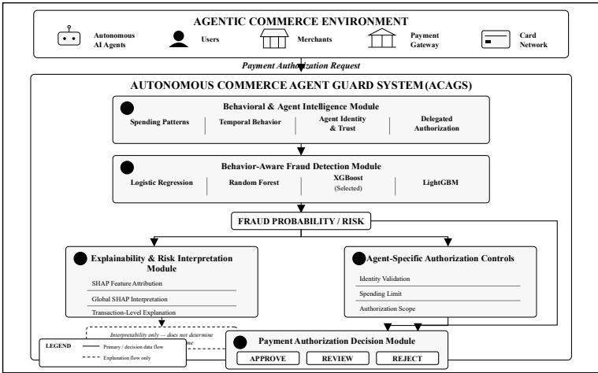
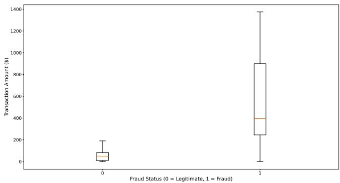
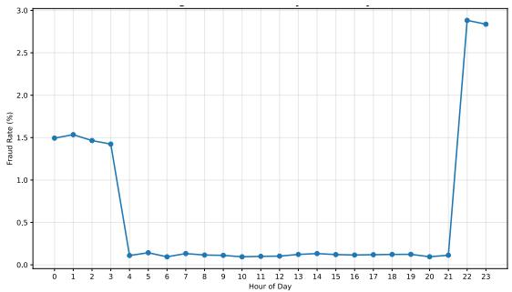
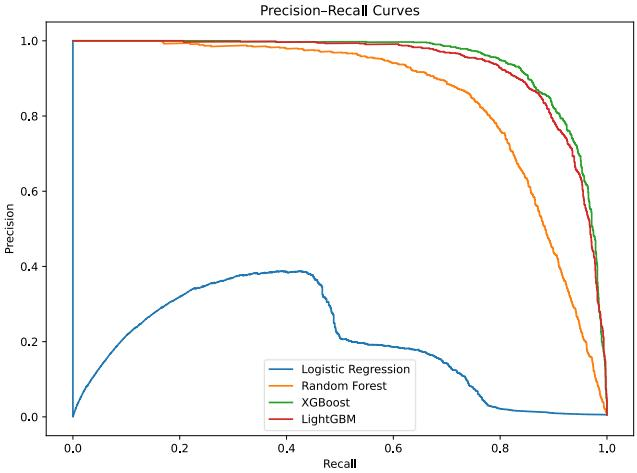
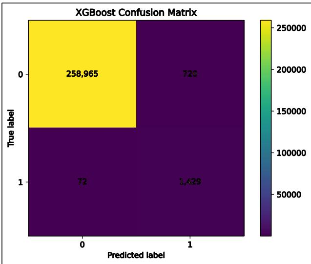
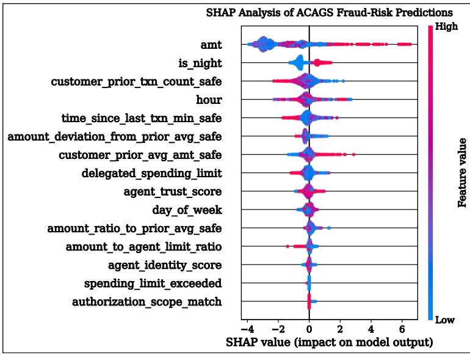
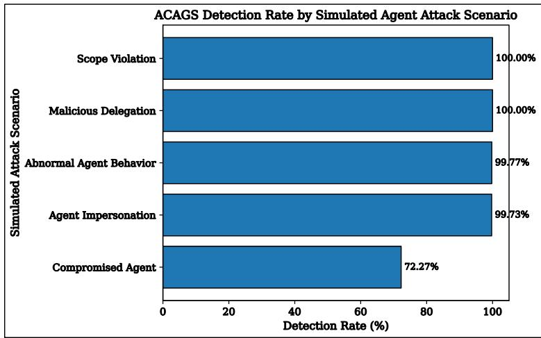
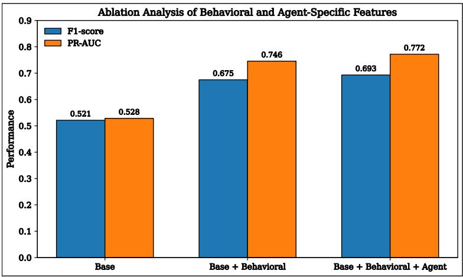
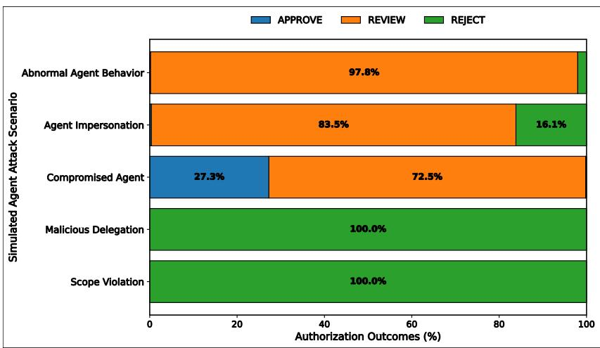

# SECURING AGENTIC COMMERCE THROUGH BEHAVIOR -AWARE FRAUD DETECTION AND CYBERSECURITY FOR TRUSTED AI-AGENT PAYMENT AUTHORIZATION

Kayode L. Ogunsusi

Credit and Fraud Risk, American Express, Phoenix, Arizona, USA

## ABSTRACT

The emergence of autonomous artificial intelligence (AI) agents in digital commerce introduces cybersecurity risks involving delegated authority, agent impersonation, compromised agents, malicious delegation, and unauthorized payment execution. This study proposes the Autonomous Commerce Agent Guard System (ACAGS), a behavior-aware cybersecurity framework integrating supervised machine learning, historical behavioral analysis, agent-specific authorization controls, and explainable AI for payment authorization. ACAGS was evaluated using a large-scale synthetic financial transaction dataset extended with a simulated agentic-commerce layer representing agent identity, delegated spending limits, authorization scope, trust characteristics, and five adversarial scenarios. XGBoost was selected as the primary classifier following comparative evaluation of four supervised learning models. Across 10 experimental runs, behavioral features increased mean F1-score from 52.12% to 67.49%, while the addition of agent-specific features further increased it to 69.46%. ACAGS detected 99.77% of abnormal agent behavior, 99.73% of agent impersonation, 100% of malicious delegation, and 100% of scope violations, while compromised-agent detection reached 72.27%.The authorization policy translated fraud and agent-policy risk into APPROVE, REVIEW, and REJECT outcomes, while SHAP provided interpretable fraud-risk explanations. These findings provide controlled experimental evidence that combining behavioral fraud detection with delegated-agent authorization controls can strengthen security assessment in simulated agentic-commerce payment environments, while validation using operational agent-initiated transactions remains necessary.

## KEYWORDS

Agentic Commerce, Cybersecurity, Fraud Detection, Payment Authorization, Autonomous AI Agents, Explainable AI, Behavioral Analytics, Machine Learning.

## 1. INTRODUCTIONS

The rapid advancement of artificial intelligence is transforming digital commerce from humanassisted online transactions to agentic commerce, where autonomous software agents can discover products, negotiate prices, make purchasing decisions, andexecute payment transactions on behalf of users with minimal human intervention[1]–[3]. This paradigm promises significant improvements in operational eficiency, personalized customer experiences, and transaction automation across digital marketplaces. As AI agents assume increasing responsibility for financial decision-making, however, payment authorization systems must evolve to verify not only transaction legitimacy but also the trustworthiness and behavioral consistency of autonomous purchasing entities [3], [4].

The growing adoption of autonomous purchasing agents introduces a new class of cybersecurity challenges that extends beyond traditional payment fraud. Unlike conventional e-commerce environments, agentic commerce relies on delegated financial authority, creating opportunities for AI-agent impersonation, authorization abuse, malicious prompt manipulation, credential compromise, and unauthorized transaction execution [2], [11], [12]. These emerging threats require security mechanisms capable of evaluating transaction context and behavioral patterns rather than relying solely on static rules or predefined fraud signatures. Consequently, behavioraware cybersecurity is becoming an essential component of next-generation payment authorization systems.

Financial institutions have made substantial progress in applying machine learning to fraud detection, with ensemble learning techniques such as Random Forest, XGBoost, and LightGBM demonstrating strong performance in classification and financial fraud-detection applications [5]– [7], [9], [10]. Recent studies have also shown that behavioral analytics and explainable AI improve fraud detection by incorporating customer spending patterns and increasing model transparency [8]–[10]. Nevertheless, most existing solutions are designed for conventional digital payment environments, where transactions are initiated directly by human users. As autonomous AI agents become active participants in commercial transactions, the assumptions underlying many existing fraud detection systems may no longer be suficient to address the evolving cybersecurity requirements of agentic commerce.

Although prior research has investigated financial fraud detection, behavioral analytics, explainable AI, and the security of autonomous commerce independently, comparatively little attention has been given to integrating these capabilities into a unified cybersecurity framework for securing payment authorization systems in emerging agentic commerce environments [3], [11]–[13]. This research gap highlights the need for frameworks that combine behavior-aware transaction analysis, intelligent fraud detection, and explainable decision-making while remaining adaptable to the evolving threat landscape associated with autonomous financial agents.

To address this gap, this study proposes the Autonomous Commerce Agent Guard System (ACAGS) , a cybersecurity framework for behavior-aware fraud detection and trusted payment authorization in agentic commerce. ACAGS integrates behavioral feature engineering, supervised machine learning, agent-specific authorization controls, and SHAP-based explainable AI to assess transaction risk and support interpretable authorization decisions. The study evaluates Logistic Regression, Random Forest, XGBoost, and LightGBM on a large-scale financial transaction dataset; extends the evaluation through simulated agent-specific features and adversarial scenarios; and performs ablation analysis, statistical testing, and authorizationoutcome assessment. Together, these contributions provide a behavior-aware and explainable approach for evaluating fraud and authorization risks in simulated agentic-commerce payment environments.

## 2. LITERATURE REVIEW

Existing research on agentic commerce spans payment authorization, cybersecurity, AI-based fraud detection, behavioral analytics, and explainable AI. While prior studies have advanced these areas individually, their integration within autonomous payment environments remains limited. This review examines these complementary areas and identifies the gap motivating the proposed ACAGS framework.

International Journal on Cybernetics & Informatics (IJCI) Vol.15, No.4, August 2026

## 2.1. Agentic Commerce and Payment Authorization

The rapid advancement of artificial intelligence is reshaping digital commerce from conventional user-driven transactions to agentic commerce, in which autonomous software agents can independently discover products, compare alternatives, negotiate prices, and execute purchasing decisions on behalf of users. Unlike traditional e-commerce, where payment authorization is explicitly initiated and verified by human participants, agentic commerce delegates portions of the purchasing and payment lifecycle to intelligent agents operating within predefined user preferences and authorization policies. This transformation has the potential to improve transaction eficiency, personalization, and scalability while fundamentally changing how financial transactions are initiated and authorized [1]–[4].

As autonomous agents increasingly participate in digital payments, authorization must extend beyond identity and credential verification to continuous behavioral assessment. Their interactions across merchants and financial institutions introduce risks involving delegated authority, compromised agents, and fraudulent transactions. Existing research largely emphasizes authorization and trust mechanisms, leaving a need for behavior-aware fraud detection that continuously evaluates transaction legitimacy in agentic commerce environments [3], [4], [11], [12].

## 2.2. Cybersecurity Challenges in Agentic Commerce

The increasing autonomy of AI-driven purchasing agents fundamentally expands the cybersecurity attack surface of digital payment ecosystems. Unlike conventional payment systems, where transaction authorization is directly initiated and monitored by human users, agentic commerce introduces delegated decision-making, allowing autonomous agents to execute purchases based on predefined objectives and contextual information. While this autonomy improves eficiency and scalability, it also creates new opportunities for adversaries to exploit authorization workflows through compromised agents, manipulated decision policies, prompt injection, identity spoofing, credential theft, and unauthorized transaction execution [11], [12], [15].

Existing security research has primarily focused on strengthening authentication, authorization protocols, trusted agent identities, and secure communication mechanisms for autonomous systems. Although these approaches improve the integrity of agent interactions, they generally emphasize preventive security controls rather than continuously assessing transaction behavior after authorization decisions have been initiated. Consequently, malicious or compromised agents may still generate transactions that satisfy authorization policies while exhibiting behavioral characteristics inconsistent with legitimate purchasing activities. Addressing this limitation requires cybersecurity frameworks capable of combining intelligent fraud detection with continuous behavioral analysis and explainable decision-making throughout the payment authorization process[11], [12], [14].

## 2.3. AI-Based Fraud Detection for Payment Systems

The increasing sophistication of financial fraud has driven widespread adoption of AI-based fraud detection techniques capable of identifying complex and evolving transaction patterns. Recent studies consistently demonstrate that ensemble learning methods outperform traditional statistical approaches in highly imbalanced payment datasets, achieving substantial improvements in fraud detection accuracy, precision, and recall. In particular, XGBoost, Random Forest, and LightGBM have been widely adopted because of their ability to capture nonlinear relationships among transactional attributes while maintaining strong predictive performance across diverse financial environments [9], [10].

Despite these advances, most existing fraud detection models are developed for conventional payment ecosystems in which transactions are initiated directly by human users. Their primary emphasis remains on improving predictive performance through feature optimization, class imbalance handling, or model tuning, with comparatively limited consideration of the cybersecurity implications introduced by autonomous purchasing agents. As payment authorization increasingly involves AI-driven decision-making, fraud detection must evolve beyond prediction accuracy to incorporate behavioral context, continuous transaction assessment, and explainable security mechanisms capable of supporting trustworthy authorization decisions in agentic commerce [12], [13].

## 2.4. Behavioral Analytics and Explainable AI

Behavioral analytics has become an increasingly important component of modern financial fraud detection by enabling security systems to evaluate transaction context rather than individual transactions in isolation. Recent studies show that features derived from historical spending behavior, transaction timing, merchant interactions, and customer purchasing patterns significantly improve the identification of anomalous financial activities compared with models relying solely on static transactional attributes. These behavioral representations provide additional contextual intelligence that enhances the ability to distinguish legitimate customer behavior from fraudulent transaction patterns [9], [10].

In parallel, explainable AI has emerged as an important requirement for deploying AI-based fraud detection systems within regulated financial environments. Techniques such as SHAP improve model transparency by quantifying the contribution of individual features to prediction outcomes, enabling analysts to interpret fraud decisions [8]. Explainability also supports broader requirements for trustworthy and accountable AI deployment in high-impact applications [14]. While behavioral analytics and explainability have each demonstrated value independently, their integration within cybersecurity frameworks specifically designed for agentic commerce payment authorization remains an emerging area of research [11]–[13].

## 2.5. Research Gap

The literature reviewed in the preceding subsections demonstrates significant progress in four complementary research areas: agentic commerce, cybersecurity for autonomous payment systems, AI-based financial fraud detection, and explainable behavioral analytics. Recent studies have strengthened payment authorization through improved authentication mechanisms, trust models, and machine learning-based fraud detection, while explainable AI has enhanced the transparency of predictive decision-making.Collectively, these advances have contributed to improving the security, reliability, and transparency of digital payment and AI-enabled financial systems [3], [8], [9], [14].

Despite these developments, several limitations remain. Existing fraud detection studies primarily target conventional payment environments, where transactions are initiated directly by human users, while research on agentic commerce has largely focused on authorization protocols, identity management, and trust establishment for autonomous agents. Comparatively limited attention has been given to integrating behavior-aware fraud detection, behavioral feature engineering, and explainable AI into a unified cybersecurity framework capable of continuously assessing payment authorization decisions in emerging agentic commerce environments.Addressing this gap is important for strengthening the security, transparency, and trustworthiness of next-generation digital payment systems as autonomous agents assume greater roles in commercial transactions [3], [4], [11]–[13].

Table 1. Comparison of Representative Studies and the Proposed ACAGS Framework
<table><tr><td rowspan=1 colspan=1>Study</td><td rowspan=1 colspan=1>AI-BasedFraudDetection</td><td rowspan=1 colspan=1>BehavioralAnalytics</td><td rowspan=1 colspan=1>ExplainableAI</td><td rowspan=1 colspan=1>AgenticCommerce</td><td rowspan=1 colspan=1>Security/AuthorizationControls</td></tr><tr><td rowspan=1 colspan=1>Establishedfraud-detectionstudies   [9],[10]</td><td rowspan=1 colspan=1>√</td><td rowspan=1 colspan=1>Partial</td><td rowspan=1 colspan=1>X</td><td rowspan=1 colspan=1>X</td><td rowspan=1 colspan=1>Partial</td></tr><tr><td rowspan=1 colspan=1>ExplainableAI method [8]</td><td rowspan=1 colspan=1>X</td><td rowspan=1 colspan=1>X</td><td rowspan=1 colspan=1>√</td><td rowspan=1 colspan=1>X</td><td rowspan=1 colspan=1>X</td></tr><tr><td rowspan=1 colspan=1>Agenticcommerceinfrastructurestudies [11]–[13]</td><td rowspan=1 colspan=1>X</td><td rowspan=1 colspan=1>Partial</td><td rowspan=1 colspan=1>X</td><td rowspan=1 colspan=1>√</td><td rowspan=1 colspan=1>√</td></tr><tr><td rowspan=1 colspan=1>Agenticpayment andauthorizationstudies  [3],[4]</td><td rowspan=1 colspan=1>X</td><td rowspan=1 colspan=1>X</td><td rowspan=1 colspan=1>X</td><td rowspan=1 colspan=1>√</td><td rowspan=1 colspan=1>√</td></tr><tr><td rowspan=1 colspan=1>ProposedACAGS</td><td rowspan=1 colspan=1>√</td><td rowspan=1 colspan=1>√</td><td rowspan=1 colspan=1>√</td><td rowspan=1 colspan=1>√</td><td rowspan=1 colspan=1>√</td></tr></table>

The comparative analysis indicates that existing research generally addresses fraud detection, explainability, agentic payment infrastructure, or security and authorization controls as distinct areas. In contrast, the proposed Autonomous Commerce Agent Guard System (ACAGS) integrates these complementary capabilities into a unified cybersecurity framework designed to strengthen behavior-aware fraud detection for agentic commerce payment authorization systems. The following section presents the architecture and key components of the proposed framework.

## 3. PROPOSED ACAGS FRAMEWORK

The increasing adoption of autonomous AI agents in digital commerce requires cybersecurity solutions that extend beyond conventional payment fraud detection. Existing payment authorization mechanisms primarily evaluate transaction legitimacy using predefined rules or predictive models, but they provide limited capability to continuously assess behavioral consistency within autonomous purchasing environments. To address this challenge, this paper proposes the Autonomous Commerce Agent Guard System (ACAGS), a cybersecurity framework designed to strengthen behavior-aware fraud detection for payment authorization systems operating in agentic commerce.ACAGS integrates behavioral and agent intelligence, AIbased fraud detection, agent-specific authorization controls, and explainable decision support into a unified framework for secure and interpretable payment authorization.

The framework is designed as a modular architecture that analyzes transaction behavior before supporting payment authorization decisions. Rather than relying solely on static transaction attributes, ACAGS evaluates contextual behavioral characteristics—including spending patterns, temporal activity, merchant interactions, and customer transaction history—to identify anomalous payment behavior that may indicate fraudulent activity.By combining behavioral intelligence, agent-specific authorization controls, and explainable AI, the framework supports fraud-riskagent-specific authorization controls, and explainable AI, the framework supports fraud-risk assessment and interpretable authorization within autonomous payment environments.assessment and interpretable authorization within autonomous payment environments.

## 3.1. Design Objectives3.1. Design Objectives

The proposed Autonomous Commerce Agent Guard System (ACAGS) was designed toThe proposed Autonomous Commerce Agent Guard System (ACAGS) was designed to strengthen cybersecurity in agentic commerce payment authorization systems by integratingstrengthen cybersecurity in agentic commerce payment authorization systems by integrating behavior-aware fraud detection, agent-specific authorization controls, and explainable AI. Thebehavior-aware fraud detection, agent-specific authorization controls, and explainable AI. The framework aims to (i) enhance fraud detection through contextual behavioral analysis, (ii)framework aims to (i) enhance fraud detection through contextual behavioral analysis, (ii) incorporate agent identity, delegated authority, and authorization-scope constraints intoincorporate agent identity, delegated authority, and authorization-scope constraints into transaction assessment, (iii) provide transparent and interpretable fraud-risk explanations, (iv)transaction assessment, (iii) provide transparent and interpretable fraud-risk explanations, (iv) support secure payment authorization through APPROVE, REVIEW, and REJECT outcomes,support secure payment authorization through APPROVE, REVIEW, and REJECT outcomes, and (v) maintain a modular architecture adaptable to existing payment authorizationand (v) maintain a modular architecture adaptable to existing payment authorization infrastructures. These objectives establish the design foundation of ACAGS and guide theinfrastructures. These objectives establish the design foundation of ACAGS and guide the framework architecture presented in Figure 1.framework architecture presented in Figure 1.

  
Figure 1. Architecture of ACAGS for behavior-aware fraud detection and agent-aware paymentFigure 1. Architecture of ACAGS for behavior-aware fraud detection and agent-aware payment authorizationauthorization

## 3.2. Framework Architecture3.2. Framework Architecture

Figure 1 illustrates the architecture of the proposed Autonomous Commerce Agent Guard SystemFigure 1 illustrates the architecture of the proposed Autonomous Commerce Agent Guard System (ACAGS), a modular cybersecurity framework designed to strengthen payment authorization in(ACAGS), a modular cybersecurity framework designed to strengthen payment authorization in agentic commerce environments through behavior-aware fraud detection and agent-specificagentic commerce environments through behavior-aware fraud detection and agent-specific authorization controls. The framework processes each payment authorization request through fiveauthorization controls. The framework processes each payment authorization request through five interconnected functional modules: the Behavioral and Agent Intelligence Module, the Behavior-interconnected functional modules: the Behavioral and Agent Intelligence Module, the Behavior-Aware Fraud Detection Module, the Explainability and Risk Interpretation Module, the Agent-Aware Fraud Detection Module, the Explainability and Risk Interpretation Module, the Agent-Specific Authorization Controls Module, and the Payment Authorization Decision Module.Specific Authorization Controls Module, and the Payment Authorization Decision Module. Together, these modules integrate behavioral risk assessment, agent-specific authorizationTogether, these modules integrate behavioral risk assessment, agent-specific authorization controls, and explainable decision support within the payment authorization workflow.controls, and explainable decision support within the payment authorization workflow.

The Behavioral and Agent Intelligence Module transforms raw payment transactions intoThe Behavioral and Agent Intelligence Module transforms raw payment transactions into behavior-aware and agent-aware representations. It derives contextual characteristics includingbehavior-aware and agent-aware representations. It derives contextual characteristics including customer spending patterns, temporal behavior, merchant interactions, historical transactioncustomer spending patterns, temporal behavior, merchant interactions, historical transaction activity, agent identity and trust, and delegated authorization information. These features provideactivity, agent identity and trust, and delegated authorization information. These features provide the contextual information required for fraud-risk assessment and agent-aware paymentthe contextual information required for fraud-risk assessment and agent-aware payment authorization.authorization.

The extracted features are subsequently evaluated by the Behavior-Aware Fraud Detection Module, which supports multiple supervised learning classifiers. Logistic Regression, Random Forest, XGBoost, and LightGBM were comparatively evaluated under identical experimental conditions. Based on the baseline results presented in Section 5.1, XGBoost provided the strongest overall balance across the evaluated performance metrics and was therefore selected as the primary classifier for the subsequent agent-aware experiments.

To improve decision transparency, fraud predictions are forwarded to the Explainability and Risk Interpretation Module, where SHAP [8] quantifies the contribution of individual features to model predictions. The resulting explanations support interpretation of fraud-risk assessments but do not determine authorization outcomes. In parallel, the Agent-Specific Authorization Controls Module evaluates agent identity, delegated spending limits, and authorization scope. The Payment Authorization Decision Module then combines the predicted fraud risk with these agentspecific controls to produce APPROVE, REVIEW, or REJECT outcomes. This modular workflow separates model explainability from authorization logic while integrating behavioral fraud detection and agent-specific controls within the ACAGS framework.

## 3.3. Behavioral and Agent Intelligence Module

The Behavioral and Agent Intelligence Module transforms raw payment transaction data into contextual representations that support fraud-risk assessment and agent-aware authorization. It captures monetary behavior, temporal behavior, merchant interactions, historical customer activity, and agent-specific information including identity, trust, delegated spending limits, and authorization scope.

Monetary and temporal features characterize spending amounts, transaction timing, and frequency, while merchant and historical features capture purchasing relationships and prior customer activity. Agent-specific attributes provide additional context regarding the identity, trustworthiness, and delegated authority of the autonomous agent initiating the transaction.

The extracted features are subsequently forwarded to the Behavior-Aware Fraud Detection Module, where they are used to assess transaction risk and support secure payment authorization decisions.

## 3.4. Behavior-Aware Fraud Detection Module

The Behavior-Aware Fraud Detection Module evaluates the features generated by the Behavioral and Agent Intelligence Module to estimate the likelihood of fraudulent activity during payment authorization.ACAGS supports multiple supervised machine learning classifiers, including Logistic Regression, Random Forest, XGBoost, and LightGBM, enabling comparative evaluation under consistent experimental conditions.

The predictions generated by the Behavior-Aware Fraud Detection Module are interpreted using SHAP [8] within the Explainability and Risk Interpretation Module, providing transparent feature-level explanations of fraud-risk predictions. The predicted fraud probability is separately passed to the Payment Authorization Decision Module, where it is evaluated alongside agentspecific authorization controls to produce APPROVE, REVIEW, or REJECT outcomes. SHAP supports interpretation of the fraud-risk assessment but does not independently determine the authorization decision.

## 3.5. Threat Model

ACAGS is designed to address cybersecurity threats that arise when autonomous AI agents initiate payment transactions under delegated authority. Unlike conventional payment environments in which transactions are initiated directly by users, agentic commerce introduces software agents capable of selecting products, interacting with merchants, and executing payments on behalf of customers.This autonomy expands the attack surface by introducing risks associated with agent identity, delegation, authorization scope, and compromised agent behavior [3], [11]–[13].

The threat model considers payment authorization systems, customer financial accounts, transaction integrity, delegated authorization policies, and agent credentials as protected assets. Potential adversaries include external cybercriminals, compromised or malicious autonomous agents, account-takeover attackers, and other actors seeking to exploit delegated payment authority. Five agent-specific attack scenarios are considered: compromised agent, in which a legitimate agent is manipulated or taken over; agent impersonation, in which an attacker attempts to operate as a trusted agent; malicious delegation, involving misuse of delegated spending authority; scope violation, in which an agent attempts activity outside its permitted authorization scope; and abnormal agent behavior, representing significant deviations from expected agent transaction patterns.

ACAGS assumes that conventional authentication and access-control mechanisms remain part of the underlying payment infrastructure. The framework therefore does not replace authentication or payment-network security controls. Instead, it introduces an additional cybersecurity layer that evaluates transaction-level behavioral risk together with agent identity, trust, delegated spending limits, and authorization-scope constraints. This design enables transactions exhibiting elevated fraud probability or agent-policy violations to be escalated for review or rejection while lowerrisk activity may proceed through the authorization workflow.

The threat model consequently combines behavioral anomaly detection with explicit agentauthorization controls. This distinction is important because some attacks may occur through apparently valid agent credentials and therefore may not be identifiable through identity verification alone. The subsequent experimental evaluation operationalizes these five attack scenarios in a controlled simulated agentic-commerce environment to assess their detectability and resulting authorization outcomes.

## 4. RESEARCH METHODOLOGY

The research methodology was designed to evaluate the behavior-aware fraud detection and agent-aware authorization components of ACAGS. The evaluation combines behavioral feature engineering, supervised machine learning, a controlled agentic-commerce simulation, explainable AI, and agent-specific authorization controls. Four classifiers—Logistic Regression, Random Forest, XGBoost, and LightGBM—were comparatively evaluated, followed by extended experiments assessing agent-specific attack scenarios, feature contributions through ablation analysis, statistical significance, and authorization outcomes. SHAP analysis was additionally applied to interpret the factors influencing fraud-risk predictions.

## 4.1. Experimental Design

Four supervised machine learning classifiers—Logistic Regression, Random Forest, XGBoost, and LightGBM—were initially evaluated under identical experimental conditions to establish

baseline fraud-detection performance. XGBoost was subsequently used for the extended ACAGS experiments involving behavioral and agent-specific features, simulated agent attacks, ablation analysis, statistical validation, explainability, and authorization-outcome assessment.

## 4.2. Dataset and Agentic-Commerce Simulation

The experimental evaluation utilized the Credit Card Transactions Fraud Detection Dataset [17], a publicly available synthetic financial transaction dataset hosted on Kaggle and generated using the Sparkov Data Generation tool. The analysis used the fraudTrain.csv dataset, containing1,296,675 transactions, of which1,289,169 are legitimate and 7,506 are fraudulent. The dataset includes transaction, customer, merchant, geographic, and temporal attributes relevant to payment authorization, including transaction amount, merchant category, transaction time, customer location, and merchant location.

Given the limited availability of publicly accessible datasets specifically representing autonomous agent-initiated payment transactions, the transaction dataset was extended through a controlled agentic-commerce simulation. Simulated autonomous AI agents were associated with customer transactions and assigned agent-specific attributes representing agent identity, trust, delegated spending limits, and authorization scope. These attributes enabled the conventional transaction environment to be augmented with delegated authorization characteristics required to evaluate agent-aware payment security.

The simulation introduced five agent-specific attack scenarios consistent with the threat model defined in Section 3.5: compromised agent, agent impersonation, malicious delegation, scope violation, and abnormal agent behavior. A compromised-agent scenario represents misuse of an otherwise legitimate agent; agent impersonation represents attempts to operate as a trusted agent; malicious delegation represents abuse of delegated spending authority; scope violation represents activity outside the agent’s permitted authorization scope; and abnormal agent behavior represents substantial deviations from expected transaction patterns. These scenarios were designed to evaluate the ability of behavioral risk signals and explicit authorization controls to identify malicious or policy-violating agent activity.

The resulting simulated environment contained 1,422 autonomous AI agents and 12,317 agentattack transactions distributed across the five attack scenarios. Agent-specific variables were combined with transaction and behavioral features to support the extended fraud-risk and authorization experiments. The simulation represents a controlled experimental extension of the underlying transaction dataset rather than observations from a production agentic-commerce payment system.

Data preprocessing included the removal of non-modeling identifiers, categorical feature encoding, replacement of infinite values, and median imputation of missing feature values. For the baseline classifier comparison, the processed transaction dataset was partitioned into 80% training and 20% testing subsets using stratified sampling to preserve the fraud-class distribution. A fixed random state and identical data partition were used across the evaluated classifiers to ensure a consistent comparative assessment.

## 4.3. Behavioral Feature Engineering

Behavior-aware features were engineered to capture deviations between current transactions and historical customer activity. These included transaction amount relative to prior spending, spending deviation, transaction hour, nighttime activity, time since the previous transaction, prior transaction activity, and customer–merchant and customer–category interactions. Historical

International Journal on Cybernetics & Informatics (IJCI) Vol.15, No.4, August 2026International Journal on Cybernetics & Informatics (IJCI) Vol.15, No.4, August 2026

features were calculated using only transactions occurring before the transaction being evaluated,features were calculated using only transactions occurring before the transaction being evaluated, thereby reducing the risk of data leakage.thereby reducing the risk of data leakage.

As shown in Figure 2, fraudulent transactions generally exhibited higher amounts and greaterAs shown in Figure 2, fraudulent transactions generally exhibited higher amounts and greater variability than legitimate transactions, supporting the inclusion of monetary behavioral features.variability than legitimate transactions, supporting the inclusion of monetary behavioral features.

Temporal patterns also provided useful discriminatory information. Figure 3 shows variation inTemporal patterns also provided useful discriminatory information. Figure 3 shows variation in fraud rates throughout the day, including elevated rates during late-night periods, supporting thefraud rates throughout the day, including elevated rates during late-night periods, supporting the inclusion of transaction hour and nighttime activity as behavioral features.inclusion of transaction hour and nighttime activity as behavioral features.

Figure 2. Transaction amount distribution by fraud statusFigure 2. Transaction amount distribution by fraud status  
  
Figure 3. Hourly fraud rate across the evaluation datasetFigure 3. Hourly fraud rate across the evaluation dataset

As shown in Figure 3, fraud rates are not uniformly distributed throughout the day.Elevated fraudAs shown in Figure 3, fraud rates are not uniformly distributed throughout the day.Elevated fraud rates are observed during late-night hours, suggesting that transaction timing may provide usefulrates are observed during late-night hours, suggesting that transaction timing may provide useful discriminatory information for fraud detection. These findings further justify incorporating time-discriminatory information for fraud detection. These findings further justify incorporating timedependent behavioral variables into the proposed ACAGS framework.dependent behavioral variables into the proposed ACAGS framework.

## 4.4. Model Development and Experimental Validation4.4. Model Development and Experimental Validation

Four supervised learning classifiers—Logistic Regression, Random Forest [5], XGBoost [6], andFour supervised learning classifiers—Logistic Regression, Random Forest [5], XGBoost [6], and LightGBM [7]—were evaluated using the same training and testing partitions.These models wereLightGBM [7]—were evaluated using the same training and testing partitions.These models were selected to compare linear and ensemble-based approaches under consistent experimentalselected to compare linear and ensemble-based approaches under consistent experimental conditions. Based on the baseline evaluation, XGBoost was selected as the primary classifier forconditions. Based on the baseline evaluation, XGBoost was selected as the primary classifier for the subsequent agent-aware ACAGS experiments.the subsequent agent-aware ACAGS experiments.

To quantify the contribution of the proposed feature layers, an ablation study compared threeTo quantify the contribution of the proposed feature layers, an ablation study compared three configurations: base transaction features, base plus behavioral features, and base plus behavioralconfigurations: base transaction features, base plus behavioral features, and base plus behavioral and agent-specific features. Robustness was assessed across 10 independent random seeds usingand agent-specific features. Robustness was assessed across 10 independent random seeds using

International Journal on Cybernetics & Informatics (IJCI) Vol.15, No.4, August 2026

identical seeds for each feature configuration, enabling paired comparisons. Statistical significance was evaluated using paired t-tests and Wilcoxon signed-rank tests at a significance level of $\alpha = 0 . 0 5$

## 4.5. Evaluation Metrics and Statistical Validation

Model performance was evaluated using Accuracy, Precision, Recall, F1-score, ROC-AUC, and Precision–Recall AUC (PR-AUC). Given the substantial class imbalance in the dataset, particular emphasis was placed on Recall, F1-score, and PR-AUC when assessing fraud-detection performance. The principal classification metrics were calculated as follows:

$$
\mathrm { A c c u r a c y } = { \frac { \mathrm { T P } + \mathrm { T N } } { \mathrm { T P } + \mathrm { T N } + \mathrm { F P } + \mathrm { F N } } }
$$

$$
\mathrm { P r e c i s i o n } = { \frac { \mathrm { T P } } { \mathrm { T P } + \mathrm { F P } } }
$$

$$
{ \mathrm { R e c a l l } } = { \frac { \mathrm { T P } } { \mathrm { T P } + { \mathrm { F N } } } }
$$

$$
\mathrm { F } 1 = 2 \times \frac { \mathrm { P r e c i s i o n } \times \mathrm { R e c a l l } } { \mathrm { P r e c i s i o n } + \mathrm { R e c a l l } }
$$

where TP, TN, FP, and FN denote true positives, true negatives, false positives, and false negatives, respectively. ROC-AUC measures the model’s discrimination across classification thresholds, while PR-AUC summarizes the precision–recall trade-of and is particularly informative for imbalanced fraud-detection problems.The extended agent-aware evaluation additionally measured attack-specific detection rate, authorization outcomes, legitimate transaction escalation rate, and transaction-value exposure.

Attack-specific detection rate was calculated as:

$$
{ \mathrm { A t t a c k ~ D e t e c t i o n ~ R a t e } } = { \frac { N _ { \mathrm { d e t e c t e d } } } { N _ { \mathrm { a t t a c k } } } } \times 1 0 0 
$$

Where $\mathrm { N _ { d e t e c t e d } }$ represents the number of detected attack transactions and $\mathrm { N _ { a t t a c k } }$ represents the total number of transactions associated with the corresponding simulated attack scenario.

To evaluate the contribution and stability of the feature groups, ablation experiments were conducted across 10 paired runs using three configurations: base transaction features, base plus behavioral features, and base plus behavioral and agent-specific features. Diferences between configurations were assessed using paired t-tests and Wilcoxon signed-rank tests, with statistical significance evaluated at p<0.05.

## 4.6. Explainable Artificial Intelligence (SHAP)

To improve transparency in fraud-risk assessment, ACAGS applies SHapley Additive exPlanations (SHAP) [8] to the selected XGBoost model. SHAP estimates the contribution of individual features to model predictions, enabling both global interpretation of influential variables and transaction-level explanation of fraud-risk scores.

In ACAGS, SHAP is used only for interpretation and does not directly determine the payment authorization outcome. The fraud probability generated by XGBoost is passed separately to the authorization mechanism, where it is evaluated alongside agent-specific controls such as identity validation, delegated spending limits, authorization scope, and delegation constraints. This separation preserves a clear distinction between model explanationandauthorization decisionmaking.

## 4.7. ACAGS Authorization Decision Policy

The final ACAGS authorization mechanism combines the fraud probability generated by the selected XGBoost model with agent-specific authorization controls. These controls evaluate agent identity, delegated spending limits, authorization scope, and delegation constraints before determining the transaction outcome. SHAP explanations remain separate from this decision logic and are used only to interpret the underlying fraud-risk prediction.

Each transaction is assigned one of three outcomes: APPROVE, REVIEW, or REJECT. Transactions satisfying the required agent-authorization constraints and exhibiting low fraud risk are approved, while transactions with elevated behavioral or fraud risk are routed for review. Transactions involving explicit authorization violations, such as invalid delegation or activity outside the permitted scope, are rejected. This layered decision mechanism allows ACAGS to distinguish uncertain behavioral risk from explicit policy violations rather than treating all suspicious transactions identically.

The authorization logic was applied consistently across the simulated agentic-commerce transactions, enabling subsequent evaluation of attack-specific authorization outcomes, legitimate transaction escalation, and transaction-value exposure.

## 5. PERFORMANCE EVALUATION

The performance evaluation examines the efectiveness of ACAGS through comparative model assessment, behavioral feature analysis, explainability, simulated agent-attack evaluation, ablation analysis, and authorization outcomes. The evaluated classifiers are assessed using complementary performance metrics suited to highly imbalanced fraud data, while SHAP analysis examines the factors influencing fraud-risk predictions. Together, these evaluations assess the predictive performance, interpretability, and agent-aware authorization behavior of the proposed framework.

## 5.1. Baseline Fraud-Detection Performance

The baseline fraud-detection component of ACAGS was evaluated using four supervised machine learning classifiers under identical experimental conditions. Model performance was assessed using Accuracy, Precision, Recall, F1-score, ROC-AUC, and Precision–Recall AUC (PR-AUC). The comparative results are summarized in Table 2.

Table 2. Comparative Performance of Evaluated Machine Learning ClassifiersTable 2. Comparative Performance of Evaluated Machine Learning Classifiers
<table><tr><td rowspan=1 colspan=1>Model</td><td rowspan=1 colspan=1>Accuracy</td><td rowspan=1 colspan=1>Precision</td><td rowspan=1 colspan=1>Recall</td><td rowspan=1 colspan=1>F1-Score</td><td rowspan=1 colspan=1>ROC-AUC</td><td rowspan=1 colspan=1>PR-AUC</td></tr><tr><td rowspan=1 colspan=1>LogisticRegression</td><td rowspan=1 colspan=1>0.9441</td><td rowspan=1 colspan=1>0.0736</td><td rowspan=1 colspan=1>0.7535</td><td rowspan=1 colspan=1>0.1342</td><td rowspan=1 colspan=1>0.8776</td><td rowspan=1 colspan=1>0.1938</td></tr><tr><td rowspan=1 colspan=1>Random Forest</td><td rowspan=1 colspan=1>0.9972</td><td rowspan=1 colspan=1>0.7221</td><td rowspan=1 colspan=1>0.8221</td><td rowspan=1 colspan=1>0.7688</td><td rowspan=1 colspan=1>0.9946</td><td rowspan=1 colspan=1>0.8494</td></tr><tr><td rowspan=1 colspan=1>XGBoost</td><td rowspan=1 colspan=1>0.9970</td><td rowspan=1 colspan=1>0.6698</td><td rowspan=1 colspan=1>0.9514</td><td rowspan=1 colspan=1>0.7861</td><td rowspan=1 colspan=1>0.9991</td><td rowspan=1 colspan=1>0.9459</td></tr><tr><td rowspan=1 colspan=1>LightGBM</td><td rowspan=1 colspan=1>0.9917</td><td rowspan=1 colspan=1>0.4082</td><td rowspan=1 colspan=1>0.9773</td><td rowspan=1 colspan=1>0.5759</td><td rowspan=1 colspan=1>0.9991</td><td rowspan=1 colspan=1>0.9376</td></tr></table>

As shown in Table 2, the ensemble-based classifiers substantially outperformed LogisticAs shown in Table 2, the ensemble-based classifiers substantially outperformed Logistic Regression. XGBoost provided the strongest overall balance, achieving an F1-score of 0.7861,Regression. XGBoost provided the strongest overall balance, achieving an F1-score of 0.7861, ROC-AUC of 0.9991, and the highest PR-AUC of 0.9459. Random Forest achieved the highestROC-AUC of 0.9991, and the highest PR-AUC of 0.9459. Random Forest achieved the highest Precision (0.7221), while LightGBM produced the highest Recall (0.9773) but substantiallyPrecision (0.7221), while LightGBM produced the highest Recall (0.9773) but substantially lower Precision. Based on its balanced performance, XGBoost was selected as the primarylower Precision. Based on its balanced performance, XGBoost was selected as the primary classifier for the subsequent agent-aware ACAGS experiments.classifier for the subsequent agent-aware ACAGS experiments.

  
Figure 4. Precision–Recall curves for the evaluated classifiersFigure 4. Precision–Recall curves for the evaluated classifiers

As illustrated in Figure 4, XGBoost achieved the strongest precision–recall performance amongAs illustrated in Figure 4, XGBoost achieved the strongest precision–recall performance among the evaluated classifiers, consistent with its highest PR-AUC of 0.9459. This result is particularlythe evaluated classifiers, consistent with its highest PR-AUC of 0.9459. This result is particularly relevant given the substantial class imbalance in the evaluation dataset.relevant given the substantial class imbalance in the evaluation dataset.

  
Figure 5. Confusion matrix of the selected XGBoost classifierFigure 5. Confusion matrix of the selected XGBoost classifier

Figure 5 demonstrates that the selected XGBoost classifier correctly identified 1,429 fraudulentFigure 5 demonstrates that the selected XGBoost classifier correctly identified 1,429 fraudulent transactions, while 72 fraudulent transactions remained undetected. The model also correctlytransactions, while 72 fraudulent transactions remained undetected. The model also correctly classified 258,965 legitimate transactions, with 720 false-positive predictions. This balance isclassified 258,965 legitimate transactions, with 720 false-positive predictions. This balance is particularly desirable in payment authorization systems, where reducing missed fraud whileparticularly desirable in payment authorization systems, where reducing missed fraud while limiting unnecessary false alerts is important for maintaining both security and customerlimiting unnecessary false alerts is important for maintaining both security and customer experience.experience.

## 5.2. Explainability and Behavioral Analysis5.2. Explainability and Behavioral Analysis

SHAP analysis was applied to examine the contribution of transaction, behavioral, and agent-SHAP analysis was applied to examine the contribution of transaction, behavioral, and agentspecific features to XGBoost fraud-risk predictions. Transaction amount remained the dominantspecific features to XGBoost fraud-risk predictions. Transaction amount remained the dominant predictor, while temporal and historical behavioral characteristics—including nighttime activity,predictor, while temporal and historical behavioral characteristics—including nighttime activity, prior transaction count, time since the previous transaction, and deviation from prior spending—prior transaction count, time since the previous transaction, and deviation from prior spending— also influenced model output. Agent-specific variables, including delegated spending limit, agentalso influenced model output. Agent-specific variables, including delegated spending limit, agent trust score, transaction-to-agent-limit ratio, and agent identity score, provided additionaltrust score, transaction-to-agent-limit ratio, and agent identity score, provided additional information in the extended model. These results demonstrate that ACAGS combinesinformation in the extended model. These results demonstrate that ACAGS combines conventional transaction characteristics with historical behavior and delegated-agent contextconventional transaction characteristics with historical behavior and delegated-agent context when estimating fraud risk.when estimating fraud risk.

  
Figure 6. SHAP analysis of fraud-risk predictions in the extended ACAGS modelFigure 6. SHAP analysis of fraud-risk predictions in the extended ACAGS model

## 5.3. Simulated Agent-Attack Evaluation5.3. Simulated Agent-Attack Evaluation

ACAGS was evaluated against the five simulated agent-specific attack scenarios defined in theACAGS was evaluated against the five simulated agent-specific attack scenarios defined in the threat model. At the selected agent-risk threshold, the framework detected 99.77% of abnormalthreat model. At the selected agent-risk threshold, the framework detected 99.77% of abnormal agent behavior, 99.73% of agent impersonation, 100% of malicious delegation, 100% of scopeagent behavior, 99.73% of agent impersonation, 100% of malicious delegation, 100% of scope violations, and 72.27% of compromised-agent attacks.The comparatively lower detection rate forviolations, and 72.27% of compromised-agent attacks.The comparatively lower detection rate for compromised agents indicates that malicious activity conducted through otherwise legitimatecompromised agents indicates that malicious activity conducted through otherwise legitimate agent credentials presents a more dificult detection problem than malicious delegation or scopeagent credentials presents a more difficult detection problem than malicious delegation or scope violations.violations.

  
Figure 7. ACAGS detection rate by simulated agent attack scenarioFigure 7. ACAGS detection rate by simulated agent attack scenario

## 5.4. Ablation and Statistical Validation5.4. Ablation and Statistical Validation

The ablation analysis evaluated the incremental contribution of behavioral and agent-specificThe ablation analysis evaluated the incremental contribution of behavioral and agent-specific features across 10 paired experimental runs. Mean F1-score increased from 0.5212 using basefeatures across 10 paired experimental runs. Mean F1-score increased from 0.5212 using base transaction features to 0.6749 with behavioral features and 0.6946 after incorporating agent-transaction features to 0.6749 with behavioral features and 0.6946 after incorporating agentspecific features. Mean PR-AUC similarly increased from 0.5282to 0.7455 and 0.7723,specific features. Mean PR-AUC similarly increased from 0.5282to 0.7455 and 0.7723, respectively. Paired t-tests showed statistically significant improvements from base to behavioralrespectively. Paired t-tests showed statistically significant improvements from base to behavioral features and from behavioral to behavioral-plus-agent features across F1-score, ROC-AUC, andfeatures and from behavioral to behavioral-plus-agent features across F1-score, ROC-AUC, and PR-AUCPR-AUC $( \mathtt { p } < 0 . 0 0 1 )$ . Wilcoxon signed-rank tests also produced). Wilcoxon signed-rank tests also produced $\mathrm { ~ p ~ < ~ } 0 . 0 5$ , providing non-, providing nonparametric support for the observed improvements.parametric support for the observed improvements.

  
Figure 8. Ablation analysis of behavioral and agent-specific featuresFigure 8. Ablation analysis of behavioral and agent-specific features

## 5.5. ACAGS Authorization and Operational Outcomes5.5. ACAGS Authorization and Operational Outcomes

The final ACAGS policy translated fraud-risk estimates and agent-specific authorization controlsThe final ACAGS policy translated fraud-risk estimates and agent-specific authorization controls into APPROVE, REVIEW, or REJECT outcomes. Scope violations and malicious delegationinto APPROVE, REVIEW, or REJECT outcomes. Scope violations and malicious delegation were rejected in 100% of simulated cases, while abnormal agent behavior was predominantlywere rejected in 100% of simulated cases, while abnormal agent behavior was predominantly routed to review (97.79%). Agent impersonation was primarily reviewed (83.46%) or rejectedrouted to review (97.79%). Agent impersonation was primarily reviewed (83.46%) or rejected (16.15%), whereas compromised-agent transactions were more dificult to resolve automatically,(16.15%), whereas compromised-agent transactions were more difficult to resolve automatically, with 72.52% routed to review and 27.29% approved. These results demonstrate that explicitwith 72.52% routed to review and 27.29% approved. These results demonstrate that explicit authorization violations can be rejected directly, while behaviorally uncertain activity can beauthorization violations can be rejected directly, while behaviorally uncertain activity can be escalated for additional review.escalated for additional review.

  
Figure 9. ACAGS authorization outcomes by simulated agent attack scenarioFigure 9. ACAGS authorization outcomes by simulated agent attack scenario

Across 259,335evaluated transactions, ACAGS approvedAcross 259,335evaluated transactions, ACAGS approved $9 8 . 5 9 9 \% _ { 9 } \mathrm { { . } }$ outed 0.731%to review, androuted 0.731%to review, and rejected 0.669%.Among fraudulent transactions, 65.09% were escalated to review or rejection,rejected 0.669%. Among fraudulent transactions, 65.09% were escalated to review or rejection, while 34.91% were automatically approved. In comparison, the escalation rate for legitimatewhile 34.91% were automatically approved. In comparison, the escalation rate for legitimate transactions was 1.03%, indicating a relatively low operational burden on legitimate activity. The total value of fraudulent transactions was \$812,865.18, of which \$671,908.03 (82.66%) was associated with transactions escalated for review or rejection. These values represent transactionvalue exposure under the experimental authorization policy and should not be interpreted as realized or prevented financial losses.

## 6. DISCUSSION

The experimental findings demonstrate that behavioral and agent-specific information can strengthen fraud-risk assessment within the evaluated ACAGS framework. The baseline experiments establish performance on conventional payment transactions, while the simulated agentic-commerce experiments provide controlled evidence across agent impersonation, compromised-agent activity, malicious delegation, scope violations, and abnormal agent behavior. The ablation and multi-run analyses further demonstrate measurable contributions from behavioral and agent-specific features. These findings should be interpreted within the simulated experimental setting and do not constitute evidence of performance in production agenticcommerce environments.

## 6.1. Interpretation of Results

The baseline results show that ensemble classifiers provide strong fraud-detection performance, with XGBoost ofering the most balanced performance across the evaluated metrics. The extended experiments further show that behavioral features substantially improve predictive performance over base transaction attributes, while agent-specific features provide additional gains. Across 10 runs, the combined behavioral and agent-specific configuration achieved higher mean F1-score, ROC-AUC, and PR-AUC than either the base or behavioral-only configurations, with statistical testing supporting the observed improvements.

Attack-specific results also reveal diferences in detection dificulty. Malicious delegation and scope violations were detected in 100% of simulated cases, while abnormal agent behavior and agent impersonation achieved detection rates of 99.77% and 99.73%, respectively. Compromised-agent attacks were more challenging, with a detection rate of 72.27%.This distinction suggests that agent-aware payment security should combine explicit authorization controls with behavioral risk assessment, particularly when malicious activity occurs through otherwise valid agent credentials.

From a practical perspective, the agent-aware design complements established authentication and authorization mechanisms by introducing behavioral and delegated-authorization controls for evaluating autonomous transactions. SHAP-based explanations further support interpretation of fraud-risk predictions without directly determining authorization outcomes.Such capabilities may become increasingly relevant as AI agents assume greater responsibility for initiating and executing commercial transactions on behalf of users [16].

## 6.2. Practical Implications for Agentic-Commerce Cybersecurity

The results indicate that ACAGS can support a layered authorization approach in which fraud probability, behavioral deviations, and agent-specific policy constraints contribute to transaction screening. Rather than treating all suspicious activity uniformly, the framework distinguishes explicit authorization violations from uncertain behavioral risk, allowing transactions to be approved, escalated for review, or rejected according to the observed risk condition.

The low 1.03% escalation rate for legitimate transactions suggests that this approach may limit unnecessary operational intervention while retaining stronger controls for suspicious activity. However, the 27.29% approval ratefor simulated compromised-agent transactions demonstrates that valid but compromised agent credentials remain an important challenge. Operational deployment would therefore require institution-specific threshold calibration, continuous monitoring, latency testing, governance controls, and validation against real-world transaction patterns.

## 6.3. Limitations

This study has several limitations. First, the agentic-commerce environment and attack scenarios were simulated, rather than derived from production autonomous-payment systems. Although the underlying transaction dataset provides a large-scale basis for fraud evaluation, the simulated agent identities, delegated authorization attributes, and attack behaviors may not capture the full complexity of real-world agentic commerce.

Second, the authorization thresholds and policy rules were evaluated under controlled experimental conditions and may require institution-specific calibration in operational environments. The study also does not evaluate production-level factors such as end-to-end authorization latency, system scalability, evolving adversarial behavior, or integration with live payment infrastructure. Future work should therefore validate ACAGS using real-world or industry-derived agentic transaction data, evaluate adaptive attack strategies, and assess performance under production-scale authorization requirements.

## 7. CONCLUSION AND FUTURE WORK

This study presented ACAGS, a cybersecurity framework for behavior-aware fraud detection and trusted AI-agent payment authorization in agentic commerce. The framework integrates behavioral feature engineering, machine-learning-based fraud assessment, agent-specific authorization controls, and explainable AI to evaluate autonomous payment transactions. Among the baseline classifiers, XGBoost achieved the strongest overall performance, while the extended experiments demonstrated that behavioral features substantially improved predictive performance and agent-specific features provided additional statistically significant gains.

Evaluation across five simulated agent-specific attack scenarios showed that ACAGS efectively identified explicit policy violations and abnormal agent activity, although compromised-agent attacks remained comparatively dificult to detect. The authorization mechanism further demonstrated the value of distinguishing uncertain behavioral risk from explicit authorization violations through APPROVE, REVIEW, and REJECT outcomes. These findings support the potential of combining behavioral risk assessment with delegated-authorization controls to strengthen cybersecurity in emerging agentic-commerce payment environments.

The results should be interpreted within the study’s controlled simulation setting rather than as evidence of production deployment performance. Future work should evaluate ACAGS using real-world agentic transaction data, investigate adaptive and coordinated agent attacks, optimize authorization thresholds, and assess latency, scalability, and integration with production payment infrastructure.

## REFERENCES

[1] OpenAI, "Introducing Operator," OpenAI, Jan. 2025. [Online]. Available: https://openai.com/index/introducing-operator/. Accessed: Aug. 2026.

[2] Anthropic, "Introducing Computer Use," Anthropic, Oct. 2024. [Online]. Available: https://www.anthropic.com/news/3-5-models-and-computer-use. Accessed: Aug. 2026.

[3] S. Davidovic and H. Tourpe, How Agentic AI Will Reshape Payments, IMF Notes, no. 2026/004, International Monetary Fund, Washington, DC, USA, Apr. 2026, doi: 10.5089/9781513533308.068.

[4] Visa, “Agentic Payments: What Onchain Data Reveals Commerce, Jul. 14, 2026. [Online]. Available: https://www.visa.com/en-us/thought-leadership/innovation/agentic-payments-from-theground-up. Accessed: Jul. 22, 2026.

[5] L. Breiman, "Random Forests," Machine Learning, vol. 45, no. 1, pp. 5–32, 2001.

[6] T. Chen and C. Guestrin, "XGBoost: A Scalable Tree Boosting System," Proc. 22nd ACM SIGKDD Int. Conf. Knowledge Discovery and Data Mining, pp. 785–794, 2016.

[7] G. Keet al., "LightGBM: A Highly Eficient Gradient Boosting Decision Tree," Advances in Neural Information Processing Systems, vol. 30, 2017.

[8] S. M. Lundberg and S.-I. Lee, "A Unified Approach to Interpreting Model Predictions," Advances in Neural Information Processing Systems, vol. 30, 2017.

[9] A. Dal Pozzolo, O. Caelen, Y.-A. Le Borgne, S. Waterschoot, and G. Bontempi, “Learned Lessons in Credit Card Fraud Detection from a Practitioner Perspective, Expert Systems with Applications, vol. 41, no. 10, pp. 4915–4928, 2014, doi: 10.1016/j.eswa.2014.02.026.

[10] A. Carcillo et al., “Combining Unsupervised and Supervised Learning in Credit Card Fraud Detection, Information Sciences, vol. 557, pp. 317–331, 2021, doi: 10.1016/j.ins.2019.05.042.

[11] K. See and X. W. Tan, "Compliance-Aware Agentic Payments on Stablecoin Rails," arXiv preprint arXiv:2605.00071, 2026.

[12] A. de Valois-Franklin and A. Bogdan, "RAILS: Verification-Native Clearing for Agentic Commerce," arXiv preprint arXiv:2606.08790, 2026.

[13] S. Fan et al., "Agentic Commerce World: An Auditable and Verifiable Environment for Vibe Commerce," arXiv preprint arXiv:2608.02441, 2026.

[14] E. Tabassi, Artificial Intelligence Risk Management Framework (AI RMF 1.0), National Institute of Standards and Technology, Gaithersburg, MD, USA, NIST AI 100-1, Jan. 2023, doi: 10.6028/NIST.AI.100-1.

[15] OWASP Foundation, OWASP Top 10 for LLM Applications 2025, Version 2025, Nov. 2024. [Online]. Available: https://genai.owasp.org/resource/owasp-top-10-for-llm-applications-2025/. Accessed: Aug. 2026.

[16] ACI Worldwide, Agentic Commerce: The Payments Shift Merchants Can’t Ignore, White Paper, 2026.

[17] K. Singh, “Credit Card Transactions Fraud Detection Dataset, Kaggle. [Online]. Available: https://www.kaggle.com/datasets/kartik2112/fraud-detection. Accessed: Jul. 25, 2026.

[18] F. Rakhmatov and N. Karimov, “Anomaly Detection in Network Trafic Using Selected Statistical and Entropy-Based Features, International Journal on Cybernetics & Informatics, vol. 14, no. 5, pp. 1–12, 2025, doi: 10.5121/ijci.2025.140501.

[19] A. H. Wheeb and M. F. Khan, “A Survey of Several Machine Learning (ML) Algorithms for Security Solution in Internet of Things (IoT) Networks, Journal of Artificial Intelligence Research & Advances, vol. 12, no. 1, pp. 1–11, 2025.

## AUTHOR

Kayode Lateef Ogunsusi holds a bachelor’s degree in Industrial Mathematics, a master’s degree in Information Technology (Nigeria), and a master’s degree in Computer Science and Quantitative Methods from Austin Peay State University, USA. He is a product and risk management professional with experience in fraud mitigation, data analytics, and financial decision systems. His research interests include artificial intelligence, machine learning, agentic AI, financial risk management, and intelligent decision systems. He is currently a credit and fraud risk manager at American Express, where he uses his expertise in data analytics and

advanced risk strategies to enhance solutions that strengthen fraud risk management within the financial services industry.