# PreCoMem: Predictive Cognitive Memory for Self-Evolving Long-Term Dialogue Agents

Jian Zhong1∗ Zeyu Liu1∗ Pingchuan Cao1 Rongduo Han1 Shunye Tang1 Guohuan Xie3 Mingyuan Qin4 Ran Ji5 Xiao Liang2 Wei Wang1† Haining Zhang1†

1Nankai University 2vivo AI Lab 3Tsinghua University 4Huazhong University of Science and Technology 5University of the Chinese Academy of Sciences zhongjian@mail.nankai.edu.cn

## Abstract

Long-horizon dialogue agents need to keep user memories stable enough for personalization while adapting when the user genuinely changes. Existing memory systems often append every observation or overwrite old entries by heuristic rules, which makes transient noise hard to distinguish from real belief drift. We introduce PreCoMem, a memory consolidation framework inspired by predictive coding that represents memory as confidence-weighted beliefs about the user’s state. Its core signal, Effective Surprisal, combines semantic deviation and contradiction evidence, then downweights this signal when retrieval is diffuse and unreliable. According to effective surprisal, a two-threshold gate maps each turn to one of three deterministic updates: MAINTAIN reinforces supported beliefs, PROFILE stores ambiguous cues as low-confidence hypotheses, and CORRECT softly decays reliably contradicted facts. The PROFILE stage acts as an explicit waiting room, preventing premature commitment to noisy evidence. Experiments on LoCoMo, LongMemEval-S, and PersonaMem-v2 show consistent state-of-the-art accuracy; our new DiMoBench confirms that PreCoMem adapts to non-stationary belief drift without over-reacting to noise. The code is available at https://github.com/ ZhongWishing/PreCoMem.

## 1 Introduction

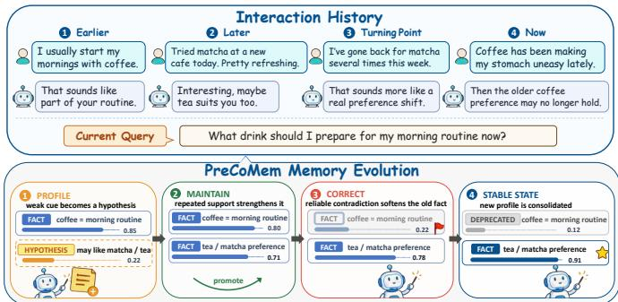  
Figure 1: Memory evolution case study (coffee → tea). PreCoMem autonomously manages the lifecycle of facts and hypotheses, achieving a stable transition between conflicting belief states without manual intervention.

Large Language Models (LLMs) are moving from stateless responders toward long-term partners that interact with the user over hundreds or thousands of turns [1–3]. Such partners need more than stored transcripts; they require a user model to sustain personalized interaction [4, 5]. To formalize the core units of this user model, we define a belief as a compact, actionable claim about the user’s preferences, goals, or life context, paired with a confidence weight that can be reinforced or revised over time. This user model underpins both agent personalization and behavioral self-correction, thereby redefining the role of long-term memory: rather than merely serving as simple context extension [6, 7], long-term memory enables the agent to maintain consistent behavior across sessions.

The harder question is not whether information can be stored, but how it should be consolidated and revised. A practical memory consolidation mechanism must decide which observations to retain, how strongly to trust them, and when to maintain, revise, or correct stored items without explicit supervision. We refer to this as the memory stability–plasticity problem: the agent should preserve stable user traits while remaining plastic enough to adapt when those traits change [8]. Long-horizon interaction makes the problem hard for three coupled reasons. First, most turns carry little signal, while a small fraction may contain cues indicative of more persistent user states. Second, user preferences and life facts evolve over time [9], so the system must adapt under non-stationarity and beliefdrift [10, 11]. Third, corrective feedback is rarely explicit [12], and noisy retrieval over long contexts further blurs the picture [13–16]. Therefore, the brittle memory update mechanism causes two opposite failures: premature correction from noise, or persistent over-reliance on outdated memories, which we call old-memory pull, a phenomenon related to loss of plasticity and retrieval interference in continual adaptation systems [8, 17].

Recent memory systems have made impressive progress on retrieval and storage organization. Hierar chical and OS-style stores [6, 18, 19], structured indices with timestamps or topic shards [20–23], and agentic retrievers [24, 25] all sharpen what the system can recall. However, the question of when to update is still often handled by recency overwriting, fixed-threshold importance, or one-shot append rules [4, 26]. These triggers cannot reliably separate persistent drift from transient noise [17], so they collapse the stability–plasticity trade-off precisely where long-horizon dialogue stresses it most. A fuller literature discussion is provided in Appendix Section A.

We draw inspiration from predictive coding, which posits that learning is driven by mismatch between expectation and reality, i.e., prediction error [27, 28]. In information theory the same quantity is called surprisal [29, 30]. We use this view as a design principle for the update path rather than as a claim that dialogue memory is a fully specified probabilistic model. The resulting criterion is simple: events consistent with current memory should be reinforced, while surprising events may require learning or correction [31, 32]. Crucially, surprisal must be paired with a measure of retrieval reliability, so that update decisions stay conservative when recall itself is uncertain or noisy [13, 33].

Building on this view, we propose PreCoMem (Predictive Cognitive Memory), a self-evolving long-term memory framework for conversational LLM agents. PreCoMem operates in two active phases over a shared memory store. In memory leveraging, it retrieves confidence-weighted beliefs to condition response generation. In memory evolution, it compares new observations with recalled evidence and computes Effective Surprisal Sef, a reliability-adjusted mismatch score. A two-threshold gate then routes each update to MAINTAIN, PROFILE, or CORRECT, corresponding to consistent, ambiguous, and reliably contradictory evidence. Figure 1 illustrates this loop on a coffee-to-tea preference shift, where a low-confidence hypothesis is gradually promoted to a fact while the contradicted old fact is softly decayed.

In summary, we (i) propose PreCoMem, a memory consolidation framework that casts long-term memory as a dynamic prediction of the user’s state; (ii) introduce a reliability-weighted surprisal signal that gates each update through MAINTAIN, PROFILE, or CORRECT; and (iii) evaluate on LoCoMo, LongMemEval-S, PersonaMem-v2, and DiMoBench/DiMoBench-XL, controlled write-path stress tests with gradual drift and decoy retrieval. PreCoMem outperforms the strongest contemporary baselines while keeping effective memory stable across 1050 turns.

## 2 PreCoMem

## 2.1 Framework overview

As illustrated in Figure 2, PreCoMem operates as a closed loop of two active phases around a shared memory store. Memory Leveraging retrieves confidence-weighted beliefs and uses them to condition response generation. Memory Evolution then revises the memory state in light of the new interaction: it computes Effective Surprisal $S _ { \mathrm { e f f } }$ against recalled evidence, and routes the update to one of three deterministic operators—MAINTAIN, PROFILE, or CORRECT. This read–write loop differs from prior memory systems in two ways. First, every belief item carries a continuous confidence weight $w _ { t } ( m ) \in [ 0 , 1 ]$ that is reinforced or softly decayed by the operators, instead of relying on discrete commit decisions such as ADD/IGNORE/UPDATE in O-Mem [21] or binary expiry intervals in EverMemOS [19]. Second, PROFILE buffers ambiguous observations as low-confidence hypotheses, letting weak evidence accumulate across turns before it is committed or discarded.

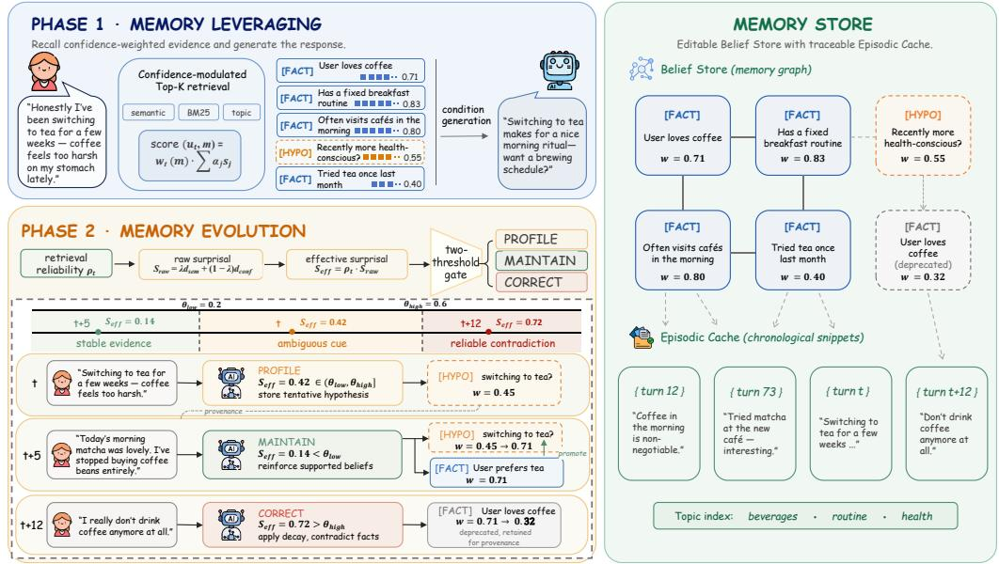  
Figure 2: The PreCoMem framework. Two active phases operate over a shared memory store. Phase 1, Memory Leveraging: a confidence-modulated retrieval score combines semantic, lexical, and topic signals to select Top-K beliefs $\mathcal { C } _ { t }$ for response generation. Phase $^ { 2 , }$ Memory Evolution: the effective surprisal $S _ { \mathrm { e f f } }$ and a two-threshold gate route each turn to MAINTAIN, PROFILE, or CORRECT, illustrated by representative low/medium/high- ${ \bf \nabla } \cdot S _ { \mathrm { e f f } }$ turns. Memory Store: an editable Belief Store $\boldsymbol { B }$ of FACT/HYPO nodes with confidence weights, linked by provenance to an immutable Episodic Cache $\mathcal { E }$ under a shared topic index; belief items are updated independently, and the drawn links are provenance pointers and topic groupings (Appendix Section C.11).

In implementation, each operator pairs a closed-form update rule with a fixed-prompt LLM subagent. The sub-agent only identifies which items are relevant and emits one bounded scalar, such as EVIDENCE\_STRENGTH, SEVERITY, or INITIAL\_CONFIDENCE. The deterministic layer then plugs these scalars into Equations (7), (8) and (10). Thus the LLM proposes local magnitudes, while the gate, confidence bounds, and closed-form w updates control when and how memory changes accumulate. Algorithm 1 (Appendix Section B.4) gives the per-turn pipeline.

## 2.2 Memory primitives

Dialogue and memory state. At turn $t = 1 , 2 , \ldots$ , the user input is $u _ { t } ,$ , the agent response is $y _ { t } .$ , and $Q _ { t - 1 }$ is a rolling working-memory window. Long-term memory is $\mathcal { M } _ { t } = ( B _ { t } , \mathcal { E } _ { t } , \mathcal { T } _ { t } )$ . The belief store $B _ { t }$ contains editable facts and hypotheses with confidence weights. The episodic cache $\mathcal { E } _ { t }$ stores immutable raw dialogue traces with source pointers. The optional topic table $\mathcal { T } _ { t }$ is only a retrieval prior. This keeps beliefs editable and evidence traceable.

Items, confidence, and hypothesis lifecycle. A memory item m has content $c ( m )$ , type $\tau ( m ) \in$ {FACT, HYPOTHESIS}, and retrieval metadata such as embeddings, topic labels, entities, timestamps, and source pointers into $\mathcal { E } _ { t }$ . For belief items, $w _ { t } ( m ) \in [ 0 , 1 ]$ is an operational support score. Episodic traces are fixed at $w _ { t } ( e ) \equiv 1$ and used only as provenance, not in confidence-weighted Top-K ranking. A HYPOTHESIS is a provisional belief: it is reinforced under supporting evidence, decayed when evidence stays absent, and promoted to FACT when confidence crosses τpromote. Type transitions are one-way. Contradicted facts are softly decayed by CORRECT (Section 2.4) rather than demoted,

yielding low-confidence “deprecated” facts that confidence-weighted retrieval naturally deprioritizes.   
Appendix Section C.7 confirms this retention is accuracy-neutral.

## 2.3 Memory leveraging: evidence recall and response generation

In Memory Leveraging, PreCoMem recalls a compact evidence set from long-term memory and leverages it to generate the current response.

Evidence recall. Given $u _ { t }$ and short-term context $Q _ { t - 1 }$ , PreCoMem ranks candidates in $B _ { t }$ with a confidence-modulated score. The score combines three retrieval signals: semantic similarity, lexical overlap (BM25), and topic relevance. Omitting $Q _ { t - 1 }$ in the notation,

$$
s ( u _ { t } , m ) = w _ { t } ( m ) \sum _ { j = 1 } ^ { 3 } \alpha _ { j } s _ { j } ( u _ { t } , m ) , \quad m \in \mathscr { B } _ { t } ,\tag{1}
$$

where $( s _ { 1 } , s _ { 2 } , s _ { 3 } ) = ( s _ { \mathrm { s e m } } , s _ { \mathrm { f a c t } } , s _ { \mathrm { t o p i c } } )$ and ${ \pmb { \alpha } } = ( \alpha _ { 1 } , \alpha _ { 2 } , \alpha _ { 3 } ) ^ { \top }$ is a convex weight vector. The multiplier $w _ { t } ( m )$ biases retrieval toward high-confidence items. The Top-K belief items form $\mathcal { C } _ { t } = \mathrm { \bar { \{ } }  m _ { i } \} _ { i = 1 } ^ { K }$ with retrieval scores st. Linked episodic traces from $\mathcal { E } _ { t }$ are appended as provenance context, but they do not participate in Top-K ranking. The same scores $\mathbf { s } _ { t }$ are retained for the reliability estimate in Section 2.4.

Evidence-conditioned response. The recalled evidence texts $\{ c ( m ) \ | \ m \in { \mathcal { C } } _ { t } \}$ , together with $u _ { t }$ and the short-term window $Q _ { t - 1 } ,$ , condition the response model:

$$
y _ { t } = \tt R e s p o n d (  u _ { t } , Q _ { t - 1 } , \mathcal { C } _ { t } ) .\tag{2}
$$

We reuse the same recall outputs $( \mathcal { C } _ { t } , \mathbf { s } _ { t } )$ to perform memory evolution in Section 2.4.

## 2.4 Memory evolution: regime-gated belief updating

Given the recall outputs $( \mathcal { C } _ { t } , \mathbf { s } _ { t } )$ and the new interaction $( u _ { t } , y _ { t } )$ , PreCoMem computes a predictionerror signal adjusted by retrieval reliability, and applies a regime-gated update to the belief store. It also writes the new turn back into the episodic cache for future provenance and recall.

Retrieval reliability. Surprisal computed against recalled evidence can be misleading when recall is uncertain, so we derive a reliability coefficient from the entropy of retrieval scores. Let $\mathbf { s } _ { t } = \{ s _ { i } \} _ { i = 1 } ^ { | \mathcal { C } _ { t } | }$ denote the Top- $\mathbf { \nabla } . K$ retrieval scores returned with $\mathcal { C } _ { t } .$ , and let $\hat { s } _ { i } \stackrel {  } { = } ( s _ { i } + \epsilon ) / \sum _ { i } ( s _ { j } + \epsilon )$ be the smoothed normalization. We define the normalized entropy $H _ { t }$ and the reliability coefficient $\rho _ { t }$ as

$$
H _ { t } = \frac { - \sum _ { i } \hat { s } _ { i } \log \hat { s } _ { i } } { \log \operatorname* { m a x } \{ | \mathcal { C } _ { t } | , 2 \} } \in [ 0 , 1 ] , \qquad \rho _ { t } = 1 - H _ { t } .\tag{3}
$$

Because $H _ { t }$ is minimized when one item dominates and maximized under near-uniform scores, $\rho _ { t }$ measures score concentration as a proxy for evidence precision. Diffuse recall (small $\rho _ { t } )$ downweights deviation signals to avoid over-updating; concentrated recall (large $\rho _ { t } )$ preserves them for correction. Thus the gate becomes aggressive only when recall is concentrated and the raw contradiction/deviation signal is large. Since $\rho _ { t }$ enters only multiplicatively, it can defer an update but never trigger one on its own; whether CORRECT fires still depends on the contradiction term below, and Appendix Section C.8 verifies empirically that $\rho _ { t }$ tracks evidence precision. The constant $\epsilon > 0$ ensures numerical stability.

Raw surprisal proxy. We define:

$$
S _ { \mathrm { r a w } } ( u _ { t } ) = \lambda d _ { \mathrm { s e m } } ( u _ { t } , \mathcal { C } _ { t } ) + ( 1 - \lambda ) d _ { \mathrm { c o n f } } ( u _ { t } , \mathcal { C } _ { t } ) ,\tag{4}
$$

where $\lambda \in ( 0 , 1 ) , d _ { \mathrm { s e m } }$ is the normalized semantic deviation between $u _ { t }$ and score-weighted recalled evidence, and $d _ { \mathrm { c o n f } }$ is a verifier-based contradiction score quantifying how strongly $u _ { t }$ conflicts with recalled beliefs (see Appendix Section B.2).

Effective surprisal. We define:

$$
S _ { \mathrm { e f f } } ( u _ { t } ) = \rho _ { t } S _ { \mathrm { r a w } } ( u _ { t } ) ,\tag{5}
$$

which corresponds to a precision-weighted prediction error that becomes conservative when recall is unreliable. We use $x _ { t } : = S _ { \mathrm { e f f } } ( u _ { t } )$ as the scalar gate score below. Appendix Section B.1 gives an optimization view that interprets $x _ { t }$ as a Monte Carlo surrogate of a long-horizon predictive objective.

Regime-gated evolution. Given two ordered thresholds $\theta _ { \mathrm { l o w } } < \theta _ { \mathrm { h i g h } }$ , PreCoMem maps the gate score $x _ { t }$ into three regimes:

$$
a _ { t } = \left\{ \begin{array} { l l } { \mathtt { M A I N T A I N } , } & { x _ { t } \le \theta _ { \mathrm { l o w } } } \\ { \mathtt { P R O F I L E } , } & { \theta _ { \mathrm { l o w } } < x _ { t } \le \theta _ { \mathrm { h i g h } } } \\ { \mathtt { C O R R E C T } , } & { x _ { t } > \theta _ { \mathrm { h i g h } } . } \end{array} \right.\tag{6}
$$

Two-threshold gate. Low, medium, and high $x _ { t }$ correspond to consistent, ambiguous, and reliably contradictory evidence. PROFILE handles the middle regime that a binary maintain/correct rule must either ignore or overwrite. We fix $( \theta _ { \mathrm { l o w } } , \theta _ { \mathrm { h i g h } } ) = ( 0 . \bar { 2 } , 0 . 6 )$ throughout the main experiments to keep behavior controllable and the comparison reproducible across benchmarks; the cost-sensitive break-even derivation, operator ablations, threshold sensitivity, and dynamic-threshold variant are in Appendix Sections B.3 and C.4 to C.5.

MAINTAIN (reinforcement). When surprisal is low, PreCoMem strengthens supported beliefs in $\mathcal { C } _ { t }$ via:

$$
w _ { t + 1 } ( m ) = w _ { t } ( m ) + \eta _ { t } ( m ) ( 1 - w _ { t } ( m ) ) , \quad m \in \mathcal { C } _ { t } \cap \mathcal { B } _ { t } ,\tag{7}
$$

where $\eta _ { t } ( m ) \in ( 0 , 1 ]$ is the per-item EVIDENCE\_STRENGTH returned by the Maintain-Agent; weakly supported items barely move, while strongly supported ones are pulled toward 1. The optimization view in Appendix Section B.3 treats $\eta _ { t } ( m )$ as a scalar step size.

PROFILE (hypothesis writing). When surprisal is medium, the observation is novel but not decisively contradictory. PreCoMem generates a low-confidence hypothesis h and writes it as a HYPOTHESIS belief:

$$
h = { \tt G e n e r a t e H y p o t h e s i s } ( u _ { t } , \mathcal { C } _ { t } ) , \quad \quad \tau ( h ) = { \tt H Y P O T H E S I S } ,
$$

$$
\begin{array} { r } { b _ { t } ^ { ( c ) } = w _ { \mathrm { m i n } } ^ { ( c ) } + \sigma ( x _ { t } ) \big ( w _ { \mathrm { m a x } } ^ { ( c ) } - w _ { \mathrm { m i n } } ^ { ( c ) } \big ) , \qquad w _ { 0 } ( h ) = \frac { 1 } { 2 } b _ { t } ^ { ( c ) } + \frac { 1 } { 2 } \mathrm { c l i p } \big ( q _ { t } , [ w _ { \mathrm { m i n } } ^ { ( c ) } , w _ { \mathrm { m a x } } ^ { ( c ) } ] \big ) , } \end{array}\tag{8}
$$

where GenerateHypothesis is the Profile-Agent under a fixed prompt, $\sigma ( x ) = 1 / ( 1 + e ^ { - x } )$ $c \in \{ \mathrm { E X P L I C I T } , \mathrm { L A T E N T } \}$ is the class label assigned by the agent, and $q _ { t }$ is the agent’s INI-TIAL\_CONFIDENCE, clipped to the class band $[ w _ { \mathrm { m i n } } ^ { ( c ) } , w _ { \mathrm { m a x } } ^ { ( c ) } ]$ . The gate score thus supplies a reproducible prior $b _ { t } ^ { ( c ) }$ inside the band, and the agent scalar can shift $w _ { 0 }$ by at most half the band width. Explicit-event hypotheses paraphrase stated facts or actions and use the band [0.60, 0.70]. Latentinference hypotheses capture deduced traits, moods, or hidden goals and use [0.50, 0.59]. These initial values are low relative to stable FACTs, which sit at $w \ge 0 . 8 0$ and meet the promotion threshold $\tau _ { \mathrm { p r o m o t e } } = 0 . 8 0$ . A fresh hypothesis therefore ranks below committed facts in confidence-weighted retrieval (Equation (1)) and still needs repeated support to graduate. In later turns, hypotheses are reinforced under MAINTAIN when supported and decayed when evidence remains absent:

$$
w _ { t } ( h ) \gets w _ { t } ( h ) \exp \bigl ( - \gamma a _ { t } ( h ) \bigr ) , \qquad a _ { t } ( h ) = t - \ell ( h ) ,\tag{9}
$$

where $\ell ( h )$ is the turn at which h was created or last received supporting evidence and $\gamma > 0$ is a decay rate. The rule is applied once per turn to unsupported hypotheses: any supporting update resets $\ell ( h )$ and skips the decay in that turn, and hypotheses flagged as DECAY\_PROTECTION by the agent (explicit events) are exempt, so the compounding decay over consecutive unsupported turns (cumulative factor $\exp ( - \gamma n ( n + 1 ) / 2 )$ after n turns; Appendix Section B.3) prunes only guesses that are never revalidated. Hypotheses are promoted to facts once confidence crosses $\tau _ { \mathrm { p r o m o t e } } ,$ , with $0 { \leq } w _ { \mathrm { m i n } } ^ { ( c ) } { < } w _ { \mathrm { m a x } } ^ { ( c ) } { < } \tau _ { \mathrm { p r o m o t e } } { \leq } 1$ enforced for every class so that promotion always requires repeated support.

CORRECT (soft correction). When surprisal is high and recall is reliable, the new observation likely contradicts existing high-confidence beliefs. PreCoMem records the new observation as a fresh belief node (a FACT with initial weight 0.85) and separately decays the retrieved beliefs it contradicts. The decay side is:

$$
w _ { t + 1 } ( m ) = w _ { t } ( m ) \exp \bigl ( - \beta x _ { t } \zeta _ { t } ( m ) \bigr ) , \quad m \in \mathcal { C } _ { t } \cap \mathcal { B } _ { t } ,\tag{10}
$$

where $\beta > 0$ controls the correction strength and $\zeta _ { t } ( m ) \in [ 0 , 1 ]$ is the per-item contradiction severity returned by the Correct-Agent; non-contradictory items receive $\zeta _ { t } ( m ) \approx 0$ and are essentially unchanged, enabling selective correction without extra thresholds. We deliberately separate this context-aware decay magnitude from the fixed NLI contradiction score that feeds $d _ { \mathrm { c o n f } }$ (Equation (22) in Appendix Section B.2): the NLI score drives the gate via $S _ { \mathrm { r a w } }$ , whereas $\zeta _ { t }$ localizes how strongly each retrieved belief should decay. A derivation is provided in Appendix Section B.3.

Table 1: Main evaluation on LoCoMo and LongMemEval-S. Accuracies are reported as mean ± std over three seeds; within each backbone block, bold marks the best score per column and underline marks the second-best. Avg. Tokens reports the average response-model input token usage per query. LongMemEval-S columns are question types: SSU/SSA/SSP = single-session user/assistant/preference, MS = multi-session, KU = knowledge update, and TR = temporal reasoning.  
LoCoMo (1,540 questions; four splits)
<table><tr><td>Method</td><td>Avg. Tokens</td><td>Single-Hop</td><td>Multi-Hop</td><td>Temporal</td><td>Open-Domain</td><td>Overall</td></tr><tr><td colspan="7">BACKBONE:gpt-4o-mini</td></tr><tr><td>MemoryOS</td><td>5.5k</td><td> $6 6 . 6 8 \pm 0 . 8 5$ </td><td> $5 4 . 8 3 \pm 0 . 8 7$ </td><td> $5 2 . 9 0 \pm 0 . 5 9$ </td><td> $3 2 . 1 6 \pm 0 . 1 1$ </td><td> $5 9 . 5 8 \pm 0 . 0 6$ </td></tr><tr><td>Mem0</td><td>1.6k</td><td> $6 2 . 1 7 \pm 0 . 7 7$ </td><td> $5 2 . 9 1 \pm 0 . 7 0$ </td><td> $5 9 . 4 4 \pm 0 . 3 7$ </td><td> $3 3 . 8 9 \pm 0 . 9 6$ </td><td> $5 8 . 3 6 \pm 0 . 3 1$ </td></tr><tr><td>A-Mem</td><td>2.7k</td><td> $4 5 . 1 5 \pm 0 . 5 3$ </td><td> $2 3 . 9 9 \pm 0 . 4 6$ </td><td> $5 3 . 6 7 \pm 0 . 2 3$ </td><td> $3 0 . 7 1 \pm 0 . 8 4$ </td><td> $4 2 . 1 8 \pm 0 . 6 5$ </td></tr><tr><td>GAM</td><td>3.5k</td><td> $6 8 . 2 4 \pm 0 . 7 6$ </td><td> $5 5 . 4 7 \pm 0 . 4 3$ </td><td> $5 8 . 1 9 \pm 0 . 5 4$ </td><td> $3 3 . 5 0 \pm 0 . 0 9$ </td><td> $6 1 . 6 2 \pm 0 . 2 2$ </td></tr><tr><td>MemBox</td><td>3.3k</td><td> $7 0 . 8 9 \pm 0 . 6 8$ </td><td> $5 3 . 3 1 \pm 0 . 1 5$ </td><td> $6 2 . 7 0 \pm 0 . 5 7$ </td><td> $3 5 . 1 8 \pm 0 . 7 7$ </td><td> $6 3 . 3 0 \pm 0 . 4 8$ </td></tr><tr><td>MemOS</td><td>2.5k</td><td> $7 7 . 0 5 \pm 0 . 9 3$ </td><td> $6 8 . 3 4 \pm 0 . 7 9$ </td><td> $6 1 . 2 7 \pm 0 . 0 1$ </td><td> $3 9 . 2 6 \pm 0 . 0 7$ </td><td> $7 0 . 2 0 \pm 0 . 6 6$ </td></tr><tr><td>EverMemOS</td><td>2.6k</td><td> ${ \bf 8 3 . 6 9 \pm 0 . 3 0 }$ </td><td> $5 9 . 9 7 \pm 0 . 7 2$ </td><td> $6 6 . 0 0 \pm 0 . 3 9$ </td><td> $3 6 . 9 5 \pm 0 . 5 6$ </td><td> $7 0 . 1 3 \pm 0 . 5 5$ </td></tr><tr><td>O-Mem</td><td>2.9k</td><td> $7 8 . 5 9 \pm 0 . 0 4$ </td><td> ${ \bf 7 1 . 0 8 \pm 0 . 3 4 }$ </td><td> $6 0 . 2 0 \pm 0 . 9 1$ </td><td> $3 7 . 4 1 \pm 0 . 8 7$ </td><td> $7 0 . 8 8 \pm 0 . 2 2$ </td></tr><tr><td>TiMem</td><td>2.8k</td><td> $7 6 . 6 4 \pm 0 . 6 0$ </td><td> $6 0 . 4 3 \pm 0 . 8 0$ </td><td> ${ \bf 7 6 . 7 4 \pm 0 . 4 8 }$ </td><td> $3 8 . 8 6 \pm 0 . 9 4$ </td><td> $7 1 . 8 8 \pm 0 . 6 1$ </td></tr><tr><td>PreCoMem</td><td>3.3k</td><td> $\underline { { 8 1 . 4 1 \pm 0 . 5 1 } }$ </td><td> $6 8 . 4 9 \pm 0 . 9 8$ </td><td> $6 6 . 2 1 \pm 0 . 1 2$ </td><td> ${ \bf 3 9 . 6 3 \pm 0 . 2 5 }$ </td><td> ${ \bf 7 3 . 5 7 \pm 0 . 2 8 }$ </td></tr><tr><td colspan="7">BACKBONE：gpt-4.1</td></tr><tr><td>MemoryOS</td><td>5.2k</td><td> $7 2 . 2 1 \pm 0 . 3 8$ </td><td> $6 3 . 6 6 \pm 0 . 1 8$ </td><td> $6 3 . 1 0 \pm 0 . 8 3$ </td><td> $4 3 . 3 3 \pm 0 . 8 8$ </td><td> $6 6 . 0 2 \pm 0 . 2 5$ </td></tr><tr><td>Mem0</td><td>1.8k</td><td> $7 2 . 5 9 \pm 0 . 7 3$ </td><td> $6 2 . 3 7 \pm 0 . 4 9$ </td><td> $6 7 . 8 5 \pm 0 . 2 0$ </td><td> $4 2 . 9 8 \pm 0 . 8 9$ </td><td> $6 7 . 1 7 \pm 0 . 5 1$ </td></tr><tr><td>A-Mem</td><td>2.9k</td><td> $5 0 . 6 3 \pm 0 . 0 9$ </td><td> $3 5 . 9 6 \pm 0 . 3 9$ </td><td> $5 9 . 5 0 \pm 0 . 2 4$ </td><td> $3 4 . 3 0 \pm 0 . 5 4$ </td><td> $4 8 . 9 0 \pm 0 . 2 2$ </td></tr><tr><td>GAM</td><td>3.4k</td><td> $7 0 . 3 5 \pm 0 . 3 8$ </td><td> $6 7 . 4 5 \pm 0 . 0 2$ </td><td> $6 8 . 4 7 \pm 0 . 6 4$ </td><td> $3 9 . 0 3 \pm 0 . 0 5$ </td><td> $6 8 . 8 1 \pm 0 . 1 1$ </td></tr><tr><td>MemBox</td><td>3.4k</td><td> $7 6 . 7 6 \pm 0 . 1 0$ </td><td> $6 7 . 4 7 \pm 0 . 3 3$ </td><td> $6 8 . 4 0 \pm 0 . 5 2 $ </td><td> $4 1 . 7 8 \pm 0 . 8 2$ </td><td> $7 1 . 2 9 \pm 0 . 9 2$ </td></tr><tr><td>MemOS</td><td>2.4k</td><td> $8 4 . 5 7 \pm 0 . 7 0$ </td><td> $8 0 . 1 4 \pm 0 . 5 6$ </td><td> $7 0 . 7 9 \pm 0 . 4 3$ </td><td> $4 6 . 9 3 \pm 0 . 8 7$ </td><td> $7 8 . 6 2 \pm 0 . 7 6$ </td></tr><tr><td>O-Mem</td><td>2.7k</td><td> $8 6 . 8 1 \pm 0 . 7 3$ </td><td> $\mathbf { 8 4 . 3 2 \pm 0 . 4 2 }$ </td><td> $6 8 . 0 4 \pm 0 . 0 3$ </td><td> $4 2 . 2 4 \pm 0 . 7 5$ </td><td> $8 0 . 0 8 \pm 0 . 1 4$ </td></tr><tr><td>EverMemOS</td><td>2.5k</td><td> ${ \bf 9 2 . 1 3 \pm 0 . 9 4 }$ </td><td> $7 7 . 7 5 \pm 0 . 5 2$ </td><td> $7 4 . 7 2 \pm 0 . 9 1$ </td><td> $4 3 . 3 2 \pm 0 . 3 1$ </td><td> $8 2 . 2 7 \pm 0 . 8 6$ </td></tr><tr><td>TiMem</td><td>2.7k</td><td> $8 7 . 0 0 \pm 0 . 5 8$ </td><td> $8 3 . 9 5 \pm 0 . 1 5$ </td><td> ${ \bf 8 5 . 9 2 \pm 0 . 7 1 }$ </td><td> $4 5 . 8 2 \pm 0 . 6 0$ </td><td> $8 4 . 0 4 \pm 0 . 8 4$ </td></tr><tr><td>PreCoMem</td><td>3.1k</td><td> $9 0 . 4 1 \pm 0 . 3 5$ </td><td> $8 3 . 4 8 \pm 0 . 2 9$ </td><td> $8 4 . 7 4 \pm 0 . 8 0$  </td><td> ${ \bf 4 8 . 2 3 \pm 0 . 6 5 }$  </td><td> ${ \bf 8 5 . 0 6 \pm 0 . 0 7 }$ </td></tr><tr><td></td><td></td><td></td><td></td><td></td><td></td><td></td></tr></table>

<table><tr><td colspan="8">LongMemEval-S (500 questions; six splits)</td></tr><tr><td>Method</td><td>Avg. Tokens</td><td>SSU</td><td>SSA</td><td>SSP</td><td>MS</td><td>KU</td><td>TR</td><td>Overall</td></tr><tr><td colspan="9">BACKBONE: gpt-4.1 (gpt-4o-mini results in Appendix Section C.3)</td></tr><tr><td>MemoryOS</td><td>6.8k</td><td> $6 2 . 7 7 \pm 0 . 0 1$ </td><td> $6 3 . 5 3 \pm 0 . 1 9$ </td><td> $4 8 . 7 1 \pm 0 . 0 0$ </td><td> $5 9 . 2 7 \pm 0 . 5 7$ </td><td> $5 8 . 9 4 \pm 0 . 6 7$ </td><td> $5 4 . 9 5 \pm 0 . 1 4$ </td><td> $5 8 . 4 9 \pm 0 . 0 4$ </td></tr><tr><td>MemOS</td><td>2.6k</td><td> $8 0 . 8 8 \pm 0 . 4 8$ </td><td> $7 3 . 2 9 \pm 0 . 2 0$ </td><td> $5 8 . 4 3 \pm 0 . 1 5$ </td><td> $7 0 . 1 0 \pm 0 . 6 5$ </td><td> $7 5 . 0 5 \pm 0 . 5 5$ </td><td> $6 8 . 3 2 \pm 0 . 2 1$ </td><td> $7 2 . 7 4 \pm 0 . 4 0$ </td></tr><tr><td>TiMem</td><td>3.5k</td><td> $8 5 . 0 6 \pm 0 . 0 3$ </td><td> $7 9 . 1 8 \pm 0 . 5 4$ </td><td> $7 1 . 2 2 \pm 0 . 6 2$ </td><td> $7 6 . 5 8 \pm 0 . 8 4$ </td><td> $8 1 . 9 6 \pm 0 . 5 0$ </td><td> ${ \bf 8 9 . 8 6 \pm 0 . 4 1 }$ </td><td> $7 9 . 6 3 \pm 0 . 7 9$ </td></tr><tr><td>GAM</td><td>4.2k</td><td> $8 0 . 9 0 \pm 0 . 7 0$ </td><td> $8 3 . 7 3 \pm 0 . 2 6$ </td><td> $7 0 . 8 2 \pm 0 . 0 2$ </td><td> $8 0 . 8 1 \pm 0 . 4 6$ </td><td> $7 8 . 3 0 \pm 0 . 5 1$ </td><td> $7 9 . 2 8 \pm 0 . 2 3$ </td><td> $8 0 . 9 1 \pm 0 . 3 4$ </td></tr><tr><td>MemBox</td><td>4.0k</td><td> $8 2 . 0 7 \pm 0 . 4 2$ </td><td> $8 5 . 1 3 \pm 0 . 6 4$ </td><td> $7 3 . 6 8 \pm 0 . 6 1$ </td><td> $8 0 . 5 6 \pm 0 . 3 8$ </td><td> $7 9 . 5 9 \pm 0 . 7 8$ </td><td> $8 1 . 5 2 \pm 0 . 8 9$ </td><td> $8 1 . 2 4 \pm 0 . 6 0$ </td></tr><tr><td>O-Mem</td><td>3.4k</td><td> $9 1 . 2 5 \pm 0 . 1 2$ </td><td> $8 6 . 7 6 \pm 0 . 7 4$ </td><td> ${ \underline { { 7 4 . 6 9 \pm 0 . 0 7 } } }$ </td><td> $\underline { { 8 3 . 8 9 \pm 0 . 6 4 } }$ </td><td> $8 7 . 0 5 \pm 0 . 2 9$ </td><td> $8 2 . 7 7 \pm 0 . 8 8$ </td><td> $8 5 . 3 6 \pm 0 . 0 8$ </td></tr><tr><td>EverMemOS</td><td>3.1k</td><td> ${ \bf 9 6 . 3 1 \pm 0 . 9 2 }$ </td><td> $\overline { { 8 3 . 3 3 \pm 0 . 9 7 } }$ </td><td> $7 2 . 4 5 \pm 0 . 4 7$ </td><td> $\overline { { 8 0 . 6 6 \pm 0 . 3 7 } }$ </td><td> $8 6 . 2 5 \pm 0 . 1 1$ </td><td> $7 9 . 1 7 \pm 0 . 7 5$ </td><td> $\underline { { 8 6 . 1 6 \pm 0 . 6 9 } }$  </td></tr><tr><td>PreCoMem</td><td>3.8k</td><td> $9 4 . 0 9 \pm 0 . 9 8 $ </td><td> ${ \bf 9 0 . 7 2 \pm 0 . 1 2 }$ </td><td> ${ \bf 8 3 . 9 3 \pm 0 . 8 5 }$ </td><td> ${ \bf 8 7 . 4 4 \pm 0 . 9 9 }$ </td><td> ${ \bf 9 1 . 8 0 \pm 0 . 8 7 }$ </td><td> $\underline { { 8 4 . 3 5 \pm 0 . 8 3 } }$ </td><td> ${ \bf 8 9 . 3 9 \pm 0 . 7 6 }$ </td></tr></table>

Trace and topic write-back. After generating yt, PreCoMem appends the turn trace $\left( u _ { t } , y _ { t } \right)$ to the episodic cache $\mathcal { E } _ { t + 1 }$ with a fixed-capacity eviction policy; optionally, new topics are added to $\mathcal { T } _ { t + 1 }$ when detected, yielding $\mathcal { M } _ { t + 1 } = ( \bar { \boldsymbol { B } } _ { t + 1 } , \mathcal { E } _ { t + 1 } , \mathcal { T } _ { t + 1 } )$ . When PROFILE/MAINTAIN/CORRECT creates or updates belief items, we record source pointers to supporting traces so beliefs remain editable while evidence remains traceable.

## 3 Experiments

## 3.1 Experimental setup

Benchmarks. We evaluate on LoCoMo [34] (1,500+ questions in long contexts), LongMemEval-S [16] (500 questions covering six question types over five long-term memory abilities), and PersonaMem-v2 [35] (1,000 personas and 20,000+ implicit preferences, evaluated under both 32k and 128k contexts; Figure 3(c)–(f)). To stress-test belief drift under sparse signals we additionally introduce DiMoBench, which adds controlled non-stationarity and decoy retrieval (Section 3.3). Two third-party benchmarks, AMemGym [36] and LoCoMo-Plus [37], are evaluated under their official protocols in Appendix Section C.1.

<table><tr><td></td><td>Answer model + its native memory (O-Mem)Same answer model + PreCoMem on a smaller memory backbone  Absolute gain ∆</td></tr></table>

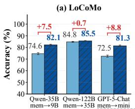

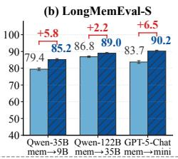

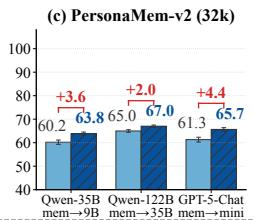

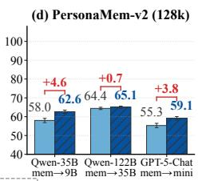

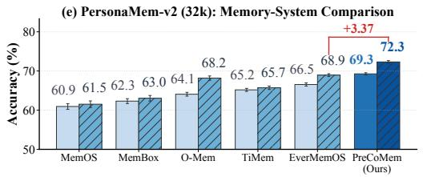

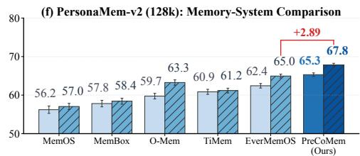  
Figure 3: Backbone generalization and PersonaMem-v2 system comparison. (a)–(d) Scale-vs-mechanism comparison on LoCoMo, LongMemEval-S, PersonaMem-v2 (32k), and PersonaMem-v2 (128k). Within each group the answer model is fixed (Qwen3.5-35B, Qwen3.5-122B, or GPT-5-Chat): the left bar runs it with its native O-Mem memory, while the right bar keeps the same answer model and delegates memory construction to PreCoMem on a one-tier-smaller backbone (Qwen3.5-9B, Qwen3.5-35B, GPT-5-mini); the protocol is detailed in Appendix Section C.2. (e)–(f) Head-to-head with the five strongest baselines on PersonaMem-v2 under gpt-4.1, in both MCQ and Open-Ended formats. Error bars are ±std over three seeds.

Baselines. We compare PreCoMem against O-Mem [21], MemoryOS [38], MemOS [18], Mem0 [26], A-Mem [24], GAM [25], MemBox [23], TiMem [22], and EverMemOS [19], each under its officially recommended configuration; we standardize the backbone LLM and embedding model across methods whenever applicable.

Evaluation protocol. We adopt the LLM-as-a-judge protocol from MemOS [18]: each answer is scored by a primary judge (gpt-4.1-mini) and two auxiliary gemini-2.5-flash judges (run with distinct system prompts to reduce judge-correlation) in a blinded setup, with accuracy reported as the average of the three binary judgments [39–43]. Appendix Section C.3 reports human–LLM agreement on LoCoMo, LongMemEval-S, and DiMoBench plus a cross-method spot-check on baseline outputs.

Implementation details. PreCoMem uses gpt-4.1 (or gpt-4o-mini) for all LLM-based reasoning and memory operations and Qwen3-Embedding-0.6B for dense embeddings across methods. Unless otherwise specified, $k = 1 0 , ( \theta _ { \mathrm { l o w } } , \theta _ { \mathrm { h i g h } } ) \stackrel { - } { = } ( 0 . 2 , 0 . 6 ) , \lambda = 0 . 5 , \beta = 1 . 0 , \stackrel { - } { \alpha } = ( 0 . 4 , 0 . 4 , 0 . 2 )$ , and γ=0.05; sensitivity studies and the adaptive variant are in Appendix Section C.5.

## 3.2 Main results

Main results are reported in Table 1: the upper block on LoCoMo and the lower block on LongMemEval-S. We make three observations.

(1) Overall performance. PreCoMem achieves the best overall accuracy on both tabulated benchmarks. On LoCoMo it leads the strongest baseline (TiMem) by +1.69 with gpt-4o-mini (73.57 vs. 71.88) and +1.02 with gpt-4.1 (85.06 vs. 84.04); both gaps exceed the cross-seed standard deviation of either system reported in Table 1. On LongMemEval-S it reaches 89.39 under gpt-4.1 (+3.23 over EverMemOS), and the gpt-4o-mini appendix block follows the same pattern (84.28, +1.96; Appendix Section C.3). On PersonaMem-v2 (Figure 3(e)–(f)) under gpt-4.1, PreCoMem reaches 72.31 Open-Ended at 32k and 67.84 at 128k, +3.37 and +2.89 over EverMemOS. The advantage

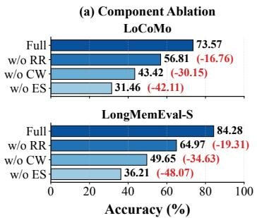

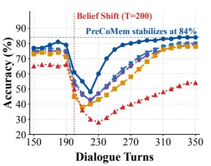  
PreCoMem TiMem Mem0 EverMemOS O-Mem

(c) Operator Contribution on DiMoBench  
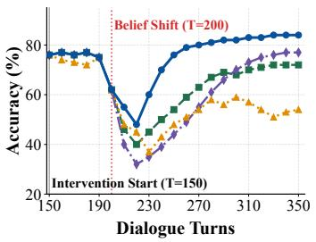  
Full PreCoMem w/o CORRECT w/o PROFILE w/o MAINTAIN

Figure 4: Component ablation and DiMoBench dynamics. (a) Component ablation on LoCoMo and LongMemEval-S. (b) Moving-average accuracy under implicit drift on DiMoBench. (c) Operatorlevel ablation on DiMoBench.

also holds on two third-party benchmarks we did not design: 0.458 Overall / 0.329 normalized Memory on AMemGym against 0.430 / 0.296 for the strongest system reported there, and 22.4 on LoCoMo-Plus against 21.05 for full-context GPT-4o (Appendix Section C.1). Figure 3(a)–(d) further shows that, with the answer model held fixed, delegating memory construction to PreCoMem on a one-tier-smaller backbone still beats the larger backbone’s native memory in all twelve comparisons.

(2) Where gains come from. On LoCoMo, the gain concentrates on the Open-Domain split (PreCoMem 48.23 under gpt-4.1, +1.30 over MemOS; consistently best under gpt-4o-mini), whose questions typically ask for a latent state that is not stated in a single turn and must be inferred from cues spread across sessions (Appendix Section C.3), while EverMemOS, O-Mem, and TiMem retain narrow leads on Single-Hop / Multi-Hop / Temporal under gpt-4.1 from their dedicated readpath designs. On LongMemEval-S (gpt-4.1), the largest gains occur on the question types whose answers depend on updating or aggregating user-specific memory: SSP (single-session preference, +9.24 over O-Mem), KU (knowledge update, +4.75 over O-Mem; every KU question carries an old value superseded by a newer one), and MS (multi-session aggregation, +3.55). The SSA gain (assistant-side single-session information, +3.96) reflects selective memory use: the single target session lies among 48.9 sessions on average, and confidence-weighted retrieval acts as an implicit reranker. PersonaMem-v2 reproduces this pattern: PreCoMem’s lead is largest on anti-stereotypical, dynamic, and ownership-disambiguation categories that most stress write-path quality, and shrinks to under two points on stereotypical or static cues where population priors suffice. PreCoMem’s advantage is therefore strongest when answers require selective memory use, belief updating, or cross-session aggregation; a structural analysis attributes the gains to two design properties absent from contemporary baselines—continuous per-belief confidence that buffers ambiguous cues, and a confidence-weighted retrieval score that acts as an implicit reranker (Appendix Section C.10).

(3) Accuracy–efficiency trade-off. Figure 5(a) shows the LoCoMo performance–cost frontier as we vary k: PreCoMem peaks at k = 10 with moderate token usage, while larger k yields diminishing returns. Supporting diagnostics on hypothesis lifecycle, Top-k sensitivity, and memory footprint are reported in Appendix Sections C.3, C.5 and C.7.

## 3.3 Ablation studies and belief-drift adaptation

Component ablation. We ablate three core components while keeping the backbone, prompts, and hyperparameters fixed. ES removes the effective-surprisal gate by setting the gate score to 0; RR removes retrieval-reliability adjustment via $\rho _ { t } \equiv 1 ;$ ; CW removes confidence weighting globally, in retrieval and in every lifecycle test, by setting all belief weights to 1. Figure 4(a) reports LLM-judge accuracy on LoCoMo and LongMemEval-S. Removing ES causes the largest drop on LoCoMo (73.57 → 31.46; similar on LongMemEval-S): with the gate score zeroed every turn is routed to MAINTAIN, so this reinforce-only variant marks the lower bound of surprisal-gated evolution, the primary mechanism under non-stationarity, while route-matched controls that isolate the gate’s marginal value are reported in Appendix Section C.4. Removing CW (→43.42) and RR (→56.81) also substantially reduces accuracy, with the same trend on LongMemEval-S. Letting the same LLM emit the entire write decision end-to-end instead of bounded scalars lowers accuracy by 2.75 / 3.15 points on LoCoMo / LongMemEval-S and raises the cross-seed standard deviation 20× on LoCoMo (under gpt-4.1; Appendix Section C.4). Appendix Section C.4 shows the NLI contradiction term drives most gains.

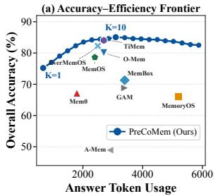

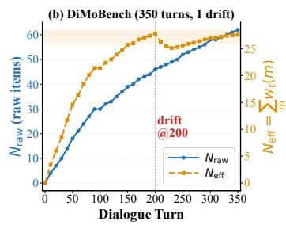

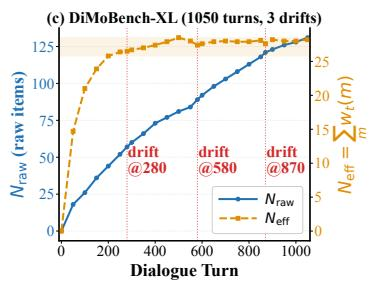  
Figure 5: Hyperparameter and memory-scalability analysis. (a) LoCoMo accuracy–efficiency frontier as the retrieval budget k varies; overall accuracy peaks at $k = 1 0$ , beyond which additional context yields diminishing returns and dilutes retrieval reliability $\rho _ { t }$ . (b, c) Memory scalability under long-horizon belief drift: raw memory grows linearly, while effective memory quickly plateaus on both DiMoBench and DiMoBench-XL (panel (c) shows one representative persona).

DiMoBench setup. DiMoBench (Dialogue Implicit Memory Drift Benchmark) is a controlled diagnostic setting for gradual attitude and preference drift. A user’s latent stance reverses around a change point, while keyword-matched chatter and entity confounders pollute the stream so naive retrieval and overwrite-style updates become brittle. The released suite has five independent 350-turn dialogues, each driven by a distinct persona, with 200 QA pairs per dialogue (1,000 total; results averaged across personas); DiMoBench-XL extends this to 1050 turns and three sequential drifts, with 420 QA pairs each, 2,100 in total (Appendix Section C.6).

Update dynamics. Figure 4(b) plots LLM-judge accuracy across dialogue turns. Before the change point all methods are stable; afterwards PreCoMem experiences a transient drop but recovers fastest and stabilizes at 84%, while EverMemOS, TiMem, and O-Mem plateau at 78–80% and Mem0 fails to recover (54%). End-to-end traces are provided in Appendix Section C.11.

Operator ablation on DiMoBench. Ablating each operator individually (Figure 4(c)) yields qualitatively distinct failure modes: removing PROFILE caps the asymptote at 72% (vs. 84%); removing CORRECT delays recovery (turn 320 vs. 250) and lowers the plateau to 77%; removing MAINTAIN fails to stabilize within the horizon (54% at the end), confirming that the three operators play distinct stabilizing roles. Appendix Section C.4 provides the full analysis, and the same three qualitative signatures reproduce on the third-party AMemGym benchmark (Appendix Section C.1).

## 3.4 Hyperparameter analysis

We sweep the retrieval budget $k \in \{ 1 , \ldots , 2 0 \}$ on LoCoMo (gpt-4.1). Accuracy rises sharply through $k \approx 6 ,$ , peaks at $k = 1 0$ (Overall 85.06%), then drops mildly. Larger k flattens the Top-k score distribution, lowering $\rho _ { t }$ and dampening the effective surprisal $x _ { t }$ that drives CORRECT. It also increases the chance that one retrieved item spuriously appears contradictory under the max-based contradiction component $d _ { \mathrm { c o n f } }$ . We therefore fix k = 10; the full sweep and retrieval-latency profile are reported in Appendix Sections C.5 and C.9. Because the write path acts only on retrieved beliefs, Appendix Section C.8 further measures how often the belief due for an update actually enters the Top-k and what a miss costs.

## 3.5 Memory scalability

A natural concern for any long-term memory system is whether storage and retrieval cost scale gracefully with the conversation length. We examine this on three settings spanning natural and stress-test horizons: the LoCoMo benchmark (ten multi-session dialogues, mean $\bar { N } \bar { = } 5 8 8$ turns), DiMoBench (350 turns, 1 drift), and DiMoBench-XL (1050 turns, 3 drifts; five personas, of which a representative one is plotted, the others staying within ±1.4 of it; Appendix Section C.6). Two quantities are tracked every 10 turns on DiMoBench and every 50 turns on DiMoBench-XL:

Table 2: Memory footprint vs. accuracy on the ten LoCoMo dialogues (mean turns $\bar { N } { = } 5 8 8 )$ . All numbers are measured under the same backbone $( g p t \ – 4 o \ – m i n i )$ and embedding model. “Per-item conf.” indicates whether the system maintains a continuous confidence weight per stored item; under discrete commit decisions, the effective count $N _ { \mathrm { e f f } }$ and the average Top-10 weight are not defined. PreCoMem (A1) is the optional pruning configuration that drops items with $w _ { t } < 0 . 0 5 .$
<table><tr><td>Method</td><td>Per-item conf.</td><td> $N _ { \mathrm { r a w } } ^ { \mathrm { e n d } }$ </td><td> $N _ { \mathrm { e f f } } ^ { \mathrm { e n d } }$ </td><td>Top-10 avg. w</td><td>LoCoMo Overall</td></tr><tr><td>O-Mem [21]</td><td>X (ADD/IGNORE/UPDATE)</td><td>232</td><td>一</td><td>一</td><td>70.88</td></tr><tr><td>EverMemOS [19]</td><td> $\pmb { \chi } ( [ t _ { s } , t _ { e } ] \mathrm { e x p i r y } )$ </td><td>264</td><td></td><td>1</td><td>70.13</td></tr><tr><td>PreCoMem  $( \mathbf { A 0 } , \mathbf { d e f a u l t } )$ </td><td> $\textsf { \textsf { V } } ( w _ { t } \in [ 0 , 1 ] )$ </td><td>287</td><td>95.7</td><td>0.81</td><td>73.57</td></tr><tr><td>PreCoMem  $( \mathbf { A } \mathbf { 1 } , w < 0 . 0 5$  prune)</td><td> $\textsf { \textsf { V } } ( w _ { t } \in [ 0 , 1 ] )$ </td><td>168</td><td>95.6</td><td>0.83</td><td>73.51</td></tr></table>

• Raw count $N _ { \mathrm { r a w } } ( t ) = | B _ { t } | \colon$ the number of belief items physically stored, including deprecated facts. Deprecated facts are previously committed FACTs whose confidence has been softly decayed below 0.1 by repeated CORRECT updates (Equation (10)); we keep them in $B _ { t }$ as provenance hooks rather than deleting them.

• Effective count $\begin{array} { r } { N _ { \mathrm { e f f } } ( t ) = \sum _ { m \in \mathcal { B } _ { t } } w _ { t } ( m ) } \end{array}$ : the confidence-weighted total mass. Intuitively, this is the equivalent number of fully-supported items the agent “acts on” through the confidenceweighted retrieval score in Equation (1). A deprecated fact at $w { = } 0 . 0 5$ contributes only 0.05 to $N _ { \mathrm { e f f } } .$ which matches its negligible influence on Top-K ranking.

Figure 5(b, c) shows $N _ { \mathrm { r a w } }$ grows roughly linearly with the dialogue, but $N _ { \mathrm { e f f } }$ saturates by turn 200 (at 25.8–28.5 on the representative persona, with the other personas within ±1.4 of it) and, apart from a transient dip at each drift, stays in that band. Moreover, deprecated facts occupy only 1.0% of Top-10 slots on average even after 1050 turns and three drifts (Appendix Table 19). Confidence weighting therefore turns linearly growing storage into a roughly constant retrieval surface.

Table 2 extends this picture to physical storage on $_ \mathrm { L o C o M o } ,$ where we measure the final $B _ { t }$ size of each system under matched backbone and embedding protocols. By default (A0) PreCoMem keeps deprecated facts as provenance hooks for traits that may resurface later, since confidence-weighted retrieval already filters them out of the Top-K; the optional A1 configuration $( w < 0 . 0 5$ prune) trades this provenance for tighter storage and matches A0 within seed variance (Appendix Section C.7). Both O-Mem and EverMemOS commit each interaction through a discrete decision (ADD/IGNORE/UPDATE in O-Mem; episodic-trace formation with a binary $\left[ \bar { t } _ { \mathrm { s t a r t } } , t _ { \mathrm { e n d } } \right]$ validity in EverMemOS), so neither maintains a continuous per-item confidence and $N _ { \mathrm { e f f } }$ is undefined. Even on raw count alone, A1 stores fewer items than both baselines while still leading on accuracy by +2.6 and +3.4 overall points, so storage remains bounded in both the soft sense $( N _ { \mathrm { e f f } }$ plateau) and the hard sense. This suggests the memory gain is not purchased by unchecked accumulation.

## 4 Conclusion

PreCoMem treats long-horizon conversational memory not as a transcript to be stored, but as confidence-weighted beliefs about the user’s state that must be continually checked. A reliabilityadjusted surprisal signal routes each turn into MAINTAIN (reinforce supported beliefs), PROFILE (buffer ambiguous cues as low-confidence hypotheses), or CORRECT (softly decay contradicted facts). The PROFILE waiting room is the central design choice: it lets evidence accumulate before commitment, so the agent stays consistent under noise without freezing under genuine drift. Across LoCoMo, LongMemEval-S, PersonaMem-v2, and DiMoBench, this discipline yields the best overall accuracy while keeping memory bounded over a thousand turns; qualitative case studies (Appendix Section C.11) show calibrated recommendations beyond retrieval-only baselines. We see continuous confidence and explicit hypothesis lifecycles as a useful baseline for long-term memory systems, where what to commit matters as much as what to recall. Our evaluation covers English dialogue benchmarks; other languages and modalities are left for future work.

## Acknowledgments and Disclosure of Funding

We thank the anonymous reviewers and the area chair for their constructive feedback.

Funding. This research is supported by the National Natural Science Foundation of China under Grant 62406163, the Tianjin Science and Technology Plan Project under Grant 25ZXSFSN00150, and the Fundamental Research Funds for the Central Universities under Grant 63261039.

Competing interests. The authors declare no competing interests.

## References

[1] Joon Sung Park, Joseph O’Brien, Carrie Jun Cai, Meredith Ringel Morris, Percy Liang, and Michael S Bernstein. Generative agents: Interactive simulacra of human behavior. In Proceedings ofthe 36th annual acm symposium on user interface software and technology, pages 1–22, 2023.

[2] Lei Wang, Chen Ma, Xueyang Feng, Zeyu Zhang, Hao Yang, Jingsen Zhang, Zhiyuan Chen, Jiakai Tang, Xu Chen, Yankai Lin, et al. A survey on large language model based autonomous agents. Frontiers ofcomputer science, 18(6):186345, 2024.

[3] Zhiheng Xi, Wenxiang Chen, Xin Guo, Wei He, Yiwen Ding, Boyang Hong, Ming Zhang, Junzhe Wang, Senjie Jin, Enyu Zhou, et al. The rise and potential of large language model based agents: A survey. Science China information sciences, 68(2):121101, 2025.

[4] Wanjun Zhong, Lianghong Guo, Qiqi Gao, He Ye, and Yanlin Wang. Memorybank: Enhancing large language models with long-term memory. In Proceedings of the AAAI conference on artificial intelligence, volume 38, pages 19724–19731, 2024.

[5] Bowen Jiang, Zhuoqun Hao, Young-Min Cho, Bryan Li, Yuan Yuan, Sihao Chen, Lyle Ungar, Camillo J Taylor, and Dan Roth. Know me, respond to me: Benchmarking llms for dynamic user profiling and personalized responses at scale. arXiv preprint arXiv:2504.14225, 2025.

[6] Charles Packer, Sarah Wooders, Kevin Lin, Vivian Fang, Shishir G Patil, Ion Stoica, and Joseph E Gonzalez. Memgpt: Towards llms as operating systems. arXiv preprint arXiv:2310.08560, 2023.

[7] Weizhi Wang, Li Dong, Hao Cheng, Xiaodong Liu, Xifeng Yan, Jianfeng Gao, and Furu Wei. Augmenting language models with long-term memory. Advances in neural information processing systems, 36:74530–74543, 2023.

[8] Shibhansh Dohare, J Fernando Hernandez-Garcia, Qingfeng Lan, Parash Rahman, A Rupam Mahmood, and Richard S Sutton. Loss of plasticity in deep continual learning. Nature, 632 (8026):768–774, 2024.

[9] Bhuwan Dhingra, Jeremy R Cole, Julian Martin Eisenschlos, Daniel Gillick, Jacob Eisenstein, and William W Cohen. Time-aware language models as temporal knowledge bases. Transactions ofthe Associationfor Computational Linguistics, 10:257–273, 2022.

[10] Raquib Bin Yousuf, Aadyant Khatri, Shengzhe Xu, Mandar Sharma, and Naren Ramakrishnan. Can an llm induce a graph? investigating memory drift and context length. In 2025 IEEE International Conference on Knowledge Graph (ICKG), pages 379–388. IEEE, 2025.

[11] Vardhan Dongre, Ryan A Rossi, Viet Dac Lai, David Seunghyun Yoon, Dilek Hakkani-Tür, and Trung Bui. Drift no more? context equilibria in multi-turn llm interactions. arXiv preprint arXiv:2510.07777, 2025.

[12] Dietmar Jannach, Lukas Lerche, and Markus Zanker. Recommending based on implicit feedback. In Social information access: systems and technologies, pages 510–569. Springer, 2018.

[13] Ori Yoran, Tomer Wolfson, Ori Ram, and Jonathan Berant. Making retrieval-augmented language models robust to irrelevant context. In International Conference on Learning Representations, volume 2024, pages 29862–29883, 2024.

[14] Nelson F Liu, Kevin Lin, John Hewitt, Ashwin Paranjape, Michele Bevilacqua, Fabio Petroni, and Percy Liang. Lost in the middle: How language models use long contexts. Transactions of the associationfor computational linguistics, 12:157–173, 2024.

[15] Florin Cuconasu, Giovanni Trappolini, Federico Siciliano, Simone Filice, Cesare Campagnano, Yoelle Maarek, Nicola Tonellotto, and Fabrizio Silvestri. The power of noise: Redefining retrieval for rag systems. In Proceedings of the 47th international ACM SIGIR conference on research and development in information retrieval, pages 719–729, 2024.

[16] Di Wu, Hongwei Wang, Wenhao Yu, Yuwei Zhang, Kai-Wei Chang, and Dong Yu. Longmemeval: Benchmarking chat assistants on long-term interactive memory. arXiv preprint arXiv:2410.10813, 2024.

[17] Qisheng Hu, Quanyu Long, and Wenya Wang. When continual learning moves to memory: A study of experience reuse in llm agents. arXiv preprint arXiv:2604.27003, 2026.

[18] Zhiyu Li, Chenyang Xi, Chunyu Li, Ding Chen, Boyu Chen, Shichao Song, Simin Niu, Hanyu Wang, Jiawei Yang, Chen Tang, et al. Memos: A memory os for ai system. arXiv preprint arXiv:2507.03724, 2025.

[19] Chuanrui Hu, Xingze Gao, Zuyi Zhou, Dannong Xu, Yi Bai, Xintong Li, Hui Zhang, Tong Li, Chong Zhang, Lidong Bing, et al. Evermemos: A self-organizing memory operating system for structured long-horizon reasoning. In Proceedings of the 64th Annual Meeting of the Association for Computational Linguistics (Volume 1: Long Papers), pages 45836–45853, 2026.

[20] Preston Rasmussen, Pavlo Paliychuk, Travis Beauvais, Jack Ryan, and Daniel Chalef. Zep: a temporal knowledge graph architecture for agent memory. arXiv preprint arXiv:2501.13956, 2025.

[21] Piaohong Wang, Motong Tian, Jiaxian Li, Yuan Liang, Yuqing Wang, Qianben Chen, Tiannan Wang, Zhicong Lu, Jiawei Ma, Yuchen Eleanor Jiang, et al. O-mem: Omni memory system for personalized, long horizon, self-evolving agents. arXiv preprint arXiv:2511.13593, 2025.

[22] Kai Li, Xuanqing Yu, Ziyi Ni, Yi Zeng, Yao Xu, Zheqing Zhang, Xin Li, Jitao Sang, Xiaogang Duan, Xuelei Wang, et al. Timem: Temporal-hierarchical memory consolidation for longhorizon conversational agents. In Findings of the Association for Computational Linguistics: ACL 2026, pages 21700–21720, 2026.

[23] Dehao Tao, Guoliang Ma, Yongfeng Huang, and Minghu Jiang. Membox: Weaving topic continuity into long-range memory for llm agents. arXiv preprint arXiv:2601.03785, 2026.

[24] Wujiang Xu, Zujie Liang, Kai Mei, Hang Gao, Juntao Tan, and Yongfeng Zhang. A-mem: Agentic memory for llm agents. Advances in Neural Information Processing Systems, 38: 17577–17604, 2026.

[25] BY Yan, Chaofan Li, Hongjin Qian, Shuqi Lu, and Zheng Liu. General agentic memory via deep research. arXiv preprint arXiv:2511.18423, 2025.

[26] Prateek Chhikara, Dev Khant, Saket Aryan, Taranjeet Singh, and Deshraj Yadav. Mem0: Building production-ready ai agents with scalable long-term memory. arXiv preprint arXiv:2504.19413, 2025.

[27] Karl Friston. The free-energy principle: a unified brain theory? Nature reviews neuroscience, 11(2):127–138, 2010.

[28] Andy Clark et al. Whatever next? predictive brains, situated agents, and the future of cognitive science. Behavioral and brain sciences, 36(3):181–204, 2013.

[29] Roger Levy. Expectation-based syntactic comprehension. Cognition, 106(3):1126–1177, 2008.

[30] Clara Meister, Ryan Cotterell, and Tim Vieira. If beam search is the answer, what was the question? In Proceedings of the 2020 Conference on Empirical Methods in Natural Language Processing (EMNLP), pages 2173–2185, 2020.

[31] Charan Ranganath and Gregor Rainer. Neural mechanisms for detecting and remembering novel events. Nature Reviews Neuroscience, 4(3):193–202, 2003.

[32] Alyssa H Sinclair and Morgan D Barense. Prediction error and memory reactivation: How incomplete reminders drive reconsolidation. Trends in neurosciences, 42(10):727–739, 2019.

[33] Lorenz Kuhn, Yarin Gal, and Sebastian Farquhar. Semantic uncertainty: Linguistic invariances for uncertainty estimation in natural language generation. arXiv preprint arXiv:2302.09664, 2023.

[34] Adyasha Maharana, Dong-Ho Lee, Sergey Tulyakov, Mohit Bansal, Francesco Barbieri, and Yuwei Fang. Evaluating very long-term conversational memory of llm agents. In Proceedings of the 62nd Annual Meeting of the Association for Computational Linguistics (Volume 1: Long Papers), pages 13851–13870, 2024.

[35] Bowen Jiang, Yuan Yuan, Maohao Shen, Zhuoqun Hao, Zhangchen Xu, Zichen Chen, Ziyi Liu, Anvesh Rao Vijjini, Jiashu He, Hanchao Yu, et al. Personamem-v2: Towards personalized intelligence via learning implicit user personas and agentic memory. arXiv preprint arXiv:2512.06688, 2025.

[36] Jiayang CHENG, Dongyu Ru, Lin Qiu, Yiyang Li, Xuezhi Cao, Yangqiu SONG, and Xunliang Cai. Amemgym: Interactive memory benchmarking for assistants in long-horizon conversations. In Paper presented at The 14th International Conference on Learning Representations (ICLR 2026), Rio de Janeiro, Brazil, 2026.

[37] Yifei Li, Weidong Guo, Lingling Zhang, Rongman Xu, Muye Huang, Hui Liu, Lijiao Xu, Yu Xu, and Jun Liu. Locomo-plus: Beyond-factual cognitive memory evaluation framework for llm agents. In Proceedings of the 64th Annual Meeting of the Association for Computational Linguistics (Volume 1: Long Papers), pages 25085–25100, 2026.

[38] Jiazheng Kang, Mingming Ji, Zhe Zhao, and Ting Bai. Memory os of ai agent. In Proceedings of the 2025 Conference on Empirical Methods in Natural Language Processing, pages 25972– 25981, 2025.

[39] Haitao Li, Qian Dong, Junjie Chen, Huixue Su, Yujia Zhou, Qingyao Ai, Ziyi Ye, and Yiqun Liu. Llms-as-judges: a comprehensive survey on llm-based evaluation methods. arXiv preprint arXiv:2412.05579, 2024.

[40] Jiawei Gu, Xuhui Jiang, Zhichao Shi, Hexiang Tan, Xuehao Zhai, Chengjin Xu, Wei Li, Yinghan Shen, Shengjie Ma, Honghao Liu, et al. A survey on llm-as-a-judge. The Innovation, 7(6), 2026.

[41] Hui Huang, Xingyuan Bu, Hongli Zhou, Yingqi Qu, Jing Liu, Muyun Yang, Bing Xu, and Tiejun Zhao. An empirical study of llm-as-a-judge for llm evaluation: Fine-tuned judge model is not a general substitute for gpt-4. In Findings of the Association for Computational Linguistics: ACL 2025, pages 5880–5895, 2025.

[42] Lin Shi, Chiyu Ma, Wenhua Liang, Xingjian Diao, Weicheng Ma, and Soroush Vosoughi. Judging the judges: A systematic study of position bias in llm-as-a-judge. In Proceedings ofthe 14th International Joint Conference on Natural Language Processing and the 4th Conference ofthe Asia-Pacific Chapter ofthe Associationfor Computational Linguistics, pages 292–314, 2025.

[43] Ziyi Ye, Xiangsheng Li, Qiuchi Li, Qingyao Ai, Yujia Zhou, Wei Shen, Dong Yan, and Yiqun Liu. Learning llm-as-a-judge for preference alignment. In International Conference on Learning Representations, volume 2025, pages 3537–3564, 2025.

[44] Yu Wang, Ryuichi Takanobu, Zhiqi Liang, Yuzhen Mao, Yuanzhe Hu, Julian McAuley, and Xiaojian Wu. Mem-{\alpha}: Learning memory construction via reinforcement learning. arXiv preprint arXiv:2509.25911, 2025.

[45] Hongli Yu, Tinghong Chen, Jiangtao Feng, Jiangjie Chen, Weinan Dai, Qiying Yu, Ya-Qin Zhang, Wei-Ying Ma, Jingjing Liu, Mingxuan Wang, et al. Memagent: Reshaping longcontext llm with multi-conv rl-based memory agent. In International Conference on Learning Representations, volume 2026, pages 39458–39486, 2026.

[46] Haoran Sun, Zekun Zhang, and Shaoning Zeng. Preference-aware memory update for long-term llm agents. In Findings ofthe Associationfor Computational Linguistics: ACL 2026, pages 783–793, 2026.

[47] Jiaqi Liu, Yaofeng Su, Peng Xia, Siwei Han, Zeyu Zheng, Cihang Xie, Mingyu Ding, and Huaxiu Yao. Simplemem: Efficient lifelong memory for llm agents. arXiv preprint arXiv:2601.02553, 2026.

[48] Zisu Huang, Muzhao Tian, Xiaohua Wang, Jingwen Xu, Zhengkang Guo, Qi Qian, Kaitao Song, Jiakang Yuan, Changze Lv, and Xiaoqing Zheng. Controllable memory usage: Balancing anchoring and innovation in long-term human–agent interaction. In Proceedings of the 64th Annual Meeting of the Association for Computational Linguistics (Volume 1: Long Papers), pages 14699–14719, 2026.

[49] Junfeng Lu and Yueyan Li. Dynamic affective memory management for personalized llm agents. arXiv preprint arXiv:2510.27418, 2025.

[50] Zeyu Liu, Jian Zhong, Rongduo Han, Ziyang Wu, Shunye Tang, Chenghao He, Yaxuan Yang, Yihang Qiu, Ailing Wang, Xiao Liang, et al. Evalmem: An operation-level diagnostic framework for long-term memory systems. arXiv preprint arXiv:2609.22231, 2026.

[51] Zhuoshi Pan, Qianhui Wu, Huiqiang Jiang, Xufang Luo, Hao Cheng, Dongsheng Li, Yuqing Yang, Chin-Yew Lin, H Vicky Zhao, Lili Qiu, et al. Secom: On memory construction and retrieval for personalized conversational agents. In International Conference on Learning Representations, volume 2025, pages 91851–91885, 2025.

## Appendix contents

A Related work 15   
B Additional method details 16   
B.1 From expected predictive loss to a per-turn on-policy loss 16   
B.2 Retrieval scoring and surprisal component definitions 17   
B.3 Operator and gate derivations 18   
B.4 Per-turn pipeline (hybrid execution) 20   
C Additional experimental details 20   
C.1 Third-party benchmarks: AMemGym and LoCoMo-Plus 20   
C.2 Backbone-generalization protocol and token usage 22   
C.3 Extended results and judge validation 22   
C.4 Component, operator, and control ablations 24   
C.5 Hyperparameter sensitivity and adaptive variants 28   
C.6 DiMoBench: construction and extended-horizon stress test 31   
C.7 Memory dynamics: footprint, contamination, and retention . 34   
C.8 Retrieval dependence and reliability calibration 36   
C.9 Retrieval and end-to-end latency analysis 38   
C.10 Structural comparison with existing memory systems 39   
C.11 System inspectability, traces, and qualitative analyses 41   
D Prompts 44

## A Related work

Long-term memory for conversational LLMs. Early work attacks the fixed context window with externalized hierarchical or virtual memory [4, 6]. More recent systems either organize the store more aggressively or learn richer write rules. Structured organizations include interlinked note stores with associative links [24], time-aware knowledge graphs [20], OS-style hierarchical scheduling [18, 19], and dedicated memory-box layouts that segment a user’s history into typed shards [23]. Learningbased update rules optimize memory operations against downstream rewards [25, 44, 45], while interpretable triggers target a single failure mode such as preference change [46], redundancy [22, 47], controllable reliance [48], or affective state [49]. A systematic gap shared by these systems is the stability–plasticity regime: append-only memories [24] treat every observation as equally valid and dilute retrieval; overwrite memories compress aggressively but lose information that later turns out to be relevant [26]; OS-style memories [18, 19] schedule access well but still fall back on importance heuristics for writes; and reinforcement-trained memories [25, 44, 45] face sparse credit assignment, since most reward signal is several turns downstream of the responsible read/write decision. PreCoMem is complementary to all of these: it treats the write path as a single regime-gated decision driven by a calibrated prediction-error signal, instead of relying on recency heuristics or task-specific reward shaping.

Predictive coding and surprisal as write signals. Predictive coding theory holds that perceptual systems update internal models when observations deviate from prediction [27, 28], and information theory gives this deviation a precise scalar form: surprisal [29, 30]. The same logic has long shaped accounts of episodic memory: novel events are encoded preferentially, and reactivation drives reconsolidation of related traces [31, 32]. Translating this into long-term conversational memory requires two extra ingredients absent from prior memory systems. First, surprisal must be calibrated against retrieval reliability, otherwise diffuse recall produces noisy update signals [13, 33]. Second, surprisal must be regime-gated, since consistent, ambiguous, and reliably contradictory evidence call for qualitatively different memory edits. PreCoMem operationalizes both ingredients: $S _ { \mathrm { e f f } }$ multiplies raw surprisal by an entropy-based reliability coefficient, and a two-threshold gate maps the result to MAINTAIN/PROFILE/CORRECT.

Benchmarking long-term memory. LoCoMo [34] provides 1,500+ questions over multisession dialogues with explicit single-hop, multi-hop, temporal, and open-domain splits. LongMemEval-S [16] tests five core abilities (information extraction, multi-session reasoning, knowledge updates, temporal reasoning, abstention) with 500 questions over chat histories of roughly 115k tokens each. PersonaMem-v2 [35] stresses implicit personalization across 1,000 personas and 20,000+ preferences, where most signal is buried in everyday task-oriented turns. Two more recent benchmarks move closer to the write path: AMemGym [36] evaluates memory on-policy against a simulated user whose latent task state changes across periods, and LoCoMo-Plus [37] probes implicit cognitive constraints (causal, state, goal, and value) over long dialogues; we report both in Section C.1. EvalMem [50] complements these end-task benchmarks with an operation-level diagnostic framework that scores individual memory operations such as adding, updating, and deleting items. These benchmarks probe the read path or the end result of memory updates; none of them, however, isolates the write-path decision under continuous, gradual drift with adversarial retrieval interference. Our companion benchmark DiMoBench fills this gap with five independent 350-turn dialogues, one per persona, whose latent attitudes reverse gradually across change points; an extended variant, DiMoBench-XL, contains five independent 1050-turn dialogues, each with three sequential drifts.

## B Additional method details

## B.1 From expected predictive loss to a per-turn on-policy loss

Conceptual predictive loss. Let $h _ { t } = ( u _ { \leq t } , y _ { < t } )$ denote the dialogue history up to turn t. The conceptual predictive loss

$$
\mathcal { L } _ { \mathrm { p r e d } } ( t ) = \mathbb { E } _ { u \sim p ( u | h _ { t } ) } [ S _ { \mathrm { e f f } } ( u ) ]\tag{11}
$$

captures the expected effective surprisal under the (unknown) interaction distribution $p ( u \mid h _ { t } )$ , and the long-horizon goal is to update the memory state to reduce future expected losses,

$$
\operatorname* { m i n } _ { \mathcal { M } _ { t + 1 } } \ \mathbb { E } [ \mathcal { L } _ { \mathrm { p r e d } } ( t + k ) \mid \mathcal { M } _ { t + 1 } ] , \qquad k \geq 1 .\tag{12}
$$

Monte Carlo surrogate. Because $p ( u \mid h _ { t } )$ is generally unknown, under a fixed response policy we treat the observed turn $u _ { t }$ as a Monte Carlo sample and use the estimator

$$
\widehat { \mathcal { L } } _ { \mathrm { p r e d } } ( t ) : = S _ { \mathrm { e f f } } ( u _ { t } ) .\tag{13}
$$

Defining the per-turn on-policy loss $x _ { t } : = \widehat { \mathcal { L } } _ { \mathrm { p r e d } } ( t )$ yields an unbiased estimate

$$
\mathbb { E } [ x _ { t } \mid h _ { t } ] = { \mathcal { L } } _ { \mathrm { p r e d } } ( t ) .\tag{14}
$$

In the main text we write $S _ { \mathrm { e f f } } ( u _ { t } )$ without explicitly conditioning on the memory state; implicitly, $S _ { \mathrm { e f f } }$ depends on the retrieved evidence produced by Retrieve $( \mathcal { M } _ { t } , u _ { t } )$

Greedy regularized surrogate for memory updates. The long-horizon objective in Equation (12) can be approximated on-policy by folding “future benefit” into a myopic, regularized surrogate:

$$
\mathcal { M } _ { t + 1 } \approx \arg \operatorname* { m i n } _ { \mathcal { M } } \ x _ { t } ( \mathcal { M } ) + D ( \mathcal { M } , \mathcal { M } _ { t } ) + \Omega ( \mathcal { M } ) ,\tag{15}
$$

where $x _ { t } ( \mathcal { M } )$ denotes the effective-surprisal loss one would obtain if evaluated with memory state $\mathcal { M } , D$ is an edit/stability cost (e.g., penalizing large changes or changes to high-confidence beliefs), and Ω is a capacity/complexity penalty that discourages unbounded growth of provisional beliefs. Concretely, we instantiate Ω with a lightweight pruning rule for the hypothesis pool: belief items with τ (m) = HYPOTHESIS are removed once their confidence falls below a small threshold (we use $w _ { t } ( m ) < 0 . 1 )$ , which controls memory size while retaining only actively supported hypotheses. In contrast, belief items with $\tau ( m ) = \mathtt { F A C T }$ are not directly deleted; due to the one-way promotion scheme in Section 2.2, outdated facts are instead handled by soft-decay correction that reduces their confidence and thus deprioritizes them under confidence-weighted retrieval. The Memory Evolution phase instantiates a discrete, interpretable approximation of Equation (15): action selection corresponds to cost-sensitive choice (Section B.3), while operator updates admit simple optimization views (Section B.3).

Why low-confidence facts are retained rather than pruned. We deliberately apply the $w _ { t } ( m ) <$ 0.1 pruning rule only to hypotheses, not to facts. Two design considerations motivate this asymmetry. First, because retrieval is confidence-weighted, an outdated fact with $w { \approx } 0 . 0 2$ contributes roughly 50× less to the retrieval score than a currently supported fact with w ≈ 1; such items are naturally pushed out of the Top-K evidence set by currently supported beliefs and becomefunctionally inactive under confidence-weighted retrieval even though they remain in storage. Second, long-horizon dialogue often revisits past user traits after long gaps $( \mathrm { e . g . }$ , a user stops drinking coffee for months and then mentions it again); retaining the deprecated fact at low confidence preserves the reasoning chain and episodic-cache links needed to recover such context, whereas hard deletion would force the system to rebuild that trait from scratch. The resulting effective memory, i.e., the subset of items that can still influence Top-K retrieval, therefore remains controlled even if raw storage accumulates history. Under truly extreme horizons, raw storage can be further bounded by a timestamped time-tolive on long-deprecated facts without modifying the core operators; we leave this as an engineering safeguard rather than a core mechanism.

## B.2 Retrieval scoring and surprisal component definitions

Retrieval scoring. Let $\mathbf { e } ( \cdot )$ be a text embedding function and let $\mathcal { P } _ { t }$ be the merged candidate pool recalled from $B _ { t }$ and $\mathcal { E } _ { t }$ . We use three reproducible relevance signals:

$$
\begin{array} { r } { s _ { \mathrm { s e m } } ( u _ { t } , m ) = \frac { 1 } { 2 } \left( 1 + \cos ( { \bf e } ( u _ { t } ) , { \bf e } ( c ( m ) ) ) \right) \in [ 0 , 1 ] , } \end{array}\tag{16}
$$

$$
s _ { \mathrm { f a c t } } ( u _ { t } , m ) = \frac { \mathrm { B M 2 5 } ( u _ { t } , c ( m ) ) } { \operatorname* { m a x } _ { m ^ { \prime } \in \mathcal { P } _ { t } } \mathrm { B M 2 5 } ( u _ { t } , c ( m ^ { \prime } ) ) + \epsilon } \in [ 0 , 1 ] ,\tag{17}
$$

where $\epsilon > 0$ is a stability constant. For topical relevance, we maintain topic prototypes $\{ \mathbf { t } _ { z } \} _ { z = } ^ { Z _ { t } }$ 1 (e.g., $\mathbf { t } _ { z } = \mathbf { e } ( \ell _ { z } )$ for topic description $\ell _ { z } )$ and define

$$
\begin{array} { c } { s _ { \mathrm { t o p i c } } ( u _ { t } , m ) = p ( z ( m ) \mid u _ { t } ) , } \\ { p ( z \mid x ) = \mathrm { s o f t m a x } _ { z } ( \cos ( \mathbf { e } ( x ) , \mathbf { t } _ { z } ) ) . } \end{array}\tag{18}
$$

We assign each item a topic label at write time as $z ( m ) = \arg \operatorname* { m a x } _ { z } p ( z \mid c ( m ) )$ ), and $Z _ { t }$ denotes the number of topics at turn $t .$

Surprisal components. Let $\hat { s } _ { i }$ be the normalized retrieval weights from Equation (3). We compute a score-weighted evidence embedding

$$
\mathbf { e } ( \mathcal { C } _ { t } ) = \sum _ { i = 1 } ^ { K } \hat { s } _ { i } \mathbf { e } ( c ( m _ { i } ) ) ,\tag{19}
$$

and define semantic deviation as a cosine distance:

$$
\begin{array} { r } { d _ { \mathrm { s e m } } ( u _ { t } , \mathcal { C } _ { t } ) = \frac { 1 } { 2 } \left( 1 - \cos ( \mathbf { e } ( u _ { t } ) , \mathbf { e } ( \mathcal { C } _ { t } ) ) \right) \in [ 0 , 1 ] . } \end{array}\tag{20}
$$

For contradiction, let

$$
\pi _ { t } ( m ) : = \mathrm { V e r i f } _ { \mathrm { c o n f } } ( u _ { t } , c ( m ) ) \in [ 0 , 1 ]\tag{21}
$$

be the calibrated contradiction probability predicted by a fixed NLI verifier. In all experiments, $\mathrm { V e r i f _ { \mathrm { c o n f } } }$ is instantiated as the cross-encoder/nli-deberta-v3-base cross-encoder: given the premise–hypothesis pair $( c ( m ) , u _ { t } )$ , let $\mathbf { z } ( u _ { t } , c ( m ) ) \ \in \ \mathbb { R } ^ { 3 }$ denote its logits over {entail, neutral, contr}. We fit a scalar temperature $T > 0$ on the MultiNLI (MNLI) matched development split and define $\pi _ { t } ( m ) = \mathrm { s o f t m a x } ( \mathbf { z } ( u _ { t } , c ( m ) ) / T ) _ { \mathrm { c o n t r } } ,$ and set

$$
d _ { \mathrm { c o n f } } ( u _ { t } , \mathcal { C } _ { t } ) = \operatorname* { m a x } _ { m _ { i } \in \mathcal { C } _ { t } } \pi _ { t } ( m _ { i } ) \in [ 0 , 1 ] .\tag{22}
$$

Memory item fields. A memory item m is a typed belief node (FACT or HYPOTHESIS) with content $c ( m )$ , confidence weight $w _ { t } ( m ) \dot { } \in [ 0 , 1 ]$ , and the retrieval metadata listed in Section 2.2; the three metadata fields are constructed as follows. Entities and keywords are proposed by the write-path subagent at write time (the Profile-Agent’s EVIDENCE\_KEYWORDS); no separate entity-recognition model is involved, and they are stored as a structured field that is used only by the lexical term $S _ { \mathrm { { f a c t } } }$ of Equation (1). Topic labels are assigned at write time as $z ( m ) = \arg \operatorname* { m a x } _ { z } p ( z \mid c ( m ) )$ with the prototypes of Equation (18); the topic table $\mathcal { T } _ { t }$ keeps one running-mean centroid per topic and acts only as the topic prior $s _ { \mathrm { t o p i c } }$ . Dense embeddings are computed solely from the belief text, $\mathbf { e } ( c ( m ) ,$ with Qwen3-Embedding-0.6B (normalized); entity and topic information never enter the embedding and contribute only through their own terms. Episodic traces are embedded from their own dialogue text and serve as provenance only. Section C.11 shows a serialized snapshot.

Cold start. When the belief store is still empty, retrieval returns no evidence and the surprisal terms above are undefined. By convention the first observations of a user are then handled by PROFILE: they enter the store as provisional hypotheses that later turns can reinforce, correct, or let decay, exactly as for a populated store. Section C.8 reports how reliably first mentions are written under this convention.

## B.3 Operator and gate derivations

MAINTAIN update. The MAINTAIN update in Equation (7) is a single gradient-descent step on the convex consolidation loss $\begin{array} { r } { \ell ^ { + } ( w ) = \frac { 1 } { 2 } ( \dot { 1 } - w ) ^ { 2 } } \end{array}$ . For a scalar weight w,

$$
w _ { t + 1 } = w _ { t } - \eta \nabla \ell ^ { + } ( w _ { t } ) = w _ { t } + \eta ( 1 - w _ { t } ) ,
$$

which matches Equation (7). If $w _ { t } \in [ 0 , 1 ]$ and $\eta \in ( 0 , 1 ]$ , then $w _ { t + 1 } \in [ 0 , 1 ]$ and the residual shrinks as $1 - w _ { t + 1 } = ( 1 - \eta ) ( 1 - w _ { t } )$

CORRECT update. For a retrieved belief item $m ,$ , let $x _ { t } = S _ { \mathrm { e f f } } ( u _ { t } )$ denote the on-policy loss and let $\zeta _ { t } ( m ) \in [ 0 , 1 ]$ be the per-item severity returned by the Correct-Agent (Section D); operationally $\zeta _ { t } ( m )$ plays the role of a context-aware contradiction weight, and reduces to a calibrated NLI score $\pi _ { t } ( m )$ when the agent is replaced by the fixed verifier in Equation (21). Consider the KL-proximal mirror-descent update:

$$
\boldsymbol { w } _ { t + 1 } = \arg \operatorname* { m i n } _ { \boldsymbol { w } \geq 0 } \ x _ { t } \zeta _ { t } ( m ) \boldsymbol { w } + \frac { 1 } { \beta } \mathrm { K L } ( \boldsymbol { w } \| \boldsymbol { w } _ { t } ) ,\tag{23}
$$

where for scalar weights,

$$
\mathrm { K L } ( w \| w _ { t } ) = w \log \frac { w } { w _ { t } } - w + w _ { t } .\tag{24}
$$

Taking the first-order optimality condition of Equation (23) gives $\begin{array} { r } { x _ { t } \zeta _ { t } ( m ) + \frac { 1 } { \beta } \log \frac { w _ { t + 1 } } { w _ { t } } = 0 } \end{array}$ , hence

$$
w _ { t + 1 } = w _ { t } \exp ( - \beta x _ { t } \zeta _ { t } ( m ) ) ,\tag{25}
$$

which matches Equation (10).

Two-threshold gate. We interpret the gate in Equation (6) as selecting an action that minimizes an on-policy risk plus an action cost:

$$
a _ { t } = \arg \operatorname* { m i n } _ { a \in \{ \mathrm { M , P , C } \} } \widehat { J } _ { t } ( a ) , \qquad \widehat { J } _ { t } ( a ) = \widehat { L } _ { t } ( a ) + c ( a ) .\tag{26}
$$

Using the proxy $\widehat { L } _ { t } ( a ) = x _ { t } - \Delta _ { a } ( x _ { t } )$ with a linear improvement model $\Delta _ { a } ( x ) \approx g _ { a } x$ yields

$$
\widehat J _ { t } ( a ) \approx ( 1 - g _ { a } ) x _ { t } + c ( a ) .
$$

The action boundaries are given by pairwise equality of these lines: $\widehat { J } _ { t } ( \mathrm { P } ) = \widehat { J } _ { t } ( \mathrm { M } )$ gives

$$
x _ { t } = \frac { c ( \mathrm { P } ) - c ( \mathrm { M } ) } { g _ { \mathrm { P } } - g _ { \mathrm { M } } } = : \theta _ { \mathrm { l o w } } ,
$$

and $\widehat { J } _ { t } ( \mathrm { C } ) = \widehat { J } _ { t } ( \mathrm { P } )$ gives

$$
x _ { t } = \frac { c ( \mathrm { C } ) - c ( \mathrm { P } ) } { g _ { \mathrm { C } } - g _ { \mathrm { P } } } = : \theta _ { \mathrm { h i g h } } ,
$$

Algorithm 1 PreCoMem per-turn pipeline (hybrid execution). Deterministic steps (retrieval, $\rho _ { t }$   
$S _ { \mathrm { r a w } } ,$ gate, w updates, lifecycle) are interleaved with three regime-specific LLM sub-agents that   
supply per-item targets and bounded scalar scores. Equation references point to the main text and, for   
$d _ { \mathrm { s e m } }$ and $d _ { \mathrm { c o n f } } ,$ to Section B.2.   
Require: $( u _ { t } , Q _ { t - 1 } , M _ { t } )$ with $M _ { t } = \left( B _ { t } , E _ { t } , T _ { t } \right)$   
Ensure: $( y _ { t } , M _ { t + 1 } )$   
// Phase A: Memory Leveraging (deterministic)   
1: $( C _ { t } , s _ { t } ) \gets \mathrm { R E T R I E V E } ( M _ { t } , u _ { t } )$ ▷ Equation (1): w -modulated tri-signal   
2: $\dot { y } _ { t } \gets \dot { \mathrm { R E S P O N D } } ( u _ { t } , Q _ { t - 1 } , C _ { t } )$ ▷ Equation (2)   
// Phase B: Reliability + Surprisal (deterministic)   
3: $\rho _ { t } \gets 1 - \mathrm { N O R M A L I Z E D E N T R O P Y } \big ( s _ { t } \big )$ ▷ Equation (3)   
4: $d _ { \mathrm { s e m } } \gets 0 . 5 \left( 1 - \cos ( e ( u _ { t } ) , e ( C _ { t } ) ) \right)$ ▷ Equation (20)   
5: $d _ { \mathrm { c o n f } } \gets \operatorname* { m a x } _ { m \in C _ { t } } { \mathrm { N L I } } _ { - }$ CONTRADIC $\cdot ( u _ { t } , c ( m ) )$ ▷ Equation (22)   
6: $S _ { \mathrm { r a w } }  \lambda d _ { \mathrm { s e m } } + ( 1 - \lambda ) d _ { \mathrm { c o n f } }$ ▷ Equation (4)   
7: $x _ { t } \gets \rho _ { t } \cdot S _ { \mathrm { r a } }$ aw ▷ Equation (5)   
// Phase C: Regime-gated update (hybrid: agent +formula)   
8: $\mathbf { i f } x _ { t } \le \theta _ { \mathrm { l o w } }$ then ▷ MAINTAIN regime   
9: $\left\{ ( m _ { i } , \right.$ evidence\_strength , refinement )} ← MAINTAINAGENT $\left( { { C _ { t } } , { u _ { t } } , { x _ { t } } } \right)$   
10: for each $( m _ { i } , \eta _ { i } , \mathrm { r e f } _ { i } )$ do   
11: $\eta _ { t } ( m _ { i } ) \gets$ evidence\_strength   
12: $\begin{array} { r } { \dot { w } _ { t + 1 } ( \dot { m } _ { i } )  w _ { t } ( m _ { i } ) + \eta _ { t } \overline { { ( m _ { i } ) } } ( 1 - w _ { t } ( m _ { i } ) ) } \end{array}$ ▷ Equation (7)   
13: if ref then   
14: ATTACHREFINEMENT $( m _ { i } , { \mathrm { r e f } } _ { i } )$   
15: end if   
16: end for   
17: else if $x _ { t } \le \theta _ { \mathrm { h i g h } }$ then ▷ PROFILE regime   
18: (classc, content, qt, protect) ← PROFILEAGENT(ut, Ct, xt) ▷ band $[ w _ { \mathrm { m i n } } ^ { c } , w _ { \mathrm { m a x } } ^ { c } ]$ from classc   
19: $\dot { h } \gets \mathrm { N E W H Y }$ POTHESIS(content, protect)   
20: $b _ { \underline { { t } } } \gets w _ { \operatorname* { m i n } } ^ { c } + \sigma ( x _ { t } ) \left( w _ { \operatorname* { m a x } } ^ { c } - w _ { \operatorname* { m i n } } ^ { c ^ { \prime } } \right) ; \quad w _ { 0 } ( h ) \gets \frac { 1 } { 2 } b _ { t } + \frac { 1 } { 2 } \exp ( q _ { t } , [ w _ { \operatorname* { m i n } } ^ { c } , w _ { \operatorname* { m a x } } ^ { c } ] )$ ▷ Equation (8)   
21: $B _ { t + 1 }  B _ { t } \cup \{ h \}$   
22: else ▷ CORRECT regime   
23: $\{ ( m _ { i } , { \mathrm { s e v e r i t y } } _ { i } , { \mathrm { o p } } _ { i } ) \} \gets \mathrm { C o R R E C T A G E N T } ( C _ { t } , u _ { t } , x _ { t } )$   
24: for each $( m _ { i } , \mathrm { s e v e r i t y } _ { i } )$ do   
25: $\zeta _ { t } ( m _ { i } ) \gets \mathrm { s e v e r i t y } _ { i }$   
26: $\ r { w _ { t + 1 } ( m _ { i } )  w _ { t } ( \ r { m } _ { i } ) \exp ( - \beta x _ { t } \zeta _ { t } ( m _ { i } ) ) }$ ▷ Equation (10)   
27: end for   
28: Record the new observation as a fresh belief node.   
29: end if   
// Phase D: Hypothesis lifecycle + write-back (deterministic)   
30: for each $h \in \dot { B } _ { t + 1 }$ with $\dot { \tau } ( \dot { h } ) = \operatorname { H } \Upsilon$ POTHESIS do   
31: if h not protected and not supported this turn then   
32: w $( \hat { h } ) \gets w _ { t } ( h ) \exp ( - \hat { \gamma } \hat { a } _ { t } ( h ) ) , a _ { t } ( h ) = t - \ell ( h )$ ▷ Equation (9)   
33: else   
34: $\ell ( h ) \gets t$ if supported this turn ▷ reset anchor, skip decay   
35: end if   
36: if $w _ { t } ( h ) \geq \tau _ { \mathrm { p r o m o t e } }$ then   
37: $\tau ( h )  \mathrm { F A C T }$   
38: end if   
39: if $w _ { t } ( h ) < 0 . 1$ then   
40: Prune h   
41: end if   
42: end for   
43: $E _ { t + 1 }  E _ { t } \cup \{ ( u _ { t } , y _ { t } ) \}$ ▷ episodic write-back

which gives the two thresholds:

$$
\theta _ { \mathrm { l o w } } = \frac { c ( \mathrm { P } ) - c ( \mathrm { M } ) } { g _ { \mathrm { P } } - g _ { \mathrm { M } } } , \qquad \theta _ { \mathrm { h i g h } } = \frac { c ( \mathrm { C } ) - c ( \mathrm { P } ) } { g _ { \mathrm { C } } - g _ { \mathrm { P } } } .\tag{27}
$$

We treat $( c ( a ) , g _ { a } )$ as interpretable design abstractions rather than quantities to be estimated endto-end: they motivate a two-threshold rule and explain why the boundaries should be ordered, but the operating point $( \theta _ { \mathrm { l o w } } , \theta _ { \mathrm { h i g h } } ) = ( 0 . 2 , 0 . 6 )$ is calibrated empirically via the sensitivity sweep in Section C.5, and a personalized data-driven instantiation is given in Section C.5.

PROFILE initialization. Equation (8) fuses a gate-level prior with the agent’s scalar. The class label c returned by the Profile-Agent selects the band $I _ { c } = [ w _ { \mathrm { m i n } } ^ { ( c ) } , w _ { \mathrm { m a x } } ^ { ( c ) } ] ;$ the deterministic layer computes the prior $b _ { t } ^ { ( c ) } = w _ { \operatorname* { m i n } } ^ { ( c ) } + \sigma ( x _ { t } ) \big ( w _ { \operatorname* { m a x } } ^ { ( c ) } - w _ { \operatorname* { m i n } } ^ { ( c ) } \big )$ , clips the agent’s INITIAL\_CONFIDENCE $q _ { t }$ to $I _ { c }$ , and averages the two. For example, with $I _ { c } = [ 0 . 6 0 , 0 . 7 0 ] , x _ { t } = 0 . 4$ and $q _ { t } = 0 . 6 5$ , one obtains $b _ { t } ^ { ( c ) } = 0 . 6 5 9 9$ and $w _ { 0 } ( h ) = 0 . 6 5 4 9$ . Because $q _ { t }$ is clipped before it is halved, two agent scalars that differ by the full band width move $w _ { 0 }$ by at most 0.05, so the number of MAINTAIN updates needed for promotion under Equation (7) changes by at most one, and $w _ { \mathrm { m a x } } ^ { ( c ) } < \tau _ { \mathrm { I } }$ promote guarantees that no single agent output can commit a hypothesis as a FACT. The narrow range of $\sigma ( x _ { t } )$ inside the band is therefore intentional: the class band carries the semantics, and the within-band value only fine-tunes the starting point. The agent additionally returns the DECAY\_PROTECTION flag that governs Equation (9).

Hypothesis decay horizon. Equation (9) is applied once per turn to every unprotected hypothesis that received no supporting evidence in that turn, with the exponent $a _ { t } ( h )$ measured from the last evidence-bearing update $\bar { \ell ( h ) }$ . For a hypothesis that is never reinforced the factors compound, so after n consecutive unsupported turns

$$
w _ { \ell + n } ( h ) = w _ { \ell } ( h ) \exp \Bigl ( - \gamma \frac { n ( n + 1 ) } { 2 } \Bigr ) ,\tag{28}
$$

which is faster than a fixed per-turn factor. This is intended: it instantiates the capacity penalty Ω of Equation (15) (hypotheses are pruned below $w = 0 . 1 )$ and is why effective memory plateaus over the dialogue (Section 3.5). With the decay rate $\gamma = 0 . 0 5$ used in our experiments, an unsupported latent hypothesis started inside its band is pruned after eight consecutive unsupported turns. The horizon counts only consecutive unsupported turns: a single reinforcement resets $\ell ( h )$ and restarts the window, and explicit-event hypotheses are decay-protected, so only guesses that are never revalidated are culled.

## B.4 Per-turn pipeline (hybrid execution)

Algorithm 1 makes the hybrid execution discussed in Section 2.4 explicit. Each turn invokes (i) a deterministic Retrieve step, (ii) a deterministic computation of $\rho _ { t } , S _ { \mathrm { r a w } } , x _ { t } .$ , (iii) a regimespecific LLM sub-agent (one of Maintain-Agent, Profile-Agent, Correct-Agent; prompts in Section D) that emits per-item scalar scores, and (iv) a deterministic application of the closedform updates in Equations (7), (8) and (10). The sub-agents only inject which items to touch and how strongly; gating, soft-decay, reinforcement, and hypothesis-promotion mechanics are entirely symbolic.

## C Additional experimental details

## C.1 Third-party benchmarks: AMemGym and LoCoMo-Plus

To test whether the write-path advantage transfers to data we did not design, we evaluate PreCoMem on two public benchmarks built by other groups: AMemGym [36], an on-policy benchmark with gold state transitions in which a simulated user’s latent task state (for example a project’s preparation stage or budget band) changes across periods, and LoCoMo-Plus [37], a static benchmark of 401 implicit cognitive-constraint questions. Both are run under their official protocols with the same backbone for all compared systems.

AMemGym. We use the official on-policy v1.base release (code snapshot ffcd188, data 4b8f64f) at the official 20-profile / 11-period setting (ten gold state transitions per profile; 943 sessions and 2,200 questions per run) with three paired seeds (13, 42, 1234). The user simulator is gpt-4.1 (T=0.2); PreCoMem and all of its variants use gpt-4.1-mini $( T { = } 0 )$ with text-embedding-3-small, $\mathrm { T o p } { - } K { = } 1 0 , ( \theta _ { \mathrm { l o w } } , \theta _ { \mathrm { h i g h } } ) = ( 0 . 2 , 0 . 6 )$ and $\lambda = 0 . 5$ . Each AMem-Gym session is a single user turn, so one gate event is logged per session. We report the benchmark’s two headline scores, the Overall accuracy over the 2,200 questions and the normalized Memory score defined by AMemGym (Overall rescaled between the benchmark’s random-answer and upper-bound references), together with its native write / read / utilization failure rates. Table 3 compares Pre-CoMem with the strongest systems reported in the AMemGym paper under the same gpt-4.1-mini backbone: PreCoMem leads the strongest of them (AWE) by +0.028 Overall and +0.033 Memory, so the advantage reproduces on data we did not design.

Table 3: AMemGym (official v1.base, 20 profiles × 11 periods, gpt-4.1-mini for all memory systems). Overall accuracy and normalized Memory score; PreCoMem is mean ± std over three seeds. Rows marked † are the values reported in the AMemGym paper under the same backbone; AWE was additionally run locally only for the probe metrics quoted in the text.
<table><tr><td>System</td><td>Overall ↑</td><td>Memory ↑</td></tr><tr><td>No memory (gpt-4.1-mini)†</td><td>0.368</td><td>0.203</td></tr><tr><td>A-Mem†</td><td>0.378</td><td>0.220</td></tr><tr><td>Nemori†</td><td>0.385</td><td>0.231</td></tr><tr><td>Mem0-Graph†</td><td>0.424</td><td>0.284</td></tr><tr><td>AWE†</td><td>0.430</td><td>0.296</td></tr><tr><td>PreCoMem</td><td>0.458±0.006</td><td>0.329±0.009</td></tr></table>

Table 4: Operator ablation on AMemGym (mean over three seeds). Top: the benchmark’s native scores and failure rates (the three failure rates sum to 1−Overall). Bottom: the state-query probes defined in the text (203 changed-state and 397 stable-state probes per seed). Paired 95% CIs of Full minus each variant exclude zero on every metric.
<table><tr><td>Variant</td><td>Overall↑</td><td>Memory↑</td><td>Write fail.↓</td><td>Read fail.↓</td><td>Util. fail.↓</td></tr><tr><td>Full PreCoMem</td><td>0.458</td><td>0.329</td><td>.300</td><td>.170</td><td>.072</td></tr><tr><td>w/o PROFILE</td><td>0.444</td><td>0.309</td><td>.320</td><td>.165</td><td>.071</td></tr><tr><td>w/o CORRECT</td><td>0.439</td><td>0.303</td><td>.312</td><td>.178</td><td>.071</td></tr><tr><td>w/o MAINTAIN</td><td>0.418</td><td>0.273</td><td>.310</td><td>.190</td><td>.082</td></tr></table>

<table><tr><td>Variant</td><td>Changed-state↑</td><td>First-write↑</td><td>Stale-state↓</td><td>Recovery (periods)↓</td><td>Stable-state↑</td><td>Old-state suppr.↑</td></tr><tr><td>Full PreCoMem</td><td>0.704</td><td>76.4%</td><td>10.8%</td><td>1.0</td><td>0.762</td><td>83.1%</td></tr><tr><td>w/o PROFILE</td><td>0.654</td><td>67.8%</td><td>14.4%</td><td>1.8</td><td>0.746</td><td>74.5%</td></tr><tr><td>w/o CORRECT</td><td>0.631</td><td>70.1%</td><td>19.2%</td><td>3.0</td><td>0.745</td><td>64.2%</td></tr><tr><td>w/o MAINTAIN</td><td>0.586</td><td>65.5%</td><td>21.5%</td><td>3.2</td><td>0.704</td><td>76.5%</td></tr></table>

To see which operator carries the gain, we remove each operator in turn on the same runs (Table 4). Besides the native scores we track, per seed, 203 probes that query an attribute in the first period after its transition (changed-state probes) and 397 probes on unchanged attributes (stable-state probes). Changed-state and stable-state accuracy are the accuracies on these two probe sets; first-write is the share of changed-state probes for which the belief that dominates retrieval already encodes the new value; stale-state error is the share of changed-state probes answered with the superseded value; recovery is the mean number of periods until a changed-state probe that was not immediately correct is answered correctly; and old-state suppression is the share of changed-state probes for which the superseded belief is absent from the answering Top-10 or ranked below the new one. The three operators leave three distinct signatures, matching Figure 4(c): removing PROFILE mainly costs first-write success and changed-state accuracy; removing CORRECT raises the stale-state error, stretches recovery from one period to three, and degrades old-state suppression the most; removing MAINTAIN degrades stable-state accuracy together with the highest read and utilization failure. Paired 95% confidence intervals of Full minus each variant (three seeds, t-distribution) exclude zero on every metric; for the Memory score they are 0.020 [0.011, 0.029], 0.026 [0.012, 0.040] and 0.056 [0.040, 0.072] for the three variants. Under the same probes, our local run of AWE gives a stale-state error of 15.6% and a recovery of 2.0 periods, against 10.8% and 1.0 for PreCoMem. In w/o PROFILE, medium-surprisal observations bypass the waiting room and are committed directly as beliefs; this is the same variant as in Figure 4(c) and Table 5.

Operator ablations of this kind need a gold transition timeline that splits accuracy into stable, change-point and recovery phases. Static question-answering benchmarks such as LoCoMo and LongMemEval-S yield a single end number per run and cannot attribute an effect to one operator, which is why we report operator ablations on AMemGym and DiMoBench and complement them with the route-matched controls of Section C.4.

Table 5: LoCoMo-Plus by constraint type (constraint-consistency accuracy, %, GPT-4o for all systems; mean ± std over three seeds; Overall is the question-weighted aggregate over the 401 questions). Baseline overall scores are those reported in the LoCoMo-Plus paper.
<table><tr><td>Type</td><td>n</td><td>PreCoMem</td><td>w/o PROFILE</td><td> $\Delta$ </td></tr><tr><td>goal</td><td>100</td><td> $2 2 . 3 \pm 1 . 1$ </td><td> $1 7 . 3 \pm 2 . 0$ </td><td>+5.0</td></tr><tr><td>state</td><td>100</td><td> $2 2 . 6 \pm 0 . 9$ </td><td> $1 7 . 8 \pm 1 . 2$ </td><td>+4.8</td></tr><tr><td>value</td><td>100</td><td> $2 1 . 6 \pm 0 . 8$ </td><td> $1 8 . 6 \pm 0 . 9$ </td><td>+3.0</td></tr><tr><td>causal</td><td>101</td><td> $2 3 . 0 \pm 0 . 6$ </td><td> $2 1 . 9 \pm 1 . 0$ </td><td>+1.1</td></tr><tr><td>Overall</td><td>401</td><td> $2 2 . 4 \pm 0 . 8$ </td><td> $1 8 . 9 \pm 1 . 2$ </td><td>+3.5</td></tr></table>

Reported overall baselines: full-context GPT-4o 21.05; A-Mem 17.2; Mem0 15.8; SeCom 14.9

LoCoMo-Plus. LoCoMo-Plus contains 401 questions that probe implicit cognitive constraints of four types (causal 101, state 100, goal 100, value 100) and scores each answer by constraintconsistency accuracy (%), averaged over repeated judgments so that scores are not integer counts. All systems answer with GPT-4o. PreCoMem reaches 22.4 ± 0.8 overall, above A-Mem (17.2), Mem0 (15.8), SeCom [51] (14.9) and even full-context GPT-4o (21.05), as reported in the LoCoMo-Plus paper. Table 5 breaks the score down by type against the w/o PROFILE control: the gains are largest on the non-preference types goal (+5.0) and state (+4.8), smaller on value (+3.0), and within seed noise on causal (+1.1 ± 0.5), whose questions depend more on backbone reasoning than on the write path. Together with the task-state targets tracked by AMemGym, this shows the mechanism operating beyond preference modeling: nothing in the effective surprisal, the gate or the closed-form updates is preference-specific, since a belief is any compact claim carrying a confidence weight.

## C.2 Backbone-generalization protocol and token usage

Scale-vs-mechanism protocol behind Figure 3(a)–(d). Each x-axis group of Figure 3(a)–(d) fixes the model that answers the questions: Qwen3.5-35B, Qwen3.5-122B or GPT-5-Chat. The two bars of a group differ only in how memory is built and maintained. The left bar runs the answer model with its own native memory, instantiated by O-Mem at the same scale, so every such bar already includes a full memory system. The right bar keeps the answer model unchanged and delegates memory construction (the write path and retrieval) to PreCoMem running on a one-tier-smaller backbone: Qwen3.5-9B for the Qwen3.5-35B group, Qwen3.5-35B for the Qwen3.5-122B group, and GPT-5-mini for the GPT-5-Chat group. The right bar exceeds the left one in every group and on every dataset (all twelve $\Delta > 0 ) \mathrm { { ; } }$ : memory construction can be delegated to a much cheaper model and still beat the larger model’s native memory, i.e., with the answer model held equal the mechanism substitutes for roughly one tier of model scale.

Token usage across benchmarks. Table 6 reports the per-query token usage of the response model on all three benchmarks under the same accounting as the Avg. Tokens column of Table 1: the mean number of input tokens sent to the response model per query (retrieved memory, short-term window, question and instructions), excluding memory-construction calls. PreCoMem’s prompt is bounded by construction (Top-K=10 beliefs, a six-turn window and at most eight episodic excerpts), so its budget grows only from 3.1k on LoCoMo to 3.8k on LongMemEval-S under gpt-4.1, and by under 9% when the PersonaMem-v2 context quadruples from 32k to 128k. On every benchmark no baseline is both cheaper and more accurate than PreCoMem, while MemOS and EverMemOS use 0.6–1.4k fewer tokens per query at lower accuracy.

## C.3 Extended results and judge validation

LongMemEval-S results under gpt-4o-mini. For completeness, Table 7 reports the LongMemEval-S results under the gpt-4o-mini backbone (omitted from the main Table 1 to save space). The pattern mirrors gpt-4.1: PreCoMem leads on overall accuracy (84.28±0.05, +1.96 over the strongest baseline EverMemOS) and on SSA, SSP, MS, and KU. These columns cover assistantside single-session recall (SSA), preference-conditioned response generation (SSP), cross-session aggregation (MS), and knowledge updates (KU), while EverMemOS retains an SSU lead from its read-path optimization and TiMem leads on temporal reasoning (TR).

Table 6: Response-model input tokens per query (thousands) across benchmarks and backbones; PersonaMem-v2 under gpt-4.1, averaged over MCQ and Open-Ended queries. Token usage is reported for all nine baselines, including those whose accuracy is not tabulated on a given benchmark in Table 1 or Figure 3. The cross-seed standard deviation is below 0.15k for every entry.
<table><tr><td rowspan="2">Method</td><td colspan="2">LoCoMo</td><td colspan="2">LongMemEval-S</td><td colspan="2">PersonaMem-v2</td></tr><tr><td>gpt-4o-mini</td><td>gpt-4.1</td><td>gpt-4o-mini</td><td>gpt-4.1</td><td>32k</td><td>128k</td></tr><tr><td>MemoryOS</td><td>5.5</td><td>5.2</td><td>7.2</td><td>6.8</td><td>5.8</td><td>7.2</td></tr><tr><td>Mem0</td><td>1.6</td><td>1.8</td><td>1.8</td><td>2.0</td><td>1.9</td><td>2.1</td></tr><tr><td>A-Mem</td><td>2.7</td><td>2.9</td><td>3.3</td><td>3.6</td><td>3.2</td><td>3.8</td></tr><tr><td>GAM</td><td>3.5</td><td>3.4</td><td>4.3</td><td>4.2</td><td>3.7</td><td>4.4</td></tr><tr><td>MemBox</td><td>3.3</td><td>3.4</td><td>3.9</td><td>4.0</td><td>3.6</td><td>4.3</td></tr><tr><td>MemOS</td><td>2.5</td><td>2.4</td><td>2.7</td><td>2.6</td><td>2.5</td><td>2.7</td></tr><tr><td>O-Mem</td><td>2.9</td><td>2.7</td><td>3.7</td><td>3.4</td><td>3.0</td><td>3.6</td></tr><tr><td>TiMem</td><td>2.8</td><td>2.7</td><td>3.6</td><td>3.5</td><td>2.9</td><td>3.6</td></tr><tr><td>EverMemOS</td><td>2.6</td><td>2.5</td><td>3.2</td><td>3.1</td><td>2.7</td><td>3.2</td></tr><tr><td>PreCoMem</td><td>3.3</td><td>3.1</td><td>4.1</td><td>3.8</td><td>3.5</td><td>3.8</td></tr></table>

Table 7: LongMemEval-S under gpt-4o-mini. Mean ± std over three seeds; bold best, underline second-best. Avg. Tokens is the average response-model input token usage per query, as in Table 1. Columns are question types: SSU/SSA/SSP = single-session user/assistant/preference, MS = multisession, KU = knowledge update, and TR = temporal reasoning.
<table><tr><td>Method</td><td>Avg. Tokens</td><td>SSU</td><td>SSA</td><td>SSP</td><td>MS</td><td>KU</td><td>TR</td><td>Overall</td></tr><tr><td>MemoryOS</td><td>7.2k</td><td> $5 8 . 2 1 \pm 0 . 6 2$ </td><td> $5 9 . 6 0 \pm 0 . 9 2 $ </td><td> $4 6 . 0 3 \pm 0 . 3 3$ </td><td> $5 3 . 6 8 \pm 0 . 3 5$ </td><td> $5 4 . 7 1 \pm 0 . 2 3 $ </td><td> $5 1 . 4 5 \pm 0 . 0 6$ </td><td> $5 4 . 8 5 \pm 0 . 8 0$ </td></tr><tr><td>MemOS</td><td>2.7k</td><td> $7 0 . 1 5 \pm 0 . 5 7$ </td><td> $6 8 . 9 5 \pm 0 . 6 7$ </td><td> $5 6 . 0 2 \pm 0 . 9 6$ </td><td> $6 2 . 5 3 \pm 0 . 1 7$ </td><td> $6 6 . 5 4 \pm 0 . 2 6$ </td><td> $6 4 . 7 0 \pm 0 . 4 1$ </td><td> $6 4 . 6 6 \pm 0 . 7 8$ </td></tr><tr><td>TiMem</td><td>3.6k</td><td> $8 1 . 7 9 \pm 0 . 9 3$ </td><td> $7 5 . 0 1 \pm 0 . 3 6$ </td><td> $6 9 . 9 9 \pm 0 . 3 0 $ </td><td> $7 2 . 9 7 \pm 0 . 9 1$ </td><td> $7 7 . 6 3 \pm 0 . 4 6$ </td><td> ${ \bf 8 5 . 2 7 \pm 0 . 0 8 }$ </td><td> $7 5 . 5 1 \pm 0 . 9 0$ </td></tr><tr><td>GAM</td><td>4.3k</td><td> $7 7 . 6 1 \pm 0 . 9 4$ </td><td> $7 9 . 5 2 \pm 0 . 7 2$ </td><td> $6 8 . 1 8 \pm 0 . 3 1$ </td><td> $7 6 . 1 6 \pm 0 . 4 3$ </td><td> $7 4 . 0 9 \pm 0 . 6 5$ </td><td> $7 6 . 5 0 \pm 0 . 4 8$ </td><td> $7 6 . 1 9 \pm 0 . 8 3$ </td></tr><tr><td>MemBox</td><td>3.9k</td><td> $7 9 . 4 0 \pm 0 . 6 7$ </td><td> $8 3 . 2 6 \pm 0 . 7 7$ </td><td> $\underline { { 7 1 . 1 9 \pm 0 . 4 6 } }$ </td><td> $7 6 . 1 6 \pm 0 . 3 4$ </td><td> $7 5 . 4 4 \pm 0 . 5 3$ </td><td> $7 8 . 5 5 \pm 0 . 1 1$ </td><td> $7 7 . 3 7 \pm 0 . 3 9$ </td></tr><tr><td>O-Mem</td><td>3.7k</td><td> $8 8 . 9 7 \pm 0 . 9 9$ </td><td> $8 2 . 2 8 \pm 0 . 4 2$ </td><td> $7 0 . 5 5 \pm 0 . 4 5$ </td><td> $\underline { { 7 9 . 6 1 \pm 0 . 0 1 } }$ </td><td> $\underline { { 8 4 . 6 8 \pm 0 . 1 2 } }$ </td><td> $7 8 . 0 8 \pm 0 . 6 9$ </td><td> $8 1 . 7 8 \pm 0 . 3 6$ </td></tr><tr><td>EverMemOS</td><td>3.2k</td><td> ${ \bf 9 4 . 1 0 \pm 0 . 2 4 }$ </td><td> $7 9 . 8 2 \pm 0 . 2 0$ </td><td> $6 8 . 4 4 \pm 0 . 4 9$ </td><td> $7 6 . 9 8 \pm 0 . 5 9$ </td><td> $8 2 . 8 7 \pm 0 . 4 2$ </td><td> $7 5 . 4 7 \pm 0 . 8 6$ </td><td> $\underline { { 8 2 . 3 2 \pm 0 . 7 5 } }$ </td></tr><tr><td>PreCoMem</td><td>4.1k</td><td> $9 1 . 5 8 \pm 0 . 0 4$ </td><td> ${ \bf 8 6 . 3 8 \pm 0 . 1 9 }$ </td><td> ${ \bf 7 9 . 4 0 \pm 0 . 8 1 }$ </td><td> ${ \bf 8 4 . 8 4 \pm 0 . 2 2 }$ </td><td> ${ \bf 8 7 . 1 3 \pm 0 . 5 6 }$ </td><td> $\underline { { 8 0 . 3 4 \pm 0 . 7 3 } }$ </td><td> $\mathbf { \overline { { 8 4 . 2 8 \pm 0 . 0 5 } } }$ </td></tr></table>

LLM-as-a-judge validation across benchmarks. To validate the reliability of our automated evaluation, we conduct a per-category human–LLM agreement study on all three benchmarks. Table 8 pools the results: across LoCoMo (199-QA stratified audit), LongMemEval-S (full 500 QAs), and DiMoBench (200-QA audit covering one canonical persona), the gpt-4.1-mini primary judge agrees with expert human re-annotation at 96.9% overall (93.8–98.5% per question type) with Cohen’s κ between 0.81 and 0.96 in every question type (0.957, 0.878 and 0.821 at the dataset level for LoCoMo, LongMemEval-S and DiMoBench). κ is lowest on DiMoBench, which combines the lowest agreement (95.4%) with a high chance-agreement baseline: both raters mark about 85% of its answers correct, so more of the agreement is expected by chance than on LoCoMo, where about 72% are marked correct. To rule out the concern that the judge might be calibrated only on PreCoMem outputs, we additionally re-ran the same human-vs-judge study on 50 outputs each from the two strongest baselines (EverMemOS and TiMem) on LoCoMo and LongMemEval-S; agreement remained within a ±0.7-point band of the pooled PreCoMem agreement (96.4–97.5%), confirming that the protocol is stable across systems. This supports the use of LLM-as-a-judge in our experiments.

Hypothesis lifecycle statistics. To make self-evolution observable, we treat hypotheses as lifecycle objects that can be created, implicitly verified, promoted, or expired (illustrated in Figure 6). Table 9 reports aggregate statistics on LoCoMo (averaged over 10 samples). Removing retrieval-reliability adjustment (w/o C1) increases hypothesis creation but reduces promotion precision, while removing the intermediate PROFILE regime (w/o C2) weakens gradual adaptation. Without the hypothesis lifecycle (w/o C3), these lifecycle metrics become undefined, since medium-surprisal information is written as facts directly.

Category-level annotation supporting the attribution. The attribution of the gains in the main text rests on the benchmark annotations. On LoCoMo, Open-Domain is the only split whose questions are inferential in form (20.8% begin with “Would/Might/What would. . . ”) and whose gold answers are hedged inferences (14.6%); every other split scores 0.0% on both. Its target is typically a state not stated in a single turn: 49.0% of its questions carry two or more evidence pointers and 32.3% span two or more sessions (mean gap 4.51 sessions). Session span alone does not explain this: Multi-Hop spans more sessions (10.27 on average) yet has no hedged answers, since it joins co-valid stated facts, whereas Open-Domain must infer and revise a latent state. Temporal resolves from a single evidence pointer in 87.5% of cases, which is why no gain appears there. On LongMemEval-S, all 78 KU questions have exactly two answer sessions, an old value and the value superseding it, so an un-updated memory is wrong by construction; SSA questions instead have one answer session whose gold evidence lies in assistant turns (51 of 56), a single target among 48.9 sessions on average, so the SSA gain comes from confidence-weighted retrieval acting as an implicit reranker. We therefore attribute the drift-related gains to KU, SSP, cross-session MS and Open-Domain, and describe SSA as selective memory use.

Table 8: Per-category LLM-judge validation on LoCoMo, LongMemEval-S, and DiMoBench. For each question type we report the LLM judge’s verdict on PreCoMem outputs (gpt-4o-mini backbone), the expert human re-annotation accuracy on the same outputs, the agreement rate, and Cohen’s $\kappa ,$ the chance-corrected agreement between the LLM judge and the human rater. For LongMemEval-S, SSU/SSA/SSP denote single-session user/assistant/preference, MS denotes multisession, KU denotes knowledge update, and TR denotes temporal reasoning. Following the humanagreement check of Wu et al. [16], we find the gpt-4.1-mini primary judge highly consistent with human raters across all three benchmarks; an additional cross-method spot-check on EverMemOS and TiMem outputs (described in the text) confirms the protocol is not calibrated to PreCoMem outputs alone, so the LLM-judged numbers in Table 1 faithfully reflect human assessments.
<table><tr><td>Dataset</td><td>Question Type</td><td>#Q</td><td>LLM-judge (%)</td><td>Human (%)</td><td>Agreement (%)</td><td>Cohen&#x27;s κ</td></tr><tr><td rowspan="5">LoCoMo</td><td>Single-Hop</td><td>109</td><td>81.41</td><td>82.73</td><td>98.5</td><td>0.949</td></tr><tr><td>Multi-Hop</td><td>30</td><td>68.49</td><td>70.40</td><td>98.0</td><td>0.953</td></tr><tr><td>Temporal</td><td>40</td><td>66.21</td><td>67.65</td><td>98.2</td><td>0.959</td></tr><tr><td>Open-Domain</td><td>20</td><td>39.63</td><td>41.55</td><td>97.5</td><td>0.948</td></tr><tr><td>Overall</td><td>199</td><td>71.96</td><td>73.30</td><td>98.3</td><td>0.957</td></tr><tr><td rowspan="7">LongMemEval-S</td><td>SSU</td><td>70</td><td>91.58</td><td>92.86</td><td>97.4</td><td>0.819</td></tr><tr><td>SSA</td><td>56</td><td>86.38</td><td>87.50</td><td>97.8</td><td>0.903</td></tr><tr><td>SSP</td><td>30</td><td>79.40</td><td>82.50</td><td>95.6</td><td>0.858</td></tr><tr><td>MS</td><td>133</td><td>84.84</td><td>86.41</td><td>96.9</td><td>0.874</td></tr><tr><td>KU</td><td>78</td><td>87.13</td><td>88.46</td><td>97.2</td><td>0.869</td></tr><tr><td>TR</td><td>133</td><td>80.34</td><td>82.65</td><td>95.8</td><td>0.861</td></tr><tr><td>Overall</td><td>500</td><td>84.28</td><td>85.78</td><td>96.9</td><td>0.878</td></tr><tr><td rowspan="5">DiMoBench</td><td>Current-State Inference</td><td>50</td><td>86.18</td><td>87.83</td><td></td><td>0.832</td></tr><tr><td>History Recall</td><td>50</td><td>87.74</td><td>89.62</td><td>96.2 96.4</td><td>0.821</td></tr><tr><td>Change-Point Detection</td><td>50</td><td>78.31</td><td>80.07</td><td>93.8</td><td>0.812</td></tr><tr><td>Hypothesis vs. Fact</td><td>50</td><td>83.93</td><td>85.61</td><td>95.1</td><td>0.810</td></tr><tr><td>Overall</td><td>200</td><td>84.04</td><td>85.78</td><td>95.4</td><td>0.821</td></tr></table>

Table 9: Hypothesis lifecycle statistics on LoCoMo (averaged over 10 samples).
<table><tr><td>Config</td><td>Created</td><td>Promoted</td><td>Expired</td><td>Promotion rate</td><td>Promotion precision</td></tr><tr><td>PreCoMem (full)</td><td>123</td><td>43</td><td>81</td><td>0.34</td><td>0.78</td></tr><tr><td>w/o C1</td><td>149</td><td>42</td><td>108</td><td>0.28</td><td>0.62</td></tr><tr><td>w/o C2</td><td>138</td><td>40</td><td>93</td><td>0.30</td><td>0.70</td></tr><tr><td>w/o C3</td><td>0</td><td>0</td><td>0</td><td>0.00</td><td>一</td></tr></table>

## C.4 Component, operator, and control ablations

Fine-grained ablation of raw-surprisal components. The raw-surprisal term $S _ { \mathrm { r a w } } = \lambda d _ { \mathrm { s e m } } +$ $\left( 1 - \lambda \right) d _ { \mathrm { c o n f } }$ mixes a semantic-gap signal and a verifier-based contradiction signal (Equation (4),

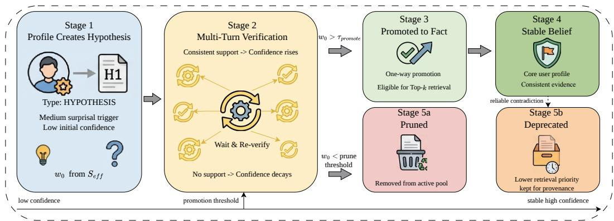  
Figure 6: Hypothesis lifecycle under PreCoMem. A hypothesis created by PROFILE (Stage 1) enters multi-turn verification (Stage 2): consistent support raises its confidence toward the promotion threshold $\tau _ { \mathrm { p r o m o t e } }$ (Stage 3 → Stage 4, becoming a stable core-profile belief that ranks above hypotheses in confidence-weighted retrieval), while no/weak support lets its weight decay; once $w _ { t }$ falls below the prune threshold the hypothesis is removed from the active pool (Stage 5a); a committed FACT that is later reliably contradicted is instead softly decayed and kept for provenance (Stage 5b). The horizontal axis is confidence, from low confidence through the promotion threshold to stable high confidence.

Table 10: Fine-grained ablation of the raw-surprisal components. Accuracy (%) on LoCoMo and LongMemEval-S (gpt-4o-mini backbone). w/o $d _ { \mathrm { s e m } }$ (λ=0) keeps only the NLI-based contradiction signal; $\mathrm { w / o } d _ { \mathrm { c o n f } } \left( \lambda { = } 1 \right)$ keeps only the semantic-gap signal. Both signals matter, but $d _ { \mathrm { c o n f } }$ contributes nearly twice as much because it directly detects reliable negation.
<table><tr><td>Variant</td><td>LoCoMo</td><td>LongMemEval-S</td></tr><tr><td>Full PreCoMem</td><td>73.57</td><td>84.28</td></tr><tr><td> $\mathrm { w / o } \ d _ { \mathrm { s e m } } \ ( \lambda { = } 0 )$ </td><td>67.83 (-5.74)</td><td> $7 7 . 6 5 \ : ( - 6 . 6 3 )$ </td></tr><tr><td>w/o  $d _ { \mathrm { c o n f } } \ ( \lambda { = } 1 )$ </td><td> $6 3 . 4 9 \left( - 1 0 . 0 8 \right)$ </td><td> $7 2 . 7 1 \ : ( - 1 1 . 5 7 )$ </td></tr></table>

Section B.2). To disentangle their individual contributions, we ablate each component by forcing one branch to zero. w/o $d _ { \mathrm { s e m } }$ sets $\lambda = 0 ,$ , keeping only the contradiction verifier; w/o $d _ { \mathrm { c o n f } }$ sets $\lambda = 1$ , keeping only the semantic gap. As shown in Table 10, both components are useful, but $d _ { \mathrm { c o n f } }$ contributes substantially more: removing it costs −10.08 points on LoCoMo and −11.57 points on LongMemEval-S, roughly double the drop from removing $d _ { \mathrm { s e m } } ( - 5 . 7 4$ and −6.63 points respectively). This matches the design intuition: the semantic gap alone cannot distinguish a genuinely contradictory utterance from one that is merely off-topic relative to current memory, whereas the NLI-based contradiction score directly detects reliable negation and drives CORRECT. Keeping both signals, on the other hand, gives the best trade-off between sensitivity (detecting drift cues via $d _ { \mathrm { s e m } } )$ and precision (avoiding spurious corrections via $d _ { \mathrm { c o n f } } )$

NLI verifier robustness (sanity check). Because $d _ { \mathrm { c o n f } }$ uses a max statistic over $\pi _ { t } ( m )$ , a natural concern is whether the system is over-reliant on the specific NLI model behind $\mathrm { V e r i f } _ { \mathrm { c o n f } } .$ We probe this by replacing the default cross-encoder/nli-deberta-v3-base with two alternative MNLI-trained verifiers (each re-calibrated with a fresh temperature on the MNLI matched dev split, leaving every other PreCoMem component untouched) and one random-π control that draws $\pi _ { t } ( m ) \sim \mathrm { B e t a } ( 2 , 5 )$ independently per item. To keep the sweep tractable we use LoCoMo Sample 1 (400 turns, 105 QAs; the same sample as the threshold-sensitivity study in Section C.5) under the gpt-4o-mini backbone, three seeds.

Table 11 shows that both alternative NLI checkpoints stay within a ±1 point band of the default; a Beta(2, 5)-randomized $\pi _ { t } .$ , in contrast, costs 11 points, slightly more than removing $d _ { \mathrm { c o n f } }$ altogether (−11.11 against $- 1 0 . 0 8$ in Table 10). We read this as a two-sided sanity check: the max-based $d _ { \mathrm { c o n f } }$ is genuinely informative (random replacement is much worse than dropping the signal), but the gate is robust to the precise verifier as long as it is calibrated on a standard NLI distribution. Note that the absolute accuracies in this table are on a single 105-QA sample and therefore not comparable to the full-LoCoMo numbers in Table 1; the comparison is a within-row $\Delta$ across verifiers.

Table 11: NLI verifier sanity check on LoCoMo Sample 1. Sample-1 LLM-judge accuracy (%) when $\mathrm { V e r i f _ { \mathrm { c o n f } } }$ is replaced. The two alternative MNLI-trained verifiers stay within 1 point of the default; a randomized control collapses by 11 points, confirming that $d _ { \mathrm { c o n f } }$ is load-bearing yet that PreCoMem is not coupled to a specific verifier checkpoint.
<table><tr><td> $\mathrm { V e r i f _ { \mathrm { c o n f } } }$ </td><td>Sample-1 Overall</td><td> $\Delta$ </td></tr><tr><td>cross-encoder/nli-deberta-v3-base (default)</td><td> $7 6 . 1 9 \pm 0 . 4 2$ </td><td></td></tr><tr><td>facebook/bart-large-mnli</td><td> $7 5 . 7 4 \pm 0 . 3 8$ </td><td>-0.45</td></tr><tr><td>roberta-large-mnli</td><td> $7 5 . 4 0 \pm 0 . 5 1$ </td><td>-0.79</td></tr><tr><td>random  $\pi _ { t } \sim \mathrm { B e t a } ( 2 , 5 )$  (control)</td><td> $6 5 . 0 8 \pm 0 . 7 9$ </td><td>-11.11</td></tr></table>

DiMoBench evolution-operator ablations. We ablate PreCoMem’s three evolution operators on DiMoBench: PROFILE (hypothesis writing), CORRECT (surprisal-gated soft correction), and MAINTAIN (reinforcement/smoothing). We report accuracy every 10 turns from turn 150 to 350. As shown in Figure 4(c), removing PROFILE lowers the final accuracy ceiling (72%), removing CORRECT substantially slows post-drift recovery, and removing MAINTAIN leads to high-variance dynamics that do not stabilize within our evaluation horizon (ending at 54% accuracy).

Operator-level analysis. DiMoBench is designed to separate three regimes that stress different update behaviors: a stable pre-change phase (turns ≈150–200), a short change-point phase with mixed/ambiguous cues and decoy retrieval (turns ≈200–240), and a stable post-change phase where the latent attitude has reversed (turns ≈240–350). Under this structure, the three operators contribute in complementary ways.

PROFILE: buffered adaptation under implicit drift. Many change-point cues are neither clean confirmations nor decisive contradictions: they are novel, partially ambiguous, and often entangled with confounders. PROFILE converts these medium- $S _ { \mathrm { e f f } }$ signals into low-confidence, testable hypotheses, enabling the system to accumulate multiple weak cues before committing. This “waiting room” is especially important on DiMoBench because questions explicitly probe trend/change-point reasoning and hypothesis-vs-fact distinction. When PROFILE is removed, the system loses this intermediate representation and commits weak cues without a waiting room (premature commitment under decoys), which reduces the asymptotic ceiling (72% vs. 84% for full PreCoMem).

CORRECT: targeted suppression of outdated beliefs. After the drift, previously correct highconfidence beliefs become systematically misleading, and decoy retrieval makes stale evidence likely to reappear. CORRECT provides a selective revision mechanism by downweighting contradicted items via the $\zeta _ { t } ( m )$ -modulated soft decay while leaving non-contradictory items largely unchanged. This targeted decay is crucial for reducing old-memory pull and preventing interference from pre-change beliefs. Without CORRECT, outdated facts remain competitive in retrieval, so the agent must rely on accumulating new nodes and indirect effects to “outvote” entrenched beliefs, yielding a substantially slower recovery (reaching 75% only around turn 320 vs. turn 250) and a lower final plateau (77% vs. 84%).

MAINTAIN: consolidation for stability. MAINTAIN acts as a consolidation step that repeatedly reinforces supported beliefs, which sharpens confidence-weighted retrieval, increases retrieval reliability $\rho _ { t }$ (by making the score mass more concentrated), and stabilizes the routing signal $x _ { t } ( = S _ { \mathrm { e f f } } )$ . It also underpins the hypothesis lifecycle: hypotheses created by PROFILE require repeated reinforcement to cross the promotion threshold and become stable facts. This stabilization is critical in the postchange phase, where the system should stop oscillating and settle into the post-change regime. When MAINTAIN is ablated, supported post-change beliefs cannot be progressively consolidated; retrieval remains diffuse and volatile, the reliability-adjusted loss becomes noisy, and updates keep “chasing” confounded evidence. Empirically, this yields persistent volatility: accuracy continues to fluctuate and ends at 54% at the end of our evaluation.

Route-matched and factorial controls. Setting the gate score to zero (ES in Figure 4(a)) routes every turn to MAINTAIN, so it measures a reinforce-only lower bound; likewise CW sets $w \equiv 1$ globally, so its drop is the total effect of confidence weighting across retrieval and the whole lifecycle (every hypothesis then trivially satisfies w ≥ 0.80 and is promoted at its first lifecycle step, pruning never fires, and soft decay is overwritten). Table 12 isolates the marginal value of the gate and the two roles of confidence with three controls on LoCoMo and LongMemEval-S (gpt-4o-mini, three seeds). (i) A single-threshold gate without the PROFILE band, which sends the medium band to CORRECT, reaches 69.92 / 81.16 (−3.65 / −3.12 against Full); this is the marginal value of the waiting room. (ii) Frequency-matched random routing keeps the operator budget at Full’s empirical routing frequencies $( \dot { \mathrm { M } } / \mathrm { P } / \dot { \mathrm { C } } = 5 6 . 2 / 2 7 . 4 / 1 6 . 4 \% )$ and leaves the read path unchanged, but assigns operators at random; it loses 11.74 / 11.34 with the update frequency held fixed, so the gain comes from the evidence-to-operator correspondence itself. (iii) $\textup { A 2 } \times 2$ factorial over read-time weighting (w in Equation (1)) and lifecycle confidence (w in the operator updates and in the promotion and pruning tests) shows that removing read-time weighting alone costs 1.77 / 0.72 points, removing lifecycle confidence alone costs 20.69 / 22.63, and removing both (the CW variant) costs 30.15 / 34.63; in half-coded effect terms the main effects are $+ 5 . 6 2 \ : / \ : + 6 . 3 6$ for read-time weighting and +24.54 / +28.27 for lifecycle confidence, with an interaction of −3.85 / −5.64, i.e., each factor is worth more when the other is absent.

Table 12: Route-matched and factorial controls (LLM-judge accuracy, gpt-4o-mini, mean ± std over three seeds).
<table><tr><td>Variant</td><td>LoCoMo</td><td>LongMemEval-S</td></tr><tr><td>Full PreCoMem</td><td> $7 3 . 5 7 \pm 0 . 2 8$ </td><td> ${ \pm } 0 . 2 8 \pm 0 . 0 5$ </td></tr><tr><td>Single-threshold gate (no PROFILE band; medium band → CORRECT) Frequency-matched random routing (M/P/C = 56.2/27.4/16.4%)</td><td> $6 9 . 9 2 \pm 0 . 2 9$ </td><td> $8 1 . 1 6 \pm 0 . 1 2$ </td></tr><tr><td></td><td> $6 1 . 8 3 \pm 1 . 2 5$ </td><td> $7 2 . 9 4 \pm 1 . 0 8$ </td></tr><tr><td>Read-time weighting off, lifecycle confidence on</td><td> $7 1 . 8 0 \pm 0 . 4 3$ </td><td> $8 3 . 5 6 \pm 0 . 2 3$ </td></tr><tr><td>Lifecycle confidence off, read-time weighting on</td><td> $5 2 . 8 8 \pm 0 . 6 9$ </td><td> $6 1 . 6 5 \pm 0 . 6 8$ </td></tr><tr><td>Both off  $( = { \mathrm { w } } / { \mathrm { o } } \mathrm { C W } )$ </td><td> $4 3 . 4 2 \pm 0 . 9 4$ </td><td> $4 9 . 6 5 \pm 0 . 9 1$ </td></tr></table>

Table 13: LLM-direct-write baseline (Overall LLM-judge accuracy, gpt-4.1, mean ± std over three seeds; the paired difference is the mean over seeds of PreCoMem minus direct write).
<table><tr><td></td><td>LoCoMo</td><td>LongMemEval-S</td></tr><tr><td>PreCoMem (bounded scalars + closed-form updates)</td><td> ${ \pm 0 . 0 6 \pm 0 . 0 7 }$ </td><td> ${ \pm 0 . 3 9 \pm 0 . 7 6 }$ </td></tr><tr><td>LLM direct write</td><td> $8 2 . 3 1 \pm 1 . 4 2$ </td><td> $8 6 . 2 4 \pm 1 . 6 3$ </td></tr><tr><td>Paired difference</td><td> $+ 2 . 7 5$ </td><td>+3.15</td></tr></table>

LLM-direct-write baseline. A natural alternative to the hybrid design of Section 2.1 is to let the same LLM decide the whole write step. The direct-write baseline matches PreCoMem in every other component (retrieval, embedding, Top-K=10, context, judge, seeds, gpt-4.1); the only change is that the LLM emits the entire write decision as one object, {route, target\_ids, operation, new\_weights, new\_belief}, whose weights are written verbatim, replacing the gate, the closedform updates and the [0, 1] clamping. Table 13 shows that accuracy is lower in every seed (−2.75 on LoCoMo, −3.15 on LongMemEval-S) while per-query tokens are slightly higher (3.2k / 3.9k against 3.1k / 3.8k), so the loss is not offset by efficiency. The more telling difference is stability: the cross-seed standard deviation is 20× higher on LoCoMo (1.42 against 0.07) and 2.1× higher on LongMemEval-S, because unconstrained numeric decisions make the memory trajectory rundependent. Replaying the write decisions on a frozen store, direct write emits a missing target id in 3.6% of decisions, a self-contradictory operation in 2.7% and invalid JSON in 1.8% (mutually exclusive categories); such malformed writes corrupt the store silently and compound, whereas the closed-form updates stay in [0, 1] by construction. The loss is spread over all LoCoMo splits (Single-Hop −1.65, Multi-Hop −4.80, Temporal −2.70, Open-Domain −6.50). The deterministic layer is what keeps long-horizon memory bounded.

Turn-level versus per-item routing. PreCoMem computes one gate score per turn and routes the whole retrieved set to a single operator; the per-item magnitudes $\eta _ { t } ( m )$ and ζt(m) apply after routing. A turn can therefore reinforce several beliefs, or correct several beliefs, at once, but it cannot reinforce one belief, correct another and profile a third in the same step. To measure how often this matters we annotated gold operators per retrieved item on 9,006 turns (all LoCoMo dialogues plus the LongMemEval-S evidence sessions): 3,475 turns touch at least one retrieved belief, and 95.83% of them are expressible by a single route, either a single belief or several beliefs sharing one operator. The remaining 145 turns (1.61% of all turns, 21.4% of the 678 multi-item turns) are genuinely mixed. A per-item variant, identical in retrieval, backbone and closed-form updates but routing each item independently, raises the whole-turn agreement with the gold operators on these 145 turns by +5.5 points and their question accuracy by +3.5 points, at +31% write calls and +14% write tokens, for a net gain of +0.3 points over the full evaluation. Given the small net benefit at a materially higher cost, we keep turn-level routing as the default and regard per-item claim extraction as a direction for future work.

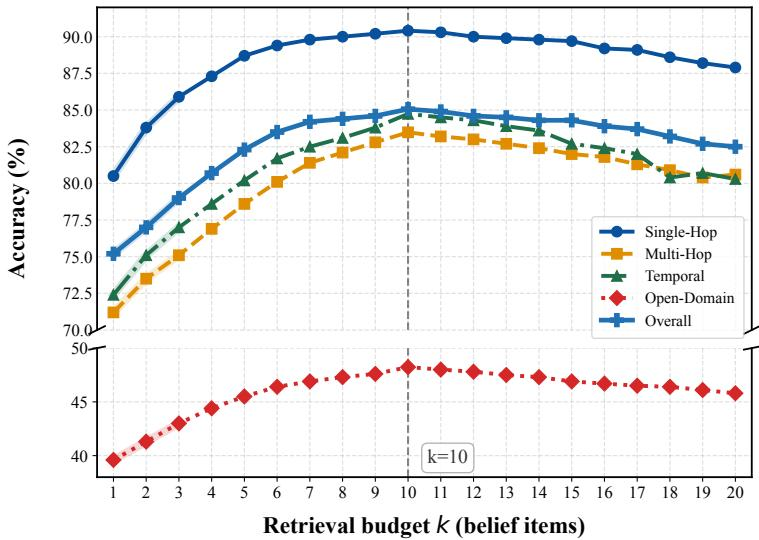  
Figure 7: Top-K sensitivity on LoCoMo (gpt-4.1 backbone). Per-split accuracy as k varies in $\{ 1 , \ldots , 2 0 \}$ . The dashed vertical line marks our default k=10.

Table 14: Accuracy (%) at different retrieval sizes k on LoCoMo (gpt-4.1 backbone). Best results are in bold.
<table><tr><td>k</td><td>Single-Hop</td><td>Multi-Hop</td><td>Temporal</td><td>Open-Domain</td><td>Overall</td></tr><tr><td>1</td><td>80.5</td><td>71.2</td><td>72.4</td><td>39.6</td><td>75.2</td></tr><tr><td>5</td><td>88.7</td><td>78.6</td><td>80.2</td><td>45.5</td><td>82.3</td></tr><tr><td>10</td><td>90.41</td><td>83.48</td><td>84.74</td><td>48.23</td><td>85.06</td></tr><tr><td>15</td><td>89.7</td><td>82.0</td><td>82.7</td><td>46.9</td><td>84.3</td></tr><tr><td>20</td><td>87.9</td><td>80.6</td><td>80.3</td><td>45.8</td><td>82.5</td></tr></table>

## C.5 Hyperparameter sensitivity and adaptive variants

Sensitivity to retrieval budget k. We vary the number of retrieved memory items k on LoCoMo. Table 14 shows a clear “fast gain, slow gain, mild drop” trend: Overall accuracy improves substantially from k=1 to k=5 (75.2→82.3), increases marginally from k=5 to k=10 (82.3→85.06), and then declines at larger budgets (85.06→82.5 at k=20). Category-wise, Temporal is the most sensitive to oversized budgets (84.7 at k=10 vs. 80.3 at k=20). Figure 7 visualizes the same sweep across all four LoCoMo splits with a broken-y axis to keep the high- and low-accuracy bands legible side-by-side.

Mechanism-level analysis. We provide a more formal explanation of why oversized k can hurt PreCoMem beyond generic retrieval noise. Recall that PreCoMem uses entropy-based retrieval reliability $\rho _ { t }$ and the max-contradiction term $d _ { \mathrm { c o n f } } .$

$$
\begin{array} { c } { \hat { s } _ { i } = \displaystyle \frac { s _ { i } + \epsilon } { \sum _ { j = 1 } ^ { k } ( s _ { j } + \epsilon ) } , } \\ { H _ { t } = \displaystyle \frac { - \sum _ { i = 1 } ^ { k } \hat { s } _ { i } \log \hat { s } _ { i } } { \log k } , } \\ { \rho _ { t } = 1 - H _ { t } . } \\ { S _ { \mathrm { e f f } } \left( u _ { t } \right) = x _ { t } = \rho _ { t } \Big ( \lambda d _ { \mathrm { s e m } } \left( u _ { t } , \mathcal { C } _ { t } \right) + \left( 1 - \lambda \right) d _ { \mathrm { c o n f } } \left( u _ { t } , \mathcal { C } _ { t } \right) \Big ) , } \\ { d _ { \mathrm { c o n f } } = \displaystyle \operatorname* { m a x } _ { m \in \mathcal { C } _ { t } } \pi _ { t } ( m ) . } \end{array}\tag{29}
$$

(30)

(1) k ↑ flattens scores $\Rightarrow \rho _ { t }$ ↓ and CORRECT is suppressed. The reliability $\rho _ { t }$ decreases when the normalized score distribution ˆs becomes less concentrated. To make this explicit, consider a simple extension model where the Top-k distribution over the original $k _ { 0 }$ items is $\mathbf { p } \in \Delta ^ { k _ { 0 } - 1 }$ , and increasing k adds $k _ { 1 }$ additional tail items whose total normalized mass is $\delta \in ( \bar { 0 } , 1 )$ and is approximately uniform within the tail:

$$
\mathbf { p } ^ { \prime } = \bigl ( ( 1 - \delta ) p _ { 1 } , \dots , ( 1 - \delta ) p _ { k _ { 0 } } , \underbrace { \frac { \delta } { k _ { 1 } } , \dots , \frac { \delta } { k _ { 1 } } } _ { k _ { \mathrm { 1 \ : i t e m s } } } \bigr ) , k = k _ { 0 } + k _ { 1 } .\tag{31}
$$

By concavity of Shannon entropy, injecting nonzero tail mass strictly increases entropy unless $\delta = 0$ A direct decomposition yields

$$
\begin{array} { r } { \mathbf { \mathcal { H } } ( \mathbf { p } ^ { \prime } ) = ( 1 - \delta ) \mathbf { \mathcal { H } } ( \mathbf { p } ) + h ( \delta ) + \delta \log k _ { 1 } , } \end{array}\tag{32}
$$

where $\mathcal { H } ( \cdot )$ is unnormalized entropy and $h ( \delta ) = - \delta \log \delta - ( 1 - \delta ) \log ( 1 - \delta )$ is the binary entropy. Thus, for typical retrieval where the tail receives non-negligible probability mass, $H _ { t }$ increases with k and $\rho _ { t }$ decreases.

This interacts with the fixed-threshold gate: CORRECT is triggered when $x _ { t } = S _ { \mathrm { e f f } } ( u _ { t } ) > \theta _ { \mathrm { h i g h } }$ . Since $x _ { t } = \rho _ { t } S _ { \mathrm { r a w } } ( u _ { t } )$ with $S _ { \mathrm { r a w } } ( u _ { t } ) \in [ 0 , 1 ]$ , the event can be rewritten as

$$
\rho _ { t } S _ { \mathrm { r a w } } ( u _ { t } ) > \theta _ { \mathrm { h i g h } } \quad \Longleftrightarrow \quad S _ { \mathrm { r a w } } ( u _ { t } ) > { \frac { \theta _ { \mathrm { h i g h } } } { \rho _ { t } } } .\tag{33}
$$

Therefore, as $\rho _ { t }$ decreases, the required raw-surprisal level $\theta _ { \mathrm { h i g h } } / \rho _ { t }$ increases, making reliable correction harder to trigger and strengthening old-memory pull. This effect is most visible for Temporal queries, where Top-k often mixes pre- and post-change evidence, yielding a less concentrated score mass (higher $H _ { t } )$ even when the underlying contradiction is real.

(2) k ↑ amplifies spurious contradictions via a max statistic. The contradiction term uses an order statistic $d _ { \mathrm { c o n f } } = \operatorname* { m a x } _ { m \in \mathcal { C } _ { t } } \pi _ { t } ( m )$ . If we view $\pi _ { t } ( m )$ for irrelevant/mismatched retrieved items as random variables with CDF $F _ { 0 }$ on $[ 0 , 1 ]$ , then for k candidates,

$$
\Pr ( d _ { \mathrm { c o n f } } > \tau ) = 1 - \operatorname* { P r } ( \pi _ { t } ( m ) \leq \tau ) ^ { k } = 1 - F _ { 0 } ( \tau ) ^ { k } ,\tag{34}
$$

which is monotonically increasing in k for any $\tau \in ( 0 , 1 )$ with $F _ { 0 } ( \tau ) \in ( 0 , 1 )$ . When $1 - F _ { 0 } ( \tau )$ is small, the increase is approximately linear:

$$
\begin{array} { r } { 1 - F _ { 0 } ( \tau ) ^ { k } \approx k ( 1 - F _ { 0 } ( \tau ) ) . } \end{array}\tag{35}
$$

Thus, larger evidence sets increase the probability of observing an artificially high contradiction score from at least one mismatched memory, which can (i) inflate $S _ { \mathrm { r a w } }$ through the $( 1 - \lambda ) d _ { \mathrm { c o n f } }$ component and (ii) distract response generation by presenting a “hard contradiction” that is not actually relevant to the query. Together with (1), this explains why performance can decline for large k despite higher coverage.

Implication. The empirical peak at $k { = } 1 0$ reflects a regime where coverage is sufficient to retrieve the right evidence, while $\rho _ { t }$ remains high enough to permit timely CORRECT actions and the maxcontradiction term remains less exposed to spurious outliers. This motivates using $k { = } 1 0$ as a robust default under a moderate compute budget.

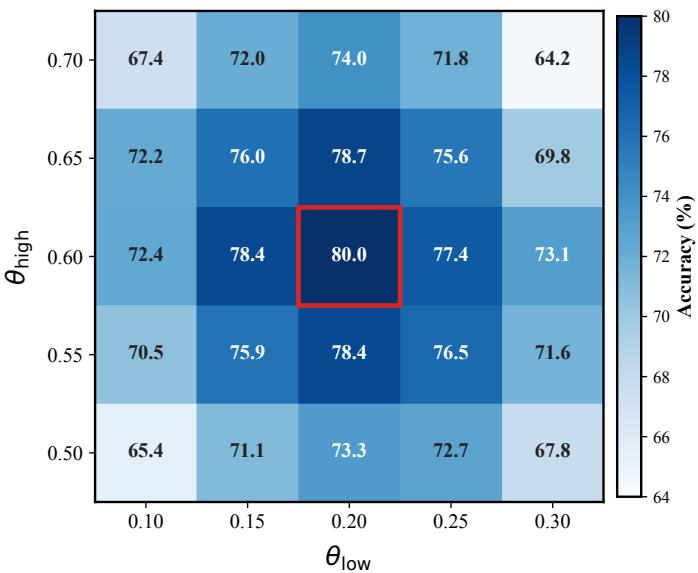  
Figure 8: Gating threshold sensitivity. LoCoMo accuracy (Sample 1) over a $5 \times 5$ grid of $( \theta _ { \mathrm { l o w } } , \theta _ { \mathrm { h i g h } } )$ with step 0.05 (25 configurations in total). The red box marks the deployed default (0.20, 0.60), which sits at the center of a high-performing plateau; the four immediate neighbors of the peak stay within 1.3–2.6 accuracy points, while accuracy degrades smoothly toward the grid corners.

Sensitivity to gating thresholds. Theoretically, one may dynamically compute or adapt the thresholds (e.g., by estimating the action costs/effects in Equation (27)), which could yield better per-sample or per-stage performance. However, such on-policy adaptation introduces additional computation and confounds controlled evaluation because the observed behavior becomes entangled with an evolving threshold schedule.

We therefore adopt a fixed threshold pair $( \theta _ { \mathrm { l o w } } , \theta _ { \mathrm { h i g h } } )$ in all experiments and justify a reasonable choice via a sensitivity study. For controllable and cost-bounded ablation, we select a representative LoCoMo sample (Sample 1; 400 dialogue turns and 105 QA pairs) whose question types are relatively balanced and whose scale supports rapid iteration. We sweep $\theta _ { \mathrm { l o w } } \in \{ 0 . 1 0 , 0 . 1 5 , \dot { 0 } . 2 0 , 0 . 2 5 , 0 . 3 0 \dot { ] }$ and $\theta _ { \mathrm { h i g h } } \in \{ 0 . 5 0 , 0 . 5 5 , 0 . 6 0 , \bar { 0 } . 6 5 , 0 . \bar { 7 } 0 \}$ in steps of 0.05 $( 5 \times 5 = 2 5$ configurations) and evaluate LLM-judge accuracy on this sample. As shown in Figure 8, the deployed default (0.20, 0.60) (red box) sits at the center of a high-performing plateau: its four direct neighbors (0.15, 0.60), (0.25, 0.60), (0.20, 0.55) and (0.20, 0.65) all stay within a narrow 1.3–2.6-point band of the peak. Accuracy decays smoothly toward the corners (down to roughly 64–67% near $\theta _ { \mathrm { l o w } } { = } 0 . 3 0 , \theta _ { \mathrm { h i g h } } { = } 0 . 7 0$ and the symmetric corner), confirming that the gate is locally robust rather than knife-edged.

Importantly, this fixed choice is a trade-off: we do not claim (0.2, 0.6) is universally optimal for every LoCoMo sample. Rather, it provides a stable and interpretable operating point with competitive accuracy under a fixed computational budget, and we keep it constant across experiments for fair comparison and reproducible observations.

Adaptive thresholding for personalization. One natural question is whether the fixed gating thresholds $( \theta _ { \mathrm { l o w } } , \theta _ { \mathrm { h i g h } } ) \bar { = } ( 0 . \bar { 2 } , 0 . 6 )$ are appropriate for all users, or whether different user populations would benefit from different thresholds. Intuitively, users differ in beliefstability: some keep stable preferences so that short-term deviations are noise, while others change frequently so that the same deviations reflect real drift. A fixed threshold cannot simultaneously satisfy both regimes. We therefore discuss and evaluate a simple adaptive-thresholding extension of PreCoMem.

User stability index. We summarize each user’s recent dynamics with a scalar stability index $\psi _ { t } \in [ 0 , 1 ]$ , computed from interaction statistics over a sliding window of length W:

$$
\psi _ { t } = \omega _ { 1 } \psi _ { \mathrm { c o r r } } + \omega _ { 2 } \psi _ { \mathrm { l i f e } } + \omega _ { 3 } \psi _ { \mathrm { v a r } } ,\tag{36}
$$

Table 15: Adaptive vs. fixed thresholds on LoCoMo (accuracy $\% ,$ gpt-4o-mini and gpt-4.1). PreCoMem (DT) personalizes $( \theta _ { \mathrm { l o w } } , \theta _ { \mathrm { h i g h } } )$ via the user stability index in Equations (36) and (37); PreCoMem (fixed) uses (0.2, 0.6). DT improves the overall average on both backbones, with the largest gain on the drift-heavy Open category under gpt-4o-mini, without any retraining.
<table><tr><td>Backbone</td><td>Method</td><td>Single</td><td>Multi</td><td>Temp. Open</td><td>Avg.</td></tr><tr><td rowspan="2">gpt-4o-mini</td><td>PreCoMem (fixed)</td><td>81.41</td><td>68.49</td><td>66.21 39.63</td><td>73.57</td></tr><tr><td>PreCoMem (DT)</td><td>82.27</td><td>69.31</td><td>67.04 43.55</td><td>74.55</td></tr><tr><td rowspan="2">gpt-4.1</td><td>PreCoMem (fixed)</td><td>90.41</td><td>83.48</td><td>84.74 48.23</td><td>85.06</td></tr><tr><td>PreCoMem (DT)</td><td>91.42</td><td>85.16</td><td>85.81 47.78</td><td>86.21</td></tr></table>

where (i) $\psi _ { \mathrm { c o r r } } = 1 - N _ { \mathrm { c o r r e c t } } ^ { ( W ) } / N _ { \mathrm { t o t a l } } ^ { ( W ) }$ captures how rarely CORRECT fires in the recent window, (ii) $\psi _ { \mathrm { l i f e } } = \mathrm { m i n } \big ( 1 , \bar { L } _ { \mathrm { b e l i e f } } / L _ { \mathrm { r e f } } \big )$ captures average belief lifespan relative to a reference $L _ { \mathrm { r e f } }$ , and (iii) $\psi _ { \mathrm { v a r } } = \exp \Bigl ( - \kappa \cdot \mathrm { V a r } \left\lceil S _ { \mathrm { e f f } } ^ { ( W ) } \right\rceil \Bigr )$ captures the variance of effective surprisal. The coefficients satisfy $\omega _ { 1 } + \omega _ { 2 } + \omega _ { 3 } = 1$ , and we use $\omega _ { 1 } = 0 . 5 , \omega _ { 2 } = 0 . 3 , \omega _ { 3 } = 0 . 2$ in the experiments below (κ and $\omega _ { i }$ are specific to this variant and unrelated to the γ and $\alpha _ { j }$ of the main text).

Threshold adaptation. We then map $\psi _ { t }$ to thresholds by linear interpolation between a conservative upper configuration and an aggressive lower configuration:

$$
\begin{array} { r l } & { \theta _ { \mathrm { l o w } } ( t ) = \theta _ { \mathrm { l o w } } ^ { \mathrm { m i n } } + \psi _ { t } \left( \theta _ { \mathrm { l o w } } ^ { \mathrm { m a x } } - \theta _ { \mathrm { l o w } } ^ { \mathrm { m i n } } \right) , } \\ & { \theta _ { \mathrm { h i g h } } ( t ) = \theta _ { \mathrm { h i g h } } ^ { \mathrm { m i n } } + \psi _ { t } \left( \theta _ { \mathrm { h i g h } } ^ { \mathrm { m a x } } - \theta _ { \mathrm { h i g h } } ^ { \mathrm { m i n } } \right) , } \end{array}\tag{37}
$$

with $\theta _ { \mathrm { l o w } } \in [ 0 . 1 0 , 0 . 3 5 ]$ and $\theta _ { \mathrm { h i g h } } \in [ 0 . 4 0 , 0 . 8 0 ]$ . Intuitively, a stable user $( \psi _ { t }  1 )$ receives larger thresholds, so the system requires stronger evidence before updating; a dynamic user $( \psi _ { t }  0 )$ receives smaller thresholds, so the system reacts faster. To avoid oscillation, we smooth the thresholds with an exponential moving average with coefficient $\mu { = } 0 . 1$

Theoretical view. From a Bayesian perspective, the thresholds encode a prior on belief persistence: stable users have a stronger prior that beliefs are unchanged, so a higher $\theta _ { \mathrm { h i g h } }$ corresponds to requiring stronger likelihood evidence to revise them, and vice versa for dynamic users. From a signal detection perspective, $\theta _ { \mathrm { l o w } }$ and $\theta _ { \mathrm { h i g h } }$ trade off false-update rate (triggering CORRECT on noise) against missedupdate rate (failing to trigger on genuine drift); since these two error rates have different relative costs for different users, the Bayes-optimal decision boundary is user-dependent. Equation (37) is a minimal realization of this idea that only reads summary statistics PreCoMem already maintains and introduces no extra trainable parameters.

Empirical results on LoCoMo. We evaluate the adaptive variant, denoted PreCoMem (DT), on the full LoCoMo benchmark with two backbones (gpt-4o-mini and gpt-4.1), keeping every other setting identical to the main experiments. As shown in Table 15, relaxing the fixed thresholds to Equation (37) yields consistent gains in overall accuracy (+0.98 on gpt-4o-mini, +1.15 on gpt-4.1), with the largest improvement on the Open-Domain subset under gpt-4o-mini (+3.92), which is the category most exposed to long-horizon drift. The same trend holds on LongMemEval-S, where PreCoMem (DT) lifts the overall score from 84.28 to 85.36 under gpt-4o-mini, with the largest gains on KU (knowledge update, +1.62) and SSP (single-session preference, +1.95); these are precisely the question types that require per-user calibration of how aggressively to update beliefs.

These results show that adaptive thresholding is an almost-free extension that further personalizes PreCoMem for users with different stability profiles. We keep the fixed-threshold setting as the default in the main paper for controllable comparison, but we consider adaptive thresholding a natural deployment-time configuration, especially in long-horizon and cross-user settings.

## C.6 DiMoBench: construction and extended-horizon stress test

Construction pipeline and characteristics. DiMoBench (Dialogue Implicit Memory Drift Benchmark) is designed to isolate belief-drift adaptation under sparse and implicit cues. The released suite consists of five 350-turn two-speaker dialogues, each built around a distinct persona drawn from a different combination of Big-Five extremes and life stages; for clarity the exposition below focuses on one canonical persona, but every quantitative result on DiMoBench (the dynamics in Figure 4(b) and the operator ablation in Figure 4(c)) is averaged across the five personas to avoid a single-persona artifact; the human–judge agreement audit in Table 8 uses the canonical persona, whose per-type accuracies lie within 0.15 points of the five-persona means. Within each persona the user’s latent attitude toward a target topic remains stable in turns 1–200, gradually reverses in turns 201–210 via 3–4 implicit events, and is then reinforced with denser behavioral signals in turns 211–240 before entering a low-frequency maintenance stage in turns 241–350.

Table 16: DiMoBench construction pipeline. Generator and verifier are deliberately different models; a 20% stratified human review provides final quality control.
<table><tr><td>Stage</td><td>Name</td><td>Model</td><td>Output</td></tr><tr><td>1</td><td>Persona construction</td><td>GPT-40</td><td>User profile + core trait slot</td></tr><tr><td>2</td><td>Life skeleton &amp; turn</td><td>GPT-40</td><td>Event timeline + drift trigger</td></tr><tr><td>3</td><td>Dialogue generation</td><td>GPT-40</td><td>35 sessions × 10 turns</td></tr><tr><td>4</td><td>QA generation</td><td>GPT-40</td><td>200 QA pairs across 4 categories</td></tr><tr><td>5</td><td>Consistency verification</td><td>Gemini-2.5-Pro</td><td>Cross-validated QA (6 criteria)</td></tr><tr><td>6</td><td>Human-machine review</td><td>Human + LLM</td><td>20% stratified audit, κ≥0.75</td></tr></table>

To stress long-horizon robustness, DiMoBench injects confounders: every 30 turns we insert irrelevant chit-chat or hypothetical narration that shares surface keywords with the target topic, and we introduce multiple similar entity names to induce attribution ambiguity. Each persona contributes 200 QA pairs distributed across the dialogue (denser sampling near the change point and sparser in the long maintenance tail; 1,000 in total across the five personas), covering (i) current-state inference, (ii) history recall, (iii) change-point detection, and (iv) hypothesis vs. fact distinction. Importantly, questions avoid explicit sentiment keywords and instead require reasoning from behavioral cues (plans, actions, reactions), making drift detection and correction rely on implicit evidence chains rather than lexical matches.

Why DiMoBench is needed. Existing long-horizon dialogue benchmarks predominantly evaluate the read path: whether a system can correctly retrieve and reason over a static conversational record (LoCoMo [34]) or whether it can infer implicit personalization from accumulated preferences (PersonaMem-v2 [35]). None of them explicitly stress-test the write path, i.e., whether a memory system can correctly decide when to maintain, update, or correct its stored beliefs under gradual, implicit drift. DiMoBench is designed to fill this gap along three axes that are absent from existing benchmarks simultaneously: (i) continuous non-stationarity, where the latent attitude reverses gradually over hundreds of turns without any explicit announcement; (ii) implicit behavioral cues, where the drift manifests only through activity choices, reactions to invitations, and hedging language rather than sentiment keywords; and (iii) adversarial retrieval interference, where five tagged interfer ence types (entity\_confusable, keyword\_trap, temporal\_decoy, hypothetical\_vs\_fact, none) systematically probe two stability–plasticity failure modes: old-memory pull and premature correction. This write-path orientation is what lets DiMoBench reveal the distinct contributions of MAINTAIN, PROFILE, and CORRECT in Section C.4, which cannot be isolated on LoCoMo or PersonaMem-v2 alone.

Six-stage construction pipeline. DiMoBench is constructed by a six-stage progressive pipeline with an explicit generator–verifier separation (GPT-4o for generation, Gemini-2.5-Pro for verification) to avoid self-reinforcing biases. Figure 9 visualizes the full pipeline as an end-to-end flow, and Table 16 summarizes the stages; details follow below.

Stage 1 (Persona). Each persona is characterized by one core emotional/behavioral slot (e.g., “attitude toward social activities”) with a well-defined initial state and target state, a set of Big-Five personality dimensions, a small social circle of 2–3 named characters (some deliberately confusable to enable interference evaluation), routine daily activities, and a psychologically plausible drift trigger.

Stage 2 (Life skeleton). The 350-turn trajectory is organized into 35 sessions of 10 turns each. Sessions 1–20 (turns 1–200) establish baseline behavior; session 21 (turns 201–210) introduces the drift trigger via 3–4 implicit events; sessions 22–24 (turns 211–240) reinforce the new behavior with denser cues; sessions 25–35 (turns 241–350) form a low-frequency maintenance stage with monotonically reduced divergence from a steady post-drift baseline.

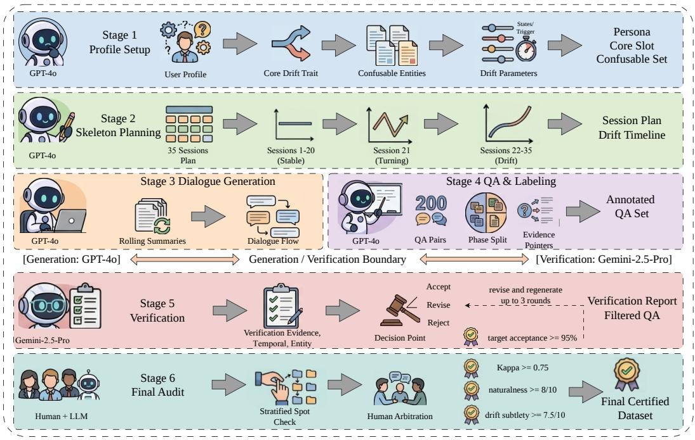  
Figure 9: DiMoBench six-stage construction pipeline. A generator (GPT-4o) produces personas, life skeletons, dialogues, and QA pairs; an independent verifier (Gemini-2.5-Pro) cross-validates each QA pair along six criteria, and a 20% stratified human audit with κ ≥ 0.75 provides final quality control.

Stage 3 (Dialogue generation). Sessions are generated sequentially under cumulative context management. Generation rules enforce natural small talk and topic shifts, implicit expression through activity choices and hedging language, no meta-commentary (the user never says “I’ve changed”), and frequent temporal markers (“last weekend”, “this month”) for temporal reasoning.

Stage 4 (QA generation). 200 QA pairs span all temporal phases (pre-change: 90; change-point: 10; post-change: 100). Each QA carries explicit evidence pointers (D{session}:{turn}), an interference tag, and a reasoning-type label.

Stage 5 (Consistency verification). Each QA is cross-validated by Gemini-2.5-Pro along six dimensions: (i) answer grounding (is the answer supported by cited evidence?), (ii) evidence completeness (are all relevant turns cited?), (iii) temporal consistency (does the answer reflect the correct phase?), (iv) entity accuracy, (v) interference validity (does the tag match the question?), and (vi) drift coherence (is the behavioral change gradual and plausible?). QA pairs marked REVISE are regenerated by GPT-4o using verifier feedback (max 3 rounds); pairs marked REJECT are discarded. We target an ≥95% ACCEPT rate on the auto-verification pass.

Stage 6 (Human–machine review). Three graduate-level annotators with NLP research experience underwent a 2-hour calibration session covering implicit emotional expression, temporal reasoning, and entity disambiguation. All annotators independently label the same 20 QA pairs, and independent annotation proceeds only after inter-annotator agreement reaches κ ≥ 0.75 (Cohen’s κ). A 20% stratified sample (stratified by temporal phase, interference type, and QA category) receives full human review; in addition, one annotator per persona performs a full 350-turn dialogue-coherence assessment. Quality targets are answer correctness ≥95%, dialogue naturalness ≥8.0/10, and drift subtlety ≥7.5/10.

Representative QA examples. To make DiMoBench concrete, we include three canonical QA pairs illustrating each temporal phase and several interference tags:

<table><tr><td>Pre-change QA (no interference, MAINTAIN-oriented)</td></tr><tr><td>Q: What kind of activities does Mike like?</td></tr><tr><td>A: He likes group activities like KTV, parties, and escape rooms. Evidence: D1:3 Phase: pre-change Interference: none Category: current-state inference</td></tr><tr><td></td></tr><tr><td>Change-point QA (implicit behavior, PROFILE-oriented)</td></tr><tr><td>Q: Is Mike really that busy or is it an excuse?</td></tr><tr><td>A: Work is indeed busy, but previously he wouldn&#x27;t decline because of this. Evidence: D21:5, D21:7 Phase: change-point Interference: none Category: change-point</td></tr><tr><td>detection</td></tr><tr><td></td></tr><tr><td>Post-change QA (temporal decoy, CORRECT-oriented)</td></tr><tr><td></td></tr><tr><td>Q: Mike previously said he likes lively places; is that still true?</td></tr></table>

Additional traces that walk through the operator decisions on DiMoBench, including the retrieved Top-K evidence and the resulting memory edits, are provided in Section C.11. All five 350-turn dialogues, the per-persona QA pairs, generation prompts, verification prompts, and human-review scripts are released with the paper at https://github.com/ZhongWishing/PreCoMem.

DiMoBench-XL construction. To stress-test the system beyond DiMoBench’s 350-turn horizon and across more personas, we constructed DiMoBench-XL, a suite of five 1050-turn dialogues, each with three sequential implicit drifts. Following the DiMoBench pipeline in Section C.6, we instantiate five user personas (each with a distinct demographic and dispositional profile, sampled to span both Big-Five extremes and different life stages); within each persona we keep five independent attributes (drink preference, exercise habit, home city, employment status, social style) and apply three drifts at turns {280, 580, 870}, each shifting one or two attributes via 20–30 behavioral cues distributed across the surrounding session. Per persona we sample 20 evaluation QA pairs every 50 turns (420 pairs each, 2,100 in total), balanced across four reasoning types and five interference tags. The whole suite is verified by Gemini-2.5-Pro with the same six-criterion protocol as DiMoBench, achieving a 96.4% average ACCEPT rate across personas (range 94.8–97.6%) after one revision round.

Trajectory data. Table 17 reports the full $N _ { \mathrm { r a w } } / N _ { \mathrm { e f f } } $ / per-bin counts every 100 turns and at the three drift points on a representative DiMoBench-XL persona. $N _ { \mathrm { e f f } }$ enters its 25.8–28.5 plateau by turn 200, dips by at most 1.1 points at a drift on this persona (at most 1.6 across the five personas), and recovers within ∼50 turns to the same band. $N _ { \mathrm { a c t i v e } }$ (items with $w _ { t } \geq 0 . 8 )$ stabilizes at 17–18 across all three drift epochs, indicating that each drift replaces the previous active set rather than accreting onto it. Across the five personas the per-bin $N _ { \mathrm { e f f } }$ trajectory stays within ±1.4 of the values reported here, and $N _ { \mathrm { a c t i v e } }$ never leaves the 16–19 band after turn 200, confirming the same qualitative behavior without persona-level outliers.

QA accuracy stability. Table 18 aggregates QA accuracy across the five DiMoBench-XL personas in five time windows (means across the five personas). Across 1050 turns and three drifts, Overall accuracy decays only 2.3 points (from 84.3% to 82.0% on average) and the average Top-10 retrieval confidence stays at or above 0.78 in every persona, confirming that long-horizon retention is gracefully degraded by confidence weighting rather than catastrophically collapsed; persona-level standard deviations stay below 1.0 accuracy point in every window.

## C.7 Memory dynamics: footprint, contamination, and retention

Headline metrics and retrieval contamination. Table 19 summarizes the headline scalability numbers used in Section 3.5. Below we further examine whether deprecated FACTs leak into Top-k retrieval.

Table 17: DiMoBench-XL memory trajectory (representative persona). Every 100 turns (and at the three drift points) on one of the five DiMoBench-XL personas; per-persona deviations from this trajectory stay within ±1.4 on $N _ { \mathrm { e f f } }$ throughout the run. The four count columns partition $B _ { t }$ by confidence: $\tilde { N } _ { \mathrm { a c t i v e } } ~ ( w _ { t } \geq 0 . 8 ) , ~ N _ { \mathrm { s t a b l e } } ~ ( \overline { { 0 . 5 } } \leq w _ { t } < 0 . 8 ) , ~ N _ { \mathrm { w e a k } } ~ ( 0 . 1 \leq w _ { t } < 0 . 5 )$ and $N _ { \mathrm { d e p r } }$ $( w _ { t } < 0 . 1 )$ ; the last column is the ratio $N _ { \mathrm { e f f } } / N _ { \mathrm { r a w } }$ . Drift turns (t∈{280, 580, 870}) are marked with †.
<table><tr><td>t</td><td> $N _ { \mathrm { r a w } }$ </td><td> $N _ { \mathrm { e f f } }$ </td><td> $N _ { \mathrm { a c t i v e } }$ </td><td> $N _ { \mathrm { s t a b l e } }$ </td><td> $N _ { \mathrm { w e a k } }$ </td><td> $N _ { \mathrm { d e p r } }$ </td><td> $N _ { \mathrm { e f f } } / N _ { \mathrm { r a w } }$ </td></tr><tr><td>100</td><td>26</td><td>21.0</td><td>13</td><td>8</td><td>3</td><td>2</td><td>0.81</td></tr><tr><td>200</td><td>44</td><td>25.8</td><td>16</td><td>11</td><td>7</td><td>7</td><td>0.59</td></tr><tr><td>280†</td><td>57</td><td>26.5</td><td>17</td><td>11</td><td>9</td><td>20</td><td>0.46</td></tr><tr><td>300</td><td>60</td><td>26.7</td><td>17</td><td>12</td><td>9</td><td>22</td><td>0.45</td></tr><tr><td>400</td><td>73</td><td>27.4</td><td>17</td><td>12</td><td>8</td><td>36</td><td>0.38</td></tr><tr><td>500</td><td>81</td><td>28.5</td><td>18</td><td>13</td><td>8</td><td>42</td><td>0.35</td></tr><tr><td>580†</td><td>89</td><td>27.4</td><td>17</td><td>11</td><td>10</td><td>51</td><td>0.31</td></tr><tr><td>600</td><td>92</td><td>27.6</td><td>17</td><td>12</td><td>9</td><td>54</td><td>0.30</td></tr><tr><td>700</td><td>103</td><td>28.0</td><td>18</td><td>12</td><td>9</td><td>64</td><td>0.27</td></tr><tr><td>800</td><td>113</td><td>27.9</td><td>18</td><td>12</td><td>8</td><td>75</td><td>0.25</td></tr><tr><td>870†</td><td>121</td><td>27.6</td><td>17</td><td>11</td><td>9</td><td>84</td><td>0.23</td></tr><tr><td>900</td><td>123</td><td>28.2</td><td>18</td><td>12</td><td>8</td><td>85</td><td>0.23</td></tr><tr><td>1000</td><td>128</td><td>28.0</td><td>18</td><td>12</td><td>8</td><td>90</td><td>0.22</td></tr><tr><td>1050</td><td>131</td><td>28.2</td><td>18</td><td>12</td><td>8</td><td>93</td><td>0.22</td></tr></table>

Table 18: QA accuracy and retrieval quality on DiMoBench-XL across time windows. Numbers are averaged across the five DiMoBench-XL personas; per-window standard deviations across personas are $\leq 1 . 0$ accuracy point and $\leq 0 . 0 2$ for the Top-10 weight, and are omitted for readability. Average Top-10 retrieval confidence stays at or above 0.78 throughout 1050 turns; Overall accuracy decays by only 2.3 points.
<table><tr><td>Turn window</td><td> $\# \mathrm { Q A }$ </td><td>Acc. (%)</td><td>Avg Top-10 w</td><td>Contam.@ 10 (%)</td></tr><tr><td>50-250</td><td>80</td><td>84.3</td><td>0.82</td><td>0.4</td></tr><tr><td>250-500</td><td>100</td><td>83.6</td><td>0.80</td><td>0.6</td></tr><tr><td>500-750</td><td>100</td><td>83.1</td><td>0.79</td><td>0.9</td></tr><tr><td>750-1000</td><td>100</td><td>82.4</td><td>0.78</td><td>1.2</td></tr><tr><td>1000-1050</td><td>40</td><td>82.0</td><td>0.78</td><td>1.3</td></tr></table>

A second concern is whether deprecated FACTs $( w _ { t } < 0 . 1 )$ leak into Top-k retrieval and silently bias the response. We post-analyze every evaluation query on DiMoBench and DiMoBench-XL with three different retrieval budgets $k ~ \in ~ \{ 5 , 1 0 , \bar { 2 } 5 \}$ recording (i) the score-mass ratio $\textstyle \sum _ { m \in { \mathcal C } _ { t } , w _ { t } < 0 . 1 } s ( u _ { t } , m ) / \sum _ { m \in { \mathcal C } _ { t } } s ( { \overline { { u } } } _ { t } , m )$ , (ii) the fraction of Top-k slots occupied by deprecated FACTs, and (iii) the average $w _ { t }$ of retrieved items. Results in Table 20 confirm that even at the most aggressive setting (DiMoBench- $\mathrm { . X L , } k \mathrm { = } 2 5 )$ , deprecated FACTs occupy only 2.6% of slots and contribute 0.94% of total score mass; at our default $k = 1 0$ the numbers drop to 1.0% and 0.58%. The avg retrieved w remains in [0.71, 0.84] across all settings, showing the score is dominated by high-confidence beliefs.

Per-persona end states. Table 21 lists, for each DiMoBench persona, the end-of-dialogue statistics behind the averages in Table 19: accuracy varies by at most 1.6 points across personas, and $N _ { \mathrm { e f f } } ^ { \mathrm { e n d } }$ and the Top-10 contamination stay within 0.3 and 0.2 points of their means. On DiMoBench-XL the per-persona $N _ { \mathrm { e f f } }$ trajectories stay within ±1.4 of the representative persona of Table 17, $N _ { \mathrm { e f f } } ^ { \mathrm { e n d } }$ within 0.4 and Contam.@10 within 0.25 of the five-persona means.

FACT pruning ablation. The default PreCoMem (config A0) prunes HYPOTHESIS items at $w _ { t } < 0 . 1$ but never deletes FACTs; this is intentional because deprecated FACTs serve as immutable provenance hooks for the corresponding episodic-cache traces. To validate that this provenance choice is not a hidden scalability liability, we test two pruning variants: A1 also prunes FACTs at $w _ { t } < 0 . 0 5$ , and A2 prunes FACTs at the same $w _ { t } < 0 . 1 0$ used for hypotheses. Table 22 reports performance and final memory size on LoCoMo (gpt-4o-mini, 10-sample mean) and on DiMoBench (350-turn end-state).

Table 19: Memory scalability headline metrics. $N _ { \mathrm { r a w } }$ grows linearly with the conversation, but $N _ { \mathrm { e f f } }$ converges to a stable plateau and the contamination of deprecated FACTs in Top-10 retrieval stays at or below 1.3% in every window even after 1050 turns and three drifts. Both rows average over their five personas; per-persona deviations are $\leq 0 . 5$ on $N _ { \mathrm { e f f } } ^ { \mathrm { e n d } }$ and $\leq 0 . 4$ on Contam.@10.
<table><tr><td>Setting</td><td> $N _ { \mathrm { r a w } } ^ { \mathrm { e n d } }$ </td><td> $N _ { \mathrm { e f f } } ^ { \mathrm { e n d } }$ </td><td>Contam.@10 (%)</td><td> $\mathrm { Q A } \Delta ( \% )$ </td></tr><tr><td>DiMoBench (350 t.)</td><td>62</td><td>27.6</td><td>0.6</td><td>-0.6</td></tr><tr><td>DiMoBench-XL (1050 t.)</td><td>131</td><td>28.2</td><td>1.0</td><td>-2.3</td></tr></table>

Table 20: Retrieval contamination by deprecated FACTs $( w _ { t } < 0 . 1 )$ . Even at $k = 2 5$ , deprecated items occupy at most 2.6% of Top-k slots and contribute under 1% of the score mass.
<table><tr><td>Dataset</td><td>k</td><td>Score-mass (%)</td><td>Top-k depr. (%)</td><td>Avg retrieved w</td></tr><tr><td>DiMoBench</td><td>5</td><td>0.21</td><td>0.0</td><td>0.84</td></tr><tr><td>DiMoBench</td><td>10</td><td>0.34</td><td>0.6</td><td>0.81</td></tr><tr><td>DiMoBench</td><td>25</td><td>0.62</td><td>1.7</td><td>0.74</td></tr><tr><td>DiMoBench-XL</td><td>5</td><td>0.36</td><td>0.2</td><td>0.81</td></tr><tr><td>DiMoBench-XL</td><td>10</td><td>0.58</td><td>1.0</td><td>0.78</td></tr><tr><td>DiMoBench-XL</td><td>25</td><td>0.94</td><td>2.6</td><td>0.71</td></tr></table>

A1 cuts $N _ { \mathrm { r a w } }$ from 287 to 168 on LoCoMo while losing only 0.06 Overall points (well below the seed standard deviation of 0.28), confirming that the additional FACTs A0 retains were already behaviorally inactive. A2 starts pruning items that still carry residual signal and consequently loses 0.5 Overall on LoCoMo and 1.1 points on DiMoBench. We therefore default to A0 for provenance and recommend A1 only for storage-bounded deployments.

Cross-system memory footprint. A more detailed cross-system footprint comparison, including the per-item-confidence design dimension, is reported in the main paper as Table 2 (Section 3.5). In short, on the ten LoCoMo dialogues (N¯ = 588 turns), PreCoMem-A1 stores 168 items, lower than both O-Mem (232) and EverMemOS (264), while delivering +2.6 and +3.4 Overall points respectively; O-Mem and EverMemOS commit each interaction through a discrete decision, so their stores admit no per-item confidence and the effective count $N _ { \mathrm { e f f } }$ is undefined.

## C.8 Retrieval dependence and reliability calibration

The write path acts only on the retrieved set $\mathcal { C } _ { t } \mathrm { : }$ if the belief that should be revised is not retrieved, the contradiction cannot be detected and CORRECT cannot fire in that turn. This section quantifies that dependence and then examines what the reliability coefficient $\rho _ { t }$ actually tracks.

Belief-update recall and failure decomposition. We call an update-due event a point at which a stored belief must be revised for a later question to be answered correctly (one per evaluation question on DiMoBench and DiMoBench-XL, one per state transition with a pre-existing belief on AMemGym, and one per knowledge-update turn on LongMemEval-S KU), and we measure the Recall@10 of the belief due for update, i.e., how often it enters the write-path Top-10 at that event. Table 23 shows that recall covers most events (89–95%), leaving an explicit 5–11% blind spot, and that misses matter: question accuracy on events whose target was retrieved exceeds that on missed events by 16–22 points. Retrieval is favorable here because a contradictory utterance shares the attribute of the belief it contradicts with opposite polarity, so the target scores high on the semantic and lexical terms of Equation (1). Decomposing all update-due events pooled over the four benchmarks, 89.3% succeed; the residual 10.7% splits into unrecovered retrieval misses (5.4%; a further 1.4% of events are missed at retrieval but corrected later), gate misses (3.1%; the target was retrieved but the turn was not routed to CORRECT) and localization misses (2.2%; the turn was routed to CORRECT but the target was not decayed). Retrieval is thus the largest single source, with half of the failures (5.3 of the 10.7 points) sitting in gating and localization; on LongMemEval-S KU, where each update is stated once, retrieval misses dominate. A miss does not stall adaptation: the observation still enters the episodic cache and can form a hypothesis, and 20% of missed events (147 of 718) are corrected later by subsequent cues or hypothesis promotion.

Table 21: DiMoBench end-of-dialogue statistics per persona (350 turns; mean over three seeds). The means reproduce the DiMoBench row of Table 19.
<table><tr><td>Persona</td><td>Acc. (%)</td><td> $N _ { \mathrm { r a w } } ^ { \mathrm { e n d } }$ </td><td> $N _ { \mathrm { e f f } } ^ { \mathrm { e n d } }$ </td><td>Contam.@10 (%)</td></tr><tr><td>P1 (canonical)</td><td>84.1</td><td>62</td><td>27.6</td><td>0.60</td></tr><tr><td>P2</td><td>83.2</td><td>65</td><td>27.8</td><td>0.80</td></tr><tr><td>P3</td><td>84.8</td><td>59</td><td>27.3</td><td>0.40</td></tr><tr><td>P4</td><td>84.4</td><td>61</td><td>27.5</td><td>0.55</td></tr><tr><td>P5</td><td>83.6</td><td>63</td><td>27.8</td><td>0.65</td></tr><tr><td>Mean</td><td>84.0</td><td>62</td><td>27.6</td><td>0.60</td></tr></table>

Table 22: FACT pruning ablation. A1 $( w < 0 . 0 5 )$ shrinks raw memory by 41% on LoCoMo and 34% on DiMoBench while losing $\leq 0 . 2$ accuracy points, inside seed variance. ${ \bf A } 2 \ ( w < 0 . 1 0 )$ starts pruning items that still have residual influence and degrades accuracy by 0.5–1.1 points.
<table><tr><td rowspan="2">Config</td><td colspan="6">LoCoMo (gpt-4o-mini)</td><td colspan="3">DiMoBench (350 t. end)</td></tr><tr><td>Single</td><td>Multi</td><td>Temp.</td><td>Open</td><td>Overall</td><td> $N _ { \mathrm { r a w } } ^ { \mathrm { e n d } }$ </td><td>Acc. (%)</td><td> $N _ { \mathrm { r a w } } ^ { \mathrm { e n d } }$ </td><td> $N _ { \mathrm { e f f } } ^ { \mathrm { e n d } }$ </td></tr><tr><td>A0 (default; no FACT prune)</td><td>81.41</td><td>68.49</td><td>66.21</td><td>39.63</td><td>73.57</td><td>287</td><td>84.0</td><td>62</td><td>27.6</td></tr><tr><td>A1 (FACT prune w &lt; 0.05)</td><td>81.36</td><td>68.42</td><td>66.18</td><td>39.55</td><td>73.51</td><td>168</td><td>83.8</td><td>41</td><td>27.5</td></tr><tr><td>A2 (FACT prune  $w < 0 . 1 0 )$ </td><td>80.95</td><td>68.05</td><td>65.74</td><td>39.21</td><td>73.06</td><td>142</td><td>82.9</td><td>33</td><td>26.7</td></tr></table>

To separate association from causation we force the target belief into the Top-10 at every missed event (displacing the lowest-ranked item) and re-run the write path and the question. This closes only 26–32% of the hit–miss gap (last column of Table 23): forcing the hit raises accuracy on the affected questions by 4.5–6.5 points, while the rest of the gap reflects that missed events are intrinsically harder and that gating and localization can still fail once the target is retrieved.

What $\rho _ { t }$ measures: calibration. $\rho _ { t } = 1 - H _ { t }$ is the normalized concentration of the Top-K retrieval scores. It does not judge whether an individual retrieved item is correct; it weights how far the surprisal computed from that recall can be trusted, and because it enters only multiplicatively it can make the gate more conservative but never more aggressive. Two cases illustrate the behavior. If several relevant memories are correctly retrieved with similar scores, $\rho _ { t }$ is lower and the update is dampened and deferred; no information is lost, since supporting evidence keeps accumulating through the hypothesis lifecycle and a genuine change is still committed after slightly more confirmation. If a wrong memory receives a very high score, $\rho _ { t }$ is high, but $\rho _ { t }$ is deliberately not the sole trigger: whether CORRECT fires still depends on $d _ { \mathrm { c o n f } } .$ , an NLI verifier run against the actual new utterance, and the change is a bounded, reversible soft decay that keeps provenance.

To check that concentration is a usable proxy for evidence precision, we stratify the 2,829 gate events of the AMemGym runs (943 per seed) into quintiles of $\rho _ { t }$ and measure, per quintile, the precision of the retrieved set against the user’s current gold state, the recall of the belief due for update, the accuracy of the contradiction decision against 400 blind-annotated events (80 per quintile), the correctness of the resulting update, the share of CORRECT firings judged unwarranted (false-CORRECT), and the accuracy of the next state-query probe on the touched attribute (Table 24). Precision, contradiction accuracy, update correctness and downstream accuracy all rise monotonically from Q1 to Q5, and false corrections fall from 2.1% to 0.6% (only 5 of the 612 CORRECT firings were judged false overall), whereas recall is non-monotone and peaks in the middle quintiles. $\rho _ { t }$ therefore tracks evidence precision, as a precision weight on the prediction error should.

Correction delay during drift. A related concern is that genuine drift produces mixed retrieval evidence, old facts and new contradictions both in the Top-K, which raises $H _ { t }$ and may delay CORRECT precisely when it is needed. We measure this on the 600 gold transitions of the AMemGym runs (20 profiles × 10 transitions $\times 3$ seeds). In the first period after a change, a fresh belief node encoding the new state is created for 91.3% of the transitions and enters the answering Top-10 for 88.7%; the remaining 2.6% is a read-path ranking loss, since the new belief exists but does not enter the answering Top-10. A low $\rho _ { t }$ delays a warranted CORRECT in 14.2% of the transitions; of these delays 78.0% clear within one period and 94.0% within two, and only 2.8% persist to the end of the run. End-to-end, this bounded delay is what separates PreCoMem’s one-period recovery from the two periods of AWE and the 1.8–3.2 periods of the ablated variants (Section C.1); removing the weighting altogether instead costs 16.76 points on LoCoMo (RR in Figure 4(a)).

Table 23: Belief-update recall and the cost of a miss. Recall@10 of the belief due for update (mean ± std over three seeds); question accuracy (%) on events whose target was retrieved (hit) or not (miss), and on missed events after forcing the target into the Top-10 (forced hit); the last column is the share of the hit–miss gap recovered by the forced hit. AMemGym accuracies are changed-state probe accuracies.
<table><tr><td>Benchmark</td><td>Recall@10</td><td>QA (hit)</td><td>QA (miss)</td><td>QA (forced hit)</td><td>Gap recovered</td></tr><tr><td>DiMoBench</td><td> $9 5 . 0 \pm 0 . 4$ </td><td>84.8</td><td>64.2</td><td>70.7</td><td>32%</td></tr><tr><td>DiMoBench-XL</td><td> $9 3 . 0 \pm 0 . 2$ </td><td>84.7</td><td>63.0</td><td>69.4</td><td>29%</td></tr><tr><td>LongMemEval-S KU</td><td> $9 0 . 0 \pm 0 . 5$ </td><td>93.4</td><td>75.8</td><td>80.3</td><td>26%</td></tr><tr><td>AMemGym</td><td> $8 9 . 1 \pm 0 . 5$ </td><td>72.1</td><td>55.8</td><td>60.6</td><td>29%</td></tr></table>

Table 24: Calibration of $\rho _ { t }$ on AMemGym (2,829 gate events over three seeds, split into $\rho _ { t }$ quintiles from Q1, lowest, to Q5, highest; means over seeds). Precision@K and Recall@K use different references (the user’s current gold state versus the single belief due for update); false-CORRECT is the share of CORRECT firings in the quintile judged unwarranted in the blind audit.
<table><tr><td></td><td>Q1</td><td>Q2</td><td>Q3</td><td>Q4</td><td>Q5</td></tr><tr><td>Gold-evidence Precision@ K ↑</td><td>0.58</td><td>0.68</td><td>0.76</td><td>0.82</td><td>0.87</td></tr><tr><td>Gold-evidence Recall@ K</td><td>0.86</td><td>0.88</td><td>0.89</td><td>0.86</td><td>0.82</td></tr><tr><td>Contradiction accuracy ↑</td><td>0.71</td><td>0.79</td><td>0.84</td><td>0.89</td><td>0.92</td></tr><tr><td>Update correctness ↑</td><td>0.74</td><td>0.80</td><td>0.85</td><td>0.90</td><td>0.93</td></tr><tr><td>False-CORRECT (%) ↓</td><td>2.1</td><td>1.0</td><td>0.8</td><td>0.7</td><td>0.6</td></tr><tr><td>Downstream probe accuracy ↑</td><td>0.66</td><td>0.71</td><td>0.75</td><td>0.78</td><td>0.81</td></tr></table>

The same analysis on DiMoBench, which has gold change points, uses the ρ-assessability criterion that a gold shift counts only when the outdated belief is in the Top-K and $S _ { \mathrm { r a w } } > \theta _ { \mathrm { h i g h } }$ , so that $\rho _ { t } = 1$ would route the turn to CORRECT; the delay d is measured in turns (Table 25). Delays are the exception and bounded on both tracks: 7.3% of the assessable shifts on DiMoBench and 14.8% on DiMoBench-XL are delayed, and 71.4% of the delays clear within one turn and 85.7% within two. DiMoBench-XL exceeds the base track, consistent with its three drifts over 1050 turns and denser decoys. Since DiMoBench counts turns whereas AMemGym counts periods, the two rates agree in magnitude without sharing a unit, which is why we report them per track.

Cold start and genuinely new topics. A genuinely new topic differs from every stored belief, so its semantic-deviation term $d _ { \mathrm { s e m } }$ is high while $d _ { \mathrm { c o n f } } \approx 0 \AA$ , and $S _ { \mathrm { r a w } }$ is driven up by novelty; even when all absolute similarities are small, one loosely related item normally dominates the Top-K, so $\rho _ { t }$ stays moderate and $S _ { \mathrm { e f f } }$ lands in the PROFILE band. MAINTAIN would require an unsurprising cue with low $d _ { \mathrm { s e m } }$ , which a new topic is not. In cold-start probes on the AMemGym profiles, a first-time cue is written on an empty store 96.5% of the time (579 of 600 probes, each starting from a reset store); when the store is populated and the cue matches little, a usable belief forms within one period in 84.2% of cases and within two in 92.7% (600 new-topic probes), while only 5.6% of 180 distractor cues are written as hypotheses. A low match therefore costs at most a short confirmation delay. Section C.11 walks through an example.

## C.9 Retrieval and end-to-end latency analysis

Experimental setup. We conduct all latency evaluations on the LoCoMo dataset. To ensure a rigorous comparison, we standardize the hardware and model environment across all systems:

Table 25: CORRECT delay at gold change points on DiMoBench and DiMoBench-XL (counts pooled over three seeds). A shift is ρ-assessable when the outdated belief is in the Top-K and $S _ { \mathrm { r a w } } > \theta _ { \mathrm { h i g h } }$ ; d is the delay in turns.
<table><tr><td>Track</td><td>Gold shifts</td><td>assessable  $\rho \mathrm { - }$ </td><td> $d { = } 0$ </td><td> $d { = } 1$ </td><td>d=2</td><td> $d { > } 2$ </td><td>Any delay</td></tr><tr><td>DiMoBench</td><td>45</td><td>41</td><td>38</td><td>3</td><td>0</td><td>0</td><td> $3 / 4 1 = 7 . 3 \%$ </td></tr><tr><td>DiMoBench-XL</td><td>135</td><td>122</td><td>104</td><td>12</td><td>3</td><td>3</td><td> $1 8 / 1 2 2 = 1 4 . 8 \%$ </td></tr></table>

• LLM Backbone: gpt-4o-mini serves as the backbone for all generation and retrieval operations.

• Embeddings: All embeddings are generated using Qwen3-Embedding-0.6B with 1024 dimensions.

• Configuration: Each baseline operates under its official recommended hyperparameters.

Metrics. We report P50 and P95 latency for both the retrieval stage and the full end-to-end (E2E) response:

• Retrieval latency measures only the cost of producing the retrieved evidence set $\mathcal { C } _ { t }$ (memory read, scoring, and any re-ranking), and isolates the architectural cost of the memory system itself.

• End-to-end (E2E) latency measures the full user-visible time from receiving a query $u _ { t }$ to emitting the final answer, including retrieval plus generation.

• P50 (Median): The median latency, representing the typical time required to process a query.

• P95 (95th Percentile): The threshold within which 95% of queries are completed, reflecting performance stability under high load or ambiguity.

Results and analysis. Table 26 summarizes the comparative performance. PreCoMem achieves a retrieval P50 / P95 of 1.95s / 3.86s and an E2E P50 / P95 of 2.35s / 4.36s.

• Efficiency via vectorized scoring: PreCoMem achieves a competitive P50 by leveraging a confidence-modulated hybrid scoring mechanism (Equation (1)). Rather than relying on computationally intensive generative re-ranking or iterative graph traversals, our approach efficiently aggregates semantic and lexical signals through parallelizable matrix operations. This design ensures that the computational overhead remains modest relative to pure vector retrieval, even as the complexity of the belief store increases.

• Stability via deterministic flow: A critical advantage of PreCoMem is its robustness against latency spikes. Unlike agentic architectures (e.g., A-Mem) that may trigger unpredictable, recursive reasoning loops to resolve ambiguities, PreCoMem employs a deterministic, nonrecursive retrieval flow. This architectural choice constrains both the retrieval tail (P95: 3.86s) and the E2E tail (P95: 4.36s), ensuring consistent performance without the extreme delays (E2E P95 up to 7.68s for A-Mem) often observed in stochastic agentic systems.

• Retrieval vs. E2E gap: The gap between retrieval and E2E latency is dominated by generation, which is largely independent of the memory backend. PreCoMem’s E2E overhead over the retrieval stage (0.4s at P50, 0.5s at P95) is comparable to other nonagentic baselines, confirming that adding PROFILE/CORRECT does not materially inflate generation cost.

## C.10 Structural comparison: why PreCoMem outperforms existing memory systems

Beyond the headline accuracy gains in Table 1, two structural properties of PreCoMem account for the consistent improvement and have no direct analogue in any of the nine baselines we compare against. We summarize the contrast along the two axes that most directly govern long-horizon behavior.

Table 26: Retrieval and end-to-end latency comparison. Evaluated on LoCoMo with gpt-4o-mini. “Retrieval” is the memory read/scoring cost only; “E2E” is the full query-to-answer time (retrieval + generation). PreCoMem obtains competitive typical latency and a well-controlled tail at both stages, without the extreme P95 spikes seen for recursive agentic baselines.
<table><tr><td rowspan="2">Method</td><td colspan="2">Retrieval</td><td colspan="2">End-to-End</td></tr><tr><td>P50</td><td>P95</td><td>P50</td><td>P95</td></tr><tr><td>MemoryOS</td><td>1.66s</td><td>2.21s</td><td></td><td></td></tr><tr><td>MemOS</td><td>1.69s</td><td>3.44s</td><td>2.04s</td><td>3.89s</td></tr><tr><td>A-Mem</td><td>1.74s</td><td>7.23s</td><td>2.09s</td><td>7.68s</td></tr><tr><td>Mem0</td><td>2.44s</td><td>4.29s</td><td>2.74s</td><td>4.69s</td></tr><tr><td>PreCoMem (Ours)</td><td>1.95s</td><td>3.86s</td><td>2.35s</td><td>4.36s</td></tr></table>

Axis 1: Robustness to noise and faithful preservation of user core traits. Existing systems represent the importance of an incoming observation categorically. GAM [25] writes one compressed memo per session into an immutable page-store with no per-item weight; EverMemOS [19] validates each MemCell within a hard time interval $[ t _ { \mathrm { s t a r t } } , t _ { \mathrm { e n d } } ]$ and treats it as expired once the interval closes; TiMem [22] encodes importance through its five-level temporal hierarchy and explicitly notes the absence of a storage-time forgetting mechanism; MemBox [23] stores all events inside a sealed topic box at uniform weight; O-Mem [21] updates persona slots via an LLM that selects one of three categorical actions (ADD/IGNORE/UPDATE); Mem0 [26] commits ADD/UPDATE/DELETE/NOOP and physically removes contradicted memories on DELETE; and A-Mem [24] replaces an existing note with an LLM-rewritten note via Memory Evolution. None of these systems can defer commitment when evidence is ambiguous: a weak signal is either ignored or instantly written as a fact. PreCoMem’s continuous confidence weight $w _ { t } ( m ) \in [ 0 , 1 ]$ paired with the HYPOTHESIS waiting room lets weak cues accumulate evidence across turns and only graduate into FACT once support concentrates. The same mechanism preserves established traits: soft-decay correction (Equation (10)) reduces the influence of contradicted facts without erasing them, so a transient noise burst cannot remove a long-established trait the way a hard DELETE or overwrite would. This explains the LongMemEval-S gains on SSP (single-session preference), MS (multi-session aggregation), and KU (knowledge update) in Table 1, where ambiguous and conflicting cues dominate the question pool and categorical commit decisions are exactly the wrong granularity.

Axis 2: Retrieval coherence and avoidance of fragmentation. Each baseline retrieval substrate carries a structural failure mode that PreCoMem sidesteps. GAM iterates a deep-research loop over its page-store, whose answer correctness is order- and budget-sensitive; EverMemOS issues dense+BM25 retrieval over Atomic Facts, fuses by RRF, and then runs a sufficiency-check loop that can leave cross-shard inconsistency between MemCells of the same scene; TiMem performs a two-stage hierarchical recall whose scope depends on a planner classifier; MemBox returns full topic boxes wholesale with no within-box reweighting; O-Mem aggregates three parallel channels (working / episodic / persona) by union, so irrelevant attribute hits dilute the context window; Mem0 falls back on a single dense-similarity threshold and discards deleted-but-relevant facts; and A-Mem performs pure cosine top-k over linked atomic notes, where the fine granularity amplifies fragmentation noise. All of these substrates therefore require an explicit reranker, sufficiency loop, or planner to suppress incoherent reads. PreCoMem instead multiplies a tri-signal relevance score by the per-item confidence $w _ { t } ( m )$ (Equation (1)), which acts as an implicit reranker at no extra LLM call: high-support items naturally rise to the Top-K, deprecated items naturally sink, and the entropy-based reliability ρt (Equation (3)) further damps unreliable updates when the score mass is diffuse. This is what produces the bounded retrieval contamination in Table 20 and the bounded effective memory in Figure 5(b,c), both of which scale to the 1050-turn DiMoBench-XL run without recourse to a maintenance loop.

Coupling the two axes. The two axes are complementary: Axis 1 controls what is committed so that the belief store stays faithful to the user’s core traits under noise, while Axis 2 controls what surfaces at read time so that the dialogue agent sees a coherent, currently-supported view. Existing baselines optimize one axis at a time (e.g., EverMemOS’s profile updates target Axis 1; GAM’s deep-research targets Axis 2) but lack a single mechanism that couples them. PreCoMem couples them through the same scalar confidence weight $w _ { t } ,$ which is the structural reason behind the consistent improvements observed across the four main benchmarks.

Example Belief Store snapshot (turn 210, DiMoBench)   
[FACT] Mike enjoys group social activities (w=0.82)   
sources=[D1:3, D1:5, D3:7]   
[FACT] Mike and Leo often organize KTV outings (w=0.71)   
sources=[D2:4, D4:2]   
[HYPO] Mike may be feeling socially fatigued (w=0.38)   
sources=[D21:6, D21:8]  
Figure 10: Compact view of a Belief Store snapshot. Each entry shows the type, naturallanguage content, confidence weight, and pointers to the episodic cache. FACT items are committed, HYPOTHESIS items are tentative; confidences modulate retrieval priority but are never shown to the dialogue agent directly.

## C.11 System inspectability, traces, and qualitative analyses

Memory store serialization and example snapshot. To make the contents and interface of the Belief Store concrete, we describe how a belief item is serialized in practice and show an example snapshot from a DiMoBench run at turn 210, i.e., right after the change-point session. Each belief item $m \in { \mathfrak { B } } _ { t }$ carries (i) a natural-language proposition c(m), (ii) a type label $\tau ( m ) \in$ {FACT, HYPOTHESIS}, (iii) a confidence weight $\bar { w } _ { t } ( \bar { m } ) \bar { \in [ 0 , 1 ] } , ( \mathrm { i v } )$ a creation timestamp and lastupdated turn, and (v) pointers into the episodic cache $\mathcal { E } _ { t }$ for provenance. A minimal serialization is shown in Figure 10.

What the dialogue agent actually sees. Confidence weights $w _ { t } ( m )$ and other metadata are not exposed to the response-generation LLM. They only modulate retrieval ranking through the confidenceweighted score in Equation (1), so that high-confidence items surface near the top of $\mathcal { C } _ { t }$ . The dialogue agent receives a plain-text prompt constructed from the Top-K item contents $\{ c ( m ) \} _ { m \in { \mathcal C } _ { t } }$ together with the relevant episodic-cache excerpts. This keeps generation-time inputs close to a standard retrieval-augmented prompt while still letting the memory system use confidences internally.

Inspectability. Because every belief carries explicit type, confidence, and source pointers, snapshots like Figure 10 can be dumped at any turn for inspection, regression testing, or qualitative error analysis, without re-executing the model. This also makes it straightforward to audit which episodic-cache turns support each currently-held belief, which we use for the end-to-end traces below.

End-to-end trace examples on DiMoBench. Below we provide two end-to-end traces that expose PreCoMem’s internal read–write decisions on a DiMoBench example dialogue. For readability, we list the retrieved belief set $\mathcal { C } _ { t }$ by the episodic source turns of its items, without retrieval weights/scores, and we report only the qualitative regime of effective surprisal $( x _ { t } = S _ { \mathrm { e f f } } )$ relative to $( \theta _ { \mathrm { l o w } } , \theta _ { \mathrm { h i g h } } )$

Trace format. Each trace includes (i) the newly observed dialogue excerpt $u _ { t }$ (one or a few turns) that triggers a memory write decision, (ii) a compact view of the retrieved evidence set $\mathcal { C } _ { t } ,$ (iii) the selected evolution operator (MAINTAIN/PROFILE/CORRECT), and (iv) a subsequent QA query answered using the updated memory state.

Trace 1 (change point): early drift signal triggers PROFILE. Pre-change belief snapshot (high confidence). Mike enjoys crowded gatherings and rarely skips weekend social events (e.g., D1:5 “The more the merrier, I love that vibe $\cdots ^ { \flat } ; \bar { \mathsf { D } } \mathsf { 1 } : 7 \ ^ { \circ } \mathsf { I }$ wouldn’t miss weekend gatherings $\cdots ^ { \bar { \mathfrak { N } } } )$

(Write) New observation $u _ { t }$ (Session 21).

D21:6 “Someone invited me out, but I said work’s been busy and didn’t go.”

D21:8 “This weekend I went to a cafe alone, found a book and read for the whole

afternoon.”

D21:9 “The environment was pretty quiet, not bad.”

## Recall: Top-K evidence Ct.

D1:5 “The more the merrier, I love that vibe . . . ”

D1:7 “. . . I wouldn’t miss weekend gatherings . . . ”

D2:9 “. . . I really can’t understand the joy of being a homebody.”

D3:7 “If I missed a gathering like this, I’d definitely have FOMO, afraid of missing

out on the fun.”

D3:10 “Rest can wait, can’t miss the weekend activities! . . . ”

D9:9 “If one day I don’t want to socialize, the sun must be rising from the west

D21:1 “Last weekend’s gathering, the atmosphere got a bit awkward.”

Reliability-adjusted surprisal. The retrieved set consists of strong pre-change evidence (social enthusiasm) and a single emerging change-point cue (D21:1), none of which closely matches the new observation (skipped invitation; solo activity). The score mass is therefore spread over several items (higher entropy), making retrieval reliability $\rho _ { t }$ moderate. Contradiction signals are also non-decisive: “work’s been busy” can explain a single skip, so $d _ { \mathrm { c o n f } }$ is non-zero but not saturated. Overall, $x _ { t }$ falls into the medium regime $( \theta _ { \mathrm { l o w } } < x _ { t } \le \theta _ { \mathrm { h i g h } } )$

Evolution: PROFILE. PreCoMem writes a low-confidence hypothesis capturing a possible shift, e.g., “Mike may be starting to reduce large gatherings and explore quiet solo activities,” and links it to D21:6/D21:8–9 in the episodic cache. Crucially, PreCoMem does not immediately correct the long-standing high-confidence “social enthusiast” belief, avoiding premature overwrite from a single ambiguous event.

(Read) QA query. Q: “Is Mike still as enthusiastic about gatherings as before?”

A: “Seems to be declining . . . ”

Using the newly written hypothesis plus the concrete episode (D21:6 skipped invitation; D21:8–9 solo cafe), PreCoMem answers with a trend-aware response (declining / becoming evasive) while remaining cautious about permanence. In later sessions, repeated consistent cues (e.g., D23:3 “declined most invitations”) reinforce and eventually promote this hypothesis.

Trace 2 (post-change, temporal decoy): reliable contradiction triggers CORRECT. Precondition. After multiple post-change sessions, PreCoMem has accumulated consistent evidence favoring solitude (e.g., D28:2 “Without gatherings I don’t feel bored anymore . . . ”). However, an older pre-change statement remains in memory as a potential temporal decoy:

D1:8 “If there’s no gathering on the weekend, I feel like I’d be bored to death . . . ”

## (Write) New observation u (Session 33).

D33:9 “Used to say I’d be bored without socializing, now being alone is actually more fulfilling.”

## Recall: Top-K evidence $\mathcal { C } _ { t } .$

D1:8 “. . . bored to death . . . ”

D22:6 “This weekend I’m planning to stay home, maybe watch some shows or something.”

D23:2 “Used to think quiet places like that were boring, now I find them comfortable.”

D23:3 “. . . declined most gathering invitations . . . ”

D25:2 “Used to think being alone was boring, now I actually enjoy it.”

D25:4 “. . . being alone is recharging, socializing . . . drains energy.”

D28:1 “Used to look forward to gatherings on weekends, now I look forward to alone time.”

D28:2 “Without gatherings I don’t feel bored anymore . . . ”

D33:2 “Reducing socializing . . . not so exhausted anymore.”

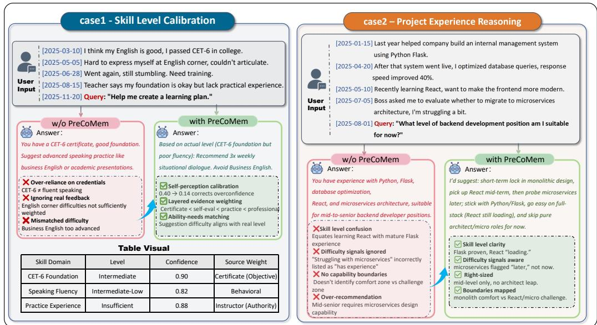  
Figure 11: Qualitative analysis of evidence consolidation. Left: In skill calibration, PreCoMem weighs credentials against contradictory behavioral cues to avoid over-estimation. Right: In project reasoning, it distinguishes high-confidence competencies from tentative learning (“loading”), preventing premature recommendations.

Reliability-adjusted surprisal. Here the recall distribution is more concentrated because multiple items explicitly mention the disputed claim (“bored without socializing”) and its reversal, yielding higher ρt. The contradiction signal is strong: D33:9 explicitly negates the pre-change stance in D1:8, so $d _ { \mathrm { c o n f } }$ is high. Consequently, xt falls into the high regime $( x _ { t } > \theta _ { \mathrm { h i g h } } )$ .

Evolution: CORRECT. PreCoMem applies soft decay (Equation (10)) to the contradicted belief(s) retrieved from $B _ { t }$ that encode the old stance (e.g., “weekends without gatherings are boring”), while leaving non-contradictory items largely unchanged. Because confidence weights directly modulate future retrieval (Equation (1)), this correction reduces the chance of “old-memory pull” when later queries contain temporal-decoy phrasing.

(Read) QA query. Q: “Would Mike still say ‘I’d be bored without socializing’?”

A: “No, being alone is actually more fulfilling now.”

PreCoMem retrieves the recent, high-support solitude evidence (D33:9, D28:2) and answers accordingly, while older evidence like D1:8 is downweighted by correction and recency, making the response robust to the temporal decoy.

Qualitative case studies beyond accuracy. Figure 11 shows two cases in which the answer depends on how evidence was consolidated; a third, constructed case walks through a new topic entering the store.

Case 1: Skill level calibration. Figure 11 (left) illustrates this case. The user initially reports a credential (CET-6), which can tempt a retrieval-only system to over-trust a single strong signal and recommend overly advanced practice. PreCoMem instead consolidates evidence across sessions: repeated behavioral cues (e.g., failing to articulate at an English corner) and professional feedback (teacher assessment) lower confidence in an over-optimistic self-evaluation, while preserving the belief that the foundation is adequate. At query time, Memory Leveraging recalls these calibrated beliefs (rather than a single credential trace) to condition response generation, leading to a plan that targets fluency and practice rather than premature advanced content.

Case 2: Project experience reasoning. Long-horizon career discussions often mix stable skills (proven experience) with tentative claims (currently learning) and difficulty signals (struggles with complex systems). PreCoMem uses its confidence-weighted belief store to separate what is established (e.g., Python/Flask) from what is still emerging (e.g., React “loading”) and what should be deferred (e.g., microservices architecture). This produces right-sized recommendations: it proposes a nearterm path aligned with demonstrated capability, while explicitly marking a challenge zone for later progression.

Case 3: A new topic entering a populated store. Suppose the store holds the user’s work and food profile but nothing about music, and the user says for the first time: “I signed up for guitar lessons and practiced for an hour last night.” No belief matches and the Top-K items are only loosely related, so absolute scores are low but one still dominates, giving a moderate $\rho _ { t }$ and, by the mechanism described in Section C.8, PROFILE. The Profile-Agent writes the hypothesis “the user may have taken up guitar” with $w _ { 0 } < \tau _ { \mathrm { p r o m o t e } } .$ , linked by provenance to that turn and retrieval-visible at once, so the agent can already answer cautiously. If guitar recurs, MAINTAIN reinforces the hypothesis until it crosses $\tau _ { \mathrm { p r o m o t e } }$ and becomes a FACT; otherwise it remains a low-confidence hypothesis that never outranks committed facts. A new topic therefore enters provisionally, is usable immediately, and is committed only after repeated support.

Connection to the consolidation loop. Across these cases, PreCoMem’s leveraging–evolution loop links response quality to memory consolidation. Evidence recalled for the current answer is also used to update confidence through MAINTAIN/PROFILE/CORRECT (Section 2.4), so future retrieval and recommendations reflect accumulated support, implicit verification, and soft correction under contradiction.

## D Prompts

All prompts used in this paper are released verbatim with the code at https://github.com/ ZhongWishing/PreCoMem. The three sub-agent prompts (Profile-Agent, Correct-Agent, Maintain-Agent) and the response-generation prompt are in precomem/llm/prompts.py; the QA and LLM-as-a-judge prompts for LoCoMo, LongMemEval-S, PersonaMem-v2, and DiMoBench are in precomem/evaluation/prompts.py; and the DiMoBench generation and verification prompts are in precomem/dimobench/prompts.py.