# Resuming Vision-Language Inference across Onboard Interruptions

Xiaolong Huang   
Peking University   
Beijing, China   
huangxiaolong@pku.edu.cn   
Yun Ma   
Peking University   
Beijing, China   
mayun@pku.edu.cn   
Shangguang Wang   
Beijing University of Posts and   
Telecommunications   
Beijing, China   
sgwang@bupt.edu.cn

Yinyuan Zhang Peking University Beijing, China yinyuanzhang16@stu.pku.edu.cn

Qing Li   
Beijing University of Posts and   
Telecommunications   
Beijing, China   
qingli@bupt.edu.cn

Gang Huang Peking University Beijing, China hg@pku.edu.cn

Daliang Xu∗   
Beijing University of Posts and   
Telecommunications   
Beijing, China   
xudaliang@bupt.edu.cn   
Mengwei Xu   
Beijing University of Posts and   
Telecommunications   
Beijing, China   
mwx@bupt.edu.cn   
Xuanzhe Liu   
Peking University   
Beijing, China   
liuxuanzhe@pku.edu.cn

## Abstract

Executing vision-language models (VLMs) aboard low-Earth orbit satellites enables flexible processing of observation data without first downlinking it to the ground. On commercial of-the-shelf payloads, however, a request may span multiple execution windows: power and thermal constraints, fault-triggered reboots, and competing payload demands can interrupt inference before it completes. Each shutdown discards volatile activations and KV caches, forcing an unprotected request to repeat work after restart.

We present OrbitWeaver, a framework that preserves VLM inference progress across onboard interruptions through coordinated checkpointing and recovery. Its phase-aware checkpointing selects recovery boundaries according to the state lifetimes and computational characteristics of vision encoding, language-model prefill, and decoding, balancing storage trafic against recomputation. Its dependency-aware dynamic recovery schedules restoration from partially completed states across the layer and token-chunk dimensions. By overlapping checkpoint and weight reads with recomputation, it reduces restart latency; the recovery planner computes an optimal execution order under its scheduling model within 100 ms.

Experiments on satellite payload hardware using on-orbit telemetry traces show up to a 4.07× end-to-end speedup and a 3.56× reduction in SSD write volume over the evaluated baselines. A 72-hour deployment on two low-Earth orbit satellites demonstrates that OrbitWeaver retains inference progress and resumes execution across repeated busenforced shutdowns.

## 1 Introduction

Low-Earth orbit (LEO) satellites are emerging as powerful platforms for satellite computing [14], a new paradigm that shifts heavy data processing directly to orbit to overcome the intolerable latency of the traditional bent-pipe architecture. Backed by the integration ofcommercial of-the-shelf(COTS) edge hardware (e.g., NVIDIA GPUs on Starcloud-1 [59]), this high-performance orbital infrastructure is now physically accessible and cost-efective [2, 20, 70]. Leveraging these advanced platforms, Vision-Language Models (VLMs) are rapidly becoming the premier workload for dynamic space missions. Instead of relying on fragmented, task-specific models, VLMs ofer unified, on-the-fly functional elasticity for efortless mission redirection [33, 65, 77]. Pioneering space-agency initiatives, such as NASA’s Prithvi geospatial foundation model and the European Space Agency’s (ESA) Phi-Sat-2 mission, have recently validated the feasibility ofexecuting such foundation models directly in orbit [17], marking the dawn of intelligent satellite computing.

Mismatch: sustained VLM execution vs. bus-enforced interruptions. On-orbit VLM inference requires sustained computation, while spacecraft-level control can interrupt payload execution before a request completes.

Long-running on-orbit VLM workloads. VLM inference on satellites can involve high-resolution images or multiple images within a single request. These inputs can produce long visual-token sequences, increasing the computation needed to complete the request. For example, Earth observation (EO) workloads can involve processing image sequences of up to 30 frames [15] and images reaching 44.93 megapixels [45]. Our in-orbit evaluation of Qwen3-VL 2B on Sat-1 and Sat-

2 shows that a typical 3-minute mission processes only 8 frames (> 32� tokens).

Short and unpredictable inference survival windows. Onboard computing payloads face unpredictable interruptions that severely truncate execution windows. These abrupt halts primarily stem from three sources: (i) Bus-enforced hard shutdowns due to dynamic power constraints or thermal violations [9]. For example, VLM inference on Sat-1 and Sat-21 spikes the payload temperature from 45◦C to 55◦C in just 48 s, leading to sudden thermal cutofs that vary drastically depending on the satellite’s orbital state. (ii) On-orbit anomalies (e.g., radiation-induced SEUs or software faults) that trigger the Fault Detection, Isolation, and Recovery (FDIR) system. FDIR forces sudden system reboots to clear errors; our private LEO satellite telemetry data reveals that in worstcase scenarios, such reboots occur as frequently as once per minute [19]. (iii) Resource contention from intermittent, highpriority payloads (e.g., bursty transceivers or laser transmitters) that preempt shared bus resources [22].

To tackle this mismatch, we propose OrbitWeaver, an eficient and reliable VLM inference engine designed for satellite computing. OrbitWeaver achieves transparent, minimaloverhead preservation of VLM execution progress by dynamically checkpointing essential states to onboard non-volatile storage (e.g., eMMC/SSD). Upon rebooting, it swiftly reconstructs the context to resume inference. Achieving this goal requires addressing two challenges:

• Checkpointing phase: fast checkpointing vs. eficient recovery. Preserving execution progress creates a dilemma: minimizing checkpointing I/O for active inference speed versus maximizing progress preservation for rapid recovery. Finegrained checkpointing (e.g., per-token/layer) captures complete progress but incurs substantial I/O overheads, whereas coarse-grained checkpointing (e.g., per-chunk) minimizes I/O but forces expensive recomputation of discarded intrachunk states. This trade-of manifests across all VLM phases. For instance, in memory-bound decoding, saving per-token KV caches and hidden states ensures optimal recovery at prohibitive costs (>100%), while merely saving token IDs eliminates I/O but forces full KV cache recomputation from scratch, introducing a latency of > 50 seconds.

• Recovery phase: unavoidable weight-checkpoint I/O in unstructured resumption. Unlike traditional LLM context switching with uniform states (e.g., full prompt KV caches), arbitrary orbital bus-enforced interruptions leave an irregular, “staircase-like” inference progress state. Resuming from this unstructured state complicates masking the coupled I/O overhead of reloading static weights alongside dynamic KV caches and hidden states from disparate positions. Specifically, loading a layer’s weights unlocks computation across multiple chunks, whereas loading its KV cache only enables that specific chunk. With numerous valid starting points along this irregular boundary, finding the optimal execution sequence to maximize compute-I/O overlap under complex dependency constraints becomes a highly non-trivial scheduling challenge.

To solve these challenges, OrbitWeaver incorporates two key techniques:

• Phase-aware checkpointing. To resolve the checkpointing dilemma, OrbitWeaver leverages the heterogeneous lifespans of VLM states (persistent KV caches vs. transient hidden states) and phase-specific bottlenecks to establish adaptive recovery boundaries: (i) Vision encoding (layer boundary): Because bidirectional self-attention couples all image patches, patch chunks cannot be finalized independently. OrbitWeaver therefore persists the full-patch hidden state after each vision layer, using layer boundaries as recovery points. (ii) LLM prefill (2D block boundary): Because prefill is compute-bound, checkpointing both KV Cache and hidden states minimally impacts active inference. To mitigate SSD wear-out, OrbitWeaver groups operations into 2D blocks (execution grids spanning multiple sequence chunks and model layers), checkpointing transient hidden states exclusively at block boundaries. (iii) LLM decoding (multi-token boundary): Decoding is memory-bound, making per-token checkpointing prohibitively expensive. Recognizing that the decoding recovery bottleneck is massive weight-loading I/O rather than lightweight recomputation, OrbitWeaver aggregates KV cache updates across multi-token boundaries. This amortizes flash write overhead, as the slight recomputation increase is completely masked by the inevitable weight-loading I/O.

• Dependency-aware dynamic recovery. To mitigate coupled I/O bottlenecks during unstructured resumption, we observe that despite recovery computation heavily outweighing I/O latency, strict dependencies still cause severe I/O stalls. To maximize compute-I/O overlap, OrbitWeaver unlocks dependencies multi-dimensionally: (i) 2D block-first recovery: Rigid layer- or chunk-first strategies only resolve single-dimension dependencies. Instead, executing a 2D block immediately unlocks both horizontal (chunk) and vertical (layer) dependencies, triggering a computation cascade to mask concurrent SSD reads. (ii) Optimal scheduling plan: Selecting the optimal ready block to minimize recovery latency is critical, as each choice unlocks distinct downstream computation cascades to maximize I/O masking; yet this scheduling is NP-hard. We dramatically prune this search space via two domain-specific properties: (a) deferring hidden state loads to retain DRAM activations and avoid redundant SSD reads, and (b) packing layer-wise I/O to coalesce weight reads into coarse-grained streams. This enables OrbitWeaver to mathematically solve the optimal execution order within 100 ms.

We implemented OrbitWeaver atop transformers [67] and evaluated it on hardware testbeds mirroring two real satellite computing payloads: the NVIDIA Jetson Orin NX (16 GB) and AGX Orin (64 GB). These represent the onboard platforms of Sat-1 and Sat-2. Our evaluations are driven by five interruption traces: four derived from telemetry collected on Sat-1 and Sat-2, and one from the Dellingr satellite [28]. Using these scenarios, we run advanced edge-viable VLMs, including Qwen3-VL 2B/4B/8B and MiniCPM-V 4.5, on remote sensing QA datasets. Compared to three state-ofthe-art baselines (two variants of a representative intermittent DNN execution runtime and a conventional KV cache context-saving approach), OrbitWeaver achieves up to a 4.07× end-to-end speedup. Furthermore, it reduces checkpointing and recovery latency by up to 61.9% and 85.6%, respectively, while slashing SSD write volume by up to 3.56×. To the best of our knowledge, we are the first academic work to successfully deploy and sustain VLM inference directly in orbit. We deployed OrbitWeaver on Sat-1 and Sat-2 for a 72-hour in-situ earth observation case study. The deployment demonstrates that OrbitWeaver preserves progress and sustains VLM inference across repeated bus-enforced shutdowns.

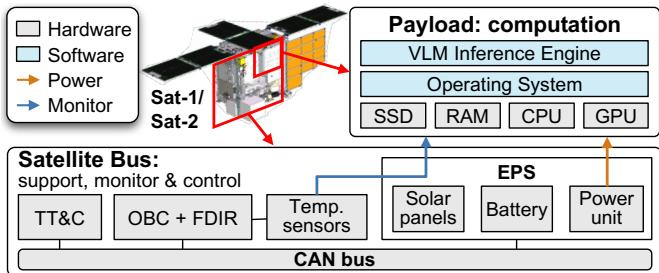  
Figure 1. Satellite architecture diagram. TT&C = Telemetry, Tracking, and Command; OBC = On-Board Computer; FDIR = Fault Detection, Isolation, and Recovery; EPS = Electrical Power System.

Our contributions are summarized as follows:

• We are the first to identify the bottleneck of bus-enforced shutdowns in on-satellite VLM inference.

• We propose OrbitWeaver, the first eficient and reliable VLM inference system for satellite computing by introducing eficient checkpointing and recovery.

• We implement OrbitWeaver and deploy it on Sat-1 and Sat-2. Our evaluation shows that OrbitWeaver achieves up to a 4.07× end-to-end speedup, while a 72-hour inorbit deployment demonstrates sustained VLM inference across repeated bus-enforced shutdowns.

## 2 Background

## 2.1 On-Satellite Vision-Language Models

Satellite computing shifts data processing and services directly to orbit. This approach overcomes the severe communication bottlenecks of the traditional bent-pipe architecture, where limited downlink bandwidth and brief contact windows make downlinking raw data for ground-side processing intolerably slow for modern space missions [14]. This orbital computing capability is enabled by moving beyond traditional radiation-hardened controllers and integrating commercial of-the-shelf (COTS) computing platforms—such as CPUs, GPUs, and FPGAs—into modern satellites [13, 26, 57, 70]. Consequently, satellites are evolving from simple data collectors into orbital edge nodes capable of executing diverse tasks. Early examples include onboard filtering to discard cloudy images (Phi-Sat-1 [26]) or select high-value samples (Kodan [13]). More recently, platforms like Starcloud-1 are pushing hardware boundaries by carrying data-center-class NVIDIA H100 GPUs in orbit, demonstrating that high-performance AI accelerators can now be deployed as standard satellite payloads.

As shown in Figure 1, a typical satellite computing platform consists of a computing payload and a spacecraft bus that supports, monitors, and controls the payload. The payload runs a VLM inference engine on top of an operating system, using SSD for persistent storage, RAM for volatile memory, and CPUs and GPUs for computation. During inference, the engine loads model weights and input data from SSD into RAM and dispatches tensor operations to the processors, while intermediate tensors and runtime states remain in volatile memory. Meanwhile, the spacecraft bus supplies payload power through the electrical power system (EPS), monitors payload temperature through sensors, and manages communication and fault protection through TT&C and the onboard computer (OBC) with FDIR. These bus subsystems communicate over a CAN bus and can disconnect payload power or trigger a reboot when power, thermal, or safety constraints require intervention, abruptly interrupting the ongoing inference.

Vision-Language Models for LEO satellites. With advanced hardware in orbit, satellite computing tasks are rapidly shifting toward VLMs. For critical applications like Earth observation (EO), traditional fragmented, task-specific models are being replaced by VLMs, which ofer a “onefor-all”, prompt-driven framework that provides functional elasticity for dynamic missions without retraining overhead [17]. Furthermore, driven by the massive expansion of LEO constellations, initiatives like Starcloud [21] are actively constructing “space data centers” to deliver realtime, space-native VLM inference and token generation services directly to users. Robust, sustained VLM execution is therefore essential for next-generation LEO systems.

On-satellite VLM inference pipeline. A VLM is a multimodal model that converts images and text instructions into text outputs by combining visual encoding with languagemodel generation. As illustrated in Figure 2, after the onboard camera captures an image, the acquired visual data is fed into the VLM for inference, initiating a three-phase pipeline. In the first phase (vision encoding), a Vision Transformer partitions the input image into patches and encodes them into visual tokens [16]. During the second phase (LLM prefill), the model processes these visual tokens alongside the prompt tokens, establishing the attention state and initializing the Key-Value (KV) cache for the multimodal context. Finally, in the LLM decoding phase, the language model generates the response autoregressively, producing one token at a time while continuously utilizing and updating the KV cache established during the prefill phase. These phases involve diferent intermediate states, including visual tokens, prefill states, KV cache, and partial outputs.

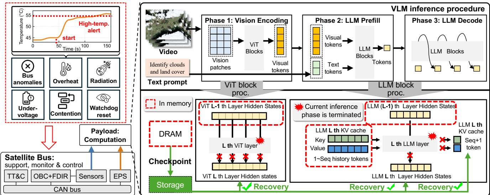  
Figure 2. The temperature trace measures payload enclosure temperature. TT&C = Telemetry, Tracking, and Command; OBC = On-Board Computer; FDIR = Fault Detection, Isolation, and Recovery; EPS = Electrical Power System.

## 2.2 Bus-enforced Shutdowns in On-Satellite VLM Inference

Onboard computing payloads operate under strict spacecraftwide power and safety constraints. The spacecraft bus can abruptly disconnect payload power to preserve essential functions or protect hardware, regardless of the inference software’s status [19, 50]. We term these platform-initiated interruptions bus-enforced shutdowns, which can terminate VLM requests unpredictably. They primarily stem from three sources:

• Dynamic power and thermal constraints. The electrical power system (EPS) autonomously sheds non-essential loads (e.g., computing payloads) when demand exceeds supply [4, 50]. This power availability fluctuates with solar illumination and battery aging, which alters discharge curves over time and makes supply highly non-linear. Furthermore, thermal limits force sudden shutdowns. As shown in Figure 2, VLM inference on Sat-1 spikes the payload enclosure temperature from $4 5 ^ { \circ } \mathrm { C }$ to the $5 5 ^ { \circ } \mathrm { C }$ threshold in just 48 s, triggering an immediate power-of. Driven by external orbital states, these shutdowns are entirely decoupled from VLM execution boundaries (e.g., prefill and decoding steps). • Hardware/software anomalies and FDIR interventions. The harsh space environment introduces stochastic anomalies, such as radiation-induced Single-Event Upsets (SEUs) or software faults (e.g., erroneously activating Sunpointing during an eclipse). The onboard Fault Detection, Isolation, and Recovery (FDIR) system continuously monitors payload health. Upon detecting these anomalies or hardware violations (e.g., overcurrent) [19], FDIR forces sudden system reboots to clear errors. These fault-protection actions occur randomly, completely ignoring any payload execution schedule. Our private LEO satellite telemetry data reveals worst-case scenarios where these unpredictable reboots occur once per minute.

• Resource contention from intermittent payloads. The computing payload shares the bus with high-priority, intermittent payloads (e.g., bursty transceivers) [22]. Their unpredictable activation—driven by ground station visibility or mission commands—aggressively consumes limited power and thermal budgets, often preempting the computing payload [4, 22]. Together, these stochastic factors render payload shutdown timing and duration highly erratic and not practical to profile ofline.

On-satellite VLM inference needs fast checkpointing and recovery. As illustrated in Figure 2, bus-enforced shutdowns can terminate any inference phase and discard its in-memory states, including ViT/LLM hidden states and the KV cache. Restoring power alone therefore cannot resume execution; recovery requires checkpoints persisted in nonvolatile storage. Consequently, VLM inference requires lowoverhead checkpointing and rapid recovery without advance knowledge of shutdown timing. Our scope addresses execution interruption and volatile state loss, assuming persistent weights and checkpoints in non-volatile storage remain intact (leaving radiation-induced persistent storage corruption to orthogonal hardware research).

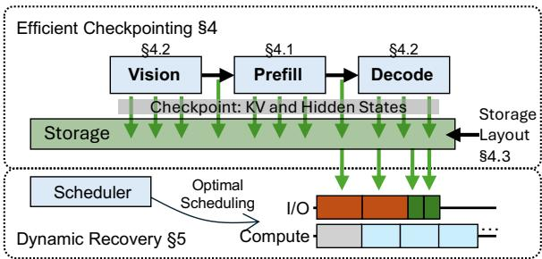  
Figure 3. Overview

## 3 Design Overview

We present OrbitWeaver, an eficient and reliable VLM inference system designed for COTS satellites. Figure 3 shows the overview of OrbitWeaver. To address the progress-loss problem caused by bus-enforced shutdowns, OrbitWeaver adopts checkpointing and recovery to make VLM inference resumable across power-of and reset events. During inference, OrbitWeaver persists selected boundary states from volatile memory to SSD; after a shutdown, it validates and reloads the latest checkpoint to reconstruct the execution context and continue the unfinished request instead of restarting from scratch.

However, making checkpointing and recovery eficient on COTS satellites is nontrivial. Checkpointing must preserve enough state to resume each VLM phase, but excessive persistence increases SSD trafic, energy use, and normal-path latency. Recovery must reload model weights and checkpointed states from SSD, but a poor recovery order exposes I/O stalls and leaves little useful computation time within each short execution window. To address these two challenges, OrbitWeaver introduces two techniques.

Eficient checkpointing. OrbitWeaver defines phase-aware recoverable units that preserve only the states needed for resumption while bounding runtime checkpoint overhead. For LLM prefill, OrbitWeaver uses block-wise checkpointing over token chunks and layer groups, avoiding the hidden-state write cost of layer-wise checkpointing and the recomputation cost of chunk-wise checkpointing. For vision encoding, OrbitWeaver checkpoints layer-boundary hidden states be cause bidirectional attention makes patch chunks invalid recovery units. For decoding, OrbitWeaver batches KV cache checkpoints across generated tokens to avoid excessive small writes. OrbitWeaver further uses phase-specific storage layouts to reduce I/O interference, avoid unnecessary recovery reads, and ensure crash-consistent checkpoint persistence.

Dynamic recovery. OrbitWeaver reduces recovery latency by scheduling SSD reads and block computation over the checkpointed frontier. Instead of following a fixed chunk first or layer-first order, OrbitWeaver restores the states that unlock useful computation and overlaps later SSD reads with dependency-ready blocks. By exploiting the regular dependency structure of VLM prefill, OrbitWeaver reduces recovery planning to layer-level I/O ordering and solves it with a lightweight dynamic programming algorithm.

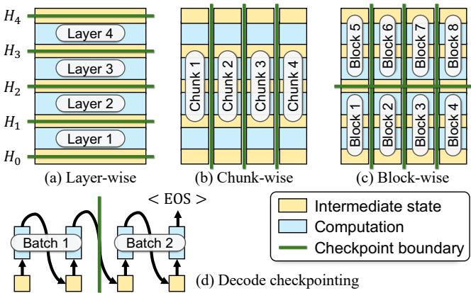  
Figure 4. OrbitWeaver’s checkpointing strategies.

## 4 Eficient Checkpointing

OrbitWeaver preserves VLM progress across satellite shutdowns by persisting intermediate states at checkpoint boundaries. Each boundary must expose enough state for correct resumption while limiting SSD trafic, energy cost, and runtime overhead. We identify three primary issues:

• VLM phases expose diferent state dependencies, so a uniform checkpoint boundary cannot eficiently support vision encoding, prefill, and decoding;

• Checkpoint granularity creates a recomputation–write trade-of: persisting more states reduces replay after shutdowns, but increases checkpoint writes during normal execution.

• Checkpoint persistence must be storage-aware: fragmented writes increase runtime overhead and SSD wear, while storing hidden states and KV tensors in an interleaved layout forces recovery to read unnecessary data.

To address these issues, OrbitWeaver designs phase-aware recoverable units. It uses block-wise checkpointing for prefill (§4.1), phase-specific checkpointing for vision and decoding (§4.2), and an SSD layout that supports eficient and crashconsistent checkpoint persistence (§4.3).

## 4.1 Block-wise Prefill Checkpointing

When prefill completes without a shutdown, preserving its KV cache is suficient for the later decoding phase. However, a satellite reset may occur in the middle of prefill, discarding all in-memory progress before the final KV cache is produced. Therefore, OrbitWeaver must checkpoint prefill at finer granularity, along its layer and token dimensions. This leads to two straightforward checkpoint placements.

Naïve solution: Layer-wise checkpointing. A natural design is to follow the LLM’s layer-by-layer execution order and place a checkpoint boundary after each layer, as shown in Figure 4(a). However, this layer-level granularity comes at a high checkpointing cost. Since recovery from a layer bound ary requires the input to the next layer, OrbitWeaver must persist the full-sequence hidden state at every layer boundary, whose size scales with the multimodal input length, including both visual tokens and prompt tokens. As shown in Figure 5, layer-wise checkpointing minimizes lost progress but requires the largest checkpoint storage: about 14.34 GiB for Qwen3-VL 2B and 27.65 GiB for MiniCPM-V 4.5.

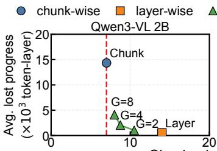

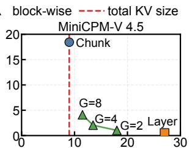  
Checkpoint storage (GiB)  
Figure 5. Storage–recomputation trade-of of diferent checkpointing granularities.

Naïve solution: Chunk-wise checkpointing. Another design is to partition the input sequence into fixed-size chunks and place a checkpoint boundary after each chunk completes all � layers, as shown in Figure 4(b). This reduces checkpoint trafic: after a chunk finishes all layers, the checkpoint only needs to preserve the KV tensors produced by the chunk, rather than full-sequence hidden states after every layer. As shown in Figure 5, chunk-wise checkpointing keeps storage near the total KV size, but incurs the highest recomputation overhead: about $1 4 . 3 4 \times 1 0 ^ { 3 }$ and $1 8 . 4 3 \times 1 0 ^ { 3 }$ token-layers for Qwen3-VL 2B and MiniCPM-V 4.5, respectively.

The comparison above reveals a structural property of LLM prefill: KV tensors are long-lived context; once produced, they are reused by later chunks and by decoding. Hidden states are short-lived boundary states; they are only needed to feed the next layer group after recovery. Layer-wise checkpointing over-preserves hidden states, while chunk-wise checkpointing under-preserves them and cannot resume inside a chunk. OrbitWeaver exploits this separation by maintaining a minimal recovery frontier: it accumulates KV tensors for completed computation and materializes hidden states only at sparse layer-group boundaries.

OrbitWeaver design: Block-wise checkpointing. Based on this frontier view, OrbitWeaver partitions prefill along both the token and layer dimensions. It splits the input sequence into chunks of � tokens and groups the � LLM layers into groups of � consecutive layers, forming a twodimensional grid of recoverable units (Figure 4(c)). Each unit computes � layers over � tokens. When a unit completes, OrbitWeaver persists the KV tensors produced by the unit and the hidden states at the output boundary of the layer group.

This design preserves only the states needed at the recovery frontier. Compared with layer-wise checkpointing, it avoids persisting full-sequence hidden states after every layer. Compared with chunk-wise checkpointing, it can resume inside a chunk and replay at most the unfinished $G \times C$ unit instead of the entire chunk across all � layers. The choice of � and � determines where OrbitWeaver operates on the storage–recomputation trade-of. Smaller units reduce recomputation after a reset but increase transfer, write, and metadata overhead; larger units reduce checkpointing overhead but lose more computation after a shutdown. OrbitWeaver selects � and � through lightweight ofline calibration on the LRS-VQA [45] for each model-device pair. The calibration profiles a small set of candidate configurations on representative prefill inputs and selects the one that satisfies a user-defined checkpoint overhead budget while bounding the replay cost after a reset. With $G = 4 ,$ , OrbitWeaver reduces lost progress to about $2 . 0 4 \times 1 0 ^ { 3 }$ token-layers for both models, with checkpoint sizes of 8.96 GiB for Qwen3-VL 2B and 13.82 GiB for MiniCPM-V 4.5 (Figure 5).

## 4.2 Checkpointing Vision and Decode

Beyond LLM prefill, the other VLM phases expose diferent recovery boundaries. Vision encoding is dominated by layerby-layer bidirectional attention, while decoding advances autoregressively one token at a time. OrbitWeaver therefore uses phase-specific checkpointing policies for these two phases.

Layer-wise vision checkpointing. Unlike LLM prefill, whose causal attention allows completed token chunks to be finalized independently, vision encoding uses bidirectional self-attention over all patches [16]. Since each patch output depends on the full patch sequence, patch chunks cannot serve as valid recovery units. Once a vision layer completes, its full-patch hidden state becomes the complete input to the next layer, so OrbitWeaver checkpoints vision encoding at layer boundaries by persisting this state.

Batched decode checkpointing. Decoding advances autoregressively, generating one output token at a time. Each generated token appends new entries to the KV cache, and future tokens depend on these entries. Therefore, decoding only checkpoints the KV cache as its recoverable progress state, while hidden states are transient within each decode step and need not be persisted. Checkpointing after every token minimizes replay but is ineficient: each token adds only a small KV slice, so per-token checkpoints cause frequent device-to-host transfers and fragmented SSD writes. This is especially costly for memory-bound decoding [80], where extra checkpoint writes compete with incremental KV cache access. OrbitWeaver therefore batches decode checkpoints. It accumulates the KV slices for � generated tokens and persists them as one checkpoint unit, together with the generated token IDs and the current decode position. If a reset occurs between two decode checkpoints, recovery reloads the latest persisted KV cache and replays at most � decode steps.

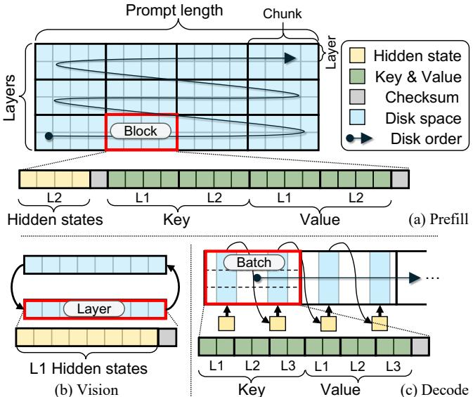  
Figure 6. Checkpoint storage layout for prefill, vision, and decode.

## 4.3 I/O-Eficient Storage Layout

The checkpointing policies above define logical recoverable units; OrbitWeaver then lays out their persisted states according to each phase’s access pattern to reduce I/O overhead and ensure crash consistency.

Prefill layout. This layout is optimized for the asymmetric access patterns of checkpointing and recovery. For blockwise prefill checkpoints, OrbitWeaver stores the states produced at each completed block boundary as one contiguous record (Figure 6(a)), which turns each checkpoint into a sequential write. Each record separates boundary hidden states from the block’s multi-layer KV tensors: the former resumes the next layer group, while the latter serves later chunks and decoding. This separation lets recovery restore only the needed hidden-state or KV region, avoiding unnecessary I/O. OrbitWeaver further stores KV tensors in layer-major order, allowing a layer’s prefix KV to be restored through sequential reads.

Vision layout. For vision checkpoints, OrbitWeaver reduces storage overhead by persisting only the layer-boundary hidden states (Figure 6(b)). Each hidden-state checkpoint is written as one contiguous record. To tolerate resets during checkpoint writes, OrbitWeaver alternates between two aligned bufers: the new bufer is marked valid only after its write completes, while the previous bufer remains valid during the write. If a reset interrupts the current write, recovery selects the newest complete bufer.

Decode layout. Decode checkpoints must handle a dynamically growing output sequence (Figure 6(c)). Since future token length is unknown, OrbitWeaver uses an append-only layout instead of preallocating fixed regions for layers or positions. Each decode checkpoint appends the KV slices generated by one decode batch as a single record. Within the record, keys from all layers are written contiguously, followed by values from all layers, turning batched KV updates into sequential writes. This layout grows naturally with generation while preserving eficient checkpoint persistence. Checksum and crash consistency. System resets can happen during checkpoint writes, leaving partially written checkpoint data on storage. To handle this, OrbitWeaver appends a checksum-protected commit footer to each checkpoint record. The footer contains the record length, checkpoint index, and payload checksum, and the record is considered committed only after this footer is durably written.

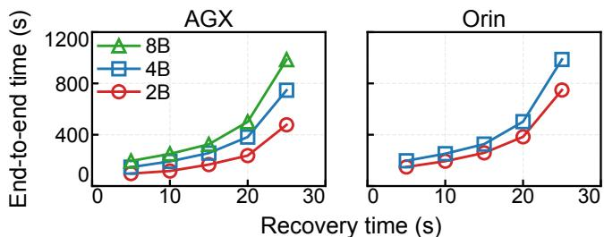  
Figure 7. Impact of recovery latency on interrupted VLM inference with a 64K-token request.

## 5 Dynamic Recovery

After the satellite recovers from a shutdown, the VLM inference must restore the checkpointed state from the SSD and resume computation. The latency of this process greatly afects the end-to-end completion time of a request.

Fast recovery is critical. To motivate the need for fast recovery, we run a controlled experiment with Qwen3-VL 2B/4B/8B on Jetson AGX Orin and Jetson Orin NX. The work load is a 64K-token remote-sensing VQA request constructed from our evaluation datasets. We fix the checkpointed execution progress and reset pattern, and vary the recovery time paid at the beginning of each execution window. Figure 7 shows that increasing recovery time from 5 s to 25 s raises end-to-end completion time by up to 5.04× and 5.56× on AGX and Orin, respectively. Therefore, OrbitWeaver minimizes exposed recovery I/O before computation resumes.

In this section, we first show why fixed recovery orders create avoidable I/O stalls (§5.1). Then we formulate recovery as an I/O–computation scheduling problem (§5.2). Finally, we illustrate the algorithm to find the optimal schedule (§5.3).

## 5.1 Dependency-Aware Recovery

Following the execution order of existing LLM prefill implementations, the most direct recovery strategy is to replay the remaining prefill blocks in the same static order. The order of existing implementations is typically chunk-first or layer-first. However, recovery optimizes a diferent objective from normal inference: it must load weights and checkpoints and start computation as early as possible. To minimize recovery latency, we need to minimize exposed I/O, i.e., the time computation stalls waiting for unfinished reads.

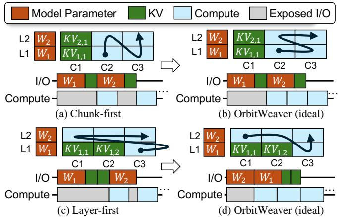  
Figure 8. Fixed recovery orders expose avoidable I/O stalls.  
• Chunk-first static recovery. In Figure 8(a), the first chunk has completed before the shutdown. A chunk-first order resumes from $( L _ { 1 } , C _ { 2 } )$ and proceeds to $( L _ { 2 } , C _ { 2 } )$ . This switch requires $W _ { 2 }$ and $K V _ { 2 , 1 }$ ; any part of these reads not hidden by the computation of $( L _ { 1 } , C _ { 2 } )$ becomes exposed I/O. Thus, chunk-first recovery can stall when it switches to a higher layer before the required layer state has finished loading.

• Layer-first static recovery. In Figure $8 ( \mathrm { c } ) _ { }$ , layer $L _ { 1 }$ has completed through chunk $C _ { 2 }$ before the shutdown. A layerfirst order starts with $( L _ { 1 } , C _ { 3 } )$ , which requires $W _ { 1 } , K V _ { 1 , 1 ; }$ and $K V _ { 1 , 2 }$ before any computation can run, exposing them at the beginning of recovery. Thus, layer-first recovery can stall by choosing a block whose inputs are not yet available, even when other blocks are ready to execute.

• Ideal dependency-aware recovery. Ideally, we can avoid these stalls by following data readiness rather than a fixed order. In Figure 8(b), recovery keeps computing ready blocks in $L _ { 1 }$ to hide the reads needed by $L _ { 2 }$ . In Figure 8(d), recovery first executes the ready prefix of $L _ { 2 }$ to hide the reads needed later by $\left( L _ { 1 } , C _ { 3 } \right) \left( \left( L _ { 2 } , C _ { 3 } \right) \right.$ must wait for $\left( L _ { 1 } , C _ { 3 } \right) )$ . The ideal recovery order therefore depends on which weights, KV cache, and hidden states are available, motivating a constrained I/O–computation scheduling problem.

## 5.2 Recovery as a Scheduling Problem

To realize dependency-aware recovery, OrbitWeaver formulates recovery as a scheduling problem over I/O and compute tasks to maximize I/O-compute overlap.

Task definition. Let � and � be the total number of chunks and layers after layer grouping (§4.1), respectively. There are four types of tasks as summarized in Table 1. LLM’s causal attention requires each block to depend on: (i) earlier blocks in the same layer; (ii) the same block from the previous layer. Thus, any computed block implies all blocks left and below it in the prefill grid are already computed. Intuitively, the completed blocks form a staircase frontier in the prefill grid, as shown by the pink polyline in Figure 9(a). Formally, let $f _ { i }$ denote the number of completed blocks in layer �, with $f _ { 0 } = N ;$ then $N = f _ { 0 } \geq f _ { 1 } \geq \dots \geq f _ { L } \geq 0$ . Here, $f _ { 1 } = 9 { \mathrm { ; } }$ $f _ { 2 } = f _ { 3 } = 5 ,$ , and $f _ { 4 } = 3$ . Blocks with $j \leq f _ { i }$ can be restored from disk, while those with $j > f _ { i }$ must be computed.

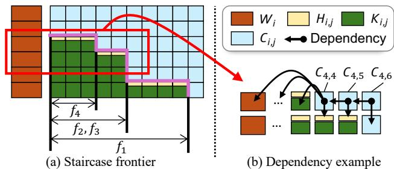  
Figure 9. Frontier Dependency. (a) A concrete staircase frontier after a shutdown, with $f _ { 1 } , f _ { 2 } , f _ { 3 }$ , and $f _ { 4 }$ marking the completed prefix of each layer. (b) Dependency examples for three compute tasks, $\mathrm { C } _ { 4 , 4 } , \mathrm { C } _ { 4 , 5 } $ , and $C _ { 4 , 6 }$

Table 1. Tasks in the dynamic recovery scheduling model.
<table><tr><td>Task</td><td>Symbol</td><td>Type</td><td>Execution time</td></tr><tr><td>Load model weights</td><td> $\mathsf { W } _ { i }$ </td><td>I/O</td><td>TW</td></tr><tr><td>Load hidden states</td><td> $\mathsf { H } _ { i , j }$ </td><td>I/O</td><td>TH</td></tr><tr><td>Load KV cache</td><td> $\mathsf { K } _ { i , j }$ </td><td>I/O</td><td>TK</td></tr><tr><td>Execute block</td><td> $\mathsf C _ { i , j }$ </td><td>Compute</td><td>τC</td></tr></table>

Task dependencies. Recovery scheduling must respect the data dependencies among I/O and compute tasks. A compute task is ready only when three inputs are available: (i) the layer weights; (ii) the KV cache of preceding chunks in the same layer; and (iii) the hidden state from the previous layer. These input requirements translate into the following task dependencies for each compute task $\mathsf { C } _ { i , j }$ with $f _ { i } < j \leq N ;$

$$
P ( C _ { i , j } ) = \mathsf { W } _ { i } , \left\{ \begin{array} { l l } { \mathsf { K } _ { i , 1 } , \ldots , \mathsf { K } _ { i , f _ { i } } , \mathsf { H } _ { i - 1 , j } , } & { j = f _ { i } + 1 \leq f _ { i - 1 } , } \\ { \mathsf { K } _ { i , 1 } , \ldots , \mathsf { K } _ { i , f _ { i } } , \mathsf { C } _ { i - 1 , j } , } & { j = f _ { i } + 1 > f _ { i - 1 } , } \\ { \mathsf { C } _ { i , j - 1 } , \mathsf { H } _ { i - 1 , j } , } & { f _ { i } + 1 < j \leq f _ { i - 1 } , } \\ { C _ { i , j - 1 } , C _ { i - 1 , j } , } & { \mathrm { o t h e r w i s e } . } \end{array} \right.\tag{1}
$$

Figure 9(b) illustrates this dependency structure: $\mathrm { C } _ { 4 , 4 } , \mathrm { C } _ { 4 , 5 } $ and $C _ { 4 , 6 }$ correspond to the first, third, and fourth cases in Eq. (1), respectively.

Problem formulation. With the dependencies between tasks, recovery becomes a constrained I/O–computation scheduling problem. Let I be all the load tasks (i.e., $\mathsf { W } _ { i } , \mathsf { H } _ { i , j }$ and $\mathsf { K } _ { i , j } )$ , C be all the compute tasks $( \mathrm { i } . \mathrm { e } . , \mathrm { C } _ { i , j } ) _ { : }$ , and ${ \mathcal { T } } = I \cup C$ be the set of all tasks. A recovery schedule is equivalent to assigning each task $x \in \mathcal { T }$ a start time $s ( x )$ . Let $\tau _ { x }$ be the fixed execution time of the task type of � from Table 1; then task � occupies the interval $J _ { x } = ( s ( x ) , s ( x ) + \tau _ { x } ) . \mathrm { } A$ valid schedule must satisfy three conditions: (i) each task starts after its predecessors finish; (ii) I/O tasks do not overlap; and (iii) compute tasks do not overlap:

$$
\left\{ \begin{array} { l l } { s ( x ) \geq s ( u ) + \tau _ { u } , } & { x \in \mathcal { T } , u \in P ( x ) , } \\ { J _ { x } \cap J _ { y } = \emptyset , } & { x \neq y , x , y \in R , R \in \{ \boldsymbol { Z } , C \} . } \end{array} \right.\tag{2}
$$

Let $\left( c _ { 1 } , \ldots , c _ { m } \right)$ be the compute tasks ordered by their start times. The exposed I/O between $c _ { k - 1 }$ and $c _ { k }$ is $s ( c _ { k } ) -$

$( s ( c _ { k - 1 } ) + \tau _ { c _ { k - 1 } } ) ( k \geq 2 )$ . Together with the initial wait $s ( c _ { 1 } )$ we derive the exposed I/O of schedule � and the goal:

$$
\begin{array} { l } { { \displaystyle E ( s ) = s ( c _ { 1 } ) + \sum _ { k = 2 } ^ { m } \bigl ( s ( c _ { k } ) - ( s ( c _ { k - 1 } ) + \tau _ { c _ { k - 1 } } ) \bigr ) , } } \\ { { \mathrm { G o a l } : \quad \mathrm { f i n d } \quad s ^ { \star } = \arg \displaystyle \operatorname* { m i n } _ { s } E ( s ) . } } \end{array}\tag{3}
$$

## 5.3 Optimal Recovery Plan

The optimization problem above is an instance ofprecedenceconstrained two-machine scheduling. The general case of this problem is NP-hard. Our problem size is $| \mathcal { T } | = O ( N L )$ where � grows with the request input length, so an algorithm exponential in |T | is unacceptable.

Fortunately, VLM prefill has a regular dependency structure that allows us to develop a specialized algorithm. We find three opportunities to reduce the computing complexity: • Deferring loading hidden states. First, each checkpointed hidden state $\mathsf { H } _ { i , j }$ is used only by the block directly above it, $\mathsf C _ { i + 1 , j } .$ . Therefore, OrbitWeaver can defer loading $\mathsf { H } _ { i , j }$ until $\mathsf C _ { i + 1 , j }$ starts and pack this read into the compute task.

• Greedily scheduling compute tasks. Second, once the order of I/O tasks is fixed, any work-conserving order of ready compute tasks yields the same exposed I/O, so the compute side can schedule them greedily. With each hiddenstate read packed into its corresponding compute task, each packed compute task hides $\tau _ { \mathrm { C } } - \tau _ { \mathrm { H } }$ of I/O.

• Packing I/O of the same layer. Third, because no compute task in a layer can start before the layer weights and all preceding KV blocks are loaded, delaying these reads until immediately before the last one does not worsen the schedule. By repeatedly applying this operation, the I/O tasks of the layer can be made consecutive, with arbitrary internal order. So we pack $W _ { i }$ and all $K _ { i , j }$ in layer � into a single layer I/O operation, whose I/O cost is denoted by $\rho _ { i } .$

Given these properties, we reduce the original �(� �) block-level recovery problem to choosing an order for �(�) layer I/O operations. Each loaded layer incurs I/O time but unlocks compute tasks that can mask later I/O. We model this process by growing the loaded set from $S _ { 0 } = \emptyset \colon$ : if layer $\pi _ { m }$ is loaded at step �, then $S _ { m } = S _ { m - 1 } \cup \{ \pi _ { m } \}$ for $1 \leq m \leq L ;$ let $R ( S )$ be the total I/O time spent on layers in � and �(�) the total compute time they make available. The total exposed I/O is

$$
E ( \pi ) = \operatorname* { m a x } _ { 1 \leq m \leq L } \left( R ( S _ { m } ) - C ( S _ { m - 1 } ) \right) _ { + } ,\tag{4}
$$

where $( x ) _ { + } = \operatorname* { m a x } ( x , 0 )$

Finding the optimal layer order. Eq. (4) shows that once the current loaded set $S _ { m }$ is fixed, all future loading costs and decisions depend only on $S _ { m }$ , regardless of the specific layer order used to reach it. Therefore, we can use subset dynamic programming to find the optimal layer loading order. Let �[�] be the minimum exposed I/O achievable after exactly the layers in set � have been loaded. We have:

$$
\left\{ \begin{array} { l l } { { \displaystyle F [ S ] = \operatorname* { m i n } _ { i \in S } \operatorname* { m a x } \left\{ F [ S ^ { \prime } ] , R ( S ) - C ( S ^ { \prime } ) \right\} \quad \forall S \ne 0 , } } \\ { { \displaystyle S ^ { \prime } = S \backslash \{ i \} } } \\ { { \displaystyle F [ \emptyset ] = 0 . } } \end{array} \right.\tag{5}
$$

OrbitWeaver enumerates loaded sets � by increasing cardinality, records the best predecessor for each transition, and backtracks to obtain the optimal layer order. The algorithm uses $O ( 2 ^ { L } )$ space and $O ( L \cdot 2 ^ { L } )$ time for � layers; for Qwen3- VL 8B, it finishes within 100 ms when the layer group size $G \geq 2 .$

## 6 Implementation

We implement OrbitWeaver with 9,617 lines of Python and 1,741 lines of CUDA/C++ on top of transformers. The prototype processes one request at a time on a single GPU, matching our satellite payload setting. OrbitWeaver is not tied to transformers: its checkpointing and recovery mechanisms operate on VLM execution states and can be integrated into engines such as vLLM [34] and SGLang [79].

Context compression. During long decoding phases, repeated resets may force recovery to reload the full prefill KV context many times. OrbitWeaver therefore optionally compresses the persisted KV cache after prefill and stores it in a packed layout for decode recovery, reducing decode-stage recovery latency by up to 5.02×. Our prototype supports KIVI [43] and TurboQuant [73], and can run KV cache quantization asynchronously without blocking decoding.

Checksumming and crash consistency. To tolerate resets during checkpoint writes, OrbitWeaver protects each checkpoint record with a checksum-protected commit footer. The footer is written atomically using pwritev2() on an O\_DIRECT file, aligned to the NVMe AWUPF [51] of the satellite SSD. After fdatasync(), recovery accepts only records with a valid footer and matching checksum, discarding incomplete or corrupted records.

## 7 Evaluation

## 7.1 Experiment setup

Hardware setup. We test OrbitWeaver on two NVIDIA Jetsons with diferent compute capabilities: Jetson Orin NX (8-core ARM CPU, 1.9 TFLOPS Ampere GPU, 16 GB memory) and Jetson AGX Orin (12-core ARM CPU, 5.3 TFLOPS Ampere GPU, 64 GB memory), mirroring the computing payloads of Sat-1 and Sat-2. Both devices run Linux for Tegra R36.4.3.

Models and dataset. We conduct experiments using four typical edge-sized VLMs: Qwen3-VL 2B/4B/8B and MiniCPM-V 4.5 (8B). All models run W4A16 inference using GPTQ quantization and Marlin kernels. We use LRS-VQA [45] as a representative remote-sensing VQA workload; its images have an average resolution of7,099×6,329 pixels. To evaluate checkpointing and recovery performance, we construct VLM requests with specified lengths using image and text inputs from this dataset.

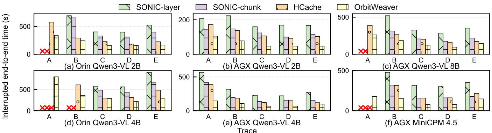  
Figure 10. End-to-end performance under diferent setups

Table 2. Interruption traces used in evaluation.
<table><tr><td>Trace</td><td>A</td><td>B</td><td>C</td><td>D</td><td>E</td></tr><tr><td>Satellite</td><td>Sat-1</td><td>Sat-1</td><td>Sat-2</td><td>Sat-2</td><td>Dellingr [28]</td></tr><tr><td>Mean window (s)</td><td>36.4</td><td>42.3</td><td>121.7</td><td>108.2</td><td>63.0</td></tr></table>

Baselines. We compare OrbitWeaver with 4 baselines, in cluding a naive no-checkpoint implementation, two variants of SONIC [27] that targets general DNN inference on intermittent systems, and HCache that targets datacenter LLM context recovery. Since SONIC does not support GPU and HCache does not open-source their code, we reimplement their techniques as described in their papers on transformers framework.

• No checkpoint: naive VLM inference without checkpointing or recovery.

• SONIC-layer [27]: layer-grained checkpointing that saves both KV cache and hidden states.

• SONIC-chunk [27]: chunk-grained checkpointing that saves KV cache during chunk-first prefill.

• HCache [25]: hidden-state checkpointing with appendbased storage and KV reconstruction during recovery.

Metrics. We mainly measure the end-to-end inference duration, recovery latency, inference latency, total SSD write amount, device level write amplification (DLWA), and energy consumption. We obtain DLWA by collecting I/O traces at runtime and replaying them in MQSim [63]. Energy is measured with tegrastats. Before measuring recovery latency, we clear the OS page cache to evaluate cold-cache recovery performance.

## 7.2 End-to-end performance

We first compare the end-to-end performance of OrbitWeaver with SONIC-layer, SONIC-chunk, and HCache under Traces A–E (Table 2). We use interruption traces derived from telemetry collected on Sat-1 and Sat-2, together with a trace from Dellingr [28]. Table 2 summarizes their execution windows.

On Orin, we evaluate Qwen3-VL 2B/4B. On AGX, we evaluate Qwen3-VL 2B/4B/8B and MiniCPM-V 4.5. We use a 32K-token context on Orin and a 64K-token context on AGX (representative of the visual contexts for LRS-VQA images), with each request generating 64 tokens during decoding. Part of each context is occupied by image tokens, and the rest is filled with text tokens. For each model-device pair, we replay each trace and measure the time required to complete a VLM request across interruptions. At each shutdown, we terminate the inference process and clear its volatile state; inference resumes from the latest checkpoint in the next execution window. We repeat each trace until the request completes or reaches a limit of 20 full replays, after which it is marked as incomplete. Figure 10 shows the resulting completion times. OrbitWeaver completes every evaluated request and achieves the lowest end-to-end completion time. For completed baseline runs, OrbitWeaver achieves speedups of up to 4.07×, 2.89×, and 2.67× over SONIC-layer, SONIC-chunk, and HCache, respectively. The corresponding geometric-mean speedups are 2.95×, 1.98×, and 1.65×.

OrbitWeaver reduces both checkpointing and recovery overhead. SONIC-layer writes KV cache and full-sequence hidden states at layer boundaries, while SONIC-chunk reduces these writes but may replay an unfinished chunk after a shutdown. HCache checkpoints hidden states and later reconstructs the KV cache, overlapping reconstruction with state reads. OrbitWeaver’s phase-aware checkpointing (§4) uses block boundaries to avoid per-layer full-sequence hidden-state writes while bounding lost work within a chunk. During recovery, the SONIC variants reload model weights and accumulated KV state before resuming prefill, while HCache restores the saved context through state loading and KV reconstruction. OrbitWeaver’s dynamic recovery (§5) overlaps dependency-ready prefill blocks with other reads, reducing exposed I/O and reaching the next checkpoint sooner.

Crosses in Figure 10 mark requests incomplete after 20 trace replays. In the short windows of Traces A and B, recovery cannot finish in time to resume useful computation. Each shutdown interrupts recovery, forcing the next window to restart from the same checkpoint without progress. In Trace A, only OrbitWeaver completes Qwen3-VL 4B on Orin and MiniCPM-V 4.5 on AGX; in Trace B, the SONIC variants still fail on the former. All baselines complete under the longer windows of Traces C–E, while OrbitWeaver remains faster by reducing checkpointing and recovery overhead.

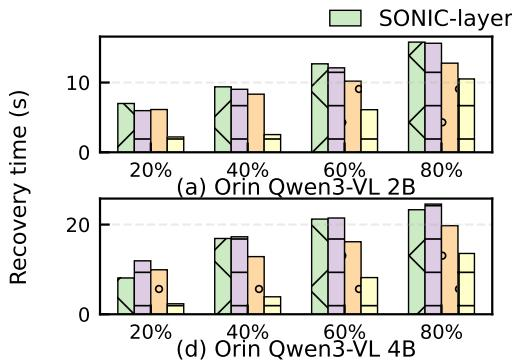

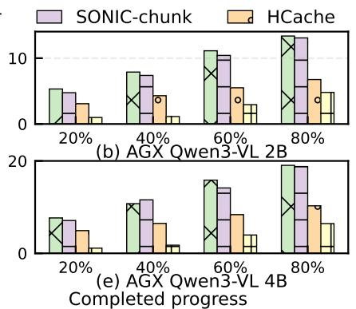

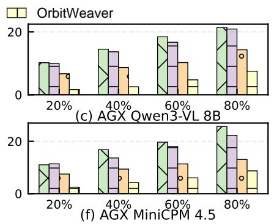  
Figure 11. Recovery latency under diferent setups.

## 7.3 Recovery latency

OrbitWeaver recovers quickly after resets. We use a 32Ktoken request and create checkpoints at 20%, 40%, 60%, and 80% of prefill progress, with each request generating 64 tokens during decoding. Figure 11 reports cold-cache recovery latency at these progress points. Across all tested devices, models, and progress points, OrbitWeaver achieves recovery speedups of 1.22×–6.97× over the baselines. For example, on AGX with Qwen3-VL 4B at 20% progress, SONIC-layer, SONIC-chunk, and HCache take 6.85×, 6.36×, and 4.40× as long as OrbitWeaver, respectively. Even at 80% progress with MiniCPM-V 4.5, they take 2.95×, 2.56×, and 1.50× as long, respectively. This improvement comes from OrbitWeaver’s dependency-aware recovery: it prioritizes the layer weights, prefix KV cache, and hidden states that unlock useful computation, defers other reads until their consumer blocks are ready, and overlaps SSD reads with dependency-ready computation. By contrast, fixed chunk-first or layer-first recovery exposes more I/O before computation can resume.

## 7.4 Checkpoint overhead

OrbitWeaver runs with low normal-path overhead. Figure 12 reports uninterrupted inference latency across the tested devices and models with prompt lengths from 2K to 32K tokens, with each request generating 64 tokens during decoding. Part of each prompt is occupied by image tokens, and the rest is filled with text tokens. Across all settings, OrbitWeaver remains within 5% of the no-checkpoint execution time while preserving recoverable progress. Compared with SONIC-layer, SONIC-chunk, and HCache, OrbitWeaver achieves speedups ofup to 2.63×, 2.16×, and 1.64×, respectively; the corresponding geometric-mean speedups are 1.62×, 1.38×, and 1.08×. This low normal-path overhead comes from OrbitWeaver’s block-wise checkpointing, which avoids persisting full-sequence hidden states after every layer, and its storage layout, which writes the states of each completed block as a contiguous record. Together, these designs reduce device-to-host transfers and fragmented SSD writes during inference.

## 7.5 Disk wear

OrbitWeaver reduces SSD writes and write amplification. Figure 13 reports total SSD writes and DLWA for Qwen3-VL 2B on Orin, with prompt lengths of 2K–32K tokens and 64 generated tokens per request. Across these lengths, SONIC-layer, SONIC-chunk, and HCache write 2.33×–3.56×, 1.08×–2.13×, and 1.10×–2.20× as much data as OrbitWeaver, respectively. Compared with SONIC-layer, SONIC-chunk, and HCache, OrbitWeaver reduces DLWA by 33.6–45.4%, 14.3–46.4%, and 15.0–46.2%, respectively. These reductions come from OrbitWeaver’s phase-aware checkpointing, which avoids persisting redundant intermediate states, and its storage layout, which batches checkpoint states into aligned, contiguous records and produces a mostly sequential write stream. Together, these designs minimize SSD wear under repeated checkpointing.

## 7.6 Energy consumption

OrbitWeaver incurs low energy overhead. Figure 14 compares uninterrupted Qwen3-VL 2B inference on Orin with and without OrbitWeaver checkpointing, measuring energy for 2K–32K prompt tokens and 64 generated tokens per request. Across all tested prompt lengths, OrbitWeaver consumes only 3.75%–4.74% more energy than the no-checkpoint baseline. This overhead comes from persisting recoverable states during normal inference and is consistent with the low runtime overhead in Figure 12. The no-checkpoint baseline provides a lower bound for an uninterrupted run but loses all in-memory progress after a reset. OrbitWeaver therefore pays a small persistence cost to avoid repeating completed VLM computation after interruptions.

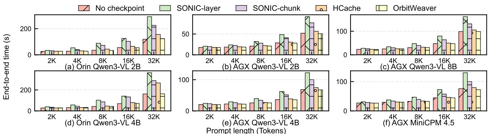

Figure 12. Inference latency under diferent setups when no shutdowns occur.  
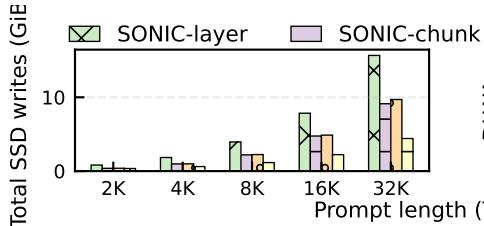

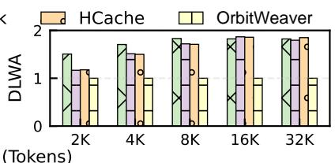  
Figure 13. Total SSD writes and device-level write amplification (DLWA).

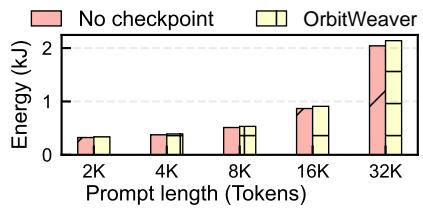  
Figure 14. Energy consumption.

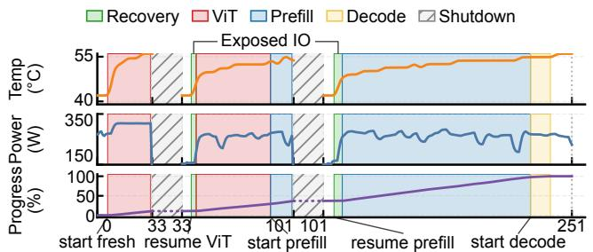

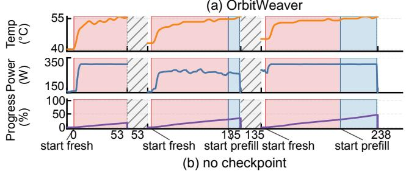  
Running Time (s)  
Figure 15. An example in-orbit VLM execution across interrupted windows on Sat-1. Temperature refers to the payload enclosure temperature.

## 7.7 Case Study: Real Deployment on Sat-1 and Sat-2

OrbitWeaver sustains VLM execution across repeated in-orbit interruptions. We deploy OrbitWeaver on Sat-1 and Sat-2 for 72 hours and execute 25 VLM requests on each satellite. Each request runs Qwen3-VL 2B on remote-sensing images with a 32K-token input, with each request generating 64 tokens during decoding. We impose a 20-minute timeout on each request. On Sat-1, 21 requests experience 47 busenforced shutdowns; on Sat-2, 20 requests experience 44 bus-enforced shutdowns. Across both deployments, 41 of the 50 requests are interrupted, and OrbitWeaver completes all 50 requests despite a total of 91 bus-enforced shutdowns. OrbitWeaver preserves progress across bus-enforced shutdowns. Figure 15 shows one execution on Sat-1 that spans three execution windows and two bus-enforced shutdowns. After each shutdown, OrbitWeaver restores the latest committed checkpoint during recovery (green regions) and resumes the unfinished request, completing it in the third window. For comparison, Figure 15(b) shows a separate no-checkpoint execution under repeated bus-enforced shutdowns. Because the baseline loses all in-memory VLM states after each shutdown, its inference progress (purple line) resets to zero. It therefore repeats previously completed work and remains in prefill after the third window. The aggregate deployment demonstrates that OrbitWeaver repeatedly recovers across two satellites, while this trace illustrates how preserving progress enables completion across interrupted execution windows.

## 8 Discussion

Generalizability. OrbitWeaver primarily targets orbital edge computing [14] to reduce reliance on ground-based processing. Starcloud [21] and Project Suncatcher [2] envision dedicated space-based clouds. Better power and thermal provisioning may reduce interruptions, but inference progress must still survive power cycling, resource contention, and unexpected resets. OrbitWeaver’s checkpointing and recovery principles apply to these platforms, complementing hardware co-design by letting interrupted requests resume rather than restart.

## 9 Related Work

• Satellite Computing Satellite computing systems use onboard perception and decision-making to reduce downlink demand and response latency [5, 7, 13, 14, 18, 23, 26, 36, 40, 62, 65, 71, 74–77]. Phi-Sat-1 and Kodan reduce downlink demand through onboard filtering [13, 26]. EagleEye couples onboard target detection with follow-up observation scheduling across a constellation [7]. Grace and VISO adapt VLMs to remote sensing and on-orbit execution [65, 77]. Onsatellite COTS measurements show that thermal and energy constraints strongly shape onboard performance [70]. OrbitWeaver instead preserves VLM progress across resets so long-running requests complete despite intermittent satellite execution.

• Intermittent Computing Intermittent computing systems preserve progress across repeated power or state loss [8, 24, 32, 44, 46, 47, 49, 56, 60, 61, 64, 68]. Mementos uses checkpoints on energy-harvesting devices [56]. DINO introduces task boundaries for consistent intermittent execution [44]. Chain provides tasks and channels for intermittent execution [8]. Alpaca avoids whole-program checkpoints through task-based privatization [46]. SONIC and Zygarde apply intermittent execution to embedded DNN inference [27, 30]. OrbitWeaver extends checkpointing and task-based execution to interruptions from diverse causes, windows of tens of seconds to minutes, and multi-GiB KV and activation states persisted to SSD/eMMC. The challenges shift to balancing checkpoint size against preserved progress and scheduling recovery I/O with computation.

• Eficient LLM and VLM Inference Modern VLMs combine visual encoders with language models for flexible visual reasoning and instruction following [3, 6, 10, 37, 39, 53, 55, 66]. LLM serving engines, also used as VLM backends, optimize continuous execution through batching, scheduling, memory ofloading, attention kernels, structured generation, prefix/KV cache reuse, and phase disaggregation [1, 11, 12, 31, 34, 48, 52, 58, 72, 79, 80]. Long-context inference systems further reduce KV cache memory footprint or movement through eviction, quantization, compression, streaming, ofloading, prefetching, or cache-centric disaggregation [25, 29, 35, 38, 41–43, 54, 69, 78]. Unlike these systems, OrbitWeaver targets intermittent on-orbit inference, where volatile activations and KV caches are lost after resets unless they are made durable and recovered eficiently.

## 10 Conclusion

This paper presents OrbitWeaver, a runtime for eficient and reliable on-satellite VLM inference through eficient check pointing and dynamic recovery. Evaluation demonstrates up to 4.07× end-to-end speedup with less than 5% runtime overhead, while in-orbit deployment confirms sustained progress across bus-enforced shutdowns.

## References

[1] Amey Agrawal, Nitin Kedia, Ashish Panwar, Jayashree Mohan, Nipun Kwatra, Bhargav Gulavani, Alexey Tumanov, and Ramachandran Ramjee. 2024. Taming Throughput-Latency Tradeof in LLM Inference with Sarathi-Serve. In 18th USENIX Symposium on Operating Systems Design and Implementation (OSDI ’24). USENIX Association, Berkeley, CA, USA, 117–134.

[2] Blaise Agüera y Arcas, Travis Beals, Maria Biggs, Jessica V. Bloom, Thomas Fischbacher, Konstantin Gromov, Urs Köster, Rishiraj Pravahan, and James Manyika. 2025. Towards a Future Space-Based, Highly Scalable AI Infrastructure System Design. arXiv:2511.19468 [cs.DC] htps://arxiv.org/abs/2511.19468

[3] Jean-Baptiste Alayrac, Jef Donahue, Pauline Luc, Antoine Miech, Iain Barr, Yana Hasson, Karel Lenc, Arthur Mensch, Katie Milli can, Malcolm Reynolds, Roman Ring, Eliza Rutherford, Serkan Cabi, Tengda Han, Zhitao Gong, Sina Samangooei, Marianne Monteiro, Ja cob Menick, Sebastian Borgeaud, Andrew Brock, Aida Nematzadeh, Sa hand Sharifzadeh, Mikolaj Binkowski, Ricardo Barreira, Oriol Vinyals, Andrew Zisserman, and Karen Simonyan. 2022. Flamingo: A Visual Language Model for Few-Shot Learning. In Advances in Neural Information Processing Systems, Vol. 35. Curran Associates, Inc., Red Hook, NY, USA, 23716–23736.

[4] Husan Ali, Asim Iqbal, Aadel Mohammed Alatwi, Akhtar Ali, and Bakht Muhammad Khan. 2026. Design and experimental validation of an autonomous electrical power system (EPS) for CubeSats. Scientific Reports 16, 1, Article 22981 (2026), 18 pages. doi:10.1038/s41598-026- 51416-y

[5] Yijie Chen, Qiyang Zhang, Ruolin Xing, Yuanzhe Li, Xiao Ma, Yiran Zhang, Ao Zhou, and Shangguang Wang. 2025. SLICE: Energy-Eficient Satellite-Ground Co-Inference via Layer-Wise Scheduling Optimization. IEEE Transactions on Services Computing 18, 4 (2025), 2388–2402. doi:10.1109/TSC.2025.3577451

[6] Zhe Chen, Jiannan Wu, Wenhai Wang, Weijie Su, Guo Chen, Sen Xing, Muyan Zhong, Qinglong Zhang, Xizhou Zhu, Lewei Lu, Bin Li, Ping Luo, Tong Lu, Yu Qiao, and Jifeng Dai. 2024. InternVL: Scaling up Vision Foundation Models and Aligning for Generic Visual-Linguistic Tasks. In Proceedings of the IEEE/CVF Conference on Computer Vision and Pattern Recognition. IEEE Computer Society, Los Alamitos, CA, USA, 24185–24198.

[7] Zhuo Cheng, Bradley Denby, Kyle McCleary, and Brandon Lucia. 2024. EagleEye: Nanosatellite Constellation Design for High-Coverage, High-Resolution Sensing. In Proceedings of the 29th ACM International Conference on Architectural Support for Programming Languages and Operating Systems, Volume 1 (La Jolla, CA, USA). Association for Computing Machinery, New York, NY, USA, 117–132. doi:10.1145/3617232.3624851

[8] Alexei Colin and Brandon Lucia. 2016. Chain: Tasks and Channels for Reliable Intermittent Programs. In Proceedings of the 2016 ACM SIGPLAN International Conference on Object-Oriented Programming, Systems, Languages, and Applications (OOPSLA ’16). Association for Computing Machinery, New York, NY, USA, 514–530. doi:10.1145/ 2983990.2983995

[9] Common Instrument Interface Project. 2011. Hosted Payload Guidelines Document. Technical Report CII-CI-0001. Earth System Science Pathfinder Program Ofice, NASA Langley Research Center. htps://essp.larc.nasa.gov/EV-I/pdf\_files/CII\_Hosted\_Payload\_ Guidelines\_Final.pdf

[10] Wenliang Dai, Junnan Li, Dongxu Li, Anthony Meng Huat Tiong, Junqi Zhao, Weisheng Wang, Boyang Li, Pascale Fung, and Steven C. H. Hoi. 2023. InstructBLIP: Towards General-purpose Vision-Language Models with Instruction Tuning. In Advances in Neural Information Processing Systems, Vol. 36. Curran Associates, Inc., Red Hook, NY, USA, 49250–49267.

[11] Tri Dao. 2024. FlashAttention-2: Faster Attention with Better Parallelism and Work Partitioning. In International Conference on Learning Representations. OpenReview.net, Vienna, Austria. htps://openreview. net/forum?id=mZn2Xyh9Ec

[12] Tri Dao, Daniel Y. Fu, Stefano Ermon, Atri Rudra, and Christopher Ré. 2022. FlashAttention: Fast and Memory-Eficient Exact Attention with IO-Awareness. In Advances in Neural Information Processing Systems, Vol. 35. Curran Associates, Inc., Red Hook, NY, USA, 16344–16359.

[13] Bradley Denby, Krishna Chintalapudi, Ranveer Chandra, Brandon Lucia, and Shadi Noghabi. 2023. Kodan: Addressing the Computational Bottleneck in Space. In Proceedings of the 28th ACM International Conference on Architectural Support for Programming Languages and Operating Systems, Volume 3 (Vancouver, BC, Canada). Association for Computing Machinery, New York, NY, USA, 392–403. doi:10.1145/ 3582016.3582043

[14] Bradley Denby and Brandon Lucia. 2020. Orbital Edge Computing: Nanosatellite Constellations as a New Class of Computer System. In Proceedings of the Twenty-Fifth International Conference on Architectural Support for Programming Languages and Operating Systems (Lausanne, Switzerland). Association for Computing Machinery, New York, NY, USA, 939–954. doi:10.1145/3373376.3378473

[15] Yupan Ding, Jing Xiao, Zhenyuan Zhang, Chaofeng Chen, Liang Liao, Gui-Song Xia, and Mi Wang. 2026. LongEarth-R1: Benchmarking and Aligning Vision-Language Models for Long-Horizon Earth Observation Reasoning. arXiv:2608.13344 [cs.CV] htps://arxiv.org/abs/2608. 13344

[16] Alexey Dosovitskiy, Lucas Beyer, Alexander Kolesnikov, Dirk Weissenborn, Xiaohua Zhai, Thomas Unterthiner, Mostafa Dehghani, Matthias Minderer, Georg Heigold, Sylvain Gelly, Jakob Uszkoreit, and Neil Houlsby. 2021. An Image is Worth 16x16 Words: Transformers for Image Recognition at Scale. In International Conference on Learning Representations. OpenReview.net, Online. htps: //openreview.net/forum?id=YicbFdNTTy

[17] Andrew Du, Roberto Del Prete, Alejandro Mousist, Nick Manser, Fabrice Marre, Andrew Barton, Carl Seubert, Gabriele Meoni, and Tat-Jun Chin. 2025. First On-Orbit Demonstration of a Geospatial Foundation Model. arXiv:2512.01181 [cs.LG] htps://arxiv.org/abs/2512.01181

[18] Kuntai Du, Yihua Cheng, Peder Olsen, Shadi Noghabi, and Junchen Jiang. 2025. Earth+: On-Board Satellite Imagery Compression Leveraging Historical Earth Observations. In Proceedings of the 30th ACM International Conference on Architectural Support for Programming Languages and Operating Systems, Volume 1 (Rotterdam, Netherlands). Association for Computing Machinery, New York, NY, USA, 361–376. doi:10.1145/3669940.3707222

[19] David Evans, Manuel Ortega, Reinhard Zeif, and Tom Sergert. 2016. OPS-SAT: FDIR Design on a Mission that Expects Bugs—and Lots of Them. In SpaceOps 2016 Conference. American Institute of Aeronautics and Astronautics, Reston, VA, USA. doi:10.2514/6.2016-2481

[20] Federal Communications Commission. 2026. Space Bureau Accepts for Filing SpaceX’s Application for Orbital Data Centers. htps://docs. fcc.gov/public/atachments/DA-26-113A1.pdf. DA 26-113; ICFS File No. SAT-LOA-20260108-00016.

[21] Ezra Feilden, Adi Oltean, and Philip Johnston. 2024. Why We Should Train AI in Space. White Paper v1.03. Lumen Orbit (now Starcloud). htps://starcloudinc.github.io/wp.pdf

[22] C.-J. Fong, D. Whiteley, E. Yang, K. Cook, V. Chu, B. Schreiner, D. Ector, P. Wilczynski, T.-Y. Liu, and N. Yen. 2011. Space and ground segment performance and lessons learned of the FORMOSAT-3/COSMIC mission: four years in orbit. Atmospheric Measurement Techniques 4, 6 (2011), 1115–1132. doi:10.5194/amt-4-1115-2011

[23] Alireza Furutanpey, Qiyang Zhang, Philipp Raith, Tobias Pfandzelter, Shangguang Wang, and Schahram Dustdar. 2025. FOOL: Addressing the Downlink Bottleneck in Satellite Computing With Neural Feature Compression. IEEE Transactions on Mobile Computing 24, 8 (2025),

6747–6764. doi:10.1109/TMC.2025.3544516

[24] Karthik Ganesan, Joshua San Miguel, and Natalie D. Enright Jerger. 2019. The What’s Next Intermittent Computing Architecture. In Proceedings of the 25th IEEE International Symposium on High Performance Computer Architecture (HPCA ’19). IEEE, Piscataway, NJ, USA, 211–223. doi:10.1109/HPCA.2019.00039

[25] Shiwei Gao, Youmin Chen, and Jiwu Shu. 2025. Fast State Restoration in LLM Serving with HCache. In Proceedings ofthe Twentieth European Conference on Computer Systems (Rotterdam, Netherlands) (EuroSys ’25). Association for Computing Machinery, New York, NY, USA, 16 pages. doi:10.1145/3689031.3696072

[26] Gianluca Giufrida, Luca Fanucci, Gabriele Meoni, Matej Batic, Leonie Buckley, Aubrey Dunne, Chris van Dijk, Marco Esposito, John Hefele, Nathan Vercruyssen, Gianluca Furano, Massimiliano Pastena, and Josef Aschbacher. 2022. The Φ-Sat-1 Mission: The First On-Board Deep Neural Network Demonstrator for Satellite Earth Observation. IEEE Transactions on Geoscience and Remote Sensing 60 (2022), 1–14. doi:10.1109/TGRS.2021.3125567

[27] Graham Gobieski, Brandon Lucia, and Nathan Beckmann. 2019. Intelligence Beyond the Edge: Inference on Intermittent Embedded Systems. In Proceedings of the Twenty-Fourth International Conference on Architectural Support for Programming Languages and Operating Systems (Providence, RI, USA). Association for Computing Machinery, New York, NY, USA, 199–213. doi:10.1145/3297858.3304011

[28] Miles Hatfield. 2018. Dellingr: The Little CubeSat That Could. NASA. htps://www.nasa.gov/solar-system/dellingr-the-litlecubesat-that-could/

[29] Coleman Hooper, Sehoon Kim, Hiva Mohammadzadeh, Michael W. Mahoney, Yakun Sophia Shao, Kurt Keutzer, and Amir Gholami. 2024. KVQuant: Towards 10 Million Context Length LLM Inference with KV Cache Quantization. In Advances in Neural Information Processing Systems, Vol. 37. Curran Associates, Inc., Red Hook, NY, USA, 1270– 1303.

[30] Bashima Islam and Shahriar Nirjon. 2020. Zygarde: Time-Sensitive On-Device Deep Inference and Adaptation on Intermittently-Powered Systems. Proceedings ofthe ACM on Interactive, Mobile, Wearable and Ubiquitous Technologies 4, 3, Article 101 (2020), 29 pages. doi:10.1145/ 3411808

[31] Yunho Jin, Chun-Feng Wu, David Brooks, and Gu-Yeon Wei. 2023. �3: Increasing GPU Utilization during Generative Inference for Higher Throughput. In Advances in Neural Information Processing Systems, Vol. 36. Curran Associates, Inc., Red Hook, NY, USA, 18015–18027.

[32] Vito Kortbeek, Souradip Ghosh, Josiah D. Hester, Simone Campanoni, and Przemysław Pawełczak. 2022. WARio: Eficient Code Generation for Intermittent Computing. In Proceedings ofthe 43rd ACM SIGPLAN International Conference on Programming Language Design and Implementation (PLDI ’22). Association for Computing Machinery, New York, NY, USA, 777–791. doi:10.1145/3519939.3523454

[33] Kartik Kuckreja, Muhammad Sohail Danish, Muzammal Naseer, Abhijit Das, Salman Khan, and Fahad Shahbaz Khan. 2024. GeoChat: Grounded Large Vision-Language Model for Remote Sensing. In Proceedings ofthe IEEE/CVF Conference on Computer Vision and Pattern Recognition. IEEE Computer Society, Los Alamitos, CA, USA, 27831– 27840. doi:10.1109/CVPR52733.2024.02629

[34] Woosuk Kwon, Zhuohan Li, Siyuan Zhuang, Ying Sheng, Lianmin Zheng, Cody Hao Yu, Joseph E. Gonzalez, Hao Zhang, and Ion Stoica. 2023. Eficient Memory Management for Large Language Model Serving with PagedAttention. In Proceedings ofthe 29th Symposium on Operating Systems Principles (SOSP ’23). Association for Computing Machinery, New York, NY, USA, 611–626. doi:10.1145/3600006.3613165

[35] Wonbeom Lee, Jungi Lee, Junghwan Seo, and Jaewoong Sim. 2024. InfiniGen: Eficient Generative Inference of Large Language Models with Dynamic KV Cache Management. In 18th USENIX Symposium on Operating Systems Design and Implementation (OSDI ’24). USENIX

Association, Berkeley, CA, USA, 155–172.

[36] Israel Leyva-Mayorga, Marc Martinez-Gost, Marco Moretti, Ana Pérez-Neira, Miguel Angel Vázquez, Petar Popovski, and Beatriz Soret. 2023. Satellite Edge Computing for Real-Time and Very-High Resolution Earth Observation. IEEE Transactions on Communications 71, 10 (2023), 6180–6194. doi:10.1109/TCOMM.2023.3296584

[37] Junnan Li, Dongxu Li, Silvio Savarese, and Steven Hoi. 2023. BLIP-2: Bootstrapping Language-Image Pre-training with Frozen Image Encoders and Large Language Models. In Proceedings ofthe 40th International Conference on Machine Learning (Proceedings of Machine Learning Research, Vol. 202). PMLR, Honolulu, HI, USA, 19730–19742. htps://proceedings.mlr.press/v202/li23q.html

[38] Yuhong Li, Yingbing Huang, Bowen Yang, Bharat Venkitesh, Acyr Lo catelli, Hanchen Ye, Tianle Cai, Patrick Lewis, and Deming Chen. 2024. SnapKV: LLM Knows What You are Looking for Before Generation. In Advances in Neural Information Processing Systems, Vol. 37. Curran Associates, Inc., Red Hook, NY, USA, 22947–22970.

[39] Haotian Liu, Chunyuan Li, Qingyang Wu, and Yong Jae Lee. 2023. Visual Instruction Tuning. In Advances in Neural Information Processing Systems, Vol. 36. Curran Associates, Inc., New Orleans, LA, USA, 34892–34916. htps://arxiv.org/abs/2304.08485

[40] Weisen Liu, Zeqi Lai, Qian Wu, Hewu Li, Qi Zhang, Zonglun Li, Yuanjie Li, and Jun Liu. 2024. In-Orbit Processing or Not? Sunlight-Aware Task Scheduling for Energy-Eficient Space Edge Computing Networks. In IEEE INFOCOM 2024 - IEEE Conference on Computer Communications. IEEE, Piscataway, NJ, USA, 881–890. doi:10.1109/INFOCOM52122. 2024.10621268

[41] Yuhan Liu, Hanchen Li, Yihua Cheng, Siddhant Ray, Yuyang Huang, Qizheng Zhang, Kuntai Du, Jiayi Yao, Shan Lu, Ganesh Ananthanarayanan, Michael Maire, Henry Hofmann, Ari Holtzman, and Junchen Jiang. 2024. CacheGen: KV Cache Compression and Streaming for Fast Large Language Model Serving. In Proceedings of the ACM SIGCOMM 2024 Conference (SIGCOMM ’24). Association for Computing Machinery, New York, NY, USA, 38–56. doi:10.1145/3651890. 3672274

[42] Zichang Liu, Aditya Desai, Fangshuo Liao, Weitao Wang, Victor Xie, Zhaozhuo Xu, Anastasios Kyrillidis, and Anshumali Shrivastava. 2023. Scissorhands: Exploiting the Persistence of Importance Hypothesis for LLM KV Cache Compression at Test Time. In Advances in Neural Information Processing Systems, Vol. 36. Curran Associates, Inc., Red Hook, NY, USA, 52342–52364.

[43] Zirui Liu, Jiayi Yuan, Hongye Jin, Shaochen Zhong, Zhaozhuo Xu, Vladimir Braverman, Beidi Chen, and Xia Hu. 2024. KIVI: A Tuning-Free Asymmetric 2bit Quantization for KV Cache. In Proceedings of the 41st International Conference on Machine Learning (Proceedings of Machine Learning Research, Vol. 235). PMLR, Vienna, Austria, 32332– 32344.

[44] Brandon Lucia and Benjamin Ransford. 2015. A simpler, safer programming and execution model for intermittent systems. In Proceedings of the 36th ACM SIGPLAN Conference on Programming Language Design and Implementation (Portland, OR, USA). Association for Computing Machinery, New York, NY, USA, 575–585. doi:10.1145/2737924. 2737978

[45] Junwei Luo, Yingying Zhang, Xue Yang, Kang Wu, Qi Zhu, Lei Liang, Jingdong Chen, and Yansheng Li. 2025. When Large Vision-Language Model Meets Large Remote Sensing Imagery: Coarse-to-Fine Text-Guided Token Pruning. In Proceedings ofthe IEEE/CVF International Conference on Computer Vision (ICCV). IEEE Computer Society, Los Alamitos, CA, USA, 9206–9217.

[46] Kiwan Maeng, Alexei Colin, and Brandon Lucia. 2017. Alpaca: Intermittent Execution without Checkpoints. Proceedings ofthe ACM on Programming Languages 1, OOPSLA, Article 96 (2017), 30 pages. doi:10.1145/3133920

[47] Kiwan Maeng and Brandon Lucia. 2018. Adaptive Dynamic Check pointing for Safe Eficient Intermittent Computing. In 13th USENIX Symposium on Operating Systems Design and Implementation (OSDI ’18). USENIX Association, Berkeley, CA, USA, 129–144.

[48] Xupeng Miao, Gabriele Oliaro, Zhihao Zhang, Xinhao Cheng, Zeyu Wang, Zhengxin Zhang, Rae Ying Yee Wong, Alan Zhu, Lijie Yang, Xiaoxiang Shi, Chunan Shi, Zhuoming Chen, Daiyaan Arfeen, Reyna Abhyankar, and Zhihao Jia. 2024. SpecInfer: Accelerating Large Language Model Serving with Tree-based Speculative Inference and Verification. In Proceedings of the 29th ACM International Conference on Architectural Support for Programming Languages and Operating Systems (ASPLOS ’24). Association for Computing Machinery, New York, NY, USA, 932–949. doi:10.1145/3620666.3651335

[49] Sourav Mohapatra, Vito Kortbeek, Marco Antonio van Eerden, Jochem Broekhof, Saad Ahmed, and Przemysław Pawełczak. 2025. Data Cache for Intermittent Computing Systems with Non-Volatile Main Memory. In Proceedings of the 30th ACM International Conference on Architectural Support for Programming Languages and Operating Systems, Volume 2 (ASPLOS ’25). Association for Computing Machinery, New York, NY, USA, 227–243. doi:10.1145/3676641.3715989

[50] National Aeronautics and Space Administration. 2025. Basics of Space Flight: Chapter 11—Onboard Systems, Electrical Power Distribution. NASA Science. htps://science.nasa.gov/learn/basics-of-spaceflight/chapter11-3/

[51] NVM Express, Inc. 2022. NVM Express NVM Command Set Specification, Revision 1.0c. Specification Revision 1.0c. NVM Express, Inc. htps://nvmexpress.org/wp-content/uploads/NVM-Express-NVM-Command-Set-Specification-1.0c-2022.10.03-Ratified.pdf

[52] Pratyush Patel, Esha Choukse, Chaojie Zhang, Aashaka Shah, Íñigo Goiri, Saeed Maleki, and Ricardo Bianchini. 2024. Splitwise: Eficient Generative LLM Inference Using Phase Splitting. In 2024 ACM/IEEE 51st Annual International Symposium on Computer Architecture (ISCA ’24). IEEE, Piscataway, NJ, USA, 118–132. doi:10.1109/ISCA59077.2024. 00019

[53] Zhiliang Peng, Wenhui Wang, Li Dong, Yaru Hao, Shaohan Huang, Shuming Ma, and Furu Wei. 2024. Grounding Multimodal Large Language Models to the World. In International Conference on Learning Representations. OpenReview.net, Vienna, Austria. htps://openreview. net/forum?id=lLmqxkfSIw

[54] Ruoyu Qin, Zheming Li, Weiran He, Jialei Cui, Feng Ren, Mingxing Zhang, Yongwei Wu, Weimin Zheng, and Xinran Xu. 2025. Mooncake: Trading More Storage for Less Computation—A KVCache-centric Architecture for Serving LLM Chatbot. In 23rd USENIX Conference on File and Storage Technologies (FAST ’25). USENIX Association, Santa Clara, CA, 155–170.

[55] Alec Radford, Jong Wook Kim, Chris Hallacy, Aditya Ramesh, Gabriel Goh, Sandhini Agarwal, Girish Sastry, Amanda Askell, Pamela Mishkin,Jack Clark, Gretchen Krueger, and Ilya Sutskever. 2021. Learning Transferable Visual Models From Natural Language Supervision. In Proceedings of the 38th International Conference on Machine Learning (Proceedings of Machine Learning Research, Vol. 139). PMLR, Online, 8748–8763.

[56] Benjamin Ransford, Jacob Sorber, and Kevin Fu. 2011. Mementos: System Support for Long-Running Computation on RFID-Scale Devices. In Proceedings ofthe 16th International Conference on Architectural Supportfor Programming Languages and Operating Systems (Newport Beach, CA, USA). Association for Computing Machinery, New York, NY, USA, 159–170. doi:10.1145/1950365.1950386

[57] Emilio Rapuano, Gabriele Meoni, Tommaso Pacini, Gianmarco Dinelli, Gianluca Furano, Gianluca Giufrida, and Luca Fanucci. 2021. An FPGA-Based Hardware Accelerator for CNNs Inference on Board Satel lites: Benchmarking with Myriad 2-Based Solution for the CloudScout Case Study. Remote Sensing 13, 8 (2021), 1518. doi:10.3390/rs13081518

[58] Ying Sheng, Lianmin Zheng, Binhang Yuan, Zhuohan Li, Max Ryabinin, Daniel Y. Fu, Zhiqiang Xie, Beidi Chen, Clark W. Barrett, Joseph E. Gonzalez, Percy Liang, Christopher Ré, Ion Stoica, and Ce Zhang. 2023. FlexGen: High-Throughput Generative Inference of Large Language Models with a Single GPU. In Proceedings of the 40th International Conference on Machine Learning (Proceedings ofMachine Learning Research, Vol. 202). PMLR, Honolulu, HI, USA, 31094–31116.

[59] Starcloud, Inc. n.d.. Starcloud-1. Starcloud. htps://www.starcloud. com/starcloud-1

[60] Milijana Surbatovich, Brandon Lucia, and Limin Jia. 2020. Towards a Formal Foundation of Intermittent Computing. Proceedings of the ACM on Programming Languages 4, OOPSLA, Article 163 (Nov. 2020), 31 pages. doi:10.1145/3428231

[61] Milijana Surbatovich, Naomi Spargo, Limin Jia, and Brandon Lucia. 2023. A Type System for Safe Intermittent Computing. Proceedings of the ACM on Programming Languages 7, PLDI, Article 136 (June 2023), 25 pages. doi:10.1145/3591250

[62] Bill Tao, Om Chabra, Ishani Janveja, Indranil Gupta, and Deepak Vasisht. 2024. Known Knowns and Unknowns: Near-realtime Earth Observation Via Query Bifurcation in Serval. In 21st USENIX Symposium on Networked Systems Design and Implementation (NSDI ’24). USENIX Association, Santa Clara, CA, USA, 809–824. htps://www. usenix.org/conference/nsdi24/presentation/tao

[63] Arash Tavakkol, Juan Gómez-Luna, Mohammad Sadrosadati, Saugata Ghose, and Onur Mutlu. 2018. MQSim: A Framework for Enabling Realistic Studies of Modern Multi-Queue SSD Devices. In 16th USENIX Conference on File and Storage Technologies (FAST 18). USENIX Associ ation, Berkeley, CA, USA, 49–66.

[64] Joel Van Der Woude and Matthew Hicks. 2016. Intermittent Computation without Hardware Support or Programmer Intervention. In 12th USENIX Symposium on Operating Systems Design and Implementation (OSDI 16). USENIX Association, Berkeley, CA, USA, 17–32.

[65] Meiqi Wang and Han Qiu. 2025. VISO: Accelerating In-orbit Object Detection with Language-Guided Mask Learning and Sparse Inference. In Proceedings of the IEEE/CVF International Conference on Computer Vision (ICCV ’25). IEEE Computer Society, Los Alamitos, CA, USA, 23300–23310.

[66] Weihan Wang, Qingsong Lv, Wenmeng Yu, Wenyi Hong, Ji Qi, Yan Wang, Junhui Ji, Zhuoyi Yang, Lei Zhao, Xixuan Song, Jiazheng Xu, Keqin Chen, Bin Xu, Juanzi Li, Yuxiao Dong, Ming Ding, and Jie Tang. 2024. CogVLM: Visual Expert for Pretrained Language Models. In Advances in Neural Information Processing Systems, Vol. 37. Curran Associates, Inc., Red Hook, NY, USA, 121475–121499.

[67] Thomas Wolf, Lysandre Debut, Victor Sanh, Julien Chaumond, Clement Delangue, Anthony Moi, Pierric Cistac, Tim Rault, Remi Louf, Morgan Funtowicz, Joe Davison, Sam Shleifer, Patrick von Platen, Clara Ma, Yacine Jernite, Julien Plu, Canwen Xu, Teven Le Le Scao, Syl vain Gugger, Mariama Drame, Quentin Lhoest, and Alexander M. Rush. 2020. Transformers: State-of-the-Art Natural Language Processing. In Proceedings ofthe 2020 Conference on Empirical Methods in Natural Language Processing: System Demonstrations. Association for Computa tional Linguistics, Online, 38–45. doi:10.18653/v1/2020.emnlp-demos.6

[68] Yilun Wu, Byounguk Min, Mohannad Ismail, Wenjie Xiong, Changhee Jung, and Dongyoon Lee. 2024. IntOS: Persistent Embedded Operating System and Language Support for Multi-threaded Intermittent Computing. In 18th USENIX Symposium on Operating Systems Design and Implementation (OSDI’24). USENIX Association, Santa Clara, CA, 425– 443. htps://www.usenix.org/conference/osdi24/presentation/wuyilun

[69] Guangxuan Xiao, Yuandong Tian, Beidi Chen, Song Han, and Mike Lewis. 2024. Eficient Streaming Language Models with Attention Sinks. In International Conference on Learning Representations. OpenReview.net, Vienna, Austria. htps://openreview.net/forum?id= NG7sS51zVF

[70] Ruolin Xing, Mengwei Xu, Ao Zhou, Qing Li, Yiran Zhang, Feng Qian, and Shangguang Wang. 2024. Deciphering the Enigma of Satellite Computing with COTS Devices: Measurement and Analysis. In Proceedings of the 30th Annual International Conference on Mobile Computing and Networking (Washington D.C., DC, USA). Association for Computing Machinery, New York, NY, USA, 420–435. doi:10.1145/3636534.3649371

[71] Chen Yang, Qibo Sun, Qiyang Zhang, Hao Lu, Claudio A. Ardagna, Shangguang Wang, and Mengwei Xu. 2024. Toward Eficient Satellite Computing Through Adaptive Compression. IEEE Transactions on Services Computing 17, 6 (2024), 4411–4422. doi:10.1109/TSC.2024. 3470341

[72] Gyeong-In Yu, Joo Seong Jeong, Geon-Woo Kim, Soojeong Kim, and Byung-Gon Chun. 2022. Orca: A Distributed Serving System for Transformer-Based Generative Models. In 16th USENIX Symposium on Operating Systems Design and Implementation (OSDI ’22). USENIX Association, Berkeley, CA, USA, 521–538.

[73] Amir Zandieh, Majid Daliri, Majid Hadian, and Vahab Mirrokni. 2025. TurboQuant: Online Vector Quantization with Near-optimal Distortion Rate. arXiv:2504.19874 [cs.LG] doi:10.48550/arXiv.2504.19874

[74] Zhiwei Zhai, Liekang Zeng, Tao Ouyang, Shuai Yu, Qianyi Huang, and Xu Chen. 2024. SECO: Multi-Satellite Edge Computing Enabled Wide-Area and Real-Time Earth Observation Missions. In IEEE INFOCOM 2024 - IEEE Conference on Computer Communications. IEEE, Piscataway, NJ, USA, 2548–2557. doi:10.1109/INFOCOM52122.2024.10621270

[75] Qiyang Zhang, Shangguang Wang, Jinglong Guan, Praveen Kumar Donta, Xiao Ma, Yiran Zhang, RangaRao Venkatesha Prasad, Schahram Dustdar, and Xuanzhe Liu. 2025. SatCooper: Enhancing Cooperative Inference Analytics for Satellite Service via Multi-Exit DNNs. IEEE Transactions on Mobile Computing 24, 9 (2025), 8314–8328. doi:10.1109/ TMC.2025.3556457

[76] Qiyang Zhang, Xin Yuan, Ruolin Xing, Yiran Zhang, Zimu Zheng, Xiao Ma, Mengwei Xu, Schahram Dustdar, and Shangguang Wang. 2024. Resource-eficient In-orbit Detection of Earth Objects. In IEEE INFOCOM 2024 - IEEE Conference on Computer Communications. IEEE, Piscataway, NJ, USA, 551–560. doi:10.1109/INFOCOM52122.2024. 10621328

[77] Yuxin Zhang, Jiahao Yang, Zhe Chen, Wenjun Zhu, Jin Zhao, and Yue Gao. 2025. A Satellite-Ground Synergistic Large Vision-Language Model System for Earth Observation. In Proceedings ofthe 33rd ACM International Conference on Multimedia. Association for Computing Machinery, New York, NY, USA, 11825–11833. doi:10.1145/3746027. 3755299

[78] Zhenyu Zhang, Ying Sheng, Tianyi Zhou, Tianlong Chen, Lianmin Zheng, Ruisi Cai, Zhao Song, Yuandong Tian, Christopher Ré, Clark Barrett, Zhangyang Wang, and Beidi Chen. 2023. H2O: Heavy-Hitter Oracle for Eficient Generative Inference of Large Language Models. In Advances in Neural Information Processing Systems, Vol. 36. Curran Associates, Inc., Red Hook, NY, USA, 34661–34710.

[79] Lianmin Zheng, Liangsheng Yin, Zhiqiang Xie, Chuyue Sun, Jef Huang, Cody Hao Yu, Shiyi Cao, Christos Kozyrakis, Ion Stoica, Joseph E. Gonzalez, Clark W. Barrett, and Ying Sheng. 2024. SGLang: Eficient Execution of Structured Language Model Programs. In Advances in Neural Information Processing Systems, Vol. 37. Curran Associates, Inc., Red Hook, NY, USA, 62557–62583.

[80] Yinmin Zhong, Shengyu Liu, Junda Chen, Jianbo Hu, Yibo Zhu, Xuanzhe Liu, Xin Jin, and Hao Zhang. 2024. DistServe: Disaggregating Prefill and Decoding for Goodput-optimized Large Language Model Serving. In 18th USENIX Symposium on Operating Systems Design and Implementation (OSDI ’24). USENIX Association, Berkeley, CA, USA, 193–210.