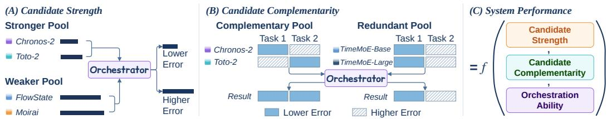
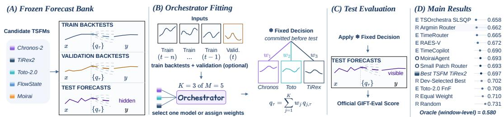
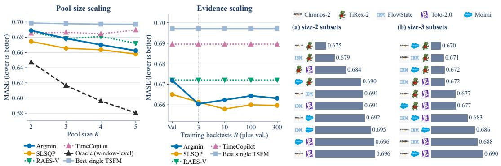

# Rethinking Agentic Model Orchestration for Time Series Forecasting

Tong Guan1,2 Tianxiang Zhan1 Shirui Pan1∗ Ming Jin1∗ 1Griffith University 2Zhejiang University

## Abstract

Time series foundation models (TSFMs) perform unevenly across forecasting tasks. Recent work uses agentic model orchestration (AMO) to select or combine TSFMs, often outperforming individual forecasters. Yet these gains may reflect stronger or more complementary candidates rather than better orchestration. To disentangle these effects, we introduce FairAMO, a controlled evaluation protocol with frozen candidate forecasts. Experiments on GIFT-Eval show that AMO improves accuracy, but its gains are bounded by the candidate TSFMs. The best orchestrators reduce MASE by less than 6% relative to the best single TSFM across all tasks. These gains depend on complementarity (different candidates excel on different tasks) rather than the number of candidates. Adding members yields diminishing returns, and a redundant member can erase these gains. The value of historical evidence also saturates quickly. A few recent windows capture all gains, and further history adds none. These findings separate system-level forecasting gains from the contribution of orchestration itself.

## 1 Introduction

Time series forecasting (TSF) supports critical decisions across a wide range of domains [Jin et al., 2026, Guan et al., 2023, 2025, 2026a]. Recent advances have expanded the forecasting paradigm from task-specific statistical and deep learning models to pretrained time series foundation models (TSFMs) that exhibit strong zero-shot generalization [Shi et al., 2025, Zhou et al., 2026, Guan et al., 2026b]. This development has also motivated comprehensive benchmarks such as GIFT-Eval [Aksu et al., 2024], which covers more than 144,000 time series and 7 domains. Results on such diverse benchmarks show that no single TSFM consistently performs best across all datasets and forecasting settings. TimesFM [Das et al., 2024] excels in long-horizon forecasting with extended contexts. Moirai [Woo et al., 2024] robustly handles multivariate inputs with covariates. Chronos [Ansari et al., 2024] captures distinct seasonality in short univariate series. Treating any single model as universally best sacrifices higher accuracy for a significant fraction of real-world inputs. This performance heterogeneity makes model orchestration a promising strategy for practical deployment.

Recent studies have explored agentic model orchestration (AMO) for selecting or combining candidate TSFMs. Their reported improvements over individual forecasters are striking [Ning et al., 2026, Cao et al., 2025]. Notably, AMO systems currently occupy all of the top 10 positions on the GIFT-Eval leaderboard. Yet, leaderboard dominance alone does not establish that these gains originate from the orchestration mechanism, since the systems are evaluated with different candidate pools. This lack of control introduces two fundamental confounding factors. (1) Candidate strength, which determines the performance level available to the system before orchestration. As illustrated in Figure 1 (A), the same orchestrator can achieve substantially different results simply because it operates on stronger candidate forecasters. (2) Candidate complementarity, which determines the potential headroom available for orchestration. As illustrated in Figure 1 (B), a complementary pool whose members excel on different tasks leaves far more room for orchestration to improve over its best member than a redundant pool whose members succeed and fail in similar settings. Consequently, observed system performance jointly reflects candidate strength, candidate complementarity, and orchestration ability (Figure 1 (C)). Without controlling the first two factors, existing evaluations cannot isolate the contribution of the orchestrator itself.

  
Figure 1: Effects of candidate strength and complementarity on orchestration performance.

To disentangle these confounding factors, we introduce FairAMO, a controlled evaluation protocol built on a Frozen Forecast Bank. Within each comparison, all orchestrators operate on the same candidate forecasts and receive the same explicitly specified historical evidence. Each orchestrator must commit to either a model selection or a set of combination weights before the test labels are revealed, and all resulting forecasts are evaluated using the official GIFT-Eval protocol. By independently varying candidate pool composition, pool size, and evidence budget, our framework separates the contribution of the orchestrator from the properties of the candidate pool. Our contributions are threefold. (1) We provide a systematic taxonomy and reproducibility analysis of existing AMO systems. (2) We introduce FairAMO, a controlled protocol for comparing orchestration methods under identical candidate forecasts, evidence, and evaluation metrics for TSF. (3) Results show that orchestration gains are strongly conditioned by the candidate pool, while greater orchestration complexity and additional historical evidence do not consistently improve forecasting performance.

## 2 Taxonomy and Reproducibility

Taxonomy. We distinguish three adaptive mechanisms according to how orchestration decisions are formed. (1) LLM-mediated orchestration uses an LLM to interpret forecasting evidence and guide model use, as in MoiraiAgent [Yan et al., 2026], TSOrchestra’s agent [Cao et al., 2025], and TimeCopilot’s agent framework [Garza and Rosillo, 2025]. (2) Feature-conditioned orchestration learns a mapping from time series descriptors to orchestration decisions, as in TimeRouter [Ning et al., 2026], Toto-2.0 FnF [Datadog, 2026], and FFORMA [Montero-Manso et al., 2020]. (3) Historical-error-driven orchestration determines decisions directly from past forecasting errors, as in RAES-Conductance-V [AriGoldbach, 2026] and TSOrchestra SLSQP [Cao et al., 2025]. The distinction concerns the decision mechanism, not merely whether training uses a loss function; multiple mechanisms may coexist within one system.

Reproducibility. We examine whether public artifacts support reconstructing an orchestrator under a changed candidate pool and a specified historical evidence budget. In the releases inspected in September 2026, MoiraiAgent, TimeRouter, and Toto FnF provide inference artifacts, but we did not locate complete training code for their orchestration components; RAES-Conductance-V and TSOrchestra SLSQP expose code for deriving and applying decisions. Thus, we reproduce AMO methods by reusing or adapting available repository components.

## 3 Methodology

We treat every orchestrator as an ensemble function of candidate TSFMs. The framework has three stages, illustrated in Figure 2. (1) Frozen Forecast Bank. All M candidate TSFMs are run once on GIFT-Eval and are never retrained or fine-tuned afterwards. Their outputs are cached in a forecast bank indexed by (dataset, term, series, window, candidate, quantile), where dataset and term (short, medium, or long horizon) identify a GIFT-Eval task and window a rolling forecast origin. Each entry stores the input history and the candidate’s quantile forecasts. The bank has three regions: training backtests and optional validation backtests, both with ground truth attached, and test forecasts, whose ground truth is withheld. Every orchestrator draws its $K \leq M$ members from this same bank. (2) Orchestrator Fitting. Before any test label is revealed, the orchestrator receives the permitted evidence: the N most recent training backtests, plus the validation backtests if available. Using only this evidence, it produces an orchestration strategy, either a model selection or a set of combination weights, which is then committed and frozen for the test period. No rerun, reweighting, or inspection of test scores is permitted after commitment. (3) Test Evaluation. The frozen strategy is applied to the cached test forecasts to produce the final prediction. Test labels are revealed only at this stage, and the official GIFT-Eval scorer then returns MASE and CRPS.

  
Figure 2: Overview of FairAMO. (A) Each candidate TSFM is run once and its quantile forecasts are cached as training backtests, validation backtests and test forecasts, with the test labels hidden. (B) The orchestrator reads only the permitted evidence and commits to one model or to a set of weights over K of the M candidates. (C) The frozen decision is applied to the cached test forecasts and scored by the official GIFT-Eval protocol. (D) The 11 deployable orchestrators on the main pool under val+B10 (MASE, lower is better); ⃝R , ⃝E , and ⃝O mark reference, external, and our re-implemented methods. Detailed results are in Appendix Table B1.

Evaluated Orchestrators. We evaluate three groups of orchestrators as shown in Figure 2 (D). ⃝R Reference orchestrators are five simple methods from no learning to perfect hindsight. Random samples one member of the candidate subset under a fixed seed. Dev-Selected Best uses only the permitted development evidence to nominate a single member applied to every config. Equal Weight averages the forecasts of the K members with weight $w _ { j } = 1 / K$ assigned to member j, without learning any weights. Argmin Router commits, per config, to the member with the smallest evidence loss, ˆj = arg minj $L _ { \mathrm { { e v i d e n c e } } } ( j , \mathrm { { c o n f i g } ) }$ , the official GIFT-Eval loss of member j on its permitted evidence windows. Oracle selects the best member per input window from test labels and is reported only as a non-deployable upper bound. ⃝E External orchestrators are the published methods introduced in Section 2: TimeRouter [Ning et al., 2026], Toto-2.0 FnF [Datadog, 2026], RAES-Conductance-Ensemble-V [AriGoldbach, 2026], TSOrchestra SLSQP [Cao et al., 2025], and TimeCopilot Median [TimeCopilot, 2026]; the training procedures of TimeRouter and Toto-2.0 FnF are not fully public, so we reproduce them as style adaptations. ⃝O Our re-implementations are two orchestrators that we rewrite from published designs to fit FairAMO: MoiraiAgent-Retrained [Yan et al., 2026], an LLM-mediated orchestrator retrained on the permitted evidence, and Small Patch Router, its numeric counterpart, trained on the same pairs and horizon. It patches the history and each candidate’s forecast, encodes every candidate with one shared temporal transformer, and scores them by attention across candidates.

## 4 Experiments

RQ1. With the candidate pool and the evidence budget held fixed, how much forecasting gain comes from the orchestrator itself rather than from the candidates it selects?

Existing orchestrators remain far from the ceiling that the candidate pool itself provides, leaving substantial room for improvement. Figure 2 (D) summarizes the 11 deployable methods in the same 5-candidate setting. The strongest deployable orchestrator, TSOrchestra SLSQP, reaches 0.658 MASE, a gain of 0.039 or 5.6% over the best single TSFM, TiRex2, at 0.697. Argmin Router reaches 0.662 and TimeRouter 0.665. The window-level oracle sits at 0.580, so even the strongest orchestrator still leaves two thirds of the distance to that ceiling uncovered. Every method that gains more than 0.01 relies on backtest evidence.

RQ2. As the candidate pool grows and as the backtest evidence budget grows, do orchestration gains keep improving, and at what point does each of the two stop paying off?

  
Figure 3: Pool-size scaling. Figure 4: Evidence scaling on Figure 5: Argmin Router on every size-2 and The best single TSFM is flat the main pool. Argmin is best size-3 candidate subset, sorted by MASE. Brand while the oracle falls, so mem- at three backtests and SLSQP marks before each bar identify the pool members add complementarity, not at ten; larger budgets bring no bers; the four best pools in each panel all contain strength. Appendix Table B2. further gains. Appendix Ta- TiRex2. Detailed data in Appendix Table B4. ble B3.

On pool size, adding members enlarges the exploitable error diversity, that is the complementarity, rather than the strength of the candidates themselves. Figure 3 shows the best single TSFM almost unchanged as the pool grows from two to five members, from 0.699 to 0.697, while the window-level oracle drops from 0.647 to 0.580 and the headroom H grows from 0.052 to 0.117. The Argmin Router improves accordingly from 0.689 to 0.662 and its realization rises from 18.4% to 29.8%, but the increments shrink: the third member adds 5.1 points of realization, whereas the fourth and the fifth add about 3 points each.

On evidence, a few recent windows carry all of its value, which indicates that orchestration mechanisms depend on the validation segment closest in time to the test windows, and that adding training backtests beyond that point can even hurt. Figure 4 shows the Argmin Router improving from 0.672 with validation only to 0.661 once three training backtests are added, then drifting back to 0.664 as the budget grows to 100 backtests. TSOrchestra SLSQP peaks at 10 backtests with 0.658 and also degrades beyond it, so history past a few recent windows stops helping and can actively hurt.

RQ3. At a fixed pool size, how sensitive are orchestration methods to which candidates the pool contains, and what happens to that sensitivity when a weak candidate is introduced?

Orchestration methods are highly sensitive to composition, no less so than to pool size. Figure 5 shows that the same Argmin Router spans 0.670–0.690 MASE over the ten size-3 subsets, a spread of 0.020 that matches in magnitude the 0.027 gained by growing the pool from two to five members, and the spread in realization is wider still, from 9.8% to 32.3%, a factor of three. This sensitivity comes from complementarity rather than strength: the best single TSFM of every subset falls between 0.697 and 0.703, a difference of approximately 0.006, whereas subsets containing TiRex2 realize 28.5% of their headroom on average against 13.4% for subsets without it.

Introducing a weak candidate does not necessarily hurt; what matters is whether it contributes a new error profile. Toto2-313m is the weakest single model at 0.703, yet adding it to the six size-2 subsets that exclude it improves five of them, by up to 0.013 MASE. Conversely, a large headroom does not guarantee a realizable gain: Chronos2+Toto2-313m has a headroom of 0.048, close to the median, but realizes only 3.1%, because its members fail on the same configs and the evidence cannot separate them. Pools should therefore be grown by difference in error profile rather than by single-model ranking, and reported orchestration gains must be accompanied by the pool composition, since the realization of one and the same orchestrator can differ by a factor of three.

## 5 Conclusion

Under FairAMO, the central insight is that AMO improves accuracy, but its gains are bounded by the candidate pool, that these gains depend on complementarity rather than pool size, and that the value of historical evidence saturates quickly. However, the strongest methods are simple selection and weighting rules, leaving the contribution of LLM-mediated orchestration unclear. A single decision per config also limits realization of the available window-level headroom. Future work may therefore explore finer-grained commitments, agentic methods that use context beyond backtests, and candidate pools built around complementary error profiles rather than model rank.

## References

Taha Aksu, Gerald Woo, Juncheng Liu, Xu Liu, Chenghao Liu, Silvio Savarese, Caiming Xiong, and Doyen Sahoo. GIFT-Eval: A benchmark for general time series forecasting model evaluation, 2024. URL https://arxiv.org/abs/2410.10393.

Abdul Fatir Ansari, Lorenzo Stella, Ali Caner Turkmen, Xiyuan Zhang, Pedro Mercado, Huibin Shen, Oleksandr Shchur, Syama Sundar Rangapuram, Sebastian Pineda Arango, Shubham Kapoor, Jasper Zschiegner, Danielle C. Maddix, Hao Wang, Michael W. Mahoney, Kari Torkkola, Andrew Gordon Wilson, Michael Bohlke-Schneider, and Bernie Wang. Chronos: Learning the language of time series. Transactions on Machine Learning Research, 2024. ISSN 2835-8856. URL https: //openreview.net/forum?id=gerNCVqqtR. Expert Certification.

AriGoldbach. RAES-Conductance-Ensemble-V: Validation-priors selection router, 2026. URL https://github.com/AriGoldbach/raes-conductance-v. Code release 4827e28; accessed 2026-09-08.

Defu Cao, Michael Gee, Jinbo Liu, Hengxuan Wang, Wei Yang, Rui Wang, and Yan Liu. Conversational time series foundation models: Towards explainable and effective forecasting. arXiv preprint arXiv:2512.16022, 2025.

Abhimanyu Das, Weihao Kong, Rajat Sen, and Yichen Zhou. A decoder-only foundation model for time-series forecasting. In Proceedings of the 41st International Conference on Machine Learning, volume 235 of Proceedings of Machine Learning Research, pages 10148–10167. PMLR, 2024. URL https://proceedings.mlr.press/v235/das24c.html.

Datadog. Toto-2.0 Family and Friends: Model card and reproduction bundle, 2026. URL https: //huggingface.co/Datadog/Toto-2.0-Family-and-Friends. Accessed 2026-09-08.

Azul Garza and Renée Rosillo. TimeCopilot, 2025. URL https://arxiv.org/abs/2509.00616.

Tong Guan, Jiaheng Peng, and Jun Liang. Spatial-temporal graph multi-gate mixture-of-expert model for traffic prediction. In 2023 IEEE 26th International Conference on Intelligent Transportation Systems (ITSC), pages 36–41, 2023. doi: 10.1109/ITSC57777.2023.10422031.

Tong Guan, Kaiyue Ma, Jiaheng Peng, Jun Liang, Bo Du, Ming Jin, and Shirui Pan. GraphSTAGE: Channel-preserving graph neural networks for time series forecasting, 2025. URL https:// openreview.net/forum?id=5dKiZeF3MD.

Tong Guan, Zijie Meng, Dianqi Li, Shiyu Wang, Chao-Han Huck Yang, Qingsong Wen, Zuozhu Liu, Sabato Marco Siniscalchi, Ming Jin, and Shirui Pan. TimeOmni-1: Incentivizing complex reasoning with time series in large language models. In The Fourteenth International Conference on Learning Representations, 2026a. URL https://openreview.net/forum?id=kOIclg7muL.

Tong Guan, Sheng Pan, Johan Barthelemy, Zhao Li, Yujun Cai, Cesare Alippi, Ming Jin, and Shirui Pan. TimeOmni-VL: Unified models for time series understanding and generation. In Fortythird International Conference on Machine Learning, 2026b. URL https://openreview.net/ forum?id=uUnIAtZUfX.

Ming Jin, Yaxuan Kong, Yuxuan Liang, Chaoli Zhang, Siqiao Xue, Xue Wang, James Zhang, Yi Wang, Haifeng Chen, Xiao-Li Li, Vincent Tseng, Yu Zheng, Lei Chen, Hui Xiong, Shirui Pan, and Qingsong Wen. Large models for time series and spatio-temporal data: A survey and outlook. ACM Comput. Surv., 58(14), July 2026. ISSN 0360-0300. doi: 10.1145/3821637. URL https://doi.org/10.1145/3821637.

Pablo Montero-Manso, George Athanasopoulos, Rob J. Hyndman, and Thiyanga S. Talagala. FFORMA: Feature-based forecast model averaging. International Journal of Forecasting, 36(1): 86–92, 2020. doi: 10.1016/j.ijforecast.2019.02.011.

Kanghui Ning, Yushan Jiang, Kashif Rasul, Anderson Schneider, Yuriy Nevmyvaka, and Dongjin Song. TimeRouter: Efficient and adaptive routing of time-series foundation models, 2026. URL https://arxiv.org/abs/2606.11625.

Xiaoming Shi, Shiyu Wang, Yuqi Nie, Dianqi Li, Zhou Ye, Qingsong Wen, and Ming Jin. Time-MoE: Billion-scale time series foundation models with mixture of experts. In International Conference on Learning Representations, volume 2025, pages 34635– 34667, 2025. URL https://proceedings.iclr.cc/paper\_files/paper/2025/hash/ 558d48c1f08675daa636e09bfe94a89e-Abstract-Conference.html.

TimeCopilot. MedianEnsemble: Forecast combination implementation, 2026. URL https:// timecopilot.dev/api/models/ensembles/. Accessed 2026-09-08.

Gerald Woo, Chenghao Liu, Akshat Kumar, Caiming Xiong, Silvio Savarese, and Doyen Sahoo. Unified training of universal time series forecasting transformers. In Proceedings of the 41st International Conference on Machine Learning, volume 235 of Proceedings of Machine Learning Research, pages 53140–53164. PMLR, 2024. URL https://proceedings.mlr.press/v235/ woo24a.html.

Hanshu Yan, Hong-Quang Pham, Ibrahim Taha Aksu, Jun Hao Liew, Chenghao Liu, Doyen Sahoo, Junnan Li, Caiming Xiong, and Silvio Savarese. MoiraiAgent: An Agentic Framework for Context-Aware Time-Series Forecasting. Salesforce AI Research Blog, 2026. URL https: //www.salesforce.com/blog/moiraiagent/.

Xinxing Zhou, Qingren Yao, Yiji Zhao, Chenghao Liu, Flora Salim, Xiaojie Yuan, Yanlong Wen, and Ming Jin. EIDOS: Latent-space predictive learning for time series foundation models. arXiv preprint arXiv:2602.14024, 2026.

## A Metrics

Every number reported in this paper is produced by the official GIFT-Eval scorer on the official test split, so the scores are directly comparable with the public leaderboard. This section defines the two official metrics first and then the quantities we derive from them.

Official GIFT-Eval metrics. MASE is the mean absolute error of the point forecast divided by the in-sample mean absolute error of a seasonal naive forecast on the same series. The division makes errors comparable across series of very different scale, and a value below one means the forecast beats the seasonal naive baseline. CRPS is the continuous ranked probability score of the predicted quantiles, which rewards a well calibrated predictive distribution rather than a single point. The scorer returns both, and GIFT-Eval aggregates each of them over its tasks. Lower is better for both. We report MASE in every table and figure.

Units of evaluation. A config is one GIFT-Eval evaluation setting, that is a dataset paired with a forecast term, either short, medium or long. A window is one rolling forecast origin inside a config. Our protocol lets an orchestrator commit one decision per config, and that decision is then held fixed across the windows of the config. This distinguishes fixed per-config decisions from the window-level oracle defined next.

Baseline and ceiling. The best single TSFM of a candidate pool is the member with the lowest MASE over the whole test split, and every gain we report is measured against it. It is deliberately a demanding reference: identifying it requires the test labels, so it is an optimistic stand-in for what a practitioner could actually deploy. Dev-Selected Best is its deployable counterpart, nominating one member from the permitted evidence alone. On the main pool it reaches 0.702 against 0.697, and that gap of 0.005 is the cost of having to choose in advance. The window-level oracle instead picks, for every window, the candidate with the lowest loss on that window, reading the test labels to do so. It is not deployable and is reported only as a lower bound on what member diversity could in principle deliver.

Derived quantities. Let $L _ { \mathrm { b e s t } } ( P ) , L _ { \mathrm { o r a c l e } } ( P )$ and $L _ { \mathrm { m e t h o d } } ( P )$ be the MASE of the best single TSFM, of the window-level oracle and of an orchestration method on a candidate pool P. We report three quantities throughout.

• Headroom $H ( P ) = L _ { \mathrm { b e s t } } ( P ) - L _ { \mathrm { o r a c l e } } ( P )$ is the accuracy that the differences between pool members put on the table. It is a property of the pool alone and does not depend on the orchestrator.

• Gain $G = L _ { \mathrm { b e s t } } ( P ) - L _ { \mathrm { m e t h o d } } ( P )$ is what a method actually recovers relative to the baseline. It is negative for a method that ends up worse than the best single TSFM, which several of the methods we evaluate do.

• Realization $\mathrm { H R } = G / H ( P )$ is the fraction of the available headroom that the method converts into accuracy. By construction HR is 100% for the window-level oracle and negative for a method that loses to the best single TSFM. HR is the quantity that makes pools with different headroom comparable, which is why we use it rather than raw MASE whenever we compare across pools.

Evidence budgets. val denotes the validation backtests on their own. val+Bn denotes the validation backtests together with the n most recent training backtests. Unless a table states otherwise, results use the val+B10 budget.

## B Additional Results

This section reports the full results behind the figures in the main text: the main pool in Table B1, the effect of pool size in Table B2, the effect of the evidence budget in Table B3, and every size-2 and size-3 subset in Table B4. All metrics are defined in Appendix A.

Table B1: Main-pool results under val+B10, grouped as in Figure 2 (D) into reference, external and reimplemented methods. G is the gain over the best single TSFM and HR is the fraction of the 0.117 headroom realized, so $\mathrm { H R } = G / 0 . 1 1 7$ . Bold marks the best deployable result. The oracle row may switch member per window and is a non-deployable ceiling.
<table><tr><td>Method</td><td>MASE</td><td>G</td><td>HR (%)</td></tr><tr><td>Reference</td><td></td><td></td><td></td></tr><tr><td>Oracle (window-level, not deployable)</td><td>0.580</td><td>+0.117</td><td>100.0</td></tr><tr><td>Argmin Router</td><td>0.662</td><td>+0.035</td><td>29.8</td></tr><tr><td>Dev-Selected Best</td><td>0.702</td><td>-0.004</td><td>-3.7</td></tr><tr><td>Equal Weight</td><td>0.710</td><td>-0.013</td><td>-10.9</td></tr><tr><td>Random</td><td>0.731</td><td>-0.034</td><td>-29.2</td></tr><tr><td>External</td><td></td><td></td><td></td></tr><tr><td>TSOrchestra SLSQP [Cao et al., 2025]</td><td>0.658</td><td>+0.039</td><td>33.6</td></tr><tr><td>TimeRouter [Ning et al., 2026]</td><td>0.665</td><td>+0.032</td><td>27.7</td></tr><tr><td>RAES-Conductance-Ensemble-V [AriGoldbach, 2026]</td><td>0.672</td><td>+0.025</td><td>21.5</td></tr><tr><td>TimeCopilot Median [TimeCopilot, 2026]</td><td>0.690</td><td>+0.008</td><td>6.5</td></tr><tr><td>Toto-2.0 FnF [Datadog, 2026]</td><td>0.708</td><td>-0.011</td><td>-9.1</td></tr><tr><td>Ours</td><td></td><td></td><td></td></tr><tr><td>MoiraiAgent-Retrained [Yan et al., 2026]</td><td>0.693</td><td>+0.004</td><td>3.8</td></tr><tr><td>Small Patch Router</td><td>0.693</td><td>+0.004</td><td>3.6</td></tr></table>

Table B2: Effect of pool size, averaged over all subsets of each size, at the val+B10 budget. The ceiling is the window-level oracle and H is the pool headroom, the gap between the best single TSFM and that ceiling. HR is the fraction of H that the Argmin Router realizes. Bold marks the largest headroom and the best Argmin result.
<table><tr><td>Size</td><td>Best single TSFM</td><td>Ceiling</td><td>H</td><td>Argmin MASE</td><td>Argmin HR (%)</td></tr><tr><td>2</td><td>0.699</td><td>0.647</td><td>0.052</td><td>0.689</td><td>18.4</td></tr><tr><td>3</td><td>0.698</td><td>0.617</td><td>0.081</td><td>0.678</td><td>23.5</td></tr><tr><td>4</td><td>0.697</td><td>0.596</td><td>0.101</td><td>0.670</td><td>26.7</td></tr><tr><td>5</td><td>0.697</td><td>0.580</td><td>0.117</td><td>0.662</td><td>29.8</td></tr></table>

Table B3: Effect of the evidence budget on the main pool, the sweep plotted in Figure 4. Entries are MASE (lower is better) and bold marks the best budget for each method whose decision reads the training backtests. The remaining rows are constant because their decisions do not.
<table><tr><td>Method</td><td>Val only</td><td>+B3</td><td>+B10</td><td>+B100</td><td>+B300</td></tr><tr><td>Random</td><td>0.731</td><td>0.731</td><td>0.731</td><td>0.731</td><td>0.731</td></tr><tr><td>Equal Weight</td><td>0.710</td><td>0.710</td><td>0.710</td><td>0.710</td><td>0.710</td></tr><tr><td>TimeCopilot Median [TimeCopilot, 2026]</td><td>0.690</td><td>0.690</td><td>0.690</td><td>0.690</td><td>0.690</td></tr><tr><td>Dev-Selected Best</td><td>0.703</td><td>0.698</td><td>0.702</td><td>0.702</td><td>0.702</td></tr><tr><td>RAES-Conductance-Ensemble-V [AriGoldbach,</td><td>0.672</td><td>0.672</td><td>0.672</td><td>0.672</td><td>0.672</td></tr><tr><td>2026] Argmin Router</td><td>0.672</td><td>0.661</td><td>0.662</td><td>0.664</td><td>0.663</td></tr><tr><td>TSOrchestra SLSQP [Cao et al., 2025]</td><td>0.665</td><td>0.661</td><td>0.658</td><td>0.660</td><td>0.660</td></tr></table>

Table B4: The Argmin Router on every size-2 and size-3 subset at the val+B10 budget. Best single TSFM is the strongest single member of that subset, H its headroom over the window-level oracle, and HR the fraction of H realized, so HR = (Best single TSFM − MASE)/H. Rows are sorted by HR and bold marks the highest within each subset size.
<table><tr><td>Subset</td><td>Best single TSFM</td><td>H</td><td>MASE</td><td>HR (%)</td></tr><tr><td>Chronos2+TiRex2</td><td>0.697</td><td>0.060</td><td>0.675</td><td>36.4</td></tr><tr><td>FlowState+TiRex2</td><td>0.697</td><td>0.058</td><td>0.679</td><td>31.3</td></tr><tr><td>TiRex2+Toto2-313m</td><td>0.697</td><td>0.051</td><td>0.684</td><td>26.1</td></tr><tr><td>FlowState+Toto2-313m</td><td>0.702</td><td>0.055</td><td>0.691</td><td>18.7</td></tr><tr><td>Moirai+TiRex2</td><td>0.697</td><td>0.042</td><td>0.690</td><td>16.1</td></tr><tr><td>Moirai+Toto2-313m</td><td>0.703</td><td>0.047</td><td>0.696</td><td>14.9</td></tr><tr><td>FlowState+Moirai</td><td>0.702</td><td>0.053</td><td>0.695</td><td>13.2</td></tr><tr><td>Chronos2+FlowState</td><td>0.698</td><td>0.053</td><td>0.691</td><td>12.4</td></tr><tr><td>Chronos2+Moirai</td><td>0.698</td><td>0.049</td><td>0.692</td><td>12.0</td></tr><tr><td>Chronos2+Toto2-313m</td><td>0.698</td><td>0.048</td><td>0.696</td><td>3.1</td></tr><tr><td>Chronos2+Moirai+TiRex2</td><td>0.697</td><td>0.085</td><td>0.670</td><td>32.3</td></tr><tr><td>FlowState+TiRex2+Toto2-313m</td><td>0.697</td><td>0.082</td><td>0.672</td><td>31.1</td></tr><tr><td>Chronos2+FlowState+TiRex2</td><td>0.697</td><td>0.085</td><td>0.671</td><td>30.5</td></tr><tr><td>FlowState+Moirai+TiRex2</td><td>0.697</td><td>0.085</td><td>0.672</td><td>29.9</td></tr><tr><td>Moirai+TiRex2+Toto2-313m</td><td>0.697</td><td>0.077</td><td>0.677</td><td>26.0</td></tr><tr><td>Chronos2+TiRex2+Toto2-313m</td><td>0.697</td><td>0.081</td><td>0.677</td><td>25.2</td></tr><tr><td>FlowState+Moirai+Toto2-313m</td><td>0.702</td><td>0.084</td><td>0.683</td><td>22.4</td></tr><tr><td>Chronos2+FlowState+Moirai</td><td>0.698</td><td>0.083</td><td>0.686</td><td>13.9</td></tr><tr><td>Chronos2+FlowState+Toto2-313m</td><td>0.698</td><td>0.075</td><td>0.688</td><td>13.7</td></tr><tr><td>Chronos2+Moirai+Toto2-313m</td><td>0.698</td><td>0.077</td><td>0.690</td><td>9.8</td></tr></table>