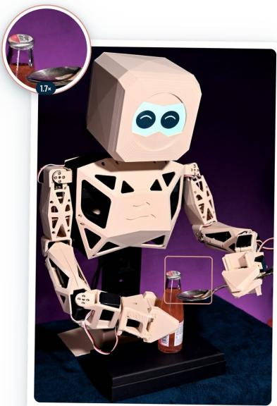
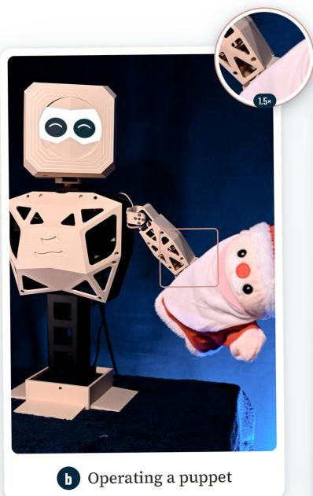
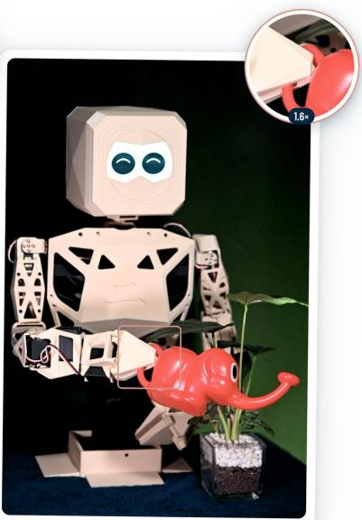
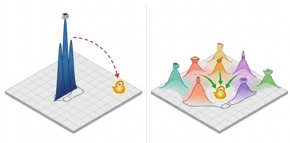
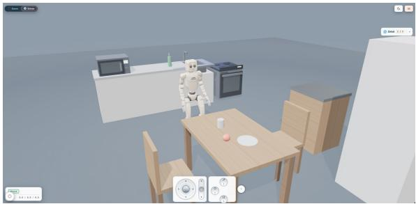
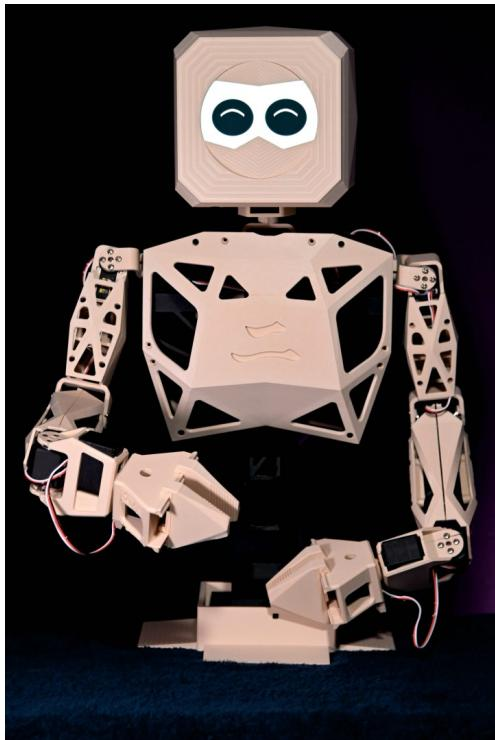
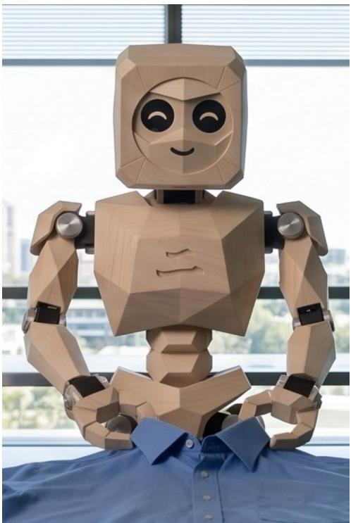
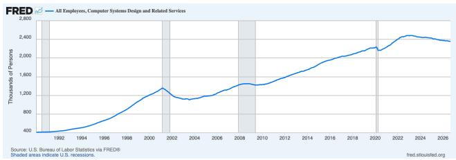
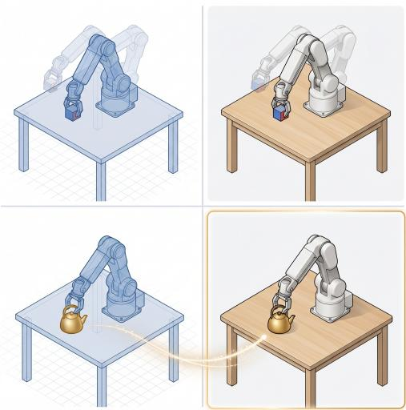

# Robot Generalization Beyond Volume: The Diversity Path via Zero-Shot capabilities

Rafael Felix runibiLABS

rafa.felix@runibi.ai

  
A spoon as a bottle opener

  
Watering an artificial plant

Figure 1. Examples of zero-shot generalization, shown on our desktop prototype. (a) Opening a bottle with a spoon: everyday human know-how that is rarely captured in images and, to our knowledge, absent from robot data. (b) Operating a puppet: expert skill with no robot data. (c) An elephant-shaped watering can and an artificial plant: a long-tail object combined with a semantic judgment, since the right outcome is to recognize that the plant needs no water. No single team can anticipate and collect such cases; a diverse community of developers brings them within reach.

## Abstract

General-purpose robots must handle tasks, objects and environments they were never trained on, yet zero-shot generalization remains one ofthe least solved problems in physical AI. In digital AI, zero-shot capability grew with the volume and, above all, the diversity of training data, much of it sourced from the crowd. Robotics instead relies on paid collection by afew well-funded teams, which yields volume without diversity. We formulate zero-shot generalization in physical AI as coverage of the deployment distribution, and show that more samplesfrom the same collectors shrink the unseen region only slowly, while each new contributor can extend it. Building on this and on zero-shot learning, we propose a shared latent space for robot actions that combines multi-modal alignment, generative augmentation, and noisy-label learning; As a scalable source of diverse data, we propose a community of developers building applications on one standard, approachable robot, Origami. We close with a testable hypothesis and an evaluation protocol relating real-robot zero-shot success to the diversity of contributed data.

## 1. Introduction

In recent years, several reports have projected strong growth for robotics through 2050. McKinsey estimates a \$370B general-purpose robotics market by 2040 [59], Japan has set a national target of 10 million AI robots by 2040 [64], and Morgan Stanley projects a \$5T humanoid market by 2050 [61]. These projections are driven by falling hardware costs, growing AI capabilities, and adoption that starts with developers and spreads through society. However, to achieve the true return on investment in physical AI, robot generalization is a major hurdle, and existing research has not yet found scalable solutions [4, 100].

The idea that an individual, on a given day, arrives home with a new appliance and hands it to their home robot, which has never seen the object before, is the promise of general-purpose robotics, as illustrated in Figure 1. A general autonomous system should be capable of inferring the new object’s affordances, selecting a suitable grasp, and completing tasks with it [3, 46]. Current robotic systems perform poorly at this capability, known as zero-shot generalization [4, 100]. Zero-shot generalization has been the target of extensive studies over the past decades in the field of digital AI such as computer vision [50, 93], large language models [8, 69], audio [71] and multi-modal learning [18, 20, 22]. We argue that it determines whether robots remain confined to controlled settings or become generalpurpose economic assets.

In digital AI, zero-shot generalization has progressed as a function of the volume and diversity of data [16, 18]. As illustrated in Figure 2 volume is the density with which each situation is represented in the latent space, and diversity is the footprint those situations cover. This mirrors a familiar result for Gaussian processes: posterior uncertainty shrinks only near observed inputs, so spreading samples across the input space reduces uncertainty far more than repeating them in one region [76]. Volume helps AI systems recognize patterns accurately, but diversity allows them to interpolate within the latent space and act on concepts they have never seen. Seminal research and industry efforts have demonstrated zero-shot capabilities in large language models (LLMs) [8, 47], computer vision [70], and other fields [32, 71]. Robotics has yet to show comparable zero-shot capability. Moreover, the problem of diversity has been largely overlooked, as industry and research efforts have prioritized demonstrations of robots performing single tasks [13, 98]. Industrial and early-stage robots are typically deployed for a single, repetitive task, and each new task requires reprogramming or new training data [6, 100]. A robot able to perform an array of tasks within the same facility, adapting to new parts, layouts and procedures, would amortize its cost across many functions and lower the integration cost of each new task. For instance, in a warehouse, a robot trained to pick a given type of product could take on new types of object, or develop new tasks. In elderly care, a robot that delivers meals could assist carers with preparing food, a new task with new handling demands [78]. Further examples of zero-shot settings are depicted in Figure 1,

In this paper, we propose a novel approach based on our prior work in zero-shot and noisy-label learning applied in physical AI. Our approach combines a crowd-sourced data collection with recent advances in zero-shot generalization, generative AI, learning from noisy labels and scalable trust and safety [18, 23, 28]. We argue that generalization will emerge from structured data acquisition combined with community-driven crowd-sourcing. This combination allows us to acquire large volumes of data safely, while widening the range of scenarios, objects, situations and environments far beyond what any single engineering team could cover. Unlike digital AI, robots must also transfer what they learn in simulation to the physical world, where simulation never fully matches reality, a challenge known as the sim-to-real gap [81, 99]. A community running the same robotic platform in both simulation and reality exposes that gap at scale, and provides the tools to close it.

The remainder of this paper is organized as follows. Section 2 reviews how digital AI reached zero-shot behavior, what builds a latent space, how each training stage has drawn on crowd-sourced data, and how learning from imperfect data can absorb noisy contributions. Section 3 presents our approach. We first formulate zero-shot generalization in physical AI as coverage of the deployment distribution, showing why more data from the same collectors closes the gap only slowly, while each new contributor can widen it. We then describe a shared latent space for robot actions built from multi-modal alignment, generative augmentation, and noisy-label and uncertainty learning, in which safety is part of the space from pre-training onward and seen/unseen detection lets the robot hand control to a human (Section 3.2). Real2Sim2Real treats simulation and reality as noisy teachers of each other across a community running the same robot (Section 3.3), and a community of developers building on one standard, approachable robot provides the data, with a cost model for each contributed hour (Section 3.4). Section 4 sets out a testable hypothesis and evaluation protocol relating real-robot zero-shot success to the diversity of contributed data. Section 5 discusses limitations and open questions, and Section 6 concludes.

## 2. Related Work

This section reviews the topics that form the foundations of our approach: zero-shot capabilities, latent spaces, scaling laws, trust and safety and imperfect crowd-sourced data.

## 2.1. Zero-shot capabilities

Zero-shot capabilities are essential for online platforms such as TikTok and Instagram, where new harmful trends and content designed to evade guidelines emerge faster than training data can be collected [33, 55, 60], much as a home robot meets objects it was never trained on. Beyond trust and safety, modern LLM chatbots and their applications also extend well beyond their training data [47]. Where collecting training data would be prohibitive, dangerous or unethical, zero-shot learning is, to the best of our knowl edge, the most prominent set of techniques available [86]. It allows AI models to reason about unseen circumstances by associating them with prior knowledge embedded in their latent space [93]. Over the past decades, the field has moved through three eras. Early methods described classes by hand-defined attributes, so an unseen class could be recognized from its description [50]. Deep learning re placed hand-made descriptions with learned ones, includ ing generative models that synthesize examples of unseen classes [18, 92], alongside methods robust to imperfect labels [28]. The GPT era turned zero-shot from a research benchmark into everyday behavior: large language models performed new tasks from a prompt alone [8], instruction tuning made that ability reliable across unseen tasks [87], and human feedback aligned it with what people actually ask for [68]. Vision-language models such as CLIP extended it to images [70], and early robot models have begun transferring this web-scale knowledge to physical actions [7]. Despite this progress in digital AI, comparatively little research has addressed zero-shot generalization in robotics. Recent robot foundation models show impressive results on the tasks and settings they were trained for, yet their performance still drops sharply when the task or environment is genuinely new [4, 100]. Applied directly to robots, the zero-shot toolkit of digital AI falls short, but it points to a clear pathway. Across all three eras, one principle holds: a model handles the unseen only when its latent space is rich enough to place it, solving new cases by interpolating within that space.

## 2.2. What builds a latent space

In the latent space, AI models build representations of concepts of the world. The more diverse the latent space, the more generalizable it becomes [16, 49, 80]. Representation quality is what learning ultimately depends on [5], zero-shot performance tracks how well the embedding space covers unseen classes [93], and CLIP zero-shot transfer improved as its training data grew broader [16].

In physical AI, no single method yet controls a robot end to end; a working system layers several. Classical control and engineering handle sensing and low-level loops [66]. Reinforcement learning, trained largely in simulation, teaches basic motor skills such as balancing, reaching, and locomotion, effectively learning motor control from experience [74, 75]. Vision-language-action (VLA) models inherit a web-scale latent space and use it to orchestrate those skills from visual and linguistic context [6, 7, 46, 65, 66]. How they connect to the body is still open: some systems map VLA outputs directly to actuators [6], while others have the VLA call lower-level policies, so it never commands the actuators itself, which limits risk [3]. World models add a further layer: they learn a latent representation of how the world changes, so a robot can imagine several ways of completing a task, predict the outcome of each, and choose the most promising before acting [35, 36, 62, 97]. The architecture of physical AI is therefore far from settled.

  
Figure 2. Volume makes each skill reliable; diversity determines whether a new task falls within reach. A robot trained on one team’s data cannot place an unfamiliar kettle in an unfamiliar kitchen. A robot trained on diverse community data reaches it by combining skills it already has.

Despite their progress, a systematic link between these paradigms and zero-shot generalization has yet to be established: each builds a latent space, but none addresses how the diversity of that space is sourced. Furthermore, when building foundational latent spaces, two patterns are often observed: (1) pre-training models follow scaling laws for general world contextual understanding, and (2) once pretrained, these models require expert-level annotation for supervised fine-tuning stages [43, 68].

## 2.3. Scaling laws and Noisy-labels from crowdsource data

Training data for AI has come from people in three distinct ways.

Community-driven data is produced by people pursuing their own goals and becomes training data as a by product, so its diversity grows with the number of people taking part [8, 48]. Crowd-sourced data is produced by paid workers executing tasks someone else designed, which scales and offers control but reflects its designers choices [1, 15, 57, 68]. Specialized data is produced by trained experts, in robotics mostly teleoperators on the target hardware, which matches the robot’s embodiment but is the most expensive per sample and concentrated in a few teams [24, 79].

Each training stage has drawn on a different form of crowd-sourcing. Pre-training, governed by scaling laws, needs volume and diversity: language models found both in text written by people all over the world as a by-product of everyday use [8, 72]. Supervised fine-tuning needs expert, high-signal data: it came from paid annotators [68] and, increasingly, from volunteer communities [48]. Table 1 compares these sources with the workarounds robotics uses today.

These sources differ in cost, scale and diversity. Paid crowd-sourcing, from annotation micro-tasks [15] to paid robot teleoperation [57], offers control, but its cost grows with every sample and its coverage reflects its designers. Volunteer communities scale with shared motivation. Data generated as a by-product of use, as in games with a purpose [14, 85], scales with the number of people who want to take part. The common response is that robotics simply lacks data volume. We agree, but how data is collected determines what it contains: paid collection by a few teams yields volume without diversity for pre-training, and expensive, narrow expertise for fine-tuning. Language models, by contrast, sourced each stage from the crowd. A further barrier is hardware. Robots are expensive for companies to lend to collectors and expensive for annotators to buy, so collection stays concentrated in a few wellfunded teams. Workarounds that avoid robots altogether, such as egocentric human video, lower the cost but introduce an embodiment gap: human hands and viewpoints differ from a robot’s, which limits how well the data transfers [34, 44]. Robotics relies largely on paid collection for both stages. Companies have raised substantial capital [25], with teleoperation and egocentric data collection a major cost [2, 24, 79], yet their models still need new demonstrations for each new task [6, 100]. A notable exception is the LeRobot community, whose contributed datasets on the low-cost SO-100 arm were used to pre-train SmolVLA [11, 77]. These open tools, however, are built for research speed: they evolve quickly, often without backward compatibility, and favor rapid experimentation over the stability needed to build reliable applications. Their community data is a by-product of writing papers, not of solving everyday problems, so it stays concentrated on the tasks researchers choose to study. Our approach differs in where contributions come from: a community of developers building applications on one stable, standard robot and platform, whose data reflects the problems they actually need to solve.

Crowd-sourced data is never clean. In classification, learning with noisy labels has developed methods that select likely-clean samples during training [39, 51], model noise that depends on each instance rather than on its class alone [28, 91], and estimate how much noise a dataset contains [29, 31]. In robot learning, the quality of demonstrations matters as much as their quantity: policies trained on demonstrations from operators of mixed skill perform markedly worse than those trained on proficient operators alone [58]. Imitation methods have so far handled this mainly by filtering, discarding low-quality demonstrations [1, 58]. Filtering protects performance but discards diversity, and for zero-shot generalization diversity is the scarcer resource. We therefore treat imperfect demonstrations as noisy labels to be weighted rather than discarded (Section 3.2).

## 2.4. Trust and Safety in Physical AI

Most robot safety work today addresses collision avoidance, joint limits, and grasp force [9, 40, 95], and treats broader safe behavior as a layer added after pre-training: a foundation model is trained to act, then fine-tuned on examples of what unsafe means [42, 96]. This leaves two questions open. First, how can a robot avoid unsafe behavior in situations for which no data can ethically or practically be collected? Second, why is safety absent from the stage where the latent space is formed? Both are zeroshot problems, and the same foundations address them. Rare or dangerous situations can be generated rather than staged, so the robot learns them without putting anyone at risk [22, 42, 94]. The robot should also recognize when it has left familiar ground: building on generalized zeroshot learning with domain classification, which separates seen from unseen inputs [19, 22], and on estimating out-ofdistribution noise [31], it can detect when a situation falls in $S _ { \mathrm { u n s e e n } }$ and stop or hand control to a human through teleoperation.

## 3. Building a Zero-Shot Foundational Latent Space

## 3.1. Problem Formulation

A deployed robot meets a stream of situations, each a combination of its own state, the task it is asked to do, and the world around it, so a familiar task in an unfamiliar kitchen is already a new situation. Because these elements combine, the space of situations is vast and long-tailed: most situations are individually rare, yet together they make up a large share of what a robot meets in practice [17, 54]. We define zero-shot generalization as the robot’s success on situations its training data never covered, and it depends on two properties of that data. Volume makes the robot reliable on the situations the data covers; diversity decides which situations are covered at all (Fig. 2). Today’s collection supplies volume but little diversity, because a few teams collect in the settings they can foresee and access. Each new contributor brings a setting no one else has and reaches situations the others cannot, and the rarer a situation, the more contributors it takes to reach it. Diversity is therefore a requirement alongside volume, and it scales with the number of contributors. A formal treatment is given in Supplementary

<table><tr><td>Source</td><td>Cost / hour</td><td>Diversity</td><td>Embodiment</td><td>Scales with</td></tr><tr><td>Paid teleoperation</td><td>High</td><td>Low</td><td>Match</td><td>Budget</td></tr><tr><td>Egocentric human video</td><td>Very low</td><td>High</td><td>Gap</td><td>Budget</td></tr><tr><td>Simulation only</td><td>Low</td><td>Designed</td><td>Sim gap</td><td>Compute</td></tr><tr><td>Research community</td><td>Low</td><td>Medium</td><td>Match</td><td>Papers</td></tr><tr><td>Developer community (ours)</td><td>Low</td><td>High</td><td>Match</td><td>Users</td></tr></table>

Table 1. Sources of robot training data. Diversity is how widely a source covers situations in $P _ { \mathrm { w o r l d } } ;$ embodiment is whether the data comes from the robot that will use it. Only a developer community scales with the number of people solving their own problems on the target robot.

## Section 7.

## 3.2. Zero-Shot Generalization Through a Shared Latent Space

Zero-shot capability benefits from a mixture of models to meet in a common representation [32, 63, 69, 70]. We therefore build a shared latent space for robot actions. The space is not tied to a single architecture: policies learned through reinforcement learning, vision-language-action models, and world models can all draw on it, whether they are realized as one model or several. We build this space from three complementary principles.

Alignment across modalities. Multi-modal alignment places vision, language, and the robot’s own state and actions in one space, so a task described in words can connect to actions never demonstrated in that exact form [7, 20, 21, 63, 70]. Cross-modal learning then carries knowledge between modalities, for example from a task description to an action, or from one contributor’s setting to others [18, 23].

Augmentation. Generative models synthesize variations of contributed data, such as new objects, layouts, and conditions, filling the gaps between what contributors recorded [18, 22, 92, 94].

Learning from imperfect data and uncertainty. Contributions vary in quality. Noisy-label learning lets the space absorb imperfect demonstrations without discarding the diversity they bring [28–30]. Bayesian uncertainty learning separates noise in the data from gaps in the model’s knowledge [27, 45].

Safety from pre-training onward. Physical AI needs the same capability developed for digital AI, at higher stakes: an error is an action in the world, not a digital asset that can be taken down. We carry these tools into the shared latent space in three ways. First, rare or dangerous situations are synthetically generated rather than staged and enter training alongside contributed data [94]. Second, seen/unseen detection [19] and out-of-distribution noise estimation [31] operate on the same representation the policy acts from, so when a situation falls in $S _ { \mathrm { u n s e e n } }$ the robot stops or hands control to a human through teleoperation. Third, high-level models call validated lower-level policies rather than commanding low level components directly, a layer the shared latent space can inform but not bypass [52, 84]. Placing these signals in the shared latent space, rather than in a separate filter, makes safety a property of what the robot has learned.

Every layer of this stack is developed first in simulation: a policy that does not perform well there is never deployed on hardware. Yet a policy that succeeds in simulation often fails on the real robot, because real physics, sensing, wear, and noise differ from what the simulator models [67, 99], as illustrated on Figure 3. This sim-to-real gap is not a weakness of zero-shot methods themselves; it affects any learning-based robot. It does, however, block zero-shot generalization in practice: a robot cannot solve an unseen task in the real world if what it learned does not survive the move from simulation.

## 3.3. Closing the Sim-to-Real Gap with Real2Sim2Real

Robots improve fastest when learning moves freely between simulation and the physical world: real deployments calibrate the simulation, and simulation lets new behaviors be trained and tested before they reach the real robot [12, 82]. We build this loop on a hardware platform fully integrated with a software platform for task training, designed for fast iteration between the two.

Two components of this platform are in progress. First, a training platform where developers teach the robot through demonstration, design their own policies, and set challenges that test what the robot can do (Figure 3). Second, Origami, an approachable robot designed to be safe and to let each developer progress at their own pace (Figure 4, and Figure 5).

Developers therefore run the same robot on the same platform; each deployment shows where simulation and reality differ, and each correction improves the digital twin for everyone. Neither simulation nor reality is a perfect label. Building on instance-dependent noisy-label learning [28], we treat each as a noisy teacher of the other, so robots learn what holds in both.

Origami is designed for a gap in today’s hardware (Figure 4), with specs described in Table 2. Programmable research platforms remain expensive: even systems built explicitly to be low-cost sit at \$18-32k [26, 98], and commercial mobile manipulators such as the PR2 and TIAGo can exceed \$200k [26]. This limits most laboratories to a handful of robots and puts them out of reach for individual developers, especially outside well-funded institutions. At the other end, open printable arms cost under \$1,000 and have built an active community [11, 77]. These projects, however, tend to focus on one layer of the stack: developers work directly at the actuator level, without a stable control layer, safety protocols, or reliable compatibility with standard robotics middleware [56], and a policy trained for one task rarely carries over to the next [100]. Origami targets the space between the two: a robot approachable enough for an individual developer, and stable enough to build applications on.

<table><tr><td></td><td>Origami Desktop</td><td>Origami Premium</td></tr><tr><td>DoF</td><td>14 (neck 2, arms 6 each)</td><td>27 (neck 3, arms 7, legs 5 each)</td></tr><tr><td>Size / mass</td><td>57 cm, 2.8 kg (upper body)</td><td>~110 cm, ≈18–25 kg</td></tr><tr><td>Manipulation</td><td>2×6-DoF arms, 1-DoF grippers</td><td>2×7-DoF arms, 1-DoF grippers, 600 g payload</td></tr><tr><td>Locomotion</td><td>Stationary</td><td>Bipedal walking</td></tr><tr><td>Sensing</td><td>Camera, IMU, Joint position and load</td><td>3 wide cameras (head, chest, hand), IMU, per-actuator position, current, temperature</td></tr><tr><td>Actuation</td><td>Smart servos</td><td>Quasi-direct-drive</td></tr><tr><td>Compute</td><td>Single-board computer</td><td>AI compute module + real-time controller</td></tr><tr><td>Interaction</td><td>5′ touch face</td><td>5&quot; touch face, 4-mic array, speakers</td></tr><tr><td>Safety</td><td>12 V tethered</td><td>Battery, e-stop, current/temperature monitoring</td></tr><tr><td>Software</td><td>Record &amp; replay, browser twin</td><td>+ teleoperation, learned policies, SDK</td></tr></table>

Table 2. Origami specifications. Humanoid values are design targets and may change.

  
Figure 3. The training platform in an online environment: teaching by demonstration, designing policies, and setting challenges.

## 3.4. A Community-Built Latent Space

Developers already contribute freely when the work matters to them: Wikipedia [88], OpenStreetMap [37], Hugging Face [41], and many other initiatives. Our approach leverages that energy with a shared robot and a shared platform, with paid annotators adding a quality layer whenever expert labels are needed.

The demand for robotic engineers is approaching an inflection point. As robotics shifts from single-task industrial arms into multi-modal foundation models and humanoids, the field faces a strong demand for talent [38]. In past decades, US employment in computer systems design grew roughly 6× between 1990 and 2023 (Fig. 6) [83], and global expansion mirrors this trend. However, the World Economic Forum projects structural labor churn of 22% through 2030, with AI/ML specialists and robotics engineers ranking among the fastest-growing job titles globally [89, 90]. Building a developer-first platform provides the shared infrastructure and hardware access where this next generation of physical AI builders learns, iterates, and deploys.

  
Figure 4. Origami Desktop: an upper-body platform with 14 DoF that learns by record-and-replay and has a browser twin for training before deployment.

  
Figure 5. Origami goal: a 27-DoF bipedal humanoid with multiview sensing and on-board AI compute. Specifications are design targets.

  
Figure 6. Growth of all employees in computer system design and related services from 1990 to 2023 in the US.

This changes the cost of data. Paid robotic data costs roughly \$50–\$200 per hour [25, 73]. On our proposed platform, developers contribute data as a by-product of solving their own problems, so the cost of a contributed hour is set by acquisition and retention rather than by labor: it is the cost of acquiring one developer divided by the usable hours that developer contributes over their time on the platform. At an estimated acquisition cost of \$3.5 per developer, a single usable hour already brings the cost to about \$3.5 per hour, roughly 30× below paid teleoperation, and every further hour a developer contributes lowers it again [10].

From platform to training data. Contributions are captured through the platform’s task interface. Each task states a goal, such as stacking, sorting, or handing over an object, but not how to achieve it: the developer decides the strategy, the grasp, and the sequence. Different contributors therefore solve the same task in different ways, which adds diversity to the actions themselves, not only to the objects and settings. Challenges set by one developer become tasks for others, so the task distribution grows with the community rather than with our team’s foresight. Every session is recorded with its outcome, including partial and failed attempts, which are informative about where policies break. Before contributed data enters training, it passes through three stages: automatic checks for corrupted or physically implausible trajectories, noise-aware weighting of the remaining demonstrations (Section 3.2), and expert review for a sampled subset. Finally, the same infrastructure built for community-driven data also serves crowd-sourced annotation and specialized teleoperation.

## 4. Hypothesis and Evaluation Protocol

## 4.1. Hypothesis

Each component needed for a foundational latent space for zero-shot robotics has been demonstrated separately: affordable robots and open tooling have lowered the barrier to building with robots [11, 56]; generative zero-shot learning and noisy-label learning provide the methods [18, 28]; large open robot datasets show that pooled, diverse data transfers [66]; and communities have built training data before [1, 48, 77]. What has not yet been done is to bring these components together on one platform and test whether contributor diversity, rather than data volume alone, drives zero-shot success on real robots. We state this as our central hypothesis:

Hypothesis 1 (Diversity over volume). At afixed number of training samples, real-robot zero-shot success $G _ { z s }$ increases with the number of distinct contributors, environments and objects in the training set, and increases more than adding the same number ofsamplesfrom existing contributors.

The rest of this section sets out how we test it. We measure progress along two axes. Zero-shot generalization is the goal: success on tasks, objects and environments the robot never trained on. Sim-to-real transfer is the enabler: how much of a policy’s performance in simulation carries over to the real robot on the same task. The strongest result sits where the two meet: an unseen task, solved on the real robots, as illustrated in Figure 7.

We are establishing a baseline on the Origami platform, in simulation and on the physical robot, using a benchmark of tasks defined by our team and extended through community contributions. Each benchmark task is held out from training for at least one evaluation, so seen and unseen performance can be compared directly. Our central hypothesis is that zero-shot success on the real robot increases with the diversity of contributed data, measured by the number of distinct contributors, environments and objects in the training set. Support for Hypothesis 1 already exists in robot manipulation, where generalization follows a power law in environment and object diversity [53]. We further expect sim-to-real transfer to improve as the contributor base grows, since each real deployment exposes a new gap between simulation and reality (Section 3.3). We will report both measures as the community expands.

  
Figure 7. Columns: simulation (left) and real robot (right). Rows: seen task (top) and unseen task (bottom). The target is the highlighted quadrant: an unseen task solved on the real robot using knowledge built largely in simulation.

## 4.2. Evaluation protocol

We split the benchmark along the three components of a situation $\boldsymbol { s } = ( \boldsymbol { x } , \tau , w )$ , giving four held-out conditions of increasing difficulty: an unseen object in a seen environment, an unseen environment for a seen task, an unseen task in a seen environment, and an unseen combination of task and environment. For each condition we report success rate in simulation and on the real robot. We estimate $G _ { \mathrm { z s } }$ as the average success over held-out conditions, weighted by how often each appears in a sample of deployment requests from the community. We measure sim-to-real transfer as the ratio of real to simulated success on the same task. To test the central hypothesis, we train on nested subsets of contributed data that hold the total number of samples fixed while varying the number of contributors, environments, and objects. If diversity matters more than volume, $G _ { \mathrm { z s } }$ should rise with the number of contributors at a fixed data budget, following the trend reported for manipulation [53], while adding samples from the same contributors should yield smaller gains.

## 5. Limitations and Open Questions

Our proposal rests on assumptions that remain to be tested. Consent and data rights: contributed sessions must be collected with explicit consent and clear terms on how they are used, retained, and deleted; trust is a precondition for the community, not a by-product of it. Quality: community data varies in skill and care; noisy-label learning reduces but does not remove the need for validation, and expert annotation remains necessary for some stages. Simulation bias: most contributions will begin in simulation, so gains in zero-shot success may not transfer until Real2Sim2Real closes enough of the gap. Coverage bias: a developer community is not the world; contributors may cluster in certain regions, languages, and settings, leaving parts of $P _ { \mathrm { w o r l d } }$ uncovered. Retention: the cost advantage depends on developers staying active, which our hypothesis does not guarantee. We will report on each of these as the community grows.

## 6. Conclusions

This paper proposed a path to zero-shot generalization in physical AI built on two pieces: a community of developers working on one standard, approachable robot, and a shared latent space that turns their varied contributions into knowledge the robot can reuse. The space combines multi-modal alignment, generative augmentation and learning from imperfect data. Together, they let a robot handle situations it was never trained on.

Generalization is what turns a robot from a single-task machine into an economic asset. We argued that what robotics lacks is not volume but diversity: it has begun to scale the amount of data, but not the range of situations that data covers. Diversity grows with the number of independent contributors rather than with the size of a few paid teams. Our platform also serves a second function: developers who contribute data acquire hands-on experience with physical AI systems, so the community that supplies diverse data simultaneously develops the workforce the field requires.

Finally, a growing wave of developers wants to learn and build with robots. We argue that this community, working on a shared robot and solving its own problems, is the most sustainable source of the diversity zero-shot generalization requires. Without such a source, robotics risks remaining a field of single-task machines while its economic and social potential stays out of reach.

## Acknowledgments

We thank Flavia Yanase for the market analysis, the data-annotation cost estimates, and the community-acquisition strategy that underpin the data-collection model in Section 3.4.

## References

[1] Ayush Agarwal, Ansh Gandhi, Jeremy A. Collins, Omar Rayyan, Aryan Sarswat, Ranjani Koushik, Masoud Moghani, Ajay Mandlekar, and Animesh Garg. COBALT: Crowdsourcing robot learning via cloud-based teleoperation with smartphones. arXiv preprint arXiv:2605.19138, 2026. 3, 4, 7

[2] Agence France-Presse. Photos: India’s workers are training AI robots to take their jobs. Al Jazeera, 2026. 4

[3] Michael Ahn, Anthony Brohan, Noah Brown, Yevgen Chebotar, et al. Do as I can, not as I say: Grounding language in robotic affordances. In Conference on Robot Learning (CoRL), 2022. 2, 3

[4] Sumeet Batra and Gaurav Sukhatme. Zero-shot visual generalization in robot manipulation. arXiv preprint arXiv:2505.11719, 2025. 2, 3

[5] Yoshua Bengio, Aaron Courville, and Pascal Vincent. Representation learning: A review and new perspectives. IEEE Transactions on Pattern Analysis and Machine Intelligence, 35(8):1798–1828, 2013. 3

[6] Kevin Black, Noah Brown, Danny Driess, Adnan Esmail, Michael Equi, Chelsea Finn, et al. π0: A vision-languageaction flow model for general robot control. arXiv preprint arXiv:2410.24164, 2024. 2, 3, 4

[7] Anthony Brohan, Noah Brown, Justice Carbajal, Yevgen Chebotar, et al. RT-2: Vision-language-action models transfer web knowledge to robotic control. In Conference on Robot Learning (CoRL), 2023. 3, 5

[8] Tom B. Brown, Benjamin Mann, Nick Ryder, Melanie Subbiah, et al. Language models are few-shot learners. In Advances in Neural Information Processing Systems (NeurIPS), pages 1877–1901, 2020. 2, 3, 4

[9] Lukas Brunke, Yanni Zhang, Ralf Romer, Jack Naimer,¨ Nikola Staykov, Siqi Zhou, and Angela P. Schoellig. Semantically safe robot manipulation: From semantic scene understanding to motion safeguards. arXiv preprint arXiv:2410.15185, 2024. 4

[10] Business of Apps. Cost per install (CPI) benchmarks and rates. https://www.businessofapps.com/ads/ cpi/research/cost-per-install/, 2024. Accessed: 2026-10-21. 7

[11] Remi Cadene, Simon Alibert, Alexander Soare, Quentin Gallouedec, Adil Zouitine, and Thomas Wolf. LeRobot: State-of-the-art machine learning for real-world robotics in PyTorch, 2024. 4, 6, 7

[12] Yevgen Chebotar, Ankur Handa, Viktor Makoviychuk, Miles Macklin, Jan Issac, Nathan Ratliff, and Dieter Fox. Closing the sim-to-real loop: Adapting simulation randomization with real world experience. In IEEE International Conference on Robotics and Automation (ICRA), 2019. 5

[13] Cheng Chi, Siyuan Feng, Yilun Du, Zhenjia Xu, Eric Cousineau, Benjamin Burchfiel, and Shuran Song. Diffusion policy: Visuomotor policy learning via action diffusion. In Robotics: Science and Systems (RSS), 2023. 2

[14] Seth Cooper, Firas Khatib, Adrien Treuille, Janos Barbero, Jeehyung Lee, Michael Beenen, Andrew Leaver-Fay, David Baker, Zoran Popovic, and Foldit players. Predicting pro-´ tein structures with a multiplayer online game. Nature, 466: 756–760, 2010. 4

[15] Jia Deng, Wei Dong, Richard Socher, Li-Jia Li, Kai Li, and Li Fei-Fei. ImageNet: A large-scale hierarchical image database. In Proceedings of the IEEE Conference on Computer Vision and Pattern Recognition (CVPR), pages 248–255, 2009. 3, 4

[16] Alex Fang, Gabriel Ilharco, Mitchell Wortsman, Yuhao Wan, Vaishaal Shankar, Achal Dave, and Ludwig Schmidt. Data determines distributional robustness in contrastive language image pre-training (CLIP). In Proceedings of the International Conference on Machine Learning (ICML), pages 6216–6234, 2022. 2, 3

[17] Vitaly Feldman. Does learning require memorization? A short tale about a long tail. In Proceedings of the 52nd Annual ACM SIGACT Symposium on Theory of Computing (STOC), pages 954–959, 2020. 4, 1

[18] Rafael Felix, B. G. Vijay Kumar, Ian Reid, and Gustavo Carneiro. Multi-modal cycle-consistent generalized zeroshot learning. In European Conference on Computer Vision (ECCV), 2018. 2, 3, 5, 7

[19] Rafael Felix, Ben Harwood, Michele Sasdelli, and Gustavo Carneiro. Generalised zero-shot learning with domain classification in a joint semantic and visual space. In Digital Image Computing: Techniques and Applications (DICTA), pages 1–8, 2019. 4, 5

[20] Rafael Felix, Michele Sasdelli, Ian Reid, and Gustavo Carneiro. Multi-modal ensemble classification for generalized zero shot learning. arXiv preprint arXiv:1901.04623, 2019. 2, 5

[21] Rafael Felix, Michele Sasdelli, Ben Harwood, and Gustavo Carneiro. Generalised zero-shot learning with multi-modal embedding spaces. In Digital Image Computing: Techniques and Applications (DICTA), pages 1–8, 2020. 5

[22] Rafael Felix, Michele Sasdelli, Ian Reid, and Gustavo Carneiro. Augmentation network for generalised zero-shot learning. In Proceedings ofthe Asian Conference on Computer Vision (ACCV), 2020. 2, 4, 5

[23] Rafael Felix, Boris Repasky, Samuel Hodge, Reza Zolfaghari, Ehsan Abbasnejad, and Jamie Sherrah. Crossmodal visual question answering for remote sensing data: The international conference on digital image computing: Techniques and applications (dicta 2021). In 2021 Digital Image Computing: Techniques and Applications (DICTA), pages 1–9. IEEE, 2021. 2, 5

[24] Tim Fernholz. Collecting robot training data is dirty, unglamorous work. Some AI labs are already paying xdof to do it. TechCrunch, 2026. 3, 4

[25] Figure AI. Introducing index: Building the world’s largest and most diverse physical dataset, 2026. Accessed: 2026- 10-21. 4, 7

[26] Zipeng Fu, Tony Z. Zhao, and Chelsea Finn. Mobile ALOHA: Learning bimanual mobile manipulation using low-cost whole-body teleoperation. In Conference on Robot Learning (CoRL), pages 4066–4083, 2024. 6

[27] Yarin Gal and Zoubin Ghahramani. Dropout as a Bayesian approximation: Representing model uncertainty in deep learning. In Proceedings of the International Conference on Machine Learning (ICML), pages 1050–1059, 2016. 5

[28] Arpit Garg, Cuong Nguyen, Rafael Felix, Thanh-Toan Do, and Gustavo Carneiro. Instance-dependent noisy label learning via graphical modelling. In Proceedings of the IEEE/CVF Winter Conference on Applications of Computer Vision (WACV), 2023. 2, 3, 4, 5, 7

[29] Arpit Garg, Cuong Nguyen, Rafael Felix, Thanh-Toan Do, and Gustavo Carneiro. Instance-dependent noisy-label learning with graphical model based noise-rate estimation. In European Conference on Computer Vision (ECCV), 2024. 4

[30] Arpit Garg, Cuong Nguyen, Rafael Felix, Thanh-Toan Do, and Gustavo Carneiro. PASS: Peer-agreement based sample selection for training with noisy labels. Image and Vision Computing, page 105432, 2025. 5

[31] Arpit Garg, Cuong Nguyen, Rafael Felix, Yuyuan Liu, Thanh-Toan Do, and Gustavo Carneiro. AEON: Adaptive estimation of instance-dependent in-distribution and out-ofdistribution label noise for robust learning. arXiv preprint arXiv:2501.13389, 2025. 4, 5

[32] Rohit Girdhar, Alaaeldin El-Nouby, Zhuang Liu, Mannat Singh, Kalyan Vasudev Alwala, Armand Joulin, and Ishan Misra. ImageBind: One embedding space to bind them all. In Proceedings of the IEEE/CVF Conference on Computer Vision and Pattern Recognition (CVPR), 2023. 2, 5

[33] Janis Goldzycher and Gerold Schneider. Hypothesis engineering for zero-shot hate speech detection. arXiv preprint arXiv:2210.00910, 2022. 3

[34] Kristen Grauman, Andrew Westbury, Eugene Byrne, et al. Ego4D: Around the world in 3,000 hours of egocentric video. In Proceedings of the IEEE/CVF Conference on Computer Vision and Pattern Recognition (CVPR), 2022. 4

[35] David Ha and Jurgen Schmidhuber. World models.¨ arXiv preprint arXiv:1803.10122, 2018. 3

[36] Danijar Hafner, Jurgis Pasukonis, Jimmy Ba, and Timothy Lillicrap. Mastering diverse domains through world models. arXiv preprint arXiv:2301.04104, 2023. 3

[37] Mordechai Haklay and Patrick Weber. OpenStreetMap: User-generated street maps. IEEE Pervasive Computing, 7(4):12–18, 2008. 6

[38] Matt Hamblen. Why OpenAI is paying robotics engineers \$325K. Fierce Sensors, 2026. Published 10 August 2026. 6

[39] Bo Han, Quanming Yao, Xingrui Yu, Gang Niu, Miao Xu, Weihua Hu, Ivor Tsang, and Masashi Sugiyama. Coteaching: Robust training of deep neural networks with extremely noisy labels. In Advances in Neural Information Processing Systems (NeurIPS), 2018. 4

[40] Songqiao Hu, Zeyi Liu, Shuang Liu, Jun Cen, Zihan Meng, and Xiao He. VLSA: Vision-language-action models with plug-and-play safety constraint layer. arXiv preprint arXiv:2512.11891, 2025. 4

[41] Hugging Face. Hugging Face Hub, 2026. 6

[42] Abhishek Jindal, Dmitry Kalashnikov, R. Alex Hofer, Oscar Chang, Divya Garikapati, Anirudha Majumdar, Pierre Sermanet, and Vikas Sindhwani. Can AI perceive physical danger and intervene? arXiv preprint arXiv:2509.21651, 2025. 4

[43] Jared Kaplan, Sam McCandlish, Tom Henighan, Tom B. Brown, Benjamin Chess, Rewon Child, Scott Gray, Alec Radford, Jeffrey Wu, and Dario Amodei. Scaling laws for neural language models. arXiv preprint arXiv:2001.08361, 2020. 3

[44] Simar Kareer, Dhruv Patel, et al. EgoMimic: Scaling imitation learning via egocentric video. arXiv preprint arXiv:2410.24221, 2024. 4

[45] Alex Kendall and Yarin Gal. What uncertainties do we need in Bayesian deep learning for computer vision? In Advances in Neural Information Processing Systems (NeurIPS), 2017. 5

[46] Moo Jin Kim, Karl Pertsch, Siddharth Karamcheti, Ted Xiao, Ashwin Balakrishna, Suraj Nair, Rafael Rafailov, Ethan Foster, Grace Lam, Pannag Sanketi, et al. OpenVLA: An open-source vision-language-action model. In Confer ence on Robot Learning (CoRL), 2024. 2, 3

[47] Takeshi Kojima, Shixiang Shane Gu, Machel Reid, Yutaka Matsuo, and Yusuke Iwasawa. Large language models are zero-shot reasoners. In Advances in Neural Information Processing Systems (NeurIPS), 2022. 2, 3

[48] Andreas Kopf, Yannic Kilcher, Dimitri von R¨ utte, Sotiris¨ Anagnostidis, et al. OpenAssistant conversations – democratizing large language model alignment. In Advances in Neural Information Processing Systems (NeurIPS), Datasets and Benchmarks Track, 2023. 3, 4, 7

[49] Simon Kornblith, Jonathon Shlens, and Quoc V. Le. Do better ImageNet models transfer better? In Proceedings of the IEEE/CVF Conference on Computer Vision and Pattern Recognition (CVPR), pages 2661–2671, 2019. 3

[50] Christoph H. Lampert, Hannes Nickisch, and Stefan Harmeling. Learning to detect unseen object classes by between-class attribute transfer. In Proceedings of the IEEE Conference on Computer Vision and Pattern Recognition (CVPR), pages 951–958, 2009. 2, 3

[51] Junnan Li, Richard Socher, and Steven C. H. Hoi. DivideMix: Learning with noisy labels as semi-supervised learning. In International Conference on Learning Repre sentations (ICLR), 2020. 4

[52] Siyuan Li, Zhe Ma, Feifan Liu, Jiani Lu, Qinqin Xiao, Kewu Sun, Lingfei Cui, Xirui Yang, Peng Liu, and Xun Wang. Safe planner: Empowering safety awareness in large pre-trained models for robot task planning. arXiv preprint arXiv:2411.06920, 2024. 5

[53] Fanqi Lin, Yingdong Hu, Pingyue Sheng, Chuan Wen, Jiacheng You, and Yang Gao. Data scaling laws in imitation learning for robotic manipulation. In International Confer ence on Learning Representations (ICLR), 2025. 8

[54] Ziwei Liu, Zhongqi Miao, Xiaohang Zhan, Jiayun Wang, Boqing Gong, and Stella X. Yu. Large-scale long-tailed recognition in an open world. In Proceedings of the IEEE/CVF Conference on Computer Vision and Pattern Recognition (CVPR), 2019. 4, 1

[55] Ziyan Liu, Chunxiao Fan, Haoran Lou, Yuexin Wu, and Kaiwei Deng. MIND: A multi-agent framework for zero-shot harmful meme detection. arXiv preprint arXiv:2507.06908, 2025. 3

[56] Steven Macenski, Tully Foote, Brian Gerkey, Chris Lalancette, and William Woodall. Robot operating system 2: Design, architecture, and uses in the wild. Science Robotics, 7(66):eabm6074, 2022. 6, 7

[57] Ajay Mandlekar, Yuke Zhu, Animesh Garg, Jonathan Booher, Max Spero, Albert Tung, Julian Gao, John Emmons, Anchit Gupta, Emre Orbay, Silvio Savarese, and Li Fei-Fei. RoboTurk: A crowdsourcing platform for robotic skill learning through imitation. In Conference on Robot Learning (CoRL), 2018. 3, 4

[58] Ajay Mandlekar, Danfei Xu, Josiah Wong, Soroush Nasiriany, Chen Wang, Rohun Kulkarni, Li Fei-Fei, Silvio Savarese, Yuke Zhu, and Roberto Mart´ın-Mart´ın. What matters in learning from offline human demonstrations for robot manipulation. In Conference on Robot Learning (CoRL), 2021. 4

[59] McKinsey & Company. Will embodied AI create robotic coworkers?, 2025. Published 30 June 2025. 2

[60] Meta. Our new AI system to help tackle harmful content, 2021. Published 8 December 2021. 3

[61] Morgan Stanley. Humanoids: A \$5 trillion market, 2025. Published 14 May 2025. 2

[62] Lorenzo Mur-Labadia, Matthew Muckley, Amir Bar, Mahmoud Assran, Koustuv Sinha, Michael Rabbat, Yann Le-Cun, Nicolas Ballas, and Adrien Bardes. V-JEPA 2.1: Unlocking dense features in video self-supervised learning. arXiv preprint arXiv:2603.14482, 2026. 3

[63] Basil Mustafa, Carlos Riquelme, Joan Puigcerver, Rodolphe Jenatton, and Neil Houlsby. Multimodal contrastive learning with limoe: the language-image mixture of experts. Advances in Neural Information Processing Systems, 35:9564–9576, 2022. 5

[64] NHK World-Japan. Japan aims to deploy 10 million ai robots by 2040, 2026. Published 30 June 2026. 2

[65] NVIDIA, Johan Bjorck, et al. GR00T N1: An open foundation model for generalist humanoid robots. arXiv preprint arXiv:2503.14734, 2025. 3

[66] Open X-Embodiment Collaboration et al. Open X-Embodiment: Robotic learning datasets and RT-X models. In IEEE International Conference on Robotics andAutomation (ICRA), 2024. 3, 7

[67] OpenAI, Ilge Akkaya, et al. Solving Rubik’s cube with a robot hand. arXiv preprint arXiv:1910.07113, 2019. 5

[68] Long Ouyang, Jeffrey Wu, Xu Jiang, Diogo Almeida, Carroll L. Wainwright, Pamela Mishkin, et al. Training language models to follow instructions with human feedback. In Advances in Neural Information Processing Systems (NeurIPS), 2022. 3, 4

[69] Alec Radford, Jeffrey Wu, Rewon Child, David Luan, Dario Amodei, and Ilya Sutskever. Language models are unsupervised multitask learners. Technical report, OpenAI, 2019. 2, 5

[70] Alec Radford, Jong Wook Kim, Chris Hallacy, Aditya Ramesh, Gabriel Goh, Sandhini Agarwal, Girish Sastry, Amanda Askell, Pamela Mishkin, Jack Clark, Gretchen Krueger, and Ilya Sutskever. Learning transferable visual models from natural language supervision. In Proceedings of the International Conference on Machine Learning (ICML), pages 8748–8763, 2021. 2, 3, 5

[71] Alec Radford, Jong Wook Kim, Tao Xu, Greg Brockman, Christine McLeavey, and Ilya Sutskever. Robust speech recognition via large-scale weak supervision. In Proceedings of the International Conference on Machine Learning (ICML), pages 28492–28518, 2023. 2

[72] Colin Raffel, Noam Shazeer, Adam Roberts, Katherine Lee, Sharan Narang, Michael Matena, Yanqi Zhou, Wei Li, and Peter J. Liu. Exploring the limits of transfer learning with a unified text-to-text transformer. Journal ofMachine Learning Research, 21(140):1–67, 2020. 4

[73] Robotics Center. How much does robot data collection cost in 2026?, 2026. 7

[74] Nikita Rudin, David Hoeller, Philipp Reist, and Marco Hutter. Learning to walk in minutes using massively paral lel deep reinforcement learning. In Conference on Robot Learning (CoRL), 2021. 3

[75] John Schulman, Filip Wolski, Prafulla Dhariwal, Alec Radford, and Oleg Klimov. Proximal policy optimization algorithms. arXiv preprint arXiv:1707.06347, 2017. 3

[76] Matthias Seeger. Gaussian processes for machine learning. International Journal of Neural Systems, 14(2):69– 106, 2004. 2

[77] Mustafa Shukor, Dana Aubakirova, Francesco Capuano, Pepijn Kooijmans, et al. SmolVLA: A vision-languageaction model for affordable and efficient robotics. arXiv preprint arXiv:2506.01844, 2025. 4, 6, 7

[78] Sanjana Srivastava, Chengshu Li, Michael Lingelbach, Roberto Mart´ın-Mart´ın, Fei Xia, Kent Vainio, Zheng Lian, Cem Gokmen, Shyamal Buch, C. Karen Liu, Silvio Savarese, Hyowon Gweon, Jiajun Wu, and Li Fei-Fei. BE-HAVIOR: Benchmark for everyday household activities in virtual, interactive, and ecological environments. In Conference on Robot Learning (CoRL), 2021. 2

[79] Marina Temkin. Robot data startup Mecka AI nabs \$60M from Sequoia. TechCrunch, 2026. 3, 4

[80] Damien Teney, Ehsan Abbasnejad, Simon Lucey, and Anton van den Hengel. Evading the simplicity bias: Train ing a diverse set of models discovers solutions with superior OOD generalization. arXiv preprint arXiv:2105.05612, 2021. 3

[81] Josh Tobin, Rachel Fong, Alex Ray, Jonas Schneider, Wojciech Zaremba, and Pieter Abbeel. Domain randomization for transferring deep neural networks from simulation to the real world. In IEEE/RSJ International Conference on Intelligent Robots and Systems (IROS), pages 23–30, 2017. 2

[82] Marcel Torne, Anthony Simeonov, Zechu Li, et al. Reconciling reality through simulation: A real-to-sim-to-real approach for robust manipulation. In Robotics: Science and Systems (RSS), 2024. 5

[83] U.S. Bureau of Labor Statistics. All employees, computer systems design and related services [CES6054150001]. Retrieved from FRED, Federal Reserve Bank of St. Louis, 2026. Accessed 19 October 2026. 6

[84] Jake Varley, Sumeet Singh, Deepali Jain, Krzysztof Choromanski, Andy Zeng, Somnath Basu Roy Chowdhury, Avinava Dubey, and Vikas Sindhwani. Embodied AI with two arms: Zero-shot learning, safety and modularity. arXiv preprint arXiv:2404.03570, 2024. 5

[85] Luis von Ahn and Laura Dabbish. Labeling images with a computer game. In Proceedings of the SIGCHI Conference on Human Factors in Computing Systems (CHI), pages 319–326, 2004. 4

[86] Wei Wang, Vincent W. Zheng, Han Yu, and Chunyan Miao. A survey of zero-shot learning: Settings, methods, and applications. ACM Transactions on Intelligent Systems and Technology, 10(2):1–37, 2019. 3

[87] Jason Wei, Maarten Bosma, Vincent Y. Zhao, Kelvin Guu, Adams Wei Yu, Brian Lester, Nan Du, Andrew M. Dai, and Quoc V. Le. Finetuned language models are zero-shot learners. In International Conference on Learning Representations (ICLR), 2022. 3

[88] Wikimedia Foundation. Wikipedia, the free encyclopedia, 2026. 6

[89] World Economic Forum. The future of jobs report 2023. Technical report, World Economic Forum, 2023. 6

[90] World Economic Forum. The future of jobs report 2025. Technical report, World Economic Forum, 2025. 6

[91] Xiaobo Xia, Tongliang Liu, Bo Han, Nannan Wang, Mingming Gong, Haifeng Liu, Gang Niu, Dacheng Tao, and Masashi Sugiyama. Part-dependent label noise: Towards instance-dependent label noise. In Advances in Neural Information Processing Systems (NeurIPS), 2020. 4

[92] Yongqin Xian, Tobias Lorenz, Bernt Schiele, and Zeynep Akata. Feature generating networks for zero-shot learning. In Proceedings of the IEEE Conference on Computer Vision and Pattern Recognition (CVPR), pages 5542–5551, 2018. 3, 5

[93] Yongqin Xian, Christoph H. Lampert, Bernt Schiele, and Zeynep Akata. Zero-shot learning – a comprehensive evaluation of the good, the bad and the ugly. IEEE Transactions on Pattern Analysis and Machine Intelligence, 41(9):2251– 2265, 2019. 2, 3

[94] Tianhe Yu, Ted Xiao, Austin Stone, Jonathan Tompson, Anthony Brohan, et al. Scaling robot learning with semantically imagined experience. In Robotics: Science and Systems (RSS), 2023. 4, 5

[95] Angeliki Zacharaki, Ioannis Kostavelis, Antonios Gasteratos, and Ioannis Dokas. Safety bounds in human robot interaction: A survey. Safety Science, 127:104667, 2020. 4

[96] Borong Zhang, Yuhao Zhang, Jiaming Ji, Yingshan Lei, Josef Dai, Yuanpei Chen, and Yaodong Yang. SafeVLA: Towards safety alignment of vision-language-action model via constrained learning. arXiv preprint arXiv:2503.03480, 2025. 4

[97] Wancong Zhang, Basile Terver, Michael Rabbat, Yann Le-Cun, and Randall Balestriero. H-JEPA: End-to-end learn-

ing of hierarchical world models for visual planning. arXiv preprint arXiv:2610.06805, 2026. 3

[98] Tony Z. Zhao, Vikash Kumar, Sergey Levine, and Chelsea Finn. Learning fine-grained bimanual manipulation with low-cost hardware. In Robotics: Science and Systems (RSS), 2023. 2, 6

[99] Wenshuai Zhao, Jorge Pena Queralta, and Tomi Wester-˜ lund. Sim-to-real transfer in deep reinforcement learning for robotics: a survey. In IEEE Symposium Series on Com putational Intelligence (SSCI), pages 737–744, 2020. 2, 5

[100] Jiaming Zhou, Ke Ye, Jiayi Liu, Teli Ma, Zifan Wang, Ronghe Qiu, Kun-Yu Lin, Zhilin Zhao, and Junwei Liang. Exploring the limits of vision-language-action manipulation in cross-task generalization. In Advances in Neural Information Processing Systems (NeurIPS), 2025. 2, 3, 4, 6

# Robot Generalization Beyond Volume: The Diversity Path via Zero-Shot capabilities

Supplementary Material

## 7. Problem Formulation

A robot faces a situation $\boldsymbol { s } ~ = ~ ( \boldsymbol { x } , \tau , w )$ : its state x (joint positions, velocities, forces), a task τ , and a world state w (objects, environment, setting). At deployment, situations follow a distribution $P _ { \mathrm { w o r l d } }$ over $\begin{array} { r } { S = \mathcal { X } \times \mathcal { T } \times \mathcal { W } } \end{array}$ , shaped by where robots operate: across homes, countries, cultures, and tasks.

A policy π is trained on data drawn from a distribution $P _ { \mathrm { t r a i n } }$ and is then deployed unchanged, with no situationspecific adaptation. Let $R \in [ 0 , 1 ]$ be the probability that π completes task τ from state x in world w. Expected task resolution in deployment is

$$
G = \mathbb { E } _ { s \sim P _ { \mathrm { w o r l d } } } [ R ] .\tag{1}
$$

Let $ { \mathcal { S } } _ { \mathrm { s e e n } }$ be the situations covered by the training data, and $S _ { \mathrm { u n s e e n } } = S \setminus S _ { \mathrm { s e e n } }$ . Then

$$
G = p _ { \mathrm { s e e n } } \mathbb { E } [ R \mid S _ { \mathrm { s e e n } } ] + p _ { \mathrm { u n s e e n } } \mathbb { E } [ R \mid S _ { \mathrm { u n s e e n } } ] ,\tag{2}
$$

where $p _ { \mathrm { u n s e e n } } = P _ { \mathrm { w o r l d } } ( S _ { \mathrm { u n s e e n } } )$ . We write $G _ { \mathrm { s e e n } } = \mathbb { E } [ R$ $S _ { \mathrm { s e e n } } ]$ for success on situations covered by training, and call the second expectation zero-shot generalization, $G _ { \mathrm { z s } } =$ $\mathbb { E } [ R \ | \ S _ { \mathrm { u n s e e n } } ]$ . Most robot benchmarks report $G _ { \mathrm { s e e n } } ;$ deployment is governed largely by $G _ { \mathrm { z s } }$

The problem is hard for three reasons. First, S is combinatorial, so a familiar task in an unfamiliar world is already a new situation. Second, $P _ { \mathrm { w o r l d } }$ is long-tailed, so individually rare situations together carry substantial probability [17, 54]; $p _ { \mathrm { u n s e c n } }$ therefore stays large, and the term $p _ { \mathrm { u n s e e n } } G _ { \mathrm { z s } }$ dominates $G .$ .. Third, $P _ { \mathrm { t r a i n } }$ is designed by whoever collects the data. When a few teams collect it, $P _ { \mathrm { t r a i n } }$ concentrates on the situations they foresee, and more samples from the same distribution cover $S _ { \mathrm { u n s e e n } }$ only slowly as depicted in Fig. 2.

When data comes instead from K contributors, each operating in their own setting,

$$
P _ { \mathrm { t r a i n } } = \frac { 1 } { K } \sum _ { k = 1 } ^ { K } P _ { k } .\tag{3}
$$

Each new contributor can add support where $P _ { \mathrm { w o r l d } }$ has mass but no existing contributor reaches. Zero-shot generalization is therefore limited by how much of $P _ { \mathrm { w o r l d } }$ the training distribution covers, not by how many samples it contains.

Because the support of a mixture is the union of its components’ supports, supp $( P _ { \mathrm { t r a i n } } ) \ = \ \bigcup _ { k = 1 } ^ { K } \operatorname { s u p p } ( P _ { k } )$ , coverage can grow in two ways. An existing contributor can collect more, extending $ { \mathcal { S } } _ { \mathrm { s e e n } }$ into new situations, but their reach is shaped by one setting and one set of habits, so each additional sample increasingly revisits familiar ground. A new contributor instead brings a setting that no existing contributor reaches. If contributors’ settings are drawn independently, and each reaches a situation s with probability $q ( s )$ , the expected unseen mass after $K$ contributors is

$$
\mathbb { E } \big [ p _ { \mathrm { u n s e e n } } ( K ) \big ] = \int _ { S } P _ { \mathrm { w o r l d } } ( s ) \big ( 1 - q ( s ) \big ) ^ { K } d s ,\tag{4}
$$

which decreases monotonically in $K .$ . The decrease is slowest exactly where $q ( s )$ is small: the rare, long-tailed situations that a few collection teams are least likely to foresee. Volume from the same contributors helps, but diversity of contributors is what drives this term toward zero.