# SAKURA: Serving Attention Key-Value State Under Rate Adaptation for Private Image Editing on Phones

Shuncheng Jie   
University of Waterloo   
Canada   
kevin.jie@uwaterloo.ca   
Yuyang Tian   
University of Waterloo   
Canada   
y254tian@uwaterloo.ca   
Desen Sun   
University of Waterloo   
Canada   
desen.sun@uwaterloo.ca

Hong Zhang University of Waterloo Canada hongzhangblaze@gmail.com

Ri Hong   
University of Waterloo   
Canada   
r7hong@uwaterloo.ca   
Sihang Liu   
University of Waterloo   
Canada   
sihangliu@uwaterloo.ca

## Abstract

Difusion transformers are widely used in image-editing services. To preserve both eficiency and privacy, existing systems commonly rely on cloud–device collaboration. Keep ing request-specific inference on the device avoids sending personal images and prompts to the cloud. These workloads often use common templates, such as in face swapping and virtual try-on, enabling KV state to be precomputed and reused across requests. However, this reusable state is large and scales with the number of templates, making it impractical to store all of them on mobile devices. Storing them in the cloud addresses this capacity issue, but cache transfer is placed onto the inference path and can even be slower than on-device computation, especially under fluctuating mobile networks.

We introduce SAKURA, a cloud–edge architecture that delivers reusable attention state to mobile devices under a bandwidth budget. It first uses a fine-grained token-importanceaware compression method to preserve image quality under limited transfer budgets. At runtime, SAKURA adaptively selects the cache representation for each upcoming shard based on network bandwidth. To enable eficient execution, we develop a pipelined runtime that overlaps cache transfer and reconstruction with on-device execution. We evaluate SAKURA using three editing tasks and two difusion models, using a Snapdragon 8 Elite Gen 5 phone. SAKURA reduces latency by 1.82 and 3.27 over CacheGen adapted to DiT and on-device generation, respectively. It also reduces cache storage by 3.06 over uncompressed cache, while preserving image quality.

## 1 Introduction

Difusion transformers (DiTs) have become a leading architecture for high-fidelity image generation and editing [7, 10, 16, 47]. A widely deployed class of editing applications personalizes only part of a provider-supplied image while preserving the surrounding content. Virtual try-on [28, 58, 75], face swapping [6, 23, 70], and localized image editing [25, 43, 52] are representative examples. Personalized editing is already ofered by cloud services, such as Google Shopping’s photo-conditioned virtual try-on and Amazon Nova Canvas’s managed virtual try-on API [3–5, 20]. These applications take two kinds of diferent inputs: providerowned templates can be public and reused across users, whereas each request contains privacy-sensitive user data such as personal photographs, reference images, and editing instructions. Keeping request-specific inference on the device is therefore attractive because these inputs and the intermediate states derived from them need not be sent to a remote execution service. Recent advances in model compression, architecture optimization, and heterogeneous mobile execution have made on-device difusion inference increasingly practical [11, 34, 77].

When requests share a template and a fixed mask defining the editable region, computation associated with the unchanged region can be reused across requests. In a DiT, the key/value (KV) state of these reusable tokens can be precomputed for each template and reused while the device computes only the request-dependent state for the edited region [25, 31, 49, 71]. Cross-request reuse can therefore substantially reduce repeated on-device computation. Every template has a diferent reusable state and the aggregate footprint grows with the number of templates.

This creates a mobile-specific scalability gap between execution capacity and reuse capacity: a device may have enough compute and working memory to run each edit, yet lack the storage to retain caches across a large template catalog. In our FLUX.2-klein-4B deployment [7] at 512  512 resolution, the reusable FP16 KV state occupies up to 1.46 GiB for a single template. A catalog with hundreds of templates would therefore require hundreds of gigabytes of persistent storage, far beyond what is practical to replicate on individual mobile devices. Cloud-only execution avoids this storage constraint but requires sending private user requests to the server. We instead consider a diferent cloud–edge split: request-specific inference remains on the device, while the cloud stores the much larger, provider-owned reusable templates and supplies the required cache on demand. Unlike conventional cloud–edge inference, which ofloads all or part of a request to remote compute [22, 27, 68], this scheme uses the cloud for template storage. The network carries reusable template state, while user inputs and request-specific activations remain on the device.

Moving reusable state to the cloud resolves the device-side capacity problem, but places cache transfer on the inference path. At the 545 Mbps median bandwidth of the 5G trace used in our evaluation [45], transferring the full FP16 cache takes approximately 23 s, even without device-side cache reconstruction. In comparison, executing the complete model locally without cache reuse takes about 13 s on our mobile platform. Naively fetching the full cache is therefore slower than running the complete model locally. Remote reuse must both reduce the transmitted bytes and hide cache transfer behind local computation.

These requirements translate into two challenges. First, the cache must be compressed aggressively enough to arrive before use while preserving editing quality. At an approximately 10% mask ratio, only 2.3 s of local computation is available in total to hide cache transfer; even uniform 2-bit quantization requires at least 650 Mbps, above the median 5G bandwidth. Moreover, reusable cache compression must be constructed ofline, before future edit requests are known. This is challenging because the importance of cached tokens depends on the request-specific query generated by the edited region. Therefore, compression must determine which tokens to preserve without knowing the future request. Second, cache transfer must adapt as mobile bandwidth changes during an edit. A representation chosen early in execution may become too large when bandwidth drops or unnecessarily compressed when bandwidth improves, requiring transfer decisions to be revised as later cache state is consumed.

Token-importance-aware cache compression. Our first key idea is to make request-dependent token importance usable for ofline reusable cache compression. Although the exact attention scores depend on the specific request, We observe that, for a fixed template and mask, the reusable tokens that matter most remain largely consistent across diferent edit requests at the same transformer block and denoising step. This consistency allows importance measured from representative requests ofline (i.e., through profiling) to guide compression for future requests. Accordingly, compression can preseve cached tokens that are consistently important with higher accuracy.

Bandwidth-adaptive streaming. Our second key idea is to make cache transfer decisions at fine granularity based on the network conditions. Each shard contains the reusable state for a group of consecutive transformer blocks at one denoising step. SAKURA can adjust its transfer decision before each shard is needed. It combines recent network measurements with device execution progress to determine how much cache data can arrive in time, then selects the highest-quality available representation that fits this budget.

If an earlier transfer finishes ahead of use, the resulting lead time is carried forward to later shards. This allows cache transfer to track bandwidth changes within an edit instead of turning them into execution stalls.

We present SAKURA, a cloud–edge cache streaming system that realizes these ideas through complementary ofline and online decisions. Ofline, SAKURA uses transferable token importance to construct an importance-weighted lowrank factorization, preserving high-impact tokens’ KV state more accurately under aggressive compression. The compressed cache can vary along two dimensions: how much low-dimensional structure is retained and how precisely it is encoded. These choices are organized into a nested representation, allowing multiple compression levels to share the same ofline-constructed cache and enabling runtime adaptation without repeating compression. Online, SAKURA adaptively selects the representation of each upcoming cache shard based on current network conditions and device execution progress, ensuring that the shard can be transferred before it is needed for computation. To enable eficient mobile execution, we develop a heterogeneous mobile runtime that pipelines cache reception on the CPU, reconstruction on the GPU, and model execution on the NPU, overlapping the communication and reconstruction behind on-device computation.

This paper makes the following contributions:

To the best of our knowledge, we present the first cloud– edge system that enables DiT cache reuse for mobile image editing, where reusable template cache states are stored in the cloud and streamed to the device upon request.

We design a token-importance-aware cache compression scheme that exploits the stability of importance of the cache state across requests. We also design a cache representation that supports fine-grained adaptation across precision levels without storing a separate version for each level.

We develop an adaptive runtime that adjusts cache transfer to bandwidth fluctuations and overlaps cache transfer and reconstruction with on-device difusion computation.

We evaluate SAKURA on three editing tasks and two diffusion models using both 5G traces and WiFi. On a Snapdragon 8 Elite Gen 5 phone, SAKURA reduces generation latency by 1.82× and 3.27× compared with CacheGen [36] adapted to DiT and on-device generation, respectively. It also reduces cache storage by 3.06× compared with un- compressed caching while preserving image quality.

## 2 Background and Motivation

## 2.1 Cross-Request KV Reuse for Image Editing

Difusion transformers (DiTs) generate images through multiple denoising steps, each executing the same stack of transformer blocks. Within each block, token-wise operators process tokens independently, while self-attention aggregates global context through Query (Q), Key (K), and Value (V) representations [54, 56].

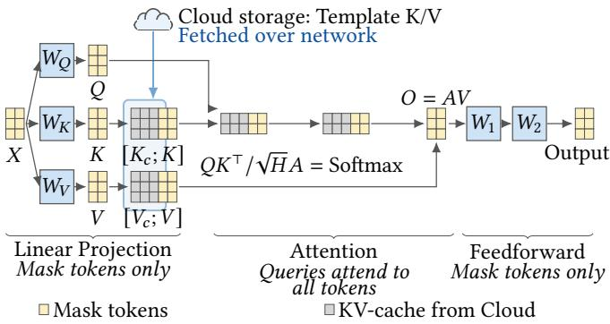  
Figure 1. Cloud–edge KV reuse for template-based editing.

Masked image editing modifies only a target region while leaving the rest of a template unchanged, creating substantial cross-request reuse opportunities [25, 31, 49, 71]. As illustrated in Figure 1, token-wise operators only need to process tokens inside the editable mask. For self-attention, the model computes Q, K, and V for these masked-region tokens, combines their K and V with cached K and V from the unchanged template tokens, and evaluates attention only for queries from the masked region. Such localized editing is common in applications including virtual try-on [28, 58, 75], face swapping [8, 57], and inpainting [41, 66].

This reuse enables sparse request-time execution, but requires a large reusable cache. Because the hidden states ofunchanged tokens difer across denoising steps and DiT blocks, skipping their computation requires preserving the corresponding K and V tensors for every step and every block. Thus, each template efectively maintains reusable KV state indexed by (denoising step, DiT block). For example, caching this state for a single 512 512 template in a lightweight 4B FLUX2 model [7] requires 1.46 GiB, and the footprint grows with the template library.

Recent mobile difusion systems demonstrate that modern mobile devices have suficient compute capability for on-device difusion inference [17, 34, 77]. However, this improvement in compute capability does not eliminate the storage cost of maintaining a large library of per-template KV caches locally. At the same time, keeping request-time inference local avoids transmitting privacy-sensitive user inputs and request-derived intermediate states to the cloud [46, 55]. This creates a mismatch between compute capacity and reuse-state capacity: the device can execute the sparse request-specific computation, but cannot retain all reusable state needed to enable it. Supporting cross-request reuse at scale therefore requires separating request-time computation from reusable-state storage.

## 2.2 Cloud–Edge Placement of Reusable State

The mismatch motivates a cloud–edge separation of computation and reusable state. As shown in Figure 1, the edge performs all request-specific inference, while the cloud stores the reusable per-template KV library and supplies the required entries on demand. This organization exploits the diferent roles of the two components: request-specific computation remains local, while reusable state, whose aggregate footprint grows with the template library, is placed in a remote tier with large capacity.

This setup difers from conventional cloud–edge inference, where the cloud primarily serves as an execution resource. Prior systems either ofload an entire request or partition model execution across the device and server [22, 27], with intermediate activations or generation stages crossing the network [27, 60, 65, 68]. In contrast, the cloud in our system acts as a remote storage for state: computation does not migrate across the network; only reusable KV state is transferred to the device.

This separation solves the device-side storage problem, but shifts the bottleneck to cache transfer. On our mobile platform, full-model execution without reuse takes 13 s, whereas transferring the full FP16 cache over the 545 Mb/s median throughput of our 5G trace [45] takes approximately 23 s. Naively fetching the full cache is therefore slower than local recomputation. Making remote reuse practical requires both reducing this transfer overhead and ensuring that the required cache state reaches the device in time for execution. We next examine the system challenges behind these requirements.

## 3 Challenges and High-Level Ideas

In this section, we describe two key challenges in enabling streaming KV acache for on-device difusion editing and then introduce our high-level ideas.

## 3.1 Quality-Eficient Cache Representation

Due to limited mobile network bandwidth, only a limited cache size can be transferred before the reusable cache is consumed in the difusion edit process. As such, the cache compression must be quality-eficient: for a given cache size, it should preserve the reusable information that contributes most to output quality. Using the same FLUX2 example in §2, execution with cache reuse has a median aggregate transfer window of only 2.3 s at a 10% mask ratio. Even an aggressive 2-bit quantization still requires 650 Mbps of bandwidth, while leaving the quality non-ideal (results in §6.3). This motivates selectively preserving the cached information with high image quality impact under a fixed transfer budget.

Cross-request DiT reuse introduces a new token importance problem. Prior work has shown that token importance can reduce KV or computation. LLM systems exploit this for request-time retention, eviction, or fetching [30,

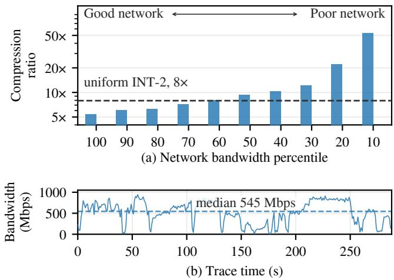

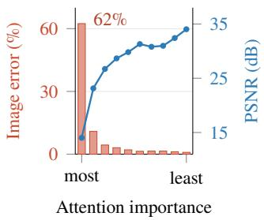

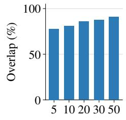  
top-K kept (%)  
(a) Uneven downstream impact  
(b) Stable across requests  
Figure 2. Reusable template tokens have highly nonuniform downstream impact, while their relative importance remains stable across request-specific references.  
Figure 3. Mobile network variation motivates adaptive cache streaming. (a) Required compression ratio. (b) The underlying 5G bandwidth trace.

33, 74], while DiT serving systems use such signals for token routing, merging, pruning, or reuse within a denoising process [21, 62, 69]. These approaches determine important tokens based on the ongoing request.

Cross-request DiT reuse is a new challenge: a reusable cache is constructed once for a template and must serve future unknown edit requests. Consequently, token-importanceaware compression cannot simply reuse important tokens measured from the current request. Instead, it requires a template-level signal that remains valid across future edit requests. This raises two questions: (1) whether some reusable cache tokens matter more than others to the final edit, and (2) whether the same tokens remain important across diferent edit requests.

Observation: token importance is uneven but stable across requests. We first measure how many reusable cache tokens afect the edited output. Across 50 templates, we compute an importance score for every cached token at each transformer block and denoising step using the squared attention received from masked-region queries, following attention-aware KV distortion metrics [29, 33, 73]. We rank cached rows by this score, divide them into ten equal groups, and quantize one group each time to INT2 while leaving others exact.

Figure 2(a) shows a highly skewed sensitivity distribution: quantizing only the most-attended 10% of cached tokens accounts for 62% of the induced image error, whereas perturbing lower-ranked groups has substantially less efect. Thus, reusable cache tokens contribute very unevenly to the final output quality.

For a fixed template, the edit mask and reusable template tokens are unchanged across requests, while diferent edit requests produce diferent query vectors � for the masked region. Figure 2(b) shows high overlap across requests: although the exact scores vary, the same reusable tokens tend to remain highly ranked. This consistency allows importance measured ofline on one set of requests to guide cache construction for future requests.

High-level idea. These observations suggest that reusable DiT KV caches should not be compressed uniformly. Because token importance is both highly skewed and predictable before future requests arrive, ofline cache construction can use this importance to preferentially preserve the information carried by high-impact tokens while allowing larger approximation error on less influential ones. The key is to incorporate token importance into the cache representation, while storing the cache representation in a way that can be eficiently transferred and reconstructed later online. §4.2 develops this idea using low-rank compression as an additional compression dimension beyond numerical precision.

## 3.2 Bandwidth-Adaptive DiT Cache Transfer

Even with an eficient cache representation, the cache transfer process still needs to be aware of mobile network bandwidth. Network conditions can change as a reusable DiT cache is consumed gradually throughout execution. Therefore, compression and transfer decisions must adapt to the granularity of DiT execution.

Mobile bandwidth changes within the DiT execution window. For requests with a 10% mask ratio, on-device DiT execution takes 2.26 s. To quantify the resulting transfer pressure, we examine the same duration windows from a 5G trace [45] and compute the compression ratio required to transfer the uncompressed FP16 cache within each window. Figure 3(a) shows that the median window requires 9.3 compression, while the slowest 10% requires 53.8 . Figure 3(b) shows the corresponding throughput variation over time. Importantly, these variations occur on the same time scale as local DiT execution. As a result, the bandwidth when an early cache shard is transferred can difer substantially from that for later shards in the same request. Consequently, cache compression and transfer must be adjustable through out execution, rather than determined once.

Token-level KV transfer does not match DiT cache consumption. Existing KV-transfer systems primarily target LLM context reuse or server-side KV movement [13, 36, 37, 44]. For example, CacheGen [36] partitions the cached context along the token dimension and selects a transfer configuration for each token chunk. Each decision covers the KV associated with that token chunk across multiple transformer layers. DiT consumes reusable KV diferently. During an edit, the model advances through transformer blocks and denoising steps, and the KV for each block is needed only when execution reaches that block. Hence, token-level transfer granularity used by LLM systems does not align with DiT execution, as KV associated with the same token chunk is consumed at diferent transformer blocks and denoising steps. For example, a cache shard needed by an early block must be transferred immediately, while one used by a later block can continue to adapt to subsequent bandwidth changes. Using the same token-level granularity couples cache data needed at diferent times, which can either over-compress some shards or delay others. We instead use block-grained cache shards as the unit of transfer adaptation. This aligns transfer decisions with cache consumption, allowing successive shards to exploit additional transfer time and adapt to subsequent bandwidth changes.

High-level idea. Cache transfer adaptation should follow the consumption granularity of DiT execution. Rather than fixing a transfer configuration for an entire request, the system can adjust cache transfer as successive shards are consumed by the on-device difusion process. This allows later shards to respond to changing mobile bandwidth while avoiding unnecessary quality degradation or transfer stalls.

## 3.3 Summary of High-Level Ideas

These challenges suggest two complementary mechanisms: construct a quality-eficient reusable cache ofline, and adapt its transfer online as network and execution conditions change. We next describe how SAKURA realizes these mechanisms in a cloud–edge system.

## 4 Design

## 4.1 Overview

Figure 4 gives an overview of SAKURA. The design separates reusable cache construction from request-time transfer and execution. Ofline, SAKURA builds two server-side artifacts for each template. First, it uses profiled token importance to construct a compact low-rank KV cache and stores its coeficient and basis matrices in a progressive layout, so the same cache can serve multiple compression levels. Second, it profiles a set of rank–precision trade-of points so later the runtime can select the best configuration for image quality.

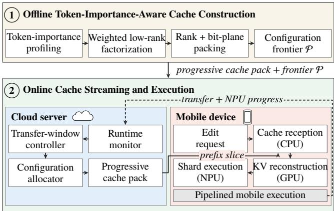  
Figure 4. SAKURA system overview.

Online, request-specific inference remains on the mobile device. For each upcoming cache shard, the runtime monitor tracks recent network bandwidth and device execution progress. The transfer-window controller uses this information to determine how much cache can be transferred before the shard is consumed, carrying forward unused transfer time from earlier shards. The configuration allocator then selects the best-quality configuration from the progressive cache pack and streams it to the device.

On the mobile device, cache reception, KV reconstruction, and shard execution are pipelined across the CPU, GPU, and NPU, respectively, allowing cache transfer and reconstruction to overlap model execution.

The remainder of this section describes each of these components. §4.2 presents ofline token-importance-aware cache construction and progressive packing; §4.3 describes bandwidth-adaptive cache transfer; and §4.4 presents the heterogeneous mobile execution pipeline.

## 4.2 Ofline Token-Importance-Aware Cache Construction

Even aggressive quantization ofthe full KV tensor can exceed the transfer budgets as shown in Figure 3(a). We therefore first use low-rank factorization to reduce the number of values that must be stored and transmitted, and then quantize the resulting factors.

For each transformer block and denoising step, we treat its reusable K or V matrix $X _ { c } ~ \in ~ \mathbb { R } ^ { N \times D }$ as one cache unit, with one row per reusable token. We compress each cache unit with a rank-� approximation, representing all token rows using � shared components. Specifically, we use truncated singular value decomposition (SVD) [15, 19], which minimizes squared reconstruction error for a given rank:

$$
X _ { c } \approx A _ { c } B _ { c } + 1 \mu _ { c } ^ { \top } ,\tag{1}
$$

where $\mu _ { c }$ is the row mean, $A _ { c } \in \mathbb { R } ^ { N \times r }$ contains the coeficients for each token, and $\boldsymbol { B } _ { c } \in \mathbb { R } ^ { r \times D }$ contains the shared basis vectors. When $r \ll D$ , storing and transmitting $A _ { c }$ and $B _ { c }$ requires substantially fewer values than the original $N \times D$ cache.

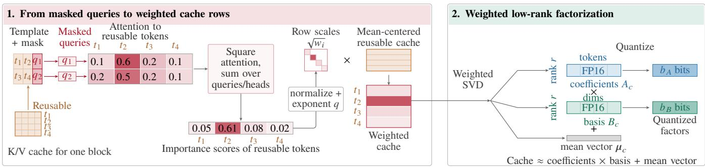  
Figure 5. Ofline token-importance-aware cache construction. Masked-query attention is aggregated into reusable-token importance scores and converted into �-controlled row scales. These scales bias the low-rank factorization toward important cache rows, after which the factors are quantized independently.

Low-rank factorization also makes the cache naturally pro gressive. SVD orders components from larger to smaller contribution to cache reconstruction, so transmitting additional components incrementally improves the approximation. A smaller cache can therefore be obtained simply by stopping after fewer components, without constructing a separate encoding for each rank. Quantizing $A _ { c }$ and $B _ { c }$ provides a second way to vary the transmitted size.

Plain SVD, however, minimizes reconstruction error over all cache rows uniformly. §3.1 shows that reusable DiT tokens do not contribute equally to the final edit, and that their relative importance can be estimated ofline. We therefore incorporate these importance scores when constructing the low-rank factors. Rather than assigning a diferent rank to each token—which would create variable-length coeficients and irregular reconstruction—SAKURA keeps one shared low-rank representation for the entire cache unit and biases its construction toward accurately reconstructing highimpact rows. This preserves a regular dense representation while making the limited rank more useful for downstream editing.

4.2.1 From masked queries to cache-row weights. The top half of Figure 5 shows how SAKURA turns the importance signal from §3.1 into construction-time row weights. For each cache unit, SAKURA measures how strongly maskedregion queries attend to each reusable template token. Following attention-aware KV distortion metrics [29, 33, 73], it squares and aggregates attention across queries and heads, so tokens that consistently receive stronger attention obtain larger importance scores. In Figure 5, for example, the second reusable token receives the largest score because both masked queries attend strongly to it.

SAKURA normalizes the token-importance scores and uses an exponent � to control how strongly they influence the factorization. With $q = 0 $ , all rows are treated equally and the method reduces to ordinary SVD; increasing � places progressively more emphasis on high-importance tokens. The resulting weights are used only during ofline construction and are not stored or transmitted with the cache. We evaluate the efect of diferent � values in §6.5.

4.2.2 Weighted low-rank factorization. The bottom half of Figure 5 shows how these weights afect the low-rank representation. SAKURA first subtracts the cache mean and scales each row by the square root of its importance weight before applying truncated SVD. This is equivalent to minimizing a weighted reconstruction error in which errors on high-importance rows contribute more strongly [40, 53]. The leading components therefore devote more of the limited rank to preserving information carried by important tokens.

After factorization, SAKURA folds the inverse row scaling into the coeficient matrix $A _ { c }$ . The resulting representation has the same regular form as ordinary low-rank factorization: a coeficient matrix $A _ { c }$ , a shared basis $B _ { c }$ , and a mean vector $\mu _ { c } .$ . Thus, � and the token weights afect how the factors are constructed, but do not change the stored cache format. The mobile device receives no importance weights and performs no token-specific reconstruction; every cache unit is reconstructed using the same dense matrix multiplication.

4.2.3 Progressive rank and bit-plane packing. Finally, as Figure 5 shows, SAKURA quantizes $A _ { c }$ and $B _ { c }$ independently, using $b _ { A }$ and $b _ { B }$ bits. Their rank components remain ordered by weighted singular contribution. This layout is what enables the progressive representation in Figure 6: instead of storing a separately encoded cache for every $( r , b _ { A } , b _ { B } )$ configuration, SAKURA stores the ordered factors once and later selects rank and precision prefixes to match the available cache transfer budget.

## 4.3 Online Adaptive Cache Streaming

The ofline phase leaves the server with the progressive cache pack described above. At runtime, SAKURA determines how (a) Naive: encode and store each setting

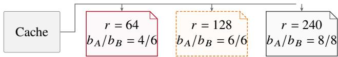

(b) Store once: slice rank and bit-plane prefixes  
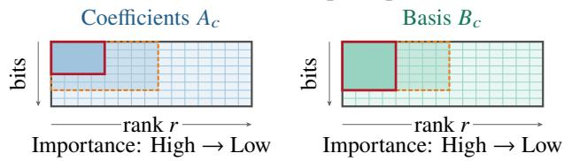  
Figure 6. Progressive cache packing. SAKURA shares ordered rank components and precision bit planes across supported configurations.

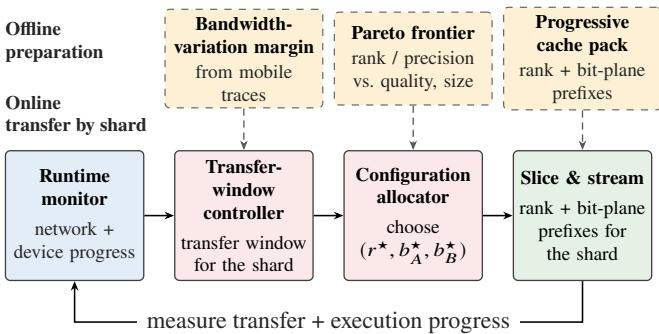  
Figure 7. Workflow of online adaptive cache streaming.

much ofthis pack to transmit for each cache shard as network and device conditions change.

SAKURA operates at shard granularity. A shard groups consecutive transformer blocks executed together on the NPU, and the reusable KV state consumed by one shard at one denoising step forms a cache shard. Because shards are consumed sequentially, later decisions can incorporate measurements from earlier transfers in the same edit.

Figure 7 summarizes the online path. A runtime monitor tracks network and device progress, a transfer-window controller determines how long each upcoming shard can be transferred before use, and a configuration allocator selects the corresponding prefix from the progressive cache pack.

4.3.1 Runtime monitor. The runtime monitor tracks the recent cache transfer rate and the arrival of each cache shard. The device reports the bytes received and active receive time, from which SAKURA estimates the efective transfer rate ${ \hat { R } } .$ The monitor also records when each shard cache arrives relative to when it is needed. If a shard arrives early, the remaining time is recorded as carry-over $H _ { p }$ and exposed to the transfer-window controller for the next shard. Measurements are refreshed after every shard so that later decisions reflect both recent network conditions and accumulated transfer lead.

4.3.2 Transfer-window controller. SAKURA adapts cache transfer to bandwidth: when bandwidth is high, it sends a higher-quality cache representation, while under lower bandwidth it sends less cache so that the transfer still completes before the shard is needed. For an upcoming cache shard ${ \boldsymbol { p } } ,$ let $T _ { \boldsymbol { p } } ^ { \mathrm { o v l p } }$ denote the remaining device-execution time over which its transfer can be hidden, and let $H _ { p - 1 }$ denote the carry-over time from the previous shard. The controller sets the transmission window for shard $\boldsymbol { p }$ to $\gamma \left( T _ { p } ^ { \mathrm { o v l p } } + H _ { p - 1 } \right)$ where $\gamma < 1$ provides a safety margin against short-term bandwidth drops. Rather than predicting future bandwidth, SAKURA uses the recently observed transfer rate together with this conservatively sized window.

4.3.3 Configuration allocator. A byte budget alone does not determine how it should be divided between rank and numerical precision. Figure 8 illustrates this tradeof. Under tight budgets, lower-precision factors can leave room for more rank, whereas larger budgets increasingly favor higher precision. As a result, no single rank–precision configuration dominates across all transfer budgets.

Ofline, we therefore profile candidate combinations of rank � and bitwidths $( b _ { A } , b _ { B } )$ and retain only their nondominated configurations, forming a small frontier $\mathcal { P } .$ Given the current transfer rate and transmission window, the allocator selects the configuration with the highest profiled masked PSNR whose encoded shard fits:

$$
( r ^ { \star } , b _ { A } ^ { \star } , b _ { B } ^ { \star } ) = \arg \operatorname* { m a x } _ { ( r , b _ { A } , b _ { B } ) \in \mathcal { P } } Q ( r , b _ { A } , b _ { B } )\tag{2}
$$

$$
\mathrm { s . t . } \quad \frac { S _ { \hat { \cal P } } ( r , b _ { A } , b _ { B } ) } { \hat { R } } \leq T _ { \hat { \cal P } } ^ { \mathrm { t x } } .\tag{3}
$$

$S _ { p } ( r , b _ { A } , b _ { B } )$ is the encoded size ofshard ${ \boldsymbol { p } } ,$ and $Q ( r , b _ { A } , b _ { B } )$ is its masked PSNR measured during ofline profiling. Because $\mathcal { P }$ contains only nondominated configurations, the online decision requires only a small enumeration.

Once a configuration is selected, the server directly slices the required rank and bit-plane prefixes from the cache pack (Figure 6(b)), without placing factorization or re-encoding onto the request’s critical path.

## 4.4 Online Pipelined Mobile Execution

As shown in Figure 9, SAKURA overlaps cache transfer, reconstruction, and DiT execution across the CPU, GPU, and NPU. After a short start-up phase, while the NPU executes shard $j ,$ the CPU receives cache data for shard $j + 1$ and the GPU reconstructs its KV tensors. The reconstructed cache is bufered until the NPU reaches the next shard, allowing the three stages to proceed concurrently instead of serializing on each shard. This pipeline hides most communication and reconstruction behind NPU computation and avoids the NPU stalls incurred by the naïve prepare-then-execute design.

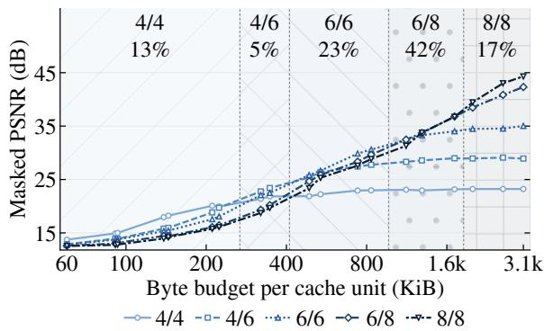  
Figure 8. Rank–precision tradeof. Diferent precision pairs are optimal at diferent byte budgets.

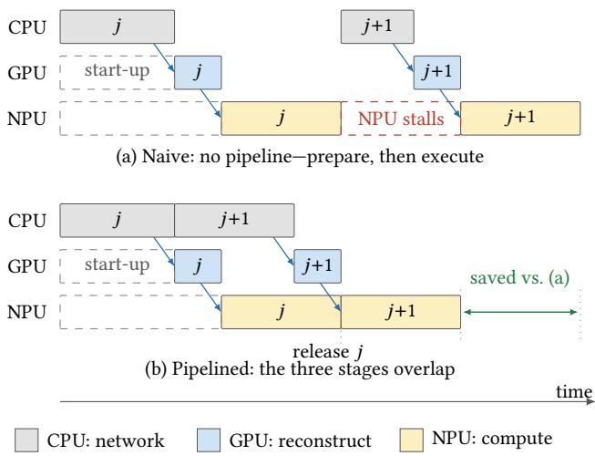  
Figure 9. Pipelined mobile execution. CPU reception and GPU cache reconstruction for the next shard overlap NPU execution of the current shard.

## 5 Implementation

SAKURA’s implementation focuses on Qualcomm platforms, which are widely used in smartphones. However, the design is generally applicable to other mobile platforms.

The server uses PyTorch and ExecuTorch [48] Qualcomm backend with an HTP v81 libso to compile the difusion models for the mobile platform. It first downloads the model from Huggingface then uses their difusers pipelines, quantizes it to W8A16, and shards it by transformer block count so that each shard is one compiled graph; the same block groups define the cache units in §4.3. Cache capture follows FlashPS [25]: we reuse its mask-aware formulation of which KV state a template contributes, and store the result as the per-unit packs in §4.2.3.

The mobile device runtime implements the heterogeneous pipeline of §4.4 across all three engines in C++. The CPU maintains the network transfer and the cache state machine: it requests the next shard cache, parses arriving packets, and tracks which units are received, reconstructed, and released. The GPU dequantizes and reconstructs those units with OpenCL kernels. The NPU executes the compiled shards through the ExecuTorch runtime [48]. The three stages execute concurrently on separate shards, allowing each segment to be received, reconstructed, and consumed in a pipeline without serializing device execution on any single stage.

Table 1. Models and image editing tasks.
<table><tr><td>Workload</td><td>Task</td><td>Input Type</td><td></td><td>Model Mask %</td></tr><tr><td>FS</td><td>Face swap</td><td>Image+Image</td><td>FLUX2</td><td>11.2</td></tr><tr><td>VTON</td><td>Virtual try-on Image+Image FLUX2</td><td></td><td></td><td>26.3</td></tr><tr><td>MB MB-SD</td><td>MagicBrush</td><td>Image+Text</td><td>FLUX2 SD 3.5</td><td>19.3</td></tr></table>

## 6 Evaluation

## 6.1 Setup

Tasks and datasets. We evaluate three image editing tasks. (1) The face swap task replaces the human face in an image, where we take portrait templates from DifusionDB [59] to cover diverse portrait styles and replacement faces from the Human-Art dataset [26]; the templates follow mask ratio distributions from Alibaba’s Spring Festival dataset [25]. (2) The virtual try-on task replaces clothes in a template image, where both images for clothes and templates are from the VITON-HD [14] dataset. (3) The MagicBrush task selects masked objects in an image and edits it with text, where images and text are from the MagicBrush [72] dataset. Table 1 summarizes the dataset and Figure 10(a) shows the mask ratio distributions.

Models and configurations. We evaluate the workloads above on two difusion transformers that are suitable for mobile platforms: FLUX2 (FLUX.2-klein-4B) [7] with 4 steps and SD3.5 (SD3.5-medium-turbo) [16] with 6 steps, both with default 512 512 resolutions. Table 1 also lists the workloads, each consisting of a model and an image-editing task. FLUX2 is our primary model because it supports both image and text edit inputs for editing and can be applied to all three tasks; SD3.5 supports only text edit inputs and is evaluated only on the MagicBrush task.

Template cache preparation. For each template, we profile it with 5 randomly chosen requests to identify the importance level of tokens which will be reused in evaluation. To ensure fair evaluation, we strictly separates data for profiling and evaluation.

Platform. All device measurements run on a OnePlus 15 phone with a Snapdragon 8 Elite Gen 5 SoC and 16 GB RAM. The phone is tested at room temperature of 24◦C. The cloud is a server with a 12-core CPU and 64 GB RAM. Template caches are stored on an SSD of the cloud server.

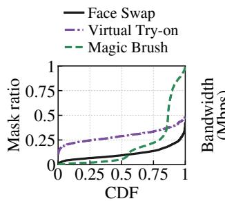  
(a) Mask ratio

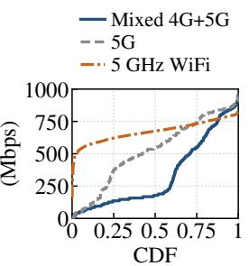  
(b) Network bandwidth  
Figure 10. Network and workload distribution.

Network traces. Our main experiments replay network bandwidth traces from the 5Gophers dataset [45], which contains 603 seconds of per-second downlink throughput measurements collected by a handset on a commercial 5G network. We shape and control the bandwidth with Linux tc on the host’s interface [2, 18, 36, 42]. We also conduct an experiment using our institute’s Wi-Fi 6 network, operating on the 5 GHz band, with the device placed at a stationary location. This setting serves as an ideal scenario. CDFs of these traces are shown in Figure 10(b). For each workload in Table 1, we randomly sample 100 starting points in the network trace and evaluate an edit request for each starting point.

Quality Metrics. We take the uncompressed cache (FP16) as the reference to compare against the design points.

Peak Signal-to-Noise Ratio (PSNR) compares each design’s image output with the reference pixel-wise. A higher value indicates better similarity, i.e., lower quality degradation after compression.

Structural Similarity Index Measure (SSIM) shows the structural similarity between the two images. Higher value indicates better similarity.

Baselines. We compare SAKURA against uniform integer quantization (IntQ) and CacheGen [36]. IntQ uses one fixed bitwidth for the entire edit, chosen from the initial bandwidth, with INT2 as the minimum precision. For CacheGen, we adapt the paper’s open-source implementation to DiT KV tensors and mobile runtime.

## 6.2 Performance Evaluation

Example trace. We first demonstrate the latency under a time-varying mobile network. Figure 11 shows FLUX2 + VTON serving under a 60-second 5G trace. The network bandwidth changes substantially over the trace, causing the fixed-compression baselines to exhibit large latency variation. In particular, INTQ and CacheGen slow down noticeably around at 30 s and 50 s, when their fixed cache representations are too large for the available bandwidth. In contrast, SAKURA adapts the transmitted cache representation as bandwidth changes, making latency stable.

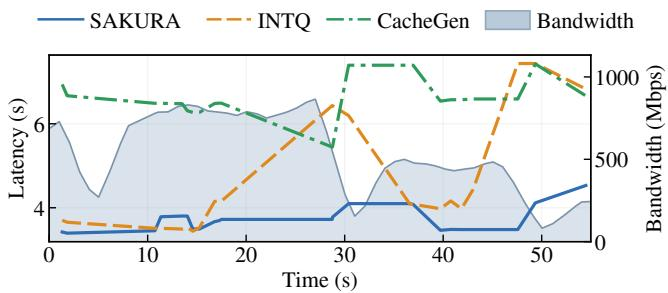  
Figure 11. An example showing FLUX2 latency under VTON workload during a 60-second network trace.

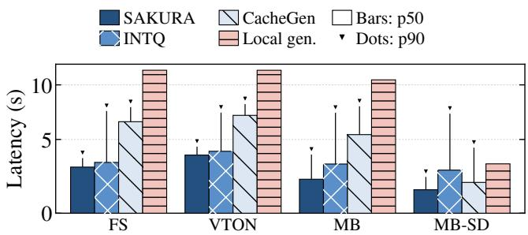  
Figure 12. Generation latency under 5G trace.

SAKURA INTQ CacheGen Full cache (fp16)  
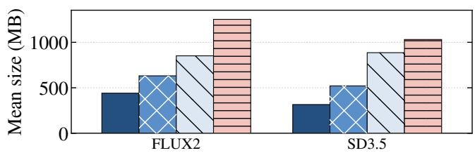  
Figure 13. Per-template cache storage on server.

Generation latency. Figure 12 shows that SAKURA achieves the lowest median and tail latency on all four workloads, reducing p90 latency by 44% on average over INTQ and by 42% on average over CacheGen. INTQ remains competitive at the median, but its tail degrades sharply because its larger cache transfers make it more sensitive to bandwidth fluctuations. CacheGen also exhibits substantially higher tail latency on the FLUX workloads because its coarse-grained transfer delays cache reconstruction and limits communication– computation overlap. SAKURA mitigates both issues through fine-grained, execution-aware cache transfer. We also compare with local generation without cache reuse. The median latency of SAKURA is 2.1–4.1 lower. Compared to FLUX2 workloads, MB-SD has a relatively lower speedup of 2.1 because SD3.5 is a lightweight model that has lower cost when running locally even without cache reuse.

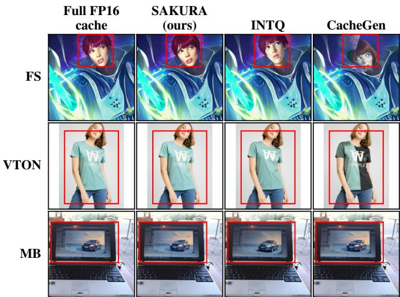  
Figure 14. Example outputs of requests from three tasks using FLUX2 with diferent systems.

Storage overhead. Figure 13 compares the per-template cache size, where SAKURA has the lowest footprint for both models. The reduction comes from combining low-rank factorization with quantization, so a single compact representation supports multiple cache transfer budgets. INTQ only reduces precision and has larger footprints. CacheGen incurs the largest overhead, requiring 1.93 and 2.81 more storage than SAKURA for FLUX2 and SD3.5, respectively, because each quality level stores an independent quantized cache with no sharing across levels. With quality levels, this overhead grows nearly linearly, whereas SAKURA reuses the same factorized representation across levels.

## 6.3 Quality Evaluation

This section evaluates the quality compared to the reference scenario without compression (in FP16).

Image Examples. Figure 14 shows representative outputs from face swapping, with a 10% mask ratio and 400 Mbps bandwidth during editing. Compared with the uncompressed output, SAKURA generates a mostly identical image. In comparison, INTQ has minor diferences while CacheGen exhibits large deviations (especially in FS and VTON).

Image quality. Table 2 shows that SAKURA consistently achieves the highest mean PSNR and SSIM across all four workloads under 5G. INTQ preserves more cache entries using uniform quantization, but does not allocate budget on the most critical components. CacheGen degrades more severely because stronger compression evenly degrades cache components, without exploiting the static importance structure of DiT template caches. Figure 15 further illustrates this tradeof: SAKURA consistently forms the upper-left cache-size– quality frontier, achieving higher quality at the same transfer budget and requiring fewer bytes to reach a given quality level. In particular, SAKURA experiences low quality degradation as the cache budget decreases, whereas CacheGen’s quality drops sharply. Overall, SAKURA transfers 30–56% less data than INTQ and 23–42% less than CacheGen while maintaining higher image quality.

Table 2. Mean image quality on the real device (vs. full-cache output), averaged over all requests.
<table><tr><td rowspan="2"></td><td rowspan="2">Systems</td><td>5G (main)</td><td>4G+5G mix</td><td colspan="2">WiFi</td></tr><tr><td></td><td>PSNR SSIM PSNR SSIM PSNR</td><td></td><td>SSIM</td></tr><tr><td>FS</td><td>SAKURA INTQ CacheGen</td><td>27.9 0.90 21.3 0.79 20.8 0.70</td><td>24.9 21.0 16.2</td><td>0.85 0.78 0.51</td><td>32.7 0.97 21.4 0.80 23.5 0.81</td></tr><tr><td>VTON</td><td>SAKURA INTQ CacheGen</td><td>30.4 0.95 24.1 0.91 25.1 0.86</td><td>26.8 23.1 18.8</td><td>0.91 0.89 0.69</td><td>37.3 0.99 25.6 0.93 28.9 0.95</td></tr><tr><td>MB</td><td>SAKURA INTQ CacheGen</td><td>30.9 0.93 25.1 0.87 24.7 0.79</td><td>27.3 24.5 19.9</td><td>0.86 0.86 0.61</td><td>34.2 0.969 26.9 0.88 28.0 0.88</td></tr><tr><td>MB-SD INTQ</td><td>SAKURA CacheGen</td><td>35.3 0.97 31.6 0.96 22.7 0.74</td><td>32.6 31.3 19.0</td><td>0.949 0.96 0.66</td><td>38.6 0.99 32.0 0.96 23.4 0.75</td></tr></table>

Table 3. User study comparing perceptual similarity to uncompressed cache.
<table><tr><td>Method</td><td>FS</td><td>VTON</td><td>MB</td><td>MD-SD</td></tr><tr><td>SAKURA</td><td>86.0%</td><td>88.0%</td><td>90.0%</td><td>85.1%</td></tr><tr><td>INTQ</td><td>56.5%</td><td>72.8%</td><td>79.7%</td><td>47.4%</td></tr><tr><td>CacheGen</td><td>35.2%</td><td>55.8%</td><td>46.6%</td><td>43.5%</td></tr></table>

User study. We further conducted a user study that involved 30 participants who were shown the uncompressed output as the reference and independently judged each baseline methods’ outputs as similar or not similar to the reference. We first samples 30 requests out of randomizes the order of these outputs every time to avoid bias. Table 3 shows that SAKURA achieves the highest similarity score on every workload, ranging from 85.1% to 90.0%. These user study results are consistent with the quality evaluation.

## 6.4 Sensitivity Studies

We evaluate the primary model, FLUX2, for sensitivity.

(1) Sensitivity to mask ratio. Figure 16 shows that larger masks increase latency for all methods, as more tokens are involved in DiT computation. At the same time, larger masks reduce the cache size to be transferred and increase the perstep compute window, increasing the fraction of cache that can be transferred. As a result, compression becomes less aggressive and the quality gap between systems narrows as the mask grows. In contrast, smaller mask sizes combine the largest reusable cache with the shortest transfer window. In such cases, SAKURA provides the highest quality improvements over INTQ and CacheGen as its token-importanceaware representation makes better use of the transfer budget. (2) Sensitivity to bandwidth. We evaluate two additional scenarios: a 4G+5G mixed trace that reflects lower network bandwidth and a WiFi scenario for a high-bandwidth connection. Figure 17 presents these scenarios. Under the 4G+5G mixed trace, SAKURA reduces p90 latency by 55–76% over INTQ and 47–62% over CacheGen across the four workloads. Under WiFi, where network is not a bottleneck, the gap narrows: on the three FLUX workloads, SAKURA reduces p90 latency by up to 15% over INTQ and 38–44% over CacheGen. These results show that SAKURA provides the largest benefit when bandwidth is scarce, while its fine-grained transfer still benefits faster networks.

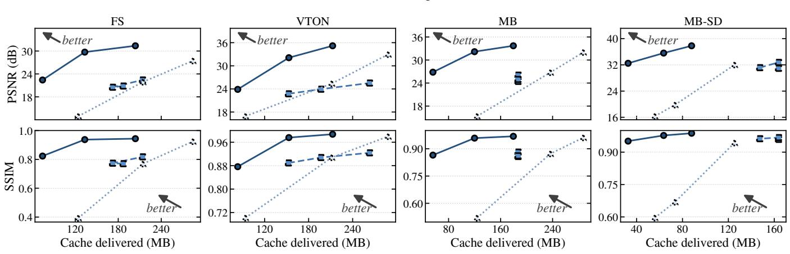  
Figure 15. Transferred cache size vs. image quality.

Figure 16. Latency and quality under diferent editable-mask ratio.  
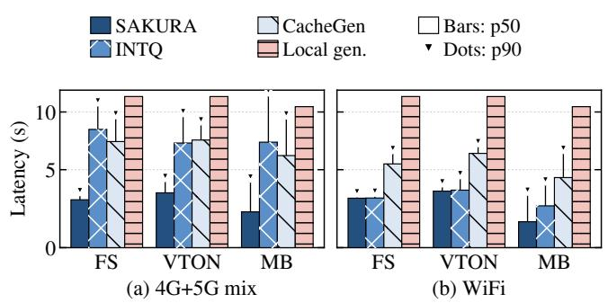  
Figure 17. Generation latency under diferent network traces.

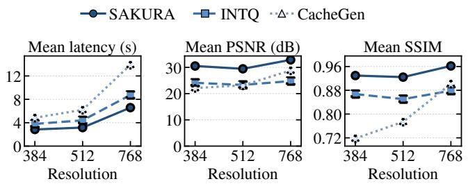  
Figure 18. Latency and quality under diferent resolutions.

(3) Sensitivity to multi-image-resolutions. This experiment includes two other resolutions: 384 384 and 768 768, in addition to the default 512  512. Figure 18 shows that SAKURA scales robustly across resolutions, consistently achieving the lowest latency and the highest PSNR/SSIM. As resolution increases by 4 in pixel count, SAKURA’s latency and transferred cache grow by only 2.3–2.5 , while ensuring image quality. Overall, SAKURA preserves its latency– quality advantage across all tested resolutions, demonstrating that its compression and streaming design scales efectively with larger DiT workloads.

## 6.5 Ablation Studies

This section studies the impact of three major mechanisms.

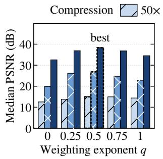

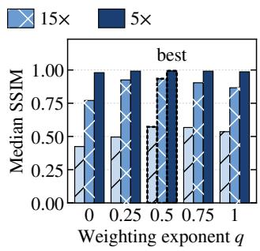  
Figure 19. Efect of attention-weighting exponent �.

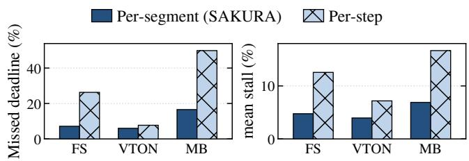  
Figure 20. Efect of per-shard adaptation.

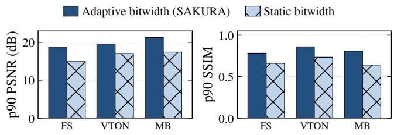  
Figure 21. Efect of adaptive bitwidth.

(1) Importance-weighting strength (§4.2.1). Figure 19 varies the exponent � used for importance weighting and shows results under diferent compression ratios: 5 , 15 , and 50 . $q = 0$ recovers plain SVD, while $q = 0 . 5$ achieves the best overall quality, particularly under higher compression ratios. We therefore use $q = 0 . 5$ by default.

(2) Per-shard adaptation (§4.3.2). Figure 20 evaluates the benefit of revisiting transfer decisions for successive cache shards. The left figure shows fine-grained adaptation reduces deadline violations (i.e., cache is not ready before the next block of difusion computation starts) compared with a coarse transfer granularity. We also note that this viola tion diference is low for VTON because it has the larger mask ratio and requires smaller caches to be transferred. The right figure shows the percentage of stall time due to missed deadlines, which follows a consistent trend.

(3) Adaptive bitwidth (§4.3.3). Figure 21 compares adaptive bitwidth with a fixed 8-bit configuration. Per-shard adaptation improves p90 PSNR by 2.5–3.9 dB and p90 SSIM by 0.12–0.17 across the three workloads. Under tight transfer budgets, using fewer bits per value leaves room to retain more low-rank components. These results show that this precision–rank trade-of is efective.

## 7 Related Work

Difusion cache reuse. Prior work exploits substantial redundancy across difusion denoising steps. DeepCache and Faster Difusion reuse intermediate U-Net features across nearby steps, while Block Caching performs reuse at the granularity of individual network blocks [32, 39, 61]. For difusion transformers, FORA caches attention and MLP outputs, Δ-DiT reuses block residuals, ToCa selectively reuses features for less important tokens, and TeaCache adapts reuse intervals based on timestep-dependent changes [12, 35, 51, 78]. These methods primarily reduce computation within a single request by exploiting temporal redundancy along the denoising trajectory. Some prior work has considered reuse across requests. For example, NIRVANA reuses intermediate noise states from similar prompts [1], while FlashPS caches template-dependent activations that can be shared across edits [25]. These systems assume server-side inference that directly reuses cached states on the server. In contrast, SAKURA keeps request-specific processing on the mobile device while streaming reusable template caches from the cloud.

KV cache compression and memory optimization. KIVI and KVQuant compress KV caches through quantization [24, 38], while Palu stores low-dimensional representations through factorized KV projections [9]. StreamingLLM, $\mathrm { H _ { 2 } O , }$ and SnapKV instead reduce the number of retained tokens using recent-token, attention-importance, or observationwindow-based selection [33, 64, 74]. InfiniGen selectively prefetches important KV entries when caches are ofloaded to host memory [30]. For difusion models, PTQ4DiT and ViDiT-Q reduce weight and activation costs through timestep-aware quantization [63, 76]. In contrast, we factorize precomputed template KV matrices ofline and weight approximation error using token importance shared across references of the same template.

Cache transfer optimization. CacheGen compresses and streams reusable KV caches to LLM inference servers with bandwidth-adaptive encoding [36], while LMCache manages KV movement across GPU, CPU, storage, and network tiers [13]. KVServe selects compression profiles according to bandwidth, latency, and quality constraints [37], and KV-Codec pipelines GPU-native video-codec compression with KV transfer and reconstruction [44]. LLM.265 similarly applies hardware video codecs to tensor compression [67], building on the broader idea of scalable, quality-adaptive transfer [50]. Our setting difers in that cache segments are streamed during on-device difusion inference and must arrive before the corresponding transformer blocks execute. Thus, transfer decisions jointly depend on bandwidth and denoising execution progress.

## 8 Conclusion

In this work, we show that remote reuse of DiT template caches can make on-device image editing practical without replicating large cache collections on the device or ofloading private request data to the cloud. SAKURA combines tokenimportance-aware ofline compression with fine-grained, bandwidth-adaptive cache streaming and a pipelined mobile runtime, allowing cache transfer to track both network conditions and device execution. Our evaluation demonstrates that SAKURA simultaneously improves latency, storage eficiency, and output quality: it is 1.55–1.82 faster and 1.54– 2.37× more storage-eficient than prior KV-streaming sys- tems, while also outperforming fully local execution by 3.27 and reducing full-FP16 cache storage by 3.06 .

## References

[1] Shubham Agarwal, Subrata Mitra, Sarthak Chakraborty, Srikrishna Karanam, Koyel Mukherjee, and Shiv Kumar Saini. 2024. Approximate Caching for Eficiently Serving Text-to-Image Difusion Models. In USENIX Symposium on Networked Systems Design and Implementation (NSDI). 1173–1189.

[2] Zahaib Akhtar, Yun Seong Nam, Ramesh Govindan, Sanjay Rao, Jes sica Chen, Ethan Katz-Bassett, Bruno Ribeiro, Jibin Zhan, and Hui Zhang. 2018. Oboe: Auto-tuning Video ABR Algorithms to Network Conditions. In Proceedings of the ACM SIGCOMM 2018 Conference (SIGCOMM ’18). Association for Computing Machinery, 44–58.

[3] Alibaba Cloud. 2026. Qwen-Image Edit API reference. Alibaba Cloud Model Studio. Accessed September 2026.

[4] Alibaba Group. 2026. Alibaba Opens All of Taobao to Qwen AI, Ushering in a New Agentic Shopping Experience. Alibaba Group. Accessed September 2026.

[5] Amazon Web Services. 2025. Amazon Nova Canvas Adds Virtual Try-On and Style Options for Image Generation. AWS. Accessed September 2026.

[6] Sanoojan Baliah, Qinliang Lin, Shengcai Liao, Xiaodan Liang, and Muhammad Haris Khan. 2025. Realistic and Eficient Face Swapping: A Unified Approach with Difusion Models . In 2025 IEEE/CVF Winter Conference on Applications of Computer Vision (WACV). IEEE Computer Society, Los Alamitos, CA, USA, 1062–1071. htps://doi.org/10.1109/ WACV61041.2025.00112

[7] Black Forest Labs. 2026. FLUX.2 [klein] 4B. Model card and oficial inference implementation.

[8] Canva. n.d.. Face Swap: Transform Faces in a Few Clicks. Canva. Accessed September 2026.

[9] Chi-Chih Chang, Wei-Cheng Lin, Chien-Yu Lin, Chong-Yan Chen, Yu-Fang Hu, Pei-Shuo Wang, Ning-Chi Huang, Luis Ceze, Mohamed S. Abdelfattah, and Kai-Chiang Wu. 2025. Palu: KV-Cache Compression with Low-Rank Projection. In International Conference on Learning Representations (ICLR).

[10] Junsong Chen, Jincheng Yu, Chongjian Ge, Lewei Yao, Enze Xie, et al. 2024. PixArt-�: Fast Training of Difusion Transformer for Photorealistic Text-to-Image Synthesis. In International Conference on Learning Representations (ICLR).

[11] Le Chen, Dahu Feng, Erhu Feng, Yingrui Wang, Rong Zhao, Yubin Xia, Pinjie Xu, and Haibo Chen. 2025. Characterizing Mobile SoC for Accelerating Heterogeneous LLM Inference. In ACM SIGOPS Symposium on Operating Systems Principles. 359–374. htps://doi.org/10. 1145/3731569.3764808

[12] Pengtao Chen, Mingzhu Shen, Peng Ye, Jianjian Cao, Chongjun Tu, Christos-Savvas Bouganis, Yiren Zhao, and Tao Chen. 2024. Δ-DiT: A

Training-Free Acceleration Method Tailored for Difusion Transformers. arXiv:2406.01125 [cs.CV]

[13] Yihua Cheng, Yuhan Liu, Jiayi Yao, Yuwei An, Xiaokun Chen, Shaoting Feng, Yuyang Huang, Samuel Shen, Kuntai Du, and Junchen Jiang. 2025. LMCache: An Eficient KV Cache Layer for Enterprise-Scale LLM Inference. arXiv preprint arXiv:2510.09665 (2025).

[14] Seunghwan Choi, Sunghyun Park, Minsoo Lee, and Jaegul Choo. 2021. VITON-HD: High-Resolution Virtual Try-On via Misalignment-Aware Normalization. In Proc. ofthe IEEE conference on computer vision and pattern recognition (CVPR).

[15] Carl Eckart and Gale Young. 1936. The Approximation of One Matrix by Another of Lower Rank. Psychometrika 1, 3 (1936), 211–218. htps: //doi.org/10.1007/BF02288367

[16] Patrick Esser, Sumith Kulal, Andreas Blattmann, Rahim Entezari, et al. 2024. Scaling Rectified Flow Transformers for High-Resolution Image Synthesis. In International Conference on Machine Learning (ICML).

[17] Kailai Feng, Yuxiang Wei, Bo Chen, Yang Pan, Hu Ye, Songwei Liu, Chenqian Yan, and Yuan Gao. 2026. DreamLite: A Lightweight On-Device Unified Model for Image Generation and Editing. arXiv:2603.28713 [cs.CV] htps://arxiv.org/abs/2603.28713

[18] Sadjad Fouladi, John Emmons, Emre Orbay, Catherine Wu, Riad S. Wahby, and Keith Winstein. 2018. Salsify: Low-Latency Network Video through Tighter Integration between a Video Codec and a Transport Protocol. In 15th USENIX Symposium on Networked Systems Design and Implementation (NSDI 18). USENIX Association, 267–282.

[19] Gene H. Golub and Christian Reinsch. 1970. Singular Value Decomposition and Least Squares Solutions. Numer. Math. 14 (1970), 403–420.

[20] Google. 2025. How to Virtually Try On Clothes Using Your Own Image. Google Shopping. Accessed September 2026.

[21] Saumya Gupta, Dimitris Samaras, and Chao Chen. 2025. TopoDifusionNet: A Topology-aware Difusion Model. International Conference on Learning Representations (2025).

[22] Seungyeop Han, Haichen Shen, Matthai Philipose, Sharad Agarwal, Alec Wolman, and Arvind Krishnamurthy. 2016. MCDNN: An Approximation-Based Execution Framework for Deep Stream Processing Under Resource Constraints. In International Conference on Mobile Systems, Applications, and Services (MobiSys).

[23] Dailan He, Xiahong Wang, Shulun Wang, Guanglu Song, Bingqi Ma, Hao Shao, Yu Liu, and Hongsheng Li. 2026. High-Fidelity Difusion Face Swapping with ID-Constrained Facial Conditioning. arXiv:2503.22179 [cs.CV] htps://arxiv.org/abs/2503.22179

[24] Coleman Hooper, Sehoon Kim, Hiva Mohammadzadeh, Michael W. Mahoney, Yakun Sophia Shao, Kurt Keutzer, and Amir Gholami. 2024. KVQuant: Towards 10 Million Context Length LLM Inference with KV Cache Quantization. In Advances in Neural Information Processing Systems (NeurIPS).

[25] Xiaoxiao Jiang et al. 2026. FlashPS: Eficient Generative Image Editing with Mask-Aware Caching and Scheduling. In European Conference on Computer Systems (EuroSys). htps://doi.org/10.1145/3767295.3769379 Earlier version: InstGenIE, arXiv:2505.20600.

[26] Xuan Ju, Ailing Zeng, Wang Jianan, Xu Qiang, and Zhang Lei. 2023. Human-Art: A Versatile Human-Centric Dataset Bridging Natural and Artificial Scenes. In Proceedings ofthe IEEE/CVF Conference on Computer Vision and Pattern Recognition (CVPR).

[27] Yiping Kang, Johann Hauswald, Cao Gao, Austin Rovinski, Trevor Mudge, Jason Mars, and Lingjia Tang. 2017. Neurosurgeon: Collaborative Intelligence Between the Cloud and Mobile Edge. In International Conference on Architectural Supportfor Programming Languages and Operating Systems (ASPLOS).

[28] Jeongho Kim, Guojung Gu, Minho Park, Sunghyun Park, and Jaegul Choo. 2024. StableVITON: Learning Semantic Correspondence with Latent Difusion Model for Virtual Try-On. In IEEE/CVF Conference on Computer Vision and Pattern Recognition. 8176–8185.

[29] Hannah Laus, Claudio Mayrink Verdun, Hao Wang, Flavio du Pin Calmon, and Felix Krahmer. 2026. KV Cache Compression Through the Lens of Transform Coding. arXiv:2608.14191 [cs.LG] htps: //arxiv.org/abs/2608.14191

[30] Wonbeom Lee, Jungi Lee, Junghwan Seo, and Jaewoong Sim. 2024. InfiniGen: eficient generative inference of large language models with dynamic KV cache management. In Proceedings of the 18th USENIX Conference on Operating Systems Design and Implementation (Santa Clara, CA, USA) (OSDI’24). USENIX Association, USA, Article 9, 18 pages.

[31] Peizheng Li, Xin Ai, Hanyuan Liu, Qiange Wang, and Yanfeng Zhang. 2026. RegionCache: Semantic-Aware Region Reuse for Eficient Multi Turn Image Generation. In Proceedings of the Thirty-Fifth International Joint Conference on Artificial Intelligence, IJCAI-26, Diego Calvanese (Ed.). International Joint Conferences on Artificial Intelligence Organization, 1342–1350. htps://doi.org/10.24963/ijcai.2026/150 Main Track.

[32] Senmao Li, Taihang Hu, Joost van de Weijer, Fahad Shahbaz Khan, Tao Liu, Linxuan Li, Shiqi Yang, Yaxing Wang, Ming-Ming Cheng, and Jian Yang. 2024. Faster Difusion: Rethinking the Role of the Encoder for Difusion Model Inference. In Advances in Neural Information Processing Systems (NeurIPS).

[33] Yuhong Li, Yingbing Huang, Bowen Yang, Bharat Venkitesh, Acyr Locatelli, Hanchen Ye, Tianle Cai, Patrick Lewis, and Deming Chen. 2024. SnapKV: LLM knows what you are looking for before generation. In Proceedings ofthe 38th International Conference on Neural Information Processing Systems (Vancouver, BC, Canada) (NIPS ’24). Curran Associates Inc., Red Hook, NY, USA, Article 722, 24 pages.

[34] Yanyu Li, Huan Wang, Qing Jin, Ju Hu, Pavlo Chemerys, Yun Fu, Yanzhi Wang, Sergey Tulyakov, and Jian Ren. 2023. SnapFusion: Textto-Image Difusion Model on Mobile Devices within Two Seconds. In Advances in Neural Information Processing Systems (NeurIPS).

[35] Feng Liu, Shiwei Zhang, Xiaofeng Wang, Yujie Wei, Haonan Qiu, Yuzhong Zhao, Yingya Zhang, Qixiang Ye, and Fang Wan. 2025. Timestep Embedding Tells: It’s Time to Cache for Video Difusion Model. In IEEE/CVF Conference on Computer Vision and Pattern Recognition (CVPR).

[36] Yuhan Liu, Hanchen Li, Yihua Cheng, Siddhant Ray, Yuyang Huang, Qizheng Zhang, Kuntai Du, Jiayi Yao, Shan Lu, Ganesh Ananthanarayanan, Michael Maire, Henry Hofmann, Ari Holtzman, and Junchen Jiang. 2024. CacheGen: KV Cache Compression and Streaming for Fast Large Language Model Serving. In ACM SIGCOMM Conference.

[37] Zedong Liu, Xinyang Ma, Dejun Luo, Hairui Zhao, Bing Lu, Wen jing Huang, Yida Gu, Xingchen Liu, Zheng Wei, Jinyang Liu, Dingwen Tao, and Guangming Tan. 2026. KVServe: Service-Aware KV Cache Compression for Communication-Eficient Disaggregated LLM Serving. In Proceedings ofthe ACM SIGCOMM 2026 Conference (Col orado Convention Center, Denver, CO, USA) (SIGCOMM ’26). Association for Computing Machinery, New York, NY, USA, 1–15. htps: //doi.org/10.1145/3789240.3829139

[38] Zirui Liu, Jiayi Yuan, Hongye Jin, Shaochen Zhong, Zhaozhuo Xu, Vladimir Braverman, Beidi Chen, and Xia Hu. 2024. KIVI: A Tuning-Free Asymmetric 2bit Quantization for KV Cache. In International Conference on Machine Learning (ICML).

[39] Xinyin Ma, Gongfan Fang, and Xinchao Wang. 2024. DeepCache: Accelerating Difusion Models for Free. In IEEE/CVF Conference on Computer Vision and Pattern Recognition (CVPR).

[40] Jonathan H. Manton, Robert Mahony, and Yingbo Hua. 2003. The Geometry of Weighted Low-Rank Approximations. IEEE Transactions on Signal Processing 51, 2 (2003), 500–514. htps://doi.org/10.1109/TSP. 2002.807002

[41] Hayk Manukyan, Andranik Sargsyan, Barsegh Atanyan, Zhangyang Wang, Shant Navasardyan, and Humphrey Shi. 2024. HD-Painter:

High-Resolution and Prompt-Faithful Text-Guided Image Inpainting with Difusion Models. arXiv:2312.14091 [cs.CV] htps://arxiv.org/ abs/2312.14091

[42] Hongzi Mao, Ravi Netravali, and Mohammad Alizadeh. 2017. Neural Adaptive Video Streaming with Pensieve. In Proceedings ofthe ACM SIGCOMM 2017 Conference (SIGCOMM ’17). Association for Computing Machinery, 197–210.

[43] Qi Mao, Lan Chen, Yuchao Gu, Zhen Fang, and Mike Zheng Shou. 2024. MAG-Edit: Localized Image Editing in Complex Scenarios via Mask-Based Attention-Adjusted Guidance. In Proceedings of the 32nd ACM International Conference on Multimedia (Melbourne VIC, Australia) (MM ’24). Association for Computing Machinery, New York, NY, USA, 6842–6850. htps://doi.org/10.1145/3664647.3680830

[44] Liang Mi, Weijun Wang, Jinghan Chen, Ting Cao, Haipeng Dai, and Yunxin Liu. 2026. Eficient Remote KV Cache Reuse with GPU-native Video Codec. In Proceedings ofthe ACM SIGCOMM 2026 Conference (Colorado Convention Center, Denver, CO, USA) (SIGCOMM ’26). Association for Computing Machinery, New York, NY, USA, 30–45. htps://doi.org/10.1145/3789240.3829120

[45] Arvind Narayanan, Eman Ramadan, Jason Carpenter, Qingxu Liu, Yu Liu, Feng Qian, and Zhi-Li Zhang. 2020. A First Look at Commercial 5G Performance on Smartphones. In Proceedings ofThe Web Conference 2020 (Taipei, Taiwan) (WWW ’20). Association for Computing Machinery, New York, NY, USA, 894–905. htps://doi.org/10.1145/ 3366423.3380169

[46] Tushar Nayan, Qiming Guo, Mohammed Al Duniawi, Marcus Botacin, Selcuk Uluagac, and Ruimin Sun. 2024. SoK: All You Need to Know About On-Device ML Model Extraction - The Gap Between Research and Practice. In 33rd USENIX Security Symposium (USENIX Security 24). USENIX Association, 5233–5250.

[47] William Peebles and Saining Xie. 2023. Scalable Difusion Models with Transformers. In IEEE/CVF International Conference on Computer Vision (ICCV).

[48] PyTorch Team. 2024. ExecuTorch: On-Device Inference Runtime for PyTorch Models. Open-source runtime, htps://pytorch.org/ executorch.

[49] Zhibin Qin, Zhenxiong Tan, Zeqing Wang, Songhua Liu, and Xinchao Wang. 2025. SpotEdit: Selective Region Editing in Difusion Transformers.

[50] Heiko Schwarz, Detlev Marpe, and Thomas Wiegand. 2007. Overview of the Scalable Video Coding Extension of the H.264/AVC Standard. IEEE Transactions on Circuits and Systems for Video Technology 17, 9 (2007).

[51] Pratheba Selvaraju, Tianyu Ding, Tianyi Chen, Ilya Zharkov, and Luming Liang. 2024. FORA: Fast-Forward Caching in Difusion Transformer Acceleration. arXiv:2407.01425 [cs.CV]

[52] Enis Simsar, Alessio Tonioni, Yongqin Xian, Thomas Hofmann, and Federico Tombari. 2024. LIME: Localized Image Editing via Attention Regularization in Difusion Models. arXiv:2312.09256 [cs.CV] htps: //arxiv.org/abs/2312.09256

[53] Nathan Srebro and Tommi Jaakkola. 2003. Weighted Low-Rank Approximations. In Proceedings of the 20th International Conference on Machine Learning. 720–727.

[54] Desen Sun, Zepeng Zhao, and Yuke Wang. 2026. MixFusion: A Patch-Level Parallel Serving System for Mixed-Resolution Difusion Models. In Proceedings of the 31st ACM SIGPLAN Annual Symposium on Principles and Practice ofParallel Programming (Sydney, NSW, Australia) (PPoPP ’26). Association for Computing Machinery, New York, NY, USA, 522–536. htps://doi.org/10.1145/3774934.3786420

[55] Zhichuang Sun, Ruimin Sun, Long Lu, and Alan Mislove. 2021. Mind Your Weight(s): A Large-scale Study on Insuficient Machine Learning Model Protection in Mobile Apps. In 30th USENIX Security Symposium (USENIX Security 21). USENIX Association, 1955–1972.

[56] Ashish Vaswani, Noam Shazeer, Niki Parmar, Jakob Uszkoreit, Llion Jones, Aidan N. Gomez, Lukasz Kaiser, and Illia Polosukhin. 2023. Attention Is All You Need. arXiv:1706.03762 [cs.CL] htps://arxiv.org/ abs/1706.03762

[57] Version Systems Private Limited. 2026. SwapMyFace: Free AI Face Swap App with 500+ Templates. Oficial website. Accessed September 6, 2026.

[58] Zhenchen Wan, Ce Chen, Runqi Lin, Jiaxin Huang, Tianxi Chen, Yanwu Xu, Tongliang Liu, and Mingming Gong. 2026. Mobile-VTON: High-Fidelity On-Device Virtual Try-On. arXiv e-prints (2026), arXiv– 2603.

[59] Zijie J. Wang, Evan Montoya, David Munechika, Haoyang Yang, Benjamin Hoover, and Duen Horng Chau. 2022. DifusionDB: A Large-Scale Prompt Gallery Dataset for Text-to-Image Generative Models. arXiv:2210.14896 [cs] (2022). htps://arxiv.org/abs/2210.14896

[60] Yi Wei, Shunpu Tang, Liang Zhao, Qianqian Yang, et al. 2025. DiffusionX: Eficient Edge-Cloud Collaborative Image Generation with Multi-Round Prompt Evolution. arXiv:2510.16326 [cs.CV] htps: //arxiv.org/abs/2510.16326

[61] Felix Wimbauer, Bichen Wu, Edgar Schoenfeld, Xiaoliang Dai, Ji Hou, Zijian He, Artsiom Sanakoyeu, Peizhao Zhang, Sam Tsai, Jonas Kohler, Christian Rupprecht, Daniel Cremers, Peter Vajda, and Jialiang Wang. 2024. Cache Me if You Can: Accelerating Difusion Models through Block Caching. In IEEE/CVF Conference on Computer Vision and Pattern Recognition (CVPR).

[62] Haoyu Wu, Jingyi Xu, Hieu Le, and Dimitris Samaras. 2025. Importance-Based Token Merging for Eficient Image and Video Generation. arXiv:2411.16720 [cs.CV] htps://arxiv.org/abs/2411.16720

[63] Junyi Wu, Haoxuan Wang, Yuzhang Shang, Mubarak Shah, and Yan Yan. 2024. PTQ4DiT: Post-Training Quantization for Difusion Transformers. In Advances in Neural Information Processing Systems.

[64] Guangxuan Xiao, Yuandong Tian, Beidi Chen, Song Han, and Mike Lewis. 2024. Eficient Streaming Language Models with Attention Sinks. In International Conference on Learning Representations (ICLR).

[65] Jiajian Xie, Shengyu Zhang, Zhou Zhao, Fan Wu, and Fei Wu. 2025. EC-Dif: Fast and High-Quality Edge-Cloud Collaborative Inference for Difusion Models. arXiv:2507.11980 [cs.CV] htps://arxiv.org/abs/ 2507.11980

[66] Liangbin Xie, Daniil Pakhomov, Zhonghao Wang, Zongze Wu, Ziyan Chen, Yuqian Zhou, Haitian Zheng, Zhifei Zhang, Zhe Lin, Jiantao Zhou, and Chao Dong. 2025. TurboFill: Adapting Few-step Text-toimage Model for Fast Image Inpainting. arXiv:2504.00996 [cs.CV] htps://arxiv.org/abs/2504.00996

[67] Ceyu Xu, Yongji Wu, Beidi Chen, Matthew Lentz, et al. 2025. LLM.265: Video Codecs are Secretly Tensor Codecs. In IEEE/ACM International Symposium on Microarchitecture (MICRO).

[68] Chenqian Yan, Songwei Liu, Hongjian Liu, Xurui Peng, Xiaojian Wang, Fangmin Chen, Lean Fu, and Xing Mei. 2024. Hybrid SD: Edge-Cloud Collaborative Inference for Stable Difusion Models. arXiv:2408.06646 [cs.CV] htps://arxiv.org/abs/2408.06646

[69] Haoran You, Connelly Barnes, Yuqian Zhou, Yan Kang, Zhenbang Du, Wei Zhou, Lingzhi Zhang, Yotam Nitzan, Xiaoyang Liu, Zhe Lin, Eli Shechtman, Sohrab Amirghodsi, and Yingyan Celine Lin. 2025. Layerand Timestep-Adaptive Diferentiable Token Compression Ratios for Eficient Difusion Transformers. In Proceedings of the IEEE/CVF Conference on Computer Vision and Pattern Recognition (CVPR). 18072– 18082.

[70] Jongmin Yu, Anoushka Harit, Jiankang Deng, Shan Luo, Jinhong Yang, and Zhongtian Sun. 2025. MagicMask: A Real-time and Highfidelity Face Swapping Method Robust to Face Pose. In The 17th Asian Conference on Machine Learning (Conference Track). htps: //openreview.net/forum?id=WMpfjTlLxX

[71] Zihao Yu, Haoyang Li, Fangcheng Fu, Xupeng Miao, and Bin Cui. 2024. Accelerating text-to-image editing via cache-enabled sparse difusion

inference. In Proceedings ofthe Thirty-Eighth AAAI Conference on Artificial Intelligence and Thirty-Sixth Conference on Innovative Applications ofArtificial Intelligence and Fourteenth Symposium on Educational Advances in Artificial Intelligence (AAAI’24/IAAI’24/EAAI’24). AAAI Press, Article 1851, 9 pages. htps://doi.org/10.1609/aaai.v38i15.29599

[72] Kai Zhang, Lingbo Mo, Wenhu Chen, Huan Sun, and Yu Su. 2023. MagicBrush: A Manually Annotated Dataset for Instruction-Guided Image Editing. In Advances in Neural Information Processing Systems.

[73] Yichi Zhang, Bofei Gao, Tianyu Liu, Keming Lu, Wayne Xiong, Yue Dong, Baobao Chang, Junjie Hu, Wen Xiao, et al. 2024. PyramidKV: Dynamic KV Cache Compression based on Pyramidal Information Funneling. arXiv preprint arXiv:2406.02069 (2024).

[74] Zhenyu Zhang, Ying Sheng, Tianyi Zhou, Tianlong Chen, Lianmin Zheng, Ruisi Cai, Zhao Song, Yuandong Tian, Christopher Ré, Clark Barrett, Zhangyang Wang, and Beidi Chen. 2023. H2O: Heavy-Hitter Oracle for Eficient Generative Inference of Large Language Models. In Advances in Neural Information Processing Systems (NeurIPS), Vol. 36. htps://papers.nips.cc/paper\_files/paper/2023/hash/ 6ceefa7b15572587b78ecfcebb2827f8-Abstract-Conference.html

[75] Guohao Zhao and Yuxin Peng. 2026. PG-VTON: Single-Pass Training-Free Virtual Try-On via Patch-Guided Reference Alignment. In Proceedings of the IEEE/CVF Conference on Computer Vision and Pattern Recognition (CVPR). 7859–7868.

[76] Tianchen Zhao, Tongcheng Fang, Enshu Liu, Rui Wan, Widyadewi Soedarmadji, Shiyao Li, Zinan Lin, Guohao Dai, Shengen Yan, Huazhong Yang, Xuefei Ning, and Yu Wang. 2025. ViDiT-Q: Eficient and Accurate Quantization of Difusion Transformers for Image and Video Generation. In International Conference on Learning Representations.

[77] Yang Zhao, Yanwu Xu, Zhisheng Xiao, Haolin Jia, and Tingbo Hou. 2024. MobileDifusion: Instant Text-to-Image Generation on Mobile Devices. In European Conference on Computer Vision (ECCV).

[78] Chang Zou, Xuyang Liu, Ting Liu, Siteng Huang, and Linfeng Zhang. 2025. Accelerating Difusion Transformers with Token-Wise Feature Caching. In International Conference on Learning Representations (ICLR).