# SP-HLM: Sparse-Pose-Driven Motion Generation and Whole-Body Control for Humanoid Loco-Manipulation

Zhaohui Yang1∗, Quanbao Lin1∗, Chengqi Shi1∗†, Zhenglang Weng1†, Jicheng Lin1†, Boyu Chen3 Tengjie Zhu1, Guanzhu Ren1, Jiahao Xu2, Yang Feng2, Xiaokang Yang1, Yao Mu1‡ 1Shanghai Jiao Tong University 2Moore Threads 3The University of Hong Kong ∗Equal contribution. †Interns at Shanghai Jiao Tong University. ‡Corresponding author: muyao@sjtu.edu.cn

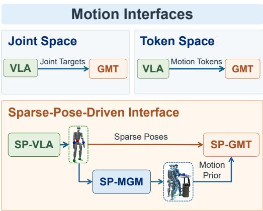

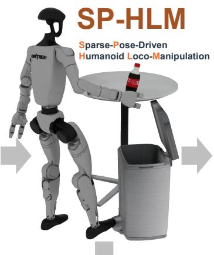

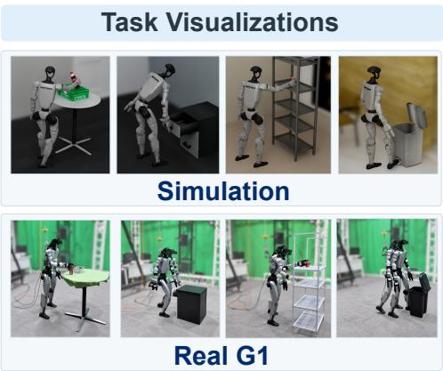

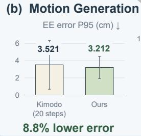

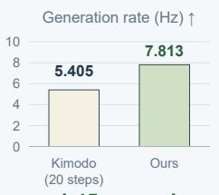

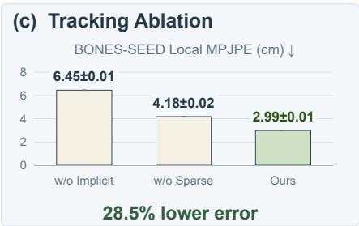  
Fig. 1: SP-HLM: Sparse-pose-driven humanoid loco-manipulation. Top: The interface combines explicit five-point targets with an implicit motion prior for diverse simulated and real-world tasks. Bottom: Results show higher task success, faster motion generation, improved end-effector adherence, and lower tracking error.

Abstract— Humanoid loco-manipulation requires an effective interface between high-level task policies and wholebody control. Existing interfaces typically rely on a single action representation for both task intent and whole-body coordination. This may burden the high-level policy or leave one aspect underspecified. We present SP-HLM, a framework built on a sparse-pose-driven interface. The interface combines five task-critical body poses with a learned latent motion prior to represent spatial intent and whole-body coordination in complementary forms. SP-VLA, a vision-language-action model, first predicts task-relevant sparse poses and finger joint positions from multimodal observations and language instructions using asynchronous action-chunk inference. Given these sparse targets, SP-MGM, a motion generation model trained through two-stage distillation, reconstructs coordinated full-body motion in real time. A pretrained motion encoder maps this motion to a compact latent representation. SP-GMT, a general motion tracker, then integrates the explicit sparse targets with this implicit motion prior for whole-body control.

Experiments in simulation and on a real humanoid robot demonstrate improved motion tracking, whole-body coordination, and loco-manipulation success over existing approaches. Additional results and videos are available on our project page.

## I. INTRODUCTION

The motion interface between high-level task policies and whole-body control is an important design choice in humanoid loco-manipulation [1], [2], [3]. Existing interfaces emphasize different aspects of humanoid motion. Jointspace actions [4], [5], [6] directly specify joint configurations, but can require the high-level policy to model whole-body coordination alongside task intent. Task-space actions provide a compact, task-grounded representation, yet sparse targets alone do not fully specify coordinated wholebody motion. Token-space actions [7] can encode reusable coordination patterns, while task-critical spatial targets may remain implicit. These trade-offs motivate an interface that combines representations of spatial intent and whole-body coordination, rather than encoding both in a single form.

We argue that task-critical spatial intent and whole-body coordination should instead be represented in complementary forms. Spatial intent remains explicit, specifying where task-relevant body parts should move, whereas whole-body coordination is encoded implicitly as a learned motion prior describing how the body should move. Following this principle, we expose only five task-critical body poses— the pelvis, two wrists, and two ankles—as explicit spatial constraints and complement them with a latent whole-body motion representation. This interface preserves direct taskspace control while avoiding the need for the high-level policy to explicitly specify full-body coordination.

Following this formulation, we present SP-HLM, a humanoid loco-manipulation framework built on a sparse-posedriven interface. At its core, SP-GMT performs wholebody control by jointly conditioning on sparse task-space targets and a learned motion latent. We pretrain a motion variational autoencoder (VAE) to encode full-body motion into a compact latent representation. This latent provides coordination information not fully specified by the sparse targets while enabling efficient policy training.

To obtain this implicit motion prior from sparse taskspace targets at deployment, we introduce SP-MGM, which reconstructs coordinated full-body motion from five-point pose targets in real time. Starting from a pretrained motion generation model, SP-MGM reduces network depth and denoising steps and employs two-stage distillation to improve sparse-pose adherence and temporal consistency.

The proposed interface also reduces the burden of highlevel action prediction. SP-VLA predicts only task-relevant sparse body poses and finger joint positions from multimodal observations and language instructions, without directly predicting full-body configurations. We further adopt asynchronous action-chunk inference for responsive closedloop execution. Together, SP-VLA specifies task-space intent, SP-MGM recovers coordinated whole-body motion, and SP-GMT integrates the explicit sparse targets and implicit motion prior for whole-body control.

We separately evaluate SP-GMT, SP-MGM, and the complete SP-HLM system. SP-GMT achieves competitive motion-tracking performance against representative stateof-the-art baselines. SP-MGM improves sparse-pose adherence over the motion-generation baseline while achieving a 1.45× higher generation rate. For loco-manipulation, SP-HLM achieves a 52.75% overall success rate across eight simulated tasks, outperforming the token-space and jointspace baselines. We further validate SP-HLM on four realworld tasks, demonstrating its feasibility for humanoid locomanipulation. Our main contributions are:

• We propose a sparse-pose-driven motion interface for humanoid loco-manipulation, combining five taskcritical body poses with a learned motion prior to represent spatial intent and whole-body coordination in complementary forms.

• We develop SP-GMT, a whole-body tracker conditioned jointly on sparse targets and a pretrained motion representation, and SP-MGM, a real-time sparseconditioned motion generator trained through two-stage distillation.

• We present SP-HLM, a humanoid loco-manipulation framework that integrates the above two components with SP-VLA, which uses asynchronous action-chunk inference to predict task-relevant sparse poses and finger joint-position targets from multimodal inputs. The resulting system achieves higher overall success than the evaluated baselines across eight simulated tasks and is further validated on four real-world tasks.

## II. RELATED WORK

## A. General Humanoid Motion Generation and Control

Recent work increasingly uses motion generation as an intermediate layer between high-level semantic commands and low-level humanoid control, typically producing dense whole-body references for downstream tracking [8], [9], [10]. Some methods formulate motion synthesis as an inbetweening problem [11], whereas others employ generative models as online motion planners [12], [13]. Although these approaches demonstrate the effectiveness of generative motion priors for hierarchical control, they largely rely on dense motion references rather than explicit task-space interfaces tailored to loco-manipulation.

In parallel, general motion tracking has emerged as a scalable approach to acquiring versatile whole-body control from large and diverse motion corpora [7], [14], [15], [16]. Recent studies improve generalization by scaling motion data and model capacity [17], [18], [19], [20], while others leverage heterogeneous motion sources or expert specialization [21], [22], [23]. Related efforts learn reusable behavioral representations that can be transferred to downstream control tasks [24], [25]. Together, these advances provide increasingly general and robust motion generation and control capabilities, while the interface for conveying task-relevant whole-body intent from high-level loco-manipulation policies remains comparatively less explored.

## B. Motion Interfaces for Humanoid Loco-Manipulation

Recent humanoid loco-manipulation systems increasingly pursue unified whole-body behaviors through visionlanguage-action models (VLAs) [1], [5], [4], [26], [27], world-action models [28], [29], and perceptive reinforcement policies [2], [30]. Beyond the choice of policy architecture, an important design consideration is the motion interface through which task-level intent is conveyed to whole-body execution. Existing approaches span decoupled upper- and lower-body control [5], [1] and explicit whole-body kinematic representations [31], [4]. While these interfaces provide direct control over robot motion, they can require the high-level policy to reason over relatively detailed body configurations. Other methods adopt more compact learned motion representations, such as motion tokens [28], [32], which capture reusable coordination patterns but make taskrelevant spatial constraints less explicit.

Recent work also explores compact task-space interfaces based on sparse body targets or low-rate task-space trajectories, leaving the remaining whole-body coordination to downstream controllers [33], [34], [35]. In contrast, SP-HLM combines explicit task-space targets with a learned wholebody motion prior, providing a compact interface between task-level intent and coordinated whole-body execution.

## III. METHOD

## A. SP-HLM Overview

As illustrated in Fig. 2, SP-HLM connects high-level loco-manipulation policies to low-level whole-body control through a sparse-pose-driven interface. The sparse poses specify task-relevant spatial constraints on five body parts in the world frame: the pelvis, both wrists, and both ankles. Each pose comprises a 3-D position and a 6-D rotation.1 In addition, a full-body motion prior generated from these poses provides whole-body coordination consistent with the specified task geometry. An explicit–implicit tracking policy then integrates the sparse-pose constraints with the latent motion prior to enable humanoid loco-manipulation.

Specifically, at each planning step, SP-VLA predicts a sequence of five-point target poses together with the finger joints of both hands. SP-MGM then generates a fullbody motion trajectory conditioned on these targets, and a pretrained motion encoder maps the trajectory to a latent command. SP-GMT combines this latent command with the sparse targets expressed in the current pelvis frame to produce joint position commands. The finger targets are passed directly to the hand PD controllers. Formally,

$$
\begin{array} { r l } { m _ { t : t + H } = G _ { \psi } ( { \mathbf k } _ { t : t + H } ^ { W } ) , \qquad } & { \mathbf { z } _ { t } = E _ { \phi } \left( m _ { t : t + H } \right) , } \\ { { \mathbf k } _ { t } ^ { b } = \mathcal { T } _ { P _ { t } } ( { \mathbf k } _ { t } ^ { W } ) , \qquad } & { \mathbf { a } _ { t } = \pi _ { \theta } \left( \mathbf { z } _ { t } , \mathbf { k } _ { t } ^ { b } , \mathbf { s } _ { t } ^ { \mathrm { p r o p } } , \mathbf { a } _ { t - 1 } \right) , } \end{array}\tag{1}
$$

where $\mathbf { k } _ { t : t + H } ^ { W }$ denotes the five-point target sequence from SP-VLA; $G _ { \psi } , E _ { \phi } ,$ , and $\pi _ { \theta }$ denote SP-MGM, the motion VAE encoder, and the SP-GMT policy, respectively. The notation is explained in detail in the following sections.

## B. SP-GMT: Explicit–Implicit General Motion Tracking

SP-GMT implements our sparse-pose-driven interface at the low-level control stage through explicit-implicit integration. Sparse body poses explicitly specify task-critical spatial constraints, while the motion latent encodes whole-body coordination. The policy combines both signals to enable precise and dynamically feasible whole-body control.

1) Yaw-Invariant Latent Motion Prior: We pretrain a motion variational autoencoder (VAE) on approximately 190 hours of motion data to learn a representation of coordinated whole-body motion. Let J denote the number of actuated joints. Each motion frame is represented as

$$
\mathbf { f } _ { t } = \left[ \mathbf { q } _ { t } , { \dot { \mathbf { q } } } _ { t } , \mathbf { r } _ { p , t } ^ { b } , \mathbf { v } _ { p , t } ^ { b } , \omega _ { p , t } ^ { b } \right] \in \mathbb { R } ^ { 2 J + 1 2 } ,\tag{2}
$$

1The 6-D representation is obtained by flattening the first two columns of the rotation matrix in row-major order: $[ R _ { 1 1 } , R _ { 1 2 } , R _ { 2 1 } , R _ { 2 2 } , R _ { 3 1 } , R _ { 3 2 } ]$ ].

where $\mathbf { q } _ { t }$ and $\dot { \mathbf { q } } _ { t }$ are joint positions and velocities, $\mathbf { r } _ { p , t } ^ { b }$ is the 6-D pelvis orientation, and $\mathbf { v } _ { p , t } ^ { b }$ and $\omega _ { p , t } ^ { b }$ are pelvis linear and angular velocities. Notably, all pelvis quantities are expressed in a frame aligned with the current pelvis yaw, while global horizontal translation and heading are removed. The resulting representation is invariant to global placement while preserving articulated pose, pelvis tilt, and local root dynamics, facilitating compact motion encoding.

At each time step, we construct a short motion window

$$
\mathbf { F } _ { t } = \left[ \mathbf { f } _ { t + 1 } , \ldots , \mathbf { f } _ { t + H } \right] , \qquad H = 1 0 ,\tag{3}
$$

and encode it using a skip-connected transformer. The VAE is trained by minimizing

$$
L _ { \mathrm { V A E } } = L _ { \mathrm { r e c } } + \beta D _ { \mathrm { K L } } \left( E _ { \phi } \left( \mathbf { z } _ { t } | \mathbf { F } _ { t } \right) \parallel \mathcal { N } ( \mathbf { 0 } , \mathbf { I } ) \right) ,\tag{4}
$$

where $L _ { \mathrm { r e c } }$ equally weights reconstruction errors for joint states, pelvis orientation, and pelvis velocities, and $\beta$ controls the KL regularization strength.

After pretraining, the encoder is frozen and its posterior mean is used as the deterministic motion latent. This latent provides a compact whole-body motion representation for the downstream tracking policy, which also helps improve training efficiency. VAE training is conducted on Moore Threads S5000 GPUs.

2) Explicit–Implicit Integration: SP-GMT integrates an implicit motion latent with explicit sparse-pose targets:

$$
\mathbf { z } _ { t } = E _ { \phi } ( m _ { t : t + H } ) , \qquad \mathbf { k } _ { t } ^ { b } = \mathcal { T } _ { P _ { t } } ( \mathbf { k } _ { t } ^ { W } ) .\tag{5}
$$

For the implicit branch, $E _ { \phi }$ maps the full-body motion $m _ { t : t + H }$ to $\mathbf { z } _ { t }$ through yaw-aligned preprocessing and motion encoding. For the explicit branch, $\mathcal { T } _ { P _ { t } }$ transforms the worldframe five-point poses $\mathbf { k } _ { t } ^ { W }$ into the current robot pelvis frame. Each target is represented as $\mathbf { k } _ { t , i } ^ { b } = [ \mathbf { p } _ { t , i } ^ { b } , \mathbf { r } _ { t , i } ^ { b } ]$ , where $\mathbf { p } _ { t , i } ^ { b } \in \mathbb { R } ^ { 3 }$ and $\mathbf { r } _ { t , i } ^ { b } \in \mathbb { R } ^ { 6 }$ denote its relative position and orientation.

In addition to these two commands, the policy receives the current proprioceptive state ${ \bf s } _ { t } ^ { \mathrm { p r o p } }$ and previous action $\mathbf { a } _ { t - 1 }$ The resulting actor observation is $\mathbf { 0 } _ { t } ^ { \tau ^ { - } } = [ \mathbf { z } _ { t } , \mathbf { k } _ { t } ^ { b } , \mathbf { s } _ { t } ^ { \mathrm { p r o p } } , \mathbf { a } _ { t - 1 } ]$ from which the policy predicts body joint-position targets. Here, ${ \bf s } _ { t } ^ { \mathrm { p r o p } }$ comprises the body joint positions and velocities, world-frame pelvis pose, base linear and angular velocities, and projected gravity. Regarding command sources, SP-GMT training uses five-point poses and full-body motion from reference data, whereas SP-HLM deployment obtains them online from SP-VLA and SP-MGM, respectively.

3) Tracking Policy Optimization: Following standard motion-tracking practice [25], we formulate SP-GMT training as a goal-conditioned reinforcement learning problem and optimize the policy with PPO. We adopt an asymmetric actor–critic architecture, where the critic receives privileged full-body state information during training.

The tracking reward is given by

$$
r _ { t } = w _ { \mathrm { s p } } r _ { \mathrm { s p } } + w _ { \mathrm { p o s e } } r _ { \mathrm { p o s e } } + w _ { \mathrm { v e l } } r _ { \mathrm { v e l } } - w _ { \mathrm { r e g } } r _ { \mathrm { r e g } } ,\tag{6}
$$

where $r _ { \mathrm { p o s e } }$ and $r _ { \mathrm { v e l } }$ encourage full-body pose and velocity tracking, respectively, while $r _ { \mathrm { r e g } }$ penalizes undesirable control behavior. The additional sparse-pose term $r _ { \mathrm { s p } }$ rewards the global position and orientation tracking of the five-point poses, thereby enforcing task-relevant spatial constraints.

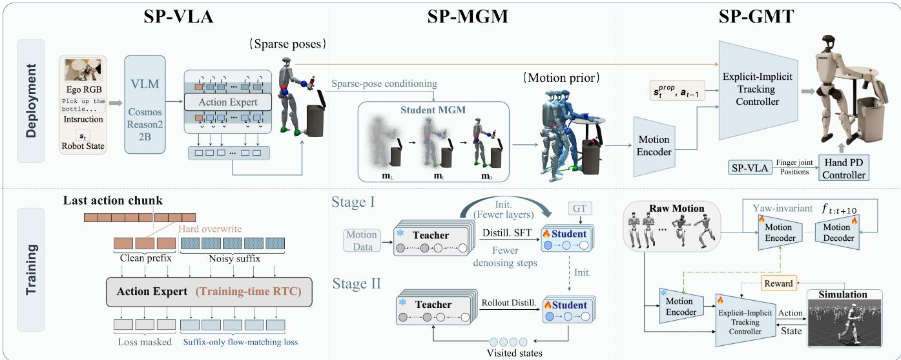  
Fig. 2: Overview of the proposed SP-HLM framework based on the sparse-pose-driven interface. Top: the deployment pipeline integrating sparse-pose prediction, full-body motion generation, and explicit–implicit whole-body control. Bottom: the training procedures for SP-VLA, SP-MGM, and SP-GMT.

During training, we combine failure-aware and uniform motion sampling to emphasize challenging segments while maintaining motion coverage. We also randomize motor dynamics, contact properties, external perturbations, action delays, and command-filtering parameters to improve deployment robustness.

C. SP-MGM: Real-Time Motion Generation from Sparse Pose Constraints

SP-MGM generates the full-body motion prior for the sparse-pose-driven interface, conditioned on five-point targets. To enable real-time inference, we compress a pretrained diffusion-based motion generator [36] by reducing its network depth and denoising steps. A two-stage distillation strategy is then designed to improve adherence to the sparsepose constraints while maintaining motion smoothness and full-body coordination.

1) Offline Supervised Fine-Tuning (Stage I): The compressed student is jointly trained using frozen-teacher predictions and paired ground-truth motions to acquire general full-body motion generation capabilities. The student adopts an $N _ { S }$ -step denoising schedule subsampled from the teacher’s NT-step schedule. For a sampled student timestep τ, $\rho ( \tau )$ denotes its noise-matched teacher timestep. The noisy motion $\mathbf { m } _ { \tau }$ is constructed from the paired clean motion m0 as

$$
\mathbf { m } _ { \tau } = \alpha _ { \tau } \mathbf { m } _ { 0 } + \sigma _ { \tau } \varepsilon , \varepsilon \sim \mathcal { N } ( \mathbf { 0 } , \mathbf { I } ) ,\tag{7}
$$

where $( \alpha _ { \tau } , \sigma _ { \tau } )$ specifies the noise level shared by student timestep τ and teacher timestep $\rho ( \tau )$

Given the same noisy motion and sparse constraints, the student and teacher predict the clean motion:

$$
\begin{array} { r } { \widehat { \mathbf { m } } _ { 0 } ^ { S } = G _ { S } \left( \mathbf { m } _ { \tau } , \mathbf { K } _ { t } ^ { W } , \tau \right) , \quad \widehat { \mathbf { m } } _ { 0 } ^ { T } = G _ { T } \left( \mathbf { m } _ { \tau } , \mathbf { K } _ { t } ^ { W } , \rho ( \tau ) \right) . } \end{array}\tag{8}
$$

The student is then optimized with the joint objective:

$$
L _ { \mathrm { s f t } } = w _ { T } L _ { \mathrm { m o t } } \left( \widehat { \mathbf { m } } _ { 0 } ^ { S } , \widehat { \mathbf { m } } _ { 0 } ^ { T } \right) + w _ { \mathrm { G T } } L _ { \mathrm { m o t } } \left( \widehat { \mathbf { m } } _ { 0 } ^ { S } , \mathbf { m } _ { 0 } \right) ,\tag{9}
$$

where $L _ { \mathrm { m o t } }$ denotes the full-body reconstruction loss over root and joint kinematics, foot contacts, and FK consistency; wT and wGT dynamically weight the teacher and groundtruth terms to balance the pretrained motion prior with motion reconstruction fidelity.

2) Rollout-Aware Distillation (Stage II): Stage I trains the student only on forward-diffused states, causing error accumulation and distribution shift during inference. To address this, Stage II further applies frozen-teacher supervision to student-visited states under five-point conditioning. After each student rollout, we sample intermediate states $\mathbf { m } _ { \tau } ^ { S }$ and obtain corrective clean-motion targets from the teacher:

$$
\begin{array} { r } { \widehat { \mathbf { m } } _ { 0 , \mathrm { c o r r } } ^ { T } = G _ { T } \left( \mathbf { m } _ { \tau } ^ { S } , \mathbf { K } _ { t } ^ { W } , \rho ( \tau ) \right) . } \end{array}\tag{10}
$$

To further enforce temporal smoothness, the final rolloutaware objective is:

$$
\begin{array} { r } { L _ { \mathrm { r o l l } } = L _ { \mathrm { m o t } } \left( \widehat { \mathbf { m } } _ { 0 } ^ { S } , \widehat { \mathbf { m } } _ { 0 , \mathrm { c o r r } } ^ { T } \right) + \lambda _ { \mathrm { t e m p } } L _ { \mathrm { t e m p } } , } \end{array}\tag{11}
$$

where $L _ { \mathrm { t e m p } }$ applies finite-difference regularization to joint motion, pelvis translation, and orientation to suppress highfrequency variations. Through the two-stage distillation strategy, the resulting SP-MGM generates high-fidelity, temporally smooth full-body motion using a compressed network and fewer denoising steps.

## D. SP-VLA: Asynchronous Sparse-Pose and Hand-Command Prediction

Serving as the front end of the sparse-pose-driven interface, SP-VLA is initialized from pretrained GR00T N1.7 [37]. We fine-tune only its flow-matching action head while keeping the vision–language backbone frozen. Given an egocentric RGB image ${ \bf 0 } _ { t } ,$ language instruction $\ell ,$ and robot state s , SP-VLA predicts an H-step sequence of worldframe target poses for the pelvis, both wrists, and both ankles, together with finger joint-position targets for both hands:

Task 3: Step on the pedal to open the trash bin.  
Task 1: Walk forward and pick up the cylinder.  

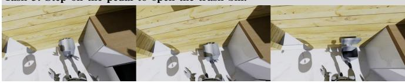

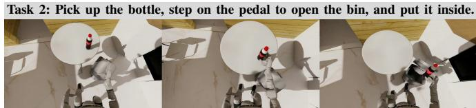

Task 5: Squat down and pull open the upper drawer of the cabinet.  

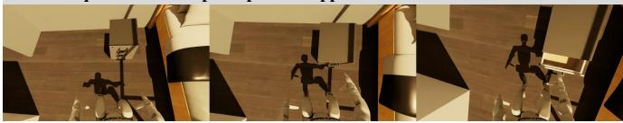  
Task 7: Kick the football into the goal.

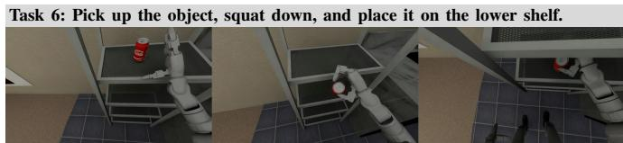

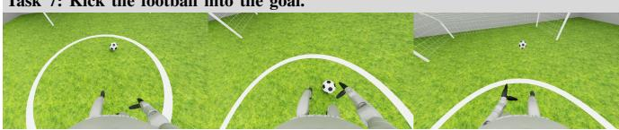

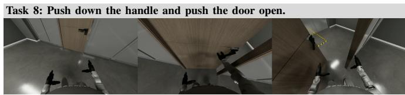  
Fig. 3: Qualitative rollouts of SP-HLM on eight simulated loco-manipulation tasks. Each sequence shows three temporally ordered keyframes illustrating task progression, with the corresponding language instruction shown above.

TABLE I: Success rates across eight simulated loco-manipulation tasks.
<table><tr><td>Method</td><td>T1: Pick</td><td> $\mathrm { T } 2 \colon$  Pick &amp; Step</td><td>T3: Step</td><td> $\mathrm { T 4 : }$  Pick &amp; Place</td><td> $\mathrm { T } 5 \colon$  Squat &amp; Pull</td><td> ${ \mathrm { T } } 6 { \mathrm { : } }$  Pick &amp; Squat</td><td>T7: Kick</td><td>T8: Push</td><td>Overall</td></tr><tr><td>GR00T &amp; Token Space</td><td>22/50</td><td>7/50</td><td>24/50</td><td>20/50</td><td>8/50</td><td>9/50</td><td>19/50</td><td>26/50</td><td>33.75%</td></tr><tr><td>GR0OT &amp; Joint Space</td><td>11/50</td><td>11/50</td><td>20/50</td><td>19/50</td><td>8/50</td><td>21/50</td><td>13/50</td><td>23/50</td><td>31.50%</td></tr><tr><td>SP-HLM (Direct Latent Prediction)</td><td>20/50</td><td>6/50</td><td>20/50</td><td>6/50</td><td>16/50</td><td>6/50</td><td>6/50</td><td>13/50</td><td>23.25%</td></tr><tr><td>SP-HLM (Ours)</td><td>26/50</td><td>13/50</td><td>39/50</td><td>24/50</td><td>19/50</td><td>26/50</td><td>28/50</td><td>36/50</td><td>52.75%</td></tr></table>

Task descriptions. T1: walk forward and pick up the cylinder; T2: pick up the bottle, step on the pedal to open the bin, and put it inside; T3: step on the pedal to open the trash bin; T4: pick up the bottle and place it in the box; T5: squat down and pull open the upper drawer of the cabinet; T6: pick up the object, squat down, and place it on the lower shelf; T7: kick the football into the goal; and T8: push down the handle and push the door open.

$$
\left[ \mathbf { k } _ { t : t + H - 1 } ^ { W } , \mathbf { g } _ { t : t + H - 1 } \right] \sim \pi _ { \eta } \left( \cdot \mid \mathbf { o } _ { t } , \ell , \mathbf { s } _ { t } \right) ,\tag{12}
$$

where $\mathbf { s } _ { t }$ comprises the body joint positions, the world-frame pelvis pose, and the finger joint positions of both hands; $\mathbf { g } _ { t : t + H - 1 }$ denotes the finger joint-position target sequence.

During fine-tuning, we adopt training-time RTC [38] to accommodate inference latency. For a sampled delay $d ,$ let $\mathbf { u } _ { i } = [ \mathbf { k } _ { t + i } ^ { W } , \mathbf { g } _ { t + i } ]$ denote the i-th element of the combined action chunk. At flow time τ, we retain a clean prefix and perturb only the suffix:

$$
\widetilde { \mathbf { u } } _ { i } ^ { \tau } = \left\{ \mathbf { u } _ { i } , \qquad i < d , \qquad \varepsilon _ { i } \sim \mathcal { N } ( \mathbf { 0 } , \mathbf { I } ) , \right.\tag{13}
$$

where $i = 0 , \ldots , H - 1$ and $\tau \in [ 0 , 1 ]$ . The flow-matching loss is applied only to the suffix, training the policy to generate subsequent sparse poses and hand commands conditioned on the committed prefix. This prefix conditioning promotes temporal continuity across action chunks.

During SP-HLM inference, SP-VLA begins generating the next action chunk from updated observations while the current chunk is still being executed. This asynchronous execution reduces inference-induced waiting between chunks. With TensorRT acceleration, SP-VLA and SP-MGM achieve inference rates of 25Hz and 10Hz, respectively.

## IV. EXPERIMENTS

Through our experiments, we aim to answer the following three research questions:

• RQ1: Does the proposed explicit–implicit tracking policy improve motion-tracking performance, and how does it compare with SOTA general motion trackers?

• RQ2: Can the proposed two-stage distillation strategy accelerate motion generation while preserving accurate adherence to sparse end-effector constraints?

• RQ3: Does our sparse-pose-driven interface provide higher task success than joint-based and token-based interfaces across diverse loco-manipulation tasks, and

how well does the complete system transfer to realworld humanoid deployment?

## A. Motion Tracking Performance

We evaluate tracking on two 500-motion datasets: Filtered CLOT-500 [39] and BONES-SEED Diverse-500 [36]. Each dataset is evaluated over ten seeded runs, where perturbations are applied to the reference trajectories. Both are unseen during SP-GMT training, while BONES-SEED Diverse-500 is included in SONIC’s training data.

1) Comparison with Motion-Tracking Baselines: As shown in Table II, among the compared methods, SP-GMT achieves the lowest global MPJPE and global EE error on both datasets. For local tracking, it ranks second in five of the six dataset–metric comparisons across local MPJPE, joint error, and local EE error. Notably, SP-GMT is trained on a substantially smaller motion corpus with only 192 GPU-hours, compared with 21k GPU-hours for SONIC and 15k GPU-hours for Humanoid-GPT. These results indicate competitive local motion fidelity and strong global trajectory tracking with substantially less data and training compute.

2) Ablation Study of SP-GMT: The ablations suggest that the explicit and implicit references provide complementary information. Using only the latent reference (w/o Sparse Reference) leads to substantially larger global tracking errors, while using only the five-point reference (w/o Implicit Reference) degrades local tracking and joint accuracy. Replacing the latent reference with a joint-space reference also increases global tracking error. Combining sparse spatial targets with the learned latent reference in SP-GMT yields the lowest global MPJPE and EE error on both benchmarks while remaining competitive in local tracking, demonstrating the benefit of the explicit–implicit representation.

Removing the robot pelvis pose causes only a moderate performance drop compared with the full model. This suggests that SP-GMT is not strongly dependent on precise pelvis localization.

## B. Motion Generation Quality and Efficiency

We select 600 motions from BONES-SEED [36], covering diverse motion dynamics and spatial extent. Sparse-pose adherence is measured by EE error, and motion smoothness by EE jerk and body jerk. Lower error and jerk values indicate better motion generation quality, while a higher generation rate indicates greater efficiency. All results are summarized in Table III.

1) Comparison with Motion-Generator Baseline: Under the same 20-step denoising setting, we compare SP-MGM against the uncompressed Kimodo baseline. Despite modest increases in EE jerk and body jerk, SP-MGM achieves lower mean and P95 EE errors. Notably, its generation rate reaches up to 1.45× that of Kimodo. These results demonstrate that our two-stage distillation strategy enables more accurate and efficient motion generation under sparse-pose constraints.

2) Ablation study of SP-MGM: Full SP-MGM achieves the best performance across all metrics among the compared

SP-MGM variants. With Stage I alone (w/o Stage II), SP-MGM exhibits larger EE errors and higher body jerk, with P95 EE error increasing from 3.212 to 12.772 cm. These results indicate that Stage I establishes basic motion generation capability, while Stage II substantially improves adherence to the sparse-pose targets and temporal smoothness. Without Ltemp, EE accuracy remains close to that of full SP-MGM, but EE and body jerk P95 increase by 27.8% and 37.0%, respectively. Temporal regularization thus suppresses highfrequency jitter while also slightly reducing EE errors.

## C. Loco-Manipulation Evaluation

1) Experimental Setup: We evaluate the complete SP-HLM system in both simulation and the real world. To provide a wider field of view, we equip the Unitree G1 with a ZED 2i stereo camera.

Our simulated evaluation consists of eight locomanipulation tasks, as illustrated in Fig. 3. For the six tasks designed in-house (T1–T6), we collect 120 teleoperation demonstrations per task using SONIC. Following the offline replay-and-render paradigm of SIMPLE [40], we augment these demonstrations by randomizing object positions, robot initial positions, and lighting conditions. To avoid restricting the evaluation to our own demonstrations, we include two additional loco-manipulation tasks from the HumanoidArena benchmark [41] (T7 and T8), together with their benchmark demonstrations. The resulting eight tasks cover whole-body workspace extension, body-part interaction, and locomotionconditioned manipulation.

For the real-world evaluation, we select four representative loco-manipulation tasks in everyday settings, as shown in Fig. 4. We collect 80 teleoperation demonstrations per task using SONIC, whereas SP-HLM employs SP-GMT for whole-body control during evaluation. Thus, this setting also evaluates whether the sparse-pose-driven interface preserves task intent across different whole-body trackers.

2) Simulated Loco-Manipulation: We evaluate each method over 50 trials per task. For each evaluation trial, the object position, robot initial position, and lighting condition are independently resampled. Both GR00T baselines use the same SONIC backend, making the comparison more reflective of differences in motion interface. As shown in Table I, SP-HLM achieves the highest overall success rate among the evaluated methods. This result highlights the advantage of the sparse-pose-driven interface over the evaluated tokenspace and joint-space interfaces for coordinated whole-body loco-manipulation. In the Direct Latent Prediction variant, SP-VLA directly predicts the motion latent alongside sparse poses and finger joint-position targets. The overall success rate drops to 23.25%, suggesting that separating explicit spatial targets from implicit whole-body motion generation is beneficial for loco-manipulation. Fig. 3 shows SP-HLM execution keyframes and language instructions for all eight simulated tasks.

3) Real-World Loco-Manipulation: To further assess deployment performance, we evaluate SP-HLM over 20 trials per real-world task. As shown in Table IV, SP-HLM achieves success rates exceeding 50% on both object placement and shelf transfer. Even on the more challenging cabinet opening and trash-bin opening tasks, it achieves success rates of 25% and 40%, respectively. Fig. 4 shows representative execution keyframes from the real-world deployments.

TABLE II: Motion tracking under trajectory observation noise over ten seeded runs. All methods use the same evaluation configuration. Values report the population mean ± standard deviation. Bold and underlined means indicate the best and second-best results, respectively.
<table><tr><td>Method</td><td>Progress ↑ (%)</td><td>Local MPJPE ↓ (m)</td><td>Global MPJPE ↓ (m)</td><td>Joint error ↓ (rad)</td><td>EE global error ↓ (m)</td><td>EE local error ↓ (m)</td></tr><tr><td colspan="7">Filtered CLOT-500</td></tr><tr><td>SP-GMT w/ Joint-Space Reference</td><td> $9 9 . 3 5 \pm 0 . 1 4$ </td><td> $0 . 0 3 0 5 { \scriptstyle \pm 0 . 0 0 0 0 }$ </td><td> $0 . 0 8 1 2 { \scriptstyle \pm 0 . 0 0 0 4 }$ </td><td> $0 . 0 9 7 5 { \scriptstyle \pm 0 . 0 0 0 1 }$ </td><td> $0 . 0 8 7 9 \pm 0 . 0 0 0 4$ </td><td> $0 . 0 5 7 1 { \scriptstyle \pm 0 . 0 0 0 1 }$ </td></tr><tr><td>SP-GMT w/o Sparse Reference</td><td> $9 9 . 2 8 \pm 0 . 1 9$ </td><td> $0 . 0 3 9 0 { \scriptstyle \pm 0 . 0 0 0 0 }$ </td><td> $0 . 4 4 3 6 \pm 0 . 0 0 3 6$ </td><td> $0 . 1 5 3 8 \pm 0 . 0 0 0 0$ </td><td> $0 . 4 5 0 6 \pm 0 . 0 0 3 6$ </td><td> $0 . 0 7 3 3 { \pm } 0 . 0 0 0 0$ </td></tr><tr><td>SP-GMT w/o Implicit Reference</td><td> $9 8 . 9 3 \pm 0 . 2 4$ </td><td> $0 . 0 6 5 9 { \scriptstyle \pm 0 . 0 0 0 0 }$ </td><td> $0 . 1 3 0 3 \pm 0 . 0 0 0 3$ </td><td> $0 . 2 4 0 7 \pm 0 . 0 0 0 1$ </td><td> $0 . 1 4 7 0 { \scriptstyle \pm 0 . 0 0 0 3 }$ </td><td> $0 . 1 2 3 9 \pm 0 . 0 0 0 1$ </td></tr><tr><td>SP-GMT w/o Robot Pelvis Pose</td><td> $9 9 . 3 3 \pm 0 . 2 7$ </td><td> $0 . 0 3 5 6 \pm 0 . 0 0 0 0$ </td><td> $0 . 0 7 5 3 { \scriptstyle \pm 0 . 0 0 0 1 }$ </td><td> $0 . 1 3 3 0 { \pm } 0 . 0 0 0 1$ </td><td> $0 . 0 8 3 6 { \pm } 0 . 0 0 0 2$ </td><td> $0 . 0 6 6 3 \pm 0 . 0 0 0 1$ </td></tr><tr><td>SP-GMT (Ours)</td><td> $9 9 . 8 3 \pm 0 . 0 8$ </td><td> $0 . 0 2 7 8 { \scriptstyle \pm 0 . 0 0 0 0 }$ </td><td> $\mathbf { 0 . 0 6 7 6 } \pm 0 . 0 0 0 2$ </td><td> $0 . 0 8 8 9 { \scriptstyle \pm 0 . 0 0 0 1 }$ </td><td> $\mathbf { 0 . 0 7 3 3 } \pm 0 . 0 0 0 1$ </td><td> $0 . 0 5 1 6 \pm 0 . 0 0 0 0$ </td></tr><tr><td>SONIC [7]</td><td> $\mathbf { 1 0 0 . 0 0 } \pm 0 . 0 0$ </td><td> $0 . 0 2 9 4 \pm 0 . 0 0 0 0$ </td><td> $0 . 4 1 7 7 { \scriptstyle \pm 0 . 0 0 1 5 }$ </td><td> $0 . 1 0 9 7 { \scriptstyle \pm 0 . 0 0 0 0 }$ </td><td> $0 . 4 1 6 6 \pm 0 . 0 0 1 5$ </td><td> $0 . 0 5 0 9 { \scriptstyle \pm 0 . 0 0 0 0 }$ </td></tr><tr><td>Humanoid-GPT [18]</td><td> $g 9 . 9 3 { \pm } 0 . 0 8$ </td><td> $\mathbf { 0 . 0 2 4 5 \pm 0 . 0 0 0 0 }$ </td><td> $0 . 4 7 4 2 \pm 0 . 0 0 5 2$ </td><td> $\mathbf { 0 . 0 5 7 2 } \pm 0 . 0 0 0 0$ </td><td> $0 . 4 7 7 8 \pm 0 . 0 0 5 2$ </td><td> $\mathbf { 0 . 0 4 3 4 } \pm 0 . 0 0 0 0$ </td></tr><tr><td colspan="7">BONES-SEED Diverse-500</td></tr><tr><td>SP-GMT w/ Joint-Space Reference</td><td> $9 0 . 2 1 \pm 0 . 1 0$ </td><td> $0 . 0 3 1 5 { \pm } 0 . 0 0 0 1$ </td><td> $0 . 0 9 0 6 { \scriptstyle \pm 0 . 0 0 0 8 }$ </td><td> $0 . 0 8 4 4 \pm 0 . 0 0 0 2$ </td><td> $\underline { { 0 . 0 9 0 8 } } \pm 0 . 0 0 0 8$ </td><td> $0 . 0 5 6 8 \pm 0 . 0 0 0 2$ </td></tr><tr><td>SP-GMT w/o Sparse Reference</td><td> $9 2 . 2 3 \pm 0 . 1 6$ </td><td> $0 . 0 4 1 8 \pm 0 . 0 0 0 2$ </td><td> $0 . 5 7 6 3 \pm 0 . 0 4 1 6$ </td><td> $0 . 1 3 8 0 \pm 0 . 0 0 0 4$ </td><td> $0 . 5 8 0 4 \pm 0 . 0 4 1 4$ </td><td> $0 . 0 7 7 2 { \scriptstyle \pm 0 . 0 0 0 4 }$ </td></tr><tr><td>SP-GMT w/o Implicit Reference</td><td> $9 1 . 1 9 \pm 0 . 2 0$ </td><td> $0 . 0 6 4 5 \pm 0 . 0 0 0 1$ </td><td> $0 . 1 6 2 7 \pm 0 . 0 0 0 9$ </td><td> $0 . 2 0 5 9 \pm 0 . 0 0 0 2$ </td><td> $0 . 1 6 7 8 \pm 0 . 0 0 0 9$ </td><td> $0 . 1 2 0 9 \pm 0 . 0 0 0 2$ </td></tr><tr><td>SP-GMT w/o Robot Pelvis Pose</td><td> $9 2 . 1 5 \pm 0 . 1 7$ </td><td> $0 . 0 4 0 1 { \scriptstyle \pm 0 . 0 0 0 1 }$ </td><td> $0 . 0 9 5 8 \pm 0 . 0 0 1 1$ </td><td> $0 . 1 3 0 9 \pm 0 . 0 0 0 5$ </td><td> $0 . 1 0 2 5 { \scriptstyle \pm 0 . 0 0 1 1 }$ </td><td> $0 . 0 7 3 7 { \scriptstyle \pm 0 . 0 0 0 3 }$ </td></tr><tr><td>SP-GMT (Ours)</td><td> $9 2 . 2 4 \pm 0 . 0 9$ </td><td> $0 . 0 2 9 9 { \scriptstyle \pm 0 . 0 0 0 1 }$ </td><td> $\mathbf { 0 . 0 7 9 7 } \pm 0 . 0 0 0 9$ </td><td> $0 . 0 8 1 0 { \scriptstyle \pm 0 . 0 0 0 3 }$ </td><td> $\mathbf { 0 . 0 7 9 8 } \pm 0 . 0 0 0 9$ </td><td> $0 . 0 5 5 3 { \scriptstyle \pm 0 . 0 0 0 3 }$ </td></tr><tr><td>SONIC [7]</td><td> ${ \pm } 0 3 . 8 4 \pm 0 . 0 9$ </td><td> $0 . 0 3 8 6 \pm 0 . 0 0 0 0$ </td><td> $0 . 3 1 8 1 \pm 0 . 0 0 3 1$ </td><td> $0 . 1 0 9 1 { \scriptstyle \pm 0 . 0 0 0 1 }$ </td><td> $0 . 3 1 8 8 \pm 0 . 0 0 3 1$ </td><td> $0 . 0 6 0 9 { \scriptstyle \pm 0 . 0 0 0 0 }$ </td></tr><tr><td>Humanoid-GPT [18]</td><td> $9 0 . 1 0 { \pm } 0 . 1 2 \ $ </td><td> $\mathbf { 0 . 0 2 7 2 } \pm 0 . 0 0 0 1$ </td><td> $0 . 5 9 7 2 { \scriptstyle \pm 0 . 0 1 0 8 }$ </td><td> $\mathbf { 0 . 0 5 7 3 } \pm 0 . 0 0 0 1$ </td><td> $0 . 5 9 8 7 \pm 0 . 0 1 0 8$ </td><td> $\mathbf { 0 . 0 5 0 2 } \pm 0 . 0 0 0 1$ </td></tr></table>

TABLE III: Quantitative comparison of motion generation quality and efficiency. P95 denotes the 95th percentile of the corresponding error or jerk distribution. Reporting and highlighting conventions follow Table II.
<table><tr><td>Model</td><td>Network Depth ↓ (layers)</td><td>EE Error Mean ↓ (cm)</td><td>EE Error P95 ↓ (cm)</td><td>EE Jerk P95  $\downarrow ( \mathrm { m } / \mathrm { s } ^ { 3 } )$ </td><td>Body Jerk P95  $\downarrow ( \mathrm { m } / \mathrm { s } ^ { 3 } )$ </td><td>Generation Rate ↑(Hz)</td></tr><tr><td>Kimodo (20 steps)</td><td>16</td><td> $1 . 9 4 1 \pm 1 . 3 9 8$ </td><td> $3 . 5 2 1 \pm 2 . 8 3 2$ </td><td> $\mathbf { 4 5 0 . 7 6 8 \pm 2 2 4 . 9 9 6 }$ </td><td> $\mathbf { 3 7 0 . 2 2 5 \pm 1 7 8 . 4 5 8 }$ </td><td>5.405</td></tr><tr><td>SP-MGM (w/o Stage II)</td><td>8</td><td> $8 . 4 4 1 \pm 1 . 6 8 0$ </td><td> $1 2 . 7 7 2 \pm 3 . 0 8 0$ </td><td> $1 0 6 8 . 6 2 6 \pm 5 0 6 . 3 5 5$ </td><td> $9 1 6 . 7 2 4 \pm 4 7 6 . 0 1 1$ </td><td>7.634</td></tr><tr><td>SP-MGM (w/o  $L _ { \mathrm { t e m p } } )$ </td><td>8</td><td> $1 . 9 1 5 { \pm } 0 . 7 3 0$ </td><td> ${ \underline { { 3 . 4 2 0 } } } \pm 1 . 4 4 5$ </td><td> $6 5 7 . 1 2 5 \pm 3 1 1 . 3 9 2$ </td><td> $5 7 0 . 2 4 6 \pm 2 8 7 . 3 2 3$ </td><td>7.322</td></tr><tr><td>SP-MGM (Ours)</td><td>8</td><td> $\mathbf { 1 . 8 1 2 \mathop { \pm } 0 . 7 0 9 }$ </td><td> $3 . 2 1 2 \pm 1 . 2 8 9$ </td><td> $5 1 4 . 3 3 7 \pm 2 3 6 . 9 4 3$ </td><td> $4 1 6 . 9 4 5 \pm 2 0 0 . 5 0 7$ </td><td>7.813/11.494</td></tr></table>

Network depth denotes the number of transformer blocks in the motion generator. For our SP-MGM model, 7.813 Hz and 11.494 Hz denote the generation rates under standard inference and text-free inference with TensorRT acceleration, respectively.

TABLE IV: Real-world success rates of SP-HLM.  
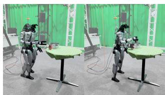

<table><tr><td>Real-world Task</td><td>T1: OP</td><td>T2: ST</td><td>T3: CO</td><td>T4: TO</td></tr><tr><td>Success Rate</td><td>13/20</td><td>11/20</td><td>5/20</td><td>8/20</td></tr></table>

T1: Object Placement  
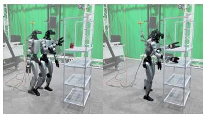

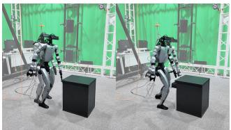

T2: Shelf Transfer  
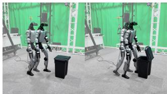  
T3: Cabinet Opening  
T4: Trash-Bin Opening  
Fig. 4: Representative rollouts of SP-HLM on four realworld humanoid loco-manipulation tasks.

Failure Case Analysis: The largest performance drops relative to simulation occur on tasks requiring precise manipulation under demanding balance conditions. Cabinet opening requires aligning the hand with a small handle while maintaining a single-leg squat, whereas trash-bin opening requires lifting one foot and placing it precisely on the narrow pedal. In both tasks, even slight body sway can induce end-effector pose deviations, compromising contact accuracy and leading to task failure.

## V. CONCLUSIONS

We presented SP-HLM, a humanoid loco-manipulation framework built on a sparse-pose-driven interface that integrates explicit sparse-pose constraints with an implicit fullbody motion prior. Three components realize this interface: SP-VLA predicts five-point poses and hand commands, SP-MGM reconstructs coordinated full-body motion, and SP-GMT integrates the explicit and implicit commands for whole-body control. Experiments on motion tracking, motion generation, and loco-manipulation in both simulation and the real world demonstrate the effectiveness of the proposed interface and the complete framework.

However, this study focuses primarily on whole-body coordination. Hand control is specified solely through finger joint-position targets, and we do not explore alternative hand-level interfaces or dexterous manipulation. Extending the proposed interface to support whole-body dexterous manipulation is an important direction for future work.

## REFERENCES

[1] H. Jiang, J. Chen, Q. Bu, L. Chen, M. Shi, Y. Zhang, D. Li, C. Suo, C. Wang, Z. Peng, and H. Li, “WholeBodyVLA: Towards unified latent VLA for whole-body loco-manipulation control,” in International Conference on Learning Representations (ICLR), 2026.

[2] S. Yin, Y. Ze, H.-X. Yu, C. K. Liu, and J. Wu, “VisualMimic: Visual humanoid loco-manipulation via motion tracking and generation,” arXiv preprint arXiv:2509.20322, 2025.

[3] B. Chen, Y. Chen, L. Qiu, J. Bai, Y. Ge, and Y. Ge, “UniT: Toward a unified physical language for human-to-humanoid policy learning and world modeling,” arXiv preprint arXiv:2604.19734, 2026.

[4] Y. Hu, H. Zhu, B. Zheng, Y. Hu, T. Zhang, Z. Chen, J. Zhao, R. Nai, and Y. Gao, “OpenHLM: An empirical recipe for wholebody humanoid loco-manipulation,” arXiv preprint arXiv:2606.22174, 2026.

[5] S. Wei, H. Jing, B. Li, Z. Zhao, J. Mao, Z. Ni, S. He, J. Liu, X. Liu, K. Kang, S. Zang, W. Yuan, M. Pavone, D. Huang, and Y. Wang, “Ψ : An open foundation model towards universal humanoid locomanipulation,” arXiv preprint arXiv:2603.12263, 2026.

[6] W. Xiao, W. Tang, Y. Ge, H. Zhou, Y. Mu, L. Zhang, and Y. Ge, “Rove: Unlocking human interventions for humanoid manipulation via reinforcement learning,” arXiv preprint arXiv:2606.17011, 2026.

[7] Z. Luo, Y. Yuan, T. Wang, C. Li, F. Castaneda, S. Chen, Z.-A. Cao,˜ J. Li, D. Minor, Q. Ben, et al., “SONIC: Supersizing motion tracking for natural humanoid whole-body control,” Science Robotics, vol. 11, no. 117, p. eaed4592, 2026.

[8] W. Xie, J. Zheng, J. Han, J. Shi, W. Zhang, C. Bai, and X. Li, “TextOp: Real-time interactive text-driven humanoid robot motion generation and control,” arXiv preprint arXiv:2602.07439, 2026.

[9] N. Jiang, Z. He, W. Yu, L. Pang, Y. Li, H. Li, J. Cui, Y. Li, Y. Wang, Y. Zhu, and S. Huang, “UniAct: Unified motion generation and action streaming for humanoid robots,” arXiv preprint arXiv:2512.24321, 2025.

[10] S. Huang, K.-Y. Lee, D. Qiao, G. He, Z. Wang, Y. Li, S. Zhu, and H. Zhao, “OMG: Omni-modal motion generation for generalist humanoid control,” arXiv preprint arXiv:2606.10340, 2026.

[11] T. Wang, O. Dionne, M. De Ruyter, D. Minor, D. Rempe, K. Zhao, M. Petrovich, Y. Yuan, C. Li, Z. Luo, B. Robison, X. Blackwell, B. Antoniazzi, X. B. Peng, Y. Zhu, and S. Yuen, “MotionBricks: Scalable real-time motions with modular latent generative model and smart primitives,” ACM Transactions on Graphics, vol. 45, no. 4, 2026.

[12] Z. Zhang, K. Wen, M. Xu, J. He, C. Li, T. Miki, C. Schwarke, C. Zhang, X. B. Peng, and M. Hutter, “Learning whole-body humanoid locomotion via motion generation and motion tracking,” IEEE Robotics and Automation Letters, vol. 11, no. 9, pp. 10 194–10 201, 2026.

[13] X. Chen, W. Zeng, X. Niu, Z. Wang, J. Li, H. Wang, F. Xu, J. Chen, W. Zhong, L. Ding, K. Li, J. Pang, T. Wang, T. Xue, and J. Wang, “ReactiveBFM: Reactive closed-loop motion planning towards universal humanoid whole-body control,” arXiv preprint arXiv:2606.30362, 2026.

[14] Z. Chen, M. Ji, X. Cheng, X. Peng, X. B. Peng, and X. Wang, “GMT: General motion tracking for humanoid whole-body control,” arXiv preprint arXiv:2506.14770, 2025.

[15] Y. Li, P. Zhi, Y. Wang, T. Liu, S. Yan, W. Liu, X. Wang, B. Jia, and S. Huang, “OmniTrack: General motion tracking via physicsconsistent reference,” arXiv preprint arXiv:2602.23832, 2026.

[16] Z. Zhang, J. Guo, C. Chen, J. Wang, C. Lin, Y. Lian, H. Xue, Z. Wang, M. Liu, J. Lyu, et al., “Track any motions under any disturbances,” arXiv preprint arXiv:2509.13833, 2025.

[17] Z. Qi, X. Chen, J. Wang, C. Lin, Y. Lian, W. Zhang, X. Yu, H. Wang, and L. Yi, “Humanoid generative pre-training for zero-shot motion tracking,” in Proceedings of the IEEE/CVF Conference on Computer Vision and Pattern Recognition, 2026, pp. 20 834–20 844.

[18] Z. Qi, X. Chen, D. Liu, C. Lin, Y. Lian, S. Liang, Z. Zhang, Y. Guan, J. Wang, W. Zhang, et al., “Humanoid-GPT: Scaling data and structure for zero-shot motion tracking,” arXiv preprint arXiv:2606.03985, 2026.

[19] M. Chen, K. Wang, B. Zhang, X. Ma, Z. Yang, Y. Ren, Q. Huang, Z. Zhu, Y. Wang, and Z. Su, “Holomotion-1 technical report,” arXiv preprint arXiv:2605.15336, 2026.

[20] W. Zeng, K. Yin, X. Niu, S. Lu, W. Zhong, J. Chen, F. Jia, X. Chen, Z. Wang, F. Xu, et al., “Scaling behavior foundation model for humanoid robots,” arXiv preprint arXiv:2607.15163, 2026.

[21] J. P. Sleiman, H. Li, A. Adu-Bredu, R. Deits, A. Kumar, K. Bergamin, M. Bhardwaj, S. Biddlestone, N. Burger, M. A. Estrada, et al., “ZEST: Zero-shot embodied skill transfer for athletic robot control,” Science Robotics, vol. 11, no. 117, p. eaec7695, 2026.

[22] Y. Pan, R. Qiao, L. Chen, K. Chitta, L. Pan, H. Mai, Q. Bu, H. Zhao, C. Zheng, P. Luo, et al., “Agility meets stability: Versatile humanoid control with heterogeneous data,” in IEEE International Conference on Robotics and Automation (ICRA), 2026.

[23] Y. Wang, M. Yang, G. Ding, Y. Zhang, W. Zeng, X. Xu, H. Jiang, and Z. Lu, “From experts to a generalist: Toward general wholebody control for humanoid robots,” in Advances in Neural Information Processing Systems (NeurIPS), vol. 38, 2025.

[24] Y. Li, Z. Luo, T. Zhang, C. Dai, A. Kanervisto, A. Tirinzoni, H. Weng, K. Kitani, M. Guzek, A. Touati, et al., “BFM-Zero: A promptable behavioral foundation model for humanoid control using unsupervised reinforcement learning,” in International Conference on Learning Representations (ICLR), 2026.

[25] Q. Liao, T. E. Truong, X. Huang, Y. Gao, G. Tevet, K. Sreenath, and C. K. Liu, “Beyondmimic: From motion tracking to versatile humanoid control via guided diffusion,” arXiv preprint arXiv:2508.08241, 2025.

[26] L. Gu, C. Hou, M. Li, X. Wang, J. Liu, X. Lv, B. Zhang, S. Bai, G. Li, J. He, et al., “HAF: Adapting generalist VLAs to humanoid wholebody loco-manipulation via hierarchical action flow and spectral latent RL,” arXiv preprint arXiv:2608.16837, 2026.

[27] J. Liu, P. Ding, Q. Zhou, Y. Wu, D. Huang, Z. Peng, W. Xiao, W. Zhang, L. Yang, C. Lu, and D. Wang, “TrajBooster: Boosting humanoid whole-body manipulation via trajectory-centric learning,” in IEEE International Conference on Robotics and Automation (ICRA), 2026.

[28] J. Zheng, T. Ma, Y. Fan, Z. Wang, S. Yang, and J. Liang, “MotionWAM: Towards foundation world action models for real-time humanoid loco-manipulation,” arXiv preprint arXiv:2606.09215, 2026.

[29] Z. Li, Z. Zhang, Y. Wei, W. Zhang, X. Yuan, P. Zhi, G. Li, X. Guo, F. Gao, J. Yang, et al., “ω-0: A latent predictive world action model for concurrent humanoid loco-manipulation,” arXiv preprint arXiv:2608.06375, 2026.

[30] T. He, Z. Wang, H. Xue, Q. Ben, Z. Luo, W. Xiao, Y. Yuan, X. Da, F. Castaneda, S. Sastry, C. Liu, G. Shi, L. Fan, and Y. Zhu,˜ “VIRAL: Visual sim-to-real at scale for humanoid loco-manipulation,” in Proceedings of the IEEE/CVF Conference on Computer Vision and Pattern Recognition (CVPR), 2026, pp. 13 430–13 441.

[31] Y.-J. Wang, J. Li, S. Chen, T. E. Truong, P. Xu, P. Abbeel, R. Duan, K. Sreenath, A. Kanazawa, C. Sferrazza, et al., “VLK: Learning humanoid loco-manipulation from synthetic interactions in reconstructed scenes,” arXiv preprint arXiv:2606.30645, 2026.

[32] H. Xue, X. Huang, D. Niu, Q. Liao, T. Kragerud, J. T. Gravdahl, X. B. Peng, G. Shi, T. Darrell, K. Sreenath, et al., “Leverb: Humanoid whole-body control with latent vision-language instruction,” arXiv preprint arXiv:2506.13751, 2025.

[33] L. Yang, J. Li, N. Poddar, Y. Hou, G. Huh, R. Griffin, G. Gkioxari, and A. Ames, “HANDOFF: Humanoid agentic task-space wholebody control via distilled complementary teachers,” arXiv preprint arXiv:2606.06493, 2026.

[34] W. Ge, J. Guo, Z. Fu, S. Yang, J. Chen, and H. Chen, “CWI: Composite humanoid whole-body imitation system for loco-manipulation,” IEEE Robotics and Automation Letters, 2026.

[35] Y. Liu, D. Wang, J. Yu, Y. Fan, R. Xiong, and Y. Wang, “Learning asynchronous upper-body task-space trajectory tracking policy for humanoid robots,” arXiv preprint arXiv:2606.25706, 2026.

[36] D. Rempe, M. Petrovich, Y. Yuan, H. Zhang, X. B. Peng, Y. Jiang, T. Wang, U. Iqbal, D. Minor, M. de Ruyter, J. Li, C. Tessler, E. Lim, E. Jeong, S. Wu, E. Hassani, M. Huang, J.-B. Yu, C. Chung, L. Song, O. Dionne, J. Kautz, S. Yuen, and S. Fidler, “Kimodo: Scaling controllable human motion generation,” arXiv preprint arXiv:2603.15546, 2026.

[37] J. Bjorck, F. Castaneda, N. Cherniadev, X. Da, R. Ding, L. Fan,˜ Y. Fang, D. Fox, F. Hu, S. Huang, et al., “GR00T N1: An open foundation model for generalist humanoid robots,” arXiv preprint arXiv:2503.14734, 2025.

[38] K. Black, A. Z. Ren, M. Equi, and S. Levine, “Training-time action conditioning for efficient real-time chunking,” arXiv preprint arXiv:2512.05964, 2025.

[39] T. Zhu, G. Cai, Y. Zhaohui, G. Ren, H. Xie, Z. Wang, J. Wu, J. Wang, X. Yang, Y. Mu, et al., “CLOT: Closed-loop global motion tracking for whole-body humanoid teleoperation,” arXiv preprint arXiv:2602.15060, 2026.

[40] S. Wei, Z. Ni, J. Liu, Z. Zhao, J. Ye, H. Jing, J. Xia, X. Liu, M. Leong, L. Heng, et al., “SIMPLE: Simulation-based policy learning and evaluation for humanoid loco-manipulation,” arXiv preprint arXiv:2606.08278, 2026.

[41] T. Wang, Z. Xie, B. Yang, Y. Wang, Z. Yuan, Y. Fang, Y. Feng, Y. Wang, X. Chen, H. Chen, et al., “HumanoidArena: Benchmarking egocentric hierarchical whole-body learning,” arXiv preprint arXiv:2606.17833, 2026.

## VI. APPENDIX

## A. SP-GMT Training Details

We adopt the reward formulation of BeyondMimic [25], augmented with global position and orientation tracking rewards for four end effectors (both wrists and ankles), as well as penalties for undesired foot motions. The reward terms and their default weights are summarized in Table V.

TABLE V: Reward terms and default weights.
<table><tr><td>Reward term</td><td>Weight</td><td>σ</td></tr><tr><td>Global pelvis position</td><td>0.5</td><td>0.3 m</td></tr><tr><td>Global pelvis orientation</td><td>0.5</td><td>0.4 rad</td></tr><tr><td>Relative body position</td><td>1.0</td><td>0.3 m</td></tr><tr><td>Relative body orientation</td><td>1.0</td><td>0.4 rad</td></tr><tr><td>Global body linear velocity</td><td>1.0</td><td>1.0 m/s</td></tr><tr><td>Global body angular velocity</td><td></td><td>1.0 3.14 rad/s</td></tr><tr><td>Global end-effector position</td><td>1.0</td><td>0.3 m</td></tr><tr><td>Global end-effector orientation</td><td>1.0</td><td>0.4 rad</td></tr><tr><td>Action smoothness,∥|∆at|2</td><td>-0.1</td><td></td></tr><tr><td>Joint-limit violation</td><td>-10.0</td><td>一</td></tr><tr><td>Undesired contacts</td><td>-0.1</td><td></td></tr><tr><td>Foot sliding</td><td>-0.3</td><td>一</td></tr><tr><td>Self-collision</td><td>-1.0</td><td></td></tr><tr><td>Height-weighted foot air time</td><td>4.0</td><td></td></tr></table>

$\Delta a _ { t } = a _ { t } - a _ { t - 1 } .$ . Undesired contacts exclude the wrists and ankles. Contact and selfcollision thresholds are 1 N. Foot sliding sums horizontal foot speeds during contact and is gated by $p \mathrm { f a i l } < 1$ . The air-time term is non-positive: $\dot { \Sigma _ { f } }$ min(T − 0.8,0) at touchdown, where Tf accumulates time with a height-dependent multiplier in [0.2,1.0] over foot heights [0.05,0.15] m. It is disabled for randomly sampled static segments. Zero-weight and disabled terms are omitted.

## B. SP-MGM Training Details

SP-MGM is initialized from the pretrained KIMODO motion generator and compresses both the network depth and the number of denoising steps. Stage I performs offline distillation on paired motion data, jointly supervising the student with predictions from the frozen teacher and groundtruth motion. Stage II performs rollout-aware distillation on student-visited states: intermediate rollout states are relabeled by the frozen teacher, and temporal regularization is applied to improve motion smoothness. The detailed training configurations are listed in Table VI.

TABLE VI: Hyperparameters for SP-MGM training.
<table><tr><td>Hyperparameter Configuration</td></tr><tr><td>Student Model</td></tr><tr><td>Root / Body Transformer Layers 8 / 8 Hidden / Feed-Forward Dimensions 1024 /  2048</td></tr><tr><td>Number of Attention Heads 8</td></tr><tr><td>Diffusion / DDIM Sampling Steps 1000 /  20</td></tr><tr><td>Shared Optimization Optimizer Adam-atan2</td></tr><tr><td>Optimizer Betas (β1, β2) (0.9,0.999) Stage I: Offline Distillation</td></tr><tr><td>Training Steps / Global Batch Size 10,000 / 128 Learning Rate 2 × 10−⁵ EMA Decay 0.995</td></tr><tr><td>Teacher / GT Weights (Steps 0–8,000) 0.9/0.1 → 0.3/0.7, linear Teacher / GT Weights (Steps 8,000–10,000) 0.3/0.7, fixed</td></tr><tr><td>Stage II: On-Policy Distillation</td></tr><tr><td>Training Steps / Global Rollout Batch Size 100,000 / 16</td></tr><tr><td>Sampled States per Rollout 3 Teacher / GT Weights  $0 . 7 / 0 . 3$ </td></tr></table>

## C. SP-VLA Training and Inference Details

The SP-VLA policy is fine-tuned from GR00T N1.7 for 160,000 optimization steps with a global batch size of 32 and a learning rate of $1 \times 1 0 ^ { - 4 }$ . It predicts 40-step action chunks using a 59-D representation comprising 14 hand-joint values, a 9-D root pose, and four 9-D end-effector poses. Prefixconditioned RTC is enabled during training, with delays randomly sampled from 0 to 8 steps. During inference, the first 34 actions are executed and the final 6 actions are retained as the clean prefix for the next prediction, forming a rolling-horizon scheme. Action generation uses four flowmatching inference steps.