# SpatialBrain: Spatial Intelligence Growing from Experience

Yifan Zhou1,∗, Ziyang Gong1,∗, Xiaojun Ye2,∗, Yifei Liu1, Donggang Li1, Xiaolong Zhou1, Zhihang Zhong1, Xue Yang1,†

1Shanghai Jiao Tong University, 2Zhejiang University

∗Equal contribution, †Corresponding Author

## Abstract

Spatial reasoning requires more than access to geometric tools: a reasoner must decide when direct observation is suficient and when to reconstruct, measure, or change reference frames. We present SpatialBrain, a framework that retains experience about these decisions while keeping its visionlanguage backbone fixed. The key distinction is between evidence about a scene and experience about how to reason with that evidence. 3DFusionMemory fuses current-scene observations into queryable spatial relations. A Spatial Skill Library provides reusable tool procedures, and Spatial Cognition associates task conditions with experience about when and how to use memory and skills. Completed trajectories are abstracted into process records and consolidated between task blocks, allowing later decisions to draw on earlier execution without transferring scene coordinates or reference answers. Across five spatial-reasoning benchmarks, SpatialBrain improves on direct answers from the same backbone on four and ties on the fifth. Component comparisons, experiencecoverage curves, and traced resource decisions characterize how the framework accumulates and uses these resources.

Date: October 22, 2026

Correspondence: yangxue-2019-sjtu@sjtu.edu.cn

## 1 Introduction

The same visual scene can pose very diferent reasoning problems. A visible attribute may be read directly, an object-relative direction requires a reference frame, and a distance estimate may require geometric evidence from several views. Route questions additionally require keeping track of successive movements. Spatial benchmarks expose these diferences through multi-image reasoning, limited-view scene construction, dynamic spatial aptitude, and degraded observations [12, 19, 24, 28, 33]. A useful reasoner must therefore choose the computation as well as produce the answer. Reconstructing every scene can add unnecessary cost and noisy evidence, while answering directly can overlook information that must be integrated across views.

Spatial representations learned through training [4, 6] and tools for perception, reconstruction, and simulation [5, 7, 17, 35] expand the computations available to a reasoner. Agent methods also retain reflections and reusable workflows from earlier tasks [21, 23, 25, 32]. Access to a resource, however, does not specify when it is useful. A procedure for computing relative directions can be reused across scenes; the coordinates on which it previously operated cannot. The challenge is to retain experience that informs resource use while grounding each answer in the current scene.

SpatialBrain separates scene evidence, reusable computation, and experience about resource use. It operates as an agent: a vision-language reasoner that can select and call tools. After completing tasks, it retains abstract records of the conditions encountered, resources used, and execution feedback. Later tasks consult these records to choose a reasoning route, memory-access mode, or skill. We call this cross-task adaptation self-evolution. The model weights remain fixed; the external experience available to the controller changes. Unlike correcting an answer within one task, self-evolution changes the state available to subsequent tasks.

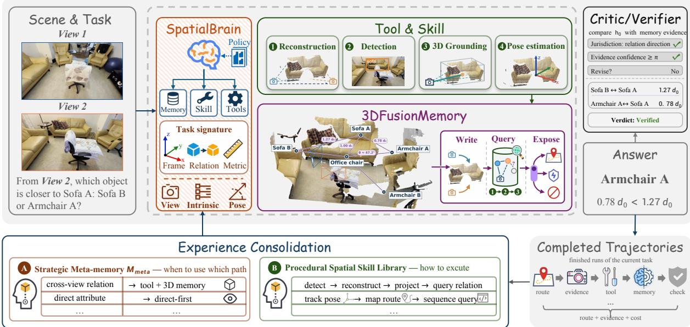  
Figure 1 SpatialBrain: spatial reasoning with experience reuse. Spatial Cognition chooses how to use direct reasoning, spatial skills, and scene evidence. Completed trajectories update procedures and resource-use experience for later tasks; 3DFusionMemory is rebuilt for each scene. The scene is illustrative.

Our core contributions address three parts of this reasoning process (Figure 1):

• 3DFusionMemory grounds reasoning in a shared scene state by fusing object, pose, camera, and route observations into queryable spatial evidence with supporting views and uncertainty.

• Spatial Skill Library makes recurring spatial computations reusable through parameterized tool procedures, separating the operation from the scene-specific inputs on which it acts.

• Spatial Cognition accumulates condition-specific experience about when and how to use memory and skills. Past process feedback and costs inform resource selection, connecting completed trajectories to later reasoning decisions.

Tasks within a block share prior experience and maintain separate scene memories. Updates occur after the block finishes, without reference answers.

Evaluation with GPT-5.6-sol shows improvements over direct answers on four of five benchmarks and a tie on the fifth. Component comparisons and execution traces examine resource use and how earlier experience changes later decisions.

## 2 Related Work

Spatial intelligence. SpatialVLM and SpatialRGPT develop spatial representations through targeted supervision [4, 6], while Thinking in Space studies cognitive maps for video reasoning [27]. Tool-based approaches expose visual programs, geometric constraints, stateful computation, and simulation to a reasoner [5, 7, 11, 17, 35]. Structured representations include S-Agent’s scene and agent memories and AlloSpatial’s allocentric maps [8, 20]. SpatialCLI provides specialist tools, and SATURN and OmniView-Space emphasize perspective-aware reasoning [13, 16, 34]. SpatialBrain uses execution experience to decide when and how to invoke spatial representations and computations.

Agent skills and memory. Executable skills and recurring workflows provide reusable computation, as in Voyager and Agent Workflow Memory [23, 25]. Skill-3D distills scene-aware tool workflows and failure lessons from rollouts for skill-guided inference and agentic post-training [14]. SpatialBrain focuses on blockwise, reference-label-free test-time resource adaptation with fixed model weights, separating currentscene geometry from persistent resource-use experience. Episodic reflection and linked memory notes retain broader experience [18, 26], whereas object-centric scene graphs and exploration snapshots retain spatial evidence [9, 29]. In SpatialBrain, the Skill Library stores how to execute a procedure, strategic experience records when and how to use it, and 3DFusionMemory represents what the current scene supports.

Self-evolving agents. Self-evolving agents difer in what they update. Reflexion retains verbal feedback for subsequent trials [21], while ExpeL distills experience from training tasks for later inference [32]. Agentic Context Engineering consolidates contextual playbooks through generation, reflection, and curation [31]. Automated Design of Agentic Systems searches agent programs using an expanding archive [10], while the Darwin G¨odel Machine modifies and tests agent code [30]. SpatialBrain updates external spatial strategies and procedural records from completed test-time trajectories.

## 3 SpatialBrain

## 3.1 Overview

Given images $I _ { 1 : K }$ , a question q, and optional answer choices O, SpatialBrain solves a task $x _ { i } = ( I _ { 1 : K } , q , O )$ using a fixed vision-language backbone and perception and geometry tools. Spatial Cognition selects the reasoning route and access to memory and skills. Tool observations populate the scene memory, and skills carry out reusable computations on the current inputs. An execution trajectory records these decisions, calls, returned evidence, and process checks. Completed trajectories supply experience for later tasks without updating model weights, as illustrated in Figure 2.

This separation gives two timescales of state: scene evidence changes within a task, while experience about using evidence changes between task blocks. Let i index tasks, t a within-task execution step, and b a block The state available to the reasoner is

$$
S _ { i , t } = ( \mathcal { G } _ { i , t } , \mathcal { H } _ { b } ) , \qquad \mathcal { H } _ { b } = ( \mathcal { L } _ { b } , \mathcal { P } _ { b } ) .\tag{1}
$$

Here $\mathcal { G } _ { i , t }$ is the current scene graph, $\mathcal { L } _ { b }$ the skill library, and $\mathcal { P } _ { b }$ the strategic experience used by Spatial Cognition. Observations update $\mathcal { G } _ { i , t }$ during execution; all tasks in a block read the same committed snapshot $\mathcal { H } _ { b }$ and keep separate scene graphs. A procedure for comparing object-relative directions can thus persist without carrying its earlier object coordinates into a new scene.

## 3.2 3DFusionMemory

Diferent views expose diferent objects and diferent sides of the same object. 3DFusionMemory fuses these observations into a shared scene frame, where object identities connect evidence across views and spatial relations connect objects. The memory for the current task is

$$
\mathcal { G } _ { i , t } = ( \mathcal { V } _ { i , t } , \mathcal { E } _ { i , t } , \mathcal { C } _ { i , t } , \mathcal { R } _ { i , t } ) ,\tag{2}
$$

where $\mathcal { V } _ { i , t }$ contains object nodes, $\mathcal { E } _ { i , t }$ spatial relations, $\mathcal { C } _ { i , t }$ camera states, and $\mathcal { R } _ { i , t }$ ordered route history. Nodes retain detections, 3D centers, available point sets and extents, pose, semantic axes, and supporting views. Depth and camera poses place observations in the scene frame; matched observations update an object’s center through confidence-weighted fusion (Appendix D). Repeated observations support the same node, while complementary views add objects that a single view does not cover. Relations are then computed between these fused object representations (Figure 3).

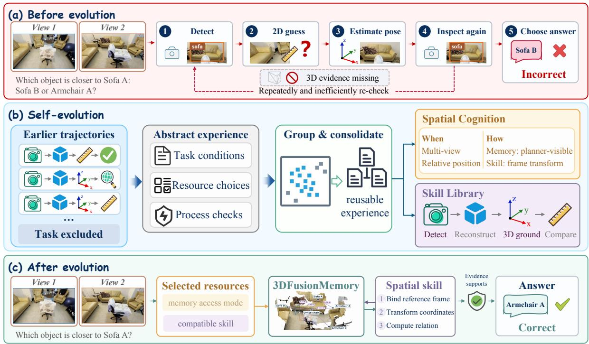  
Figure 2 Self-evolution from earlier trajectories. (a) Initial reasoning leaves the reference frame unresolved. (b) Completed earlier trajectories are abstracted and consolidated between task blocks. (c) Accumulated experience guides memory access and skill selection for the same target. The trajectories and outcomes are illustrative.

Queries return distances and camera- or object-frame relations together with confidence, supporting views, and ambiguity. Ordered route state supports successive translations and rotations. The planner may receive compact spatial facts, or memory may be reserved for answer checking. Skills and reasoning steps can therefore refer to the same grounded objects instead of reconstructing their relations independently.

## 3.3 Spatial Skill Library

Recurring spatial operations can reuse a computation even when the objects and images change. The library represents each skill as a procedure with an explicit applicability condition and input–output interface:

$$
\ell = ( A _ { \ell } , X _ { \ell } , { \cal P } _ { \ell } , Y _ { \ell } ) , \qquad \ell \in \mathcal { L } _ { b } .\tag{3}
$$

In equation 3, Aℓ specifies applicability, Xℓ typed input requirements, Pℓ a parameterized tool procedure, and Yℓ its returned evidence. For example, a relative-direction procedure binds a reference frame before computing a displacement. Its parameters refer to the current task’s objects, so the same procedure can operate on diferent scenes.

Seed skills initialize the library. Completed trajectories add recurring execution patterns and records of their use. Spatial Cognition can withhold a skill, expose it as a planning hint, or permit execution. The executable configuration also compiles compatible primitive calls into parameterized procedures and tests them under a limited budget; earlier hint-based configurations retain procedural records without this compilation. A change in an existing skill’s availability is consequently distinct from the creation of new skill code.

A skill may build or query the current scene memory, but cannot supply an earlier answer or bypass a disabled memory interface.

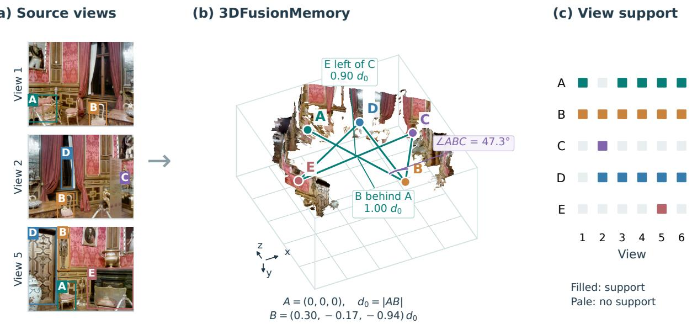  
Figure 3 Multi-view observations become spatial relations. Three of six input views, a saved fused 3D scene, and view support for five estimated object nodes. Colors link identities. The RGB surface uses saved depth and camera poses; edges show unambiguous stored relations. Labels give stored directions and 3D measurements derived from object centers. Coordinates use A as origin and reconstruction-world axes; lengths are in units of $d _ { 0 } = | A B |$ , not meters.

## 3.4 Spatial Cognition

Deciding when and how to use resources. Spatial Cognition turns execution experience into conditional resource decisions. Its strategic store associates input-visible task conditions with past resource choices, process checks, failures, and costs. A task signature $\sigma _ { i }$ describes the reference frame, relation scope, output form, temporal structure, metric demand, and view count. It uses neither reference answers nor benchmark category labels. Given this signature and the available experience, the controller selects

$$
g _ { i } = \pi ( \sigma _ { i } ; \mathcal { P } _ { b } , \mathcal { L } _ { b } ) = ( r _ { i } , m _ { i } , \mathcal { K } _ { i } , \nu _ { i } ) .\tag{4}
$$

Here $r _ { i }$ chooses direct-first or tool-assisted reasoning, $m _ { i }$ controls memory access (of, answer-checking only, or planner-visible), $\boldsymbol { \mathcal { K } } _ { i } \subseteq \boldsymbol { \mathcal { L } } _ { b }$ gives permitted skills, and $\nu _ { i }$ specifies verification and revision. Equation 4 is resource selection, not answer prediction. A skill’s how describes a computation; Cognition’s how describes how to use that computation and its evidence. The controller combines initial rules with stored experience rather than training an additional model.

Resource changes require supporting experience. In the executable configuration, route and memory alternatives must have suficient historical support, acceptable process risk, and lower estimated token cost; otherwise the default remains. At most one learned route or memory factor changes per request. Skill selection requires compatible inputs and availability, while verification and resource limits follow fixed rules. Appendix D specifies these conditions. Process feedback is not a correctness reward: it describes execution reliability and cost, not agreement with a reference answer.

The self-evolution loop. Tasks first execute using the fixed block snapshot. After task i finishes, its trajectory $\tau _ { i }$ is projected to a label-free record $d _ { i } = \mathrm { A b s } ( \tau _ { i } )$ : task signature, resource decisions, tool sequence, process checks, failures, and available costs. This abstraction excludes answers, literal scene coordinates, and raw task content from the transferable state. For completed block $B _ { b } .$ let $\mathcal { D } _ { b } = \{ d _ { i } : i \in B _ { b } \}$ . Only then do the stores update:

$$
\mathcal { P } _ { b + 1 } = U _ { \mathrm { p o l i c y } } ( \mathcal { P } _ { b } , \mathcal { D } _ { b } ) , \qquad \mathcal { L } _ { b + 1 } = U _ { \mathrm { s k i l l } } ( \mathcal { L } _ { b } , \mathcal { D } _ { b } ) .\tag{5}
$$

Here $U _ { \mathrm { p o l i c y } }$ consolidates condition-specific strategic records and statistics; $U _ { \mathrm { s k i l l } }$ updates procedural records and their availability. Equation 5 is a state update, not a gradient step. The next block can retrieve these

Table 1 Spatial reasoning performance across five benchmarks. Scores are percentages; higher is better. Our SpaceDG evaluations use a 1,000-question subset. Avg is the unweighted mean across benchmarks. Bold marks the best displayed score; dashes indicate unavailable results. Evaluation settings are given in Appendix A.
<table><tr><td>Method</td><td>MMSI</td><td>MindCube</td><td>OmniSp. SpaceDG</td><td></td><td>SAT</td><td>Avg</td></tr><tr><td>Foundation VLMs</td><td></td><td></td><td></td><td></td><td></td><td></td></tr><tr><td>Gemini-2.5-Pro</td><td>36.9</td><td>57.5</td><td>55.2</td><td>47.2</td><td>79.3</td><td>55.2</td></tr><tr><td>Qwen3-VL-8B [2]</td><td>27.4</td><td>43.4</td><td>51.5</td><td>43.1</td><td>74.7</td><td>48.0</td></tr><tr><td>GPT-5.5</td><td>51.0</td><td>74.3</td><td>67.8</td><td>57.5</td><td>84.7</td><td>67.1</td></tr><tr><td>GPT-5.6-sol</td><td>53.8</td><td>67.2</td><td>68.3</td><td>56.9</td><td>91.3</td><td>67.5</td></tr><tr><td>Training-based Spatial VLMs</td><td></td><td></td><td></td><td></td><td></td><td></td></tr><tr><td>SenseNova-SI-1.1 [3]</td><td>43.3</td><td>85.7</td><td>42.2</td><td>36.3</td><td>50.7</td><td>51.6</td></tr><tr><td>SpatialLadder-3B [15]</td><td>29.2</td><td>43.4</td><td>29.8</td><td>34.9</td><td>27.3</td><td>32.9</td></tr><tr><td>RoboBrain2.5-8B-NV [22]</td><td>26.6</td><td>37.1</td><td>46.1</td><td>36.8</td><td>74.0</td><td>44.1</td></tr><tr><td>ACE-Brain-0.5-8B [1]</td><td>35.5</td><td>86.3</td><td>41.4</td><td>39.8</td><td>82.7</td><td>57.1</td></tr><tr><td>Agentic Frameworks</td><td></td><td></td><td></td><td></td><td></td><td></td></tr><tr><td>GCA [5]</td><td>47.6</td><td>64.2</td><td>63.0</td><td>50.6</td><td>90.7</td><td>63.2</td></tr><tr><td>AlloSpatial (GPT-5.5) [20]</td><td>43.6</td><td>63.2</td><td>63.1</td><td>52.9</td><td>89.3</td><td>62.4</td></tr><tr><td>SpatialClaw (Gemma-4) [7]</td><td>50.0</td><td>75.7</td><td>62.2</td><td>52.4</td><td>86.0</td><td>65.3</td></tr><tr><td>Skill-3D [14]</td><td>48.8</td><td>69.4</td><td>66.6</td><td>51.4</td><td>89.3</td><td>65.1</td></tr><tr><td>SpatialBrain</td><td>57.1</td><td>87.6</td><td>69.1</td><td>57.9</td><td>91.3 72.6</td><td></td></tr></table>

records and make diferent resource choices. No task in $B _ { b }$ reads these updates, future observations, or reference answers, allowing parallel execution within each block.

## 4 Experiments

## 4.1 Experimental Setup

We evaluate MMSI, MindCube, OmniSpatial, SpaceDG, and SAT on 1,000, 1,050, 1,533, 1,000, and 150 items, respectively [12, 19, 24, 28, 33]. We report accuracy, using mean relative accuracy (MRA) for numeric SpaceDG questions. SpaceDG uses a fixed 1,000-item subset, and SAT uses fixed option order. The direct-answer baseline and SpatialBrain both use GPT-5.6-sol on the same items. Predictions are fixed before scoring; experience updates use neither reference answers nor future tasks.

Table 1 includes foundation VLMs, spatially trained models, and agentic frameworks. It combines published results with our evaluations, so backbones and protocols vary across methods. These comparisons position the framework among available approaches, while the shared-backbone pair measures its gain over direct answers. Appendix A gives evaluation settings and comparison details.

## 4.2 Main Results

SpatialBrain improves on direct GPT-5.6-sol answers on four benchmarks and ties on SAT (Table 1), raising the unweighted mean from 67.5 to 72.6. MindCube accounts for the largest gain, at 20.4 percentage points; the smaller changes on OmniSpatial and SpaceDG show that the benefit depends on the task setting. Categorylevel changes are mixed, including regressions on OmniSpatial’s egocentric questions and SpaceDG’s distance and counting questions.

## 4.3 Error Analysis

Figure 4 breaks errors down by benchmark task type. On MindCube, errors decrease in all three categories, from 344 to 130 overall, a 62.2% reduction. On MMSI, SpatialBrain makes 33 fewer errors overall, but the direction of change varies: positional and attribute errors decrease, with no uniform reduction across all task types. The left panel groups MMSI into its four oficial families. The right panel pools the two benchmarks by input-derived reasoning demand, showing the largest reduction for motion and rotation. These groups describe what a question requires, not an inferred cause of failure.

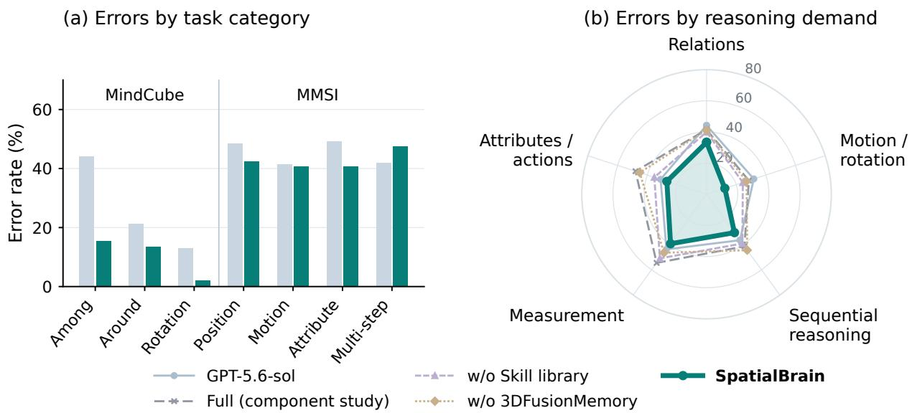  
Figure 4 Errors by task type and reasoning demand. All 1,050 MindCube and 1,000 MMSI items. (a) Direct GPT-5.6-sol and SpatialBrain by oficial category. (b) Input-derived categories for the same pair and component configurations, all using GPT-5.6-sol. Radii show pooled error rates (0–80%). Appendix B.3 gives the mapping, counts, and within-study comparisons.

The pooled radar summarizes shared demands but can hide benchmark-specific diferences: sequentialreasoning errors decrease on MindCube and increase on MMSI. Appendix B.5 retains all eleven MMSI types.

## 4.4 Memory-grounded Spatial Reasoning

Figure 5 shows two views contributing anchors to a shared scene memory. The planner receives the atlas, and a stair-relative coordinate check resolves the food-storage location.

## 5 Analysis and Discussion

## 5.1 Component Analysis

We compare SpatialBrain with three component-removal configurations. w/o Skill Library removes seed and accumulated skills, retrieval, hints, macros, and induction while retaining primitive tools. w/o 3DFusionMemory disables scene-graph construction and access, including queries inside skills and memory-based answer checks. w/o SpatialCognition replaces task-specific analysis and adaptive routing with a generic controller.

Figure 6 summarizes the MindCube configurations on all 1,050 items. SpatialBrain scores 87.6, compared with 76.7 without the Skill Library, 75.2 without 3DFusionMemory, 78.8 without SpatialCognition, and 67.2 for direct answers. The component-removal gaps are larger on Among and Around than on Rotation. Missing and refused answers count as wrong throughout. Appendices A and B.3 report the settings and answer availability. Appendix B.4 reports the earlier MMSI component study (Figure A2).

## 5.2 What Does 3DFusionMemory Represent?

3DFusionMemory represents spatial relations supported by complementary observations. In Figure 3, one view supports nodes A and B, another adds C and D, and a third includes E. Estimated identities connect these observations in a common scene frame; three of the five 3D objects have support from multiple views. The resulting memory gives later computations a shared set of objects and relations to reference. Across five GPT-5.6-sol evaluation streams, saved 3D objects occur in 50.6% of MMSI tasks and 37.5% of SpaceDG tasks, compared with 21.0%, 29.2%, and 18.0% for MindCube, OmniSpatial, and SAT (Appendix B.1). This variation reflects which inputs produce spatial state; coverage does not measure retrieval or geometric accuracy.

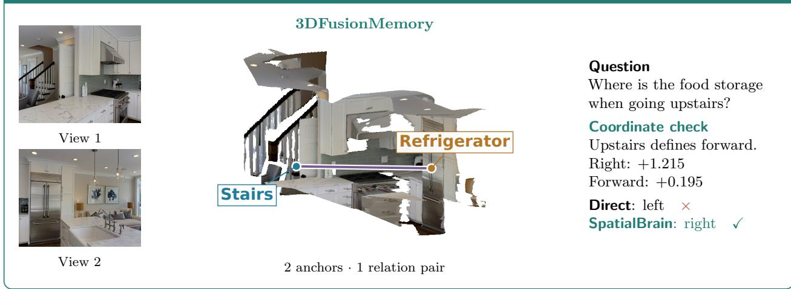

Figure 5 Memory-grounded reference-frame reasoning. Saved 3D anchors are shown on an RGB cutaway of the reconstructed scene. The planner sees the memory atlas with single-view support flags; a tool verifies the stair-relative direction. Coordinates use reconstruction units. Full trajectory: Appendix C.1.  
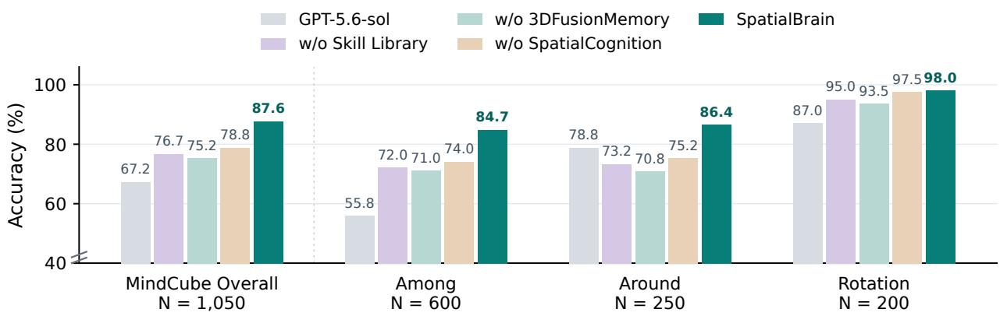  
Figure 6 MindCube component comparison. Accuracy overall and by task category on 1,050 items. The y-axis starts at 40%. Evaluation settings are given in Appendix A.

## 5.3 Experience and Skill Coverage

Figure 7 tracks the breadth of stored experience across five independent GPT-5.6-sol streams. Task coverage counts distinct task signatures with experience records; skill coverage counts existing seed skill IDs referenced by those records, not newly generated programs. MMSI reaches 165 task signatures and 24 seed skills, while MindCube reaches 12 and 10. On MMSI, task coverage continues to grow after skill coverage begins to plateau: further experience extends the recorded task conditions without a comparable increase in distinct referenced skills.

Appendix B.2 separately measures how often earlier experience reaches subsequent tasks in the executable configuration. Individual trajectories show how experience changes a route or skill recommendation (Appendix C.3). An earlier GPT-5.5 hint-retrieval experiment also logged partial sequence alignment, but did not improve aggregate accuracy or cost (Appendix B.6). The relevant contrast for update benefits is an initial-frozen control with the same resources and starting experience.

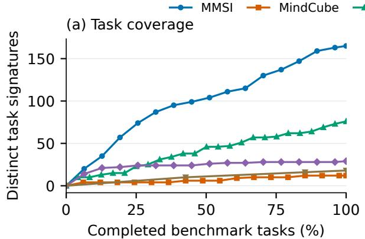

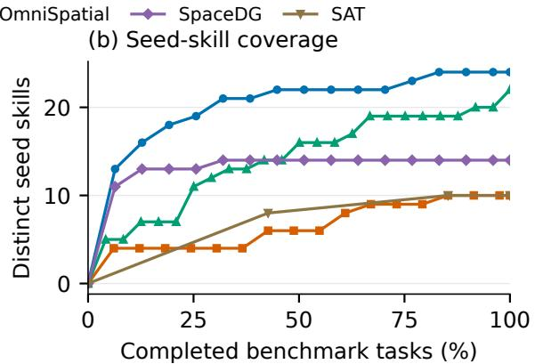  
Figure 7 Test-time experience and seed-skill coverage. (a) Distinct task signatures with stored experience. (b) Distinct seed skills referenced by that experience. Each curve spans the benchmark’s full evaluation scope (Section 4.1).

Limitations. Published baselines difer in protocols and serving precision, and our SAT evaluation fixes option order. Removing 3DFusionMemory also removes memory-based answer checks, so it does not isolate storage alone. The experience curves and selected trajectories establish accumulation and use, not a general improvement from self-evolution. Perception and geometry errors also remain imperfectly calibrated. Matched evaluations should measure both answer quality and the full cost of acquiring and using experience.

## 6 Conclusion

SpatialBrain separates evidence about the current scene from reusable spatial computation and experience about when and how to use it. 3DFusionMemory, the Spatial Skill Library, and Spatial Cognition implement these roles around a fixed vision-language backbone. Completed trajectories update external experience between task blocks, making self-evolution an inspectable change in the resources and decisions available to later tasks. The complete framework improves on direct answers on four of five benchmarks and ties on the fifth.

## References

[1] ACE-Brain Team, Ziyang Gong, Haoming Gu, Zehang Luo, Tianyi Zhang, Tao Tao, Yixiao Chi, Zhe Liu, Lingsi Zhu, Jingyuan Liu, Anke Tang, Songze Li, Yilun Kong, Ningjing Liu, Tianyu Zhu, Yunpeng Qing, Shuang Luo, Xiang Liu, Shi Fu, Dawei Nie, Sixiang Liu, Zhexi Wen, Feng Pan, Xiaofeng Wang, Zhi Hou, Chunxiao Liu, Xue Yang, Junchi Yan, Hengshuang Zhao, Dacheng Tao, and Xiaogang Wang. ACE-Brain-0.5: A unified embodied foundational model for physical agentic AI. arXiv preprint arXiv:2607.04426, 2026. URL https://arxiv.org/abs/2607.04426.

[2] Shuai Bai, Yuxuan Cai, Ruizhe Chen, Keqin Chen, Xionghui Chen, Zesen Cheng, Lianghao Deng, Wei Ding, Chang Gao, Chunjiang Ge, Wenbin Ge, Zhifang Guo, Qidong Huang, Jie Huang, Fei Huang, Binyuan Hui, Shutong Jiang, Zhaohai Li, Mingsheng Li, Mei Li, Kaixin Li, Zicheng Lin, Junyang Lin, Xuejing Liu, Jiawei Liu, Chenglong Liu, Yang Liu, Dayiheng Liu, Shixuan Liu, Dunjie Lu, Ruilin Luo, Chenxu Lv, Rui Men, Lingchen Meng, Xuancheng Ren, Xingzhang Ren, Sibo Song, Yuchong Sun, Jun Tang, Jianhong Tu, Jianqiang Wan, Peng Wang, Pengfei Wang, Qiuyue Wang, Yuxuan Wang, Tianbao Xie, Yiheng Xu, Haiyang Xu, Jin Xu, Zhibo Yang, Mingkun Yang, Jianxin Yang, An Yang, Bowen Yu, Fei Zhang, Hang Zhang, Xi Zhang, Bo Zheng, Humen Zhong,

Jingren Zhou, Fan Zhou, Jing Zhou, Yuanzhi Zhu, and Ke Zhu. Qwen3-VL technical report. arXiv preprint arXiv:2511.21631, 2025. URL https://arxiv.org/abs/2511.21631.

[3] Zhongang Cai, Ruisi Wang, Chenyang Gu, Fanyi Pu, Junxiang Xu, Yubo Wang, Wanqi Yin, Zhitao Yang, Chen Wei, Qingping Sun, Tongxi Zhou, Jiaqi Li, Hui En Pang, Oscar Qian, Yukun Wei, Zhiqian Lin, Xuanke Shi, Kewang Deng, Xiaoyang Han, Zukai Chen, Xiangyu Fan, Hanming Deng, Lewei Lu, Liang Pan, Bo Li, Ziwei Liu, Quan Wang, Dahua Lin, and Lei Yang. Scaling spatial intelligence with multimodal foundation models. arXiv preprint arXiv:2511.13719v4, 2025. URL https://arxiv.org/abs/2511.13719v4. Version 4, March 2026; SenseNova-SI v1.1.

[4] Boyuan Chen, Zhuo Xu, Sean Kirmani, Brian Ichter, Danny Driess, Pete Florence, Dorsa Sadigh, Leonidas Guibas, and Fei Xia. SpatialVLM: Endowing vision-language models with spatial reasoning capabilities. arXiv preprint arXiv:2401.12168, 2024. URL https://arxiv.org/abs/2401.12168.

[5] Zeren Chen, Xiaoya Lu, Zhijie Zheng, Pengrui Li, Lehan He, Yijin Zhou, Jing Shao, Bohan Zhuang, and Lu Sheng. Geometrically-constrained agent for spatial reasoning. arXiv preprint arXiv:2511.22659, 2025. URL https://arxiv.org/abs/2511.22659.

[6] An-Chieh Cheng, Hongxu Yin, Yang Fu, Qiushan Guo, Ruihan Yang, Jan Kautz, Xiaolong Wang, and Sifei Liu. SpatialRGPT: Grounded spatial reasoning in vision language models. arXiv preprint arXiv:2406.01584, 2024. URL https://arxiv.org/abs/2406.01584.

[7] Seokju Cho, Ryo Hachiuma, Abhishek Badki, Hang Su, Byung-Kwan Lee, Chan Hee Song, Sifei Liu, Subhashree Radhakrishnan, Seungryong Kim, Yu-Chiang Frank Wang, and Min-Hung Chen. SpatialClaw: Rethinking action interface for agentic spatial reasoning. arXiv preprint arXiv:2606.13673, 2026. URL https://arxiv.org/abs/ 2606.13673.

[8] Yalun Dai, Hao Li, Shulin Tian, Runmao Yao, Yuhao Dong, Fangzhou Hong, Zhaoxi Chen, Fangfu Liu, Tao Wang, Kim-Hui Yap, and Ziwei Liu. S-Agent: Spatial tool-use elicits reasoning for spatial intelligence. arXiv preprint arXiv:2606.20515, 2026. URL https://arxiv.org/abs/2606.20515.

[9] Qiao Gu, Alihusein Kuwajerwala, Sacha Morin, Krishna Murthy Jatavallabhula, Bipasha Sen, Aditya Agarwal, Corban Rivera, William Paul, Kirsty Ellis, Rama Chellappa, Chuang Gan, Celso Miguel de Melo, Joshua B. Tenenbaum, Antonio Torralba, Florian Shkurti, and Liam Paull. ConceptGraphs: Open-vocabulary 3d scene graphs for perception and planning. arXiv preprint arXiv:2309.16650, 2023. URL https://arxiv.org/abs/2309.16650.

[10] Shengran Hu, Cong Lu, and Jef Clune. Automated design of agentic systems. arXiv preprint arXiv:2408.08435, 2024. URL https://arxiv.org/abs/2408.08435.

[11] Yushi Hu, Weijia Shi, Xingyu Fu, Dan Roth, Mari Ostendorf, Luke Zettlemoyer, Noah A. Smith, and Ranjay Krishna. Visual sketchpad: Sketching as a visual chain of thought for multimodal language models. arXiv preprint arXiv:2406.09403, 2024. URL https://arxiv.org/abs/2406.09403.

[12] Mengdi Jia, Zekun Qi, Shaochen Zhang, Wenyao Zhang, Xinqiang Yu, Jiawei He, He Wang, and Li Yi. OmniSpatial: Towards comprehensive spatial reasoning benchmark for vision language models. arXiv preprint arXiv:2506.03135, 2025. URL https://arxiv.org/abs/2506.03135.

[13] Danial Kamali, Tanawan Premsri, Shreya Rajpal, Amir Zadeh, Chuan Li, and Parisa Kordjamshidi. SATURN: Symbolic spatial reasoning for multi-perspective grounding. arXiv preprint arXiv:2606.22694, 2026. URL https://arxiv.org/abs/2606.22694.

[14] Haoyuan Li, Zhengdong Hu, Jun Wang, Hehe Fan, and Yi Yang. Skill-3D: Evolving scene-aware skills for agentic 3d spatial reasoning. arXiv preprint arXiv:2606.07436, 2026. URL https://arxiv.org/abs/2606.07436.

[15] Hongxing Li, Dingming Li, Zixuan Wang, Yuchen Yan, Hang Wu, Wenqi Zhang, Yongliang Shen, Weiming Lu, Jun Xiao, and Yueting Zhuang. SpatialLadder: Progressive training for spatial reasoning in vision-language models. In International Conference on Learning Representations, 2026. URL https://arxiv.org/abs/2510.08531.

[16] Xudong Li, Mengdan Zhang, Peixian Chen, Jiaxi Tan, Zihao Huang, Jingyuan Zheng, Yan Zhang, Xiawu Zheng, Xing Sun, and Rongrong Ji. OmniView-Space: Reinforcing spatial reasoning via multi-perspective spatial mapping. arXiv preprint arXiv:2607.00881, 2026. URL https://arxiv.org/abs/2607.00881.

[17] Damiano Marsili, Rohun Agrawal, Yisong Yue, and Georgia Gkioxari. Visual agentic AI for spatial reasoning with a dynamic API. arXiv preprint arXiv:2502.06787, 2025. URL https://arxiv.org/abs/2502.06787.

[18] Joon Sung Park, Joseph C. O’Brien, Carrie J. Cai, Meredith Ringel Morris, Percy Liang, and Michael S. Bernstein. Generative agents: Interactive simulacra of human behavior. arXiv preprint arXiv:2304.03442, 2023. URL https://arxiv.org/abs/2304.03442.

[19] Arijit Ray, Jiafei Duan, Ellis Brown, Reuben Tan, Dina Bashkirova, Rose Hendrix, Kiana Ehsani, Aniruddha Kembhavi, Bryan A. Plummer, Ranjay Krishna, Kuo-Hao Zeng, and Kate Saenko. SAT: Dynamic spatial aptitude training for multimodal language models. arXiv preprint arXiv:2412.07755, 2024. URL https://arxiv.org/abs/ 2412.07755.

[20] Shouwei Ruan, Bin Wang, Zhenyu Wu, Qihui Zhu, Yuxiang Zhang, Jingzhi Li, Yubin Wang, and Xingxing Wei. AlloSpatial: Agentic harness framework for spatial reasoning in foundation models. arXiv preprint arXiv:2606.08952, 2026. URL https://arxiv.org/abs/2606.08952.

[21] Noah Shinn, Federico Cassano, Edward Berman, Ashwin Gopinath, Karthik Narasimhan, and Shunyu Yao. Reflexion: Language agents with verbal reinforcement learning. arXiv preprint arXiv:2303.11366, 2023. URL https://arxiv.org/abs/2303.11366.

[22] Huajie Tan, Enshen Zhou, Zhiyu Li, Yijie Xu, Yuheng Ji, Xiansheng Chen, Cheng Chi, Pengwei Wang, Huizhu Jia, Yulong Ao, Mingyu Cao, Sixiang Chen, Zhe Li, Mengzhen Liu, Zixiao Wang, Shanyu Rong, Yaoxu Lyu, Zhongxia Zhao, Peterson Co, Yibo Li, Yi Han, Shaoxuan Xie, Guocai Yao, Songjing Wang, Leiduo Zhang, Xi Yang, Yance Jiao, Donghai Shi, Kunchang Xie, Shaokai Nie, Chunlei Men, Yonghua Lin, Zhongyuan Wang, Tiejun Huang, and Shanghang Zhang. RoboBrain 2.5: Depth in sight, time in mind. arXiv preprint arXiv:2601.14352, 2026. URL https://arxiv.org/abs/2601.14352.

[23] Guanzhi Wang, Yuqi Xie, Yunfan Jiang, Ajay Mandlekar, Chaowei Xiao, Yuke Zhu, Linxi Fan, and Anima Anandkumar. Voyager: An open-ended embodied agent with large language models. arXiv preprint arXiv:2305.16291, 2023. URL https://arxiv.org/abs/2305.16291.

[24] Qineng Wang, Baiqiao Yin, Pingyue Zhang, Jianshu Zhang, Kangrui Wang, Zihan Wang, Jieyu Zhang, Keshigeyan Chandrasegaran, Han Liu, Ranjay Krishna, Saining Xie, Jiajun Wu, Li Fei-Fei, and Manling Li. MindCube: Spatial mental modeling from limited views. arXiv preprint arXiv:2506.21458, 2025. URL https://arxiv.org/ abs/2506.21458.

[25] Zora Zhiruo Wang, Jiayuan Mao, Daniel Fried, and Graham Neubig. Agent workflow memory. arXiv preprint arXiv:2409.07429, 2024. URL https://arxiv.org/abs/2409.07429.

[26] Wujiang Xu, Zujie Liang, Kai Mei, Hang Gao, Juntao Tan, and Yongfeng Zhang. A-MEM: Agentic memory for LLM agents. arXiv preprint arXiv:2502.12110, 2025. URL https://arxiv.org/abs/2502.12110.

[27] Jihan Yang, Shusheng Yang, Anjali W. Gupta, Rilyn Han, Li Fei-Fei, and Saining Xie. Thinking in space: How multimodal large language models see, remember, and recall spaces. arXiv preprint arXiv:2412.14171, 2024. URL https://arxiv.org/abs/2412.14171.

[28] Sihan Yang, Runsen Xu, Yiman Xie, Sizhe Yang, Mo Li, Jingli Lin, Chenming Zhu, Xiaochen Chen, Haodong Duan, Xiangyu Yue, Dahua Lin, Tai Wang, and Jiangmiao Pang. MMSI-Bench: A benchmark for multi-image spatial intelligence. arXiv preprint arXiv:2505.23764, 2025. URL https://arxiv.org/abs/2505.23764.

[29] Yuncong Yang, Han Yang, Jiachen Zhou, Peihao Chen, Hongxin Zhang, Yilun Du, and Chuang Gan. 3D-Mem: 3d scene memory for embodied exploration and reasoning. arXiv preprint arXiv:2411.17735, 2024. URL https://arxiv.org/abs/2411.17735.

[30] Jenny Zhang, Shengran Hu, Cong Lu, Robert Lange, and Jef Clune. Darwin G¨odel machine: Open-ended evolution of self-improving agents. arXiv preprint arXiv:2505.22954, 2025. URL https://arxiv.org/abs/2505.22954.

[31] Qizheng Zhang, Changran Hu, Shubhangi Upasani, Boyuan Ma, Fenglu Hong, Vamsidhar Kamanuru, Jay Rainton, Chen Wu, Mengmeng Ji, Hanchen Li, Urmish Thakker, James Zou, and Kunle Olukotun. Agentic context engineering: Evolving contexts for self-improving language models. arXiv preprint arXiv:2510.04618, 2025. URL https://arxiv.org/abs/2510.04618.

[32] Andrew Zhao, Daniel Huang, Quentin Xu, Matthieu Lin, Yong-Jin Liu, and Gao Huang. ExpeL: LLM agents are experiential learners. arXiv preprint arXiv:2308.10144, 2023. URL https://arxiv.org/abs/2308.10144.

[33] Xiaolong Zhou, Yifei Liu, Ziyang Gong, Jiarui Li, Qiyue Zhao, Muyao Niu, Yuanyuan Gao, Le Ma, Xue Yang, Hongjie Zhang, and Zhihang Zhong. SpaceDG: Benchmarking spatial intelligence under visual degradation. arXiv preprint arXiv:2605.22536, 2026. URL https://arxiv.org/abs/2605.22536.

[34] Yang Zhou, Zixuan Huang, Sunzhu Li, Zhuo Yang, Chen Zhang, Shunian Chen, Caijun Yan, Jianyao Xu, Shunyu Liu, Weijie Fu, Peiliang Li, Xiaozhi Chen, and Yuxiang Cai. SpatialCLI: Learning to reason with spatial tools, then without them. arXiv preprint arXiv:2607.27703, 2026. URL https://arxiv.org/abs/2607.27703.

[35] Chenming Zhu, Jingli Lin, Yilin Long, Peizhou Cao, Tai Wang, Jiangmiao Pang, and Xihui Liu. Thinking with imagination: Agentic visual spatial reasoning with world simulators. arXiv preprint arXiv:2606.06476, 2026. URL https://arxiv.org/abs/2606.06476.

## Appendix Contents

Page   
A Evaluation Settings . . . . . . . . . . . . . . 14   
B Supplementary Analyses . . . . . . . . . . . . . 15   
B.1 3DFusionMemory Coverage . . . . . 15   
B.2 Experience Coverage and Subsequent Exposure . . . . . . . . . . . . . . . . . . 15   
B.3 Input-Derived Reasoning Categories . . . . . . . . . . 16   
B.4 MMSI Component Comparison . . . . . . . 17   
B.5 MMSI Errors by Task Type. . . . . . . . . . 18   
B.6 Earlier Retrieval and Sequence Alignment . . . . . . . . . . 18   
C Qualitative Analysis and Visualizations . . . . . . . . . . . . . . . . . . . . . . . . . . . . . . . . . . 19   
C.1 3DFusionMemory. . . . . 20   
C.2 Spatial Skill Library . . . . . 24   
C.3 SpatialCognition . . . . . . . 25   
C.4 Additional Execution Traces . . . . . . . . . . 26   
D Memory Fusion and Experience Updates . . . . . . . . . . . . . . . . . 29   
D.1 Confidence-weighted Scene Fusion . . . . . 29   
D.2 Conservative Strategy Admission . . . . . . . . . . . . . 29   
D.3 Learned and Fixed State. . . . .29

## A Evaluation Settings

Table A1 summarizes the settings used in our evaluations. The SpaceDG subset is sampled with seed 0 from the 9,918-item release.

Table A1 Evaluation settings. The final column specifies which comparisons share each setting. Published baselines follow their original protocols.
<table><tr><td>Factor</td><td>Setting</td><td>Applies to</td></tr><tr><td>Evaluation size</td><td>MMSI 1,000; MindCube 1,050; OmniSpatial 1,533; SpaceDG 1,000; SAT 150.</td><td>Our main-table evaluations</td></tr><tr><td>Metric</td><td>Accuracy (%); MRA for numeric SpaceDG questions.</td><td>Our scored comparisons</td></tr><tr><td>Option order</td><td>Fixed question-option order, without circular evaluation. Our SAT evaluations</td><td></td></tr><tr><td>Backbone</td><td>GPT-5.6-sol.</td><td>Direct / SpatialBrain pair</td></tr><tr><td>Reference answers</td><td>Excluded from agent inputs and experience updates; predictions fixed before scoring.</td><td>Our agent evaluations</td></tr><tr><td>Unanswered items</td><td>Retained in the denominator and counted as wrong, including refusals.</td><td>Component comparisons</td></tr></table>

Backbones, decoding settings, and tool access difer across methods in Table 1. SenseNova-SI-1.1 denotes the InternVL3-8B variant. AlloSpatial uses the public World2Mind tool and reasoning harness with GPT-5.5. Qwen3-VL-8B uses a collaborator-provided score summary; raw predictions were not available for independent verification. The World2Mind OmniSpatial result includes three failed tool observations.

MindCube component comparisons. MindCube keeps all 600 Among, 250 Around, and 200 Rotation items. The main table and error analysis use the same 920/1,050 SpatialBrain run as the Full result in Figure 6. The five-stream memory and experience coverage analyses use a separate test-time batch. Full/no-Skill/no-Memory/no-Cognition in Figure 6 have 0/142/135/85 blank answers, all counted wrong. The matched Full and no-Memory comparison scores 75.9 and 75.2, respectively. Their diference is +0.67 points overall and +2.83/-5.20/+1.50 by category; the larger gap in Figure 6 cannot be attributed to memory removal alone. On 908 jointly answered Full/no-Skill items from Figure 6, correct counts are 799 and 805. Answer availability therefore afects the overall gaps alongside other configuration changes.

MMSI component comparisons. Figure A2 includes all four MMSI families (Position/Motion/Attribute/multistep: 522/150/130/198 items). Full/no-Skill/no-Memory/no-Cognition blank counts are 68/99/116/101. Full-minus-removal gains of 18/32/35 correct answers comprise −6/ + 12/ + 24 on jointly answered pairs and +24/ + 20/ + 11 on pairs with a blank. These earlier runs were not verified as complete component removals, so their diferences cannot establish isolated component efects. Task-family breakdowns preserve the original experience stream.

## B Supplementary Analyses

The Direct/SpatialBrain error comparisons use the reported main-table predictions. The five-stream memory and experience coverage analyses use the earlier GPT-5.6-sol test-time batch (Appendix A). The multi-view illustration in Figure 3 comes from a separate saved MMSI scene in the strict-component run. The experienceexposure counts in Appendix B.2 use the later executable configuration on full MMSI and MindCube. Counts are reported separately for each evaluation batch.

## B.1 3DFusionMemory Coverage

Figure A1 counts tasks with nonempty saved 3D objects and spatial relations. Object and relation coverage overlap, so the left panel plots them separately. The right panel partitions each evaluation set into snapshots with 3D objects, snapshots without 3D objects, and missing snapshots. The last category is unknown rather than an observed empty memory. Every percentage uses the full evaluation denominator, including 1,000 sampled SpaceDG items.

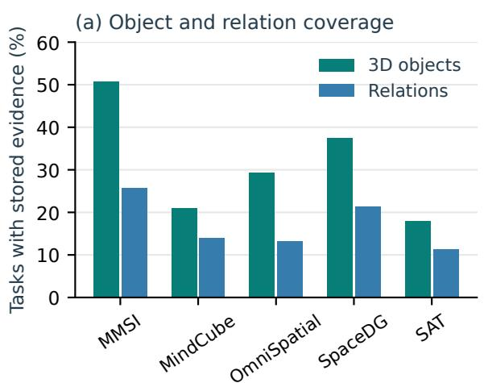

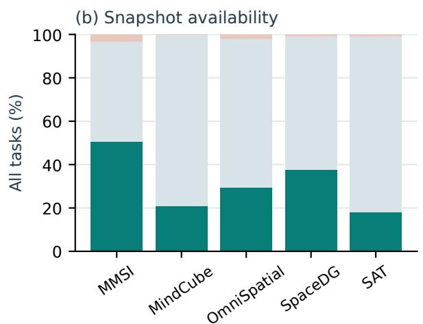  
Figure A1 Stored spatial evidence across benchmarks. (a) Tasks with 3D objects or relations. (b) Snapshot availability and 3D-object presence. Coverage measures stored state, not retrieval or answer correctness.

There are 506/220/448/375/27 tasks with 3D objects and 257/146/201/213/17 with relations on MMSI/Mind-Cube/OmniSpatial/SpaceDG/SAT. Missing snapshots number 33/0/30/7/1. Multiple camera states occur in 710/496/0/574/0 tasks, respectively. MMSI and SpaceDG show higher object and relation coverage than the other streams, but coverage does not follow a universal 3D-versus-2D split. The example in Figure 3 illustrates complementary view support: the displayed views support two, three, and four of its five 3D objects, and their union covers all five. This describes observed support, not object recall against ground truth.

## B.2 Experience Coverage and Subsequent Exposure

Beyond the stored coverage in Figure 7, we measure exposure to earlier experience in the executable configuration on complete MMSI and MindCube streams. MMSI forms 18 experience records, six of which become available; MindCube forms five, with three available. These are condition-specific resource-use records, not new algorithms. Nonempty experience from an earlier committed state reaches 231 of 1,000 MMSI tasks and 212 of 1,050 MindCube tasks. Matching the injected record IDs to each target’s input state verifies that their supporting events precede the target block. These exposure counts establish delivery to the reasoner, not successful execution or an improvement in answers.

## B.3 Input-Derived Reasoning Categories

The radar in Figure 4 uses input-derived task signatures recorded by the label-blind router, with the same label assigned to every method’s response for each item. We group relation as Relations; motion and rotation as Motion/rotation; route sequence as Sequential reasoning; visual measurement, count, diagram geometry, and depth as Measurement; and attribute, appearance, affordance, and spatial physics as Other attributes/actions. This mapping was fixed before aggregating outcomes and retains every item. Direct responses often lack the traces needed to diagnose the cause of a wrong answer. Table A2 reports the category counts and pooled error rates used in the radar.

Table A2 Errors within input-derived categories. Top: Direct/SpatialBrain wrong-answer counts, with category size in parentheses. Bottom: pooled error rates (%) for all radar curves. Each method uses the same 2,050 items and fixed category assignment.
<table><tr><td>Category</td><td>MindCube</td><td>MMSI</td><td></td><td>Pooled</td></tr><tr><td>Relations</td><td>178/98 (459)</td><td>279/247 (574)</td><td></td><td>457/345 (1,033)</td></tr><tr><td>Motion/rotation</td><td>117/7 (405)</td><td>64/63 (163)</td><td></td><td>181/70 (568)</td></tr><tr><td>Sequential reasoning</td><td>46/25 (153)</td><td>51/56 (113)</td><td></td><td>97/81 (266)</td></tr><tr><td>Measurement</td><td></td><td>49/44 (112)</td><td></td><td>49/44 (112)</td></tr><tr><td>Other attributes/actions</td><td>3/0 (33)</td><td>19/19 (38)</td><td></td><td>22/19 (71)</td></tr><tr><td>Method</td><td></td><td></td><td></td><td>Other</td></tr><tr><td></td><td>Relations</td><td>Motion</td><td>Sequential</td><td>Measure.</td></tr><tr><td>GPT-5.6-sol</td><td>44.2</td><td>31.9</td><td>36.5 41.4</td><td>43.8 31.0 54.5</td></tr><tr><td>Full (component study)</td><td>41.5</td><td>28.5</td><td>39.1</td><td>47.9</td></tr><tr><td>w/o Škill library</td><td>40.0</td><td>24.5</td><td>50.9 46.4</td><td>35.2</td></tr><tr><td>w/o 3DFusionMemory</td><td>41.2</td><td>26.9</td><td>44.4</td><td>45.1</td></tr><tr><td>SpatialBrain</td><td>33.4</td><td>12.3</td><td>30.5</td><td>39.3 26.8</td></tr></table>

The pooled error rate is lower for all five groups, while the contribution of each benchmark difers. Motion/rotation improves mainly on MindCube; sequential reasoning regresses on MMSI, and its Other group is unchanged. Measurement has no MindCube items under this signature taxonomy.

The component curves come from the later executable implementation and include its own Full reference. On MindCube/MMSI, this Full makes 253/543 errors, compared with 238/500 without the Skill library and 260/521 without 3DFusionMemory. The gap to main-table SpatialBrain also includes implementation changes and cannot isolate a component’s contribution. MindCube’s component runs passed their runtime checks; the MMSI curves are independently scored complete predictions whose runtime audits remain unverified. Blank answers count as errors throughout.

## B.4 MMSI Component Comparison

This earlier GPT-5.6-sol study compares Full with three removal configurations on the same 1,000 MMSI items (Figure A2). It is separate from the main-table comparison. Full makes 487 errors, versus 505/519/522 for Skill/Memory/Cognition removal. Errors difer most on positional questions; multi-step errors are unchanged by memory removal. The configurations were not verified as complete removals, and unanswered items account for part of the gaps (Appendix A).

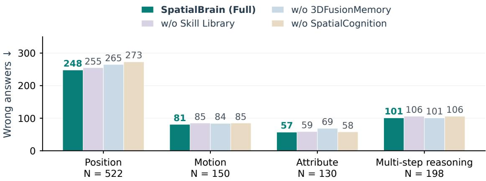  
Figure A2 MMSI component errors by task family. Earlier component configurations on all 1,000 items. Bars count wrong answers, including unanswered questions. The four families partition the evaluation set; configuration and answer-availability diferences are detailed in Appendix A.

## B.5 MMSI Errors by Task Type

Figure A3 compares Direct and SpatialBrain on all 1,000 MMSI items and eleven task types. Direct makes 462 errors and SpatialBrain makes 429, with 199 corrections and 166 reversals. Camera–object errors decrease from 53 to 24 and appearance errors from 39 to 25, whereas multi-step errors increase from 83 to 94. Region–region errors are unchanged.

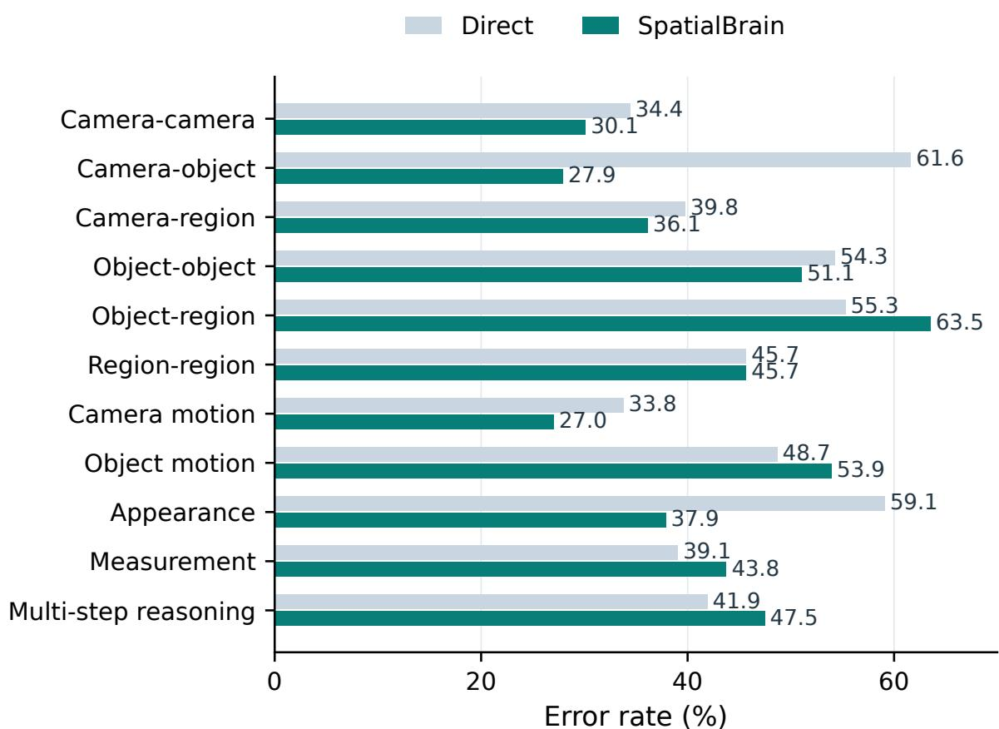  
Figure A3 MMSI errors by task type. Direct GPT-5.6-sol answers and SpatialBrain on all 1,000 items. Each rate divides wrong answers by the number of items in that type. Lower is better.

## B.6 Earlier Retrieval and Sequence Alignment

In an earlier GPT-5.5 experiment, 500 MMSI source tasks produce 81 procedural records across 36 task–path families and 16 capability skeletons. Among 500 disjoint target tasks, 332 are eligible for retrieval: 122 retrieve a record (36.7%) and 59 execute a partially matching tool sequence (17.8%). Partial alignment requires ordered overlap covering at least half of a retrieved sequence; it occurs in 48.4% of tasks with retrieved records. This analysis does not count newly generated skills or measure answer improvements. The experiment did not improve aggregate accuracy or cost. It is separate from the full executable-cohort exposure counts in Appendix B.2.

## C Qualitative Analysis and Visualizations

We group the examples by their role in spatial reasoning: 3DFusionMemory for grounding, the Skill Library for reusable procedures, and SpatialCognition for experience-guided resource choices. Teal, purple, and amber boxes identify these three groups; blue-gray boxes show additional tool-based trajectories.

<table><tr><td>Component / box color</td><td>Examples (MMSI IDs)</td></tr><tr><td>3DFusionMemory / teal</td><td>Atlas exposure and spatial verification: 9, 206; multi-view representations: 297, 861.</td></tr><tr><td>Skill Library / purple</td><td>Successful skill returns and answer correction: 32, 42.</td></tr><tr><td>SpatialCognition / amber</td><td>Experience-guided routing: 748; adaptive skill selection: 348.</td></tr><tr><td>Supporting traces / blue-gray</td><td>Coordinate and temporal reasoning: 18, 82; shorter paths and fallback: 289, 880; boundary cases: 715, 416.</td></tr></table>

Case selection. The ten detailed trajectories and two compact boundary cases come from the 1,000-item MMSI evaluations with GPT-5.6-sol. Seven show an incorrect Direct answer and a correct SpatialBrain answer. We selected these examples after scoring to explain distinct execution paths; they are not representative of the full set, which has 199 corrections and 166 reverse outcomes. Overall scores are 53.8% for Direct, 57.4% for the fixed-policy control, and 57.1% for SpatialBrain.

The boxes show observed operations rather than isolated component efects; executing an existing skill is distinct from learning a new one. The two memory visualizations illustrate saved spatial representations, independently of answer correctness. For the SpatialCognition cases, we checked that the cited experience precedes the target task and that the later resource choice follows that experience.

Compute comparisons. Unless stated otherwise, compute comparisons use the fixed-policy control. Of 485 both-correct fixed-policy/SpatialBrain pairs, 480 have complete token records, 221 use fewer SpatialBrain tokens, and 71 also use fewer non-final top-level calls and less observed time. Of 372 both-correct Direct/SpatialBrain pairs, 371 have complete tokens and only MMSI 748 uses fewer SpatialBrain tokens; both paths use zero tools. Call counts include failed attempts and exclude final-answer generation; primitive calls inside a skill are counted separately from top-level calls. Elapsed times are observational: concurrency and caches were not controlled. The evaluations used the same task IDs, model, and protocol, but exact image-byte identity could not be checked because per-run hashes were not recorded.

## 3DFusionMemory: Cross-view Spatial Grounding

## 3DFusionMemory · Answer Correction

Question

When you are going upstairs in the stairwell area, where is the food storage area located relative to you? A. In front B. Behind C. On the left D. On the right

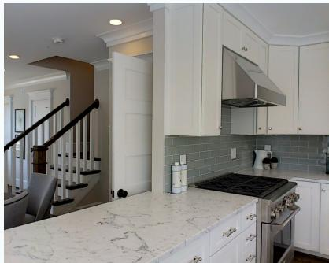  
Image 1

Direct C. On the left

  
Image 2

× Incorrect

SpatialBrain

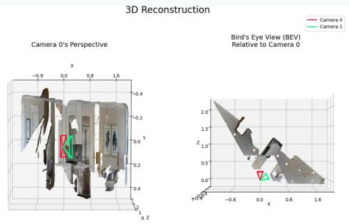

1. Reconstruct both views; detect and project the stairs and refrigerator into the shared frame.

2. The saved 3DFusionMemory atlas contains two 3D anchors and one relation and is exposed to the planner.

3. The coordinate check uses the upstairs direction as forward: right = +1.215, forward = +0.195. Return D: on the right.

Reconstruction and camera poses

## Memory available to the planner

2 anchors; 1 relation pair.

Atlas includes relation uncertainty.

Answer D. On the right

✓ Correct

A tool verifies the direction after atlas exposure; there is no standalone MemoryQuery call.

## 3DFusionMemory: Landmark-based Grounding

## 3DFusionMemory · Answer Correction

## Question

The stove is on the east side of the kitchen. In which direction is the mural in the kitchen?

A. Northeast B. Southeast C. Southwest D. Northwest

  
Image 1  
Direct C. Southwest

  
Image 2

× Incorrect

## SpatialBrain

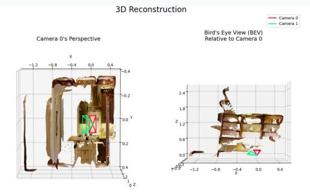

Reconstruction and camera poses

1. Project the stove, mural, and two island observations into the reconstructed kitchen. Four anchors and six relation pairs are retained in 3DFusionMemory.

2. Expose the atlas to the planner. The coordinate check combines the two island observations after a consistency check and uses the stove to define east.

3. The mural displacement has east = -0.360 and north = +0.432. Return D: northwest.

## Memory available to the planner

4 anchors; 6 relation pairs.

Atlas includes relation uncertainty.

## Answer D. Northwest

✓ Correct

The coordinate check combines the island observations; memory keeps them separate and does not override the answer.

## Multi-view Support in 3DFusionMemory

These two examples connect image detections to 3D anchors, camera poses, and supporting views. We selected them for visible geometry, without using answer correctness. The overhead inset shows the same state from a second viewpoint, not a later fusion step. Colored matrix cells indicate recorded view support, not independently verified object matches. All coordinates are unchanged; distance scales are not calibrated in meters. Dashed lines mark uncertain relations, and each diagram shows a subset of the stored relations.

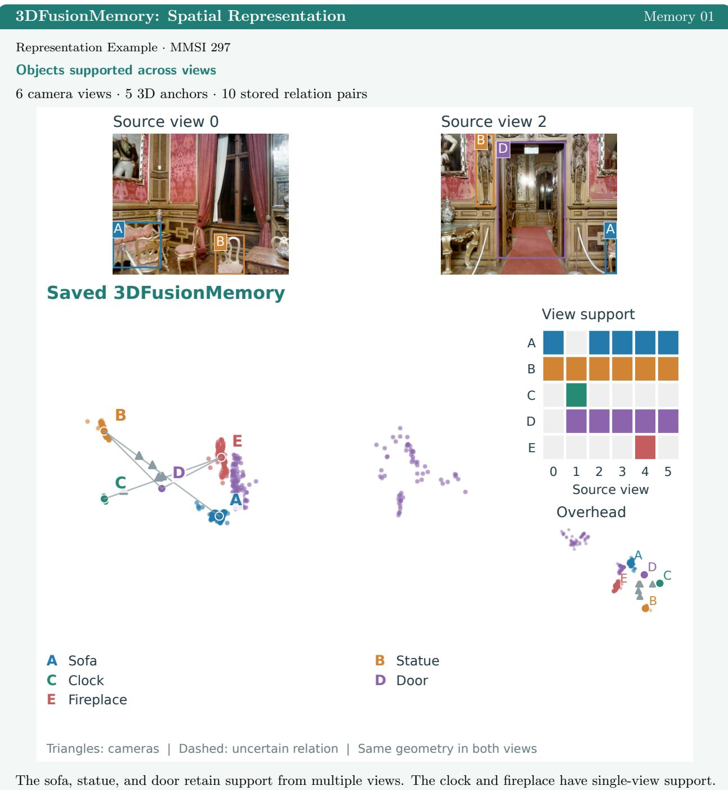

The top and stairs retain two-view support; the other four anchors are supported by one view each. The additional overhead view separates the stored layout from the display camera perspective. 2/6 anchors have support in at least two views.  
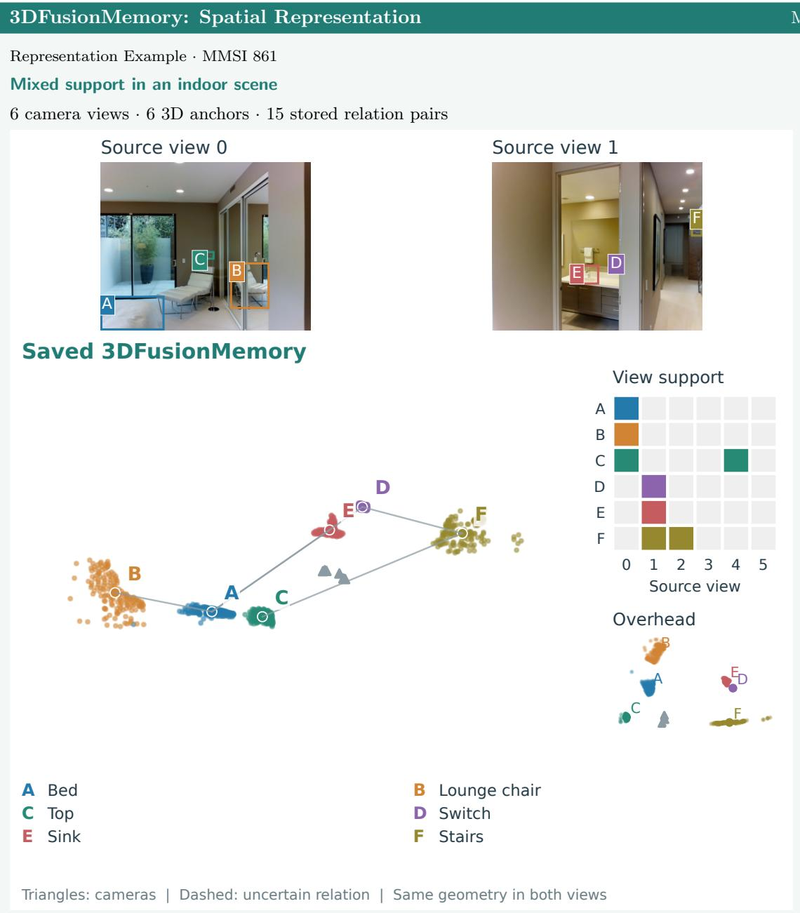

Single-view support in other saved scenes. Four additional scene states distinguish shared-frame organization from repeated observations of the same object. MMSI 700 and 711 have 8 and 7 anchors, respectively; MindCube around/033d379d and around/0d8a8816 each have 5. None of these anchors has support in two or more views. In around/033d379d, all five anchors come from view 1 despite three retained camera poses. These states illustrate stored spatial layouts rather than repeated-observation fusion.

## C.2 Spatial Skill Library

These examples show how existing skills provide structured spatial outputs for answer generation.

## Skill Library: Reusable Rotation Estimation

MMSI 32

## Question

The images are taken continuously from a first-person perspective. In which direction are you rotating? A. Left B. Right C. Up D. Down

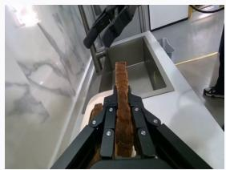  
Image 1

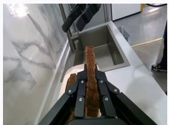  
Image 2

Direct A. Left

× Incorrect

## SpatialBrain

Invoke camera-camera-rotation-template on the two ordered views. The skill returns down, with primary axis x and total rotation 1.095 degrees. Final-answer generation uses this returned direction.

Answer D. Down

✓ Correct

The existing executable skill is used at its initial state v0.

## Skill Library: Camera-frame Reasoning

MMSI 42

## Question

When you took the photo in Figure 1, where was the iron refrigerator located relative to you? A. Front left B. Rear left C. Rear right D. Front right

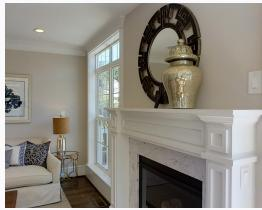  
Image 1

  
Image 2

Direct B. Rear left

× Incorrect

## SpatialBrain

Invoke camera-object-direction-template with camera 0 as the reference. Its output is $l e f t ,$ with x = −1.377 and $z = + 0 . 5 6 6$ . These coordinates resolve the diagonal option: left and in front.

Answer

A. Front left

The final answer uses the returned coordinates, not just the coarse direction label.

✓ Correct

## C.3 SpatialCognition

These cases trace recommendations from earlier task blocks to the current resource decision. The target is excluded from the supporting experience.

## SpatialCognition: Experience-Guided Routing

MMSI 748

## Question

Which is longer: the long side of the statue’s base in Figure 1 or the width of the bench in Figure 2?

A. They are the same length

B. The long side of the statue’s base in Figure 1 is longer

C. Sometimes the long side of the statue’s base in Figure 1 is longer, sometimes the width of the bench in Figure 2 is longer D. The width of the bench in Figure 2 is longer

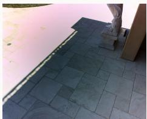  
Image 1

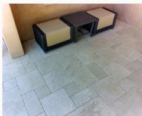  
Image 2

Direct D. The width of the bench in Figure 2 is longer

✓ Correct

## SpatialBrain

Earlier experience: 27 same-family events. Policy change: v10 recommends agent execution; v11 recommends direct reasoning. The current task follows v11 without exploration, with memory of and no skill execution. The 2D-measurement guard is shared by both arms and remains unchanged.

Answer D. The width of the bench in Figure 2 is longer

✓ Correct

Fixed-policy control → SpatialBrain (both correct): 37,884 → 3,632 tokens (−90.4%); 2 → 0 non-final top-level calls;   
38.0 → 9.4 s observed.

Standalone Direct also answers correctly: 3,697 versus 3,632 tokens (−1.8%); both use zero tools.

## SpatialCognition: Adaptive Skill Selection

## MMSI 348

## Question

What kind of angle is approximately formed by the projections on the ground of the forward directions of the camera when taking the first and second pictures?

A. Obtuse angle B. 0 degrees C. Right angle D. Acute angle

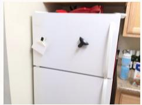  
Image 1

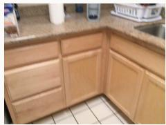  
Image 2

Direct D. Acute angle

✓ Correct

## SpatialBrain

Earlier experience changes the recommendation for the existing camera-camera-rotation-template from hint only (v1) to executable (v4). With 18 earlier same-family events, the current v5 policy executes the skill without exploration. Its returned angle is 47.6 degrees.

Answer D. Acute angle

The fixed-policy control also calls this skill. The observed change is in the selection policy, not the skill code or this item’s correctness.

## C.4 Additional Execution Traces

The following paths illustrate coordinate conventions, temporal correspondence, and execution costs. They complement the component examples without attributing each tool decision to accumulated experience.

## Tool Trajectory: Coordinate-convention Alignment

MMSI 18

## Question

The camera coordinate system is defined as +Y up, -Z forward, and is a right-handed system. How is the viewpoint in the second image obtained from the viewpoint in the first image by moving in its corresponding camera coordinate system?

A. Move in the positive Z direction and positive Y direction

B. Move in the negative Z direction and positive Y direction

C. Move in the negative X direction and negative Y direction

D. Move in the positive X direction and negative Y direction

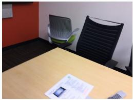  
Image 1

  
Image 2

Direct D. Move in the positive X direction and negative Y direction

## SpatialBrain

Reconstruct the views and recover their camera centers. Express the second center in the first camera frame under the specified convention. The displacement (−0.083, +0.509, −1.060) gives negative Z and positive Y. Answer B. Move in the negative Z direction and positive Y direction ✓ Correct

## Tool Trajectory: Temporal Correspondence

## Question

The pictures were taken in sequence. In which direction are the two grippers moving?

A. The left gripper did not move, the right gripper moved to the left

B. The left gripper moved to the right, the right gripper moved to the right

C. The left gripper moved to the right, the right gripper did not move

D. The left gripper moved to the left, the right gripper did not move.

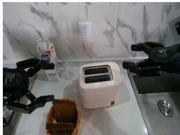  
Image 1

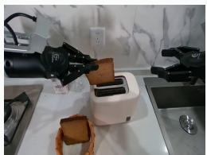  
Image 2

Multiple detections are present; the calculation uses the selected correspondences.

## Question

The images are taken continuously from a first-person perspective. In which direction are you moving? A. Front left B. Front right C. Right D. Forward

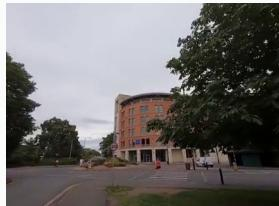  
Image 1

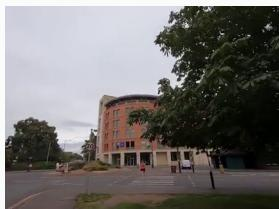  
Image 2

Direct C. Right

× Incorrect

## SpatialBrain

Request landmark detections for the brick building and roadside sign in both frames. Proceed from the two detection calls without a reconstruction or Python call. The fixed-policy run reaches the same answer after an additional reconstruction and two Python calls.

✓ Correct

Fixed-policy control → SpatialBrain (both correct): 88,760 → 29,415 tokens (−66.9%); 5 → 2 non-final top-level calls; 318.6 → 29.7 s observed.

## Tool Trajectory: Skill Fallback and Recovery

MMSI 880

## Question

The picture is a continuous first-person perspective shot. In which direction is the spoon moving? A. Out of the bowl B. Toward the person C. Into the bowl D. Toward the pot

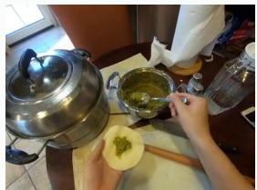  
Image 1

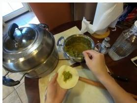  
Image 2

C. Into the bowl

✓ Correct

## SpatialBrain

The object-motion skill returns control to the planner because slot information is insuficient; no nested tool executes. The planner then makes one spoon-detection call per frame. The fixed-policy run encounters the same fallback but makes eight detector calls. Answer C. Into the bowl ✓ Correct

Fixed-policy control → SpatialBrain (both correct): 90,898 → 52,417 tokens $( - 4 2 . 3 \% ) ; 9  3$ non-final top-level calls; 110.5 → 69.4 s observed.

Both runs encounter ambiguous detections. Counts include the fallback; this is recovery after an unsuccessful skill attempt.

## Reasoning and Cost Boundaries

Correct answers can coexist with an unsupported geometric shortcut or a more expensive execution path.   
These cases distinguish answer correctness from the quality and cost of the supporting procedure.

## Boundary Case: Cross-view Height Comparison

MMSI 715

## Question

Which is higher, the fabric on the left or the sink on the right?

A. The same height B. The sink C. The fabric

D. Sometimes the fabric is higher, sometimes the sink is higher

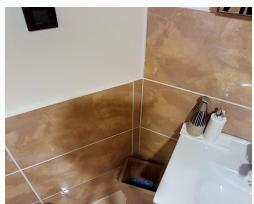  
Image 1

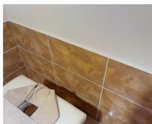  
Image 2

Direct B. The sink SpatialBrain B. The sink

✓ Correct ✓ Correct

The procedure detects the sink in image 1 and the fabric in image 2, then compares normalized box-center heights, 0.792 and 0.825. Its description invokes shared wall tiles as context, but the computation does not estimate a cross-view alignment. Normalization alone does not establish a common height reference across these views; the correct answer therefore does not validate this geometric shortcut.

Both runs use the same memory-of/hint route. Fixed-policy control → SpatialBrain: 64,712 → 58,586 tokens (−9.5%), 3 → 3 non-final top-level calls, and 196.1 → 102.6 s observed. Standalone Direct is also correct with 3,534 tokens.

## Boundary Case: Compute Trade-ofs

MMSI 416

## Question

This is a set of photos I took at home. In the last photo, in which direction is the exit area relative to me? A. front left B. back left C. front right D. back right

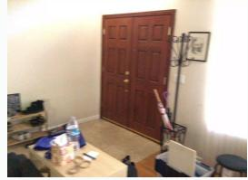  
Image 1

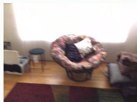  
Image 2

Direct A. front left SpatialBrain A. front left

✓ Correct ✓ Correct

Detect the exit, reconstruct both views, and project the exit into 3D. Its coordinates in the last camera frame are x = −0.852, z = +0.987, giving front left. This is an exploratory route with memory disabled.

Fixed-policy control → SpatialBrain: 123,214 → 111,609 tokens (−9.4%), 4 → 5 non-final top-level calls, and 258.9 → 262.3 s observed. Fewer tokens here do not imply fewer calls or shorter time.

## D Memory Fusion and Experience Updates

## D.1 Confidence-weighted Scene Fusion

Reconstruction provides a common scene frame. For a matched object $o , \mu _ { o } \in \mathbb { R } ^ { 3 }$ is its current center and $W _ { o }$ its accumulated confidence weight. A projection from view v supplies center $\widetilde { \mu } _ { o , \tau }$ and weight $w _ { o , v } \colon$

$$
\pmb { \mu } _ { o } ^ { + } = \frac { W _ { o } \pmb { \mu _ { o } } + w _ { o , v } \widetilde { \pmb { \mu } } _ { o , v } } { W _ { o } + w _ { o , v } } , \qquad W _ { o } ^ { + } = W _ { o } + w _ { o , v } .\tag{A1}
$$

The superscript + denotes the updated state. The view-specific center is the confidence-weighted centroid of projected points, or their arithmetic mean if total confidence is zero; $w _ { o , v }$ is their mean confidence. The first valid projection initializes the estimate. Equation A1 requires $W _ { o } + w _ { o , v } > 0$ . These weights express relative support, not calibrated probabilities.

## D.2 Conservative Strategy Admission

In the executable configuration, consider one route or memory factor with default action $a _ { 0 }$ and alternative a. Statistics are conditioned on the task signature and use only earlier blocks. Eligibility requires

$$
\begin{array} { c } { { \operatorname* { m i n } \{ n _ { a } , n _ { a _ { 0 } } \} \geq n _ { \mathrm { m i n } } , \qquad n _ { u } ^ { \mathrm { c o s t } } = n _ { u } ( u \in \{ a , a _ { 0 } \} ) , } } \\ { { R _ { a } ^ { \mathrm { u p p e r } } \leq \epsilon , \qquad C _ { a } ^ { \mathrm { u p p e r } } \leq ( 1 - \delta ) C _ { a _ { 0 } } ^ { \mathrm { l o w e r } } . } } \end{array}\tag{A2}
$$

For action $u , n _ { u }$ counts observations and $n _ { u } ^ { \mathrm { c o s t } }$ complete cost records; $n _ { \mathrm { m i n } }$ is the minimum support. Incomplete costs cannot establish a saving. $R _ { a } ^ { \mathrm { u p p e r } }$ is a Wilson upper estimate of the process-violation rate, including unverified actions; ϵ is its tolerance. The cost bounds use the sample mean plus or minus 1.96 standard errors, with the lower bound floored at zero. $\delta \in [ 0 , 1 )$ is the required fractional saving. Thus equation A2 compares a candidate’s upper cost with the default’s lower cost, not just two point estimates.

The controller checks the specific context before a broader task family; supported context-specific risk can veto a broader recommendation. At each level it chooses the eligible alternative with the lowest upper cost, retaining the default if none qualifies. These are process-feedback gates, not correctness rewards or guarantees of answer accuracy. They describe the executable configuration, not every historical run in the paper.

## D.3 Learned and Fixed State

The initial library, task-signature schema, tool interfaces, validation checks, and update rules are specified before evaluation. Experience changes support statistics, associations between task conditions and strategies, and procedural availability. The executable configuration can also compile and validate new procedures. Some failure-check text comes from predefined rules: observing a failure adds its applicability and support, rather than inventing an unrestricted instruction. A selected skill, an exposed hint, an executed procedure, a verified return, and a correct answer are distinct events. Process observations cannot establish answer correctness without the separate evaluation labels, which are not used by the update loop.