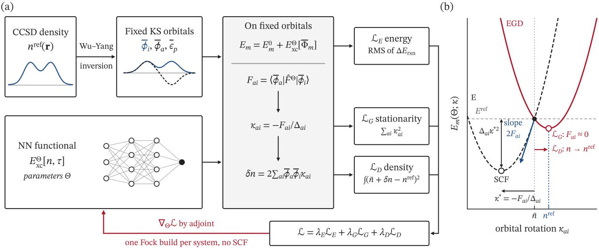
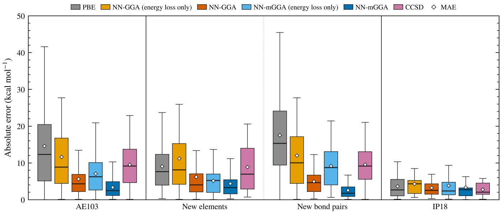
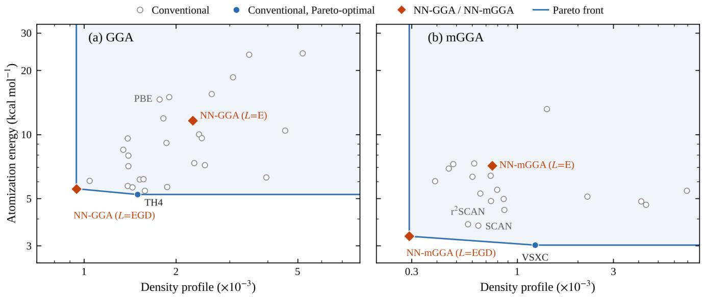

# Stationarity Constraints Improve Both Energies and Densities of Machine-Learned Exchange-Correlation Functionals

Yuhao Chen,1 Donald G. Truhlar,2 and Xiao He1, 3, 4, ∗

1Shanghai Engineering Research Center of Molecular Therapeutics and New Drug Development, Shanghai Frontiers Science Center of Molecule Intelligent Syntheses,

3Anhui Provincial Key Laboratory of Advanced Catalysis and Energy Materials,

Anhui Ultra High Molecular Weight Polyethylene Fiber Engineering Research Center, School of Chemistry and Chemical Engineering, Anqing Normal University, Anqing 261433, China 4New York University–East China Normal University Center for Computational Chemistry, New York University Shanghai, Shanghai 200062, China

Empirical exchange-correlation functionals are fitted on fixed orbitals but used self-consistently, so better energies often come with worse densities. We show that the Brillouin residual of a trained functional on the Kohn-Sham orbitals of an accurate density controls, to first order, both the selfconsistent density shift and the gap between fitted and self-consistent energies. Penalizing it requires no self-consistent-field solution during training. Trained on 6 energies and 11 CCSD densities, a neural meta-GGA surpasses SCAN in both atomization energies and densities of unseen molecules.

Kohn-Sham density functional theory (KS-DFT) [1, 2] is the most widely used electronic-structure method in chemistry and materials science, and its accuracy is set by the approximation to the exchange-correlation (XC) energy. The most accurate approximations for molecular thermochemistry contain tens of empirical parameters [3–6] or, as machine-learned functionals, thousands or more [7–12]. These parameters are fixed almost exclusively by reference energies; the electron density, which by the Hohenberg-Kohn theorem determines all groundstate properties, does not enter the fit. Medvedev et al. found that functionals with more empirical parameters tend to give worse atomic densities [13], suggesting that part of the energetic gain comes from error cancellation rather than from approaching the exact functional [13– 15].

A concrete but rarely discussed mechanism underlies this trend: a functional is not used in the state in which it is fitted. Its parameters are fitted to energies on fixed orbitals, but the functional is solved self-consistently. A parameter change that lowers the fixed-orbital energy error also changes the XC potential, so the self-consistent-field (SCF) solution relaxes away from the fitted orbitals—and an energy-only loss does not penalize this relaxation, even when the fixed orbitals come from the exact density. In the language of density-corrected DFT [16, 17], energy fitting controls the functional-driven error but leaves the density-driven error unconstrained. Accuracy reached in the fit therefore need not survive self-consistency, let alone transfer to new molecules.

Two routes bring information beyond energies into the fit. One fits XC potentials obtained by density inversion [18, 19], as in the TH, HCTH, and B97-2 functionals [20–24], or learns the density-to-potential map directly [25, 26]; but finite-basis inversion is ill-conditioned and fixes the potential only up to a constant [27–30], so pointwise fitting imports numerical noise into the target. The other is diferentiable DFT [31–33], which places the SCF cycle inside automatic diferentiation so that selfconsistent densities and energies enter the loss directly. It is efective, but every training step must converge the SCF and backpropagate through it, which is costly and fragile for hard-to-converge systems; alternating training with SCF [34] likewise requires repeated SCF solutions.

In this Letter we expand about the KS orbitals of an accurate reference density and constrain how the trained functional behaves there. Our key observation is that a single quantity—the Brillouin residual of the trained functional on the reference orbitals, i.e., the occupied virtual block of its Fock matrix—controls, to first order, both the self-consistent density shift and the gap between fitted and self-consistent energies. Penalizing it yields a stationarity loss and a first-order density loss (Fig. 1) with three properties: their target is exact self-consistency at the reference orbitals; they see only the part of the potential error that rotates occupied orbitals, so the constant and ill-determined components that plague inversion drop out; and they need one Fock build per system, with no SCF solved or diferentiated during training. Trained on 6 reference energies and the coupled-cluster (CCSD) densities of 11 atoms, ions, and diatomics, and tested fully self-consistently on 103 molecules, many with elements and bonds absent from training, the same network reproduces the trend of Ref. [13] under energy-only training—densities worse than those of the base functional—and reverses it with the two constraints: the resulting meta-GGA surpasses SCAN in both energies and densities.

Self-consistent mismatch on fixed orbitals.—Let $\{ \bar { \phi } _ { p \sigma } , \bar { \epsilon } _ { p \sigma } \}$ be the KS orbitals and orbital energies obtained from the CCSD reference density $n ^ { \mathrm { r e f } }$ by Wu-Yang inversion [19], i.e., eigenstates of a local-potential Hamiltonian $\hat { h } _ { \sigma } ^ { \mathrm { r e f } }$ . For a functional with parameters Θ, the energy of system m on these fixed orbitals is

  
FIG. 1. Training XC functionals on fixed orbitals. (a) Wu-Yang inversion of the CCSD density gives fixed KS orbitals, on which the occupied-virtual Fock block $F _ { a i }$ of the trained functional yields the predicted SCF rotation $\kappa _ { a i }$ (stationarity loss $\mathcal { L } _ { G } )$ and the first-order density change δn (density loss $\scriptstyle { \mathcal { L } } _ { D } )$ ; the energy loss $\mathcal { L } _ { E }$ uses the same orbitals. One Fock build per system gives the parameter gradient, with no SCF. (b) Energy along one occupied-virtual rotation. Energy-only training (E) matches the reference energy at $\kappa = 0$ , but the orbital gradient $2 F _ { a i }$ drives the SCF solution to $\kappa ^ { * } = - F _ { a i } / \Delta _ { a i }$ , causing an energy error $\boldsymbol { \Delta _ { a i } \kappa ^ { * 2 } }$ and a density shift δn. EGD makes the reference orbitals stationary.

$$
\begin{array} { r } { E _ { m } ( \Theta ) = E _ { m } ^ { 0 } + E _ { \mathrm { x c } } ^ { \Theta } [ { \bar { \Phi } } _ { m } ] , } \end{array}\tag{1}
$$

where $E _ { m } ^ { 0 }$ collects the kinetic, external, Hartree, and nuclear-repulsion energies and is independent of Θ. Conventional energy-only fitting (hereafter E) makes reaction energies assembled from Eq. (1) reproduce reference values. Because Eq. (1) is evaluated on orbitals of the reference density, E fitting does not lack density information; it lacks information on whether the functional’s self-consistent solution stays on these orbitals.

Writing a real occupied-virtual rotation as $\phi _ { i \sigma } = \bar { \phi } _ { i \sigma } +$ $\begin{array} { r } { \sum _ { a } \kappa _ { a i } ^ { \sigma } \bar { \phi } _ { a \sigma } + O ( \kappa ^ { 2 } ) } \end{array}$ and expanding to second order about $\kappa = 0$ gives

$$
E _ { m } ( \Theta ; \kappa ) \simeq E _ { m } ( \Theta ) + \sum _ { \sigma a i } \Big [ 2 F _ { a i } ^ { \sigma } ( \Theta ) \kappa _ { a i } ^ { \sigma } + \Delta _ { a i } ^ { \sigma } \big ( \kappa _ { a i } ^ { \sigma } \big ) ^ { 2 } \Big ] ,\tag{2}
$$

where $F _ { a i } ^ { \sigma } ( \Theta ) = \langle \bar { \phi } _ { a \sigma } | \hat { F } ^ { \sigma } [ \bar { \Phi } ; \Theta ] | \bar { \phi } _ { i \sigma } \rangle$ is the occupiedvirtual block of the trained functional’s Fock matrix on the reference orbitals and $2 F _ { a i } ^ { \sigma }$ the orbital gradient (unit occupation per spin orbital). We take the uncoupled diagonal orbital Hessian $\Delta _ { a i } ^ { \sigma } = \operatorname* { m a x } ( \bar { \epsilon } _ { a \sigma } - \bar { \epsilon } _ { i \sigma } , \Delta _ { \operatorname* { m i n } } )$ , where $\Delta _ { \operatorname* { m i n } } = 0 . 0 5 E _ { h }$ keeps near-degenerate pairs from dominating. Minimizing Eq. (2) gives the first-order SCF relaxation

$$
\kappa _ { a i } ^ { \sigma } ( \Theta ) = - F _ { a i } ^ { \sigma } ( \Theta ) / \Delta _ { a i } ^ { \sigma }\tag{3}
$$

and its two observable consequences,

$$
E _ { m } ^ { \mathrm { S C F } } ( \Theta ) \simeq E _ { m } ( \Theta ) - \sum _ { \sigma a i } \Delta _ { a i } ^ { \sigma } \big ( \kappa _ { a i } ^ { \sigma } \big ) ^ { 2 } ,\tag{4}
$$

$$
\delta n _ { m } ( { \bf r } ; \Theta ) \simeq 2 \sum _ { \sigma a i } \bar { \phi } _ { a \sigma } ( { \bf r } ) \bar { \phi } _ { i \sigma } ( { \bf r } ) \kappa _ { a i } ^ { \sigma } ( \Theta ) .\tag{5}
$$

Equation (4) shows that the fixed-orbital energy targeted by E fitting difers from the self-consistent energy by a term quadratic in F—the density-driven error relative to the reference density [16, 17]—and Eq. (5) that the SCF density shift is first order in F. Neither is a target of E fitting, and both vanish only when $F _ { a i } ^ { \sigma } = 0 ;$ i.e., when the reference determinant satisfies the Brillouin condition [35] of the trained functional. Importantly, this target is exact: $F _ { a i } ^ { \sigma } = 0$ for all pairs if and only if the ref erence orbitals are a self-consistent solution of the trained functional in the given basis, so the uncoupled Hessian af fects only how deviations from stationarity are weighted. A positive-definite Hartree-XC kernel (the Hartree part usually dominates) screens orbital relaxation, in which case Eq. (4) bounds the energy relaxation from above.

Relation to potential fitting.—Because the reference orbitals are eigenstates of $\hat { h } ^ { \mathrm { r e f } }$

$$
F _ { a i } ^ { \sigma } = \langle \bar { \phi } _ { a \sigma } | \Delta \hat { v } _ { \sigma } | \bar { \phi } _ { i \sigma } \rangle , \qquad \Delta \hat { v } _ { \sigma } = \hat { v } _ { \mathrm { x c } , \sigma } ^ { \Theta } - v _ { \mathrm { x c } , \sigma } ^ { \mathrm { r e f } } ,\tag{6}
$$

where $v _ { \mathrm { x c } } ^ { \mathrm { r e f } }$ is the inverted local XC potential and, for a meta-GGA, ˆvΘ xc includes the nonmultiplicative generalized-KS term $\textstyle - \frac { 1 } { 2 } \nabla \cdot [ ( \partial { e _ { \mathrm { x c } } } / \partial { \tau _ { \sigma } } ) \nabla ] \ [ 3 6 , 3 7 ]$ . Equations (3) and (5) are thus the uncoupled first-order orbital rotation and KS density response induced by $\Delta \hat { v }$ . Unlike pointwise potential fitting, only the occupied-virtual block of $\Delta \hat { v }$ enters: a constant shift cancels $\bar { ( \phi _ { a } | c | \bar { \phi } _ { i } ) } =$ 0), and components with a vanishing occupied-virtual block—which leave the density unchanged to first order and are precisely those that finite-basis inversion cannot determine—are excluded. The constraint retains exactly the potential information that the reference density carries.

Stationarity and first-order density constraints.—The stationarity loss is the squared norm of the predicted rotation,

$$
\mathcal { L } _ { G } ( \Theta ) = \sum _ { m \in \mathcal { S } } \sum _ { \sigma a i } \big [ \kappa _ { a i } ^ { \sigma } ( \Theta ) \big ] ^ { 2 } .\tag{7}
$$

By Eq. (4), the energy gap $\begin{array} { r } { \sum \Delta _ { a i } ^ { \sigma } ( \kappa _ { a i } ^ { \sigma } ) ^ { 2 } \ \leq } \end{array}$ max $\Delta _ { a i } ^ { \sigma }$ $\sum ( \kappa _ { a i } ^ { \sigma } ) ^ { 2 }$ , so $\mathcal { L } _ { G }$ also controls it; relative to the gap $\left( \propto F ^ { 2 } / \Delta \right)$ , LG $( \propto F ^ { 2 } / \Delta ^ { 2 } )$ emphasizes small-gap pairs, which relax most easily. The first-order density loss compares the predicted SCF density directly with the CCSD density,

$$
\mathcal { L } _ { D } ( \Theta ) = \frac { 1 } { N _ { S } } \sum _ { m \in S } \left\| \bar { n } _ { m } + \delta n _ { m } ( \Theta ) - n _ { m } ^ { \mathrm { r e f } } \right\| ^ { 2 } ,\tag{8}
$$

where $\begin{array} { r } { \| f \| ^ { 2 } = \int f ( \mathbf { r } ) ^ { 2 } d \mathbf { r } , \bar { n } _ { m } } \end{array}$ is the density of the reference orbitals, and S is the set of $N _ { S }$ training systems with density data.

The two losses are complementary. $\mathcal { L } _ { D }$ targets the observable $n _ { m } ^ { \mathrm { r e f } }$ itself, so $\delta n _ { m }$ can also absorb the part of the inversion residual $d _ { m } = \bar { n } _ { m } - n _ { m } ^ { \mathrm { r e f } } \neq 0$ that orbital rotations can represent. $\mathcal { L } _ { G }$ acts on the orbitals: rotations that barely change the density still change a meta-GGA energy through the kinetic-energy density $\tau ,$ and $\mathcal { L } _ { G }$ keeps the predicted rotations small, so the first-order prediction behind $\mathcal { L } _ { D }$ stays valid.

Training objective.—The total loss is

$$
\begin{array} { r } { \mathcal { L } ( \boldsymbol { \Theta } ) = \lambda _ { E } \mathcal { L } _ { E } ( \boldsymbol { \Theta } ) + \lambda _ { G } \mathcal { L } _ { G } ( \boldsymbol { \Theta } ) + \lambda _ { D } \mathcal { L } _ { D } ( \boldsymbol { \Theta } ) , } \end{array}\tag{9}
$$

where $\mathcal { L } _ { E }$ is the root-mean-square error (in hartree) of six reference reaction energies assembled from $\operatorname { E q . } \ ( 1 )$ . We compare E $( \lambda _ { G } = \lambda _ { D } = 0 )$ and EGD $( \lambda _ { E } = \lambda _ { G } = 5 0$ $\lambda _ { D } = 5 0 0 )$ , which share reference orbitals, energy term, optimizer, and checkpoint selection and difer only by Eqs. (7) and (8). Each training step needs one occupiedvirtual Fock block per system, and the gradient with respect to Θ follows from a single adjoint pass; no SCF is solved or implicitly diferentiated. Training uses only the first-order response, but every energy and density reported below is fully self-consistent and thus measures the functional in actual use. Derivations and numerical details are in the Supplemental Material (SM) [38].

Models and data.—To test two rungs of Jacob’s ladder [39], we train a PBE-based NN-GGA and a SCANbased NN-mGGA [40, 41] of the form

TABLE I. Training and validation systems. Density systems use CCSD Λ densities and their Wu-Yang orbitals, entering $\mathcal { L } _ { G }$ and $\mathcal { L } _ { D }$ (training) or the density error (validation). Atomic energies of C and O needed for atomization energies are evaluated on fixed orbitals but do not enter $\mathcal { L } _ { G }$ or $\mathcal { L } _ { D } .$ The partition follows Ref. [32], with $\mathrm { O ^ { + } }$ and $\mathrm { N e ^ { + } }$ added to the density set.
<table><tr><td></td><td>Training</td><td>Validation</td></tr><tr><td>Atomization</td><td> $\overline { { \mathrm { H } _ { 2 } , \mathrm { L i H } , \mathrm { O } _ { 2 } , \mathrm { C O } } }$ </td><td> $\overline { { \mathrm { N } _ { 2 } , \mathrm { N O } , \mathrm { F } _ { 2 } , \mathrm { H F } } }$ </td></tr><tr><td rowspan="2">Density</td><td> $\mathrm { H , L i , N e , H _ { 2 } , L i _ { 2 } , }$ </td><td> $\mathrm { H e } , \mathrm { B e } , \mathrm { N } , \mathrm { N } _ { 2 } ,$ </td></tr><tr><td> $\mathrm { L i H } , \mathrm { B } _ { 2 } , \mathrm { O } _ { 2 } , \mathrm { C O } , \mathrm { O } ^ { + }$   $\mathrm { N e ^ { + } }$ </td><td> $\mathrm { F } _ { 2 } , \mathrm { H F }$ </td></tr><tr><td>Ionization</td><td> $\mathrm { O , N e }$ </td><td> $\mathrm { N } , \mathrm { F }$ </td></tr></table>

$$
\begin{array} { r l } & { E _ { \mathrm { x c } } ^ { \Theta } [ n ] = \alpha E _ { \mathrm { x c } } ^ { \mathrm { b a s e } } [ n ] + \beta \displaystyle \int n ( \mathbf { r } ) f _ { \theta } \big ( \mathbf { z } ( \mathbf { r } ) \big ) d \mathbf { r } , } \\ & { \quad \quad \mathbf { z } ^ { \mathrm { G G A } } = \big ( \ln ( 1 + n ) , \zeta , \ln ( 1 + s ) \big ) , } \\ & { \quad \quad \mathbf { z } ^ { \mathrm { m G G A } } = \big ( \mathbf { z } ^ { \mathrm { G G A } } , \ln ( 1 + a _ { \tau } ) \big ) , } \end{array}\tag{10}
$$

(11)

where $E _ { \mathrm { x c } } ^ { \mathrm { b a s e } }$ is PBE or SCAN, ζ the spin polarization, s the reduced density gradient, $a _ { \tau } = ( \tau - \tau _ { W } ) / \tau _ { \mathrm { u n i f } }$ the kinetic-energy-density indicator, and $f _ { \theta }$ a fully connected network. All of $\Theta = \left( \alpha , \beta , \theta \right)$ are trained, starting from the base functional $( \alpha = 1 , \beta = 0 )$ , so E and EGD compare directly with PBE or SCAN. NN-GGA and NNmGGA have 2274 and 2306 parameters (architectures and hyperparameters in the SM [38]).

The energy term uses six data (Table I): atomization energies of $\mathrm { H } _ { 2 } , \mathrm { L i H } , \mathrm { O } _ { 2 }$ , and CO from W4-11 [42] and experimental first ionization energies of O and Ne [43]. The stationarity and density terms use 11 atoms, ions, and diatomics, with all-electron UCCSD (Λ-equation) oneparticle density matrices [44, 45] (UHF reference, aug-ccpVTZ basis [46, 47], PySCF level-6 grid [48]); the Wu-Yang orbitals of these densities stay fixed during training. Checkpoints are selected by fully self-consistent validation calculations that include atoms absent from training (N, F), using a weighted sum of the SCF root-meansquare energy errors (kcal/mol) and the mean density error. E and EGD share this score, so their diferences stem from the training objective alone. The data set is comparable to the smallest used for machine-learned functionals [7, 32] and orders of magnitude smaller than those of recent large-scale models [9, 12].

The test set AE103 comprises 103 molecules with 2– 14 atoms from the first three rows of the periodic table; it and the 18 atomic ionization energies of IP18 (H– Ar) are taken from the data set of Ref. [32]. Because training covers only atoms, ions, and diatomics of H– Ne, we also report two extrapolation subsets: molecules with elements absent from training (“new elements,” 37) and with bonded atom pairs absent from training (“new bond pairs,” 53). We further test 99 density records for 98 molecules (DP99), with the density error $\begin{array} { r } { \mathrm { D P } = \int ( n ^ { \mathrm { S C F } } - n ^ { \mathrm { r e f } } ) ^ { 2 } d { \bf r } } \end{array}$ evaluated against CCSD/augcc-pVTZ reference densities, averaged over records, and reported in units of $1 0 ^ { - 3 }$ a.u. Full lists are in the SM [38].

FIG. 2. Absolute errors of self-consistent atomization and ionization energies on the test sets. Boxes: interquartile range; bars: medians; diamonds: MAEs. “Energy loss only” denotes E training; the other NN functionals use the full loss, Eq. (9) (EGD). The stationarity and density terms lower the errors of both NN functionals on all atomization-energy sets, most strongly for new bond pairs. CCSD uses the aug-cc-pVTZ basis.  
  
FIG. 3. (a) GGA and (b) meta-GGA functionals in the plane of AE103 atomization-energy MAE and DP99 density error. Open circles: conventional functionals; filled blue circles: Pareto-optimal conventional functionals; blue line: Pareto front; red diamonds: NN functionals trained with L = E or L = EGD. The two constraints move both NN functionals from the interior to the low-density-error end of the front. Values for all functionals are in the SM [38].

Same network, same data, diferent objective.— Comparing E with EGD isolates the efect of Eqs. (7) and (8) (Fig. 2). For NN-GGA, EGD lowers the AE103 mean absolute error (MAE) from 11.6 to 5.6 kcal/mol, 2.6 times below its base PBE (14.6 kcal/mol). For NNmGGA, EGD lowers the MAE from 7.1 to 3.3 kcal/mol, below SCAN (3.7 kcal/mol).

The gain is largest outside the training distribution. On new elements, NN-GGA(E) is worse than PBE (11.2 vs 9.1 kcal/mol): the fixed-orbital error reduced in the fit does not carry over to self-consistent prediction, consistent with Eq. (4). EGD lowers this MAE to 6.2 kcal/mol, and that of NN-mGGA from 5.1 to 4.4 kcal/mol. On new bond pairs, EGD lowers the NN-GGA MAE from 12.0 to 5.0 kcal/mol (PBE: 17.5 kcal/mol) and the NNmGGA MAE from 9.1 to 2.5 kcal/mol, a factor of 3.6. On IP18, where all methods lie within 2.7–4.3 kcal/mol, EGD again removes the degradation caused by energyonly training (NN-GGA: 4.3 to 3.2 kcal/mol; PBE: 3.6 kcal/mol).

Both EGD functionals are also more accurate than CCSD on all three atomization-energy sets (9.5 kcal/mol on AE103), although CCSD supplies their reference densities. The energy term fits W4 and experimental values, whereas CCSD densities enter only through the occupiedvirtual block of the potential; the energy accuracy of the trained functional is therefore not capped by the method that generates its reference densities.

Energies and densities together.—Figure 3 shows where the improvement comes from. Both E models have larger density errors than their base functionals (NN-GGA(E) 2.3 vs PBE 1.8; NN-mGGA(E) 0.75 vs SCAN 0.64). For NN-GGA the degradation accompanies an energy gain, reproducing under controlled conditions— same network, data, and selection score—the “better energies, worse densities” trend of Ref. [13]. EGD reverses it: the same networks move to the low-density-error end of the Pareto front, with density errors 2.4 (GGA) and 2.6 (meta-GGA) times lower than with E, and 1.9 and 2.2 times lower than PBE and SCAN. NN-GGA(EGD) has the lowest density error (0.94) of all GGAs examined and beats 24 of the 26 conventional ones on both objectives; at the other end of the front, TH4 has a slightly lower energy error (5.2 kcal/mol) but a 1.6 times larger density error. Notably, TH4 and TH3, the conventional GGA with the lowest density error, were both fitted to ab initio XC potentials [22]; EGD reaches the same end of the front from six energies and 11 densities.

Among meta-GGAs, NN-mGGA(EGD) outperforms SCAN and r2SCAN [41, 49] on both objectives: its atomization-energy MAE is 3.3 kcal/mol (SCAN 3.7, r2SCAN 3.8), and its density error, 0.29, is about half of theirs (0.57–0.64) and the lowest of all meta-GGAs examined. It beats 18 of the 19 conventional meta-GGAs on both objectives; the exception, VSXC [50], has a slightly lower energy error (3.0 kcal/mol) but a 4.2 times larger density error. SCAN already satisfies all 17 exact constraints known for a meta-GGA [41]; six energies and 11 densities sufice for EGD to improve on it in both energy and density.

Outlook.—Equations (7) and (8) apply to any functional whose energy and Fock matrix can be evaluated on fixed orbitals, including hybrids. For linearly parametrized functionals, such as the Minnesota family [5, 51], κ is afine in the parameters, so the objective is convex on fixed orbitals and its global minimum is directly accessible. Because each training system costs one fixed-orbital Fock build, training can extend beyond the main-group thermochemistry and densities tested here to system classes that are dificult for diferentiable SCF, such as reaction barriers, transition-metal compounds, and condensed phases.

Conclusion.—The Brillouin residual of a trained functional on the KS orbitals of an accurate density is a density constraint for learning XC functionals whose target is exact self-consistency: to first order it fixes the SCF orbital rotation, the SCF density shift, and the gap between fitted and self-consistent energies; it sees only the potential error that rotates occupied orbitals; and it needs no SCF during training. From six energies and 11 CCSD densities, it reverses the “better energies, worse densities” trend of energy-only training and yields a meta-GGA more accurate than SCAN in both atom ization energies and densities of molecules outside the training set. More generally, every learned model used inside a self-consistent or variational solver—Kohn-Sham and classical density functionals [52], mean-field closures, and machine-learned efective Hamiltonians [53]—faces the same mismatch between the state in which it is fitted and the state in which it is used. Stationarity at the reference solution, in place of diferentiation through the fixed point, ofers a general and inexpensive constraint for this class of problems.

X.H. was supported by the National Natural Science Foundation of China (Grant Nos. 22633005, 92477103 and 22273023), Shanghai Municipal Science and Technology Commission with Grant No. 25511102400, Shanghai Municipal Commission of Economy and Informatization with Grant No. 2026-GZL-RGZN-01015, Advanced Materials-National Science and Technology Major Project (Grant No. 2026ZD0623702), the Shanghai Frontiers Science Center of Molecule Intelligent Syntheses, and the Fundamental Research Funds for the Central Universities. We also acknowledge the Supercomputer Center of East China Normal University (ECNU Multifunctional Platform for Innovation 001) for providing computer resources.

∗ xiaohe@phy.ecnu.edu.cn

[1] P. Hohenberg and W. Kohn, Inhomogeneous electron gas, Phys. Rev. 136, B864 (1964).

[2] W. Kohn and L. J. Sham, Self-consistent equations including exchange and correlation efects, Phys. Rev. 140, A1133 (1965).

[3] R. Peverati and D. G. Truhlar, Quest for a universal density functional: the accuracy of density functionals across a broad spectrum of databases in chemistry and physics, Phil. Trans. R. Soc. A 372, 20120476 (2014).

[4] N. Mardirossian and M. Head-Gordon, ωB97M-V: A combinatorially optimized, range-separated hybrid, meta-GGA density functional with VV10 nonlocal cor-

relation, J. Chem. Phys. 144, 214110 (2016).

[5] H. S. Yu, X. He, S. L. Li, and D. G. Truhlar, MN15: A Kohn-Sham global-hybrid exchange-correlation density functional with broad accuracy for multi-reference and single-reference systems and noncovalent interactions, Chem. Sci. 7, 5032 (2016).

[6] N. Mardirossian and M. Head-Gordon, Thirty years of density functional theory in computational chemistry: an overview and extensive assessment of 200 density functionals, Mol. Phys. 115, 2315 (2017).

[7] R. Nagai, R. Akashi, and O. Sugino, Completing density functional theory by machine learning hidden messages from molecules, npj Comput. Mater. 6, 43 (2020).

[8] S. Dick and M. Fernandez-Serra, Machine learning accurate exchange and correlation functionals of the electronic density, Nat. Commun. 11, 3509 (2020).

[9] J. Kirkpatrick et al., Pushing the frontiers of density functionals by solving the fractional electron problem, Science 374, 1385 (2021).

[10] K. Bystrom and B. Kozinsky, CIDER: An expressive, nonlocal feature set for machine learning density functionals with exact constraints, J. Chem. Theory Comput. 18, 2180 (2022).

[11] R. Pederson, B. Kalita, and K. Burke, Machine learning and density functional theory, Nat. Rev. Phys. 4, 357 (2022).

[12] G. Luise et al., Accurate and scalable exchangecorrelation with deep learning (2025), arXiv:2506.14665 [physics.chem-ph].

[13] M. G. Medvedev, I. S. Bushmarinov, J. Sun, J. P. Perdew, and K. A. Lyssenko, Density functional theory is straying from the path toward the exact functional, Science 355, 49 (2017).

[14] K. P. Kepp, Comment on “Density functional theory is straying from the path toward the exact functional”, Science 356, 496 (2017).

[15] K. R. Brorsen, Y. Yang, M. V. Pak, and S. Hammes-Schifer, Is the accuracy of density functional theory for atomization energies and densities in bonding regions correlated?, J. Phys. Chem. Lett. 8, 2076 (2017).

[16] M.-C. Kim, E. Sim, and K. Burke, Understanding and reducing errors in density functional calculations, Phys. Rev. Lett. 111, 073003 (2013).

[17] A. Wasserman, J. Nafziger, K. Jiang, M.-C. Kim, E. Sim, and K. Burke, The importance of being inconsistent, Annu. Rev. Phys. Chem. 68, 555 (2017).

[18] Q. Zhao, R. C. Morrison, and R. G. Parr, From electron densities to Kohn-Sham kinetic energies, orbital energies, exchange-correlation potentials, and exchangecorrelation energies, Phys. Rev. A 50, 2138 (1994).

[19] Q. Wu and W. Yang, A direct optimization method for calculating density functionals and exchange-correlation potentials from electron densities, J. Chem. Phys. 118, 2498 (2003).

[20] D. J. Tozer, V. E. Ingamells, and N. C. Handy, Exchangecorrelation potentials, J. Chem. Phys. 105, 9200 (1996).

[21] D. J. Tozer and N. C. Handy, The development of new exchange-correlation functionals, J. Chem. Phys. 108, 2545 (1998).

[22] N. C. Handy and D. J. Tozer, The development of new exchange-correlation functionals: 3, Mol. Phys. 94, 707 (1998).

[23] F. A. Hamprecht, A. J. Cohen, D. J. Tozer, and N. C. Handy, Development and assessment of new exchange-

correlation functionals, J. Chem. Phys. 109, 6264 (1998).

[24] P. J. Wilson, T. J. Bradley, and D. J. Tozer, Hybrid exchange-correlation functional determined from thermochemical data and ab initio potentials, J. Chem. Phys. 115, 9233 (2001).

[25] R. Nagai, R. Akashi, S. Sasaki, and S. Tsuneyuki, Neuralnetwork Kohn-Sham exchange-correlation potential and its out-of-training transferability, J. Chem. Phys. 148, 241737 (2018).

[26] Y. Zhou, J. Wu, S. Chen, and G. Chen, Toward the exact exchange-correlation potential: A three-dimensional convolutional neural network construct, J. Phys. Chem. Lett. 10, 7264 (2019).

[27] V. N. Staroverov, G. E. Scuseria, and E. R. Davidson, Optimized efective potentials yielding Hartree-Fock energies and densities, J. Chem. Phys. 124, 141103 (2006).

[28] D. S. Jensen and A. Wasserman, Numerical methods for the inverse problem of density functional theory, Int. J. Quantum Chem. 118, e25425 (2018).

[29] B. Kanungo, P. M. Zimmerman, and V. Gavini, Exact exchange-correlation potentials from ground-state electron densities, Nat. Commun. 10, 4497 (2019).

[30] Y. Shi and A. Wasserman, Inverse Kohn-Sham density functional theory: Progress and challenges, J. Phys. Chem. Lett. 12, 5308 (2021).

[31] L. Li, S. Hoyer, R. Pederson, R. Sun, E. D. Cubuk, P. Riley, and K. Burke, Kohn-Sham equations as regularizer: Building prior knowledge into machine-learned physics, Phys. Rev. Lett. 126, 036401 (2021).

[32] M. F. Kasim and S. M. Vinko, Learning the exchangecorrelation functional from nature with fully diferentiable density functional theory, Phys. Rev. Lett. 127, 126403 (2021).

[33] S. Dick and M. Fernandez-Serra, Highly accurate and constrained density functional obtained with diferentiable programming, Phys. Rev. B 104, L161109 (2021).

[34] Y. Chen, L. Zhang, H. Wang, and W. E, DeePKS: A comprehensive data-driven approach toward chemically accurate density functional theory, J. Chem. Theory Comput. 17, 170 (2021).

[35] T. Helgaker, P. Jørgensen, and J. Olsen, Molecular Electronic-Structure Theory (Wiley, Chichester, 2000).

[36] A. Seidl, A. G¨orling, P. Vogl, J. A. Majewski, and M. Levy, Generalized Kohn-Sham schemes and the bandgap problem, Phys. Rev. B 53, 3764 (1996).

[37] R. Neumann, R. H. Nobes, and N. C. Handy, Exchange functionals and potentials, Mol. Phys. 87, 1 (1996).

[38] See Supplemental Material at [URL will be inserted by publisher] for the full derivation of Eqs. (2)–(8), adjointgradient formulas, network architectures and training hyperparameters, the composition of all test sets, and numerical values for every functional in Fig. 3.

[39] J. P. Perdew and K. Schmidt, Jacob’s ladder of density functional approximations for the exchange-correlation energy, AIP Conf. Proc. 577, 1 (2001).

[40] J. P. Perdew, K. Burke, and M. Ernzerhof, Generalized gradient approximation made simple, Phys. Rev. Lett. 77, 3865 (1996).

[41] J. Sun, A. Ruzsinszky, and J. P. Perdew, Strongly constrained and appropriately normed semilocal density functional, Phys. Rev. Lett. 115, 036402 (2015).

[42] A. Karton, S. Daon, and J. M. L. Martin, W4-11: A highconfidence benchmark dataset for computational thermochemistry derived from first-principles W4 data, Chem.

Phys. Lett. 510, 165 (2011).

[43] A. Kramida, Y. Ralchenko, J. Reader, and NIST ASD Team, NIST Atomic Spectra Database, National Institute of Standards and Technology, Gaithersburg, MD.

[44] G. D. Purvis and R. J. Bartlett, A full coupled-cluster singles and doubles model: The inclusion of disconnected triples, J. Chem. Phys. 76, 1910 (1982).

[45] E. A. Salter, G. W. Trucks, and R. J. Bartlett, Analytic energy derivatives in many-body methods. I. First derivatives, J. Chem. Phys. 90, 1752 (1989).

[46] T. H. Dunning, Gaussian basis sets for use in correlated molecular calculations. I. The atoms boron through neon and hydrogen, J. Chem. Phys. 90, 1007 (1989).

[47] R. A. Kendall, T. H. Dunning, and R. J. Harrison, Electron afinities of the first-row atoms revisited. Systematic basis sets and wave functions, J. Chem. Phys. 96, 6796 (1992).

[48] Q. Sun et al., Recent developments in the PySCF program package, J. Chem. Phys. 153, 024109 (2020).

[49] J. W. Furness, A. D. Kaplan, J. Ning, J. P. Perdew, and J. Sun, Accurate and numerically eficient r2SCAN metageneralized gradient approximation, J. Phys. Chem. Lett. 11, 8208 (2020).

[50] T. Van Voorhis and G. E. Scuseria, A novel form for the exchange-correlation energy functional, J. Chem. Phys. 109, 400 (1998).

[51] Y. Zhao and D. G. Truhlar, A new local density functional for main-group thermochemistry, transition metal bonding, thermochemical kinetics, and noncovalent interactions, J. Chem. Phys. 125, 194101 (2006).

[52] F. Samm¨uller, S. Hermann, D. de las Heras, and M. Schmidt, Neural functional theory for inhomogeneous fluids: Fundamentals and applications, Proc. Natl. Acad. Sci. U.S.A. 120, e2312484120 (2023).

[53] H. Li, Z. Wang, N. Zou, M. Ye, R. Xu, X. Gong, W. Duan, and Y. Xu, Deep-learning density functional theory Hamiltonian for eficient ab initio electronicstructure calculation, Nat. Comput. Sci. 2, 367 (2022).