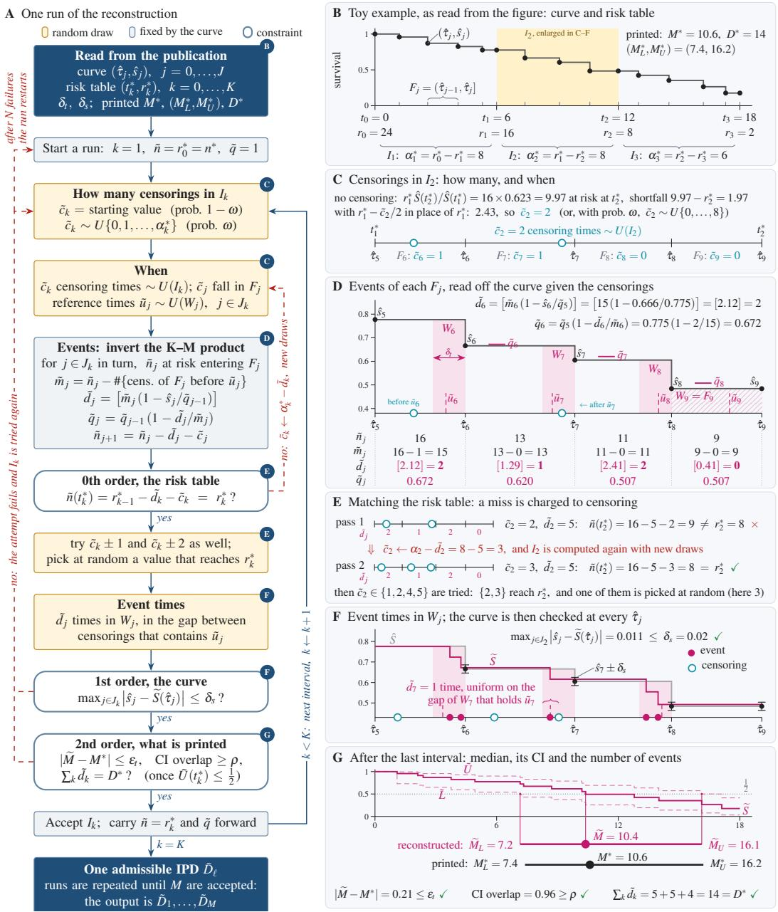
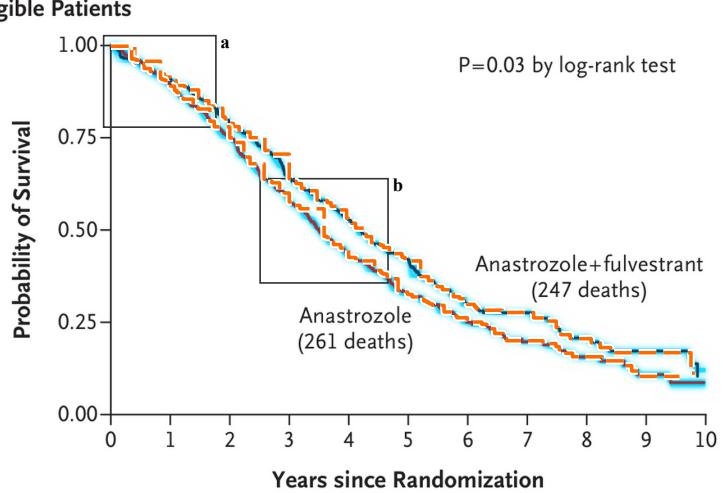
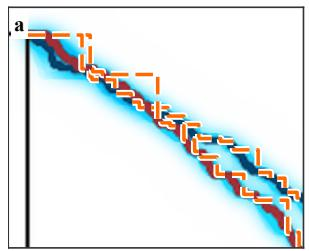
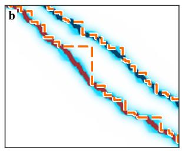
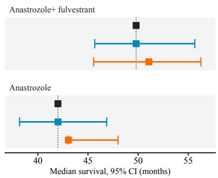
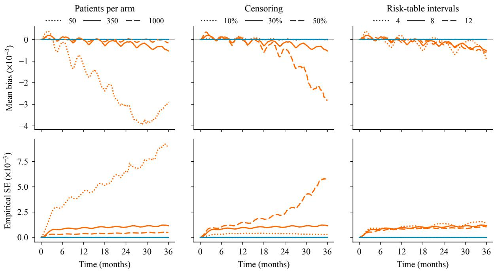

# StochIKM: Automated High-Fidelity Reconstruction of Individual Patient Data from Published Kaplan–Meier Curves

Liangze Ke1 | Wei Wei2 | Guannan Gong3 | Daniel Zelterman

1Department of Biostatistics, School of Public Health, Yale University, New Haven, CT 06520, USA | 2Section of Medical Oncology, Yale School of Medicine and Yale Cancer Center, Yale University, New Haven, CT 06520, USA | 3Department of Medicine, Yale University School of Medicine and Yale Cancer Center, New Haven, CT 06520, USA

Correspondence: Wei Wei (wei.wei@yale.edu) and Guannan Gong (guannan.gong@yale.edu)

## ABSTRACT

Individual patient data are the gold standard for secondary analysis of time-to-event evidence, but they are rarely released, and reconstruction from a published Kaplan–Meier figure could help. Existing methods all claim high fidelity, each judged by whichever agreements it happens to achieve, and each returns a single dataset although the map from figure to data is not bijective. We define fidelity explicitly: a dataset is admissible when it reproduces the risk table exactly, follows the digitized curve to within the image resolution, and respects the printed median, interval and event count. We propose StochIKM, a stochastic algorithm that digitizes the figure with a vision-capable language model and uses the high-fidelity definition as constraints, returning an admissible set of individual patient datasets. A solution is guaranteed to exist whenever the figure has been read correctly, so a failure indicts either the published figure or its digitization. In simulation and in 79 arms from published oncology trials, StochIKM reproduces the published risk tables and medians more closely than LLM-improved IPDfromKM (Liu et al., 2021), a high-impact alternative.

## 1 Introduction

Individual patient data (IPD) are the currency of meta-analysis. For studies reporting time-to-event outcomes, access to IPD enables individual-participant-data meta-analysis (Stewart and Tierney, 2002; Riley et al., 2010); assessment of modelling assumptions (Royston and Parmar, 2013; Uno et al., 2014) and sensitivity analysis; extrapolation beyond the observed follow-up for the evaluation of health technologies (Latimer, 2013); hypothesis generation for future studies; and emulation of randomized comparisons between treatments never studied head to head (Hernán and Robins, 2016; Rahman et al., 2023).

The original IPD, however, are rarely accessible because of confidentiality and proprietary considerations. Even where datasharing platforms exist, requests are often fulfilled for only a small number of applicants (Krumholz and Waldstreicher, 2016; Danchev et al., 2021). Reconstructing IPD from the published Kaplan–Meier (K–M) curve ofers a promising alternative, but the quality of such synthetic IPD is not guaranteed and requires careful evaluation. Where a ground truth is observed, as in supervised learning, accuracy is the distance from the truth. As the true IPD are rarely available, the question becomes how completely a reconstruction agrees with what the publication reports. Faith is “the evidence of things not seen” (Heb. 11:1, KJV). In information theory, fidelity is defined as the expected distortion between a source and its reproduction under a stated distortion measure, and a code is judged against a fidelity criterion fixed in advance (Shannon, 1959; Berger, 1971). Although authors who reconstruct K–M figures have measured fidelity in diferent ways, the idea beneath is common to all: a reconstruction is faithful to the extent that it reproduces what the original publication reported.

Recovering information from published survival curves is not new. Parmar et al. (1998) and Tierney et al. (2007) showed how a hazard ratio and its variance could be recovered from a published curve together with the reported numbers at risk. Guyot et al. (2012) introduced an algorithm that inverts the K–M productlimit formula one risk-table interval at a time, assuming that censoring is spread uniformly within each interval, and so produces a complete set ofevent and censoring times. Liu et al. (2021) refined that algorithm, correcting a boundary condition so that the K–M curve is mathematically plausible, and developed software that clinicians could use. Since then, reporting standards have improved the quality of survival figures (Pocock et al., 2002; Morris et al., 2019), and vision-capable large language models (LLMs) are able to parse the elements of a figure simply by prompt engineering (Masry et al., 2022). These developments reduce the burden of extracting information from published figures but do not resolve the statistical ambiguity inherent in reconstructing patient-level records from aggregate survival data.

Three methodological challenges remain. First, fidelity has been checked as an afterthought, against inconsistent criteria: agreement with the plotted curve and the hazard ratio (Guyot et al., 2012); with reported events, numbers at risk, survival probabilities and medians (Liu et al., 2021); or with a synthetic ground truth (Zhao et al., 2025), rather than enforced as part of the reconstruction. Some reconstructed IPD therefore do not agree with the published risk table (Guyot et al., 2012; Liu et al., 2021). Second, a published K–M curve does not identify the original IPD uniquely. Missing or overlapping censoring marks, sparse risk tables and the finite resolution ofthe figure admit many event and censoring configurations. Reported confidence intervals for the median carry additional information about sampling variability, but existing methods neither use them as constraints nor return more than a single IPD. Third, reconstruction depends heavily on digitization. Manual digitization is labor-intensive and prone to operator error (Liu et al., 2021), whereas automated extraction may degrade when figures are low-resolution rasters, curves overlap, or arms are distinguished only by line type or similar colours (Zhao et al., 2025).

To address these limitations, we propose StochIKM, an automated stochastic algorithm for generating high-fidelity IPD from published K–M curves. StochIKM makes three contributions to the three challenges. First, it defines fidelity by three constraints: each admissible IPD must reproduce the reported numbers at risk exactly, remain within a prespecified maximum absolute deviation from the extracted K–M curve, and agree within prespecified tolerances with the reported number of events, median survival and its confidence interval, when available. StochIKM enforces them within its loop. Second, StochIKM generates a set of Ω admissible datasets rather than one, so that the uncertainty of reconstruction can be propagated into downstream analysis. Third, under idealized conditions of internally consistent reporting, an error-free K–M figure and exact extraction of the plotted information, we establish the existence of at least one dataset satisfying the fidelity criteria.

## 2 Methods

## Step 1: Digitization

StochIKM reconstructs IPD that satisfy the built-in high-fidelity constraints (“admissible” IPD) from a published paper that contains a K–M curve and an accompanying risk table. First, a visioncapable LLM (in this paper, GPT-5) automatically extracts, or “digitizes”, the information of interest. For simplicity, we present the notation for one treatment arm. The digitized elements fall into two categories. The first are numbers that can be checked directly against the original paper, denoted with an asterisk: i) from the risk table, the numbers of patients at risk $r _ { 0 } ^ { * } = n ^ { * } , r _ { 1 } ^ { * } , \ldots , r _ { K } ^ { * } ,$ where $n ^ { * }$ is the arm-specific sample size; ii) the median overall survival (mOS) $M ^ { * }$ and its interval $( M _ { L } ^ { * } , M _ { U } ^ { * } ) ;$ ; and iii) the number of events $D ^ { * }$ . These elements contain no digitization error. The second are elements that can be obtained only through the vision capability of the LLM, denoted with a hat: i) the coordinate system of the plotting area, that is, the pixel positions of the two axes and of their labelled ticks, by which a pixel is converted into a time and a survival probability; ii) the curve of the arm, traced by its colour and read at times $0 = \hat { \tau } _ { 0 } < \hat { \tau } _ { 1 } < \dots < \hat { \tau } _ { J }$ with heights $\hat { s } _ { j } ~ = ~ \hat { S } ( \hat { \tau } _ { j } )$ , where consecutive read times define the fine intervals $\boldsymbol { F } _ { j } = ( \hat { \tau } _ { j - 1 } , \hat { \tau } _ { j } ] ;$ and iii) the visible drops of that curve, each a vertical segment whose time and whose heights immediately above and below it reveal that at least one event occurred there (Figure 1B). These elements may contain digitization errors, and the resolution of the image bounds how large they can be: a drop can be located in time only to about one pixel column, $\delta _ { t } .$ , and a height can be read only to about half the width of the drawn line, $\delta _ { s } .$ Censoring marks may be printed but not used in this paper; we return to them in the Discussion.

## Step 2: Reconstruction of admissible IPD

A reconstruction is of high fidelity if it closely agrees with the published K–M curve and the information commonly reported with it, and an IPD that meets this standard is called admissible. Fidelity is imposed through three sequential constraints. A tilde denotes a quantity of the reconstruction: the survival �̃, the mOS and its interval $( \tilde { M } , \tilde { M } _ { L } , \tilde { M } _ { U } )$ , and the number of events $\tilde { d } _ { k }$ in each risk-table interval. The zeroth-order, or risk-table, constraint requires that at every risk-table time the reconstruction leaves exactly $r _ { k } ^ { \ast }$ patients at risk (Figure 1E),

$$
\tilde { n } ( t _ { k } ^ { * } ) = r _ { k } ^ { * } , \qquad k = 1 , \dots , K .\tag{1}
$$

The first-order, or curve, constraint requires that at every read time the K–M curve of the reconstruction agrees with the digitized curve to within $\delta _ { s }$ (Figure 1F),

$$
\operatorname* { m a x } _ { j = 1 , \dots , J } \left. \hat { s } _ { j } - \tilde { S } ( \hat { \tau } _ { j } ) \right. \leq \delta _ { s } ,\tag{2}
$$

and that every event is placed within $\delta _ { t }$ of the drop that revealed it. The second-order, or reported-summaries, constraint uses the quantities the publication prints alongside the figure (Figure 1G),

$$
\begin{array} { c } { { \displaystyle \left| \tilde { \cal M } - { \cal M } ^ { * } \right| \le \varepsilon _ { t } , } } \\ { { \displaystyle \left| ( \tilde { \cal M } _ { L } , \tilde { \cal M } _ { \cal U } ) \cap ( { \cal M } _ { L } ^ { * } , { \cal M } _ { \cal U } ^ { * } ) \right| } } \\ { { \displaystyle \left| ( \tilde { \cal M } _ { L } , \tilde { \cal M } _ { \cal U } ) \cup ( { \cal M } _ { L } ^ { * } , { \cal M } _ { \cal U } ^ { * } ) \right| } } \\ { { \displaystyle \sum _ { k = 1 } ^ { K } \tilde { d } _ { k } = D ^ { * } , } } \end{array}\tag{3}
$$

where $( \tilde { M } _ { L } , \tilde { M } _ { U } )$ is the Brookmeyer–Crowley interval (Brookmeyer and Crowley, 1982), and $\varepsilon _ { t }$ and $\rho$ are fixed in advance. Each part of (3) is used only when the publication prints the corresponding quantity, and an endpoint that is not reached is set to $t _ { K } ^ { * } ;$ a figure with no printed median and no printed number of events is reconstructed under (1) and (2) alone. The algorithm below generates one candidate dataset at a time and keeps it only if (1)–(3) hold, repeating until Ω admissible datasets have been collected.

  
F I G U R E 1 | The StochIKM algorithm. A Flow chart of one run. B–G A toy example carried through the steps of A: one arm of 24 patients with a risk table at 0, 6, 12 and 18 months, a printed median with its confidence interval, and 14 printed events; C–F follow the second risk-table interval, $I _ { 2 } .$

The reconstruction proceeds one risk-table interval $I _ { k } = ( t _ { k - 1 } ^ { * } , t _ { k } ^ { * } ]$ at a time, from $I _ { 1 }$ to $I _ { K }$ , carrying forward the number of patients still at risk and the reconstructed survival (Figure 1A). Within $I _ { k }$ it must determine the number of events $\tilde { d } _ { k }$ and the number of censored patients $\tilde { c } _ { k } ,$ whose sum must be the attrition $\alpha _ { k } ^ { * } =$ $r _ { k - 1 } ^ { \ast } - r _ { k } ^ { \ast }$ obtained in Step 1.

Initialization. Set $\tilde { q } _ { 0 } = 1$ and $\tilde { n } _ { 1 } = n ^ { * }$ , and recall that each $I _ { k }$ is the union of the fine intervals $F _ { j } , j \in J _ { k }$ (Figure 1B).

Step 2.1: the censoring. With no censoring, $r _ { k - 1 } ^ { * } \hat { S } ( t _ { k } ^ { * } ) / \hat { S } ( t _ { k - 1 } ^ { * } )$ patients would be at risk at $t _ { k } ^ { * } ,$ and the shortfall against $r _ { k } ^ { \ast }$ gives a starting value for $\tilde { c } _ { k } ,$ corrected for the fact that the events see about $r _ { k - 1 } ^ { * } - \tilde { c } _ { k } / 2$ patients rather than $r _ { k - 1 } ^ { \ast }$ . With probability � this value is replaced by a uniform draw from $\{ 0 , 1 , \ldots , \alpha _ { k } ^ { * } \} ;$ ; this randomization is what lets the search reach every possible configuration, as Proposition 1 requires. The censoring times are drawn independently and uniformly on $I _ { k } ,$ and $\tilde { c } _ { j }$ of them fall in $F _ { j }$ (Figure 1C).

Step 2.2: the events. Events of $F _ { j }$ are placed in the event window $W _ { j }$ , equal to the last $\delta _ { t }$ of $F _ { j }$ when the curve drops at $\hat { \tau } _ { j }$ and to all of $F _ { j }$ otherwise, and a reference time $\tilde { u } _ { j }$ , uniform on $W _ { j }$ , fixes which censorings of $F _ { j }$ come before them (Figure 1D). Inverting the K–M product one fine interval at a time gives $\tilde { m } _ { j } = \tilde { n } _ { j } - \ne$ #{censorings of $F _ { j }$ before $\tilde { u } _ { j } \}$ and

$$
\tilde { d } _ { j } = \Big [ { \tilde { m } } _ { j } \Big ( 1 - \frac { { \hat { s } } _ { j } } { { \tilde { q } } _ { j - 1 } } \Big ) \Big ] ,
$$

$$
\tilde { q } _ { j } = \tilde { q } _ { j - 1 } \Big ( 1 - \frac { \tilde { d } _ { j } } { \tilde { m } _ { j } } \Big ) ,
$$

with $\tilde { n } _ { j + 1 } = \tilde { n } _ { j } - \tilde { d } _ { j } - \tilde { c } _ { j }$ . Given the censorings, this step is deterministic.

Step 2.3: matching the risk table. If $\tilde { n } ( t _ { k } ^ { * } ) = r _ { k - 1 } ^ { * } - \tilde { d } _ { k } - \tilde { c } _ { k }$ is not $r _ { k } ^ { * } ,$ , the discrepancy is charged to censoring, $\tilde { c } _ { k } \gets \alpha _ { k } ^ { * } { - } \tilde { d } _ { k }$ and $I _ { k }$ is recomputed (Figure 1E). Once $r _ { k } ^ { \ast }$ is attained, $\tilde { c } _ { k } \pm 1$ and $\tilde { c } _ { k } \pm 2$ are tried as well, and one of those that also reach $r _ { k } ^ { \ast }$ is chosen at random.

Step 2.4: fidelity check. Constraint (1) now holds by construction; constraint (2) is checked over $j \in J _ { k }$ (Figure 1F); and constraint (3) is checked as soon as it is decidable, that is, once the upper confidence limit of the reconstructed curve has fallen to one half (Figure 1G). A failed interval is at tempted again from Step 2.1, and after � failures the run is discarded and restarted from $I _ { 1 }$ (dashed paths of Figure 1A).

Steps $2 . 1 { - } 2 . 4$ are repeated for $k = 1 , \dots , K ;$ a run that reaches the end of $I _ { K }$ yields one admissible IPD $\tilde { D } _ { \ell } = \{ ( \tilde { y } _ { i } ^ { ( \ell ) } , \tilde { \Delta } _ { i } ^ { ( \ell ) } ) \} _ { i = 1 } ^ { n ^ { * } }$ , and runs continue until $\tilde { D } _ { 1 } , \ldots , \tilde { D } _ { \Omega }$ have been collected.

Proposition 1 (Under perfect digitization, StochIKM guarantees a solution.). Suppose the risk table and the printed summaries are transcribed correctly, and every survival probability $\hat { s } _ { j }$ read from the figure is within $\delta _ { s }$ of the curve printed in the publication (perfect digitization). Then the original patient data of the trial satisfy constraints (1)–(3); in particular, the admissible set is not empty.

Proof. Write $x ^ { 0 }$ for the original data. Since the risk table is read correctly, $\tilde { n } ( t _ { k } ^ { * } ) = r _ { k } ^ { * }$ holds at $x ^ { 0 }$ for every $k ,$ which is (1), and exactly $\alpha _ { k } ^ { * }$ patients leave the risk set in each $I _ { k }$ . The K–M curve of $x ^ { 0 }$ is the published curve $S ,$ so at every read time $| \hat { s } _ { j } - S ( \hat { \tau } _ { j } ) | \leq \delta _ { s }$ by assumption, which is (2); each event of $x ^ { 0 }$ produced the drop that revealed it, so it lies in that drop’s window. The printed summaries $M ^ { * } , ( M _ { L } ^ { * } , M _ { U } ^ { * } )$ and $D ^ { * }$ are computed from $x ^ { 0 } ,$ , so (3) holds at $x ^ { 0 }$ up to the rounding of the printed digits, which $\varepsilon _ { t }$ absorbs. □

## Step 3: Relaxation

Every quantity denoted with a hat is read from an image, which may be of poor quality or even contain mistakes, and the LLM may misread a legend or a colour. The premise of Proposition 1, the perfect digitization assumption, fails and the admissible set may be empty. Repeated failure therefore has two possible causes: the search has not yet found a solution, or the digitization is inconsistent with the published summaries and no solution exists. Step 3, relaxing constraints (1)–(3) lower the thresholds to a certain extent, and still produce result of fidelity given imperfect digitization. If � runs produce no admissible dataset, the constraint responsible for most of the failures is identified and relaxed by one level, and the search restarts; the levels are fixed in advance and applied in the same order for every figure. The second-order constraint has three parts and they are relaxed separately. The number of events is the commonest cause of failure, a dataset is accepted if $\begin{array} { r l } { \left| \sum _ { k } \tilde { d } _ { k } - D ^ { * } \right| \le \tau D ^ { * } } & { { } } \end{array}$ , with $\tau = 0 . 0 3 5$ , and if that is still not enough, $\delta _ { s }$ is widened as for the first-order constraint while the tolerance is kept. The number of events is a sum over every interval, and configurations that meet every other constraint often miss it by a few events, so a small tolerance raises the eficiency of the search considerably while the risk table, the curve, the median and its interval keep their full fidelity. A discrepancy in number of events per arm may be attributed to a systematic mis-reading besides the digitization: the reported total number of events may count events that occurred after the last time point the figure shows, a practice that varies with the authors and the journals. The tolerance � is the largest discrepancy observed in the case study, 9 of 262 events. For the median and its interval, $\varepsilon _ { t }$ is doubled and $\rho$ lowered to 0.6, then $\varepsilon _ { t }$ doubled again and $\rho$ lowered to 0.4, then the interval condition is dropped, then the median condition is dropped. For the first-order constraint, $\delta _ { s }$ is multiplied by 1.5 at each level, up to a ceiling $\delta _ { s } ^ { \mathrm { m a x } }$ . The zeroth-order constraint is never relaxed. If no admissible dataset is obtained once every level has been exhausted, the figure is declared irreconcilable and no IPD is returned. A reconstruction obtained after relaxation is reported together with the levels used. Throughout, the tolerances $\delta _ { t }$ and $\delta _ { s }$ are fixed by the resolution of the figure, one pixel column and half the width of the drawn line respectively, and $\varepsilon _ { t }$ is $\delta _ { t }$ plus half the last printed digit of $M ^ { * }$ The remaining constants are used for every figure in this paper: the probability of the uniform draw in Step 2.1 is $\omega = 0 . 1 ;$ an interval is attempted $N = 2 0 0$ times before the run is discarded; the required overlap of the two intervals is $\rho = 0 . 8 ;$ ; the portfolio size is $\Omega = 5 0$ ; relaxation begins after $R = 4 0 \Omega$ runs without an admissible dataset and stops at the floors $\rho _ { \mathrm { m i n } } = 0 . 4$ and $\delta _ { s } ^ { \mathrm { m a x } } =$ 0.10.

## 3 Case Study

We applied StochIKM to 108 arms in 53 overall-survival figures of 28 trials, 18 in advanced gastric or gastro-oesophageal junction cancer and ten in advanced breast cancer, published between 2017 and 2025 in eleven journals; most are phase III trials. A figure shows the whole trial population or a biomarker subgroup, and an arm has between 14 and 792 patients. All trials are listed in the References with their ClinicalTrials.gov identifiers. Details description can be found in Supplementary Materials. StochIKM is compared with LLM-improved IPDfromKM, that is, IPDfromKM (Liu et al., 2021) given the same traced curve and the same risk table as input, which removes the manual curve-tracing error of the original software.

Figure 2 shows one of the figures, taken from NCT00075764 (Mehta et al., 2019). In the enlargements, the 50 admissible curves of StochIKM form a narrow band that follows the published curve step by step, whereas the single curve of LLM-improved IPDfromKM moves in fewer and larger steps. StochIKM reproduces the risk table of both arms in all 50 IPD, and in the anastrozole plus fulvestrant arm every IPD also carries the 247 deaths printed on the figure; LLM-improved IPDfromKM reproduces neither risk table. The published medians are 49.8 and 42.0 months. StochIKM gives 49.8 and 42.0, and LLM-improved IPDfromKM 51.1 and 43.0; across its 50 IPD the median of StochIKM varies by 0.39 and 0.40 months, which is the uncertainty the figure itself leaves. This publication prints no confidence interval for either arm, so the intervals in the lower right panel are those ofthe reconstructions alone. LLM-improved IPDfromKM places all events of a fine interval at the drop that revealed them, so its reconstruction has many ties: 65 distinct event times in the anastrozole arm, one of them carrying 24 events. A step that large can take the curve across one half in one jump; the Brookmeyer–Crowley lower limit then reaches one half at the same event time, and the interval collapses onto the median, drawn with no left whisker. StochIKM places each event inside its own window $W _ { j }$ , which yields 264 distinct event times in the same arm and an interval with both ends. Other cases can be found in Supplementary materials.

A All Eligible Patients  

<table><tr><td colspan="12">No. at Risk</td></tr><tr><td>Anastrozole+ fulvestrant</td><td>349</td><td>315</td><td>273</td><td>220</td><td>177</td><td>133</td><td>61</td><td>38</td><td>18</td><td>10</td><td>3</td></tr><tr><td>Anastrozole</td><td>345</td><td>308</td><td>257</td><td>196</td><td>142</td><td>99</td><td>45</td><td>28</td><td>15</td><td>7</td><td>1</td></tr><tr><td>Reconstructed anastrozole+ fulvestrant</td><td>349</td><td>315</td><td>273</td><td>220</td><td>177</td><td>133</td><td>61</td><td>38</td><td>18</td><td>10</td><td>3</td></tr><tr><td rowspan="3">Reconstructed anastrozole</td><td>349</td><td>315</td><td>273</td><td>220</td><td>161</td><td>127</td><td>61</td><td>38</td><td>18</td><td>10</td><td>0</td></tr><tr><td>345</td><td>308</td><td>257</td><td>196</td><td>142</td><td>99</td><td>45</td><td>28</td><td>15</td><td>7</td><td>1</td></tr><tr><td>345</td><td>308</td><td>257</td><td>196</td><td>142</td><td>99</td><td>45</td><td>28</td><td>15</td><td>7</td><td>0</td></tr></table>

  
F I G U R E 2 | Reconstructions drawn over a published overall-survival figure of NCT00075764 (Mehta et al., 2019): the K–M curves of the 50 admissible IPD of StochIKM (light blue, forming a band) and of the single IPD of LLM-improved IPDfromKM (orange, dashed), their numbers at risk under the published risk table, two enlarged regions (a, b), and the median survival with its 95% confidence interval (black, published). Time is in years; medians are in months.

The curves of 104 of the 108 arms could be traced. The four that could not are the arms of one figure (NCT02545504), in which two pairs of arms share a colour and difer only in line style, so that no tracing by colour can tell them apart (discussed in detail in Supplementary materials). StochIKM returned at least one admissible IPD for every one of the 104 traced arms, and the full admissible set ofΩ = 50 for 97 ofthem; in the other seven the run limit was reached with between 1 and 49 admissible IPDs because in those cases, constraints (1)–(3) are tighter. Among those 104 arms, 97 print a median survival and LLM-improved IPDfromKM reached a median in all of them, so the two methods are compared over these 97 arms, of which 71 also print both bounds of the confidence interval (Table 1). StochIKM reproduces the risk table in every arm and LLM-improved IPDfromKM in only 44. The median error in the median survival is 0.00 (not perfect, 0.00 as a result of rounding to 2 demcimals) month against 0.10, and the largest error 0.91 against 1.32 months. Over the 71 arms that report an interval, the reconstructed intervals agree with the published ones equally well (median overlap 0.94 for both).

Ofthe 101 arms whose curve could be traced, StochIKM returned 50 admissible IPD for 86 arms; the remaining 15 arms returned an empty admissible set, because of the quality of the published figure, the tracing of the arm by the LLM, or both (Proposition 1). 81 of the 86 arms print a median survival, and in two of these LLM-improved IPDfromKM reached no median, so the two methods are compared over the remaining 79 arms, of which 61 also print both bounds of the confidence interval (Table 1). Over these 79 arms StochIKM reproduces the risk table in every arm and

T A B L E 1 | Reconstruction of 97 published arms by StochIKM and LLM-improved IPDfromKM.
<table><tr><td colspan="2">StochIKMa</td><td>LLM-improved IPDfromKMb</td></tr><tr><td>Risk table reproduced exactly</td><td>97/97</td><td>44/97</td></tr><tr><td colspan="3">Absolute error in the median survival (months)</td></tr><tr><td>Median</td><td>0.00</td><td>0.10</td></tr><tr><td>Mean</td><td>0.05</td><td>0.21</td></tr><tr><td>90th percentile</td><td>0.16</td><td>0.56</td></tr><tr><td>Maximum</td><td>0.91</td><td>1.32</td></tr><tr><td>Within 0.5 month</td><td>96/97</td><td>84/97</td></tr><tr><td>Within 1 month</td><td>97/97</td><td>93/97</td></tr><tr><td></td><td></td><td></td></tr><tr><td colspan="3">Agreement of the confidence intervals, 71 armsc</td></tr><tr><td>Median overlap</td><td>0.94</td><td>0.94</td></tr></table>

�The accepted dataset whose median is closest to the published value (50 datasets per arm; fewer in 7 arms); 55 arms met the full criterion and 42 needed relaxation. �Given the same LLM-traced curve and risk table as StochIKM.  
�Intersection over union of the reconstructed and published intervals.

LLM-improved IPDfromKM in only 33. The median error in the median survival is 0.01 month against 0.13, and the largest error 0.91 against 5.26 months. Over the 61 arms that report an interval, the reconstructed intervals agree with the published ones about equally well (median overlap 0.93 and 0.92).

## 4 Simulation

The simulation asks one question: when the figure is read without error, does a method give back the data behind it? Each replicate is one arm. Event times are Weibull with shape 1.2 and a median of 12 months; patients drop out at an exponential rate chosen to reach a target censoring fraction, and everyone still in the study is censored at 36 months. From these data we take what a publication prints: the K–M curve, read exactly at every step; the risk table at � + 1 equally spaced times; the median and its 95% confidence interval, rounded to one decimal; and the number of events. StochIKM and IPDfromKM (Liu et al., 2021) are given the same input. The baseline has 350 patients, 30% censoring and � = 8, and each factor is varied in turn: 50 or 1000 patients, 10% or 50% censoring, � = 4 or 12. Every scenario has 1000 replicates. Over time, we take the diference between the reconstructed K–M curve and that of the data, and report its mean over the replicates (bias) and its standard deviation (empirical SE). As single numbers, we report how often the risk table and the number of events are reproduced exactly, the absolute error in the median, and the overlap of the reconstructed and the original confidence interval of the median, defined as in Equation (3).

StochIKM returned the data exactly in every replicate of every scenario: its bias and its empirical SE are zero at all times, and it reproduces the risk table, the number of events, the median and its confidence interval without error (Figure 3). IPDfromKM is close but not exact. Its curve lies below that of the data, and the bias and the empirical SE grow with time; both are largest with few patients (−0.004 and 0.009 at � = 50) and with heavy censoring (−0.003 and 0.006 at 50%), and the number of risk-table intervals changes them little. It reproduces the risk table in every replicate, but the number of events, although it is given, in only 4% to 97% of them, least often with many patients, heavy censoring or few risk-table intervals. Its error in the median is 0.01 to

0.10 month and its confidence intervals overlap the original ones by 0.98 to 0.99.

## 5 Discussion

Reconstruction methods routinely claim high fidelity, but each has measured it diferently, and no criterion has been agreed upon (Guyot et al., 2012; Liu et al., 2021; Zhao et al., 2025). Our principal contribution is to propose one: a reconstruction is admissible when it reproduces the risk table exactly, follows the digitized curve to within the resolution ofthe image, and respects the summaries printed beside the figure. Because that criterion does not identify a single dataset, StochIKM returns a portfolio of Ω admissible ones, and the spread across them measures what the publication left undetermined.

We build directly on Liu et al. (2021), whose algorithm depends on manual, software-assisted tracing and returns a single IPD, and whose authors anticipated both the automation of the reading and the multiplicity of the answer. Vision-capable language models have made the first possible, and the constrained sampling scheme developed here makes the second explicit. Over 97 published arms the reconstruction reproduced every risk table and matched the published median to within one month in all of them, and Proposition 1 shows that, when the figure is traced exactly, an admissible set exists. A failure of producing result therefore indicates either an imperfect figure-tracing or imperfect quality of the source figure.

Limitations lie in the figure-reading part: we are not able to use censoring marks. Many figures draw them, and they carry exactly the information determining IPDs. The K–M curve and the risk table determine how many patients are censored between two events but not when. Authors and journals draw these marks in diferent ways, and adjacent marks merge into one, so the visionlanguage models available to us cannot yet read them reliably. Ifa highly capable large language model could read the marks, then it would boost the algorithm on eficiency: with the censoring times given, the events in each interval would follow deterministically from the steps ofthe curve, so the search for $\tilde { c } _ { k }$ would no longer be needed. Under perfect digitization it would recover the original true patient data themselves, up to tied events (Supplementary material); a partial reading, which separates some marks and only counts the others, would already narrow the admissible set. More broadly, what limits StochIKM is the vision of the model that reads the figure. Given how quickly vision-language models have improved, we expect this limitation to ease, and the algorithm is ready to take advantage of better readings as they become available.

The algorithm is nonetheless ready for use at scale. A figure whose reading cannot be reconciled with its own printed summaries becomes evidence about the publication, so reconstruction at scale can flag figures that no patient data could have produced, the concern behind systematic screening of trials for fabricated data (Carlisle, 2017). Reconstructed records restore the time-to-event analyses that aggregate reporting forecloses, including restricted mean survival and the emulation of comparisons never made directly (Royston and Parmar, 2013; Hernán and Robins, 2016). And a portfolio of admissible datasets is a natural input to Bayesian borrowing from historical controls (Ibrahim and Chen, 2000; Viele et al., 2014), where the question becomes

Baseline (solid lines): 350 patients per arm, 30% censoring, 8 risk-table intervals

  
F I G U R E 3 | Simulation with perfect digitization. Top row: mean over 1000 replicates of the diference between the reconstructed K–M curve and that of the simulated data (bias). Bottom row: its standard deviation (empirical SE). StochIKM (blue) is at zero throughout and its three lines coincide.

how much of a conclusion survives across every dataset the figure permits.

## 6 Code Availability

The source code is available from emailing robert.ke@yale.edu upon reasonable request. A web-based user interface is under development and will be made publicly available. Researchers interested in early access to a pre-release version ofthe interface are welcome to contact the corresponding author.

## References

F. André, Y. Hee Park, S. B. Kim, T. Takano, S. A. Im, G. Borges, J. P. Lima, S. Aksoy, J. Gavila Gregori, M. De Laurentiis, G. Bianchini, R. Roylance, Y. Miyoshi, A. Armstrong, R. Sinha, M. Ruiz Borrego, E. Lim, J. Ettl, R. Yerushalmi, F. Zagouri, F. P. Duhoux, T. Fehm, D. Gambhire, J. Cathcart, C. Wu, C. Chu, A. Egorov, and I. Krop. Trastuzumab deruxtecan versus treatment of physician’s choice in patients with HER2-positive metastatic breast cancer (DESTINY-Breast02): a randomised, open-label, multicentre, phase 3 trial. The Lancet, 401(10390):1773–1785, 2023. doi: 10.1016/S0140-6736(23) 00725-0. ClinicalTrials.gov NCT03523585.

J. Baselga, C. Zamagni, P. Gómez, B. Bermejo, S. E. Nagai, B. Melichar, A. Chan, L. Mángel, J. Bergh, F. Costa, H. L. Gómez, W. J. Gradishar, C. A. Hudis, B. L. Rapoport, H. Roché, P. Maeda, L. Huang, G. Meinhardt, J. Zhang, and L. S. Schwartzberg. RESILIENCE: Phase III randomized, double-blind trial comparing sorafenib with capecitabine versus placebo with capecitabine in locally advanced or metastatic HER2-negative breast cancer. Clinical Breast Cancer, 17(8):585–594.e4, 2017. doi: 10.1016/j.clbc.2017.05.006. Clinical-Trials.gov NCT01234337.

Toby Berger. Rate Distortion Theory: A Mathematical Basis for Data Compression. Prentice-Hall, Englewood Clifs, NJ, 1971.

Ron Brookmeyer and John Crowley. A confidence interval for the median survival time. Biometrics, 38(1):29–41, 1982. doi: 10.2307/ 2530286.

John B. Carlisle. Data fabrication and other reasons for non-random sampling in 5087 randomised, controlled trials in anaesthetic and general medical journals. Anaesthesia, 72(8):944–952, 2017.

J. Cortés, S. B. Kim, W. P. Chung, S. A. Im, Y. H. Park, R. Hegg, M. H. Kim, L. M. Tseng, V. Petry, C. F. Chung, H. Iwata, E. Hamilton, G. Curigliano, B. Xu, C. S. Huang, J. H. Kim, J. W. Y. Chiu, J. L. Pedrini, C. Lee, Y. Liu, J. Cathcart, E. Bako, S. Verma, S. A. Hurvitz, and DESTINY-Breast03 Trial Investigators. Trastuzumab deruxtecan versus trastuzumab emtansine for breast cancer. New England Journal of Medicine, 386(12):1143–1154, 2022. doi: 10. 1056/NEJMoa2115022. ClinicalTrials.gov NCT03529110.

Valentin Danchev, Yan Min, John Borghi, Mike Baiocchi, and John P. A. Ioannidis. Evaluation of data sharing after implementation of the International Committee of Medical Journal Editors data sharing statement requirement. JAMA Network Open, 4(1):e2033972, 2021.

Patricia Guyot, A. E. Ades, Mario J. N. M. Ouwens, and Nicky J. Welton. Enhanced secondary analysis ofsurvival data: reconstructing the data from published Kaplan–Meier survival curves. BMC Medical Research Methodology, 12:9, 2012.

Miguel A. Hernán and James M. Robins. Using big data to emulate a target trial when a randomized trial is not available. American Journal ofEpidemiology, 183(8):758–764, 2016.

R. X. Hong, F. Xu, W. Xia, Y. E. Teng, Q. C. Ouyang, Q. F. Zheng, Z. Y. Yuan, D. S. Chen, K. K. Jiang, Y. Lin, Z. Dai, X. L. Liu, Q. J. Chen, X. H. Wu, Y. X. Shi, J. J. Huang, X. An, C. Xue, X. W. Bi, M. T. Chen, H. Li, H. R. Yao, G. R. Zou, H. Huang, J. M. Zhang, and S. S. Wang. Metronomic capecitabine plus aromatase inhibitor as initial therapy in patients with hormone receptor–positive, human epidermal growth factor receptor 2–negative metastatic breast cancer:

The phase III MECCA trial. Journal of Clinical Oncology, 43(11): 1314–1324, 2025. doi: 10.1200/JCO.24.00938. ClinicalTrials.gov NCT02767661.

Joseph G. Ibrahim and Ming-Hui Chen. Power prior distributions for regression models. Statistical Science, 15(1):46–60, 2000.

Y. Y. Janjigian, J. Bendell, E. Calvo, J. W. Kim, P. A. Ascierto, P. Sharma, P. A. Ott, K. Peltola, D. Jaeger, J. Evans, F. de Braud, I. Chau, C. T. Harbison, C. Dorange, M. Tschaika, and D. T. Le. CheckMate-032 study: Eficacy and safety of nivolumab and nivolumab plus ipilimumab in patients with metastatic esophagogastric cancer. Journal of Clinical Oncology, 36(28):2836– 2844, 2018. doi: 10.1200/JCO.2017.76.6212. ClinicalTrials.gov NCT01928394.

Y. Y. Janjigian, S. B. Maron, W. K. Chatila, B. Millang, S. S. Chavan, C. Alterman, J. F. Chou, M. F. Segal, M. Z. Simmons, P. Momtaz, M. Shcherba, G. Y. Ku, A. Zervoudakis, E. S. Won, D. P. Kelsen, D. H. Ilson, R. J. Nagy, R. B. Lanman, R. N. Ptashkin, M. T. A. Donoghue, M. Capanu, B. S. Taylor, D. B. Solit, N. Schultz, and J. F. Hechtman. First-line pembrolizumab and trastuzumab in HER2-positive oesophageal, gastric, or gastro-oesophageal junction cancer: an open-label, single-arm, phase 2 trial. The Lancet Oncology, 21(6): 821–831, 2020. doi: 10.1016/S1470-2045(20)30169-8. ClinicalTrials.gov NCT02954536.

Y. Y. Janjigian, K. Shitara, M. Moehler, M. Garrido, P. Salman, L. Shen, L. Wyrwicz, K. Yamaguchi, T. Skoczylas, A. Campos Bragagnoli, T. Liu, M. Schenker, P. Yanez, M. Tehfe, R. Kowalyszyn, M. V. Karamouzis, R. Bruges, T. Zander, R. Pazo-Cid, E. Hitre, K. Feeney, J. M. Cleary, V. Poulart, D. Cullen, M. Lei, H. Xiao, K. Kondo, M. Li, and J. A. Ajani. First-line nivolumab plus chemotherapy versus chemotherapy alone for advanced gastric, gastro-oesophageal junction, and oesophageal adenocarcinoma (CheckMate 649): a randomised, open-label, phase 3 trial. The Lancet, 398(10294):27– 40, 2021. doi: 10.1016/S0140-6736(21)00797-2. ClinicalTrials.gov NCT02872116.

Y. Y. Janjigian, A. Kawazoe, Y. Bai, J. Xu, S. Lonardi, J. P. Metges, P. Yañez, L. S. Wyrwicz, L. Shen, Y. Ostapenko, M. Bilici, H. C. Chung, K. Shitara, S. Qin, E. Van Cutsem, J. Tabernero, S. Luo, M. Mahave, Y. Tang, M. Lowery, M. M. F. Monteiro, L. Xu, C. S. Shih, K. P. Sharan, P. Bhagia, and S. Y. Rha. Pembrolizumab in HER2-positive gastric cancer. New England Journal of Medicine, 391(14):1360–1362, 2024. doi: 10.1056/NEJMc2408121. Clinical-Trials.gov NCT03615326.

K. L. Jhaveri, S. A. Im, C. Saura, S. Loibl, K. Kalinsky, P. Schmid, S. Loi, E. Thanopoulou, N. Shankar, Y. Jin, T. J. Stout, T. D. Clark, C. Song, D. Juric, and N. C. Turner. Overall survival with inavolisib in PIK3CA-mutated advanced breast cancer. New England Journal ofMedicine, 393(2):151–161, 2025. doi: 10.1056/NEJMoa2501796. ClinicalTrials.gov NCT04191499.

Y. K. Kang, L. T. Chen, M. H. Ryu, D. Y. Oh, S. C. Oh, H. C. Chung, K. W. Lee, T. Omori, K. Shitara, S. Sakuramoto, I. J. Chung, K. Yamaguchi, K. Kato, S. J. Sym, S. Kadowaki, K. Tsuji, J. S. Chen, L. Y. Bai, S. Y. Oh, Y. Choda, H. Yasui, K. Takeuchi, Y. Hirashima, S. Hagihara, and N. Boku. Nivolumab plus chemotherapy versus placebo plus chemotherapy in patients with HER2-negative, untreated, unresectable advanced or recurrent gastric or gastrooesophageal junction cancer (ATTRACTION-4): a randomised, multicentre, double-blind, placebo-controlled, phase 3 trial. The Lancet Oncology, 23(2):234–247, 2022. doi: 10.1016/S1470-2045(21) 00692-6. ClinicalTrials.gov NCT02746796.

Harlan M. Krumholz and Joanne Waldstreicher. The Yale Open Data Access (YODA) Project—a mechanism for data sharing. New England Journal ofMedicine, 375(5):403–405, 2016.

Nicholas R. Latimer. Survival analysis for economic evaluations alongside clinical trials—extrapolation with patient-level data: inconsistencies, limitations, and a practical guide. Medical Decision Making, 33(6):743–754, 2013.

Na Liu, Yanhong Zhou, and J. Jack Lee. IPDfromKM: reconstruct individual patient data from published Kaplan–Meier survival curves. BMC Medical Research Methodology, 21:111, 2021.

Ahmed Masry, Do Xuan Long, Jia Qing Tan, Shafiq Joty, and Enamul Hoque. ChartQA: A benchmark for question answering about charts with visual and logical reasoning. In Findings of the Associationfor Computational Linguistics: ACL 2022, pages 2263–2279, 2022.

R. S. Mehta, W. E. Barlow, K. S. Albain, T. A. Vandenberg, S. R. Dakhil, N. R. Tirumali, D. L. Lew, D. F. Hayes, J. R. Gralow, H. H. Linden, R. B. Livingston, and G. N. Hortobagyi. Overall survival with fulvestrant plus anastrozole in metastatic breast cancer. New England Journal ofMedicine, 380(13):1226–1234, 2019. doi: 10.1056/ NEJMoa1811714. ClinicalTrials.gov NCT00075764.

D. Miles, J. Gligorov, F. André, D. Cameron, A. Schneeweiss, C. Barrios, B. Xu, A. Wardley, D. Kaen, L. Andrade, V. Semiglazov, M. Reinisch, S. Patel, M. Patre, L. Morales, S. L. Patel, M. Kaul, T. Barata, J. O’Shaughnessy, and IMpassion131 investigators. Primary results from IMpassion131, a double-blind, placebo-controlled, randomised phase III trial of first-line paclitaxel with or without atezolizumab for unresectable locally advanced/metastatic triple-negative breast cancer. Annals of Oncology, 32(8):994–1004, 2021. doi: 10.1016/j.annonc.2021.05.801. ClinicalTrials.gov NCT03125902.

Tim P. Morris, Christopher I. Jarvis, William Cragg, Patrick P. J. Phillips, Babak Choodari-Oskooei, and Matthew R. Sydes. Proposals on Kaplan–Meier plots in medical research and a survey of stakeholder views: KMunicate. BMJ Open, 9(9):e030215, 2019.

P. Neven, M. Toi, J. Sohn, K. Inoue, X. Pivot, M. Okera, N. Masuda, P. A. Kaufman, H. Koh, E. Grischke, V. Guarneri, V. André, A. Shahir, G. van Hal, G. W. Sledge, and A. Llombart-Cussac. Abemaciclib plus fulvestrant in patients with hormone receptor-positive, human epidermal growth factor receptor 2- negative advanced breast cancer: Final overall survival results from MONARCH 2. JCO Oncology Advances, 2:e2500052, 2025. doi: 10.1200/OA-25-00052. ClinicalTrials.gov NCT02107703.

Mahesh K. B. Parmar, Valter Torri, and Lesley Stewart. Extracting summary statistics to perform meta-analyses of the published literature for survival endpoints. Statistics in Medicine, 17(24): 2815–2834, 1998.

Stuart J. Pocock, Tim C. Clayton, and Douglas G. Altman. Survival plots of time-to-event outcomes in clinical trials: good practice and pitfalls. The Lancet, 359(9318):1686–1689, 2002.

M. Z. Qiu, D. Y. Oh, K. Kato, T. Arkenau, J. Tabernero, M. C. Correa, A. V. Zimina, Y. Bai, J. Shi, K. W. Lee, J. Wang, E. Poddubskaya, H. Pan, S. Y. Rha, R. Zhang, H. Hirano, D. Spigel, K. Yamaguchi, Y. Chao, L. Wyrwicz, U. Disel, R. P. Cid, L. Fornaro, L. Evesque, H. Wang, Y. Xu, J. Li, T. Sheng, S. Yang, L. Li, M. Moehler, R. H. Xu, and RATIONALE-305 Investigators. Tislelizumab plus chemotherapy versus placebo plus chemotherapy as first line treatment for advanced gastric or gastro-oesophageal junction adenocarcinoma: RATIONALE-305 randomised, double blind, phase 3 trial. BMJ, 385:e078876, 2024. doi: 10.1136/bmj-2023-078876. ClinicalTrials.gov NCT03777657.

Rifaquat Rahman, Stefen Ventz, and Lorenzo Trippa. External control arms and data analysis methods in nonrandomized trial of patients with glioblastoma. JAMA Oncology, 9(7):1006, 2023.

S. Y. Rha, D. Y. Oh, P. Yañez, Y. Bai, M. H. Ryu, J. Lee, F. Rivera, G. V. Alves, M. Garrido, K. K. Shiu, M. G. Fernández, J. Li, M. A. Lowery, T. Çil, F. M. Cruz, S. Qin, S. Luo, H. Pan, Z. A. Wainberg, L. Yin, S. Bordia, P. Bhagia, L. S. Wyrwicz, and KEYNOTE-859 investigators. Pembrolizumab plus chemotherapy versus placebo plus chemotherapy for HER2-negative advanced gastric cancer (KEYNOTE-859): a multicentre, randomised, double-blind, phase 3 trial. The Lancet Oncology, 24(11):1181–1195, 2023. doi: 10.1016/ S1470-2045(23)00515-6. ClinicalTrials.gov NCT03675737.

Richard D. Riley, Paul C. Lambert, and Ghada Abo-Zaid. Metaanalysis of individual participant data: rationale, conduct, and reporting. BMJ, 340:c221, 2010.

Patrick Royston and Mahesh K. B. Parmar. Restricted mean survival time: an alternative to the hazard ratio for the design and analysis of randomized trials with a time-to-event outcome. BMC Medical

Research Methodology, 13:152, 2013.

H. S. Rugo, A. Bardia, F. Marmé, J. Cortes, P. Schmid, D. Loirat, O. Trédan, E. Ciruelos, F. Dalenc, P. G. Pardo, K. L. Jhaveri, R. Delaney, O. Fu, L. Lin, W. Verret, and S. M. Tolaney. Sacituzumab govitecan in hormone receptor–positive/human epidermal growth factor receptor 2–negative metastatic breast cancer. Journal ofClinical Oncology, 40(29):3365–3376, 2022. doi: 10.1200/JCO.22.01002. ClinicalTrials.gov NCT03901339.

U. Sahin, Ö. Türeci, G. Manikhas, F. Lordick, A. Rusyn, I. Vynnychenko, A. Dudov, I. Bazin, I. Bondarenko, B. Melichar, K. Dhaene, K. Wiechen, C. Huber, D. Maurus, A. Arozullah, J. W. Park, M. Schuler, and S. E. Al-Batran. FAST: a randomised phase II study of zolbetuximab (IMAB362) plus EOX versus EOX alone for first-line treatment of advanced CLDN18.2-positive gastric and gastro-oesophageal adenocarcinoma. Annals of Oncology, 32(5): 609–619, 2021. doi: 10.1016/j.annonc.2021.02.005. ClinicalTrials.gov NCT01630083.

M. A. Shah, G. Bodoky, A. Starodub, D. Cunningham, D. Yip, Z. A. Wainberg, J. Bendell, D. Thai, J. He, P. Bhargava, and J. A. Ajani. Phase III study to evaluate eficacy and safety of andecaliximab with mFOLFOX6 as first-line treatment in patients with advanced gastric or GEJ adenocarcinoma (GAMMA-1). Journal of Clinical Oncology, 39(9):990–1000, 2021. doi: 10.1200/JCO.20.02755. ClinicalTrials.gov NCT02545504.

M. A. Shah, K. Shitara, J. A. Ajani, Y. J. Bang, P. Enzinger, D. Ilson, F. Lordick, E. Van Cutsem, J. Gallego Plazas, J. Huang, L. Shen, S. C. Oh, P. Sunpaweravong, H. F. Soo Hoo, H. M. Turk, M. Oh, J. W. Park, D. Moran, P. Bhattacharya, A. Arozullah, and R. H. Xu. Zolbetuximab plus CAPOX in CLDN18.2-positive gastric or gastroesophageal junction adenocarcinoma: the randomized, phase 3 GLOW trial. Nature Medicine, 29(8):2133–2141, 2023. doi: 10.1038/ s41591-023-02465-7. ClinicalTrials.gov NCT03653507.

Claude E. Shannon. Coding theorems for a discrete source with a fidelity criterion. In IRE National Convention Record, Part 4, pages 142–163, 1959.

L. Shen, Y. Zhang, Z. Li, X. Zhang, X. Gao, B. Liu, Y. Wang, Y. Ba, N. Li, R. Zhang, J. Zhang, Y. Chen, J. Chen, M. Huang, Y. Fu, M. Liu, Z. Liu, J. Zhao, W. Li, J. Wei, C. Li, N. Xu, Z. Guo, B. Cao, L. Liu, P. Nie, L. Wan, L. Sheng, Z. Liu, Y. He, K. Gu, G. Wu, W. Wang, F. Zhang, W. Qiu, J. Guo, J. Ying, H. Pan, H. Xu, Y. Yuan, Y. Bai, Z. Wang, J. Xu, X. Zhao, H. Liu, X. Zhang, W. Dai, H. Xu, M. Liu, L. Xie, Y. Tang, J. Jin, X. Qu, X. Fang, M. Huang, H. Chen, Z. Zheng, Y. Wang, D. Wang, X. Li, G. Yu, H. Liu, Y. Zhou, D. Zhong, S. Zeng, M. Kang, M. Wang, Y. Gao, W. Li, Z. Wang, M. Zhang, J. Zhang, Q. Li, S. Sun, A. Zang, L. Lin, M. Xie, Z. Zhuang, T. Zhang, Z. Yao, D. Lu, W. Liu, M. Hu, Z. M. Wang, B. Li, M. Xia, J. Zhang, X. Ying, D. M. Pardoll, and J. Ji. First-line cadonilimab plus chemotherapy in HER2-negative advanced gastric or gastroesophageal junction adenocarcinoma: a randomized, double-blind, phase 3 trial. Nature Medicine, 31(4):1163–1170, 2025. doi: 10.1038/ s41591-024-03450-4. ClinicalTrials.gov NCT05008783.

K. Shitara, E. Van Cutsem, Y. J. Bang, C. Fuchs, L. Wyrwicz, K. W. Lee, I. Kudaba, M. Garrido, H. C. Chung, J. Lee, H. R. Castro, W. Mansoor, M. I. Braghiroli, N. Karaseva, C. Caglevic, L. Villanueva, E. Goekkurt, H. Satake, P. Enzinger, M. Alsina, A. Benson, J. Chao, A. H. Ko, Z. A. Wainberg, U. Kher, S. Shah, S. P. Kang, and J. Tabernero. Eficacy and safety of pembrolizumab or pembrolizumab plus chemotherapy vs chemotherapy alone for patients with first-line, advanced gastric cancer. JAMA Oncology, 6(10): 1571–1580, 2020. doi: 10.1001/jamaoncol.2020.3370. ClinicalTrials.gov NCT02494583.

K. Shitara, F. Lordick, Y. J. Bang, P. Enzinger, D. Ilson, M. A. Shah, E. Van Cutsem, R. H. Xu, G. Aprile, J. Xu, J. Chao, R. Pazo-Cid, Y. K. Kang, J. Yang, D. Moran, P. Bhattacharya, A. Arozullah, J. W. Park, M. Oh, and J. A. Ajani. Zolbetuximab plus mFOLFOX6 in patients with CLDN18.2-positive, HER2-negative, untreated, locally advanced unresectable or metastatic gastric or gastro-oesophageal junction adenocarcinoma (SPOTLIGHT): a multicentre, randomised, double-blind, phase 3 trial. The Lancet,

401(10389):1655–1668, 2023. doi: 10.1016/S0140-6736(23)00620-7. ClinicalTrials.gov NCT03504397.

K. Shitara, S. Lorenzen, J. Li, Y. Bai, M. G. Fernández, M. Aguilar, H. Shoji, F. Reyes-Cosmelli, Y. R. Peña, L. Corrales, L. Wyrwicz, D. A. Eyzaguirre, Y. Pan, M. H. Ryu, D. J. Cohen, Z. A. Wainberg, G. Ku, J. Tabernero, E. Van Cutsem, S. K. Qin, D. Y. Oh, J. Xu, L. W. Liang, S. Bordia, P. Bhagia, S. Y. Rha, and LEAP-015 Investigators. Lenvatinib plus pembrolizumab and chemotherapy versus chemotherapy in advanced metastatic gastroesophageal adenocarcinoma: The phase III, randomized LEAP-015 study. Journal of Clinical Oncology, 43(22):2502–2514, 2025. doi: 10.1200/ JCO-25-00748. ClinicalTrials.gov NCT04662710.

Lesley A. Stewart and Jayne F. Tierney. To IPD or not to IPD? Advantages and disadvantages of systematic reviews using individual patient data. Evaluation and the Health Professions, 25(1):76–97, 2002.

J. Tabernero, P. M. Hof, L. Shen, A. Ohtsu, M. A. Shah, K. Cheng, C. Song, H. Wu, J. Eng-Wong, K. Kim, and Y. K. Kang. Pertuzumab plus trastuzumab and chemotherapy for HER2-positive metastatic gastric or gastro-oesophageal junction cancer (JACOB): final analysis of a double-blind, randomised, placebo-controlled phase 3 study. The Lancet Oncology, 19(10):1372–1384, 2018. doi: 10.1016/S1470-2045(18)30481-9. ClinicalTrials.gov NCT01774786.

Jayne F. Tierney, Lesley A. Stewart, Davina Ghersi, Sarah Burdett, and Matthew R. Sydes. Practical methods for incorporating summary time-to-event data into meta-analysis. Trials, 8:16, 2007.

Hajime Uno, Brian Claggett, Lu Tian, Eisuke Inoue, Paul Gallo, Toshio Miyata, Deborah Schrag, Masahiro Takeuchi, Yoshiaki Uyama, Lihui Zhao, Hicham Skali, Scott Solomon, Susanna Jacobus, Michael Hughes, Milton Packer, and L. J. Wei. Moving beyond the hazard ratio in quantifying the between-group diference in survival analysis. Journal of Clinical Oncology, 32(22): 2380–2385, 2014.

Kert Viele, Scott Berry, Beat Neuenschwander, Billy Amzal, Fang Chen, Nathan Enas, Brian Hobbs, Joseph G. Ibrahim, Nelson Kinnersley, Stacy Lindborg, Sandrine Micallef, Satrajit Roychoudhury, and Laura Thompson. Use of historical control data for assessing treatment efects in clinical trials. Pharmaceutical Statistics, 13(1): 41–54, 2014.

Z. A. Wainberg, P. C. Enzinger, Y. K. Kang, S. Qin, K. Yamaguchi, I. H. Kim, A. Saeed, S. C. Oh, J. Li, H. M. Turk, A. Teixeira, C. Borg, E. Hitre, A. A. Udrea, G. G. Cardellino, R. G. Sanchez, H. Collins, S. Mitra, Y. Yang, D. V. T. Catenacci, and K. W. Lee. Bemarituzumab in patients with FGFR2b-selected gastric or gastro-oesophageal junction adenocarcinoma (FIGHT): a randomised, double-blind, placebo-controlled, phase 2 study. The Lancet Oncology, 23(11): 1430–1440, 2022. doi: 10.1016/S1470-2045(22)00603-9. ClinicalTrials.gov NCT03694522.

B. Xu, S. Wang, M. Yan, J. Sohn, W. Li, J. Tang, X. Wang, Y. Wang, S. A. Im, D. Jiang, T. Valdez, A. Dasgupta, Y. Zhang, Y. Yan, K. M. Komatsubara, W. P. Chung, F. Ma, and M. S. Dai. Sacituzumab govitecan in HR+HER2− metastatic breast cancer: the randomized phase 3 EVER-132-002 trial. Nature Medicine, 30(12):3709–3716, 2024. doi: 10.1038/s41591-024-03269-z. ClinicalTrials.gov NCT04639986.

J. Xu, H. Jiang, Y. Pan, K. Gu, S. Cang, L. Han, Y. Shu, J. Li, J. Zhao, H. Pan, S. Luo, Y. Qin, Q. Guo, Y. Bai, Y. Ling, J. Yang, Z. Yan, L. Yang, Y. Tang, Y. He, L. Zhang, X. Liang, Z. Niu, J. Zhang, Y. Mao, Y. Guo, B. Peng, Z. Li, Y. Liu, Y. Wang, H. Zhou, and ORIENT-16 Investigators. Sintilimab plus chemotherapy for unresectable gastric or gastroesophageal junction cancer. JAMA, 330(21):2064– 2074, 2023. doi: 10.1001/jama.2023.19918. ClinicalTrials.gov NCT03745170.

X. Zhang, J. Wang, G. Wang, Y. Zhang, Q. Fan, C. Lu, C. Hu, M. Sun, Y. Wan, S. Sun, J. Wang, L. Zhang, Y. Shu, J. Luo, D. Zhu, Z. Shen, S. Yao, Q. Shi, J. Yang, L. Shen, and GEMSTONE-303 Investigators. First-line sugemalimab plus chemotherapy for advanced gastric cancer. JAMA, 333(15):1305–1314, 2025. doi: 10.1001/jama.2024. 28463. ClinicalTrials.gov NCT03802591.

Yao Zhao, Haoyue Sun, Yantian Ding, and Yanxun Xu. KM-GPT: an automated pipeline for reconstructing individual patient data from Kaplan–Meier plots. bioRxiv, 2025. doi:10.1101/2025.09.15.676421.