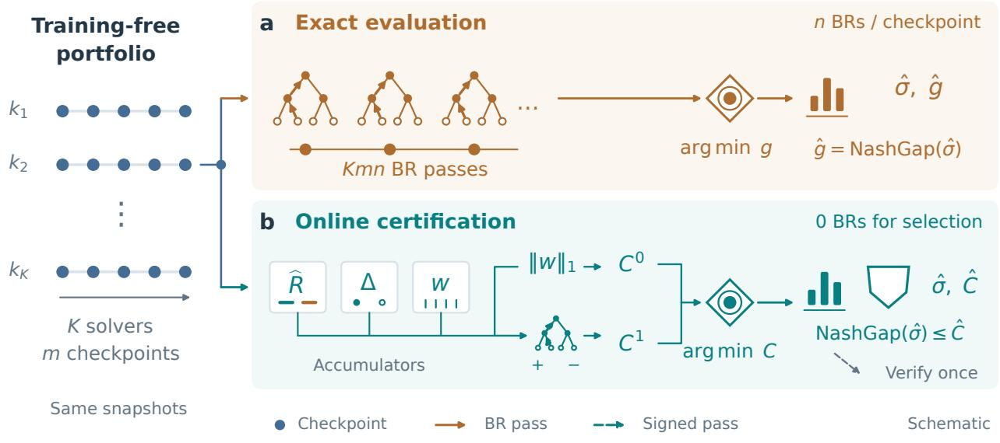
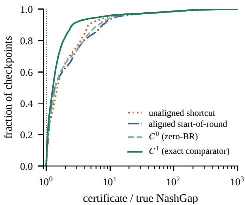
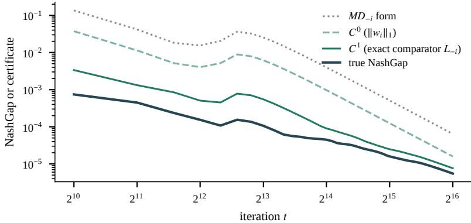
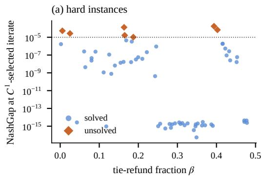
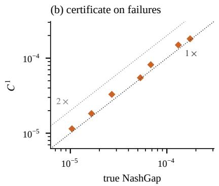
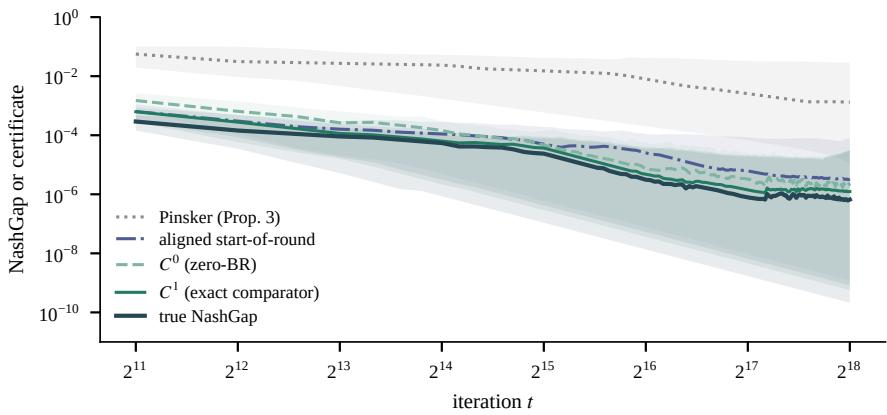

# When Are We Near Nash? Certifying Solutions in General-Sum Games

Boning Li<sup>1</sup> and Longbo Huang<sup>1</sup> <sup>#</sup>

<sup>1</sup>Institute for Interdisciplinary Information Sciences, Tsinghua University # Correspondence: longbohuang@tsinghua.edu.cn

Abstract. Heuristic solvers for general-sum extensive-form games produce a stream of iterates, and practice reports the NashGap of the returned profile. A recent meta-learning benchmark reports the lowest NashGap along the training trajectory, located by exact evaluation at every checkpoint, without stating the selection rule or the evaluation budget behind that number. We ask what a solver can know about its own iterates from the regret accumulators and the terminal-distribution accumulators its updates already maintain. In two-player games the NashGap of a weighted average strategy equals, at the maximizing player, the weighted external regret plus a signed value correction. Bounding the regret by the running counterfactual-regret accumulator gives an online certificate whose cost per checkpoint is linear in the number of terminal histories. The certificate stays sound under alternating updates and in games with three or more players. The mismatch between what alternation evaluates and what the averages record enters as one signed comparator term, maximized in a single backward pass per player whose comparator weight is nonzero. The bound is read of the regret state, with no best response against the average. Run a portfolio of training-free regret-matching solvers, output the iterate with the smallest certificate, and verify that iterate once. On the benchmark’s biased Leduc family a pool of sixteen training-free solvers, seven original and nine recent variants, solves 89% of the 64 instances at threshold $1 \overline { { 0 } } ^ { - 5 }$ this way, matching the trajectory-minimum union of the solvers. The same protocol solves 92% of the 64 pre-registered held-out instances and 89% again on a third set of 64 instances that no earlier stage used. The zero-best-response certificate certifies all 57 insample solves and all 57 fresh ones, and 58 of the 59 held-out ones. Its exact-comparator refinement certifies every solve in the three sets. At the selected iterate the refinement tracks the true gap within a median factor of 1.4 over the 36 instances whose selected gap is above $1 0 ^ { - 1 2 }$ . The meta-trained method reports 96% under the trajectory-minimum protocol. That protocol leaves its selection rule and evaluation budget unstated. The certificate states both and attributes its bound. Code is available at https://github.com/lbn187/CertNE.

## 1. Introduction

Computing a Nash equilibrium of a general-sum game to precision inverse-polynomial in the game size is PPAD-complete (Polynomial Parity Arguments on Directed graphs), for two players (Chen et al., 2009) and for three or more players (Daskalakis et al., 2009). The no-regret dynamics that solve two-player zero-sum games at scale (Zinkevich et al., 2007; Tammelin, 2014; Li & Huang, 2026e,h) guarantee only coarse correlated equilibria in general (Anagnostides et al., 2022). Practice therefore runs heuristic solvers and judges them afterwards by their NashGap, the largest gain any player could obtain by deviating alone (Lis\`y & Bowling, 2017; Davis et al., 2014).

Computing that gap exactly costs one best-response pass per player over the game tree, the same order as one iteration for a tabular solver (Table 4). The certificate below builds a bound from the solver’s own regret state, without a best response. Under aligned two-player play, where every accumulator refers to the same start-of-round profile, an exact evaluator that also records the running realized value recovers the same regret and value terms from its best-response values. Under alternation, or with three or more players, the certificate adds a comparator term, the signed functional of Section 5, which an exact evaluator does not compute. With that term the raw regret state is a bound again.

A recent benchmark shows why the scoring protocol matters. Neural predictive counterfactual regret minimization<sup>+</sup> (NPCFR<sup>+</sup>) (Sychrovský et al., 2026) meta-learns a predictive bias. On biased two-player Leduc games it reports solving 96% of instances to NashGap $1 0 ^ { - 5 }$ ; its untrained counterpart PCFR<sup>+</sup> reports 16%. The metric is the lowest NashGap along the training trajectory, located by exact evaluation at roughly 19 checkpoints over $2 ^ { 1 8 }$ iterations. The reported number is therefore the output of a selection rule, the argmin of the exact gap, and an evaluation budget of one gap per checkpoint. Neither is part of the method or stated with the result (Section 4). The quantity the same paper proposes for bounding the gap without a best response combines a regret term with a Pinsker-type correlation term. It is the natural candidate for such a rule, and we find it sits three orders of magnitude above the true gap and grows.

We give an online NashGap certificate computed from the regret accumulators and the terminal accumulators, together with an account of which quantities the gap actually depends on. In two-player games the correlation term is avoidable. The comparator term is exact by bilinearity, and the value term becomes exact once the distribution exchange is replaced by directly measurable quantities. The inequality therefore becomes an identity (Theorem 4). The NashGap of the weighted average strategy equals the weighted external regret plus a signed value correction. Bounding the regret by the running counterfactual-regret accumulator (Lemma 1) gives a certificate whose per-checkpoint cost is linear in the number of terminal histories.

The strongest solvers update players in alternation (Tammelin, 2014; Brown & Sandholm, 2019; Burch et al., 2019). The regrets they evaluate then refer to a partially updated opponent, while the averages record the start-of-round profile. A second regret pass per iteration is the usual remedy. The mismatch itself is one more measurable comparator term, a signed linear functional maximized in one backward pass per player with nonzero comparator weight, so no second regret pass is needed. The certificate is therefore sound for any update order and any number of players (Proposition 9). In games with three or more players the same term is the coalition imbalance that the correlation level is structurally blind to (Remark 7). No bound on the coalition term vanishes with the correlation level, so the Pinsker-type route fails beyond two players; the comparator term measures it directly. The certificate splits its bound into a regret term, a value correction and comparator terms (Table 5).

The certificate turns the post-hoc protocol into an algorithm (Figure 1). Run a portfolio of training-free regret-matching solvers, weighted, predictive, discounted, scheduled and stabilised variants (Tammelin, 2014; Farina et al., 2021; Brown & Sandholm, 2019; Xu et al., 2024; Zhang et al., 2026; Farina et al., 2023; Zhang et al., 2025), and record the certificate at every checkpoint of every solver. Output the iterate with the smallest certificate, so the selection rule and its budget are explicit. The zero-best-response certificate $( C ^ { 0 } )$ reads accumulators alone, and its exact-comparator refinement $( C ^ { 1 } )$ adds one signed backward pass per player with nonzero comparator weight at each checkpoint. On biased Leduc this is a single pass, costing about as much wall-clock as an exact gap evaluation and less than one training iteration. The selected iterate can be verified exactly in one further gap evaluation (Corollary 10).

On the benchmarks of Sychrovský et al. (2026) this protocol matches the trajectory-minimum rule with no exact-gap query during selection; the cost it does pay is the accumulator bookkeeping (Table 4). On biased Leduc (64 instances), certificate selection over sixteen training-free solvers solves 89% of instances at threshold $1 0 ^ { - 5 }$ , the same fraction as the trajectory-minimum union over the same solvers. The seven original solvers alone reach 84%, and the sixteen-solver pool, extended by nine recent variants in a second pre-registered stage, reaches 92% on 64 held-out instances. On a third instance set that no earlier stage used, the protocol repeats at 89% (57/64).

The certificate itself is below the threshold on every in-sample solve, for $C ^ { 0 }$ read of accumulators alone and for $C ^ { 1 }$ with one signed backward pass per checkpoint. Across the three sets $C ^ { 1 }$ certifies every solve, and $C ^ { 0 }$ all but one held-out solve. At the selected iterate $C ^ { 1 }$ is within a median 1.4× of the true gap over the 36 instances whose selected gap is above $1 0 ^ { - 1 2 }$ . The aligned start-of-round certificate pays an extra regret pass per player per iteration yet is looser (1.9×) and certifies 86%. On the single deterministic three-player Leduc game, PDCFR<sup>+</sup> reaches NashGap $1 . 1 7 \times 1 0 ^ { - 6 }$ while the certificate-selected ${ \mathrm { H } } { \mathrm { S } } – { \mathrm { P } } { \mathrm { C F R } } ^ { + }$ run is certified at $2 . 8 3 \times 1 0 ^ { - 6 }$ both below the reported $1 0 ^ { - 3 }$ NPCFR<sup>+</sup> comparator. Under our protocol the training-free portfolio reaches

  
Figure 1 | Two selection protocols on the same � solvers and � checkpoints per solver. a, Exact evaluation scores every candidate with � best-response (BR) passes, costing ��� passes overall, and outputs the minimum-gap strategy with its exact gap. b, Online certification combines signed regret, value correction, and comparator terms (Proposition 9). $C ^ { 0 }$ uses accumulators alone; $C ^ { 1 }$ adds one signed backward pass per player with nonzero comparator weight at each checkpoint. Either certificate selects its own argmin across solvers and checkpoints and bounds the selected strategy’s NashGap. Optional verification evaluates only that strategy, with � BR passes (Corollary 10). Nodes, trees and policy glyphs are schematic; arrows on trees indicate backward traversal.

0.89 against the reported 0.96. The certificate is solver-agnostic and attaches to NPCFR<sup>+</sup> or any other update sequence unchanged. Our 7 in-sample failures cluster in games with a low tie-refund fraction (Section 7).

## Our contributions are:

• Theory. We prove that in two-player games the NashGap of a weighted average equals its weighted external regret plus a signed value correction, an identity, not a bound (Theorem 4). We build from it an online certificate whose zero-best-response form reads accumulators alone and whose exact form costs one signed backward pass per player with nonzero comparator weight, sound for any update order and player count (Proposition 9). We show that in games with three or more players no correlation level controls the comparator term (Remark 7), and the certificate measures it directly. One exact gap evaluation verifies the selected iterate (Corollary 10).

• Algorithm. We turn the certificate into the selection rule: score every checkpoint of every solver, output the argmin, and report the candidate with a stated budget and no exact-gap query during selection. The argmin comes from accumulators alone under $C ^ { 0 } ;$ ; under $C ^ { 1 }$ it costs one signed backward pass per player with nonzero comparator weight.

• Re-evaluation under a stated selection rule. On the NPCFR benchmarks, we show that training-free certificate selection reaches 89% in-sample, matching the trajectory-minimum union over the same solvers, 92% held-out and 89% on a third, never-used set, against the reported meta-trained 96%. $C ^ { 1 }$ certifies every solve in all three sets, and $C ^ { 0 }$ certifies all but one held-out solve. The residual in-sample failures show the same lean.

## 2. Related Work

Meta-learning and steering. Learning-not-to-regret meta-learns regret-minimizer internals for faster convergence (Sychrovsk\`y et al., 2024), following the general meta-learning-in-games program of Harris et al. (2023). NPCFR (Sychrovský et al., 2026) redirects this machinery at general-sum Nash approximation by meta-learning a predictive bias, and is the reference point for our re-evaluation; Sychrovský et al. (2025) extends the line to self-play. An alternative channel steers no-regret learners toward equilibria through external payments (Zhang et al., 2024). Our core methods $\mathrm { R M ^ { + } }$ and PRM<sup>+</sup> are standard training-free algorithms; DPRM<sup>+</sup> is also training-free but modifies the PRM<sup>+</sup> prediction with an analytic decorrelation term. The portfolio-level selection among their iterates is new.

Certificates and gap evaluation. Theorem 1 of Sychrovský et al. (2026) bounds the NashGap by a regret term plus a term in the extensive-form marginalizability of the empirical play distribution, via a Pinskertype inequality, and states it as an analysis tool. Our Proposition 3 is its weighted-averaging analogue, and Theorem 4 removes the distribution inequality entirely in the two-player case. Outside these structural certificates, obtaining a NashGap means computing it, one exact best-response pass per player. Small equilibrium certificates exploit tree structure to compress the strategy witness in large games (Zhang & Sandholm, 2020), and accelerating the best-response computation itself has long been an engineering goal there (Johanson et al., 2011; Li & Huang, 2026b). Exploitability is likewise the standard for judging deployed agents (Davis et al., 2014; Lis\`y & Bowling, 2017; Lockhart et al., 2019; Balduzzi et al., 2018; Li et al., 2026a).

Regret-based certificates. They survive only through zero-sum structure. There the marginals of a coarse correlated equilibrium are 2�-Nash (MacQueen, 2023), and the average’s gap is bounded by total regret at every step (Zinkevich et al., 2007). Since $u _ { 2 } = - u _ { 1 }$ forces $\Delta _ { 1 } = - \Delta _ { 2 }$ , that bound is the zero-sum case of Theorem 4, in which the two signed value corrections cancel. In general-sum play they do not, and the theorem measures the residual from the running realized value. Faster regret rates, such as those of the + and predictive variants (Tammelin, 2014; Farina et $\mathrm { a l . , }$ 2021), shrink the regret term and leave that residual untouched. AIVAT (Burch et al., 2018) estimates a fixed agent’s value without bias, and anytime PSRO (McAleer et al., 2022) gates a growing policy population on restricted-game exploitability. None of these gives an online, best-response-free certificate for iterate selection during training in general-sum extensive-form games.

Regret minimization and equilibria. Counterfactual regret minimization (CFR) decomposes external regret over infosets (Zinkevich et al., 2007). $\mathrm { C F R ^ { + } }$ (Tammelin, 2014; Tammelin et al., 2015) with alternating updates (Burch et al., 2019; Li & Huang, 2026c) and linear averaging solved heads-up limit poker (Bowling et al., 2015). Predictive regret matching<sup>+</sup> (Farina et al., 2021), discounted regrets and weights (Brown & Sandholm, 2019), their predictive combination PDCFR<sup>+</sup> (Xu et al., 2024), hyperparameter schedules for the discount and weight exponents (Zhang et al., 2026), the smooth, stable and extragradient stabilisations of regret matching<sup>+</sup> (Farina et al., 2023) and scale-invariant IR-PRM<sup>+</sup> (Zhang et al., 2025) are training-free accelerants, and one configuration of each is in our pool. The last-iterate linear convergence of the scale-invariant step is analyzed by Li & Huang (2026g). All of these guarantees concern regret, which in general-sum games yields only (coarse) correlated equilibria (Anagnostides et al., 2022; Celli et al., 2019). Even averaging with an explicit approximation guarantee, as under fictitious play (Conitzer, 2009), works only in restricted settings. Monte Carlo variants (Lanctot et al., 2009; Li et al., 2026b) trade these exact terminal distributions for sampling. Abstraction and pruning (Li et al., 2024; Li & Huang, 2025, ${ 2 0 2 6 } \mathrm { a } , \mathrm { d } )$ are a complementary route to scale in large games (Appendix F).

Portfolios and algorithm selection. Running several solvers and selecting among their outputs is classical in algorithm selection (Rice, 1976; Gomes & Selman, 2001; Xu et al., 2008). Here the selection signal is a certificate with a soundness guarantee, so the selected iterate comes with a bound on its NashGap. The task difers from optimizing a strategy portfolio, which is already NP-hard in zero-sum games (Drabent et al., 2025), and from solver-dependent selection among equal-value equilibria (Leal, 2026). Ours is a portfolio of no-regret solvers, and the chosen iterate is scored by the certificate.

## 3. Preliminaries

Extensive-form games and sequence form. We consider finite �-player perfect-recall extensive-form games (EFGs). Each has terminal set $z ,$ , information sets (infosets) $\mathcal { T } _ { i }$ that group each player’s decision points by what that player observes there, at most � actions per infoset, and fixed chance reach probability $p _ { c } ( z )$ . Utilities are $u _ { i } \colon \mathcal { Z }  [ - M , M ]$ , where $M : = \mathrm { m a x } _ { i , z } \left| u _ { i } ( z ) \right|$ . In the sequence-form representation (Koller et al., 1994, 1996), player �’s strategy is a realization plan $x _ { i }$ in a convex polytope $\chi _ { i } ;$ ; we write $x _ { i } ( z ) \in [ 0 , 1 ]$ for the realization weight of player �’s last sequence on the path to $z , \mathsf { A }$ profile $\sigma = ( x _ { 1 } , \ldots , x _ { n } )$ induces the terminal distribution

$$
d _ { \sigma } ( z ) = p _ { c } ( z ) \prod _ { i = 1 } ^ { n } x _ { i } ( z ) , \qquad u _ { i } ( \sigma ) = \langle d _ { \sigma } , u _ { i } \rangle = \sum _ { z \in { \mathcal Z } } d _ { \sigma } ( z ) u _ { i } ( z ) .\tag{1}
$$

Here and below $\langle \cdot , \cdot \rangle$ is the Euclidean inner product on $\mathbb { R } ^ { | Z | }$ . The map $x _ { i } \mapsto u _ { i } ( x _ { 1 } , \ldots , x _ { n } )$ is linear in each player’s realization plan separately, by multilinearity.

NashGap. For a profile $\sigma ,$

$$
\mathrm { N a s h G a p } ( \sigma ) = \operatorname* { m a x } _ { i } \Big [ \operatorname* { m a x } _ { x ^ { \prime } \in X _ { i } } u _ { i } \big ( x ^ { \prime } , \sigma _ { - i } \big ) - u _ { i } ( \sigma ) \Big ] ,\tag{2}
$$

so � is an �-Nash equilibrium if $\mathrm { N a s h G a p } ( \sigma ) \leq \varepsilon .$ . Evaluating NashGap exactly requires one best-response (BR) computation per player, i.e. � backward passes over the game tree. Computing an �-Nash equilibrium of a general-sum game, for � inverse-polynomial in the game size, is PPAD-complete (Chen et al., 2009; Daskalakis et al., 2009). Regret-minimization dynamics guarantee convergence only to coarse correlated equilibria, joint play distributions that no player improves on by deviating before play begins, in general (Anagnostides et al., 2022).

Weighted iterates and online accumulators. An iterative solver produces profiles ${ \boldsymbol { \sigma } } ^ { t } = ( x _ { 1 } ^ { t } , \dots , x _ { n } ^ { t } ) , t = 1 , \dots , T .$ Fix nonnegative weights $w _ { t } \geq 0$ with $\begin{array} { r } { W _ { T } : = \sum _ { t \leq T } w _ { t } > 0 } \end{array}$ (we use $w _ { t } = t ^ { p }$ , with $p = 0$ uniform, $p = 1$ linear and $p = 2$ quadratic (Tammelin, 2014; Brown & Sandholm, 2019)), and let $\rho _ { t } = { \psi _ { t } } / { W _ { T } }$ . Define the following quantities.

• the weighted average strategy $\begin{array} { r } { \bar { x } _ { i } = \sum _ { t } \rho _ { t } x _ { i } ^ { t } \in X _ { i } , } \end{array}$ , a realization plan by convexity of $\chi _ { i }$ . Normalizing per infoset gives the behavioral profile �¯, whose terminal distribution $\begin{array} { r } { d _ { \bar { \sigma } } = p _ { c } \prod _ { i } \bar { x } _ { i } = : \bar { \mu } } \end{array}$ equals that of �¯ by realization equivalence. The behavioral profile and the realization plan are distinct objects whenever player � acts at multiple infosets on a path, but they induce the same terminal distribution.

• the weighted empirical terminal distribution $\begin{array} { r } { \bar { d } ( z ) = \sum _ { t } \rho _ { t } p _ { c } ( z ) \prod _ { i } x _ { i } ^ { t } ( z ) } \end{array}$ , i.e. the distribution of play when a round $t \sim \rho$ is drawn and all players jointly use $\sigma ^ { t } ;$

• the weighted external regret $\begin{array} { r } { \bar { R } _ { i } = \operatorname* { m a x } _ { x ^ { \prime } \in \mathcal { X } _ { i } } \sum _ { t } \rho _ { t } \left[ u _ { i } ( x ^ { \prime } , \sigma _ { - i } ^ { t } ) - u _ { i } ( \sigma ^ { t } ) \right] } \end{array}$ ;

• the correlation level, measured by the Kullback–Leibler divergence $\varepsilon : = \mathrm { K L } ( \bar { d } \parallel \bar { \mu } )$ between the empirical joint terminal distribution and the independent-play distribution $\bar { \mu } = p _ { c } \prod _ { i } \bar { x } _ { i }$ induced by the average realization plans. It is the weighted analogue of �-extensive-form marginalizability (�-EFM) in Sychrovský et al. (2026), finite since $\hat { d } \ll \hat { \mu }$

Counterfactual values and regrets. For an infoset $I \in \mathcal { I } _ { i }$ and action $a \in A ( I )$ , the counterfactual action value at iteration � is

$$
\nu _ { i } ^ { t } ( I , a ) \ = \ \sum _ { z \in \mathcal { Z } ( I , a ) } p _ { c } ( z ) x _ { - i } ^ { t } ( z ) \pi _ { i } ^ { t } ( z \mid I a ) u _ { i } ( z ) ,\tag{3}
$$

where ${ \mathcal { Z } } ( I , a ) \subseteq { \mathcal { Z } }$ collects the terminals reached through � after taking $\begin{array} { r } { a , x _ { - i } ^ { t } ( z ) = \prod _ { j \neq i } x _ { j } ^ { t } ( z ) } \end{array}$ is the opponents’ realization weight on the path to ${ \mathfrak { z } } ,$ and $\pi _ { i } ^ { t } { \left( z \mid I a \right) }$ is the product of player �’s behavioral probabilities from �� to �. The counterfactual convention therefore excludes own reach before � and includes own continuation after the action, as in Zinkevich et al. (2007, Theorem 3). The own reach $\pi _ { i } ^ { x ^ { \prime } } ( I ) \in [ 0 , 1 ]$ of a realization plan $x ^ { \prime }$ is the product of its behavioral probabilities along the path to �. The instantaneous counterfactual regret of � at � against the current play is $\begin{array} { r } { i r _ { i } ^ { t } ( I , a ) \ = \ \nu _ { i } ^ { t } ( I , a ) - \sum _ { a ^ { \prime } \in A ( I ) } \sigma ^ { t } ( a ^ { \prime } \mid I ) \nu _ { i } ^ { t } ( I , a ^ { \prime } ) } \end{array}$

These are byproducts of a counterfactual-regret-minimization (CFR) style loop (Zinkevich et al., 2007). The accumulators $\bar { x }$ and �<sup>¯</sup> and the cumulative counterfactual regrets are running sums updated in $O ( | Z | )$ per iteration, and ${ \bar { R } } _ { i }$ is bounded online without a best response (Lemma 1). Averaging destroys independence across players, so $\bar { d } \ne \bar { \mu }$ in general, and that distinction separates Nash from coarse correlated play (Anagnostides et al., 2022).

Regret matching variants. A + superscript denotes the regret-matching<sup>+</sup> step (Tammelin, 2014), which floors the accumulated regret at zero before matching. We reserve $\mathrm { C F R ^ { + } / P C F R ^ { + } / N P C F R ^ { + } }$ for the reference study’s nomenclature, where $\mathrm { P C F R ^ { + } }$ is predictive $\mathrm { C F R ^ { + } }$ and NPCFR<sup>+</sup> its meta-learned counterpart. Our solvers are $\mathrm { R M ^ { + } }$ , the core of $\mathrm { C F R ^ { + } }$ (Hart & Mas-Colell, 2000; Tammelin, 2014; Tammelin et al., 2015), PRM<sup>+</sup>, predictive $\mathrm { R M ^ { + } }$ (Farina et al., 2021), and DPRM<sup>+</sup>, $\mathrm { P R M ^ { + } }$ with the analytic decorrelation term of Appendix $\mathrm { E } ,$ all with simultaneous or alternating updates (Burch et al., 2019) and weight exponent $p \in \{ 0 , 1 , 2 \}$ . The nine solvers added in the second stage keep their published names. DCFR (Brown & Sandholm, 2019), DCFR<sup>+</sup> and PDCFR<sup>+</sup> (Xu et al., 2024), HS-PCFR<sup>+</sup> and HS-DCFR (Zhang et al., 2026), Smooth $\mathrm { P R M ^ { + } }$ , Stable PRM<sup>+</sup> and $\mathrm { E x R M ^ { + } }$ (Farina et al., 2023), and $\mathrm { I R - P R M ^ { + } }$ (Zhang et al., 2025) are training-free, as are the original seven.

## 4. The Oracle Gap in Trajectory-Minimum Evaluation

The protocol and why it matters. The NPCFR benchmark studied here reports the trajectory minimum: given a checkpoint grid $t _ { 1 } < t _ { 2 } < \cdots < t _ { m }$ , the reported score of a run is

$$
g ^ { \star } \ = \ \operatorname* { m i n } _ { k \leq m } \ { \mathrm { N a s h G a p } } ( \bar { \sigma } ^ { t _ { k } } ) ,\tag{4}
$$

and a game counts as “solved” if $g ^ { \star } \leq 1 0 ^ { - 5 }$ (Sychrovský et al., 2026). The original study uses checkpoints at $2 ^ { k }$ (about 19 evaluations through $T = 2 ^ { 1 8 }$ on biased Leduc); our experiments use a 128-point dense grid for selection and diagnostics. Locating either grid’s minimizer requires an exact gap evaluation (� best-response passes) at every checkpoint, so $g ^ { \star }$ is the output of a selection rule, a running argmin of the exact gap, that is implementable online but is neither part of the method nor stated with the result. Two consequences follow. First, post-hoc selection. The directly available outputs of a run are the final average or an iterate chosen by an online rule. For plus-family algorithms the trajectory of $\mathrm { N a s h G a p } ( \bar { \sigma } ^ { t } )$ is not monotone (on the benchmark of Section $^ { 7 , }$ our $\mathrm { P R M ^ { + } }$ control routinely reaches its minimum and then rebounds by an order of magnitude), so $g ^ { \star }$ can be far below the final average a run returns. Obtaining it takes the same-grid exact selector of Section 7. Second, misalignment. The protocol compares trajectory optima, which a run yields only by spending � exact gap queries and which its reported output, the final average, does not attain. Any conclusion of the form “method A solves �% of games” silently credits every method with those queries.

What a certificate should do. We require the selection rule to be algorithmic: an online quantity $C _ { t }$ computable from the run itself such that (i) soundness: $C _ { t } \geq \mathrm { N a s h G a p } ( \bar { \sigma } ^ { t } )$ , so certifying $C _ { t } \ \leq \ \varepsilon$ proves the iterate is an �-Nash equilibrium; (ii) no best response against the reported profile: $C ^ { 0 }$ reads the regret accumulators and the terminal-distribution accumulators kept alongside the updates, and $C ^ { 1 }$ adds one signed backward pass per player with nonzero weight, so a checkpoint of either is a fraction of one training iteration; (iii) tightness: $C _ { t }$ tracks $\mathrm { N a s h G a p } ( \bar { \sigma } ^ { t } )$ within a small factor on the trajectories at hand, so that arg min<sub>�</sub> $C _ { t }$ preserves the solved-instance decisions of the exact selector at the thresholds tested; and (iv) comparability: certificates of diferent runs are mutually comparable, enabling portfolio-level selection. Section 5 constructs such a certificate and shows that requirement (iii) fails for the natural Pinsker-based candidate, whose correlation term sits three orders of magnitude above the true gap. It holds empirically for the exact reformulation. The certificate tracks the gap within a median 1.27× over the 127,849 biased-Leduc checkpoints whose gap is above $1 0 ^ { - 1 2 }$ and within 1.4× at the selected iterate over the 36 instances whose selected gap is above $1 \bar { 0 } ^ { - \bar { 1 } 2 }$ . Soundness (i) is the theorem.

## 5. Online Certificates from an Exact Decomposition

All statements below are made only at checkpoints with $W _ { T } > 0 ;$ throughout, a bound $B \geq \mathrm { N a s h G a p } ( \bar { \sigma } )$ is sound, and it is tight to a factor � when $B \leq c \mathrm { N a s h G a p } ( \bar { \sigma } )$ . No multiplicative tightness holds for all games (Appendix $\mathsf { A } . 9 )$ . Then $\bar { \sigma } , \bar { d } , \bar { \mu } , \bar { R } _ { i } ,$ and $\varepsilon = \mathrm { K L } ( \bar { d } \| \bar { \mu } )$ are the normalized weighted quantities of Section $^ { 3 , }$ accumulated through �, and we suppress � in the notation. Proofs not given inline are in Appendix A. All soundness statements are in exact arithmetic. The experiments evaluate the bounds in double precision without outward rounding, so a “certified” count means that the computed bound is below the threshold; Section 7 reports the smallest computed certificate-minus-gap residual and the smallest threshold margin on each instance set.

The weighted external regret ${ \bar { R } } _ { i }$ involves a maximization over $\chi _ { i }$ and is not observable without a best response;   
the counterfactual-regret decomposition bounds it online.

Lemma 1 (Weighted regret decomposition). Let $\upsilon _ { i } ^ { t } ( I , a )$ and $i r _ { i } ^ { t } ( I , a )$ be the counterfactual action value and the

instantaneous counterfactual regret of Section 3. Then

$$
\bar { R } _ { i } ~ \le ~ \widehat { R } _ { i } ~ : = ~ \frac { 1 } { W _ { T } } \sum _ { I \in { \cal I } _ { i } } \Big [ \operatorname* { m a x } _ { a } \sum _ { t \le T } w _ { t } i r _ { i } ^ { t } ( I , a ) \Big ] ^ { + } ,\tag{5}
$$

where $[ x ] ^ { + } : = \operatorname* { m a x } \{ x , 0 \}$

The proof in Appendix A applies the laminar expansion of Zinkevich et al. (2007, Theorem 3) per iteration, sums with the weights $w _ { t }$ , and only then takes the per-infoset maximum and positive part. ${ \widehat { R } } _ { i }$ uses a raw signed accumulator $\begin{array} { r } { Q _ { i } ( I , a ) = \sum _ { t \leq T } w _ { t } i r _ { i } ^ { t } ( I , a ) } \end{array}$ of the regrets the update evaluates, kept apart from the solver’s clipped state; the lemma holds for whatever opponent sequence those regrets were measured against.

Lemma 2 (Distribution exchange). For any $f \colon { \mathcal { Z } }  \ [ - M , M ]$ and terminal measures $\begin{array} { r l } { p , q , } & { { } | \langle p - q , f \rangle | \ \leq } \end{array}$ � $\| p - q \| _ { 1 } ; i f p , q$ are probability distributions then $\| p - q \| _ { 1 } \leq { \sqrt { 2 \mathrm { K L } ( p \| q ) } }$ (Pinsker; Cover et al. (1991)).

The Pinsker certificate and its bottleneck.

The natural certificate is the weighted analogue of the �-EFM-based bound of Sychrovský et al. (2026). It combines the two lemmas.

Proposition 3 (Pinsker certificate, $n = 2 )$ . For two-player games and any nonnegative weights,

$$
\mathrm { N a s h G a p } ( \bar { \sigma } ) \ \leq \ \operatorname* { m a x } _ { i } \bar { R } _ { i } \ + \ M \sqrt { 2 \varepsilon } .\tag{6}
$$

The proof in Appendix A handles the comparator term exactly by bilinearity and relaxes only the value term through Lemma 2. Its deployable form replaces ${ \bar { R } } _ { i }$ by ${ \widehat { R } } _ { i }$ (Lemma 1).

Proposition 3 is sound but overestimates the true NashGap by roughly three orders of magnitude on our benchmark (median $1 . 3 \times 1 0 ^ { 3 } \times )$ . The regret term is $\sim 1 \times \mathrm { t i g h t } ;$ the distribution-exchange relaxation dominates, since late in training $\varepsilon \approx 1 0 ^ { - 9 }$ yet $\sqrt { 2 \varepsilon } \approx 1 0 ^ { - 4 . 5 }$ , orders above a gap of $1 0 ^ { - 6 } – 1 0 ^ { - 8 }$

An exact decomposition for two players.

The proof of Proposition 3 relaxes only the value term. That term needs no relaxation either: it is a signed, directly measurable quantity, and saying so turns the inequality into an identity.

Theorem 4 (Exact NashGap decomposition, $n = 2 )$ . For two-player games and any nonnegative weights,

$$
\mathrm { N a s h G a p } ( \bar { \sigma } ) = \operatorname* { m a x } _ { i } \big [ \bar { R } _ { i } + \Delta _ { i } \big ] , \qquad \Delta _ { i } : = \langle \bar { d } , u _ { i } \rangle - u _ { i } ( \bar { \sigma } ) .\tag{7}
$$

where $\Delta _ { i }$ is the signed value correction, the diference between player �’s weighted average realized value and the value of the average strategy profile. It may be negative.

Proof. Fix � and add and subtract $\begin{array} { r } { \sum _ { t } \rho _ { t } u _ { i } ( \sigma ^ { t } ) } \end{array}$ : the comparator term is then handled exactly by bilinearity (valid because $n = 2 )$ , the value term satisfies $\begin{array} { r } { \sum _ { t } \rho _ { t } u _ { i } ( \sigma ^ { t } ) = \langle \bar { d } , u _ { i } \rangle } \end{array}$ , and taking max<sub>�</sub> yields (7). The algebra is in Appendix A. □

Corollary 5 (Online certificate, simultaneous updates, $n = 2 )$ . For $n = 2 \ d e f i n e \ C ^ { \mathrm { t i g h t } } : = \operatorname* { m a x } _ { i } \ \left. \widehat { R } _ { i } + \Delta _ { i } \right.$ . When the raw signed regret accumulators, averages, and terminal accumulators refer to the same profile sequence, $C ^ { \mathrm { t i g h t } } \geq \mathrm { N a s h G a p } ( \bar { \sigma } )$ . Every ingredient is online: ${ \widehat { R } } _ { i }$ from the raw weighted accumulator ofLemma 1, an $O ( \sum _ { i } | { \mathcal { I } } _ { i } | A )$ scan; $\langle \bar { d } , u _ { i } \rangle$ from the running realized-value sum; and $u _ { i } ( \bar { \sigma } ) = \langle \bar { \mu } , u _ { i } \rangle$ from the average realization plans, $O ( | Z | )$ per checkpoint and no best response. The only slack relative to (7) is $\widehat { R } _ { i } - \bar { R } _ { i }$

Lemma 2 gives $\Delta _ { i } = \langle \bar { d } - \bar { \mu } , u _ { i } \rangle \leq M \| \bar { d } - \bar { \mu } \| _ { 1 } \leq M \sqrt { 2 \varepsilon }$ . So $C ^ { \mathrm { t i g h t } }$ is no larger than the distribution-exchange certificate termwise whenever both sides use the same regret proxy $\begin{array} { r } { \widehat { R } _ { i } , C ^ { \mathrm { t i g h } \setminus } = \operatorname* { m a x } _ { i } [ \widehat { R } _ { i } + \Delta _ { i } ] \leq \operatorname* { m a x } _ { i } [ \widehat { R } _ { i } + M \sqrt { 2 \varepsilon } ] } \end{array}$ For simultaneous two-player runs this is the deployable certificate. The alternating updates used by the strongest solvers need one further comparator term, supplied by Proposition 9 below, a signed linear functional over the terminal weights that measures the mismatch between the profile a regret was evaluated on and the profile the averages record.

The coalition term for three or more players.

For $n \geq 3$ the comparator step of Theorem 4 fails. Indeed $\begin{array} { r } { \prod _ { j \neq i } \bar { x } _ { j } \neq \sum _ { t } \rho _ { t } \prod _ { j \neq i } x _ { j } ^ { t } } \end{array}$ in general, because averaging destroys independence within the opposing coalition. The deviation is again directly measurable. Define the coalition imbalance

$$
D _ { - i } { \bf \ : = } \ \sum _ { z \in \cal Z } p _ { c } ( z ) \bigg | \bar { c } _ { - i } ( z ) { \bf \ - } \ \prod _ { j \not = i } \bar { x } _ { j } ( z ) \bigg | ,\tag{8}
$$

where $\begin{array} { r } { \bar { c } _ { - i } ( z ) : = \sum _ { t } \rho _ { t } \prod _ { j \neq i } x _ { j } ^ { t } ( z ) } \end{array}$ is maintained online by accumulating the coalition products (cost $O ( n | \mathcal { Z } | )$ per iteration).

Proposition 6 (Coalition certificate, general �). For any number of players and nonnegative weights,

$$
\mathrm { N a s h G a p } ( \bar { \sigma } ) \leq \operatorname* { m a x } _ { i } \Big [ \bar { R } _ { i } + \Delta _ { i } + M D _ { - i } \Big ] ,\tag{9}
$$

and for $n = 2 , D _ { - i } \equiv 0 ,$ , recovering the bound of Theorem $4 .$

The deployable coalition certificate is

$$
C ^ { \mathrm { c o a l } } : = \operatorname* { m a x } _ { i } [ \widehat { R } _ { i } + { \Delta } _ { i } + M { D } _ { - i } ] ,\tag{10}
$$

sound when the raw signed regret, average-strategy, empirical-terminal, and coalition accumulators all describe the same profile sequence. The ${ \bar { R } } _ { i }$ form in the proposition is a theoretical bound, and the certificate uses the measured signal.

The correlation level � is structurally blind to $D _ { - i } ,$ which is not a function of �. The certificate therefore measures $D _ { - i }$ directly. Remark 7 and Appendix A give the details.

Remark 7 (� is blind to the coalition term). A bound on $D _ { - i }$ that vanishes with $\varepsilon = \mathrm { K L } ( \bar { d } \| \bar { \mu } )$ cannot follow from � alone: at terminals � with $\bar { x } _ { i } ( z ) = 0 ;$ , both $\bar { d } ( z )$ and $\bar { \mu } ( z )$ vanish whatever the opposing coalition does there, so two configurations difering only in the coalition’s correlation at such � share the same � and difer in $D _ { - i } ,$ while a deviation $x ^ { \prime }$ can still reach �. The coalition term has to be measured directly, since the correlation level cannot bound it. Appendix $A . 1 0$ gives a three-player game with $\varepsilon = 0 ,$ , all regrets 0 and $\begin{array} { r } { \mathrm { N a s h G a p } ( \bar { \sigma } ) = \frac { 1 } { 2 } } \end{array}$

The factor � in Proposition 6 is the only remaining relaxation of the comparator term, and it can be removed exactly.

Proposition 8 (Exact coalition comparator). Define the signed imbalance weight $\begin{array} { r } { w _ { i } ( z ) : = p _ { c } ( z ) u _ { i } ( z ) \big ( \prod _ { j \neq i } \bar { x } _ { j } ( z ) - } \end{array}$ $\bar { c } _ { - i } ( z ) \big )$ and $\begin{array} { r } { L _ { - i } : = \operatorname* { m a x } _ { x ^ { \prime } \in \mathcal { X } _ { i } } \langle x ^ { \prime } , w _ { i } \rangle } \end{array}$ . Then for any number ofplayers and nonnegative weights,

$$
\begin{array} { r c l } { { \mathrm { N a s h G a p } ( \bar { \sigma } ) ~ \leq ~ \displaystyle \operatorname* { m a x } _ { i } \Bigm [ \bar { R } _ { i } + \Delta _ { i } + L _ { - i } \Bigm ] , } } \\ { { \qquad L _ { - i } ~ \leq ~ M D _ { - i } . } } \end{array}\tag{11}
$$

and $L _ { - i }$ can be negative.

$L _ { - 1 }$ <sub>�</sub> is one backward pass per player over the logged imbalance weight $w _ { i }$ , a signed linear functional maximized over $\chi _ { i } .$ . It also attributes the zero-best-response certificate’s slack at the certificate-maximizing player �, $C ^ { \mathrm { c o a l } } - \mathrm { N a s h G a p } ( \bar { \sigma } ) = ( \widehat { R } _ { i } - \bar { R } _ { i } ) + ( M D _ { - i } - L _ { - i } ) + \xi _ { i }$ , where the residual $\xi _ { i }$ is the slack of splitting the maximum over $x ^ { \prime }$ in the proof, less NashGap $( \bar { \sigma } ) - { \ g a p } _ { i }$ . On three-player games the comparator relaxation $M D _ { - i } - L _ { - i }$ accounts for 96–99% of that slack (Section 7).

Any update order. The statements so far measure player �’s regret against the profile sequence $\sigma ^ { t }$ that the averages use. Alternating updates (Burch et al., 2019), which the strongest solvers rely on, evaluate player � after players $1 , \ldots , i - 1$ have moved, so its regrets refer to a partially updated opponent and the ${ \widehat { R } } _ { i }$ read of them need not dominate $\bar { R } _ { i } . \mathrm { ~ A ~ }$ second regret pass per iteration against the start-of-round profile is the usual remedy. The mismatch itself is one more measurable comparator term, so no second pass is needed. Write $y _ { - i } ^ { ( i ) , t }$ for the opponent profile against which $i r _ { i } ^ { t }$ was computed $( y _ { j } ^ { ( i ) , t } = x _ { j } ^ { t + 1 }$ for $j < i$ and $\boldsymbol { x } _ { j } ^ { t }$ for $j > i$ under alternation; $\ v x _ { - i } ^ { t }$ under simultaneous updates) and accumulate, when that regret is computed,

$$
\bar { d } ^ { ( i ) } ( z ) : = \sum _ { t } \rho _ { t } p _ { c } ( z ) x _ { i } ^ { t } ( z ) \prod _ { j \neq i } y _ { j } ^ { ( i ) , t } ( z ) , \qquad \bar { c } _ { - i } ^ { ( i ) } ( z ) : = \sum _ { t } \rho _ { t } \prod _ { j \neq i } y _ { j } ^ { ( i ) , t } ( z ) .\tag{12}
$$

Proposition 9 (Certificate along the evaluation sequence). For any number ofplayers, nonnegative weights, and evaluation sequences, with ${ \widehat { R } } _ { i }$ the bound of Lemma 1 applied to the regrets $i r _ { i } ^ { t }$ measured at $( x _ { i } ^ { t } , y _ { - i } ^ { ( i ) , t } )$

$$
\begin{array} { r l r } {  { \mathrm { N a s h G a p } ( \bar { \sigma } ) \ \leq \ \operatorname* { m a x } _ { i } \big [ \widehat { R } _ { i } + \Delta _ { i } ^ { ( i ) } + L _ { - i } ^ { ( i ) } \big ] , } \qquad \Delta _ { i } ^ { ( i ) } : = \langle \bar { d } ^ { ( i ) } , u _ { i } \rangle - u _ { i } ( \bar { \sigma } ) , }  \\ & { } & { w _ { i } ^ { ( i ) } ( z ) : = \textstyle { p _ { c } ( z ) u _ { i } ( z ) } \Big ( \prod _ { j \neq i } \bar { x } _ { j } ( z ) - \bar { c } _ { - i } ^ { ( i ) } ( z ) \Big ) , \qquad L _ { - i } ^ { ( i ) } : = \operatorname* { m a x } _ { x ^ { \prime } \in \mathcal { X } _ { i } } \langle x ^ { \prime } , w _ { i } ^ { ( i ) } \rangle , } \end{array}\tag{13}
$$

and $L _ { - i } ^ { ( i ) } \leq \| w _ { i } ^ { ( i ) } \| _ { 1 } \leq M D _ { - i } ^ { ( i ) }$ with $\begin{array} { r } { D _ { - i } ^ { ( i ) } : = \sum _ { z } p _ { c } ( z ) \mid \prod _ { j \neq i } \bar { x } _ { j } ( z ) - \bar { c } _ { - i } ^ { ( i ) } ( z ) \mid , } \end{array}$

The proof in Appendix A is that of Proposition 8 with $\bar { c } _ { - i }$ replaced by $\bar { c } _ { - i } ^ { ( i ) }$ . The comparator identity holds for any sequence. The regret step is Lemma 1 on the sequence player � was evaluated on. The value term is $\langle \bar { d } ^ { ( i ) } , u _ { i } \rangle$ by definition. Simultaneous updates recover Corollary $5 ~ ( w _ { i } \equiv 0$ for $n = 2 )$ and Propositions 6–8. Under two-player alternation the first mover’s weight vanishes and the second mover’s is a drift between consecutive iterates of the first,

$$
w _ { 2 } ^ { ( 2 ) } = p _ { c } u _ { 2 } \sum _ { t } \rho _ { t } \big ( x _ { 1 } ^ { t } - x _ { 1 } ^ { t + 1 } \big ) , \qquad \sum _ { t } \rho _ { t } \big ( x _ { 1 } ^ { t } - x _ { 1 } ^ { t + 1 } \big ) = \rho _ { 1 } x _ { 1 } ^ { 1 } + \sum _ { t = 2 } ^ { T } ( \rho _ { t } - \rho _ { t - 1 } ) x _ { 1 } ^ { t } - \rho _ { T } x _ { 1 } ^ { T + 1 } ,\tag{14}
$$

so for nondecreasing weights the coeficients $\rho _ { 1 }$ and $\rho _ { t } - \rho _ { t - 1 }$ are nonnegative and sum to $\rho _ { T }$ , and $\begin{array} { r } { \sum _ { t } \rho _ { t } ( x _ { 1 } ^ { t } - } \end{array}$ $x _ { 1 } ^ { t + 1 } ) \ = \ \rho _ { T } ( \tilde { x } _ { 1 } - x _ { 1 } ^ { T + 1 } )$ with $\tilde { x } _ { 1 } ~ \in ~ \mathcal { X } _ { 1 }$ a convex combination of the iterates. Hence for every deviation $x ^ { \prime } ,$ $\langle x ^ { \prime } , w _ { 2 } ^ { ( 2 ) } \rangle = \rho _ { T } \big ( u _ { 2 } ( x ^ { \prime } , \tilde { x } _ { 1 } ) - u _ { 2 } ( x ^ { \prime } , x _ { 1 } ^ { T + 1 } ) \big )$ , so $| L _ { - 2 } ^ { ( 2 ) } | \leq 2 M \rho _ { T }$ , which is $O \big ( \big ( p + 1 \big ) / T \big )$ for $w _ { t } = t ^ { p }$ , the scale of one iteration’s weight, against the $O ( 1 / \sqrt { T } )$ worst-case regret bound of CFR (Zinkevich et al., 2007). The drift therefore decays faster than that bound at long horizons. This is a statement about the bound, not about the observed regret or gap. This drift is the alternation correction that Burch et al. (2019, Theorem 1) write as a trailing sum for zero-sum uniform averages and discard through an improved-strategy monotonicity argument. We keep it as a measured signed term: no such monotonicity holds in general-sum play, and at every finite � the certificate reports it. Every ingredient of (13) is a byproduct of the update: the opponent reach $p _ { c } \prod _ { j \neq i } y _ { j }$ is formed to evaluate $i r _ { i : } ^ { t }$ , so $\bar { d } ^ { ( i ) }$ and $\bar { c } _ { - i } ^ { ( i ) }$ cost two $O ( | Z | )$ accumulations per player per iteration and no tree pass. We call

$$
C ^ { 0 } : = \operatorname* { m a x } _ { i } \big [ \widehat { R } _ { i } + \Delta _ { i } ^ { ( i ) } + \| w _ { i } ^ { ( i ) } \| _ { 1 } \big ] , \qquad C ^ { 1 } : = \operatorname* { m a x } _ { i } \big [ \widehat { R } _ { i } + \Delta _ { i } ^ { ( i ) } + L _ { - i } ^ { ( i ) } \big ]\tag{15}
$$

the zero-best-response certificate and its exact-comparator refinement. $C ^ { 1 }$ costs one signed backward pass per player with $\boldsymbol { w } _ { i } ^ { ( i ) }$ ≠ 0 at each checkpoint, a single pass under two-player alternation, and never a best response against the average. The certificate is a stated rule whose terms attribute its bound. The same backward pass, applied to the raw regret table and $\boldsymbol { w } _ { i } ^ { ( i ) }$ together, returns the exact gap (Proposition 11, Appendix $\mathsf { A } . 7 ) ; C ^ { 1 }$ keeps the terms apart.

Corollary 10 (One-shot best-response verification). Consider the protocol: run � solvers; freeze one stored snapshot �ˆ using an online signal, without consulting its exact gap; then compute one exact best response per player at that snapshot, obtaining $\hat { g } = \mathrm { N a s h G a p } ( \hat { \sigma } )$ . The pair $( \hat { \sigma } , \hat { g } )$ reports its exact NashGap. The selection signal and the verification are operationally separate, so the signal may be any online rule. The cost is one gap evaluation of � best-response passes, against one at every checkpoint in trajectory-minimum reporting, and the result holds for any certificate slack, update scheme and player count.

Three layers recur throughout. Layer I is the exact identity of Theorem 4: it contains ${ \bar { R } } _ { i }$ and is an analysis statement. Layer II is the online certificate of Proposition 9, a theorem-backed upper bound for every update scheme and player count. $C ^ { 0 }$ is read of the regret accumulators and the terminal accumulators kept alongside the update, and $C ^ { 1 }$ adds one signed backward pass per player with nonzero comparator weight at each checkpoint. Layer III is one-shot verification, � best-response passes on the selected snapshot alone. The start-of-round aligned certificate, which logs a second regret pass per iteration so that every accumulator refers to $\sigma _ { \mathrm { ~ : ~ } } ^ { t }$ , is also a Layer II bound. Section 7 finds it looser than $C ^ { 1 }$ on the same trajectories (Table 5).

```latex
Algorithm 1 Certificate-guided portfolio selection and verification
Require: game $\Gamma ,$ solvers $\{ A _ { k } \} _ { k = 1 } ^ { K } ,$ horizon $T ,$ checkpoints $\mathcal { T } _ { : }$ , score $C \in \{ C ^ { 0 } , C ^ { 1 } \}$
1: for each solver $A _ { k }$ independently on game $\Gamma ; W  0$ (the running weight sum $\begin{array} { r } { W _ { t } ~ = ~ \sum _ { s \leq t } w _ { s } ) ; } \end{array}$ raw
$Q _ { i } , X _ { i } , D _ { i } , H _ { i } \gets 0 ; s _ { k } ^ { \star }$ ← +∞ do
2: for � = 1, . . . , �; �+=�<sub>�</sub>; �<sub>�</sub>+=�<sub>�</sub>�<sup>�</sup> for all � do
3: for each player � in the solver’s update order, with $y ^ { ( i ) , t }$ the profile player � is evaluated on do
4: $\begin{array} { r } { H _ { i } + = w _ { t } \prod _ { j \neq i } y _ { j } ^ { ( i ) , t } ; D _ { i } + = w _ { t } p _ { c } x _ { i } ^ { \overline { { t } } } \prod _ { j \neq i } y _ { j } ^ { ( i ) , t } ; Q _ { i } + = w _ { t } i r _ { i } ^ { t } } \end{array}$ {same pass as the update}
5: perform $A _ { k } { } ^ { \prime } s$ update of player �; alternating solvers apply it before the next player is evaluated,
simultaneous solvers after the loop $( s 0 \ y ^ { ( i ) , t } = x ^ { t }$ for all �)
6: end for
7: if � ∈ T then
8: $s _ { k } ( t ) \gets C$ from $( Q , X , D , H ) / W$ via (13)–(15); store profile $S _ { k } ( t )$ {Layer II}
9: if $s _ { k } ( t ) < s _ { k } ^ { \star }$ then $( s _ { k } ^ { \star } , S _ { k } ^ { \star } ) \gets ( s _ { k } ( t ) , S _ { k } ( t ) )$
10: end if
11: end for
12: end for
13: �<sup>ˆ</sup> ← <sub>arg</sub> <sub>m</sub>i<sub>n�</sub> $s _ { k } ^ { \star } ; ( \hat { \sigma } , \hat { s } ) \gets ( S _ { \hat { k } } ^ { \star } , s _ { \hat { k } } ^ { \star } ) ;$ optional: ˆ� ← NashGap(�ˆ) with � BR passes {Layer III}
14: return (�,ˆ ˆ�), or (�,ˆ ˆ�) if verified
```

## 6. Certificate-Guided Portfolio Selection

Algorithm 1 turns Proposition 9 into a selection rule. Each solver keeps, next to its clipped optimizer state, the raw accumulators behind the certificate: the weighted realization plans $X ,$ the joint reach $D _ { i }$ and opponentcoalition reach $H _ { i }$ of the profile each player was evaluated on, and the unclipped signed regret $Q _ { i }$ of those evaluations. These are the unnormalized counterparts, scaled by $W _ { T }$ , of $\bar { x } _ { i } , \bar { d } ^ { ( i ) }$ and $\bar { c } _ { - i } ^ { ( i ) }$ of Section 5. At a checkpoint they define both the stored profile and its score.

## 7. Experiments

Setup. We evaluate on the two extensive-form benchmarks of Sychrovský et al. (2026). Biased Leduc: two-player Leduc poker in which on a tie each player recovers only a fraction $\beta \sim U ( 0 , \frac { 1 } { 2 } )$ of their wager, making the game general-sum, with 64 instances from paired seeds, $T = 2 ^ { 1 8 }$ , and our own dense grid of 128 checkpoints (the reference reports about 19). Three-player Leduc: the fixed game of their Table $6 , T = 2 ^ { 1 6 }$ . The portfolio has � = 16 training-free regret-matching solvers, the seven original $\mathrm { R M ^ { + } }$ , PRM<sup>+</sup> and DPRM<sup>+</sup> solvers under alternating updates with polynomial averaging (Tammelin, 2014; Farina et al., 2021; Burch et al., 2019), and nine solvers added in a second stage, one from each of DCFR (Brown & Sandholm, 2019), DCFR<sup>+</sup> and $\mathrm { P D C F R ^ { + } }$ (Xu et al., 2024), the hyperparameter-schedule variants HS-PCFR<sup>+</sup> and HS-DCFR (Zhang et al., 2026), Smooth, Stable and extragradient (ExRM<sup>+</sup>) regret matching<sup>+</sup> (Farina et al., 2023), and IR-PRM<sup>+</sup> (Zhang et al., 2025). Each added solver is the configuration of its family that solved most pilot instances (seeds 0–9) under a rule frozen before the pilot ran; the in-sample numbers below therefore include that selection step, the held-out numbers do not. For each run we call the smallest exact NashGap over its checkpoints the trajectory minimum, and an oracle row reports the fraction of instances whose trajectory minimum clears the threshold. The solver pool, the definitions of the selection and certified rows, and the recomputation of every reported number from the stored logs are in Appendix E.

Table 1 holds the central result. The reported CFR<sup>+</sup> anchor solves nothing at $1 0 ^ { - 3 }$ and below, and the controls trail the pool. At $1 0 ^ { - 5 }$ the controls solve 0.00, 0.00 and 0.41 against 0.89 for the certificate selection, and on three-player Leduc the uniform $\mathrm { R M ^ { + } }$ anchor sits about 2.25× below the reported alternating CFR<sup>+</sup> (Table 2). Uniform averaging caps RM<sup>+</sup> and PRM<sup>+</sup> at $1 0 ^ { - 5 } ;$ predictiveness lifts $\mathrm { R M ^ { + } }$ to an oracle fraction of 0.70, and the strongest single solver of the extension, Stable PRM<sup>+</sup>, reaches 0.80. Regret discounting alone does not help. DCFR, DCFR<sup>+</sup> and HS-DCFR solve 0.00 at $1 0 ^ { - 5 }$ (Table 11).

Selection by $C ^ { 1 }$ solves 57/64 at $1 0 ^ { - 5 }$ , exactly the trajectory-minimum union of the sixteen solvers over $1 6 \times 1 2 8$ checkpoints.

Table 1 | Biased Leduc, solved fractions at four thresholds on the 64 paired instances. Reported rows are figures of Sychrovský et al. (2026); the rest are our runs. Single-solver rows are trajectory-minimum oracles. Selection rows give exact gaps, and certified rows count certificates below the threshold. Control rows are outside both portfolios; the full names of the added solvers are in Appendix E.
<table><tr><td rowspan="2">Method</td><td colspan="4">fraction of games with NashGap ≤</td></tr><tr><td> $1 0 ^ { - 2 }$ </td><td> $1 0 ^ { - 3 }$ </td><td> $1 0 ^ { - 4 }$ </td><td> $1 0 ^ { - 5 }$ </td></tr><tr><td>Reported</td><td></td><td></td><td></td><td></td></tr><tr><td>CFR+</td><td>1</td><td>0</td><td>0</td><td>0</td></tr><tr><td>PCFR⁺</td><td>1</td><td>0.87</td><td>0.48</td><td>0.16</td></tr><tr><td>NPCFR⁺ (oracle)</td><td>1</td><td>0.98</td><td>0.96</td><td>0.96</td></tr><tr><td>Controls (outside the pool)</td><td></td><td></td><td></td><td></td></tr><tr><td>RM+, uniform</td><td>1.00</td><td>0.33</td><td>0.00</td><td>0.00</td></tr><tr><td>PRM+, uniform</td><td>1.00</td><td>1.00</td><td>0.77</td><td>0.00</td></tr><tr><td>PRM⁺, p=2, simult.</td><td>1.00</td><td>0.73</td><td>0.64</td><td>0.41</td></tr><tr><td>Original seven solvers</td><td></td><td></td><td></td><td></td></tr><tr><td>RM+, p=1</td><td>1.00</td><td>0.50</td><td>0.00</td><td>0.00</td></tr><tr><td>RM+, p=2</td><td>1.00</td><td>0.52</td><td>0.00</td><td>0.00</td></tr><tr><td>PRM+, p=1</td><td>1.00</td><td>1.00</td><td>0.88</td><td>0.67</td></tr><tr><td> $\mathrm { P R M ^ { + } } , p { = } 2$ </td><td>1.00</td><td>1.00</td><td>0.89</td><td>0.70</td></tr><tr><td>DPRM+, p=1, λ=0.3</td><td>1.00</td><td>1.00</td><td>0.88</td><td>0.73</td></tr><tr><td> $\mathrm { D P R M ^ { + } } , p { = } 2 , \lambda { = } 0 . 1$ </td><td>1.00</td><td>1.00</td><td>0.88</td><td>0.67</td></tr><tr><td>DPRM+, p=2, λ=0.3</td><td>1.00</td><td>1.00</td><td>0.91</td><td>0.75</td></tr><tr><td>Added nine solvers</td><td></td><td></td><td></td><td></td></tr><tr><td>DCFR, p=2</td><td>1.00 1.00</td><td>0.62</td><td>0.02</td><td>0.00</td></tr><tr><td>DCFR⁺, p=4</td><td>1.00</td><td>0.42</td><td>0.00</td><td>0.00</td></tr><tr><td>PDCFR+,  $\scriptstyle { p = 5 }$ </td><td>1.00</td><td>1.00</td><td>0.75</td><td>0.66</td></tr><tr><td>HS-PCFR⁺ HS-DCFR</td><td>1.00</td><td>1.00</td><td>0.80</td><td>0.72</td></tr><tr><td>Smooth PRM+, p=2</td><td>1.00</td><td>0.52</td><td>0.00</td><td>0.00</td></tr><tr><td>Stable PRM⁺,  $p { = } 2$ </td><td></td><td>1.00</td><td>0.88</td><td>0.73</td></tr><tr><td>ExRM+, p=2, simult.</td><td>1.00</td><td>1.00</td><td>0.89</td><td>0.80</td></tr><tr><td>IR-PRM+, p=2</td><td>1.00</td><td>0.94</td><td>0.53</td><td>0.27</td></tr><tr><td></td><td>1.00</td><td>0.81</td><td>0.28</td><td>0.19</td></tr><tr><td>Portfolio of 7 solvers: selection by  $C ^ { 1 }$  selection by aligned certificate</td><td>1.00</td><td>1.00</td><td>0.91</td><td>0.84</td></tr><tr><td>certified, C¹ ≤ threshold</td><td>1.00</td><td>1.00</td><td>0.91</td><td>0.80</td></tr><tr><td>certified,  $C ^ { 0 } \leq$  threshold</td><td>1.00</td><td>1.00</td><td>0.89</td><td>0.75</td></tr><tr><td>certified, aligned ≤ threshold</td><td>1.00</td><td>1.00</td><td>0.88</td><td>0.73</td></tr><tr><td></td><td>1.00</td><td>1.00</td><td>0.88</td><td>0.69</td></tr><tr><td>Portfolio of 16 solvers: selection by  $C ^ { 1 }$ </td><td>1.00</td><td>1.00</td><td>0.97</td><td>0.89</td></tr><tr><td>selection by aligned certificate</td><td>1.00</td><td>1.00</td><td>0.97</td><td>0.89</td></tr><tr><td>certified, C¹ ≤ threshold</td><td>1.00</td><td>1.00</td><td>0.97</td><td>0.89</td></tr><tr><td>certified, C⁰ ≤ threshold</td><td>1.00</td><td>1.00</td><td>0.97</td><td>0.89</td></tr><tr><td>certified, aligned ≤ threshold</td><td>1.00</td><td>1.00</td><td>0.95</td><td>0.86</td></tr></table>

  
Figure 2 | Tightness over the $1 6 \times 6 4 \times 1 2 8$ biased-Leduc checkpoints whose exact gap is above floating-point zero (excludes 3,223 checkpoints, all but 31 on HS-PCFR<sup>+</sup>): an ECDF of certificate over true NashGap for $C ^ { 1 }$ and $C ^ { \stackrel { \smile } { 0 } }$ (Proposition 9), the aligned start-of-round certificate, and the unaligned shortcut of Corollary 5 under alternation. Sound certificates lie at ratio ≥ 1. Iteration traces are in Figures 4 and 5.

Within fourteen of the solvers the certificate argmin lands on an iterate at or below the threshold whenever the solver’s best checkpoint does; HS-PCFR<sup>+</sup> and ExRM<sup>+</sup> each miss their own best checkpoint on one instance (Table 11), and another solver covers the instance. The same grid supports an exact-gap selector, which attains that union at 128 gap evaluations per run (Table 4). Per instance, the selected gap exceeds the exact trajectory minimum by a median factor of 1.01 (1.36 at the 90th percentile) on the 36 in-sample instances whose minimum is above $1 0 ^ { - 1 2 } ;$ ; on the remaining 28 both sit at or below $1 0 ^ { - 1 2 }$ (Table 8). Selection by $C ^ { 0 }$ , and by max $[ \widehat { R } _ { i } + \Delta _ { i } ^ { ( i ) } ]$ alone, gives the same 57 (Appendix B.1).

The certified rows report what a solver can state without a best response against the reported profile. On this set the sixteen-solver pool certifies every instance it solves, 57/64 under both $C ^ { 1 }$ and ${ \hat { C } } ^ { { \hat { 0 } } }$ . On the seven-solver pool certified counts trail selection by six or seven instances, 48/64 for $C ^ { 1 }$ and $4 7 / 6 4$ for $C ^ { 0 }$ against 54 solved, with certificates between $1 0 ^ { - 5 }$ and $1 . 3 \times 1 0 ^ { - 5 }$ . The added solvers close that margin because the selector now lands on iterates whose certificate is well below the threshold.

The selected solver is HS-PCFR<sup>+</sup> on 28 instances $( \mathrm { P D C F R ^ { + } } ~ 1 1 , \mathrm { E x R M ^ { + } } ~ 6 ,$ Smooth and Stable PRM<sup>+</sup> 5 each, IR-PRM<sup>+</sup> 4, an original solver 5), and on the 28 HS-PCFR<sup>+</sup> selections the exact gap is at floating-point zero, below $1 0 ^ { - 1 2 }$ . The reported 0.96 is a trajectory-minimum oracle. Our selection reaches 0.89 on the instances above, 0.92 on 64 held-out instances, and 0.89 again on a later instance set that no earlier stage had used, all from the same distribution (Tables 6 and 7).

Three-player Leduc. On the single deterministic three-player benchmark twelve solvers were run, the six original RM<sup>+</sup>/PRM<sup>+</sup> solvers and the six added solvers whose two-player oracle fraction or family membership qualified them (Appendix E). PDCFR<sup>+</sup> reaches true NashGap $1 . \dot { 1 7 } \dot { \times } 1 0 ^ { - 6 }$ and $\mathrm { H S - P C F R ^ { + } } 2 . 1 \dot { 6 } \times 1 0 ^ { - 6 }$ , both below the $5 . 5 0 \times 1 0 ^ { - 6 }$ of quadratically weighted alternating $\mathrm { P R M ^ { + } }$ and three orders below the reported $1 0 ^ { - 3 }$ NPCFR<sup>+</sup> comparator. With no aligned rerun, $C ^ { 1 }$ certifies $\bar { 2 } . 8 3 \times 1 0 ^ { - 6 }$ for HS-PCFR<sup>+</sup> at � (1.31× the true gap) and $7 . 6 5 \times 1 \bar { 0 } ^ { - 6 }$ for PRM<sup>+</sup> (1.39×); on the PRM<sup>+</sup> solver $C ^ { 0 }$ gives $1 . 5 9 \times 1 0 ^ { - 5 }$ and the $M D _ { - i }$ relaxation $6 . 4 2 \times { 1 0 ^ { - 5 } } . \mathrm { A t } \ T \ C ^ { 1 }$ stays within 1.31–8.2× of the true gap on all twelve solvers, and all three certificates were above the exact gap at every one of the 64 checkpoints of every solver (Table 2). The cross-solver $C ^ { 1 }$ argmin selects ${ \mathrm { H } } { \mathrm { S } } – { \mathrm { P } } { \mathrm { C F R } } ^ { + }$ at $T ,$ whose gap is 1.84× the pool’s trajectory minimum. The certificate picks the most tightly certified run. The smallest gap belongs to PDCFR<sup>+</sup>, which carries the looser certificate $3 . 2 6 \times 1 0 ^ { - 6 }$ Certificate selection and the trajectory minimum therefore no longer coincide on this game once the pool is extended, and the selected certificate is still 354× below the reported comparator.

Figure 3 attributes the slack on the quadratically weighted PRM<sup>+</sup> solver, the run the six-solver pool of the first stage selected. It reaches true NashGap $5 . 5 0 \times 1 0 ^ { - 6 }$ , and $C ^ { 1 }$ certifies $7 . 6 5 \times 1 0 ^ { - 6 }$ for it with no aligned rerun, 131× below the best reported oracle-protocol number. The uniform $\mathrm { R M ^ { + } }$ anchor is $1 . 7 8 \times 1 0 ^ { - 3 }$ versus the reported $\mathrm { C F R ^ { + } }$ value $4 \bar { \times } 1 0 ^ { - 3 }$ . The aligned start-of-round rerun of the $\scriptstyle p = 2$ solver reproduces the NashGap trajectory to $8 . 3 \times 1 0 ^ { - 1 7 }$ ; the start-of-round �� form coincides with its evaluation-sequence value at every checkpoint, while the underlying regret terms difer by a median of $3 . 0 \times 1 0 ^ { - 4 }$ of the gap (maximum 0.30). The slack is predominantly (96–99%, median 0.98) the comparator relaxation, which $C ^ { 1 }$ removes. On HS-PCFR<sup>+</sup> the three certificates nearly coincide $( C ^ { 1 }$ and $C ^ { 0 }$ both $2 . 8 3 \times 1 0 ^ { - 6 }$ , the �� form $2 . 8 5 \times 1 0 ^ { - 6 } )$ . Its schedule puts almost all averaging weight on the last iterates, so the coalition imbalance that the comparator term prices is itself near zero.

Table 2 | Three-player Leduc $( T = 2 ^ { 1 6 }$ , deterministic single runs). The min NashGap column is the trajectory minimum with the checkpoint � at which it is attained; ${ C } ^ { 1 } , { C } ^ { 0 }$ and the �� relaxation are the certificates of Proposition 9 at �, with ratios to the true gap at �. All solvers use alternating updates. Reported rows are from Table 6 of Sychrovský et al. (2026); n/a marks quantities that study does not publish.
<table><tr><td>Solver</td><td>min NashGap</td><td>at t</td><td> $C ^ { 1 } \mathrm { \ a t \ } T$ </td><td>ratio</td><td> $C ^ { 0 }$ </td><td>ratio</td><td>MD form</td></tr><tr><td colspan="6">Added solvers</td><td></td><td></td></tr><tr><td> $\mathrm { P D C F R ^ { + } } , p { = } 5$ </td><td> $\mathbf { 1 . 1 7 \times 1 0 ^ { - 6 } }$ </td><td>59392</td><td> $3 . 2 6 \times 1 0 ^ { - 6 }$ </td><td> $2 . 4 1 \times$ </td><td> $1 . 7 3 \times 1 0 ^ { - 5 }$ </td><td> $1 2 . 8 \times$ </td><td> $8 . 5 9 \times 1 0 ^ { - 5 }$ </td></tr><tr><td> $\mathrm { H S - P C F R ^ { + } }$ </td><td> $2 . 1 6 \times 1 0 ^ { - 6 }$ </td><td> $T$ </td><td> $\mathbf { 2 . 8 3 \times 1 0 ^ { - 6 } }$ </td><td> $1 . 3 1 \times$ </td><td> $2 . 8 3 \times 1 0 ^ { - 6 }$ </td><td> $1 . 3 \times$ </td><td> $2 . 8 5 \times 1 0 ^ { - 6 }$ </td></tr><tr><td>Stable PRM+, p=2</td><td> $1 . 5 9 \times 1 0 ^ { - 5 }$ </td><td> $T$ </td><td> $4 . 2 9 \times 1 0 ^ { - 5 }$ </td><td> $2 . 7 0 \times$ </td><td> $3 . 7 6 \times 1 0 ^ { - 4 }$ </td><td> $2 3 . 7 \times$ </td><td> $1 . 0 2 \times 1 0 ^ { - 3 }$ </td></tr><tr><td>DCFR⁺, p=4</td><td> $7 . 6 8 \times 1 0 ^ { - 5 }$ </td><td>33792</td><td> $3 . 2 5 \times 1 0 ^ { - 4 }$ </td><td> $3 . 7 5 \times$ </td><td> $4 . 0 8 \times 1 0 ^ { - 3 }$ </td><td> $4 7 . 1 \times$ </td><td> $1 . 5 7 \times 1 0 ^ { - 2 }$ </td></tr><tr><td>DCFR, p=2</td><td> $1 . 1 1 \times 1 0 ^ { - 4 }$ </td><td> $1 5 3 6 0$ </td><td> $7 . 6 8 \times 1 0 ^ { - 4 }$ </td><td> $3 . 3 4 \times$ </td><td> $9 . 0 5 \times 1 0 ^ { - 3 }$ </td><td> $3 9 . 4 \times$ </td><td> $3 . 6 0 \times 1 0 ^ { - 2 }$ </td></tr><tr><td>Smooth  $\mathrm { P R M ^ { + } } , p { = } 2$ </td><td> $6 . 5 1 \times 1 0 ^ { - 4 }$ </td><td>53248</td><td> $3 . 6 4 \times 1 0 ^ { - 3 }$ </td><td> $5 . 3 7 \times$ </td><td> $2 . 4 7 \times 1 0 ^ { - 2 }$ </td><td> $3 6 . 5 \times$ </td><td> $1 . 0 4 \times 1 0 ^ { - 1 }$ </td></tr><tr><td colspan="8">Original solvers</td></tr><tr><td> $\mathrm { P R M ^ { + } } , p { = } 2$ </td><td> $5 . 5 0 \times 1 0 ^ { - 6 }$ </td><td>T</td><td> $7 . 6 5 \times 1 0 ^ { - 6 }$ </td><td> $1 . 3 9 \times$ </td><td> $1 . 5 9 \times 1 0 ^ { - 5 }$ </td><td> $2 . 9 \times$ </td><td> $6 . 4 2 \times 1 0 ^ { - 5 }$ </td></tr><tr><td> $\mathrm { P R M ^ { + } } , p { = } 1$ </td><td> $5 . 6 3 \times 1 0 ^ { - 6 }$ </td><td>T</td><td> $2 . 6 4 \times 1 0 ^ { - 5 }$ </td><td> $4 . 7 \times$ </td><td> $3 . 0 7 \times 1 0 ^ { - 4 }$ </td><td> $5 5 \times$ </td><td> $1 . 2 4 \times 1 0 ^ { - 3 }$ </td></tr><tr><td> $\mathrm { P R M ^ { + } } , p { = } 0$ </td><td> $1 . 9 8 \times 1 0 ^ { - 4 }$ </td><td>T</td><td> $1 . 6 2 \times 1 0 ^ { - 3 }$ </td><td> $8 . 2 \times$ </td><td> $2 . 0 8 \times 1 0 ^ { - 2 }$ </td><td> $1 0 5 \times$ </td><td> $7 . 6 7 \times 1 0 ^ { - 2 }$ </td></tr><tr><td> $\mathrm { R M } ^ { + } , p { = } 2$ </td><td> $1 . 0 6 \times 1 0 ^ { - 4 }$ </td><td>T</td><td> $3 . 3 9 \times 1 0 ^ { - 4 }$ </td><td> $3 . 2 \times$ </td><td> $3 . 2 3 \times 1 0 ^ { - 3 }$ </td><td> $3 0 \times$ </td><td> $1 . 1 0 \times 1 0 ^ { - 2 }$ </td></tr><tr><td> $\mathrm { R M } ^ { + } , p { = } 1$ </td><td> $2 . 6 1 \times 1 0 ^ { - 4 }$ </td><td>T</td><td> $5 . 5 7 \times 1 0 ^ { - 4 }$ </td><td> $2 . 1 \times$ </td><td> $4 . 7 7 \times 1 0 ^ { - 3 }$ </td><td> $1 8 \times$ </td><td> $1 . 7 8 \times 1 0 ^ { - 2 }$ </td></tr><tr><td> $\mathrm { R M } ^ { + } , p { = } 0$ </td><td> $1 . 7 8 \times 1 0 ^ { - 3 }$ </td><td> $T$ </td><td> $3 . 8 3 \times 1 0 ^ { - 3 }$ </td><td> $2 . 2 \times$ </td><td> $3 . 8 7 \times 1 0 ^ { - 2 }$ </td><td>22×</td><td> $1 . 5 3 \times 1 0 ^ { - 1 }$ </td></tr><tr><td colspan="8">Reported methods (reference nomenclature)</td></tr><tr><td> $\mathrm { C F R ^ { + } }$ </td><td> $4 \times 1 0 ^ { - 3 }$ </td><td> $\mathbf { n } / \mathbf { a }$ </td><td> $\mathrm { n } / \mathrm { a }$ </td><td> $\mathrm { n } / \mathrm { a }$ </td><td> $\mathrm { n } / \mathrm { a }$ </td><td> $\mathbf { n } / \mathbf { a }$ </td><td> $\mathrm { n } / \mathrm { a }$ </td></tr><tr><td> $\mathrm { P C F R ^ { + } }$ </td><td> $8 \times 1 0 ^ { - 3 }$ </td><td> $\mathbf { n } / \mathbf { a }$ </td><td> $\mathrm { n } / \mathrm { a }$ </td><td> $\mathrm { n } / \mathrm { a }$ </td><td> $\mathrm { n } / \mathrm { a }$ </td><td> $\mathbf { n } / \mathbf { a }$ </td><td> $\mathrm { n } / \mathrm { a }$ </td></tr><tr><td> $\mathrm { N P C F R ^ { + } }$ </td><td> $1 \times 1 0 ^ { - 3 }$ </td><td> $\mathbf { n } / \mathbf { a }$ </td><td> $\mathrm { n } / \mathrm { a }$ </td><td> $\mathrm { n } / \mathrm { a }$ </td><td> $\mathrm { n } / \mathrm { a }$ </td><td> $\mathbf { n } / \mathbf { a }$ </td><td> $\mathrm { n } / \mathrm { a }$ </td></tr></table>

Table 3 | Verification budgets (one gap evaluation equals � best-response passes). $C ^ { 1 }$ spends one signed backward pass per player whose comparator weight is nonzero, the second mover alone under two-player alternation. $C ^ { 1 \prime } s$ pass maximizes a logged linear functional, not a best response against the average; one-shot verification is exact for the selected snapshot. The oracle protocol uses about 19 evaluations on the reference schedule and 128 on our dense two-player grid. $C ^ { 1 }$ costs nothing extra when the comparator weight vanishes, as it does for simultaneous updates in two-player games.
<table><tr><td>Protocol</td><td>Exact-gap queries</td><td>Guarantee</td></tr><tr><td>Selection by  $C ^ { 0 }$ </td><td>0</td><td>Layer II bound</td></tr><tr><td>Selection by  $C ^ { 1 }$ </td><td>one signed backward pass per checkpoint under two-player alternation; 0 for simultaneous updates</td><td>Layer II bound</td></tr><tr><td>One-shot verification</td><td>1</td><td>exact NashGap(ô)</td></tr><tr><td>Trajectory minimum</td><td>per checkpoint</td><td>evaluation protocol</td></tr></table>

Per checkpoint, the certificate’s own cost stays low. $C ^ { 0 }$ costs about three quarters of an exact gap, and the $C ^ { 1 }$ backward pass is comparable to one. Inside a full run these evaluations are negligible either way. The 128 validation evaluations cost 19 ms in total, about 0.02% of the run, and in situ each checkpoint costs 1.2–1.7× its isolated figure. What the certificate does cost is the accumulator bookkeeping, 25.4 s, which is 21.7% of an instrumented run and 27.6% on top of the bare solver. $C ^ { 0 }$ is no cheaper than an exact gap, and the four certificate-state policies sit within run-to-run variation of each other.

The aligned variant spends the portfolio budget. It adds a second regret pass on every iteration, 0.14 ms on a training iteration of 0.37 ms. The $7 \times 6 4$ aligned grid of the original solvers is 24.4 core-h and the $9 \times 6 4$ grid of the added solvers 12.8 core-h, 37.2 core-h for the 1024 runs in total, measured end to end on the cluster including the diagnostic evaluations. The added solvers run at 54–60 s per $2 ^ { 1 8 }$ iterations, except ExRM<sup>+</sup> (161 s, two projections per iteration) and IR-PRM<sup>+</sup> (134 s).

Table 4 | Compute budget behind Table 1 (biased Leduc). One gap evaluation equals �=2 best-response passes, and the timed policy is PRM<sup>+</sup>, �=2. The isolated block times each term alone on one core outside the training loop; the end-to-end and checkpoint-work blocks time full runs with three repeats per policy in shufled order (mean [min, max]). n/a marks a cell the measurement does not cover; “not reported” marks a value the reference does not publish. The bare solver, exact-gap selection row is a later re-measurement, with the uninstrumented baseline of its own batch at 81.9 s.
<table><tr><td></td><td>Ours,  $C ^ { 0 } / C ^ { 1 }$  (Prop. 9)</td><td>Ours, aligned (extra pass)</td><td>Reported NPCFR⁺</td></tr><tr><td>Training trajectories</td><td>16 solvers</td><td>16 solvers</td><td>1</td></tr><tr><td>Instances</td><td>64 (paired)</td><td>64 (paired)</td><td>not stated</td></tr><tr><td>Iterations per run</td><td> $\bar { 2 } ^ { 1 8 }$ </td><td> $\bar { 2 } ^ { 1 8 }$ </td><td> $2 ^ { 1 8 }$ </td></tr><tr><td>Tree passes per iteration</td><td>n=2</td><td>2n=4</td><td>not reported</td></tr><tr><td>Candidate snapshots</td><td>16 × 128=2048</td><td>16× 128=2048</td><td>≈ 19</td></tr><tr><td>Gap evals, selection</td><td> $0 ~ ( C ^ { 0 } ) ;$  one signed backward pass per ckpt. (C¹)</td><td>0</td><td>19</td></tr><tr><td>Gap evals, validation</td><td>128/run</td><td>128/run</td><td>n/a</td></tr><tr><td colspan="4">Measured wall-clock, biased Leduc β=0.25, one core, isolated terms</td></tr><tr><td>One training iteration</td><td>0.37 ms</td><td>0.51 ms</td><td>not reported</td></tr><tr><td>One checkpoint  $( C ^ { 0 } ; C ^ { 1 } )$ </td><td>0.12; 0.19 ms</td><td>0 extra</td><td>not reported</td></tr><tr><td>One exact gap (validation)</td><td>0.15 ms</td><td>0.15 ms</td><td>not reported</td></tr><tr><td colspan="4">End-to-end run,  $T = 2 ^ { 1 8 } ,$  one core, 128 checkpoints, three repeats (mean [min, max])</td></tr><tr><td>Uninstrumented solver</td><td>91.9 s [83.4, 100.2]</td><td>n/a</td><td>not reported</td></tr><tr><td>Certificate state, no checkpoint work</td><td>117.3 s [109.4, 128.6]</td><td>n/a</td><td>not reported</td></tr><tr><td>C⁰ checkpoints</td><td>116.2 s [113.0, 121.9] (0.03 s, 0.03%)</td><td>n/a</td><td>not reported</td></tr><tr><td>C¹ checkpoints</td><td>118.6 s [108.8, 124.4] (0.05 s, 0.04%)</td><td>n/a</td><td>not reported</td></tr><tr><td>Exact-gap selection</td><td>118.2 s [100.6, 130.9] (0.03 s, 0.02%)</td><td>n/a</td><td>not reported</td></tr><tr><td>Bare solver, exact-gap selection</td><td>84.4 s [82.0, 87.9] (0.02 s, 0.03%)</td><td>n/a</td><td>not reported</td></tr><tr><td colspan="4">Same policies, checkpoint every 8 iterations (32768 total)</td></tr><tr><td>Checkpoint work  $C ^ { 0 } 6 . 8 \ s , C ^ { 1 } 9 . 8 \ s ,$ </td><td colspan="2">exact gap 5.6 s (6.0, 8.7, 5.4% of the run)</td><td></td></tr><tr><td>Per checkpoint</td><td colspan="2">0.21 / 0.30 / 0.17 ms; peak RSS ≤ 62 MB</td><td></td></tr></table>

  
Figure 3 | Slack attribution on three-player Leduc $( \mathrm { P R M ^ { + } } , p { = } 2 ,$ alternating, log–log). The ��<sub>−�</sub> form of the certificate sits 11.7–241× above the true NashGap over training; the zero-BR $C ^ { 0 }$ replaces ��<sub>−�</sub> by ∥�<sub>�</sub>∥ and tightens it to 2.9–59×; the exact comparator $C ^ { 1 }$ (one backward pass per player per checkpoint) reaches 1.39–5.2×.

Table 5 | The three guarantee layers, with their best-response cost and status. One gap evaluation equals � best-response passes.
<table><tr><td>Layer</td><td>BR cost</td><td>Status</td></tr><tr><td>I. Exact identity (2p)</td><td>exact  $\bar { R }$ </td><td>equality; not a deployment signal</td></tr><tr><td>II.  $C ^ { 0 }$  , zero-BR certificate</td><td>0</td><td>theorem-backed upper bound, any update order and n</td></tr><tr><td>II.  $C ^ { 1 } ,$  exact comparator</td><td>1 signed pass per player with  $w _ { i } \neq 0 ,$  per ckpt.</td><td>theorem-backed upper bound; tighter</td></tr><tr><td>II. Aligned start-of-round bound</td><td>1 extra regret pass per player per iteration</td><td>theorem-backed upper bound; looser (ablation)</td></tr><tr><td>III. One-shot verification</td><td>1 gap</td><td>exact selected gap only</td></tr><tr><td>Trajectory minimum</td><td>per ckpt.</td><td>post-hoc evaluation protocol</td></tr></table>

Alternating updates record the �-th updater’s regret against a partially updated opponent, whereas the averages use the start-of-round profile. Proposition 9 absorbs the mismatch into the comparator weight $\boldsymbol { w _ { i } ^ { ( i ) } }$ , so $C ^ { 0 }$ and $C ^ { 1 }$ are sound without an extra regret pass per iteration. On the two-player grid they were above the exact gap at every one of the 131,072 checkpoints, as the theorem requires. For comparison we also paid the aligned pass across the full portfolio. Start-of-round regret logging on all 16 × 64 runs (a rerun on identical trajectories for the seven original solvers, the same run for the nine added ones) was likewise sound at every checkpoint but certified fewer instances (Table 1). The three-player runs report $C ^ { 1 }$ directly (Table 2).

Held-out instances. The main table’s biased-Leduc column uses seeds 0–63, the instances on which the solver pool was chosen. To test whether the selection rule transfers, we drew 64 further instances (seeds 64–127) from the same distribution $\beta \sim U ( 0 , \frac { 1 } { 2 } )$ and evaluated the pool on them in two pre-registered stages, each frozen before its held-out runs started, with the Stage 1 document released alongside the code. Stage 1 ran the seven original solvers with $T = 2 ^ { 1 8 }$ and 128 checkpoints on the same engine and interpreter, and fixed the three selectors $( C ^ { 1 }$ selection, regret-only selection and same-grid exact-gap selection), the threshold $1 0 ^ { - 5 }$ and a migration band from 0.74 to 0.91. That band is the rounded Wilson 95% interval (Wilson, 1927) for $5 4 / 6 4$ Its normal-approximation construction would give 0.75 to 0.93. Stage $^ { 2 , }$ after the pool was extended on seeds $0 \mathrm { - } 6 3 ,$ fixed the nine added solvers, the same selectors and threshold, and the band from 0.81 to 0.97. That band is the normal approximation around the sixteen-solver in-sample estimate $5 7 / 6 4 ,$ , rounded outward. The added solvers were then run on the held-out seeds without the aligned pass, as in Stage 1.

Table 6 | Solved counts at $1 0 ^ { - 5 }$ on the in-sample and held-out instance sets for the seven-solver pool of Stage 1 and the sixteen-solver pool of Stage 2, all from the stored checkpoint histories; brackets on the $C ^ { 1 }$ rows are the frozen migration bands (in-sample) and 95% Wilson intervals (held-out). The $C ^ { 0 }$ and value-corrected rows are diagnostic ablations; the frozen selectors are $C ^ { 1 }$ , regret-only and exact-gap.
<table><tr><td rowspan="2">Selector</td><td colspan="2">7 solvers (Stage 1)</td><td colspan="2">16 solvers (Stage 2)</td></tr><tr><td>seeds 0–63</td><td>seeds 64–127</td><td>seeds 0–63</td><td>seeds 64–127</td></tr><tr><td> $C ^ { 1 }$  selection</td><td>54/64 [0.74,0.91]</td><td>56/64 [0.77,0.94]</td><td>57/64 [0.81,0.97]</td><td>59/64 [0.83,0.97]</td></tr><tr><td> $C ^ { 0 }$  selection</td><td>54/64</td><td>56/64</td><td>57/64</td><td>59/64</td></tr><tr><td>Value-corrected  $\mathrm { m a x } _ { i } [ \widehat { R } _ { i } + \Delta _ { i } ^ { ( i ) } ]$ </td><td>54/64</td><td>56/64</td><td>57/64</td><td>59/64</td></tr><tr><td>Exact-gap selection, same grid</td><td>54/64</td><td>56/64</td><td>57/64</td><td>59/64</td></tr><tr><td>Regret-only selection</td><td>53/64</td><td>54/64</td><td>49/64</td><td>56/64</td></tr><tr><td>Certified  $C ^ { 1 }$ </td><td>48/64</td><td>55/64</td><td>57/64</td><td>59/64</td></tr><tr><td>Certified  $C ^ { 0 }$ </td><td>47/64</td><td>54/64</td><td>57/64</td><td>58/64</td></tr><tr><td>Final average</td><td>50/64</td><td>54/64</td><td>56/64</td><td>58/64</td></tr><tr><td>Uniform random checkpoint</td><td>0.41</td><td>0.42</td><td>0.35</td><td>0.35</td></tr></table>

Both stages land inside their bands. On Stage $1 , C ^ { 1 }$ selection solves $5 6 / 6 4 = 0 . 8 7 5$ held-out instances, $2 / 6 4$ above the in-sample count. Exact-gap selection on the same grid solves the same $^ { 5 6 , }$ and the two agree on the solved-or-not decision on $6 4 / 6 4$ instances, as they did in-sample. Regret-only selection solves $5 4 / 6 4 ,$ a subset of the 56. Seeds 116 and 122 are the two discordant instances, and the exact McNemar test (McNemar, 1947) gives $p = 0 . 5 ,$ , so the paired counts do not establish a population-level advantage. The two instances are recovered by the value correction $\Delta _ { i } ^ { ( i ) }$ alone and equally by $C ^ { 0 }$

On Stage 2, the sixteen-solver pool solves $5 9 / 6 4 = 0 . 9 2 2$ held-out instances, again equal to the exact-gap selection on the same grid and agreeing with it on $6 4 / 6 4$ instances. The extension adds 3 solved instances in-sample and 3 held-out and loses none in either set $( n _ { + } = 3 , n _ { - } = 0$ , McNemar $p = 0 . 2 5$ for each), so the paired counts show the direction and not yet the size of the gain. Regret-only selection falls to 49/64 in-sample and $5 6 / 6 4$ held-out on the larger pool $( n _ { + } = 8 , n _ { - } = 0 , p = 0 . 0 0 8$ in-sample; 3 $, 0 , p = 0 . 2 5$ held-out). With sixteen candidates the regret term alone picks loosely certified runs more often, and the value and comparator terms of $C ^ { 1 }$ keep the selection on the union. The added solvers take 59 of the 64 in-sample selections and 56 of the 64 held-out ones, against a pre-registered floor of 55. The certified counts equal the selection counts on both sets for $C ^ { 1 } ~ ( 5 7 / 6 4$ and 59/64) and fall one short held-out for $C ^ { 0 } \ ( 5 8 / 6 4 )$ . The unsolved seeds are 5, 8, 24, 29, 50, 53, 61 in-sample and 76, 77, 85, 124, 126 held-out, subsets of the Stage 1 lists (5, 8, 24, 29, 34, 35, 50, 53, 60, 61 and 65, 70, 76, 77, 85, 90, 124, 126).

Stage 3 drew a third instance set, seeds 128–191, from the same distribution. The full sixteen-solver protocol was rerun on it under a third pre-registration, frozen before those runs started, with the same selectors, threshold and band. $C ^ { 1 }$ selection solves $5 7 / 6 4 = 0 . 8 9 1$ , inside the band and identical to the in-sample count. Exact-gap selection on the same grid agrees on 64/64 decisions, the added solvers take 59 of the 64 picks (floor 55), and regret-only selection solves $5 3 / 6 4$ (Table 7). The paired gain over the seven-solver pool is $n _ { + } = 2 , n _ { - } = 0 \mathrm { ~ ( M c N e m a r ~ } p = 0 . 5 )$ , and both certificates again cover every solve. The unsolved fresh seeds are 144, 146, 150, 163, 170, 181, 184, a subset of the seven-solver pool’s 129, 142, 144, 146, 150, 163, 170, 181, 184. Across the three instance sets the sixteen-solver fraction is 0.891, 0.922 and 0.891; the fresh point estimate equals the in-sample one. It is 0.031 below held-out, and the interval for that diference, −0.14 to +0.08, contains zero.

## Where the certificate is loose.

Figure 4 characterizes where the training-free portfolio stops. The two simultaneous solvers are covered by Theorem 4 with no comparator term. The PRM<sup>+</sup> control certifies 0.31 at $1 0 ^ { - 5 }$ with median tightness 1.3×, and $\mathrm { E x R M ^ { + } }$ certifies 0.23 at median tightness 1.24× at its selected iterate. The sixteen-solver portfolio’s 7 in-sample failures lean towards low $\beta$ (median 0.17 against 0.28 over all instances). Values $\beta > 0 . 3$ cover 45% of the benchmark and 29% of the failures. On the failures $C ^ { 1 }$ is within 1.10× of the true gap at the median and 1.22× at worst, and no solver’s trajectory minimum is below the threshold on them either (Table 10). One of the 7 failures is borderline, with gap $1 . 0 \times 1 0 ^ { - 5 }$ . The remaining six lie at $1 . 7 \times 1 0 ^ { - 5 } – 1 . 7 \times 1 0 ^ { - 4 }$

Table 7 | Solved counts at $1 0 ^ { - 5 }$ on the fresh instance set (seeds 128–191, Stage 3) for the seven-solver pool and the sixteen-solver pool, from the stored checkpoint histories; the bracket on the $C ^ { 1 }$ row is the frozen band and the row definitions are those of Table 6.
<table><tr><td>Selector</td><td>7 solvers</td><td>16 solvers</td></tr><tr><td> $C ^ { 1 }$  selection</td><td>55/64</td><td>57/64 [0.81,0.97]</td></tr><tr><td> $C ^ { 0 }$  selection</td><td>54/64</td><td>57/64</td></tr><tr><td>Value-corrected  $\mathrm { m a x } _ { i } [ \widehat { R } _ { i } + \Delta _ { i } ^ { ( i ) } ]$ </td><td>55/64</td><td>57/64</td></tr><tr><td>Exact-gap selection, same  $\mathrm { g r i d }$ </td><td>55/64</td><td>57/64</td></tr><tr><td>Regret-only selection</td><td>55/64</td><td>53/64</td></tr><tr><td>Certified  $C ^ { 1 }$ </td><td>54/64</td><td>57/64</td></tr><tr><td>Certified  $C ^ { 0 }$ </td><td>54/64</td><td>57/64</td></tr><tr><td>Final average</td><td>54/64</td><td>57/64</td></tr><tr><td>Uniform random checkpoint</td><td>0.43</td><td>0.36</td></tr></table>

Table 8 | Selected gap relative to the exact trajectory minimum, per instance (sixteen-solver pool; in-sample seeds $0 { - } 6 3$ held-out 64–127, fresh 128–191). The ratio is reported over the instances whose minimum is above $1 0 ^ { - 1 2 }$ ; “excluded” counts the remaining instances, on all of which the selected gap is also at or below $1 0 ^ { - 1 2 }$
<table><tr><td>Instance set</td><td>Median</td><td>90th pct.</td><td>Max</td><td>Excluded</td></tr><tr><td>In-sample</td><td>1.01</td><td>1.36</td><td>42.45</td><td>28</td></tr><tr><td>Held-out</td><td>1.01</td><td>2.67</td><td>33.11</td><td>26</td></tr><tr><td>Fresh</td><td>1.00</td><td>1.74</td><td>17.07</td><td>25</td></tr></table>

The five held-out failures do not share the low-� lean (Table 6). Their median $\beta$ is 0.39 against 0.32 over all held-out instances, with selected gaps from $4 . 7 \times 1 0 ^ { - 5 }$ to $1 . 8 \times 1 0 ^ { - 4 }$ and $C ^ { 1 }$ within 1.35× of each. The seven-solver pool of the first stage failed on 10 instances, at a median � of 0.16, with $C ^ { 1 }$ within 1.15× at the median and 2.2× at worst. The extension recovered seeds 34, 35 and 60. The reference study’s unpublished, unpaired instance draws do not show whether NPCFR<sup>+</sup> improves on the same instances.

What the comparator term does. The aligned start-of-round certificate is sound at all 131,072 checkpoints, and among the four certificates of Figure $2 ~ C ^ { 1 }$ is the tightest at 98.5% of quantile levels and never looser than $C ^ { 0 }$ . On the sixteen-solver pool it selects the same 57/64 as $C ^ { 1 }$ but certifies 55/64 against $5 7 / 6 4 ,$ , and it is looser where the gap is resolvable. Median tightness at the selected iterate is 1.9× against 1.4× for $C ^ { 1 }$ over the 36 instances whose selected gap is above $1 \stackrel { \smile } { 0 } ^ { - 1 2 }$ , and over the 127,849 checkpoints with a resolvable gap a median of 1.37× against 1.27× (Figure 2). On the seven original solvers alone the contrast was wider, selection 51/64 and certification 44/64 against 54/64 and 48/64, with medians 2.7× against 1.8× at the selected iterate and 1.75× against 1.34× over all checkpoints. The term $| L _ { - 2 } ^ { ( 2 ) } |$ is 0.02× the true gap at the median checkpoint and 0.31× at the 90th percentile, and its zero-best-response bound $\| w _ { 2 } ^ { ( 2 ) } \| _ { 1 }$ is 0.27× the gap at the median. On the sixteen-solver pool $C ^ { 0 }$ certifies the same 57 instances as $C ^ { 1 }$ in-sample and one fewer held-out. The certified counts are not knife-edge. The smallest $C ^ { 1 }$ certificate margin at $1 0 ^ { - 5 }$ is $4 . 1 7 8 \times 1 0 ^ { - 6 }$ (42% of the threshold) over the 57 in-sample solves (ExRM<sup>+</sup>, seed 35), $4 . 7 6 0 \times 1 0 ^ { - 6 }$ (48%) over the 59 held-out solves (DPRM<sup>+</sup>), and $8 . 2 3 5 \times 1 0 ^ { - 6 }$ (82%) over the 57 fresh solves (Stable PRM<sup>+</sup>). The smallest computed $C ^ { 1 }$ -minus-gap residual over all checkpoints is $- 4 . 2 2 1 \times 1 0 ^ { - 1 6 }$ in-sample, $8 . 6 3 8 \times 1 0 ^ { - 1 7 }$ held-out, and $6 . 0 7 7 \times 1 0 ^ { - 1 6 }$ on the fresh set; the negative value is double-precision rounding noise within the $1 0 ^ { - 1 2 }$ soundness gate.

Uncertainty. All solved fractions in Table 1 are counts over the same 64 instances, and the head-to-head claims rest on few discordant pairs, so the efective unit is the instance. A Wilson 95% interval on that unit puts the sixteen-solver $C ^ { 1 }$ -selection fraction 57/64 between 0.79 and 0.95, and the in-sample certified counts share it. The two paired contrasts that carry the claims are regret-only selection against $C ^ { 1 }$ on the sixteen-solver pool (8 discordant instances, McNemar exact two-sided $p = 0 . 0 0 8 )$ and the certified gain of the extension (9 instances certified by the sixteen-solver pool and not by the seven-solver pool, none the other way, $p = 0 . 0 0 4 )$





Figure 4 | Failure analysis (biased Leduc, sixteen-solver pool, threshold $1 0 ^ { - 5 } )$ . (a) NashGap at the $C ^ { 1 }$ -selected iterate versus tie-refund fraction $\beta ;$ the dotted line is the threshold, and the cluster at $1 0 ^ { - 1 5 }$ is floating-point zero, where HS-PCFR<sup>+</sup> is selected. (b) On the seven unsolved instances, $C ^ { 1 }$ against the true gap, with the 1× and 2× lines.  
  
Figure 5 | Certificates over training (biased Leduc, ${ \mathrm { P R M } } ^ { + } \ p { = } 2 ,$ , median and interquartile band over 64 instances, log–log): the true NashGap, $C ^ { 1 } , C ^ { 0 }$ , the aligned start-of-round certificate and the Pinsker bound of Proposition 3.

The remaining paired contrasts, including the seven-solver selection gain over certification (six instances, $p = 0 . 0 3 1 )$ , rest on at most six instances each, so we state them as counts.

## 8. Conclusion

The NashGap of a two-player weighted average admits an exact decomposition. Its accumulator-based bound is sound for any update order and any number of players, with the alternation mismatch entering as one signed comparator term. The certificate turns a reported trajectory minimum into a stated rule. Run a portfolio, score every checkpoint from quantities the updates maintain, and output the argmin. On biased Leduc that rule matches the solvers’ trajectory-minimum union over sixteen training-free solvers, solving 89% of instances at $1 0 ^ { - 5 }$ in-sample, 92% on pre-registered held-out instances and 89% again on a third, never-used set. It certifies every solve in all three sets through $C ^ { 1 }$ , and all but one held-out solve through $C ^ { 0 }$ , reading the accumulators alone. On three-player Leduc it certifies a gap 354× below the reported comparator. We prove the identity, build the certificate that defines the selection rule, and re-evaluate the benchmark under it. Selection costs no best-response pass, and one exact evaluation verifies the chosen profile. Because the certificates read only the accumulators, any regret-matching solver that maintains them can be scored. A solved fraction should report its selection rule and its verification budget. The certificate supplies both.

## References

Anagnostides, I., Daskalakis, C., Farina, G., Fishelson, M., Golowich, N., and Sandholm, T. Near-optimal no-regret learning for correlated equilibria in multi-player general-sum games. In Proceedings of the 54th Annual ACM SIGACT Symposium on Theory of Computing, pp. 736–749, 2022.

Balduzzi, D., Tuyls, K., Pérolat, J., and Graepel, T. Re-evaluating evaluation. Advances in Neural Information Processing Systems, 31, 2018.

Bowling, M., Burch, N., Johanson, M., and Tammelin, O. Heads-up limit hold’em poker is solved. Science, 347 (6218):145–149, 2015.

Brown, N. and Sandholm, T. Solving imperfect-information games via discounted regret minimization. In Proceedings of the AAAI Conference on Artificial Intelligence, volume 33, pp. 1829–1836, 2019.

Burch, N., Schmid, M., Moravcik, M., Morrill, D., and Bowling, M. Aivat: A new variance reduction technique for agent evaluation in imperfect information games. In Proceedings of the AAAI Conference on Artificial Intelligence, volume 32, 2018.

Burch, N., Moravcik, M., and Schmid, M. Revisiting cfr+ and alternating updates. Journal of Artificial Intelligence Research, 64:429–443, 2019.

Celli, A., Marchesi, A., Bianchi, T., and Gatti, N. Learning to correlate in multi-player general-sum sequential games. In NeurIPS, pp. 13055–13065, 2019.

Chen, X., Deng, X., and Teng, S.-H. Settling the complexity of computing two-player nash equilibria. Journal of the ACM (JACM), 56(3):1–57, 2009.

Conitzer, V. Approximation guarantees for fictitious play. In 2009 47th Annual Allerton Conference on Communication, Control, and Computing (Allerton), pp. 636–643. IEEE, 2009.

Cover, T. M., Thomas, J. A., and Kiefer, J. Elements of information theory, volume 2. wiley New York, 1991.

Daskalakis, C., Goldberg, P. W., and Papadimitriou, C. H. The complexity of computing a nash equilibrium. Communications of the ACM, 52(2):89–97, 2009.

Davis, T., Burch, N., and Bowling, M. Using response functions to measure strategy strength. In Proceedings of the AAAI Conference on Artificial Intelligence, volume 28, 2014.

Drabent, K., Kubíček, O., and Lisý, V. Understanding optimal portfolios of strategies for solving two-player zero-sum games. arXiv preprint arXiv:2511.18658, 2025.

Farina, G., Ling, C. K., Fang, F., and Sandholm, T. Correlation in extensive-form games: Saddle-point formulation and benchmarks. Advances in Neural Information Processing Systems, 32, 2019.

Farina, G., Kroer, C., and Sandholm, T. Faster game solving via predictive blackwell approachability: Connecting regret matching and mirror descent. In Proceedings ofthe AAAI Conference on Artificial Intelligence, volume 35, pp. 5363–5371, 2021.

Farina, G., Grand-Clément, J., Kroer, C., Lee, C.-W., and Luo, H. Regret Matching+: (In)Stability and Fast Convergence in Games. In Thirty-seventh Conference on Neural Information Processing Systems, 2023. URL https://openreview.net/forum?id=nYgs0qZJ97.

Gomes, C. P. and Selman, B. Algorithm portfolios. Artificial Intelligence, 126(1–2):43–62, 2001.

Harris, K., Anagnostides, I., Farina, G., Khodak, M., Wu, S., and Sandholm, T. Meta-learning in games. In The Eleventh International Conference on Learning Representations, 2023.

Hart, S. and Mas-Colell, A. A simple adaptive procedure leading to correlated equilibrium. Econometrica, 68 (5):1127–1150, 2000.

Johanson, M., Waugh, K., Bowling, M., and Zinkevich, M. Accelerating best response calculation in large extensive games. In IJCAI, volume 11, pp. 258–265, 2011.

Koller, D., Megiddo, N., and Von Stengel, B. Fast algorithms for finding randomized strategies in game trees. In Proceedings of the Twenty-Sixth Annual ACM Symposium on Theory of Computing, pp. 750–759, 1994.

Koller, D., Megiddo, N., and Von Stengel, B. Eficient computation of equilibria for extensive two-person games. Games and Economic Behavior, 14(2):247–259, 1996.

Lanctot, M., Waugh, K., Zinkevich, M., and Bowling, M. Monte carlo sampling for regret minimization in extensive games. Advances in neural information processing systems, 22, 2009.

Lanctot, M., Lis\`y, V., and Winands, M. H. Monte carlo tree search in simultaneous move games with applications to goofspiel. In Workshop on Computer Games, pp. 28–43. Springer, 2013.

Lanctot, M., Lockhart, E., Lespiau, J.-B., Zambaldi, V., Upadhyay, S., Pérolat, J., Srinivasan, S., Timbers, F., Tuyls, K., Omidshafiei, S., et al. OpenSpiel: A framework for reinforcement learning in games. arXiv preprint arXiv:1908.09453, 2019.

Leal, L. Which nash equilibrium? solver-dependent selection on zero-sum nash polytopes. arXiv preprint arXiv:2606.28308, 2026.

Li, B. and Huang, L. Eficient online pruning and abstraction for imperfect information extensive-form games. In The Thirteenth International Conference on Learning Representations, 2025.

Li, B. and Huang, L. Abstraction agent: Llm-guided abstraction for imperfect-information games. In Findings of the Empirical Methods in Natural Language Processing, 2026a.

Li, B. and Huang, L. Agents that certify their own exploits: Confidence-scheduled restricted responses for safe opponent exploitation. arXiv preprint arXiv:2607.28520, 2026b.

Li, B. and Huang, L. Why alternation speeds up counterfactual regret minimization? arXiv preprint arXiv:2610.21970, 2026c.

Li, B. and Huang, L. Efective, eficient, and general information abstraction for imperfect-information extensive-form games. arXiv preprint arXiv:2605.10900, 2026d.

Li, B. and Huang, L. Gpu-cfr: 80x faster counterfactual regret minimization by compiling the game to static dataflow and cuda graph replay. arXiv preprint arXiv:2609.11923, 2026e.

Li, B. and Huang, L. Icm out! better tournament strategy from computed continuations, vs. solvers and llms. arXiv preprint arXiv:2608.09586, 2026f.

Li, B. and Huang, L. Why last-iterate scale-invariant regret matching converges linearly? arXiv preprint arXiv:2609.38162, 2026g.

Li, B. and Huang, L. Real-time parallel counterfactual regret minimization. arXiv preprint arXiv:2605.19928, 2026h.

Li, B., Fang, Z., and Huang, L. Rl-cfr: improving action abstraction for imperfect information extensive-form games with reinforcement learning. In Proceedings of the 41st International Conference on Machine Learning, pp. 27752–27770, 2024.

Li, B., Chen, Y., and Huang, L. Av-aivat: 74x cheaper agent evaluation with certified anytime-valid stopping in imperfect-information games. arXiv preprint arXiv:2608.06362, 2026a.

Li, B., Chen, Y., and Huang, L. Correlated chance sampling for monte carlo counterfactual regret minimization. arXiv preprint arXiv:2607.27035, 2026b.

Li, B., Wang, B., and Huang, L. Pokerskill: Llms can play expert-level poker without training or solvers. arXiv preprint arXiv:2605.30094, 2026c.

Lis\`y, V. and Bowling, M. Equilibrium approximation quality of current no-limit poker bots. In AAAI Workshops, 2017.

Lockhart, E., Lanctot, M., Pérolat, J., Lespiau, J.-B., Morrill, D., Timbers, F., and Tuyls, K. Computing approximate equilibria in sequential adversarial games by exploitability descent. In Proceedings of the 28th International Joint Conference on Artificial Intelligence, pp. 464–470, 2019.

MacQueen, R. A proof that coarse correlated equilibrium implies nash equilibrium in two-player zero-sum games. arXiv preprint arXiv:2304.07187, 2023.

McAleer, S., Wang, K., Lanier, J., Lanctot, M., Baldi, P., Sandholm, T., and Fox, R. Anytime psro for two-player zero-sum games. arXiv preprint arXiv:2201.07700, 2022.

McNemar, Q. Note on the sampling error of the diference between correlated proportions or percentages. Psychometrika, 12(2):153–157, 1947.

Rice, J. R. The algorithm selection problem. Advances in Computers, 15:65–118, 1976.

Ross, S. M. Goofspiel—the game of pure strategy. Journal of Applied Probability, 8(3):621–625, 1971.

Sychrovsk\`y, D., Šustr, M., Davoodi, E., Bowling, M., Lanctot, M., and Schmid, M. Learning not to regret. In Proceedings of the AAAI Conference on Artificial Intelligence, volume 38, pp. 15202–15210, 2024.

Sychrovský, D., Schmid, M., Sustr, M., and Bowling, M. Meta-learning in self-play regret minimization. CoRR, abs/2504.18917, 2025.

Sychrovský, D., Solinas, C., MacQueen, R., Wang, K., Wright, J. R., Sturtevant, N. R., and Bowling, M. Approximating Nash equilibria in general-sum games via meta-learning. In Proceedings of the 25th International Conference on Autonomous Agents and Multiagent Systems, pp. 2374–2382, Richland, SC, 2026. International Foundation for Autonomous Agents and Multiagent Systems.

Tammelin, O. Solving large imperfect information games using cfr+. arXiv preprint arXiv:1407.5042, 2014.

Tammelin, O., Burch, N., Johanson, M., and Bowling, M. Solving heads-up limit texas hold’em. In IJCAI, volume 15, pp. 645–652, 2015.

Wilson, E. B. Probable inference, the law of succession, and statistical inference. Journal of the American Statistical Association, 22(158):209–212, 1927.

Xu, H., Li, K., Liu, B., Fu, H., Fu, Q., Xing, J., and Cheng, J. Minimizing weighted counterfactual regret with optimistic online mirror descent. In Proceedings of the Thirty-Third International Joint Conference on Artificial Intelligence, pp. 5272–5280, 2024.

Xu, L., Hutter, F., Hoos, H. H., and Leyton-Brown, K. SATzilla: Portfolio-based algorithm selection for SAT. Journal of artificial intelligence research, 32:565–606, 2008.

Zhang, B. and Sandholm, T. Small Nash equilibrium certificates in very large games. Advances in Neural Information Processing Systems, 33:7161–7172, 2020.

Zhang, B. H., Farina, G., Anagnostides, I., Cacciamani, F., Mcaleer, S., Haupt, A., Celli, A., Gatti, N., Conitzer, V., Sandholm, T., et al. Steering no-regret learners to a desired equilibrium. In Proceedings of the 25th ACM Conference on Economics and Computation. Association for Computing Machinery, 2024.

Zhang, B. H., Anagnostides, I., and Sandholm, T. Scale-invariant regret matching and online learning with optimal convergence: Bridging theory and practice in zero-sum games. arXiv preprint arXiv:2510.04407, 2025.

Zhang, N., McAleer, S. M., and Sandholm, T. Faster game solving via hyperparameter schedules. In Proceedings of the AAAI Conference on Artificial Intelligence, volume 40, pp. 17319–17326, 2026.

Zinkevich, M., Johanson, M., Bowling, M., and Piccione, C. Regret minimization in games with incomplete information. Advances in neural information processing systems, 20, 2007.

## Appendix

A Deferred Proofs 23   
A.1 Proof of Theorem 4 23   
A.2 Proof of Lemma 1 . 23   
A.3 Proof of Proposition 3 24   
A.4 Proof of Proposition 6 24   
A.5 Proof of Proposition 8 24   
A.6 Proof of Proposition 9 25   
A.7 The logged state determines the exact gap 25   
A.8 A zero-pass comparator term no larger than ∥�∥ . 26   
A.9 Tightness is not universal 26   
A.10 Additional details for Proposition 6 26   
B Per-Solver Results 27   
B.1 Portfolio Composition and Ablation 27   
B.2 Per-Solver Biased-Leduc Results 28   
C External-Validity Games 29   
D OpenSpiel Cross-Validation 30   
E Implementation Details 32   
F Future Work 34

## A. Deferred Proofs

## A.1. Proof of Theorem 4

Fix � and add and subtract $\begin{array} { r } { \sum _ { t } \rho _ { t } u _ { i } ( \sigma ^ { t } ) } \end{array}$

$$
\begin{array} { r l } { \displaystyle \mathsf { g a p } _ { i } = \left[ \displaystyle \operatorname* { m a x } _ { x ^ { \prime } \in X _ { i } } u _ { i } ( x ^ { \prime } , \bar { x } _ { - i } ) - \sum _ { t } \rho _ { t } u _ { i } ( \sigma ^ { t } ) \right] } & { } \\ { \displaystyle + \left[ \sum _ { t } \rho _ { t } u _ { i } ( \sigma ^ { t } ) - u _ { i } ( \bar { \sigma } ) \right] } & { } \\ { = \displaystyle \operatorname* { m a x } _ { x ^ { \prime } \in X _ { i } } \sum _ { t } \rho _ { t } \left( u _ { i } ( x ^ { \prime } , x _ { - i } ^ { t } ) - u _ { i } ( \sigma ^ { t } ) \right) + \Delta _ { i } } & { } \\ { \displaystyle = \bar { R } _ { i } + \Delta _ { i } , } & { } \end{array}
$$

using bilinearity for the comparator term (valid because $n = 2 )$ and $\begin{array} { r } { \sum _ { t } \rho _ { t } u _ { i } ( \sigma ^ { t } ) = \langle \bar { d } , u _ { i } \rangle } \end{array}$ for the value term.   
Taking max<sub>�</sub> yields (7).

## A.2. Proof of Lemma 1

Fix player � and a comparator $x ^ { \prime } \in \chi _ { i ; }$ ; by perfect recall we may identify $x ^ { \prime }$ with behavioral probabilities $x ^ { \prime } ( a \mid I )$ and own-reach weights $\pi _ { i } ^ { x ^ { \prime } } ( I ) \in [ 0 , 1 ]$ . Write $ { \boldsymbol \nu } _ { i } ^ { t }$ and $i r _ { i } ^ { t }$ for the counterfactual action value and the instantaneous counterfactual regret of Section 3. The laminar (telescoping) expansion of Zinkevich et al. (2007, Theorem 3) over player �’s infoset tree is, for each fixed �, an identity:

$$
\begin{array} { r l } & { u _ { i } ( x ^ { \prime } , \pmb { \sigma } _ { - i } ^ { t } ) - u _ { i } ( \pmb { \sigma } ^ { t } ) } \\ & { \quad \quad = \displaystyle \sum _ { I \in \mathcal { I } _ { i } } \pi _ { i } ^ { x ^ { \prime } } ( I ) \sum _ { a \in A ( I ) } x ^ { \prime } ( a \mid I ) i r _ { i } ^ { t } ( I , a ) . } \end{array}\tag{16}
$$

(Both sides are afine in $x ^ { \prime } \in \ X _ { i }$ and linear in the leaf-payof vector: by the sequence-form convention $\pi _ { i } ^ { x ^ { \prime } } ( I ) x ^ { \prime } ( a \mid I ) = x ^ { \prime } ( I a )$ is the realization-plan coordinate of the child sequence $I a ,$ so the right side is $\begin{array} { r } { \dot { \sum _ { I \in \mathcal { I } _ { i } } } \sum _ { a \in A ( I ) } x ^ { \prime } ( I a ) i r _ { i } ^ { t } ( I , a ) } \end{array}$ , linear in $x ^ { \prime } ;$ the left side adds only the constant $- u _ { i } ( \sigma ^ { t } )$ . Both sides agree on every pure $x ^ { \prime }$ by direct telescoping, and the pure strategies are the extreme points of the polytope $\chi _ { i ; }$ , whose convex hull is all of $\chi _ { i } ,$ , so afine linearity extends the identity to all of $\chi _ { i \cdot } )$ Multiply (16) by $w _ { t } \geq 0$ and sum over $t ;$ since $x ^ { \prime }$ does not depend on $t ,$ the right side becomes $\begin{array} { r } { \sum _ { I } \pi _ { i } ^ { x ^ { \prime } } ( I ) \sum _ { a } x ^ { \prime } ( a \mid I ) Q _ { i } ( I , a ) } \end{array}$ with $\begin{array} { r } { Q _ { i } ( I , a ) : = \sum _ { t } w _ { t } i r _ { i } ^ { t } ( I , a ) } \end{array}$

Before relaxing, note what the weighted sum already is. Writing $x ^ { \prime } ( I a ) = \pi _ { i } ^ { x ^ { \prime } } ( I ) x ^ { \prime } ( a \mid I )$ for the realization-plan coordinate of the child sequence,

$$
r _ { i } ( x ^ { \prime } ) : = \sum _ { t } \rho _ { t } \big ( u _ { i } ( x ^ { \prime } , \sigma _ { - i } ^ { t } ) - u _ { i } ( \sigma ^ { t } ) \big ) = \frac { 1 } { W _ { T } } \sum _ { I \in { \cal I } _ { i } } \sum _ { a \in { \cal A } ( I ) } x ^ { \prime } ( I a ) Q _ { i } ( I , a ) ,\tag{17}
$$

a linear functional of $x ^ { \prime }$ with coeficients read of the raw table. Hence $\begin{array} { r } { \bar { R } _ { i } = \operatorname* { m a x } _ { x ^ { \prime } \in \mathcal { X } _ { i } } \frac { 1 } { W _ { T } } \sum _ { I , a } x ^ { \prime } ( I a ) Q _ { i } ( I , a ) } \end{array}$ exactly: the raw accumulator loses no information about the weighted external regret. What the relaxation below trades away is the single maximization over $\chi _ { i } ,$ replaced by a sum of independent positive local maxima.

Now bound in three steps, in this order:

$$
\begin{array} { l } { \displaystyle \sum _ { a } x ^ { \prime } ( a \mid I ) Q _ { i } ( I , a ) \leq \operatorname* { m a x } _ { a } Q _ { i } ( I , a ) } \\ { \leq \big [ \operatorname* { m a x } _ { a } Q _ { i } ( I , a ) \big ] ^ { + } , } \end{array}\tag{18}
$$

because $x ^ { \prime } ( { \cdot } \mid I )$ is a probability distribution, and then $\begin{array} { r } { \pi _ { i } ^ { x ^ { \prime } } ( I ) \big [ \operatorname* { m a x } _ { a } Q _ { i } ( I , a ) \big ] ^ { + } \leq \big [ \operatorname* { m a x } _ { a } Q _ { i } ( I , a ) \big ] ^ { + } } \end{array}$ , which is valid because the positive part has already made the bracket nonnegative (dropping $\pi _ { i } ^ { x ^ { \prime } } \in [ 0 , 1 ]$ before taking the positive part would be unsound: a bracket that is negative at some infoset would flip the inequality). Summing over $I ,$ dividing by $W _ { T } .$ , and maximizing over $x ^ { \prime } \in \mathcal { X } _ { i }$ yields the claim. Note that the maximum is taken over the weighted cumulative regrets $Q _ { i } ,$ which is exactly the structure of ${ \widehat { R } } _ { i } ,$ and that the aggregation over � happens strictly before the maximum and the positive part. □

Remark on the raw signed accumulator. The certificate requires a separate table $\begin{array} { r } { Q ( I , a ) = \sum _ { t } w _ { t } i r _ { i } ^ { t } ( I , a ) } \end{array}$ with no $\mathrm { R M ^ { + } }$ clipping. The algorithm’s clipped internal table cannot in general provide ${ \widehat { R } } _ { i }$ . The raw table accumulates the very regrets the update evaluates, so it costs no extra pass and one array of |Σ<sub>�</sub>| entries per player, the same order as the sequence-form policy it sits beside; Proposition 9 accounts for the profile sequence those regrets refer to.

## A.3. Proof of Proposition 3

Fix � and write $\begin{array} { r } { \mathtt { g a p } _ { i } = \operatorname* { m a x } _ { x ^ { \prime } \in \mathcal { X } _ { i } } u _ { i } ( x ^ { \prime } , \bar { x } _ { - i } ) - u _ { i } ( \bar { \sigma } ) } \end{array}$ . For the comparator term, $n = 2$ means the opponent is a single player, so by bilinearity $\begin{array} { r } { u _ { i } ( x ^ { \prime } , \bar { x } _ { - i } ) = \sum _ { t } \rho _ { t } u _ { i } ( x ^ { \prime } , x _ { - i } ^ { t } ) } \end{array}$ exactly. For the value term, $u _ { i } ( \bar { \sigma } ) \ : = \ : \langle \bar { \mu } , u _ { i } \rangle \ : \geq \ :$ $\begin{array} { r } { \langle \bar { d } , u _ { i } \rangle - M \sqrt { 2 \varepsilon } = \sum _ { t } \rho _ { t } u _ { i } ( \sigma ^ { t } ) - M \sqrt { 2 \varepsilon } } \end{array}$ by Lemma 2. Combining, $\begin{array} { r } { \mathtt { g a p } _ { i } \le \bar { R } _ { i } + M \sqrt { 2 \varepsilon } ; } \end{array}$ take the maximum over �. □

## A.4. Proof of Proposition 6

For the comparator term, for any $x ^ { \prime } \in \mathcal { X } _ { i }$

$$
\begin{array} { r l } & { \left| u _ { i } ( x ^ { \prime } , \bar { x } _ { - i } ) - \displaystyle \sum _ { t } \rho _ { t } u _ { i } ( x ^ { \prime } , x _ { - i } ^ { t } ) \right| } \\ & { \quad = \displaystyle \left| \sum _ { z } p _ { c } ( z ) x ^ { \prime } ( z ) u _ { i } ( z ) \left( \prod _ { j \neq i } \bar { x } _ { j } ( z ) - \bar { c } _ { - i } ( z ) \right) \right| } \\ & { \quad \leq M D _ { - i } . } \end{array}
$$

since $x ^ { \prime } ( z ) \in [ 0 , 1 ]$ and $| u _ { i } ( z ) | \leq M ;$ ; the bound is uniform over $x ^ { \prime }$ , so it passes through the maximum. The value term is handled exactly as in Theorem $4$ (it never used $n = 2 )$ . Combining the two gives $\mathtt { g a p } _ { i } \le \bar { R } _ { i } + M D _ { - i } + \Delta _ { i }$ □

## A.5. Proof of Proposition 8

The display in the proof of Proposition 6 is an identity before any bound is taken: for every $x ^ { \prime } \in X _ { i } ,$

$$
\begin{array} { c l l } { { u _ { i } ( x ^ { \prime } , \bar { x } _ { - i } ) - \displaystyle \sum _ { t } \rho _ { t } u _ { i } ( x ^ { \prime } , x _ { - i } ^ { t } ) = \displaystyle \sum _ { z } x ^ { \prime } ( z ) w _ { i } ( z ) } } \\ { { { } } } & { { { } } } \\ { { { } } } & { { = \langle x ^ { \prime } , w _ { i } \rangle . } } \end{array}
$$

Let

$$
r _ { i } ( \boldsymbol { x } ^ { \prime } ) : = \sum _ { t } \rho _ { t } \big ( u _ { i } ( \boldsymbol { x } ^ { \prime } , \boldsymbol { x } _ { - i } ^ { t } ) - u _ { i } ( \boldsymbol { \sigma } ^ { t } ) \big ) .
$$

Adding and subtracting $\begin{array} { r } { \sum _ { t } \rho _ { t } u _ { i } ( \sigma ^ { t } ) } \end{array}$ as in Theorem 4 and splitting the maximum over the sum,

$$
\begin{array} { r l } & { \mathrm { { \tt ~ g a p } } _ { i } = \underset { x ^ { \prime } \in \mathcal { X } _ { i } } { \mathrm { m a x } } \left[ r _ { i } ( x ^ { \prime } ) + \langle x ^ { \prime } , w _ { i } \rangle \right] + \Delta _ { i } } \\ & { \quad \quad \quad \leq \underset { x ^ { \prime } \in \mathcal { X } _ { i } } { \mathrm { m a x } } r _ { i } ( x ^ { \prime } ) + \underset { x ^ { \prime } \in \mathcal { X } _ { i } } { \mathrm { m a x } } \langle x ^ { \prime } , w _ { i } \rangle + \Delta _ { i } } \\ & { \quad \quad = \bar { R } _ { i } + L _ { - i } + \Delta _ { i } . } \end{array}
$$

Since $x ^ { \prime } ( z ) \in [ 0 , 1 ]$ and $\begin{array} { r } { | u _ { i } ( z ) | \leq M , \ : \langle x ^ { \prime } , w _ { i } \rangle \leq \sum _ { z } | w _ { i } ( z ) | \leq M D _ { - i } } \end{array}$ for every $x ^ { \prime }$ , hence $L _ { - i } \leq M D _ { - i }$ . The maximum of the linear functional $\langle \cdot , w _ { i } \rangle$ over the polytope $\chi _ { i }$ is a sequence-form best-response computation on the signed terminal weight $w _ { i }$ (one backward pass for player $i ) ; L _ { - i } < 0$ precisely when $\langle x ^ { \prime } , w _ { i } \rangle < 0$ for every $x ^ { \prime } \in \mathcal { X } _ { i }$ for instance when every pure plan reaches only terminals with negative $w _ { i }$ . For $n = 2 , w _ { i } \equiv 0$ and $L _ { - i } = 0$ recovering Theorem $4 .$ The two inequalities of the chain are the only slack of the deployable certificate: for the player � maximizing $C ^ { \mathrm { c o a l } }$ , since $\Delta _ { i }$ appears on both sides,

$$
\begin{array} { r l r } {  { C ^ { \mathrm { c o a l } } - \mathrm { N a s h } G \mathrm { a p } ( \bar { \sigma } ) = ( \widehat { R } _ { i } - \bar { R } _ { i } ) + ( M D _ { - i } - L _ { - i } ) + \xi _ { i } , } } \\ & { } & \\ & { } & { \xi _ { i } : = \Big [ \bar { R } _ { i } + L _ { - i } - \operatorname* { m a x } _ { x ^ { \prime } \in X _ { i } } \big ( r _ { i } ( x ^ { \prime } ) + \langle x ^ { \prime } , w _ { i } \rangle \big ) \Big ] - \big [ \mathrm { N a s h } \mathrm { G a p } ( \bar { \sigma } ) - \mathrm { g a p } _ { i } \big ] . } \end{array}
$$

The first bracket is the slack of splitting the maximum; it is nonnegative and vanishes exactly when $r _ { i }$ and $\langle \cdot , w _ { i } \rangle$ share a maximizer over $\chi _ { i } ,$ which agreement of the maximizing player does not imply. The second bracket is nonnegative and vanishes when � also maximizes NashGap(�¯). □

## A.6. Proof of Proposition 9

Fix � and write $\tau ^ { t } : = ( x _ { i } ^ { t } , y _ { - i } ^ { ( i ) , t } )$ for the profile at which $i r _ { i } ^ { t }$ was computed; by construction $\begin{array} { r } { \sum _ { t } \rho _ { t } u _ { i } ( \tau ^ { t } ) = \langle \bar { d } ^ { ( i ) } , u _ { i } \rangle } \end{array}$ and $\begin{array} { r } { \sum _ { t } \rho _ { t } \prod _ { j \neq i } y _ { j } ^ { ( i ) , t } ( z ) = \bar { c } _ { - i } ^ { ( i ) } ( z ) } \end{array}$ . For every $x ^ { \prime } \in \mathcal { X } _ { i }$ , multilinearity gives the identity

$$
u _ { i } ( x ^ { \prime } , \bar { x } _ { - i } ) - \sum _ { t } \rho _ { t } u _ { i } ( x ^ { \prime } , y _ { - i } ^ { ( i ) , t } ) = \sum _ { z } p _ { c } ( z ) x ^ { \prime } ( z ) u _ { i } ( z ) \Big ( \prod _ { j \neq i } \bar { x } _ { j } ( z ) - \bar { c } _ { - i } ^ { ( i ) } ( z ) \Big ) = \langle x ^ { \prime } , w _ { i } ^ { ( i ) } \rangle ,
$$

which uses nothing about how the sequence $\boldsymbol { y } ^ { ( i ) , t }$ was generated. Adding and subtracting $\begin{array} { r } { \sum _ { t } \rho _ { t } u _ { i } ( \tau ^ { t } ) } \end{array}$

$$
\begin{array} { r l r } & { } & { \displaystyle \mathfrak { g a p } _ { i } = \operatorname* { m a x } _ { x ^ { \prime } \in \mathcal { X } _ { i } } \Big [ \sum _ { t } \rho _ { t } \big ( u _ { i } ( x ^ { \prime } , y _ { - i } ^ { ( i ) , t } ) - u _ { i } ( \tau ^ { t } ) \big ) + \langle x ^ { \prime } , w _ { i } ^ { ( i ) } \rangle \Big ] + \langle \overline { { d } } ^ { ( i ) } , u _ { i } \rangle - u _ { i } ( \bar { \sigma } ) } \\ & { } & { \displaystyle \le \operatorname* { m a x } _ { x ^ { \prime } \in \mathcal { X } _ { i } } \sum _ { t } \rho _ { t } \big ( u _ { i } ( x ^ { \prime } , y _ { - i } ^ { ( i ) , t } ) - u _ { i } ( \tau ^ { t } ) \big ) + L _ { - i } ^ { ( i ) } + \Delta _ { i } ^ { ( i ) } \ \le \ \widehat { R } _ { i } + L _ { - i } ^ { ( i ) } + \Delta _ { i } ^ { ( i ) } . } \end{array}
$$

The last step is Lemma 1 applied to the sequence $\tau ^ { t } \colon$ the laminar identity (16) holds at each $\tau ^ { t }$ with $i r _ { i } ^ { t }$ the counterfactual regrets computed there, and the three relaxation steps are unchanged. The chain $L _ { - i } ^ { ( i ) } \ \leq$ $\| w _ { i } ^ { ( i ) } \| _ { 1 } \le M D _ { - i } ^ { ( i ) } \mathrm { \ i s } x ^ { \prime } ( z ) \in [ 0 , 1 ]$ followed by $| u _ { i } ( z ) | \leq M$ . Taking max<sub>�</sub> gives (13). For the two-player alternating drift (14), $\begin{array} { r } { \sum _ { t } \rho _ { t } ( x ^ { t } - x ^ { t + 1 } ) } \end{array}$ telescopes as stated. With $\rho _ { t }$ nondecreasing the coeficients $\rho _ { 1 }$ and $\rho _ { t } - \rho _ { t - 1 }$ are nonnegative and sum to �<sub>�</sub>, so $\rho _ { 1 } x _ { 1 } ^ { 1 } + \sum _ { t \geq 2 } ( \rho _ { t } - \rho _ { t - 1 } ) x _ { 1 } ^ { t } = \rho _ { T } \tilde { x } _ { 1 }$ with $\tilde { x } _ { 1 } \in X _ { 1 }$ by convexity. Then $\langle x ^ { \prime } , w _ { 2 } ^ { ( 2 ) } \rangle =$ $\begin{array} { r } { \rho _ { T } \langle d _ { ( x ^ { \prime } , \tilde { x } _ { 1 } ) } - d _ { ( x ^ { \prime } , x _ { 1 } ^ { T + 1 } ) } , u _ { 2 } \rangle = \rho _ { T } \big ( u _ { 2 } ( x ^ { \prime } , \tilde { x } _ { 1 } ) - u _ { 2 } ( x ^ { \prime } , x _ { 1 } ^ { T + 1 } ) \big ) \in [ - 2 M \rho _ { T } , 2 M \rho _ { T } ] } \end{array}$ because both utilities lie in $[ - M , M ]$ The earlier $L ^ { 1 }$ bound $\begin{array} { r } { \| w _ { 2 } ^ { ( 2 ) } \| _ { 1 } \leq 2 M \rho _ { T } \sum _ { z } p _ { c } ( z ) } \end{array}$ follows from the same decomposition and $| x _ { 1 } ( z ) | \le 1$ , but carries the factor $\textstyle \sum _ { z } p _ { c } ( z )$ that the bound on the exact term does not need. □

## A.7. The logged state determines the exact gap

The two relaxations of Proposition $^ { 9 , }$ , the per-infoset positive parts in ${ \widehat { R } } _ { i }$ and the split of one maximum into two, can both be undone at the cost of one linear maximization per player.

Proposition 11 (Exact evaluator from the logged state, general $n )$ . For any number of players, nonnegative weights and evaluation sequences, with $\begin{array} { r } { Q _ { i } ( I , a ) = \sum _ { t } w _ { t } i r _ { i } ^ { t } ( I , a ) } \end{array}$ the raw signed accumulator of the regrets measured at $\boldsymbol { \tau } ^ { t } = ( x _ { i } ^ { t } , y _ { - i } ^ { ( i ) , t } )$

$$
{ \sf g a p } _ { i } ( \bar { \sigma } ) = \Delta _ { i } ^ { ( i ) } + \operatorname * { m a x } _ { x ^ { \prime } \in \mathcal { X } _ { i } } \bigg [ \frac { 1 } { W _ { T } } \sum _ { I \in \bar { \cal I } _ { i } } \sum _ { a \in { \cal A } ( I ) } x ^ { \prime } ( I a ) Q _ { i } ( I , a ) + \langle x ^ { \prime } , w _ { i } ^ { ( i ) } \rangle \bigg ] ,\tag{19}
$$

for every player �, and NashGap(�¯) = max<sub>�</sub> gap<sub>�</sub>(�¯).

Proof. In the proof of Proposition 9, the first display is an identity in $x ^ { \prime }$ before any inequality is taken: $\begin{array} { r } { \mathtt { g a p } _ { i } = \operatorname* { m a x } _ { x ^ { \prime } } [ r _ { i } ( x ^ { \prime } ) + \langle x ^ { \prime } , w _ { i } ^ { ( i ) } \rangle ] + \Delta _ { i } ^ { ( i ) } } \end{array}$ with $\begin{array} { r } { r _ { i } ( x ^ { \prime } ) = \sum _ { t } \rho _ { t } ( u _ { i } ( x ^ { \prime } , y _ { - i } ^ { ( i ) , t } ) - u _ { i } ( \tau ^ { t } ) ) } \end{array}$ . Identity (17), applied at each $\tau ^ { t }$ and summed with the weights, gives $\begin{array} { r } { r _ { i } ( x ^ { \prime } ) = W _ { T } ^ { - 1 } \sum _ { I , a } x ^ { \prime } ( I a ) Q _ { i } ( I , a ) } \end{array}$ . Substituting proves (19). □

The bracket in (19) is one linear functional of the realization plan: the coeficient of sequence �� is $Q _ { i } ( I , a ) / W _ { T }$ plus the sum of $w _ { i } ^ { ( i ) } ( z )$ over the terminals � whose last player-� sequence is $I a$ . Its maximum over $\chi _ { i }$ is one sequence-form backward pass for player $i ,$ the same pass that computes $\boldsymbol { L } _ { - i } ^ { ( i ) }$ . Thus the pass that refines $C ^ { 0 }$ into $C ^ { 1 }$ can instead return the exact gap; $C ^ { 1 }$ is the choice that keeps the three terms separate so that the bound attributes its slack, and the exact-gap selector of Table 4 is the same pass with the two linear functionals added before maximizing. The certificate’s cost advantage is $C ^ { 0 }$ , which needs no pass at all.

Remark 12 (The target profile is free). Nothing in the proofs of Propositions $^ { 9 }$ and 11 uses that the target is the average of the evaluated own strategies. Replace $\bar { x } _ { j }$ by the realization plans $\hat { x } _ { j }$ of any profile �ˆ in $\boldsymbol { w _ { i } ^ { ( i ) } }$ and $u _ { i } ( \bar { \sigma } )$ by $u _ { i } ( \boldsymbol { \hat { \sigma } } )$ in $\Delta _ { i } ^ { ( i ) } .$ ; both statements then bound or evaluate $\textstyle \operatorname { g a p } _ { i } ( { \hat { \sigma } } ) .$ , provided $Q _ { i }$ and $\bar { d } ^ { ( i ) }$ were accumulated from the same evaluated own strategies $x _ { i } ^ { t } .$ The evaluated own strategy may also difer from the averaged one (as in extragradient or multiple-evaluation updates); only the matching between $Q _ { i } , \bar { d } ^ { ( i ) }$ and the evaluated profile matters.

## A.8. A zero-pass comparator term no larger than ∥�∥<sub>1</sub>

Write $\begin{array} { r } { a _ { i } ^ { ( i ) } ( z ) : = p _ { c } ( z ) \big ( \prod _ { j \neq i } \bar { x } _ { j } ( z ) - \bar { c } _ { - i } ^ { ( i ) } ( z ) \big ) } \end{array}$ , so that $w _ { i } ^ { ( i ) } = u _ { i } a _ { i } ^ { ( i ) }$

Lemma 13 (Positive part and shift invariance). For every $x ^ { \prime } \in \mathcal { X } _ { i }$ and every constant $c \in \mathbb { R } ,$

$$
\langle x ^ { \prime } , w _ { i } ^ { ( i ) } \rangle = \langle x ^ { \prime } , ( u _ { i } - c ) a _ { i } ^ { ( i ) } \rangle \leq \sum _ { z \in \mathcal { Z } } \left[ \left( u _ { i } ( z ) - c \right) a _ { i } ^ { ( i ) } ( z ) \right] ^ { + } \leq \| ( u _ { i } - c ) a _ { i } ^ { ( i ) } \| _ { 1 } .\tag{20}
$$

Consequently $L _ { - i } ^ { ( i ) } \ \leq$ min<sub>�</sub> $\begin{array} { r } { \sum _ { z } [ ( u _ { i } ( z ) - c ) a _ { i } ^ { ( i ) } ( z ) ] ^ { + } \leq \sum _ { z } [ w _ { i } ^ { ( i ) } ( z ) ] ^ { + } \leq \| w _ { i } ^ { ( i ) } \| _ { 1 } } \end{array}$ , and the certificate obtained from $C ^ { 0 }$ by replacing $\| w _ { i } ^ { ( i ) } \| _ { 1 }$ with min<sub>�</sub> $\begin{array} { r l } { ~ } & { { } \sum _ { z } [ \left( u _ { i } ( z ) - c \right) a _ { i } ^ { ( i ) } ( z ) ] ^ { + } } \end{array}$ is sound and never larger than $C ^ { 0 }$

Proof. Shift invariance: $\begin{array} { r } { \sum _ { z } x ^ { \prime } ( z ) p _ { c } ( z ) \prod _ { j \neq i } \bar { x } _ { j } ( z ) = 1 } \end{array}$ is the total mass of the terminal distribution of $( x ^ { \prime } , \bar { x } _ { - i } )$ and $\begin{array} { r } { \sum _ { z } x ^ { \prime } ( z ) p _ { c } ( z ) \bar { c } _ { - i } ^ { ( i ) } ( z ) = \sum _ { t } \rho _ { t } \sum _ { z } p _ { c } ( z ) x ^ { \prime } ( z ) \prod _ { j \neq i } y _ { i } ^ { ( i ) , t } ( z ) = \sum _ { t } \rho _ { t } = 1 } \end{array}$ likewise; hence $\langle x ^ { \prime } , a _ { i } ^ { ( i ) } \rangle = 0$ and the constant � drops out. The first inequality uses $x ^ { \prime } ( z ) \in [ 0 , 1 ]$ termwise, keeping only terminals where the coeficient is positive; the second drops the positive-part restriction. The minimum over � exists because the map $\begin{array} { r } { c \mapsto \sum _ { z } [ ( u _ { i } ( z ) - c ) a _ { i } ^ { ( i ) } ( z ) ] ^ { + } } \end{array}$ is convex, piecewise linear and coercive whenever $a _ { i } ^ { ( i ) } \neq 0$ (it is identically zero otherwise). Soundness of the modified certificate follows by substituting the bound for $\boldsymbol { L } _ { - i } ^ { ( i ) }$ in (13). □

The minimization over � is one-dimensional over the breakpoints $\{ u _ { i } ( z ) \}$ and needs no tree pass.

## A.9. Tightness is not universal

Soundness holds for every game and trajectory; no multiplicative tightness guarantee does. Let player 1 choose Out (payof 0) or In, after which player 1 chooses Bad (payof −1) or Good (payof $\delta \geq 0 ) ;$ ; the opponent has no decision. Repeat for � rounds the behavioral profile that plays Out at the root and Bad at the In-infoset. The average profile is the same profile, so NashGap(�¯) = � and $\Delta _ { 1 } = 0$ (a single decision-maker produces no correlation). At the root, $\nu ( \mathrm { O u t } ) = 0$ and $\nu ( { \mathrm { I n } } ) = - 1$ (the continuation plays Bad), so the cumulative regret of In is negative and $\begin{array} { r } { [ \operatorname* { m a x } _ { a } Q _ { 1 } ( \mathrm { r o o t } , a ) ] ^ { + } = 0 . \mathrm { A t } } \end{array}$ the In-infoset the counterfactual convention removes the own reach of $^ { 0 , }$ so $\nu ( \mathrm { G o o d } ) = \delta , \nu ( \mathrm { B a d } ) = - 1$ and $Q _ { 1 } ( \mathrm { I n } , \mathrm { G o o d } ) / W _ { T } = 1 + \delta$ . Hence $\widehat { R } _ { 1 } = 1 + \delta$ and $C ^ { 0 } = C ^ { 1 } = 1 + \delta$ while the gap is �: at $\delta = 0$ the profile is an exact equilibrium certified only to 1, and the ratio $C ^ { 1 }$ /NashGap is unbounded as $\delta \downarrow 0 $ . The slack is the positive part at the root, which discards the negative upstream regret that would cancel the of-path term; the exact evaluator of Proposition 11 returns $x ^ { \prime } ( \mathrm { I n } ) = x ^ { \prime } ( \mathrm { I n } \cdot \mathrm { G o o d } ) = 1$ and the value $- 1 + \left( 1 + \delta \right) = \delta$ . Tightness on the benchmarks of Section 7 is therefore a property of the trajectories regret matching produces there, not of the certificate alone.

## A.10. Additional details for Proposition 6

The value-term step used in Theorem 4 and Proposition 6 is the identity $\begin{array} { r } { \sum _ { t } \rho _ { t } u _ { i } ( \sigma ^ { t } ) = \langle \bar { d } , u _ { i } \rangle } \end{array}$ , which holds for any �: each $\begin{array} { r } { u _ { i } ( \sigma ^ { t } ) = \sum _ { z } p _ { c } ( z ) \prod _ { j } x _ { i } ^ { t } ( z ) u _ { i } ( z ) } \end{array}$ , and exchanging the (finite) sums over � and � gives the weighted empirical terminal distribution �<sup>¯</sup> by definition. Similarly $u _ { i } ( \bar { \sigma } ) = \langle \bar { \mu } , u _ { i } \rangle$ with $\bar { \mu } = p _ { c } \prod _ { j } \bar { x } _ { j }$ by Kuhn’s theorem. Hence $\Delta _ { i } = \langle \bar { d } - \bar { \mu } , u _ { i } \rangle$ is measurable from the two running terminal distributions.

The cumulative sums stored by the implementation are unnormalized: $\begin{array} { r } { J _ { T } ( z ) = \sum _ { t \leq T } w _ { t } d _ { \sigma ^ { t } } ( z ) , X _ { i , T } = \sum _ { t \leq T } w _ { t } x _ { i } ^ { t } } \end{array}$ and $\begin{array} { r } { H _ { i , T } ( z ) = \sum _ { t \leq T } w _ { t } \prod _ { j \neq i } x _ { j } ^ { t } ( z ) } \end{array}$ . They are divided by $W _ { T } ~ > ~ 0$ only when a checkpoint is evaluated. Thus $\bar { c } _ { - i } = H _ { i , T } / W _ { T }$ and $\begin{array} { r } { D _ { - i } = \sum _ { z } \dot { p _ { c } } ( z ) | H _ { i , T } ( z ) / W _ { T } - \prod _ { j \ne i } ( X _ { j , T } ( z ) / W _ { T } ) | } \end{array}$ . This is algebraically equivalent to normalized online maintenance but avoids changing all previous entries when $W _ { T }$ grows.

An explicit game for Remark 7. Three players. Player 1 chooses Out, ending the game with payof 0 to everyone, or In; after In, players 2 and 3 simultaneously choose a bit. Player 1 receives 1 if the bits difer and 0 otherwise; players 2 and 3 always receive 0. Take two equally weighted rounds in which player 1 plays Out in both and the opponents play $( 0 , 0 )$ in the first and $( 1 , 1 )$ in the second. Both rounds end at Out, so $\bar { d } = \delta _ { \mathrm { O u t } } ;$ the average plan of player 1 is Out with probability 1, so $\bar { \mu } = \delta _ { \mathrm { O u t } }$ as well and $\varepsilon = \mathrm { K L } ( \bar { d } \| \bar { \mu } ) = 0$ . Every weighted external regret is 0: player 1 deviating to In earns 0 against $( 0 , 0 )$ and 0 against $( 1 , 1 )$ , and players 2 and 3 have constant payof. Yet the average profile has $\bar { x } _ { 2 } = \bar { x } _ { 3 } = ( \frac { 1 } { 2 } , \frac { 1 } { 2 } )$ , so deviating to In earns player 1 the value $\scriptstyle { \frac { 1 } { 2 } } \colon$ $\begin{array} { r } { \mathrm { N a s h G a p } ( \bar { \sigma } ) = \frac { 1 } { 2 } } \end{array}$ . The coalition term sees it: $\bar { c } _ { - 1 }$ puts mass $\frac { 1 } { 2 }$ on each of $( 0 , 0 )$ and (1, 1) while $\bar { x } _ { 2 } \bar { x } _ { 3 }$ puts $\textstyle { \frac { 1 } { 4 } }$ on each of the four bit pairs, so $D _ { - 1 } = 4 \cdot { \textstyle { \frac { 1 } { 4 } } } = 1$ , Proposition 6 gives NashGap $\leq 0 + 0 + M D _ { - 1 } = 1$ , and the exact comparator of Proposition 8 gives $\begin{array} { r } { w _ { 1 } = \frac { 1 } { 4 } } \end{array}$ on (0, 1) and (1, 0), 0 elsewhere, so $\begin{array} { r } { L _ { - 1 } = \frac { 1 } { 2 } } \end{array}$ and the bound is exact. A bound that vanishes with � cannot hold here: $\varepsilon = 0$ and the regrets are 0 while the gap is ${ \frac { 1 } { 2 } } ,$ , so for $n \geq 3$ the coalition term is not a function of � and the regrets.

Table 9 | Pool ablation at threshold $1 0 ^ { - 5 }$ (biased Leduc, $n { = } 6 4$ paired). $\mathrm { P R M ^ { + } }$ -core contains $\mathrm { P R M ^ { + } }$ with $p \in \{ 1 , 2 \}$ and DPRM<sup>+</sup> with $p = 2 , \lambda = 0 . 3 ;$ no $\mathrm { D P R M ^ { + } }$ contains RM<sup>+</sup> and PRM<sup>+</sup> with $p \in \{ 1 , 2 \} .$ ; original contains the seven solvers of the first stage; the $" + "$ rows add one family of the extension to them (discounting: DCFR, DCFR<sup>+</sup>, PDCFR<sup>+</sup>; schedules: HS-PCFR<sup>+</sup>, HS-DCFR; stabilised: Smooth $\mathrm { P R M ^ { + } }$ , Stable PRM<sup>+</sup>, ExRM<sup>+</sup>); all contains the sixteen solvers. Selection is the exact gap at the cross-solver $C ^ { 1 }$ argmin, certified columns count instances whose selected certificate is below the threshold, aligned is selection by the start-of-round certificate, and oracle union is the pool’s best trajectory minimum, which exact-gap selection on the same grid attains.
<table><tr><td>Pool</td><td>solvers</td><td> $\mathsf { s e l e c t i o n } C ^ { 1 }$ </td><td>certified  $C ^ { 1 }$ </td><td> $\operatorname { c e r t i f i e d } C ^ { 0 }$ </td><td>aligned</td><td>oracle union</td></tr><tr><td>PRM+-core</td><td>3</td><td>0.80</td><td>0.72</td><td>0.70</td><td>0.77</td><td>0.80</td></tr><tr><td>no DPRM⁺</td><td>4</td><td>0.70</td><td>0.64</td><td>0.64</td><td>0.67</td><td>0.70</td></tr><tr><td>original</td><td>7</td><td>0.84</td><td>0.75</td><td>0.73</td><td>0.80</td><td>0.84</td></tr><tr><td>+ discounting</td><td>10</td><td>0.84</td><td>0.77</td><td>0.77</td><td>0.81</td><td>0.84</td></tr><tr><td>+ schedules</td><td>9</td><td>0.84</td><td>0.77</td><td>0.73</td><td>0.81</td><td>0.84</td></tr><tr><td>+ stabilised RM+</td><td>10</td><td>0.88</td><td>0.88</td><td>0.88</td><td>0.88</td><td>0.88</td></tr><tr><td> $+ \mathrm { \ I R - P R M ^ { + } }$ </td><td>8</td><td>0.86</td><td>0.81</td><td>0.80</td><td>0.84</td><td>0.86</td></tr><tr><td>all</td><td>16</td><td>0.89</td><td>0.89</td><td>0.89</td><td>0.89</td><td>0.89</td></tr></table>

Table 10 | Solved counts (of 64 paired biased-Leduc instances) at each threshold for $C ^ { 1 }$ selection, the solvers’ trajectoryminimum union, selection by the aligned start-of-round certificate, and the certified counts; the sixteen-solver pool, with the seven-solver counts in parentheses.
<table><tr><td>Threshold</td><td> $C ^ { 1 }$  selection</td><td>Oracle union</td><td>Aligned selection</td><td>Certified  $C ^ { 1 }$ </td><td>Certified  $C ^ { 0 }$ </td></tr><tr><td> $1 0 ^ { - 2 }$ </td><td>64 (64)</td><td>64 (64)</td><td>64 (64)</td><td>64 (64)</td><td>64 (64)</td></tr><tr><td> $1 0 ^ { - 3 }$ </td><td>64 (64)</td><td>64 (64)</td><td>64 (64)</td><td>64 (64)</td><td>64 (64)</td></tr><tr><td> $1 0 ^ { - 4 }$ </td><td>62 (58)</td><td>62 (58)</td><td>62 (58)</td><td>62 (57)</td><td>62 (56)</td></tr><tr><td> $1 0 ^ { - 5 }$ </td><td>57 (54)</td><td>57 (54)</td><td>57 (51)</td><td>57 (48)</td><td>57 (47)</td></tr></table>

## B. Per-Solver Results

## B.1. Portfolio Composition and Ablation

Portfolio composition and selection signal. The sixteen-solver pool solves 0.89, against 0.84 for the seven original solvers and 0.80 for the best single solver, Stable PRM<sup>+</sup>, a gain of six instances over that solver with no losses. The certified fraction is 0.89 as well. Within the original seven, removing the $\mathrm { D P R M ^ { + } }$ solvers lowers the solved fraction to 0.70. Of the added families, the stabilised $\mathrm { R M ^ { + } }$ solvers contribute two new solved instances and IR-PRM<sup>+</sup> one. The discounting and schedule families add none to the union but raise the certified fraction (Table 9). On the sixteen-solver pool, selecting by max<sub>�</sub> ${ \widehat { R } } _ { i }$ alone loses eight instances, at 0.77, the final weighted average loses one, at 0.88, and a uniform random solver and checkpoint solve 0.35. $C ^ { 1 }$ picks the same checkpoint as the regret term in 39% of runs (Table 12). $C ^ { 1 }$ selection matches the oracle union for every tested pool.

Weighted $\mathrm { R M ^ { + } }$ , uniform PRM<sup>+</sup>, DCFR, DCFR<sup>+</sup> and HS-DCFR each solve 0.00 at the target. Regret discounting without a predictive step does not reach it, and among these tested configurations only predictive updates combined with weighting do. Appendix E states the scope of this local comparison. Table 10 extends the union-match statement to every evaluated threshold.

Table 11 | Per-solver solved fractions, biased Leduc, $n { = } 6 4$ paired instances, $T = 2 ^ { 1 8 }$ . The first four columns are the oracle trajectory-minimum protocol; the last column reports the $C ^ { 1 }$ -argmin extractable fraction within that solver alone, at threshold $1 0 ^ { - 5 }$ (n/a on the two portfolio rows, which are not single solvers). All solvers use alternating updates except ExRM<sup>+</sup> (simultaneous).
<table><tr><td>Solver</td><td> $1 0 ^ { - 2 }$   $1 0 ^ { - 3 }$ </td><td> $1 0 ^ { - 4 }$ </td><td> $1 0 ^ { - 5 }$ </td><td>select</td></tr><tr><td> $\mathrm { R M } ^ { + } , p { = } 1$ </td><td>1.00 0.50</td><td>0.00</td><td>0.00</td><td>0.00</td></tr><tr><td> ${ \mathrm { R M } } ^ { + } , p { = } 2$ </td><td>1.00 0.52</td><td>0.00</td><td>0.00</td><td>0.00</td></tr><tr><td> $\mathrm { P R M ^ { + } } , p { = } 1$ </td><td>1.00 1.00</td><td>0.88</td><td>0.67</td><td>0.67</td></tr><tr><td> $\mathrm { P R M ^ { + } } , p { = } 2$ </td><td>1.00 1.00</td><td>0.89</td><td>0.70</td><td>0.70</td></tr><tr><td> $\mathrm { D P R M ^ { + } } , p { = } 1 , \lambda { = } 0 . 3$ </td><td>1.00 1.00</td><td>0.88</td><td>0.73</td><td>0.73</td></tr><tr><td> $\mathrm { D P R M ^ { + } } , p { = } 2 , \lambda { = } 0 . 1$ </td><td>1.00 1.00</td><td>0.88</td><td>0.67</td><td>0.67</td></tr><tr><td> $\mathrm { D P R M ^ { + } } , p { = } 2 , \lambda { = } 0 . 3$ </td><td>1.00 1.00</td><td>0.91</td><td>0.75</td><td>0.75</td></tr><tr><td> $\scriptstyle \mathrm { D C F R } \ ( \alpha { = } 1 . 5 , \beta { = } 0 ) , p { = } 2$ </td><td>1.00 0.62</td><td>0.02</td><td>0.00</td><td>0.00</td></tr><tr><td> $\mathrm { D C F R ^ { + } } ~ ( \alpha { = } 1 . 5 ) , p { = } 4$ </td><td>1.00 0.42</td><td>0.00</td><td>0.00</td><td>0.00</td></tr><tr><td> $\mathrm { P D C F R ^ { + } } \ ( \alpha { = } 1 . 5 ) , p { = } 5$ </td><td>1.00 1.00</td><td>0.75</td><td>0.66</td><td>0.66</td></tr><tr><td> $\mathrm { H S - P C F R ^ { + } } ~ ( \gamma _ { 0 } { = } 3 0 )$ </td><td>1.00 1.00</td><td>0.80</td><td>0.72</td><td>0.70</td></tr><tr><td> $\mathrm { H S - D C F R } \ ( \gamma _ { 0 } { = } 1 5 )$ </td><td>1.00 0.52</td><td>0.00</td><td>0.00</td><td>0.00</td></tr><tr><td>Smooth PRM+  $( \eta = 1 0 ^ { 4 } ) , p { = } 2$ </td><td>1.00 1.00</td><td>0.88</td><td>0.73</td><td>0.73</td></tr><tr><td>Stable PRM+  $( \eta = 1 0 ^ { 3 } ) , p { = } 2$ </td><td>1.00 1.00</td><td>0.89</td><td>0.80</td><td>0.80</td></tr><tr><td>ExRM+  $( \eta = 1 0 ^ { 4 } ) , p { = } 2$  simult.</td><td>1.00 0.94</td><td>0.53</td><td>0.27</td><td>0.25</td></tr><tr><td> $\scriptstyle \mathrm { I R - P R M ^ { + } } , \ p = 2$ </td><td>1.00 0.81</td><td>0.28</td><td>0.19</td><td>0.19</td></tr><tr><td>portfolio of 7 (selection)</td><td></td><td></td><td></td><td></td></tr><tr><td></td><td>1.00</td><td>1.00 0.91</td><td>0.84</td><td>n/a</td></tr><tr><td>portfolio of 16 (selection)</td><td>1.00</td><td>1.00 0.97</td><td>0.89</td><td>n/a</td></tr></table>

## B.2. Per-Solver Biased-Leduc Results

Table 11 reports the oracle (trajectory-minimum) solved fractions of every portfolio solver on the 64 paired biased-Leduc instances, complementing the pool-level view of the main text. The DPRM<sup>+</sup> solvers reach 0.67– 0.75 at $1 0 ^ { - 5 }$ and the added solvers 0.00–0.80; Stable PRM<sup>+</sup> at 0.80 is the strongest single solver, but none reaches the pool selection value of 0.89. Both weighted $\mathrm { R M ^ { + } }$ solvers and the three solvers that discount regrets without a predictive step are at 0.00. Within fourteen solvers, selection by $C ^ { 1 }$ reaches the solver’s own oracle fraction at $\mathsf { I o } ^ { - 5 } \mathsf { ; }$ ; HS-PCFR<sup>+</sup> (45 of 46) and ExRM<sup>+</sup> (16 of 17) each miss one instance. DPRM<sup>+</sup> uses the decorrelation prediction with $\lambda \in \{ 0 . 1 , 0 . 3 \}$ as noted; tie-breaking details are in the run scripts, and the unsolved-instance seed lists are in Section 7.

To make the selection signal itself auditable, Table 12 reports, per solver, the selection policies under comparison: $C ^ { 1 }$ argmin (the paper’s method), the aligned start-of-round certificate, the regret-only surrogate max<sub>�</sub> ${ \widehat { R } } _ { i }$ , the value-corrected score max<sub>�</sub> $\cdot [ \widehat { R } _ { i } + \Delta _ { i } ^ { ( i ) } ]$ without any comparator term (the evaluation-sequence value correction of Proposition 9), the final weighted-average iterate, and a uniformly random checkpoint. Cross-solver rows choose the solver by the same score; the final-iterate row chooses the solver by $C ^ { 1 }$ at the last checkpoint, and the random row draws solver and checkpoint uniformly. Dropping the value and comparator terms costs the sixteen-solver portfolio eight instances (0.89 versus $0 . 7 7 ;$ on the seven original solvers it cost one, seed 33) and costs no single solver more than one or two. Keeping $\Delta _ { i } ^ { ( i ) }$ alone recovers all of them, so on this benchmark the comparator term does not change any solved-or-not outcome. The value term matters more the larger the pool, since with sixteen candidates the regret accumulator alone ranks loosely certified runs ahead of solved ones more often. $C ^ { 1 }$ and the regret surrogate pick the same checkpoint in 39% of runs (46% on the original seven), so the two terms move the chosen checkpoint often and the extracted outcome rarely. The aligned certificate selects the same instances as $C ^ { 1 }$ on the sixteen-solver portfolio (three fewer on the original seven) and one or two fewer on several solvers. The final-iterate policy is close but systematically lower, and the random policy lower still. The regret term carries most of the trajectory minimum; selection does not recover it for free.

Table 12 | Per-solver selection-policy ablation at threshold $1 0 ^ { - 5 }$ (computed from the stored checkpoint histories; see the text above for the policy definitions). Random values are expectations over one uniform checkpoint draw.
<table><tr><td>Solver</td><td> $C ^ { 1 }$ </td><td>aligned</td><td>regret-only</td><td> $\widehat { R } { + } \Delta ^ { ( i ) }$ </td><td>final</td><td>random</td><td>oracle</td></tr><tr><td> $\mathrm { R M } ^ { + } , p { = } 1$ </td><td>0.00</td><td>0.00</td><td>0.00</td><td>0.00</td><td>0.00</td><td>0.00</td><td>0.00</td></tr><tr><td> ${ \mathrm { R M } } ^ { + } , p { = } 2$ </td><td>0.00</td><td>0.00</td><td>0.00</td><td>0.00</td><td>0.00</td><td>0.00</td><td>0.00</td></tr><tr><td> $\mathrm { P R M ^ { + } } , p { = } 1$ </td><td>0.67</td><td>0.67</td><td>0.67</td><td>0.67</td><td>0.66</td><td>0.57</td><td>0.67</td></tr><tr><td> $\mathrm { P R M ^ { + } } , p { = } 2$ </td><td>0.70</td><td>0.67</td><td>0.70</td><td>0.70</td><td>0.67</td><td>0.60</td><td>0.70</td></tr><tr><td> $\mathrm { D P R M ^ { + } } , p { = } 1 , \lambda { = } 0 . 3$ </td><td>0.73</td><td>0.72</td><td>0.72</td><td>0.73</td><td>0.70</td><td>0.55</td><td>0.73</td></tr><tr><td> $\mathrm { D P R M ^ { + } } , p { = } 2 , \lambda { = } 0 . 1$ </td><td>0.67</td><td>0.64</td><td>0.66</td><td>0.67</td><td>0.62</td><td>0.51</td><td>0.67</td></tr><tr><td> $\mathrm { D P R M ^ { + } } , p { = } 2 , \lambda { = } 0 . 3$ </td><td>0.75</td><td>0.75</td><td>0.75</td><td>0.75</td><td>0.73</td><td>0.63</td><td>0.75</td></tr><tr><td> $\mathrm { D C F R } , p { = } 2$ </td><td>0.00</td><td>0.00</td><td>0.00</td><td>0.00</td><td>0.00</td><td>0.00</td><td>0.00</td></tr><tr><td> $\scriptstyle \mathrm { D C F R } ^ { + } , p = 4$ </td><td>0.00</td><td>0.00</td><td>0.00</td><td>0.00</td><td>0.00</td><td>0.00</td><td>0.00</td></tr><tr><td> $\mathrm { P D C F R ^ { + } } , p { = } 5$ </td><td>0.66</td><td>0.66</td><td>0.66</td><td>0.66</td><td>0.66</td><td>0.56</td><td>0.66</td></tr><tr><td> ${ \mathrm { H S - P C F R ^ { + } } }$ </td><td>0.70</td><td>0.67</td><td>0.67</td><td>0.70</td><td>0.64</td><td>0.56</td><td>0.72</td></tr><tr><td>HS-DCFR</td><td>0.00</td><td>0.00</td><td>0.00</td><td>0.00</td><td>0.00</td><td>0.00</td><td>0.00</td></tr><tr><td>Smooth PRM+,  $p { = } 2$ </td><td>0.73</td><td>0.70</td><td>0.73</td><td>0.73</td><td>0.73</td><td>0.61</td><td>0.73</td></tr><tr><td>Stable  $\mathrm { P R M ^ { + } } , p { = } 2$ </td><td>0.80</td><td>0.78</td><td>0.80</td><td>0.80</td><td>0.80</td><td>0.65</td><td>0.80</td></tr><tr><td>ExRM+,  $p { = } 2 ,$  simult.</td><td>0.25</td><td>0.25</td><td>0.22</td><td>0.25</td><td>0.20</td><td>0.14</td><td>0.27</td></tr><tr><td> $\scriptstyle \mathrm { I R - P R M ^ { + } } , \ p = 2$ </td><td>0.19</td><td>0.19</td><td>0.19</td><td>0.19</td><td>0.19</td><td>0.15</td><td>0.19</td></tr><tr><td>portfolio of 7</td><td>0.84</td><td>0.80</td><td>0.83</td><td>0.84</td><td>0.78</td><td>0.41</td><td>0.84</td></tr><tr><td>portfolio of 16</td><td>0.89</td><td>0.89</td><td>0.77</td><td>0.89</td><td>0.88</td><td>0.35</td><td>0.89</td></tr></table>

Table 13 | External validity at threshold $1 0 ^ { - 5 } \ ( n = 6 4$ paired instances per game, $T = 2 ^ { 1 6 } ;$ ; the seven-solver pool of the first stage and the sixteen-solver pool). “Best solver” is the strongest solver’s oracle fraction; selection is the exact gap at the cross-solver $C ^ { 1 }$ argmin; certified counts instances whose selected $C ^ { 1 }$ is below the threshold; oracle is the pool union, attained by exact-gap selection on the same grid; ratio is the median of $C ^ { 1 }$ over the exact gap at the selected iterate, over instances whose selected gap is above $1 0 ^ { - 1 2 } ;$ n/a marks the Sherif sixteen-solver cell, where every selection gap is below it. Table 14 gives all solvers.
<table><tr><td></td><td></td><td>best</td><td colspan="3">portfolio</td><td></td></tr><tr><td>Game</td><td>pool</td><td>solver</td><td> $C ^ { 1 }$  select.</td><td>certified  $C ^ { 1 }$ </td><td>oracle</td><td>ratio</td></tr><tr><td>Sheriff</td><td>7 solvers</td><td>1.00</td><td>1.00</td><td>1.00</td><td>1.00</td><td>11.4×</td></tr><tr><td></td><td>16 solvers</td><td>1.00</td><td>1.00</td><td>1.00</td><td>1.00</td><td>n/a</td></tr><tr><td>Goofspiel GS(5)</td><td>7 solvers</td><td>0.50</td><td>0.56</td><td>0.45</td><td>0.58</td><td>8.3×</td></tr><tr><td></td><td>16 solvers</td><td>0.53</td><td>0.62</td><td>0.58</td><td>0.64</td><td>2.0x</td></tr></table>

## C. External-Validity Games

Stress tests beyond Leduc. On Sherif, selection by $C ^ { 1 }$ solves every instance at every threshold, and each PRM<sup>+</sup>-family solver certifies all of them. Among the added solvers so do PDCFR<sup>+</sup>, HS-PCFR<sup>+</sup>, Smooth PRM<sup>+</sup>, Stable $\mathrm { P R M ^ { + } }$ and IR-PRM<sup>+</sup>, while HS-DCFR (0.02) and ExRM<sup>+</sup> (0.92) fall short. With the sixteen-solver pool the selected iterate is exact to floating-point precision on all 64 instances (HS-PCFR<sup>+</sup> on 33, PDCFR<sup>+</sup> on 31). On Goofspiel, the sixteen-solver pool selects 0.62, against 0.64 for exact-gap selection on the same grid and 0.53 for the best single solver, Smooth $\mathrm { P R M ^ { + } }$ . The seven-solver pool selected 0.56 against 0.58 and 0.50. The DPRM<sup>+</sup> solvers are 6–20× loose there and certify nothing, so the seven-solver certified fraction, 0.45, came from the PRM<sup>+</sup> solvers alone. The added solvers certify what they solve except DCFR, Smooth PRM<sup>+</sup> and IR-PRM<sup>+</sup> (PDCFR<sup>+</sup>, HS-PCFR<sup>+</sup> and Stable PRM<sup>+</sup> at 1.2–1.3×), and the sixteen-solver certified fraction is 0.58. $C ^ { 1 }$ and $C ^ { 0 }$ were above the exact gap at every one of the 2 × 65,536 checkpoints, as Proposition 9 requires.

Both games run the main benchmark protocol: 64 paired instances, all sixteen solvers, $T = 2 ^ { 1 6 }$ , and 64 checkpoints. These are mechanism-transfer tests, not scalability experiments.

On Sherif, the PRM<sup>+</sup>-family solvers certify all 64 instances, while $\mathrm { R M ^ { + } }$ stalls (oracle 0.42/0.53, certified

0.00), as do DCFR and $\mathrm { D C F R ^ { + } }$ (oracle 0.38 and 0.67, certified 0.00). HS-DCFR reaches the threshold on every instance but its $C ^ { 1 }$ argmin lands on a solved iterate on only 0.59 of them and certifies 0.02, and ExRM<sup>+</sup> certifies 0.92. Goofspiel shows portfolio complementarity. With sixteen solvers the best solver reaches 0.53, selection $0 . 6 2 { \cdot }$ , and the oracle union 0.64, a loss of one instance, as with seven (0.50, 0.56, 0.58). DPRM<sup>+</sup> and $\mathrm { P R M ^ { + } }$ solve diferent instances, but the $\mathrm { D P R M ^ { + } }$ certificates are loose (6–20×) and certify nothing, so the seven-solver certified fraction 0.45 is carried by the PRM<sup>+</sup> solvers (tightness 1.4×). The sixteen-solver selection is spread over eleven solvers, led by HS-PCFR<sup>+</sup> (15) and Stable PRM<sup>+</sup> (10), and its median tightness at the selected iterate is 2.0×. The DPRM<sup>+</sup> trajectories on Goofspiel are sensitive to last-bit floating-point diferences. Rerunning them under a diferent NumPy build moved their oracle fractions by up to 0.06, while the RM<sup>+</sup> and PRM<sup>+</sup> solvers reproduced bit for bit. All numbers here come from one environment.

Sherif of Nottingham. The bribery negotiation game of Farina et al. (2019) (their Appendix F). The Smuggler secretly loads $n \in \{ 0 , \dots , n _ { \operatorname* { m a x } } \}$ illegal items, then � bribe rounds follow, in which the Smuggler ofers $b _ { t } \in \{ 0 , \ldots , b _ { \operatorname* { m a x } } \}$ and the Sherif answers accept/reject, with only the final-round decision binding. If the Sherif accepts, payofs are $( \nu \cdot n - b _ { r } , b _ { r } ) ;$ if he rejects and $n \geq 1 , ( - p \cdot n , ~ p \cdot n ) ;$ ; if he rejects and $n = 0 , ( + s , - s )$ 1 The accept branch has payof sum $\nu \cdot n \neq 0$ , making the game general-sum; there are no chance moves, and the Sherif never observes �. We fix $n _ { \mathrm { m a x } } = 5 , b _ { \mathrm { m a x } } = 2 , r = 2$ (216 terminals; 43 Smuggler and 21 Sherif infosets) and draw instances as $\nu \sim U ( 1 , 5 ) , p \sim U ( 0 . 5 , 2 ) , s \sim U ( 0 . 5 , 2 )$ . Our implementation reproduces the sequence-count formulas and the numerical examples of the reference paper.

General-sum Goofspiel GS(5). We use Goofspiel (Ross, 1971) in the full-information family studied by Lanctot et al. (2013), with 5 cards per player and a general-sum twist: each round, player 1 bids a card (hidden), then player 2 bids, then both are revealed; the higher card wins the round’s prize, and on a tie the prize evaporates: neither player collects, so total payof is not constant. Bids are revealed after each round (the “full information” variant of Lanctot et al. (2013) except for the within-round hiding of player 1’s bid); there are no chance moves. The game has $( 5 ! ) ^ { 2 } = 1 4 { , } 4 0 0$ terminals and 18,426 infosets per player. Instances draw the prize sequence as a seeded random permutation of $\{ 1 , \ldots , 5 \}$ perturbed elementwise by �(0.8, 1.2).

Per-solver results. Table 14 gives the full per-solver breakdown behind Table 13. On Sherif the PRM<sup>+</sup>-family solvers saturate, as do PDCFR<sup>+</sup>, HS-PCFR<sup>+</sup>, Smooth PRM<sup>+</sup>, Stable $\mathrm { P R M ^ { + } }$ and $\mathrm { I R \mathrm { - } P R M ^ { + } ; }$ the $\mathrm { R M ^ { + } }$ , DCFR and DCFR<sup>+</sup> solvers provide the discrimination (their certificates never reach $1 0 ^ { - 5 } )$ , and ExRM<sup>+</sup> and HS-DCFR certify only 0.92 and 0.02 of instances. On Goofspiel the DPRM<sup>+</sup> solvers solve instances the PRM<sup>+</sup> solvers do not but carry loose certificates (median tightness 6–20×); the added predictive solvers solve as many or more (PDCFR<sup>+</sup> 0.52, Smooth PRM<sup>+</sup> 0.53) with tight certificates on Sherif; on Goofspiel Smooth PRM<sup>+</sup> carries a 4.6× median and certifies fewer than it solves, and the sixteen-solver portfolio certifies 0.58 against 0.45 for seven.

## D. OpenSpiel Cross-Validation

To reduce the cross-implementation uncertainty discussed in Appendix F without access to the reference paper’s code, we checked selected aspects of our implementation against OpenSpiel (Lanctot et al., 2019) (v1.6.3). A second implementation of biased Leduc was written directly from the reference paper’s game description as an OpenSpiel Python game, sharing no code with our engine. NashGap on the OpenSpiel side is computed from the per-player improvements the library reports per player in general-sum games, taking their maximum (its headline scalar is their sum, the NashConv convention, a diferent quantity from our max<sub>�</sub> NashGap. Sum-form certification requires the per-player bounds $\widehat { R } _ { i } + \Delta _ { i }$ summed). The following checks validate selected aspects of our own rules and evaluator implementation. They are not a reproduction of NPCFR or its reported PCFR<sup>+</sup> baseline. Three checks follow, in increasing strictness of what they exercise.

• Rules. At $\beta = 1$ biased Leduc reduces to standard Leduc. Running OpenSpiel’s own CFR<sup>+</sup> solver for 512 iterations on our reimplementation and on the library’s own Leduc poker game gives identical NashGap values at all ten logged checkpoints (relative diference 0.0; both games have 936 infosets).

Table 14 | Per-solver external-validity results at threshold $1 0 ^ { - 5 }$ (�=64 paired instances per game, $T = 2 ^ { 1 6 } ,$ , alternating updates except ExRM<sup>+</sup>). Columns as in Table 13; per-solver “select.” picks that solver’s own $\bar { C ^ { 1 } }$ -argmin checkpoint, “certified” is the fraction whose selected $C ^ { 1 }$ is below the threshold, and “ratio” is the median of $C ^ { 1 }$ over the exact gap there; n/a marks a cell whose selected gaps are all below $1 0 ^ { - 1 2 }$ . The portfolio row selects across solvers, and its oracle column is the pool’s oracle union.
<table><tr><td>Solver</td><td>oracle  $C ^ { 1 }$ </td><td></td><td>select. certified</td><td>ratio</td></tr><tr><td>Sheriff</td><td></td><td></td><td></td><td></td></tr><tr><td> $\mathrm { R M } ^ { + } , p { = } 1$ </td><td>0.42</td><td>0.38</td><td>0.00</td><td>3.0x</td></tr><tr><td> ${ \mathrm { R M } } ^ { + } , p { = } 2$ </td><td>0.53</td><td>0.42</td><td>0.00</td><td>2.9×</td></tr><tr><td> $\mathrm { P R M ^ { + } } , p { = } 1$ </td><td>1.00</td><td>1.00</td><td>1.00</td><td>17.2x</td></tr><tr><td> $\mathrm { P R M ^ { + } } , p { = } 2$ </td><td>1.00</td><td>1.00</td><td>1.00</td><td>12.1×</td></tr><tr><td> $\mathrm { D P R M ^ { + } } , p { = } 1 , \lambda { = } 0 . 3$ </td><td>1.00</td><td>1.00</td><td>1.00</td><td>16.0×</td></tr><tr><td> $\mathrm { D P R M ^ { + } } , p { = } 2 , \lambda { = } 0 . 1$ </td><td>1.00</td><td>1.00</td><td>1.00</td><td>11.7×</td></tr><tr><td> $\mathrm { D P R M ^ { + } } , p { = } 2 , \lambda { = } 0 . 3$ </td><td>1.00</td><td>1.00</td><td>1.00</td><td>12.0x</td></tr><tr><td> $\mathrm { D C F R } , p { = } 2$ </td><td>0.38</td><td>0.34</td><td>0.00</td><td>3.1x</td></tr><tr><td> $\scriptstyle \mathrm { D C F R } ^ { + } , p = 4$ </td><td>0.67</td><td>0.50</td><td>0.00</td><td>3.0x</td></tr><tr><td> $\mathrm { P D C F R ^ { + } } , p { = } 5$ </td><td>1.00</td><td>1.00</td><td>1.00</td><td>5.4×</td></tr><tr><td>HS-PCFR+</td><td>1.00</td><td>1.00</td><td>1.00</td><td>n/a</td></tr><tr><td>HS-DCFR</td><td>1.00</td><td>0.59</td><td>0.02</td><td>2.7×</td></tr><tr><td>Smooth  $\mathrm { P R M ^ { + } } , p { = } 2$ </td><td>1.00</td><td>1.00</td><td>1.00</td><td>10.9x</td></tr><tr><td>Stable PRM+,  $p { = } 2$ </td><td>1.00</td><td>1.00</td><td>1.00</td><td>10.9x</td></tr><tr><td>ExRM+,  $p { = } 2 ,$  simult.</td><td>0.95</td><td>0.95</td><td>0.92</td><td>7.9×</td></tr><tr><td> $\scriptstyle \mathrm { I R - P R M ^ { + } } , \ p = 2$ </td><td>1.00</td><td>1.00</td><td>1.00</td><td>9.4x</td></tr><tr><td>portfolio of 7</td><td>1.00</td><td>1.00</td><td>1.00</td><td>11.4x</td></tr><tr><td>portfolio of 16</td><td>1.00</td><td>1.00</td><td>1.00</td><td>n/a</td></tr><tr><td>Goofspiel GS(5)</td><td></td><td></td><td></td><td></td></tr><tr><td> $\mathrm { R M } ^ { + } , p { = } 1$ </td><td>0.05</td><td>0.05</td><td>0.05</td><td>1.3×</td></tr><tr><td> ${ \mathrm { R M } } ^ { + } , p { = } 2$ </td><td>0.06</td><td>0.06</td><td>0.06</td><td>1.2×</td></tr><tr><td> $\mathrm { P R M ^ { + } } , p { = } 1$ </td><td>0.45</td><td>0.45</td><td>0.44</td><td>1.4x</td></tr><tr><td> $\mathrm { P R M ^ { + } } , p { = } 2$ </td><td>0.47</td><td>0.47</td><td>0.45</td><td>1.4x</td></tr><tr><td> $\mathrm { D P R M ^ { + } } , p { = } 1 , \lambda { = } 0 . 3$ </td><td>0.25</td><td>0.25</td><td>0.00</td><td>19.7×</td></tr><tr><td> $\mathrm { D P R M ^ { + } } , p { = } 2 , \lambda { = } 0 . 1$ </td><td>0.50</td><td>0.48</td><td>0.00</td><td>8.7×</td></tr><tr><td> $\mathrm { D P R M ^ { + } } , p { = } 2 , \lambda { = } 0 . 3$ </td><td>0.36</td><td>0.33</td><td>0.00</td><td>6.1×</td></tr><tr><td> $\mathrm { D C F R } , p { = } 2$ </td><td>0.08</td><td>0.06</td><td>0.06</td><td>1.2x</td></tr><tr><td> $\scriptstyle \mathrm { D C F R } ^ { + } , p = 4$ </td><td>0.05</td><td>0.05</td><td>0.05</td><td>1.2x</td></tr><tr><td> $\mathrm { P D C F R ^ { + } } , p { = } 5$ </td><td>0.52</td><td>0.52</td><td>0.52</td><td>1.3x</td></tr><tr><td> ${ \mathrm { H S - P C F R ^ { + } } }$ </td><td>0.48</td><td>0.48</td><td>0.48</td><td>1.2×</td></tr><tr><td>HS-DCFR</td><td>0.06</td><td>0.06</td><td>0.06</td><td>1.3×</td></tr><tr><td>Smooth PRM+,  $p { = } 2$ </td><td>0.53</td><td>0.53</td><td>0.50</td><td>4.6×</td></tr><tr><td>Stable PRM+,  $p { = } 2$ </td><td>0.48</td><td>0.48</td><td>0.48</td><td>1.2x</td></tr><tr><td>ExRM+,  $p { = } 2 ,$  simult.</td><td>0.12</td><td>0.12</td><td>0.12</td><td>1.3×</td></tr><tr><td> $\scriptstyle \mathrm { I R - P R M ^ { + } } , \ p = 2$ </td><td>0.30</td><td>0.30</td><td>0.16</td><td>1.4x</td></tr><tr><td>portfolio of 7</td><td>0.58</td><td>0.56</td><td>0.45</td><td>8.3×</td></tr><tr><td>portfolio of 16</td><td>0.64</td><td>0.62</td><td>0.58</td><td>2.0x</td></tr></table>

• Evaluator. We exported final average strategies from our engine for 12 instance–solver pairs $( \beta \in \{ 1 . 0 \} \cup$ three sampled benchmark instances, × three solvers spanning RM<sup>+</sup>/PRM<sup>+</sup>/DPRM<sup>+</sup>) and injected them into OpenSpiel tabular policies (information-state key sets verified equal). OpenSpiel’s maximum per-player improvement matches our NashGap on all 12 pairs with relative error $\leq \bar { 3 } . 9 \times \bar { 1 } 0 ^ { - 7 } ;$ the worst pair has a true gap of $1 . 7 \times 1 0 ^ { - 8 }$ , i.e. the error is at floating-point noise level, and all other pairs agree to $\leq 3 \times 1 0 ^ { - 9 }$

• Trajectories. Running OpenSpiel’s CFR<sup>+</sup> for $2 ^ { 1 2 }$ iterations on three benchmark instances and comparing against our matched solver’s logged trajectory gives NashGap ratios from 0.65 to 1.24 at the aligned checkpoints (5 of 6 inside a [2/3, 3/2] acceptance band, one marginally outside at 0.6497). A fine-grid diagnostic shows the two trajectories agree to relative diference $\sim 1 0 ^ { - 1 1 } \mathrm { a t } t = 6 4$ on all three instances. This is a trajectory diagnostic. It tests none of solver equivalence, update bookkeeping, or long-horizon behavior. The diference then grows monotonically to 24–35% at $t = 4 0 9 6 ;$ we do not use this diagnostic to identify its cause.

The first two checks support the limited conclusion used here. The game rules and NashGap evaluator in our implementation agree with an independent implementation on the tested cases. They leave the reference solver, its averaging conventions, and the source of the cross-paper discrepancy untested. The scripts, exported policies and logs behind this cross-validation are not part of the code released upon acceptance, and its manifest states what is included.

## E. Implementation Details

Engine. All games are compiled to sequence form, with terminal arrays $\left( p _ { c } , u _ { 1 } , \ldots , u _ { n } \right)$ over $z$ plus per-player sequence trees. Realization, backward regret sums, best responses, and normalization are vectorized by tree depth, so a CFR iteration is �(depth) NumPy calls over $O ( | Z | )$ arrays. Three-player Leduc compiles to 1,043,952 terminals and 8,600 infosets per player (≈ 195 ms per PRM<sup>+</sup> iteration on one CPU core).

Accumulators and certificates. Each run maintains, with averaging weights $w _ { t }$ , a separate raw signed counterfactual-regret accumulator (for $\widehat { R } _ { i } )$ , distinct from the clipped $\mathrm { R M ^ { + } }$ state, together with the weighted average realization plans $\bar { x } _ { i ; }$ , the weighted empirical terminal distribution �<sup>¯</sup> (one fused multiply-add over $z$ per iteration), and for � ≥ 3 the per-player coalition products for $D _ { - i } \left( O ( n | { \cal Z } | ) \right)$ . At each checkpoint the aligned tight certificate is max $\big [ \widehat { R } _ { i } + \langle \bar { d } , u _ { i } \rangle - \langle \bar { \mu } , u _ { i } \rangle \big ]$ and the coalition certificate adds $M D _ { - i }$ inside the max; both are a few dot products. Algorithm 1 writes $H _ { i }$ without the chance factor so that $H _ { i } / W _ { T } = \bar { c } _ { - i } ^ { ( i ) }$ exactly as defined in Proposition 9. The implementation folds $p _ { c }$ into the stored accumulator, whose raw coalition sum is $\begin{array} { r l } { \sum _ { t } w _ { t } p _ { c } ( z ) \prod _ { j \neq i } y _ { j } ^ { ( i ) , t } ( z ) } \end{array}$ and forms the imbalance weight as $\begin{array} { r } { \boldsymbol { w } _ { i } ^ { ( i ) } = u _ { i } \left( p _ { c } \prod _ { j \neq i } \bar { x } _ { j } - \mathrm { c o a l } _ { i } / W _ { T } \right) } \end{array}$ , where coal<sub>�</sub> is that chance-weighted sum, so $p _ { c }$ appears exactly once. The comparator identity $\begin{array} { r } { u _ { i } ( x ^ { \prime } , \bar { x } _ { - i } ) - \sum _ { t } \rho _ { t } u _ { i } ( x ^ { \prime } , y _ { - i } ^ { ( i ) , t } ) = \langle x ^ { \prime } , w _ { i } ^ { ( i ) } \rangle } \end{array}$ is an identity of linear functionals of $x ^ { \prime }$ . Both sides reduce to $\begin{array} { r } { \sum _ { z } w _ { i } ^ { ( i ) } ( z ) x ^ { \prime } ( z ) } \end{array}$ , so it holds for every $x ^ { \prime } \in X _ { i }$ without enumerating deviations. The implemented weight was checked against that closed form on biased Leduc, whose fold and showdown terminals carry diferent $p _ { c } \colon$ applying $p _ { c }$ twice moves the residual from $1 . 9 \times 1 0 ^ { - 1 6 } \mathrm { t o } 1 . 2 \times 1 0 ^ { - 1 }$

DPRM<sup>+</sup>. At zero-based iteration �, the engine realizes $\boldsymbol { x } ^ { t } ,$ , sets $w _ { t } = ( t + 1 ) ^ { p }$ , and inserts $w _ { t } x ^ { t }$ and $\boldsymbol { w } _ { t } d _ { \sigma ^ { t } }$ into the running totals before forming the look-ahead proxy, so the passed totals $( W _ { t } , J _ { t } , M _ { t } )$ already include the current iterate:

$$
p _ { t } ( z ) = \frac { J _ { t } ( z ) + w _ { t } d _ { \sigma ^ { t } } ( z ) } { W _ { t } + w _ { t } } ,\tag{21}
$$

$$
q _ { t } ( z ) = p _ { c } ( z ) \prod _ { j } \frac { M _ { j , t } ( z ) + w _ { t } x _ { j } ^ { t } ( z ) } { W _ { t } + w _ { t } } ,\tag{22}
$$

with $\begin{array} { r } { M _ { j , t } ( z ) = \sum _ { s \leq t } w _ { s } x _ { i } ^ { s } } \end{array}$ player $j ^ { \prime } s$ running weighted realization total at the sequence that leads to �. The proxy doubles the current iterate’s efective weight; it is a finite-diference estimate of the next profile’s direction. With $\begin{array} { r } { F _ { \mathrm { p r o x y } } ^ { t } = \sum _ { z } p _ { t } ( z ) \log [ p _ { t } ( z ) / q _ { t } ( z ) ] } \end{array}$ diferentiated with respect to player �’s current terminal reach $x _ { i } ^ { t } ( z )$ at fixed $( \mathsf { \dot { W } } _ { t } , \mathsf { \dot { J } } _ { t } , M _ { t } )$ , the literal gradient carries the prefactor ${ w _ { t } } / ( W _ { t } + w _ { t } )$ ; the implemented direction returns $g _ { \mathrm { t e r m } } ^ { t } = F _ { t } \nabla F _ { \mathrm { p r o x y } } ^ { t }$ with $F _ { t } = ( W _ { t } + w _ { t } ) / w _ { t } ,$ , so the efective pre-clipping multiplier relative to the literal gradient is $\lambda F _ { t } ,$ , which grows like $t / ( p + 1 )$ . The runs use the own-reach-excluded counterfactual convention, so $g _ { i } ^ { t }$ is a prediction direction in regret space. The actual prediction is

$$
m _ { i } ^ { t + 1 } = i r _ { i } ^ { t } + \mathrm { c l i p } ( - \lambda g _ { i } ^ { t } , - B _ { t } , B _ { t } ) , \qquad B _ { t } = 8 ( t + 1 ) ^ { 1 / 4 } .\tag{23}
$$

The clip applies to the decorrelation bias only; ${ i r } _ { i } ^ { t }$ and the raw certificate accumulator enter unclipped. In alternating mode, player $i > 1$ is re-realized after earlier players update, so its prediction and regret use a partially updated profile; the accumulators $\bar { d } ^ { ( i ) }$ and $\bar { c } _ { - i } ^ { ( i ) }$ of Proposition 9 are taken from that same profile, while the averages use the start profile. A finite-diference test in the own-reach-included mode checks the analytic gradient of the doubled-proxy objective against central diferences, to relative error $< 1 0 ^ { - 5 }$ . No parameter is learned: the decorrelation scale is drawn from the fixed candidate set $\lambda \in \{ 0 . 1 , 0 . 3 \}$ , protocol configuration shared by all reported runs.

Added solvers. The nine solvers of the second stage are local regret minimizers plugged into the same engine; the certificate accumulators read the instantaneous regret at the profile actually played and never the optimizer’s discounted or projected state, so Proposition 9 applies unchanged. DCFR discounts the accumulated regret by $t ^ { \alpha } / ( t ^ { \alpha } + 1 )$ for positive and $t ^ { \beta } / ( t ^ { \beta } + 1 )$ for negative entries with $( \alpha , \beta ) = ( 1 . 5 , 0 ) ;$ ; DCFR<sup>+</sup> applies the positive discount and the + floor, and PDCFR<sup>+</sup> adds the one-step prediction of Table 1 of Xu et al. (2024); both use the corresponding power weights in the average $\scriptstyle ( p = 2 ,$ , 4 and 5). HS-PCFR<sup>+</sup> and HS-DCFR follow the linear schedule of equation (4) of Zhang et al. (2026) with the total iteration count $n = T$ substituted, $\gamma _ { s } = \gamma _ { 0 } - 5 s / n$ for the weight exponent (and the discount exponents for HS-DCFR); the resulting weights reach $e ^ { 3 6 9 }$ at $T$ and stay inside double precision, and the configuration check rejects schedules that would not. Smooth $\mathrm { P R M ^ { + } }$ projects the regret state onto $\{ R \ge 0 , \| R \| _ { 1 } \ge 1 \}$ per infoset, Stable PRM<sup>+</sup> restarts an infoset’s state at the unit level when it falls below $\operatorname { i t } ,$ and ExRM<sup>+</sup> takes the extragradient step of Algorithm 5 of Farina et al. (2023); the step rescales the regrets against that unit level, and because counterfactual regrets in biased Leduc carry chance reach of about $1 / 3 0$ the grid was $\eta \in \{ 1 0 , 1 0 ^ { 2 } , 1 0 ^ { 3 } , 1 0 ^ { 4 } \}$ , above the matrix-game values of the paper. $\mathrm { E x R M ^ { + } }$ exists only with simultaneous updates. IR-PRM<sup>+</sup> is Algorithm 2 of Zhang et al. (2025) with the previous utility vector as prediction. Each family was run on seeds 0–9 over a grid of 35 configurations in total (discount exponents, schedules, $\eta ,$ averaging exponent, update order), and one configuration per family was selected by a rule written before the pilot: the highest oracle fraction at $1 0 ^ { - 5 }$ , ties broken by the smaller median trajectory minimum. The selected configurations are the nine solvers reported everywhere; seeds 0–9 are part of the in-sample set, so the sixteen-solver in-sample figures include this selection step. The two held-out stages use the same 64 instances (seeds 64–127): Stage 1 touched them first, and the second preregistration was frozen before the Stage 2 runs, so the Stage 2 figures reuse the Stage 1 instances and are not fresh data with respect to Stage 1. Stage 3 uses a separate set (seeds 128–191) that no earlier stage had touched. Six added solvers ran on three-player Leduc by a rule stated before the two-player results were read: the three discounting-family solvers, plus every added solver whose two-player oracle fraction reached 0.60 (HS-PCFR<sup>+</sup>, Smooth PRM<sup>+</sup>, Stable PRM<sup>+</sup>).

Portfolio and reported rows. The pool of $K = 1 6$ solvers contains $\mathrm { R M ^ { + } }$ and $\mathrm { P R M ^ { + } }$ with linear $\scriptstyle ( p = 1 )$ and quadratic $\scriptstyle ( p = 2 )$ weights, three DPRM<sup>+</sup> solvers that add a clipped, scaled, tree-chained decorrelation direction from a doubled-current-iterate proxy, and the nine added solvers above, all training-free. “Selection” rows of Table 1 report the exact NashGap of the iterate chosen by a certificate. “Certified” rows report the fraction whose selected certificate is itself below the threshold, the number a deployment can state without an exact best-response pass against the average. The reference’s three-player benchmark is the fixed game of its Table 6.

Protocol. Biased Leduc: $\beta \sim U ( 0 , \frac { 1 } { 2 } )$ per instance drawn from seeds 0–63, paired across solvers, $T = 2 ^ { 1 8 }$ , our own dense grid of 128 evenly spaced checkpoints; the reference instead reports checkpoints at $2 ^ { k }$ , about 19 evaluations through this horizon. The three control solvers of Table 1 (uniform $\mathrm { R M ^ { + } / P R M ^ { + } }$ and simultaneous $\mathrm { P R M ^ { + } } )$ use the same paired seeds. Three-player Leduc: $T = 2 ^ { 1 6 }$ , deterministic, with 64 checkpoints spaced every 1024 iterations. Every run records ${ \bar { C } } ^ { 0 }$ and $C ^ { 1 }$ from the accumulators of Proposition ${ 9 } ;$ the two-player grid and the preselected three-player solver additionally log the aligned start-of-round certificate (extra regret pass) for the comparison in Section 7. The aligned three-player rerun (rerun in strict logging mode into a fresh output directory) reproduced the original trajectory to floating-point precision; the solver was fixed before it. All headline numbers are recomputed from the stored per-run logs by the analysis scripts.

## F. Future Work

The results point to the following experiments and technical extensions.

Reproducing the reported baselines. Our re-evaluation compares our runs against the reported numbers of Sychrovský et al. (2026): no code accompanies their paper, which has no repository link or reproducibility statement and no public release, so rerunning their solver is not possible. The paper does not fully specify the averaging weights of the plus-family baselines. We could not reproduce their $\mathrm { P C F R ^ { + } }$ row under any configuration we tried. Our uniform $\mathrm { P R M ^ { + } }$ measures 0.00 at $1 0 ^ { - 5 }$ and $0 . 7 7$ at $1 0 ^ { - 4 }$ against their reported 0.16 and 0.48, mismatched in both directions, and our uniform-average runs remain above $1 0 ^ { - 5 }$ at this horizon for RM<sup>+</sup> and $\mathrm { P R M ^ { + } }$ . To test our own rules and NashGap evaluator as the sources of this mismatch, we cross-validated them against OpenSpiel (Lanctot et al., 2019). A reimplementation of biased Leduc written independently from the paper’s text matches OpenSpiel’s built-in Leduc exactly at $\beta = 1$ (identical CFR<sup>+</sup> NashGap values at every logged checkpoint), and injecting our exported average strategies into OpenSpiel’s general-sum gap computation reproduces our NashGap to relative error $\leq 3 . { \overset { \cdot } { 9 } } \times 1 0 ^ { - 7 }$ on all 12 instance–solver pairs tested (Appendix D). These checks validate our own rules and evaluator; the reference solver’s configuration remains an open reproduction target, and obtaining it would enable a controlled rerun.

A paired low-� comparison. At threshold $1 0 ^ { - 5 }$ on biased Leduc, NPCFR<sup>+</sup>’s reported 0.96 exceeds our certificate-selected 0.89, and the two sides use independently drawn instance samples. Our portfolio’s 7 in-sample failures lean towards low $\beta$ and its 5 held-out failures do not. A shared instance set would test whether the reported aggregate margin concentrates in the low-� region. The NPCFR instance draws are unpublished, so the comparison currently rests on aggregates.

Aligned logging as an ablation. Proposition 9 makes the second regret pass against the start-of-round profile unnecessary, but we paid it across the full two-player biased-Leduc portfolio to compare the two certificates on identical trajectories. Both are sound at all 131,072 checkpoints; on the seven original solvers the aligned certificate selects 0.80 and certifies 0.69 at $1 0 ^ { - 5 }$ against 0.84 and 0.75 for $C ^ { 1 }$ , and on the sixteen-solver pool it certifies 0.86 against 0.89 (Section 7). The comparison isolates a design principle. The certificate should follow the regrets the algorithm actually minimizes and account for the resulting profile mismatch explicitly. Forcing every accumulator onto one profile costs tightness. The certified-anchor pattern also transfers beyond regret-matching loops. In a side experiment on Leduc, a regularized entropy-descent solver advancing a fixed-average reference maintained an aligned certificate next to its working strategy, and all 13 anchor updates over 5,000 iterations were exactly re-audited as sound (final anchor NashConv 0.0139 against its stored bound 0.0205; the per-move audit will be released with the code). That deployment certifies the sum-form NashConv, so the per-player bounds $\widehat { R } _ { i } + \Delta _ { i }$ enter as a sum (Appendix D).

Certificates for selection and for control. Using the certificate to control the solver is a diferent regime with a known failure mode. In the same side experiment, gating reference advances on certified progress of a single sequence froze the dynamics after four advances (final NashConv 0.109 versus 0.022 for the ungated schedule). Forcing advances past the gate violated the gate’s own monotone-threshold invariant at every forced step. The stored acceptance threshold no longer bounded the reference’s NashConv, because an anchor advance replaces the reference that bound was evaluated on. All 18 forced advances in the pilot run violated the stored bound. Throughout, the certificate inequality $\begin{array} { r } { \sum _ { i } ( \widehat { R } _ { i } + \Delta _ { i } ) } \end{array}$ ≥ NashConv held for the anchor actually in force, whose audit logs will be released with the code. These results separate certificate-gated control from certificate-based selection; our protocol keeps the certificate out of the update loop.

Tighter multi-player certificates. On three-player Leduc the $M D _ { - i }$ form of the certificate is 12–387× loose at � across the six original solvers, $C ^ { 0 }$ is 2.9–105×, and the exact comparator $C ^ { 1 }$ is 1.4–8.2× (Table 2); on each of them the comparator relaxation $M D _ { - i } - L _ { - i }$ is essentially the whole slack of the �� form (median share $0 . 9 8 – 1 . 0 ;$ Figure 3 shows the PRM<sup>+</sup>, $\scriptstyle p = 2$ solver). The added HS-PCFR<sup>+</sup> solver is the exception that confirms the attribution: its averaging weights sit almost entirely on the last iterates, the coalition imbalance is near zero, and the three forms coincide at 1.3×. Closing the remaining gap between $C ^ { 0 }$ and $C ^ { 1 }$ therefore requires a zero-best-response surrogate for the comparator optimum $L _ { - i } ,$ since evaluating $L _ { - i }$ costs a backward pass per player per checkpoint. One-shot evaluation remains the general final-verification tier when an exact guarantee is needed.

Broader benchmark coverage. The benchmarks come from the paper we re-evaluate and are Leduc variants, deliberately so because the target claim concerns those benchmarks. Appendix C adds two structurally diferent general-sum EFGs, where selection and certification carry over. Sherif is near-saturated for the predictive solvers, Goofspiel leaves the DPRM<sup>+</sup> certificates visibly loose, and all games remain small tabular benchmarks. The three-player result is a single deterministic run, as in the reference protocol. Larger and more varied games are the next test of mechanism transfer; so are payofs other than chips, such as tournament prize equity (Li & Huang, 2026f). Agents that maintain no regret accumulator, such as LLM poker agents grounded in a rule library (Li et al., 2026c), fall outside the certificate’s scope.

Sampled and amortized certificates. The certificate consumes exact weighted terminal distributions, an �(|Z|) object per checkpoint, and is therefore incompatible with Monte Carlo CFR-style sampling (Lanctot et al., 2009) as it stands. Relatedly, the DPRM<sup>+</sup> solver’s �(|Z|) decorrelation gradient per iteration was infeasible at full length on three-player Leduc (≈ 3.5 s per iteration), so the three-player portfolio ran without DPRM<sup>+</sup> solvers. Sampled estimators or amortized terminal accumulators are the natural next step.