# PRODUCTWEBBENCH: EVALUATING WEBSITE CONTI-NUITY BEYOND TASK COMPLETION

Jiajun Wu1, Jian Yang1, Yaxin Du2, Shukai Liu1, Linzheng Chai1, Tuney Zheng2 Wei Zhang1, Haitao Yang3, Yan Bai3, Yihang Lou3, Xianglong Liu1, Bryan Dai2

1Beihang University 2IQuest Research 3Huawei Technologies Ltd.

## ABSTRACT

Frontend coding agents are usually graded on one question: did the requested target get built. Real engineering changes carry a second obligation, because the rest of the site has to keep working. We call that second obligation website continuity, and introduce PRODUCTWEBBENCH, a benchmark that scores both on living frontend repositories: 320 Change tasks over existing code and 80 long horizon Build tasks. Every task freezes a repository snapshot, staged requirements, browser evidence and deterministic checks before evaluation, and enters only once a reference passes every check and plausible-wrong ones fail. A simulated user reveals the requirements one stage at a time, and every check cleared earlier stays armed for the rest of the run. Across 8,737 runs from 13 models the two come apart: of the Change runs passing every requested-work check, 28.2% still fail a continuity check – a blank route, horizontal overflow, console errors – and 10.8% push a browser state they had already passed back to failing. Because the same checks also run on the untouched repository, each regression carries exact provenance, not a post-hoc label: on the 586 runs where both readings exist, 18.3% are caught breaking a verified state. Interaction is a further blind spot, failing in 29.5% of runs whose static DOM already passes. PRODUCTWEBBENCH therefore scores a patch against the living system it lands in, not the target alone.

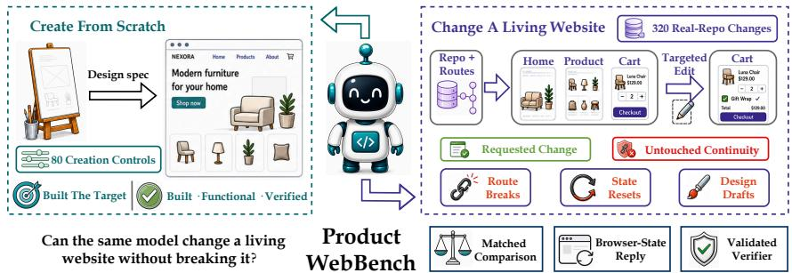  
Figure 1: Conceptual motivation, not a difficulty-matched comparison. Building from scratch asks if the page works; a live change also asks what survives.

## 1 INTRODUCTION

Large language models (LLMs) are increasingly capable of modifying existing software repositories from natural-language instructions, enabling agents to assist with tasks such as feature implementation, bug fixing, and repository-level development. Among these tasks, frontend development has a unique challenge because changes to a user interface often propagate beyond the requested functionality. For example, adding a shopping cart control may require modifications to shared states, checkout flows, responsive layouts, and components across different routes. As a result, a successful frontend agent should not only implement the requested feature, but also preserve the existing behaviors and integrity of the website it modifies.

We refer to this requirement as website continuity. A frontend change can satisfy a local requirement, such as a DOM assertion for the new component, while breaking previously working states, workflows, or visual consistency. Therefore, the unit of success is not the patch alone, but the patch together with the website it lands in. Evaluating such changes requires evidence about the behavior that existed before the modification, not only the final state after the edits (Figure 1).

This is harder still in long-horizon development, where requirements arrive incrementally and accepted changes become the ground later ones are built on. A later patch may fix a newly requested feature while silently invalidating an earlier browser state, interaction workflow, or cross-page dependency. A continuity evaluation must therefore reason over the evolution of the site: replay established behaviors after subsequent edits, separate newly introduced failures from unresolved existing ones, and hold the acceptance contract stable as requirements evolve.

Existing benchmarks only cover parts of this problem. Frontend generation benchmarks evaluate whether agents can produce desired interfaces or behaviors (Si et al., 2025; Zhang et al., 2026), but they do not measure whether modifications preserve an existing application. Repository-level software engineering benchmarks evaluate code changes against executable tests (Jimenez et al., 2024), but lack browser-level evidence involving viewports, interaction histories, and shared frontend components. Browser-agent benchmarks evaluate agents operating on existing websites (Zhou et al., 2024; He et al., 2024), but do not study agents that modify the source code defining those websites. None of these settings evaluates whether an agent can continuously improve an existing website while preserving previously established behaviors.

To address this gap, we introduce PRODUCTWEBBENCH, a benchmark for evaluating long-horizon frontend agents under a fixed continuity contract. PRODUCTWEBBENCH contains 320 Change tasks, which evaluate feature modifications and workflow repairs on existing repositories, and 80 Build tasks, which evaluate long-horizon website construction. Each task is constructed from a runnable repository together with captured browser evidence, including routes, viewports, actions, and intermediate states. During evaluation, a capability-conditioned simulated user reveals requirements progressively and provides feedback while the agent modifies a cumulative workspace. This design enables evaluation not only of whether agents complete requested changes, but also whether they preserve the website behaviors established throughout the development process.

We evaluated 8,737 valid trajectories from 13 models under this protocol. The results reveal a consistent gap between feature completion and website continuity. Among 674 Change runs that satisfy all requested-work checks, 190 (28.2%) still fail our continuity checks. Moreover, 10.8% of these runs regress browser states they had previously passed. Similarly, among 1,322 runs that successfully satisfy the target DOM requirements, 29.5% fail interaction checks. These results show that implementing the requested functionality is only one part of successful frontend development; preserving existing website behavior remains a separate challenge.

We summarize our contributions as follows: ❶ An acceptance contract testable before any solver runs. Each of the 400 tasks is admitted only once its reference passes every gate and authored wrong solutions fail, so satisfiability and gate discrimination are settled before evaluation, not argued after it. ❷ Long-horizon runs with cumulative gates. A simulated user reveals the task one stage at a time, and a cleared stage is never retired: its assertions stay armed at every later checkpoint, so continuity is scored across the whole trajectory, not its endpoint.

❸ Two regression channels with exact provenance. A state the run was seen to pass, and a gate the untouched repository satisfied, are two routes to a regression no labelling step has to guess at, and they are nearly disjoint. Their union catches 18.3% [15.3%, 21.6%] of the 586 covered completing runs damaging a verified state; 13.3% are caught and still failing a continuity check at the end.

## 2 EVIDENCE-BACKED TASK CONSTRUCTION

The unit of evaluation in PRODUCTWEBBENCH is a frozen task package: a repository snapshot, an ordered change request, and executable evidence of what must hold after the change. Figure 2 shows the construction pipeline, and Section 3 drives the same package through evaluation.

## 2.1 TASK PACKAGE AND REGIMES

Let a task package be represented as

$$
\begin{array} { r } { \mathcal { Q } = ( R _ { 0 } , P , S , E , G , \Delta ^ { \star } , N ) , } \end{array}\tag{1}
$$

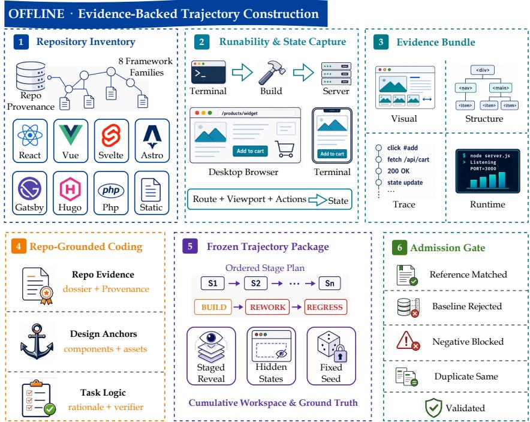  
Figure 2: Offline construction. Repository states supply the evidence for ordered stages; admission requires a passing reference, a failing baseline and smart-wrong control, and a distinct artifact.

where $R _ { 0 }$ is the repository snapshot with provenance, P the allowed path scope, $S = ( S _ { 1 } , \dots , S _ { K } )$ the stage plan, E the browser evidence and G the deterministic checks. $\Delta ^ { \star }$ is the reference patch and N the negative controls; both are used for admission only and never reach the solver.

Task regimes and coverage. The locked suite contains 400 tasks in two regimes. The 320 Change tasks begin from a runnable repository and ask the agent to modify it while preserving incumbent behavior; the 80 Build tasks grow a product site through 5 to 14 ordered milestones, a construction and long-horizon regime rather than an easy control for Change. Each Change task is organized around one facet – the place where continuity can break: state, design, experience, content and assets, regression or implementation – and the facet fixes which evidence has to survive the change. Every candidate repository is installed, built, served and exercised before authoring, and what cannot be reproduced or legally packaged never enters the pool; the inventory spans React, Vue, Svelte, Astro, Gatsby, Hugo, PHP and static sites. Appendix A gives the capability labels and the full facet inventory, and Appendix F the finer framework breakdown.

## 2.2 BROWSER EVIDENCE AND STAGE CONSTRUCTION

Authors capture $R _ { 0 }$ before writing the request. Each browser state in E is identified by a route, viewport and action prefix and carries screenshots, visual anchors, DOM structure and accessible names; retaining the action prefix makes a state replayable, since a cart after adding an item is a different target from the same route before that action.

The request is then grounded in E: design requirements point to repository-native assets and tokens, behavior requirements name a route, viewport, action prefix and expected state, and preservation requirements identify untouched states sharing navigation, data, styling or source files with the target. Those states compile into regression gates replayed at every checkpoint, and the plan S follows the dependency structure in the evidence, so a cart task exposes route access, item state, a new control, cross-page persistence, responsive behavior and regression replay, one per turn.

## 2.3 FROZEN CONTRACT AND ADMISSION CONTROLS

Once authored, the fields of Q are frozen together, so changing the solver or the conversation that presents a task never changes its acceptance checks or the evidence behind them. Admission then tests whether the package discriminates the intended behavior: applying $\Delta ^ { \star }$ to $R _ { 0 }$ must pass every applicable check, and plausible wrong implementations in N must fail: a visually convincing control with inert state, a responsive layout that overflows at one viewport, a local edit that drops an existing route. One more property is observed, not asserted: the task must not already be done. Of the 234 slots whose untouched repository renders under the frozen toolchain, the repository handed to the solver passes every gate on 0 of them, the closest reaching 17/19. On every one of them, then, the requested work is measurably outstanding when the solver starts. Section 4 reports how the authoring pool scores on both halves of this test, and Appendix D the audit behind them.

## 3 CUMULATIVE MULTI-TURN EVALUATION

Evaluation starts from $R _ { 0 }$ and walks the stage plan S of Eq. 1. One simulated user presents the work, the solver edits a cumulative workspace, and the harness checks the result against the frozen checks G (Figure 3). One design choice does most of the work: clearing a milestone does not retire it. Every assertion a stage clears becomes a standing obligation retested after every later edit, so the score reflects the whole trajectory and not just the state reached at the final turn.

## 3.1 TASK PRESENTATION AND SIMULATED USER

Two interfaces read the same frozen package: the staged regime reveals it as a sequence of work units, the full-spec regime hands the agent everything at once. Every model result is staged, while the agent-scaffold study uses full-spec because CLI agents own their turn loop, so the two arms are reported separately and never compared. In the staged regime each task selects a persona from its capability (PM for Build and Edit, QA for Repair, designer for Consistency), and the persona controls only the wording that reveals work units authored in advance. It does not generate requirements, read the reference patch, edit the verifier or decide pass/fail, and reveal, solver, checkpoint and pushback events are logged separately (Appendix C).

## 3.2 WORKSPACE UPDATES AND MILESTONE REPLAY

Each turn the solver receives scoped source context and returns a message plus structured edits. The harness applies accepted edits to the cumulative workspace, builds and serves the project, captures browser states and runs the deterministic checks, returning grounded failure text and, on the vision leg, the latest screenshot; the driver allows 12 turns per stage and 200 per run. A milestone clears only when the current workspace builds, serves, reaches the specified route, viewport and action state, and passes its assertions, and once cleared its gates join the active prior-state set. Let $G _ { j } \subseteq G$ denote the checks attached to stage $S _ { j }$ , and let $C _ { t }$ contain the indices of stages cleared before checkpoint t. The checks retained for replay are

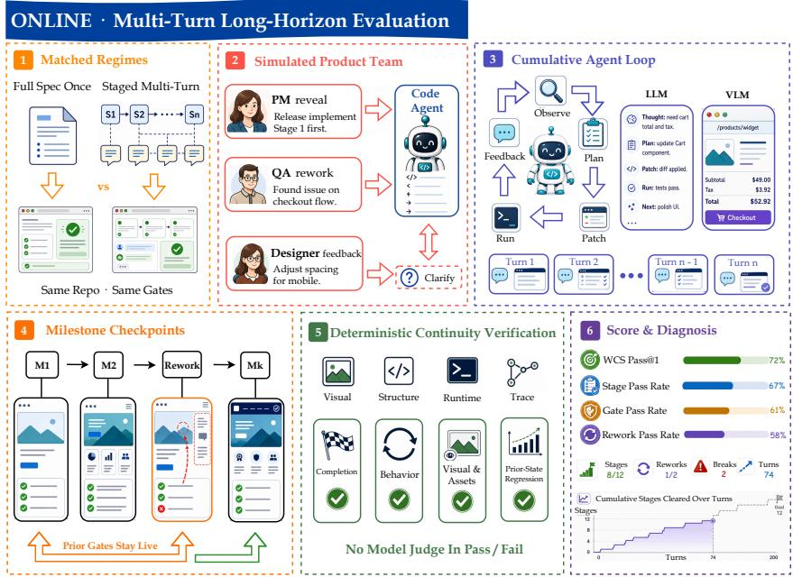  
Figure 3: Online multi-turn evaluation. PM/QA/designer are alternative personas, not concurrent. The harness checks each milestone and replays every prior gate; inset values are schematic.

Table 1: Main results on PRODUCTWEBBENCH. Task% is the strict whole-task rate of Section 3; capability columns use labelled cells only (Appendix A). Best per column bold.
<table><tr><td rowspan="2">Model</td><td colspan="2">Task%</td><td></td><td>Gate% Stage%</td><td colspan="2"></td><td colspan="2">Coverage &amp; #Pass</td><td colspan="4">Gate% by capability</td></tr><tr><td>Avg</td><td></td><td>L</td><td>Overall</td><td>Overall</td><td> $n _ { L }$ </td><td>nv</td><td>#Pass</td><td></td><td>Edit Repair Consist. Build</td><td></td><td></td></tr><tr><td colspan="10">Closed-source models</td><td></td></tr><tr><td>Claude-Opus-4.8</td><td>3.50 3.75 3.25</td><td></td><td></td><td>59.49</td><td>41.69 400 400</td><td></td><td></td><td>28/800 58.70</td><td></td><td>64.72</td><td></td><td>55.08 62.43</td></tr><tr><td>GPT-5.5</td><td>2.75 3.002.50</td><td></td><td></td><td>61.71</td><td>42.45 400400</td><td></td><td></td><td>22/80059.49</td><td></td><td>64.90</td><td></td><td>57.64 68.52</td></tr><tr><td>Claude-Sonnet-4.6</td><td>1.62</td><td>1.25 2.00</td><td></td><td>49.41</td><td>32.65 400400</td><td></td><td></td><td>13/80050.00</td><td></td><td>55.62</td><td>47.71</td><td>43.49</td></tr><tr><td>Gemini-3.5-Flash</td><td>1.25</td><td>1.25</td><td>1.25</td><td>52.43</td><td>34.88 400 400</td><td></td><td></td><td>10/80052.88</td><td></td><td>60.31</td><td>48.59</td><td>49.41</td></tr><tr><td colspan="10">Open-source models</td></tr><tr><td>DeepSeek-V4-Flash</td><td>3.25 3.25</td><td></td><td></td><td>56.64</td><td>38.24 400</td><td></td><td></td><td>13/40056.88</td><td></td><td>63.44</td><td></td><td>51.50 58.09</td></tr><tr><td>Kimi-K3</td><td>2.93 2.75 3.10</td><td></td><td></td><td>54.37</td><td></td><td>39.30400</td><td>387</td><td>23/787 53.72</td><td></td><td>63.45</td><td></td><td>50.3852.76</td></tr><tr><td>GLM-5.2-FP8</td><td>2.53 2.53</td><td></td><td></td><td>53.78</td><td></td><td>39.90395</td><td></td><td>10/39553.76</td><td></td><td>65.61</td><td></td><td>50.0947.70</td></tr><tr><td>Hunyuan-3-Preview</td><td>2.34 2.34 2.34</td><td></td><td></td><td>50.03</td><td></td><td>34.69385</td><td>385</td><td>18/77052.15</td><td></td><td>57.13</td><td></td><td>47.7243.52</td></tr><tr><td>Qwen3.7-Max</td><td>2.252.25</td><td></td><td></td><td>54.82</td><td></td><td>37.32400</td><td></td><td>9/40054.25</td><td></td><td>62.73</td><td></td><td>47.8257.70</td></tr><tr><td>Qwen3.6-35B-A3B</td><td>2.031.802.25</td><td></td><td></td><td>50.05</td><td></td><td>33.46388</td><td>400</td><td>16/78850.95</td><td></td><td>59.61</td><td></td><td>46.0345.49</td></tr><tr><td>Kimi-K2.7-Code</td><td>2.01 2.261.75</td><td></td><td></td><td>52.99</td><td></td><td>38.10398</td><td>399</td><td>16/79753.04</td><td></td><td>59.32</td><td></td><td>48.42 53.92</td></tr><tr><td>DeepSeek-V4-Pro-Preview</td><td>2.002.00</td><td></td><td></td><td>54.34</td><td></td><td>37.82 400</td><td></td><td>8/40053.59</td><td></td><td>58.32</td><td></td><td>51.5056.58</td></tr><tr><td>MiniMax-M3</td><td></td><td></td><td>1.501.751.25</td><td>54.42</td><td></td><td>36.42 400400</td><td></td><td>12/80056.10</td><td></td><td>62.52</td><td></td><td>48.91 52.96</td></tr></table>

$$
G _ { t } ^ { \mathrm { p r i o r } } = \bigcup _ { j \in C _ { t } } G _ { j } .\tag{2}
$$

Every later checkpoint replays these alongside the current milestone’s requirements, so a patch that fixes the current stage but invalidates an earlier state is recorded as a regression. Rework reuses the workspace: later stages inherit the successful edits and the unresolved state alike.

## 3.3 VERIFICATION AND CONTINUITY SCORE

The final verifier runs completion, behavior, visual/asset, runtime and prior-state checks, and Appendix B lists all 19 signals and the three families that partition them. Whole-task success is intentionally strict, so we also report the graded Website Continuity Score (WCS). For attempt i, let $s _ { i }$ be the fraction of stages cleared, counting stages only and not reworks; $g _ { i }$ the deterministic gate pass rate; $v _ { i }$ the binary final gate pass; and $b _ { i }$ the number of regression breaks, counted as one per (checkpoint, gate) pair recorded as regressed:

$$
\mathrm { W C S } _ { i } = \left[ 0 . 5 s _ { i } + 0 . 3 g _ { i } + 0 . 2 v _ { i } - 0 . 0 5 b _ { i } \right] _ { + } .\tag{3}
$$

Here $[ x ] _ { + } = \operatorname* { m a x } ( 0 , x )$ , so WCS retains partial progress while penalizing regressions. The weights and the per-break penalty are design choices, and Appendix F gives a worked example and what the per-checkpoint accumulation of $b _ { i }$ does to the graded scale. Every rate we report on the regression channels uses only the indicator $b _ { i } > 0$ and is unaffected by that accumulation.

Three success notions recur and are not interchangeable. Requested-work completion means every completion-family gate passes. Final gate pass means all nineteen gates pass on the final workspace, which 259 of the 8,737 cells reach; it is the $v _ { i }$ of Eq. 3 and what the full-spec scaffold arm reports, since that arm verifies only once. Whole-task pass additionally requires every stage and rework to clear with $b _ { i } = 0$ . It is the stricter notion, it holds on 198 cells, and it is the Task% column of Table 1. Case (1) in Appendix J passes all nineteen final gates on its delivered workspace without clearing every unit, which is exactly the gap between the second notion and the third.

The gates are also partitioned by what they measure. The completion family asks whether the requested work is present. The rest are the continuity checks this paper reports throughout: regression text, visual anchors, layout, state artifacts and runtime health, read conservatively by excluding the general visual regression signal. An attempt is complete-but-not-cleared when it passes every completion gate and fails at least one continuity check (Appendix B).

Table 2: Agent scaffolds on PRODUCTWEBBENCH, grouped by backbone. Each row runs 400 tasks; capability columns report Gate%. Stage% needs checkpoints, undefined here. Best overall in bold.
<table><tr><td>Agent</td><td>Task%</td><td>Gate%</td><td>Edit</td><td>Repair</td><td>Consist.</td><td>Build</td></tr><tr><td colspan="7">Backbone: Claude Sonnet 4.6</td></tr><tr><td>mini-swe-agent</td><td>0.75</td><td>64.58</td><td>64.24</td><td>69.13</td><td>61.16</td><td>67.63</td></tr><tr><td>Claude Code Qwen Code</td><td>0.50 0.50</td><td>62.51 59.80</td><td>62.13 58.41</td><td>67.07 65.65</td><td>57.80 56.40</td><td>66.84</td></tr><tr><td>Goose</td><td>0.50</td><td>61.93</td><td>62.30</td><td>66.86</td><td>58.98</td><td>61.84 62.63</td></tr><tr><td>Kimi CLI</td><td>0.25</td><td>61.28</td><td>61.33</td><td>65.22</td><td>60.25</td><td>60.26</td></tr><tr><td>Aider opencode</td><td>0.00</td><td>57.64</td><td>56.01</td><td>61.38</td><td>51.68</td><td>66.45</td></tr><tr><td>Backbone: GPT-5.5</td><td>0.00</td><td>52.03</td><td>51.49</td><td>56.26</td><td>48.05</td><td>56.78</td></tr><tr><td></td><td></td><td></td><td></td><td></td><td></td><td></td></tr><tr><td>mini-swe-agent</td><td>0.50</td><td>69.68</td><td>67.51</td><td>70.77</td><td>64.93</td><td>80.66</td></tr><tr><td>Codex</td><td>0.50</td><td>68.25</td><td>67.33</td><td>71.41</td><td>63.52</td><td>74.87</td></tr><tr><td>Goose</td><td>0.50</td><td>69.22</td><td>65.22</td><td>71.62</td><td>63.84</td><td>81.78</td></tr><tr><td>Aider</td><td>0.25</td><td>60.75</td><td>58.70</td><td>63.73</td><td>53.36</td><td>73.82</td></tr><tr><td>opencode</td><td>0.00</td><td>52.80</td><td>51.83</td><td>57.04</td><td>48.64</td><td>58.16</td></tr></table>

The quadrant decomposition shows what target-only scoring omits: a model can produce the requested state while failing an additional route, responsive, anchor, state or runtime check. State-level provenance is needed to say which of these are confirmed incumbent-state regressions; completion alone credits all 190 attempts that fail the conservative checks.

Table 3: Completion versus additional checks, 6,979 Change cells.
<table><tr><td colspan="2">Requested work Additional checks Complete Incomplete</td></tr><tr><td>Pass</td><td>484 1,154</td></tr><tr><td>Fail</td><td>190 5,151</td></tr></table>

## 4 EXPERIMENTS

## 4.1 SETUP

We evaluate 13 frontier and open coding models under the staged protocol of Section 3: every run starts from a pristine repository with the same stage plan, gates, allowed paths and budgets, cannot reach the reference or the negative controls, and is checked by the frozen 19-gate verifier at every checkpoint. Nine of the 13 also have image-valid screenshot runs paired with their own text-only cells. A verdict counts only if it postdates its task’s frozen specification, leaving 8,737 live cells, 6,979 Change and 1,758 Build, the single snapshot every number in this paper is computed from. Before interpreting any model failure we check that the benchmark can separate a correct solution from a plausible regression: across the validated authoring pool all 479 reference implementations pass and all 479 smart-wrong controls fail, Wilson [0.992, 1.000] in both directions. That is an admission property of the pool, not an accuracy estimate on unseen solver output. What it rules out is that a low score comes from an impossible reference, or a gate that lets the authored bad state through: the contract discriminates before any model runs. Appendix F gives the models, per-question denominators and statistical conventions, and Appendix D measures accuracy on solver output.

## 4.2 MAIN RESULTS

Whole-task passes are sparse; the graded scale is not. Only 198 of the 8,737 cells clear every stage and rework, pass every gate, and record no regression break, and whole-task rates span 1.25 to 3.50%, too narrow a band to order the field. Gate% spans 49.41 to 61.71 over the same runs and does order it, and the two disagree at the top: Claude-Opus-4.8 leads whole-task success while GPT-5.5 leads Gate% and Stage%. By capability the ordering is the same for all 13 models, Repair highest and Consistency lowest of the three Change capabilities, which asks a change to match conventions that live in the repository rather than in the request.

Scaffolds change the number as much as backbones do. Table 2 runs eight distinct scaffolds over the same 400 tasks, four of them under both backbones, so scaffold and backbone can be compared as one statistic rather than a range against a mean. On that matched 4 × 2 grid, swapping the scaffold under a fixed backbone moves the component mean by 8.06 pt on Sonnet-4.6 and 10.52 pt on GPT-5.5, while swapping the backbone under a fixed scaffold moves it by 5.08 pt. How an agent is wired around a model therefore matters as much as which model it is, which is a reason to report the scaffold with the score (Appendix F defines the component mean and states what this matched grid does and does not control).

Post-completion failure rate  
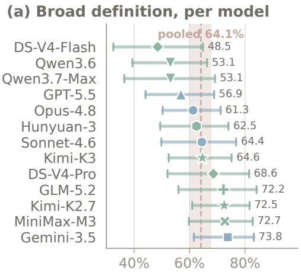

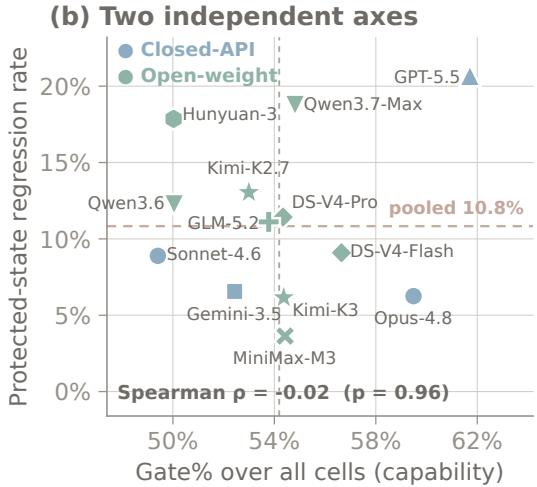  
Figure 4: Thirteen models, 674 completing Change runs. (a) Post-completion failure, Wilson-95. (b) Regression rate against Gate%: unrelated orderings.

## 5 ANALYSIS

Completion is not continuity. Table 3 separates the two verdicts: of the Change runs that pass every completion-family gate, 28.2% still fail at least one continuity check, rising to 64.1% under the broad visual-inclusive reading. Every model shows it (Figure 4; Appendix E gives the intervals and the permodel spread). Nor are these runs failing for want of a patch that applies: 98.3% of failing cells land at least one edit. And an element being present does not make

Table 4: Provenance-exact regression. Full rows and intervals: Table 9.
<table><tr><td>Observation point</td><td>Count</td><td>Rate</td></tr><tr><td>Replay, any checkpoint</td><td>73/674</td><td>10.8%</td></tr><tr><td>Class (a): initial state</td><td>66/586</td><td>11.3%</td></tr><tr><td>Class (b): run&#x27;s own state</td><td>57/586</td><td>9.7%</td></tr><tr><td>both channels</td><td>16/586</td><td>2.7%</td></tr><tr><td>Either channel</td><td>107/586</td><td>18.3%</td></tr><tr><td>still failing at the end</td><td>78/586</td><td>13.3%</td></tr></table>

it work: on the interactive cells whose static DOM requirement already passes, interaction assertions still fail 29.5% of the time (Table 11; Appendix F).

Two regression channels with exact provenance. One channel needs no target-versus-prior labelling at all: whenever a stage clears, its assertions enter a protected set the harness replays at every later checkpoint of the same run (Section 3), so an assertion that passes at stage k and fails at k′ > k is a pass-to-fail transition on a state the run itself established. Among completing runs this fires on 10.8%. That set can only hold states a run established itself, so for the complementary class we captured each repository as handed to the solver and ran the same frozen suite on it: a gate the untouched repository passes and the final workspace fails is a regression with exact provenance whether or not the run asserted it. It fires on 43.9% of covered Change runs, no model escapes, and the rate falls as model quality rises (Spearman $\rho = - 0 . 8 8$ against mean WCS). What it catches is ordinary product health: horizontal overflow, a route that stops rendering, console errors. On the runs where both channels can be read they are close in size and nearly disjoint, so together 18.3% are caught damaging a state that was verified working and 13.3% are both caught and still failing a conservative check at the end: the first speaks to trajectories, the second to delivered sites. Neither restates the post-completion gap (Figure 5 and Table 4; Appendix E gives the coverage, the residual cases and the gates each channel rests on, which bounds the claim).

Long-horizon construction. Build and Change occupy different regimes: on the nine-model dualmodal panel pooled Build WCS is 0.240 against 0.348 for Change, the gap sits in stage completion, not gate quality, and Build plans are the longer ones (Table 12). Longer runs are not recovering ones: on Build tasks of at least seven stages the correlation between turns and stages cleared is negative in every stage-count bucket, median −0.91, because cleared units finish fast while a failed one burns all 12 turns (Figure 9; Appendix H covers the stopping rule). Creation is also harder than the matched in-place change. Because Build plans are longer, the pooled gap alone cannot separate regime from trajectory length, so we settle it with an authored twin study: twenty-one Change tasks duplicated as greenfield twins that reach the same end state from an empty baseline, on the same site, under identical acceptance gates and with stage counts matched by construction. Across the 105 paired cells the pooled twin−source ∆WCS is −11.82 points on the 100×WCS scale $( t = - 4 . 7 4 )$ , with all five model-legs negative. The two regimes are related but not interchangeable, and the capability slices do not order the field identically either: ranking the 13 models by Gate% within each capability, GPT-5.5 leads Edit, Consistency and Build while GLM-5.2-FP8 leads Repair (Figures 6 and 10; Appendix F reports the rank coherence across the four slices, which is high but not uniform).

(a) All 13 models regress  
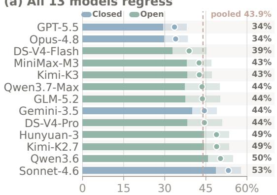  
Runs breaking an incumbent property

(b) Which properties break  
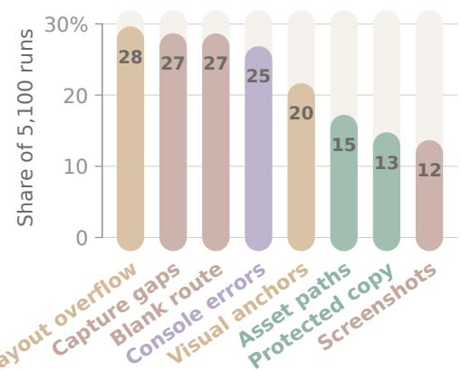  
Figure 5: The untouched-repository channel. (a) Per-model rate: dot, Wilson-95 band, pooled 43.9% dashed. (b) What breaks, of 5,100 covered runs; colour marks the family.

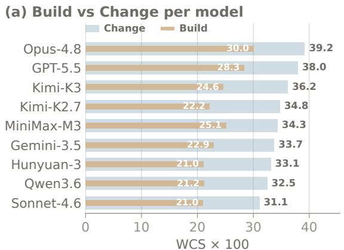

(b) Matched twins pool -11.82  
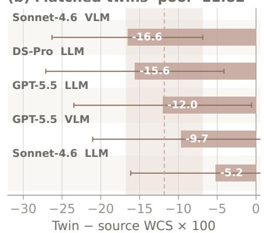  
Figure 6: (a) Build versus Change raw WCS per model; the Build bar is shorter for all nine. (b) Paired twin-minus-source change per model-leg, pooled dashed; stage count matched by construction.

What moves the continuity signal. Capability does not track protected-state regression here: ranking the 13 models by Gate% and by the share of their completing runs that break a protected state gives two orderings with no detectable relation at this sample size (Spearman $\rho = - 0 . 0 2 , p = 0 . 9 6 ;$ Figure 4b), and the strongest model on Gate% carries the highest regression rate of all. What does move the graded gate rate is prompt scale, in both directions. Truncating the solver’s history to five turns drops Gate% by 9.40 points while stage completion and turn count are essentially unchanged, so the solver reaches the same stages and does worse work at them. Adding a “do not break unrelated behavior; keep everything else byte-for-byte” clause lifts Gate% by 7.81 pt without costing a whole task pass (Figure 7). The simulated user is not doing the solver’s work: changing what it says, in either direction, moves nothing distinguishable from zero, and neither does the edit format nor giving the solver screenshots. What the solver is told moves the score; what it is shown, and how the request is worded, do not. Appendix F tabulates these arms with the solver-vision contrast Figure 7 leaves out, and Appendix E the endpoint these arms cannot resolve.

(a) Two prompt-scale levers  
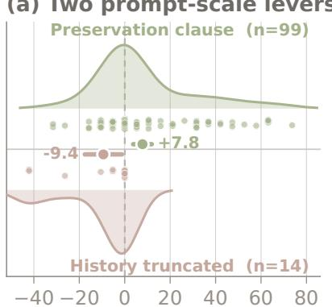  
Paired Δ Gate% (arm − baseline)

(b) Six arms, one axis  
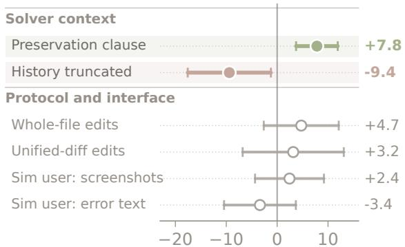  
Paired Δ Gate% with 95% CI  
Figure 7: Paired change in Gate% per arm. (a) The two prompt-scale levers, mirrored, one dot per slot. (b) The six arms with 95% CIs; only what the solver is told clears zero.

## 6 RELATED WORK

Frontend and repository benchmarks. Benchmarks connect webpage designs with code generation and visual reconstruction (Si et al., 2025; Yun et al., 2024; Gui et al., 2025), then expand to framework based editing and repair (Xiao et al., 2025) and to the functional, visual and interactive quality of generated applications (Zhang et al., 2026; Lu et al., 2025; Zhang et al., 2025). Closest in coverage, WebCompass unifies text-, image- and video-conditioned generation, editing and repair, judging edits by model and generation by browser agent (Lei et al., 2026). SWE-bench evaluates issue resolution with executable tests, regression tests included (Jimenez et al., 2024), and SWE-bench Multimodal extends it to visual, user-facing JavaScript software (Yang et al., 2025); agent interfaces and execution platforms support editing and adaptation to observations (Yang et al., 2024; Wang et al., 2024; 2025), and complementary work studies refinement, reflection and the limits of self-repair (Madaan et al., 2023; Shinn et al., 2023; Olausson et al., 2024). Lifecycle coverage, executable feedback and preservation checks are shared concerns.

Browser environments, simulated users, and what PRODUCTWEBBENCH adds. Web-agent research contributes demonstrations, executable environments and grounded tasks (Deng et al., 2023; Zhou et al., 2024; Koh et al., 2024; He et al., 2024), OSWorld covers desktop and crossapplication workflows (Xie et al., 2024), ReAct studies interleaved reasoning and action (Yao et al., 2023), AgentBoard measures intermediate progress (Ma et al., 2024), and simulated-user benchmarks examine tool use against verifiable outcomes (Yao et al., 2024; Barres et al., 2025). What PRODUCTWEBBENCH adds is cumulative verification under a frozen contract. A task package binds each requirement to route, viewport and action-history evidence; a simulated user stages the work while frozen checks decide acceptance; and every cleared state is replayed at every later checkpoint, so an edit is graded against the site it changes, not the target alone. One trajectory therefore yields requested completion, additional verification failure and provenance-exact regression as three separate quantities, so progress, persistent failure and damage are told apart, not inferred from repair turns.

## 7 CONCLUSION

PRODUCTWEBBENCH evaluates frontend patches against a living system, not an isolated target. Its 400 evidence-backed tasks combine real repositories, staged persona-conditioned interaction, cumulative browser checkpoints and validated verifiers. Across 13 models, 28.2% of the Change runs that pass every completion gate still fail an additional conservative check. Protected-state replay certifies 10.8% of them as pass-to-fail regressions on states the run established itself, and the untouched-repository channel raises provenance-exact damage to 18.3% on the 586 runs where both are observable, with 13.3% of that same 586 still failing a conservative check at the end. Scaffolds matter as much as backbones: on the full-spec arm, swapping the scaffold under a fixed backbone moves the score further than the reverse, so the harness belongs in any report of agent capability. Target completion alone is therefore insufficient evidence that the site the change lands in still holds. Appendix G draws out what these numbers imply for reporting, Appendix H bounds the claims, and Appendix J walks seven released trajectories end to end, one per capability.

## ETHICS STATEMENT

This work evaluates code-generating agents on software repositories and involves no human subjects, no personal data, and no user studies. Every task is built from a publicly available frontend repository, and each released package retains the upstream repository’s provenance and license; we redistribute task metadata, browser-state evidence, and verifier definitions rather than relicensed source. Evaluation runs in a sandboxed workspace with no deployment to public services and no production credentials, and provider keys, billing metadata, and transient workspaces are excluded from the release (Appendix I). The benchmark measures whether a patch preserves behaviour that a repository already had; it is a software-quality instrument and we are not aware of a dual-use risk beyond that of the public repositories it is built from. The scores we report describe systems under one fixed protocol and should not be read as general capability claims about any vendor’s model, and we state throughout where provider availability makes model coverage unbalanced.

## REPRODUCIBILITY STATEMENT

Every number in the paper is computed from one frozen result manifest, and that manifest is what we release: one row per evaluated cell, carrying the stage and gate components of the score, the applied and rejected edits, the failing gates, and the normalized capability, facet and framework labels. Rows superseded by a later submission specification are already removed from it, so the released manifest is exactly the 8,737 cells every number is taken over. Section 4 fixes the protocol, budgets, and stale-row filter; Appendix B gives the gate families, Appendix C the two evaluation arms and their scoring conventions, Appendix D the verifier-validation procedure, and Appendix E the exact definition of both continuity statistics. Appendix I lists what each released task package contains and the safeguards applied before release. Rerun variability is characterised in Appendix D: the graded metric carries a per-cell noise floor of σ ≈ 0.09, which we quantify and attach to every graded number, so exact per-cell reproduction of a graded score should not be expected even at T = 0; the binary verdict was stable in all fifteen replayed pairs.

## USE OF LARGE LANGUAGE MODELS

We used a general-purpose LLM assistant for writing assistance only: copy-editing prose we had already drafted and checking LaTeX and figure formatting. It had no part in the research itself, and the authors have verified the full text and take responsibility for its contents.

## REFERENCES

Victor Barres, Honghua Dong, Soham Ray, Xujie Si, and Karthik Narasimhan. τ2-Bench: Evaluating conversational agents in a dual-control environment, 2025. URL https://arxiv.org/abs/ 2506.07982.

Xiang Deng, Yu Gu, Boyuan Zheng, Shijie Chen, Samuel Stevens, Boshi Wang, Huan Sun, and Yu Su. Mind2Web: Towards a generalist agent for the web. In Advances in Neural Information Processing Systems, 2023. URL https://arxiv.org/abs/2306.06070.

Yi Gui, Zhen Li, Yao Wan, Yemin Shi, Hongyu Zhang, Bohua Chen, Yi Su, Dongping Chen, Siyuan Wu, Xing Zhou, Wenbin Jiang, Hai Jin, and Xiangliang Zhang. WebCode2M: A real-world dataset for code generation from webpage designs. In Proceedings ofthe ACM on Web Conference 2025, pp. 1834–1845, 2025. doi: 10.1145/3696410.3714889.

Hongliang He, Wenlin Yao, Kaixin Ma, Wenhao Yu, Yong Dai, Hongming Zhang, Zhenzhong Lan, and Dong Yu. WebVoyager: Building an end-to-end web agent with large multimodal models. In Proceedings of the 62nd Annual Meeting of the Association for Computational Linguistics (Volume 1: Long Papers), pp. 6864–6890. Association for Computational Linguistics, 2024. doi: 10.18653/v1/2024.acl-long.371.

Carlos E. Jimenez, John Yang, Alexander Wettig, Shunyu Yao, Kexin Pei, Ofir Press, and Karthik Narasimhan. SWE-bench: Can language models resolve real-world GitHub issues? In The Twelfth

International Conference on Learning Representations, 2024. URL https://arxiv.org/ abs/2310.06770.

Jing Yu Koh, Robert Lo, Lawrence Jang, Vikram Duvvur, Ming Lim, Po-Yu Huang, Graham Neubig, Shuyan Zhou, Russ Salakhutdinov, and Daniel Fried. VisualWebArena: Evaluating multimodal agents on realistic visual web tasks. In Proceedings of the 62nd Annual Meeting of the Associationfor Computational Linguistics (Volume 1: Long Papers), pp. 881–905. Association for Computational Linguistics, 2024. doi: 10.18653/v1/2024.acl-long.50.

Xinping Lei, Xinyu Che, Junqi Xiong, Chenchen Zhang, Yukai Huang, Chenyu Zhou, Haoyang Huang, Minghao Liu, Letian Zhu, Hongyi Ye, Jinhua Hao, Ken Deng, Zizheng Zhan, Han Li, Dailin Li, Yifan Yao, Ming Sun, Zhaoxiang Zhang, and Jiaheng Liu. WebCompass: Towards multimodal web coding evaluation for code language models, 2026. URL https://arxiv. org/abs/2604.18224.

Zimu Lu, Yunqiao Yang, Houxing Ren, Haotian Hou, Han Xiao, Ke Wang, Weikang Shi, Aojun Zhou, Mingjie Zhan, and Hongsheng Li. WebGen-Bench: Evaluating LLMs on generating interactive and functional websites from scratch, 2025. URL https://arxiv.org/abs/2505.03733.

Chang Ma, Junlei Zhang, Zhihao Zhu, Cheng Yang, Yujiu Yang, Yaohui Jin, Zhenzhong Lan, Lingpeng Kong, and Junxian He. AgentBoard: An analytical evaluation board of multi-turn LLM agents. In Advances in Neural Information Processing Systems, volume 37, pp. 74325–74362, 2024. doi: 10.52202/079017-2365.

Aman Madaan, Niket Tandon, Prakhar Gupta, Skyler Hallinan, Luyu Gao, Sarah Wiegreffe, Uri Alon, Nouha Dziri, Shrimai Prabhumoye, Yiming Yang, Shashank Gupta, Bodhisattwa Prasad Majumder, Katherine Hermann, Sean Welleck, Amir Yazdanbakhsh, and Peter Clark. Self-refine: Iterative refinement with self-feedback. In Advances in Neural Information Processing Systems, 2023. URL https://arxiv.org/abs/2303.17651.

Theo X. Olausson, Jeevana Priya Inala, Chenglong Wang, Jianfeng Gao, and Armando Solar-Lezama. Is self-repair a silver bullet for code generation? In The Twelfth International Conference on Learning Representations, 2024. URL https://arxiv.org/abs/2306.09896.

Noah Shinn, Federico Cassano, Edward Berman, Ashwin Gopinath, Karthik Narasimhan, and Shunyu Yao. Reflexion: Language agents with verbal reinforcement learning. In Advances in Neural Information Processing Systems, 2023. URL https://arxiv.org/abs/2303.11366.

Chenglei Si, Yanzhe Zhang, Ryan Li, Zhengyuan Yang, Ruibo Liu, and Diyi Yang. Design2Code: Benchmarking multimodal code generation for automated front-end engineering. In Proceedings of the 2025 Conference ofthe Nations ofthe Americas Chapter ofthe Associationfor Computational Linguistics: Human Language Technologies (Volume 1: Long Papers), pp. 3956–3974. Association for Computational Linguistics, 2025. doi: 10.18653/v1/2025.naacl-long.199.

Xingyao Wang, Yangyi Chen, Lifan Yuan, Yizhe Zhang, Yunzhu Li, Hao Peng, and Heng Ji. Executable code actions elicit better LLM agents. In Proceedings of the 41st International Conference on Machine Learning, volume 235, pp. 50208–50232. PMLR, 2024. URL https: //proceedings.mlr.press/v235/wang24h.html.

Xingyao Wang, Boxuan Li, Yufan Song, Frank F. Xu, Xiangru Tang, Mingchen Zhuge, Jiayi Pan, Yueqi Song, Bowen Li, Jaskirat Singh, Hoang H. Tran, Fuqiang Li, Ren Ma, Mingzhang Zheng, Bill Qian, Yanjun Shao, Niklas Muennighoff, Yizhe Zhang, Binyuan Hui, Junyang Lin, Robert Brennan, Hao Peng, Heng Ji, and Graham Neubig. OpenHands: An open platform for AI software developers as generalist agents. In The Thirteenth International Conference on Learning Representations, 2025. URL https://arxiv.org/abs/2407.16741.

Jingyu Xiao, Ming Wang, Man Ho Lam, Yuxuan Wan, Junliang Liu, Yintong Huo, and Michael R. Lyu. DesignBench: A comprehensive benchmark for MLLM-based front-end code generation, 2025. URL https://arxiv.org/abs/2506.06251.

Tianbao Xie, Danyang Zhang, Jixuan Chen, Xiaochuan Li, Siheng Zhao, Ruisheng Cao, Toh Jing Hua, Zhoujun Cheng, Dongchan Shin, Fangyu Lei, Yitao Liu, Yiheng Xu, Shuyan Zhou, Silvio

Savarese, Caiming Xiong, Victor Zhong, and Tao Yu. OSWorld: Benchmarking multimodal agents for open-ended tasks in real computer environments. In Advances in Neural Information Processing Systems, volume 37, 2024. URL https://arxiv.org/abs/2404.07972.

John Yang, Carlos E. Jimenez, Alexander Wettig, Kilian Lieret, Shunyu Yao, Karthik Narasimhan, and Ofir Press. SWE-agent: Agent-computer interfaces enable automated software engineering. In Advances in Neural Information Processing Systems, volume 37, pp. 50528–50652, 2024. doi: 10.52202/079017-1601.

John Yang, Carlos E. Jimenez, Alex L. Zhang, Kilian Lieret, Joyce Yang, Xindi Wu, Ori Press, Niklas Muennighoff, Gabriel Synnaeve, Karthik R. Narasimhan, Diyi Yang, Sida I. Wang, and Ofir Press. SWE-bench Multimodal: Do AI systems generalize to visual software domains? In The Thirteenth International Conference on Learning Representations, 2025. URL https: //openreview.net/forum?id=riTiq3i21b.

Shunyu Yao, Jeffrey Zhao, Dian Yu, Nan Du, Izhak Shafran, Karthik Narasimhan, and Yuan Cao. ReAct: Synergizing reasoning and acting in language models. In The Eleventh International Conference on Learning Representations, 2023. URL https://arxiv.org/abs/2210. 03629.

Shunyu Yao, Noah Shinn, Pedram Razavi, and Karthik Narasimhan. τ -bench: A benchmark for tool-agent-user interaction in real-world domains, 2024. URL https://arxiv.org/abs/ 2406.12045.

Sukmin Yun, Haokun Lin, Rusiru Thushara, Mohammad Qazim Bhat, Yongxin Wang, Zutao Jiang, Mingkai Deng, Jinhong Wang, Tianhua Tao, Junbo Li, Haonan Li, Preslav Nakov, Timothy Baldwin, Zhengzhong Liu, Eric P. Xing, Xiaodan Liang, and Zhiqiang Shen. Web2Code: A large-scale webpage-to-code dataset and evaluation framework for multimodal LLMs. In Advances in Neural Information Processing Systems, volume 37, 2024. URL https://arxiv.org/ abs/2406.20098.

Chenchen Zhang, Yuhang Li, Can Xu, Jiaheng Liu, Ao Liu, Changzhi Zhou, Ken Deng, Dengpeng Wu, Guanhua Huang, Kejiao Li, Qi Yi, Ruibin Xiong, Shihui Hu, Yue Zhang, Yuhao Jiang, Zenan Xu, Yuanxing Zhang, Wiggin Zhou, Chayse Zhou, and Fengzong Lian. ArtifactsBench: Bridging the visual-interactive gap in LLM code generation evaluation, 2025. URL https: //arxiv.org/abs/2507.04952.

Zuhao Zhang, Chengyue Yu, Yuante Li, Chenyi Zhuang, Linjian Mo, and Shuai Li. MiniAppBench: Evaluating the shift from text to interactive HTML responses in LLM-powered assistants, 2026. URL https://arxiv.org/abs/2603.09652.

Shuyan Zhou, Frank F. Xu, Hao Zhu, Xuhui Zhou, Robert Lo, Abishek Sridhar, Xianyi Cheng, Tianyue Ou, Yonatan Bisk, Daniel Fried, Uri Alon, and Graham Neubig. WebArena: A realistic web environment for building autonomous agents. In The Twelfth International Conference on Learning Representations, 2024. URL https://arxiv.org/abs/2307.13854.

## A TASK AND FACET INVENTORY

Table 5 reports primary continuity-facet metadata for the locked Change split. Three tasks have no normalized facet; they are excluded from facet-stratified analyses and kept in aggregate totals.

Capability labels come from the frozen task record, so a per-capability column reports exactly the slots that record labels: 304 of the 320 Change slots (106 Edit, 76 Repair, 122 Consistency). Every overall column uses all 320, and we report the two denominators separately rather than imputing a label. Per-capability and overall columns therefore rest on different denominators, and we keep them distinct throughout.

Table 5: Continuity facets.
<table><tr><td>Facet</td><td>Tasks</td></tr><tr><td>Design</td><td>102</td></tr><tr><td>Experience</td><td>85</td></tr><tr><td>Regression</td><td>52</td></tr><tr><td>Content/assets</td><td>36</td></tr><tr><td>State</td><td>27</td></tr><tr><td>Implementation</td><td>15</td></tr><tr><td>Unnormalized</td><td>3</td></tr></table>

## B GATE FAMILIES

The decomposition into completion and additional verification is computed from names emitted by the frozen verifier, not from post hoc labeling. Table 6 lists the families used in the reported analysis. visual regression is held out of the conservative family throughout because it compares against a reference render without controlling scroll offset, so target-versus-prior provenance is not uniform across its failures. One completion signal, state url signals, is configured by no task in the locked suite and so passes on every cell; we keep it in the table because the verifier emits it and Gate% is divided by 19 throughout. Recomputing Gate% over the eighteen signals that can fail lowers every model by two to three points and leaves the ordering in Table 1 unchanged.

Table 6: Deterministic gate families. The three partition all 19 gates.
<table><tr><td>Family</td><td>Verifier signals</td></tr><tr><td>Completion (12)</td><td>completion text, visible text, DOM assertions, required states, interaction assertions, state quality, action history, screenshots,</td></tr><tr><td>Conservative extra (6)</td><td>asset paths, exact asset paths, image-alt signals, state-URL signals regression text, visual-anchor similarity, horizontal overflow, console errors, forbidden text patterns, state artifacts</td></tr><tr><td>Broad sensitivity only (1)</td><td>visual regression</td></tr></table>

## C PRESENTATION INTERFACES AND EVALUATION ARMS

Two interfaces read the same frozen package, and the paper uses both. They are reported separately and are not comparable. Table 7 states where they differ, so no result is read across the boundary.

Table 7: The two evaluation arms, differing only in presentation and turn control.
<table><tr><td></td><td>Staged</td><td>Full-spec</td></tr><tr><td>Used in</td><td>Tables 3, 12, 1 and Section 5</td><td>Table 2, Figure 16</td></tr><tr><td>Solver input</td><td>One work unit at a time, via the simulated user</td><td>Complete task and repository context, once</td></tr><tr><td>Turn control</td><td>Our driver: 12 turns per stage, 200 per run</td><td>The agent&#x27;s own loop, under a time and token ceiling</td></tr><tr><td>Feedback access</td><td>Per-gate failure text each checkpoint, plus a screenshot on the VLM leg</td><td>None; scored on what it submits</td></tr><tr><td>Protected-state replay</td><td>Yes: cleared assertions re-verified at every later checkpoint</td><td>No: one terminal verification</td></tr><tr><td>Metrics defined</td><td>Task%, Gate%, Stage%, WCS, breaks</td><td>Task%, Gate%, component mean</td></tr></table>

The simulated user is an evaluation interface, and deliberately so: one capability-conditioned persona per task, revealing requirements authored in advance and grounded feedback while acceptance stays fixed. That separation is what makes runs comparable across thirteen models. Multi-role interaction is a natural extension and belongs on the same frozen states and gates.

Scaffold and staged scores are therefore not comparable as model-quality estimates. Gate% in Table 2 runs well above Table 1 while strict Task% runs below it, for reasons that have nothing to do with agent quality: a full-spec agent is graded once, against the final requirement set, without ever having to hold an earlier state passing. The two Task% columns are not the same quantity either: the scaffold arm reports a final gate pass, the staged arm the stricter whole-task notion of Section 3. That is precisely the difficulty the staged interface adds, and why we read the scaffold study as an internal comparison rather than a second leaderboard.

## D VERIFIER VALIDITY

Admission fixes the acceptance contract before any solver is run. All 479 references pass every gate and all 479 authored bad solutions fail, and the Build controls additionally pass the emptybaseline, self-certification, distinct-artifact and stage-solvability checks. That is true by construction, because a task enters the pool only when its contract is demonstrably satisfiable and its plausible failure mode is demonstrably caught, and it is exactly the guarantee we need: before a solver runs, two construction failures are already ruled out, a reference that cannot satisfy its own contract, and a gate that waves the authored regression through. Accuracy on unseen solver output is a separate question, and we measure it directly on real sweep output below.

Blind model audit on solver output. We drew 720 stratified (cell, gate) verdicts from the actual sweep and rejudged each one from evidence alone. Rater A is the deterministic auto-rater; Rater B is ten blind shards of a frontier model that see the captured DOM, screenshot, and console log for the state in question, together with the assertion text, but never the gate implementation, the reference patch, or the verifier’s own verdict. On the n = 359 subset where both raters commit, they agree 94.2% of the time at Cohen κ = 0.820. Rater A abstains by design on gates whose evidence lies outside the blind bundle, so the committed subset is the informative one. Against the A/B consensus label (n = 338) the frozen verifier reaches κ = 0.766, with a false-pass rate of 0.044 [0.025, 0.075] and a false-fail rate of 0.190. Stratified by capability, κ is 0.862 on Edit (n = 114), 0.791 on Consistency (n = 117), and 0.657 on Repair (n = 107); by family it is 0.772 on completion (n = 240) and 0.711 on continuity (n = 98).

Which side of the ledger each claim rests on. The two error rates act on our numbers differently, and the 19.0% deserves care rather than reassurance. Provenance answers whether a state was passing before, not whether the later failure is correct. A false pass (4.4%) would put a run into the completing subset that does not belong there, so it bears on the denominator of every post-completion figure, and that is the tight side. A false fail acts in opposite directions depending on which gate produces it. On a completion gate it withholds completion from a run that deserved it. That removes runs from the completing subset, and since the removed runs need not regress at the rate the remaining ones do, it changes the composition of the conditional sample in a direction we cannot sign: dropping low-regression runs would raise the measured rate and dropping high-regression runs would lower it. We therefore read every post-completion figure as conditional on the verifier’s completion verdict, not as a conservative bound. The strict Task% column of Table 1 (1.25 to 3.50%) is a floor against false fails only; the 4.4% false-pass rate acts on it in the other direction. On a continuity gate it would do real damage: a state that still works, judged failed, is counted as a regression that did not happen, inflating the 28.2% gap and both provenance-exact channels.

Where the false fails actually fall. That distinction is measurable in the audit sample. Of the 63 verifier-FAIL verdicts that reach blind consensus, 12 are false fails, the 19.0% above, and all twelve sit on completion-family gates: screenshot files (5, a criterion the judge read as vacuous because none was configured), asset path signals (4), dom assertions (2) and visible text signals (1). On the conservative continuity family that carries the regression signal, 0 of 7 consensus FAIL verdicts are false (Wilson-95 [0%, 35.4%]). Seven verdicts cannot bound that rate tightly, and we do not claim they do. Gate family and temporal role are also different axes. A dom assertions check belongs to the completion family while its stage is being cleared and then joins the protected set, so a false fail on it at a later checkpoint would be recorded as a protected-state regression even though this audit files it under a completion-family gate. The unit audited here is the family of a verdict, not the regression event, and it therefore cannot on its own bound the error in the 10.8%. Sampling recorded regression events and checking the before-and-after evidence for the same assertion is the audit this needs, and the first extension we would run.

What carries the class-(a) regressions. The same holds for the events themselves. Every one of the 66 class-(a) regressions on the covered completing subset rests on no horizontal overflow (37 events) or console errors (32), and none rests on a gate of the capture-shaped kind (required states, state artifacts, screenshot files). Those two gates are narrow measurements: whether the document scrolls sideways at a fixed viewport, and whether the browser console throws. The same gate implementations produce both verdicts, but the initial baselines are captured in our analysis environment and the final workspaces come from the evaluation cluster, so browser build, dependency versions and capture timing are matched by construction only up to that boundary. Appendix I reports what we can say about the two environments agreeing, on a sample small enough that we read the number as supported rather than established. The capture-shaped failure categories visible in Figure 5 belong to the 43.9% view over all runs, not to the completing subset the 18.3% is computed on. In panel (b) the two largest entries mean the final workspace could no longer be loaded or captured at the required state, which is the most severe outcome rather than a measurement artifact, and visual regression is excluded throughout for the same reason it leaves the conservative family; including it would move the pooled rate by under half a point in either direction.

Independent-judge cross-check. As a second, cheaper check we sent 600 cells stratified across lh-score buckets and 14 models to a strong LLM judge with the same evidence bundle and no access to gate internals. Forty-five replies (7.5%) could not be parsed into a verdict; they are excluded rather than folded into the denominator, leaving $n = 5 5 5$ committed verdicts. On those, agreement is 97.7% with Cohen $\kappa = 0 . 8 2 7$ . The error is one-sided in the reassuring direction: the judge never overturned a gate PASS in any of the 34 cases, and all 13 disagreements are cells the gate failed and the judge would have passed (Figure 11b). Because the parse failures are not verdicts, they cannot be scored either way, so we report both the 555 denominator and the 45 exclusions.

A measured noise floor. Fifteen pairs of one slot and one model replayed three times at temperature zero give a mean lh score standard deviation of 0.093, above our pre-registered target of 0.05, while the binary verdict is stable in all fifteen pairs. We therefore attach this floor to every per-cell graded number. Aggregate contrasts are judged by their own paired confidence intervals, not against this per-cell spread, which is a different quantity on a different metric. Because a replay runs the entire solver loop again, the observed σ in Figure 15 measures end-to-end run variability, and it does not isolate the verifier. The gate predicates are deterministic functions of the captured evidence, but the capture itself drives a browser with asynchronous loading, fonts and a dev server, so a deterministic rule does not by itself make the measurement stable. Replaying the verifier alone against fixed initial, passing and failing artifacts, and reporting the gate-flip rate, is a separate experiment we have not run; it is the most direct remaining check on spurious pass-to-fail transitions, and we do not claim its result in this version of the paper.

## E STATE PROVENANCE AND THE REGRESSION ESTIMATE

Three classes of state. A Change run touches states of three kinds: (a) states already working in the initial repository and never named by the task; (b) states the run itself established by clearing an earlier stage; and (c) the target state of the current stage. Only (c) is covered by the completion family. The paper’s two continuity numbers cover (a) and (b) very differently, and conflating them is the main interpretive hazard in the result.

What 28.2% is. The continuity checks – the conservative non-completion family (console errors, forbidden text, horizontal overflow, regression text, state artifacts, visual-anchor similarity) fires on the final workspace. A cell in that family may be breaking a class-(a) state, a class-(b) state, or simply failing a global hygiene check that was never passing in the first place; the emitted artifacts do not record which. The $\mathrm { 1 9 0 / 6 7 4 = 2 8 . 2 \% }$ figure is therefore a post-completion verification gap, the rate at which finishing the request fails to imply passing everything else we check, and is reported as such everywhere in the paper. Only 35 of those 190 also record a protected-state regression, so the gap is largely not the replay channel restated. Its Wilson-95 interval is [24.9%, 31.7%] and its task-clustered bootstrap interval [19.2%, 38.3%]; per-model point estimates run from 12.1% to 38.2%, and no model is free of the gap. The broad definition adds visual regression, which is excluded from the conservative family for exactly this reason: it compares against a reference render without recording whether the differing region belongs to the target or to the incumbent page.

What 10.8% is. Class (b) is mechanically identifiable. When stage k clears, the harness appends its acceptance assertions to a protected set, and every subsequent checkpoint in that run re-verifies the whole protected set before judging the new stage. Because the whole sequence is authored and frozen before any solver runs, a later stage that legitimately replaces earlier wording, ordering or state is authored so that the superseded assertion is not in the protected set: admission requires the reference implementation to pass every protected assertion at every later checkpoint, so a plan in which a later requirement contradicts an earlier one fails admission and never enters the suite. Protected assertions therefore stay in force for the rest of the run by construction, and the check on that condition is the reference replay rather than a promise about the authoring. A protected assertion that passed at stage k and fails at stage $k ^ { \prime } >$ k is a pass-to-fail transition on a state the run established itself, recorded at the moment it happens; no post hoc labelling is involved. The solver is told about it explicitly and given a chance to repair it, which is why the event is worth counting on its own.

Table 8: Protected-state regressions and the post-completion gap only partly coincide. Rows: whether the run recorded at least one protected-state pass-to-fail transition. Columns: whether the final workspace fails a conservative non-completion check. All 674 completing Change cells.
<table><tr><td></td><td>Conservative fail</td><td>Conservative clean</td><td>Total</td></tr><tr><td>Protected-state regression</td><td>35</td><td>38</td><td>73</td></tr><tr><td>No regression recorded</td><td>155</td><td>446</td><td>601</td></tr><tr><td>Total</td><td>190</td><td>484</td><td>674</td></tr></table>

Table 8 makes the relationship concrete. The two measures agree on 35 cells. The 155 cells that fail conservatively without a recorded regression are the ones protected-state replay alone cannot place: some are genuine class-(a) regressions the harness never had a chance to observe passing, others are hygiene failures that were always failing. The 38 cells in the other off-diagonal regressed a protected state mid-run and repaired it before the final verdict, which the final-state gap cannot see at all. Neither number subsumes the other, and reporting only one of them would misstate the result.

Class (a), measured. The initial repository is capturable, so class (a) does not stay hypothetical. Running the frozen suite on the repository as handed covers 234 slots. Of the completing cells that fail a conservative non-completion check without a recorded protected-state regression and a capturable baseline (126 of the 155), 50 fail a gate the untouched repository passed, class-(a) regressions the harness could not previously certify, and 76 fail a gate that was already failing before the run, i.e. a hygiene property the task never fixed. The other 29 sit on slots whose repository does not render as handed, so they have no baseline. Provenance is therefore resolved for all three classes: across the 586 completing cells with an untouched-repository baseline, the two channels identify 107 provenance-exact regressions, 18.3% rather than the 9.7% the protected set alone reaches; over all completing runs the protected-state rate is unchanged at $7 3 / 6 7 \dot { 4 } = 1 0 . 8 \%$

Coverage of the class-(a) baseline. A slot contributes a baseline only if the repository as handed renders offline under the frozen toolchain: 234 of the 320 Change slots qualify, and 128 of those are served by the project’s own dev server rather than as a built static tree. The 86 excluded slots skew towards stacks with a build step (58% versus 41% among included slots), though no-build static sites are the second-largest excluded group, so the exclusion is not specific to bundlers. Two checks bound the effect. The protected-state rate on the covered completing subset is 9.7% against 10.8% on all 674 completing cells, so no shift of that size is detectable between them; and visual regression is excluded from the class-(a) definition for the same reason it is excluded from the conservative family, which moves the pooled rate by 0.2 points.

Robustness of the estimate. The rate is 73/674 = 10.8% [8.7%, 13.4%] among completing runs and 823/6,305 = 13.1% [12.2%, 13.9%] among non-completing runs; the intervals overlap, so no difference of that size is detectable between them, which is a bound on the association, not evidence that none exists. Per-model point estimates span 3.6% (MiniMax-M3) to 20.7% (GPT-5.5) over 32 to 80 completing cells each, and the ordering does not track overall WCS: the two strongest models by WCS sit at 6.2% and 20.7% respectively. Regression propensity is thus a partly independent axis of model behaviour, which is the case for measuring it. Two caveats hold for every cross-model comparison of this rate. Each model is conditioned on the tasks it completed, and those sets differ; and a model that clears more stages is verified at more checkpoints, so it has more opportunity for a protected assertion to be observed flipping. We therefore read the per-model rates as descriptive, and compare models only like for like on their commonly completed tasks.

Table 9: Provenance-exact regression by observation point, in full; the body carries the headline rows as Table 4. The endpoint rows are run-level: they ask whether any conservative gate fails at the end, not whether the specific assertion that flipped was repaired. Brackets: Wilson-95; clusters are tasks.
<table><tr><td>Event</td><td>Count</td><td>Rate [Wilson-95]</td><td>Clustered-95</td></tr><tr><td>Protected-state replay (all completing Change runs)</td><td></td><td></td><td></td></tr><tr><td>Regression at any checkpoint</td><td>73/674</td><td>10.8% [8.7, 13.4]</td><td>[6.8, 15.6]</td></tr><tr><td>final conservative checks clean</td><td>38/674</td><td>5.6% [4.1, 7.6]</td><td>[3.0, 8.8]</td></tr><tr><td>a conservative check still fails</td><td>35/674</td><td>5.2% [3.8, 7.1]</td><td>[2.3, 8.9]</td></tr><tr><td>Both channels (covered completing subset)</td><td></td><td></td><td></td></tr><tr><td>Class (a): initial state, final failure</td><td>66/586</td><td>11.3% [9.0, 14.1]</td><td>[5.8, 18.2]</td></tr><tr><td>Class (b): regression at any checkpoint</td><td>57/586</td><td>9.7% [7.6, 12.4]</td><td>[5.8, 14.6]</td></tr><tr><td>counted by both channels</td><td>16/586</td><td>2.7% [1.7, 4.4]</td><td>[0.5, 6.5]</td></tr><tr><td>Union of the two channels</td><td>107/586</td><td>18.3% [15.3, 21.6]</td><td>[12.3, 25.4]</td></tr><tr><td>a conservative check still fails</td><td>78/586</td><td>13.3% [10.8, 16.3]</td><td>[7.6, 20.4]</td></tr></table>

Trajectory against endpoint. Replay fires whenever a cleared assertion flips, and 38 of the 73 runs that record one finish with every conservative check clean, so the trajectory rate is roughly twice the end-state rate. The untouched-repository channel is a final-state measure by construction, which is why the two are reported at both observation points rather than merged.

The protected-state endpoint is not yet resolved by these arms. Applying the same protected-state test to every single-variable arm we ran gives no significant movement at the available sample sizes. Table 10 lists the counts: no arm shifts more than a handful of cells, and no paired statistic clears its own standard error. The gate-level effects reported in Section 5 are real; the claim that they operate through the regression channel is not supported by these data, and we do not make it. Arms powered for this endpoint are the natural next experiment.

Table 10: Cells recording a protected-state regression, before and after each single-variable arm.
<table><tr><td>Arm</td><td>Baseline</td><td>After</td><td>Paired t</td></tr><tr><td>History truncated to five turns</td><td>0/14</td><td>2/14</td><td>+1.07</td></tr><tr><td>Preservation clause added</td><td>12/99</td><td>7/99</td><td>-0.57</td></tr><tr><td>Edit emission, u-diff</td><td>5/20</td><td>6/20</td><td>-0.42</td></tr><tr><td>Edit emission, full-file</td><td>5/20</td><td>2/20</td><td>-0.98</td></tr><tr><td>Simulated user always sees a screenshot</td><td>0/13</td><td>1/13</td><td>一</td></tr><tr><td>Simulated user sends error text only</td><td>0/14</td><td>3/14</td><td></td></tr></table>

## F ADDITIONAL RESULT DETAIL

A worked WCS, and what the suite counts are. One cell makes Equation 3 concrete. Slot 1 under Kimi-K3, text-only leg, clears 3 of its 5 stages $( s = 0 . 6 0 0 )$ , passes 10 of 19 gates $( g = 0 . 5 2 6 )$ , so does not pass every gate on its final workspace $( v = 0 )$ , and records no regression break $( b = 0 )$ giving $0 . { \dot { 5 } } ( 0 . 6 0 0 ) { \dot { + } } { \dot { 0 } } . 3 ( 0 . 5 2 6 ) = 0 . 4 5 8$ , the value in the released manifest. Note that s counts stages only: this run also has 4 of 7 units cleared once reworks are included, which is the separate completion rate we report, not the s of the score. Because $b _ { i }$ accumulates once per (checkpoint, gate), the penalty is sensitive to how often a run is verified: 0.05b exceeds 0.2 on 576 of the 8,737 cells, where the clamp then floors the score at zero.

The task counts in the paper refer to different sets and are not interchangeable. The validated authoring pool holds 479 tasks, each with a passing reference and a failing authored control. The locked evaluation suite is the 400 of those used for every number here, 320 Change and 80 Build. Of the 320 Change tasks, all 320 rebuild from the frozen package in the analysis environment and 234 of those also serve a capturable initial baseline, which is the coverage of the class-(a) channel;

128 of the served ones run the project’s own dev server rather than a built static tree. A further 16 Change slots carry no capability label in the frozen manifest and enter overall columns only. Task-clustered bootstraps resample tasks with all of their cells, so repeated runs of one task are not treated as independent. Tasks derived from the same upstream repository could still correlate beyond that, and we do not currently report a repository-level clustering; the released manifest carries the source path for every task, so that grouping can be recomputed from the release without rerunning anything.

Run configuration. Solver and simulated user are separate models. The simulated user is held fixed across the sweep so that persona behaviour is not a free variable between models, and the persona names in Appendix C label prompt variants rather than model configurations. Every cell records, in its released row, the solver model identifier, the leg, the number of turns and tokens actually used, the edits applied and rejected, the per-stage trace, and which gates failed; the route, viewport and action prefix each gate was evaluated at is fixed per state by the released state plan.json of that task. Infrastructure failures (install failure, timeout, provider error) are written as infra failed and the cell is re-run rather than scored, so they do not enter any denominator; a gate that a task does not configure is not counted in that task’s gate total, which is why gate totals vary by task and why Gate% is a rate rather than a count. The five screenshot files false fails in the audit sample are exactly the case where a judge read an unconfigured criterion as vacuously failing, and they are counted against the verifier in Appendix D rather than excused.

Models, denominators and statistical conventions. The 13 models are Claude Opus 4.8 and Sonnet 4.6, GPT-5.5, Gemini 3.5 Flash, DeepSeek V4 Pro and Flash, GLM-5.2-FP8, Hunyuan 3 Preview, Kimi K2.7 Code and K3, MiniMax M3, Qwen 3.6 and Qwen 3.7 Max. The four without a screenshot leg send no image on any screenshot cell, so they are evaluated text-only rather than simulated with empty image turns, and a cell scored against a superseded specification is rerun rather than carried forward. Denominators differ by question: the post-completion gap uses all 6,979 Change cells, the long-horizon analysis the 1,758 Build cells stratified by stage count, the Build against Change comparison 7,142 cells from the nine dual-modal systems, and the modality experiment 3,558 within-model, within-task pairs from those same nine. The post-completion gap and both regression channels resample tasks with all of their cells, because several runs of the same task differ only in model or modality. Paired modality differences use Wilcoxon signed-rank tests; paired arms are judged by their own confidence intervals. Long-horizon results are bucketed by stage count, Kruskal–Wallis diagnostics are exploratory, and Benjamini–Hochberg correction is applied throughout to the framework and the facet families.

Table 11: Headline diagnostics with their eligible sets. Each row uses its own denominator, stated in the N column.
<table><tr><td>Diagnostic</td><td>N</td><td>Result</td></tr><tr><td>Reference passes</td><td>479</td><td>100.0%</td></tr><tr><td>Smart-wrong fails</td><td>479</td><td>100.0%</td></tr><tr><td>Conservative gap</td><td>674</td><td>28.2%</td></tr><tr><td>Broad sensitivity</td><td>674</td><td>64.1%</td></tr><tr><td>Applied &gt; rejected</td><td>8,539</td><td>82.0%</td></tr><tr><td>Interaction fails, DOM ok</td><td>1,322</td><td>29.5%</td></tr><tr><td>Radius ≥ 2</td><td>432</td><td>31.9%</td></tr></table>

Table 12: Regime comparison over 7,142 dual-modal cells (1,439 Build, 5,703 Change). The WCS gap tracks stage completion, not gate quality.
<table><tr><td>Metric</td><td>Build</td><td>Change</td></tr><tr><td>N</td><td>1,439</td><td>5,703</td></tr><tr><td>WCS</td><td>0.240</td><td>0.348</td></tr><tr><td>Stage pass</td><td>0.210</td><td>0.411</td></tr><tr><td>Gate pass</td><td>0.525</td><td>0.543</td></tr><tr><td>Stages</td><td>8.7</td><td>6.3</td></tr></table>

The failures are not patch machinery. The 8,737 live cells divide exactly into the 198 whole-task passes of Table 1 and 8,539 failures. Among the failures, 8,396 (98.3%) land at least one edit; in 7,002 (82.0%) the cumulative count of applied edits exceeds rejected edits and the run still does not pass; 1,394 (16.3%) edit the workspace but have rejected edits at least as numerous as applied ones; and only 143 (1.7%) land no edit at all, so a no-edit explanation covers under two per cent of them. Landing one edit does not exclude a later patch failing on format or scope, so these counts bound the tooling account rather than eliminating it.

Ranking coherence across capability slices. The mean Spearman correlation between a percapability WCS ranking and the overall WCS ranking is 0.885: Edit $\rho ~ = ~ 0 . 9 3 4$ , Consistency $\rho = 0 . 9 3 4$ , Build $\rho = 0 . 8 5 2$ , Repair $\rho = 0 . 8 1 9 .$ . Agreement on the overall order is thus strong on every slice, and Build is not the weakest of them; what distinguishes Build is that it permutes the top of the ranking rather than the whole of it (Figure 10).

The static arm is not a comparable half. Classifying the suite by whether a task’s frozen specification declares interaction assertions splits it into 379 interactive slots and 21 static ones. The pooled within-model gap is −9.18 points of 100×WCS, static minus interactive (Figure 8a), but the split is confounded with regime: 20 of the 21 static slots are Build slots, so the comparison is mostly Build against Change. Within regime the gap collapses to −0.90 points on Build and −0.91 on Change, and it is no longer negative for every model. The slot-level split therefore does not carry an interaction result on its own. The confound-free view is the paired one of Section 5: on interactive cells whose static DOM requirement already passes, the interaction assertions still fail 29.5% of the time. What a static DOM assertion accepts and what an action sequence accepts are not the same bar.

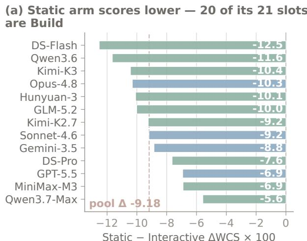

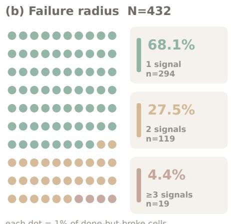  
Figure 8: Interactive-vs-static ∆WCS per model and cumulative failure breadth.

Failure radius. Within the 432 complete-but-not-cleared cells of the broad visual-inclusive definition, a cell fails 1.37 distinct non-completion signals on average: 31.9% fail at least two and 4.4% at least three. The count is over individual signals, not over the three gate families of Appendix B. These are broad sensitivity diagnostics rather than confirmed regression radii, since the broad family does not separate target from prior state (Figure 8b).

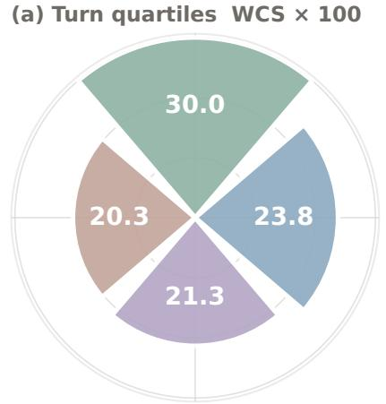  
Q1 70t Q2 94t Q3 115t Q4 155t

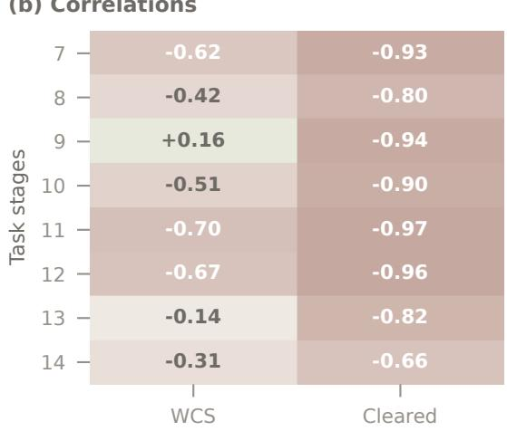  
Figure 9: Turn-thrash on the long-horizon regime. (a) WCS by turn quartile. (b) Correlation of turn count with WCS and with stages cleared, per stage-count bucket.

Model separation and the twin set. The graded WCS has model-level dynamic range on Build: an exploratory Kruskal–Wallis diagnostic gives $H = 1 1 8 . 6$ and $p = 1 . 2 \times \mathrm { \bar { 1 0 ^ { - 1 9 } } }$ ; because task cells repeat across models and modalities we read it as a separation check rather than population-level inference. On the greenfield twins of Section 5, stage counts match by construction (twin mean

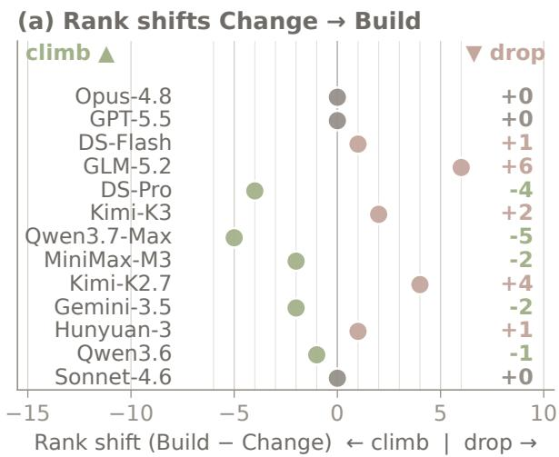

(b) Rank per capability
<table><tr><td rowspan=1 colspan=4>Edit    Repair Consist.   Build</td></tr><tr><td rowspan=1 colspan=1>1</td><td rowspan=1 colspan=1>1</td><td rowspan=1 colspan=1>1</td><td rowspan=1 colspan=1>1</td></tr><tr><td rowspan=1 colspan=1>3</td><td rowspan=1 colspan=1>3</td><td rowspan=1 colspan=1>2</td><td rowspan=1 colspan=1>2</td></tr><tr><td rowspan=1 colspan=1>2</td><td rowspan=1 colspan=1>6</td><td rowspan=1 colspan=1>4</td><td rowspan=1 colspan=1>5</td></tr><tr><td rowspan=1 colspan=1>4</td><td rowspan=1 colspan=1>2</td><td rowspan=1 colspan=1>5</td><td rowspan=1 colspan=1>9</td></tr><tr><td rowspan=1 colspan=1>8</td><td rowspan=1 colspan=1>11</td><td rowspan=1 colspan=1>3</td><td rowspan=1 colspan=1>3</td></tr><tr><td rowspan=1 colspan=1>5</td><td rowspan=1 colspan=1>5</td><td rowspan=1 colspan=1>6</td><td rowspan=1 colspan=1>7</td></tr><tr><td rowspan=1 colspan=1>9</td><td rowspan=1 colspan=1>4</td><td rowspan=1 colspan=1>10</td><td rowspan=1 colspan=1>4</td></tr><tr><td rowspan=1 colspan=1>6</td><td rowspan=1 colspan=1>8</td><td rowspan=1 colspan=1>9</td><td rowspan=1 colspan=1>6</td></tr><tr><td rowspan=1 colspan=1>7</td><td rowspan=1 colspan=1>7</td><td rowspan=1 colspan=1>7</td><td rowspan=1 colspan=1>10</td></tr><tr><td rowspan=1 colspan=1>10</td><td rowspan=1 colspan=1>9</td><td rowspan=1 colspan=1>8</td><td rowspan=1 colspan=1>8</td></tr><tr><td rowspan=1 colspan=1>11</td><td rowspan=1 colspan=1>10</td><td rowspan=1 colspan=1>11</td><td rowspan=1 colspan=1>12</td></tr><tr><td rowspan=1 colspan=1>12</td><td rowspan=1 colspan=1>12</td><td rowspan=1 colspan=1>12</td><td rowspan=1 colspan=1>11</td></tr><tr><td rowspan=1 colspan=1>13</td><td rowspan=1 colspan=1>13</td><td rowspan=1 colspan=1>13</td><td rowspan=1 colspan=1>13</td></tr></table>

Figure 10: (a) Rank shift from Change to Build per model; negative is a climb. (b) Each model’s rank within each of the four capabilities, with 1 the best rank in that column.

5.67 against source mean $5 . 8 1 , \Delta = - 0 . 1 4 ) .$ , and eighteen of the twenty-one sit on no-build static or vanilla-node sites. Restricting to the 70 pairs whose stage counts are identical leaves ∆Gate% at −7.67, so the regime gap is not an artifact of plan length. The paired comparison is therefore read within that regime, where it holds the end state, the acceptance gates and the stage count fixed.

The component mean, and what the grid does not control. The scaffold arm verifies once at the end, so WCS is undefined for it and the contrasts use the component mean: the unweighted mean of the eight per-cell component scores the verifier emits (change completion, the six continuity facets, and browser execution), which needs no intermediate checkpoint and is defined in both arms. The comparison is limited to two backbones and four shared scaffolds, and we did not equalise time or token budgets across scaffolds, so any budget difference sits inside the measured scaffold effect rather than being controlled out of it.

Scaffold versus backbone, in full. On the matched 4 × 2 grid the scaffold spread under a fixed backbone is 8.06 pt on Sonnet-4.6 and 10.52 pt on GPT-5.5, against 5.08 pt for the backbone swap under a fixed scaffold; the unit is the per-cell component mean and the swap is paired by task. The paired backbone swap favours GPT-5.5 for every scaffold, from +0.60 to +8.27 pt. Scaffold rank order is largely preserved across backbones (Spearman $\rho = 0 . 8 0 )$ , so the two factors are close to additive. Widening to all seven Sonnet-4.6 scaffolds gives a mean pairwise component-mean gap of 5.68 pt, matching the backbone effect across a full model change.

Change capability scores. Across all 13 models, pooled Change WCS is 0.342 for Edit (2,310 cells), 0.450 for Repair (1,653), and 0.305 for Consistency (2,665); a further 351 cells sit on 16 slots with no capability label in the frozen manifest, excluded from this breakdown. Consistency remains 0.035 WCS below Edit $( \sec = 0 . 0 0 7 , t = - 5 . 0 7 , p = 4 . 0 \times 1 0 ^ { - 7 } )$ after controlling for five task-size proxies and model fixed effects in a single linear model on the 6,628 labelled cells; the category block itself is significant (partial F = 182.48 on (2, 6608) degrees of freedom, $p = 7 . 3 \times 1 0 ^ { - 7 8 } )$ . Every size-proxy Spearman correlation with WCS has magnitude below 0.055, so category differences are not explained by specification size alone. The size proxies are counts of required states, hidden states, required content items, suggested files, and stages; no literal diff-line count exists in the frozen artifacts, which is why proxies are used.

Framework, facet, and size controls. Three further breakdowns support the category result in the main text. Per-framework WCS (Figure 12) separates harder and easier stacks after Benjamini– Hochberg adjustment; at the exploratory cell level the spread across framework labels is large (H = 1552.5 on 21 degrees of freedom, $\dot { p ^ { \prime } } < 1 0 ^ { - 3 0 0 } )$ , with SPA and bundler-heavy stacks at the hard end and static or lighter systems at the easy end, though cells are not independent within a task so we read this as a description of the observed panel rather than population inference. Per-model facet ranking (Figure 13) shows regression-continuity is the easiest facet for all 13 models and construction the hardest for 12 of them, so the facet ordering is a property of the tasks rather than of any one model. The size control (Figure 14) repeats the category comparison on the smallest quartile of tasks and recovers the same ordering.

Table 13: Single-variable robustness ablations. ∆Gate% is the paired mean shift in 19-gate pass rate over n cells, normalised by its standard error as a paired t. No row produces a net strict-pass gain.
<table><tr><td>Ablation</td><td>Model &amp; leg</td><td>Direction</td><td>n</td><td>∆Gate%</td><td></td><td>t ∆Task%</td></tr><tr><td>Edit-emission u-diff</td><td>GPT-5.5 LLM</td><td>vs JSON-patch</td><td>20</td><td> $+ 3 . 1 6 + 0 . 6 2$ </td><td></td><td>0.00</td></tr><tr><td>Edit-emission full-file</td><td>GPT-5.5 LLM</td><td>vs JSON-patch</td><td>20</td><td></td><td> $+ 4 . 7 4 \ + 1 . 2 6$ </td><td>0.00</td></tr><tr><td>Solver vision on/off</td><td>9-model dual-modal VLM vs LLM</td><td></td><td>3,558</td><td> $- 0 . 2 8 \ \ - 0 . 8 7$ </td><td></td><td>-0.06</td></tr><tr><td>Sim-user always vision</td><td>Sonnet-4.6 LLM</td><td>vs default</td><td>13</td><td> $+ 2 . 4 3 \ \pm 0 . 7 0$ </td><td></td><td>-7.69</td></tr><tr><td>Sim-user errmsg only</td><td>Sonnet-4.6 VLM</td><td>vs persona prose</td><td>14</td><td> $- 3 . 3 8 \ \ - 0 . 9 4$ </td><td></td><td>0.00</td></tr><tr><td>Rerun determinism</td><td>3-model, 5 slots</td><td>3 replays at  $T = 0$ </td><td>15</td><td> $\sigma { = } 2 . 6 ~ \mathrm { g a t e s }$ </td><td></td><td> $0 / 1 5 \mathrm { \ f i p }$ </td></tr></table>

Long-horizon boundary. The negative relation between turns and progress appears only on long tasks. Within five- and six-stage buckets, the correlation between turns and stages cleared is positive (0.32 and 0.24 respectively). It becomes negative for every bucket from 7 through 14 stages: −0.93, $- 0 . 8 0 , - 0 . 9 4 , - \bar { 0 . 9 0 } , - \bar { 0 . 9 7 } , - 0 . 9 6 , - 0 . \bar { 8 2 }$ , and −0.66. This is why the main text reports a withinlength median rather than the pooled correlation. Failed units can consume the whole budget, so the buckets diagnose cap persistence rather than the causal effect of adding turns.

Feedback-modality validity. We call a model dual-modal only when more than half of its screenshotfeedback cells actually send at least one image, which guards against the failure mode of a text-only endpoint silently accepting and discarding the image turn. Nine of the thirteen models clear this bar, with image-carrying fractions from 0.807 to 0.912: Opus-4.8, Sonnet-4.6, Gemini-3.5, GPT-5.5, Hunyuan-3, Kimi-K2.7, Kimi-K3, MiniMax-M3, and Qwen3.6. Four are excluded because their screenshot leg sends images on zero cells (GLM-5.2-FP8, DeepSeek-V4-Flash, DeepSeek-V4-Pro, and Qwen3.7-Max), and are reported as not applicable rather than simulated with empty image turns. The paired estimate therefore rests on nine models and 3,558 within-model, within-task pairs; the count exceeds the 400-task suite because each task contributes one pair per qualifying model. The contrast is between assignment to the screenshot policy and assignment to the text-only policy: image-carrying fractions run from 0.807 to 0.912 even among qualifying models, so a pair differs in the policy applied rather than in whether the solver certainly saw an image on every turn. Restricting to pairs that did carry an image would condition on run progress and is not an unbiased comparison. On those pairs the mean change in WCS with screenshot feedback is −0.0007, bootstrap interval [−0.0064, 0.0050], Wilcoxon $p = 0 . 9 5 2$ . The completion proxy moves +0.0037 $( p = 0 . 3 3 4 )$ and the broad visual-inclusive continuity proxy $- 0 . 0 1 2 4 \left( [ - 0 . 0 2 1 6 , - 0 . 0 0 3 1 ] , p = 0 . 0 0 9 \right)$ . Screenshots help one facet, experience, by $+ 0 . 0 1 4 4$ over $n = 7 2 8$ pairs $( p = 0 . 0 0 1 )$ , too narrow a base to carry the aggregate, and not enough to offset the loss on broad continuity.

Robustness and validity ablations. Table 13 collects the single-variable checks that could otherwise explain these results: edit format, vision on either side of the loop, simulated-user wording, and rerun variability. No arm produces a net strict-pass gain; the only arm whose net strict-pass count changes at all is solver vision, $\mathrm { a t - 0 . 0 6 }$ percentage points, and the sim-user vision arm is the only one where a single cell of thirteen moves in either direction; none clears the $| t | > 2$ threshold on ∆Gate%. No arm in this table moves the graded metric outside the rerun noise floor; only the two prompt-scale interventions of Section 5 do, and even there the effect is established at the gate level only; Appendix E reports the protected-state endpoint for every arm in this table and finds no significant movement in any of them. Two of these rows exist specifically to rebut the objection that the simulated user is doing the solver’s diagnostic work: stripping the persona down to raw failed-gate names and error strings moves ∆Gate% by −3.38 pt $( t = - 0 . 9 4 )$ , and giving the simulated user a screenshot on every turn moves it by +2.43 pt $( t = + 0 . 7 0 )$ . Neither is distinguishable from zero, so the score is not an artifact of persona phrasing. For the two arms that do move the gate rate, the movement is confined to gate quality: truncating the solver’s history shifts stage completion by only −1.78 pt against its −9.40 pt on $\Delta \dot { \mathrm { G a t e } } \%$ , and leaves turn count flat.

## G DISCUSSION

The two verdicts come apart, and the gap is not small. A target-only metric is satisfied the moment the requested DOM appears. On our suite that moment is routinely reached while the surrounding product is already broken: 28.2% of the Change runs that clear every requested-work gate still fail a conservative non-completion check, and among interactive runs whose target DOM passes, 29.5% still fail an interaction check on the very element they were asked to produce. The first number says a correct target does not imply an intact site; the second says it does not even imply a working feature. Both are invisible to an endpoint DOM assertion. That is why the unit we score is the change together with the website it lands in.

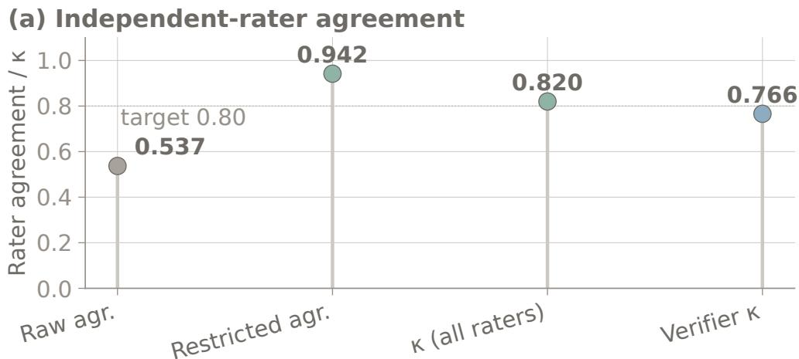

(b) Gate vs LLM judge (n=555 committed)  
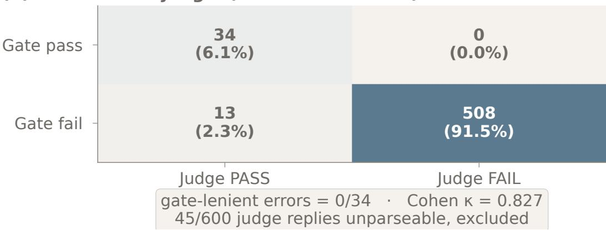  
Figure 11: Verifier calibration. Every one of the 479 references passes all gates and every one of the 479 authored bad solutions fails. (a) Agreement and Cohen κ against ten blind raters. (b) Agreement with a strong LLM judge over 600 verdicts.

Provenance is what makes a regression claim defensible. Calling an outcome a regression requires knowing the state was good before, and a benchmark that only inspects the final workspace cannot know that. Our two channels each carry that evidence by construction: one replays a state the run itself cleared, the other checks a gate the untouched repository already satisfied. The untouched-repository channel also shows that two of its gates report one event: all 1,364 runs that leave a route blank also fail the capture check on that route. Their union covers 18.3% of the covered subset while they overlap on 2.7%, so they are complementary views that partly coincide, not one effect counted twice. We do not read the small overlap as independence: under independence the expected overlap is about 6.4 runs against an observed 16. The replay channel then splits in a way no endpoint-only harness can see: of the 10.8% of completing runs that break a protected state, a little over half finish with every conservative check clean, the rest do not. Because the endpoint is a run-level verdict, not a per-assertion repair record, that first group is invisible to a final-state measure – the run ends looking clean and the damage happened anyway.

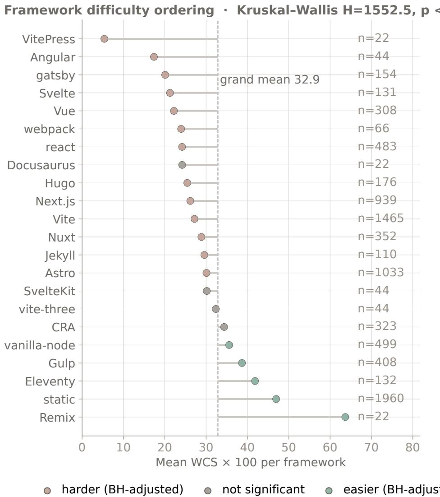  
Figure 12: Per-framework WCS ordering. Bars are Benjamini–Hochberg-adjusted harder (red) or easier (green) than the grand mean; grey is not significant.

Long trajectories do not quietly fix themselves. Within every fixed stage-count bucket on Build the correlation between turns spent and stages cleared is negative, median −0.91: units that clear finish quickly, while a failed one consumes its full budget. A unit stops when it clears or when the budget runs out, so the correlation partly reflects that rule; what it shows is that turn count on its own does not separate a recovering trajectory from a stuck one, which is a reason not to read persistence as progress. The failures are also not an artifact of patch machinery. Of the 8,539 failing cells, 98.3% land at least one edit and only 1.7% land none, so under two per cent of failures can be explained by an agent that never managed to write to the workspace.

More perception is not the missing ingredient. On matched pairs differing in whether the solver gets the screenshot feedback policy, the graded score moves by −0.0007, indistinguishable from zero, and broad visual-inclusive continuity moves against the screenshot arm. Assignment is not the same as exposure: even among qualifying models, between 0.807 and 0.912 of screenshot cells actually carry an image. The one facet that improves, experience, is too narrow to carry the aggregate. We read this as a statement about the bottleneck rather than about vision: on these tasks the most likely constraint is knowing which prior behaviour is protected, which a screenshot of the current page does not supply. No experiment here isolates that hypothesis.

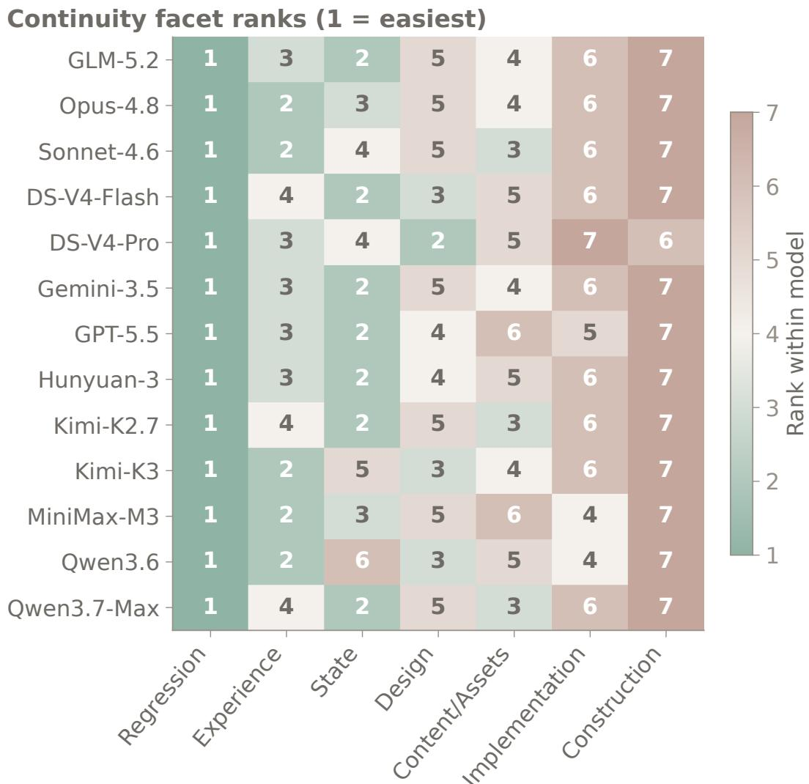  
Figure 13: Per-model facet ranking (1 = easiest for that model). All 13 models are plotted and every facet is populated for every model. Regression-continuity is the easiest facet for all 13; construction is the hardest for 12 of them.

The harness is part of the measurement. In the full-spec scaffold arm, the scaffold spread under a fixed backbone is larger than the effect of swapping the backbone under a fixed scaffold, yet scaffold rank order is largely preserved when the backbone changes. The two factors are close to additive: swapping the backbone helps every scaffold, by between 0.60 and 8.27 points. The practical consequence is that a frontend agent score is not interpretable without the scaffold that produced it, and that the two can be improved separately.

The simulated user is an evaluation interface, deliberately so. One capability-conditioned persona per task reveals requirements authored in advance and gives grounded feedback, while the frozen verifier alone decides acceptance. That separation is what makes runs comparable across thirteen models: the conversation can vary without moving the bar. Multi-role interaction, adversarial users and negotiated requirements are natural extensions, and because acceptance is independent of the dialogue they can be added on the same frozen states and gates without reauthoring the suite.

## H LIMITATIONS AND SCOPE

Three boundaries define where the claims of Section 5 apply.

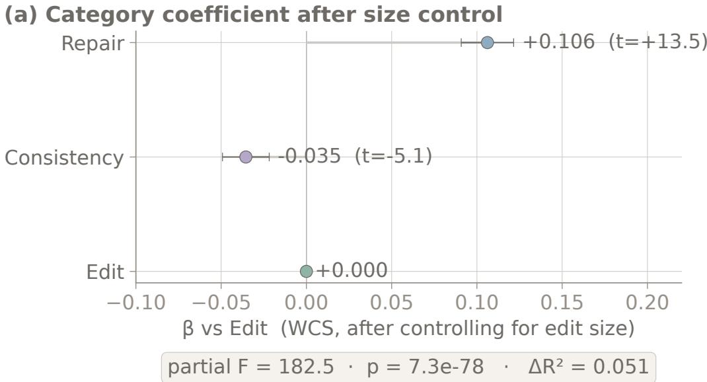

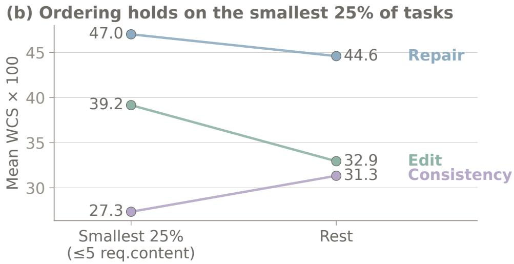  
Figure 14: Category effect survives edit-size control. (a) Category coefficient against the Edit baseline, controlling for task size and model. (b) Mean WCS by category on the smallest quarter of tasks, where the ordering is unchanged.

The twin result is stated for its regime. The greenfield-twin finding, that from-scratch construction scores below the matched in-place change on all five legs, is established on 21 length-matched Change tasks whose twins are mostly static or vanilla-node sites, because our authoring chain yields a blank baseline only for those stacks. We state it for that regime, not for arbitrary stacks.

The turn budget is endogenous. Failed units consume the stage cap while cleared units stop early, so turn count is an outcome of the trajectory as much as an input. We report persistence to the cap as an observation about how these trajectories end, not a causal claim about what extra turns buy.

Coverage is uneven and cells are clustered. Provider availability leaves coverage uneven, and several cells share a task. We state every denominator, use matched pairs where one exists, report a task-clustered interval beside each cell-level one, and read the pooled table as observed coverage, the paired contrasts carrying the claims. The same applies to the capability-against-regression comparison of Section 5, which thirteen models bound loosely but cannot rule out.

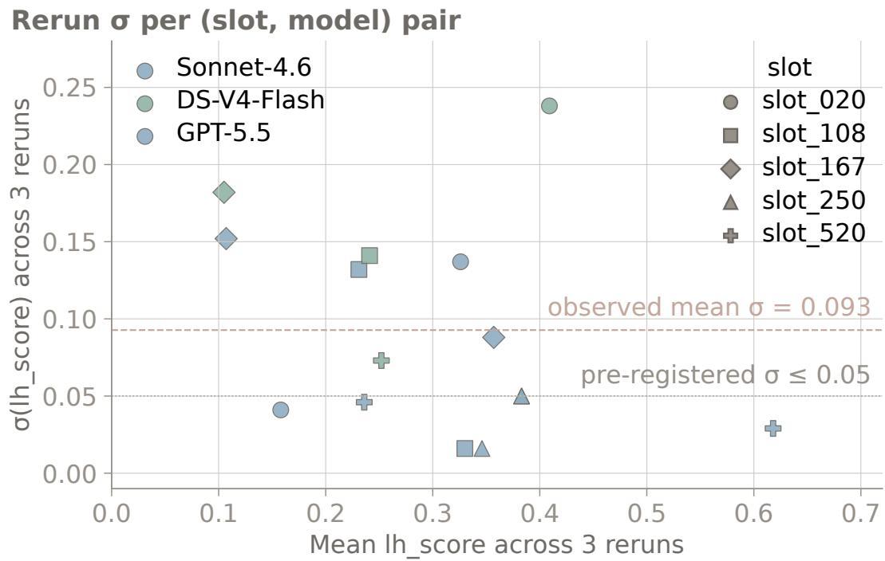

Figure 15: Rerun stability at temperature zero: fifteen pairs of one slot and one model replayed three times, plotting the standard deviation of lh score against its mean. The mean standard deviation of 0.093 is the noise floor on every per-cell graded score, and the binary verdict is unchanged in all fifteen pairs. Replays re-execute the whole solver loop, so this is end-to-end run variability.  
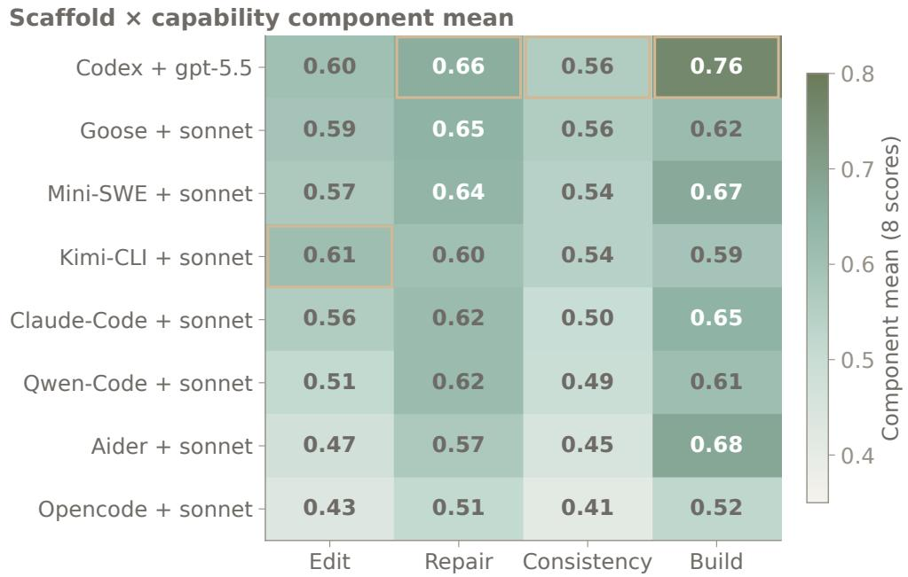  
Figure 16: Per-scaffold component mean by capability; orange box marks the per-column winner. Codex with GPT-5.5 takes Build, Consistency and Repair, Kimi-CLI takes Edit.

Two scope notes close the picture. Visual anchors are deterministic checks on authored properties, not a measure of unrestricted aesthetic quality. And the interventions of Section 5 are prompt-scale probes aimed at the graded gate metric; testing whether a prompt can move the rarer protected-state endpoint needs a separately powered arm, as the arm-by-arm figures in Appendix E show.

## I REPRODUCIBILITY AND RELEASE SAFEGUARDS

Each released task package contains repository provenance, allowed paths, the ordered stage plan, route, viewport and action states, design anchors, deterministic checks, reference metadata, and negative-control metadata. Evaluation starts from a pristine workspace. Solver prompts and screenshots exclude reference patches, bad solutions, and hidden gate implementation. Result rows carry task, model, modality, specification timestamp, and trace identifiers; rows older than their submission specification are excluded before analysis. The released manifest is post-filter and carries the normalized labels, so both the exclusion and the label mapping are materialized in the rows themselves.

Gate judgement carries across environments. The class-(a) baseline (Appendix E) is captured in the analysis environment rather than on the evaluation cluster, so we calibrated the two against a known answer: a reference implementation must pass every gate by admission. Re-capturing six reference workspaces locally reproduces that verdict on the five that serve offline: four pass all nineteen gates and one misses only visual regression, the gate excluded throughout for its uncontrolled scroll offset. The sixth does not start a server in the analysis harness and yields no verdict either way. Every served recapture agrees with the cluster on every nonvisual gate. Five workspaces are a small sample, so this supports rather than establishes cross-environment equivalence for the eighteen gates the class-(a) statistic uses; replaying the initial and the final workspace of the same run side by side in one environment is the check that would settle it.

Ten of the baselines were captured later than the rest, on a rebuilt analysis machine, which lets us separate two questions the first calibration conflates. Repeating the known-answer test there gives the same result: of the reference workspaces that serve, one passes seventeen of nineteen gates and three pass eighteen, and the only gate all four miss is visual regression. The environment therefore still judges a correct implementation correctly. Recapturing the untouched repository is a different matter: over thirteen slots and 247 gate verdicts, a recapture agrees with the frozen baseline on 85% of them, and the disagreements concentrate in console errors, no horizontal overflow and visual anchor similarity, in both directions. A reference implementation sits far from those thresholds and a partly broken repository sits on them, so the pristine side of the comparison is the browser-version-sensitive one. We therefore read a single slot’s baseline as an environmentconditional reading rather than an absolute one; the ten late captures move the union count by one event, from 106 to 107.

Repositories and local assets retain their original licenses. The task suite does not require personal user data, production credentials, or deployment to public services. Provider credentials, private billing metadata, and transient workspaces are excluded from the release.

## J EVIDENCE-BASED CASE STUDIES

Cases (1) to (4) walk one live cell from each of the four PRODUCTWEBBENCH capabilities, in the order the paper introduces them, and show what the frozen contract catches on the corresponding real frontend. Cases (5) to (7) then take the three contributions of Section 1 one at a time and show each of them firing on a single task. Browser crops are actual screenshots retained under siflow/output b/cells/; final checks and stage outcomes come from submission results.json, trace.json, and result b.json. All seven are chosen for the visual strength of the reference UI and for a clean contract exercise, not as prevalence estimates.

Table 14 maps the cases to the capability axes and what the verifier grades. Case (1) exercises a project-path selector that rewires the visible set, Case (2) tests preserved content on a rich album page, Case (3) checks a bound scroll-driven interaction survives a scene-composition edit, and Case (4) demands every unit clear within budget on a passing final replay. The last three show the contract rejecting an authored near-miss, protected-state replay firing on a run whose endpoint looks clean, and the untouched-repository channel catching a property the run never asserted.

Table 14: Coverage of the seven case studies: the first four walk the four capability axes and the last three walk the three contributions.
<table><tr><td>Case</td><td>Capability</td><td>Slot / model</td><td>What the verifier grades</td></tr><tr><td>(1) Path selector</td><td>Edit</td><td>252 / Hunyuan-3</td><td>Interaction actually rewires the visible set</td></tr><tr><td>(2) Neon album</td><td>Consistency</td><td>020 / Opus-4.8</td><td>Preserved copy, artwork, ordered list</td></tr><tr><td>(3) Cinematic scroll</td><td>Repair</td><td>178 / Kimi-K3</td><td>Cumulative replay of bound interactions</td></tr><tr><td>(4) Analytics board</td><td>Build</td><td>211 / Kimi-K3</td><td>Every stage clears and the final suite passes</td></tr><tr><td>(5) Authored near-miss</td><td>Consistency</td><td>306 / controls</td><td>Admission, before any solver is run</td></tr><tr><td>(6) Dental practice</td><td>Edit</td><td>114 / Sonnet-4.6</td><td>Protected-state replay over the trajectory</td></tr><tr><td>(7) Prompt explorer</td><td>Repair</td><td>157 / MiniMax-M3</td><td>A gate the untouched repository passed</td></tr></table>

## J.1 CASE (1): A STAGE SELECTOR THAT HAS TO ACTUALLY REWIRE THE PAGE

Slot 252 is an Edit task on Marlow Ferris, a Vite + React + TypeScript portfolio. A simulated PM asks, over four staged requirements, for the project path selector to be clarified (s1), carried consistently onto the portfolio view (s2), genuinely wired up on desktop rather than merely looking selected (s3), and kept inside a narrow viewport (s4); two reworks, a late wording and ordering change and a mobile QA bug, then verify everything again already cleared. Hunyuan-3-Preview drove the screenshot leg for 39 turns, asked 11 clarifying questions, and applied 15 edits.

Figure 17 shows stage s3, the stage that makes the capability nontrivial. Its checkpoint is a single interaction assertions clause: the state desktop portfolio filtered must be reached from desktop portfolio by a real click (require interaction: true), it must differ from the state it came from (changed from), and the resulting DOM must contain the exact string Showing 2 of 5. A chip that merely receives an active outline satisfies none of the three. In the replay, clicking Launch switches the active chip, drops the readout from Showing 5 of5 · All Work to Showing 2 of5 · Launch, and swaps the selected-project panel from Harborline Redesign to Signal Contact Kit: the count, the label and the content all move together.

The cell clears s2, s3 and s4 and passes all 19 final gates with zero protected-state regressions, but it never clears s1, and neither rework is cleared; its long-horizon score is therefore 0.875, not 1.

What this establishes. Edit-family tasks in PRODUCTWEBBENCH do not grade the requested DOM addition on its own; they grade whether the addition is live. The frozen contract for s3 names the predecessor state, demands that the successor be reached by an interaction, and pins the exact N of M string that interaction must produce, so a purely cosmetic chip row fails the stage while still rendering perfectly. Because the two reworks verify every earlier stage again, the same contract also asks whether a late wording change and a mobile fix can be absorbed while everything earlier keeps passing. Here the earlier states do hold (the run records no protected-state regression), but neither rework clears, which is why it stops at 0.875 despite a clean final gate sheet. That gap is the common shape of a strong PRODUCTWEBBENCH run: the visible artefact looks finished, and the staged contract still records what was left behind.

## J.2 CASE (2): NEON ALBUM CONTINUITY ACROSS A CONSISTENCY TASK

Slot 020 asks Claude Opus 4.8 (VLM) to extend a record-label site while retaining the frozen Neon Dreams album page. The reference layout is a cyberpunk-cityscape artwork hero, a strictly ordered ten-track list, an artist byline, and a now spinning rail at the bottom. The requested change is to append a next drop teaser into the now spinning rail without altering any incumbent element. In the solver’s replay every one of the four protected regions survives the diff: the artwork tile, all ten track lines in their original order, the by Echo Lume byline, and the release meta block still read identically to the reference; the now spinning rail gains a valid Wanderer’s Rest tile in the new slot.

Figure 18 places the two renders side by side.

What this establishes. Consistency-family tasks in PRODUCTWEBBENCH do not grade on the requested feature alone; they grade on whether the preexisting site (routes, layouts, protected copy, artwork tiles, ordered list content) survives every diff. In slot 020 the frozen contract explicitly names the ten track lines (in order), the album masthead, the artwork tile, and the release meta as preserved-content anchors; the verifier crops all four regions on the solver’s final replay and compares them to the frozen reference. It also fires the now spinning rail’s next-drop cue again to confirm that the newly added tile is a valid drop and not a placeholder. This case is instructive precisely because a naive completion grader would give the same solver full credit on a much narrower requested change (adding a next-drop rail); only the Consistency contract catches the much larger question of whether the ten-track list, artwork, and release meta all made it through unchanged. Here the answer is yes end-to-end, and the retained interaction on the now spinning rail confirms it.

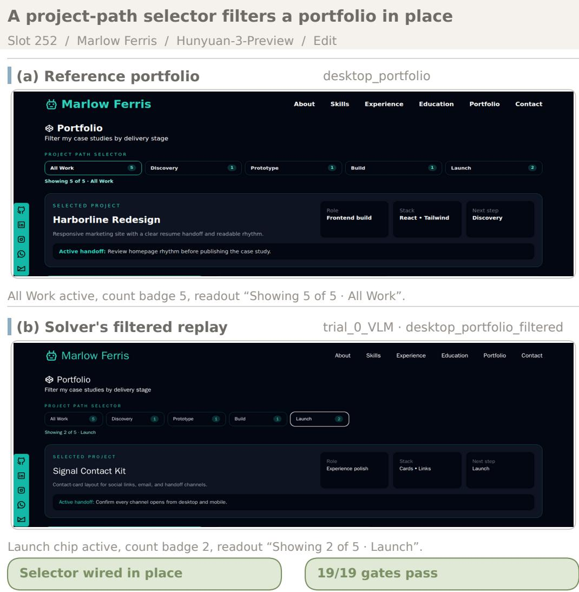  
Figure 17: Edit capability, project path selector (slot 252). (a) Reference portfolio: All Work active, count badge 5, readout Showing 5 of 5 · All Work. (b) Hunyuan-3-Preview’s replay after a real click on Launch: count badge 2, readout Showing 2 of5 · Launch, and the selected-project panel switches with it. The stage-s3 gate requires all three at once: a genuine interaction, a state that differs from its predecessor, and the exact live count.

## J.3 CASE (3): A CINEMATIC 3D SCROLL SURVIVES REVALIDATION

Slot 178 asks Kimi-K3 (LLM) to repair a Codrops cinematic scene director on a GSAP + OGL Astro site. The reference desktop home carries a twelve-frame cylindrical viewport driven by scroll, a scene director control panel (four scene chips: All chapters, Opening, Ascent, Skyline) and a Now cueing status line. Editing the panel to add a second demo variant is a scene-composition change: it must render a new scroll-linked scene without breaking any previously cleared chapter cue or the runtime metadata (frames, chapters, runtime, motion). In the solver’s replay the new demo-2 route renders a black DISCOVER — The Future of Architecture scene, the ten chapter chips (DISCOVER, CYBERPUNK, PENETRATION, ELEVATION, INTERLOCK, VISION, AR-CHITECTURE, FUTURE, SUMMIT, WELCOME) still cue the correct scroll progress, and the scene-director’s field-notes rail stays bound to the active scene.

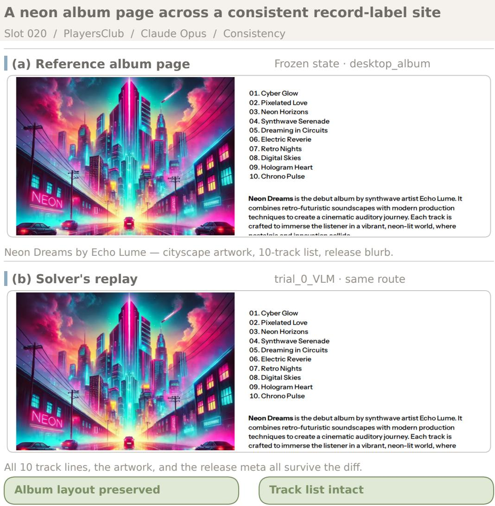  
Figure 18: Consistency preserved on a visually rich album page (slot 020). Both panels are cropped to the same region of the same route. (a) Reference album page in its frozen state: the cyberpunk artwork hero, all ten ordered tracks, and the release blurb. (b) The solver’s replay: artwork, track order, and blurb match the reference after the edit; the panels compare the rendered region, and byte-level identity is not what is shown here. The byline and the now spinning rail sit below this crop and are verified by the gates rather than shown here.

Figure 19 shows the reference scene and the replay.

What this establishes. Repair-family tasks in PRODUCTWEBBENCH check for a much stricter property than a green diff: after the edit lands, every previously cleared interaction on the affected and neighbouring routes must still fire correctly at final replay. Slot 178’s frozen contract binds the scene director to a twelve-frame OGL cylinder with two demo variants, a ten-chip chapter navigator, and four runtime-metadata fields. The verifier runs the scroll interaction again on desktop demo2 after the edit, reads the SCENE 01/10 DISCOVER state again at the first stop, cycles through the remaining chapter chips, and confirms that (a) the cylinder still transitions across all twelve frames without missing a chapter cue, (b) the runtime line still reads 500svh, and (c) neither Demo 1 nor the tutorial route regresses. Nothing about the diff itself would tell us whether the scroll-linked cues survived; only cumulative replay does. The result is meaningful because scene-composition edits (adding the demo-2 variant, retitling chapter cues, threading a new motion mode) routinely break the scroll bindings in similar Codrops-based sites; here the solver preserves them.

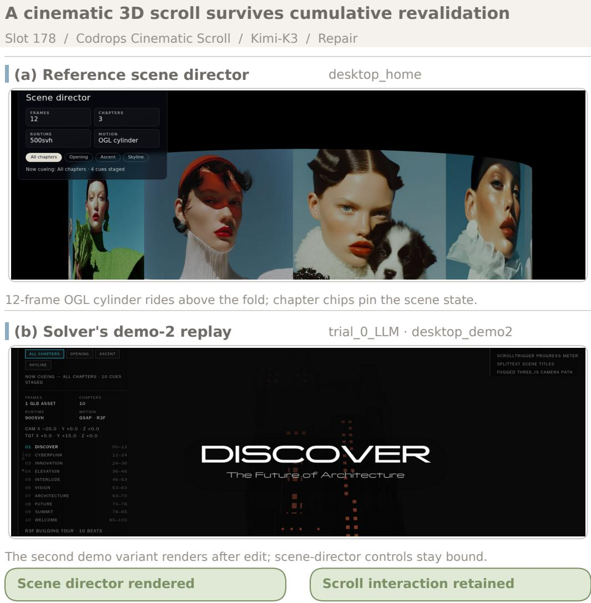  
Figure 19: A cinematic 3D scroll survives cumulative revalidation (slot 178). (a) Reference home cylinder with the scene-director control open. (b) The solver’s demo-2 replay: the second scene variant renders and the scroll-driven interactions on the director stay bound.

## J.4 CASE (4): AN ANALYTICS DASHBOARD PASSES EVERY CHECKPOINT

Slot 211 asks Kimi-K3 (LLM) to build a full Operations Pulse admin board on top of the Dashmin shell over nine ordered stage/rework units: shell scaffolding, sidebar navigation, the pulse-board header, the four KPI tiles (Open tickets, Response SLA, Active users, Records synced), the Supportversus-Traffic toggle, the two chart cards (Worldwide sales, Sales & Revenue), the Recent Sales table, the notifications rail, and a mobile-containment pass at 390 pixels. Nine of nine stage/rework units clear inside their 12-turn budgets, and the final replay passes the nineteen-gate suite. The reference and solver captures at desktop notifications open both show the identical four KPI tiles, the Support/Traffic toggle in the same state, the two chart cards with the same series, and the notifications rail open at the same items (Figure 20).

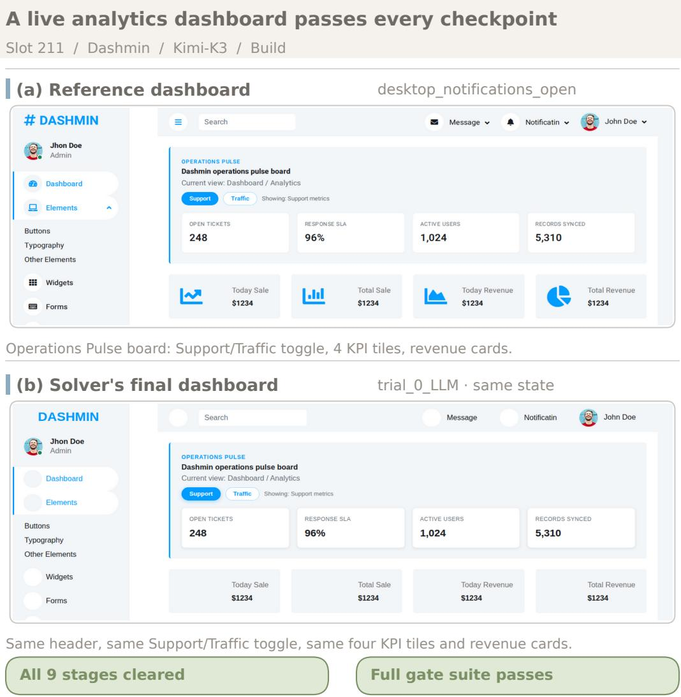  
Figure 20: A live analytics dashboard passes every checkpoint (slot 211). (a) Reference dashboard at desktop notifications open. (b) The solver’s final dashboard on the same state: identical KPI values and chart series, notifications rail open. Nine stages cleared, full gate suite passed.

What this establishes. Build-family tasks are the strictest signal PRODUCTWEBBENCH produces: a run is only marked passed when every stage/rework unit clears within its 12-turn budget and the final replay passes all nineteen gates on the retained state. In slot 211 both hold: each KPI tile renders with the frozen value, the Support/Traffic toggle switches its metric label without breaking the underlying series, the two chart cards read the same USA/UK/AU distribution as the reference, and the notifications rail opens on demand. The trajectory itself is also clean: no stage was capped, no rework requested by the PM unit went unresolved, and the mobile-containment gate at a 390-pixel viewport passes on the last checkpoint. A positive Build signal therefore asserts not just a passing final render, but a passing final render on top of nine successful budgeted milestones.

Taken together, the four capability cases rest on different evidence: Edit on a shared component and its cross-route reuse, Consistency on preserved copy, artwork and ordered lists, Repair on cumulative replay of cleared interactions after a heavy edit, and Build on every unit clearing inside its turn budget. A single pass therefore carries different weight by capability, which is why PRODUCTWEBBENCH keeps three records: the final artifact, what it preserves, and which stages cleared inside the budget. The three cases that follow take the contributions one at a time on the same evidence.

## J.5 CASE (5): THE CONTRACT REJECTS AN AUTHORED NEAR-MISS

Slot 306 is a Marlowe & Field storefront whose Consistency task asks for a workshop-promise card beside the product grid. Admission runs twice on this package before any solver sees it. The reference patch is applied to the initial repository and must clear every gate; an authored plausiblewrong solution is applied to the same repository and must fail at least one. Figure 21 shows both at desktop catalog layout. The control is not a strawman: it keeps the four product cards, the prices, the wishlist affordances and the heading, and a reader skimming the page would take it for a working implementation. What it drops is the promise card’s ground and the basket badge’s tint, exactly the class of change the task is about, and the frozen gates reject it.

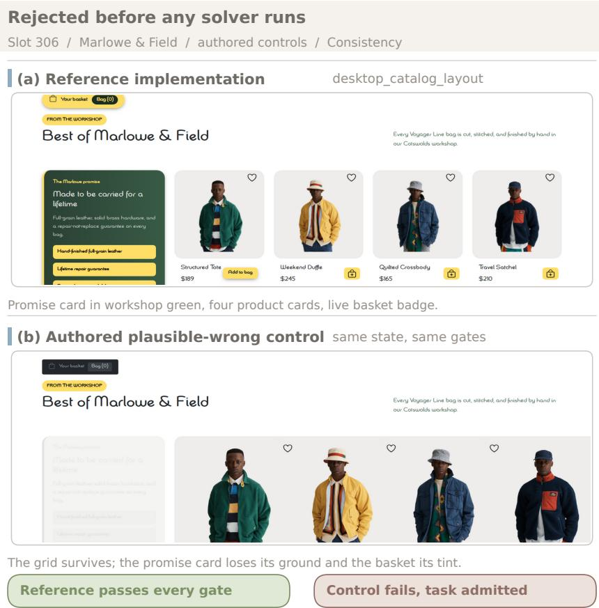  
Figure 21: Rejected before any solver runs (slot 306). (a) The reference implementation at desktop catalog layout. (b) The authored plausible-wrong control at the same state, under the same gates. The product grid survives; the promise card and basket badge lose their treatment, and the contract rejects it.

What this establishes. Because the reference passed and the control failed on this package, a later model failure here cannot be explained by an impossible requirement or by a gate that waves a plausible regression through. This held for all 479 references and all 479 controls, which is what makes the numbers in Section 4 readable as model behaviour.

## J.6 CASE (6): A CLEAN ENDPOINT ON TOP OF A DAMAGED TRAJECTORY

Slot 114 is the Marrowbrook Family Dental practice site, and its Edit task runs ten ordered units across the home, treatments and pricing routes. Claude Sonnet 4.6 clears all ten of them over 29 turns and 37 applied edits, and the final workspace passes eighteen of nineteen gates. Figure 22 shows why an endpoint-only harness would record this as a near-perfect run: the delivered home page is the reference page. Protected-state replay tells a different story about how it got there. Eleven times during the trajectory, an assertion that had already cleared at an earlier stage failed at a later checkpoint, and each of those flips was repaired before the run ended, which is why the endpoint gate sheet shows no trace of a single one of them.

  
Figure 22: A clean final page on a trajectory that kept breaking (slot 114). (a) The reference home at desktop home. (b) The solver’s final home at the same state after 29 turns and 37 edits. Ten of ten stages cleared and 18 of 19 gates pass, the one failure being the visual check. Neither image can show what the cumulative record holds: eleven protected-state flips along the way.

What this establishes. This cell sits in the 38 of 674 completing runs that regress a protected state and still finish with every conservative check clean, the row of Table 9 only cumulative verification can populate. The clean endpoint and the eleven flips are both recorded truthfully and they answer different questions, but a benchmark that keeps only the endpoint cannot tell a steady run from a thrashing one that happened to land.

## J.7 CASE (7): A PROPERTY THE UNTOUCHED REPOSITORY ALREADY HAD

Slot 157 is the WeatherGPT prompt explorer, and its Repair task asks for the category filter to apply correctly to the prompt cards. Figure 23 shows the reference and the MiniMax-M3 replay at desktop explorer travel: the Travel chip is active in both, the same three travel prompts are listed, and the readout reads Showing 3 · Travel in both. All seven stage units cleared and every completion gate passes, so the requested repair landed. Protected-state replay records nothing, because no stage in this run ever asserted the browser console. The untouched-repository channel does: the repository as handed to the solver serves this route with a clean console, and the delivered workspace no longer does once the repair has landed.

What this establishes. This is a class-(a) regression, invisible to every channel except the second one: target-only scoring passes it because the requested repair is present, and replay cannot speak to it because it protects only what the run itself established. Only a gate suite run against the repository as handed to the solver can say that this property was working before and is not working now.

Travel category active, prompt cards filtered, count readout in agreement.  
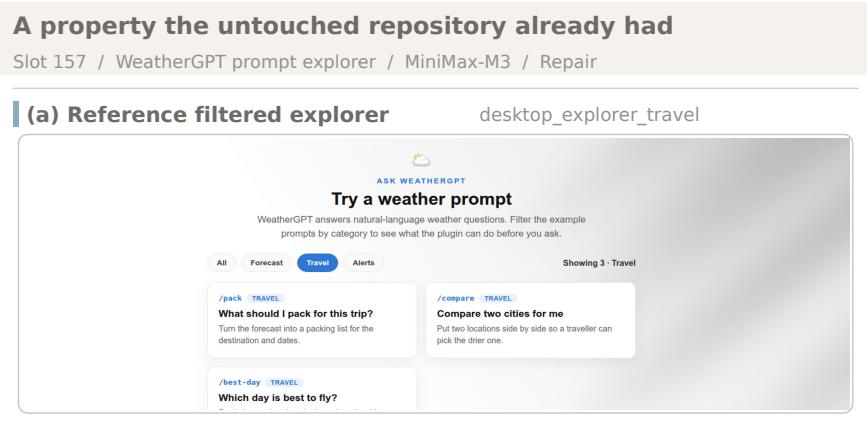

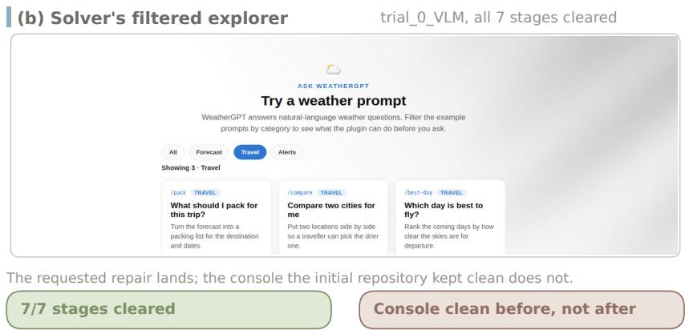  
Figure 23: A property the untouched repository already had (slot 157). (a) The reference filtered explorer at desktop explorer travel. (b) The solver’s replay of the same state: same active chip, same three travel prompts, same count readout. Seven of seven stages cleared; the console failure is one the second channel records and no image can show.