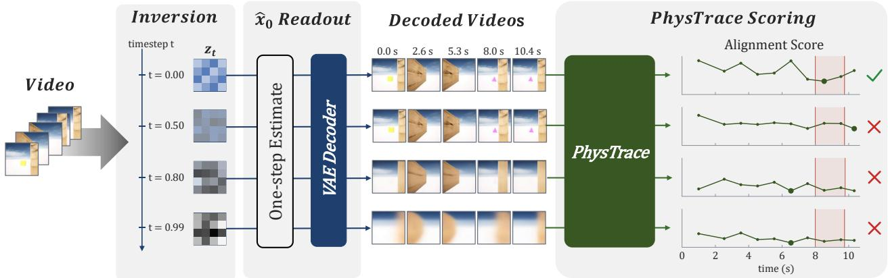
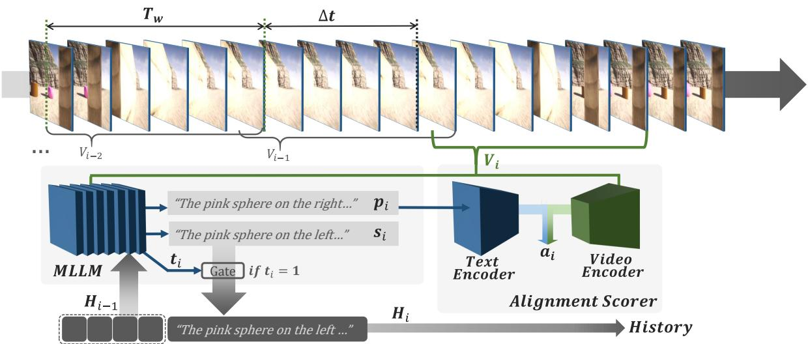
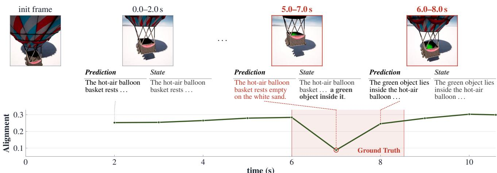
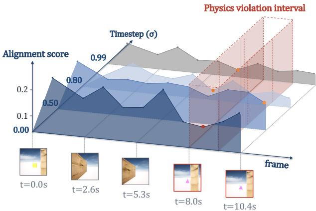
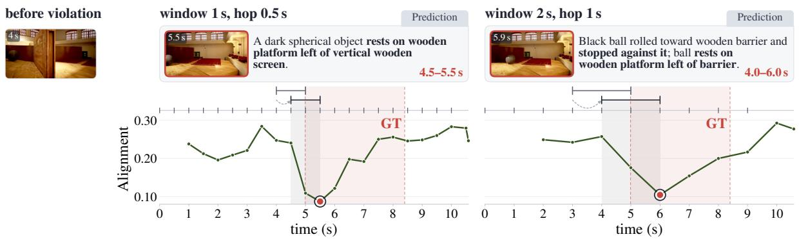
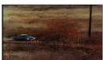
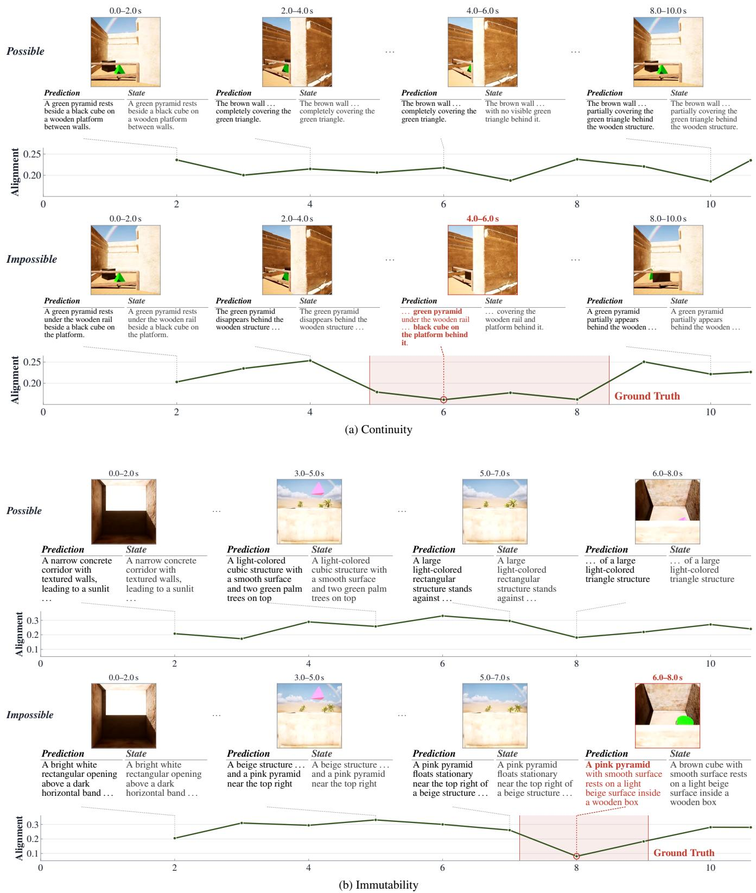
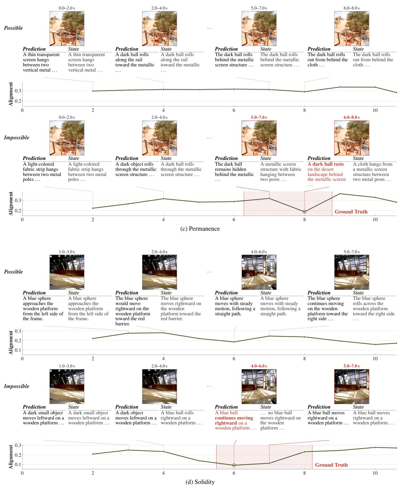

# PhysTrace: Interpretable Temporal Evaluation of Physical Consistency in Video Generative Models

Taekoan Yoo Wonkyung Jung Kyunghun Kim

Independent Researcher, Korea

tk.yoo@g.skku.edu {gonyakjelly94,godroma4885}@gmail.com

Kyeongbo Kong† Pusan National University, Korea kbkong@pusan.ac.kr

  
Figure 1. PhysTrace for analyzing physical consistency along video generative trajectories. Intermediate latent states are decoded into videos and evaluated using PhysTrace, which tracks temporal alignment between expected and observed states to localize physical violations.

## Abstract

World action models increasingly rely on pretrained video models assumed to capture physical dynamics for prediction, planning, and action generation. Existing evaluations assess plausibility, probe representations, or measure predictive surprise, but rarely identify which historyconditioned physical expectations conflict with observations. We introduce PhysTrace1, a training-free framework aligning MLLM-generated, history-conditioned expectations with observed video windows to temporally localize physical violations andprovide interpretable descriptions without task-specific probes or classifiers. We also introduce IntPhys2-Timing, adding violation intervals to Int-Phys2. PhysTrace achieves a Hit Rate ofup to 70.7% across physical principles on IntPhys2-Timing and outperforms the compared methods in overall possible–impossible discrimination accuracy on IntPhys2. Applied to reconstructed videos along the trajectories of pretrained diffusion/flowbased video models, PhysTrace reveals attribute- and noisedependent patterns in physical violation localization, enabling interpretable physical consistency analysis across

timesteps.

## 1. Introduction

In robotic control, Vision-Language-Action (VLA) models have rapidly advanced by leveraging semantic knowledge and generalization capabilities acquired through largescale vision-language pretraining for robot action generation [8, 15, 19, 30, 49]. More recently, research has increasingly explored leveraging future dynamics and predictive and spatiotemporal priors acquired through video pretraining for action prediction and planning [3, 16, 20, 23, 39, 45]. In particular, diffusion/flow-based generative video models have emerged as key pretrained backbones for these approaches, as they can directly generate future visual dynamics [9, 28, 29, 35]. This growing reliance on pretrained video models makes it increasingly important to determine whether they have learned the physical dynamics required for robotic control.

To this end, various benchmarks and evaluation methods have been proposed to assess intuitive physics, physical plausibility, and motion consistency in input or generated videos [2, 7, 11, 25, 32, 46, 48]. In parallel, probing studies have investigated the physical information encoded within pretrained video models [12, 18, 31, 34]. This line of work has also extended beyond encoder-based representation models to the intermediate denoising representations of diffusion-based video generators, showing that physics-related information can be decoded from pretrained representations. However, these approaches primarily focus on predefined physical labels, model-level preferences, or physics-related signals encoded in intermediate representations. Even when a physical inconsistency can be detected, they provide limited insight into which history-conditioned physical expectation conflicts with the observed behavior.

More fundamentally, physical consistency is not a static visual property of individual frames, but a temporal property that emerges from changes in object identity, state, motion, and interaction across time. Sparse or short observations may therefore miss brief violations or lack the context needed to determine what should have occurred. Likewise, a single plausibility score cannot reveal where the expected and observed dynamics begin to diverge. Evaluating physical consistency thus requires continuously relating local observations to the physical expectations established by their temporal history.

Rather than probing intermediate representations, a natural alternative is to directly ask a Multimodal Large Language Model (MLLM) to assess physical plausibility from video. However, Pixels to Principles [6] reports near-chance performance of recent MLLMs in challenging intuitivephysics settings on GRASP [17] and IntPhys 2 [11], despite physics-related cues being recoverable from their visual representations. Similarly, QuantiPhy [22] shows that, in quantitative kinematic inference from video, multimodal models often rely on pretrained world knowledge rather than faithfully integrating visual evidence with the provided physical prior. These findings suggest that current MLLMs are unreliable as direct judges of physical validity. Instead, we use the MLLM for reasoning over temporal context to formulate expected states, while physical consistency is assessed against the corresponding video evidence.

From this perspective, we propose PhysTrace, a training-free framework that traces physical consistency in videos through history-conditioned temporal videolanguage alignment. As illustrated in Fig. 2, PhysTrace uses the general contextual reasoning capability of an MLLM to formulate the state expected at the current time based on prior observations as temporal context. It then compares this expected state with the actual video observation in a shared multimodal embedding space, thereby tracing physical consistency over time. By relating temporally separated events, this process enables temporal localization of physical violations while the jointly generated expected and observed states provide an interpretable description of which physical expectation diverges from the actual observation. To quantitatively evaluate this temporal behavior, we construct IntPhys2-Timing by augmenting IntPhys2 [11] with violation intervals, enabling evaluation of physical violation localization in video reconstructions across generative timesteps.

In summary, we propose a training-free framework for tracing physical consistency over time through historyconditioned temporal video-language alignment, together with IntPhys2-Timing for evaluating the temporal localization of physical violations.

• We propose PhysTrace, a training-free framework that localizes physical violations by temporally aligning historyconditioned expected states with video observations. Textual descriptions of both states reveal which physical expectations conflict with observations.

• We construct and release IntPhys2-Timing, augmenting IntPhys2 with temporal violation annotations to benchmark temporal violation localization and video-level physical consistency.

• We apply PhysTrace to output-space reconstructions along the generative trajectories of pretrained diffusion/flow-based video models, revealing how violation localization varies across timesteps and physical attributes.

## 2. Related Work

## 2.1. VLA and World-Model-Based Policies

VLA models couple pretrained vision-language representations with robot action generation, allowing large-scale multimodal knowledge to inform language-conditioned control [8, 15, 19, 30, 49]. Beyond this paradigm, recent work has explored leveraging predictive dynamics and spatiotemporal priors learned from video for robot policy learning. VPP [16] extracts predictive visual representations from a video diffusion model for action prediction without explicit future visual rollouts.

More direct approaches, including World Action Models (WAMs) and related world-model-based policies, couple future prediction with action generation or planning [3, 20, 23, 39, 45]. Video Policy [23] couples future video generation with action generation, while DreamZero [45] jointly models future world states and actions using a pretrained video diffusion backbone. EVA [39] generates future visual rollouts and uses an inverse dynamics model to derive executable actions and provide an executability signal for aligning the video world model. Cosmos Policy [20] generates actions as latent frames and predicts future states and values for model-based planning, whereas V-JEPA2-AC [3] predicts action-conditioned future states in latent space for planning. Despite their architectural differences, these approaches share the goal of exploiting predictive dynamics learned from video as priors for robot control.

## 2.2. Pretrained Video World Models as Policy Priors

Prior work has explored different classes of video models for learning representations and dynamics relevant to robot control. Self-supervised video representation models learn temporal structure without explicit robot actions. V-JEPA2 [3] follows a latent predictive objective, while VideoMAE V2 [38] learns general spatiotemporal representations through masked video reconstruction. A separate line of work develops robot-specific, action-conditioned world models. DreamDojo [13], for example, learns interaction dynamics from large-scale human videos and is subsequently adapted to generate future visual states conditioned on robot actions.

Another line of work builds general-purpose generative video models, such as Stable Video Diffusion [9], Wan [35], and the Cosmos-Predict family [26, 28, 29]. These diffusion/flow-based models directly generate temporally evolving visual sequences and have increasingly been repurposed as pretrained backbones for representation-based policies and WAMs [16, 20, 23, 45]. Unlike latent predictive or robot-specific world models, our work focuses on this class of pretrained generative video models and examines whether their generated dynamics preserve physical consistency. Specifically, we evaluate Wan2.1, whose pretrained video backbone is adopted by DreamZero [45], and Cosmos-Predict2, which is adapted for visuomotor control and planning in Cosmos Policy [20].

## 2.3. Physical Understanding and Probing in Video Models

A broad range of benchmarks have been proposed to evaluate physical understanding in videos, including input-video benchmarks for intuitive physics and plausibility [11, 21, 32, 43] and evaluators for physical plausibility and motion consistency in generated videos [2, 7, 25, 48]. Among them, IntPhys2 [11] evaluates four intuitive-physics principles— permanence, immutability, spatio-temporal continuity, and solidity—through video-level discrimination between physically possible and impossible events. However, it does not provide temporal annotations indicating when a physical violation occurs. To evaluate temporal localization, we introduce IntPhys2-Timing, which augments impossible videos with temporal annotations of their physical violations.

Beyond output-level evaluation, probing studies investigate whether pretrained video representations encode physics-related information [1, 18]. Recent work compares such representations across predictive, masked-reconstruction, and diffusion-based pretraining paradigms [31], while diffusion-specific studies decode physical plausibility from intermediate denoising representations [12, 34] or evaluate model-native preferences through the denoising objective [46].

Existing approaches either probe physics-related information from internal model representations or evaluate physical plausibility at the level of an entire video or video pair. Methods such as TRAJAN [2] temporally localize motion inconsistency, while predictive violation-ofexpectation (VoE) approaches [11, 14, 24] measure timeresolved surprise from discrepancies between predicted and observed representations. However, such surprise signals primarily quantify model-dependent prediction error and do not explicitly identify which physical expectation established by prior observations conflicts with the current observation. PhysTrace instead externalizes the historyconditioned expected state and directly aligns it with the current video observation, enabling temporally localized and interpretable physical diagnostics.

## 3. PhysTrace: Temporal Physical Consistency Tracing

In this section, we introduce PhysTrace, which traces changes in physical consistency over time by repeatedly measuring the alignment between expected video dynamics and actual observations. We also describe IntPhys2-Timing and the evaluation metrics used to quantify temporal localization performance. The overall framework is illustrated in Fig. 2.

## 3.1. Temporal Prediction–Observation Alignment

Given a video $V ,$ we divide it into temporal windows of fixed duration $T _ { w }$ and analyze them with a hop size of $\Delta t .$ For each window $V _ { i } ,$ , a fixed number of frames are sampled and provided to an MLLM. All temporal windows use the same instructions and structured output format.

At each window, the MLLM generates two textual descriptions. The current state $s _ { i }$ describes the objects and dynamics directly observed in $V _ { i } .$ , without using history as visual evidence. In contrast, the prediction $p _ { i }$ describes the state that should be observed in the current window based on the history $\mathcal { H } _ { i - 1 }$ accumulated from preceding windows. Predictive VoE formulations typically quantify surprise by comparing a predicted future representation with its subsequent observation [11, 14, 24]. Such future-directed prediction can shift the detected discrepancy according to the prediction horizon. PhysTrace instead generates the historyconditioned expected state $p _ { i }$ for the current window and compares it directly with the same $V _ { i } .$ The conditions governing these outputs are detailed in Appendix C.

To examine whether MLLMs can reliably generate the State $s _ { i }$ and $\mathtt { P r e d i c t i o n } p _ { i }$ descriptions, we manually annotate reference descriptions for the original IntPhys2 videos [11] and evaluate the outputs of several MLLMs in Table 1. In the Guided setting, history and Trusted (Sec. 3.2) are fixed to isolate description generation. For comparison, the Irrelevant Prompts and Swapped Prompts baselines measure cosine distances between ground-truth descriptions and unrelated text prompts or descriptions from unrelated videos, respectively. The generated State and Prediction descriptions in the Guided setting achieve substantially lower cosine distances to ground truth than both baselines. These results suggest that MLLMs can generate meaningful descriptions of current observations and history-conditioned expected states under controlled conditions. This evaluation thus supports their role in the general contextual reasoning required by PhysTrace, rather than establishing their ability to directly judge physical validity.

  
Figure 2. Overview of PhysTrace. History-conditioned predictions are aligned with the current video window, while salient observations are selectively retained for subsequent reasoning. The alignment scorer can employ either a unified multimodal embedding model or separate contrastively aligned video and text encoders.

Since the resulting prediction $p _ { i }$ is directly used for video–language alignment, we constrain it to a concise visual caption containing only visually verifiable information, such as object identity, visual attributes, and motion. We then provide the current video window $V _ { i }$ and prediction $p _ { i }$ to an alignment scoring model that maps video and text into a shared embedding space. For alignment scoring, we sample the same fixed number of frames from each video window as for the MLLM input described above.

To compute this alignment, let $f _ { \mathrm { v i d e o } }$ and $f _ { \mathrm { t e x t } }$ denote the embedding functions for video and text of the alignment scoring model, respectively. These functions may be implemented using either separate encoders for the two modalities or a unified multimodal embedding model (see $\mathsf { A p - }$ pendix $\mathrm { A } )$ . In both cases, the prediction–observation alignment score $a _ { i }$ for the i-th window is computed using cosine similarity as follows:

$$
a _ { i } = \frac { f _ { \mathrm { v i d e o } } ( V _ { i } ) ^ { \top } f _ { \mathrm { t e x t } } ( p _ { i } ) } { \| f _ { \mathrm { v i d e o } } ( V _ { i } ) \| _ { 2 } \| f _ { \mathrm { t e x t } } ( p _ { i } ) \| _ { 2 } } .\tag{1}
$$

Repeating this computation across all temporal windows yields the temporal alignment trace, $\begin{array} { r l } { A ( V ) } & { { } = } \end{array}$

Table 1. Cosine distance(↓) between MLLM-generated prompts and ground-truth captions using Qwen3-Embedding [47]. All Trusted: All true Trusted; Guided: Guided History and Trusted.
<table><tr><td rowspan=2 colspan=1>Model</td><td rowspan=1 colspan=1>Prediction</td><td rowspan=1 colspan=1>State</td></tr><tr><td rowspan=1 colspan=1>All TrustedOursGuided</td><td rowspan=1 colspan=1>Guided</td></tr><tr><td rowspan=1 colspan=1>Qwen-VL (8B)Qwen-VL (32B)Cosmos-Reason2 (8B)GLM-4.1V</td><td rowspan=1 colspan=1>0.270   0.263 0.2010.229   0.223 0.1450.350   0.343 0.2700.268   0.263 0.222</td><td rowspan=1 colspan=1>0.1950.1340.2420.220</td></tr><tr><td rowspan=1 colspan=1>Swapped Prompts</td><td rowspan=1 colspan=1>0.500</td><td rowspan=1 colspan=1>0.501</td></tr><tr><td rowspan=1 colspan=1>Irrelevant Prompts</td><td rowspan=1 colspan=1>0.669</td><td rowspan=1 colspan=1>0.672</td></tr></table>

$$
\{ a _ { 1 } , a _ { 2 } , \dotsc , a _ { N } \}
$$

When the state expected from previous observations is preserved in the current window, the alignment between the prediction $p _ { i }$ and observation $V _ { i }$ tends to remain relatively high. Conversely, when an unexpected physical event occurs, such as a change in object identity, disappearance, anomalous trajectory, or physically implausible collision, the alignment between the two representations decreases. PhysTrace uses these temporal variations in alignment to trace when physical consistency breaks down. To avoid treating minor alignment fluctuations as physical violations, videos with an alignment-score range below $\tau ,$ i.e., maxi $\begin{array} { r } { a _ { i } - \operatorname* { m i n } _ { i } a _ { i } < \tau . } \end{array}$ , are treated as having no detected physical violation and counted as misses in temporal localization evaluation. Fig. 3 illustrates an example of the temporal alignment trace and the corresponding interval in which a physical violation occurs. Although the historyconditioned prediction expects the hot-air balloon to be empty, a green object appears inside it in the current window, resulting in a sharp drop in alignment.

  
Figure 3. Example of physical violation localization for permanence. State is observed from the current window, while Prediction describes how the window should appear given the trusted history.

## 3.2. History-Conditioned Prediction and Selective State Retention

Physical violations can occur at different temporal scales. Short temporal windows are effective for capturing brief, localized changes, whereas events unfolding over longer durations require broader temporal context. In particular, some violations can only be identified by relating multiple brief events separated in time. Simply increasing the window size, however, may obscure these short events and reduce temporal localization precision. Therefore, PhysTrace maintains local temporal windows while selectively retaining salient observations from preceding windows in the history $\mathcal { H } _ { i - 1 }$

In addition to State and Prediction described in Sec. 3.1, the MLLM produces a Trusted output for each window. The Trusted indicator $t _ { i } ~ \in ~ \{ 0 , 1 \}$ determines whether the currently observed state $s _ { i }$ is retained in the history for subsequent predictions. Retaining every observation would accumulate repetitive or uninformative information, potentially diluting salient events. Therefore, $t _ { i } = 1$ is assigned only when a new object appears, new motion begins, or a meaningful state change occurs that is not already represented in the history. The history is updated as follows:

$$
\mathcal { H } _ { i } = \left\{ \begin{array} { l l } { \mathcal { H } _ { i - 1 } \cup \{ s _ { i } \} , } & { \mathrm { i f ~ } t _ { i } = 1 , } \\ { \mathcal { H } _ { i - 1 } , } & { \mathrm { i f ~ } t _ { i } = 0 . } \end{array} \right.\tag{2}
$$

As shown in Table 1, selective history retention (Ours) consistently yields lower cosine distances for Prediction than retaining all observations (All Trusted). In the Guided setting, where history and Trusted are fixed, the prediction distances decrease further, demonstrating the importance of retaining appropriate temporal context for generating history-conditioned expected states.

When a physical violation occurs, the alignment between the history-conditioned prediction $p _ { i }$ and the actual observation $s _ { i }$ decreases in the corresponding window. If the newly observed state $s _ { i }$ is retained in the history after a physical violation, subsequent predictions are conditioned on the updated history. Consequently, the alignment trace can emphasize the transition at which the observed dynamics first deviate from the expected physical behavior, rather than remaining low throughout subsequent windows. Additional qualitative examples are provided in Appendix B.

## 3.3. Temporal Evaluation with IntPhys2-Timing

The original IntPhys2 provides only video-level annotations indicating whether each video is physically possible or impossible, without specifying the temporal location at which a physical violation occurs. To evaluate the temporal localization performance of PhysTrace, we construct IntPhys2- Timing2 by augmenting the impossible videos in IntPhys2 with temporal violation annotations. Of the original 506 video pairs, we exclude seven invalid pairs in which the possible and impossible videos are identical, leaving 499 valid pairs before category selection. We further retain eight of the 16 categories, excluding those with ambiguous object identities, substantial occlusion, cluttered scenes, or atypical structures that make temporal violation annotation difficult. For each impossible video, we use its corresponding possible video as a reference to identify the interval in which their physical behaviors begin to diverge. We then manually refine the temporal boundaries to annotate the interval in which the physical violation actually occurs.

IntPhys2-Timing employs two evaluation metrics: Minimum Alignment Score (MAS) for measuring video-level physical inconsistency and Hit Rate for temporal localization. MAS is defined as the lowest alignment score in a video’s temporal alignment trace, representing the largest measured mismatch between the history-conditioned expected state and the actual observation. A lower MAS indicates stronger observed physical inconsistency, and is used to compare possible–impossible video pairs. For temporal localization, we use the temporal location of this minimum score in each impossible video. Because the temporal windows advance by a hop size of $\Delta t ,$ each alignment score is associated with a temporal interval of length $\Delta t$ for localization. If the interval corresponding to the minimum score overlaps the annotated violation interval, the video is counted as a hit. Hit Rate is defined as the proportion of annotated impossible videos satisfying this criterion.

## 4. PhysTrace along Generative Trajectories

In this section, we apply PhysTrace to pretrained diffusion/flow-based video generative models that have been adopted as backbones for action models. As illustrated in Fig. 1, we analyze their generative trajectories through video reconstructions at intermediate timesteps. Specifically, we evaluate Wan2.1 [35] and Cosmos-Predict2 [26] using PhysTrace without additional training.

## 4.1. Output-Space Readout via Video Inversion

To analyze physical consistency along generative trajectories, we use the clean-video estimate predicted from the current latent state at each noise level as an output-space readout. Since PhysTrace operates on reference videos, we first encode an input video into the VAE latent $z _ { \mathrm { 0 } }$ and recover its latent trajectory from the clean state toward noise space through deterministic inversion [12, 33]. This process follows the deterministic sampling dynamics in reverse, providing a consistent trajectory for the same input video.

At each trajectory checkpoint, we obtain a clean latent estimate $\hat { z } _ { 0 } ^ { ( t ) }$ from the model’s native prediction and reconstruct the corresponding video ${ \hat { x } } ^ { ( t ) }$ using the VAE decoder. This process is expressed as

$$
\hat { z } _ { 0 } ^ { ( t ) } = \mathcal { R } _ { \theta } ( z _ { t } , t ) , \qquad \hat { x } ^ { ( t ) } = D _ { \mathrm { V A E } } \left( \hat { z } _ { 0 } ^ { ( t ) } \right) ,\tag{3}
$$

where $\scriptstyle { \mathcal { R } } _ { \theta }$ denotes a model-specific readout that estimates the clean latent from the current trajectory state. For Wan2.1, $\hat { z } _ { 0 } ^ { ( t ) }$ is computed from the predicted velocity, whereas Cosmos-Predict2 uses the clean-latent estimate provided by its rectified-flow-based denoiser. Although their readout implementations differ, both provide decoded clean-video estimates ${ \hat { x } } ^ { ( t ) }$ as inputs to PhysTrace.

We apply the same PhysTrace framework to $\hat { x } ^ { ( t ) }$ obtained at multiple noise-level checkpoints along each generative trajectory. Rather than probing hidden representations directly [12], this allows us to trace how physics-related information at each trajectory stage is reflected in the reconstructed video output. Fig. 4 illustrates this analysis. At high noise levels, scene structure and object dynamics may not be sufficiently reconstructed, resulting in generally low alignment scores and potentially unstable temporal locations of minimum alignment. As the trajectory approaches the clean-video state, visual dynamics become more defined and alignment scores increase. At sufficiently low noise levels, an alignment decrease corresponding to the annotated physical violation becomes apparent. Thus, PhysTrace can analyze not only whether physical consistency is preserved in the final output, but also at which stage of the generative trajectory the corresponding physical behavior becomes observable in the reconstructed video.

  
Figure 4. Temporal alignment across diffusion timesteps. Alignment traces for a spatio-temporal continuity example at different noise levels $\sigma ,$ computed with Wan2.1-T2V-1.3B. Red dot: MAS within the violation interval. Orange dots: MAS outside the violation interval.

## 4.2. Model-Specific Evaluation Setup

To apply PhysTrace to pretrained diffusion/flow-based video generative models, we account for their modelspecific input configurations and noise schedules. Wan2.1 and Cosmos-Predict2 process 81 and 93 frames, respectively, at a nominal rate of 16 fps, whereas the original Int-Phys2 [11] videos consist of 636 frames (60 fps, approximately 10.6 s) at a resolution of $5 1 2 \times 5 1 2$ . Rather than reconstructing the original video recursively in separate segments, we uniformly sample frames across its full duration to match each model’s input length and reconstruct the entire sequence in a single pass. Specifically, we sample 81 frames for Wan2.1 and 93 frames for Cosmos-Predict2 from the original 636 frames. The reconstructed videos are saved at 7.5 fps and approximately 8.8 fps, respectively, to preserve the original duration of approximately 10.6 s, with all frames resized to $2 5 6 \times 2 5 6$ . For PhysTrace evaluation, we provide all frames within each temporal window (2 s, hop 1 s), without additional frame subsampling, to both the MLLM and the alignment scoring model. This corresponds to 15 frames per window for Wan2.1 and approximately 18 frames for Cosmos-Predict2. Finally, to avoid the influence of scene descriptions on the reconstructed outputs, we set the video models’ text-conditioning prompts to an empty string in all generative-trajectory experiments.

## 5. Experiments

For video–text alignment scoring, we use PE-AV-Large [37] (see Appendix A). Among the open-source MLLMs [4, 27], we adopt Qwen3-VL-8B-Thinking [4], with a maximum generation length of 8,000 tokens and a reasoning budget of 3,000 tokens. Unless otherwise specified, PhysTrace uses a temporal window of $T _ { w } = 2 \mathrm { s }$ and a hop size of $\Delta t = 1 \mathrm { s }$ To generate history-conditioned expected states, the MLLM prompts follow a consistent format across the four intuitivephysics principles, with principle-specific instructions. All experiments are conducted on NVIDIA A100 80GB GPUs.

## 5.1. Temporal Localization of Physical Violations on IntPhys2-Timing

To evaluate temporal localization on IntPhys2-Timing, we compare PhysTrace with a VoE-inspired baseline [11, 14, 24] implemented using V-JEPA2 [3]. For PhysTrace, we uniformly sample 60 frames from each temporal window of the original IntPhys2 videos and use the same sampled frames for both the MLLM and alignment scoring model. The VoE baseline computes time-resolved surprise from V-JEPA2 representations and identifies the interval with the highest surprise as the predicted violation location. For both methods, a prediction is counted as a hit if the predicted interval overlaps the annotated violation interval, allowing temporal localization performance to be compared using the same Hit Rate criterion. Table 2 presents the resulting Hit Rates across the four intuitive-physics principles.

PhysTrace achieves its highest Hit Rate on immutability, which involves changes in intrinsic object properties such as color and shape. Compared with the VoE baseline, PhysTrace more accurately localizes physical violations across three of the four physical principles. Furthermore, unlike the VoE baseline, PhysTrace provides interpretable State and Prediction descriptions, allowing us to identify which history-conditioned expectations conflict with actual observations (see Appendix B).

## 5.2. Ablation Study on Temporal Windowing

Fig. 5 compares alignment traces under two configurations of temporal window duration $T _ { w }$ and hop size ∆t: our default (2s, 1s) and a shorter setting (1s, 0.5s). Regarding window duration, shorter windows can capture brief events, whereas longer windows provide broader temporal context. In this example, the longer-window prediction (2s) captures the ball’s motion toward the wooden barrier and its subsequent stop against it, whereas the shorter-window prediction only describes the object’s current state and position. However, larger windows may require more sampled frames to preserve short-lived visual details. We therefore adopt a 2s window to balance temporal coverage and frame sampling requirements.

Table 2. Temporal localization hit rates on IntPhys2-Timing. Hit Rates (%) across physical attributes and difficulty categories. VoE: a V-JEPA2-based surprise baseline. Med.: Medium; Unk.: Unknown
<table><tr><td>Method</td><td>Attribute</td><td>Easy</td><td>Med.</td><td>Hard</td><td>Unk.</td><td>All</td></tr><tr><td>Ours</td><td>Continuity Immutability Permanence Solidity</td><td>62.5 100.0 50.0 83.3</td><td>60.0 73.3 53.3 58.3</td><td>69.2 64.0 61.5 70.0</td><td>58.3 58.3 58.3 100.0</td><td>63.2 70.7 56.6 69.6</td></tr><tr><td>VoE</td><td>Continuity Immutability Permanence Solidity</td><td>50.0 50.0 50.0 50.0</td><td>53.3 56.7 56.7 54.2</td><td>73.1 52.0 65.4 55.0</td><td>66.7 58.3 58.3 50.0</td><td>61.8 54.7 59.2 53.6</td></tr></table>

A smaller hop size provides finer temporal resolution for localization. However, the shorter-window and smaller-hop setting in Fig. 5 exhibits greater fluctuations in alignment scores, potentially influenced by variations in the MLLMgenerated natural-language descriptions. Such fluctuations can make the location of the minimum alignment score less stable. Based on these observations, we adopt a hop size of 1s.

## 5.3. Possible-vs-Impossible Classification Accuracy on IntPhys2

Table 3 evaluates possible–impossible discrimination on IntPhys2 [11]. MLLM baselines directly classify each video as physically possible or impossible, while predictive models such as V-JEPA2 [3] compare prediction-based surprise between paired videos. In contrast, PhysTrace compares the MAS of each possible–impossible pair, counting a prediction as correct when the impossible video has a lower MAS than its possible counterpart.

PhysTrace achieves the highest overall accuracy of 59.9%, outperforming the compared methods on the Medium and Hard subsets. While Pixels to Principles [6] reports near-chance performance of MLLMs in challenging intuitive-physics settings, our results suggest that tracing history-conditioned expectation–observation discrepancies provides a useful signal for discriminating physical consistency without direct MLLM judgments of physical validity.

## 5.4. Physical Tracing in Diffusion Reconstruction

We use PhysTrace to track attribute-wise physical violation localization across the generative trajectories of Cosmos-Predict2 and Wan2.1 on IntPhys2-Timing. As described in Sec. 4.2, the reconstructed videos are evaluated with fewer frames per temporal window than in the original-video experiments.

Overall, the Hit Rate tends to increase as the noise level decreases, but the trends differ by physical attribute. Continuity maintains a higher Hit Rate than the other attributes across the whole range of noise levels for both models, with the smallest drop even at the high noise level of $\sigma = 0 . 9$ Immutability is comparable to continuity at low σ but degrades sharply as the noise level increases, losing more than 10% for $\sigma \geq 0 . 8$ in both models. Permanence and solidity are already below the other two attributes on the clean reconstruction (σ = 0) and remain weak throughout.

  
Figure 5. Effects of window and hop sizes. Broader temporal coverage makes the violation more salient, yielding a sharper drop within the ground truth (GT) interval for the solidity attribute.

Table 3. Possible-vs-Impossible accuracy (%) on the IntPhys2 benchmark across difficulty levels, with MAS-based predictions for our method; Med.: Medium; Unk.: Unknown.
<table><tr><td>Model</td><td>Easy</td><td>Med.</td><td>Hard</td><td>Unk.</td><td>Overall</td></tr><tr><td>Ours GPT-40</td><td>59.6 51.0</td><td>63.0 54.0</td><td>56.5 51.2</td><td>59.3</td><td>59.9</td></tr><tr><td rowspan="4">Qwen-VL 2.5 (72B) Gemini-2.5 (Pro)</td><td></td><td></td><td></td><td>51.2</td><td>52.3</td></tr><tr><td>51.9</td><td>49.3</td><td>50.0</td><td>48.3</td><td>49.6</td></tr><tr><td>62.5</td><td>54.8</td><td>53.6</td><td>56.4</td><td>55.4</td></tr><tr><td>52.9</td><td>57.3</td><td>55.1</td><td>54.7</td><td>55.6</td></tr><tr><td>Gemini-2.5(Flash) VideoMAEv2</td><td>42.3</td><td>52.0</td><td>48.2</td><td>51.2</td><td>49.6</td></tr><tr><td>V-JEPA2</td><td>53.9</td><td>50.5</td><td>50.6</td><td>54.7</td><td>51.6</td></tr></table>

Qualitatively, these trends reflect differences in how clearly the visual evidence needed for each attribute is preserved or interpreted in reconstructed videos xˆ(t). For continuity, object trajectories and scene layout remain recognizable even at $\sigma = 0 . 9$ , preserving cues to violations such as teleportation or abrupt disappearance. For immutability, at $\sigma = 0 . 9$ the object’s appearance is sometimes insufficiently reconstructed, preventing the original colour in colourchange violations from being established in the trusted history. For permanence, an example at $\sigma \approx 0 . 7$ illustrates the localization difficulty. Although a coloured ball may still be rendered, cues needed to verify its absence, such as when it disappears behind an occluder or where it should re-emerge, are insufficiently preserved, making it difficult to formulate a reliable history-conditioned Prediction for alignment with the observed video. For solidity, some cases are inherently ambiguous. For example, a falling box passing through an obstacle instead of resting on it may appear physically plausible if its bottom is assumed open, allowing the obstacle to end up inside. Resolving this ambiguity requires inspecting the box’s bottom, which can be difficult even for humans and partly explains the low Hit Rate even at $\sigma = 0$ . These differences reveal how the detectability of physical inconsistencies varies across attributes and generative timesteps.

## 6. Conclusion

We introduce PhysTrace, a training-free framework for tracing physical consistency over time by aligning MLLMgenerated, history-conditioned expected states with observed video windows in a shared multimodal embedding space. Without relying on direct MLLM judgments of physical validity or task-specific probes and classifiers, Phys-Trace temporally localizes physical violations while providing interpretable Prediction and State descriptions that reveal which physical expectations conflict with observations. We also introduce IntPhys2-Timing, augmenting IntPhys2 with annotated violation intervals for quantitative temporal localization. Experiments demonstrate improved localization over a VoE baseline for three of four physical principles. Applied to output-space reconstructions of pretrained diffusion/flow-based video generative models, Phys-Trace further reveals attribute-dependent localization patterns across generative timesteps, providing an interpretable view of when physical inconsistencies become observable.

## 7. Limitation

PhysTrace relies on the general contextual reasoning capability of the MLLM and is therefore influenced by model capability and prompt design. To improve robustness against issues such as weak temporal grounding or confusion from incidental visual changes, we use property-specific prompt constraints tailored to each physical principle. The corresponding prompt-design criteria are provided in Appendix C.

## References

[1] Nahid Alam. Causal physics steering in video world models via concept activation vectors. In Proceedings of the IEEE/CVF Conference on Computer Vision and Pattern Recognition Workshops, pages 5890–5896, 2026. 3

[2] Kelsey R. Allen, Carl Doersch, Guangyao Zhou, Mohammed Suhail, Danny Driess, Ignacio Rocco, Yulia Rubanova, Thomas Kipf, Mehdi S. M. Sajjadi, Kevin Patrick Murphy, Joao Carreira, and Sjoerd Van Steenkiste. Direct motion models for assessing generated videos. In Proceedings ofthe 42nd International Conference on Machine Learning, pages 1159–1183, 2025. 1, 3

[3] Mahmoud Assran, Adrien Bardes, David Fan, Quentin Garrido, Russell Howes, Mojtaba Komeili, Matthew Muckley, Ammar Rizvi, Claire Roberts, Koustuv Sinha, Artem Zholus, Sergio Arnaud, Abha Gejji, Ada Martin, Francois Robert Hogan, Daniel Dugas, Piotr Bojanowski, Vasil Khalidov, Patrick Labatut, Francisco Massa, Marc Szafraniec, Kapil Krishnakumar, Yong Li, Xiaodong Ma, Sarath Chandar, Franziska Meier, Yann LeCun, Michael Rabbat, and Nicolas Ballas. V-JEPA 2: Self-supervised video models enable understanding, prediction and planning, 2025. 1, 2, 3, 7

[4] Shuai Bai, Yuxuan Cai, Ruizhe Chen, Keqin Chen, Xionghui Chen, Zesen Cheng, Lianghao Deng, Wei Ding, Chang Gao, Chunjiang Ge, Wenbin Ge, Zhifang Guo, Qidong Huang, Jie Huang, Fei Huang, Binyuan Hui, Shutong Jiang, Zhaohai Li, Mingsheng Li, Mei Li, Kaixin Li, Zicheng Lin, Junyang Lin, Xuejing Liu, Jiawei Liu, Chenglong Liu, Yang Liu, Dayiheng Liu, Shixuan Liu, Dunjie Lu, Ruilin Luo, Chenxu Lv, Rui Men, Lingchen Meng, Xuancheng Ren, Xingzhang Ren, Sibo Song, Yuchong Sun, Jun Tang, Jianhong Tu, Jianqiang Wan, Peng Wang, Pengfei Wang, Qiuyue Wang, Yuxuan Wang, Tianbao Xie, Yiheng Xu, Haiyang Xu, Jin Xu, Zhibo Yang, Mingkun Yang, Jianxin Yang, An Yang, Bowen Yu, Fei Zhang, Hang Zhang, Xi Zhang, Bo Zheng, Humen Zhong, Jingren Zhou, Fan Zhou, Jing Zhou, Yuanzhi Zhu, and Ke Zhu. Qwen3-VL technical report. arXiv preprint arXiv:2511.21631, 2025. 7, 2

[5] Max Bain, Arsha Nagrani, Gul Varol, and Andrew Zisser-¨ man. Frozen in time: A joint video and image encoder for end-to-end retrieval. In 2021 IEEE/CVF International Conference on Computer Vision (ICCV), pages 1708–1718. IEEE, 2021. 1

[6] Mohamad Ballout, Serwan Jassim, and Elia Bruni. Pixels to principles: Probing intuitive physics understanding in multimodal language models, 2025. 2, 7

[7] Hritik Bansal, Clark Peng, Yonatan Bitton, Roman Goldenberg, Aditya Grover, and Kai-Wei Chang. VideoPhy-2: A challenging action-centric physical commonsense evaluation in video generation. In International Conference on Learning Representations (ICLR), 2026. 1, 3

[8] Kevin Black, Noah Brown, Danny Driess, Adnan Esmail, Michael Equi, Chelsea Finn, Niccolo Fusai, Lachy Groom, Karol Hausman, Brian Ichter, Szymon Jakubczak, Tim Jones, Liyiming Ke, Sergey Levine, Adrian Li-Bell, Mohith Mothukuri, Suraj Nair, Karl Pertsch, Lucy Xiaoyang Shi, James Tanner, Quan Vuong, Anna Walling, Haohuan Wang,

and Ury Zhilinsky. π0: A vision-language-action flow model for general robot control. In Robotics: Science and Systems (RSS), 2025. 1, 2

[9] Andreas Blattmann, Tim Dockhorn, Sumith Kulal, Daniel Mendelevitch, Maciej Kilian, Dominik Lorenz, Yam Levi, Zion English, Vikram Voleti, Adam Letts, Varun Jampani, and Robin Rombach. Stable video diffusion: Scaling latent video diffusion models to large datasets. arXiv preprint arXiv:2311.15127, 2023. 1, 3

[10] Daniel Bolya, Po-Yao Huang, Peize Sun, Jang Hyun Cho, Andrea Madotto, Chen Wei, Tengyu Ma, Jiale Zhi, Jathushan Rajasegaran, Hanoona Bangalath, Junke Wang, Marco Monteiro, Hu Xu, Shiyu Dong, Nikhila Ravi, Shang-Wen Li, Piotr Dollar, and Christoph Feichtenhofer. Perception encoder:´ The best visual embeddings are not at the output of the network. In Advances in Neural Information Processing Sys tems, 2025. 1

[11] Florian Bordes, Quentin Garrido, Justine T. Kao, Adina Williams, Michael Rabbat, and Emmanuel Dupoux. IntPhys 2: Benchmarking intuitive physics understanding in complex synthetic environments, 2025. 1, 2, 3, 6, 7

[12] Parsa Esmati, Somjit Nath, Katja Hofmann, Derek Nowrouzezahrai, Samira Ebrahimi Kahou, and Majid Mirmehdi. The invisible hand of physics: When video diffusion models know more than they show, 2026. 2, 3, 6

[13] Shenyuan Gao, William Liang, Kaiyuan Zheng, Ayaan Malik, Seonghyeon Ye, Sihyun Yu, Wei-Cheng Tseng, Yuzhu Dong, Kaichun Mo, Chen-Hsuan Lin, Qianli Ma, Seungjun Nah, Loic Magne, Jiannan Xiang, Yuqi Xie, Ruijie Zheng, Dantong Niu, You Liang Tan, K. R. Zentner, George Kurian, Suneel Indupuru, Pooya Jannaty, Jinwei Gu, Jun Zhang, Ji tendra Malik, Pieter Abbeel, Ming-Yu Liu, Yuke Zhu, Joel Jang, and Linxi Fan. DreamDojo: A generalist robot world model from large-scale human videos. In International Con ference on Machine Learning (ICML), 2026. 3

[14] Quentin Garrido, Nicolas Ballas, Mahmoud Assran, Adrien Bardes, Laurent Najman, Michael Rabbat, Emmanuel Dupoux, and Yann LeCun. Intuitive physics understanding emerges from self-supervised pretraining on natural videos. arXiv preprint arXiv:2502.11831, 2025. 3, 7

[15] Gemini Robotics Team, Saminda Abeyruwan, Joshua Ainslie, Jean-Baptiste Alayrac, Montserrat Gonzalez Arenas, Travis Armstrong, Ashwin Balakrishna, Robert Baruch, Maria Bauza, Michiel Blokzijl, Steven Bohez, Konstantinos Bousmalis, Anthony Brohan, Thomas Buschmann, Arunkumar Byravan, Serkan Cabi, Ken Caluwaerts, Federico Casarini, Oscar Chang, Jose Enrique Chen, Xi Chen, Hao-Tien Lewis Chiang, Krzysztof Choromanski, David D’Ambrosio, Sudeep Dasari, Todor Davchev, Coline Devin, Norman Di Palo, Tianli Ding, Adil Dostmohamed, Danny Driess, Yilun Du, Debidatta Dwibedi, Michael Elabd, Claudio Fantacci, Cody Fong, Erik Frey, Chuyuan Fu, Marissa Giustina, Keerthana Gopalakrishnan, Laura Graesser, Leonard Hasenclever, Nicolas Heess, Bran don Hernaez, Alexander Herzog, R. Alex Hofer, Jan Hump lik, Atil Iscen, Mithun George Jacob, Deepali Jain, Ryan Julian, Dmitry Kalashnikov, M. Emre Karagozler, Stefani Karp, Chase Kew, Jerad Kirkland, Sean Kirmani, Yuheng

Kuang, Thomas Lampe, Antoine Laurens, Isabel Leal, Alex X. Lee, Tsang-Wei Edward Lee, Jacky Liang, Yixin Lin, Sharath Maddineni, Anirudha Majumdar, Assaf Hurwitz Michaely, Robert Moreno, Michael Neunert, Francesco Nori, Carolina Parada, Emilio Parisotto, Peter Pastor, Acorn Pooley, Kanishka Rao, Krista Reymann, Dorsa Sadigh, Stefano Saliceti, Pannag Sanketi, Pierre Sermanet, Dhruv Shah, Mohit Sharma, Kathryn Shea, Charles Shu, Vikas Sindhwani, Sumeet Singh, Radu Soricut, Jost Tobias Springenberg, Rachel Sterneck, Razvan Surdulescu, Jie Tan, Jonathan Tompson, Vincent Vanhoucke, Jake Varley, Grace Vesom, Giulia Vezzani, Oriol Vinyals, Ayzaan Wahid, Stefan Welker, Paul Wohlhart, Fei Xia, Ted Xiao, Annie Xie, Jinyu Xie, Peng Xu, Sichun Xu, Ying Xu, Zhuo Xu, Yuxiang Yang, Rui Yao, Sergey Yaroshenko, Wenhao Yu, Wentao Yuan, Jingwei Zhang, Tingnan Zhang, Allan Zhou, and Yuxiang Zhou. Gemini robotics: Bringing ai into the physical world, 2025. 1, 2

[16] Yucheng Hu, Yanjiang Guo, Pengchao Wang, Xiaoyu Chen, Yen-Jen Wang, Jianke Zhang, Koushil Sreenath, Chaochao Lu, and Jianyu Chen. Video prediction policy: A generalist robot policy with predictive visual representations. In Proceedings of the 42nd International Conference on Machine Learning, pages 24328–24346, 2025. 1, 2, 3

[17] Serwan Jassim, Mario Holubar, Annika Richter, Cornelius Wolff, Xenia Ohmer, and Elia Bruni. GRASP: A novel benchmark for evaluating language grounding and situated physics understanding in multimodal language models. In Proceedings of the Thirty-Third International Joint Conference on Artificial Intelligence (IJCAI), pages 6297–6305, 2024. 2

[18] Sonia Joseph, Quentin Garrido, Randall Balestriero, Matthew Kowal, Thomas Fel, Shahab Bakhtiari, Blake Richards, and Michael Rabbat. Interpreting physics in video world models. In International Conference on Machine Learning (ICML), 2026. 2, 3

[19] Moo Jin Kim, Karl Pertsch, Siddharth Karamcheti, Ted Xiao, Ashwin Balakrishna, Suraj Nair, Rafael Rafailov, Ethan P. Foster, Pannag R. Sanketi, Quan Vuong, Thomas Kollar, Benjamin Burchfiel, Russ Tedrake, Dorsa Sadigh, Sergey Levine, Percy Liang, and Chelsea Finn. OpenVLA: An open source vision-language-action model. In Proceedings of the 8th Conference on Robot Learning, pages 2679–2713, 2024. 1, 2

[20] Moo Jin Kim, Yihuai Gao, Tsung-Yi Lin, Yen-Chen Lin, Yunhao Ge, Grace Lam, Percy Liang, Shuran Song, Ming-Yu Liu, Chelsea Finn, and Jinwei Gu. Cosmos policy: Finetuning video models for visuomotor control and planning. In International Conference on Learning Representations (ICLR), 2026. 1, 2, 3

[21] Benno Krojer, Mojtaba Komeili, Candace Ross, Quentin Garrido, Koustuv Sinha, Nicolas Ballas, and Mahmoud Assran. A shortcut-aware video-qa benchmark for physical understanding via minimal video pairs, 2025. 3

[22] Puyin Li, Tiange Xiang, Ella Mao, Shirley Wei, Xinye Chen, Adnan Masood, Li Fei-Fei, and Ehsan Adeli. QUAN-TIPHY: A quantitative benchmark evaluating physical reasoning abilities of vision-language models. In Proceedings

of the IEEE/CVF Conference on Computer Vision and Pat tern Recognition (CVPR), pages 33174–33184, 2026. 2

[23] Junbang Liang, Pavel Tokmakov, Ruoshi Liu, Sruthi Sudhakar, Paarth Shah, Rares Ambrus, and Carl Vondrick. Video generators are robot policies. arXiv preprint arXiv:2508.00795, 2025. 1, 2, 3

[24] Francesco Margoni, Luca Surian, and Renee Baillargeon.´ The violation-of-expectation paradigm: A conceptual overview. Psychological Review, 131(3):716–748, 2024. 3, 7

[25] Saman Motamed, Laura Culp, Kevin Swersky, Priyank Jaini, and Robert Geirhos. Do generative video models understand physical principles? In Proceedings of the IEEE/CVF Winter Conference on Applications of Computer Vision, pages 948– 958, 2026. 1, 3

[26] NVIDIA. Cosmos-Predict2: World simulation model for physical ai, 2025. 3, 6

[27] NVIDIA. Cosmos-Reason2: Physical ai common sense and embodied reasoning models, 2025. Official NVIDIA Cosmos model release. 7, 2

[28] NVIDIA, Niket Agarwal, Arslan Ali, Maciej Bala, Yogesh Balaji, Erik Barker, Tiffany Cai, Prithvijit Chattopadhyay, Yongxin Chen, Yin Cui, Yifan Ding, Daniel Dworakowski, Jiaojiao Fan, Michele Fenzi, Francesco Ferroni, Sanja Fidler, Dieter Fox, Songwei Ge, Yunhao Ge, Jinwei Gu, Siddharth Gururani, Ethan He, Jiahui Huang, Jacob Huffman, Pooya Jannaty, Jingyi Jin, Seung Wook Kim, Gergely Klar, Grace Lam, Shiyi Lan, Laura Leal-Taixe, Anqi Li, Zhaoshuo Li, Chen-Hsuan Lin, Tsung-Yi Lin, Huan Ling, Ming-Yu Liu, Xian Liu, Alice Luo, Qianli Ma, Hanzi Mao, Kaichun Mo, Arsalan Mousavian, Seungjun Nah, Sriharsha Niverty, David Page, Despoina Paschalidou, Zeeshan Patel, Lindsey Pavao, Morteza Ramezanali, Fitsum Reda, Xiaowei Ren, Vasanth Rao Naik Sabavat, Ed Schmerling, Stella Shi, Bartosz Stefaniak, Shitao Tang, Lyne Tchapmi, Przemek Tredak, Wei-Cheng Tseng, Jibin Varghese, Hao Wang, Haoxiang Wang, Heng Wang, Ting-Chun Wang, Fangyin Wei, Xinyue Wei, Jay Zhangjie Wu, Jiashu Xu, Wei Yang, Yen-Chen Lin, Xiaohui Zeng, Yu Zeng, Jing Zhang, Qinsheng Zhang, Yuxuan Zhang, Qingqing Zhao, and Artur Zolkowski. Cosmos world foundation model platform for physical ai. arXiv preprint arXiv:2501.03575, 2025. 1, 3

[29] NVIDIA, Arslan Ali, Junjie Bai, Maciej Bala, Yogesh Balaji, Aaron Blakeman, Tiffany Cai, Jiaxin Cao, Tianshi Cao, Elizabeth Cha, Yu-Wei Chao, Prithvijit Chattopadhyay, Mike Chen, Yongxin Chen, Yu Chen, Shuai Cheng, Yin Cui, Jenna Diamond, Yifan Ding, Jiaojiao Fan, Linxi Fan, Liang Feng, Francesco Ferroni, Sanja Fidler, Xiao Fu, Ruiyuan Gao, Yunhao Ge, Jinwei Gu, Aryaman Gupta, Siddharth Gururani, Imad El Hanafi, Ali Hassani, Zekun Hao, Jacob Huffman, Joel Jang, Pooya Jannaty, Jan Kautz, Grace Lam, Xuan Li, Zhaoshuo Li, Maosheng Liao, Chen-Hsuan Lin, Tsung-Yi Lin, Yen-Chen Lin, Huan Ling, Ming-Yu Liu, Xian Liu, Yifan Lu, Alice Luo, Qianli Ma, Hanz Mao, Kaichun Mo, Seungjun Nah, Yashraj Narang, Abhijeet Panaskar, Lindsey Pavao, Trung Pham, Morteza Ramezanali, Fitsum Reda, Scott Reed, Xuanchi Ren, Haonan Shao, Yue Shen, Stella Shi, Shuran Song, Bartosz Stefaniak, Shangkun

Sun, Shitao Tang, Sameena Tasmeen, Lyne Tchapmi, Wei-Cheng Tseng, Jibin Varghese, Andrew Z. Wang, Hao Wang, Haoxiang Wang, Heng Wang, Ting-Chun Wang, Fangyin Wei, Jiashu Xu, Dinghao Yang, Xiaodong Yang, Haotian Ye, Seonghyeon Ye, Xiaohui Zeng, Jing Zhang, Qinsheng Zhang, Kaiwen Zheng, Andrew Zhu, and Yuke Zhu. World simulation with video foundation models for physical ai. arXiv preprint arXiv:2511.00062, 2025. 1, 3

[30] NVIDIA, Johan Bjorck, Fernando Castaneda, Nikita Cherniadev, Xingye Da, Runyu Ding, Linxi Fan, Yu Fang, Dieter Fox, Fengyuan Hu, Spencer Huang, Joel Jang, Zhenyu Jiang, Jan Kautz, Kaushil Kundalia, Lawrence Lao, Zhiqi Li, Zongyu Lin, Kevin Lin, Guilin Liu, Edith Llontop, Loic Magne, Ajay Mandlekar, Avnish Narayan, Soroush Nasiriany, Scott Reed, You Liang Tan, Guanzhi Wang, Zu Wang, Jing Wang, Qi Wang, Jiannan Xiang, Yuqi Xie, Yinzhen Xu, Zhenjia Xu, Seonghyeon Ye, Zhiding Yu, Ao Zhang, Hao Zhang, Yizhou Zhao, Ruijie Zheng, and Yuke Zhu. GR00T N1: An open foundation model for generalist humanoid robots, 2025. 1, 2

[31] Samuele Punzo, Niccolo Caselli, Ippokratis Pantelidis, Francesco Massafra, Salvatore Lo Sardo, and Mohammadreza Salehi. How do video foundation models encode intuitive physics? probing across pretraining paradigms, 2026. 2, 3

[32] Ronan Riochet, Mario Ynocente Castro, Mathieu Bernard, Adam Lerer, Rob Fergus, Veronique Izard, and Emmanuel Dupoux. IntPhys: A framework and benchmark for visual intuitive physics reasoning, 2018. 1, 3

[33] Jiaming Song, Chenlin Meng, and Stefano Ermon. Denoising diffusion implicit models. arXiv preprint arXiv:2010.02502, 2020. 6

[34] Chujun Tang, Lei Zhong, and Fangqiang Ding. Seeking physics in diffusion noise, 2026. 2, 3

[35] Team Wan, Ang Wang, Baole Ai, Bin Wen, Chaojie Mao, Chen-Wei Xie, Di Chen, Feiwu Yu, Haiming Zhao, Jianxiao Yang, Jianyuan Zeng, Jiayu Wang, Jingfeng Zhang, Jingren Zhou, Jinkai Wang, Jixuan Chen, Kai Zhu, Kang Zhao, Keyu Yan, Lianghua Huang, Mengyang Feng, Ningyi Zhang, Pandeng Li, Pingyu Wu, Ruihang Chu, Ruili Feng, Shiwei Zhang, Siyang Sun, Tao Fang, Tianxing Wang, Tianyi Gui, Tingyu Weng, Tong Shen, Wei Lin, Wei Wang, Wei Wang, Wenmeng Zhou, Wente Wang, Wenting Shen, Wenyuan Yu, Xianzhong Shi, Xiaoming Huang, Xin Xu, Yan Kou, Yangyu Lv, Yifei Li, Yijing Liu, Yiming Wang, Yingya Zhang, Yitong Huang, Yong Li, You Wu, Yu Liu, Yulin Pan, Yun Zheng, Yuntao Hong, Yupeng Shi, Yutong Feng, Zeyinzi Jiang, Zhen Han, Zhi-Fan Wu, and Ziyu Liu. Wan: Open and advanced large-scale video generative models. arXiv preprint arXiv:2503.20314, 2025. 1, 3, 6

[36] Issar Tzachor, Dvir Samuel, and Rami Ben-Ari. VidVec: Unlocking video mllm embeddings for video-text retrieval. arXiv preprint arXiv:2602.08099, 2026. 1

[37] Apoorv Vyas, Heng-Jui Chang, Cheng-Fu Yang, Po-Yao Huang, Luya Gao, Julius Richter, Sanyuan Chen, Matthew Le, Piotr Dollar, Christoph Feichtenhofer, Ann Lee, and Wei-´ Ning Hsu. Pushing the frontier of audiovisual perception with large-scale multimodal correspondence learning. In

Proceedings of the IEEE/CVF Conference on Computer Vi sion and Pattern Recognition (CVPR), pages 30172–30182, 2026. 7, 1

[38] Limin Wang, Bingkun Huang, Zhiyu Zhao, Zhan Tong, Yinan He, Yi Wang, Yali Wang, and Yu Qiao. VideoMAE V2: Scaling video masked autoencoders with dual masking. In Proceedings of the IEEE/CVF Conference on Computer Vi sion and Pattern Recognition, pages 14549–14560, 2023. 3

[39] Ruixiang Wang, Qingming Liu, Yueci Deng, Guiliang Liu, Zhen Liu, and Kui Jia. EVA: Aligning video world models with executable robot actions via inverse dynamics rewards, 2026. 1, 2

[40] Yi Wang, Kunchang Li, Yizhuo Li, Yinan He, Bingkun Huang, Zhiyu Zhao, Hongjie Zhang, Jilan Xu, Yi Liu, Zun Wang, Sen Xing, Guo Chen, Junting Pan, Jiashuo Yu, Yali Wang, Limin Wang, and Yu Qiao. InternVideo: General video foundation models via generative and discriminative learning. arXiv preprint arXiv:2212.03191, 2022. 1

[41] Yi Wang, Yinan He, Yizhuo Li, Kunchang Li, Jiashuo Yu, Xin Ma, Xinhao Li, Guo Chen, Xinyuan Chen, Yaohui Wang, Ping Luo, Ziwei Liu, Yali Wang, Limin Wang, and Yu Qiao. InternVid: A large-scale video-text dataset for multi modal understanding and generation. In International Con ference on Learning Representations (ICLR), 2024.

[42] Yi Wang, Kunchang Li, Xinhao Li, Jiashuo Yu, Yinan He, Guo Chen, Baoqi Pei, Rongkun Zheng, Zun Wang, Yansong Shi, Tianxiang Jiang, Songze Li, Jilan Xu, Hongjie Zhang, Yifei Huang, Yu Qiao, Yali Wang, and Limin Wang. Intern Video2: Scaling foundation models for multimodal video un derstanding. In European Conference on Computer Vision (ECCV), pages 396–416, 2024. 1

[43] Luca Weihs, Amanda Rose Yuile, Renee Baillargeon, Cynthia Fisher, Gary Marcus, Roozbeh Mottaghi, and Aniruddha Kembhavi. Benchmarking progress to infant-level physical reasoning in ai. Transactions on Machine Learning Research, 2022. 3

[44] Hu Xu, Gargi Ghosh, Po-Yao Huang, Dmytro Okhonko, Armen Aghajanyan, Florian Metze, Luke Zettlemoyer, and Christoph Feichtenhofer. VideoCLIP: Contrastive pretraining for zero-shot video-text understanding. In Proceedings ofthe 2021 Conference on Empirical Methods in Natural Language Processing, pages 6787–6800, 2021. 1

[45] Seonghyeon Ye, Yunhao Ge, Kaiyuan Zheng, Shenyuan Gao, Sihyun Yu, George Kurian, Suneel Indupuru, You Liang Tan, Chuning Zhu, Jiannan Xiang, Ayaan Malik, Kyungmin Lee, William Liang, Nadun Ranawaka, Jiasheng Gu, Yinzhen Xu, Guanzhi Wang, Fengyuan Hu, Avnish Narayan, Johan Bjorck, Jing Wang, Gwanghyun Kim, Dantong Niu, Ruijie Zheng, Yuqi Xie, Jimmy Wu, Qi Wang, Ryan Julian, Dan fei Xu, Yilun Du, Yevgen Chebotar, Scott Reed, Jan Kautz, Yuke Zhu, Linxi Fan, and Joel Jang. World action models are zero-shot policies. In Conference on Robot Learning (CoRL), 2026. 1, 2, 3

[46] Jianhao Yuan, Fabio Pizzati, Francesco Pinto, Lars Kunze, Ivan Laptev, Paul Newman, Philip Torr, and Daniele De Martini. LikePhys: Evaluating intuitive physics understanding in video diffusion models via likelihood preference. In Inter-

national Conference on Learning Representations (ICLR), 2026. 1, 3

[47] Yanzhao Zhang, Mingxin Li, Dingkun Long, Xin Zhang, Huan Lin, Baosong Yang, Pengjun Xie, An Yang, Dayiheng Liu, Junyang Lin, Fei Huang, and Jingren Zhou. Qwen3 Embedding: Advancing text embedding and reranking through foundation models. arXiv preprint arXiv:2506.05176, 2025. 4

[48] Fengzhe Zhou, Jiannan Huang, Jialuo Li, Deva Ramanan, and Humphrey Shi. PAI-Bench: A comprehensive benchmark for physical ai. In Proceedings ofthe IEEE/CVF Conference on Computer Vision and Pattern Recognition, pages 21522–21536, 2026. 1, 3

[49] Brianna Zitkovich, Tianhe Yu, Sichun Xu, Peng Xu, Ted Xiao, Fei Xia, Jialin Wu, Paul Wohlhart, Stefan Welker, Ayzaan Wahid, Quan Vuong, Vincent Vanhoucke, Huong Tran, Radu Soricut, Anikait Singh, Jaspiar Singh, Pierre Sermanet, Pannag R. Sanketi, Grecia Salazar, Michael S. Ryoo, Krista Reymann, Kanishka Rao, Karl Pertsch, Igor Mordatch, Henryk Michalewski, Yao Lu, Sergey Levine, Lisa Lee, Tsang-Wei Edward Lee, Isabel Leal, Yuheng Kuang, Dmitry Kalashnikov, Ryan Julian, Nikhil J. Joshi, Alex Irpan, Brian Ichter, Jasmine Hsu, Alexander Herzog, Karol Hausman, Keerthana Gopalakrishnan, Chuyuan Fu, Pete Florence, Chelsea Finn, Kumar Avinava Dubey, Danny Driess, Tianli Ding, Krzysztof Marcin Choromanski, Xi Chen, Yevgen Chebotar, Justice Carbajal, Noah Brown, Anthony Brohan, Montserrat Gonzalez Arenas, and Kehang Han. RT-2: Vision-language-action models transfer web knowledge to robotic control. In Proceedings ofthe 7th Conference on Robot Learning, pages 2165–2183, 2023. 1, 2

# PhysTrace: Interpretable Temporal Evaluation of Physical Consistency in Video Generative Models

Supplementary Material

## A. Alignment Model Selection and Temporal Window Configuration

This section describes the criteria used to select the alignment model and discusses how its frame-sampling strategy affects the temporal-window configuration in PhysTrace.

To measure alignment between video and text, we consider models that map the two modalities into a shared embedding space. These include video–text representation models with separate visual and text encoders trained using cross-modal contrastive objectives [40–42, 44], as well as multimodal retrieval embedders such as PE-AV [37], which learns unified representations across multiple modalities. When selecting an alignment model, retrieval performance alone is insufficient; its frame-sampling strategy must also be considered because it directly determines how much temporal information can be retained within each window.

For example, in our PhysTrace setting, InternVideo2- CLIP [42] represents each video clip, corresponding to one temporal window, using eight sampled frames, whereas PE-AV-Large [37] supports variable-length video inputs and can use all frames within a window. As described in Sec. 3.1, a video V is divided into temporal windows of length $T _ { w }$ , which are analyzed while being shifted by a hop size $\Delta t .$ A larger $T _ { w }$ provides broader temporal context and can capture events that unfold over longer durations, but sufficiently dense frame sampling is required to preserve short or transient events within each window.

The IntPhys2 [11] videos used in our benchmark are typically recorded at 60 fps and contain approximately 636 frames (10.6 s). With InternVideo2-CLIP [42], representing such a window with only eight sampled frames can therefore result in sparse temporal coverage as $T _ { w }$ increases, potentially missing brief but important events. In contrast, PE-AV-Large [37] can exploit substantially denser frame information within the same temporal window. Beyond its strong alignment performance discussed below, these sampling characteristics provided an additional motivation for selecting PE-AV-Large as the alignment model for computing the alignment score.

To evaluate the alignment performance of the candidate models, we focus on their sensitivity to small caption errors, since the alignment model in PhysTrace scores candidate captions against each temporal window. Table 4 evaluates this sensitivity using 24 WebVid clips [5] and 86 perturbed captions, each created by replacing a caption element related to the subject, location, action, or attribute.

Table 4. Caption substitution sensitivity on WebVid. Det. Rate: fraction of caption-element substitutions that lower the original alignment score. $\Delta D e t .$ : mean signed score change normalized by the mean drop from unrelated-sentence replacements $( - 1 0 0 \% = \mathrm { a s }$ large as the unrelated-sentence drop).
<table><tr><td>Alignment Scoring Model</td><td>Rate (%) ∆(%)</td></tr><tr><td>PE-AV-Large [37]</td><td>84.9 -18.9</td></tr><tr><td>PE-Core-G14-448 [10]</td><td>88.4 -15.3</td></tr><tr><td>PE-Core-L14-336 [10]</td><td>86.0 -15.2</td></tr><tr><td>InternVideo2-CLIP-6B [42]</td><td>88.4 -17.5</td></tr><tr><td>InternVideo2-Stage2-6B [42]</td><td>79.1 -12.1</td></tr><tr><td>VidVec embedding (Qwen3-VL-8B) [36]</td><td>79.1 -13.5</td></tr></table>

Det. Rate denotes the percentage of perturbations that reduce the video–text alignment score relative to the original caption, while $\Delta D e t$ . measures the normalized score drop, where -100% corresponds to the drop induced by replacing the caption with an unrelated sentence. Fig. 6 further illustrates how $\Delta D e t$ . varies across perturbation types for each model.

While Det. Rate is comparable across the evaluated models, PE-AV-Large achieves the largest magnitude of $\Delta D e t .$ ( 18.9%), approximately 1.6 that of InternVideo2-Stage2-6B ( 12.1%). Thus, PE-AV-Large detects caption errors at a similar frequency while penalizing detected mismatches more strongly, further supporting its use as the alignment model in PhysTrace.

## B. Qualitative Physical Consistency Traces

Fig. 7 presents qualitative examples of PhysTrace applied to IntPhys2-Timing across four physical principles. The MLLM uses general contextual reasoning over object attributes such as shape, size, color, and structure, as well as spatial position, motion, and interactions with other objects, to formulate history-conditioned expected states. By aligning these expectations with actual video observations, Phys-Trace traces physical consistency over time, while the corresponding Prediction and State descriptions reveal which expectations conflict with the observations.

The four physical principles in IntPhys2 [11] characterize different aspects of object behavior. Object permanence requires objects to persist even when occluded, with unexpected disappearance or appearance indicating a violation. Object immutability requires objects to preserve their intrinsic properties, such as shape, color, and structure, without abrupt transformations. Spatio-temporal continuity requires objects to move continuously through space and time, without sudden changes in position or discontinuous motion. Finally, solidity requires solid objects to occupy distinct spaces, so passing through a solid obstacle or reacting to a nonexistent obstacle constitutes a physical violation.

As discussed in Sec. 5.1, PhysTrace achieves its highest Hit Rate on immutability. These violations often involve changes in object identity or visual properties, such as color and shape, which the MLLM can capture through objectcentric descriptions. Moreover, such changes can remain visible across multiple frames, making the discrepancy between Prediction and State easier to identify. In contrast, some solidity violations involve brief, localized interactions or the absence of an expected collision response, such as an object passing through an obstacle without reacting. These violations can be less visually explicit in individual frames, requiring the object’s motion to be interpreted in relation to surrounding structures.

Continuity violations, on the other hand, may remain visible over longer intervals but require consistent tracking of motion direction and relative spatial positions. Inspection of the generated State and Prediction descriptions suggests that these spatial relationships are sometimes captured less consistently than intrinsic object properties, potentially making certain continuity violations more difficult to localize. More broadly, QuantiPhy [22] also highlights challenges in grounding quantitative kinematic reasoning in video observations.

## C. Prompt Design and Selection

This section describes the prompt-design criteria and input configurations used in our experiments. As described in Sec. 3.2, for each temporal window, the MLLM produces three outputs: State, Prediction, and Trusted. Based on preliminary experiments, we established the following prompt-design criteria to obtain reliable outputs for each component.

• State, Prediction, and Trusted: All three outputs are instructed to focus primarily on the foreground objects rather than incidental background changes or camera motion. In particular, the prompts emphasize object persistence and visibility, intrinsic properties such as shape, size, color, and structure, spatial position and motion, and interactions with other objects. These attributes capture object-centric cues that are broadly relevant to reasoning about physical consistency over time.

• State,Trusted: The model must describe the current state using only the current short video clip, without allowing information from the history to alter what is observed in the current window.

• Prediction: The expected object state should be determined primarily from the trusted history. The current State may be used to identify the current scene phase, motion, and position, but not to overwrite object properties established by the trusted history. If the current observation is consistent with the trusted history, Prediction should remain consistent with the observed State.

• Prediction: The model should not produce an unconstrained prediction while ignoring the current state. In particular, Prediction describes what should be visible in the current window according to the trusted history, rather than blindly predicting a future clip.

• Trusted: Any information considered for retention must be grounded only in the current video clip. History may be used only to determine whether that information is already represented, not to alter or infer the content observed in the current window.

• Trusted: Information already represented in the history should be assigned False. Excessively assigning True causes the history to grow unnecessarily and reduces the relative importance of salient information; therefore, only novel and task-relevant information should be retained.

• Trusted: Conversely, information that is not yet represented in the history but is necessary for subsequent predictions should be assigned True. Excessively assigning False can leave insufficient information in the history to construct reliable predictions in later windows.

In addition to these design criteria, the prompts are instantiated with several input parameters that specify the demonstration setting and the temporal information associated with each window:

• num prompt (system): the number of demonstration captions (n);

• segment number (user): the one-based index of the current window;

• start sec (user): the start time of the current window in seconds;

• end sec (user): the end time of the current window in seconds;

• next overlap sec (user): the temporal overlap between adjacent windows, equal to the window length minus the hop size;

• next duration sec (user): the duration of the next window, corresponding to the window length.

We additionally follow the model-specific reasoning configuration for each MLLM. For Cosmos-Reason2 [27], the reasoning instruction containing the <think> format is appended to the user prompt rather than the system prompt. In contrast, Qwen3-VL-Thinking [4] natively generates its reasoning within <think>...</think> tags, and therefore does not require an explicit <think> instruction in the user prompt.

Happy	couple	relaxing	by	the	beautiful	waterfall webvid 1393411	·	20	s  
Puppies	dog	playing	with	family	on	the	sand webvid 18846323	·	15	s  
Blue	car	driving	down	dirt	road	in	countryside webvid	1829576	·	5	s  

<table><tr><td rowspan=1 colspan=4>Substitution                                                      PE-AV</td><td rowspan=1 colspan=1>PE-Core-G14</td><td rowspan=1 colspan=2>PE-Core-L14  IV2 CLIP</td><td rowspan=1 colspan=2>IV2 S2  VidVec emb</td></tr><tr><td rowspan=5 colspan=3>subject Blue car → Red bicycleplace dirt road in countryside → beach at sunsetaction driving → parkingattribute Blue → Greenunrelated Traveling by car in the mongolian desert</td><td rowspan=1 colspan=1>-70%</td><td rowspan=1 colspan=1>-29%</td><td rowspan=1 colspan=1>-40%</td><td rowspan=1 colspan=1>-55%</td><td rowspan=1 colspan=1>-28%</td><td rowspan=1 colspan=1>-27%</td></tr><tr><td rowspan=1 colspan=1>-53%</td><td rowspan=1 colspan=1>-36%</td><td rowspan=1 colspan=1>-33%</td><td rowspan=1 colspan=1>-47%</td><td rowspan=1 colspan=1>-44%</td><td rowspan=1 colspan=1>-27%</td></tr><tr><td rowspan=1 colspan=1>-5%</td><td rowspan=1 colspan=1>-16%</td><td rowspan=1 colspan=1>-18%</td><td rowspan=1 colspan=1>-7%</td><td rowspan=1 colspan=1>-8%</td><td rowspan=1 colspan=1>-30%</td></tr><tr><td rowspan=1 colspan=1>-46%</td><td rowspan=1 colspan=1>-19%</td><td rowspan=1 colspan=1>-24%</td><td rowspan=1 colspan=1>-23%</td><td rowspan=1 colspan=1>-20%</td><td rowspan=1 colspan=1>-8%</td></tr><tr><td rowspan=1 colspan=1>ongoli</td><td rowspan=1 colspan=1>-65%</td><td rowspan=1 colspan=1>-65%</td><td rowspan=1 colspan=1>-47%</td><td rowspan=1 colspan=1>-64%</td><td rowspan=1 colspan=1>-38%</td><td rowspan=1 colspan=1>-65%</td></tr></table>

Pregnant	woman	sitting	on	pebble	beach	near	the	sea	on	sunny	day	and	pampering	her	belly webvid	34443421	·	10	s
<table><tr><td rowspan=1 colspan=1>Substitution</td><td rowspan=1 colspan=4>PE-AV   PE-Core-G14PE-Core-L14  IV2 CLIP</td><td rowspan=1 colspan=2>IV2 S2  VidVec emb</td></tr><tr><td rowspan=5 colspan=1>subject Pregnant woman → Pregnant catplace pebble beach near the sea → mountain lake in the forestaction pampering her belly → feeding her babyattribute sunny day → cloudy morningunrelated Black cat lying on the garden and looking</td><td rowspan=1 colspan=1>-40%</td><td rowspan=1 colspan=1>-19%</td><td rowspan=1 colspan=1>-21%</td><td rowspan=1 colspan=1>-33%</td><td rowspan=1 colspan=1>-4%</td><td rowspan=1 colspan=1>-15%</td></tr><tr><td rowspan=1 colspan=1>-36%</td><td rowspan=1 colspan=1>-21%</td><td rowspan=1 colspan=1>-11%</td><td rowspan=1 colspan=1>-47%</td><td rowspan=1 colspan=1>-22%</td><td rowspan=1 colspan=1>-3%</td></tr><tr><td rowspan=1 colspan=1>-19%</td><td rowspan=1 colspan=1>-8%</td><td rowspan=1 colspan=1>-5%</td><td rowspan=1 colspan=1>-27%</td><td rowspan=1 colspan=1>-28%</td><td rowspan=1 colspan=1>-35%</td></tr><tr><td rowspan=1 colspan=1>-11%</td><td rowspan=1 colspan=1>-17%</td><td rowspan=1 colspan=1>-18%</td><td rowspan=1 colspan=1>-19%</td><td rowspan=1 colspan=1>-3%</td><td rowspan=1 colspan=1>-2%</td></tr><tr><td rowspan=1 colspan=1>-162%</td><td rowspan=1 colspan=1>-141%</td><td rowspan=1 colspan=1>-140%</td><td rowspan=1 colspan=1>-151%</td><td rowspan=1 colspan=1>-124%</td><td rowspan=1 colspan=1>-80%</td></tr></table>

  
Black	cat	lying	on	the	garden	and	looking

<table><tr><td>Substitution</td><td>PE-AV</td><td>PE-Core-G14</td><td>PE-Core-L14</td><td>IV2 CLIP</td><td>IV2 S2</td><td>VidVec emb</td></tr><tr><td>subject Black cat → Black dog</td><td>-43%</td><td>-38%</td><td>-43%</td><td>-30%</td><td>-19%</td><td>-20%</td></tr><tr><td>place the garden → the beach</td><td>-47%</td><td>-29%</td><td>-26%</td><td>-28%</td><td>-34%</td><td>-10%</td></tr><tr><td>action lying → sleeping</td><td>+7%</td><td>-3%</td><td>-7%</td><td>-12%</td><td>+1%</td><td>-21%</td></tr><tr><td>unrelated Young couple sitting by a river taking selfie wearing sunglasses and checking phone</td><td>-178%</td><td>-126%</td><td>-142%</td><td>-135%</td><td>-181%</td><td>-128%</td></tr></table>

<table><tr><td>Substitution</td><td>PE-AV</td><td>PE-Core-G14</td><td>PE-Core-L14</td><td>IV2 CLIP</td><td>IV2 S2</td><td>VidVec emb</td></tr><tr><td>subject puppies dog → kittens cat</td><td>-41%</td><td>-25%</td><td>-30%</td><td>-27%</td><td>-20%</td><td>+1%</td></tr><tr><td>place on the sand → on the grass</td><td>-60%</td><td>-25%</td><td>-38%</td><td>-51%</td><td>-29%</td><td>+2%</td></tr><tr><td>action playing → sleeping</td><td>-13%</td><td>-8%</td><td>-2%</td><td>-13%</td><td>-3%</td><td>-32%</td></tr><tr><td>unrelated Duck swimming on the surface of the pond</td><td>-142%</td><td>-123%</td><td>-126%</td><td>-118%</td><td>-87%</td><td>-75%</td></tr></table>

Duck	swimming	on	the	surface	of	the	pond webvid	1053185579	·	16	s
<table><tr><td>Substitution</td><td>PE-AV</td><td>PE-Core-G14</td><td>PE-Core-L14</td><td>IV2 CLIP</td><td>IV2 S2</td><td>VidVec emb</td></tr><tr><td>subject Duck → Cat</td><td>-41%</td><td>-24%</td><td>-12%</td><td>-12%</td><td>-26%</td><td>-37%</td></tr><tr><td>place the surface of the pond → the surface of the lake</td><td>-14%</td><td>0%</td><td>-4%</td><td>-1%</td><td>-5%</td><td>-2%</td></tr><tr><td>action swimming → floating</td><td>-8%</td><td>-1%</td><td>-1%</td><td>-3%</td><td>-2%</td><td>-15%</td></tr><tr><td>unrelated Old rural wood ferry boat for passing the lake, moored at the shore.</td><td>-85%</td><td>-60%</td><td>-53%</td><td>-54%</td><td>-86%</td><td>-125%</td></tr></table>

<table><tr><td rowspan=1 colspan=1>Substitution</td><td rowspan=1 colspan=1>PE-AV</td><td rowspan=1 colspan=2>PE-Core-G14PE-Core-L14</td><td rowspan=1 colspan=1>IV2 CLIP</td><td rowspan=1 colspan=2>IV2 S2  VidVec emb</td></tr><tr><td rowspan=5 colspan=1>subject couple → solo travelerplace by the beautiful waterfall → in the quiet forestaction relaxing → hikingattribute beautiful → rusticunrelated Happy young couple relaxing on a snow shelf</td><td rowspan=1 colspan=1>-35%</td><td rowspan=1 colspan=1>-32%</td><td rowspan=1 colspan=1>-33%</td><td rowspan=1 colspan=1>-37%</td><td rowspan=1 colspan=1>-14%</td><td rowspan=1 colspan=1>-41%</td></tr><tr><td rowspan=1 colspan=1>-37%</td><td rowspan=1 colspan=1>-24%</td><td rowspan=1 colspan=1>-24%</td><td rowspan=1 colspan=1>-19%</td><td rowspan=1 colspan=1>-29%</td><td rowspan=1 colspan=1>-5%</td></tr><tr><td rowspan=1 colspan=1>-26%</td><td rowspan=1 colspan=1>-15%</td><td rowspan=1 colspan=1>-15%</td><td rowspan=1 colspan=1>-22%</td><td rowspan=1 colspan=1>-8%</td><td rowspan=1 colspan=1>-33%</td></tr><tr><td rowspan=1 colspan=1>-10%</td><td rowspan=1 colspan=1>-4%</td><td rowspan=1 colspan=1>-5%</td><td rowspan=1 colspan=1>+6%</td><td rowspan=1 colspan=1>-2%</td><td rowspan=1 colspan=1>0%</td></tr><tr><td rowspan=1 colspan=1>-45%</td><td rowspan=1 colspan=1>-49%</td><td rowspan=1 colspan=1>-42%</td><td rowspan=1 colspan=1>-45%</td><td rowspan=1 colspan=1>-24%</td><td rowspan=1 colspan=1>-9%</td></tr></table>

Figure 6. Per-clip examples of caption substitution sensitivity on WebVid. Each row replaces one caption element (subject, place, action, or attribute); the last row replaces the entire caption with an unrelated sentence. Columns denote alignment scoring models. Cells report ∆Det., the signed score change relative to the original caption, normalized by the mean drop from unrelated-sentence replacements. Green: ∆Det. ≤ −25 %; Yellow: −25 % < ∆Det. < 0; Red: ∆Det. ≥ 0.

  
Figure 7. Qualitative examples of physical violation localization. Results are shown across different physical attributes, with time in seconds on the x-axis.

  
Figure 7. Qualitative examples of physical violation localization. Results are shown across different physical attributes, with time in seconds on the x-axis (continued).