# PointerBench: A Diagnostic Benchmark for Fine-Grained GUI Grounding

Valentino Sacco1,2∗, Saurabh Pandey2, Alexander Florian Jercher2, Maximilian Schilling2 1Sapienza University of Rome 2Warmwind AG

## Abstract

Multimodal Large Language Models have shown promising performance in computer-use tasks, from planning user workflows to grounding natural-language actions to precise UI targets. Existing end-to-end benchmarks primarily emphasize long-horizon task completion, while GUI grounding benchmarks remain focused on conventional controls and a limited set of professional interfaces. We introduce POINTERBENCH, a diagnostic suite of 1,500 screenshot–instruction pairs probing three complementary capabilities: thin sub-element identification and geometric grounding in spreadsheets (POINTERBENCH-Sheets), characterlevel grounding in long-text documents (POINTERBENCH-Text), and mixed GUI grounding across 100 professional applications (POINTERBENCH-Pro). We carefully curate each task with pixel-exact target geometry and evaluate both generalpurpose multimodal models and 39 specialist GUI grounding configurations. We find text grounding to be the most challenging setting, with Claude Fable 5, GPT-5.6 Sol, and the leading native specialist UI-Venus-2-9B achieving 69.6%, 53.4%, and 25.8% success on POINTERBENCH-Text despite respective 83.2%, 77.7%, and 54.5% average success across POINTERBENCH. These results reveal substantial headroom in fine-grained GUI grounding across frontier and specialist models. We publicly release the benchmark and evaluation code at https://github.com/warmwindOS/pointerbench.

## 1 Introduction

Computer-use agents have emerged as promising day-to-day assistants, automating workflows across browsers, desktop applications, mobile devices, and specialized professional software [Deng et al., 2023, Zhou et al., 2024, Xie et al., 2024, Rawles et al., 2025, Li et al., 2025]. Multimodal agents interleave reasoning and action [Yao et al., 2023], combining long-horizon planning [Erdogan et al., 2025], external tool use [Schick et al., 2023, Qin et al., 2024], and visual grounding [Cheng et al., 2024, Gou et al., 2025]. For tasks such as “open the meeting chat” or “paste cell B14 to cell E15”, successful execution requires both selecting an appropriate action sequence and grounding each step to precise screen coordinates or regions [Zheng et al., 2024, Gou et al., 2025]. This remains challenging in modern graphical user interfaces (GUIs), which often contain dense and visually ambiguous interaction targets, as well as in high-resolution professional applications with small target regions [Li et al., 2025, Wu et al., 2025].

Existing evaluations measure complementary but incomplete aspects of this problem. Interactive benchmarks such as Online-Mind2Web, WebArena, and OSWorld evaluate long-horizon task completion in websites or executable desktop environments [Xue et al., 2025, Zhou et al., 2024, Xie et al., 2024]. They are essential for studying planning and recovery, but end-to-end success conflates failures in reasoning, grounding, execution, and environment control. Static benchmarks such as

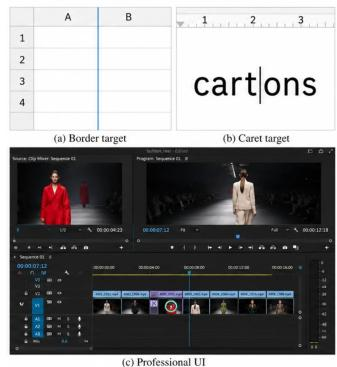

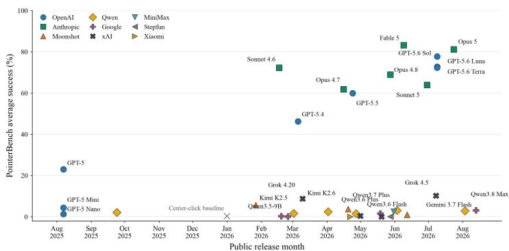  
Figure 1: PointerBench evaluates fine-grained grounding across spreadsheet geometry, characterlevel text targets, and professional interfaces. Results reveal substantial headroom and pronounced differences across model families.

ScreenSpot and ScreenSpot-Pro isolate localization and have accelerated progress on visual GUI agents [Cheng et al., 2024, Li et al., 2025]. Yet they lack fine-grained actions such as placing a cursor on a spreadsheet boundary, between two characters, or around a narrowly specified text span. Rapid progress on these benchmarks motivates complementary tests that vary the geometry of the requested action, diagnosing an agent’s ability to perform precise control.

We introduce POINTERBENCH, a fine-grained diagnostic benchmark comprising three 500-example tasks designed to diagnose these missing capabilities (Figure 1). POINTERBENCH-Sheets probes cells, headers, colors, relative references, edges, resize handles, and corners under varied sheet layouts. POINTERBENCH-Text evaluates points and bounding boxes over words, characters, punctuation, carets, and invoice fields in six languages. POINTERBENCH-Pro covers icon, text, and mixed targets across 100 professional applications. All inputs use a fixed 1024×768 coordinate frame and ship with executable scorers.

Our contributions are twofold: (i) a diagnostic benchmark suite that isolates structural, textual, and professional GUI grounding through three complementary tasks with precisely defined target geometry; and (ii) a comprehensive evaluation spanning both general-purpose multimodal models and specialist GUI grounding configurations, revealing non-trivial rank reversals across subsets and a persistent bottleneck in character-level and region-level textual grounding.

## 2 Related Work

Interactive computer-use benchmarks. Mind2Web contains over 2,000 open-ended web tasks across 137 websites and records the corresponding action sequences [Deng et al., 2023]. WebArena provides reproducible, functional websites for evaluating long-horizon task execution [Zhou et al., 2024], while OSWorld extends this paradigm to real web and desktop applications with executionbased evaluators [Xie et al., 2024]. AndroidWorld similarly evaluates autonomous agents over real mobile applications [Rawles et al., 2025]. Recent work further studies the separation between high-level planning and low-level execution in long-horizon agents [Erdogan et al., 2025]. These benchmarks test complete interactive agents, whereas POINTERBENCH deliberately removes temporal planning to isolate whether an already-specified action can be grounded precisely.

GUI grounding. ScreenSpot introduced screenshot-only grounding across mobile, desktop, and web interfaces [Cheng et al., 2024], while ScreenSpot-Pro extends this setting to dense, highresolution professional applications [Li et al., 2025]. OSWorld-G further decomposes computer-use grounding into recognition, text matching, layout reasoning, and precise manipulation [Xie et al., 2025]. UI-Vision provides fine-grained offline evaluation across 83 desktop applications through element grounding, layout grounding, and action prediction [Nayak et al., 2025], while FineState-Bench evaluates state-conditioned grounding and exact GUI state setting across desktop, web, and mobile interfaces [Ji et al., 2026]. Alongside these benchmarks, specialized GUI agents [Qin et al., 2025, Wang et al., 2025, Liu et al., 2026b, Zhou et al., 2025] and grounding models [Gou et al., 2025, Gu et al., 2025, Venus Team, 2026b,a, Chen et al., 2026] have substantially improved localization on conventional controls. Complementary advances include grounding architectures [Wu et al., 2025, Ouyang et al., 2026, Jiang et al., 2026], reinforcement learning methods [Yang et al., 2025, Tang et al., 2026, Liu et al., 2026a, Yuan et al., 2025], and inference-time prediction aggregation [Zhang et al., 2026, Du et al., 2026]. POINTERBENCH complements these efforts by systematically isolating specific sub-element geometries under controlled, pixel-exact generation: thin spreadsheet boundaries, character- and caret-level text locations, and tightly bounded regions, while POINTER-BENCH-Pro broadens coverage to 100 professional interfaces. This provides a reproducible diagnostic of grounding errors independently of temporal planning and environment execution.

## 3 PointerBench

Task design. In interactive environments, a grounding error may move an agent into an unintended state and propagate through subsequent actions [Xie et al., 2024, 2025]. Consider, for example, a spreadsheet task requiring an agent to resize a column or select a cell of a particular color. Although simple to specify in language, these actions require different forms of fine-grained grounding: the former requires localizing a thin boundary between adjacent columns, whereas the latter requires identifying a visually specified region within a repetitive grid.

POINTERBENCH isolates these capabilities from long-horizon planning through three complementary 500-example suites: POINTERBENCH-Sheets targets structural and geometric grounding, POINTER-BENCH-Text targets fine-grained textual grounding, and POINTERBENCH-Pro evaluates grounding across heterogeneous professional interfaces. Each benchmark instance consists of a 1024×768 screenshot, a natural-language instruction, and a target expressed in absolute pixel coordinates. Depending on the task, the required output is either a point or a bounding box. Point predictions are successful when they fall inside the annotated target region. Bounding-box predictions require at least 0.90 target coverage and 0.70 prediction precision; malformed outputs are counted as failures. We adopt a standardized 1024×768 resolution for two reasons: first, fine-grained spatial capabilities, such as localizing 1–3 px spreadsheet dividers, inter-character carets, and individual glyphs, become substantially harder at higher resolutions as relative target area shrinks; second, higher resolutions markedly increase the time taken by a model to reason. Downscaling to 1024×768 makes evaluation computationally efficient while isolating sub-element geometric precision. Dataset construction and reproducibility details are provided in the Appendix.

Table 1: Success rate (%) on the three POINTERBENCH subsets. Best and second-best results are bold and underlined, respectively.
<table><tr><td rowspan="2"></td><td colspan="3">Claude</td><td colspan="3">GPT</td><td>Grok</td><td>Kimi</td><td>Gemini</td><td>Qwen</td></tr><tr><td>Sonnet 4.6</td><td>Fable 5</td><td>Opus 5</td><td>5.6 Luna</td><td>5.6 Terra</td><td>5.6 Sol</td><td>4.5</td><td>K2.5</td><td>3.7 Flash</td><td>3.8Max</td></tr><tr><td>Sheets</td><td>88.8</td><td>97.6</td><td>98.8</td><td>92.0</td><td>91.6</td><td>97.8</td><td>15.2</td><td>10.8</td><td>4.0</td><td>4.8</td></tr><tr><td>Text</td><td>49.0</td><td>69.6</td><td>63.2</td><td>46.6</td><td>47.6</td><td>53.4</td><td>1.4</td><td>3.4</td><td>1.2</td><td>0.2</td></tr><tr><td>Pro</td><td>78.8</td><td>82.4</td><td>81.2</td><td>79.4</td><td>77.6</td><td>82.0</td><td>14.0</td><td>3.0</td><td>4.2</td><td>3.4</td></tr><tr><td>Avg.</td><td>72.2</td><td>83.2</td><td>81.1</td><td>72.7</td><td>72.3</td><td>77.7</td><td>10.2</td><td>5.7</td><td>3.1</td><td>2.8</td></tr></table>

## 3.1 Frontier Model Performance

Table 1 reports a representative subset of our evaluation, selected to span six model families, multiple generations, and a broad range of grounding capabilities. All models are evaluated with reasoning. An analysis of sensitivity to the reasoning budget and the complete evaluation spanning more than 30 multimodal models (see Fig. 1) are reported in the Appendix.

Claude Fable 5 leads POINTERBENCH with an average success rate of 83.2%, followed by Claude Opus 5 at 81.1% and GPT-5.6 Sol at 77.7%. GPT-5.6 Luna, GPT-5.6 Terra, and Claude Sonnet 4.6 follow at 72.7%, 72.3%, and 72.2%, respectively. Performance, however, is strongly task dependent. Opus leads POINTERBENCH-Sheets at 98.8%, narrowly ahead of Sol and Fable at 97.8% and 97.6%. The three models are close on POINTERBENCH-Pro, reaching 81.2%, 82.0%, and 82.4%, respectively, while POINTERBENCH-Text separates them more clearly: Fable reaches 69.6%, compared with 63.2% for Opus and 53.4% for Sol. At the lower end, Kimi K2.5 reaches only 5.7%. Gemini 3.7 Flash and Qwen3.8 Max obtain official scores of 3.1% and 2.8%, respectively, but these results are dominated by systematic coordinate-frame non-compliance and are analyzed separately in Sec. 3.3.

Table 2: Success rate (%) of specialist GUI grounding configurations on the three POINTERBENCH subsets (full 39-run evaluation in Appendix G). Best and second-best results are bold and underlined, respectively.
<table><tr><td rowspan="2"></td><td>UI-TARS</td><td colspan="2">GTA1</td><td colspan="2">OpenCUA</td><td colspan="3">UI-Venus</td><td colspan="2">MAI-UI</td><td colspan="2">MVP</td></tr><tr><td>1.5-7B</td><td>7B</td><td>32B</td><td>7B</td><td>32B</td><td>Ground-7B</td><td>1.5-8B</td><td>2-9B</td><td>2B</td><td>8B</td><td>8B</td><td>32B</td></tr><tr><td>Sheets</td><td>46.2</td><td>60.2</td><td>65.0</td><td>59.8</td><td>66.0</td><td>47.8</td><td>56.4</td><td>64.2</td><td>36.6</td><td>59.2</td><td>60.4</td><td>68.4</td></tr><tr><td>Text</td><td>18.2</td><td>22.8</td><td>29.6</td><td>18.4</td><td>19.4</td><td>24.6</td><td>23.8</td><td>25.8</td><td>9.8</td><td>23.2</td><td>22.4</td><td>34.0</td></tr><tr><td>Pro</td><td>57.4</td><td>67.4</td><td>70.2</td><td>63.8</td><td>67.4</td><td>66.2</td><td>72.8</td><td>73.6</td><td>61.0</td><td>71.6</td><td>70.8</td><td>75.4</td></tr><tr><td>Avg.</td><td>40.6</td><td>50.1</td><td>54.9</td><td>47.3</td><td>50.9</td><td>46.2</td><td>51.0</td><td>54.5</td><td>35.8</td><td>51.3</td><td>51.2</td><td>59.3</td></tr></table>

## 3.2 Specialist GUI Grounding Models

Because dedicated GUI agents are trained under model-specific coordinate conventions, we evaluate 39 open-weight specialist GUI grounding configurations (2B–32B parameters) using each model’s native grounding prompt and parser (Table 2; full 39-run leaderboard in Appendix G). Across the method families in Table 2, Multi-View Prediction (MVP), which aggregates predictions across multiple augmented views at inference time, is the leading UI specialist, scoring best on every track with its 32B backbone (68.4% Sheets, 34.0% Text, 75.4% Pro, 59.3% Avg.). Behind MVP-32B, a rank reversal occurs across suites among trailing models: UI-Venus-2-9B (pairing domain-specific grounding supervision with reinforcement learning) performs second best on Pro (73.6%, surpassing all single-view 32B models), while GTA1-32B (an RL-trained grounding model that directly predicts click coordinates) does so on Text (29.6%) and overall (54.9%), and OpenCUA-32B (trained on large scale multi-OS trajectories) on Sheets (66.0%). Considering smaller models (< 9B), MAI-UI-8B (an instruction-tuned desktop/mobile grounding agent) performs best at 51.3% average, followed closely by MVP-8B (51.2%), UI-Venus-1.5-8B (51.0%), and GTA1-7B (50.1%), ahead of OpenCUA-7B (47.3%), UI-Venus-Ground-7B (46.2%), and UI-TARS-1.5-7B (40.6%).

## 3.3 Per-Suite Analysis

POINTERBENCH-Sheets. POINTERBENCH-Sheets isolates the spatial structure of spreadsheet interfaces, where successful interaction may depend on reasoning over a grid rather than simply recognizing a conventional GUI element. The suite includes cells, headers, color-based targets, relative references, thin boundaries and resize handles, and cell corners, separating conventional element localization from structural and geometric grounding. Sheets is the strongest suite for the leading models, with Opus, Sol, and Fable reaching 98.8%, 97.8%, and 97.6%, respectively. Conventional cell and header targets are localized almost perfectly, while performance drops on finer geometric interactions: Fable reaches 78.1% on row-resize handles, showing that near-perfect aggregate performance can still conceal errors on thin structural elements.

POINTERBENCH-Text. POINTERBENCH-Text probes fine-grained textual grounding through words, characters, punctuation, caret positions, and tightly specified regions. Targets may occupy only a narrow portion of a line or lie between adjacent glyphs, with point and bounding-box tasks spanning six languages and multiple document surfaces.

Table 3: POINTERBENCH-Text accuracy (%) by target objective for the top frontier models (top) and representative UI specialist configurations (bottom). Region groups bounding-box targets; other columns score point-coordinate predictions. Best and second-best results are bold and underlined.
<table><tr><td>Model</td><td>Word</td><td>Character</td><td>Punctuation</td><td>Caret</td><td>Interface text</td><td>Region</td></tr><tr><td>Claude Fable 5</td><td>90.2</td><td>70.4</td><td>78.3</td><td>64.7</td><td>82.4</td><td>56.0</td></tr><tr><td>Claude Opus 5</td><td>83.9</td><td>51.9</td><td>39.1</td><td>62.6</td><td>82.4</td><td>50.7</td></tr><tr><td>GPT-5.6 $ol</td><td>76.8</td><td>48.1</td><td>56.5</td><td>51.9</td><td>100.0</td><td>30.6</td></tr><tr><td>Qwen3-VL-32B + MVP</td><td>69.6</td><td>18.5</td><td>43.5</td><td>34.2</td><td>76.5</td><td>0.0</td></tr><tr><td>GTA1-32B</td><td>70.5</td><td>11.1</td><td>39.1</td><td>22.5</td><td>88.2</td><td>0.0</td></tr><tr><td>UI-Venus-2-9B</td><td>52.7</td><td>11.1</td><td>26.1</td><td>25.7</td><td>76.5</td><td>0.0</td></tr><tr><td>UI-Venus-Ground-7B</td><td>58.9</td><td>11.1</td><td>17.4</td><td>10.7</td><td>88.2</td><td>11.2</td></tr></table>

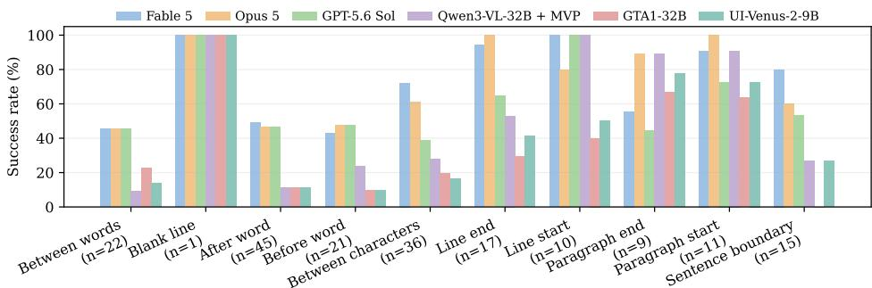  
Figure 2: POINTERBENCH-Text caret accuracy by placement objective.

Table 3 shows a strong dependence on target granularity across both frontier and specialist systems. Despite strong conventional localization (e.g., UI-Venus-2-9B reaches 89.0%–100.0% on spreadsheet cells/headers, vs. 31.6%–55.8% on borders/resize handles and 3.0% on relative offsets), POINTERBENCH-Text is the primary bottleneck across all specialist configurations, with no specialist exceeding 34.0% (MVP-32B 34.0%, GTA1-32B 29.6%, UI-Venus-2-9B 25.8%, MAI-UI-8B 23.2%). Word localization is easiest: Fable reaches 90.2%, followed by Opus (83.9%), Sol (76.8%), and top specialists GTA1-32B (70.5%) and MVP-32B (69.6%). Accuracy drops sharply at finer granularity: Opus and Sol reach 51.9%/48.1% on characters and 39.1%/56.5% on punctuation, while top UI specialists fall to 11.1–18.5% on characters and 22.5–34.2% on carets (19.3% for MAI-UI-8B). Region grounding, requiring tight bounds over text spans or fields, remains challenging for frontier models (Fable 56.0%, Opus 50.7%). Specialists whose native output is a point are scored on that point and therefore receive 0.0% on all 134 region tasks. When a model returns a box, that box is scored: GUI-G2-7B [Tang et al., 2026] reaches 12.7% on Region, and UI-Venus-Ground-7B reaches 11.2% (24.6% overall on POINTERBENCH-Text). Figure 2 further decomposes caret grounding: placements immediately before, after, or between words are non-trivial, with no frontier model exceeding 50% accuracy and UI specialists remaining below 24%, whereas coarse structural targets (line start, paragraph start/end) are localized more reliably.

POINTERBENCH-Pro. POINTERBENCH-Pro evaluates grounding across visually heterogeneous professional interfaces. It spans 100 applications targeting icons, text elements, and interface controls such as dropdowns, list items, sliders, tabs, and panels. Performance is consistent among the leading models, with Fable, Opus, Sol, and Luna reaching 82.4%, 81.2%, 82.0%, and 79.4%, respectively. Text controls are easiest, followed by other interface controls, while icons are hardest. Icons account for 57.3% of pooled failures despite representing only 38.0% of examples, indicating that a major remaining challenge lies in mapping an intended action to the correct visual control and highlighting icon understanding and UI semantics as important targets for improving computer-use agents.

Coordinate-frame compliance. Gemini 3.7 Flash and Qwen3.8 Max predominantly return coordinates in a 0–1000 frame despite being explicitly instructed to use absolute 1024 × 768 coordinates; the exact prompt is reported in the Appendix. Their official scores are therefore 3.1% and 2.8%, respectively. Uniformly converting parseable predictions to the requested frame raises these to 78.1% and 55.4%, placing Gemini within the performance range of the benchmark’s leading models. This suggests that grounding performance can depend strongly on model-native coordinate conventions and motivates evaluation under normalized output representations.

## 4 Conclusion

We introduced POINTERBENCH, a diagnostic benchmark for fine-grained GUI grounding across spreadsheet structure, text, and professional interfaces. Evaluation across both frontier multimodal systems and specialist GUI grounding configurations reveals that aggregate performance can hide markedly different grounding capabilities. Leading models reliably localize conventional spreadsheet and application controls, yet remain challenged by thin structural elements; textual grounding degrades as interaction moves from words to characters, carets, and precisely bounded regions; and professional-interface failures concentrate disproportionately on icons. By exposing these failures at the level of individual grounding primitives, POINTERBENCH provides a targeted test bed for measuring and improving precise visual control in computer-use agents.

## References

Liangyu Chen, Hanzhang Zhou, Chenglin Cai, Jianan Zhang, Panrong Tong, Xu Zhang, Quyu Kong, Chen Liu, Yuqi Liu, Wenxuan Wang, Yue Wang, Qin Jin, and Steven Hoi. UI-Ins: Enhancing GUI grounding with multi-perspective instruction as reasoning. In The Fourteenth International Conference on Learning Representations, 2026. URL https://proceedings.iclr.cc/paper\_files/paper/2026/hash/ 5965f3a748a8d41415db2bfa44635cc3-Abstract-Conference.html.

Kanzhi Cheng, Qiushi Sun, Yougang Chu, Fangzhi Xu, Yantao Li, Jianbing Zhang, and Zhiyong Wu. SeeClick: Harnessing GUI grounding for advanced visual GUI agents. In Lun-Wei Ku, Andre Martins, and Vivek Srikumar, editors, Proceedings ofthe 62nd Annual Meeting ofthe Association for Computational Linguistics (Volume 1: Long Papers), pages 9313–9332, Bangkok, Thailand, August 2024. Association for Computational Linguistics. doi: 10.18653/v1/2024.acl-long.505.

Xiang Deng, Yu Gu, Boyuan Zheng, Shijie Chen, Sam Stevens, Boshi Wang, Huan Sun, and Yu Su. Mind2web: Towards a generalist agent for the web. In Advances in Neural Information Processing Systems, volume 36, 2023. doi: 10.52202/075280-1220.

Yong Du, Yuchen Yan, Fei Tang, Zhengxi Lu, Chang Zong, Weiming Lu, Shengpei Jiang, and Yongliang Shen. Test-time reinforcement learning for GUI grounding via region consistency. In Proceedings ofthe AAAI Conference on Artificial Intelligence, volume 40, pages 30593–30601, 2026. doi: 10.1609/aaai.v40i36.40314.

Lutfi Eren Erdogan, Nicholas Lee, Sehoon Kim, Suhong Moon, Hiroki Furuta, Gopala Anumanchipalli, Kurt Keutzer, and Amir Gholami. Plan-and-act: Improving planning of agents for long-horizon tasks. In Aarti Singh, Maryam Fazel, Daniel Hsu, Simon Lacoste-Julien, Felix Berkenkamp, Tegan Maharaj, Kiri Wagstaff, and Jerry Zhu, editors, Proceedings of the 42nd International Conference on Machine Learning, volume 267 of Proceedings of Machine Learning Research, pages 15419–15462. PMLR, 13–19 Jul 2025.

Boyu Gou, Ruohan Wang, Boyuan Zheng, Yanan Xie, Cheng Chang, Yiheng Shu, Huan Sun, and Yu Su. Navigating the digital world as humans do: Universal visual grounding for GUI agents. In The Thirteenth International Conference on Learning Representations, 2025.

Zhangxuan Gu, Zhengwen Zeng, Zhenyu Xu, Xingran Zhou, Shuheng Shen, Yunfei Liu, Beitong Zhou, Changhua Meng, Tianyu Xia, Weizhi Chen, et al. Ui-venus technical report: Building high-performance ui agents with rft. arXiv preprint arXiv:2508.10833, 2025.

Fengxian Ji, Jingpu Yang, Zirui Song, Yuanxi Wang, Zhexuan Cui, Yuke Li, Qian Jiang, and Xiuying Chen. FineState-bench: Benchmarking state-conditioned grounding for fine-grained GUI state setting. In Maria Liakata, Viviane P. Moreira, Jiajun Zhang, and David Jurgens, editors, Findings ofthe Associationfor Computational Linguistics: ACL 2026, pages 43073–43088, San Diego, California, United States, July 2026. Association for Computational Linguistics. ISBN 979-8-89176-395-1. doi: 10.18653/v1/2026.findings-acl.2136.

Qing Jiang, Junan Huo, Xingyu Chen, Yuda Xiong, Zhaoyang Zeng, Yihao Chen, Tianhe Ren, Junzhi Yu, and Lei Zhang. Detect anything via next point prediction. In Proceedings of the IEEE/CVF Conference on Computer Vision and Pattern Recognition, pages 25472–25483, 2026. URL https://arxiv.org/abs/2510.12798.

Kaixin Li, Ziyang Meng, Hongzhan Lin, Ziyang Luo, Yuchen Tian, Jing Ma, Zhiyong Huang, and Tat-Seng Chua. Screenspot-pro: Gui grounding for professional high-resolution computer use. In Proceedings of the 33rd ACM International Conference on Multimedia, Proceedings of the ACM International Conference on Multimedia, pages 8778–8786. Association for Computing Machinery (ACM), October 2025. ISBN 9798400720352. doi: 10.1145/3746027.3755688.

Yuhang Liu, Zeyu Liu, Shuanghe Zhu, Pengxiang Li, Congkai Xie, Jiasheng Wang, Xueyu Hu, Xiaotian Han, Jianbo Yuan, Xinyao Wang, Shengyu Zhang, Hongxia Yang, and Fei Wu. InfiGUI-G1: Advancing GUI grounding with adaptive exploration policy optimization. In Proceedings of the AAAI Conference on Artificial Intelligence, volume 40, pages 32267–32275, 2026a. doi: 10.1609/aaai.v40i38.40500.

Zhaoyang Liu, JingJing Xie, Zichen Ding, Zehao Li, Bowen Yang, Zhenyu Wu, Xuehui Wang, Qiushi Sun, Shi Liu, Weiyun Wang, et al. Scalecua: Scaling open-source computer use agents with cross-platform data. In International Conference on Learning Representations, volume 2026, pages 62707–62766, 2026b.

Shravan Nayak, Xiangru Jian, Kevin Qinghong Lin, Juan A. Rodriguez, Montek Kalsi, Nicolas Chapados, M. Tamer Özsu, Aishwarya Agrawal, David Vazquez, Christopher Pal, Perouz Taslakian, Spandana Gella, and Sai Rajeswar. UI-vision: A desktop-centric GUI benchmark for visual perception and interaction. In Aarti Singh, Maryam Fazel, Daniel Hsu, Simon Lacoste-Julien, Felix Berkenkamp, Tegan Maharaj, Kiri Wagstaff, and Jerry Zhu, editors, Proceedings of the 42nd International Conference on Machine Learning, volume 267 of Proceedings of Machine Learning Research, pages 45817–45851. PMLR, 13–19 Jul 2025.

Mingyu Ouyang, Kevin Qinghong Lin, Mike Zheng Shou, and Hwee Tou Ng. FocusUI: Efficient UI grounding via position-preserving visual token selection. In Proceedings of the IEEE/CVF Conference on Computer Vision and Pattern Recognition, 2026. URL https://arxiv.org/ abs/2601.03928.

Yujia Qin, Shihao Liang, Yining Ye, Kunlun Zhu, Lan Yan, Yaxi Lu, Yankai Lin, Xin Cong, Xiangru Tang, Bill Qian, Sihan Zhao, Lauren Hong, Runchu Tian, Ruobing Xie, Jie Zhou, Mark Gerstein, Dahai Li, Zhiyuan Liu, and Maosong Sun. Toolllm: Facilitating large language models to master 16000+ real-world apis. In The Twelfth International Conference on Learning Representations, 2024.

Yujia Qin, Yining Ye, Junjie Fang, Haoming Wang, Shihao Liang, Shizuo Tian, Junda Zhang, Jiahao Li, Yunxin Li, Shijue Huang, et al. UI-TARS: Pioneering automated GUI interaction with native agents. arXiv preprint arXiv:2501.12326, 2025.

Christopher Rawles, Sarah Clinckemaillie, Yifan Chang, Jonathan Waltz, Gabrielle Lau, Marybeth Fair, Alice Li, William E. Bishop, Wei Li, Folawiyo Campbell-Ajala, Daniel Kenji Toyama, Robert James Berry, Divya Tyamagundlu, Timothy P. Lillicrap, and Oriana Riva. Androidworld: A dynamic benchmarking environment for autonomous agents. In The Thirteenth International Conference on Learning Representations, 2025.

Timo Schick, Jane Dwivedi-Yu, Roberto Dessì, Roberta Raileanu, Maria Lomeli, Eric Hambro, Luke Zettlemoyer, Nicola Cancedda, and Thomas Scialom. Toolformer: Language models can teach themselves to use tools. In Advances in Neural Information Processing Systems, volume 36, 2023. doi: 10.52202/075280-2997.

Fei Tang, Zhangxuan Gu, Zhengxi Lu, Xuyang Liu, Shuheng Shen, Changhua Meng, Wen Wang, Wenqi Zhang, Yongliang Shen, Weiming Lu, Jun Xiao, and Yueting Zhuang. GUI-G2: Gaussian reward modeling for GUI grounding. In Proceedings of the AAAI Conference on Artificial Intelligence, volume 40, pages 33214–33222, 2026. doi: 10.1609/aaai.v40i39.40606.

Venus Team. Ui-venus-2 technical report. arXiv preprint arXiv:2609.00028, 2026a.

Venus Team. Ui-venus-1.5 technical report, 2026b.

Xinyuan Wang, Bowen Wang, Dunjie Lu, Junlin Yang, Tianbao Xie, Junli Wang, Jiaqi Deng, Xiaole Guo, Yiheng Xu, Henry Wu, et al. OpenCUA: Open foundations for computer-use agents. In Advances in Neural Information Processing Systems, volume 38, 2025.

Qianhui Wu, Kanzhi Cheng, Rui Yang, Chaoyun Zhang, Jianwei Yang, Huiqiang Jiang, Jian Mu, Baolin Peng, Bo Qiao, Reuben Tan, Si Qin, Lars Liden, Qingwei Lin, Huan Zhang, Tong Zhang, Jianbing Zhang, Dongmei Zhang, and Jianfeng Gao. Gui-actor: Coordinate-free visual grounding for gui agents. In Advances in Neural Information Processing Systems, volume 38, 2025. doi: 10.52202/085713-0508.

Tianbao Xie, Danyang Zhang, Jixuan Chen, Xiaochuan Li, Siheng Zhao, Ruisheng Cao, Toh Jing Hua, Zhoujun Cheng, Dongchan Shin, Fangyu Lei, Yitao Liu, Yiheng Xu, Shuyan Zhou, Silvio Savarese, Caiming Xiong, Victor Zhong, and Tao Yu. Osworld: Benchmarking multimodal agents for open-ended tasks in real computer environments. In Advances in Neural Information Processing Systems, volume 37, 2024. doi: 10.52202/079017-1650.

Tianbao Xie, Jiaqi Deng, Xiaochuan Li, Junlin Yang, Haoyuan Wu, Jixuan Chen, Wenjing Hu, Xinyuan Wang, Yuhui Xu, Zekun Wang, Yiheng Xu, Junli Wang, Doyen Sahoo, Tao Yu, and Caim ing Xiong. Scaling computer-use grounding via user interface decomposition and synthesis. In Advances in Neural Information Processing Systems, volume 38, 2025. doi: 10.52202/085713-0817.

Tianci Xue, Weijian Qi, Tianneng Shi, Chan Hee Song, Boyu Gou, Dawn Song, Huan Sun, and Yu Su. An illusion of progress? assessing the current state of web agents. In Second Conference on Language Modeling, 2025.

Yan Yang, Dongxu Li, Yutong Dai, Yuhao Yang, Ziyang Luo, Zirui Zhao, Zhiyuan Hu, Junzhe Huang, Amrita Saha, Zeyuan Chen, et al. GTA1: GUI test-time scaling agent. arXiv preprint arXiv:2507.05791, 2025.

Shunyu Yao, Jeffrey Zhao, Dian Yu, Nan Du, Izhak Shafran, Karthik R. Narasimhan, and Yuan Cao. React: Synergizing reasoning and acting in language models. In The Eleventh International Conference on Learning Representations, 2023.

Xinbin Yuan, Jian Jun Zhang, Kaixin Li, Zhuoxuan Cai, Lujian Yao, Jie Chen, Enguang Wang, Qibin Hou, Jinwei Chen, Peng-Tao Jiang, and Bo Li. SE-GUI: Enhancing visual grounding for GUI agents via self-evolutionary reinforcement learning. In Advances in Neural Information Processing Systems, volume 38, 2025. URL https://arxiv.org/abs/2505.12370.

Yunzhu Zhang, Zeyu Pan, Zhengwen Zeng, Shuheng Shen, Changhua Meng, and Linchao Zhu. Mvp: Multiple view prediction improves gui grounding. In Proceedings of the IEEE/CVF Conference on Computer Vision and Pattern Recognition, pages 27482–27492, 2026.

Boyuan Zheng, Boyu Gou, Jihyung Kil, Huan Sun, and Yu Su. GPT-4V(ision) is a generalist web agent, if grounded. In Ruslan Salakhutdinov, Zico Kolter, Katherine Heller, Adrian Weller, Nuria Oliver, Jonathan Scarlett, and Felix Berkenkamp, editors, Proceedings ofthe 41st International Conference on Machine Learning, volume 235 of Proceedings ofMachine Learning Research, pages 61349–61385. PMLR, 21–27 Jul 2024.

Hanzhang Zhou, Xu Zhang, Panrong Tong, Jianan Zhang, Liangyu Chen, Quyu Kong, Chenglin Cai, Chen Liu, Yue Wang, Jingren Zhou, et al. Mai-ui technical report: Real-world centric foundation gui agents. arXiv preprint arXiv:2512.22047, 2025.

Shuyan Zhou, Frank F. Xu, Hao Zhu, Xuhui Zhou, Robert Lo, Abishek Sridhar, Xianyi Cheng, Tianyue Ou, Yonatan Bisk, Daniel Fried, Uri Alon, and Graham Neubig. Webarena: A realistic web environment for building autonomous agents. In The Twelfth International Conference on Learning Representations, 2024.

## A Benchmark Construction and Reproducibility

POINTERBENCH contains three 500-example suites with a shared interface: a 1024×768 screenshot, a natural-language instruction, and pixel-exact target geometry. Sheets and Text are generated programmatically from controlled interface descriptions, while Pro is assembled from a larger collection of generated professional interfaces. The released metadata stores the instruction, target geometry, answer type, and diagnostic tags used by the scorers. We open source the benchmark metadata and evaluation script required to score it.

POINTERBENCH-Sheets. Each example is produced by sampling a visible spreadsheet grid, layout, visual style, and target type, and then rendering the resulting interface together with its instruction and target coordinates. The visible sheet is varied through row and column offsets, style changes, and optional application chrome, preventing a fixed correspondence between semantic locations and screen coordinates. Targets include cells and headers as well as colors, relative references, resize handles, edges, and corners. Generation is deterministic, yielding one distinct screenshot and metadata record per example.

POINTERBENCH-Text. Text examples are rendered from controlled document surfaces with exact glyph geometry. Tasks cover words, characters, punctuation, caret positions, text spans, and structured document fields, with 366 point targets and 134 bounding-box targets. The latter include word-, line-, character-, paragraph-, and invoice-field regions. The language mix is fixed to 50% English and 10% each German, French, Spanish, Italian, and Dutch. Generation is deterministic, and examples are retained only when they identify a unique target.

POINTERBENCH-Pro. Pro is assembled from generated professional-application interfaces. Candidate targets are sampled across applications and balanced so that each of the 100 applications contributes five examples. The resulting suite contains 190 icon targets, 154 text targets, and 156 other interface controls. For icon examples, instructions explicitly request the icon itself to avoid ambiguity with nearby text labels. Application name, category, platform, and source identifier are retained in the released metadata, allowing each benchmark example to be traced to its originating interface. The final selection is deterministic and reproducible.

## B Benchmark Composition and Geometry

Table 4 summarizes the target composition of the Sheets suite. The complete list of the 100 Pro applications and the source identifiers of all examples are distributed with the benchmark.

Table 4: Task composition of POINTERBENCH-Sheets. Counts sum to 500 examples.
<table><tr><td>Family</td><td>Fine-grained targets</td><td>#</td></tr><tr><td>Cell</td><td>reference (82), reference with content (45), content (43)</td><td>170</td></tr><tr><td>Edge</td><td>column resize (43), row resize (32), right cell edge (22), bottom cell edge (19)</td><td>116</td></tr><tr><td>Relative</td><td>relative offset (33), relative row (27)</td><td>60</td></tr><tr><td>Header</td><td>column header (35), row header (24)</td><td>59</td></tr><tr><td>Color</td><td>color-specified cell or region (56)</td><td>56</td></tr><tr><td>Corner</td><td>bottom-left (13), bottom-right (12), top-left (9), top-right (5)</td><td>39</td></tr><tr><td>Total</td><td></td><td>500</td></tr></table>

Professional application coverage. Figure 3 summarizes the 100 represented applications by domain. Development and creative software provide the largest groups, while the remaining examples span scientific, engineering, productivity, communication, enterprise, office, operating-system, and consumer interfaces.

Spatial and geometric coverage. Figure 4 shows target-center distributions and target areas. Sheets follows the regular geometry of spreadsheet layouts, Text is spread across document surfaces, and Pro is concentrated toward menus, toolbars, and other controls near the upper part of the interface. All three suites nevertheless cover a broad portion of the coordinate frame. Median target area is 0.215% for Sheets, 0.0286% for Text, and 0.129% for Pro; the median Text target is therefore approximately 7.5× smaller than the median Sheets target and 4.5× smaller than the median Pro target.

Area alone can obscure highly anisotropic targets. A spreadsheet boundary, for example, may cover a visible portion of the screen while remaining only a few pixels wide. Figure 5 therefore reports target width and height separately. Across the evaluated model–suite configurations, the largest-area quartile is 10.7 percentage points more accurate than the smallest on average, although the size effect varies across suites and does not fully explain the observed errors.

## C Evaluation Protocol and Inference Settings

All models receive the same screenshot–instruction pairs and return either a point or a bounding box in the benchmark coordinate frame. Point predictions are correct when the predicted coordinate lies inside the annotated target. For bounding-box tasks, let $B _ { p }$ and $B _ { g }$ denote the predicted and annotated boxes. We compute

$$
{ \mathrm { c o v e r a g e } } = { \frac { | B _ { p } \cap B _ { g } | } { | B _ { g } | } } , \qquad { \mathrm { p r e c i s i o n } } = { \frac { | B _ { p } \cap B _ { g } | } { | B _ { p } | } } ,\tag{1}
$$

and count a prediction as correct when coverage $\geq 0 . 9 0$ and precision $\geq 0 . 7 0$ . The asymmetric criterion strongly penalizes clipping the target while permitting a modest margin around it.

Table 5: Task composition of POINTERBENCH-Text. Region groups bounding-box targets; the remaining groups require point predictions.
<table><tr><td>Objective</td><td>Target type</td><td>#</td></tr><tr><td>Word</td><td>word-level locations</td><td>112</td></tr><tr><td>Character</td><td>individual characters</td><td>27</td></tr><tr><td>Punctuation</td><td>punctuation marks</td><td>23</td></tr><tr><td>Caret</td><td>insertion positions within and around text</td><td>187</td></tr><tr><td>Region</td><td>text spans and structured document fields</td><td>134</td></tr><tr><td>Interface text</td><td>text in document-interface controls</td><td>17</td></tr><tr><td>Total</td><td></td><td>500</td></tr></table>

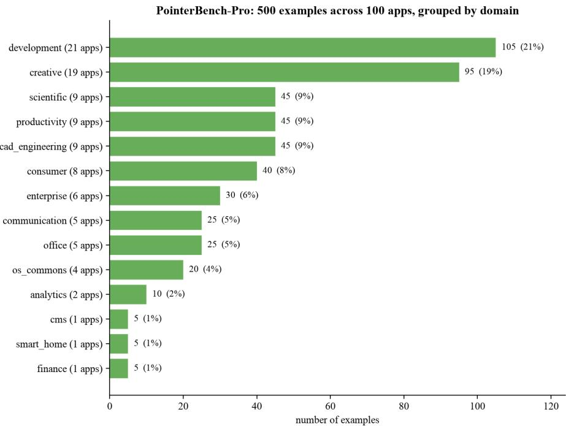  
Figure 3: Application-domain coverage of POINTERBENCH-Pro. Each of the 100 applications contributes five examples; numbers in parentheses denote the number of applications in each domain.

Malformed or unusable outputs are counted as failures. We report binary success rate for each suite and their unweighted mean. Because predictions are intended to be directly executable, official scores use the model’s unmodified output in the requested coordinate frame. We separately analyze models that systematically use a different coordinate convention.

Prompt. All frontier model runs in the benchmark use the same system prompt, without modelspecific modifications:

You are evaluating PointerBench, a GUI grounding benchmark. You will receive one 1024x768 screenshot and one task instruction. Use absolute pixel coordinates with origin at the top-left of the image. Do not return normalized coordinates. Do not crop or resize the coordinate frame. For point tasks, return JSON like {"point": [x, y]}. For bounding-box tasks, return JSON like {"bbox": [x0, y0, x1, y1]}.

Inference settings. All frontier model evaluations in the benchmark were completed through OpenRouter providers. Original 1024×768 images were submitted directly, and the response format was enforced through a JSON schema. Runs with reasoning disabled used a 512-token response cap. Low and medium settings used a 2,048-token cap; medium additionally used a 1,024-token reasoning allowance, while the low setting used the provider’s low-effort configuration without an explicit reasoning-token cap. Filtered or budget-exhausted responses were not retried. Exact endpoint identifiers, request manifests, hashes, and per-example outputs are included with the released evaluation artifacts.

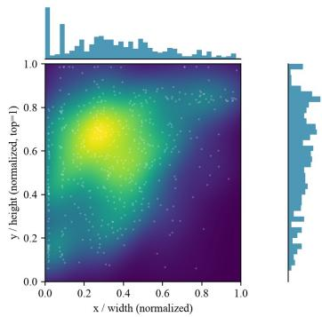

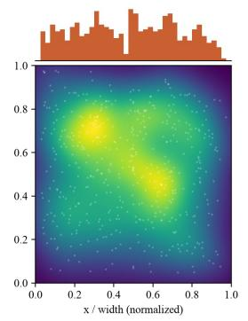

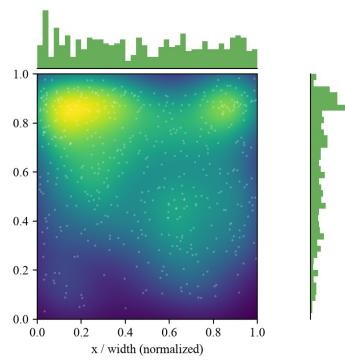

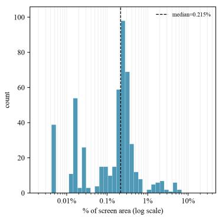  
(a) PointerBench-Sheets

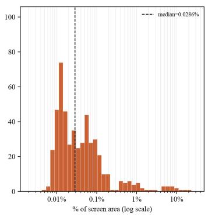  
(b) PointerBench-Text

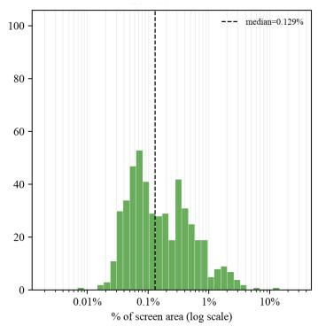  
(c) PointerBench-Pro  
Figure 4: Spatial and geometric distributions of POINTERBENCH targets. Top: normalized targetcenter distributions and their marginals. Bottom: target area as a percentage of the 1024×768 screen; dashed lines mark suite medians.  
Target width vs. height by suite, as % of screen dimension (log scale) — shared y-axi

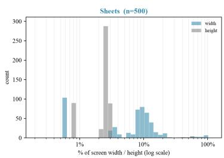

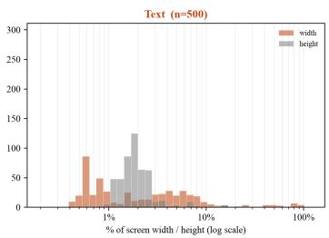

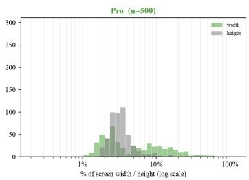  
Figure 5: Normalized target width and height by suite, shown as percentages of the corresponding screen dimension on a logarithmic scale.

## D Reasoning-Budget Sensitivity

We separately evaluate six models across their available reasoning settings to measure sensitivity to inference budget on the same 1,500 examples.

The effect is strongly model dependent. Luna improves from 51.6% with reasoning disabled to 70.8% at low and 72.7% at medium. Sol similarly rises from 67.5% to 77.3% and 77.7%, making low reasoning a close approximation to medium for this model. Sonnet is non-monotonic: its low setting falls below the disabled run before medium reaches 72.2%. Fable has no disabled run, but medium reasoning improves accuracy by only 1.4 percentage points relative to low reasoning. Medium reasoning raises Grok from 1.8% to 8.7% while leaving it far behind the leading models, and it does not improve Qwen. The main ranking is therefore not a uniform consequence of allocating more reasoning tokens.

Table 6: Reasoning settings available for the six models in the controlled reasoning study. A dash denotes an unavailable setting.
<table><tr><td>Model</td><td>Disabled</td><td>Low</td><td>Medium</td></tr><tr><td>Claude Fable 5</td><td></td><td>Yes</td><td>Yes</td></tr><tr><td>Claude Sonnet 4.6</td><td>Yes</td><td>Yes</td><td>Yes</td></tr><tr><td>GPT-5.6 Luna</td><td>Yes</td><td>Yes</td><td>Yes</td></tr><tr><td>GPT-5.6 Sol</td><td>Yes</td><td>Yes</td><td>Yes</td></tr><tr><td>Grok 4.20</td><td>Yes</td><td>一</td><td>Yes</td></tr><tr><td>Qwen3.6 Flash</td><td>Yes</td><td>一</td><td>Yes</td></tr></table>

Table 7: Success rate (%) across available reasoning settings.
<table><tr><td>Model</td><td>Setting</td><td>Sheets</td><td>Text</td><td>Pro</td><td>Avg.</td></tr><tr><td>Claude Fable 5</td><td>Low</td><td>95.8</td><td>67.4</td><td>82.2</td><td>81.8</td></tr><tr><td>Claude Fable 5</td><td>Medium</td><td>97.6</td><td>69.6</td><td>82.4</td><td>83.2</td></tr><tr><td>GPT-5.6 Sol</td><td>Disabled</td><td>85.6</td><td>40.0</td><td>76.8</td><td>67.5</td></tr><tr><td>GPT-5.6 Sol</td><td>Low</td><td>96.4</td><td>54.6</td><td>80.8</td><td>77.3</td></tr><tr><td>GPT-5.6 Sol</td><td>Medium</td><td>97.8</td><td>53.4</td><td>82.0</td><td>77.7</td></tr><tr><td>GPT-5.6 Luna</td><td>Disabled</td><td>58.8</td><td>27.2</td><td>68.8</td><td>51.6</td></tr><tr><td>GPT-5.6 Luna</td><td>Low</td><td>87.6</td><td>45.4</td><td>79.4</td><td>70.8</td></tr><tr><td>GPT-5.6 Luna</td><td>Medium</td><td>92.0</td><td>46.6</td><td>79.4</td><td>72.7</td></tr><tr><td>Claude Sonnet 4.6</td><td>Disabled</td><td>83.0</td><td>45.8</td><td>77.4</td><td>68.7</td></tr><tr><td>Claude Sonnet 4.6</td><td>Low</td><td>79.8</td><td>44.2</td><td>76.8</td><td>66.9</td></tr><tr><td>Claude Sonnet 4.6</td><td>Medium</td><td>88.8</td><td>49.0</td><td>78.8</td><td>72.2</td></tr><tr><td>Grok 4.20</td><td>Disabled</td><td>3.0</td><td>0.2</td><td>2.2</td><td>1.8</td></tr><tr><td>Grok 4.20</td><td>Medium</td><td>13.4</td><td>1.0</td><td>11.6</td><td>8.7</td></tr><tr><td>Qwen3.6 Flash</td><td>Disabled</td><td>2.6</td><td>0.4</td><td>2.4</td><td>1.8</td></tr><tr><td>Qwen3.6 Flash</td><td>Medium</td><td>2.6</td><td>0.0</td><td>2.0</td><td>1.5</td></tr></table>

For Sonnet, Luna, and Sol, disabled and low runs are exactly paired at the example level. Table 8 reports the number of examples corrected and regressed by the low setting. The changes are statistically significant in all three cases, including Sonnet’s small decline.

Table 8: Paired comparison of low reasoning against reasoning disabled. Corrected denotes an incorrect-to-correct transition; regressed denotes the reverse. Reported p-values use two-sided exact McNemar tests.
<table><tr><td>Model</td><td>∆(pp)</td><td>Corrected</td><td>Regressed</td><td>p</td></tr><tr><td>Claude Sonnet 4.6</td><td>-1.80</td><td>22</td><td>49</td><td>0.00182</td></tr><tr><td>GPT-5.6 Luna</td><td>+19.20</td><td>337</td><td>49</td><td> $5 . 5 9 \times 1 0 ^ { - 5 4 }$ </td></tr><tr><td>GPT-5.6 Sol</td><td>+9.80</td><td>199</td><td>52</td><td> $1 . 9 0 \times 1 0 ^ { - 2 1 }$ </td></tr></table>

## E Additional Diagnostic Breakdowns

Spreadsheet target types. Table 9 reports accuracy over the six coarse Sheets groups. The leading systems are nearly perfect on cells, headers, colors, and relative references, while thin structural targets remain more variable. Among Fable, Opus, Sol, and Luna, edge accuracy ranges from 81.0% to 98.3% and corner accuracy from 89.7% to 97.4%. Opus reaches 98.3% on edges and 94.9% on corners, while Fable falls to 91.4% on edges despite perfect cell, header, and color grounding. These results confirm that high aggregate Sheets accuracy can conceal residual errors on fine geometric targets.

Table 9: POINTERBENCH-Sheets accuracy (%) by target group. Counts are shown in the column headers.
<table><tr><td>Model</td><td>Cell (170)</td><td>Header (59)</td><td>Color (56)</td><td>Relative (60)</td><td>Edge (116)</td><td>Corner (39)</td></tr><tr><td>Claude Fable 5</td><td>100.0</td><td>100.0</td><td>100.0</td><td>98.3</td><td>91.4</td><td>97.4</td></tr><tr><td>Claude Opus 5</td><td>100.0</td><td>100.0</td><td>98.2</td><td>98.3</td><td>98.3</td><td>94.9</td></tr><tr><td>GPT-5.6 Šol</td><td>98.8</td><td>100.0</td><td>100.0</td><td>96.7</td><td>95.7</td><td>94.9</td></tr><tr><td>GPT-5.6 Luna</td><td>95.3</td><td>98.3</td><td>96.4</td><td>95.0</td><td>81.0</td><td>89.7</td></tr><tr><td>Grok 4.5</td><td>15.9</td><td>33.9</td><td>28.6</td><td>16.7</td><td>2.6</td><td>0.0</td></tr></table>

Professional-interface target types. Table 10 confirms the ordering reported in the main paper: text elements are easiest, other interface controls occupy an intermediate position, and icons are hardest for every leading model. Across Fable, Opus, Sol, and Luna, text accuracy ranges from 89.0% to 92.9%, compared with 81.4–85.9% for other controls and only 70.0–75.3% for icons. Icons account for 215 of 375 pooled failures (57.3%) despite representing only 38.0% of the examples, confirming that icon grounding remains the dominant source of error in professional interfaces.

Table 10: POINTERBENCH-Pro accuracy (%) by target type.
<table><tr><td>Model</td><td>Text (154)</td><td>Other controls (156)</td><td>Icon (190)</td></tr><tr><td>Claude Fable 5</td><td>92.9</td><td>85.9</td><td>71.1</td></tr><tr><td>Claude Opus 5</td><td>92.2</td><td>83.3</td><td>70.5</td></tr><tr><td>GPT-5.6 Sol</td><td>90.9</td><td>81.4</td><td>75.3</td></tr><tr><td>GPT-5.6 Luna</td><td>89.0</td><td>81.4</td><td>70.0</td></tr><tr><td>Grok 4.5</td><td>20.8</td><td>16.0</td><td>6.8</td></tr></table>

Language. Table 11 compares English and non-English Text examples for the leading models. Multilinguality does not explain the Text bottleneck: Fable performs identically on the two groups (69.6%), Sol is nearly unchanged (53.2% vs. 53.6%), and Luna is slightly stronger on non-English examples (45.6% vs. 47.6%). Opus shows the largest difference, improving from 59.6% on English to 66.8% on non-English examples.

Table 11: POINTERBENCH-Text accuracy (%) by language group. Each group contains 250 examples.
<table><tr><td>Model</td><td>English</td><td>Non-English</td></tr><tr><td>Claude Fable 5</td><td>69.6</td><td>69.6</td></tr><tr><td>Claude Opus 5</td><td>59.6</td><td>66.8</td></tr><tr><td>GPT-5.6 Šol</td><td>53.2</td><td>53.6</td></tr><tr><td>GPT-5.6 Luna</td><td>45.6</td><td>47.6</td></tr><tr><td>Grok 4.5</td><td>1.6</td><td>1.2</td></tr></table>

Bounding-box failures. The Region group in the main paper contains 134 bounding-box examples. Table 12 separates the resulting failures. Fable and Opus most often fail by predicting boxes that are too large, with oversized predictions accounting for 26.1% of examples for both models. Sol and Luna instead most often clip part of the requested region, at 39.6% and 41.8%, respectively. Thus, low Region accuracy does not arise from a single shared failure mode even among the strongest models.

Coordinate-frame compliance. Gemini 3.7 Flash and Qwen3.8 Max predominantly emit coordinates in a 0–1000 frame despite the prompt explicitly requesting absolute 1024 × 768 coordinates. We therefore omit their raw category-level breakdowns from the preceding diagnostic analyses, where the coordinate mismatch would confound grounding errors with output representation. Their unmodified predictions remain in the official leaderboard. As a diagnostic, uniformly converting parseable predictions to the requested frame raises overall accuracy from 3.1% to 78.1% for Gemini and from 2.8% to 55.4% for Qwen3.8 Max. Qwen3.6 Flash exhibits the same behavior, rising from 1.5% to 31.9% under the same conversion. These transformed scores are diagnostic only and are not used for ranking.

Table 12: Outcome distribution (%) on the 134 POINTERBENCH-Text bounding-box targets. Clipped and oversized boxes fail only the coverage or precision requirement, respectively; “both” fails both requirements.
<table><tr><td>Model</td><td>Correct</td><td>Clipped</td><td>Oversized</td><td>Both</td><td>Wrong region</td><td>Invalid</td></tr><tr><td>Claude Fable 5</td><td>56.0</td><td>6.0</td><td>26.1</td><td>10.4</td><td>1.5</td><td>0.0</td></tr><tr><td>Claude Opus 5</td><td>50.7</td><td>12.7</td><td>26.1</td><td>7.5</td><td>3.0</td><td>0.0</td></tr><tr><td>GPT-5.6 Sol</td><td>30.6</td><td>39.6</td><td>15.7</td><td>9.0</td><td>3.0</td><td>2.2</td></tr><tr><td>GPT-5.6 Luna</td><td>26.1</td><td>41.8</td><td>9.7</td><td>10.4</td><td>8.2</td><td>3.7</td></tr><tr><td>Grok 4.5</td><td>0.7</td><td>3.0</td><td>3.7</td><td>18.7</td><td>73.9</td><td>0.0</td></tr></table>

Table 13: Coordinate-frame diagnostic. Official scores use unmodified model outputs; converted scores apply a fixed 0–1000 to 1024 × 768 transformation and are not leaderboard results.
<table><tr><td>Model</td><td>Official</td><td>Converted</td><td>∆</td></tr><tr><td>Gemini 3.7 Flash</td><td>3.1</td><td>78.1</td><td>+74.9</td></tr><tr><td>Qwen3.8 Max</td><td>2.8</td><td>55.4</td><td>+52.6</td></tr><tr><td>Qwen3.6 Flash (Medium)</td><td>1.5</td><td>31.9</td><td>+30.3</td></tr></table>

## F Full Model Evaluation

Table 14: Full POINTERBENCH evaluation. Success rate (%) on the three benchmark suites. Newly evaluated Gemini and Qwen entries use official raw outputs without coordinate-frame post-processing.
<table><tr><td>Rank</td><td>Provider</td><td>Model</td><td>Sheets</td><td>Text</td><td>Pro</td><td>Avg.</td></tr><tr><td>1</td><td>Anthropic</td><td>Claude Fable 5</td><td>97.6</td><td>69.6</td><td>82.4</td><td>83.2</td></tr><tr><td>2</td><td>Anthropic</td><td>Claude Opus 5</td><td>98.8</td><td>63.2</td><td>81.2</td><td>81.1</td></tr><tr><td>3</td><td>OpenAI</td><td>GPT-5.6 Šol</td><td>97.8</td><td>53.4</td><td>82.0</td><td>77.7</td></tr><tr><td>4</td><td>OpenAI</td><td>GPT-5.6 Luna</td><td>92.0</td><td>46.6</td><td>79.4</td><td>72.7</td></tr><tr><td>5</td><td>OpenAI</td><td>GPT-5.6 Terra</td><td>91.6</td><td>47.6</td><td>77.6</td><td>72.3</td></tr><tr><td>6</td><td>Anthropic</td><td>Claude Sonnet 4.6</td><td>88.8</td><td>49.0</td><td>78.8</td><td>72.2</td></tr><tr><td>7</td><td>Anthropic</td><td>Claude Opus 4.8</td><td>82.2</td><td>44.4</td><td>80.2</td><td>68.9</td></tr><tr><td>8</td><td>OpenAI</td><td>GPT-5.6 Sol Pro</td><td>92.0</td><td>32.0</td><td>72.0</td><td>65.3</td></tr><tr><td>9</td><td>Anthropic</td><td>Claude Sonnet 5</td><td>78.6</td><td>36.0</td><td>77.0</td><td>63.9</td></tr><tr><td>10</td><td>Anthropic</td><td>Claude Opus 4.7</td><td>73.8</td><td>36.2</td><td>75.4</td><td>61.8</td></tr><tr><td>11</td><td>OpenAI</td><td>GPT-5.5</td><td>72.4</td><td>31.4</td><td>75.8</td><td>59.9</td></tr><tr><td>12</td><td>OpenAI</td><td>GPT-5.6 Terra Pro</td><td>52.0</td><td>20.0</td><td>74.0</td><td>48.7</td></tr><tr><td>13</td><td>OpenAI</td><td>GPT-5.4</td><td>63.2</td><td>25.0</td><td>50.4</td><td>46.2</td></tr><tr><td>14</td><td>OpenAI</td><td>GPT-5.6 Luna Pro</td><td>54.0</td><td>18.0</td><td>62.0</td><td>44.7</td></tr><tr><td>15</td><td>OpenAI</td><td>GPT-5</td><td>35.2</td><td>13.6</td><td>20.2</td><td>23.0</td></tr><tr><td>16</td><td>xAI</td><td>Grok 4.5</td><td>15.2</td><td>1.4</td><td>14.0</td><td>10.2</td></tr><tr><td>17</td><td>xAI</td><td>Grok 4.20</td><td>13.4</td><td>1.0</td><td>11.6</td><td>8.7</td></tr><tr><td>18</td><td>Moonshot</td><td>Kimi K2.5</td><td>10.8</td><td>3.4</td><td>3.0</td><td>5.7</td></tr><tr><td>19</td><td>OpenAI</td><td>GPT-5 Mini</td><td>6.0</td><td>1.4</td><td>5.8</td><td>4.4</td></tr><tr><td>20</td><td>Moonshot</td><td>Kimi K2.6</td><td>5.6</td><td>2.8</td><td>2.8</td><td>3.7</td></tr><tr><td>21</td><td>Qwen</td><td>Qwen3.7 Plus</td><td>5.8</td><td>0.6</td><td>3.0</td><td>3.1</td></tr><tr><td>22</td><td>Google</td><td>Gemini 3.7 Flash</td><td>4.0</td><td>1.2</td><td>4.2</td><td>3.1</td></tr><tr><td>23</td><td>Qwen</td><td>Qwen3.8 Max</td><td>4.8</td><td>0.2</td><td>3.4</td><td>2.8</td></tr><tr><td>24</td><td>MiniMax</td><td>MiniMax M3</td><td>3.6</td><td>0.4</td><td>3.6</td><td>2.5</td></tr><tr><td>25</td><td>Qwen</td><td>Qwen3.6 Plus</td><td>3.0</td><td>0.6</td><td>3.6</td><td>2.4</td></tr><tr><td>26</td><td></td><td>Qwen3-VL-235B-A22B</td><td>2.6</td><td>0.4</td><td>3.2</td><td>2.1</td></tr><tr><td>27</td><td>Qwen</td><td>Thinking</td><td></td><td></td><td></td><td></td></tr><tr><td></td><td>Qwen</td><td>Qwen3.5-9B</td><td>2.0</td><td>0.2</td><td>2.6</td><td>1.6</td></tr></table>

Continued on next page

Table 14 – continued from previous page
<table><tr><td>Rank</td><td>Provider</td><td>Model</td><td>Sheets</td><td>Text</td><td>Pro</td><td>Avg.</td></tr><tr><td>28</td><td>Google</td><td>Gemini 3.5 Flash</td><td>3.4</td><td>0.6</td><td>0.6</td><td>1.5</td></tr><tr><td>29</td><td>Qwen</td><td>Qwen3.6 Flash</td><td>2.6</td><td>0.0</td><td>2.0</td><td>1.5</td></tr><tr><td>30</td><td>OpenAI</td><td>GPT-5 Nano</td><td>2.0</td><td>0.2</td><td>1.6</td><td>1.3</td></tr><tr><td>31</td><td>Moonshot</td><td>Kimi K2.7 Code</td><td>0.4</td><td>1.8</td><td>0.8</td><td>1.0</td></tr><tr><td>32</td><td>xAI</td><td>Grok 4.3</td><td>1.2</td><td>0.0</td><td>0.0</td><td>0.4</td></tr><tr><td>33</td><td>Google</td><td>Gemini 3.1 Pro Preview Gemini 3.1 Pro Preview</td><td>0.0</td><td>0.2</td><td>0.4</td><td>0.2</td></tr><tr><td>34</td><td>Google</td><td>(Custom Tools)</td><td>0.0</td><td>0.4</td><td>0.0</td><td>0.1</td></tr><tr><td>35</td><td>Stepfun</td><td>Step-3.7-Flash</td><td>0.0</td><td>0.0</td><td>0.2</td><td>0.1</td></tr><tr><td>36</td><td>xAI</td><td>Grok Build 0.1</td><td>0.0</td><td>0.0</td><td>0.0</td><td>0.0</td></tr><tr><td>37</td><td>Xiaomi</td><td>MiMo V2.5</td><td>0.0</td><td>0.0</td><td>0.0</td><td>0.0</td></tr><tr><td>一</td><td>Baseline</td><td>Center click</td><td>0.4</td><td>0.2</td><td>0.2</td><td>0.3</td></tr></table>

Table 14 contains all 37 evaluated systems together with the center-click baseline.

## G Complete Specialist GUI Grounding Evaluation

Table 15 reports the complete evaluation of 39 open-weight specialist GUI grounding configurations (spanning 35 checkpoints from 2B to 32B parameters) across all 1,500 POINTERBENCH examples. Unlike Table 14, which tests strict adherence to the unified absolute-pixel JSON prompt, each specialist model here is evaluated under its official native grounding prompt, coordinate normalization (e.g., [0, 1000] normalized coordinates for UI-Venus-2-9B and UI-Venus-1.5-8B, [0, 999] scaled coordinates for MAI-UI-8B and MAI-UI-2B, Doubao grounding format for UI-TARS-1.5-7B, and pyautogui.click for GTA1 and OpenCUA), or inference-time scaling wrapper (MVP and GUI-RC [Du et al., 2026]). On region tasks, a returned box is scored as a box and a point-only output is scored as a point.

Table 15: Specialist GUI grounding results on POINTERBENCH. Success rate (%) on the three suites. Best and second-best results in each column are bold and underlined.
<table><tr><td>Rank</td><td>Family</td><td>Model</td><td>Sheets</td><td>Text</td><td>Pro</td><td>Avg.</td></tr><tr><td>1</td><td>MVP</td><td>Qwen3-VL-32B</td><td>68.4</td><td>34.0</td><td>75.4</td><td>59.3</td></tr><tr><td>2</td><td>GTA1</td><td>32B</td><td>65.0</td><td>29.6</td><td>70.2</td><td>54.9</td></tr><tr><td>3</td><td>UI-Venus</td><td>2-9B</td><td>64.2</td><td>25.8</td><td>73.6</td><td>54.5</td></tr><tr><td>4</td><td>MAI-UI</td><td>8B</td><td>59.2</td><td>23.2</td><td>71.6</td><td>51.3</td></tr><tr><td>5</td><td>MVP</td><td>Qwen3-VL-8B</td><td>60.4</td><td>22.4</td><td>70.8</td><td>51.2</td></tr><tr><td>6</td><td>UI-Venus</td><td>1.5-8B</td><td>56.4</td><td>23.8</td><td>72.8</td><td>51.0</td></tr><tr><td>7</td><td>OpenCUA</td><td>32B</td><td>66.0</td><td>19.4</td><td>67.4</td><td>50.9</td></tr><tr><td>8</td><td>Qwen3-VL</td><td>32B-Instruct</td><td>58.8</td><td>23.8</td><td>69.6</td><td>50.7</td></tr><tr><td>9</td><td>ScaleCUA</td><td>32B</td><td>57.4</td><td>27.4</td><td>66.8</td><td>50.5</td></tr><tr><td>10</td><td>GTA1</td><td>7B</td><td>60.2</td><td>22.8</td><td>67.4</td><td>50.1</td></tr><tr><td>11</td><td>OpenCUA</td><td>7B</td><td>59.8</td><td>18.4</td><td>63.8</td><td>47.3</td></tr><tr><td>12</td><td>MVP</td><td>UI-TARS-1.5-7B</td><td>50.6</td><td>26.8</td><td>62.6</td><td>46.7</td></tr><tr><td>13</td><td>UI-Venus</td><td>Ground-7B</td><td>47.8</td><td>24.6</td><td>66.2</td><td>46.2</td></tr><tr><td>14</td><td>ScaleCUA</td><td>7B</td><td>51.6</td><td>22.0</td><td>63.6</td><td>45.7</td></tr><tr><td>15</td><td>GUI-G2</td><td>7B</td><td>45.8</td><td>21.6</td><td>64.6</td><td>44.0</td></tr><tr><td>16</td><td>UI-Ins</td><td>32B</td><td>44.0</td><td>24.0</td><td>62.8</td><td>43.6</td></tr><tr><td>17</td><td>Qwen3-VL</td><td>8B-Instruct</td><td>48.2</td><td>14.6</td><td>65.8</td><td>42.9</td></tr><tr><td>18</td><td>UI-Ins</td><td>7B</td><td>42.6</td><td>22.0</td><td>62.2</td><td>42.3</td></tr><tr><td>19</td><td>Jedi</td><td>7B-1080p</td><td>47.4</td><td>20.4</td><td>57.2</td><td>41.7</td></tr><tr><td>20</td><td>UI-TARS</td><td>1.5-7B</td><td>46.2</td><td>18.2</td><td>57.4</td><td>40.6</td></tr><tr><td>21</td><td>InfiGUI</td><td>G1-7B</td><td>41.0</td><td>18.6</td><td>59.2</td><td>39.6</td></tr><tr><td>22</td><td>SE-GUI</td><td>7B</td><td>40.2</td><td>20.2</td><td>53.4</td><td>37.9</td></tr><tr><td>23</td><td>GUI-RC</td><td>UI-TARS-1.5-7B</td><td>45.6</td><td>15.6</td><td>51.4</td><td>37.5</td></tr><tr><td>24</td><td>ScaleCUA</td><td>3B</td><td>36.4</td><td>17.2</td><td>58.0</td><td>37.2</td></tr><tr><td>25</td><td>Jedi</td><td>3B-1080p</td><td>37.0</td><td>16.8</td><td>57.6</td><td>37.1</td></tr></table>

Continued on next page

Table 15 – continued from previous page
<table><tr><td>Rank</td><td>Family</td><td>Model</td><td>Sheets</td><td>Text</td><td>Pro</td><td>Avg.</td></tr><tr><td>26</td><td>Rex-Omni</td><td>3B</td><td>43.6</td><td>17.6</td><td>49.4</td><td>36.9</td></tr><tr><td>27</td><td>MAI-UI</td><td>2B</td><td>36.6</td><td>9.8</td><td>61.0</td><td>35.8</td></tr><tr><td>28</td><td>GUI-G2</td><td>3B</td><td>29.6</td><td>19.2</td><td>57.8</td><td>35.5</td></tr><tr><td>29</td><td>FocusUI</td><td>7B</td><td>32.8</td><td>12.4</td><td>56.0</td><td>33.7</td></tr><tr><td>30</td><td>UGround</td><td>V1-7B</td><td>36.8</td><td>13.6</td><td>50.6</td><td>33.7</td></tr><tr><td>31</td><td>GUI-Actor</td><td>7B</td><td>35.6</td><td>11.0</td><td>53.6</td><td>33.4</td></tr><tr><td>32</td><td>GUI-Spotlight</td><td>7B</td><td>34.4</td><td>11.8</td><td>53.6</td><td>33.3</td></tr><tr><td>33</td><td>GUI-AIMA</td><td>3B</td><td>33.6</td><td>9.2</td><td>56.8</td><td>33.2</td></tr><tr><td>34</td><td>GUI-Actor</td><td>3B</td><td>32.6</td><td>11.4</td><td>50.6</td><td>31.5</td></tr><tr><td>35</td><td>InfiGUI</td><td>G1-3B</td><td>23.2</td><td>15.2</td><td>53.6</td><td>30.7</td></tr><tr><td>36</td><td>FocusUI</td><td>3B</td><td>27.0</td><td>11.2</td><td>51.8</td><td>30.0</td></tr><tr><td>37</td><td>FocusUI</td><td>Qwen3-VL-2B</td><td>27.8</td><td>9.0</td><td>51.0</td><td>29.3</td></tr><tr><td>38</td><td>UGround</td><td>V1-2B</td><td>27.0</td><td>9.6</td><td>45.0</td><td>27.2</td></tr><tr><td>39</td><td>SE-GUI</td><td>3B</td><td>19.2</td><td>7.8</td><td>48.8</td><td>25.3</td></tr></table>

## H Additional Limitations

POINTERBENCH isolates one-step GUI grounding from temporal planning, recovery, and environment dynamics. Its scores should therefore not be interpreted as a complete measure of computer-use-agent capability; conversely, success on an interactive benchmark does not guarantee robustness to the fine-grained targets considered here. All inputs use a fixed 1024×768 frame and absolute pixel coordinates. The benchmark does not directly measure robustness to arbitrary display resolutions, resizing policies, or alternative coordinate representations.

As with other public benchmarks evaluated through closed models, we cannot independently verify whether benchmark examples or closely related material have appeared in proprietary pretraining corpora. POINTERBENCH-Sheets and POINTERBENCH-Text are generated specifically for the benchmark, while POINTERBENCH-Pro uses generated professional interfaces, reducing direct overlap with established GUI grounding datasets but not eliminating the possibility of exposure to similar interfaces or tasks.