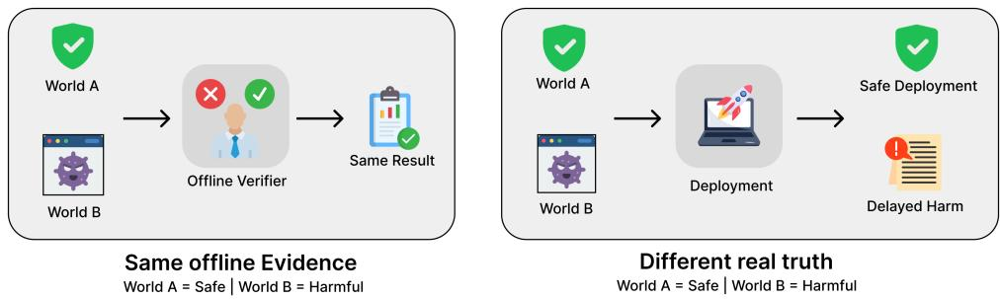
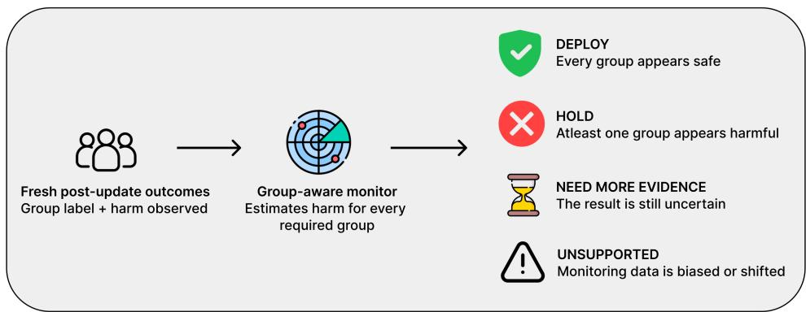
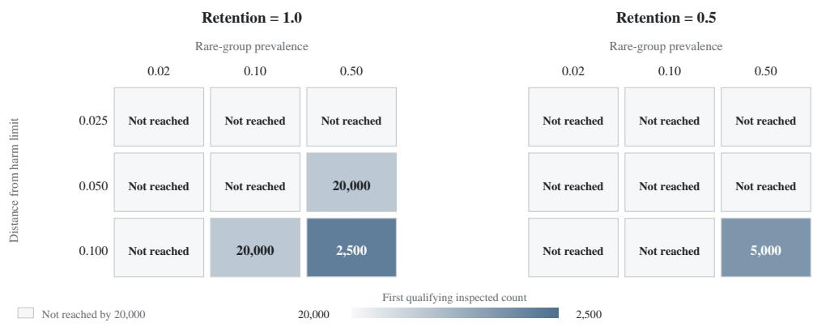

# Post-Audit Mirage: Identifiability Limits of Offline Agent Verification

Aman Behera IIT Roorkee

Payal Payal IIT Roorkee

## Abstract

Offline tests can fail to reveal whether an agent update will remain safe after deployment. We operationalize this post-audit mirage using matched safe and harmful lifecycles that expose identical verifier-visible evidence while an isolated scorer records opposite deployment truth. Our theorem applies standard observationalequivalence and indistinguishability ideas to this executable audit boundary and states the resulting error-abstention tradeoff. The Post-Audit Mirage benchmark makes that boundary executable across authorization, scheduling, and sharedcapacity environments. IdentifiedRangeMonitor uses fresh group-labelled harm outcomes to return deploy, hold, cannot determine, or unsupported. Experiments show that monitoring can recover the missing distinction in favorable settings but may remain undecided for rare groups, small effects, or missing observations. Verifier-agent evaluation must therefore test both calculation validity and whether the available evidence supports the deployment decision.

## 1 Introduction

An agent proposes a new authorization rule that passes every stored request and offline check. In one deployment it remains safe; in another, an unobserved change in who reaches a sensitive route later harms a rare group. If both deployments produced the same approval record, an offline verifier receives the same input in both worlds and cannot know which action is correct.

We call this the post-audit mirage: a fixed audit record can support more calculation without supplying missing deployment information. Reusable holdouts address adaptive reuse of a sample [1, 5, 6], while online testing and confidence sequences control repeated inference under stated probability laws [8, 9, 13, 27, 35, 36]. These tools cannot identify a property when the permitted observations remain compatible with opposite answers. This distinction matters when deployment changes later data or outcomes [2, 21, 25]. Related work studies how to detect, characterize, and benchmark distribution shift [7, 18, 26].

The paper makes the following independently testable contributions.

1. Executable indistinguishability boundary: we apply standard observational-equivalence and two-point indistinguishability ideas to an agent-audit interface, then operationalize the boundary with byte-identical public records and isolated protected truth.

2. Post-Audit Mirage benchmark: an exact matched-world lifecycle benchmark isolates scorer truth from every offline rule across three environments.

3. IdentifiedRangeMonitor: a fail-closed method uses fresh group-labelled outcomes to decide deploy or hold, remains undecided when evidence is insufficient, and returns unsupported when its collection assumptions fail.

Existing agent benchmarks and realistic task environments measure task success, interaction, and sandboxed risks [4, 15, 22, 23, 30, 39, 40, 42]. Runtime monitoring and worst-group evaluation provide complementary tools [11, 16, 17, 19, 32]. Recent systems instead budget evidence across edits (SGM), test candidates sequentially (PACE), compose controllers (SEA), add an exogenous audit (SEAL), or benchmark evolutionary trajectories (SEA-Eval) [10, 14, 33, 34, 38]. Here we ask an orthogonal question: do the verifier’s permitted observations identify the deployment property?

## 2 Why the audit cannot decide

Let O be the complete public record available before deployment and let Z be scorer-only deployment truth. An offline rule A maps O and private randomness U to deploy, hold, or abstain, where U is independent of O and has the same distribution in both worlds. The following result directly applies standard identification and two-point indistinguishability arguments; the contribution is its executable lifecycle-audit operationalization, not a new theoretical principle [24, 29, 41].

Audit-View Non-Identifiability Theorem 1. Suppose a safe world $P _ { \mathrm { s a f e } }$ and a harmful world $P _ { \mathrm { h a r m } }$ induce the same distribution for O but require opposite non-abstaining decisions. Then every offline rule $A ( O , U )$ has the same decision distribution in both worlds. If its abstention probability is r, then

$$
\operatorname* { m a x } \{ P _ { \mathrm { h a r m } } ( A = \mathrm { d e p l o y } ) , P _ { \mathrm { s a f e } } ( A = \mathrm { h o l d } ) \} \geq \frac { 1 - r } { 2 } .\tag{1}
$$

Equal laws for $( O , U )$ imply equal laws for A. If deploy, hold, and abstain have common probabilities $p , q , r ,$ the two wrong-action probabilities are p and q, and $p + q = 1 - r .$ For example, if a rule abstains 20% of the time, at least one matched world has error of at least 40%. The public record identifies a set of compatible answers, not a unique answer. Appendix A gives the complete proof.

  
Figure 1: Matched worlds expose the same complete offline evidence, forcing the same verifier decision, while their post-update outcomes require opposite actions. The Safe and Harmful labels shown for World A and World B are protected scorer-only truth and are never available to the offline verifier.

## 3 Benchmark and monitoring

Each benchmark unit is executed as a safe-harmful pair for 50 update rounds. The pair shares one serialized public lifecycle object, while the exact evaluator receives a separate realized environment object. Construction fails unless public rounds are identical, protected answers are opposite, and every public-only method returns the same paired decision sequence. We generate 100 AuthGate, 100 ConstraintPlan, and 72 BatchTriage pairs.

We run nine public-only diagnostic rules, ranging from always hold and fixed thresholds to adaptive spending, online e-testing, reused holdout, and transferred evidence. These local abstractions test whether any decision changes when method-facing information is fixed; they are not faithful reproductions or rankings of complete external systems.

The monitor starts from the compatible answer set. If both safe and harmful truth remain possible, it returns cannot determine. After the update is fixed, it consumes binary harm outcomes for a public roster of G groups. For group g and its nth retained outcome it spends

$$
\alpha _ { g , n } = \frac { \alpha } { G n ( n + 1 ) } , \qquad r _ { g , n } = \sqrt { \frac { \log ( 2 / \alpha _ { g , n } ) } { 2 n } } .\tag{2}
$$

Table 1: Exact benchmark families and their evidence boundary. Public audit fields are method-facing; deployment effects remain scorer-only.
<table><tr><td>Family</td><td>Agent update</td><td>Public audit</td><td>Scorer-only deployment effect</td></tr><tr><td>AuthGate</td><td>Change route access by group</td><td>Immediate access, audit harm, task quality</td><td>Delayed route harm, correlated incidents, live group occupancy</td></tr><tr><td>ConstraintPlan</td><td>Replace the incumbent schedule</td><td>Dependencies, deadlines, audit feasibility, objective</td><td>Cooldowns, protected blackouts, delayed violations, rare-group harm</td></tr><tr><td>BatchTriage</td><td>Change the shared-server policy</td><td>Per-group arrivals, service cost, completion</td><td>Co-arrival correlation, contention, backlog, delayed group harm</td></tr></table>

  
Figure 2: The fail-closed monitor uses fresh group-labelled harm outcomes after the update is fixed. It deploys only when every required group’s upper bound is safe, holds when any lower bound is harmful, and returns NEED MORE EVIDENCE, meaning cannot\_determine, while the plausible harm-rate range still crosses the threshold; biased or shifted monitoring is unsupported.

It deploys for the group-harm component only when every group upper bound is at or below the threshold, holds when any lower bound is above the threshold, and otherwise remains undecided. The guarantee assumes independent binary harm outcomes with a stable rate within each required group, a group list fixed in advance, missingness unrelated to harm, and no change in the target outcome distribution. An unseen required group cannot pass, and a declared biased or shifted collection design returns unsupported. The monitor certifies only declared group harm, not feasibility, utility, undeclared groups, or complete deployment safety. We compare the same retained counts with a pointwise Wilson score interval at each separately prespecified sample size [3, 37] and with an anytime-valid beta-binomial mixture confidence sequence [13, 28]. The Wilson comparison is fixed-sample only and is not valid for optional stopping.

## 4 Experiments and results

The three studies test whether identical audits force identical decisions, whether fresh outcomes restore the distinction, and when monitoring becomes informative.

## Matched audit

Across 272 pairs and 50 rounds per pair, all 13,600 public inputs match byte for byte, protected truth reverses, and all nine offline procedures return identical paired sequences when given the same random draws. This verifies observation equivalence without scorer leakage; it does not show that the procedures are generally equivalent or poor.

## Fixed-panel restoration

For each lifecycle, we sample 20 streams per world from the full simulator’s exact group frequencies and harm rates. Each semantic lifecycle is one statistical unit; its 20 nested Monte Carlo streams are aggregated as correct only if at least 16 are correct, and are never counted as independent lifecycle observations. At 20,000 attempted observations, all 272 safe and 272 harmful lifecycles meet the prespecified descriptive correctness rule, with 0/272 harmful lifecycles incorrectly deployed as safe in the final summary. This is a descriptive result on a fixed synthetic panel, not a population error-rate estimate; zero observed false-safe lifecycles is not zero risk, and the monitor observes group harm rather than replaying full deployment trajectories.

## Controlled difficulty sweep

We cross gaps of 0.025, 0.05, and 0.10 around the 15% threshold, rare-group prevalence of 0.02, 0.10, and 0.50, and retention, the fraction of outcomes observed, of 0.5 or 1.0, using 500 independent streams per world and cell. Here one generated stream within a prespecified cell and world is one independent statistical unit. With the primary Hoeffding monitor, only four settings qualify within the inspected range. Smaller margins, rarer groups, and missing observations keep the monitor undecided longer.

  
Figure 3: Fresh monitoring needed for reliable separation. Each cell gives the first attemptedobservation count at which safe and harmful streams meet the stated correctness and harmful-approval requirements. “Not reached” means no inspected look qualifies by 20,000 attempted observations. Larger safety margins, more common affected groups, and more complete observations generally require less data.

A setting qualifies using one-sided exact binomial bounds computed separately at each sample size. Released tables give all four status rates at every look and right-censored first decisions; Wilson onsets are descriptive, and no first qualifying inspected count is a formal sample-complexity estimate. None of the three studies ranks the nine offline rules as general-purpose methods.

## Scope

The benchmark constructs exact observation equivalence and does not estimate its production prevalence or monitor success. The monitor assumes independent fixed-rate binary outcomes, outcome-independent missingness, and a stable target; it cannot detect undeclared selection bias, missing-not-at-random outcomes, group omission, or target shift [12, 17, 20, 31]. Anytime-valid inference protects against optional stopping under its sampling assumptions but does not repair these information failures. If a required group is unobserved, it returns cannot\_determine; if the declared collection design is biased or the target has shifted, it returns unsupported.

## Conclusion

The standard indistinguishability argument shows that missing deployment truth cannot be recovered from an audit, and our theorem instantiates that argument at the benchmark’s audit interface. The benchmark makes this failure executable, and the monitor tests how fresh evidence can restore a declared group-harm decision without claiming complete safety. Verifier-agent evaluation should test both calculations and whether their evidence supports the decision.

## References

[1] Raef Bassily, Kobbi Nissim, Adam Smith, Thomas Steinke, Uri Stemmer, and Jonathan Ullman. Algorithmic stability for adaptive data analysis. In Proceedings of the 48th Annual ACM Symposium on Theory of Computing, pages 1046–1059, 2016. doi: 10.1145/2897518.2897566.

[2] Gavin Brown, Shlomi Hod, and Iden Kalemaj. Performative prediction in a stateful world. In Proceedings of the 25th International Conference on Artificial Intelligence and Statistics, volume 151 of Proceedings of Machine Learning Research, pages 6045–6061, 2022. URL https://proceedings.mlr.press/v151/brown22a.html.

[3] Lawrence D. Brown, T. Tony Cai, and Anirban DasGupta. Interval estimation for a binomial proportion. Statistical Science, 16(2):101–133, 2001. doi: 10.1214/ss/1009213286.

[4] Edoardo Debenedetti, Jie Zhang, Mislav Balunovic, Luca Beurer-Kellner, Marc Fischer, and´ Florian Tramèr. AgentDojo: A dynamic environment to evaluate prompt injection attacks and defenses for LLM agents. In Advances in Neural Information Processing Systems, volume 37, 2024. doi: 10.52202/079017-2636. URL https://proceedings.neurips.cc/paper\_files/ paper/2024/hash/97091a5177d8dc64b1da8bf3e1f6fb54-Abstract-Datasets\_and\_ Benchmarks\_Track.html.

[5] Cynthia Dwork, Vitaly Feldman, Moritz Hardt, Toniann Pitassi, Omer Reingold, and Aaron Roth. Preserving statistical validity in adaptive data analysis. In Proceedings ofthe 47th Annual ACM Symposium on Theory ofComputing, pages 117–126, 2015. doi: 10.1145/2746539.2746580.

[6] Cynthia Dwork, Vitaly Feldman, Moritz Hardt, Toniann Pitassi, Omer Reingold, and Aaron Roth. The reusable holdout: Preserving validity in adaptive data analysis. Science, 349(6248): 636–638, 2015. doi: 10.1126/science.aaa9375.

[7] Zhen Fang, Yixuan Li, Jie Lu, Jiahua Dong, Bo Han, and Feng Liu. Is out-of-distribution detection learnable? In Advances in Neural Information Processing Systems, volume 35, 2022. URL https://proceedings.neurips.cc/paper\_files/paper/2022/ hash/f0e91b1314fa5eabf1d7ef6d1561ecec-Abstract-Conference.html.

[8] Lasse Fischer and Aaditya Ramdas. Admissible online closed testing must employ e-values. arXiv preprint arXiv:2407.15733, 2024. URL https://arxiv.org/abs/2407.15733.

[9] Lasse Fischer, Marta Bofill Roig, and Werner Brannath. The online closure principle. The Annals ofStatistics, 52(2):817–841, 2024. doi: 10.1214/24-AOS2370.

[10] Diandian Guo, Cong Cao, Fangfang Yuan, Yingqi Wang, Yueshan Wang, and Dakui Wang. Self-authored verification is unreliable in heuristic self-improving agents. arXiv preprint arXiv:2607.24300, 2026. URL https://arxiv.org/abs/2607.24300.

[11] Tatsunori Hashimoto, Megha Srivastava, Hongseok Namkoong, and Percy Liang. Fairness without demographics in repeated loss minimization. In Proceedings of the 35th International Conference on Machine Learning, volume 80 of Proceedings ofMachine Learning Research, pages 1929–1938, 2018. URL https://proceedings.mlr.press/v80/hashimoto18a. html.

[12] James J. Heckman. Sample selection bias as a specification error. Econometrica, 47(1):153–161, 1979. doi: 10.2307/1912352.

[13] Steven R. Howard, Aaditya Ramdas, Jon McAuliffe, and Jasjeet Sekhon. Time-uniform, nonparametric, nonasymptotic confidence sequences. The Annals of Statistics, 49(2):1055– 1080, 2021. doi: 10.1214/20-AOS1991.

[14] Sihang Jiang, Lipeng Ma, Zhonghua Hong, Keyi Wang, Zhiyu Lu, Tengfei Wang, Shisong Chen, Jinghao Zhang, Tianjun Pan, Weijia Li, Jiaqing Liang, and Yanghua Xiao. SEA-Eval: A benchmark for evaluating self-evolving agents beyond episodic assessment. arXiv preprint arXiv:2604.08988, 2026. URL https://arxiv.org/abs/2604.08988.

[15] Carlos E. Jimenez, John Yang, Alexander Wettig, Shunyu Yao, Kexin Pei, Ofir Press, and Karthik Narasimhan. SWE-bench: Can language models resolve real-world GitHub issues? In International Conference on Learning Representations, 2024. URL https://openreview. net/forum?id=VTF8yNQM66.

[16] Daniel Kang, Deepti Raghavan, Peter Bailis, and Matei Zaharia. Model assertions for monitoring and improving ML models. In Proceedings of Machine Learning and Systems, volume 2, 2020. URL https://proceedings.mlsys.org/paper\_files/paper/2020/ hash/e851ca7b43815718fbbac8afb2246bf8-Abstract.html.

[17] Michael Kearns, Seth Neel, Aaron Roth, and Zhiwei Steven Wu. Preventing fairness gerrymandering: Auditing and learning for subgroup fairness. In Proceedings ofthe 35th International Conference on Machine Learning, volume 80 of Proceedings of Machine Learning Research, pages 2564–2572, 2018. URL https://proceedings.mlr.press/v80/kearns18a.html.

[18] Pang Wei Koh, Shiori Sagawa, Henrik Marklund, Sang Michael Xie, Marvin Zhang, Akshay Balsubramani, Weihua Hu, Michihiro Yasunaga, Richard Lanas Phillips, Irena Gao, Tony Lee, Etienne David, Ian Stavness, Wei Guo, Berton Earnshaw, Imran Haque, Sara M Beery, Jure Leskovec, Anshul Kundaje, Emma Pierson, Sergey Levine, Chelsea Finn, and Percy Liang. WILDS: A benchmark of in-the-wild distribution shifts. In Proceedings ofthe 38th International Conference on Machine Learning, volume 139 of Proceedings of Machine Learning Research, pages 5637–5664, 2021. URL https://proceedings.mlr.press/v139/koh21a.html.

[19] Martin Leucker and Christian Schallhart. A brief account of runtime verification. The Journal ofLogic and Algebraic Programming, 78(5):293–303, 2009. doi: 10.1016/j.jlap.2008.08.004.

[20] Zachary C. Lipton, Yu-Xiang Wang, and Alexander Smola. Detecting and correcting for label shift with black box predictors. In Proceedings ofthe 35th International Conference on Machine Learning, volume 80 of Proceedings ofMachine Learning Research, pages 3122–3130, 2018. URL https://proceedings.mlr.press/v80/lipton18a.html.

[21] Lydia T. Liu, Sarah Dean, Esther Rolf, Max Simchowitz, and Moritz Hardt. Delayed impact of fair machine learning. In Proceedings of the 35th International Conference on Machine Learning, volume 80 of Proceedings of Machine Learning Research, pages 3150–3158, 2018. URL https://proceedings.mlr.press/v80/liu18c.html.

[22] Xiao Liu, Hao Yu, Hanchen Zhang, Yifan Xu, Xuanyu Lei, Hanyu Lai, Yu Gu, Hangliang Ding, Kaiwen Men, Kejuan Yang, Shudan Zhang, Xiang Deng, Aohan Zeng, Zhengxiao Du, Chenhui Zhang, Sheng Shen, Tianjun Zhang, Yu Su, Huan Sun, Minlie Huang, Yuxiao Dong, and Jie Tang. AgentBench: Evaluating LLMs as agents. In International Conference on Learning Representations, 2024. URL https://openreview.net/forum?id=zAdUB0aCTQ.

[23] Chang Ma, Junlei Zhang, Zhihao Zhu, Cheng Yang, Yujiu Yang, Yaohui Jin, Zhenzhong Lan, Lingpeng Kong, and Junxian He. AgentBoard: An analytical evaluation board of multi-turn LLM agents. In Advances in Neural Information Processing Systems, volume 37, 2024. doi: 10.52202/079017-2365. URL https://proceedings.neurips.cc/paper\_files/ paper/2024/hash/877b40688e330a0e2a3fc24084208dfa-Abstract-Datasets\_and\_ Benchmarks\_Track.html.

[24] Charles F. Manski. Partial Identification of Probability Distributions. Springer, 2003. doi: 10.1007/b97478.

[25] Juan C. Perdomo, Tijana Zrnic, Celestine Mendler-Dünner, and Moritz Hardt. Performative prediction. In Proceedings of the 37th International Conference on Machine Learning, volume 119 of Proceedings of Machine Learning Research, pages 7599–7609, 2020. URL https: //proceedings.mlr.press/v119/perdomo20a.html.

[26] Stephan Rabanser, Stephan Günnemann, and Zachary C. Lipton. Failing loudly: An empirical study of methods for detecting dataset shift. In Advances in Neural Information Processing Systems, volume 32, 2019. URL https://proceedings.neurips.cc/paper/2019/hash/ 846c260d715e5b854ffad5f70a516c88-Abstract.html.

[27] Aaditya Ramdas, Peter Grünwald, Vladimir Vovk, and Glenn Shafer. Game-theoretic statistics and safe anytime-valid inference. Statistical Science, 38(4):576–601, 2023. doi: 10.1214/ 23-STS894.

[28] Herbert Robbins. Statistical methods related to the law of the iterated logarithm. The Annals of Mathematical Statistics, 41(5):1397–1409, 1970. doi: 10.1214/aoms/1177696786.

[29] Thomas J. Rothenberg. Identification in parametric models. Econometrica, 39(3):577–591, 1971. doi: 10.2307/1913267.

[30] Yangjun Ruan, Honghua Dong, Andrew Wang, Silviu Pitis, Yongchao Zhou, Jimmy Ba, Yann Dubois, Chris J. Maddison, and Tatsunori Hashimoto. Identifying the risks of LM agents with an LM-emulated sandbox. In International Conference on Learning Representations, 2024. URL https://openreview.net/forum?id=GEcwtMk1uA.

[31] Donald B. Rubin. Inference and missing data. Biometrika, 63(3):581–592, 1976. doi: 10.1093/ biomet/63.3.581.

[32] Shiori Sagawa, Pang Wei Koh, Tatsunori B. Hashimoto, and Percy Liang. Distributionally robust neural networks for group shifts: On the importance of regularization for worst-case generalization. In International Conference on Learning Representations, 2020. URL https: //openreview.net/forum?id=ryxGuJrFvS.

[33] Biswa Sengupta. Self-evolving agents with anytime-valid certificates. arXiv preprint arXiv:2607.00871, 2026. URL https://arxiv.org/abs/2607.00871.

[34] Zayx Shawn. PACE: Anytime-valid acceptance tests for self-evolving agents. arXiv preprint arXiv:2606.08106, 2026. URL https://arxiv.org/abs/2606.08106.

[35] Jinjin Tian and Aaditya Ramdas. ADDIS: An adaptive discarding algorithm for online FDR control with conservative nulls. In Advances in Neural Information Processing Systems, volume 32, 2019. URL https://proceedings.neurips.cc/paper/2019/hash/ 1d6408264d31d453d556c60fe7d0459e-Abstract.html.

[36] Jinjin Tian and Aaditya Ramdas. Online control of the familywise error rate. Statistical Methods in Medical Research, 30(4):976–993, 2021. doi: 10.1177/0962280220983381.

[37] Edwin B. Wilson. Probable inference, the law of succession, and statistical inference. Journal ofthe American Statistical Association, 22(158):209–212, 1927. doi: 10.1080/01621459.1927. 10502953.

[38] Xuening Wu, Shenqin Yin, Yanlan Kang, Xinhang Zhang, Qianya Xu, Zeping Chen, and Wenqiang Zhang. SGM: A statistical Godel machine for risk-controlled recursive self-modification. arXiv preprint arXiv:2510.10232, 2025. URL https://arxiv.org/abs/2510.10232.

[39] Tianbao Xie, Danyang Zhang, Jixuan Chen, Xiaochuan Li, Siheng Zhao, Ruisheng Cao, Toh Jing Hua, Zhoujun Cheng, Dongchan Shin, Fangyu Lei, Yitao Liu, Yiheng Xu, Shuyan Zhou, Silvio Savarese, Caiming Xiong, Victor Zhong, and Tao Yu. OSWorld: Benchmarking multimodal agents for open-ended tasks in real computer environments. In Advances in Neural Information Processing Systems, volume 37, 2024. doi: 10.52202/079017-1650. URL https://proceedings.neurips.cc/paper\_files/ paper/2024/hash/5d413e48f84dc61244b6be550f1cd8f5-Abstract-Datasets\_and\_ Benchmarks\_Track.html.

[40] Shunyu Yao, Noah Shinn, Pedram Razavi, and Karthik Narasimhan. τ -bench: A benchmark for tool-agent-user interaction in real-world domains. In International Conference on Learning Representations, 2025. URL https://openreview.net/forum?id=roNSXZpUDN.

[41] Bin Yu. Assouad, fano, and Le Cam. In David Pollard, Erik Torgersen, and Grace L. Yang, editors, Festschrift for Lucien Le Cam, pages 423–435. Springer, 1997. doi: 10.1007/ 978-1-4612-1880-7\_29.

[42] Shuyan Zhou, Frank F. Xu, Hao Zhu, Xuhui Zhou, Robert Lo, Abishek Sridhar, Xianyi Cheng, Tianyue Ou, Yonatan Bisk, Daniel Fried, Uri Alon, and Graham Neubig. WebArena: A realistic web environment for building autonomous agents. In International Conference on Learning Representations, 2024. URL https://openreview.net/forum?id=oKn9c6ytLx.

## A Complete proof

Let $P _ { \mathrm { s a f e } } ^ { O } = P _ { \mathrm { h a r m } } ^ { O }$ and let $U$ have the same distribution in both worlds, independent of O. Then the joint laws of $( O , U )$ are equal. For every measurable decision set B, the mapping theorem gives

$$
P _ { \mathrm { s a f e } } \{ A ( O , U ) \in B \} = P _ { \mathrm { h a r m } } \{ A ( O , U ) \in B \} .
$$

Write the common probabilities of deploy, hold, and abstain as $p , q , r .$ . Deploy is an error in the harmful world and hold is an error in the safe world, so the two error probabilities are $p$ and $q .$ Since $p + q = 1 - r , \operatorname* { m a x } ( p , q ) \geq ( p + q ) / 2 = ( 1 - r ) / 2$ . For a deterministic non-abstaining rule, the shared observation forces either deploy in both worlds or hold in both worlds, so one decision is wrong with probability one.

## B Environment and integrity details

The public record contains only method-permitted fields. The exact scorer receives a separate realized environment object with protected post-update outcomes. The paired constructor asserts equal serialized public rounds and opposite protected answers before writing a witness. The evaluation runner then passes only public records to the nine diagnostic procedures: always hold, greedy, fixed threshold, shrinking-budget spending, ADDIS-style spending, online closed e-testing, per-update reset, reused holdout, and transferred cross-update evidence.

Generation enforces four invariants. Paired worlds must share all 50 public rounds, protected answers must be opposite, every public-only procedure must receive coupled inputs and randomness, and protected scorer fields must be absent from method constructors. Failure of any invariant stops generation.

Operational AuthGate vignette. A hospital tests a rule that grants a time-limited export token to approved on-call clinicians. The stored audit contains the same approved requests, immediate task completions, and zero immediate violations in both matched worlds. In the safe world, the deployment gateway expires every token before the next shift. In the harmful world, a separately configured renewal worker keeps some tokens active for three steps, and a later routing change sends more rare-group records through those sessions. Neither configuration is present in the predeployment audit, so both worlds are operationally plausible from the verifier’s permitted record even though their delayed group-harm truth is opposite. This vignette establishes operational plausibility only and is not empirical production evidence.

## C Monitor guarantee

For each required group $^ { g , }$ the monitor stores an observation count $n _ { g }$ and harm sum $s _ { g } .$ . At every retained outcome it computes Equation 2 and the clipped interval $[ \widehat { \mu } _ { g , n } - r _ { g , n } , \widehat { \mu } _ { g , n } + r _ { g , n } ]$ . Within each group, retained outcomes are assumed to be independent Bernoulli draws with one fixed deployment mean. Group arrivals and outcome-independent retention may alter counts but not the conditional outcome law.

For a fixed group and count, Hoeffding’s inequality gives failure probability at most $\alpha _ { g , n } / 2$ on each side. Therefore

$$
\sum _ { g = 1 } ^ { G } \sum _ { n = 1 } ^ { \infty } \alpha _ { g , n } = \frac { \alpha } { G } \sum _ { g = 1 } ^ { G } \sum _ { n = 1 } ^ { \infty } \frac { 1 } { n ( n + 1 ) } = \alpha .
$$

The union bound gives simultaneous coverage over all groups and observation counts under the stated model. On this event, deploy implies that every declared group-harm mean is at most threshold, while hold implies that at least one is larger. No conclusion follows for feasibility, utility, an undeclared group, or a shifted target.

For comparison, the fixed-sample Wilson score interval uses the standard score center and radius at each prespecified look. It is reported pointwise and is never carried forward as an anytime-valid decision. The beta-binomial mixture method inverts a Bernoulli mixture martingale, producing a confidence sequence that is valid uniformly over time under the same independent fixed-rate model. All three methods receive identical group labels, observation counts, and harm counts, and all allocate the lifecycle error budget across required groups.

Table 2: Fixed-panel Hoeffding monitor status rates at every evaluated look. These 272 heterogeneous synthetic lifecycles per world form a fixed descriptive panel, not independent draws supporting a population error-rate estimate.
<table><tr><td colspan="4">Safe world (%)</td><td colspan="3">Harmful world (%)</td></tr><tr><td>Look</td><td>Deploy</td><td>Hold</td><td>Cannot</td><td>Deploy</td><td>Hold</td><td>Cannot</td></tr><tr><td>5</td><td>0.0</td><td>0.0</td><td>100.0</td><td>0.0</td><td>0.0</td><td>100.0</td></tr><tr><td>10</td><td>0.0</td><td>0.0</td><td>100.0</td><td>0.0</td><td>0.0</td><td>100.0</td></tr><tr><td>20</td><td>0.0</td><td>0.0</td><td>100.0</td><td>0.0</td><td>0.4</td><td>99.6</td></tr><tr><td>50</td><td>0.0</td><td>0.0</td><td>100.0</td><td>0.0</td><td>36.8</td><td>63.2</td></tr><tr><td>100</td><td>0.0</td><td>0.0</td><td>100.0</td><td>0.0</td><td>36.8</td><td>63.2</td></tr><tr><td>200</td><td>0.0</td><td>0.0</td><td>100.0</td><td>0.0</td><td>39.0</td><td>61.0</td></tr><tr><td>500</td><td>0.0</td><td>0.0</td><td>100.0</td><td>0.0</td><td>63.2</td><td>36.8</td></tr><tr><td>1,000</td><td>0.0</td><td>0.0</td><td>100.0</td><td>0.0</td><td>63.2</td><td>36.8</td></tr><tr><td>2,500</td><td>62.5</td><td>0.0</td><td>37.5</td><td>0.0</td><td>63.2</td><td>36.8</td></tr><tr><td>5,000</td><td>100.0</td><td>0.0</td><td>0.0</td><td>0.0</td><td>100.0</td><td>0.0</td></tr><tr><td>10,000</td><td>100.0</td><td>0.0</td><td>0.0</td><td>0.0</td><td>100.0</td><td>0.0</td></tr><tr><td>20,000</td><td>100.0</td><td>0.0</td><td>0.0</td><td>0.0</td><td>100.0</td><td>0.0</td></tr></table>

## D Experimental details

All generators use seed 20260821. The matched panel has 272 semantic units and 50 rounds per unit. Its 100 AuthGate, 100 ConstraintPlan, and 72 BatchTriage environment structures are identifier-free and distinct, but their normalized method-facing signatures number 1, 100, and 72 respectively. AuthGate deliberately places structural variation behind one audit pattern. The fixed panel uses 20 streams per world and unit. The controlled panel uses 500 independent streams per world and cell. The twelve inspected sample sizes range from 5 to 20,000 attempted observations. The per-stream simultaneous group-and-time monitoring level is α = 0.05, and the group-harm threshold is 0.15. The four qualifying controlled settings and their first qualifying inspected looks are listed in Section 4; the remaining 14 settings do not qualify by 20,000 attempted observations.

A controlled cell qualifies when pointwise one-sided 95% exact lower bounds for safe and harmful correctness are at least 0.80 and the pointwise upper bound for cumulative harmful false-safe decisions is at most 0.05. The first qualifying inspected look is a descriptive decision-onset diagnostic, not a sample-complexity estimate or a simultaneous 95% confidence statement across looks and metrics. The evaluation is CPU-only and uses no model training or external dataset. One reference regeneration of the central result on an Apple M5 arm64 CPU with 10 cores and 16 GB RAM, Python 3.13.12, and eight workers took 267.30 seconds wall time, 1,894.38 seconds user CPU time, and 8.43 seconds system time. The maximum resident set reported by /usr/bin/time -lp was 1.55 GB, and the command wrote 111.5 MB; it used no GPU, network, or model service. These machine-specific measurements are not hardware requirements, and earlier development and failed exploratory runs used additional unrecorded CPU time that is excluded.

The executable release at https://github.com/beingamanforever/Post-Audit-Mirage includes the full source, independent JavaScript scorers, complete configurations, frozen synthetic records, named integrity tests, generated results, an MIT license, third-party notices, and exact reproduction commands. From the repository root, regenerate the central result with:

python -m src run-identifiability-experiments \

–config configs/identifiability.json –data-dir data \

–output-dir reproduced/data \

–artifacts-dir reproduced/artifacts –workers 8

## E Complete status and decision-time reporting

The fixed-panel tables aggregate the 272 semantic lifecycles per world, after applying the prespecified 16-of-20 nested-stream rule within each lifecycle. The controlled tables aggregate the equally sized 18-cell grid, totaling 9,000 independent streams per world; they describe this grid and not a production population. All rates are generated from identifiability\_summary.json. Unsupported was 0.0% at every reported look; declared assumption violations are reported separately as unsupported.

Complete method-by-cell status and timing rows for all three methods are released in machinereadable form.

Table 3: Controlled-grid Hoeffding monitor status rates at every evaluated look.
<table><tr><td colspan="4">Safe world (%)</td><td colspan="3">Harmful world (%)</td></tr><tr><td>Look</td><td>Deploy</td><td>Hold</td><td>Cannot</td><td>Deploy</td><td>Hold</td><td>Cannot</td></tr><tr><td>5</td><td>0.0</td><td>0.0</td><td>100.0</td><td>0.0</td><td>0.0</td><td>100.0</td></tr><tr><td>10</td><td>0.0</td><td>0.0</td><td>100.0</td><td>0.0</td><td>0.0</td><td>100.0</td></tr><tr><td>20</td><td>0.0</td><td>0.0</td><td>100.0</td><td>0.0</td><td>0.0</td><td>100.0</td></tr><tr><td>50</td><td>0.0</td><td>0.0</td><td>100.0</td><td>0.0</td><td>0.0</td><td>100.0</td></tr><tr><td>100</td><td>0.0</td><td>0.0</td><td>100.0</td><td>0.0</td><td>0.0</td><td>100.0</td></tr><tr><td>200</td><td>0.0</td><td>0.0</td><td>100.0</td><td>0.0</td><td>0.0</td><td>100.0</td></tr><tr><td>500</td><td>0.0</td><td>0.0</td><td>100.0</td><td>0.0</td><td>0.0</td><td>100.0</td></tr><tr><td>1,000</td><td>0.0</td><td>0.0</td><td>100.0</td><td>0.0</td><td>0.4</td><td>99.6</td></tr><tr><td>2,500</td><td>5.3</td><td>0.0</td><td>94.7</td><td>0.0</td><td>5.9</td><td>94.1</td></tr><tr><td>5,000</td><td>11.0</td><td>0.0</td><td>89.0</td><td>0.0</td><td>11.0</td><td>89.0</td></tr><tr><td>10,000</td><td>19.0</td><td>0.0</td><td>81.0</td><td>0.0</td><td>19.3</td><td>80.7</td></tr><tr><td>20,000</td><td>30.0</td><td>0.0</td><td>70.0</td><td>0.0</td><td>30.1</td><td>69.9</td></tr></table>

Table 4: Fixed-panel first-decision stopping-time distribution, including right-censoring after 20,000 observations.
<table><tr><td colspan="2"></td><td colspan="2">Safe world (%)</td><td colspan="2">Harmful world (%) Hold</td></tr><tr><td>First decision</td><td>Deploy</td><td>Hold</td><td>Deploy</td><td></td></tr><tr><td>5</td><td>0.0</td><td>0.0</td><td>0.0</td><td>0.0</td></tr><tr><td>10</td><td>0.0</td><td>0.0</td><td>0.0</td><td>0.0</td></tr><tr><td>20</td><td>0.0</td><td>0.0</td><td>0.0</td><td>0.4</td></tr><tr><td>50</td><td>0.0</td><td>0.0</td><td>0.0</td><td>36.4</td></tr><tr><td>100</td><td>0.0</td><td>0.0</td><td>0.0</td><td>0.0</td></tr><tr><td>200</td><td>0.0</td><td>0.0</td><td>0.0</td><td>2.2</td></tr><tr><td>500</td><td>0.0</td><td>0.0</td><td>0.0</td><td>24.3</td></tr><tr><td>1,000</td><td>0.0</td><td>0.0</td><td>0.0</td><td>0.0</td></tr><tr><td>2,500</td><td>62.5</td><td>0.0</td><td>0.0</td><td>0.0</td></tr><tr><td>5,000</td><td>37.5</td><td>0.0</td><td>0.0</td><td>36.8</td></tr><tr><td>10,000</td><td>0.0</td><td>0.0</td><td>0.0</td><td>0.0</td></tr><tr><td>20,000</td><td>0.0</td><td>0.0</td><td>0.0</td><td>0.0</td></tr><tr><td>Right-censored</td><td>0.0</td><td></td><td>0.0</td><td></td></tr></table>

The benchmark may help deployment teams refuse unsupported decisions and expose missing groups. Its conservative monitor can also delay beneficial updates, and a declared group roster can omit affected people. It should inform human governance rather than autonomously authorize deployment.

## NeurIPS Paper Checklist

## 1. Claims

Question: Do the main claims made in the abstract and introduction accurately reflect the paper’s contributions and scope?

Answer: [Yes]

Justification: The abstract, introduction, and limitations state the matched-world result, conditional monitoring result, fixed-panel scope, and controlled-panel power limitation.

Guidelines:

• The answer [N/A] means that the abstract and introduction do not include the claims made in the paper.

• The abstract and/or introduction should clearly state the claims made, including the contributions made in the paper and important assumptions and limitations. A [No] or [N/A] answer to this question will not be perceived well by the reviewers.

• The claims made should match theoretical and experimental results, and reflect how much the results can be expected to generalize to other settings.

• It is fine to include aspirational goals as motivation as long as it is clear that these goals are not attained by the paper.

## 2. Limitations

Question: Does the paper discuss the limitations of the work performed by the authors?

Answer: [Yes]

Table 5: Controlled-grid first-decision stopping-time distribution, including right-censoring after 20,000 observations.
<table><tr><td>First decision</td><td>Safe world (%) Deploy Hold</td><td>Harmful world (%) Deploy</td><td>Hold</td></tr><tr><td></td><td></td><td>0.0</td><td></td></tr><tr><td>5 10</td><td>0.0</td><td>0.0 0.0</td><td>0.0 0.0</td></tr><tr><td>20</td><td>0.0 0.0</td><td>0.0 0.0 0.0</td><td>0.0</td></tr><tr><td>50</td><td>0.0</td><td>0.0 0.0</td><td>0.0</td></tr><tr><td>100</td><td>0.0</td><td>0.0 0.0</td><td>0.0</td></tr><tr><td>200</td><td>0.0</td><td>0.0 0.0</td><td>0.0</td></tr><tr><td>500</td><td>0.0</td><td>0.0 0.0</td><td>0.0</td></tr><tr><td>1,000</td><td>0.0</td><td>0.0 0.0</td><td>0.4</td></tr><tr><td>2,500</td><td>5.3</td><td>0.0 0.0</td><td>5.5</td></tr><tr><td>5,000</td><td>5.7</td><td>0.0 0.0</td><td>5.1</td></tr><tr><td>10,000</td><td>8.0</td><td>0.0 0.0</td><td>8.4</td></tr><tr><td>20,000</td><td>11.0</td><td>0.0</td><td>10.8</td></tr><tr><td>Right-censored</td><td>70.0</td><td>0.0 69.9</td><td></td></tr></table>

Table 6: Fixed-panel final-look status comparison at 20,000 attempted observations. Wilson is pointwise only; both confidence-sequence rows are stopping-valid under the declared model. Unsupported was 0.0% throughout.
<table><tr><td></td><td colspan="3">Safe world (%)</td><td colspan="3">Harmful world (%)</td></tr><tr><td>Method</td><td>Deploy</td><td>Hold</td><td>Cannot</td><td>Deploy</td><td>Hold</td><td>Cannot</td></tr><tr><td>Hoeffding CS</td><td>100.0</td><td>0.0</td><td>0.0</td><td>0.0</td><td>100.0</td><td>0.0</td></tr><tr><td>Wilson pointwise</td><td>100.0</td><td>0.0</td><td>0.0</td><td>0.0</td><td>100.0</td><td>0.0</td></tr><tr><td>Beta-binomial CS</td><td>100.0</td><td>0.0</td><td>0.0</td><td>0.0</td><td>100.0</td><td>0.0</td></tr></table>

Justification: The Scope paragraph states that the benchmark is synthetic, makes no production-prevalence claim, treats the fixed panel descriptively, does not equate zero observed false-safe cases with zero risk, and conditions monitoring conclusions on the declared sampling model.

## Guidelines:

• The answer [N/A] means that the paper has no limitation while the answer [No] means that the paper has limitations, but those are not discussed in the paper.

• The authors are encouraged to create a separate “Limitations” section in their paper.

• The paper should point out any strong assumptions and how robust the results are to violations of these assumptions (e.g., independence assumptions, noiseless settings, model well-specification, asymptotic approximations only holding locally). The authors should reflect on how these assumptions might be violated in practice and what the implications would be.

• The authors should reflect on the scope of the claims made, e.g., if the approach was only tested on a few datasets or with a few runs. In general, empirical results often depend on implicit assumptions, which should be articulated.

• The authors should reflect on the factors that influence the performance of the approach. For example, a facial recognition algorithm may perform poorly when image resolution is low or images are taken in low lighting. Or a speech-to-text system might not be used reliably to provide closed captions for online lectures because it fails to handle technical jargon.

• The authors should discuss the computational efficiency of the proposed algorithms and how they scale with dataset size.

• If applicable, the authors should discuss possible limitations of their approach to address problems of privacy and fairness.

• While the authors might fear that complete honesty about limitations might be used by reviewers as grounds for rejection, a worse outcome might be that reviewers discover limitations that aren’t acknowledged in the paper. The authors should use their best judgment and recognize that individual actions in favor of transparency play an important role in developing norms that preserve the integrity of the community. Reviewers will be specifically instructed to not penalize honesty concerning limitations.

## 3. Theory assumptions and proofs

Table 7: Controlled-grid decision-onset comparison. Counts in parentheses are numbers of the 18 prespecified cells whose first qualifying inspected look occurred at that value. Wilson onsets are descriptive because Wilson is pointwise.
<table><tr><td>Method</td><td>Stopping-valid</td><td>Qualified</td><td>First qualifying inspected looks</td></tr><tr><td>Hoeffding CS</td><td>yes</td><td>4/18</td><td>2,500 (1), 5,000 (1), 20,000 (2)</td></tr><tr><td>Wilson pointwise</td><td>no</td><td>12/18</td><td>500 (1), 1,000 (1), 2,500 (3), 5,000 (1), 10,000 (4), 20,000 (2)</td></tr><tr><td>Beta-binomial CS</td><td>yes</td><td>9/18</td><td>1,000 (1), 2,500 (1), 5,000 (2), 10,000 (2), 20,000 (3)</td></tr></table>

Question: For each theoretical result, does the paper provide the full set of assumptions and a complete (and correct) proof?

## Answer: [Yes]

Justification: Theorem 1 is explicitly positioned as an application of standard identification and two-point indistinguishability ideas, states all assumptions, gives a proof sketch, and Appendix A provides the complete proof.

Guidelines:

• The answer [N/A] means that the paper does not include theoretical results.

• All the theorems, formulas, and proofs in the paper should be numbered and crossreferenced.

• All assumptions should be clearly stated or referenced in the statement of any theorems.

• The proofs can either appear in the main paper or the supplemental material, but if they appear in the supplemental material, the authors are encouraged to provide a short proof sketch to provide intuition.

• Inversely, any informal proof provided in the core of the paper should be complemented by formal proofs provided in appendix or supplemental material.

• Theorems and Lemmas that the proof relies upon should be properly referenced.

## 4. Experimental result reproducibility

Question: Does the paper fully disclose all the information needed to reproduce the main experimental results of the paper to the extent that it affects the main claims and/or conclusions of the paper (regardless of whether the code and data are provided or not)?

Answer: [Yes]

Justification: The paper and public source release report the scoring rules, statistical units, complete generator and experiment configurations, seeds, stream counts, inspected looks, thresholds, assumptions, decision criteria, exact commands, tests, and released result records.

Guidelines:

• The answer [N/A] means that the paper does not include experiments.

• If the paper includes experiments, a [No] answer to this question will not be perceived well by the reviewers: Making the paper reproducible is important, regardless of whether the code and data are provided or not.

• If the contribution is a dataset and/or model, the authors should describe the steps taken to make their results reproducible or verifiable.

• Depending on the contribution, reproducibility can be accomplished in various ways. For example, if the contribution is a novel architecture, describing the architecture fully might suffice, or if the contribution is a specific model and empirical evaluation, it may be necessary to either make it possible for others to replicate the model with the same dataset, or provide access to the model. In general. releasing code and data is often one good way to accomplish this, but reproducibility can also be provided via detailed instructions for how to replicate the results, access to a hosted model (e.g., in the case of a large language model), releasing of a model checkpoint, or other means that are appropriate to the research performed.

• While NeurIPS does not require releasing code, the conference does require all submissions to provide some reasonable avenue for reproducibility, which may depend on the nature of the contribution. For example

(a) If the contribution is primarily a new algorithm, the paper should make it clear how to reproduce that algorithm.

(b) If the contribution is primarily a new model architecture, the paper should describe the architecture clearly and fully.

(c) If the contribution is a new model (e.g., a large language model), then there should either be a way to access this model for reproducing the results or a way to reproduce the model (e.g., with an open-source dataset or instructions for how to construct the dataset).

(d) We recognize that reproducibility may be tricky in some cases, in which case authors are welcome to describe the particular way they provide for reproducibility. In the case of closed-source models, it may be that access to the model is limited in some way (e.g., to registered users), but it should be possible for other researchers to have some path to reproducing or verifying the results.

## 5. Open access to data and code

Question: Does the paper provide open access to the data and code, with sufficient instructions to faithfully reproduce the main experimental results, as described in supplemental material?

Answer: [Yes]

Justification: The public code release contains the executable source, data, configurations, exact commands, tests, figures, MIT project and dataset license, and retained third-party notice needed to reproduce the main results.

Guidelines:

• The answer [N/A] means that paper does not include experiments requiring code.

• Please see the NeurIPS code and data submission guidelines (https://neurips.cc/ public/guides/CodeSubmissionPolicy) for more details.

• While we encourage the release of code and data, we understand that this might not be possible, so [No] is an acceptable answer. Papers cannot be rejected simply for not including code, unless this is central to the contribution (e.g., for a new open-source benchmark).

• The instructions should contain the exact command and environment needed to run to reproduce the results. See the NeurIPS code and data submission guidelines (https: //neurips.cc/public/guides/CodeSubmissionPolicy) for more details.

• The authors should provide instructions on data access and preparation, including how to access the raw data, preprocessed data, intermediate data, and generated data, etc.

• The authors should provide scripts to reproduce all experimental results for the new proposed method and baselines. If only a subset of experiments are reproducible, they should state which ones are omitted from the script and why.

• At submission time, to preserve anonymity, the authors should release anonymized versions (if applicable).

• Providing as much information as possible in supplemental material (appended to the paper) is recommended, but including URLs to data and code is permitted.

## 6. Experimental setting/details

Question: Does the paper specify all the training and test details (e.g., data splits, hyperparameters, how they were chosen, type of optimizer) necessary to understand the results?

Answer: [Yes]

Justification: The paper and released configurations give every generator parameter, seed, cohort size, nested-stream aggregation rule, monitoring look, threshold, interval method, and qualification rule; there is no training or optimization.

Guidelines:

• The answer [N/A] means that the paper does not include experiments.

• The experimental setting should be presented in the core of the paper to a level of detail that is necessary to appreciate the results and make sense of them.

• The full details can be provided either with the code, in appendix, or as supplemental material.

## 7. Experiment statistical significance

Question: Does the paper report error bars suitably and correctly defined or other appropriate information about the statistical significance of the experiments?

## Answer: [Yes]

Justification: Fixed heterogeneous panels are explicitly descriptive; the comparisons distinguish pointwise Wilson fixed-sample intervals from anytime-valid sequential bounds, and Section 4 and Appendix D state that first-look selection is not a formal sample-complexity estimate or simultaneous pointwise inference.

## Guidelines:

• The answer [N/A] means that the paper does not include experiments.

• The authors should answer [Yes] if the results are accompanied by error bars, confidence intervals, or statistical significance tests, at least for the experiments that support the main claims of the paper.

• The factors of variability that the error bars are capturing should be clearly stated (for example, train/test split, initialization, random drawing of some parameter, or overall run with given experimental conditions).

• The method for calculating the error bars should be explained (closed form formula, call to a library function, bootstrap, etc.)

• The assumptions made should be given (e.g., Normally distributed errors).

• It should be clear whether the error bar is the standard deviation or the standard error of the mean.

• It is OK to report 1-sigma error bars, but one should state it. The authors should preferably report a 2-sigma error bar than state that they have a 96% CI, if the hypothesis of Normality of errors is not verified.

• For asymmetric distributions, the authors should be careful not to show in tables or figures symmetric error bars that would yield results that are out of range (e.g., negative error rates).

• If error bars are reported in tables or plots, the authors should explain in the text how they were calculated and reference the corresponding figures or tables in the text.

## 8. Experiments compute resources

Question: For each experiment, does the paper provide sufficient information on the computer resources (type of compute workers, memory, time of execution) needed to reproduce the experiments?

## Answer: [Yes]

Justification: Appendix D reports the CPU model and architecture, installed memory, Python version, worker count, wall and CPU time, maximum resident set, output size, and absence of GPU, network, or model-service use for the central released command; it also states that unrecorded development and failed exploratory CPU runs are excluded.

## Guidelines:

• The answer [N/A] means that the paper does not include experiments.

• The paper should indicate the type of compute workers CPU or GPU, internal cluster, or cloud provider, including relevant memory and storage.

• The paper should provide the amount of compute required for each of the individual experimental runs as well as estimate the total compute.

• The paper should disclose whether the full research project required more compute than the experiments reported in the paper (e.g., preliminary or failed experiments that didn’t make it into the paper).

## 9. Code of ethics

Question: Does the research conducted in the paper conform, in every respect, with the NeurIPS Code of Ethics https://neurips.cc/public/EthicsGuidelines?

Answer: [Yes]

Justification: The work uses only synthetic environments, contains no human or personal data, and follows the NeurIPS Code of Ethics.

Guidelines:

• The answer [N/A] means that the authors have not reviewed the NeurIPS Code of Ethics.

• If the authors answer [No], they should explain the special circumstances that require a deviation from the Code of Ethics.

• The authors should make sure to preserve anonymity (e.g., if there is a special consideration due to laws or regulations in their jurisdiction).

## 10. Broader impacts

Question: Does the paper discuss both potential positive societal impacts and negative societal impacts of the work performed?

Answer: [Yes]

Justification: Appendix D discusses reduced unsupported deployment, delayed beneficial updates, omitted groups, and appropriate human governance.

Guidelines:

• The answer [N/A] means that there is no societal impact of the work performed.

• If the authors answer [N/A] or [No], they should explain why their work has no societal impact or why the paper does not address societal impact.

• Examples of negative societal impacts include potential malicious or unintended uses (e.g., disinformation, generating fake profiles, surveillance), fairness considerations (e.g., deployment of technologies that could make decisions that unfairly impact specific groups), privacy considerations, and security considerations.

• The conference expects that many papers will be foundational research and not tied to particular applications, let alone deployments. However, if there is a direct path to any negative applications, the authors should point it out. For example, it is legitimate to point out that an improvement in the quality of generative models could be used to generate Deepfakes for disinformation. On the other hand, it is not needed to point out that a generic algorithm for optimizing neural networks could enable people to train models that generate Deepfakes faster.

• The authors should consider possible harms that could arise when the technology is being used as intended and functioning correctly, harms that could arise when the technology is being used as intended but gives incorrect results, and harms following from (intentional or unintentional) misuse of the technology.

• If there are negative societal impacts, the authors could also discuss possible mitigation strategies (e.g., gated release of models, providing defenses in addition to attacks, mechanisms for monitoring misuse, mechanisms to monitor how a system learns from feedback over time, improving the efficiency and accessibility of ML).

## 11. Safeguards

Question: Does the paper describe safeguards that have been put in place for responsible release of data or models that have a high risk for misuse (e.g., pre-trained language models, image generators, or scraped datasets)?

Answer: [N/A]

Justification: The release contains small synthetic records and source code, not a trained model, scraped dataset, personal data, or high-risk dual-use asset.

Guidelines:

• The answer [N/A] means that the paper poses no such risks.

• Released models that have a high risk for misuse or dual-use should be released with necessary safeguards to allow for controlled use of the model, for example by requiring that users adhere to usage guidelines or restrictions to access the model or implementing safety filters.

• Datasets that have been scraped from the Internet could pose safety risks. The authors should describe how they avoided releasing unsafe images.

• We recognize that providing effective safeguards is challenging, and many papers do not require this, but we encourage authors to take this into account and make a best faith effort.

## 12. Licenses for existing assets

Question: Are the creators or original owners of assets (e.g., code, data, models), used in the paper, properly credited and are the license and terms of use explicitly mentioned and properly respected?

Answer: [Yes]

Justification: The paper cites every diagnostic method; the only incorporated third-party implementation is MIT-licensed SeqE-Guard logic, and its license notice is retained with the source.

Guidelines:

• The answer [N/A] means that the paper does not use existing assets.

• The authors should cite the original paper that produced the code package or dataset.

• The authors should state which version of the asset is used and, if possible, include a URL.

• The name of the license (e.g., CC-BY 4.0) should be included for each asset.

• For scraped data from a particular source (e.g., website), the copyright and terms of service of that source should be provided.

• If assets are released, the license, copyright information, and terms of use in the package should be provided. For popular datasets, paperswithcode.com/datasets has curated licenses for some datasets. Their licensing guide can help determine the license of a dataset.

• For existing datasets that are re-packaged, both the original license and the license of the derived asset (if it has changed) should be provided.

• If this information is not available online, the authors are encouraged to reach out to the asset’s creators.

## 13. New assets

Question: Are new assets introduced in the paper well documented and is the documentation provided alongside the assets?

Answer: [Yes]

Justification: The manuscript and MIT-licensed public release document generation, scoring, assumptions, workload sizes, and statistical interpretation for the new synthetic benchmark.

Guidelines:

• The answer [N/A] means that the paper does not release new assets.

• Researchers should communicate the details of the dataset/code/model as part of their submissions via structured templates. This includes details about training, license, limitations, etc.

• The paper should discuss whether and how consent was obtained from people whose asset is used.

• At submission time, remember to anonymize your assets (if applicable). You can either create an anonymized URL or include an anonymized zip file.

## 14. Crowdsourcing and research with human subjects

Question: For crowdsourcing experiments and research with human subjects, does the paper include the full text of instructions given to participants and screenshots, if applicable, as well as details about compensation (if any)?

Answer: [N/A]

Justification: The work contains no crowdsourcing or research with human subjects.

Guidelines:

• The answer [N/A] means that the paper does not involve crowdsourcing nor research with human subjects.

• Including this information in the supplemental material is fine, but if the main contribution of the paper involves human subjects, then as much detail as possible should be included in the main paper.

• According to the NeurIPS Code of Ethics, workers involved in data collection, curation, or other labor should be paid at least the minimum wage in the country of the data collector.

## 15. Institutional review board (IRB) approvals or equivalent for research with human subjects

Question: Does the paper describe potential risks incurred by study participants, whether such risks were disclosed to the subjects, and whether Institutional Review Board (IRB) approvals (or an equivalent approval/review based on the requirements of your country or institution) were obtained?

Answer: [N/A]

Justification: The work contains no crowdsourcing or research with human subjects, so institutional review was not applicable.

Guidelines:

• The answer [N/A] means that the paper does not involve crowdsourcing nor research with human subjects.

• Depending on the country in which research is conducted, IRB approval (or equivalent) may be required for any human subjects research. If you obtained IRB approval, you should clearly state this in the paper.

• We recognize that the procedures for this may vary significantly between institutions and locations, and we expect authors to adhere to the NeurIPS Code of Ethics and the guidelines for their institution.

• For initial submissions, do not include any information that would break anonymity (if applicable), such as the institution conducting the review.

## 16. Declaration of LLM usage

Question: Does the paper describe the usage of LLMs if it is an important, original, or non-standard component of the core methods in this research? Note that if the LLM is used only for writing, editing, or formatting purposes and does not impact the core methodology, scientific rigor, or originality of the research, declaration is not required.

Answer: [N/A]

Justification: Language models are not an original or non-standard component of the benchmark, exact evaluators, monitor, or experiments; any writing assistance does not affect the methodology, data, scoring, or reported results.

Guidelines:

• The answer [N/A] means that the core method development in this research does not involve LLMs as any important, original, or non-standard components.

• Please refer to our LLM policy in the NeurIPS handbook for what should or should not be described.