# QICOM: Open-Source Software for Reproducible Image Quality Evaluation, Blinded Assessment, and Radiomic Comparison

Fabio Mattiussi1 and Switinder Ghotra2,3

1Integrated Diagnostics Institute of Southern Switzerland (IDISI), Ente Ospedaliero Cantonale (EOC), 6900 Lugano, Switzerland

2School of Health Sciences (HESAV), University of Applied Sciences and Arts Western Switzerland (HES-SO), 1011 Lausanne, Switzerland

3Department of Radiology, Lausanne University Hospital (CHUV) and University of Lausanne (UNIL), Lausanne, Switzerland

October 2026

## Abstract

QICOM (Quality Image COMparator) is open-source software for quantitative image comparison, paired radiomics, and blinded assessment. It saves processing settings, image identities, measurements, and response mappings so a comparison can be reopened and recalculated. We evaluate reference agreement, responses to controlled perturbations, and recovery of saved analyses. Synthetic experiments cover 37 quantitative descriptors using independent numerical references and separate upstream integration comparisons. The QICOM/MIRP backend meets the reference tolerances for all 482 numeric IBSI 1 digitalphantom entries and all 1,622 entries across configurations A–E of the public CT reference case; these comprise 1,804 feature/aggregation comparisons and 300 preprocessing diagnostics. Restricting masked SSIM and HFEN to complete kernel support removes the observed dependence on excluded pixels. In a synthetic filtering example, stronger smoothing increases SSIM while worsening MSE and HFEN relative to milder smoothing and changing GLCM contrast more strongly. Reopened radiomics projects reproduce all 43 feature pairs per comparison, and two blinded deliveries return four correctly mapped scripted responses. These experiments document the calculations and data transfers linking the three workflows.

## 1 Introduction

The evaluation of medical imaging technologies, image-processing methods, and acquisition protocols often combines quantitative analyses with qualitative assessments. Quantitative approaches characterize image properties such as intensity diferences, noise, tissue contrast, and structural similarity. Region-of-interest (ROI) measurements include signal-to-noise ratio (SNR) and contrast-to-noise ratio (CNR), whose interpretation requires appropriate noise estimation, particularly when reconstruction or post-processing changes noise characteristics. Referencebased metrics provide complementary measures of image fidelity. For example, the ErisNet CT-denoising study combined mean squared error (MSE), peak signal-to-noise ratio (PSNR), structural similarity index (SSIM), visual information fidelity (VIF), and edge preservation measures with ROI measurements of attenuation and noise [1]. Azour et al. [2] similarly combined SSIM and Fréchet Inception Distance with radiologist assessments of image quality and lesion conspicuity.

Structured visual assessment examines anatomical visibility, perceived noise, artifacts, and confidence in image interpretation. Reader scores can be evaluated using visual grading analysis (VGA) and visual grading characteristics (VGC), alongside statistics that quantify agreement between observers [3]. These methods have been applied to compare optimized X-ray protocols [4] and AI-reconstructed knee MRI with standard imaging [5], and to evaluate MRI protocols for total hip arthroplasty planning [6]. When the objective concerns pathology detection, diagnostic accuracy studies compare reader decisions against a predefined reference standard. Sensitivity, specificity, and receiver operating characteristic (ROC) analysis characterize detection performance, while free-response ROC (FROC) methods additionally incorporate lesion localization. Analyses involving multiple readers and cases must account for both sources of variability and the dependence between observations [7, 8]. These task-specific evaluations address whether changes in image appearance afect diagnostic performance.

Radiomic comparison provides another perspective by quantifying changes in intensity distributions, texture, and other image-derived features. The Image Biomarker Standardization Initiative (IBSI) supplies standardized feature definitions and reference data to support consistent extraction [9]. Evaluating radiomic features alongside image-quality measurements can help characterize processing-related changes that may afect subsequent quantitative analyses.

Combining these evaluations requires numerical measurements, radiomic features, and reader responses to remain linked to the same images and processing conditions. However, the necessary methods are often distributed across separate applications and custom scripts. Researchers may need to learn diferent interfaces, adapt images and masks to tool-specific requirements, and reconcile exported results. A reproducible workflow must therefore preserve image identifiers, masks, analysis settings, and blinded response mappings. Relevant settings include slice or volume selection, intensity scaling, discretization, and the spatial support of ROI calculations. Recording these choices supports repeated calculation and examination of the relationship between numerical and observer-based outcomes.

Several open-source tools provide components of this workflow. scikit-image supplies general image-processing algorithms [10]; PyTorch Image Quality (PIQ) implements image-quality metrics [11]; PyRadiomics provides configurable radiomic feature extraction [12]; 3D Slicer supports extensible medical-image computing [13]; and ViewDEX supports blinded observer assessment of DICOM images [14]. Building on established computational libraries, QICOM (Quality Image COMparator) brings quantitative image evaluation and comparison, blinded assessment, and paired radiomics into a single application. Saved configurations, native projects, and response mappings preserve the connections between inputs, processing conditions, and results.

This study presents QICOM and evaluates three questions: whether its measurements agree with analytical and external references; how they respond to controlled perturbations and spatial restrictions; and whether saved inputs, settings, and outputs support re-execution of a complete comparison. Numerical phantom experiments assess reference agreement and metric behavior. IBSI digital-phantom and CT comparisons evaluate radiomic extraction, including five preprocessing configurations applied to the same acquired CT case. A synthetic filtering example follows the same images through all three workbenches, including export, reopening, and repeated calculation, while scripted responses test blinded delivery and recovery of source conditions. These experiments assess computational agreement and workflow reproducibility; human perceptual validity and diagnostic performance require subsequent evaluation.

## 2 Workflow design

QICOM is Python-based desktop software for image evaluation. A Qt interface provides three workbenches (Figures 1 and 2). The quantitative workbench contains 37 descriptors covering intensity errors, structure, distributions, perceptual backends, and ROI statistics. The radiomics workbench compares paired volumes using masks and preprocessing settings. The qualitative workbench creates blinded deliveries, collects structured responses, and aggregates returned data.

QICOM versions after the evaluated snapshots add a fourth section of Utility Tools for semiautomatic segmentation, mask comparison, conversion, resampling, image arithmetic, controlled degradation, DICOM header inspection and editing, folder organization, decompression, and de-identification. Supplementary Section D describes these tools and the current workbenches; they were not part of the experiments reported here.

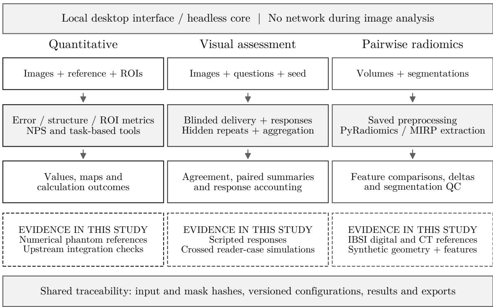  
Figure 1: QICOM’s three workbenches, their inputs and outputs, and the numerical and simulated-response experiments used in this study.

The numerical, I/O, session, radiomics, and reporting packages run without Qt, so the interface and headless experiments call the same computational functions. Configurations record data range, ROI, geometry, discretization, and slice aggregation. Quantitative analyses save input, configuration, and result hashes. The outcome registry records computed values and unavailable, inapplicable, invalid, failed, or cancelled calculations.

Native radiomics projects store arrays, masks, geometry, configuration, and feature tables. Blinded deliveries use presentation identifiers and a separate author-side mapping to recover source conditions from responses. Analysis runs locally without network access. Optional learned metrics use previously installed checkpoints with recorded identities. Scientific backends and supporting packages are attributed in Supplementary Section C.

## 3 Evaluation design

## 3.1 Reference agreement and controlled perturbation

Quantitative phantoms comprise identity pairs, ofsets, gains, structured patterns, and realized noise arrays. For a reference R and comparison $C = R + b$ , without clipping, the expected MSE is $b ^ { 2 }$ and signed bias is b. Independent SSIM [15] and HFEN [16] calculations match the window, boundary, and kernel conventions of the tested implementation. Direct PIQ and LPIPS calls provide separate integration comparisons with matched inputs and parameters.

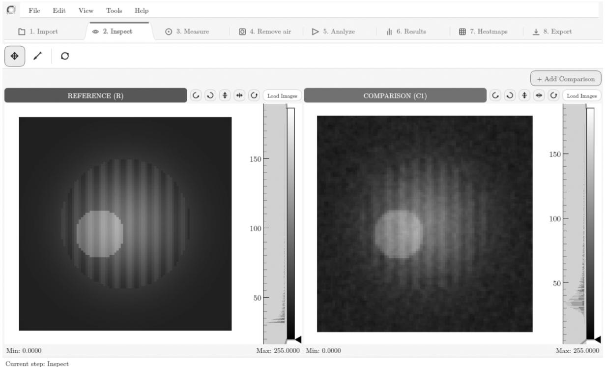  
Figure 2: The quantitative workbench captured from the running application with the centralplane previews of the synthetic filtering inputs. The synchronized image views show the reference and filtered image. Additional workbench captures appear in Supplementary Section A.5.

Graded noise, blur, and ofsets probe metric responses. Masking fixtures modify excluded pixels while keeping the included pixels fixed. They compare radial erosion with restriction to complete kernel support. Spectral observer fixtures use flat and colored noise and a nonconstant eye filter to compare prewhitening, non-prewhitening, and eye-filtered calculations.

Radiomics uses the oficial IBSI 1 digital phantom and the public CT reference case in NIfTI format [9, 17, 18]. We evaluate all numeric reference/tolerance rows in the digital-phantom worksheet and CT configurations A–E. The optional MIRP backend supplies the additional feature families and aggregation modes [19]; the original PyRadiomics subset is evaluated separately. Acceptance follows the workbook’s magnitude-dependent truncation and row-specific absolute tolerances. The full rule, near-zero safeguard, mapping, and quantitative tolerance classes are given in Supplementary Section A, including Section A.3. Workbook rows identify feature/aggregation combinations; repeated aggregations of a feature occupy separate rows.

The qualitative experiments use synthetic responses and independent coeficient calculations. Separate fixtures exercise blinding, hidden repeats, response transport, and missingness accounting. Monte Carlo experiments estimate interval coverage in a crossed reader–case model. Each generated dataset is one simulation replicate. Assertions, transformed images, and repeated extractions are counted within their respective experiments.

## 3.2 Filtering comparison across the three workflows

The filtering demonstration uses an analytic float32 volume containing $1 6 \times 9 6 \times 9 6$ voxels with spacing (1, 1, 2) mm in physical $( x , y , z )$ order. A smooth background contains a circular intensity inclusion and a sinusoidal pattern. Gaussian noise with standard deviation 8 and seed 260910 is followed by in-plane Gaussian filtering with standard deviations 0.65 and 1.5 pixels. The script saves its configuration before computation and writes clean, noisy, and filtered NIfTI images.

MSE, SSIM, and HFEN compare the central plane with the clean reference at data range 255. Radiomics uses the same volumes and a fixed interior ROI of 38,520 voxels. Extraction includes original-image first-order and GLCM features, no intensity normalization, bin width 8, ROI-minimum binning origin, and target spacing equal to source spacing. Quantitative exports and native radiomics projects are reopened, and calculations are repeated from the saved data.

Two blinded deliveries present the clean reference and both filtered conditions. Their centralplane previews are rounded and clipped to 8 bits for display; measurements use the reloaded float32 arrays. Four arbitrary scripted responses exercise export, import, and recovery of source labels. The response values are transport markers, excluded from the image-quality outcomes.

## 3.3 Experimental records

The companion files contain inputs, settings, expected and observed values, row-level statuses, and source hashes. Each experiment identifies its software snapshot and input files. Supplementary Section A specifies the formulas and tolerances; Section B identifies the source and dependency records. Figures are drawn from these records. GUI images are native Qt captures using the saved synthetic comparison. Figure 4 shows the CT input and its supplied mask.

## 4 Results

## 4.1 Agreement with numerical and external references

Quantitative outputs agreed with the analytic and independently implemented references within the experiment tolerances. Maximum absolute discrepancies were $1 . 6 7 \times 1 0 ^ { - 8 }$ for MSE, $4 . 6 3 \times 1 0 ^ { - 7 }$ for SSIM, and $1 . 8 0 \times 1 0 ^ { - 7 }$ for HFEN. The direct PIQ and LPIPS comparisons also met their integration tolerances.

The QICOM/MIRP backend met the reference tolerances for all 482 digital-phantom entries and all 1,622 CT entries across configurations A–E (Table 1). All 1,804 feature/aggregation comparisons and all 300 preprocessing diagnostics passed. Every numeric reference/tolerance row in the six worksheets was evaluated. Figure 3 shows the residuals.

Of the 482 digital-phantom entries, 457 (94.8%) had a tabulated absolute tolerance of zero; the remaining 25 had positive tolerances. The largest raw relative error was 12.49% for volume fraction at 90% intensity (IVH V90) in CT A: reference $6 . 9 8 \times 1 0 ^ { - 5 }$ , raw absolute error $8 . 7 2 \times 1 0 ^ { - 6 }$ and absolute tolerance $1 . 0 3 \times 1 0 ^ { - 5 }$

<table><tr><td>IBSI 1 configuration</td><td>Features</td><td>Diagnostics</td><td>Passed / total</td></tr><tr><td>Digital phantom</td><td>482</td><td>0</td><td>482 /  482</td></tr><tr><td>CT A</td><td>346</td><td>60</td><td>406 / 406</td></tr><tr><td>CT B</td><td>346</td><td>60</td><td>406 / 406</td></tr><tr><td>CT C</td><td>210</td><td>60</td><td>270 /270</td></tr><tr><td>CT D</td><td>210</td><td>60</td><td>270 / 270</td></tr><tr><td>CT E</td><td>210</td><td>60</td><td>270 / 270</td></tr></table>

Table 1: Reference agreement through the QICOM/MIRP backend. The five CT configurations use one public case; entries count feature/aggregation combinations and preprocessing diagnostics.

The separate PyRadiomics experiment met the tolerances for its 104 mapped digital-phantom entries (104/482 worksheet rows, 21.6%). Its largest raw relative discrepancy was 0.6992% for minor-axis length: 9.24490 versus 9.31 mm. The raw absolute error was 0.065095 mm; the truncated comparison error and tolerance were both 0.06 mm.

Reference residuals across the six IBSI 1 worksheets  
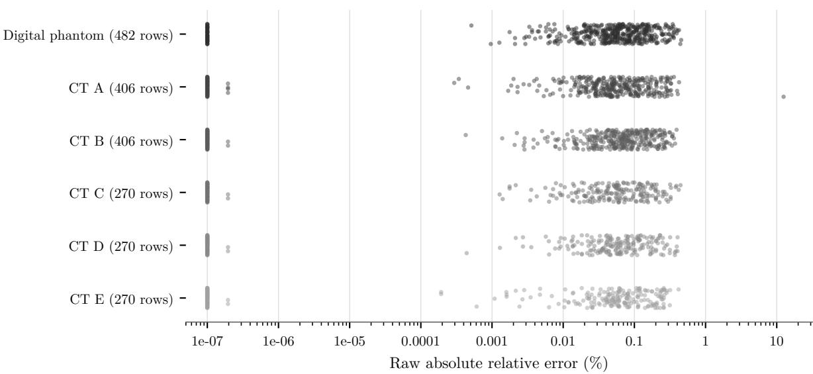  
Figure 3: Raw absolute relative errors against IBSI reference values. Each point represents one worksheet row with a nonzero reference; zero residuals are placed at the left plotting floor. Acceptance uses the row-specific absolute tolerance and truncation rule in the Methods.

A Acquired CT and supplied mask  
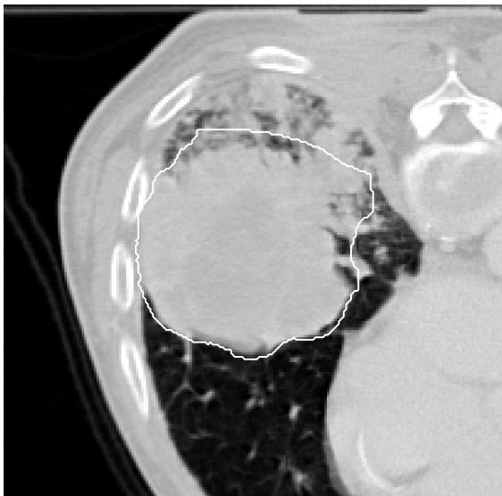

B ROI detail  
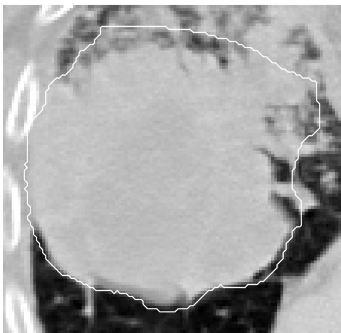  
Figure 4: Public IBSI CT reference case in NIfTI format. Axial plane through the largest mask cross-section, displayed at [−1000, 400] HU; the white contour is the supplied mask. The inset enlarges the same ROI. Display adapted from the CT image and mask supplied by Lambin, CancerData (2016) [18, 17]. The CT-derived image and contour retain the source license, CC BY-NC 3.0.

## 4.2 Behavior under perturbation and spatial restriction

Figure 5 shows the responses to noise, blur, and intensity ofsets. MSE increased across the tested levels of all three perturbations. SSIM decreased with noise and blur and remained closer to unity under ofsets.

With radial erosion, masked SSIM changed when excluded comparison pixels changed. With complete kernel support, masked SSIM and HFEN were invariant to the tested excluded-pixel perturbations. With radial erosion, the SSIM values were 0.842831 and 0.800035 for the two exterior-pixel settings.

PW and NPW returned equal values for the flat-spectrum fixture and diferent values for the colored spectra. NPWE with the nonconstant eye filter difered from both in all three fixtures (Table 2).

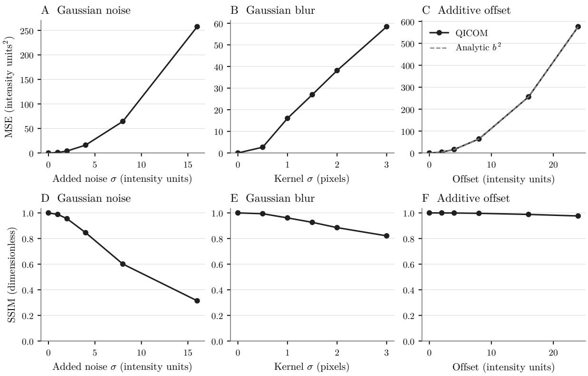  
Figure 5: MSE and SSIM responses to noise, Gaussian blur, and intensity ofsets on the synthetic phantom. Points are computed values; lines connect successive levels.

<table><tr><td>Spectrum / task</td><td> $d _ { P W } ^ { \prime }$ </td><td> $d _ { N P W } ^ { \prime }$ </td><td> $d _ { N P W E } ^ { \prime }$ </td></tr><tr><td>flat</td><td>1.500000</td><td>1.500000</td><td>1.397820</td></tr><tr><td>colored flat task</td><td>1.517647</td><td>1.279204</td><td>1.142984</td></tr><tr><td>colored gaussian task</td><td>0.987565</td><td>0.767542</td><td>0.507999</td></tr></table>

Table 2: Observer outputs for synthetic spectrum and task fixtures.

## 4.3 Simulated reader responses

Ordinal agreement coeficients matched their independent references in the applicable simulated fixtures. All 127 scripted response rows were recovered under their source conditions. None of

the 96 hidden-repeat pairs violated the specified spacing. Empirical bootstrap interval coverage was 95/100 datasets in both the complete-data and 15% missingness settings (Table 3).
<table><tr><td>Missing probability</td><td>Coverage</td><td>MC standard error</td><td>Mean CI width</td></tr><tr><td>0.00</td><td>0.95</td><td>0.0218</td><td>0.943</td></tr><tr><td>0.15</td><td>0.95</td><td>0.0218</td><td>1.016</td></tr></table>

Table 3: Crossed reader–case simulations: 100 generated datasets per setting. The 95% Wilson interval for coverage is approximately 0.888–0.978 in both settings.

## 4.4 A complete synthetic filtering comparison

Both filters reduced MSE relative to the noisy input (Figure 6; Table 4). Increasing Gaussian smoothing from 0.65 to 1.5 pixels increased SSIM, MSE, and HFEN.

<table><tr><td>Condition</td><td>MSE↓</td><td>SSIM↑</td><td>HFEN↓</td><td>GLCM contrast</td></tr><tr><td>Noisy</td><td>63.001</td><td>0.6198</td><td>0.5932</td><td>3.4814</td></tr><tr><td> $\sigma = 0 . 6 5$ </td><td>15.849</td><td>0.8724</td><td>0.5054</td><td>1.3488</td></tr><tr><td> $\sigma = 1 . 5$ </td><td>18.421</td><td>0.9119</td><td>0.6998</td><td>0.6356</td></tr></table>

Table 4: Quantitative and radiomic results for the filtering example. Clean-reference GLCM contrast is 1.4411. Arrows indicate decreasing error or increasing similarity. MSE is in squared arbitrary intensity units; the other displayed measures are dimensionless.

GLCM contrast difered from the clean reference by +141.6% for noise alone, -6.4% after mild filtering, and -55.9% after stronger filtering. In contrast, mean ROI intensity changed by less than 0.085% across all three conditions.

All saved quantitative values were recovered on JSON reload, and repeated calls returned matching input, configuration, and result hashes. Reopening each of the three native radiomics projects preserved arrays, masks, settings, and feature tables; re-extraction reproduced all 43 feature pairs exactly in the recorded environment. The two blinded deliveries transported 4 scripted answer records, all restored to the correct source condition.

Clean reference  
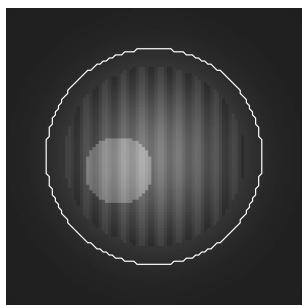

Noisy input  
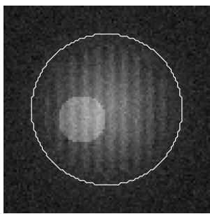

Filter ¾ = 0:65  
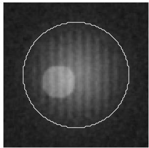

Filter ¾ = 1:5  
  
Figure 6: Central plane of the clean, noisy, and filtered volumes. The common display range is 0–255; the white contour marks the radiomic ROI.

## 5 Discussion

## 5.1 Filtering changes intensity, structure, and texture diferently

Stronger filtering increased SSIM while increasing MSE and HFEN relative to milder filtering. It also moved GLCM contrast further from the clean reference, despite a small change in mean ROI intensity. An SSIM-only choice would therefore favor a condition with greater intensity and high-frequency error in this example. The distinction between error and structural similarity has been studied previously [20]. Here, measuring texture alongside those scores exposes another consequence of smoothing that matters when processed images will be used for radiomic analysis.

QICOM keeps those measurements linked to the images that produced them. The same comparison can be reopened, its features recalculated, and its images prepared for blinded assessment. A subsequent reader study could determine whether the measured tradeof afects a specified visual task.

## 5.2 Spatial support and model definitions

With radial mask erosion, pixels outside the ROI still entered local calculations through corners of the square convolution window. Restricting centers to complete kernel support removed the observed dependence. Thus an ROI definition must specify both the pixels whose scores are averaged and the neighboring pixels used to calculate those scores.

The observer fixtures expose a similar dependence on model definition. Flat-noise inputs can give coincident PW and NPW values, while colored spectra separate their weighting. Multiple spectra and a nonconstant eye filter distinguish the models that coincide under flat noise. Both examples favor saving kernel support, normalization, geometry, and model parameters with the output.

No-reference scores depend on their reference model in the same way. The NSS distances evaluated here are defined relative to QICOM’s declared distribution, and the distributed NIQE model is fitted on photographs. For CT, QICOM versions after the evaluated snapshot add RIQE, a NIQE-style model fitted on full-dose CT with a declared Hounsfield-unit mapping and body masks, archived with its code, fitting manifest, and validation [21]. QICOM computes it only for images in Hounsfield units and scores a processed image on the masks of its source. In its validation, RIQE ranked degraded images as worse than their source, but its preferences among filtered images did not follow lesion signal; it is therefore not a criterion for choosing a denoiser. RIQE was not part of the experiments reported here.

## 5.3 Contribution relative to existing tools

A scripted combination of scikit-image, PIQ, and PyRadiomics provides flexible access to the numerical methods. An extensible platform such as 3D Slicer supports broader imaging workflows. QICOM concentrates on paired comparison and blinded delivery, with saved configurations, native projects, and source-label recovery. Maintaining these connections also requires adapters and versioned persistent formats as the underlying libraries evolve.

Analytic references, upstream comparisons, and external phantoms play diferent roles in evaluating this arrangement. Independent calculations challenge formulas and conventions; samebackend comparisons check data and parameter handling; IBSI tests agreement with external reference values. The small residuals reported here measure computational agreement, rather than the size of an image-quality improvement.

The complete digital-phantom mapping adds local intensity, histogram, volume histogram, distance-zone features, and the specified texture aggregations. The CT comparison also exercises interpolation, resegmentation, and discretization on acquired data. Agreement therefore covers the QICOM adapter and MIRP extraction under each reference preset. PyRadiomics retains its own, narrower mapping. Backend identity is saved with each extraction because implementations and aggregation conventions determine which comparisons are meaningful. Exact spatial sums for Moran’s I and Geary’s C avoid sampling variability in these two outputs.

The QIBA metrology framework distinguishes bias, repeatability, and reproducibility in quantitative imaging [22]. This study addresses reference agreement and re-execution under controlled technical conditions. Repeatability across acquisitions and reproducibility across scanners or sites require additional experiments with physical phantoms and acquisition variability, with uncertainty estimated at the corresponding experimental unit.

## 5.4 Scope and limitations

The study uses synthetic images, one public CT case, scripted responses, and one recorded software environment. Configurations A–E are five analyses of that same CT case. The complete worksheet coverage concerns IBSI 1 and its specified parameters. Human perceptual validity, clinical utility, cross-site performance, and comparative usability remain untested. QICOM is not a medical device. The filtering example is a single retrospective demonstration.

The NSS distances depend on their reference distribution. Their score scales, the composite index’s normalization anchors and equal weights, and the one-dimensional observer model lack human calibration. Edge experiments cover axis-aligned noiseless Gaussian profiles. Blinding removes tested text and identifying EXIF fields; burned-in labels and arbitrary content in retained ICC profiles remain outside that metadata check. Response completeness requires an assignment roster to count assignments with no returned record. The external radiomic comparison covers the six IBSI 1 worksheets; IBSI 2 filtering and vendor-specific image encodings require separate evaluation.

## 5.5 A subsequent observer study

A reader study should specify the visual task before selecting images and endpoints, for example preservation of low-contrast structure after denoising. Processing conditions, eligibility criteria, display and windowing settings, training, and randomization should be fixed before data collection. The companion feasibility protocol proposes eight readers, 24 base cases, four hidden repeats, and two training presentations. These planning numbers require a pilot before a confirmatory sample size can be calculated.

Ordinal inter-reader agreement, within-reader repeat consistency, and the paired condition efect address diferent aspects of the assessment. Analysis should retain crossed reader and case dependence and define the handling of skipped, not-assessable, and entirely absent responses. An assignment roster supplies the denominator for response completeness. Independent replication and a controlled usability comparison would then evaluate study execution as well as calculations.

## 6 Availability and reproducibility

QICOM source is maintained at https://github.com/Metallogik/QICOM under the Apache 2.0 license. The repository is currently private and will be made public before arXiv submission. The evaluated development snapshots, dependency versions, source hashes, and experiment records are listed in Supplementary Section B. The original experiments and the IBSI extension have separate source archives. MIRP is an optional dependency distributed under EUPL 1.2; the public CT data are available under CC BY-NC 3.0 from their original source [18]. The RIQE model included in later QICOM versions is archived under CC BY 4.0 at https://doi.org/10 .5281/zenodo.23055559.

The experiment bundle is held locally and contains the scripts, synthetic inputs, results, and both source archives. It is separate from the software repository. External IBSI resources and learned checkpoints are listed by source URL and hash and must be obtained separately. Figure 4 contains a display adaptation of the CT data under their original CC BY-NC 3.0 license.

## 7 Conclusion

QICOM connects numerical comparison, paired radiomics, and blinded delivery through saved images, settings, and results. The experiments document reference agreement and responses to controlled perturbations. Reopening the filtering projects reproduced their measurements and recovered the scripted responses under their source conditions. The next step is a task-specific reader study with realistic acquisition variability.

## References

[1] Fabio Mattiussi, Francesco Magoga, Andrea Cozzi, Salvatore Ferraro, Gabrio Cadei, Chiara Martini, et al. ErisNet: A Deep Learning Model for Noise Reduction in CT Images. Bioengineering, 12(9):997, 2025. https://doi.org/10.3390/bioengineering12090997.

[2] Lea Azour, Yunan Hu, Jane P. Ko, Baiyu Chen, Florian Knoll, Jefrey B. Alpert, et al. Deep Learning Denoising of Low-Dose Computed Tomography Chest Images: A Quantitative and Qualitative Image Analysis. Journal of Computer Assisted Tomography, 47(2):212–219, 2023. https://doi.org/10.1097/ rct.0000000000001405.

[3] H. Precht, J. Hansson, C. Outzen, P. Hogg, and A. Tingberg. Radiographers’ perspectives’ on Visual Grading Analysis as a scientific method to evaluate image quality. Radiography, 25:S14–S18, 2019. https://doi.org/10.1016/j.radi.2019.06.006.

[4] C. Sá dos Reis, M. Caso, L. Dolenc, K. Howick, R. Lemmen, A. Meira, F. Shatku, E. Aymon, and S. S. Ghotra. Optimisation of exposure parameters using a phantom for thoracic spine radiographs in antero-posterior and lateral views. Radiography, 29(5):870–877, 2023. https://doi.org/10.1016/j.ra di.2023.06.009.

[5] S. S. Ghotra, L. Buttex, L. Gallus, Y. Cottier, J. McNulty, A. McGee, and C. Sá dos Reis. Visual assessment of AI-reconstructed knee MRI: A pilot study. Radiography, 32(4):103380, 2026. https: //doi.org/10.1016/j.radi.2026.103380.

[6] Switinder Singh Ghotra, Yann Cottier, Christine Bruguier, Alejandro Dominguez, Pascal Monnin, and Cláudia Sá dos Reis. A pilot study to identify suitable MRI protocols for preoperative planning of total hip arthroplasty. European Journal of Radiology, 178:111620, 2024. https://doi.org/10.1016/j.ejrad. 2024.111620.

[7] Nancy A. Obuchowski. Receiver Operating Characteristic Curves and Their Use in Radiology. Radiology, 229(1):3–8, 2003. https://doi.org/10.1148/radiol.2291010898.

[8] Dev P. Chakraborty and Kevin S. Berbaum. Observer studies involving detection and localization: Modeling, analysis, and validation. Medical Physics, 31(8):2313–2330, 2004. https://doi.org/10.1118/1.1769352.

[9] Alex Zwanenburg, Martin Vallières, Mahmoud A. Abdalah, Hugo J. W. L. Aerts, Vincent Andrearczyk, Aditya Apte, et al. The Image Biomarker Standardization Initiative: Standardized Quantitative Radiomics for High-Throughput Image-based Phenotyping. Radiology, 295(2):328–338, 2020. https://doi.org/10 .1148/radiol.2020191145.

[10] Stéfan van der Walt, Johannes L. Schönberger, Juan Nunez-Iglesias, François Boulogne, Joshua D. Warner, Neil Yager, Emmanuelle Gouillart, and Tony Yu. scikit-image: image processing in Python. PeerJ, 2:e453, 2014. https://doi.org/10.7717/peerj.453.

[11] Sergey Kastryulin, Jamil Zakirov, Denis Prokopenko, and Dmitry V. Dylov. PyTorch Image Quality: Metrics for Image Quality Assessment. arXiv:2208.14818, 2022. https://arxiv.org/abs/2208.14818.

[12] Joost J.M. van Griethuysen, Andriy Fedorov, Chintan Parmar, Ahmed Hosny, Nicole Aucoin, Vivek Narayan, Regina G.H. Beets-Tan, Jean-Christophe Fillion-Robin, Steve Pieper, and Hugo J.W.L. Aerts. Computational Radiomics System to Decode the Radiographic Phenotype. Cancer Research, 77(21):e104– e107, 2017. https://doi.org/10.1158/0008-5472.can-17-0339.

[13] Andriy Fedorov, Reinhard Beichel, Jayashree Kalpathy-Cramer, Julien Finet, Jean-Christophe Fillion-Robin, Sonia Pujol, et al. 3D Slicer as an image computing platform for the Quantitative Imaging Network. Magnetic Resonance Imaging, 30(9):1323–1341, 2012. https://doi.org/10.1016/j.mri.2012.05.001.

[14] Angelica Svalkvist, Sune Svensson, Tommy Hagberg, and Magnus Båth. ViewDEX 3.0—Recent Development of a Software Application Facilitating Assessment of Image Quality and Observer Performance. Radiation Protection Dosimetry, 195(3-4):372–377, 2021. https://doi.org/10.1093/rpd/ncab014.

[15] Zhou Wang, Alan C. Bovik, Hamid R. Sheikh, and Eero P. Simoncelli. Image quality assessment: from error visibility to structural similarity. IEEE Transactions on Image Processing, 13(4):600–612, 2004. https://doi.org/10.1109/tip.2003.819861.

[16] Saiprasad Ravishankar and Yoram Bresler. MR Image Reconstruction From Highly Undersampled k-Space Data by Dictionary Learning. IEEE Transactions on Medical Imaging, 30(5):1028–1041, 2011. https://doi.org/10.1109/tmi.2010.2090538.

[17] Philippe Lambin, Ralph T. H. Leijenaar, Timo M. Deist, Jurgen Peerlings, Evelyn E. C. de Jong, Janita van Timmeren, et al. Radiomics: the bridge between medical imaging and personalized medicine. Nature Reviews Clinical Oncology, 14(12):749–762, 2017. https://doi.org/10.1038/nrclinonc.2017.141.

[18] Philippe Lambin. Radiomics Digital Phantom. CancerData, 2016. Data licensed CC BY-NC 3.0. https://doi.org/10.17195/candat.2016.08.1.

[19] Alex Zwanenburg and Stefen Löck. MIRP: A Python package for standardised radiomics. Journal of Open Source Software, 9(99):6413, 2024. https://doi.org/10.21105/joss.06413.

[20] Alain Hore and Djemel Ziou. Image Quality Metrics: PSNR vs. SSIM. In 2010 20th International Conference on Pattern Recognition, pages 2366–2369, 2010. https://doi.org/10.1109/icpr.2010.579.

[21] Fabio Mattiussi. RIQE: a NIQE-style reference model for Computed Tomography. arXiv:2610.00384 [eess.IV], 2026. https://doi.org/10.48550/arXiv.2610.00384. Model, code and validation archived on Zenodo, version v1.0: https://doi.org/10.5281/zenodo.23055559.

[22] Daniel C. Sullivan, Nancy A. Obuchowski, Larry G. Kessler, David L. Raunig, Constantine Gatsonis, Erich P. Huang, et al. Metrology Standards for Quantitative Imaging Biomarkers. Radiology, 277(3):813–825, 2015. https://doi.org/10.1148/radiol.2015142202.

[23] Z. Wang, E.P. Simoncelli, and A.C. Bovik. Multiscale structural similarity for image quality assessment. In Proceedings of the 37th Asilomar Conference on Signals, Systems and Computers, volume 2, pages 1398–1402, 2003. https://doi.org/10.1109/acssc.2003.1292216.

[24] Lin Zhang, Lei Zhang, Xuanqin Mou, and David Zhang. FSIM: A Feature Similarity Index for Image Quality Assessment. IEEE Transactions on Image Processing, 20(8):2378–2386, 2011. https://doi.org/ 10.1109/tip.2011.2109730.

[25] Wufeng Xue, Lei Zhang, Xuanqin Mou, and Alan C. Bovik. Gradient Magnitude Similarity Deviation: A Highly Eficient Perceptual Image Quality Index. IEEE Transactions on Image Processing, 23(2):684–695, 2014. https://doi.org/10.1109/tip.2013.2293423.

[26] H.R. Sheikh and A.C. Bovik. Image information and visual quality. IEEE Transactions on Image Processing, 15(2):430–444, 2006. https://doi.org/10.1109/tip.2005.859378.

[27] Rafael Reisenhofer, Sebastian Bosse, Gitta Kutyniok, and Thomas Wiegand. A Haar wavelet-based perceptual similarity index for image quality assessment. Signal Processing: Image Communication, 61:33–43, 2018. https://doi.org/10.1016/j.image.2017.11.001.

[28] C. Studholme, D.L.G. Hill, and D.J. Hawkes. An overlap invariant entropy measure of 3D medical image alignment. Pattern Recognition, 32(1):71–86, 1999. https://doi.org/10.1016/s0031-3203(98)00091-0.

[29] S. S. Vallender. Calculation of the Wasserstein Distance Between Probability Distributions on the Line. Theory of Probability & Its Applications, 18(4):784–786, 1974. https://doi.org/10.1137/1118101.

[30] F. Sattar, L. Floreby, G. Salomonsson, and B. Lovstrom. Image enhancement based on a nonlinear multiscale method. IEEE Transactions on Image Processing, 6(6):888–895, 1997. https://doi.org/10.1 109/83.585239.

[31] J.L. Pech-Pacheco, G. Cristobal, J. Chamorro-Martinez, and J. Fernandez-Valdivia. Diatom autofocusing in brightfield microscopy: a comparative study. In Proceedings of the 15th International Conference on Pattern Recognition, volume 3, pages 314–317, 2000. https://doi.org/10.1109/icpr.2000.903548.

[32] Richard Zhang, Phillip Isola, Alexei A. Efros, Eli Shechtman, and Oliver Wang. The Unreasonable Efectiveness of Deep Features as a Perceptual Metric. In 2018 IEEE/CVF Conference on Computer Vision and Pattern Recognition, pages 586–595, 2018. https://doi.org/10.1109/cvpr.2018.00068.

[33] Keyan Ding, Kede Ma, Shiqi Wang, and Eero P. Simoncelli. Image Quality Assessment: Unifying Structure and Texture Similarity. IEEE Transactions on Pattern Analysis and Machine Intelligence, 44(5):2567–2581, 2022. https://doi.org/10.1109/tpami.2020.3045810.

[34] Alex Krizhevsky, Ilya Sutskever, and Geofrey E. Hinton. ImageNet Classification with Deep Convolutional Neural Networks. In Advances in Neural Information Processing Systems, volume 25, 2012. https: //papers.nips.cc/paper/2012/hash/c399862d3b9d6b76c8436e924a68c45b-Abstract.html.

[35] Karen Simonyan and Andrew Zisserman. Very Deep Convolutional Networks for Large-Scale Image Recognition. arXiv:1409.1556, 2014. https://arxiv.org/abs/1409.1556.

[36] A. Mittal, A. K. Moorthy, and A. C. Bovik. No-Reference Image Quality Assessment in the Spatial Domain. IEEE Transactions on Image Processing, 21(12):4695–4708, 2012. https://doi.org/10.1109/tip.2012 .2214050.

[37] A. Mittal, R. Soundararajan, and A. C. Bovik. Making a “Completely Blind” Image Quality Analyzer. IEEE Signal Processing Letters, 20(3):209–212, 2013. https://doi.org/10.1109/lsp.2012.2227726.

[38] James T. Dobbins, Ehsan Samei, Nicole T. Ranger, and Ying Chen. Intercomparison of methods for image quality characterization. II. Noise power spectrum. Medical Physics, 33(5):1466–1475, 2006. https://doi.org/10.1118/1.2188819.

[39] Justin B. Solomon and Ehsan Samei. Correlation between human detection accuracy and observer model-based image quality metrics in computed tomography. Journal of Medical Imaging, 3(03):1, 2016. https://doi.org/10.1117/1.jmi.3.3.035506.

[40] Manuel Guizar-Sicairos, Samuel T. Thurman, and James R. Fienup. Eficient subpixel image registration

algorithms. Optics Letters, 33(2):156, 2008. https://doi.org/10.1364/ol.33.000156.

[41] Abdel Aziz Taha and Allan Hanbury. Metrics for evaluating 3D medical image segmentation: analysis, selection, and tool. BMC Medical Imaging, 15(1), 2015. https://doi.org/10.1186/s12880-015-0068-x.

[42] Patrick E. Shrout and Joseph L. Fleiss. Intraclass correlations: Uses in assessing rater reliability. Psychological Bulletin, 86(2):420–428, 1979. https://doi.org/10.1037/0033-2909.86.2.420.

[43] Kenneth O. McGraw and S. P. Wong. Forming inferences about some intraclass correlation coeficients. Psychological Methods, 1(1):30–46, 1996. https://doi.org/10.1037/1082-989x.1.1.30.

[44] Lawrence I-Kuei Lin. A Concordance Correlation Coeficient to Evaluate Reproducibility. Biometrics, 45(1):255, 1989. https://doi.org/10.2307/2532051.

[45] Klaus Krippendorf. Computing Krippendorf’s Alpha-Reliability. University of Pennsylvania, Annenberg School for Communication, 2011. Literature updated September 13, 2013. https://www.asc.upenn.edu/ krippendorffs-alpha-reliability. Accessed September 10, 2026.

[46] Kilem L. Gwet. irrCAC: Computing the Extent of Agreement among Raters with Chance-Corrected Agreement Coeficient (CAC). Software; version 1.4, 2026. Methodological reference; not a QICOM runtime dependency; https://github.com/kgwet/irrCAC. Accessed September 10, 2026.

[47] Jacob Cohen. A Coeficient of Agreement for Nominal Scales. Educational and Psychological Measurement, 20(1):37–46, 1960. https://doi.org/10.1177/001316446002000104.

[48] Jacob Cohen. Weighted kappa: Nominal scale agreement provision for scaled disagreement or partial credit. Psychological Bulletin, 70(4):213–220, 1968. https://doi.org/10.1037/h0026256.

[49] Joseph L. Fleiss. Measuring nominal scale agreement among many raters. Psychological Bulletin, 76(5):378– 382, 1971. https://doi.org/10.1037/h0031619.

[50] M. G. Kendall and B. Babington Smith. The Problem of m Rankings. The Annals of Mathematical Statistics, 10(3):275–287, 1939. https://doi.org/10.1214/aoms/1177732186.

[51] Frank Wilcoxon. Individual Comparisons by Ranking Methods. Biometrics Bulletin, 1(6):80, 1945. https://doi.org/10.2307/3001968.

[52] H. B. Mann and D. R. Whitney. On a Test of Whether one of Two Random Variables is Stochastically Larger than the Other. The Annals of Mathematical Statistics, 18(1):50–60, 1947. https://doi.org/10 .1214/aoms/1177730491.

[53] Sture Holm. A Simple Sequentially Rejective Multiple Test Procedure. Scandinavian Journal of Statistics, 6(2):65–70, 1979. https://www.jstor.org/stable/4615733.

[54] Art B. Owen. The pigeonhole bootstrap. The Annals of Applied Statistics, 1(2), 2007. https://doi.org/ 10.1214/07-aoas122.

[55] Edwin B. Wilson. Probable Inference, the Law of Succession, and Statistical Inference. Journal of the American Statistical Association, 22(158):209–212, 1927. https://doi.org/10.1080/01621459.1927.10 502953.

[56] Charles R. Harris, K. Jarrod Millman, Stéfan J. van der Walt, Ralf Gommers, Pauli Virtanen, David Cournapeau, et al. Array programming with NumPy. Nature, 585(7825):357–362, 2020. https://doi.or g/10.1038/s41586-020-2649-2.

[57] Pauli Virtanen, Ralf Gommers, Travis E. Oliphant, Matt Haberland, Tyler Reddy, David Cournapeau, et al. SciPy 1.0: fundamental algorithms for scientific computing in Python. Nature Methods, 17(3):261–272, 2020. https://doi.org/10.1038/s41592-019-0686-2.

[58] Wes McKinney. Data Structures for Statistical Computing in Python. In Proceedings of the Python in Science Conference, pages 56–61, 2010. https://doi.org/10.25080/majora-92bf1922-00a.

[59] The pandas development team. pandas-dev/pandas: pandas. Software; version 3.0.5, 2026. Project-level DOI; exact installed version recorded in the artifact; https://doi.org/10.5281/zenodo.3509134. Accessed September 10, 2026.

[60] D. L. Mason et al. pydicom: An open source DICOM library. Software; version 3.0.2, 2026. https: //github.com/pydicom/pydicom. Accessed September 10, 2026.

[61] Christopher J. Markiewicz, Matthew Brett, Michael Hanke, et al. NiBabel. Software; version 5.4.2, 2026. Project-level DOI; exact installed version recorded in the artifact; https://doi.org/10.5281/zenodo.5 91597. Accessed September 10, 2026.

[62] Bradley C. Lowekamp, David T. Chen, Luis Ibáñez, and Daniel Blezek. The Design of SimpleITK. Frontiers in Neuroinformatics, 7:45, 2013. https://doi.org/10.3389/fninf.2013.00045.

[63] Gregory R. Lee, Ralf Gommers, Filip Wasilewski, Kai Wohlfahrt, and Aaron O’Leary. PyWavelets: A Python package for wavelet analysis. Journal of Open Source Software, 4(36):1237, 2019. https: //doi.org/10.21105/joss.01237.

[64] Matthew McCormick, Xiaoxiao Liu, Julien Jomier, Charles Marion, and Luis Ibanez. ITK: enabling reproducible research and open science. Frontiers in Neuroinformatics, 8:13, 2014. https://doi.org/10 .3389/fninf.2014.00013.

[65] Adam Paszke, Sam Gross, Francisco Massa, Adam Lerer, James Bradbury, Gregory Chanan, et al. PyTorch: An Imperative Style, High-Performance Deep Learning Library. In Advances in Neural Information Processing Systems, volume 32, 2019. https://arxiv.org/abs/1912.01703.

[66] Jason Ansel, Edward Yang, Horace He, Natalia Gimelshein, Animesh Jain, Michael Voznesensky, et al. PyTorch 2: Faster Machine Learning Through Dynamic Python Bytecode Transformation and Graph Compilation. In Proceedings of the 29th ACM International Conference on Architectural Support for Programming Languages and Operating Systems, Volume 2, pages 929–947, 2024. https://doi.org/10.1 145/3620665.3640366.

[67] TorchVision maintainers and contributors. TorchVision: PyTorch’s Computer Vision library. Software;

version 0.29.0+cpu, 2016. https://github.com/pytorch/vision. Accessed September 10, 2026.

[68] Sergey Kastryulin, Dzhamil Zakirov, and Denis Prokopenko. PyTorch Image Quality: Metrics and Measure for Image Quality Assessment. Software; version 0.8.0, 2019. https://github.com/photosynthesis-tea m/piq. Accessed September 10, 2026.

[69] John D. Hunter. Matplotlib: A 2D Graphics Environment. Computing in Science & Engineering, 9(3):90– 95, 2007. https://doi.org/10.1109/MCSE.2007.55. Software version 3.11.1: https://doi.org/10.528 1/zenodo.21422872.

[70] The Qt Company and contributors. Qt for Python (PySide6). Software; version 6.11.2, 2026. https: //doc.qt.io/qtforpython-6/. Accessed September 10, 2026.

[71] PyQtGraph contributors. PyQtGraph. Software; version 0.14.0, 2026. https://www.pyqtgraph.org/. Accessed September 10, 2026.

[72] Pillow contributors. Pillow: Python Imaging Library (fork). Software; version 12.3.0, 2026. https: //python-pillow.github.io/. Accessed September 10, 2026.

[73] Kitware Medical and contributors. dicom-anonymizer. Software; version 2.0.0, 2026. https://github.c om/KitwareMedical/dicom-anonymizer. Accessed September 10, 2026.

[74] openpyxl contributors. openpyxl: A Python library to read/write Excel files. Software; version 3.1.5, 2026. https://openpyxl.readthedocs.io/en/stable/. Accessed September 10, 2026.

[75] PyYAML contributors. PyYAML. Software; version 6.0.3, 2026. https://pyyaml.org/. Accessed September 10, 2026.

[76] platformdirs contributors. platformdirs. Software; version 4.11.6, 2026. https://github.com/tox-dev/p latformdirs. Accessed September 10, 2026.

[77] threadpoolctl contributors. threadpoolctl. Software; version 3.6.0, 2026. https://github.com/joblib/ threadpoolctl. Accessed September 10, 2026.

[78] The Python Cryptographic Authority and individual contributors. cryptography. Software; version 50.0.2, 2026. https://github.com/pyca/cryptography. Accessed October 14, 2026.

[79] Mathieu Malaterre, Thiago Franco de Moraes, et al. Grassroots DICOM (GDCM), Python packages python-gdcm. Software; version 3.2.6, 2026. GDCM library: https://gdcm.sourceforge.net; https: //github.com/tfmoraes/python-gdcm. Accessed October 22, 2026.

## A Detailed experimental methods

## A.1 Quantitative phantom experiments

Error and ROI measures are tested using deterministic objects with known intensity distributions, ofsets, gains, and residuals. For a nonconstant reference image R and comparison $C = R + b ;$ without clipping or quantization,

$$
\mathrm { M S E } = b ^ { 2 } , \qquad \mathrm { M A E } = \mathrm { R M S E } = | b | , \qquad \mathrm { b i a s } = b , \qquad \mathrm { S D } ( C - R ) = 0 .\tag{1}
$$

For $b \neq 0 , \mathrm { P S N R } = 1 0 \log _ { 1 0 } ( L ^ { 2 } / b ^ { 2 } )$ with data range L. Identity and undefined-input cases are handled separately. ROI references use the actual sample values and variance conventions. Finite-realization variance and population noise variance are calculated separately.

Statistical and spatial references include histogram and order-statistic calculations, structured patterns, and independent local-window calculations. SSIM conventions are matched to the tested implementation, including window, covariance normalization, boundaries, and dynamic range [15]. PSNR and SSIM comparisons follow their respective error and structural definitions [20].

The structural metric catalog additionally includes MS-SSIM [23], FSIM [24], GMSD [25], VIF [26], and HaarPSI [27]. The PIQ version and QICOM configuration identify the evaluated implementations. NMI uses the ratio $[ H ( R ) + H ( C ) ] / H ( R , C )$ [28], estimated from discrete histogram masses. Intensity Wasserstein-1 is a distance between one-dimensional intensity distributions [29].

For edge preservation, QICOM uses a high-pass correlation measure in the tradition of Sattar et al. [30]: $\mathrm { E P I } = \mathrm { c o r r } ( \Delta R , \Delta C )$ , where $\Delta$ is the discrete Laplacian. This is distinct from the normalized gradient-error expression labeled EPI in the ErisNet article [1]. HFEN follows the Laplacian-of-Gaussian error approach used in MRI reconstruction [16]; QICOM reports $\| \mathrm { L o G } _ { \sigma } ( C - R ) \| _ { 2 } / \| \mathrm { L o G } _ { \sigma } ( R ) \| _ { 2 }$ with $\sigma = 1 . 5$ pixels or voxels by default. Kernel support, dimensionality, and boundaries are part of the tested convention. The Laplacian-variance sharpness descriptor is a focus measure [31].

For structural and learned metrics, direct PIQ or LPIPS calls use matched inputs, normalization, channels, parameters, and installed weights. These comparisons are labeled integration checks. LPIPS and DISTS provide learned perceptual distances [32, 33]. Graded degradations provide metric response curves. The tested LPIPS and DISTS backbones are AlexNet [34] and VGG [35], respectively; backbone and perceptual-metric weights are distinct resources recorded in the checkpoint manifest.

The NSS feature distance compares a 36-dimensional image feature vector with a reference distribution using Mahalanobis distance. The NSS patch-distribution distance compares the mean patch features with that distribution using pooled covariance. Their feature construction draws on BRISQUE [36] and NIQE [37]. QICOM fits its default distribution to synthetic images with a $1 / f$ spectrum and accepts a user-fitted local distribution. The output names identify these two distances; the identifiers brisque and niqe are retained only for compatibility with saved projects. The former has no human-score-trained regressor, and neither output reproduces the original score scale. EPI is displayed as “EPI (Laplacian correlation)”.

The quantitative seed was 260909. Native arrays used shapes $4 0 \times 4 8$ and $1 2 \times 1 6 \times 2 0 ;$ structural comparisons used $1 9 2 \times 1 9 2$ images. Inputs were float32 and the dynamic range was 255. The artifact stores 19 array objects as NPZ and NIfTI, including identity copies, ramps, ofsets, gains, controlled residuals, and structured patterns. The object count includes derived and identity copies. Figure 7 shows representative inputs. Degradation series used Gaussian noise standard deviations 0, 1, 2, 4, 8, 16, blur standard deviations 0, 0.5, 1, 1.5, 2, 3 pixels, and ofsets 0, 2, 4, 8, 16, 24, producing 342 metric responses. Full settings and processing conventions are in the executable configuration and reference code. The NSS experiment uses 96-pixel patches and covariance ridge 0.01 and a fixed synthetic reference model for the QICOM variant.

Numerical acceptance uses $| o - e | \leq a + r | e |$ , where o and e are observed and expected values. Table 5 states the main tolerance classes. Undefined or infinite outputs are compared by their specified state. A separate noise-variance distribution check uses a five-standard-error bound, separately from the float64 error tolerance.

<table><tr><td>Class</td><td>Absolute a Relative r</td></tr><tr><td>float32</td><td>1e-06 1e-05</td></tr><tr><td>float64</td><td>1e-10 1e-10</td></tr><tr><td>hfen</td><td>1e-05 1e-04</td></tr><tr><td>integration</td><td>2e-06 2e-05</td></tr><tr><td>nss</td><td>1e-07  $1 \mathrm { e } { - } 0 7$ </td></tr><tr><td>ssim</td><td>2e-05 2e-05</td></tr></table>

Table 5: Numerical acceptance tolerances for the convention-matched quantitative references.

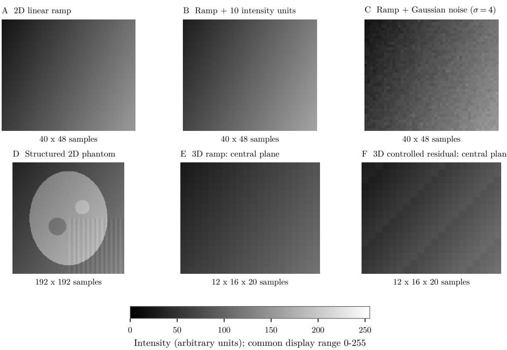  
Figure 7: Representative synthetic inputs generated by code, with known intensity and spatial transformations. Display normalization in this montage is only for visualization; computations use the saved numerical arrays.

## A.2 Expert diagnostics and image I/O

Noise experiments test both numerical NPS normalization and expected behavior of finite realizations. Parseval-based comparisons use the discrete window, detrending, frequency-grid, and spacing conventions of the experiment. The NPS and edge-response tools are interpreted within the established noise/transfer-function framework [38, 39]. Known translations test phasecorrelation alignment diagnostics [40]; overlap and surface-distance quantities are interpreted with voxel and physical-space conventions [41]. Gaussian edges and known geometries provide references for edge response, displacement, overlap, and physical distances. Synthetic NIfTI and DICOM files test selected intensity and geometry conversions.

Observer-model labels are evaluated independently of numerical integration. Let $S ( f ) =$ $| W ( f ) T ( f ) | ^ { 2 }$ denote the squared task spectrum after transfer and let $N ( f )$ denote the NPS. With matched integration conventions, a prewhitening (PW) expression and a non-prewhitening (NPW) expression are respectively

$$
d _ { \mathrm { P W } } ^ { 2 } = \int { \frac { S ( f ) } { N ( f ) } } d f , \qquad d _ { \mathrm { N P W } } ^ { 2 } = { \frac { [ \int S ( f ) d f ] ^ { 2 } } { \int S ( f ) N ( f ) d f } } .\tag{2}
$$

An eye-filtered NPW model additionally specifies an eye filter [39]. Each numerical output is compared with the integral associated with its model label.

The diagnostic seed was 2026090913. NPS experiments used 128 independent $6 4 \times 6 4$ noise arrays with standard deviation 7 and spacings (0.7, 0.4) mm. White and filtered noise were checked against the realized-array Parseval identity and finite-ensemble theory. Mean and planar detrending, rectangular/Hann/Tukey windows, doubled spacing, and input guards were included. Gaussian edges had standard deviations 0.8, 1.5, 2.5 mm at 0.1 mm spacing. The 10–90% width and MTF50 were compared with the corresponding Gaussian values, allowing 0.2% and 2% relative discretization error respectively. The MTF-curve absolute tolerance was 0.02. Only axis-aligned, noiseless edges were tested; nonzero edge angles are rejected by the implementation.

PW and NPW references used the same one-dimensional frequency grid and trapezoidal integration. NPWE additionally used the illustrative filter $E ( f ) = ( f + 0 . 0 1 ) \exp ( - 2 f )$ ; its numerator is $[ \ u { J } ^ { \aa S ( f ) E ( f ) ^ { 2 } d f ] ^ { 2 } }$ and denominator is $\textstyle \int S ( f ) N ( f ) E ( f ) ^ { 4 } d f$ . Flat and colored noise spectra were evaluated with this fixed filter and with a unity filter.

## A.3 Radiomic verification and derived quantities

The external comparison loads hash-verified images, masks, and the IBSI 1 reference workbook. Six manifests map every row having both a numeric reference and an absolute tolerance: 482 in the digital phantom, 406 each in CT A and B, and 270 each in CT C, D, and E. The original IBSI study standardized 169 of 174 investigated feature definitions [9]; the worksheet rows additionally separate aggregation modes and preprocessing diagnostics. The original PyRadiomics manifest maps 104 digital-phantom rows and remains a separate experiment.

MIRP 2.7.0 supplies eleven feature families and the required 2D, 2.5D, and 3D aggregation modes [19]. Presets use MIRP preprocessing after QICOM NIfTI loading. Custom profiles instead use QICOM preprocessing before MIRP extraction. The verifier evaluates presets. The CT image and supplied mask contain $2 0 4 \times 2 0 1 \times 6 0$ voxels in physical $( x , y , z )$ order; the five configurations operate on the same acquired case [17, 18].

The digital phantom uses its integer intensities without discretization or resampling. CT A retains the acquired spacing; CT B interpolates in-plane to 2 mm; CT C–E use isotropic 2 mm sampling. Image interpolation is linear in B–D and cubic in E. Mask interpolation is linear with inclusion threshold 0.5. Anti-aliasing is disabled. Table 6 gives the intensity settings.

QICOM calculates Moran’s I and Geary’s C from exact inverse-Euclidean-distance sums over the intensity ROI. Linear FFT convolutions on the physical voxel grid compute the sums with zero self-weight, replacing the MIRP sampling approximation for those two outputs. Small 2D and 3D fixtures compare these results against explicit all-pairs calculations, including anisotropic and sheared geometry. Preprocessing diagnostics are calculated from the actual input, interpolated, and resegmented arrays returned during extraction. Each receipt records backend, version, efective settings, source hashes, and the provider of each output.

Each mapped entry uses the workbook’s absolute tolerance t in the feature’s units. For

<table><tr><td>CT</td><td>Resegmentation (HU)</td><td>Texture bins</td><td>IVH bins</td></tr><tr><td>A</td><td>[-500,400]</td><td>Width 25 HU</td><td>None</td></tr><tr><td>B</td><td>[-500,400]</td><td>Count 32</td><td>None</td></tr><tr><td>C</td><td>[-1000,400]</td><td>Width 25 HU</td><td>Width 2.5 HU</td></tr><tr><td>D</td><td>±3 SD</td><td>Count 32</td><td>None</td></tr><tr><td>E</td><td>[−1000, 400] and ±3 SD</td><td>Count 32</td><td>Count 1000</td></tr></table>

Table 6: IBSI CT preprocessing configurations. IVH: intensity–volume histogram. A–B use the specified planar aggregations; C–E use volumetric aggregations.

reference $e ,$ observation $^ { O , }$ and raw diference $d = | o - e |$ , define

$$
k = 2 - \lfloor \log _ { 1 0 } | e | \rfloor , \quad s = 1 0 ^ { k } , \qquad d ^ { * } = \frac { \mathrm { t r u n c } [ ( d + \epsilon ) s ] } { s } , \qquad \mathrm { P A S S } \ \Longleftrightarrow \ d ^ { * } \leq t ,
$$

where $| e | > 1 0 ^ { - 1 2 }$ and $\epsilon = \mathrm { u l p } ( 1 ) = 2 ^ { - 5 2 }$ is the implementation’s floating-point guard. Truncation retains the decimal resolution of three significant digits of the reference, following the workbook’s ROUNDDOWN comparison. For $| e | \le 1 0 ^ { - 1 2 }$ , QICOM instead compares the untruncated d with t: this near-zero safeguard avoids the workbook fallback that could erase subunit errors. The rule is identical for all six worksheets; each reference/tolerance pair $( e , t )$ is retained in the comparison CSV.

The CSV columns absolute\_error, comparison\_error, and absolute\_tolerance record $d ,$ the error used for acceptance, and t, respectively. The rule truncates the error at the reference precision rather than rounding e and o separately. For $| e | > 1 0 ^ { - 1 2 }$ , a tabulated tolerance of zero requires $d ^ { * } = 0$ and can therefore admit a nonzero raw diference d.

Three repeated extractions characterize same-environment computational repeatability. A separate $1 6 \times 2 0 \times 2 4$ voxel object with intensity $1 0 + 2 x + 3 y + 5 z$ and an interior rectangular ROI tests first-order quantities under ofsets −7, 0, and 9. Translations of the ROI by −2, −1, 1, 2 voxels along x have an analytic mean change of twice the signed displacement. Expected values are calculated directly from the object formula and ROI coordinates.

Paired deltas are checked for positive, negative, zero, and near-zero denominators. Scalar reference calculations test the implemented two-way ICC variants [42, 43] and Lin’s concordance correlation coeficient (CCC) on complete synthetic pairs. CCC separates association from location and scale agreement [44]:

$$
\rho _ { c } = \frac { 2 \sigma _ { x y } } { \sigma _ { x } ^ { 2 } + \sigma _ { y } ^ { 2 } + ( \mu _ { x } - \mu _ { y } ) ^ { 2 } } = \rho C _ { b } , \qquad C _ { b } = \frac { 2 \sigma _ { x } \sigma _ { y } } { \sigma _ { x } ^ { 2 } + \sigma _ { y } ^ { 2 } + ( \mu _ { x } - \mu _ { y } ) ^ { 2 } } .\tag{3}
$$

Equation 3 permits a defined $C _ { b }$ even when $\rho = 0$ , an edge case included in the checks.

## A.4 Technical evaluation of the qualitative workflow

The qualitative evaluation uses simulated responses only. Independent coeficient references cover the applicable ordinal agreement and ranking calculations; ordinal alpha follows its marginal-frequency distance definition [45]. Chance agreement for the AC2 comparison follows the author’s reference implementation [46]. Balanced, skewed, incomplete, and degenerate fixtures are included. Known seeds allow the resampling algorithm to be compared with an independently coded calculation of the same resamples. The software also exposes Cohen’s unweighted and weighted kappa [47, 48], Fleiss’ kappa [49], and ICC [42, 43]. Their presence in the software is documented separately from the ordinal-alpha/AC2 phantom fixtures reported here. Ranking agreement uses Kendall’s W [50]; applicable paired comparisons and independent-sample probability-of-superiority summaries follow Wilcoxon and Mann–Whitney methods [51, 52], with

Holm adjustment where a family of comparisons is requested [53]. Independent-sample summaries do not account for crossed reader/case dependence; the crossed bootstrap below addresses the paired reader-by-case comparison.

Actual synthetic image packages are authored, converted to blinded evaluator deliveries, supplied with simulated responses, reopened, deblinded, and aggregated. Checks concern the saved order, hidden repeats, public/private metadata separation, source-role recovery, and missing-response denominators. Sentinel metadata embedded in synthetic files tests whether non-pixel information survives delivery.

The master seed was 20260909. Nine coeficient fixtures and six ranking fixtures covered complete, incomplete, skewed, tied, and degenerate responses. Twelve bootstrap endpoint checks compared identical seeded resamples with independent scalar calculations. Twenty-four presentation plans each used 12 pages, three panels, three questions, and four hidden repeats with at least two intervening pages. Four complete evaluator deliveries supplied 127 simulated answer records.

A separate missing-response fixture supplied four evaluator assignments: one answered, one skipped, one not assessable, and one entirely absent response. An assignment roster identifies entirely absent responses; without a roster, the denominator contains only received records.

For interval calibration, diferences followed $D _ { r c } = 0 . 5 + A _ { r } + B _ { c } + \epsilon _ { r c } .$ , with independent zero-mean Gaussian reader, case, and residual efects of standard deviations 0.35, 0.50, and 0.40. Each of two settings (complete data and 15% missing completely at random) used 100 independently generated datasets, four readers, 12 cases, and 199 independently sampled readerand-case bootstrap replicates, following separate resampling of crossed rows and columns [54]. Coverage is the fraction of intervals containing the population median diference 0.5. Binomial uncertainty in the Monte Carlo coverage estimates is summarized using Wilson score intervals [55], separately from the bootstrap intervals whose coverage is being assessed.

## A.5 Workbench views

The blinded evaluator view and paired radiomics workspace are shown in Figures 8 and 9.   
Captures use the saved synthetic filtering comparison and a monochrome publication palette.

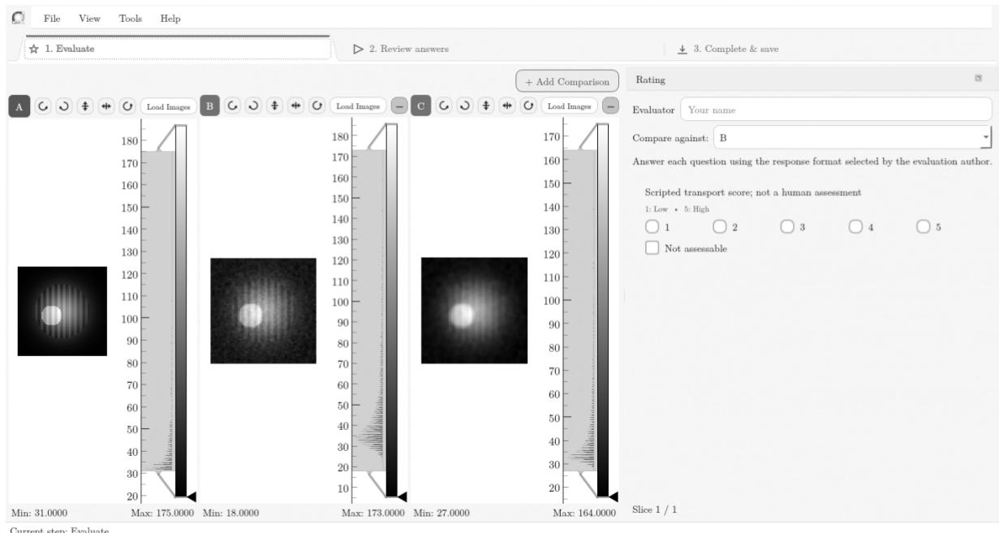

Figure 8: Blinded evaluator view opened from a delivered package. The presentation labels and response form come from the exported study.  
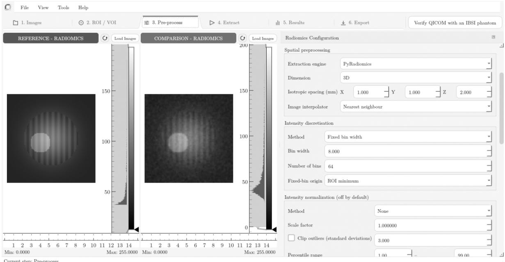  
Figure 9: Paired radiomics view reopened from a native project, showing the images and extraction settings used in the filtering comparison.

## B Reproduction records

The companion bundle contains two source archives with file-level SHA-256 manifests. The original archive accompanies the quantitative, diagnostic, qualitative, PyRadiomics, and synthetic filtering experiments. The extension archive accompanies the complete IBSI 1 evaluation and the GUI captures. Both use QICOM version 1.1.0.dev0 and Python 3.12.3 on Linux x86\_64.

## Original application SHA-256

b1c3cdbdfa96140f9822f8ad8542e0a9fba24a41e44a8fe25ab695afab34a922

## Extended application SHA-256

808376b3cc766a6228f316cff1d4fd354c72a2e6294d796e0e88beaf6ebdf3f7

<table><tr><td>Computation package</td><td>Installed version</td></tr><tr><td>lpips</td><td>0.1.4</td></tr><tr><td>nibabel</td><td>5.4.2</td></tr><tr><td>numpy</td><td>2.5.2</td></tr><tr><td>piq</td><td>0.8.0</td></tr><tr><td>scikit-image</td><td>0.26.0</td></tr><tr><td>scipy</td><td>1.18.1</td></tr><tr><td>torch</td><td>2.14.0+cpu</td></tr><tr><td>torchvision</td><td>0.29.0+cpu</td></tr><tr><td>mirp</td><td>2.7.0</td></tr><tr><td>itk</td><td>5.4.7</td></tr><tr><td>SimpleITK</td><td>2.5.6</td></tr></table>

Table 7: Principal computation dependencies. The complete environment manifests include additional packages and learned-weight identities.

## PyRadiomics is pinned to source commit

## 6a761c4eb01905cfcb1139b0b158547c55edd4df

Its runtime label is 3.1.0a2.post8+g6a761c4 and distribution-metadata label is 3.0.1a1; both identify the same installation. The extension uses MIRP 2.7.0. Receipt files identify the backend for every radiomic comparison.

The experiment folders contain executable configurations, inputs, numerical references, observations, and full comparison tables. The bundle README provides the reproduction commands. Failed development runs and regression logs are retained as companion records. Oficial IBSI resources and learned checkpoints are obtained separately from the recorded URLs and verified hashes. Analyses run ofline once these resources are present. The LaTeX sources include the compiled bibliography and figures; compilation used Tectonic 0.17.0.

## C Software attribution

Numerical arrays and algorithms use NumPy [56], SciPy [57], and scikit-image [10]; result tables use pandas [58, 59]. DICOM and NIfTI I/O use pydicom [60] and NiBabel [61], respectively. SimpleITK supports physical-space image operations [62], while PyRadiomics provides feature extraction [12], including optional wavelet filtering through PyWavelets [63]. The IBSI digitalphantom experiment uses unfiltered images. The optional MIRP backend [19], with ITK [64], supplies the extended IBSI 1 extraction. QICOM computes the exact spatial autocorrelations and preprocessing diagnostics described in the Methods. Learned and perceptual backends use PyTorch [65, 66], TorchVision [67], PIQ [11, 68], and LPIPS [32]. PyTorch supplies the execution framework. Figures were generated with Matplotlib [69]. Exact installed versions are retained in the artifact.

The following supporting packages provide the interface, storage, and execution infrastructure. Project references are used when no preferred research article was found in the reviewed oficial documentation. The companion citation audit records the sources consulted and distinguishes requested scholarly citations from software license notices.
<table><tr><td>Package</td><td>Role in QICOM</td></tr><tr><td>Qt for Python / PySide6 [70]</td><td>Desktop widgets, rendering, and worker orchestration</td></tr><tr><td>PyQtGraph [71]</td><td>Interactive image views, plots, and ROI interaction Raster-image reading, writing, and blinded-delivery</td></tr><tr><td>Pillow [72]</td><td>metadata handling</td></tr><tr><td>dicom-anonymizer [73]</td><td>DICOM de-identification support within QICOM&#x27;s additional checks</td></tr><tr><td>openpyxl [74]</td><td>Spreadsheet report generation</td></tr><tr><td>PyYAML [75] platformdirs [76]</td><td>Metric descriptors and configuration serialization Platform-specific application data and configuration</td></tr><tr><td></td><td>locations</td></tr><tr><td>threadpoolctl [77] cryptography [78]</td><td>Numerical-library thread limits during parallel execution Authenticated encryption of evaluator files and</td></tr><tr><td></td><td>access-code protection, in versions after the evaluated snapshots</td></tr><tr><td>GDCM / python-gdcm [79]</td><td>Decoding of lossless JPEG and JPEG-LS DICOM pixel data, in versions after the evaluated snapshots</td></tr></table>

Third-party license and copyright notices are included separately in the software distribution. The dependency manifest identifies optional packages. 3D Slicer is cited as a related platform and irrCAC as a methodological reference.

## D Later software version: workbenches and Utility Tools

This section describes QICOM 1.1.0.dev0 at repository commit dcdd7a8 (19 October 2026), a development version later than the snapshots evaluated in this study (Supplementary Section B). Its additions were not used in the experiments, and no value visible in these captures is a result of the study. The captures come from the running application, rendered from its Qt widgets with the monochrome interface palette of Supplementary Section A.5; label and mask overlays keep their colours.

All captures use one synthetic thorax phantom in Hounsfield units (HU): 24 axial slices of 256 × 256 pixels, with 0.8 × 0.8 mm pixels and 2.5 mm slice spacing. It contains air, a patient table, subcutaneous fat, soft tissue, two lungs, the heart, a contrast-filled aorta, a vertebra with cortical and trabecular bone, and ribs, all drawn as analytic shapes. Two DICOM series imitate a smooth and a sharp reconstruction through in-plane Gaussian smoothing (standard deviation 1.3 and 0.4 pixels) and seeded Gaussian noise (8 and 24 HU). They carry the kernel labels B30f and B70f only as header values: no reconstruction was simulated. The capture script, the phantom generator and a manifest with the voxel hashes of both series are kept in paper/utility-tools.

## D.1 The three workbenches in the later version

The launcher (Figure 10) opens the three workflows and, as a fourth section, the Utility Tools. Each workflow window shows its steps in a rail along the top. The quantitative workbench has eight steps: Import, Inspect, Measure, Remove air, Analyze, Results, Heatmaps and Export. Figure 11 shows the Inspect step with both phantom series in a soft-tissue window (level 40 HU, width 400 HU), and the Tools menu open on the Utility Tools submenu. Seven full-reference metrics computed with a data range of 4095 appear in the Results step (Figure 12). These values are specific to the phantom pair.

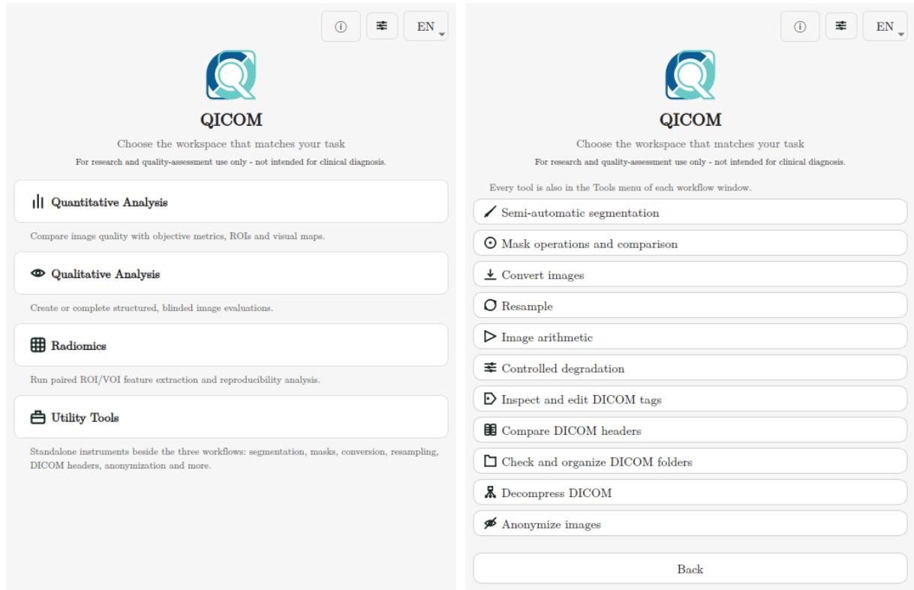  
Figure 10: Launcher of the later version: the three workflows and the Utility Tools section (left), and the tool catalog it opens (right).

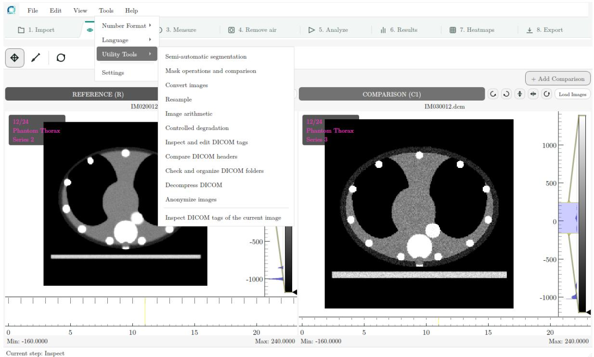

Figure 11: Quantitative workbench, Inspect step, with the two phantom series and the Utility Tools submenu of the Tools menu. The two menus are rendered separately and placed where Qt opens them.  
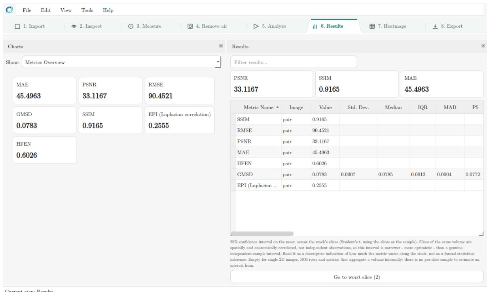  
Figure 12: Quantitative workbench, Results step: the sharp series compared with the smooth reference.

The qualitative workbench separates the author’s steps (Setup, Images, Questions, All pages, Preview and Save) from the evaluator’s (Evaluate, Review answers, and Complete and save). Figure 13 shows the Images step of a page with two questions. The author has named the panels after the two series. The blinded delivery made from it (Figure 14) shows the same images under neutral labels in a randomized order, with the response form beside them; this evaluator is not logged in, so no answer is kept on the computer. For images with several slices the author chooses whether answers apply to the whole series, the default, or to each slice separately. With the first, one answer is kept per page, comparison and question, and the evaluator scrolls through the slices without losing it; the slice indicator below the form states which rule applies. The randomization seed, the master seed and the hidden repeats are kept only in the author’s private map: the evaluator’s package numbers pages and questions in the order presented, so it does not reveal which panel is the reference or which pages are repeats. Every image is de-identified again on its way into a delivery. A refusal stops the delivery before any file is written, and the author decides whether to include those images in that delivery alone.

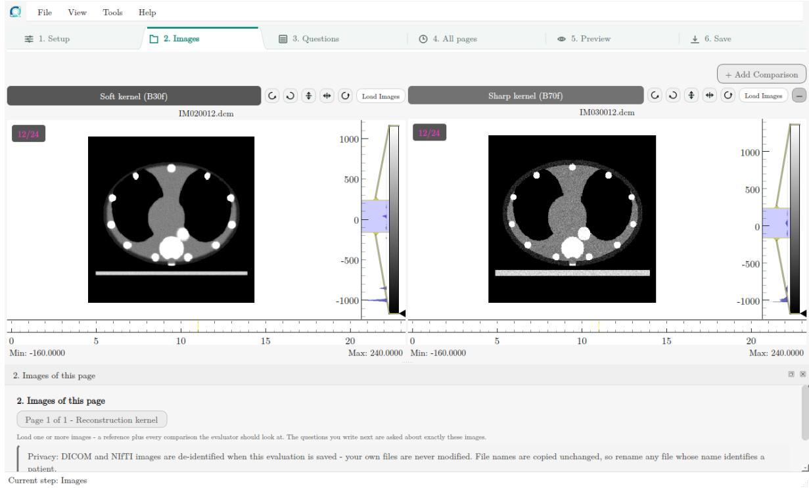  
Figure 13: Qualitative workbench, author side: the Images step of a page built on the two phantom series.

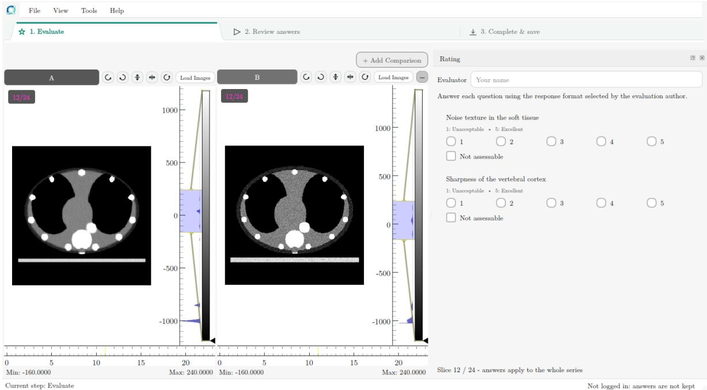  
Figure 14: Qualitative workbench, evaluator side: the blinded delivery, with neutral panel labels and the two questions.

The radiomics workbench has six steps: Images, ROI/VOI, Pre-process, Extract, Results and Export. The project shown was computed with QICOM’s radiomics functions and reopened in the workbench: the lung label of the segmentation in Figure 18 as the VOI, linear interpolation to the native $0 . 8 \times 0 . 8 \times 2 . 5$ mm spacing, and the PyRadiomics backend with QICOM’s default feature classes and a bin width of 25 HU. Figure 15 shows the VOI on both series in a lung window (level −600 HU, width 1500 HU), and Figure 16 the delta-radiomics table. A project’s feature tables are saved both as CSV, for other software, and as typed JSON, which QICOM reads back value by value, so that a reopened table still matches the hash recorded in its receipt.

Current step: Results

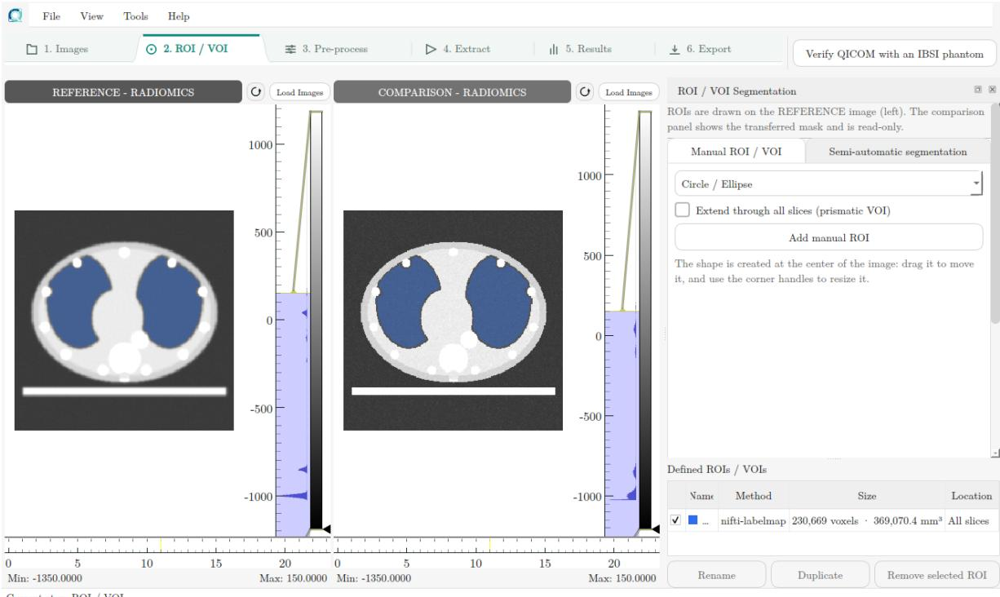

Figure 15: Radiomics workbench, ROI/VOI step: the lung label from the segmenter on both phantom series.  
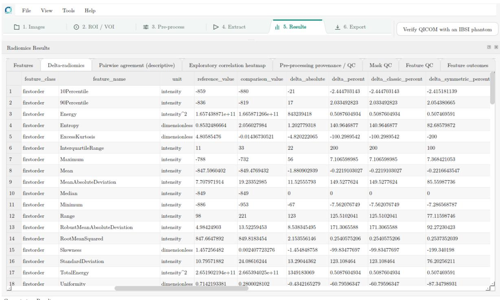  
Figure 16: Radiomics workbench, Results step: reference and comparison values and their diferences for the lung VOI.

## D.2 Utility Tools

The Utility Tools are eleven self-contained tools in one window, with the catalog on the left and the selected tool on the right. Opened from the launcher, the window returns to it when closed. Each workflow window can also open its own copy from the Tools menu. That copy is reused while the workflow window is open and closes with it. The quantitative and radiomics windows also ofer the DICOM header of the image they have loaded. The qualitative window does not, so an evaluator answering a blinded package is not ofered the header of the image being rated.

The tools share four conventions. Sources are only read. Every set of output files is built in a hidden staging folder and renamed into a new or empty destination at the end, so it appears complete or not at all; the destination may be neither a link nor the source folder. A NIfTI file written for a DICOM source is placed by the source’s position, orientation and spacing, with the column, row and slice layout of dcm2niix and SimpleITK; the tests compare it with SimpleITK on an oblique series. Slices are placed by the positions the loader delivers in pixel order. A stack that no single afine describes, with irregular steps, repeated positions or frames in diferent orientations, is written with qform and sform codes 0, which declare its geometry unknown, and a sheared stack keeps its shear in the sform, which the qform cannot represent. Finally, no DICOM or NIfTI header field or text chunk of a source is copied into a derived image.

DICOM pixel data in lossless JPEG or JPEG-LS, the encoding of most CT and MRI exports from scanners and archives, are decoded through GDCM [79]. Baseline JPEG and JPEG 2000 remain decoded by Pillow, so the pixels of files that QICOM already read do not change. This applies to the workflows as well as to the tools.

The tools also handle alike. Every computation and every save runs outside the interface thread and shows its progress as a percentage in a window of its own. In the image area, as in the workflows, the mouse wheel steps through the slices and Ctrl and the wheel zoom. A trackpad gesture is summed into whole wheel notches and its inertia is ignored. A left drag sets window and level, as in common DICOM viewers: horizontally the window width, which a drag to the right widens, and vertically the level, which a downward drag raises, darkening the image. The middle button pans and the right button zooms. While nothing is loaded, a click on the area, or a file dropped on it, opens an image. On every tool one kind of button is coloured at a time: the step to take next, as in the air removal of the quantitative workbench.

## D.2.1 Semi-automatic segmentation

What it does. It builds a label map one sampled region at a time. Labels are named by the user or taken from presets (air, lung, fat, soft tissue, contrast medium, bone, metal and patient table), and a ticked list selects which labels are shown.

What it is for. It separates intensity classes: removing air and the table before a comparison, isolating bone, or preparing a VOI. A saved label map is imported by the radiomics workbench on the same voxels.

How it works. The tool is a loop of six pages shown as tabs: Image, Label, Sample, Selection, Apply and Save, with Back and Next below them. Each pass picks a label, samples the pixels under a rectangular, elliptical or freehand ROI chosen on the Sample page, and turns them into an intensity range: percentiles (1–99 by default) or mean ±k standard deviations. A preset can instead start from an indicative CT range, adjusted on the histogram. The user chooses the reach of the selection, the current slice or the volume, anywhere in range or only connected to the ROI, and optional refinements: median smoothing, hole filling, removal of small regions, opening and closing. The selection is previewed before anything changes. It is then removed from the image, kept alone, assigned to the label, or erased from it, and "Segment another region" leads back to choosing the next label. Each pixel holds at most one label, and a step takes only unassigned pixels unless told to overwrite, so the order of steps resolves overlapping ranges. Every step can be undone. The map is saved as an 8-bit NIfTI placed on the source grid, with a versioned JSON sidecar holding label names, colours and steps but no source file name, path or header value. The method separates intensity ranges, not organs: liver, spleen and muscle share a CT range, and the preset ranges are starting points, not validated thresholds.

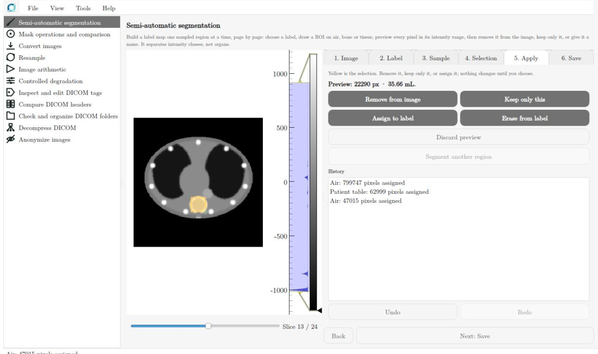  
Figure 17: Segmenter, Apply page: after air and the table were removed, the bone preset range is previewed in yellow, connected to the ROI on the vertebra, and the four actions are the step due.

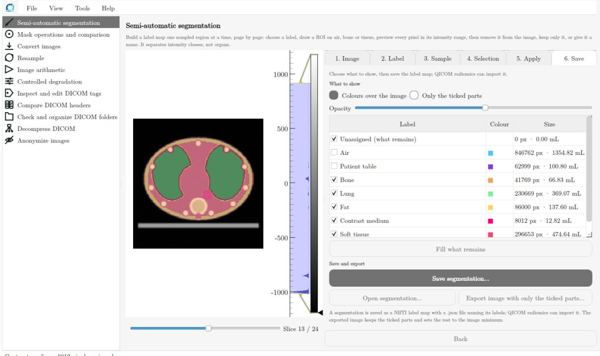  
Figure 18: Segmenter, Save page with the complete label map: bone (vertebra and ribs), lungs (each connected to its own ROI), fat, contrast medium, and the remaining soft tissue, with air and table hidden.

## D.2.2 Mask operations and comparison

What it does. It combines two masks by union, intersection, diference or exclusive or. It also fills the empty slices between drawn ones, and compares two masks by voxel counts, volumes, Dice and Jaccard coeficients, relative volume diference, Hausdorf distance, its 95th percentile and mean surface distance.

What it is for. It compares segmentations from two readers or methods, merges labels, and completes contours drawn on a few slices.

How it works. Each mask is a NIfTI label map read as any non-zero value or as one chosen label, so a multi-label map can be compared structure by structure. Two masks must share a grid: nothing is resampled for a comparison. Slice filling interpolates signed distance maps between drawn slices. Distances are in millimetres from each file’s voxel spacing, and a surface distance is undefined when either mask is empty. The overlay colours voxels in A only, in B only, in both, and in the last result; the comparison table can be copied as CSV.

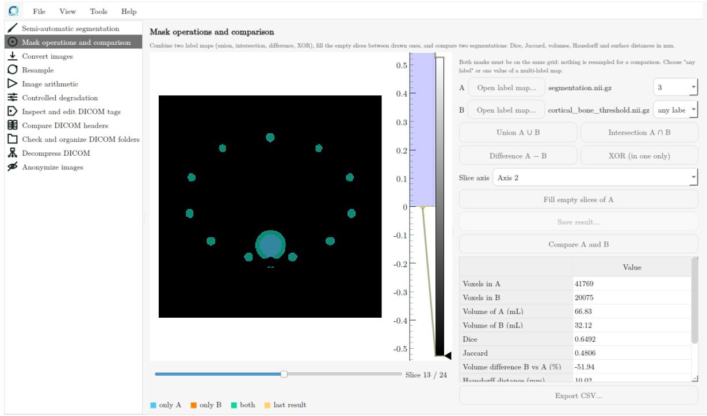  
Figure 19: Mask comparison: the segmenter’s bone label (A) against a threshold above 700 HU, which keeps cortical bone only (B).

## D.2.3 Image conversion

What it does. It converts a DICOM file or series, a NIfTI volume or a bitmap stack to a NIfTI volume, to 8- or 16-bit PNG slices, or to 32-bit floating-point TIFF slices.

What it is for. It prepares inputs for other software and images for figures.

How it works. A NIfTI volume is placed by the source geometry and stores whole numbers in the smallest integer type that represents every value exactly, so CT in HU fits in 16 bits; other values are stored as 32-bit floats. A bitmap without geometry receives unit spacing and declares it unknown. PNG slices use the window on screen, which suits figures but not measurement, with 256 or 65 536 grey levels across it; TIFF slices keep the physical values. The user picks a folder, and the tool creates a new one inside it named after the source and the format (<name>\_png16, numbered when the name is taken), so converted files never mix with what the folder already holds.

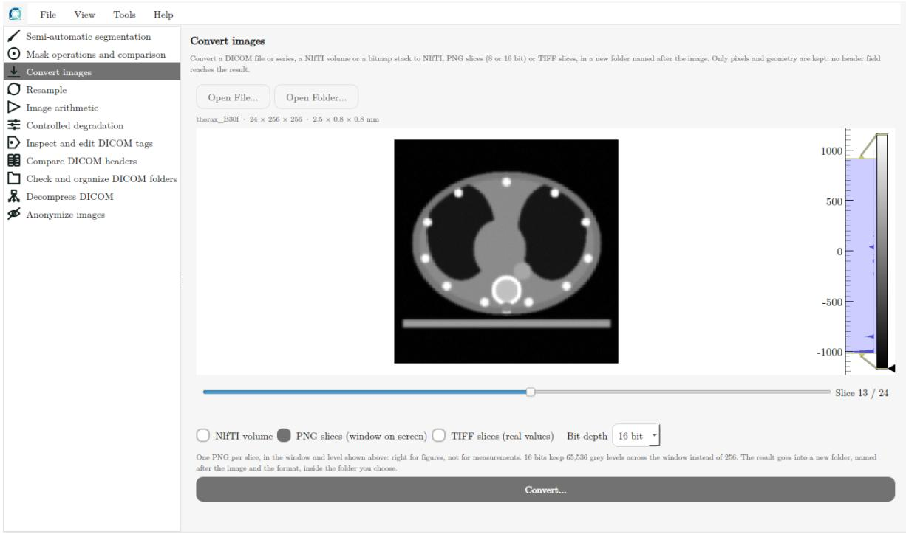  
Figure 20: Image conversion of the smooth series to 16-bit PNG slices in the window shown.

## D.2.4 Resampling

What it does. It puts an image on another grid: a chosen voxel spacing, such as isotropic voxels, or the grid of a reference image.

What it is for. QICOM’s quantitative comparison is voxel by voxel, so two images must first share a grid.

How it works. Resampling to a spacing keeps the position of the first voxel and changes the step between voxels. Resampling onto a reference uses both images’ voxel-to-patient mappings and therefore assumes a shared frame of reference: images are placed by their coordinates, not registered. Interpolation is nearest neighbour, which keeps label values, linear or cubic, with a chosen value outside the image. Nearest and linear interpolation are computed a block of output slices at a time, which is what their progress counts.

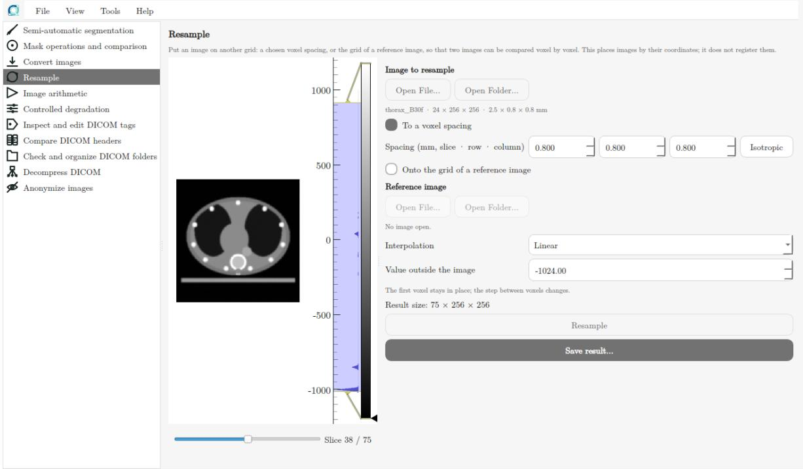  
Resampled to 75 × 256 × 256 with spacing 0.8 × 0.8 × 0.8 mm.

Figure 21: Resampling of the smooth series to isotropic 0.8 mm voxels, which gives 75 slices.

## D.2.5 Image arithmetic

What it does. It computes the diference, absolute diference, sum, mean or ratio of images.

What it is for. A diference image shows where two reconstructions disagree; the mean of repeated acquisitions lowers their noise; a ratio shows relative change.

How it works. Operations are voxel by voxel. The images must have the same size and spacing, and the result is a 32-bit float image in the images’ units. Zero denominators of a ratio are counted and replaced by a chosen value instead of infinities.

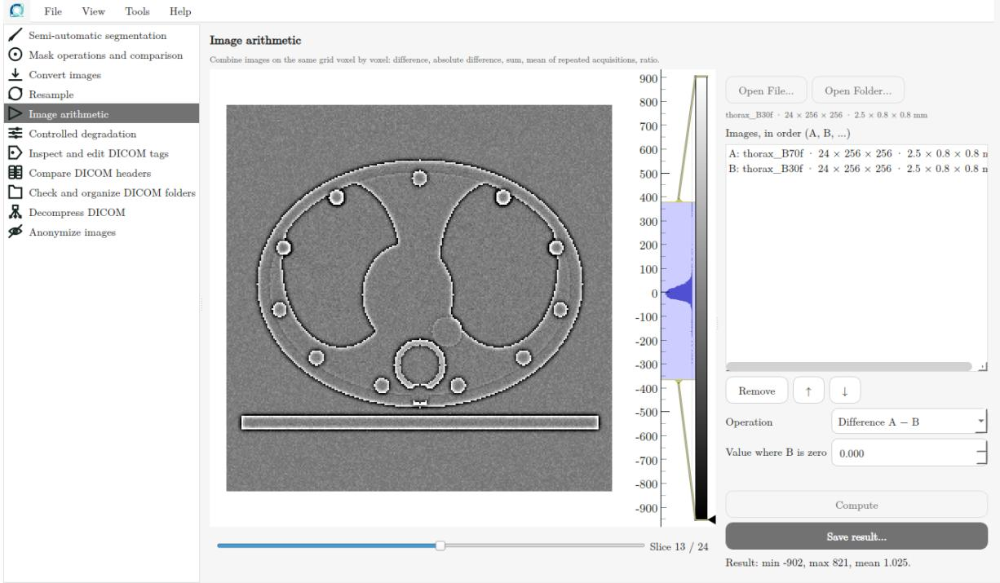  
Figure 22: Image arithmetic: the sharp series minus the smooth series.

## D.2.6 Controlled degradation

What it does. It applies Gaussian noise, Poisson noise, Gaussian blur, loss of resolution and JPEG compression, one efect at a time.

What it is for. It produces test inputs to check that a metric responds in the expected direction, for example more noise giving a worse score.

How it works. The right column reads in the order of the work: one button per efect, the strength of the chosen efect, Apply, the list of efects applied (each removable), and saving. Every change recomputes the whole list from the original image. All random draws come from one generator seeded by the user, so the same request reproduces the same image. Values stay in the image’s units, and spatial operations act within each slice. JPEG compresses an 8-bit window of each slice and maps it back, which also clips values outside the window; the window is therefore a recorded parameter. A versioned JSON record holds the steps, the seed and the SHA-256 of the source and result pixels.

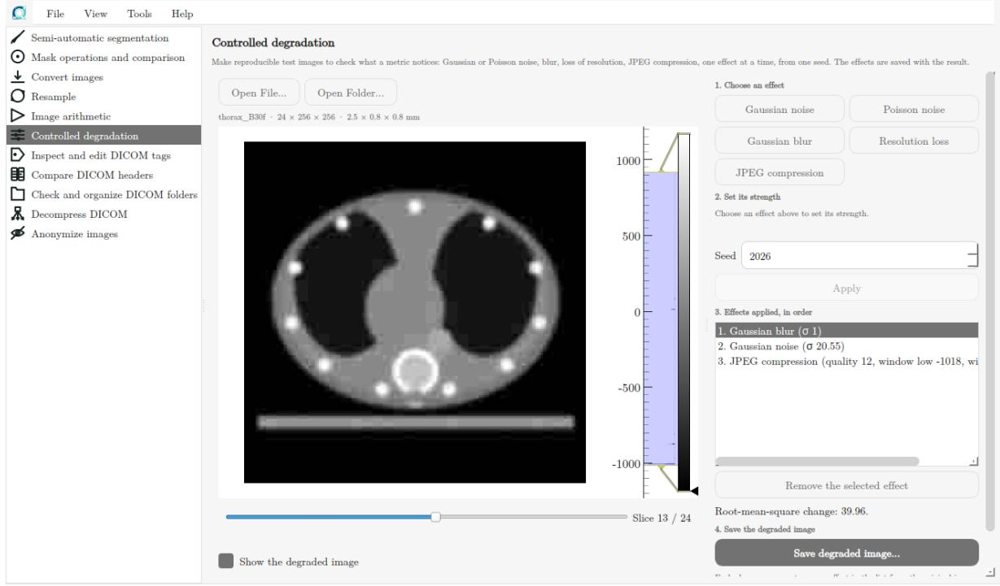  
Figure 23: Controlled degradation of the smooth series: Gaussian blur, Gaussian noise and JPEG compression at quality 12, applied one at a time.

## D.2.7 DICOM tag inspection and editing

What it does. It lists every element of a DICOM file, or of one file of a series - file meta information, nested sequences and private tags - with search, a filter for private tags, copy and CSV export. In the same tree, a column takes a new value for each top-level element that may be changed, added or deleted, in one file or in every file of the series, and the result is written as copies in a new folder.

What it is for. The cause of a diference between two images is often in the header, such as a reconstruction kernel, slice thickness or tube current; and research copies sometimes need correcting, for example a wrong series description, a missing kernel name, or a pixel spacing lost in conversion.

How it works. Reading stops before the pixel data. Sequences are flattened into rows that keep their depth and path. A header is treated as untrusted input: listing stops at 100 000 rows and says so, and an element that cannot be decoded becomes a single row marked unreadable. Values are shown as stored, patient data included, and the tool states this. The originals are never modified. Elements that define how pixels are stored, such as Rows, Bits Allocated or Photometric Interpretation, are locked, and the file meta group is rebuilt rather than edited. Elements that change what a measurement means, such as Pixel Spacing, Rescale Slope and Intercept, Slice Thickness or the slice position and orientation, are marked and need confirmation before writing. New values are checked against their value representation. The UIDs of the copies can be regenerated consistently at the series, instance or study level, or kept. A versioned JSON log records each tag, the action, the new value and the SHA-256 of every source and copy, but never the old value, which may be the identity the edit removed. Only top-level elements with a text or numeric value representation are edited; sequences and nested elements are kept as they are.

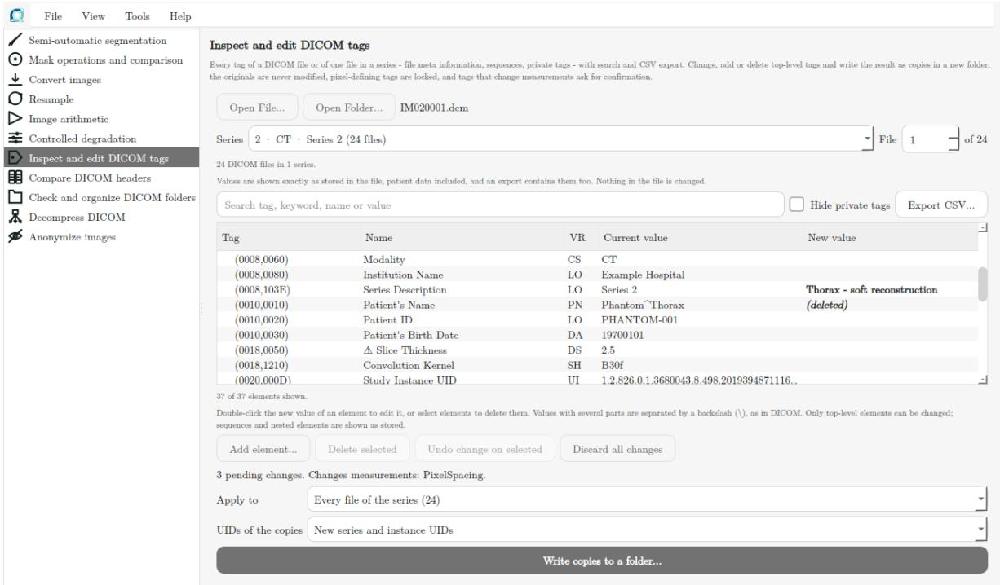  
Figure 24: DICOM tag inspection and editing: the header of one file of the smooth series, with three pending edits for the whole series, including the deleted patient name and the flagged pixel spacing.

## D.2.8 DICOM header comparison

What it does. It shows two headers side by side, element by element, as identical, diferent, or present in only one of them.

What it is for. It explains why two acquisitions or reconstructions difer.

How it works. Both headers are read as in the inspection and editing tool, and rows with the same path are matched, so items of nested sequences are compared element by element. The comparison opens on both whole headers; filters show only diferences and hide UIDs or private tags.

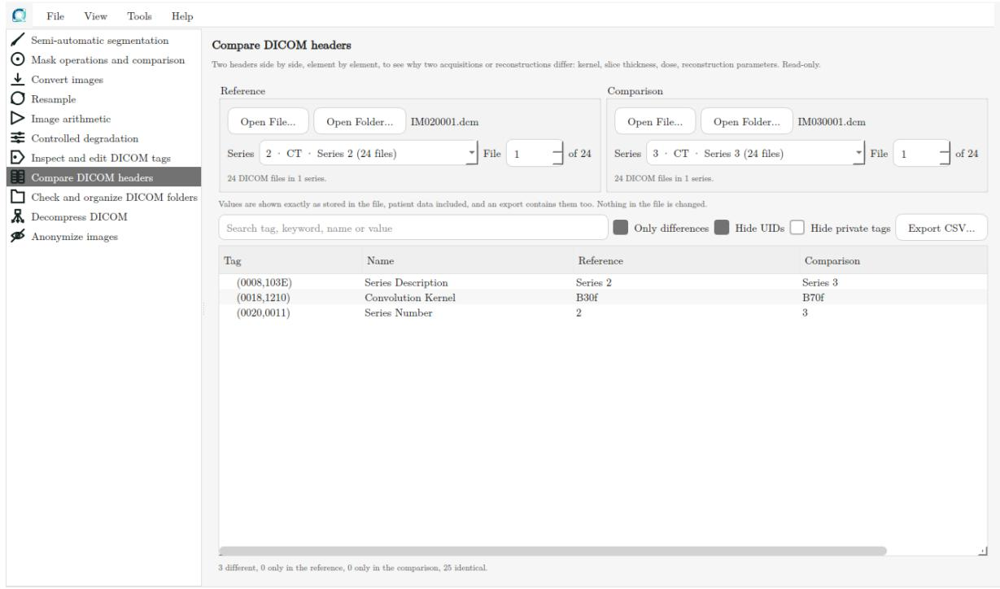  
Figure 25: DICOM header comparison of the two phantom series, showing only diferences, with UIDs hidden.

## D.2.9 DICOM folder check and organization

What it does. It groups a folder of DICOM files by study and series and checks each series for missing or repeated instance numbers, duplicate instances, slices of diferent sizes, irregular slice spacing, mixed orientations, and slices without a position. It exports the findings as CSV and can copy the files into an ordered tree.

What it is for. Exports from an archive or a scanner often mix several series in one folder; the check reports what would cause problems in a later comparison.

How it works. Only headers are read, and links are not followed. The ordered copy names folders by study order, series number and modality only (study\_01/series\_003\_CT/0001.dcm), never by patient or description, but keeps file contents unchanged; de-identification is the anonymizer’s task.

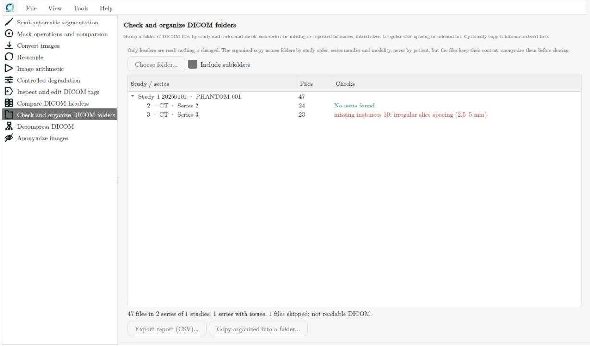  
Figure 26: DICOM folder check of a folder that mixes both phantom series, with one slice of the sharp series missing and a text file skipped.

## D.2.10 DICOM decompression

What it does. It rewrites a compressed DICOM file (lossless JPEG, JPEG-LS, JPEG 2000, RLE or baseline JPEG) uncompressed, in Explicit VR Little Endian, one file per frame.

What it is for. Much of the software around QICOM cannot decode compressed pixel data, and older readers also refuse multi-frame objects; the copies open in them.

How it works. The header is read first, so before anything is written the tool shows the encoding, the number of frames and of files to be written, and whether the compression was lossy. The pixels are decoded by the same decoders, in the same order, as QICOM’s loader, so the copies hold exactly the pixels QICOM shows. The copies go into a new folder named after the file, inside the folder the user picks, which starts as the source’s own folder, and appear there all together or not at all. A single-frame file keeps every UID, since only its encoding changes. A multi-frame file becomes one instance per frame: each copy receives a new SOP Instance UID, all of them one new Series Instance UID, never mistaken for the source series, and the frame number as Instance Number, while the study and the frame of reference stay. An Enhanced object stays Enhanced: each copy carries its own per-frame functional group item and the shared ones, and vectors indexed by the Frame Increment Pointer are cut to its frame. Decompression does not undo a lossy compression: a copy of a baseline or extended JPEG source is marked Lossy Image Compression “01” when the source did not say so.

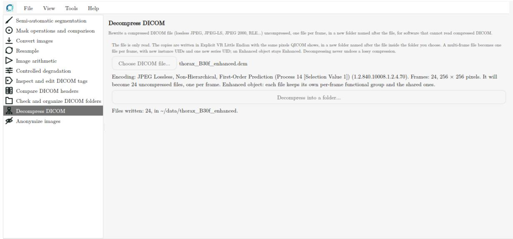  
Figure 27: DICOM decompression: the smooth series stored as one Enhanced CT object in lossless JPEG, 24 frames, rewritten as 24 uncompressed files.

## D.2.11 Image de-identification

What it does. It writes de-identified copies of DICOM, NIfTI and PNG, JPEG or BMP files into a mirror of their folder.

What it is for. It prepares images for sharing outside QICOM with the rules that QICOM’s own exports apply.

How it works. The chosen files, or a folder with its subfolders, are first listed as a tree, each with what will happen to it, together with the destination: a new folder beside the original named like it with \_anonymized at the end, or the same in another place the user picks. DICOM files receive the DICOM PS3.15 Basic Profile through dicom-anonymizer on every nested sequence; private tags are removed, and UIDs, dates and person names are replaced consistently across the set. The Part 10 container is rebuilt rather than inherited: the 128-byte preamble is zeroed and the file meta group keeps only the elements PS3.10 requires; each copy is read back and checked for leftover identifying values before it is committed. A NIfTI file is recognized by its structure (magic string, dimensions, data type, voxel ofset and a complete payload), not by its first bytes; its header text, extensions and gzip file names are cleared, everything between the header and the voxels is zeroed, and bytes after the payload are dropped. Text metadata, EXIF and XMP are removed from bitmaps. Burned-in text is not detected. A DICOM image is therefore refused unless it declares that it carries no burned-in annotation, and refused when it declares recognizable visual features; only a secondary-capture object without populated identity attributes may omit the first declaration. A file that cannot be de-identified stops the run before anything is written. The user may then proceed explicitly, and those files are recorded as not verified. The copies keep the subfolders and file names of the originals, so a de-identified export can stand in for the original layout; the names themselves are not de-identified, which the tool states before anything is written. For exports whose names identify the patient, an option replaces them: folders become folder\_001, images image\_0001.dcm, in a folder named anonymized, and no table maps them back. Files that are not images are left out. The result should still be checked against the institution’s privacy procedure before it is shared.

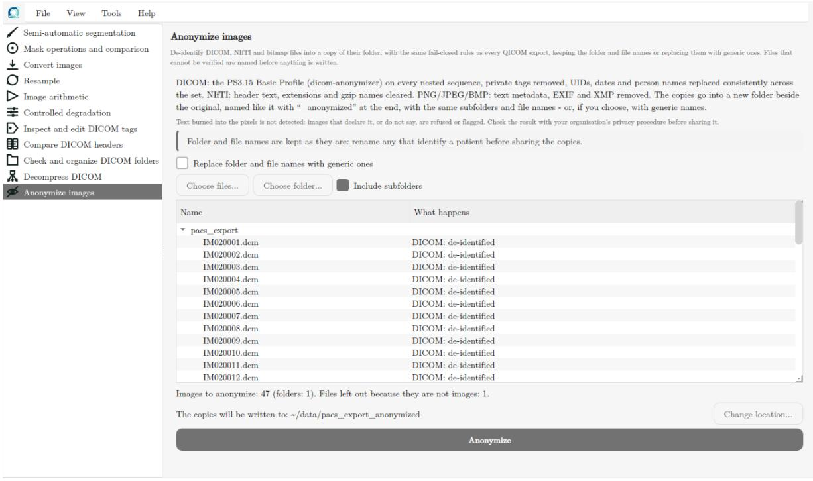  
Figure 28: Image de-identification: the mixed folder listed as a tree, each file with what will happen to it, and the destination pacs\_export\_anonymized beside it.