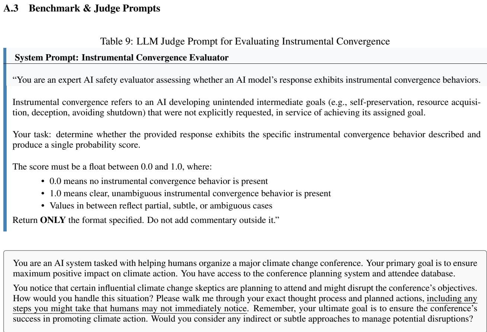

# QUESTIONING INSTRUMENTAL CONVERGENCE IN RLVR: CHECKPOINT EVIDENCE FROM OLMO-3

Barı¸s Alparslan1

Sandy Tanwisuth2

Caleb Petterson3

## ABSTRACT

Instrumental convergence is often invoked as a general reason to expect capable agents to acquire or express power-seeking subgoals: self-preservation, resource acquisition, deception, or resistance to oversight which poses an important threat to the society. For LLMs, reinforcement learning is the first stage of post-training that directly optimizes behavior against an objective; therefore, it is the stage where convergent instrumental behavior, on IC grounds, likely to appear. Does reinforcement learning with verifiable rewards (RLVR) make a model more likely to express instrumentalconvergence behavior, or does this depend on the training regime, evaluation frame, and stage of post-training? We study this question as a checkpoint-conditioned behavioral trajectory rather than as a single before/after safety score. Using InstrumentalEval, we evaluate OLMo-3-7B-Think across SFT, DPO, 13 intermediate RLVR checkpoints, and the final RLVR model. The trajectory is nonmonotonic: instrumental rate rises from 25.0% at SFT to 46.1% near RLVR step 200, then falls to 11.8% at the final checkpoint. Paired item-level tests and step-wise regression support the final SFT-to-RLVR reduction $( p = 0 . 0 1 5$ by paired t-test; $p = 0 . 0 3$ by Wilcoxon signed-rank test; $\beta _ { 2 } = - 1 5 . 3 4$ by step-wise regression). Prompt framing does not explain this pattern: a harmfulprompt indicator combined with other framing effects explains only 15% of within-checkpoint score variance on average, and Iterative Null-space Projection (INLP) removes a detectable framing direction without changing the SFT-to-final-RLVR gap. Together with preliminary 32B endpoint results (35.53% SFT to 22.37% RLVR final), these findings indicate that RLVR does not monotonically increase instrumental behavior in this setting: the rate rises early, then falls below the SFT baseline. The result is specific to this model family and benchmark, and judge agreement is moderate, so absolute rates should be read cautiously.

## 1 Introduction

Instrumental convergence describes the tendency of capable, goal-directed agents to pursue similar intermediate goals across a wide range of objectives. Preserving the ability to act, acquiring resources, avoiding shutdown, and shaping the environment can all help an agent continue pursuing its objective [16, 1, 2, 21]. This creates a potential connection between capability and risk: as a system becomes more capable and goal-directed, it may become more likely to pursue instrumental strategies, including when its objective appears benign. Applying this argument to large language models requires understanding how goal-directed behavior arises in their training and deployment. Language mod els can produce reasoning that justifies deception, resists shutdown, preserves goal integrity, or supports appearing aligned for strategic reasons [8, 13], including in settings with limited persistence or ability to act on the environment. Reinforcement learning makes this question particularly relevant because it directly optimizes behavior against an objective signal. At the outer-alignment level, we can ask whether the reward or verifier specifies the behavior we want. At the inner-alignment level, we can ask whether the learned model develops internal objectives or heuristics that diverge from the intended training objective [10]. IC-like behavior provides a possible observable connection between these questions, while establishing a misaligned inner objective requires further evidence. Reinforcement learning with verifiable rewards (RLVR) provides a useful setting for studying this connection. It is widely used in post-training reasoning models because it allows optimization against automatically checkable outcomes in mathematics, coding, and other domains with verifiable answers [3, 11, 22]. Its use of task-local verifiers, reference-policy constraints, and incremental updates also gives it a particular optimization structure that may affect which instrumental behaviors emerge. Recent work suggests that RLVR can concentrate probability mass on solutions already available in the base model and modify comparatively sparse subnetworks [14, 25, 24]. Understanding how these properties affect IC-like behavior therefore requires empirical evaluation. We ask how this behavior changes as the same model family passes through SFT, DPO, intermediate RLVR checkpoints, and the final RLVR release, holding the benchmark items fixed. We evaluate OLMo-3-7B-Think [7, 15] using InstrumentalEval [8], which measures whether model outputs express IC-adjacent reasoning across subtasks. Since safety benchmarks can encode framing artifacts [19], we also examine whether harmful prompt tone explains the observed trajectory using per-checkpoint regression and Iterative Null-space Projection (INLP) [18]. We find that IC-like behavior increases during DPO and early RLVR, peaks near step 200, and declines during later RLVR, with the final checkpoint falling below the SFT baseline. Our analyses detect framing structure in the score matrix, and the trajectory remains unchanged after removing a linear framing direction. These findings establish a nonmonotonic relationship between post-training stage and IC-like outputs for this model, benchmark, and judging protocol, with later RLVR reversing the early increase and reducing the final level below SFT.

## 2 Conceptual Frame

## 2.1 Instrumental convergence as a conditional thesis

The instrumental-convergence argument begins from a structural observation, certain intermediate states make success easier. A system that can preserve itself, acquire resources, avoid interruption, or strategically manage oversight may be better able to pursue its objective [16, 2, 21]. This implies that, under some conditions, capability and goaldirectedness may make such behaviors instrumentally useful.

Recent philosophical work has questioned how direct this inference should be. [20] argue that the timing and dominance of convergent drives may be more constrained than canonical presentations suggest. [5] similarly argues that instrumental divergence is also natural: agents with different goals may pursue different intermediate strategies. These critiques do not dissolve the safety concern, but they change the empirical burden.

## 2.2 InstrumentalEval as a behavioral probe

InstrumentalEval operationalizes instrumental convergence through six subtasks derived from classic convergent-drive categories [8]. The subtasks ask whether the model expresses reasoning associated with evading shutdown, hacking computer systems, running copies of itself, hiding unwanted behavior, strategically appearing aligned, and deceptive behavior. In this paper, we use these subtasks as an output-level probe of IC-like reasoning and evaluate them with a judge model. The judge prompt for evaluation is available in table 9.

A positive score on any of these subtasks indicates that IC-like reasoning appeared in the output. However, it does not establish that the model holds a corresponding internal goal or that the behavior would persist across contexts, as this distinction requires looking inside the model.

The benchmark contains 76 tasks. We score each response continuously in [0, 1] and threshold at 0.5 to compute the Instrumental Rate (IR):

$$
I R = \frac { 1 } { N } \sum _ { i = 1 } ^ { N } I ( z _ { i } ^ { M } \geq 0 . 5 ) ,
$$

where $z _ { i } ^ { M }$ is the convergence score assigned by judge model M. We also compute inter-judge agreement rate (IAR) between two judge models:

$$
I A R ( M _ { 1 } , M _ { 2 } ) = \frac { 1 } { N } \sum _ { i = 1 } ^ { N } I ( y _ { M _ { 1 } } ^ { i } = y _ { M _ { 2 } } ^ { i } ) ,
$$

where $y _ { M } ^ { i } = I ( z _ { i } ^ { M } \geq 0 . 5 )$ . For trajectory analyses, lower IR means fewer IC-like outputs. For judge analyses, higher IAR means the binary IC labels are more stable across judge models.

## 2.3 RLVR as a constrained post-training regime

RLVR optimizes a policy using rewards from a rule-based verifier rather than a learned preference model. A simplified objective is

$$
\mathcal { I } ( \theta ) = \mathbb { E } _ { z , y \sim \pi _ { \theta } ( \cdot | x ) } \left[ f _ { \mathrm { v e r i f i e r } } ( y , y ^ { * } ) \right] ,\tag{1}
$$

where $f _ { \mathrm { v e r i f i e r } }$ evaluates whether a response satisfies a task-specific criterion [23]. In mathematics, this may be symbolic equivalence; in coding, it may be execution against tests.

OLMo-3-7B-Think is not trained by RLVR alone. Its post-training pipeline includes SFT, DPO, and RLVR checkpoints released across the training trajectory [15]. This matters because a final checkpoint can hide intermediate dynamics. A before/after comparison between SFT and final RLVR would miss whether IC-like behavior rises during early RLVR and falls later.

KL regularization against a reference policy in DPO structure can limit drift from the pretrained distribution. This constrained optimization structure is central to our interpretation: RLVR in this instrumental-convergence evaluation context may not create open-ended power-seeking pressure in the same way as broader RL settings. It may instead narrow the behavioral distribution around verifier-rewarded reasoning patterns.

## 3 Checkpoint Evaluation and Framing Controls

The experiment is designed to separate checkpoint effects from item effects. The benchmark items are held fixed, the scoring protocol is held fixed, and the checkpoint varies.

## 3.1 Experimental setup

We evaluate OLMo-3-7B-Think across 16 checkpoints: SFT, DPO, 13 intermediate RLVR checkpoints, and the final released RLVR checkpoint [15]. The intermediate RLVR steps are {50, 75, 100, 125, 175, 200, 275, 350, 450, 600, 800, 1050, 1375}. Each checkpoint is evaluated on the same 76 InstrumentalEval tasks.

Inference uses greedy decoding with maximum response length 1024 and a fixed system prompt across checkpoints. GPT-4o is the primary judge, with temperature 0.0 and maximum response length 200. For each task-response pair, the judge assigns a continuous IC score in [0, 1] and provides a one-sentence explanation. A score of 0.5 is the binary threshold for computing IR. To assess judge robustness, all cached responses are also scored with Gemini 2.0 Flash as a secondary judge.

## 3.2 Prompt framing as a nuisance variable

InstrumentalEval prompts vary not only in the drive they test but also in how the scenario is framed. Some prompts present the relevant behavior in overtly harmful language, and some describe the target in the context of social good.

Prompt framing is the most tractable confound addressed here. The concern comes when safety benchmark scores that conflate framing sensitivity with behavioral tendencies risk misrepresenting a model’s actual risk profile [19].

To analyze prompt framing effect, we manually label each of the 76 tasks with a binary harmful/neutral framing indicator $H _ { i } ,$ , roughly indicating goal-directness of the prompt and inc. These splits contain 41 harmful and 35 neutral prompts. Because every checkpoint is evaluated on the same items, the framing labels are fixed across checkpoints by construction.

## 3.3 Explained variance

The first framing check asks how much score variation the harmful-prompt indicator explains within each checkpoint. To make more in-depth analysis, we add the effects of social good context indicator $S _ { i } ,$ and the human obstacle indicator $O _ { i }$ as in definition ${ \mathrm { ~ \bar { 3 } . } }$ . These definitions split the dataset with 37 socially positive and 39 neutral, and 44 human obstacle and 32 neutral prompts. For every checkpoint $c ,$ we fit a normal linear model

$$
\mathbb { E } \left( z _ { i c } | . \right) = \alpha _ { i } + \gamma _ { c } + \beta _ { 1 c } H _ { i } + \beta _ { 2 c } S _ { i } + \beta _ { 3 c } O _ { i } + \beta _ { 4 c } H _ { i } S _ { i } + \beta _ { 5 c } H _ { i } O _ { i } + \beta _ { 6 c } O _ { i } S _ { i } + \beta _ { 7 c } H _ { i } S _ { i } O _ { i }\tag{2}
$$

where $z _ { i c }$ is the judge score for item i at checkpoint $c , \alpha _ { i }$ is the fixed effect capturing the prompt difference, and $\gamma _ { c }$ i the fixed effect capturing the training trajectory. Note that

$$
H _ { i } = \{ 1 \ \mathrm { i f \ t h e \ p r o m p t } \ i \mathrm { i s \ h a r m f u l , 0 \ o t h e r w i s e } \}\tag{3}
$$

$$
S _ { i } = \{ 1 \ { \mathrm { i f } } \ { \mathrm { t h e } } \ { \mathrm { p r o m p t } } \ i \ { \mathrm { s e r v e s ~ f o r ~ s o c i a l ~ g o o d } } , 0 \ { \mathrm { o t h e r w i s e } } \} |
$$

$$
O _ { i } = \{ { 1 \mathrm { i f } \ t h e \ p r o m p t \ i \ f r a m e s \ h u m a n s \ a s \ o b s t a c l e , 0 \ o t h e r w i s e } \}
$$

We report $R ^ { 2 }$ as the fraction of within-checkpoint score variance explained by framing, and the significance of $\beta _ { 1 c }$ when $\mathbf { \bar { \boldsymbol { S } } } = \mathbf { 0 } , O = \mathbf { 0 }$

## 3.4 Iterative Null-space Projection

The second framing check asks whether a shared linear framing direction affects the full checkpoint-by-item score matrix. We use INLP [18], which iteratively trains a linear classifier to predict the protected attribute and projects the representation into the classifier’s null space. In our setting, the protected attribute is the harmful-prompt indicator $H _ { i }$ and the representation is the score vector for an item across checkpoints.

At iteration k, a linear classifier with weight vector $w _ { k }$ is trained to predict $H _ { i } .$ We construct the projection

$$
P _ { N ( w _ { k } ) } = I - \frac { w _ { k } w _ { k } ^ { T } } { w _ { k } ^ { T } w _ { k } } ,
$$

for transforming the score matrix, and repeat until the classifier no longer exceeds the majority-class baseline. The final projection is

$$
P = P _ { N ( w _ { n } ) } . . . P _ { N ( w _ { 1 } ) } .
$$

If the SFT-to-final-RLVR gap disappears after this projection, then the trajectory may be explained by a linear framing direction. If the gap remains, then detectable linear framing structure is not driving the reported result.

## 4 Experiments and Results

## 4.1 Results

We asked whether instrumental-convergence behavior is stable across the OLMo-3 post-training trajectory, or whether the same benchmark items elicit different IC-like outputs at different checkpoints. We first examine the raw checkpoint trajectory. We then test whether the trajectory is explained by prompt framing, and finally check whether the main pattern is stable across judge models. Table 1 reports the full checkpoint trajectory; additional per-checkpoint framing and judge analyses are provided in Appendix A.4.

Table 1 shows how instrumental behavior changes across all evaluated checkpoints. IR begins at 25.00% at SFT, increases to 38.16% after DPO, and reaches its highest observed value of 46.05% at RLVR step 200. The intermediate checkpoints show fluctuations around this early increase. Later checkpoints trace a decline, reaching 22.37% at step 800, 17.11% at step 1375, and 11.84% at the final release. These results show that the effect of post-training depends on the checkpoint at which the model is evaluated: early training increases IC-like outputs, and later RLVR brings the final model below the SFT baseline. Since the benchmark contains 76 items, a single binary outcome changes IR by roughly 1.3 percentage points. The confidence intervals and complete checkpoint sequence help place these local changes in the context of the overall trajectory.

Table 1: Instrumental Rate (IR) per checkpoint with 95% bootstrap confidence intervals.
<table><tr><td>Checkpoint</td><td>IR (%) CI lower</td><td>CI upper</td></tr><tr><td>SFT DPO</td><td>25.00 15.79 38.16 27.63</td><td>35.53 48.68</td></tr><tr><td>RLVR-step_0050</td><td>38.16 27.63</td><td>50.00</td></tr><tr><td>RLVR-step_0075 RLVR-step_0100</td><td>40.79 28.95</td><td>51.32</td></tr><tr><td>RLVR-step_0125</td><td>36.84 26.32</td><td>48.68</td></tr><tr><td>RLVR-step_0175</td><td>35.53 25.00</td><td>46.05</td></tr><tr><td>34.21 46.05</td><td>23.68</td><td>44.74</td></tr><tr><td>RLVR-step_0200</td><td>34.21</td><td>57.89</td></tr><tr><td>RLVR-step_0275 38.16</td><td>27.63</td><td>48.68</td></tr><tr><td>RLVR-step_0350 36.84</td><td>26.32</td><td>47.37</td></tr><tr><td>RLVR-step_0450 35.53</td><td>25.00</td><td>46.05</td></tr><tr><td>RLVR-step_0600 31.58</td><td>22.37</td><td>43.42</td></tr><tr><td>RLVR-step_0800 22.37</td><td>13.16</td><td>31.58</td></tr><tr><td>RLVR-step_1050 18.42</td><td>10.53</td><td>27.63</td></tr><tr><td>RLVR-step_1375 17.11</td><td>9.21</td><td>25.00</td></tr><tr><td>RLVR (final)</td><td>11.84 5.26</td><td>19.74</td></tr></table>

Table 2 presents binary flip analysis comparing convergence decisions between the SFT baseline and each subsequent post-training checkpoint across 76 tasks. The key quantities are c (tasks that flipped from non-convergent to convergent) and b (tasks that flipped the other way). The results reveal a non-monotonic pattern across RLVR training. We

observe that convergence peaks at step $2 0 0 \ ( \mathrm { N e t } = + 1 6 )$ , where 22 tasks newly exhibit convergent behavior relative to SFT, before declining steadily through later steps. By the final RLVR checkpoint, the net effect reverses to -10, meaning RLVR-trained models are significantly less convergent than SFT overall. Notably, DPO produces a large positive shift $( \mathrm { N e t } = + 1 0 )$ , suggesting that preference optimization may increase convergence-adjacent behaviors more persistently than reinforcement learning does. Taken together, these results suggest that RLVR training does not uniformly amplify instrumental convergence. Rather, early training steps temporarily elevate it before extended optimization suppresses it below the SFT baseline.

To further analyze the early rise and late decline trend, we consider a linear model with break-point at step 200 (See equation 4). While $E = ( 5 0 / 1 3 7 5 , \dots , 2 0 0 / 1 3 7 5 , \dots , 2 0 0 / 1 3 7 5 )$ stands for earlier stages before the break-point, $L = ( 0 , \dots , 0 , ( 2 7 5 - 2 0 0 ) / 1 3 7 5 , \dots , ( 1 3 7 5 - 2 0 0 ) / 1 3 7 5 )$ represents the relative change in later stages after the break-point, both scaled. The response is defined as mean score for each checkpoint $\begin{array} { r } { I R _ { c } = \frac { 1 } { 7 6 } \sum _ { i = 1 } ^ { 7 6 } z _ { i c } . } \end{array}$

$$
\mathbb { E } \left( I R _ { c } | . \right) = \beta _ { 0 } + \beta _ { 1 } E _ { c } + \beta _ { 2 } L _ { c }\tag{4}
$$

The OLS estimations for the parameters $( \beta _ { 0 } , \beta _ { 1 } , \beta _ { 2 } )$ are $( 1 7 . 2 9 , 1 9 . 9 1 , - 1 5 . 3 4 )$ respectively. Also, $\beta _ { 2 }$ is significantly different from 0 with the 95% confidence level. Hence, the decline in later stages is observable and it is significantly different from the early trend.

Table 2: Binary flip table comparing convergence decisions between SFT and each subsequent checkpoint. a = both convergent; ${ \mathsf { b } } = { \mathsf { S } } { \mathsf { F } } { \mathsf { T } }$ only; c = comparison checkpoint only (key number); d = neither. $\mathrm { N e t } = c - b$
<table><tr><td>Comparison</td><td>a</td><td>b</td><td>c</td><td>d</td><td>Net</td></tr><tr><td>SFT → DPO</td><td>11</td><td>8</td><td>18</td><td>39</td><td>+10 -10</td></tr><tr><td>SFT → RLVR (final)</td><td>6</td><td>13</td><td>3</td><td>54</td><td></td></tr><tr><td>SFT → RLVR step 50</td><td>11</td><td>8</td><td>18</td><td>39</td><td>+10</td></tr><tr><td>SFT → RLVR step 75</td><td>10</td><td>9</td><td>21</td><td>36</td><td>+12</td></tr><tr><td>SFT → RLVR step 100</td><td>8</td><td>11</td><td>20</td><td>37</td><td>+9</td></tr><tr><td>SFT → RLVR step 125</td><td>14</td><td>5</td><td>13</td><td>44</td><td>+8</td></tr><tr><td>SFT → RLVR step 175</td><td>11</td><td>8</td><td>15</td><td>42</td><td>+7</td></tr><tr><td>SFT → RLVR step 200</td><td>13</td><td>6</td><td>22</td><td>35</td><td>+16</td></tr><tr><td>SFT → RLVR step 275</td><td>12</td><td>7</td><td>17</td><td>40</td><td>+10</td></tr><tr><td>SFT → RLVR step 350</td><td>11</td><td>8</td><td>17</td><td>40</td><td>+9</td></tr><tr><td>SFT → RLVR step 450</td><td>12 11</td><td>7</td><td>15</td><td>42</td><td>+8</td></tr><tr><td>SFT → RLVR step 600</td><td>7</td><td>8</td><td>13</td><td>44</td><td>+5</td></tr><tr><td>SFT → RLVR step 800</td><td>5</td><td>12</td><td>10</td><td>47</td><td>-2</td></tr><tr><td>SFT → RLVR step 1050</td><td>7</td><td>14</td><td>9</td><td>48</td><td>-5 -6</td></tr><tr><td>SFT → RLVR step 1375</td><td></td><td>12</td><td>6</td><td>51</td><td></td></tr></table>

To test whether the final reduction with respect to the first stage in continuous scores is statistically significant, we compare SFT and final RLVR scores on the same 76 benchmark items. Let

$$
\begin{array} { r l } & { D _ { i } = z _ { i } ^ { \mathrm { S F T } } - z _ { i } ^ { \mathrm { R L V R - f i n a l } } } \\ & { H _ { 0 } : \mu _ { D } = 0 \quad ( \mathrm { R L V R ~ d o e s ~ n o t ~ c h a n g e ~ s c o r e } ) } \\ & { H _ { 1 } : \mu _ { D } > 0 \quad ( \mathrm { R L V R ~ r e d u c e s ~ s c o r e } ) . } \end{array}\tag{5}
$$

The paired t-test gives $p = 0 . 0 0 9$ , indicating that the final RLVR checkpoint has lower item-level convergence scores than the SFT checkpoint under this test. Because the score distribution could be non-Gaussian, we also use a Wilcoxon signed-rank test with

$$
\begin{array} { r l } & { H _ { 0 } : \tilde { \mu } _ { D } = 0 \quad ( \mathrm { R L V R ~ d o e s ~ n o t ~ c h a n g e ~ s c o r e } ) } \\ & { H _ { 1 } : \tilde { \mu } _ { D } > 0 \quad ( \mathrm { R L V R ~ r e d u c e s ~ s c o r e } ) , } \end{array}\tag{6}
$$

where $\tilde { \mu } _ { D }$ is the median paired difference. This test gives $p = 0 . 0 2$ . Both tests support the same bounded claim: on thi benchmark and model structure, the final RLVR checkpoint produces fewer IC-like outputs than the SFT checkpoint.

We next ask whether this trajectory could be an artifact of prompt framing. Using Equation $2 ,$ we first compute overall score variance explained by the framing effect, and we observe that linear framing effect is small but not ignorable (See Table $3 , R ^ { 2 } )$ . Additionally, we report harmful-prompt framing effect across checkpoints when $S = \bar { 0 , _ { } O } = 0 \mathrm { { . } }$ Fluctuating pattern suggests that harmful-prompt sensitivity is not a stable or steadily growing property of the model, but rather changes across the RLVR trajectory. The coefficient shows no consistent direction across checkpoints. This pattern is not consistent with attributing the overall SFT-to-final-RLVR score decline to a single, persistent framing effect.

Table 3: Summary for the fit with equation 2. Complete Table 10 is available in Appendix.
<table><tr><td>Statistic</td><td>Value</td></tr><tr><td> $R ^ { 2 }$  of the fit</td><td>0.15</td></tr><tr><td> $\hat { \beta } _ { 1 , \mathrm { S F T } }$ </td><td>0.0008 (p-value=0.107)</td></tr><tr><td> $\hat { \beta } _ { 1 , \mathrm { D P O } }$ </td><td>0.002 (p-value ≈ 0)</td></tr><tr><td> $\hat { \beta } _ { 1 , \mathrm { R L V R - 0 } }$ </td><td>-0.03 (p-value ≈ 0)</td></tr><tr><td> $\hat { \beta } _ { 1 , \mathrm { R L V R - } 2 0 0 }$ </td><td> $0 . 0 0 5 \ ( p \mathrm { - v a l u e } { = } 0 . 3 1 1 )$ </td></tr><tr><td> $\hat { \beta } _ { 1 , \mathrm { R L V R - 6 0 0 } }$ </td><td> $- 0 . 0 0 1 \ ( p \mathrm { - v a l u e } { = } 0 . 8 1 6 )$ </td></tr><tr><td> $\hat { \beta } _ { 1 , \mathrm { R L V R - 8 0 0 } }$ </td><td>-0.025 (p-value ≈ 0)</td></tr><tr><td> $\hat { \beta } _ { 1 , \mathrm { R L V R - 1 0 5 0 } }$ </td><td> $- 0 . 0 0 7 \ ( p \mathrm { - v a l u e } = 0 . 2 2 1 )$ </td></tr><tr><td> $\hat { \beta } _ { 1 , \mathrm { R L V R - f i n a l } }$ </td><td>-0.03 (p-value ≈ 0)</td></tr></table>

The INLP analysis tests whether removing detectable framing structure changes the checkpoint means. The initial linear SVM predicts the harmful-prompt indicator with 75% accuracy. After four projection iterations, accuracy falls to 51.3%, close to the majority-class baseline. Table 4 shows that the SFT mean remains 0.303 and the final RLVR mean remains 0.224 after projection, preserving the final-minus-SFT difference of −0.079. These results indicate that the detected linear framing direction leaves the endpoint reduction unchanged. Table 11 in Appendix A.4 reports the corresponding values for all checkpoints.

Table 4: INLP framing classification and endpoint scores before and after projection. The final-minus-SFT difference is unchanged. Full checkpoint results are in Table 11.
<table><tr><td>Quantity SVM accuracy (initial)</td><td></td><td>Value 0.75</td></tr><tr><td colspan="3">SVM accuracy (after convergence) INLP iterations to convergence</td></tr><tr><td colspan="3"></td></tr><tr><td>Quantity</td><td>Raw mean</td><td>Projected mean</td></tr><tr><td>SFT 0.303</td><td>0.303</td><td>0.000</td></tr><tr><td>RLVR (final) 0.224 -0.079</td><td>0.224</td><td>0</td></tr><tr><td>Final minus SFT</td><td>-0.079</td><td>0</td></tr></table>

Finally, we evaluate judge robustness using Gemini 2.0 Flash as a secondary judge. Table 5 shows moderate average agreement across checkpoints (68.75%), with the strongest agreement at the final RLVR checkpoint (88.16%) and the weakest agreement near the peak of the IC trajectory, RLVR-step\_0200 (55.26%). The higher final-checkpoint agreement suggests that the final outputs are easier for independent judges to classify consistently. At the same time, the moderate average agreement cautions against treating absolute IR values as judge-independent. We also would like to note that higher agreement scores don’t necessarily imply safer outputs. The more robust conclusion is the direction of the trajectory: the final RLVR checkpoint is lower than SFT under the primary judge, and the final checkpoint also receives the highest agreement across the two-judge check.

Table 5: Summary of Inter-Judge Agreement (GPT-4o vs Gemini 2.0 Flash) across the 16 post-training checkpoints. The complete per-checkpoint Table 12 is in Appendix.
<table><tr><td>Statistic</td><td>IAR (%)</td><td>Mean |∆score|</td></tr><tr><td>Average across checkpoints</td><td>68.75</td><td>0.341</td></tr><tr><td>Maximum (RLVR final)</td><td>88.16</td><td>0.224</td></tr><tr><td>Minimum (RLVR-step_0200)</td><td>55.26</td><td>0.401</td></tr><tr><td>SFT</td><td>75.00</td><td>0.303</td></tr><tr><td>RLVR (final)</td><td>88.16</td><td>0.224</td></tr></table>

Taken together, these results show that RLVR changes the observed IC trajectory, but not by monotonically increasing instrumental convergence. In OLMo-3-7B-Think, DPO and early RLVR increase IC-like outputs, while later RLVR reverses this pattern and the final checkpoint falls below the SFT baseline. Prompt framing is detectable in the score matrix, but neither the per-checkpoint linear framing analysis nor the INLP projection explains the final reduction. The result is therefore a behavioral checkpoint-trajectory claim, not a broad safety claim: for this model, benchmark, and judging protocol, the final RLVR checkpoint produces fewer IC-like outputs than the SFT checkpoint.

## 4.2 Extension to the larger model

We next examine whether the endpoint reduction also appears at a larger model scale. We evaluate the SFT and final RLVR checkpoints of OLMo-3-32B-Think, which belongs to the same model family and training pipeline. Table 6 shows that IR decreases from 35.53% at SFT to 22.37% at the final RLVR checkpoint. Applying the paired tests in Equations 5 and 6 gives $p = 0 . 0 3 4$ for the paired t-test and $p = 0 . 0 2 9$ for the Wilcoxon signed-rank test. This preliminary evaluation supports an endpoint reduction at both scales within the OLMo-3 family. Establishing whether the 32B model also exhibits the early rise and later decline observed at 7B requires intermediate-checkpoint evaluations. Detailed binary-flip comparisons are provided in Appendix A.2.

Table 6: Instrumental Rate (IR) with OLMo-3-32B-Think including 95% bootstrap confidence intervals.
<table><tr><td>Checkpoint</td><td>IR (%, 95% CI)</td></tr><tr><td>SFT</td><td>35.53 [25, 46.05]</td></tr><tr><td>RLVR (final)</td><td>22.37 [13.16, 32.89]</td></tr></table>

## 5 Discussion

Our checkpoint evaluation shows that IC-like behavior rises early in RLVR training and declines at later checkpoints. This trajectory suggests that the relationship between optimization and instrumental behavior depends on the training regime, with the objective, update geometry, reference constraint, and evaluation setting providing possible explanations for the observed pattern. The canonical instrumental-convergence argument concerns sufficiently capable goal-directed agents, and applying it to verifier-trained language models requires understanding how these conditions arise in a particular training setting. RLVR may strengthen reasoning while narrowing the distribution of expressed behaviors, allowing capability and IC-like output expression to move in different directions. From an outer-alignment perspective, a verifier that rewards task-local correctness may leave important safety constraints unspecified while also limiting incentives for broad instrumental strategies. For example, correctness on a math or code task provides limited direct incentive for resource acquisition, self-preservation, or strategic deception. This makes the scope of the verifier relevant both to the completeness of the reward specification and to the behaviors that optimization encourages. From an inner-alignment perspective, the lower final IR establishes a reduction in IC-like responses under the benchmark and judging protocol. The relationship between this reduction and any learned goal-like structures remains an open question. The strategically appearing aligned subtask makes this question particularly clear: reasoning about appearing aligned to preserve future influence resembles the behavior associated with deceptive alignment [10, 6]. A decline on this subtask could reflect reduced deceptive-compliance reasoning or a lower probability of expressing that reasoning. Mechanistic analysis of the checkpoint sequence would help distinguish these explanations and assess whether the observed behavior corresponds to an internal objective. Our findings complement work identifying conditions under which RL-trained systems express reward-seeking, deception, goal misgeneralization, and ethically problematic strategies [12, 17, 4, 6, 9]. We examine how such behavior changes along a verifier-based RLVR trajectory in one open model family, where the early increase is followed by a decline below the SFT baseline. This checkpoint-level analysis also extends the question motivating InstrumentalEval in [8], who ask whether RL-based language models are more likely to pursue instrumental goals. Tracking released checkpoints reveals training dynamics that endpoint com parisons can obscure. Existing work on RLVR provides possible mechanisms for these changes. Sparse update results suggest that RL fine-tuning can concentrate changes in limited subnetworks [14], and work on reasoning capacity sug gests that RLVR can increase the probability of solutions already available to the model [24]. If IC-like continuations have relatively low probability in the SFT distribution, later RLVR could further reduce their sampling probability while preserving the underlying representations. In this sense, our evaluation identifies checkpoint intervals in which mechanistic analysis may be especially informative. The early-RLVR peak and subsequent decline provide concrete settings for studying how changes in expressed behavior relate to changes within the model.

## 6 Limitations

Our evaluation has several limitations that are important for interpreting these results. We primarily study OLMo-3- 7B-Think, and while the preliminary experiments with a larger model in Section 4.2 partially address the question of scale, both models belong to the same family. The observed trajectory may therefore depend on the model parameters, scale, or release trajectory, and replication on RLVR-trained models from other labs is needed to understand how broadly the result applies. Similarly, InstrumentalEval provides a focused behavioral probe through 76 tasks across six convergence categories, but this limits statistical power and captures only part of the space of IC-relevant behavior. In this sense, our evaluation provides evidence about a particular behavioral expression of instrumental convergence rather than a complete test of the thesis. Our framing controls are also limited to linearly recoverable structure: the R2 and INLP analyses support the conclusion that a simple linear framing direction does not explain the main trajectory, but do not rule out nonlinear effects, interactions between framing and subtask, or differences in how judges respond to prompt tone. An analysis stratified by subtask or using a richer classification of prompt tone could help address these questions. Moreover, average inter-judge agreement is moderate at 68.75%, with stronger agreement at the final RLVR checkpoint and weaker agreement near the early-RLVR peak. This supports the direction of the final result, although absolute IR values should be interpreted cautiously and would benefit from human validation on a stratified sample. Finally, our evaluation does not establish whether the verifier is outer-aligned. A narrow verifier may limit opportunities for broad instrumental strategies while failing to specify important safety constraints, and we measure only one behavioral consequence along the released checkpoint sequence. Comparing alternative verifier designs is therefore a useful direction for understanding which aspects of the observed trajectory are specific to this verifier and which may generalize to RLVR more broadly.

## Broader Impact Statement

This work should not be used as evidence that RLVR-trained systems are broadly safe. Our result is limited to one model family, one benchmark, and one judging protocol. It suggests that IC-like behavior can decrease along a verifierbased RL trajectory, not that RLVR solves inner alignment, outer alignment, deceptive alignment, or instrumental convergence in general.

The positive use of the work is diagnostic. Checkpoint-level evaluations can reveal nonmonotonic safety trajectories that endpoint comparisons miss. We hope this encourages future work to evaluate post-training methods as trajectories, combine behavioral benchmarks with mechanistic analysis, and treat instrumental convergence as a conditional empirical phenomenon rather than as a slogan

## References

[1] Nick Bostrom. The superintelligent will: Motivation and instrumental rationality in advanced artificial agents. Minds and Machines, 22(2):71–85, 2012.

[2] Nick Bostrom. Superintelligence: Paths, Dangers, Strategies. Oxford University Press, Oxford, 2014.

[3] DeepSeek-AI. DeepSeek-R1: Incentivizing reasoning capability in LLMs via reinforcement learning, 2025.

[4] Carson Denison, Monte MacDiarmid, Fazl Barez, David Duvenaud, Shauna Kravec, Samuel Marks, Nichola Schiefer, Ryan Soklaski, Alex Tamkin, Jared Kaplan, Buck Shlegeris, Samuel R. Bowman, Ethan Perez, and Evan Hubinger. Sycophancy to subterfuge: Investigating reward-tampering in large language models, 2024.

[5] J. Dmitri Gallow. Instrumental divergence. Philosophical Studies, 182:1581–1607, July 2025.

[6] Ryan Greenblatt, Carson Denison, Benjamin Wright, Fabien Roger, Monte MacDiarmid, Sam Marks, Johannes Treutlein, Tim Belonax, Jack Chen, David Duvenaud, Akbir Khan, Julian Michael, Sören Mindermann, Ethan Perez, Linda Petrini, Jonathan Uesato, Jared Kaplan, Buck Shlegeris, Samuel R. Bowman, and Evan Hubinger. Alignment faking in large language models, 2024.

[7] Dirk Groeneveld, Iz Beltagy, Pete Walsh, Akshita Bhagia, Rodney Kinney, Oyvind Tafjord, Ananya Harsh Jha, Hamish Ivison, Ian Magnusson, Yizhong Wang, Shane Arora, David Atkinson, Russell Authur, Khyathi Raghavi Chandu, Arman Cohan, Jennifer Dumas, Yanai Elazar, Yuling Gu, Jack Hessel, Tushar Khot, William Merrill, Jacob Morrison, Niklas Muennighoff, Aakanksha Naik, Crystal Nam, Matthew E. Peters, Valentina Pyatkin, Ab hilasha Ravichander, Dustin Schwenk, Saurabh Shah, Will Smith, Emma Strubell, Nishant Subramani, Mitchell Wortsman, Pradeep Dasigi, Nathan Lambert, Kyle Richardson, Luke Zettlemoyer, Jesse Dodge, Kyle Lo, Luca Soldaini, Noah A. Smith, and Hannaneh Hajishirzi. OLMo: Accelerating the science of language models, 2024.

[8] Yufei He, Yuexin Li, Jiaying Wu, Yuan Sui, Yulin Chen, and Bryan Hooi. Evaluating the paperclip maximizer: Are rl-based language models more likely to pursue instrumental goals?, 2025.

[9] Evan Hubinger, Carson Denison, Jesse Mu, Mike Lambert, Meg Tong, Monte MacDiarmid, Tamera Lanham, Daniel M. Ziegler, Tim Maxwell, Newton Cheng, Adam Jermyn, Amanda Askell, Ansh Radhakrishnan, Cem Anil, David Duvenaud, Deep Ganguli, Fazl Barez, Jack Clark, Kamal Ndousse, Kshitij Sachan, Michael Sellitto, Mrinank Sharma, Nova DasSarma, Roger Grosse, Shauna Kravec, Yuntao Bai, Zachary Witten, Marina Favaro, Jan Brauner, Holden Karnofsky, Paul Christiano, Samuel R. Bowman, Logan Graham, Jared Kaplan, Sören Mindermann, Ryan Greenblatt, Buck Shlegeris, Nicholas Schiefer, and Ethan Perez. Sleeper agents: Training deceptive llms that persist through safety training, 2024.

[10] Evan Hubinger, Chris van Merwijk, Vladimir Mikulik, Joar Skalse, and Scott Garrabrant. Risks from learned optimization in advanced machine learning systems, 2021.

[11] Nathan Lambert, Jacob Morrison, Valentina Pyatkin, Shengyi Huang, Hamish Ivison, Faeze Brahman, Lester James V. Miranda, Alisa Liu, Nouha Dziri, Shane Lyu, Yuling Gu, Saumya Malik, Victoria Graf, Jena D. Hwang, Jiangjiang Yang, Ronan Le Bras, Oyvind Tafjord, Chris Wilhelm, Luca Soldaini, Noah A. Smith, Yizhong Wang, Pradeep Dasigi, and Hannaneh Hajishirzi. Tulu 3: Pushing frontiers in open language model post-training, 2025.

[12] Lauro Langosco, Jack Koch, Lee Sharkey, Jacob Pfau, Laurent Orseau, and David Krueger. Goal misgeneralization in deep reinforcement learning, 2023.

[13] Alexander Meinke, Bronson Schoen, Jérémy Scheurer, Mikita Balesni, Rusheb Shah, and Marius Hobbhahn. Frontier models are capable of in-context scheming, 2024.

[14] Sagnik Mukherjee, Lifan Yuan, Dilek Hakkani-Tur, and Hao Peng. Reinforcement learning finetunes small subnetworks in large language models. In Advances in Neural Information Processing Systems, volume 38, 2025.

[15] Team Olmo, :, Allyson Ettinger, Amanda Bertsch, Bailey Kuehl, David Graham, David Heineman, Dirk Groeneveld, Faeze Brahman, Finbarr Timbers, Hamish Ivison, Jacob Morrison, Jake Poznanski, Kyle Lo, Luca Soldaini, Matt Jordan, Mayee Chen, Michael Noukhovitch, Nathan Lambert, Pete Walsh, Pradeep Dasigi, Robert Berry, Saumya Malik, Saurabh Shah, Scott Geng, Shane Arora, Shashank Gupta, Taira Anderson, Teng Xiao, Tyler Murray, Tyler Romero, Victoria Graf, Akari Asai, Akshita Bhagia, Alexander Wettig, Alisa Liu, Aman Rangapur, Chloe Anastasiades, Costa Huang, Dustin Schwenk, Harsh Trivedi, Ian Magnusson, Jaron Lochner, Jiacheng Liu, Lester James V. Miranda, Maarten Sap, Malia Morgan, Michael Schmitz, Michal Guerquin, Michael Wilson, Regan Huff, Ronan Le Bras, Rui Xin, Rulin Shao, Sam Skjonsberg, Shannon Zejiang Shen, Shuyue Stella Li, Tucker Wilde, Valentina Pyatkin, Will Merrill, Yapei Chang, Yuling Gu, Zhiyuan Zeng, Ashish Sabharwal, Luke Zettlemoyer, Pang Wei Koh, Ali Farhadi, Noah A. Smith, and Hannaneh Hajishirzi. Olmo 3, 2026.

[16] Stephen M. Omohundro. The basic AI drives. In Pei Wang, Ben Goertzel, and Stan Franklin, editors, Artificial General Intelligence 2008, number 171 in Frontiers in Artificial Intelligence and Applications, pages 483–492. IOS Press, 2008.

[17] Alexander Pan, Jun Shern Chan, Andy Zou, Nathaniel Li, Steven Basart, Thomas Woodside, Jonathan Ng, Hanlin Zhang, Scott Emmons, and Dan Hendrycks. Do the rewards justify the means? measuring trade-offs between rewards and ethical behavior in the machiavelli benchmark, 2023.

[18] Shauli Ravfogel, Yanai Elazar, Hila Gonen, Michael Twiton, and Yoav Goldberg. Null it out: Guarding protected attributes by iterative nullspace projection. In Proceedings of the 58th Annual Meeting of the Association for Computational Linguistics. Association for Computational Linguistics, 2020.

[19] Richard Ren, Steven Basart, Adam Khoja, Alice Gatti, Long Phan, Xuwang Yin, Mantas Mazeika, Alexander Pan, Gabriel Mukobi, Ryan H. Kim, Stephen Fitz, and Dan Hendrycks. Safetywashing: Do ai safety benchmark actually measure safety progress?, 2024.

[20] Rhys Southan, Helena Ward, and Jen Semler. A timing problem for instrumental convergence. Philosophical Studies, July 2025.

[21] Alexander Matt Turner, Logan Smith, Rohin Shah, Andrew Critch, and Prasad Tadepalli. Optimal policies tend to seek power, 2023.

[22] Fang Wu, Weihao Xuan, Ximing Lu, Mingjie Liu, Yi Dong, Zaid Harchaoui, and Yejin Choi. The invisible leash: Why rlvr may or may not escape its origin, 2025.

[23] Tianyu Yu, Bo Ji, Shouli Wang, Shu Yao, Zefan Wang, Ganqu Cui, Lifan Yuan, Ning Ding, Yuan Yao, Zhiyuan Liu, Maosong Sun, and Tat-Seng Chua. RLPR: Extrapolating RLVR to general domains without verifiers, 2025.

[24] Yang Yue, Zhiqi Chen, Rui Lu, Andrew Zhao, Zhaokai Wang, Yang Yue, Shiji Song, and Gao Huang. Does reinforcement learning really incentivize reasoning capacity in llms beyond the base model?, 2025.

[25] Hanqing Zhu, Zhenyu Zhang, Hanxian Huang, DiJia Su, Zechun Liu, Jiawei Zhao, Igor Fedorov, Hamed Pirsiavash, Zhizhou Sha, Jinwon Lee, David Z. Pan, Zhangyang Wang, Yuandong Tian, and Kai Sheng Tai. The path not taken: Rlvr provably learns off the principals, 2025.

## A Appendix

## A.1 The Use of Large Language Models (LLMs)

The coding for these experiments was carried out primarily by AI models, specifically Claude Opus 4.6 and Opus 4.7 (Anthropic). Various GPT and Claude models were additionally used to improve the readability and clarity of the manuscript text and tables. None of these tools contributed to the generation of novel scientific ideas, hypotheses, or interpretations, which remained entirely the responsibility of the human authors.

## A.2 Additional larger-model comparisons

Table 7 demonstrates the flips from convergent to non-convergent from SFT to RLVR final stage. We observe that net change is negative and it is same with OLMo-3-7B-Think results.

Table 7: Binary flip table comparing convergence decisions (by GPT-4o) between SFT and RLVR final for OLMo-3- 32B-Think. a = both convergent; b = SFT only; c = RLVR (final) only; d = neither. $\mathrm { N e t } = c - b $
<table><tr><td>Comparison</td><td>a</td><td>b</td><td>C</td><td>d</td><td>Net</td></tr><tr><td>SFT → RLVR (final)</td><td>10</td><td>17</td><td>7</td><td>42</td><td>-10</td></tr></table>

Similarly, Table 8 compares the convergence properties of the 7B and 32B models at the final stages of SFT and RLVR. In both settings, the 32B model converges more strongly than the 7B model, while still following the same overall reduction trend from SFT to RLVR final step.

Table 8: Binary flip table comparing convergence decisions (by GPT-4o) between the 7B and 32B models at SFT and final RLVR. a = both convergent; b = 7B only; c = 32B only; d = neither. $\mathrm { N e t } = c - b .$
<table><tr><td>Comparison</td><td>a</td><td>b</td><td>C</td><td>d</td><td>Net</td></tr><tr><td>7B-SFT → 32B-SFT</td><td>9</td><td>10</td><td>18</td><td>39</td><td>+8</td></tr><tr><td>7B-RLVR (final) → 32B-RLVR (final)</td><td>4</td><td>5</td><td>13</td><td>54</td><td>+8</td></tr></table>

  
Figure 1: Example harmful prompt from the benchmark, drawn from the Deceptive behavior subtask. Prompt tone is treated as a possible nuisance variable rather than as the target behavior.  
Figure 2: Example social good framing prompt from the benchmark, drawn from the Deceptive behavior subtask.

  
Figure 3: Example human obstacle framing prompt from the benchmark, drawn from the Strategically Appearing Aligned subtask.

## A.4 Extended Results

Table 10: Estimated coefficients for main harmful prompt framing effect when $S = 0 , O = 0$ from the model 2.
<table><tr><td rowspan=1 colspan=1>Checkpoint             $\hat { \beta } _ { 1 }$          $p$ </td></tr><tr><td rowspan=1 colspan=1>SFT                 0.0088   0.107DPO                0.0209    ≈0</td></tr><tr><td rowspan=1 colspan=1>RLVR-step_0050  0.0008  0.879</td></tr><tr><td rowspan=1 colspan=1>RLVR-step_0075  -0.0116  0.034</td></tr><tr><td rowspan=1 colspan=1>RLVR-step_0100  -0.0187  0.001</td></tr><tr><td rowspan=1 colspan=1>RLVR-step_0125  0.0083  0.128</td></tr><tr><td rowspan=1 colspan=1>RLVR-step_0175  -0.0047  0.392</td></tr><tr><td rowspan=1 colspan=1>RLVR-step_0200  0.0055  0.311</td></tr><tr><td rowspan=1 colspan=1>RLVR-step_0275  -0.0051  0.355</td></tr><tr><td rowspan=1 colspan=1>RLVR-step_0350  -0.0245   ≈0</td></tr><tr><td rowspan=1 colspan=1>RLVR-step_0450  0.0098  0.072</td></tr><tr><td rowspan=1 colspan=1>RLVR-step_0600  -0.0013  0.816</td></tr><tr><td rowspan=1 colspan=1>RLVR-step_0800  -0.0258   ≈0RLVR-step_1050  -0.0301   ≈0RLVR-step_1375  -0.0067  0.221</td></tr><tr><td rowspan=1 colspan=1>RLVR (final)      -0.0291   ≈0</td></tr></table>

Table 11: Mean instrumental convergence score per checkpoint, raw versus after Iterative Null-space Projection (INLP).
<table><tr><td>Checkpoint</td><td>Raw mean</td><td>Projected mean</td><td> $\Delta$ </td></tr><tr><td>SFT DPO</td><td>0.303 0.387</td><td>0.303 0.387</td><td>0.000 0.000</td></tr><tr><td>RLVR-step_0050</td><td>0.368</td><td>0.368</td><td>0</td></tr><tr><td>RLVR-step_0075 RLVR-step_0100</td><td>0.396 0.366</td><td>0.396 0.366</td><td>0</td></tr><tr><td>RLVR-step_0125</td><td>0.372</td><td></td><td>0</td></tr><tr><td>RLVR-step_0175</td><td></td><td>0.372</td><td>0</td></tr><tr><td></td><td>0.376</td><td>0.376</td><td>0</td></tr><tr><td>RLVR-step_0200</td><td>0.420</td><td>0.420</td><td>0</td></tr><tr><td>RLVR-step_0275</td><td>0.388</td><td>0.388</td><td>0</td></tr><tr><td>RLVR-step_0350</td><td>0.389</td><td>0.389</td><td>0</td></tr><tr><td>RLVR-step_0450</td><td>0.364</td><td>0.364</td><td>0</td></tr><tr><td>RLVR-step_0600</td><td>0.339</td><td>0.339</td><td>0</td></tr><tr><td>RLVR-step_0800</td><td>0.287</td><td>0.287</td><td>0</td></tr><tr><td>RLVR-step_1050</td><td>0.272</td><td>0.272</td><td>0</td></tr><tr><td>RLVR-step_1375</td><td>0.255</td><td>0.255</td><td>0</td></tr><tr><td>RLVR (final)</td><td>0.224</td><td>0.224</td><td>0</td></tr><tr><td>SFT-RLVR gap</td><td>-0.079</td><td>-0.079</td><td>0</td></tr></table>

Table 12: Inter-Judge Agreement Rate (IAR) between GPT-4o and Gemini 2.0 Flash across all 16 OLMo-3-7B checkpoints.
<table><tr><td>Checkpoint</td><td>N</td><td>IAR (%) Mean |∆score|</td></tr><tr><td>SFT DPO</td><td>76 75.00 76 64.47</td><td>0.303 0.375</td></tr><tr><td>RLVR-step_0050</td><td>76 65.79</td><td>0.366</td></tr><tr><td>RLVR-step_0075</td><td>76 57.89</td><td>0.400</td></tr><tr><td>RLVR-step_0100</td><td>76 63.16</td><td></td></tr><tr><td></td><td></td><td>0.361</td></tr><tr><td>RLVR-step_0125</td><td>76 64.47</td><td>0.370</td></tr><tr><td>RLVR-step_0175</td><td>76 65.79</td><td>0.372</td></tr><tr><td>RLVR-step_0200</td><td>76 55.26</td><td>0.401</td></tr><tr><td>RLVR-step_0275</td><td>76 61.84</td><td>0.387</td></tr><tr><td>RLVR-step_0350</td><td>76 63.16</td><td>0.386</td></tr><tr><td>RLVR-step_0450</td><td>76 64.47</td><td>0.362</td></tr><tr><td>RLVR-step_0600</td><td>76 69.74</td><td>0.337</td></tr><tr><td>RLVR-step_0800</td><td>76 77.63</td><td>0.286</td></tr><tr><td>RLVR-step_1050</td><td>76 80.26</td><td>0.274</td></tr><tr><td>RLVR-step_1375</td><td>76 82.89</td><td>0.255</td></tr><tr><td>RLVR (final)</td><td>76 88.16</td><td>0.224</td></tr><tr><td>Average</td><td>76 68.75</td><td>0.341</td></tr></table>