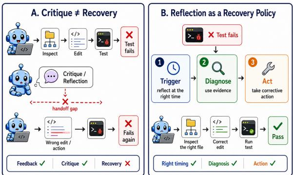
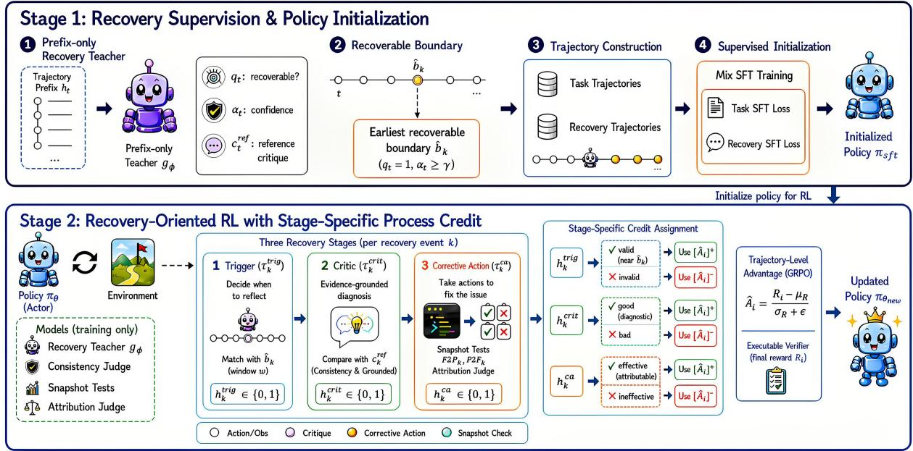
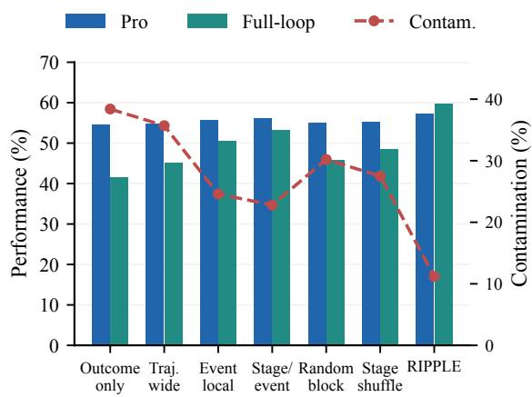
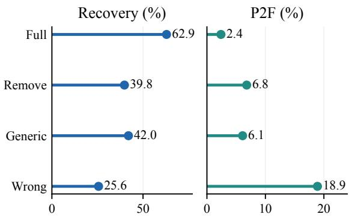
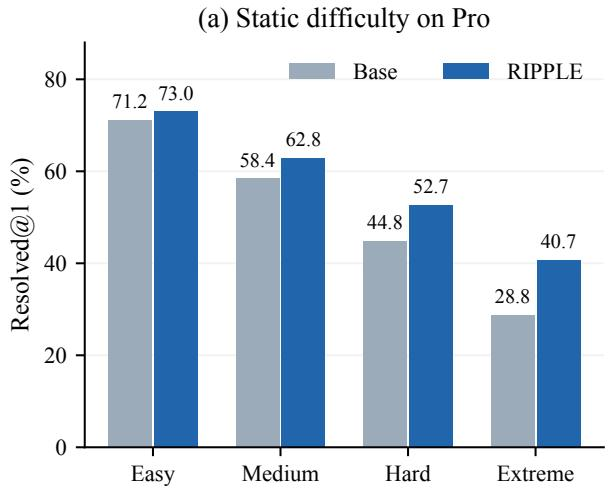
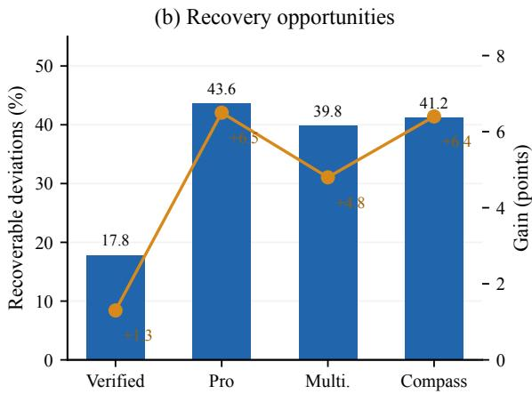
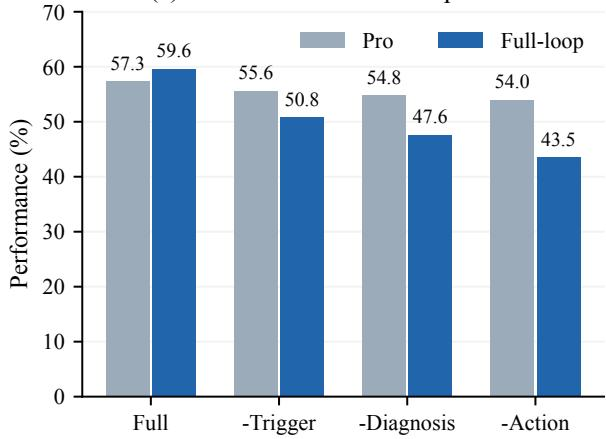
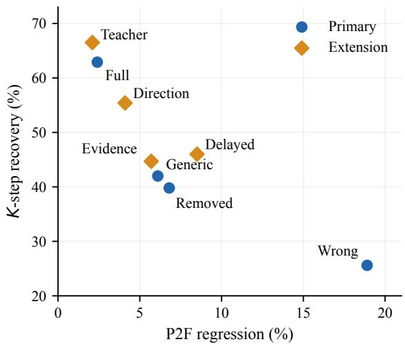

# RIPPLE: Recovery Internalization through Process-Level Policy Learning and Effect-Aware Credit for Long-Horizon Agentic Coding

Jingxuan Xu<sup>1,⋆</sup>, Zihang Xu<sup>2,⋆</sup>, Yuechen Luo<sup>3,⋆</sup>, Ziqi Miao<sup>2</sup>, Wenqiang Zhu<sup>4</sup> Weihao Li<sup>4</sup>, Junhao Fan<sup>3</sup>, Xinshun Feng<sup>2</sup>, Zhiyi Lai<sup>4</sup>, Yanan Wu<sup>4</sup>

Haoyang Huang<sup>4</sup>, Ken Deng<sup>4,†</sup>

<sup>1</sup> National University of Singapore, Singapore <sup>2</sup> Shanghai Artificial Intelligence Laboratory, Shanghai, China <sup>3</sup> Tsinghua University, Beijing, China <sup>4</sup> Independent Researchers e1553956@u.nus.edu

## Abstract

Long-horizon coding agents can observe a failure and generate a plausible critique yet continue along the same incorrect trajectory. We call this the Critique-to-Action Handoff Gap. We introduce RIPPLE, a recovery-oriented training framework that internalizes processlevel guidance into a single self-recovering policy. A prefix-only teacher provides evidencegrounded recovery supervision without access to future actions or terminal outcomes. After lightweight distillation, reinforcement learning assigns stage-specific credit to reflection triggering, diagnosis, and corrective action. Local validity signals gate trajectory advantages so that intermediate recovery decisions do not indiscriminately inherit terminal outcomes. Across four repository-level softwareengineering benchmarks, RIPPLE improves the base policy by an arithmetic mean of 4.8 score points, with no auxiliary critic at deployment. Controlled ablations isolate the benefits of local, stage-aligned credit, and matchedprefix interventions show that critique semantics affect subsequent correction. Recovery gains concentrate where the prefix contains sufficient diagnostic evidence and the repository state remains reversible within the remaining budget.

## 1 Introduction

Large language model-based coding agents now explore repositories, edit files, execute tests, and revise their behavior using environmental feedback. Repository-level benchmarks and agent frameworks enable these capabilities over long trajectories in realistic software environments (Jimenez et al., 2024; Yang et al., 2024; Pan et al., 2024; Wei et al., 2025; Golubev et al., 2025; Ding and Zhang, 2026). However, observing feedback does not necessarily imply using it effectively. When a test invalidates an earlier assumption, an agent may continue editing in the same incorrect direction, repeatedly inspect irrelevant files, or fail to revise its plan (Zhao et al., 2026; Li et al., 2026a). Although modern agents can close the action–observation loop, reliable recovery from trajectory deviations remains challenging.

  
Figure 1: The critique-to-action handoff gap. Failure feedback may elicit an evidence-grounded critique without changing subsequent behavior (left). RIPPLE learns a recovery policy over reflection triggering, diagnosis, and corrective action (right).

Reflection and critique provide a natural mechanism for addressing these failures. Self-generated feedback, verbal memory, tool-assisted critique, and execution-based debugging can improve model outputs (Madaan et al., 2023; Shinn et al., 2023; Gou et al., 2024; Chen et al., 2023). Recent approaches further train self-correction through supervised learning and reinforcement learning (RL) (Kumar et al., 2024; Yuan et al., 2025; Jin et al.,

2025; Jiang et al., 2026; Lin et al., 2026). However, improved task performance does not establish that a critique guides the next action (Shinn et al., 2023; Zhao et al., 2026). As Figure 1 illustrates, an agent may correctly identify a failure yet take a follow-up action inconsistent with its diagnosis. We refer to this discrepancy as the Critique-to-Action Handoff Gap: an evidence-grounded critique remains behaviorally inert instead of inducing an effective corrective change.

This gap exposes a mismatch between the functional structure of recovery and existing training objectives. Critique imitation supervises what the model says about a failure, without establishing whether subsequent actions implement its diagnosis. Terminal rewards supervise trajectory success, but cannot isolate whether reflection was triggered appropriately, the diagnosis was correct, or the corrective action was effective. Process supervision and credit-assignment methods provide finer-grained signals (Lightman et al., 2023; Ekbote et al., 2025; Guo et al., 2026), but generally assess intermediate reasoning or redistribute trajectory outcomes rather than separately optimize the functional stages of recovery. Addressing the handoff gap requires jointly learning when to initiate recovery, which diagnosis the evidence supports, and how it should alter subsequent behavior.

We propose RIPPLE, a recovery-oriented training framework for long-horizon coding agents. A trajectory-prefix-conditioned teacher supplies recovery boundaries and reference critiques using only information available at each decision point. Lightweight distillation initializes task execution and interleaved reflection. Recovery-oriented RL then decomposes recovery into reflection triggering, evidence-grounded diagnosis, and corrective action, assigning a distinct process signal to each stage. An executable verifier supervises task correctness, while local validity gates determine whether each recovery span inherits positive or negative trajectory advantage. This design targets the functional contribution of intermediate decisions rather than their co-occurrence with successful trajectories. All auxiliary supervision is confined to training, leaving a single self-recovering policy at inference.

Experiments show an arithmetic mean improvement of 4.8 points across four software-engineering benchmarks without an online critic. Ablations and matched-prefix interventions assess the functional contribution of recovery. Our contributions are:

• Critique-to-action recovery formulation. We identify the handoff gap and formulate recovery as an interleaved policy that coordinates when to reflect, what to diagnose, and how to correct subsequent behavior.

• Stage-specific recovery optimization. We combine prefix-only supervision with effectaware credit for triggering, diagnosis, and corrective action while retaining terminal supervision over task completion.

• Mechanism-grounded empirical evaluation. End-to-end comparisons, credit-assignment ablations, and matched-prefix interventions assess issue resolution and the functional contribution of critiques, including the evidence and repository-state conditions under which recovery remains effective.

## 2 Related Work

Software engineering agents. Repository-level benchmarks establish real-world issue resolution and executable implementation tasks as important settings for evaluating language-model agents (Jimenez et al., 2024; Yu et al., 2026). Agent capabilities improve through specialized interaction interfaces, executable training environments, and reinforcement learning over repository-level trajectories (Yang et al., 2024; Pan et al., 2024; Wei et al., 2025). Reusing intermediate agent trajectories improves inference efficiency by preserving progress across attempts (Ding and Zhang, 2026), while trajectory analyses assess reasoning–action mismatches and localize failure onset in long-horizon executions (Bouzenia and Pradel, 2025; Li et al., 2026a). RIPPLE learns an internal recovery policy that responds when new evidence invalidates the agent’s current hypothesis and links diagnosis to subsequent corrective behavior.

Reflection and critique internalization. Selfgenerated feedback, verbal memory, tool-assisted critique, and execution results support iterative revision of model outputs across successive attempts (Madaan et al., 2023; Shinn et al., 2023; Gou et al., 2024; Chen et al., 2023; Li et al., 2026c). Recent work evaluates code critiques (Zhang et al., 2025a) and trains models to self-correct or recover from earlier errors through supervised learning and reinforcement learning (Yuan et al., 2025; Jin et al., 2025; Lin et al., 2026). OPRD internalizes reminder-conditioned guidance through on-policy distillation (Luo et al., 2026). External intervention systems detect problematic behavior in codingagent trajectories and provide targeted course correction during execution (Nanda et al., 2026). RIP-PLE addresses the Critique-to-Action HandoffGap by internalizing training-time recovery guidance into a selective policy, with separate credit for when to reflect, what to diagnose, and how to correct subsequent behavior.

Process supervision and credit assignment. Process supervision provides intermediate learning signals beyond terminal task outcomes (Lightman et al., 2023), including generative reward modeling (Zhang et al., 2025b; Chen et al., 2026; Xu et al., 2026), step-level trajectory calibration, and behavioral critics learned from sparse outcomes (Wang et al., 2025, 2026). Credit assignment refines supervision in multi-turn trajectories through retrospective reward propagation, pivotal-state identification, and turn-level value estimation (Ekbote et al., 2025; Guo et al., 2026; Tao et al., 2026), as well as signals for functional roles and task dependencies (Miao et al., 2026; Li et al., 2026b). RIPPLE retains terminal task rewards and gates their advantages locally using stage-specific validity signals for reflection triggering, evidence-grounded diagnosis, and corrective-action effectiveness. Each signal applies to the corresponding recovery span, connecting local credit to its behavioral role and reducing terminal reward broadcasting and cross-stage credit mismatch.

## 3 RIPPLE

## 3.1 Overall Framework

RIPPLE aims to transform external process supervision into an internal self-recovery policy for long-horizon coding agents. Given a repositorylevel task $x ,$ the agent interacts with an execution environment and produces a trajectory $\tau =$ $( x , a _ { 1 } , o _ { 1 } , \dots , a _ { T } , o _ { T } )$ , where $a _ { t }$ is an agent action and $o _ { t }$ is the corresponding environmental observation. In addition to ordinary task actions, the agent may insert explicit self-critiques into its execution trajectory.

We decompose the k-th recovery episode into three functionally distinct decision spans:

$$
e _ { k } = \left( T _ { k } ^ { \mathrm { t r i g } } , T _ { k } ^ { \mathrm { c r i t } } , T _ { k } ^ { \mathrm { c a } } \right) ,\tag{1}
$$

where $T _ { k } ^ { \mathrm { t r i g } }$ contains the decision tokens that initiate reflection, $T _ { k } ^ { \mathrm { c r i t } }$ contains the resulting diagnosis, and $T _ { k } ^ { \mathrm { c a } }$ contains the subsequent corrective actions. These stages respectively determine when recovery should begin, why the trajectory has deviated, and how the agent should revise its behavior.

Figure 2 summarizes the two training stages: distillation initializes interleaved task execution and recovery, and RL refines the three recovery decisions. The executable verifier supplies scalar task reward; frozen process evaluators localize credit within each episode. Only the learned policy is used at inference.

## 3.2 Recovery Supervision and Policy Initialization

Prefix-only recovery teacher. We train a lightweight generative model $g _ { \phi }$ as a training-time recovery teacher. Given only the trajectory prefix $h _ { t }$ , the teacher produces

$$
\begin{array} { r } { g _ { \phi } ( h _ { t } ) = \left( q _ { t } , \alpha _ { t } , c _ { t } ^ { \mathrm { r e f } } \right) , } \end{array}\tag{2}
$$

where $q _ { t } \in \{ 0 , 1 \}$ indicates whether a recoverable deviation is observable, $\alpha _ { t } \in [ 0 , 1 ]$ is the confidence of this judgment, and $c _ { t } ^ { \mathrm { r e f } }$ is an evidencegrounded reference critique. The reference critique identifies the error type, relevant evidence, invalidated assumption, and recovery direction.

Let $\mathcal { W } _ { k }$ denote the candidate region associated with the k-th recovery event. Its teacher-estimated recovery onset is

$$
\widehat { b } _ { k } = \operatorname* { m i n } \left\{ t \in \mathcal { W } _ { k } \ | \ q _ { t } = 1 , \ \alpha _ { t } \geq \gamma \right\} ,\tag{3}
$$

where $\gamma$ is a confidence threshold. When the set is non-empty, the event-level reference critique is $c _ { k } ^ { \mathrm { r e f } } = c _ { \widehat { b } _ { k } } ^ { \mathrm { r e f } }$ ; otherwise, the teacher abstains.

Although complete trajectories are used offline to identify candidate recovery events, the corresponding teacher outputs are regenerated from their prefixes. The teacher prediction therefore does not condition on future actions, the final patch, or the terminal verifier outcome. Details appear in Appendix A.

Policy initialization. We construct an initial policy from task trajectories and recovery trajectories. Task trajectories teach repository exploration, test interpretation, code modification, and patch verification. Recovery trajectories insert teachergenerated critiques at recoverable positions and preserve the corresponding corrective continuations, providing an initial prior over interleaved self-recovery.

  
Figure 2: Overview of RIPPLE. A prefix-only recovery teacher supports policy initialization and process evaluation. The policy is then optimized through recovery-oriented reinforcement learning, which assigns stage-specific process credit to trigger, diagnosis, and corrective-action decisions, with the executable verifier as the sole source of task reward.

Let $\mathcal { D } _ { \mathrm { t a s k } }$ and $\mathcal { D } _ { \mathrm { r e c } }$ denote the two trajectory sets. We optimize

$$
\begin{array} { r l } { \mathcal { L } _ { \mathrm { i n i t } } = \mathcal { L } _ { \mathrm { S F T } } \left( \mathcal { D } _ { \mathrm { t a s k } } \right) } & { { } } \\ { + \lambda _ { \mathrm { r e c } } \mathcal { L } _ { \mathrm { S F T } } \left( \mathcal { D } _ { \mathrm { r e c } } \right) , } \end{array}\tag{4}
$$

yielding the initialized policy $\pi _ { \mathrm { s f t } }$ . This stage teaches the basic form of task execution and recovery behavior, but does not determine whether a generated critique is timely, correct, or behaviorally effective. These properties are optimized through reinforcement learning.

## 3.3 Recovery-Oriented Reinforcement Learning

Trajectory-level optimization. Starting from π<sub>sft</sub>, we sample G trajectories per task and evaluate their final repository states with an executable verifier. Let $R _ { i }$ denote the terminal reward of $\tau _ { i }$ Following GRPO, we compute

$$
\widehat { A } _ { i } = \frac { R _ { i } - \mu _ { R } } { \sigma _ { R } + \epsilon } , \qquad \mu _ { R } = \frac 1 G \sum _ { j = 1 } ^ { G } R _ { j } ,\tag{5}
$$

where $\sigma _ { R }$ is the within-group reward standard deviation and ϵ is a numerical stabilizer.

The trajectory-level advantage evaluates overall task completion, but cannot identify which intermediate recovery decisions contributed to the outcome.

Broadcasting it uniformly may reward an ineffective critique in a successful trajectory or penalize a useful local correction in an ultimately unsuccessful trajectory. We therefore construct one binary process signal for each recovery stage.

Trigger signal. Let $p _ { k }$ be the position of the kth self-critique and $\widehat { b } _ { k }$ its chronologically matched teacher boundary. We define

$$
h _ { k } ^ { \mathrm { t r i g } } = \mathcal { k } \left[ | p _ { k } - \widehat { b } _ { k } | \leq w \right] ,\tag{6}
$$

where w is a tolerance window measured in interaction steps. A positive signal requires reflection to occur sufficiently close to the earliest point at which the deviation can be reliably diagnosed. Reflections without a valid boundary match receive a zero signal, while unmatched boundaries have no local trigger span and remain governed by the trajectory-level advantage. Appendix B.1 specifies the matching protocol.

Diagnosis signal. We evaluate a generated critique $c _ { k }$ against the reference $c _ { k } ^ { \mathrm { r e f } }$ in terms of error type, supporting evidence, invalidated assumption, and recovery direction:

$$
\begin{array} { r l } & { s _ { k } ^ { \mathrm { c r i t } } = \lambda _ { \mathrm { t y p e } } s _ { k } ^ { \mathrm { t y p e } } + \lambda _ { \mathrm { e v i } } s _ { k } ^ { \mathrm { e v i } } } \\ & { ~ + ~ \lambda _ { \mathrm { a s s u m p } } s _ { k } ^ { \mathrm { a s s u m p } } + \lambda _ { \mathrm { d i r } } s _ { k } ^ { \mathrm { d i r } } . } \end{array}\tag{7}
$$

The component scores lie in [0, 1], and their nonnegative weights sum to one. Structured fields are compared directly, while open-ended semantic fields are evaluated by a frozen consistency model. We do not require lexical agreement with the reference, but all cited evidence must be observable in the current prefix. The diagnosis signal is

$$
\begin{array} { r l } & { h _ { k } ^ { \mathrm { c r i t } } = \mathcal { H } \big [ s _ { k } ^ { \mathrm { c r i t } } \geq \eta } \\ & { ~ \wedge \mathrm { G r o u n d e d } ( c _ { k } , h _ { p _ { k } } ) \big ] , } \end{array}\tag{8}
$$

where $h _ { p _ { k } }$ is the prefix available when $c _ { k }$ is generated and η is the diagnostic-consistency threshold. Unsupported or future-dependent diagnoses receive a zero signal.

Corrective-action signal. A correct critique is useful only if it changes subsequent behavior. To measure this effect, we execute a training-time snapshot test after every code-writing operation. Snapshot results are not exposed to the agent and do not affect the original trajectory.

For each critique, let $\mathcal { P } _ { k } ^ { - }$ and $\mathcal { P } _ { k } ^ { + }$ denote the passing-test sets of the nearest snapshots before and after its corrective-action span. We define

$$
\begin{array} { r } { F 2 P _ { k } = \mathcal { P } _ { k } ^ { + } \setminus \mathcal { P } _ { k } ^ { - } , } \\ { P 2 F _ { k } = \mathcal { P } _ { k } ^ { - } \setminus \mathcal { P } _ { k } ^ { + } , } \end{array}\tag{9}
$$

where $F 2 P _ { k }$ represents repaired tests and $P 2 F _ { k }$ represents newly introduced regressions.

Let $A _ { k } ^ { \mathrm { { c a } } }$ denote the action sequence covered by $T _ { k } ^ { \mathrm { c a } }$ . Because a test transition may be unrelated to the critique, a frozen attribution judge examines the critique, its subsequent actions, and the observed transition:

$$
\begin{array} { r } { h _ { k } ^ { \mathrm { c a } } = \mathsf { k } \mathsf { / } \mathsf { A t t r } ( c _ { k } , A _ { k } ^ { \mathrm { c a } } , \qquad } \\ { F 2 P _ { k } , P 2 F _ { k } ) = \mathsf { e f f e c t i v e } \big ] . } \end{array}\tag{10}
$$

A positive signal requires the actions to follow the diagnosed recovery direction, produce attributable improvement, and avoid attributable regression. If no post-critique write or attributable improvement is observed, the signal is zero. The judge produces only this discrete, test-grounded attribution label rather than an unconstrained scalar reward.

Recovery-stage credit assignment. The three process signals do not replace the terminal reward. Instead, they determine whether each recovery stage should inherit the positive or negative component of the trajectory-level advantage. We define $[ \widehat { A } _ { i } ] ^ { + } = \operatorname* { m a x } ( \widehat { A } _ { i } , 0 )$ and $[ \widehat { A } _ { i } ] ^ { - } = \operatorname* { m i n } ( \widehat { A } _ { i } , 0 )$ . For recovery stage $m \in \{ \mathrm { t r i g } , \mathrm { c r i t } , \mathrm { c a } \}$ , the shaped advantage is

$$
\widetilde { A } _ { i , t } = h _ { k } ^ { m } [ \widehat { A } _ { i } ] ^ { + } + ( 1 - h _ { k } ^ { m } ) [ \widehat { A } _ { i } ] ^ { - } , \quad t \in T _ { k } ^ { m } .\tag{11}
$$

A valid recovery decision can inherit positive credit from a successful trajectory without inheriting negative credit from an unsuccessful one. Conversely, an invalid decision can inherit negative credit from a failed trajectory but cannot benefit merely from appearing in a successful one. Tokens outside recovery spans retain $\widetilde { A } _ { i , t } = \widehat { A } _ { i }$

We optimize the clipped token-level surrogate

$$
\ell _ { i , t } ( \theta ) = \operatorname* { m i n } \left( \rho _ { i , t } \widetilde { A } _ { i , t } , \bar { \rho } _ { i , t } \widetilde { A } _ { i , t } \right) .\tag{12}
$$

where $\rho _ { i , t } = \pi _ { \theta } ( a _ { i , t } \mid h _ { i , t } ) / \pi _ { \theta _ { \mathrm { o l d } } } ( a _ { i , t } \mid h _ { i , t } )$ and $\bar { \rho } _ { i , t } = \mathrm { c l i p } ( \rho _ { i , t } , 1 - \varepsilon , 1 + \varepsilon )$ . Here, t indexes policygenerated tokens and $| \tau _ { i } |$ denotes the number of such tokens in trajectory $\tau _ { i }$ . The final objective is

$$
\mathcal { T } _ { \mathrm { R I P P L E } } ( \theta ) = \mathbb { E } \Bigg [ \frac { 1 } { G } \sum _ { i = 1 } ^ { G } \frac { 1 } { | \tau _ { i } | } \sum _ { t } \ell _ { i , t } ( \theta ) \Bigg ]\tag{13}
$$

Here, $\mathcal { D } _ { \mathrm { K L } }$ regularizes the current policy toward a frozen reference.

The objective changes credit assignment without adding scalar process reward. If every rollout in a group has the same terminal reward, $\widehat { A } _ { i } = 0$ and sign gating cannot create a policy-gradient learning signal. Snapshot execution and frozen evaluators are training costs; deployment uses the self-recovering policy alone.

## 4 Experiments

We ask whether RIPPLE improves end-to-end performance without an online critic (RQ1), whether recovery credit requires both locality and stage alignment (RQ2), and whether learned critiques functionally guide recovery (RQ3).

## 4.1 Experimental Setup

Actor and benchmarks. We use Qwen3.5-27B in a common SWE-agent-style edit–execute scaffold. Methods share prompts, tools, decoding, and a cap of 150 tool turns. Self-critique tokens count toward the actor-token budget. Post-training and evaluation repositories are disjoint. We report single-trajectory Resolved@1 on SWE-bench Verified (Jimenez et al., 2024), Pro (Deng et al., 2025), and Multilingual (Khandpur et al., 2025). SWE-Compass uses its official task-aligned macro average (Xu et al., 2025); we retain its separate metric. F2P/P2F analyses use the executable repair-like subset.

Comparison design. Test-time compute controls retain the tool-call cap while increasing the token budget. Controlled training variants start from the same Recovery-SFT checkpoint, $\pi _ { \mathrm { s f t } }$ , and share tasks, verifier, optimizer, and budget. They adapt outcome-only GRPO, pivotal-aware credit (Guo et al., 2026), MURPHY-style retrospective credit (Ekbote et al., 2025), and ICRL-style internalization (Lin et al., 2026); each is a controlled mechanism adaptation rather than a native reproduction. Online-critic configurations are deployment references with additional model calls and are not compute matched. Trained methods average three training seeds; fixed methods average three matched decoding runs.

Fixed recovery evaluation. Before training any comparison method, we freeze the base policy and mine a Recovery Challenge Set of 800 recoverable and 400 non-deviating prefixes, each with a repository snapshot and remaining budget. All policies receive identical states. A separate evaluator from another model family labels boundaries and root causes; real execution supplies test transitions. A human-audited subset yields Cohen’s κ of 0.81, 0.76, and 0.73 for boundary, diagnosis, and action attribution, respectively.

We measure trigger precision/recall/F1 within w = 4 tool turns of an annotated boundary; Diagnosis Accuracy; Action Alignment within $K = 8$ turns; Functional Recovery, requiring $\mathrm { | F 2 P | > 0 }$ and $| \mathrm { F 2 P } | - | \mathrm { P 2 F } | > 0 ;$ and Full-Loop Recovery, requiring all four stages to succeed. Grounded Evidence measures whether cited evidence occurs in the prefix and is auxiliary: real evidence can still support an incorrect diagnosis. Appendix B gives segmentation, matching, metrics, and the repository-clustered statistical protocol.

## 4.2 RQ1: End-to-End Effectiveness

Table 1 reports gains over the base policy of 1.3 points on Verified, 6.5 on Pro, 4.8 on Multilingual, and 6.4 on SWE-Compass. The arithmetic mean improvement is 4.8 points after rounding. The repository-clustered 95% interval crosses zero on Verified but excludes zero on the other three benchmarks (Appendix D). The smaller Verified gain is consistent with its lower prevalence of recoverable deviations.

Gains track opportunities for recovery. Recoverable deviations occur in 17.8% of frozen base-policy trajectories on Verified, compared with 43.6% on Pro, 39.8% on Multilingual, and 41.2% on the executable SWE-Compass subset. The reported repository-cluster association between deviation density and gain is $r = 0 . 6 8$ . On Pro, gains increase from 1.8 points in the Easy difficulty quartile to 11.9 in the Extreme quartile. Difficulty uses gold-patch size, files touched, module span, and test cost rather than evaluated-policy trajectories. Task, language, and distribution-shift slices appear in Appendix D. The largest task-slice gains occur in Bug Fixing and Feature Implementation, while C/C++/Go/Rust exhibit the largest language-group gain. These patterns are consistent with recovery benefiting from diagnostic feedback, although the grouped comparisons do not isolate the effect of feedback type.

On Pro, RIPPLE repairs 8.8% of all instances that the base policy fails while damaging 2.3% that it solves, yielding the 6.5-point net gain. Periodic reflection repairs 6.6% and damages 4.8% (Appendix D.4).

Additional computation alone does not reproduce the gain. At approximately 1.17× realized actor tokens, longer execution and split-budget restarts reach 51.7 and 53.2 on Pro, versus 57.3 for RIPPLE. RIPPLE uses 1.17× actor tokens and $1 . 2 3 \times \mathsf { p } ^ { 9 5 }$ latency relative to the base policy. It remains within 0.6 points of the online same-teacher reference on each benchmark, while eliminating auxiliary deployment calls. Internalization therefore removes recurring auxiliary-model calls while retaining the actor-side cost of self-critique.

## 4.3 RQ2: Locality and Stage Alignment

Equation 11 gates trajectory-advantage signs by local stage validity without adding scalar reward. Figure 3 compares seven credit rules under the same rollouts and process labels. Restricting generic credit from the entire trajectory to a recovery event raises Full-Loop Recovery from 45.1% to 50.4% and Pro from 54.8 to 55.6. Distinguishing the stages but broadcasting their signals across the event reaches 53.1% and 56.1. Applying each signal only to its corresponding stage reaches 59.6% and 57.3. A recovery episode is therefore not credithomogeneous: a timely trigger need not produce a correct diagnosis, and a correct diagnosis need not

<table><tr><td rowspan="2"></td><td colspan="3">Deployment Cost</td><td colspan="4">Benchmark Performance</td></tr><tr><td>Ext. calls Act. tok. p95 lat.</td><td></td><td></td><td>SWE-bench Verified</td><td>SWE-bench Pro</td><td>SWE-bench Multilingual</td><td>SWE- Compass</td></tr><tr><td>Qwen3.5-27B Base</td><td>0</td><td>1.00×</td><td>1.00×</td><td>74.6</td><td>50.8</td><td>68.8</td><td>24.3</td></tr><tr><td colspan="8">Test-time compute controls (identical tool-call budget, inflated token budget)</td></tr><tr><td>Base, longer single trajectory</td><td>0</td><td>1.16×</td><td>1.21×</td><td>74.7</td><td>51.7</td><td>69.3</td><td>25.0</td></tr><tr><td>Base, two restarts (split budget)</td><td>0</td><td>1.17×</td><td>1.24×</td><td>75.0</td><td>53.2</td><td>70.1</td><td>26.3</td></tr><tr><td>Prompted periodic reflection</td><td>0</td><td>1.18×</td><td>1.24×</td><td>74.5</td><td>52.6</td><td>69.7</td><td>25.6</td></tr><tr><td colspan="8">Controlled process-credit variants (no auxiliary model served at deployment)</td></tr><tr><td>Recovery-SFT  $( \pi _ { \mathrm { s f t } } ;$  RL init)</td><td>0</td><td>1.19×</td><td>1.26×</td><td>75.1</td><td>53.8</td><td>70.7</td><td>26.9</td></tr><tr><td>Outcome-only GRPO</td><td>0</td><td>1.06×</td><td>1.09×</td><td>75.0</td><td>54.5</td><td>71.1</td><td>27.5</td></tr><tr><td>Pivotal-aware credit</td><td>0</td><td>1.09×</td><td>1.13×</td><td>75.2</td><td>55.3</td><td>71.8</td><td>28.6</td></tr><tr><td>MURPHY-style retrospective</td><td>0</td><td>1.09×</td><td>1.13×</td><td>75.2</td><td>55.7</td><td>72.3</td><td>28.9</td></tr><tr><td>ICRL-style internalization</td><td>0</td><td>1.15×</td><td>1.18×</td><td>75.4</td><td>56.0</td><td>72.7</td><td>29.4</td></tr><tr><td>RIPPLE</td><td>0</td><td>1.17×</td><td>1.23×</td><td>75.9</td><td>57.3</td><td>73.6</td><td>30.7</td></tr><tr><td colspan="8">Online-critic references (an auxiliary model is served; not compute matched)</td></tr><tr><td>Online same teacher</td><td>4.8/task</td><td>1.00×</td><td>1.57×</td><td>76.0</td><td>57.9</td><td>73.8</td><td>31.0</td></tr><tr><td>Online strong critic</td><td>10.9/task</td><td>1.00×</td><td>2.61×</td><td>76.4</td><td>58.4</td><td>74.4</td><td>31.6</td></tr></table>

Table 1: End-to-end results and deployment cost. The first three benchmarks use Resolved@1; SWE-Compass uses its official task-aligned macro average. Actor tokens and p95 latency are realized quantities normalized to the base policy. Values are averages over three training seeds for trained methods and three matched decoding runs for fixed methods.

  
Figure 3: Locality and stage alignment contribute separately. Seven credit-assignment variants use identical rollouts and process labels. Bars report Pro Resolved@1 and Full-Loop Recovery; the dashed line reports positive-credit contamination (lower is better). Event and Stage/event denote event-local generic and stage-aware event-wide credit; Random and Shuffle are sparsity controls.

yield an effective edit.

Random-block gating updates the same number of tokens at randomly chosen positions. Stageshuffled gating preserves the spans but permutes their signals. They reach only 45.8% and 48.4% Full-Loop Recovery (54.9 and 55.2 on Pro), suggesting that sparsity alone does not explain stage alignment. Positive-credit contamination decreases from 38.4% for outcome-only GRPO to 24.6% for event-local credit and 11.2% for RIPPLE; Appendix E records the complete ladder and clarifies the interpretation of this diagnostic.

<table><tr><td colspan="5">Method Trig. F1 Diag. Align. Func. Full</td></tr><tr><td>Periodic reflection</td><td>0.43</td><td>55.8</td><td>48.1</td><td>42.5 31.4</td></tr><tr><td>Recovery-SFT</td><td>0.56</td><td>64.9</td><td>54.8</td><td>49.4 38.1</td></tr><tr><td>Outcome-only</td><td>0.60</td><td>66.9</td><td>58.6</td><td>53.0 41.6</td></tr><tr><td>ICRL-style</td><td>0.65</td><td>73.2</td><td>64.4</td><td>60.5 50.8</td></tr><tr><td>RIPPLE</td><td>0.79</td><td>81.5</td><td>74.8</td><td>70.2 59.6</td></tr></table>

Table 2: Stage-wise recovery quality on the fixed Recovery Challenge Set, scored by an independent evaluator and real test transitions. Columns are trigger F1, Diagnosis Accuracy, Action Alignment, Functional Recovery, and Full-Loop Recovery; the last four are percentages.

Leave-one-stage-out results further localize the effect. Removing diagnosis credit reduces Diagnosis Accuracy from 81.5% to 69.8% and Action Alignment from 74.8% to 64.3%. Removing action credit leaves diagnosis near 80.9% but lowers alignment to 56.8%. Corrective-action credit has the largest end-to-end contribution: removing it lowers Pro from 57.3 to 54.0 and Full-Loop Recovery from 59.6% to 43.5% (Appendix E.2).

## 4.4 RQ3: Functional Recovery Mechanisms

Stage-wise behavior. Table 2 evaluates local recovery on shared frozen states. RIPPLE leads every stage, reaching 74.8% Action Alignment, 70.2% Functional Recovery, and 59.6% Full-Loop

  
Figure 4: Matched-prefix critique intervention. Holding policy, prefix, repository snapshot, remaining budget, and paired seeds fixed, the left panel reports Kstep recovery and the right panel pass-to-fail regression for four critique conditions. The controlled contrasts show that a full critique outperforms both removal and a length- and style-matched generic critique, whereas a wrong-direction critique is worse than removal.

Recovery. Grounded Evidence is 84.0%, compared with 81.5% Diagnosis Accuracy, reinforcing the distinction between citing an observed failure and identifying its cause. On the 400 non-deviating prefixes, its false-trigger rate is 8.9%, versus 71.5% for periodic reflection. The fixed-state comparison evaluates abstention independently of each policy’s on-policy deviation distribution. During training, outcome-only GRPO reduces the trigger rate from 0.180 to 0.110, below the reference deviation rate of 0.15, whereas RIPPLE converges to 0.142. This pattern suggests suppression of recovery opportunities rather than improved trigger calibration.

Matched-prefix intervention. Figure 4 holds the policy checkpoint, prefix, repository snapshot, remaining budget, and paired decoding seed fixed while changing only the critique. Removing the critique lowers K-step recovery from 62.9% to 39.8% and raises P2F regression from 2.4% to 6.8%. A length- and style-matched generic critique reaches 42.0% recovery and 6.1% regression. A fluent but wrong-direction critique is worse than removal, at 25.6% recovery and 18.9% regression. These contrasts support a functional role for critique semantics beyond extra tokens or a pause in execution.

Extended interventions reach the same conclusion (Appendix F.1). Direction alone retains 15.6 of the full critique’s 23.1 recovery-point gain over removal, whereas evidence alone retains 4.9. Delaying the full critique by five turns loses 16.9 recovery points. The internal critique remains within 3.6 recovery points of the teacher reference. Snapshot tests are hidden from the policy, and these conclusions are conditional on the frozen states and intervention design.

Prefix supervision and recoverability. A prospective sequential prefix scan obtains boundary F1 of 0.84, compared with 0.86 for the offline-mined prefix pipeline and 0.90 for a full-trajectory oracle (Appendix A.3). Thus, prefix-only inputs retain much of the teacher’s boundary-detection ability, although hindsight still improves the oracle. Randomly corrupting 10% and 20% of process labels lowers Pro by 0.5 and 1.2 points, respectively.

Recovery also depends on the available evidence and repository state. Among 248 prefixes with sufficient diagnostic evidence and a state judged reversible within the remaining budget, RIPPLE improves execution-verified resolution by 20.4 points over the base policy. Gains are 5.8 points when evidence is sufficient but the state is not reversible, 4.7 when evidence is insufficient but the state is reversible, and 1.7 when neither holds. Test, runtime, compiler, and implicit cross-file evidence show similar gains within the sufficient-and-reversible subset (Appendix F.3). These results delineate the recoverability boundary: an effective handoff requires both a diagnosis supported by the observed prefix and a repository state that can still be repaired. The evidence-family decomposition further indicates that recovery is not restricted to explicit test failures; implicit cross-file inconsistencies can also support correction when both conditions hold.

## 5 Conclusion

We identify the Critique-to-Action Handoff Gap in long-horizon coding agents and propose RIPPLE to internalize prefix-only recovery guidance. Stagespecific credit distinguishes reflection triggering, diagnosis, and corrective action while retaining terminal task supervision. Local validity gates prevent ineffective recovery decisions from inheriting positive trajectory credit, while protecting useful corrections from negative credit attributable to unrelated failures. Across four software-engineering benchmarks, RIPPLE improves the base policy by an arithmetic mean of 4.8 score points without an online critic. Credit-assignment controls and matched-prefix interventions support the functional contribution of learned critiques. Gains concentrate where diagnostic evidence is sufficient and repository states remain reversible, motivating improved exploration in uniform-reward groups and direct estimation of local recovery effects across evolving repositories, programming languages, and deployment environments. Jointly learning when to reflect, what to diagnose, and how to act turns recovery into an internal policy capability for converting new execution evidence into effective corrections to the current repository state.

## Limitations

Scope and supervision. We evaluate Qwen3.5- 27B in one coding scaffold; transfer across model families and domains remains untested. Repository-disjoint post-training does not exclude pretraining exposure. Process labels are approximate, and offline candidate nomination uses complete trajectories despite prefix-only teacher inputs. Incomplete tests, flaky execution, and evaluator errors can affect attribution.

Cost and recovery boundaries. Auxiliary supervision and snapshot tests add training cost, for which we provide no complete amortized analysis. Deployment uses 1.17× actor tokens and 1.23× p95 latency relative to the base policy. Sign gating supplies no learning signal in uniform-reward groups and cannot overcome missing evidence or irreversible states within a fixed budget.

Evaluation limits. Fixed-prefix metrics and interventions are conditional on selected states and do not characterize each policy’s on-policy failure distribution. The Verified gain’s confidence interval crosses zero. The mean gain averages benchmarkspecific score differences, rather than pooling issueresolution rates; F2P/P2F analyses cover only executable repair-like tasks.

## References

Islem Bouzenia and Michael Pradel. 2025. Understanding software engineering agents: A study of thought-action-result trajectories. In Proceedings of the IEEE/ACM International Conference on Automated Software Engineering.

Xinyun Chen, Maxwell Lin, Nathanael Schärli, and Denny Zhou. 2023. Teaching large language models to self-debug. arXiv preprint arXiv:2304.05128.

Xiusi Chen, Gaotang Li, Ziqi Wang, Bowen Jin, Cheng Qian, Yu Wang, Hongru Wang, Yu Zhang, Denghui Zhang, Tong Zhang, Hanghang Tong, and Heng Ji. 2026. RM-R1: Reward modeling as reasoning. In International Conference on Learning Representations.

Xiang Deng, Jeff Da, Edwin Pan, Yannis Yiming He, et al. 2025. SWE-Bench Pro: Can AI agents solve long-horizon software engineering tasks? arXiv preprint arXiv:2509.16941.

Yifeng Ding and Lingming Zhang. 2026. SWE-Replay: Efficient test-time scaling for software engineering agents. arXiv preprint arXiv:2601.22129.

Chanakya Ekbote, Vijay Lingam, Sujay Sanghavi, Jun Huan, Behrooz Omidvar-Tehrani, Anoop Deoras, and Stefano Soatto. 2025. MURPHY: Feedbackaware GRPO with retrospective credit assignment for multi-turn code generation. arXiv preprint arXiv:2511.07833.

Alexander Golubev, Maria Trofimova, Sergei Polezhaev, Ibragim Badertdinov, Maksim Nekrashevich, Anton Shevtsov, Simon Karasik, Sergey Abramov, Andrei Andriushchenko, Filipp Fisin, Sergei Skvortsov, and Boris Yangel. 2025. Training long-context, multiturn software engineering agents with reinforcement learning. arXiv preprint arXiv:2508.03501.

Zhibin Gou, Zhihong Shao, Yeyun Gong, Yelong Shen, Yujiu Yang, Nan Duan, and Weizhu Chen. 2024. CRITIC: Large language models can self-correct with tool-interactive critiquing. In International Conference on Learning Representations.

Weiyang Guo, Zesheng Shi, Longhui Zhang, Zeen Zhu, Min Zhang, and Jing Li. 2026. Agent reinforcement learning via pivotal-aware self-feedback retry. arXiv preprint arXiv:2607.03702.

Juyong Jiang, Jiasi Shen, Sunghun Kim, Kang Min Yoo, Jeonghoon Kim, and Sungju Kim. 2026. Reflexi-Coder: Teaching large language models to self-reflect on generated code and self-correct it via reinforcement learning. arXiv preprint arXiv:2603.05863.

Carlos E. Jimenez, John Yang, Alexander Wettig, Shunyu Yao, Kexin Pei, Ofir Press, and Karthik Narasimhan. 2024. SWE-bench: Can language models resolve real-world GitHub issues? In International Conference on Learning Representations.

Yiyang Jin, Kunzhao Xu, Hang Li, Xueting Han, Yanmin Zhou, Cheng Li, and Jing Bai. 2025. Re-Veal: Self-evolving code agents via reliable selfverification. arXiv preprint arXiv:2506.11442.

Kabir Khandpur, Kilian Lieret, Carlos E. Jimenez, Ofir Press, and John Yang. 2025. SWE-bench Multilingual. SWE-bench benchmark release.

Aviral Kumar, Vincent Zhuang, Rishabh Agarwal, Yi Su, John D. Co-Reyes, Avi Singh, Kate Baumli, Shariq Iqbal, Colton Bishop, Rebecca Roelofs, Lei M. Zhang, Kay McKinney, Disha Shrivastava, Cosmin Paduraru, George Tucker, Doina Precup, Feryal Behbahani, and Aleksandra Faust. 2024. Training language models to self-correct via reinforcement learning. arXiv preprint arXiv:2409.12917.

Han Li, Yifan Yao, Letian Zhu, Rili Feng, Hongyi Ye, Jiaming Wang, Yancheng He, Pengyu Zou, Lehan Zhang, Xinping Lei, Haoyang Huang, Ken Deng, Ming Sun, Zhaoxiang Zhang, He Ye, and Jiaheng Liu. 2026a. CodeTracer: Towards traceable agent states. arXiv preprint arXiv:2604.11641.

Weihao Li, Zihang Xu, Zhongqiu Wang, Songwei Yu, Wenqiang Zhu, Yuechen Luo, Jingxuan Xu, Yanan Wu, Haoyang Huang, and Ken Deng. 2026b. WEAVE: Weaving Real-World Code Evolution into Dependency-Structured Tasks for Benchmarking and Training Code Agents. arXiv preprint arXiv:2610.22039.

Yuhang Li, Chenchen Zhang, Ruilin Lv, Ao Liu, Ken Deng, Yuanxing Zhang, Jiaheng Liu, and Bo Zhou. 2026c. ReLook: Vision-grounded RL with a multimodal LLM critic for agentic web coding. In Proceedings ofthe 64th Annual Meeting ofthe Association for Computational Linguistics (Volume 1: Long Papers), pages 25471–25485. Association for Computational Linguistics.

Hunter Lightman, Vineet Kosaraju, Yura Burda, Harri Edwards, Bowen Baker, Teddy Lee, Jan Leike, John Schulman, Ilya Sutskever, and Karl Cobbe. 2023. Let’s verify step by step. arXiv preprint arXiv:2305.20050.

Jianbo Lin, Xiaomin Yu, Yi Xin, Yifu Guo, Zhuosong Jiang, Zhongqi Yue, Weishi Wang, Heqing Zou, Chengwei Qin, and Hui Xiong. 2026. ICRL: Learning to internalize self-critique with reinforcement learning. arXiv preprint arXiv:2605.15224.

Yuechen Luo, Zhiyi Lai, Miao Ziqi, Zihang Xu, Jingxuan Xu, Songwei Yu, Wenqiang Zhu, Weihao Li, Junhao Fan, Haoyang Huang, Yanan Wu, and Ken Deng. 2026. OPRD: On-Policy Reminder Distillation for Long-Horizon Coding Agents. arXiv preprint arXiv:2610.21496.

Aman Madaan, Niket Tandon, Prakhar Gupta, Skyler Hallinan, Luyu Gao, Sarah Wiegreffe, Uri Alon, Nouha Dziri, Shrimai Prabhumoye, Yiming Yang, Shashank Gupta, Bodhisattwa Prasad Majumder, Katherine Hermann, Sean Welleck, Amir Yazdanbakhsh, and Peter Clark. 2023. Self-refine: Iterative refinement with self-feedback. In Advances in Neural Information Processing Systems.

Ziqi Miao, Haonan Jia, Lijun Li, Chen Qian, Yuan Xiong, Wenting Yan, and Jing Shao. 2026. Seeing with You: Perception-reasoning coevolution for multimodal reasoning. arXiv preprint arXiv:2603.28618.

Rahul Nanda, Chandra Maddila, Smriti Jha, Euna Mehnaz Khan, Matteo Paltenghi, and Satish Chandra. 2026. Wink: Recovering from misbehaviors in coding agents. arXiv preprint arXiv:2602.17037.

Jiayi Pan, Xingyao Wang, Graham Neubig, Navdeep Jaitly, Heng Ji, Alane Suhr, and Yizhe Zhang. 2024. Training software engineering agents and verifiers with SWE-Gym. arXiv preprint arXiv:2412.21139.

Noah Shinn, Federico Cassano, Edward Berman, Ashwin Gopinath, Karthik Narasimhan, and Shunyu Yao. 2023. Reflexion: Language agents with verbal reinforcement learning. In Advances in Neural Information Processing Systems.

Leitian Tao, Baolin Peng, Wenlin Yao, Tao Ge, Hao Cheng, Mike Hang Wang, Jianfeng Gao, and Sharon Li. 2026. TRACE: Turn-level reward assignment via credit estimation for long-horizon agents. arXiv preprint arXiv:2607.13988.

Hanlin Wang, Jian Wang, Chak Tou Leong, and Wenjie Li. 2025. STeCa: Step-level trajectory calibration for LLM agent learning. In Findings of the Association for Computational Linguistics: ACL 2025, pages 11597–11614, Vienna, Austria. Association for Computational Linguistics.

Xingyao Wang, Valerie Chen, Heng Ji, and Graham Neubig. 2026. A rubric-supervised critic from sparse real-world outcomes. arXiv preprint arXiv:2603.03800.

Yuxiang Wei, Olivier Duchenne, Jade Copet, Quentin Carbonneaux, Lingming Zhang, Daniel Fried, Gabriel Synnaeve, Rishabh Singh, and Sida I. Wang. 2025. SWE-RL: Advancing LLM reasoning via reinforcement learning on open software evolution. In Advances in Neural Information Processing Systems.

Jingxuan Xu, Ken Deng, Weihao Li, Songwei Yu, et al. 2025. SWE-Compass: Towards unified evaluation of agentic coding abilities for large language models. arXiv preprint arXiv:2511.05459.

Jingxuan Xu, Gang Wu, Yanan Wu, Yutao Mou, Songwei Yu, Tianzhuang He, Zhengshuo Gong, Zhao Liu, Zihang Xu, Wenqiang Zhu, Xinping Lei, Weihao Li, Yuhui Bai, Zhongqiu Wang, Yan Wu, and Ariel Deng. 2026. FLARE: A Full-Lifecycle Dense Supervision Paradigm for Long-Horizon Coding Agents via Generative Reward Model. arXiv preprint arXiv:2609.23808.

John Yang, Carlos E. Jimenez, Alexander Wettig, Kilian Lieret, Shunyu Yao, Karthik Narasimhan, and Ofir Press. 2024. SWE-agent: Agent-computer interfaces enable automated software engineering. arXiv preprint arXiv:2405.15793.

Songwei Yu, Ziqi Miao, Jingxuan Xu, Junhao Fan, Haoyang Huang, Yuan Xiong, Zihang Xu, Weihao Li, Wenqiang Zhu, Yuechen Luo, Xinshun Feng, Yanan Wu, and Ken Deng. 2026. SWE-Nexus: Automated composition of software engineering tasks from test execution. arXiv preprint arXiv:2610.20038.

Siyu Yuan, Zehui Chen, Zhiheng Xi, Junjie Ye, Zhengyin Du, and Jiecao Chen. 2025. Agent-R: Training language model agents to reflect via iterative self-training. arXiv preprint arXiv:2501.11425.

Alexander Zhang, Marcus Dong, Jiaheng Liu, Wei Zhang, Yejie Wang, Jian Yang, Ge Zhang, Tianyu Liu, Zhongyuan Peng, Yingshui Tan, Yuanxing Zhang,

Zhexu Wang, Weixun Wang, Yancheng He, Ken Deng, Wangchunshu Zhou, Wenhao Huang, and Zhaoxiang Zhang. 2025a. CodeCriticBench: A Holistic Code Critique Benchmark for Large Language Models. arXiv preprint arXiv:2502.16614.

Lunjun Zhang, Arian Hosseini, Hritik Bansal, Mehran Kazemi, Aviral Kumar, and Rishabh Agarwal. 2025b. Generative verifiers: Reward modeling as next-token prediction. In International Conference on Learning Representations.

Xiangxin Zhao, Han Li, Shuaiting Li, Tianyi Zhao, Earl T. Barr, Federica Sarro, and He Ye. 2026. Failure as a process: An anatomy of cli coding agent trajectories. Preprint, arXiv:2607.09510.

## A Recovery Supervision and Prefix-Only GRM Outputs

This section supplies the construction details needed to audit the first contribution: training-time recovery guidance is generated from trajectory prefixes and is internalized into a single deployment policy. Complete offline trajectories are used only to nominate bounded candidate regions. Every label used by policy training is regenerated from a prefix record that excludes future actions, the final patch, and the terminal verifier outcome.

## A.1 Candidate nomination and prefix regeneration

For a completed trajectory τ $( x , a _ { 1 } , o _ { 1 } , \dots , a _ { T } , o _ { T } )$ , offline mining proposes candidate regions $\mathcal { W } ( \tau ) = \{ W _ { k } \} _ { k = 1 } ^ { M }$ . Candidate anchors include newly failing or changed tests, runtime exceptions, compiler or type-system diagnostics, reproducible pass-to-fail transitions, repeated incompatible evidence, and prefix-visible cross-file inconsistencies. Infrastructure failures, flaky transitions, and deviations visible only from the future suffix are excluded.

For each $t \in W _ { k } .$ the frozen generative reward model (GRM) receives only

$$
h _ { t } = ( x , a _ { 1 } , o _ { 1 } , \ldots , a _ { t - 1 } , o _ { t - 1 } )
$$

and returns

$$
g _ { \phi } ( h _ { t } ) = \big ( q _ { t } , \alpha _ { t } , c _ { t } ^ { \mathrm { r e f } } \big ) ,
$$

where $q _ { t } \in \{ 0 , 1 \}$ indicates whether a recoverable deviation is observable, $\alpha _ { t } \in [ 0 , 1 ]$ is confidence, and $c _ { t } ^ { \mathrm { r e f } }$ is a JSON record with causal analysis, issue categories, impact level, supporting evidence, invalidated assumption, and recovery direction. Recovery-window and verification-target fields provide auxiliary guidance. The event boundary is

$$
\widehat { b } _ { k } = \operatorname* { m i n } \{ t \in W _ { k } : q _ { t } = 1 , \alpha _ { t } \geq \gamma \} .
$$

The GRM abstains when no prefix in the region supports a concrete recovery direction. Prefix records are serialized independently, and an automated field-level assertion rejects records containing suffix actions, final patches, or terminal rewards.

## A.2 Illustrative GRM outputs

The schema-valid examples below illustrate the information available to the teacher; they are not evaluation instances and their confidence fields are not used in any aggregate reported in the paper. The first example identifies a configuration-precedence error after a failing test. The second abstains because a transient tool failure does not yet falsify a repository-level assumption.

```jsonl
{
"recoverable": true,
"analysis": "CLI timeout is parsed, then
overwritten while RunnerConfig is built.",
"issue_categories": [
"configuration precedence",
"state propagation"
],
"impact_level": "high",
"evidence": [
"t38: timeout test expected 5, got 30",
"t41: default read after CLI parsing"
],
"invalidated_assumption": "Parsed --timeout
already reaches RunnerConfig.",
"recovery_direction": "Restore CLI-over
default precedence in the config adapter."
"confidence": 0.94,
"recovery_window": "immediate",
"verification_target": "timeout precedence
test"
}
```  
Figure A.1: Illustrative actionable teacher output. All cited evidence is prefix-present; the recovery direction does not expose a hidden patch.

```json
{
"recoverable": false,
"analysis": "Transient service timeout; no
reproducible repository failure.",
"issue_categories": [
"infrastructure transient"
],
"impact_level": "low",
"evidence": [
"t19: package-index request timed out"
],
"invalidated_assumption": null,
"recovery_direction": null,
"confidence": 0.88,
"recovery_window": "defer",
"verification_target": "repeat package-index
request"
}
```  
Figure A.2: Illustrative teacher abstention. A transient tool failure does not establish a repository-level deviation. Both JSON examples are excluded from quantitative evaluation.

## A.3 Recovery-trajectory construction and leakage audit

Task trajectories supervise ordinary repository interaction. Recovery trajectories insert the GRM critique at $\widehat { b } _ { k }$ and retain a state-consistent corrective continuation. The initialization objective is

$$
\begin{array} { r } { \mathcal { L } _ { \mathrm { i n i t } } = \mathcal { L } _ { \mathrm { S F T } } ( \mathcal { D } _ { \mathrm { t a s k } } ) + \lambda _ { \mathrm { r e c } } \mathcal { L } _ { \mathrm { S F T } } ( \mathcal { D } _ { \mathrm { r e c } } ) . } \end{array}
$$

Candidate filtering excludes infrastructure failures, flaky transitions, and deviations that become observable only in the future suffix. Aggregate benchmark scores are not used to infer training-data counts.

<table><tr><td>Teacher-evaluation regime</td><td>Boundary F1</td></tr><tr><td>Offline-mined prefix pipeline</td><td>0.86</td></tr><tr><td>Prospective sequential prefix scan</td><td>0.84</td></tr><tr><td>Full-trajectory oracle</td><td>0.90</td></tr></table>

Table A.1: Prefix-only audit. A prospective scan recovers most boundaries without an offline candidate hint. The full-trajectory oracle quantifies the value of hindsight that is intentionally unavailable to the training teacher.

## B Recovery Episodes, Challenge Set, and Metrics

This section supports the mechanism claims by fixing how recovery events are segmented, matched, and scored independently of the training-time GRM.

<table><tr><td>Metric</td><td>Definition</td></tr><tr><td>Trigger</td><td>Emit &lt;recover&gt; within  $w = 4$  tool</td></tr><tr><td>P/R/F1</td><td>turns of an annotated boundary. Non-deviating prefixes contribute false positives.</td></tr><tr><td>Diagnosis</td><td>Root cause and invalidated assumption</td></tr><tr><td>Accuracy</td><td>agree with the independent evaluator; cited evidence occurs in the prefix.</td></tr><tr><td>Action</td><td>Actions follow the diagnosed direction</td></tr><tr><td>Alignment</td><td>within  $K = 8$  turns.</td></tr><tr><td>Functional</td><td>Real execution gives  $\mathrm { | F 2 P | > 0 }$  and</td></tr><tr><td>Recovery</td><td> $| \mathrm { F 2 P } | - | \mathrm { P 2 F } | > 0 .$ </td></tr><tr><td>Full-Loop</td><td>Trigger, diagnosis, alignment, and</td></tr><tr><td>Recovery</td><td>functional recovery all succeed.</td></tr><tr><td>Positive-</td><td>Fraction of locally invalid blocks</td></tr><tr><td>credit contamina-</td><td>receiving positive advantage; lower is better.</td></tr></table>

Table B.1: Process metrics. Trigger scores range from 0 to 1; all other metrics are percentages. Grounded Evidence is auxiliary because prefix-present evidence can still support an incorrect diagnosis.

## B.1 Episode segmentation and chronological matching

The k-th recovery episode is

$$
e _ { k } = \big ( T _ { k } ^ { \mathrm { t r i g } } , T _ { k } ^ { \mathrm { c r i t } } , T _ { k } ^ { \mathrm { c a } } \big ) .
$$

The policy emits an explicit <recover> delimiter. The trigger span contains the decision to initiate recovery, the critique span ends at the next tooldirected action, and the corrective-action span contains the following repository-directed actions up to the next critique, terminal action, or the fixed action horizon. Malformed or consecutive delimiters receive no positive local signal.

Let $P = ( p _ { 1 } < \cdots < p _ { J } )$ be generated critique positions and $B = ( \widehat { b } _ { 1 } < \cdots < \widehat { b } _ { M } )$ be teacher boundaries. We use an order-preserving one-to-one matching within w turns that first maximizes the number of pairs and then minimizes total temporal distance. An unmatched critique receives $h _ { k } ^ { \mathrm { t r i g } } =$ $0 ;$ an unmatched teacher boundary does not create an artificial token block.

Snapshot tests are run after code-writing actions during training but are hidden from the policy. For the nearest valid snapshots before and after a corrective span,

$$
\mathrm { F 2 P } _ { k } = P _ { k } ^ { + } \setminus P _ { k } ^ { - } , \qquad \mathrm { P 2 F } _ { k } = P _ { k } ^ { - } \setminus P _ { k } ^ { + } .
$$

The frozen attribution judge emits only effective/ineffective. A positive correctiveaction label requires directionally consistent actions, attributable F2P improvement, and no attributable regression.

## B.2 Fixed Recovery Challenge Set

Before any comparison method is trained, the base policy is frozen and used to mine 800 recoverable prefixes and 400 non-deviating prefixes. Each item stores the issue, action–observation prefix, repository snapshot, remaining budget, and executable test state. Every policy receives the same frozen states, so the metrics measure local recovery ability rather than each policy’s endogenous deviation distribution.

The training-time GRM is not reused for scoring. An evaluator from a different model family labels boundaries and root causes; test transitions come from real execution. A human-audited subset yields Cohen’s $\kappa = 0 . 8 1 , 0 . 7 6$ , and 0.73 for boundary, diagnosis, and action attribution, respectively.

## B.3 Statistical protocol

End-to-end uncertainty is estimated with a repository-clustered paired bootstrap; paired binary changes are additionally tested with McNemar’s test. The protocol corrects the four benchmarklevel primary contrasts with Holm’s method. Clustered confidence intervals are reported separately from multiplicity-adjusted hypothesis tests. Intervention comparisons hold the prefix, repository snapshot, remaining budget, policy checkpoint, and decoding seed fixed. All reported intervals are computed over repository clusters rather than treating individual trajectories from the same repository as independent.

## C Training and Stage-Specific Credit Details

All main comparisons use Qwen3.5-27B inside the same SWE-agent-style edit–execute scaffold, with identical prompts, tools, decoding, a cap of 150 tool turns, and one actor-token budget that includes self-critique tokens. Evaluation repositories are disjoint from post-training repositories. Trained methods use three training seeds; fixed methods use three matched decoding runs. The recovery teacher, consistency model, snapshot side channel, and attribution judge are frozen during RL and removed at deployment.

Equation 11 applies separate binary validity labels to trigger, diagnosis, and corrective-action spans. A locally invalid stage cannot inherit positive trajectory advantage through the gate, and a locally valid stage is protected from negative credit due to an unrelated suffix. Ordinary action tokens retain the original advantage. This does not add a process reward; a group with identical terminal rewards still has zero policy-gradient advantage.

## D Additional End-to-End Analyses

D.1 Benchmark gains and uncertainty
<table><tr><td>Benchmark</td><td>Base</td><td>RIPPLE</td><td>Gain</td><td>95% CI</td></tr><tr><td>Verified</td><td>74.6</td><td>75.9</td><td>+1.3</td><td>[−0.2, 2.8]</td></tr><tr><td>Pro</td><td>50.8</td><td>57.3</td><td>+6.5</td><td>[3.9, 9.1]</td></tr><tr><td>Multilingual</td><td>68.8</td><td>73.6</td><td>+4.8</td><td>[2.1, 7.5]</td></tr><tr><td>SWE-Compass</td><td>24.3</td><td>30.7</td><td>+6.4</td><td>[3.2, 9.6]</td></tr></table>

Table D.1: End-to-end gains with repository-clustered 95% confidence intervals. The arithmetic mean gain is 4.75 points, reported as +4.8 after rounding. The Verified interval crosses zero; the other three exclude zero.

<table><tr><td>Setting Value</td><td></td></tr><tr><td>Actor / scaffold</td><td>Qwen3.5-27B / common edit-execute loop</td></tr><tr><td>Tool-turn cap</td><td>150</td></tr><tr><td>Trigger tolerance Action horizon</td><td>w = 4 turns K = 8 turns</td></tr><tr><td>Seeds Initialization</td><td>3 Shared Recovery-SFT checkpoint</td></tr><tr><td>Shared controls</td><td>Tasks, verifier, optimizer, budget, and process labels</td></tr><tr><td>Training-only modules Online auxiliary</td><td>Frozen teacher, consistency model, snapshot tests, and attribution judge None</td></tr></table>

Table C.1: Implementation settings relevant to comparison validity and deployment cost. Optimizer-level hyperparameters are shared across the controlled creditassignment variants.

## D.2 Difficulty and recoverable-deviation prevalence

Figure D.1 reports both analyses. Easy, Medium, Hard, and Extreme quartiles have Base/RIPPLE scores of 71.2/73.0, 58.4/62.8, 44.8/52.7, and 28.8/40.7. Their equal-weight averages reproduce Pro’s 50.8/57.3 scores. Recoverable-deviation prevalence is 17.8%, 43.6%, 39.8%, and 41.2% on Verified, Pro, Multilingual, and the executable Compass subset, respectively.

  
Figure D.1: Pro resolution by static-difficulty quartile. Gains increase from 1.8 points (Easy) to 11.9 (Extreme). Difficulty is defined without evaluated-policy trajectory statistics.

## D.3 Task, language, and distribution-shift slices

Table D.2 gives grouped task, language, and metadata-shift slices. The reported weights and rounded values reproduce the benchmark aggre-

  
Figure D.2: Recoverable-deviation prevalence and benchmark gain. The reported $r = 0 . 6 8$ association is computed over repository clusters, not these four aggregate points.

gates up to rounding. The slices locate performance differences without assigning a causal role to language or feedback type.
<table><tr><td>Slice (weight)</td><td>Base</td><td>RIPPLE</td><td>Gain</td></tr><tr><td>SWE-Compass</td><td></td><td></td><td></td></tr><tr><td>Bug fixing (1/8)</td><td>23.4</td><td>32.2</td><td>+8.8</td></tr><tr><td>Feature implementation (1/8)</td><td>25.8</td><td>33.4</td><td>+7.6</td></tr><tr><td>Other task types (6/8)</td><td>24.2</td><td>30.0</td><td>+5.8</td></tr><tr><td>Multilingual</td><td></td><td></td><td></td></tr><tr><td>C/C++/Go/Rust (4/9)</td><td>61.4</td><td>69.4</td><td>+8.0</td></tr><tr><td>Other languages (5/9)</td><td>74.7</td><td>77.0</td><td>+2.3</td></tr><tr><td>Pro metadata shift</td><td></td><td></td><td></td></tr><tr><td>Lower half (1/2)</td><td>52.6</td><td>58.3</td><td>+5.7</td></tr><tr><td>Higher half (1/2)</td><td>49.0</td><td>56.3</td><td>+7.3</td></tr></table>

Table D.2: Task, language, and distribution-shift slices. Weighted rows reproduce their benchmark aggregates up to rounding. Pro’s metadata-shift score is fixed before inference and split at its median.

## D.4 Repair-versus-damage decomposition

For paired runs on the same Pro instance, Repair = $\operatorname* { P r } ( Y _ { m } = 1 , Y _ { B } = 0 )$ and ${ \mathrm { D a m a g e } } = { \mathrm { P r } } ( Y _ { m } =$ $0 , Y _ { B } = 1 )$ . Both use all Pro instances as the denominator, so Repair minus Damage equals the absolute gain.

<table><tr><td>Method</td><td>Repair</td><td>Damage</td><td>Net</td></tr><tr><td>Longer single trajectory</td><td>4.4</td><td>3.5</td><td>+0.9</td></tr><tr><td>Two restarts</td><td>6.0</td><td>3.6</td><td>+2.4</td></tr><tr><td>Prompted periodic reflection</td><td>6.6</td><td></td><td>4.8 +1.8</td></tr><tr><td>Recovery-SFT</td><td>6.2</td><td></td><td>3.2 +3.0</td></tr><tr><td>Outcome-only GRPO</td><td>6.6</td><td></td><td>2.9 +3.7</td></tr><tr><td>Pivotal-aware credit</td><td>7.2</td><td></td><td>2.7 +4.5</td></tr><tr><td>MURPHY-style retrospective</td><td>7.5</td><td></td><td>2.6 +4.9</td></tr><tr><td>ICRL-style internalization</td><td>7.8</td><td>2.6</td><td> $+ 5 . 2$ </td></tr><tr><td>RIPPLE</td><td>8.8</td><td></td><td>2.3 +6.5</td></tr></table>

Table D.3: Paired repair-versus-damage decomposition on Pro. Every row uses all Pro instances as the denominator, so Repair minus Damage exactly equals the Resolved@1 gain over the base policy. RIPPLE achieves both the highest repair rate and the lowest damage rate among the trained comparisons.

## E Additional Credit-Assignment Analyses

E.1 Complete locality and alignment ladder
<table><tr><td>Credit assignment</td><td>Pro</td><td>Full-loop</td><td>Contam.</td></tr><tr><td>Outcome-only</td><td>54.5</td><td>41.6</td><td>38.4</td></tr><tr><td>Trajectory-wide generic</td><td>54.8</td><td>45.1</td><td>35.7</td></tr><tr><td>Recovery-event-local generic</td><td>55.6</td><td>50.4</td><td>24.6</td></tr><tr><td>Stage-aware, event-wide</td><td>56.1</td><td>53.1</td><td>22.8</td></tr><tr><td>Random-block control</td><td>54.9</td><td>45.8</td><td>30.2</td></tr><tr><td>Stage-shuffled control</td><td>55.2</td><td>48.4</td><td>27.5</td></tr><tr><td>Stage-aligned (RIPPLE)</td><td>57.3</td><td>59.6</td><td>11.2</td></tr></table>

Table E.1: Values underlying the main-paper creditassignment figure. All variants use identical tasks, rollouts, process labels, and optimization budgets. Contamination is lower-is-better.

Under Equation 11, a block with training label $h _ { k } ^ { m } = 0$ cannot receive positive shaped advantage. A nonzero contamination score therefore requires a validity assessment that differs from the gate’s labels or coverage. This diagnostic must be interpreted separately from the algebraic guarantee of sign gating.

## E.2 Leave-one-stage-out analysis

Figure E.1 removes one stage’s aligned credit at a time. Removing trigger credit lowers trigger F1 from 0.79 to 0.67 while preserving diagnosis at 80.8%; removing diagnosis lowers diagnosis to 69.8% and alignment to 64.3%; removing action credit preserves diagnosis at 80.9% but lowers alignment to 56.8%. The corresponding Pro scores are 55.6, 54.8, and 54.0, versus 57.3 for the full method. Full-loop scores are 50.8%, 47.6%, and 43.5%, versus 59.6%.

(a) End-to-end and full-loop effects  
  
Figure E.1: Leave-one-stage-out end-to-end effects. Removing corrective-action credit produces the largest drop in Pro and Full-Loop Recovery.

(b) Stage-wise recovery
<table><tr><td rowspan=3 colspan=1>Full-Trigger</td><td rowspan=1 colspan=1>Trig. F1</td><td rowspan=1 colspan=1>Diagnosis</td><td rowspan=1 colspan=1>Alignment</td><td rowspan=1 colspan=1>Functional</td></tr><tr><td rowspan=1 colspan=1>0.79</td><td rowspan=1 colspan=1>81.5</td><td rowspan=1 colspan=1>74.8</td><td rowspan=1 colspan=1>70.2</td></tr><tr><td rowspan=1 colspan=1>0.67</td><td rowspan=1 colspan=1>80.8</td><td rowspan=1 colspan=1>73.7</td><td rowspan=1 colspan=1>67.0</td></tr><tr><td rowspan=2 colspan=1>-Diagnosis-Action</td><td rowspan=1 colspan=1>0.78</td><td rowspan=1 colspan=1>69.8</td><td rowspan=1 colspan=1>64.3</td><td rowspan=1 colspan=1>58.9</td></tr><tr><td rowspan=1 colspan=1>0.79</td><td rowspan=1 colspan=1>80.9</td><td rowspan=1 colspan=1>56.8</td><td rowspan=1 colspan=1>50.7</td></tr></table>

Figure E.2: Stage-wise ablation. Trigger credit primarily affects initiation; diagnosis credit affects diagnosis and downstream action; removing action credit leaves upstream stages largely unchanged. Trigger F1 is shown on a 0–1 scale; other cells are percentages.

## F Mechanism Audits and Recoverability Boundary

## F.1 Extended matched-prefix intervention

The intervention fixes the policy checkpoint, trajectory prefix, repository snapshot, remaining toolturn budget, and paired decoding seed. Only the critique inserted at the matched boundary changes. Recovery uses the same K = 8-turn horizon as Action Alignment; P2F measures newly failing tests at the post-intervention snapshot.

The primary conditions separate semantic content from additional computation. Full critique supplies the policy’s diagnosis and recovery direction; remove critique deletes the span without adding tokens; generic critique matches its length and style but omits a repository-specific cause and cor-<sup>Trig.</sup> <sup>F1</sup> <sup>Diagnosis</sup> <sup>Alignment</sup> <sup>Functional</sup>rection; wrong-direction supplies a fluent, prefixcompatible diagnosis with a correction that con-<sup>Full 0.79</sup> <sup>81.5</sup> <sup>74.8</sup> flicts with the annotated root cause.

Four extensions test content, timing, and internalization. Direction only removes the evidence narrative; evidence only omits the corrective direction; delayed five turns inserts the same full critique <sup>agnosis 0.78</sup> <sup>69.8</sup> <sup>64.3</sup> <sup>58.9</sup>after additional actions; teacher reference substitutes the prefix-only teacher’s output. Figure F.1 and Table F.1 report all conditions.

Snapshot tests run after the rollout and remain hidden from the policy. The same test identifiers define F2P and P2F in every condition, and intervention prompts are fixed before observing outcomes. The comparison therefore holds task selection, state, and verifier access constant, but remains conditional on the selected prefixes.

Relative to removal, the full critique adds 23.1 recovery points and reduces P2F by 4.4 points. A generic critique adds only 2.2 recovery points, while a wrong direction loses 14.2 and adds 12.1 P2F points. Direction alone retains 15.6 of the full critique’s 23.1-point benefit; evidence alone retains 4.9. Delay costs 16.9 recovery points and adds 6.1 P2F points. The internal critique is 3.6 recovery points below the teacher reference, with a 0.3-point P2F gap. These contrasts support transferring a timely corrective direction into subsequent actions. Process labels remain approximate and the conclusions are conditional on the fixed prefixes; the main Limitations section discusses test incompleteness, evaluator error, and broader scope.

  
Figure F.1: Matched-prefix recovery–regression frontier. Better outcomes move toward the upper-left. Direction alone retains much of the benefit; delaying the critique forfeits a substantial share.

<table><tr><td>Condition</td><td>Recovery</td><td>P2F</td></tr><tr><td>Full critique</td><td>62.9</td><td>2.4</td></tr><tr><td>Remove critique</td><td>39.8</td><td>6.8</td></tr><tr><td>Generic critique</td><td>42.0</td><td>6.1</td></tr><tr><td>Wrong-direction critique</td><td>25.6</td><td>18.9</td></tr><tr><td>Direction only</td><td>55.4</td><td>4.1</td></tr><tr><td>Evidence only</td><td>44.7</td><td>5.7</td></tr><tr><td>Delayed five turns</td><td>46.0</td><td>8.5</td></tr><tr><td>Teacher reference</td><td>66.5</td><td>2.1</td></tr></table>

Table F.1: Extended matched-prefix interventions (%). All conditions share the policy, frozen prefix, repository snapshot, remaining budget, and paired seed. The internal critique is within 3.6 recovery points and 0.3 P2F points of the teacher reference.

F.2 Label noise and selective triggering
<table><tr><td>Corrupted process labels</td><td>Pro</td><td>Drop</td></tr><tr><td>0%</td><td>57.3</td><td>0.0</td></tr><tr><td>10%</td><td>56.8</td><td>0.5</td></tr><tr><td>20%</td><td>56.1</td><td>1.2</td></tr></table>

Table F.2: Label-noise audit. Randomly flipping 10– 20% of the process labels degrades Pro smoothly and costs fewer than 1.5 points, indicating that the stagelocal objective does not depend on perfectly clean labels.

On 400 non-deviating prefixes, RIPPLE’s falsetrigger rate is 8.9%, versus 71.5% for prompted periodic reflection. This fixed-state contrast is more diagnostic than raw critique frequency: a useful recovery policy must abstain when no deviation is present.

## F.3 Evidence sufficiency and state reversibility

The independent evaluator labels whether the prefix contains enough evidence to identify a concrete root cause and whether the current repository state can still be repaired within the remaining budget. The main paper reports that when both conditions hold $( n = 2 4 8 )$ , RIPPLE gains 20.4 points over the base policy; when either fails, the gain is singledigit.

<table><tr><td>Evidence</td><td>Reversible</td><td>n</td><td>Base</td><td>RIPPLE</td><td>Gain</td></tr><tr><td>Yes</td><td>Yes</td><td>248</td><td>42.7</td><td>63.1</td><td>+20.4</td></tr><tr><td>Yes</td><td>No</td><td>174</td><td>31.6</td><td>37.4</td><td>+5.8</td></tr><tr><td>No</td><td>Yes</td><td>206</td><td>27.2</td><td>31.9</td><td>+4.7</td></tr><tr><td>No</td><td>No</td><td>172</td><td>12.8</td><td>14.5</td><td>+1.7</td></tr></table>

Table F.3: Recoverability boundary on the 800 recoverable-prefix items. The 20.4-point gain requires both sufficient diagnostic evidence and a repository state judged reversible within the remaining budget; the reported gain is single-digit in every other cell.
<table><tr><td>Evidence family</td><td>n</td><td>Base</td><td>RIPPLE</td><td>Gain</td></tr><tr><td>Test output</td><td>96</td><td>44.8</td><td></td><td>65.6 +20.8</td></tr><tr><td>Stack trâce / runtime</td><td>54</td><td>39.0</td><td></td><td>58.6 +19.6</td></tr><tr><td>Compiler / type system</td><td>60</td><td>41.7</td><td></td><td>63.4 +21.7</td></tr><tr><td>Implicit cross-file inconsistency</td><td>38</td><td>44.2</td><td></td><td>62.7+18.5</td></tr></table>

Table F.4: Decomposition of the 248 evidence-sufficient, reversible prefixes. The weighted average gain is 20.4 points up to rounding, consistent with Table F.3; explicit and implicit evidence support similar improvements.