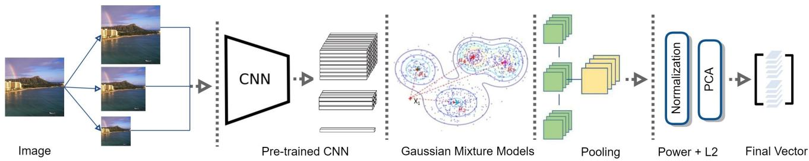
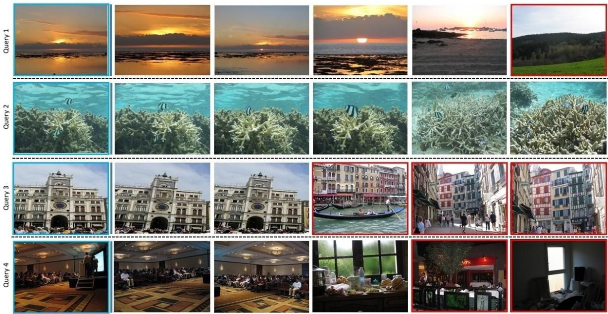
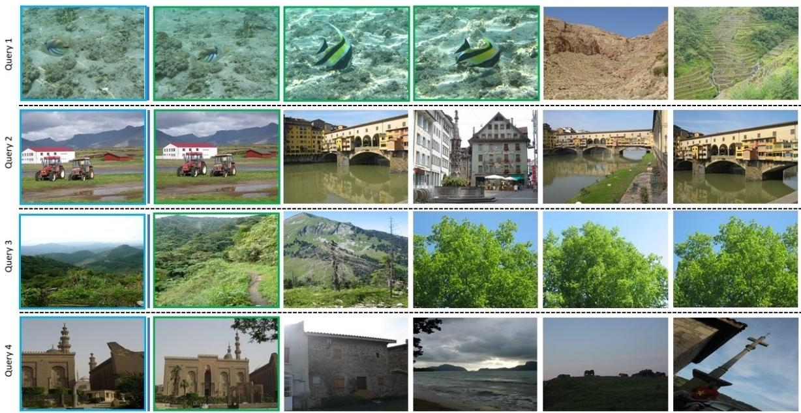
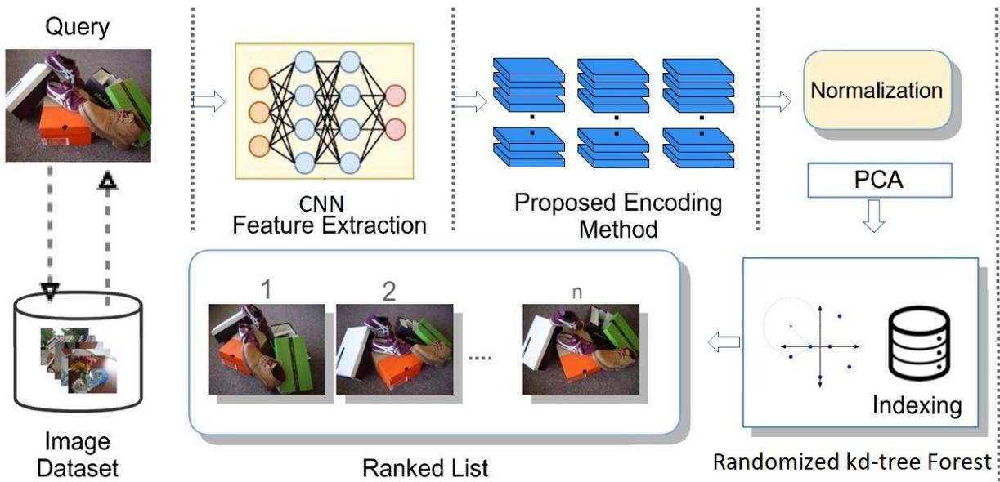
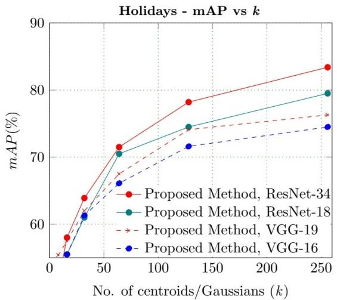
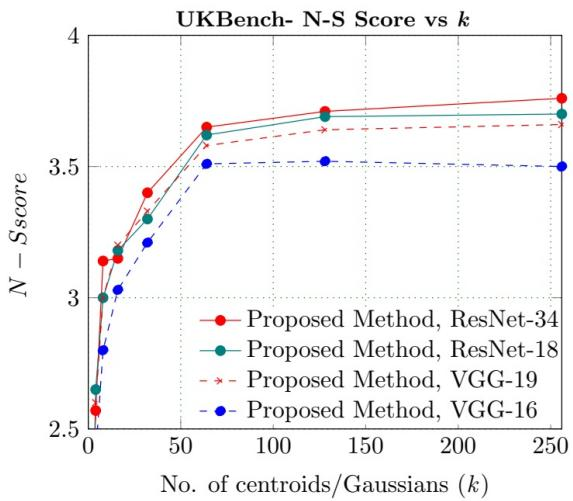
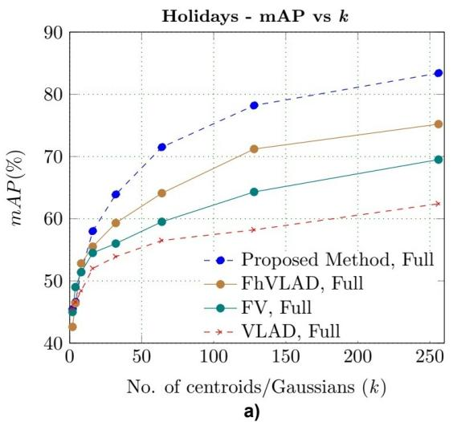
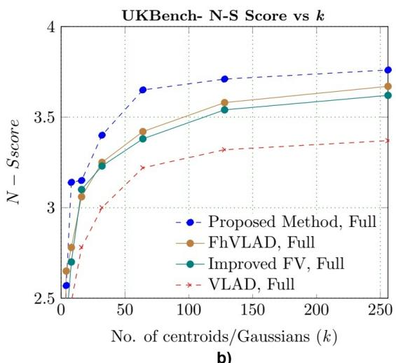
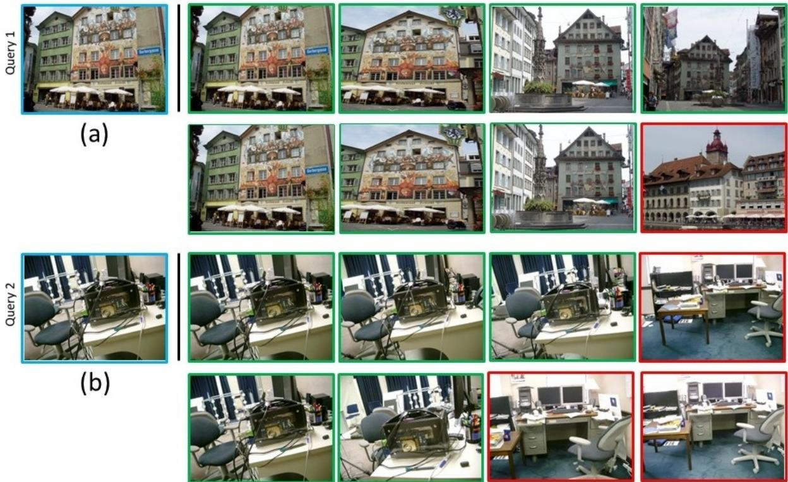

# Rethinking Fisher Vectors for Second-order Deep Feature Aggregation in Scalable Image Retrieval

Alexy Bhowmick B1 · Sarat Saharia 2 · Shyamanta M. Hazarika 3

Received: date / Accepted: date

Abstract Aggregating CNN responses into a compact discriminative vector, given their lack of geometric invariance, is a challenge. To address this challenge, we propose a visual vocabulary-free method to encode second order information of multi-scale CNN features within the Fisher Kernel framework. We propose a scalable retrieval pipeline to show the eficacy of the proposed vector. The increased discriminative power is confirmed by experimental evaluation of our method on two dificult[ benchmarks (INRIA Holidays, UKBench). Systematic experiments and ablation studies with multiple backbones demonstrate the proposed method achieving a mAP of 83.42% on INRIA Holidays and a N-S score of 3.76 on the UKBench datasets respectively. The significant improvement in retrieval accuracy over stateof-the-art approaches comes with only a slight increase in dimension. The proposed signature vector can also be expected to improve image and object classification performance.

Keywords Feature aggregation · CNNs · Fisher kernel · Second-order · Multi-scale

## 1 Introduction

Scene retrieval has witnessed a steady stream of advancements and has drawn a sustained attention from the computer vision and multimedia field for decades. The goal of scene retrieval is to retrieve from the dataset images that depict the same scene or objects. Most of the conventional scene retrieval algorithms encode low-level, hand-crafted features of an image or video into a comprehensive, short vector representation. It has prompted the development of several notable encoding schemes, including the Vector of Locally Aggregated Descriptors (VLAD) [16], Fisher Vector (FV) [27], and Triangulation Embedding (Temb) [18]. These techniques successfully achieve an accuracy-eficiency trade-of but fall short in terms of capturing high-level semantic data for scene retrieval. Therefore, it is essential to develop eficient scene retrieval solutions that include the combined optimization of the fundamental constraints: accuracy, speed, and memory footprint.

Recently, the focus of research has shifted towards CNN image representations which have become stateof-the-art generic descriptors for image classification and retrieval. As they capture high-level semantic knowledge of objects and surroundings, convolutional features ofer greater discriminative power than traditional hand-crafted features. Convolutional features also handle the efect of burstiness which is known to occur in the local features. The higher discriminative power enables CNNs to exhibit superior performance and significantly reduce the semantic gap. Recent retrieval techniques [6, 12, 31, 9, 38] have demonstrated that activations from the intermediate layers of a pre-trained CNN work well as high-level image descriptors. In one of the early studies, Razavian et al. [31] found that CNN features without any embedding or complex aggregation were less efective. Consequently, the authors incorporated CNN features with spatial information to achieve competitive performance in image retrieval.

  
Fig. 1: Overview of the proposed codebook-free scheme for second-order multi-scale encoding and pooling of CNN activations.

For tasks like visual recognition [10], semantic segmentation [7], etc., representations based on the activations of layers of such networks have proven successful. There is evidence that deeper layer activations produce superior image representations [36]; but it is still being explored how to aggregate these responses into a fixed-length discriminative vector for image retrieval and classification. While a majority of techniques simply extract activations from the network’s penultimate layers, another line of research has looked into aggregating higher-order statistics of CNN activations for scene retrieval. However, global CNN activations do not exhibit geometric variance [12], which reduces their efectiveness in matching diferent scenes. Given that Fisher Vectors are an advanced encoding scheme, a number of recent works (e.g.[34], [36], have investigated aggregation of deep features for a robust representation for vision tasks.

Our research focuses on encoding CNN feature maps in order to create a compact image supervector for scalable scene retrieval. We propose a novel method to improve the invariance of CNN features without degrading their discriminative power. We encode the CNN activations from multiple image scales in the Fisher kernel framework [29]. In memory-constrained settings, it is preferred to do away with the codebook (visual vocabulary), which is made possible by the Gaussian Mixture Model encodings. The Fisher kernel-inspired secondorder aggregation of CNN activations obtained from multiple scales provides notable improvements over the original (baseline) Fisher Vector as well as recent stateof-the-art methods. The discriminative power comes from the exploitation of CNN features and Fisher Vector’s rudimentary vector operations which makes it less expensive to compute. Our experiments help to understand how the convolutional features extracted from well-known networks (variants of VGG [33] and ResNet [13]) can be aggregated in a sophisticated manner to achieve a significant boost in retrieval performance.

The main contributions in this paper are:

1. A novel visual vocabulary-free image representation that aggregates multi-scale second-order CNN features within the Fisher framework resulting in greater discriminative power.

2. A scalable image retrieval framework based on fast indexing and efective search to produce ranked retrieval results.

3. Experiments on two benchmark datasets show that the proposed representation significantly improves retrieval accuracy.

The remainder of the paper is structured as follows. Section 2 briefly outlines the background and relevant work. In Section 3 we describe the encoding algorithm and introduce the novel representation vector. Section 4 presents the evaluation process, datasets, ablation study, experimental comparison, and analyses. In Section 5, we examine the limitations of our approach and outline directions for future work. Finally, Section 6 concludes the paper.

## 2 Related Work

This section examines the background and state-of-theart deep feature vector aggregation methods for scalable image retrieval.

CNN Descriptors for Scene Retrieval: In a seminal study on the use of CNN features for scene retrieval, Wan et al. [37] employed CNN features on diferent scene retrieval datasets with model retraining and similarity learning. The findings showed that CNN features are indeed efective in reducing the semantic gap that exists between low-level visual features and highlevel semantics. The final layer of the CNN was believed to be crucial for strong performance in retrieval. In keeping with this line of inquiry, Babenko et al. [6] extensively evaluated the performance of CNN descriptors for scene retrieval and reported that Principal Component Analysis (PCA)-compressed deep features outperformed compact features based on SIFT [24]. The authors retrained a CNN on a landmark database for their

Fig. 2: Accurate retrieval results by baseline Fisher Vector (FV) on INRIA Holidays. Results that do not reflect groundtruth (or are edge cases) are in a red box . A blue box surrounds each query.  

Fig. 3: Sub-optimal retrieval results by baseline Fisher Vector (FV) on INRIA Holidays. Results that reflect groundtruth are in a green box . A blue box surrounds each query.

scene retrieval experiments. Unfortunately, the training time of the model made the approach computationally infeasible for practical use. Recently, Bhowmick at al. [8] proposed a high-order discriminative encoding of VLAD features which captured complementary highorder descriptor statistics to enhance feature discriminability.

Contrary to earlier assumptions, Razavian et al. [31] found that the traditional SIFT features encoded in VLAD encoding [15] were superior to CNN features derived from the final layer, and needed to be boosted with spatial features for obtaining comparable results. In a series of experiments, the authors investigated the use of of-the-shelf CNN features and reported good results in visual instance retrieval without aggregating them into a global descriptor. The authors used the L2- normalized output of the first fully connected layer of the fine-tuned Overfeat CNN network as a generic representation for the image. The Overfeat network was trained for the ImageNet Large Scale Visual Recognition Challenge (ILSVRC 2013) challenge to perform object classification. Although features from the final layers proved less crucial than initially assumed, the results confirmed the efectiveness of CNN representation for visual object recognition and retrieval.

Encoding CNN Descriptors as Compact Vectors: The Multi-scale Orderless Pooling (MOP-CNN) [12] is a significant method that was proposed to aggregate multi-scale CNN activations from the higher layers (Fully Connected layer) and achieve geometric invariance. The aggregation of the features in a VLADlike [16] fashion on a multi-scale setting showed promising results. However, it did not address the question of which scales and layers result in the optimum performance for retrieval tasks. Inspired by MOP-CNN’s [12] VLAD-like aggregation of CNN features, Ng et al. [25] extracted convolutional features from network’s layers (at diferent scales) for instance-level scene retrieval, and demonstrated that the intermediate layers with finer scales performed better than final layers in case of instance-level scene retrieval. The authors used VLAD encoding [16] to encode low-dimensional representations of CNN responses. Notably, the new feature preserved local object characteristics, captured category-level information, and achieved state-of-theart retrieval outcomes.

In a systematic study, Azizpour et al. [4] looked into various factors related to CNN representations and their transferability including parameters and architecture. The sum-pooled convolutional features (SPoC) descriptor [5], based on raw deep convolutional features, from the very deep trained ConvNet configuration by Simonyan et al. [33], is a significant pooling strategy. SPoC introduced sum-pooling of deep features instead of max-pooling. Motivated by these advances, Razavian et al. [32] conducted extensive experiments on instance retrieval datasets using CNN features and produced promising results. The regional maximum activations of convolutions (R-MAC) [35] feature vector is constructed by encoding the image regions into a compact supervector with scale and translation invariances. Subsequently, the region descriptors are aggregated (sum) and L2-normalized. The representation, when paired with re-ranking and query expansion, matched the stateof-the-art in retrieval accuracy. R-MAC became a prominent method and inspired several extensions. Along a similar line of investigation, Wang et. al. [38] proposed a compact representation named multi-models deep feature aggregation (MDFA) which efectively eliminated background noise and improved image retrieval accuracy.

Fisher-encoded CNN Descriptors: Fisher Vectors (FV) have a significant advantage over CNNs in that they are relatively less expensive to train and evaluate. Uricchio et. al. [36] computed CNN output activations from few hundreds of proposal windows to generate a multi-scale final representation using the Fisher Vector encoding and Principal Component Analysis (PCA). Perronnin [28] suggested a hybrid architecture for image classification that incorporates the best features of Fisher and CNN pipelines. The first layers of the architecture are unsupervised and involve Fisher Vector computation and dimension reduction. The successive layers are supervised, fully connected and trained using back-propagation. Typically, Fisher Vector is computed using non-binary SIFT features. Examples of accurate retrieval and sub-optimal retrieval outcomes by baseline Fisher Vector (FV) on INRIA Holidays dataset are shown in Fig. 2 and 3. Amato et al. [1] combined CNN with binary features and termed the proposed representation BMM-FV as it used a Bernoulli Mixture Model (BMM) for describing binary outcomes. Additionally, Fisher Vectors have been recommended for Siamese neural networks and used for aggregating CNN image descriptors [26]. The representation produced significant improvements in retrieval scores and was robust and discriminative. Although a deep representation is quite efective, it requires much computing power for the optimization and a lot of training data for generalization.

## 3 Proposed Method

In this section we introduce our multi-scale aggregation and pooling scheme as well as the scalable retrieval framework.

ConvNets are considered state-of-the-art and have established themselves as highly successful classifiers for vision tasks. Their capacity to learn highly discriminative activation (feature) maps from image regions is what contributes mostly to their success. Formally, if $\boldsymbol { x } _ { i j }$ is the feature vector at location (i; j) in a specific layer, and $y _ { i j }$ for the following layer, a non-linear activation layer computes the feature maps $y _ { i j } ^ { m a p }$ as:

$$
y ^ { m a p } = f _ { k s } ( \{ x _ { s i + \delta i , s j + \delta j } \} _ { 0 \leqslant \delta i , \delta j \leqslant k e r n e l } ) ,\tag{1}
$$

where kernel, s, and $f _ { k s }$ stand for “kernel size”, “stride”, and “layer type” respectively. As layers stacked together, convolution or average pooling essentially conducts element-wise matrix multiplication, max pooling downsamples the input using the spatial Max() operation, Rectified Linear Unit (ReLU) introduces nonlinearity to the model, and so forth.

  
Fig. 4: The scalable image retrieval framework using the proposed vector representation for retrieval performance evaluation.

The efectiveness of global CNN activations in classification and retrieval scenarios is contrained by a lack of geometric invariance. We demonstrate the invariance of CNN activations using multi-scale activations and aggregate the convolutional features in a second-order fashion using a Fisher Kernel framework [30]. Popular representations such as Spatial Pyramid Matching [20] are ordered representations of the scene but work only at a single scale. As an alternative, we extract activations from three diferent resolutions of the input image to improve their invariance without compromising their discriminative eficacy. We employ the pre-trained CNN VGG-16 1 as it has been shown to enhance the derived scene representation in well-established scene retrieval datasets while incurring lower computational demand [35]. After the ReLU transformation, we utilize the 4096-dimensional activations of the final fully connected layer of the VGG-16 [33]. Additionally, we experimented with a deeper architecture from the VGG family, the VGG-19 network. VGG networks are known to sufer from vanishing gradients as their depth increases. Residual Networks (ResNets) [13] address this problem by introducing residual connections, which facilitate better gradient flow through deeper networks with reduced complexity. To ensure a fair comparison, we use the 512-dimensional activations from the final fully connected layer of two ResNet versions - ResNet-18, a shallower model, and ResNet-34, a deeper model. All four models were pretrained on ImageNet.

More specifically, let $\mathcal { X } = \{ x _ { 1 } , x _ { 2 } , . . . x _ { n } \} , x _ { j } \in \mathbb { R } ^ { d }$ denote the descriptors (e.g. a set of Dense SIFT [24], or CNN [33] descriptors) extracted from an image. A Gaussian Mixture Model (GMM) learned with Expectation-Maximization (EM) models the feature distribution. Let $\begin{array} { r } { \theta = \{ ( \mu _ { i } ^ { \theta } , \sum _ { i } , \pi _ { i } ) , i = 1 , 2 , . . . k \} } \end{array}$ be a GMM (with k Gaussian modes), where $\mu _ { i } ^ { \theta } , \Sigma _ { i }$ and $\pi _ { i }$ are, respectively, the means, covariance matrices, and prior probabilities of the i-th mode computed on the (independent) training set. The posterior probability that $x _ { j }$ is associated to a mode i is given by the soft-assignment:

$$
q _ { j i } = \frac { \exp [ - \frac { 1 } { 2 } ( x _ { j } - \mu _ { i } ^ { \theta } ) ^ { T } \sum _ { k } ^ { - 1 } ( x _ { j } - \mu _ { i } ^ { \theta } ) ] } { \sum _ { t = 1 } ^ { k } \exp [ - \frac { 1 } { 2 } ( x _ { j } - \mu _ { t } ^ { \theta } ) ^ { T } \sum _ { k } ^ { - 1 } ( x _ { j } - \mu _ { t } ^ { \theta } ) ] } .\tag{2}
$$

We compute the mean and diagonal covariance vectors for each mode k as:

$$
u _ { j k } = \frac { 1 } { N \sqrt { \pi _ { k } } } \sum _ { i = 1 } ^ { N } q _ { i k } \ \frac { x _ { j i } - \mu _ { j k } ^ { \theta } } { \sigma _ { j k } } ,\tag{3}
$$

$$
v _ { j k } = \frac { 1 } { N \sqrt { 2 \pi _ { k } } } \sum _ { i = 1 } ^ { N } q _ { i k } \Bigg [ \Bigg ( \frac { { x _ { j i } - \mu _ { j k } ^ { \theta } } } { \sigma _ { j k } } \Bigg ) ^ { 2 } - 1 \Bigg ] ,\tag{4}
$$

where $j = \{ 1 , 2 , 3 , \dots \mathrm { D } \}$ . Finally, the means $u _ { k }$ (1st-order statistic) and the diagonal covariance matrices $v _ { k } \ \left( 2 ^ { n d } \right.$ -order statistic) are concatenated into a

supervector:

$$
\phi = [ u _ { 1 } ^ { T } , u _ { 2 } ^ { T } , . . . u _ { k } ^ { T } , v _ { 1 } ^ { T } , v _ { 2 } ^ { T } , . . . v _ { k } ^ { T } ] ^ { T } , \qquad u _ { i } , v _ { i } \in \mathbb { R } ^ { \mathrm { d } } .\tag{5}
$$

The encoded vector v is then power-normalized and L2-normalized as last steps. Power-normalization enhances the representation’s discriminative power by diminishing the impact of bursty elements brought on by repetitive structures [16]. Each component $v _ { j }$ is changed into:

$$
\phi _ { j } = s i g n ( \phi _ { j } ) \times | \phi _ { j } | ^ { \alpha } , \qquad j \in [ 1 , 2 , . . . , D ] ,\tag{6}
$$

where $0 \leq \alpha < 1$ (α is a normalization parameter). This step needs tweaking for best performance (near-optimal options being $\alpha = 0 . 2 , 0 . 4 \mathrm { ~ o r ~ } 0 . 5 )$ . L2- normalization makes the representation invariant to the number of features. The updated vector $\phi$ is divided by its L2-norm: $\begin{array} { r } { \phi = \frac { \phi } { \vert \vert \phi \vert \vert _ { 2 } } } \end{array}$

The full-dimensional proposed representation for the descriptor set X at one scale is given by $\phi .$ . To produce the final representation, the representations from the multiple scales are average pooled. The steps of the proposed multi-scale vector encoding and pooling algorithm are depicted in Fig. 1. To show that the proposed encoding scheme is efective, we run visual search experiments on benchmarks and assess its performance. We experiment with dimension reduction as well, and PCA is used to analyze performance at reduced dimensions. A scalable scene retrieval framework that was developed to employ the proposed representation is shown in Fig. 4. The framework leverages randomized kd-tree forest 2 for rapid approximate nearest neighbor searches in high-dimensions and eficient indexing to return ranked results.

## 4 Experimental Results and Discussion

In this section, we introduce the two benchmark datasets and outline the evaluation metrics to assess the efectiveness of our method. We then describe the ablation studies conducted to investigate the contributions of diferent components. Additionally, we compare our method to state-of-the-art techniques, analyze the results, and provide an in-depth discussion of the performance.

## 4.1 Evaluation Benchmark and Metrics

We set up our scene retrieval experiment in accordance with the baseline technique experimental setup [30] and [28] (since they proposed similar compact representations for retrieval and classification tasks). The two retrieval benchmarks that serve as the basis for our method’s evaluation are standard and publicly available.

## 4.1.1 INRIA Holidays

The INRIA Holidays dataset 3 [19] is made up of 1491 photos that have been split into 500 groups, each of which contains a unique scene or a collection of objects. The dataset consists of 500 queries and 4.456 M descriptors. The results are presented as Mean Average Precision (mAP) over the 500 queries, with the query omitted from the ranking list (leave-one-out approach).

## 4.1.2 University of Kentucky Benchmark (UKBench)

The UKBench 4 [39] has 10,200 images of 640x480 resolution that relate to 2,550 diferent objects and scenes of diverse categories. Performance is assessed using the N-S score (range: 0-4), the average number of images returned in the first 4 places (4×Recall@4).

## 4.2 Impact of Parameters

Impact of number of Gaussian Components: In order to determine how the retrieval performance varies with disparate Gaussian components (k), we examine the performance of our method with varying component sizes and compare it to our baselines VLAD [16] and FV [30]. Fig. 6 shows the impact of k on the scores on Holidays and UKBench for the full-sized proposed descriptor. It is noticed that, up until a certain point, the retrieval performance grows as the number of Gaussians increases. For k = 128, we achieve a 74.5% mAP on Holidays, and an 3.40 N-S score on UKBench. For larger values of $k ,$ however, the computational cost becomes impractical and the dimensions becomes too large for eficient indexing and retrieval. Therefore, to obtain a reasonable performance-eficiency trade-of, we limit the size of k to 128 and restrict our analysis to k=256.

## 4.3 Ablation Experiments

We conducted ablation experiments using four diferent deep learning architectures, as described in Section 3. Table 1 summarizes the result of these experiments, where feature maps were extracted from the various models. We tested our method for diferent values of Gaussian components (k). As shown in Table 1, the best performance and robustness in retrieval accuracy is achieved using a dimension size of 256 with the ResNet-34 architecture. Additionally, our experiments also demonstrate that deeper networks improve the image retrieval accuracy. Specifically, the ResNet-34 architecture outperforms the others, making it the most suitable model among the four pre-trained models evaluated. Notably, the VGG networks consistently improve upon the baseline FV [27] and FhVLAD [9] scores. It can be inferred that the aggregation of secondorder information of multi-scale CNN features within the Fisher Kernel framework leads to significant gains (as seen in Figure 5). The models are pre-trained on ImageNet dataset. Our experiments were done on a platform with AMD Ryzen 9 CPU (4.30 GHz, 8 cores), 32 GB of RAM, and an NVIDIA GeForce RTX 2060 GPU with 6 GB of memory.

  
a)

  
b)  
Fig. 5: Ablation experiments using four diferent deep learning architectures: Impact of number of Gaussian components k a) on Mean Average Precision(mAP) on Holidays, b) on N-S Score on UKBench. (Higher score is preferable). Parameter $\alpha = 0 . 5$

## 4.4 Comparison with State-of-the-art

For an even comparison Table 2 compares our fullsize descriptor’s performance (with ResNet-34 model) with that of more recent, advanced encoding methods. It is noted that the proposed method obtains 83.42% $\mathrm { m A P }$ on Holidays and 3.76 N-S score on UKBench. This raises the performance over the recent baseline FhVLAD [9] by 15.5 % on Holidays and 0.25 increase in N-S score on UKBench. Our method still lags behind recent techniques such as the MDFA3 [38] in retrieval accuracy. MDFA3 extracts deep features from two pre-trained CNN models, which are then aggregated into a robust supervector inspired by the attention mechanism. Triangulation Embedding (Temb) [18] which is based on triangulation strategy for embedding and democratic aggregation of descriptors has results that are at par with our result on PCA-reduced supervectors on the Holidays dataset (Please see Table 3). We believe the impact of the discriminative power of convolutional features and the efective second-order encoding strategy is what causes the performance boost in the proposed descriptor.

Table 1: Ablation experiments comparing results when using diferent Deep Learning architectures. k refers to the number of Gaussian components.
<table><tr><td>CNN Architecture</td><td>Holidays (mAP(%))</td><td>UKB (Score/4)</td></tr><tr><td rowspan="5">VGG-16</td><td> $k = 3 2$  61.3</td><td>3.21</td></tr><tr><td> $k = 6 4$  66.1</td><td>3.51</td></tr><tr><td> $k = 1 2 8$  71.6</td><td>3.52</td></tr><tr><td> $k = 2 5 6$ </td><td>74.5 3.50</td></tr><tr><td></td><td></td></tr><tr><td rowspan="4">VGG-19</td><td>k = 32</td><td>62.0</td><td>3.33</td></tr><tr><td> $k = 6 4$ </td><td>67.5</td><td>3.58</td></tr><tr><td> $k = 1 2 8$ </td><td>74.1</td><td>3.64</td></tr><tr><td> $k = 2 5 6$ </td><td>76.3</td><td>3.66</td></tr><tr><td rowspan="4">ResNet-18</td><td> $k = 3 2$ </td><td>61.0</td><td>3.30</td></tr><tr><td> $k = 6 4$ </td><td>70.5</td><td>3.62</td></tr><tr><td> $k = 1 2 8$ </td><td>74.5</td><td>3.69</td></tr><tr><td> $k = 2 5 6$ </td><td>79.5</td><td>3.70</td></tr><tr><td rowspan="4">ResNet-34</td><td> $k = 3 2$ </td><td>63.9</td><td>3.4</td></tr><tr><td> $k = 6 4$ </td><td>71.5</td><td>3.65</td></tr><tr><td> $k = 1 2 8$ </td><td>78.2</td><td>3.71</td></tr><tr><td> $k = 2 5 6$ </td><td>83.4</td><td>3.76</td></tr></table>

  
b)  
Fig. 6: Performance comparison with baselines. Impact of number of Gaussian components k a) on Mean Average Precision(mAP) on Holidays, b) on N-S Score on UKBench. (Higher score is preferable). Parameter α = 0.5.

Table 2: Performance comparison of the full-size proposed supervector with state-of-the-art on Holidays and UKBench.
<table><tr><td>Method</td><td>Codebook size</td><td>D</td><td>Holidays (mAP(%))</td><td>UKBench (score/4)</td></tr><tr><td>Improved FV [29]</td><td>k=64</td><td>16384</td><td>59.5</td><td>3.25</td></tr><tr><td>VLAD+SSR [16]</td><td>k=64</td><td>16384</td><td>59.8</td><td>3.28</td></tr><tr><td>VLAD + Intra + Adapt [2]</td><td>k=64</td><td>8192</td><td>64.6</td><td>-</td></tr><tr><td>VLAD* [11]</td><td>k=64</td><td>8192</td><td>62.2</td><td>–</td></tr><tr><td>HVLAD [22]</td><td>k=64</td><td>8192</td><td>66.8</td><td>3.48</td></tr><tr><td>Triangulation Embedding [18]</td><td>k=64</td><td>8192</td><td>75.6</td><td>1</td></tr><tr><td>CEVLAD [40]</td><td>k=64</td><td>8192</td><td>67.6</td><td>3.43</td></tr><tr><td>Fine Residual VLAD [23]</td><td>k=64</td><td>8192</td><td>61.4</td><td>3.38</td></tr><tr><td>RVD-W [14]</td><td></td><td>512</td><td>69.0</td><td>一</td></tr><tr><td>SDEVLAD [21]</td><td>k=64</td><td>8256</td><td>71.4</td><td></td></tr><tr><td>FhVLAD [9]</td><td>k=64</td><td>8256</td><td>67.9</td><td>3.51</td></tr><tr><td>OxfordNet [25]</td><td></td><td>512</td><td>83.8</td><td>–</td></tr><tr><td>NetVLAD [3]</td><td>k=64</td><td>512</td><td>79.9</td><td>–</td></tr><tr><td>MDFA3 [38]</td><td>k=64</td><td>512</td><td>87.15</td><td>=</td></tr><tr><td>Our proposed method</td><td></td><td>16384</td><td>83.42</td><td>3.76</td></tr></table>

The proposed descriptor demonstrates consistent superior performance against baselines FV [30], SDEVLAD [21], and FhVLAD [9], as well as several recent SIFT and CNN-based extensions (as seen in Table 2). NetVLAD’s [3] high accuracy is mainly attributed to replicating VLAD in a CNN framework and the trainable generalized VLAD layer providing high distinctiveness. Compared to sophisticated CNN-based representations like NetVLAD [3] and OxfordNet [25], the proposed representation vector’s performance is noteworthy because i) The method is codebook-free and relies on rudimentary vector operations of pre-trained convolutional features, and ii) It only requires a few parameters, with the most

Table 3: Performance comparison of the PCA-reduced (D'= 128 ) proposed supervector on Holidays and UKBench with state-of-the-art.
<table><tr><td>Method ↓</td><td>k</td><td>D&#x27;</td><td>Holidays</td><td>UKBench</td></tr><tr><td>Improved FV [29]</td><td>64</td><td>128</td><td>56.5</td><td>3.33</td></tr><tr><td>VLAD + SSR [16]</td><td>64</td><td>128</td><td>55.7</td><td>3.35</td></tr><tr><td>Multivoc-VLAD [17]</td><td>64</td><td>128</td><td>61.4</td><td>3.36</td></tr><tr><td>VLAD+intra+adapt [2]</td><td>64</td><td>128</td><td>62.5</td><td></td></tr><tr><td>HVLAD [22]</td><td>256</td><td>128</td><td>64.0</td><td>3.4</td></tr><tr><td>Temb [18]</td><td>256</td><td>128</td><td>65.7</td><td></td></tr><tr><td>RVD-W [14]</td><td></td><td>128</td><td>61.6</td><td></td></tr><tr><td>Fine-residual VLAD [23]</td><td>256</td><td>128</td><td>62.2</td><td>3.43</td></tr><tr><td>SDEVLAD [21]</td><td>256</td><td>128</td><td>73.6</td><td></td></tr><tr><td>OxfordNet [25]</td><td>=</td><td>128</td><td>81.6</td><td>=</td></tr><tr><td>Our proposed method</td><td>一</td><td>128</td><td>74.61</td><td>3.48</td></tr></table>

important ones being - number of Gaussian components k and α. For both the datasets under consideration, the proposed descriptor has a running time O(k(2d + 1)) and delivers a competitive accuracy at decreased dimensions (Table 3). Two query results of image retrieval are shown in Fig. 7, one from Holidays dataset and other from UKB. Both queries involve challenge related to illumination variation, viewpoint variance, and clutter. While our method shows improved robustness in such scenarios, occasional inaccuracies persist, highlighting areas for future enhancement as discussed in the following section.

## 5 Limitations and Future Work

Notwithstanding the positive results of the paper, there are still some challenges and limitations that need to be discussed. We chose the Fisher Kernel due to its hallmark characteristics and merits. However, it does have demerits that our approach inherits, such as hyper parameter tuning and increased computational cost of encoding, which can be challenging and time-consuming. The computational complexity can be pronounced when we consider larger number of Gaussian components (e.g. k = 1024). In high dimensionality the approach is also susceptible to the curse of dimensionality. The use of multi-scale features may also make it incompatible with techniques that require spatial verification, although this remains to be further explored.

To address these limitations we recommend exploring advanced aggregation mechanisms and also exploring those ideas to design vector aggregation methods for other domains such as medical image classification and data compression. In the future, determining the best architecture for retrieval tasks can be done at a broader level, considering the wide range of architectures that are available. A key direction lies in revisiting deeper architectures, especially for large-scale retrieval tasks and other complex tasks. While one may aim to get better performance with deeper architectures like ResNet-101, however their computational requirements become significantly higher as they are too deep. This also results in slower feature extraction process and a steep increase in resource consumption. Therefore, it is crucial to look for a trade-of between depth and eficiency to optimize performance. As part of our future work, we plan to explore the applicability of the proposed method in road scene object classification, as well as extend its use to other domains such as the retrieval of cultural heritage art and paintings.

## 6 Conclusion

We described the design of a novel compact supervector for scene retrieval in this paper. The proposed method is built on the Fisher Kernel framework for efective second order encoding of the multi-scale CNN features to enhance the representational capacity. The limited increase in dimension and computational complexity caused by the discriminative encoding is a trade-of. Experimental evaluation on two well-known datasets show our method yields significant gain over recent CNNbased and traditional SIFT-based signatures in retrieval performance. The proposed vector is also expected to improve image and object classification performance.

Acknowledgements The authors express their gratitude to Dr. Sarbani Palit, CVPR Unit, ISI Kolkata for her valuable suggestions and comments at the final stage of this work.

## 7 Statements and Declarations

Ethical Approval This declaration is not applicable. Competing interests

  
Fig. 7: Example retrieval results from the Holidays dataset and the UKB dataset: For query (a) in the blue box, the top row corresponds to our results on Holidays, bottom row corresponds to baseline results from recent FhVLAD [9]. For query (b) also in the blue box, the top row corresponds to our results on the UKB dataset, and the bottom row corresponds to baseline results from the recent FhVLAD [9]. In (b), a failure instance of our approach is evident, as the fourth instance in the top row does not match the ground truth. A blue box surrounds each query. A green box corresponds to results that match with the ground-truth. Results that do not reflect groundtruth (or are edge cases) are in a red box

The authors have no competing interests to declare that are relevant to the content of this article.

## Authors’ contributions

All authors contributed to the study conception and design. Author 1 investigated the presented idea, performed the experiments, designed the figures and drafted the main manuscript. Author 2 revised the manuscript versions critically and contributed in interpretation of data. Author 3 provided support in drafting the manuscri revised the manuscript versions critically, contributed in interpretation of data, and supervised the work. All authors read and approved the final manuscript.

## Funding

The authors did not receive support from any organization for the submitted work.

Availability of data and materials The datasets generated analysed during the current study are available in the following repositories: https://lear.inrialpes.fr/ jegou/data.php, https://archive.org/details/ukbench

## References

1. Amato G, Falchi F, Rabitti F, Vadicamo L (2016) Combining Fisher Vector and Convolutional Neural Networks for Image Retrieval. In: Nunzio GMD, Nardini FM, Orlando S (eds) Proceedings of the 7th Italian Information Retrieval Workshop, Venezia, Italy, May 30-31, 2016, vol 1653

2. Arandjelovic R, Zisserman A (2013) All About VLAD. In: 2013 IEEE Conference on Computer Vision and Pattern Recognition, pp 1578–1585

3. Arandjelovic R, Gronat P, Torii A, Pajdla T, Sivic J (2018) NetVLAD: CNN Architecture for Weakly Supervised Place Recognition. IEEE Transactions on Pattern Analysis and Machine Intelligence 40(6):1437–1451

4. Azizpour H, Razavian AS, Sullivan J, Maki A, Carlsson S (2015) From generic to specific deep representations for visual recognition. In: 2015 IEEE Conference on Computer Vision and Pattern Recognition Workshops (CVPRW), pp 36–45

5. Babenko A, Lempitsky VS (2015) Aggregating Deep Convolutional Features for Image Retrieval. CoRR abs/1510.07493, URL http://arxiv.org/ abs/1510.07493

6. Babenko A, Slesarev A, Chigorin A, Lempitsky V (2014) Neural Codes for Image Retrieval. In: Fleet D, Pajdla T, Schiele B, Tuytelaars T (eds) Computer Vision – ECCV 2014, Springer International Publishing, Cham, Lecture Notes in Computer Science, pp 584–599

7. Badrinarayanan V, Kendall A, Cipolla R (2017) SegNet: A Deep Convolutional Encoder-Decoder Architecture for Image Segmentation. IEEE Transactions on Pattern Analysis and Machine Intelligence 39(12):2481–2495

8. Bhowmick A, Saharia S, Hazarika SM (2019) Encoding High-Order Statistics in VLAD for Scalable Image Retrieval. In: Deka B, Maji P, Mitra S, Bhattacharyya DK, Bora PK, Pal SK (eds) Pattern Recognition and Machine Intelligence - 8th International Conference, PReMI 2019, Tezpur, India, December 17-20, 2019, Proceedings, Part I, Springer, Lecture Notes in Computer Science, vol 11941, pp 559–566, DOI 10.1007/978-3-030-34869-4 61

9. Bhowmick A, Saharia S, Hazarika SM (2021) FhVLAD: Fine-grained quantization and encoding high-order descriptor statistics for scalable image retrieval. Multimedia Tools and Applications 80(28):35495–35520

10. Chatfield K, Simonyan K, Vedaldi A, Zisserman A (2014) Return of the Devil in the Details: Delving Deep into Convolutional Nets. CoRR abs/1405.3531, URL http://arxiv.org/ abs/1405.3531

11. Delhumeau J, Gosselin PH, J´egou H, P´erez P (2013) Revisiting the VLAD Image Representation. In: Proceedings of the 21st ACM International Conference on Multimedia, ACM, New York, NY, USA, MM ’13, pp 653–656

12. Gong Y, Wang L, Guo R, Lazebnik S (2014) Multiscale Orderless Pooling of Deep Convolutional Activation Features. In: Fleet DJ, Pajdla T, Schiele B, Tuytelaars T (eds) Computer Vision - ECCV 2014 - 13th European Conference, Zurich, Switzerland, September 6-12, 2014, Proceedings, Part VII, Springer, Lecture Notes in Computer Science, vol 8695, pp 392–407

13. He K, Zhang X, Ren S, Sun J (2016) Deep Residual Learning for Image Recognition. In: 2016 IEEE Conference on Computer Vision and Pattern Recognition (CVPR), pp 770–778

14. Husain SS, Bober M (2017) Improving Large-Scale Image Retrieval Through Robust Aggregation of

Local Descriptors. IEEE Transactions on Pattern Analysis and Machine Intelligence 39(9):1783–1796

15. Jegou H, Douze M, Schmid C, P´erez P (2010) Aggregating local descriptors into a compact image representation. In: 2010 IEEE Computer Society Conference on Computer Vision and Pattern Recognition, pp 3304–3311

16. Jegou H, Perronnin F, Douze M, S´anchez J, P´erez P, Schmid C (2012) Aggregating Local Image Descriptors into Compact Codes. IEEE Transactions on Pattern Analysis and Machine Intelligence 34(9):1704–1716

17. J´egou H, Chum O (2012) Negative Evidences and Co-occurences in Image Retrieval: The Benefit of PCA and Whitening. In: Proceedings, Part II, of the 12th European Conference on Computer Vision — ECCV 2012 - Volume 7573, Springer-Verlag, Berlin, Heidelberg, pp 774–787

18. J´egou H, Zisserman A (2014) Triangulation Embedding and Democratic Aggregation for Image Search. In: Proceedings of the 2014 IEEE Conference on Computer Vision and Pattern Recognition, IEEE Computer Society, USA, CVPR ’14, pp 3310– 3317

19. J´egou H, Douze M, Schmid C (2010) Improving Bag-of-Features for Large Scale Image Search. Int J Comput Vis 87(3):316–336, DOI 10.1007/ s11263-009-0285-2

20. Lazebnik S, Schmid C, Ponce J (2006) Beyond Bags of Features: Spatial Pyramid Matching for Recognizing Natural Scene Categories. In: Proceedings of the 2006 IEEE Computer Society Conference on Computer Vision and Pattern Recognition - Volume 2, IEEE Computer Society, Washington, DC, USA, CVPR ’06, pp 2169–2178

21. Liu P, Miao Z, Guo H, Wang Y, Ai N (2018) Adding Spatial Distribution Clue to Aggregated Vector in Image Retrieval. EURASIP Journal on Image and Video Processing 2018(1):9

22. Liu Z, Li H, Zhou W, Rui T, Tian Q (2016) Making Residual Vector Distribution Uniform for Distinctive Image Representation. IEEE Transactions on Circuits and Systems for Video Technology 26(2):375–384

23. Liu Z, Wang S, Tian Q (2016) Fine-residual VLAD for image retrieval. Neurocomputing 173:1183–1191

24. Lowe DG (2004) Distinctive Image Features from Scale-Invariant Keypoints. International Journal of Computer Vision 60(2):91–110

25. Ng JYH, Yang F, Davis LS (2015) Exploiting Local Features from Deep Networks for Image Retrieval. arXiv:150405133 [cs] URL http://arxiv. org/abs/1504.05133

26. Ong EJ, Husain S, Bober M (2017) Siamese Network of Deep Fisher-Vector Descriptors for Image Retrieval. CoRR abs/1702.00338, URL http: //arxiv.org/abs/1702.00338

27. Perronnin F, Dance C (2007) Fisher Kernels on Visual Vocabularies for Image Categorization. In: 2007 IEEE Conference on Computer Vision and Pattern Recognition, pp 1–8

28. Perronnin F, Larlus D (2015) Fisher vectors Meet Neural Networks: A Hybrid Classification Architecture. In: 2015 IEEE Conference on Computer Vision and Pattern Recognition (CVPR), pp 3743– 3752

29. Perronnin F, Liu Y, S´anchez J, Poirier H (2010) Large-scale Image Retrieval with Compressed Fisher Vectors. In: 2010 IEEE Computer Society Conference on Computer Vision and Pattern Recognition, pp 3384–3391

30. Perronnin F, S´anchez J, Mensink T (2010) Improving the Fisher Kernel for Large-Scale Image Classification. In: Daniilidis K, Maragos P, Paragios N (eds) Computer Vision – ECCV 2010, Springer, Berlin, Heidelberg, Lecture Notes in Computer Science, pp 143–156

31. Razavian AS, Azizpour H, Sullivan J, Carlsson S (2014) CNN Features Of-the-Shelf: An Astounding Baseline for Recognition. In: Proceedings of the 2014 IEEE Conference on Computer Vision and Pattern Recognition Workshops, IEEE Computer Society, USA, CVPRW ’14, pp 512–519

32. Razavian AS, Sullivan J, Maki A, Carlsson S (2015) Visual Instance Retrieval with Deep Convolutional Networks. In: Bengio Y, LeCun Y (eds) 3rd International Conference on Learning Representations, ICLR 2015, San Diego, CA, USA, May 7-9, 2015, Workshop Track Proceedings

33. Simonyan K, Zisserman A (2015) Very Deep Convolutional Networks for Large-Scale Image Recognition. In: Bengio Y, LeCun Y (eds) 3rd International Conference on Learning Representations, ICLR 2015, San Diego, CA, USA, May 7-9, 2015

34. Simonyan K, Vedaldi A, Zisserman A (2014) Deep Inside Convolutional Networks: Visualising Image Classification Models and Saliency Maps. In: Bengio Y, LeCun Y (eds) 2nd International Conference on Learning Representations, ICLR 2014, Banf, AB, Canada, April 14-16, 2014, Workshop Track Proceedings

35. Tolias G, Sicre R, J´egou H (2016) Particular object retrieval with integral max-pooling of CNN activations. In: Bengio Y, LeCun Y (eds) 4th International Conference on Learning Representations, ICLR 2016, San Juan, Puerto Rico, May 2-4, 2016,

Conference Track Proceedings

36. Uricchio T, Bertini M, Seidenari L, Del Bimbo A (2015) Fisher Encoded Convolutional Bag-of-Windows for Eficient Image Retrieval and Social Image Tagging. In: 2015 IEEE International Conference on Computer Vision Workshop (ICCVW), pp 1020–1026, DOI 10.1109/ICCVW.2015.134

37. Wan J, Wang D, Hoi SCH, Wu P, Zhu J, Zhang Y, Li J (2014) Deep Learning for Content-Based Image Retrieval: A Comprehensive Study. In: Proceedings of the 22nd ACM international conference on Multimedia, Association for Computing Machinery, New York, NY, USA, MM ’14, pp 157–166

38. Wang YW, Liu GH, Deng QL (2023) Aggregating Deep Features of Multi-CNN Models for Image Retrieval. Neural Processing Letters 55(6):8059–8079

39. Wengert C, Douze M, J´egou H (2011) Bag-of-colors for improved image search. In: Proceedings of the 19th ACM international conference on Multimedia, Association for Computing Machinery, New York, NY, USA, MM ’11, pp 1437–1440

40. Zhou Q, Wang C, Liu P, Li Q, Wang Y, Chen S (2016) Distribution Entropy Boosted VLAD for Image Retrieval. Entropy 18(8):311, DOI 10.3390/ e18080311