# SABLE: SCALABLE AFFINE BAYESIAN LATENT-SPACE EXPLORATION

Erik Bodin<sup>1,\*</sup>

Henry Moss<sup>3</sup>

Lisa Maria Kreusser<sup>1,\*</sup>

Geoff Pleiss<sup>2,4</sup>

Donney Fan<sup>2</sup> Nicolas Durrande<sup>1</sup>

<sup>1</sup>Monumo <sup>2</sup>University of British Columbia <sup>3</sup>Lancaster University <sup>4</sup>Vector Institute

Equal contribution.

## ABSTRACT

Complex objects such as engineering designs and proteins are often difficult to optimise because their design spaces exhibit high-dimensional structure and objective evaluations are expensive. Generative models provide continuous latent representations, but their latent spaces can have thousands to tens of thousands of dimensions, creating a regime where the latent dimension D greatly exceeds the evaluation budget. We introduce SABLE, a Bayesian optimisation method for high-dimensional latent spaces with an isotropic distribution and limited budget. SABLE uses a Bayesian affine surrogate for prediction and acquisition, treating higher-order structure as surrogate discrepancy. After N observations, the slope update has dimension at most N − 1, yielding a decomposition of each query into an in-span component optimised by expected improvement (EI) in at most N dimensions and an off-span component governed by a scalar norm. We show that the off-span norm implicitly selected by affine EI can lead to underexploration, and SABLE instead prescribes it using a finite-horizon schedule, without restricting search to a learned subspace. A recompression scheme reduces information to O(M) pseudo-observations, bounding refitting cost by O(M<sup>2</sup>D +M<sup>3</sup>) while keeping parameter inference, prediction, and acquisition decisions to tens of milliseconds. Across synthetic benchmarks and latent-space optimisation tasks, SABLE achieves high sample efficiency and reduces decision time by several orders of magnitude at large budgets.

## 1 INTRODUCTION

Scientific and engineering optimisation problems often involve design domains that are difficult to search directly because they are high-dimensional, discrete, or governed by complex physical or chemical constraints. Pretrained generative models can provide simpler continuous latent representations of these domains, making such optimisation problems more tractable. This has enabled applications in protein and peptide design (Watson et al., 2023; Chen et al., 2023; Das et al., 2021), molecular discovery (Chenthamarakshan et al., 2023), turbulent flows (Li et al., 2024), and particledetector simulation (Amram & Pedro, 2023). In these applications, evaluating candidate quality is typically expensive, for example because it requires simulation, numerical analysis, or experimental validation, so only a limited number of proposals can be tested. Bayesian optimisation (BO) is well suited to this setting because it uses previous evaluations to guide subsequent candidates (Garnett, 2023). Applying BO in the latent space of a pretrained generative model is referred to as Latent Space Bayesian Optimisation (LSBO) (Gomez-Bombarelli et al., 2018; Kusner et al., 2017; Grif-´ fiths & Hernandez-Lobato, 2020; Tripp et al., 2020; Maus et al., 2022; Moss et al., 2025). Some ´ approaches train task-specific generative models (Krishnamoorthy et al., 2023), fine-tune pretrained generators for the objective (Fan et al., 2023; Denker et al., 2025; Yun et al., 2025), or steer generation using gradients or learned objective models (Gruver et al., 2023; Yuan et al., 2025; Yun et al., 2025); we instead keep the pretrained generator fixed and use only objective evaluations.

The latent spaces of modern scientific generative models are typically high-dimensional. For example, a diffusion model for Lagrangian turbulence (Li et al., 2024) has $D = 6 { , } 0 0 0$ latent variables, while a CaloDiffusion model (Amram & Pedro, 2023) has $D = 4 0 { , } 5 0 0 .$ These dimensions can greatly exceed the number N of affordable objective evaluations. In the regime $N \ll D$ , without additional structural assumptions, the data cannot identify even a global linear model, let alone a flexible global surrogate. High-dimensional BO (Binois & Wycoff, 2022) often addresses this mismatch through random embeddings or adaptive subspaces (Wang et al., 2013; Papenmeier et al., 2022), additive or sparse models (Kandasamy et al., 2015; Eriksson & Jankowiak, 2021), or local modelling (Eriksson et al., 2019). We instead propose SABLE (Scalable Affine Bayesian Latent-space Exploration), which does not restrict admissible queries to a learned low-dimensional subspace and uses a Bayesian affine working model inferred from limited data. Higher-order variation is treated as surrogate discrepancy, with uncertainty in the corresponding variance scales marginalised. Recent work develops high-dimensional linear BO and fast spherical EI (Doumont et al., 2026; Fan et al., 2026); SABLE extends this geometry to hyperparameter-marginalised EI, decouples off-span exploration from fitted uncertainty, which significantly improves sample efficiency, and reduces fitting costs by over four orders of magnitude at large budgets while remaining in the $N < D$ regime.

SABLE exploits the fact that high ambient dimension does not imply high-dimensional datainformed geometry. Conditional on the variance hyperparameters, N observations update the posterior of the affine slope vector in at most N−1 dimensions, while the orthogonal directions retain their prior mean and variance. Likewise, the evaluated designs span at most N dimensions. This geometry yields an in-span/off-span decomposition of each query. Under the affine working model, off-span exploration is governed by a scalar, the off-span norm, while EI optimisation over the in-span component requires at most N dimensions, independently of D. Standard affine EI implicitly determines this off-span norm, which we show is often driven close to zero. SABLE instead prescribes the norm using a finite-horizon schedule based on the remaining evaluation budget and a reference resolution scale, separating exploration control from the fitted variance scales and any higher-order surrogate discrepancy they may absorb. The fitting cost would still grow quickly with $N$ , so we introduce a fast recompression scheme that reduces information to $\mathcal { O } ( M )$ pseudo-observations. For fixed M, this bounds the posterior-fitting representation and per-round model-refitting cost independently of N, while keeping parameter inference, prediction, and acquisition decisions to tens of milliseconds across the dimensionalities studied, without restricting queries to a learned subspace. Figure 1 summarises the decoupled off-span exploration and bounded-cost model refitting.

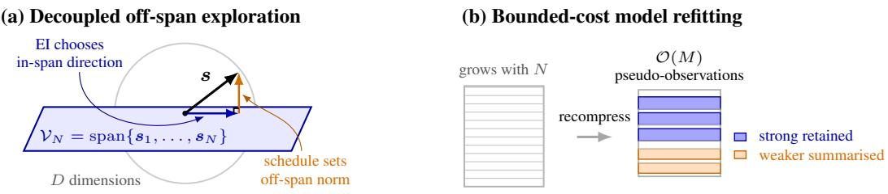  
Figure 1: Overview of SABLE. (a) Each query is decomposed into an in-span component and an orthogonal off-span component. EI chooses the in-span direction, while the exploration schedule prescribes the off-span norm. Because the design span $\gamma _ { N }$ has dimension at most N, EI optimisation requires at most N coordinates, independently of D. (b) As observations accumulate, their representation is recompressed to $\mathcal { O } ( M )$ pseudo-observations. Strong information is retained and weaker information is summarised, making model-refitting cost independent of N for fixed M.

Our contributions are:

• Decoupled off-span exploration. We decompose each query into in-span and off-span components, showing EI optimisation can be expressed in N dimensions, independently of D. We show that the off-span norm implicitly selected by EI can lead to underexploration, so SABLE prescribes it using a finite-horizon schedule, significantly improving sample efficiency.

• Bounded-cost model refitting. Using fast recompression, we reduce accumulated observations to $\mathcal { O } ( M )$ pseudo-observations, making posterior-fitting storage and per-round model-refitting cost depend on M rather than N, while preserving the full domain of admissible future queries.

## 2 PROBLEM SETUP AND AFFINE WORKING MODEL

We now formalise the latent optimisation problem and the Bayesian working model used throughout.

Optimisation problem. Let $g : \mathbb { R } ^ { D }  \mathcal { X }$ be a pretrained generative model and $f : \mathcal { X } \to \mathbb { R }$ an expensive black-box objective, so that the latent objective is $f ( g ( z ) )$ ). We assume the generative model was trained with an isotropic Gaussian latent prior $\mathbf { \sigma } \cdot \mathbf { \boldsymbol { z } } \sim \mathcal { N } ( \mathbf { 0 } , I _ { D } )$ . Under this prior, $\| z \| / \sqrt { D }  1$ in probability as $D  \infty$ (Cover & Thomas, 2006; Vershynin, 2026; Nalisnick et al., 2019), so Gaussian latents concentrate at the characteristic radius ${ \sqrt { D } } .$ . This thin-shell geometry is also practically relevant: atypical latent norms can degrade decoded samples (Samuel et al., 2023), while recent LSBO work finds that restricting search to the characteristic-radius sphere keeps queries in decoder-supported regions without materially reducing generative range (Bodin et al., 2025; Willis et al., 2025; Moss et al., 2025; Fan et al., 2026). We therefore re-cast the optimisation problem as one over the unit sphere $\mathbb { S } ^ { D - 1 } : = \{ \pmb { s } \in \mathbb { R } ^ { D } : \| \pmb { s } \| = 1 \}$ and define the objective as

$$
F ( \pmb { \mathscr { s } } ) : = f ( g ( \sqrt { D } \pmb { \mathscr { s } } ) ) , \qquad \pmb { \mathscr { s } } ^ { \star } \in \underset { \pmb { \mathscr { s } } \in \mathbb { S } ^ { D - 1 } } { \arg \operatorname* { m a x } } F ( \pmb { \mathscr { s } } ) .
$$

After N evaluations, write $\mathcal { D } _ { N } ~ = ~ \{ ( s _ { i } , y _ { i } ) \} _ { i = 1 } ^ { N }$ , where $y _ { i } \ = \ F ( \pmb { \mathscr { s } } _ { i } ) , X _ { N } \ = \ ( \pmb { \mathscr { s } } _ { 1 } , \ldots , \pmb { \mathscr { s } } _ { N } ) ^ { \top } \ \in$ $\mathbb { R } ^ { N \times D }$ , and $\pmb { y } _ { N } = ( y _ { 1 } , \dots , y _ { N } ) ^ { \top }$ . Throughout, the evaluation budget $N _ { \mathrm { m a x } }$ is specified in advance.

Affine working model. The degree-zero and degree-one spherical-harmonic components of $F$ give $F ( \pmb { s } ) = \beta _ { 0 } \overset {  } { + } \pmb { v } _ { \star } ^ { \top } \pmb { s } + \Delta ( \pmb { s } )$ , where $\Delta$ collects higher-order structure (Appendix A.1). Restricting optimisation to the sphere also removes radial variation in the input norm, avoiding the boundaryseeking behaviour of linear BO on conventional high-dimensional domains (Doumont et al., 2026). We use the affine component as a working model, providing posterior predictions and acquisitions for BO without assuming that $F$ is globally affine, and treat $\bar { \Delta }$ as surrogate discrepancy:

$$
G ( \pmb { \mathscr { s } } ) = \beta + \pmb { \mathscr { v } } ^ { \top } \pmb { \mathscr { s } } , \qquad \pmb { \mathscr { v } } \mid \sigma _ { 1 } ^ { 2 } \sim \mathcal { N } ( \mathbf { 0 } , \sigma _ { 1 } ^ { 2 } I _ { D } ) , \qquad p ( \beta ) \propto 1 ,
$$

with likelihood ${ \pmb y } _ { N } \mid \beta , { \pmb v } , \sigma _ { \varepsilon } ^ { 2 } \sim \mathcal { N } ( \beta { \pmb 1 } _ { N } + X _ { N } { \pmb v } , \sigma _ { \varepsilon } ^ { 2 } I _ { N } )$ . For deterministic objectives, $\sigma _ { \varepsilon } ^ { 2 }$ represents this discrepancy, and independent Gaussian observation noise adds variance to it, with more general noise models in Appendix B.2. Because the signal and discrepancy scales can be weakly identified in the $N \ll D$ regime and materially affect predictive uncertainty, we marginalise over $\displaystyle \dot { { \pmb \theta } } = ( \sigma _ { 1 } ^ { 2 } , \sigma _ { \varepsilon } ^ { 2 } )$ approximating posterior expectations using K stratified samples from $p ( { \pmb \theta } \mid { \mathcal { D } } _ { N } ) ( { \bf A }$ ppendix A.4).

## 3 SABLE: FINITE-DATA GEOMETRY AND CONTROLLED EXPLORATION

SABLE exploits a property of the affine working model: N observations change the slope posterior in at most $\mathbf { \hat { N } } - 1$ directions, independently of D (Section 3.1). For acquisition, we use expected improvement (EI) (Jones et al., 1998). Evaluated designs span at most N dimensions, yielding an inspan/off-span decomposition with predictively equivalent off-span directions. SABLE lets EI choose the in-span direction, while a finite-horizon schedule $t _ { N } ,$ , set by a reference-resolution parameter $\lambda _ { \mathrm { r e f } }$ chosen for the local-resolvability regime (Appendix D.5), prescribes the off-span norm. This curbs affine EI’s tendency to underexplore new directions on non-affine objectives (Section 3.2).

The fitting representation still grows with N, so we use a fast recompression scheme that reduces information to $\mathcal { O } ( M )$ pseudo-observations. At fixed M, posterior-fitting storage and per-round model-refitting cost are independent of $N ;$ see Section 3.3. Algorithm 1 summarises the procedure.

## 3.1 FINITE-DATA POSTERIOR GEOMETRY

After marginalising the intercept, N observations modify the posterior in at most $N - 1$ directions. Proposition 3.1 (Posterior geometry, proof in Appendix B.1). Let $\begin{array} { r } { \pmb { \mu _ { N } } : = N ^ { - 1 } \sum _ { i = 1 } ^ { N } \pmb { s _ { i } } } \end{array}$ and

$$
\begin{array} { r } { S _ { N } : = \mathrm { s p a n } \{ \pmb { s } _ { i } - \pmb { \mu } _ { N } : i = 1 , \dots , N \} . } \end{array}
$$

Let $P _ { N }$ be the orthogonal projector onto $\mathcal { S } _ { N }$ . Then, conditionally on $\pmb { \theta } = ( \sigma _ { 1 } ^ { 2 } , \sigma _ { \varepsilon } ^ { 2 } )$ , the posterior mean ${ \pmb m } _ { N } ( { \pmb \theta } )$ is in $\bar { \mathcal { S } } _ { N }$ and its covariance $\Sigma _ { N } ( \pmb { \theta } )$ satisfies

$$
\begin{array} { r } { \Sigma _ { N } ( \pmb { \theta } ) = \sigma _ { 1 } ^ { 2 } ( I _ { D } - P _ { N } ) + P _ { N } \Sigma _ { N } P _ { N } . } \end{array}
$$

```latex
Algorithm 1 Overview of SABLE
Require: Evaluation budget $N _ { \mathrm { m a x } } .$ compression budget M, reference-resolution regime
1: Select $\lambda _ { \mathrm { r e f } }$ for the chosen regime and precompute $\{ t _ { N } \} _ { N = 0 } ^ { N _ { \mathrm { m a x } } - 1 }$
2: Set $N = 1$ , choose $\scriptstyle { \pmb { s } } _ { 1 }$ from the orthogonal sequence, evaluate, and add the observation.
3: while $N < N _ { \operatorname* { m a x } }$ do
4: Fit the Bayesian affine model using the current observation representation.
5: Choose a query with EI in the data-sized acquisition representation at off-span norm $t _ { N } .$
6: Use the next unused orthogonal off-span direction e and reconstruct the query in $\mathbb { S } ^ { D - \bar { 1 } }$
7: Evaluate the objective and increment $N$
8: if the recompression criterion is met then
9: Recompress to $\mathcal { O } ( M )$ pseudo-observations and update the sufficient statistics.
10: end if
11: end while
12: Return the best evaluated candidate.
```

Hence the observations modify the slope posterior only within $\mathcal { S } _ { N }$ which has dimension at most $N - 1 ;$ on $\mathcal { S } _ { N } ^ { \perp }$ the posterior retains zero mean and prior variance $\sigma _ { 1 } ^ { 2 }$ in every unit direction.

Thus, on $\mathcal { S } _ { N } ^ { \perp }$ , all orientations remain exchangeable. We exploit this rotational symmetry to construct an acquisition representation without restricting queries to the informed subspace. Appendix B.3 formalises the rotational invariance, and Appendix B.4 quantifies the strength of informed updates.

## 3.2 DECOUPLED OFF-SPAN EXPLORATION

## 3.2.1 REDUCED ACQUISITION GEOMETRY

The data-informed subspace $\mathcal { S } _ { N }$ describes which slope directions the observations can update. Acquisition optimisation is more naturally expressed relative to the design span $\begin{array} { r l } { \mathcal { V } _ { N } } & { { } : = } \end{array}$ span $\{ \pmb { s } _ { 1 } , \dotsc , \pmb { s } _ { N } \}$ , whose dimension satisfies $d _ { N } \ \leq \ N$ . Let $V ~ \in ~ \mathbb { R } ^ { D \times d _ { N } }$ have orthonormal columns spanning $\gamma _ { N }$ . Every query $\pmb { s } \in \mathbb { S } ^ { D - 1 }$ can then be decomposed as

$$
s = V \pmb { w } + t \pmb { e } , \qquad \pmb { e } \in \gamma _ { N } ^ { \bot } , \quad \| \pmb { e } \| = 1 , \qquad \| \pmb { w } \| ^ { 2 } + t ^ { 2 } = 1 ,\tag{1}
$$

where $\mathbf { \Delta } w = V ^ { \top } \mathbf { \Sigma }$ s gives the in-span coordinates, $t = \sqrt { 1 - \| w \| ^ { 2 } }$ the off-span norm, and e the off-span orientation. The slope posterior is rotationally invariant on $\mathcal { V } _ { N } ^ { \perp } \mathrm { ( A p p e n d i x { B } } . 3 )$ , so rotating e within this complement does not change the predictive distribution. Hence, prediction depends on the off-span component only through t, and e need not be optimised. Acquisition optimisation can therefore run over $\pmb { w } \in \mathbb { R } ^ { \tilde { d } _ { N } }$ instead of the full D-dimensional sphere (reduced representation in Appendix C.1). This reduces acquisition dimension without restricting the search domain.

## 3.2.2 EI WITH PRESCRIBED EXPLORATION

Marginal EI and reduced coordinates. Recent work (Fan et al., 2026) exploits the symmetry of linear surrogates on spherical domains to obtain fast EI optimisation using point estimates of the hyperparameters. We extend this to hyperparameter-marginalised EI and express it in reduced designspan coordinates. Appendix C.1 shows that, for each hyperparameter atom $\theta _ { k } , m _ { k } ( s )$ and $s _ { k } ^ { 2 } ( s )$ can be seen as functions of the design-span coordinates w only: $m _ { k } ( s ) = \tilde { m } _ { k } ( w )$ and $s _ { k } ^ { 2 } ( s ) = \widetilde { s } _ { k } ^ { 2 } ( w )$

For K equal-weight stratified atoms, define $\begin{array} { r } { \bar { m } _ { N } ( { \pmb w } ) : = K ^ { - 1 } \sum _ { k = 1 } ^ { K } \tilde { m } _ { k } ( { \pmb w } ) , { \pmb w } _ { i } : = V ^ { \top } { \pmb s } _ { i } , \tau _ { N } : = } \end{array}$ max $1 \leq i \leq N  \bar { m } _ { N } ( { \pmb w } _ { i } )$ , and $\gamma _ { k } ( \pmb { w } ) : = \tilde { m } _ { k } ( \pmb { w } ) - \tau _ { N }$ . With Φ and ϕ the standard normal CDF and density, respectively, the hyperparameter-marginalised EI can be written as

$$
\overline { { \mathrm { E I } } } _ { N } ( s ) = \frac { 1 } { K } \sum _ { k = 1 } ^ { K } \left[ \gamma _ { k } ( w ) \Phi \left( \frac { \gamma _ { k } ( w ) } { \widetilde { s } _ { k } ( w ) } \right) + \widetilde { s } _ { k } ( w ) \phi \left( \frac { \gamma _ { k } ( w ) } { \widetilde { s } _ { k } ( w ) } \right) \right] = : \widetilde { \mathrm { E I } } _ { N } ( w ) .\tag{2}
$$

In-span/off-span decomposition. As $\widetilde { \mathrm { E I } _ { N } }$ omits t and e, EI is maximised in $d _ { N } \leq N$ coordinates:

$$
\operatorname* { m a x } _ { \pmb { s } \in \mathbb { S } ^ { D - 1 } } \overline { { \mathrm { E I } } } _ { N } ( \pmb { s } ) = \operatorname* { m a x } _ { \| \pmb { w } \| \leq 1 } \widetilde { \mathrm { E I } } _ { N } ( \pmb { w } ) .
$$

Given a maximiser $\pmb { w } _ { N } ^ { \widetilde { \mathrm { E I } } }$ of the right-hand-side and any unit direction $e \in \mathcal { V } _ { N } ^ { \bot }$ orthogonal to the in-span, a maximiser of $\overline { { \mathrm { E I } } } _ { N }$ can be reconstructed as

$$
\begin{array} { r } { \pmb { s } _ { N + 1 } = V \pmb { \tilde { w } } _ { N } ^ { \widetilde { \mathrm { E I } } } + t e \qquad \mathrm { w h e r e } \qquad t = \sqrt { 1 - \| \pmb { w } _ { N } ^ { \widetilde { \mathrm { E I } } } \| ^ { 2 } } . } \end{array}
$$

Prescribed off-span exploration. SABLE instead separates these decisions by prescribing $t _ { N }$ and letting EI choose only the in-span direction, equivalently restricting acquisition optimisation to

$$
\pmb { w } _ { N } ^ { \star } \in \mathrm { \mathop { ~ \ a r g m a x ~ } _ { N } ~ } \widetilde { \mathrm { E I } } _ { N } ( \pmb { w } ) .
$$

The acquisition function is unchanged, and the query is reconstructed as above using $\pmb { w } _ { N } ^ { \star }$ and $t _ { N }$ For e, we take successive directions from a randomised orthogonal frame using the type-II discrete cosine transform (DCT-II), which lie off-span by construction. This avoids favouring particular latent orientations while remaining efficient at large $D ;$ see Appendix F.

We separate these decisions because conditioning reduces uncertainty along data-informed directions, whereas directions in $\mathcal { V } _ { N } ^ { \perp }$ retain their prior variance. Within hyperparameter atom k, the resulting uncertainty contrast depends on the fitted ratio $\lambda _ { k } : = \sigma _ { 1 , k } ^ { 2 } / \sigma _ { \varepsilon , k } ^ { 2 }$ . Hence the norm selected by EI over the reduced unit ball, and therefore its implied off-span allocation, can depend strongly on the fitted variance scales. Because higher-order objective variation contributes to $\stackrel { \cdot } { \sigma } _ { \varepsilon , k } ^ { 2 }$ as surrogate discrepancy, the fitted ratios $\lambda _ { k }$ need not provide a reliable basis for controlling exploration; see Appendix B.4 for the corresponding variance analysis and Appendix C for optimisation details.

Finite-horizon reference schedule. We prescribe $t _ { N }$ using a finite-horizon value-of-informationbased proxy: allocating norm off-span sacrifices some immediate exploitation of learned directions, but can reveal a new slope component that later evaluations can exploit. The trade-off is controlled by a reference resolution parameter $\lambda _ { \mathrm { r e f } } .$ chosen independently of the fitted variance scales; larger $\lambda _ { \mathrm { r e f } }$ assumes that smaller off-span perturbations provide useful directional information.

Let $h _ { N } : = N _ { \mathrm { m a x } } - N - 1$ be the number of evaluations remaining after the current query, and $R _ { N }$ the cumulative resolved variance from previous off-span queries, with $R _ { 0 } = 0$ . Treating successive off-span queries as resolving orthogonal slope components, their contributions add, and $R _ { N }$ is the expected squared norm of the corresponding posterior mean, so $\sqrt { R _ { N } }$ is a root-mean-square proxy for the exploitable slope magnitude. We parameterise the informativeness of a candidate off-span norm $t \in \left[ 0 , 1 \right]$ by $\lambda _ { \mathrm { r e f } } ^ { } t ^ { 2 } \mathrm { . }$ ; a scalar Gaussian update with unit prior variance then resolves variance $\delta _ { \lambda _ { \mathrm { r e f } } } ( t ) : = \lambda _ { \mathrm { r e f } } t ^ { 2 } / ( 1 + \lambda _ { \mathrm { r e f } } t ^ { 2 } )$ . The remaining in-span norm is $\sqrt { 1 - t ^ { 2 } }$ , so increasing t trades current exploitation against directional information that can be used over the remaining $h _ { N }$ evaluations. We therefore prescribe

$$
t _ { N } : = \underset { t \in [ 0 , 1 ] } { \arg \operatorname* { m a x } } \left\{ \sqrt { 1 - t ^ { 2 } } \sqrt { R _ { N } } + h _ { N } \sqrt { R _ { N } + \delta _ { \lambda _ { \mathrm { r e f } } } ( t ) } \right\} , \qquad R _ { N + 1 } = R _ { N } + \delta _ { \lambda _ { \mathrm { r e f } } } ( t _ { N } ) .\tag{3}
$$

The first term represents exploitation by the current query, while the second represents the value of the enlarged learned slope over the remaining evaluation horizon.

The recursion depends only on $( N _ { \mathrm { m a x } } , \lambda _ { \mathrm { r e f } } )$ and can be precomputed. It starts with $t _ { 0 } = 1$ , decreases monotonically over the evaluation horizon, and reaches $t _ { N _ { \mathrm { m a x } } - 1 } = 0 ;$ ; it then remains zero. Thus the finite horizon anneals off-span exploration. Appendix D gives the derivation, stopping criterion, and further properties. In practice, we use a fixed large $\lambda _ { \mathrm { { r e f } } }$ for all smooth objectives, where small perturbations remain informative, and a smaller $\lambda _ { \mathrm { r e f } }$ for noisy or quantised objectives, where fine perturbations may be obscured or produce no change. The local-resolvability analysis in Appendix D.5 motivates this distinction and our experimental values. Once fine perturbations are well resolved, the large value of $\lambda _ { \mathrm { r e f } }$ is of secondary importance: the off-span norm depends only weakly on it.

## 3.3 BOUNDED-COST MODEL REFITTING

Although posterior updating and acquisition optimisation are data-sized, the fitting representation grows with N, making posterior and hyperparameter refitting computationally costly. We control this growth by recompressing accumulated observations to $\mathcal { O } ( \bar { M } )$ pseudo-observations.

Compression is performed in observation space: since the affine likelihood has conditional mean $\beta { \bf 1 } _ { N } + X _ { N } { \pmb v }$ , the design matrix, response vector, and intercept column are compressed together,

$$
( X _ { N } , { \pmb y } _ { N } , { \bf 1 } _ { N } ) \longrightarrow ( { \check { X } } , { \check { \pmb y } } , { \check { \pmb o } } ) .
$$

Recompression exactly preserves the centred slope–response and intercept cross-statistics, while discarded spectral information is summarised by pseudo-observations. The resulting representation has size $\mathcal O ( M )$ independently of N and can be reused across variance-hyperparameter values. A log-determinant correction accounts for discarded spectral information in approximate marginallikelihood evaluation; Appendix E gives details.

The spectral analysis of Appendix E.1 motivates retaining directions with stronger data support: these produce the largest posterior updates and have the greatest effect on EI, while discarding weak updates perturbs the acquisition only slightly. Appendix E.4 gives stability bounds for the conditional posterior and EI approximation under repeated recompression. The analysis extends to marginal EI when exact and compressed calculations share hyperparameter weights; changes caused by approximate evidence evaluation are not covered. With compression budget M, the posteriorfitting representation is bounded in M, rather than growing with N.

## 3.4 COMPUTATIONAL SCALING

The exploration schedule presented in Section 3.2.2 increases sample efficiency, i.e. it reduces the number of objective evaluations needed to reach a given value, which we demonstrate in Section 4. With respect to computational efficiency (algorithmic overhead), with the fast posterior compression presented in Section 3.3, SABLE addresses a key bottleneck beyond fast acquisitions in Fan et al. (2026); the cubic growth of model-refitting cost with the number of evaluations N.

Without compression, the posterior-fitting state requires $\mathcal { O } ( N D )$ storage and, for a fixed hyperparameter grid, per-round refitting costs $\mathcal { O } ( \mathbf { \bar { \mathit { N } } { } ^ { 2 } } D + \mathbf { \bar { \mathit { N } } { } ^ { 3 } } )$ . With compression budget M, these become $\mathcal { O } ( M D )$ and $\mathcal { O } ( M ^ { 2 } D + M ^ { 3 } )$ , respectively. Thus, for fixed compression budget M, posterior-fitting storage and refitting cost are independent of N once recompression is active. For $D \gg M$ , compressed refitting is dominated by $\dot { \mathcal { O } } ( M ^ { 2 } D )$ , compared with $\mathcal { O } ( N ^ { 2 } D )$ without compression. Exact historical posterior-mean readouts defining the EI incumbent require $\dot { \mathcal { O } } ( N M )$ auxiliary storage; see Appendix E.5.

## 4 EXPERIMENTS

We evaluate SABLE from its individual components to the complete method: state compression, prescribed off-span exploration, and scientific latent-space optimisation. Unless otherwise stated, SABLE marginalises the variance scales, uses $M = 3 0 0 , \lambda _ { \mathrm { r e f } } = 1 0 ^ { 5 }$ , and optimises on the ${ \sqrt { D } } .$ rescaled unit sphere. The primary optimisation metric is the best observed value; curves show means with 5th–95th percentiles. Experimental settings and additional results are given in Appendices H, I.

State compression. On ZonalFunctionBench (Appendix G.1) at $D = 1 0 \small { , } 0 0 0$ , we vary only the compression budget M across an affine control and three objectives with mild, moderate, and severe non-affine structure, using ten repeats. ZonalFunctionBench provides random spherical objectives with controlled higher-order structure and no preferred coordinate system. All variants use marginalisation and the prescribed off-span schedule. Figure 2 shows that at $N = 5 { , } 0 0 0$ , the largest shared budget, the $M \ \bar { \in } \ \{ 1 0 0 , 3 0 0 , 5 0 0 \}$ variants differ from one another by at most 0.003 in best-so-far value. Relative to the uncapped representation, their mean gaps are 0.003, 0.047, 0.035, and 0.022 from the affine through severe cases, with no systematic growth over $N \in [ 1 0 0 0 , 5 0 0 0 ]$ . By contrast, $M = 1 0$ is too aggressive, trailing the uncapped representation by $0 . 3 0 { - } \dot { 0 } . 3 2 $ on the non-affine objectives. The compressed variants continue to $\dot { N } = \dot { D } = 1 0 \mathrm { , 0 0 0 }$ , providing a long-horizon stress test beyond the target regime $N \ll D$ . These results support the compression approach of Section 3.3: retaining strongly data-informed directions preserves optimisation performance.

Separating exploration from model fit. On the same four controlled objectives at $N = D =$ 1000, we cross three variance-scale treatments (MLE, MAP, and marginalisation) with three exploration rules: standard EI (no-schedule), a naive schedule using the fitted signal-to-discrepancy ratio, and the SABLE schedule with $\lambda _ { \mathrm { r e f } } = 1 0 ^ { 5 }$ , as prescribed for these smooth, noise-free objectives by Appendix D.5. To isolate exploration effects, all runs use the uncapped representation without compression. The no-schedule MAP configuration recovers the method of Fan et al. (2026). Table 1 reports optimisation performance and recovery of the degree-one component, measured by cos(sˆ, v<sub>⋆</sub>), which diagnoses whether the search recovers the global affine direction.

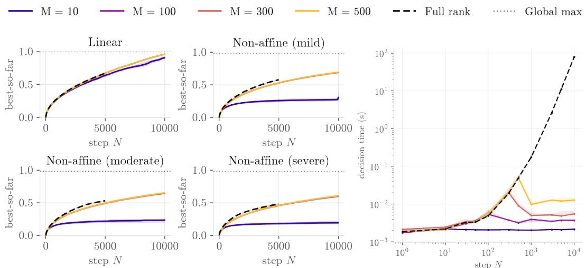  
Figure 2: Effect of state compression. Left: best observed value for compression budgets $M \in$ {10, 100, 300, 500} at $D = 1 0 \small { , } 0 0 0$ , compared with the uncapped representation (dashed) and the mean global maximum of the ten objective draws. Lines show means over ten runs (and objective draws) and bands show 5th–95th percentiles. Right: measured wall-clock time per decision.

Table 1: Model fitting and off-span exploration at $N = D = 1 0 0 0$ with the uncapped representation. Left: recovery of the known degree-one component, $\cos ( \hat { \pmb { s } } , \pmb { v } _ { \star } )$ . $R i g h t \cdot$ attained value: maximum of the best observed point and the posterior-mean recommendation. Entries are means over ten seeds. Bold: the column best and every entry within two standard deviations.
<table><tr><td rowspan="2" colspan="2"></td><td colspan="4">cos(s, v*)</td><td colspan="4">attained value</td></tr><tr><td>affine</td><td>mild</td><td>mod.</td><td>severe</td><td>affine</td><td>mild</td><td>mod.</td><td>severe</td></tr><tr><td rowspan="3">Standard EI (no schedule)</td><td>MLE</td><td>1.00</td><td>-0.00</td><td>-0.01</td><td>-0.01</td><td>1.00</td><td>0.48</td><td>0.32</td><td>0.16</td></tr><tr><td>MAP</td><td>0.78</td><td>0.44</td><td>0.30</td><td>0.16</td><td>0.78</td><td>0.60</td><td>0.54</td><td>0.50</td></tr><tr><td>Marg.</td><td>0.77</td><td>0.44</td><td>0.29</td><td>0.19</td><td>0.77</td><td>0.59</td><td>0.54</td><td>0.49</td></tr><tr><td rowspan="3">naive model-derived schedule:  $\lambda _ { k } = \sigma _ { 1 , k \left/ \sigma _ { \varepsilon , k } ^ { 2 } \right. } ^ { 2 }$ </td><td>MLE</td><td>0.13</td><td>0.00</td><td>0.00</td><td>0.01</td><td>0.49</td><td>0.49</td><td>0.36</td><td>0.23</td></tr><tr><td>MAP</td><td>0.98</td><td>0.59</td><td>0.41</td><td>0.23</td><td>0.98</td><td>0.67</td><td>0.55</td><td>0.45</td></tr><tr><td>Marg.</td><td>0.98</td><td>0.59</td><td>0.42</td><td>0.25</td><td>0.98</td><td>0.66</td><td>0.56</td><td>0.45</td></tr><tr><td rowspan="3">SABLE schedule:  $\lambda _ { \mathrm { r e f } } = 1 0 ^ { 5 }$ </td><td>MLE</td><td>0.90</td><td>-0.00</td><td>0.01</td><td>0.00</td><td>1.00</td><td>0.55</td><td>0.37</td><td>0.24</td></tr><tr><td>MAP</td><td>0.99</td><td>0.56</td><td>0.38</td><td>0.21</td><td>0.99</td><td>0.75</td><td>0.68</td><td>0.63</td></tr><tr><td>Marg.</td><td>0.99</td><td>0.57</td><td>0.38</td><td>0.23</td><td>0.99</td><td>0.74</td><td>0.67</td><td>0.63</td></tr></table>

With M $\scriptstyle { \mathrm { . E , } }$ the affine model overfits the non-affine structure, as evidenced by a discrepancy scale near zero, and EI assigns most query norm to fresh directions; the inferred slope then recovers essentially none of the degree-one component, with cos(sˆ, v<sub>⋆</sub>) near zero. MAP and marginalisation recover this component better, but produce the opposite allocation. EI assigns almost no norm offspan and the search becomes confined to the span established early. Driving the schedule by the fitted variance ratio does not resolve this coupling: although it improves degree-one recovery, its attained values remain below the SABLE schedule on the non-affine objectives. This is consistent with the affine model overfitting the observations, making the fitted ratio an unreliable control for off-span exploration. Appendix I.3 shows diagnostics, including off-span norm t for each method.

SABLE prescribes the off-span schedule independently of model fit, without changing the posterior or within-span EI criterion. With MAP or marginalisation, this improves degree-one recovery and optimisation performance across the non-affine ladder. It cannot, however, compensate for a poor surrogate fit: under MLE, the degree-one component remains unrecovered away from the affine control. The experiment isolates two requirements: a useful posterior fit and an off-span allocation not determined by the fitted discrepancy scale. Appendix I.3 reports $\mathrm { f i x e d - } \lambda _ { \mathrm { r e f } }$ ablations and the noisy-observation counterpart, while Appendix D.5 discusses the problem-regime choice of $\lambda _ { \mathrm { { r e f } } }$

Controlled long-horizon evaluation. Figure 3 evaluates SABLE at $D = N = 1 0 \small { , } 0 0 0$ , beyond the target regime $\bar { N } \ll D$ , using $M = 3 0 0$ , marginalised variance scales, and the prescribed schedule. We compare against the no-schedule ablation, Thompson sampling using the same compressed posterior, random and orthogonal design-then-fit baselines, and sep-CMA-ES (Ros & Hansen, 2008). The curves report best observed value, while endpoint markers report attained value, additionally accounting for the posterior-mean recommendation where available. SABLE attains the highest endpoint value on all three non-affine objectives. See Appendix I.4 for fixed- $\cdot \lambda _ { \mathrm { r e f } }$ ablations.

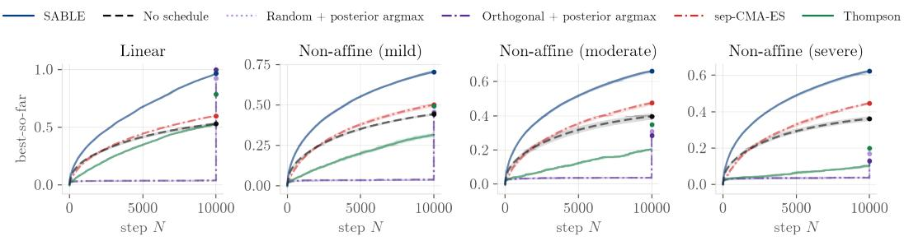  
Figure 3: Controlled long-horizon evaluation, $D = N = 1 0 { , } 0 0 0 .$ . Lines show mean best observed value over ten runs, with 5th–95th percentile bands. Markers at $N = 1 0 { , } 0 0 0$ show attained value, the better of the best observed point and the posterior-mean recommendation.

Scientific latent-space optimisation. We evaluate SABLE on four latent-space optimisation prob lems from pretrained scientific generative models, with $D$ from 6,000 to 40,000 (Appendix G.2): Lagrangian turbulence, antimicrobial peptides, and CaloDiffusion calorimeter showers at two detector resolutions. SABLE uses $M = 3 0 0$ , marginalised variance scales, and the prescribed exploration schedule. For the non-smooth peptide objective, we use $\lambda _ { \mathrm { r e f } } = 1 0$ (Appendix H.1). Each method gets 3,000 evaluations per run over ten runs. Figure 4 compares SABLE with model-free search, CMA-ES variants, GP-based BO methods, and no-schedule ablations on wall-time; Appendix I.6 shows the same runs against evaluation count. SABLE attains the highest mean best observed value on every problem except Peptides, where sep-CMA-ES leads. On Calorimeter DS3 $( D = 4 0 { , } 5 0 0 )$ , SABLE reaches 0.66 compared with 0.55 for sep-CMA-ES. Finally, at a 6.25-fold increase in D, the schedule’s gain over the no-schedule ablation grows from 0.03 on DS2 to 0.27 on DS3.

To make the comparison conservative, we give baselines access to the same typical-radius spherical domain as SABLE. This constraint favours the baselines rather than handicapping them: unconstrained optimisers can vary the latent norm and propose atypical points, which can severely degrade generation quality (see Section 2). The ambient-space CMA-ES ablation quantifies this effect, showing that removing the spherical constraint substantially worsens optimisation performance.

The comparison includes random and orthogonal search, separable and full-covariance CMA-ES, Vanilla BO (Hvarfner et al., 2024), Linear BO (Doumont et al., 2026), TuRBO (Eriksson et al., 2019), MSR (Papenmeier et al., 2025), BAxUS (Papenmeier et al., 2022), O3 using CMA-ES as optimiser (Willis et al., 2025), the method of Fan et al. (2026) without our posterior compression or schedule, and our compressed posterior, no-schedule ablation. Vanilla BO, Linear BO, MSR, and BAxUS do not reach the budget within 48 hours and are reported at the evaluations completed by then. GP baselines other than BAxUS are omitted on Calorimeter DS3, and full-covariance CMA-ES on Peptides and DS3, where costs are prohibitive. Full configurations are given in Appendix I.7.

Scalability. Computational differences become substantial at large budgets. Figure 2 isolates bounded-state compression: at $N = D = 1 0 \small { , } 0 0 0$ , the $M = 3 0 0$ variant requires 5.5 ms per decision, compared with 79.5 s for the uncapped representation used in Fan et al. (2026). On scientific tasks, Figure 4 reports 0.027 s per decision for SABLE on the $D = 6 { , } 4 8 0$ calorimeter problem, small relative to its 1.1 s objective evaluation time, whereas Vanilla BO, Linear BO, MSR, and BAxUS require 430–900 s per decision at the largest N they reach within 48 h $( N = 3 0 3  – 1 , 1 3 2 )$ . We note that compression has no cost to sample efficiency on these problems. Our no-schedule ablation matches or exceeds Fan et al. (2026) on every task while deciding about 90 times faster (0.027 s against 2.5 s). SABLE’s wall-clock trajectories closely follow evaluation-count performance.

Calorimeter DS3 (D = 40,500)  
Turbulence (D = 6,000)
<table><tr><td>evaluation time (s)</td><td></td><td>Turbulence  $D = 6 { , } 0 0 0$  4.6</td><td>Calorimeter DS2  $D = 6 { , } 4 8 0$  1.1</td><td>Peptides  $D = 1 3 , 4 4 0$  0.49</td><td>Calorimeter DS3  $D = 4 0 { , } 5 0 0$  8.2</td><td>decision time (s)  $\mathrm { a t } N = 3 { , } 0 0 0 ,$   $D = 6 { , } 4 8 0$ </td></tr><tr><td rowspan="10">Mo-fe</td><td>Random search</td><td>0.89 [0.88, 0.90]</td><td>0.43 [0.40, 0.45]</td><td> $1 . 0 1 [ 0 . 8 6 , 1 . 1 1 ]$ </td><td> $0 . 2 1 \ [ 0 . 1 9 , 0 . 2 2 ]$ </td><td>&lt;0.01</td></tr><tr><td>Orthogonal design</td><td>0.89 [0.88, 0.91]</td><td>0.42 [0.39, 0.46]</td><td>0.95 [0.87, 1.03]</td><td> $0 . 2 2 \ \overset { \cdot } { [ } 0 . 2 1 , 0 . 2 4 \overset { \cdot } { ] }$ </td><td>&lt;0.01</td></tr><tr><td> $\mathbf { s e p { \mathrm { - } } C M A { \mathrm { - } } E S } \ ( \mathbf { s p h e r e } )$ </td><td>0.92 [0.91, 0.93]</td><td>0.76 [0.74, 0.78]</td><td> $1 . 2 5 [ 1 . 2 0 , 1 . 2 7 ]$ </td><td> $0 . 5 5 [ 0 . 5 3 , 0 . 5 7 ]$ </td><td>&lt;0.01</td></tr><tr><td> ${ \mathrm { s e p } } { \mathrm { - C M A } } { \mathrm { - E S } } ( \mathbb { R } ^ { D } )$ </td><td>0.84 [0.82, 0.86]</td><td>0.55 [0.53, 0.58]</td><td> $1 . 2 5 [ 1 . 2 2 , 1 . 2 8 ]$ </td><td> $0 . 2 8 [ 0 . 2 7 , 0 . 3 1 ]$ </td><td>&lt;0.01</td></tr><tr><td> $\mathrm { { C } \dot { \mathbf { M } } A { - } E S \ ( s p h e r e ) }$ </td><td>0.92 [0.91, 0.93]</td><td>0.76 [0.75, 0.77]</td><td></td><td></td><td>3.0</td></tr><tr><td> $\mathbf { C M A - E S } \mathbf { \Gamma } ( \mathbf { \dot { \mathbb { R } } } ^ { D } )$ </td><td>0.84 [0.82, 0.86]</td><td>0.55 [0.53, 0.56]</td><td></td><td></td><td>3.0</td></tr><tr><td>CMA-ES (O3, K = 90)</td><td>0.94 [0.93, 0.95]</td><td>0.51 [0.46, 0.54]</td><td> $0 . 9 6 \ [ 0 . 7 6 , 1 . 1 8 ]$ </td><td> $0 . 3 4 [ 0 . 3 2 , 0 . 3 7 ]$ </td><td>&lt;0.01</td></tr><tr><td>CMA-ES (O3,  $K = 3 0 0 )$ </td><td>0.90 [0.89, 0.91]</td><td>0.49 [0.47, 0.50]</td><td>1.05 [0.85, 1.22]</td><td> $0 . 3 4 [ 0 . 3 2 , 0 . 3 5 ]$ </td><td>0.02</td></tr><tr><td>Vanilla BO</td><td>0.90† [0.89, 0.92]</td><td>0.58† [0.54, 0.60]</td><td>0.99† [0.76, 1.18]</td><td></td><td> $5 0 0 ^ { \dagger } ~ \mathrm { a t } ~ N = 5 4 6$ </td></tr><tr><td>MSR</td><td>0.89† [0.88, 0.91]</td><td>0.60† [0.54, 0.67]</td><td>0.95† [0.75, 1.12]</td><td></td><td> $9 0 0 ^ { \dagger } \ \mathrm { a t } \ N = 3 0 3$ </td></tr><tr><td rowspan="10">Linear BO GP TuRBO</td><td></td><td>0.89† [0.88, 0.90]</td><td>0.52† [0.48, 0.58]</td><td>1.13† [0.95, 1.23]</td><td></td><td> $7 3 0 ^ { \dagger } \mathrm { a t } N = 3 9 5$ </td></tr><tr><td></td><td></td><td></td><td></td><td></td><td></td></tr><tr><td>TuRBO (O3,  $K = 9 0 )$ </td><td>0.93 [0.91, 0.94]</td><td>0.83 [0.82, 0.84]</td><td>0.68 [0.57, 0.80]</td><td></td><td>7.8</td></tr><tr><td>TuRBO  $( \mathbf { O } 3 , K = 3 0 0 )$ </td><td>0.94 [0.93, 0.95]</td><td>0.54 [0.52, 0.55]</td><td>0.97 [0.81, 1.21]</td><td> $0 . 3 6 [ 0 . 3 5 , 0 . 3 7 ]$ </td><td>3.7</td></tr><tr><td>BAxUS</td><td>0.94 [0.92, 0.95] 0.92† [0.90, 0.94]</td><td>0.57 [0.55, 0.58]</td><td>0.95 [0.73, 1.14]  $0 . 7 5 ^ { \dag } \ [ 0 . 5 1 , 1 . 0 8 ]$ </td><td>0.40 [0.39, 0.41]</td><td>5.7</td></tr><tr><td>Fan et al. (2026)</td><td>0.90 [0.85, 0.94]</td><td>0.70† [0.65, 0.74] 0.83 [0.80, 0.85]</td><td>0.77 [0.60, 0.98]</td><td> $0 . 4 5 ^ { \dag } \ [ 0 . 4 3 , 0 . 4 8 ]$ </td><td> $4 3 0 ^ { \dagger } \mathrm { a t } N = 1 , 1 3 2$ </td></tr><tr><td></td><td></td><td></td><td></td><td> $0 . 3 9 [ 0 . 3 8 , 0 . 4 0 ]$ </td><td>2.5</td></tr><tr><td>Standard EI (no schedule)</td><td>0.92 [0.85, 0.94]</td><td>0.83 [0.81, 0.85]</td><td>0.81 [0.64, 1.12]</td><td>0.39 [0.39, 0.40]</td><td>0.027</td></tr><tr><td>SABLE</td><td>0.95 [0.94, 0.96]</td><td>0.86 [0.84, 0.87]</td><td>1.20 [1.15, 1.23]</td><td>0.66 [0.64, 0.68]</td><td>0.027</td></tr><tr><td></td><td></td><td></td><td></td><td></td><td></td></tr></table>

SABLE  Standard EI (no schedule)  Vanilla BO  MSR  Linear BO  Fan et al. (2026)  TuRBO  TuRBO (O3, K=90)  TuRBO (O3. K=300)  BAxUS … Random search  Orthogonal design  sep-CMA-ES (sphere) … sep-CMA-ES (RD) = CMA-ES (sphere) … CMA-ES (RD) · CMA-ES (O3, K=90) · CMA-ES (O3, K=300)

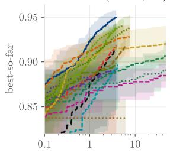

Calorimeter DS2 (D = 6,480)  
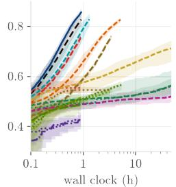

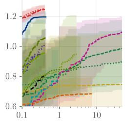

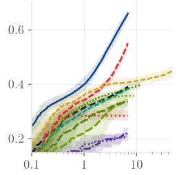  
Figure 4: Scientific latent-space optimisation. Table: best observed value, reported as mean and 5th–95th percentile range over ten seeds; bold: within two standard errors of the column best. <sup>†</sup>: truncated at 48 h, reaching $N = 3 0 3 \substack { - 1 , 1 3 2 }$ . Bottom: best observed value against wall-clock time.

Extending the budget without slowdown. Because SABLE’s per-round cost is independent of N once the compression budget M is reached, it can run at budgets well beyond those of the GP baselines. On Calorimeter $\mathrm { D S } 3 ~ ( D ~ = ~ 4 0 , 5 0 0 )$ we extend the budget to $N = 2 0 { , } 0 0 0$ and compare against sep-CMA-ES, the only competitive baseline at this scale. SABLE leads on all ten runs at every budget (Figure 5), and it matches sep-CMA-ES’s final value at approximately half the budget.

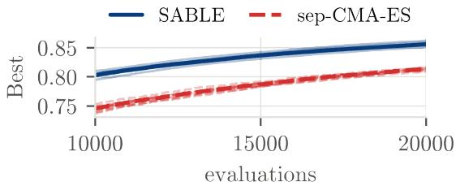  
Figure 5: High-budget DS3 optimisation. Best observed value against evaluations; thick lines are medians and thin lines the individual runs.

## 5 CONCLUSION

SABLE addresses latent optimisation when dimension exceeds the budget by combining data-sized acquisition, controlled off-span exploration, and bounded-cost pseudo-observation compression, without restricting queries to a learned subspace. Across synthetic and scientific tasks, it achieves sample efficiency up to $D = 4 0 { , } 5 0 0$ , with tens-of-milliseconds decisions on timing benchmarks.

The work assumes an isotropic latent distribution (e.g. $\mathcal { N } ( \mathbf { 0 } , I _ { D } ) )$ and that the affine working model captures a useful signal. Objectives dominated by higher-order or quantised structure, as in the Peptides benchmark, are a weaker regime. The off-span schedule is a finite-horizon value-ofinformation proxy rather than a Bayes-optimal policy, requiring $N _ { \mathrm { m a x } }$ in advance. Further evaluation regimes, batch acquisition, and higher-order working models are natural extensions.

## REFERENCES

Oz Amram and Kevin Pedro. Denoising diffusion models with geometry adaptation for high fidelity calorimeter simulation. Physical Review D, 108(7):072014, 2023.

Maximilian Balandat, Brian Karrer, Daniel Jiang, Samuel Daulton, Ben Letham, Andrew G Wilson, and Eytan Bakshy. Botorch: A framework for efficient monte-carlo bayesian optimization. Advances in neural information processing systems, 33:21524–21538, 2020.

Mickael Binois and Nathan Wycoff. A survey on high-dimensional gaussian process modeling with application to bayesian optimization. ACM Transactions on Evolutionary Learning and Optimization, 2(2):1–26, 2022.

Erik Bodin, Alexandru Stere, Dragos Margineantu, Carl Ek, and Henry Moss. Linear combinations of latents in generative models: subspaces and beyond. In International Conference on Learning Representations, volume 2025, pp. 8014–8043, 2025.

Tianlai Chen, Pranay Vure, Rishab Pulugurta, and Pranam Chatterjee. AMP-diffusion: Integrating latent diffusion with protein language models for antimicrobial peptide generation. In NeurIPS 2023 Generative AI and Biology (GenBio) Workshop, 2023.

Vijil Chenthamarakshan, Samuel C. Hoffman, C. David Owen, Petra Lukacik, Claire Strain-Damerell, Daren Fearon, Tika R. Malla, Anthony Tumber, Christopher J. Schofield, Helen M. E. Duyvesteyn, et al. Accelerating drug target inhibitor discovery with a deep generative foundation model. Science Advances, 9(25), 2023.

Thomas M. Cover and Joy A. Thomas. Elements of Information Theory. Wiley-Interscience, 2 edition, 2006. ISBN 9780471748816.

Payel Das, Tom Sercu, Kahini Wadhawan, Inkit Padhi, Sebastian Gehrmann, Flaviu Cipcigan, Vijil Chenthamarakshan, Hendrik Strobelt, Cicero Dos Santos, Pin-Yu Chen, et al. Accelerated antimicrobial discovery via deep generative models and molecular dynamics simulations. Nature Biomedical Engineering, 5(6):613–623, 2021.

Alexander Denker, Shreyas Padhy, Francisco Vargas, and Johannes Hertrich. Iterative importance fine-tuning of diffusion models. In Frontiers in Probabilistic Inference: Learning meets Sampling, 2025. URL https://openreview.net/forum?id=HLaFozI6It.

Colin Doumont, Donney Fan, Natalie Maus, Jacob R. Gardner, Henry Moss, and Geoff Pleiss. We still don’t understand high-dimensional bayesian optimization. In The 29th International Conference on Artificial Intelligence and Statistics, 2026.

David Eisenberg, Emil Schwarz, Matthew Komaromy, and Roger Wall. Analysis of membrane and surface protein sequences with the hydrophobic moment plot. Journal ofMolecular Biology, 179 (1):125–142, 1984.

David Eriksson and Martin Jankowiak. High-dimensional Bayesian optimization with sparse axisaligned subspaces. In Proceedings of the Thirty-Seventh Conference on Uncertainty in Artificial Intelligence, volume 161 of Proceedings of Machine Learning Research, pp. 493–503. PMLR, 27–30 Jul 2021.

David Eriksson, Michael Pearce, Jacob Gardner, Ryan D. Turner, and Matthias Poloczek. Scalable global optimization via local bayesian optimization. In Advances in Neural Information Processing Systems, volume 32, 2019.

Donney Fan, Colin Doumont, Aleksandra Kalisz, Paul Duckworth, Jacob R. Gardner, Henry Moss, and Geoff Pleiss. Search at the cost of sampling: Nearly-instant latent space bayesian optimization. arXiv preprint arXiv:2609.19476, 2026.

Ying Fan, Olivia Watkins, Yuqing Du, Hao Liu, Moonkyung Ryu, Craig Boutilier, Pieter Abbeel, Mohammad Ghavamzadeh, Kangwook Lee, and Kimin Lee. Reinforcement learning for finetuning text-to-image diffusion models. In Thirty-seventh Conference on Neural Information Processing Systems, 2023. URL https://openreview.net/forum?id=8OTPepXzeh.

Roman Garnett. Bayesian Optimization. Cambridge University Press, 2023.

Michele Faucci Giannelli, Gregor Kasieczka, Claudius Krause, Benjamin Nachman, Dalila Salamani, David Shih, and Anna Zaborowska. Fast calorimeter simulation challenge 2022 — dataset 2, 2022a. URL https://calochallenge.github.io/homepage/.

Michele Faucci Giannelli, Gregor Kasieczka, Claudius Krause, Benjamin Nachman, Dalila Salamani, David Shih, and Anna Zaborowska. Fast calorimeter simulation challenge 2022 — dataset 3, 2022b. URL https://calochallenge.github.io/homepage/.

Rafael Gomez-Bombarelli, Jennifer N Wei, David Duvenaud, Jos´ e Miguel Hern´ andez-Lobato,´ Benjam´ın Sanchez-Lengeling, Dennis Sheberla, Jorge Aguilera-Iparraguirre, Timothy D Hirzel,´ Ryan P Adams, and Alan Aspuru-Guzik. Automatic chemical design using a data-driven contin-´ uous representation of molecules. ACS central science, 4(2):268, 2018.

Ryan-Rhys Griffiths and Jose Miguel Hern ´ andez-Lobato. Constrained bayesian optimization for´ automatic chemical design using variational autoencoders. Chemical science, 11(2):577–586, 2020.

Nate Gruver, Samuel Stanton, Nathan Frey, Tim G. J. Rudner, Isidro Hotzel, Julien Lafrance-Vanasse, Arvind Rajpal, Kyunghyun Cho, and Andrew G Wilson. Protein design with guided discrete diffusion. In Advances in Neural Information Processing Systems, volume 36, pp. 12489– 12517. Curran Associates, Inc., 2023. doi: 10.52202/075280-0547.

Nikolaus Hansen and Andreas Ostermeier. Adapting arbitrary normal mutation distributions in evolution strategies: The covariance matrix adaptation. In Proceedings of IEEE international conference on evolutionary computation, pp. 312–317. IEEE, 1996.

Carl Hvarfner, Erik Orm Hellsten, and Luigi Nardi. Vanilla bayesian optimization performs great in high dimensions. In 41st International Conference on Machine Learning, volume 235, pp. 20793–20817. PMLR, 2024.

Donald R. Jones, Matthias Schonlau, and William J. Welch. Efficient global optimization of expensive black-box functions. Journal ofGlobal Optimization, 13:455–492, 1998.

Kirthevasan Kandasamy, Jeff Schneider, and Barnabas Poczos. High dimensional bayesian optimisation and bandits via additive models. In 32nd International Conference on Machine Learning, volume 37, pp. 295–304. PMLR, 2015.

Siddarth Krishnamoorthy, Satvik Mehul Mashkaria, and Aditya Grover. Diffusion models for blackbox optimization. In 40th International Conference on Machine Learning, volume 202, pp. 17842–17857. PMLR, 2023.

Matt J Kusner, Brooks Paige, and Jose Miguel Hern´ andez-Lobato. Grammar variational autoen-´ coder. In International conference on machine learning, pp. 1945–1954. PMLR, 2017.

Tianyi Li, Luca Biferale, Fabio Bonaccorso, Martino Andrea Scarpolini, and Michele Buzzicotti. Synthetic lagrangian turbulence by generative diffusion models. Nature Machine Intelligence, 6 (4):393–403, 2024.

Zeming Lin, Halil Akin, Roshan Rao, Brian Hie, Zhongkai Zhu, Wenting Lu, Nikita Smetanin, Robert Verkuil, Ori Kabeli, Yaniv Shmueli, Allan dos Santos Costa, Maryam Fazel-Zarandi, Tom Sercu, Salvatore Candido, and Alexander Rives. Evolutionary-scale prediction of atomic-level protein structure with a language model. Science, 379(6637):1123–1130, 2023.

Cheng Lu, Yuhao Zhou, Fan Bao, Jianfei Chen, Chongxuan Li, and Jun Zhu. DPM-Solver++: Fast solver for guided sampling of diffusion probabilistic models. Machine Intelligence Research, pp. 730–751, 2025.

Natalie Maus, Haydn Jones, Juston Moore, Matt J. Kusner, John Bradshaw, and Jacob Gardner. Local latent space bayesian optimization over structured inputs. In Advances in Neural Information Processing Systems, volume 35, pp. 34505–34518. Curran Associates, Inc., 2022.

Henry Moss, Sebastian W. Ober, and Tom Diethe. Return of the latent space COWBOYS: Rethinking the use of VAEs for bayesian optimisation of structured spaces. In Proceedings of the 42nd International Conference on Machine Learning, volume 267 of Proceedings of Machine Learning Research, pp. 44956–44970. PMLR, 2025.

Eric Nalisnick, Akihiro Matsukawa, Yee Whye Teh, and Balaji Lakshminarayanan. Detecting out-of-distribution inputs to deep generative models using typicality. arXiv preprint arXiv:1906.02994, 2019.

Leonard Papenmeier, Luigi Nardi, and Matthias Poloczek. Increasing the scope as you learn: Adaptive bayesian optimization in nested subspaces. Advances in Neural Information Processing Systems, 35:11586–11601, 2022.

Leonard Papenmeier, Matthias Poloczek, and Luigi Nardi. Understanding high-dimensional Bayesian optimization. In 42nd International Conference on Machine Learning, volume 267 of Proceedings ofMachine Learning Research, pp. 47902–47923. PMLR, 2025.

Raymond Ros and Nikolaus Hansen. A simple modification in cma-es achieving linear time and space complexity. In International conference on parallel problem solving from nature, pp. 296– 305. Springer, 2008.

Dvir Samuel, Rami Ben-Ari, Nir Darshan, Haggai Maron, and Gal Chechik. Norm-guided latent space exploration for text-to-image generation. In Thirty-seventh Conference on Neural Information Processing Systems, 2023.

Jiaming Song, Chenlin Meng, and Stefano Ermon. Denoising diffusion implicit models. In International Conference on Learning Representations, 2021.

Marcelo D. T. Torres, Leo Tianlai Chen, Fangping Wan, Pranam Chatterjee, and Cesar de la Fuente-Nunez. Generative latent diffusion language modeling yields anti-infective synthetic peptides. Cell Biomaterials, 1(9):100183, 2025.

Austin Tripp, Erik Daxberger, and Jose Miguel Hern´ andez-Lobato. Sample-efficient optimization´ in the latent space of deep generative models via weighted retraining. In Advances in Neural Information Processing Systems, volume 33, pp. 11259–11272, 2020.

Roman Vershynin. High-Dimensional Probability: An Introduction with Applications in Data Science. Cambridge Series in Statistical and Probabilistic Mathematics. Cambridge University Press, 2 edition, 2026.

Ziyu Wang, Masrour Zoghi, Frank Hutter, David Matheson, and Nando De Freitas. Bayesian optimization in high dimensions via random embeddings. In Proceedings of the Twenty-Third International Joint Conference on Artificial Intelligence, IJCAI ’13, pp. 1778–1784. AAAI Press, 2013. ISBN 9781577356332.

Joseph L. Watson, David Juergens, Nathaniel R. Bennett, Brian L. Trippe, Jason Yim, Helen E. Eisenach, Woody Ahern, Andrew J. Borst, Robert J. Ragotte, Lukas F. Milles, Basile I. M. Wicky, Nikita Hanikel, Samuel J. Pellock, Alexis Courbet, William Sheffler, Jue Wang, Preetham Venkatesh, Isaac Sappington, Susana Vazquez Torres, Anna Lauko, Valentin De Bortoli, Emile´ Mathieu, Sergey Ovchinnikov, Regina Barzilay, Tommi S. Jaakkola, Frank DiMaio, Minkyung Baek, and David Baker. De novo design of protein structure and function with RFdiffusion. Nature, 620(7976):1089–1100, August 2023. ISSN 1476-4687. doi: 10.1038/s41586-023-06415-8.

Samuel Willis, Paul Duckworth, Jack Simons, Aleksandra Kalisz, Krisztina Sinkovics, Noam Ghenassia, Shikha Surana, Henry T. Oldroyd, Alexandru I. Stere, Dragos D. Margineantu, Carl Henrik Ek, Henry Moss, and Erik Bodin. Sample-efficient optimisation over the outputs of generative models. arXiv preprint arXiv:2509.23800, 2025.

Michael R. Yeaman and Nannette Y. Yount. Mechanisms of antimicrobial peptide action and resistance. Pharmacological Reviews, 55(1):27–55, 2003.

Ye Yuan, Can Chen, Christopher Pal, and Xue Liu. Paretoflow: Guided flows in multi-objective optimization. In The Thirteenth International Conference on Learning Representations, 2025.

Taeyoung Yun, Kiyoung Om, Jaewoo Lee, Sujin Yun, and Jinkyoo Park. Posterior inference with diffusion models for high-dimensional black-box optimization. In Forty-second International Conference on Machine Learning, 2025.

## A AFFINE WORKING MODEL AND POSTERIOR CONSTRUCTION

## A.1 SPHERICAL AFFINE DECOMPOSITION

Let $\nu _ { D }$ denote the uniform probability measure on $\mathbb { S } ^ { D - 1 }$ and let $\begin{array} { r l } { \langle u , v \rangle _ { L ^ { 2 } ( \nu _ { D } ) } } & { { } : = } \end{array}$ $\begin{array} { r l } { \int _ { \mathbb { S } ^ { D - 1 } } u ( \pmb { \mathscr { s } } ) v ( \pmb { \mathscr { s } } ) d \nu _ { D } ( \pmb { \mathscr { s } } ) } \end{array}$ . Rotational symmetry of $\nu _ { D }$ gives

$$
\int _ { { \mathbb S } ^ { D - 1 } } s d \nu _ { D } ( s ) = { \bf 0 } , \qquad \int _ { { \mathbb S } ^ { D - 1 } } s s ^ { \top } d \nu _ { D } ( s ) = \frac 1 D I _ { D } .
$$

Consequently, the $L ^ { 2 } ( \nu _ { D } )$ projection of F onto the constant functions is

$$
\beta _ { 0 } = \int _ { \mathbb { S } ^ { D - 1 } } F ( \pmb { \mathscr { s } } ) d \nu _ { D } ( \pmb { \mathscr { s } } ) ,
$$

and its projection onto the degree-one space $\{ \pmb { a } ^ { \top } \pmb { s } : \pmb { a } \in \mathbb { R } ^ { D } \}$ has coefficient

$$
{ \pmb v } _ { \star } = D \int _ { \mathbb { S } ^ { D - 1 } } F ( { \pmb s } ) { \pmb s } d \nu _ { D } ( { \pmb s } ) .
$$

Define $\Delta ( s ) : = F ( s ) - \beta _ { 0 } - v _ { \star } ^ { \top } s$ . Then

$$
\int _ { { \mathbb S } ^ { D - 1 } } \Delta ( \pmb { s } ) d \nu _ { D } ( \pmb { s } ) = 0 , \qquad \int _ { { \mathbb S } ^ { D - 1 } } \Delta ( \pmb { s } ) \pmb { s } d \nu _ { D } ( \pmb { s } ) = \mathbf { 0 } .
$$

Hence $\Delta$ is orthogonal in $L ^ { 2 } ( \nu _ { D } )$ to every constant function and every degree-one function $\mathbf { \pmb { a } } ^ { \top } \mathbf { \pmb { s } } .$ Therefore

$$
F ( \pmb { s } ) = \beta _ { 0 } + \pmb { v } _ { \star } ^ { \top } \pmb { s } + \Delta ( \pmb { s } )
$$

is precisely the orthogonal decomposition of F into its degree-zero, degree-one, and degree-at-leasttwo spherical-harmonic components. The decomposition is unique in $\overline { { L ^ { 2 } ( \nu _ { D } ) } }$ and does not require the higher-order residual $\Delta$ to be small.

## A.2 PRIOR ROTATIONAL SYMMETRY

For every orthogonal matrix $R \in O ( D )$ , the isotropic prior satisfies $R \boldsymbol { v } \overset { d } { = } \boldsymbol { v }$ . The affine likelihood is equivariant under the simultaneous transformation $s _ { i } \mapsto R s _ { i }$ and ${ \pmb v } \mapsto R { \pmb v }$ . Thus, before observing data, the working model has no preferred coefficient orientation; conditioning can introduce directional preference only through the geometry of the evaluated design.

## A.3 ANALYTICAL TREATMENT OF THE INTERCEPT

Let $\pmb { \theta } = ( \sigma _ { 1 } ^ { 2 } , \sigma _ { \varepsilon } ^ { 2 } )$ ). Integrating the Gaussian slope coefficient v gives

$$
{ \pmb y } _ { N } \mid \beta , \pmb \theta \sim \mathcal N ( \beta { \mathbf 1 } _ { N } , C _ { N } ( \pmb \theta ) ) , \qquad C _ { N } ( \pmb \theta ) : = \sigma _ { 1 } ^ { 2 } X _ { N } X _ { N } ^ { \top } + \sigma _ { \varepsilon } ^ { 2 } I _ { N } .
$$

This covariance enters the marginal likelihood for the variance parameters and intercept. For fixed θ, define $q _ { N } ( \pmb \theta ) = \mathbf 1 _ { N } ^ { \top } C _ { N } ( \pmb \theta ) ^ { - \top } \mathbf 1 _ { N }$ and

$$
\widehat { \beta } ( \pmb \theta ) = \frac { \mathbf 1 _ { N } ^ { \top } C _ { N } ( \pmb \theta ) ^ { - 1 } \pmb y _ { N } } { \mathbf 1 _ { N } ^ { \top } C _ { N } ( \pmb \theta ) ^ { - 1 } \mathbf 1 _ { N } } .
$$

Under the flat prior, $\beta \mid \pmb \theta , \pmb y _ { N } \sim \mathcal N ( \widehat \beta ( \pmb \theta ) , q _ { N } ( \pmb \theta ) ^ { - 1 } )$ . Integrating $\beta$ gives

$$
\begin{array} { l } { { p ( { \pmb y } _ { N } \mid { \pmb \theta } ) \propto \displaystyle | C _ { N } ( { \pmb \theta } ) | ^ { - 1 / 2 } q _ { N } ( { \pmb \theta } ) ^ { - 1 / 2 } } } \\ { \times \exp \biggl \{ - \displaystyle \frac { 1 } { 2 } ( { \pmb y } _ { N } - \widehat { \beta } { \bf 1 } _ { N } ) ^ { \top } C _ { N } ( { \pmb \theta } ) ^ { - 1 } ( { \pmb y } _ { N } - \widehat { \beta } { \bf 1 } _ { N } ) \biggr \} , } \end{array}
$$

where the dependence of $\widehat { \beta }$ on θ is suppressed inside the exponent. Hence $p ( \pmb \theta \mid \pmb y _ { N } ) \propto p ( \pmb y _ { N } \mid$ $\pmb { \theta } ) p ( \sigma _ { 1 } ^ { 2 } ) p ( \sigma _ { \varepsilon } ^ { 2 } )$ . The factor $q _ { N } ( \pmb { \theta } ) ^ { - 1 / 2 }$ distinguishes analytical marginalisation from profiling out the intercept.

## A.4 HYPERPOSTERIOR DISCRETISATION

We place log-normal priors on the signal and discrepancy scales,

$$
\log \sigma _ { 1 } \sim \mathcal { N } ( \log \bar { \sigma } _ { 1 } , h _ { 1 } ^ { 2 } ) , \qquad \log \sigma _ { \varepsilon } \sim \mathcal { N } ( \log \bar { \sigma } _ { \varepsilon } , h _ { \varepsilon } ^ { 2 } ) .
$$

Here $\bar { \sigma } _ { 1 } , \bar { \sigma } _ { \varepsilon }$ are prior medians and $h _ { 1 } , h _ { \varepsilon }$ are log-scale widths.

To keep the prior scale of the global affine variation comparable across ambient dimensions, we parameterise the signal prior through $\hat { \sigma } _ { 1 } : = \sigma _ { 1 } \sqrt { D }$ . Indeed, under the isotropic slope prior, $\lVert \boldsymbol { v } \rVert$ is of order $\sigma _ { 1 } \sqrt { D }$ , while $\pmb { v } ^ { \top }$ s has standard deviation $\sigma _ { 1 }$ for any fixed $\pmb { s } \in \mathbb { S } ^ { D - 1 }$ . We therefore specify a dimension-independent prior median $\hat { \bar { \sigma } } _ { 1 }$ and set $\begin{array} { r } { \bar { \sigma } _ { 1 } = \frac { \hat { \bar { \sigma } } _ { 1 } } { \sqrt { D } } } \end{array}$

We approximate the hyperposterior on a fixed $n _ { g } \times n _ { g }$ grid in $\left( \log \sigma _ { 1 } , \log \sigma _ { \varepsilon } \right)$ . Each axis spans η prior standard deviations around its prior median; the adopted implementation extends the upper end of the discrepancy axis slightly further, as specified in Appendix H.1. For each grid point, the marginal likelihood is evaluated using Appendix A.3.

These evaluations can be shared efficiently across the grid. Let $X _ { N } X _ { N } ^ { \top } = U \mathrm { d i a g } ( \ell _ { 1 } , \ldots , \ell _ { N } ) U ^ { \top }$ and define $\tilde { o } : = U ^ { \top } \mathbf { 1 } _ { N }$ and $\tilde { y } : = U ^ { \top } y _ { N }$ Then the quadratic forms $\mathbf { 1 } _ { N } ^ { \top } C _ { N } ^ { - 1 } \mathbf { 1 } _ { N } , \ \mathbf { 1 } _ { N } ^ { \top } C _ { N } ^ { - 1 } \pmb { y } _ { N }$ $y _ { N } ^ { \top } C _ { N } ^ { - 1 } y _ { N }$ , and log $\left| C _ { N } \right|$ | are each obtained from $\mathcal O ( N )$ sums over the eigenvalues $\ell _ { j }$ . For the fixed grid used here, these likelihood evaluations consist of scalar eigenbasis calculations once the Gram spectrum is available. In the streaming implementation the spectrum is maintained incrementally; the resulting per-round refitting complexity is given in Appendix 3.4.

Multiplying the grid likelihoods by the prior densities and normalising gives a discrete approximation to $p ( \pmb { \theta } \mid \mathcal { D } _ { N } )$ . For acquisition, we compress this distribution to $K$ equally weighted hyperparameter atoms using deterministic stratified resampling. If $W _ { j }$ denotes the cumulative posterior mass in a fixed ordering of the grid cells, atom $k$ is assigned to the first cell satisfying $W _ { j } \geq ( k - \textstyle \frac { 1 } { 2 } ) / K$ Each atom $\pmb { \theta } _ { k }$ retains the corresponding conditional intercept posterior

$$
\beta \mid \pmb \theta _ { k } , \mathcal { D } _ { N } \sim \mathcal { N } \Big ( \widehat \beta ( \pmb \theta _ { k } ) , q _ { N } ( \pmb \theta _ { k } ) ^ { - 1 } \Big ) \ .
$$

The default prior and discretisation parameters are collected in Appendix H.1. The same construction can be used with other smooth prior densities on the log-scales.

## A.5 RECOMMENDATION READOUT

The query selected for the next evaluation need not coincide with the current estimate of the maximiser. We therefore distinguish the next query $s _ { N + 1 }$ <sub>1</sub> from a recommendation sˆ returned when a point estimate of the optimum is required.

We form the recommendation from the hyperparameter-marginalised posterior mean of the affine slope,

$$
\overline { { { m } } } _ { N } = \frac { 1 } { K } \sum _ { k = 1 } ^ { K } { m _ { N } ( \pmb \theta _ { k } ) } , \qquad \hat { \pmb s } = \frac { \overline { { { m } } } _ { N } } { \lVert \overline { { { m } } } _ { N } \rVert } ,
$$

where $m _ { N } ( \pmb { \theta } _ { k } )$ is the conditional posterior slope mean from Appendix B.1. Thus sˆ maximises the marginal posterior mean of the affine working surrogate over the sphere.

If $\overline { { { \pmb { m } } } } _ { N } = { \bf 0 }$ , as can occur before the data identify any slope direction, the posterior-mean recommendation is undefined and we return the best observed query instead.

## B POSTERIOR GEOMETRY UNDER FINITE DATA

## B.1 DATA-INFORMED COEFFICIENT SUBSPACE

Proof of Proposition 3.1. Let

$$
M _ { N } : = I _ { N } - \frac { 1 } { N } \mathbf { 1 } _ { N } \mathbf { 1 } _ { N } ^ { \top } , \qquad \pmb { \mu } _ { N } : = \frac { 1 } { N } \sum _ { i = 1 } ^ { N } s _ { i } .
$$

The rows of $M _ { N } X _ { N }$ are the centred evaluated directions $( \pmb { s } _ { i } - \pmb { \mu } _ { N } ) ^ { \top }$ . Hence

$$
A _ { N } : = X _ { N } ^ { \top } M _ { N } X _ { N } = \sum _ { i = 1 } ^ { N } ( \pmb { s } _ { i } - \pmb { \mu } _ { N } ) ( \pmb { s } _ { i } - \pmb { \mu } _ { N } ) ^ { \top } ,
$$

and

$$
S _ { N } : = \mathrm { r a n g e } ( A _ { N } ) = \mathrm { s p a n } \{ s _ { i } - \mu _ { N } : i = 1 , \ldots , N \} .
$$

Because the centred directions sum to zero,

$$
r _ { N } : = \mathrm { d i m } ( S _ { N } ) = \mathrm { r a n k } ( A _ { N } ) \leq N - 1 .
$$

Fix $\pmb { \theta } = ( \sigma _ { 1 } ^ { 2 } , \sigma _ { \varepsilon } ^ { 2 } )$ . Under the affine working model,

$$
{ \pmb y } _ { N } \mid \beta , { \pmb v } , { \pmb \theta } \sim \mathcal { N } \left( \beta { \bf 1 } _ { N } + X _ { N } { \pmb v } , \sigma _ { \varepsilon } ^ { 2 } I _ { N } \right) .
$$

Integrating the flat intercept gives, up to a factor independent of $v ,$

$$
p ( \pmb { y } _ { N } \mid \pmb { v } , \pmb { \theta } ) \propto \mathrm { e x p } \bigg \{ - \frac { 1 } { 2 \sigma _ { \varepsilon } ^ { 2 } } \big ( \pmb { y } _ { N } - X _ { N } \pmb { v } \big ) ^ { \top } M _ { N } \big ( \pmb { y } _ { N } - X _ { N } \pmb { v } \big ) \bigg \} .
$$

Combining this likelihood with $\pmb { v } \mid \sigma _ { 1 } ^ { 2 } \sim \mathcal { N } ( \mathbf { 0 } , \sigma _ { 1 } ^ { 2 } I _ { D } )$ therefore gives

$$
{ \pmb v } \mid { \mathscr { D } } _ { N } , { \pmb \theta } \sim \mathcal { N } \big ( { \pmb m } _ { N } ( { \pmb \theta } ) , { \pmb \Sigma } _ { N } ( { \pmb \theta } ) \big ) ,
$$

where

$$
\Sigma _ { N } ( \pmb \theta ) = \left( \sigma _ { 1 } ^ { - 2 } I _ { D } + \sigma _ { \varepsilon } ^ { - 2 } A _ { N } \right) ^ { - 1 } , \qquad m _ { N } ( \pmb \theta ) = \sigma _ { \varepsilon } ^ { - 2 } \Sigma _ { N } ( \pmb \theta ) X _ { N } ^ { \top } M _ { N } \pmb y _ { N } .
$$

Since $A _ { N }$ is symmetric positive semidefinite,

$$
\mathbb { R } ^ { D } = { \cal S } _ { N } \oplus { \cal S } _ { N } ^ { \perp } , \qquad { \cal S } _ { N } ^ { \perp } = \ker ( A _ { N } ) .
$$

Moreover, $X _ { N } ^ { \top } M _ { N } { \pmb y } _ { N } \in { \mathcal { S } } _ { N }$ , and $\Sigma _ { N } ( \pmb { \theta } )$ preserves both $\boldsymbol { \mathcal { S } } _ { N }$ and $\mathcal { S } _ { N } ^ { \perp }$ . It follows that ${ \pmb m } _ { N } ( { \pmb \theta } ) \in \mathcal { S } _ { N }$ Let $P _ { N }$ denote the orthogonal projector onto $\mathcal { S } _ { N }$ . Since $A _ { N }$ vanishes on $S _ { N } ^ { \perp }$ , the posterior precision there remains equal to the prior precision. Thus

$$
\Sigma _ { N } ( \pmb { \theta } ) = \sigma _ { 1 } ^ { 2 } ( I _ { D } - P _ { N } ) + P _ { N } \Sigma _ { N } ( \pmb { \theta } ) P _ { N } .
$$

This proves the stated posterior decomposition. In particular, for any $\pmb { s } \in \mathbb { S } ^ { D - 1 }$

$$
\mathrm { V a r } [ \pmb { v } ^ { \top } \pmb { s } | \mathcal { D } _ { N } , \pmb { \theta } ] = \sigma _ { 1 } ^ { 2 } \| ( I _ { D } - P _ { N } ) \pmb { s } \| ^ { 2 } + ( P _ { N } \pmb { s } ) ^ { \top } \Sigma _ { N } ( \pmb { \theta } ) ( P _ { N } \pmb { s } ) .
$$

Hence every unit direction $s \in { \mathcal { S } } _ { N } ^ { \bot }$ has conditional posterior mean zero and slope variance $\sigma _ { 1 } ^ { 2 } .$ exactly as under the prior. 1

## B.2 GENERAL RESIDUAL-COVARIANCE EXTENSION

The rank confinement is not specific to independent, equal-variance discrepancy. Suppose instead that, conditional on $\beta$ and $v ,$

$$
{ \pmb y } _ { N } \sim \mathcal { N } \left( \beta { \pmb 1 } _ { N } + X _ { N } { \pmb v } , \Omega _ { N } \right) , \qquad \Omega _ { N } \succ 0 ,
$$

and write $W _ { N } : = \Omega _ { N } ^ { - 1 }$ . Integrating the flat intercept gives the residual precision

$$
\widetilde { W } _ { N } : = W _ { N } - W _ { N } \mathbf { 1 } _ { N } ( \mathbf { 1 } _ { N } ^ { \top } W _ { N } \mathbf { 1 } _ { N } ) ^ { - 1 } \mathbf { 1 } _ { N } ^ { \top } W _ { N } ,
$$

so that, up to a factor independent of $^ { v , }$

$$
p ( { \pmb y } _ { N } \mid { \pmb v } , \Omega _ { N } ) \propto \mathrm { e x p } \bigg \{ - \frac { 1 } { 2 } \big ( { \pmb y } _ { N } - X _ { N } { \pmb v } \big ) ^ { \top } \widetilde { W } _ { N } \big ( { \pmb y } _ { N } - X _ { N } { \pmb v } \big ) \bigg \} .
$$

The data-dependent contribution to the posterior precision of the slope is therefore $\begin{array} { r l } { \mathcal { T } _ { N } } & { { } : = } \end{array}$ $X _ { N } ^ { \top } \widetilde { W } _ { N } X _ { N }$ . The matrix $\widetilde { W } _ { N }$ is symmetric positive semidefinite and has rank $N - 1$ . Indeed, if

$$
{ \pmb u } _ { N } : = \frac { W _ { N } ^ { 1 / 2 } { \bf 1 } _ { N } } { \sqrt { { \bf 1 } _ { N } ^ { \top } W _ { N } { \bf 1 } _ { N } } } ,
$$

then $\widetilde { W } _ { N } = W _ { N } ^ { 1 / 2 } ( I _ { N } - { \pmb u } _ { N } { \pmb u } _ { N } ^ { \top } ) W _ { N } ^ { 1 / 2 }$ . Consequently, $\mathcal { T } _ { N }$ is positive semidefinite with rank $( \mathcal { T } _ { N } ) \leq$ $N - 1$ . Define the corresponding data-informed coefficient subspace by

$$
\begin{array} { r } { S _ { N } ^ { ( \Omega ) } : = \mathrm { r a n g e } ( \mathcal { T } _ { N } ) . } \end{array}
$$

The posterior precision differs from the isotropic prior precision only on ${ \cal S } _ { N } ^ { ( \Omega ) }$ , and the posterior mean also lies in this subspace. Thus, conditional on the covariance parameters, posterior updating of v is confined to at most $\dot { N } - 1$ directions.

A more general Gaussian residual model may therefore change the metric and the particular coefficient directions informed by the data, but it does not change the finite-data rank bound.

## B.3 POST-DATA ROTATIONAL SYMMETRY

Corollary B.1 (Residual rotational symmetry after observing data). Let $P _ { N }$ be the orthogonal projector onto $\mathcal { S } _ { N }$ . Conditional on $\pmb { \theta } = \mathbf { \check { ( } } \sigma _ { 1 } ^ { 2 } , \sigma _ { \varepsilon } ^ { 2 } )$ , let $R \in O ( D )$ act as the identity on $\mathcal { S } _ { N }$ and arbitrarily on $\begin{array} { r } { S _ { N } ^ { \perp } } \end{array}$ . Then

$$
R \pmb { v } \mid \mathcal { D } _ { N } , \pmb { \theta } \overset { d } { = } \pmb { v } \mid \mathcal { D } _ { N } , \pmb { \theta } .
$$

Consequently, any two subspaces of the same dimension contained in $\mathcal { S } _ { N } ^ { \perp }$ are posterior-equivalent under the affine working model. The same invariance holds after marginalising the scalar variance parameters.

Proof of Corollary B.1. Appendix B.1 gives

$$
{ \pmb v } \mid { \mathscr { D } } _ { N } , { \pmb \theta } \sim \mathcal { N } \big ( { \pmb m } _ { N } ( { \pmb \theta } ) , { \pmb \Sigma } _ { N } ( { \pmb \theta } ) \big ) ,
$$

with

$$
{ \pmb m } _ { N } ( { \pmb \theta } ) \in S _ { N } , \qquad \Sigma _ { N } ( { \pmb \theta } ) = \sigma _ { 1 } ^ { 2 } ( I _ { D } - P _ { N } ) + P _ { N } \Sigma _ { N } ( { \pmb \theta } ) P _ { N } .
$$

Because R fixes $\mathcal { S } _ { N }$ pointwise,

$$
R m _ { N } ( \pmb \theta ) = m _ { N } ( \pmb \theta ) , \qquad R P _ { N } = P _ { N } R = P _ { N } ,
$$

and therefore

$$
\begin{array} { r } { R \Sigma _ { N } ( \pmb \theta ) R ^ { \top } = \Sigma _ { N } ( \pmb \theta ) . } \end{array}
$$

The Gaussian conditional posterior is therefore invariant under $R .$

For any two L-dimensional subspaces $E , E ^ { \prime } \subseteq { \mathcal { S } } _ { N } ^ { \bot }$ , there exists such an orthogonal transformation mapping $E$ to $E ^ { \prime }$ . This proves their posterior equivalence. Marginalising over $\pmb \theta$ preserves the invariance because every conditional posterior in the mixture has the same rotational symmetry.

## B.4 EFFECTIVE INFORMED DIMENSION AND UNCERTAINTY CONTRAST

The rank $r _ { N }$ records how many coefficient directions can be updated, but not how strongly the data update them. Let $a _ { 1 , N } , \dots , a _ { r _ { N } , N } > 0$ be the nonzero eigenvalues of $A _ { N }$ , with corresponding orthonormal eigenvectors ${ \pmb u } _ { j , N } \in \mathcal { S } _ { N }$ . For fixed $\pmb { \theta } = ( \sigma _ { 1 } ^ { 2 } , \sigma _ { \varepsilon } ^ { 2 } )$ , define the directional signal-todiscrepancy ratio $\begin{array} { r } { \lambda : = \frac { \sigma _ { 1 } ^ { 2 } } { \sigma _ { \varepsilon } ^ { 2 } } } \end{array}$ . Along eigen-direction $j$

$$
\mathrm { V a r } [ { \pmb u } _ { j , N } ^ { \top } { \pmb v } \ | \ \mathcal { D } _ { N } , \pmb \theta ] = \frac { \sigma _ { 1 } ^ { 2 } } { 1 + \lambda a _ { j , N } } .
$$

Relative to the prior variance $\sigma _ { 1 } ^ { 2 }$ , the corresponding variance reduction is

$$
c _ { j , N } : = 1 - \frac { \mathrm { V a r } [ \pmb { u } _ { j , N } ^ { \top } \pmb { v } \ | \ \mathcal { D } _ { N } , \pmb { \theta } ] } { \sigma _ { 1 } ^ { 2 } } = \frac { \lambda a _ { j , N } } { 1 + \lambda a _ { j , N } } .\tag{4}
$$

A convenient summary of the total strength of the posterior update is

$$
d _ { \mathrm { e f f } , N } \large ( \lambda ) : = \sum _ { j = 1 } ^ { r _ { N } } c _ { j , N } = \mathrm { t r } \left[ \lambda A _ { N } ( I _ { D } + \lambda A _ { N } ) ^ { - 1 } \right] .
$$

For finite $\lambda > 0$ and $r _ { N } > 0 , 0 < d _ { \mathrm { e f f } , N } ( \lambda ) < r _ { N } \leq N - 1$ , while $d _ { \mathrm { e f f } , N } ( \lambda ) = 0$ when $r _ { N } = 0$ Thus $d _ { \mathrm { e f f } , N }$ distinguishes the algebraic rank of the data-informed subspace from the strength of the updates within that subspace.

The same quantities describe the uncertainty contrast relevant to off-span exploration. Since $\mathcal { V } _ { N } ^ { \bot } \subseteq \mathcal { S } _ { N } ^ { \bot }$ , every unit direction in $\mathcal { V } _ { N } ^ { \perp }$ retains conditional slope variance $\sigma _ { 1 } ^ { 2 }$ . By contrast, the posterior variance along ${ \mathbf { } } _ { { \pmb { u } } _ { j , N } }$ is reduced by the relative amount $c _ { j , N }$ . For a fixed design spectrum, increasing λ therefore strengthens the variance contrast between data-informed and off-span directions, whereas decreasing λ weakens it.

This contrast affects the exploration behaviour of EI. A large fitted λ can make off-span queries attractive because their slope uncertainty remains at the prior level, while a small fitted λ leaves substantial uncertainty in the data-informed directions and reduces the relative advantage of moving off-span. Under the affine working model, however, omitted higher-order structure can be absorbed into $\bar { \sigma } _ { \varepsilon } ^ { 2 }$ . The fitted ratio λ therefore need not be a reliable control signal for allocating query norm off-span. This motivates the separate finite-horizon reference schedule used in Section 3.2.2.

The reductions $c _ { j , N }$ also determine which posterior updates are retained by the low-rank approximation; see Appendix E.1.

## C SEQUENTIAL ACQUISITION IN DATA-SIZED COORDINATES

This appendix gives the computational details underlying the sequential acquisition of Section 3.2.2. We first express the predictive distribution in the design-span basis, then construct candidate directions for EI and score them at the prescribed off-span norm, and finally reconstruct the selected query in the ambient latent space. The motivation and derivation of the finite-horizon off-span schedule are given in Appendix D.

## C.1 WORKING-BASIS REPRESENTATION

This appendix constructs the design-span basis used in Section 3.2 and derives the reduced predictive moments used by EI.

## C.1.1 WORKING BASIS

Let $X _ { N } X _ { N } ^ { \top } = U \mathrm { d i a g } ( \ell _ { 1 } , \ldots , \ell _ { N } ) U ^ { \top }$ , with $\ell _ { 1 } , \ldots , \ell _ { d _ { N } } > 0$ and $\ell _ { d _ { N } + 1 } = \cdot \cdot \cdot = \ell _ { N } = 0$ . An orthonormal basis $V \in \mathbb { R } ^ { D \times d _ { N } }$ of $\mathcal { V } _ { N } = \mathrm { r a n g e } ( X _ { N } ^ { \top } )$ is

$$
V _ { \cdot j } = \ell _ { j } ^ { - 1 / 2 } X _ { N } ^ { \top } U _ { \cdot j } , \qquad j = 1 , \dots , d _ { N } .
$$

Define

$$
\tilde { \pmb { o } } : = \boldsymbol { U } ^ { \top } \mathbf { 1 } _ { N } , \qquad \tilde { \pmb { y } } : = \boldsymbol { U } ^ { \top } \pmb { y } _ { N } ,
$$

and, for hyperparameter atom $\pmb { \theta } _ { k } = ( \sigma _ { 1 , k } ^ { 2 } , \sigma _ { \varepsilon , k } ^ { 2 } )$

$$
\psi _ { k , j } : = { \sigma } _ { 1 , k } ^ { 2 } \ell _ { j } + { \sigma } _ { \varepsilon , k } ^ { 2 } , \qquad j = 1 , \ldots , N .
$$

The intercept quantities of Appendix A.3 are then

$$
q _ { N } ( \pmb \theta _ { k } ) = \sum _ { j = 1 } ^ { N } \frac { \tilde { o } _ { j } ^ { 2 } } { \psi _ { k , j } } , \qquad \widehat \beta ( \pmb \theta _ { k } ) = q _ { N } ( \pmb \theta _ { k } ) ^ { - 1 } \sum _ { j = 1 } ^ { N } \frac { \tilde { o } _ { j } \tilde { y } _ { j } } { \psi _ { k , j } } .
$$

Let $\tilde { m } _ { k } : = V ^ { \top } m _ { N } ( \pmb \theta _ { k } )$ , whose components are

$$
\tilde { m } _ { k , j } = \sigma _ { 1 , k } ^ { 2 } \ell _ { j } ^ { 1 / 2 } \frac { \tilde { y } _ { j } - \widehat { \beta } ( \pmb \theta _ { k } ) \tilde { o } _ { j } } { \psi _ { k , j } } , \qquad j = 1 , \ldots , d _ { N } .
$$

Define $\tilde { R } _ { k } = \mathrm { d i a g } ( { \pmb d } _ { k } ) - \kappa _ { k } { \pmb b } _ { k } { \pmb b } _ { k } ^ { \top }$ , where, for $j = 1 , \ldots , d _ { N }$

$$
d _ { k , j } = \frac { \sigma _ { 1 , k } ^ { 4 } \ell _ { j } } { \psi _ { k , j } } , \qquad b _ { k , j } = \frac { \ell _ { j } ^ { 1 / 2 } \tilde { \sigma } _ { j } } { \psi _ { k , j } } ,
$$

and

$$
\kappa _ { k } = \frac { \sigma _ { 1 , k } ^ { 4 } } { q _ { N } ( \pmb { \theta } _ { k } ) } , \qquad \tilde { \pmb { g } } _ { k } = \frac { \kappa _ { k } } { \sigma _ { 1 , k } ^ { 2 } } \pmb { b } _ { k } .
$$

The matrix $\tilde { R } _ { k }$ is diagonal minus rank one, so linear systems involving $\tilde { R } _ { k } + \nu \mathbf { I }$ can be evaluated using Sherman–Morrison rather than a separate dense factorisation for each candidate.

## C.1.2 PREDICTIVE MEAN AND VARIANCE

Recall the decomposition $\pmb { s } = V \pmb { w } + t \pmb { e }$ from equation 1. The posterior slope mean lies in $\gamma _ { N }$ , so the off-span component does not contribute to the predictive mean:

$$
m _ { k } ( s ) = { \widehat \beta } ( \pmb { \theta } _ { k } ) + { \tilde { m } } _ { k } ^ { \top } \pmb { w } = : { \tilde { m } } _ { k } ( \pmb { w } ) .
$$

For the predictive variance, the posterior covariance blocks of $( \beta , \pmb { v } )$ are

$$
\mathrm { V a r } ( \beta \mid \mathcal { D } _ { N } , \pmb { \theta } _ { k } ) = q _ { N } ( \pmb { \theta } _ { k } ) ^ { - 1 } , \qquad \mathrm { C o v } ( \pmb { v } , \beta \mid \mathcal { D } _ { N } , \pmb { \theta } _ { k } ) = - V \tilde { g } _ { k } ,
$$

and

$$
\operatorname { V a r } ( \pmb { v } \mid \mathcal { D } _ { N } , \pmb { \theta } _ { k } ) = \sigma _ { 1 , k } ^ { 2 } I _ { D } - V \tilde { R } _ { k } \pmb { V } ^ { \top } .
$$

Therefore,

$$
\begin{array} { r l } & { s _ { k } ^ { 2 } ( \pmb { s } ) = \mathrm { V a r } ( \beta + \pmb { v } ^ { \top } \pmb { s } | \mathcal { D } _ { N } , \pmb { \theta } _ { k } ) } \\ & { \qquad = q _ { N } ( \pmb { \theta } _ { k } ) ^ { - 1 } + \sigma _ { 1 , k } ^ { 2 } \| \pmb { s } \| ^ { 2 } - 2 \tilde { \pmb { g } } _ { k } ^ { \top } \pmb { w } - \pmb { w } ^ { \top } \tilde { R } _ { k } \pmb { w } } \\ & { \qquad = q _ { N } ( \pmb { \theta } _ { k } ) ^ { - 1 } + \sigma _ { 1 , k } ^ { 2 } - 2 \tilde { \pmb { g } } _ { k } ^ { \top } \pmb { w } - \pmb { w } ^ { \top } \tilde { R } _ { k } \pmb { w } = : \tilde { s } _ { k } ^ { 2 } ( \pmb { w } ) , } \end{array}
$$

where we used $V ^ { \top } s = w$ and $\| s \| ^ { 2 } = 1$ . Thus the conditional predictive distribution at any query on the sphere can be seen as a function of the $d _ { N } \leq N$ design-span coordinates w only.

## C.2 CANDIDATE DIRECTIONS

For a fixed hyperparameter atom and fixed norm $\| \pmb { w } \|$ , the first-order condition for EI gives a oneparameter family of candidate directions. At a candidate w, define

$$
\zeta _ { k } : = \frac { m _ { k } ( { \pmb w } ) - \tau _ { N } } { s _ { k } ( { \pmb w } ) } , \qquad \varrho _ { k } : = \frac { \phi ( \zeta _ { k } ) } { s _ { k } ( { \pmb w } ) \Phi ( \zeta _ { k } ) } .
$$

An interior stationary direction satisfies

$$
\pmb { w } \propto ( \tilde { R } _ { k } + \nu \mathbf { I } ) ^ { - 1 } \left( \tilde { m } _ { k } - \varrho _ { k } \tilde { g } _ { k } \right) , \qquad \nu > - \lambda _ { \operatorname* { m i n } } ( \tilde { R } _ { k } ) .\tag{5}
$$

Because $\varrho _ { k }$ depends on the predictive mean and variance at the resulting candidate, we resolve it by a short fixed-point iteration for each value of ν. We evaluate ν on a grid above the spectral endpoint and also include the posterior-mean direction $\tilde { { m } } _ { k } / \| \tilde { { m } } _ { k } \|$ whenever it is defined.

Equation 5 characterises stationary directions for the single-atom EI problem. A stationary point of the hyperparameter-marginalised acquisition need not be stationary for any individual atom, because the atom gradients can cancel. We therefore use the union of the per-atom families as a candidate construction rather than claiming that it exhausts the stationary points of marginal EI. Every candidate is subsequently rescored using the full marginal acquisition equation 2. Thus the approximation is in candidate generation, not in acquisition evaluation.

## C.3 ACQUISITION SCORING AT THE PRESCRIBED NORM

Under the finite-horizon schedule, define $\alpha _ { N } : = \sqrt { 1 - t _ { N } ^ { 2 } }$ . Each unit candidate direction u from Appendix C.2 is evaluated at ${ \pmb w } = \alpha _ { N } { \pmb u }$ . All candidates are scored using the full hyperparametermarginalised EI, and the candidate with the largest value is selected. The prescribed schedule therefore fixes only the norm split between the design span and its orthogonal complement; it does not modify the predictive model or the acquisition value assigned to any feasible candidate.

For the unconstrained-EI comparison, where the off-span norm is left to the acquisition, each candidate direction is instead extended along the ray ${ \pmb w } = \alpha { \pmb u } .$ , for $\alpha \in [ 0 , 1 ]$ . We evaluate a radial grid resolving both α and $t = \sqrt { 1 - \alpha ^ { 2 } }$ . Including a grid uniform in t gives adequate resolution when the acquisition-selected off-span norm becomes small, where a grid uniform only in α is coarse.

## C.4 QUERY RECONSTRUCTION

Let $\boldsymbol { w } ^ { \star }$ denote the selected reduced coordinates. Under the prescribed schedule, $\| \boldsymbol { w } ^ { \star } \| = \sqrt { 1 - t _ { N } ^ { 2 } }$ If $t _ { N } > 0$ , let $e \in \mathcal { V } _ { N } ^ { \bot }$ be the next unused off-span direction from the orthogonal-frame ledger of Appendix E.5, and reconstruct

$$
\begin{array} { r } { \pmb { s } _ { N + 1 } = { V } { \pmb w } ^ { \star } + t _ { N } { \pmb e } . } \end{array}\tag{6}
$$

The predictive distribution and acquisition value are invariant to the orientation of $^ { e , }$ so this choice is required only to materialise the selected query while preserving fresh directions across recompression. If $t _ { N } = 0 ,$ , no off-span orientation is required. Hence the acquisition optimisation itself is data-sized; the ambient dimension enters only in the final reconstruction.

## D FINITE-HORIZON REFERENCE SCHEDULE FOR OFF-SPAN EXPLORATION

This appendix derives the prescribed off-span schedule of equation 3. The construction is a finitehorizon value-of-information proxy rather than an exact Bayesian lookahead under the fitted affine surrogate. A scalar reference model quantifies the information acquired by an off-span component, and a root-mean-square approximation trades this information against exploitation over the remain ing evaluation budget.

## D.1 SCALAR REFERENCE MODEL

Consider a unit-variance reference slope coefficient $\xi \sim \mathcal { N } ( 0 , 1 )$ associated with an off-span direc tion. A query with off-span norm t is represented by the scalar observation

$$
r = t \xi + \epsilon , \qquad \epsilon \sim \mathcal { N } ( 0 , \lambda _ { \mathrm { r e f } } ^ { - 1 } ) ,\tag{7}
$$

where $\lambda _ { \mathrm { r e f } } ~ > ~ 0$ is the reference directional signal-to-noise ratio of a fully off-span query. The corresponding signal-to-noise ratio is therefore $\bar { \lambda } _ { \mathrm { { r e f } } } t ^ { 2 }$

Gaussian conjugacy gives

$$
\operatorname { V a r } ( \xi \mid r ) = { \frac { 1 } { 1 + \lambda _ { \mathrm { r e f } } t ^ { 2 } } } .
$$

Hence the fraction of reference prior variance resolved by the observation is

$$
\delta _ { \lambda _ { \mathrm { r e f } } } ( t ) : = 1 - \mathrm { V a r } ( \xi \mid r ) = \frac { \lambda _ { \mathrm { r e f } } t ^ { 2 } } { 1 + \lambda _ { \mathrm { r e f } } t ^ { 2 } } .\tag{8}
$$

By the law of total variance, $\mathbb { E } _ { r } [ \mathbb { E } ( \xi \mid r ) ^ { 2 } ] = \delta _ { \lambda _ { \mathrm { r e f } } } ( t )$ , so the same quantity is the expected squared posterior mean acquired along the reference direction.

Successive off-span queries are treated as probing orthogonal reference coefficients. Let $\mu _ { N } ^ { \mathrm { r e f } }$ collect their scalar posterior means after N such updates, and define $R _ { N } : = \mathbb { E } \big \lvert \lVert \pmb { \mu } _ { N } ^ { \mathrm { r e f } } \rVert ^ { 2 } \big \rvert$ , where $R _ { 0 } = 0$ Because the reference directions are orthogonal, their contributions add. A query with off-span norm $t _ { N }$ therefore gives

$$
R _ { N + 1 } = R _ { N } + \delta _ { \lambda _ { \mathrm { r e f } } } ( t _ { N } ) .\tag{9}
$$

Thus $R _ { N }$ is an auxiliary state of the reference schedule: it is the expected squared norm of the collection of resolved reference slope components, not the squared norm of the fitted posterior mean used by EI.

## D.2 FINITE-HORIZON OBJECTIVE

Let $h _ { N } : = N _ { \mathrm { m a x } } - N - 1$ be the number of evaluations remaining after the query currently being selected. We use $\sqrt { R _ { N } }$ as a root-mean-square proxy for the currently exploitable reference slope magnitude.

Allocating norm t off-span leaves in-span norm $\sqrt { 1 - t ^ { 2 } }$ . The current-query exploitation term is therefore approximated by $\sqrt { 1 - t ^ { 2 } } \sqrt { R _ { N } }$ . After the off-span observation, the resolved reference

mass becomes $R _ { N } + \delta _ { \lambda _ { \mathrm { r e f } } } ( t )$ . Under an explore-then-commit approximation, each of the $h _ { N }$ remaining evaluations is valued at the updated root-mean-square magnitude. This gives the finite-horizon proxy

$$
J _ { N } ( t ) : = \sqrt { 1 - t ^ { 2 } } \sqrt { R _ { N } } + h _ { N } \sqrt { R _ { N } + \delta _ { \lambda _ { \mathrm { r e f } } } ( t ) } , \qquad t \in [ 0 , 1 ] .\tag{10}
$$

Maximising this objective gives

$$
t _ { N } = \mathop { \mathrm { a r g } \operatorname* { m a x } } _ { t \in [ 0 , 1 ] } J _ { N } ( t ) ,
$$

together with the recursion equation 9, which is exactly the schedule stated in equation 3.

The approximation has three deliberate simplifications. First, $\sqrt { R _ { N } }$ is a root-mean-square proxy rather than the exact expected exploitation value. Second, the calculation values the information acquired by the current off-span component over the remaining horizon but does not model further information acquisition by those later evaluations. Third, the scalar reference observation ignores residual uncertainty in the in-span contribution. These choices make the schedule depend only on $( N _ { \mathrm { m a x } } , \lambda _ { \mathrm { r e f } } )$ and not on fitted hyperparameters or realised responses.

## D.3 SCHEDULE PROPERTIES

The finite-horizon rule automatically anneals the prescribed off-span allocation. As reference information accumulates and the remaining horizon shrinks, the optimal off-span norm decreases until exploration terminates.

Proposition D.1 (Monotone decay and stopping). Fix $\lambda _ { \mathrm { r e f } } > 0$ and $N _ { \mathrm { m a x } } \ge 2$ , and let $( t _ { N } , R _ { N } )$ be generated by equation 3, with $h _ { N } : = N _ { \mathrm { m a x } } - N - 1$ . Then

$$
t _ { 0 } = 1 , \qquad t _ { N + 1 } \leq t _ { N } .
$$

For every N with $R _ { N } > 0 ,$

$$
t _ { N } > 0 \Longleftrightarrow \quad R _ { N } < h _ { N } \lambda _ { \mathrm { r e f } } .\tag{11}
$$

Moreover, $R _ { N }$ increases strictly while $t _ { N } > 0$ and remains constant once $t _ { N } = 0$ . Hence off-span exploration cannot restart, and in particular $t _ { N _ { \mathrm { m a x } } - 1 } = 0 .$

Proof. Set $x = t ^ { 2 }$ and write

$$
J _ { N } ( x ) = \sqrt { R _ { N } } \sqrt { 1 - x } + h _ { N } \sqrt { R _ { N } + \frac { \lambda _ { \mathrm { r e f } } x } { 1 + \lambda _ { \mathrm { r e f } } x } } , \qquad x \in [ 0 , 1 ] .
$$

For $R _ { N } > 0 , J _ { N }$ is strictly concave in x and therefore has a unique maximiser. At $N = 0 , R _ { 0 } = 0$ and $h _ { 0 } > 0 .$ , so $J _ { 0 }$ is increasing and $t _ { 0 } = 1$

For $R _ { N } > 0$

$$
J _ { N } ^ { \prime } ( x ) = - \frac { \sqrt { R _ { N } } } { 2 \sqrt { 1 - x } } + \frac { h _ { N } \lambda _ { \mathrm { r e f } } } { 2 ( 1 + \lambda _ { \mathrm { r e f } } x ) ^ { 2 } \sqrt { R _ { N } + \lambda _ { \mathrm { r e f } } x / ( 1 + \lambda _ { \mathrm { r e f } } x ) } } .
$$

For fixed x, this derivative decreases with $R _ { N }$ and increases with $h _ { N }$ . Since $R _ { N + 1 } \ = \ R _ { N } \ +$ $\delta _ { \lambda _ { \mathrm { r e f } } } ( t _ { N } ) \geq R _ { N }$ and $h _ { N + 1 } \ = \ h _ { N } \ - \ 1$ , we have $J _ { N + 1 } ^ { \prime } ( x ) \ \leq \ J _ { N } ^ { \prime } ( x )$ . The unique maximiser therefore cannot move to the right, which gives $t _ { N + 1 } \leq t _ { N }$

$$
\mathrm { A t } x = 0 ,
$$

$$
J _ { N } ^ { \prime } ( 0 ) = \frac { h _ { N } \lambda _ { \mathrm { r e f } } - R _ { N } } { 2 \sqrt { R _ { N } } } ,
$$

so strict concavity gives equation 11. Finally, $\delta _ { \lambda _ { \mathrm { r e f } } } ( t ) ~ > ~ 0$ exactly when $t \ > \ 0 .$ , so $R _ { N }$ increases while exploration is active and is constant thereafter. Since $h _ { N }$ continues to decrease, once equation 11 fails it cannot become active again. The final round has $h _ { N _ { \mathrm { m a x } } - 1 } ~ = ~ 0$ , and hence $t _ { N _ { \mathrm { m a x } } - 1 } = 0$ □

When equation 11 holds, the maximiser is interior and satisfies

$$
\frac { \sqrt { R _ { N } } } { \sqrt { 1 - t _ { N } ^ { 2 } } } = \frac { h _ { N } \lambda _ { \mathrm { { r e f } } } } { ( 1 + \lambda _ { \mathrm { { r e f } } } t _ { N } ^ { 2 } ) ^ { 2 } \sqrt { R _ { N } + \delta _ { { \lambda _ { \mathrm { { r e f } } } } } ( t _ { N } ) } } .
$$

The left-hand side increases and the right-hand side decreases in $t _ { N } ^ { 2 }$ , so the solution is unique and can be obtained by one-dimensional bisection. Since the recursion depends only on $( N _ { \mathrm { m a x } } , \lambda _ { \mathrm { r e f } } )$ the complete schedule can be precomputed.

Corollary D.2 (Persistence of off-span exploration). Let $N _ { \star }$ be the first round with $t _ { N _ { \star } } = 0$ . Then

$$
N _ { \star } \geq \left\lceil \frac { 1 + \lambda _ { \mathrm { r e f } } } { 2 + \lambda _ { \mathrm { r e f } } } ( N _ { \mathrm { m a x } } - 1 ) \right\rceil .
$$

Proof. Each query resolves at most $\delta _ { \lambda _ { \mathrm { r e f } } } ( 1 ) = \lambda _ { \mathrm { r e f } } / ( 1 + \lambda _ { \mathrm { r e f } } )$ , so

$$
R _ { N } \leq N \frac { \lambda _ { \mathrm { r e f } } } { 1 + \lambda _ { \mathrm { r e f } } } .
$$

Combining this with the stopping requirement $R _ { N } \geq h _ { N } \lambda _ { \mathrm { r e f } }$ gives the result.

Thus larger $\lambda _ { \mathrm { r e f } }$ places a later lower bound on when off-span exploration can terminate. In the high-reference-SNR regime this permits very small, but necessarily persistent, off-span allocations.

## D.4 INTERPRETATION OF THE REFERENCE RESOLUTION PARAMETER

The parameter $\lambda _ { \mathrm { { r e f } } }$ controls the assumed resolution attainable from a fresh off-span probe and is deliberately distinct from the fitted signal–discrepancy ratio. For a query with off-span norm $t ,$

$$
\delta _ { \lambda _ { \mathrm { r e f } } } ( t ) = \frac { \lambda _ { \mathrm { r e f } } t ^ { 2 } } { 1 + \lambda _ { \mathrm { r e f } } t ^ { 2 } }
$$

is the reference fraction of a unit-variance directional coefficient resolved by that query. Thus larger $\lambda _ { \mathrm { r e f } }$ represents greater information gained from a given off-span allocation, rather than directly prescribing a larger or smaller value of $t _ { N }$

This interpretation also clarifies the effect of $\lambda _ { \mathrm { r e f } }$ over the finite horizon. Corollary D.2 shows that increasing $\lambda _ { \mathrm { r e f } }$ moves the earliest possible termination of off-span exploration towards the end of the budget. Hence a large reference SNR corresponds to potentially small but persistent fresh-direction probes, whereas a smaller value permits off-span exploration to terminate earlier.

We keep $\lambda _ { \mathrm { r e f } }$ external to the fitted affine hyperparameters because $\sigma _ { \varepsilon } ^ { 2 }$ can also absorb discrepancy from higher-order objective structure omitted by the working model. The fitted signal–discrepancy ratio may therefore reflect model misspecification as well as directional uncertainty and need not provide a reliable control signal for the off-span allocation.

For additional intuition, consider an interior solution in the regime

$$
\lambda _ { \mathrm { r e f } } t _ { N } ^ { 2 } \gg 1 , \qquad t _ { N } ^ { 2 } \ll 1 , \qquad R _ { N } \gg \delta _ { \lambda _ { \mathrm { r e f } } } ( t _ { N } ) .
$$

Under these approximations, the first-order condition reduces to

$$
t _ { N } \approx \left( \frac { h _ { N } } { \lambda _ { \mathrm { r e f } } R _ { N } } \right) ^ { 1 / 4 } .
$$

Thus the prescribed off-span norm decreases as resolved reference information accumulates and increases with the remaining horizon. For fixed $( R _ { N } , h _ { N } )$ , the approximation also shows how a large reference SNR can support a small off-span norm while retaining active exploration. This asymptotic relation is used only for interpretation; the schedule itself is computed from the original one-dimensional objective.

The rule is horizon-dependent rather than anytime: changing $N _ { \mathrm { m a x } }$ changes the recursion and therefore requires the schedule to be recomputed. It should be viewed as a finite-horizon value-ofinformation proxy, not as an exact Bayes-optimal policy under the potentially misspecified affine working model.

## D.5 LOCAL RESOLVABILITY AND REFERENCE RESOLUTION REGIMES

The finite-horizon schedule is parameterised by the reference resolution parameter $\lambda _ { \mathrm { { r e f } } } .$ , with characteristic reference scale $\chi _ { \mathrm { r e f } } : = \lambda _ { \mathrm { r e f } } ^ { - 1 / 2 }$ . Thus larger $\lambda _ { \mathrm { r e f } }$ corresponds to finer reference resolution, or equivalently to a smaller characteristic reference scale, without implying a smaller realised off-span norm $t _ { N }$ . It is a scheduler control parameter rather than an estimate of the physical signal-to-noise ratio of the objective. The relevant question is whether a small perturbation in a fresh direction is likely to reveal useful information. Three qualitatively different behaviours can occur. For a smooth objective, nearby points have similar values and smaller perturbations produce correspondingly smaller changes in the objective. With stochastic observations, this relationship eventually breaks down because the observed variation stops shrinking with the perturbation size. For objectives with discrete decoding or local plateaux, a sufficiently small perturbation may instead produce exactly no change in the objective.

## D.5.1 CHARACTERISING LOCAL RESOLVABILITY

We use two complementary measures to distinguish these behaviours. The statistic $Q$ measures how objective changes vary as the perturbation size is reduced, while $Z$ measures how often a perturbation leaves the objective exactly unchanged. Together they indicate whether directional information remains resolved at fine perturbation scales or is only revealed by broader perturbations.

We define these quantities using paired local perturbations on the sphere. Let $\pmb { s } _ { a } \in \mathbb { S } ^ { D - 1 }$ be an anchor and let $e _ { a j } \perp s _ { a }$ be a unit direction. For perturbation scale $\chi \in ( 0 , 1 )$ , define

$$
s _ { a j } ^ { \pm } ( \chi ) = \sqrt { 1 - \chi ^ { 2 } } s _ { a } \pm \chi e _ { a j } , \qquad d _ { a j } ( \chi ) = \frac { F ( s _ { a j } ^ { + } ( \chi ) ) - F ( s _ { a j } ^ { - } ( \chi ) ) } 2 .
$$

The two perturbed points remain on $\mathbb { S } ^ { D - 1 }$ and lie at equal angular distance arcsin $\iota ( \chi )$ from the anchor. Aggregating their directional contrasts over A anchors and J directions gives the rootmean-square local response

$$
P ( \chi ) = \left[ \frac { 1 } { A J } \sum _ { a = 1 } ^ { A } \sum _ { j = 1 } ^ { J } d _ { a j } ( \chi ) ^ { 2 } \right] ^ { 1 / 2 } .
$$

The statistic

$$
Q = \frac { P ( \chi _ { \mathrm { s } } ) / \chi _ { \mathrm { s } } } { P ( \chi _ { \ell } ) / \chi _ { \ell } }
$$

compares the objective change per unit perturbation at a fine and a broader scale. For a smooth deterministic objective, reducing the perturbation size also reduces the objective change proportionally, giving $Q \approx 1$ . Stochastic variation does not shrink with the perturbation size in the same way, so it contributes relatively more at $\chi _ { \mathrm { s } }$ and tends to increase $Q$ above one. We therefore use Q as a measure of fine-scale resolvability rather than as a direct estimate of noise magnitude.

A different failure of local resolvability occurs when the objective is locally constant. This can arise, for example, when a continuous latent perturbation does not change the generated output, or when several generated outputs receive exactly the same objective value. In such cases, moving a small distance in a fresh direction can produce no observable change in the objective, so that direction is unresolved at that perturbation scale. We measure this behaviour by the exact-zero fraction

$$
Z ( \chi ) = \frac { 1 } { A J } \sum _ { a = 1 } ^ { A } \sum _ { j = 1 } ^ { J } \mathbb { I } \{ d _ { a j } ( \chi ) = 0 \} .
$$

Thus $Z ( \chi )$ is the fraction of probed directions for which the paired perturbation produces exactly no change in the objective.

The role of $\lambda _ { \mathrm { { r e f } } }$ is best understood through the cost of probing a fresh direction. Allocating norm off-span reduces the norm available to exploit structure already learned within the design span. If a small off-span allocation already reveals how the objective changes in a fresh direction, the optimiser can acquire this information while retaining most of the query norm for exploitation. A larger $\lambda _ { \mathrm { r e f } }$ corresponds to assuming that such small off-span allocations remain informative. This arises when the objective is smooth and locally resolved, since small perturbations continue to produce systematic changes in the objective. By contrast, under stochastic observations a small directional change can be masked by observation variability, while for locally constant or quantised objectives a small perturbation can produce no change at all. In these cases, fine probes provide less reliable information about a fresh direction, so a large $\lambda _ { \mathrm { { r e f } } }$ would assume finer directional resolution than the objective supports. A smaller $\lambda _ { \mathrm { { r e f } } } .$ corresponding to a coarser reference scale, reflects the need for broader perturbations before directional changes are reliably resolved. The measures $Q$ and $Z$ provide a diagnostic for assigning an objective to one of two fixed reference-resolution regimes, rather than for estimating $\lambda _ { \mathrm { r e f } }$ continuously. When $Q \approx 1$ and $Z ( \chi _ { \mathrm { s } } ) = 0$ , the objective remains smooth and resolved at fine perturbation scales, supporting the fine-resolution regime. When Q is elevated, fine perturbations are increasingly obscured by stochastic variation; when $Z ( \chi _ { \mathrm { s } } ) > 0 .$ they can be completely unresolved because of local plateaux or quantisation. In either case, the coarse-resolution regime is appropriate.

When the local-resolvability regime is not known from the objective characteristics, these statistics provide an empirical diagnostic using $A = 5$ independently drawn anchors and $J = 2$ fresh directions per anchor, with $\chi _ { \mathrm { s } } = 0 . 0 0 6 2 5$ , and $\chi _ { \ell } = 0 . 0 5$ . Evaluating paired perturbations at both scales requires $4 A J = 4 0$ objective evaluations. In the experiments reported in this paper, the regime is assigned from known objective characteristics; the ${ \mathrm { ~ \bar { Q } } } { - } Z$ analysis below is used to validate these assignments rather than as an additional calibration step in each optimisation run. We validated this diagnostic on the objectives of Section G using 2,000 random $A = 5 , J = 2$ sub-designs per objective. Resolved objectives gave median $Q \approx 1$ , with $Z ( \chi _ { \mathrm { s } } ) = 0$ on every draw. Noise-dominated objectives gave median $Q \approx 8$ , as expected when the local response becomes approximately independent of perturbation scale, for which $Q \approx \chi _ { \ell } / \chi _ { \mathrm { s } } = 8$ . Locally unresolved objectives were instead identified by $Z ( \chi _ { \mathrm { s } } ) > 0$ . Across all 2,000 random sub-designs per objective, the diagnostic outcomes for objectives assigned to the fine- and coarse-resolution regimes did not overlap.

## D.5.2 REFERENCE-RESOLUTION REGIMES

Fine-resolution regime. The precise value in the fine-resolution regime becomes progressively less important once $\lambda _ { \mathrm { { r e f } } }$ is large. For an active interior allocation $t _ { N } \in ( 0 , 1 )$ ), differentiating the schedule objective in equation 3 with respect to t gives the stationarity condition

$$
\frac { \sqrt { R _ { N } } } { \sqrt { 1 - t _ { N } ^ { 2 } } } = \frac { h _ { N } \lambda _ { \mathrm { { r e f } } } } { ( 1 + \lambda _ { \mathrm { { r e f } } } t _ { N } ^ { 2 } ) ^ { 2 } \sqrt { R _ { N } + \delta _ { { \lambda _ { \mathrm { { r e f } } } } } ( t _ { N } ) } } .
$$

For fixed $R _ { N } > 0$ and $h _ { N } > 0$ , this implies

$$
t _ { N }  0 , \qquad \lambda _ { \mathrm { r e f } } t _ { N } ^ { 2 }  \infty .\tag{12}
$$

Indeed, if $t _ { N }$ remained bounded away from zero, the right-hand side would vanish while the lefthand side remains positive. Conversely, if $\lambda _ { \mathrm { { r e f } } } t _ { N } ^ { 2 }$ remained bounded, then $t _ { N } \to 0$ and the righthand side would diverge while the left-hand side tends to $\sqrt { R _ { N } }$ . This establishes equation 12. Using equation 12 implies $\delta _ { \lambda _ { \mathrm { r e f } } } ( t _ { N } ) \to 1$ and $\sqrt { 1 - t _ { N } ^ { 2 } } \to 1$ . Substituting these limits into the stationarity condition yields

$$
t _ { N } ^ { 4 } \sim \frac { h _ { N } } { \lambda _ { \mathrm { r e f } } \sqrt { R _ { N } ( R _ { N } + 1 ) } } .
$$

Thus $t _ { N } = O ( \lambda _ { \mathrm { r e f } } ^ { - 1 / 4 } )$ . Moreover,

$$
1 - \delta _ { \lambda _ { \mathrm { r e f } } } ( t _ { N } ) = \frac { 1 } { 1 + \lambda _ { \mathrm { r e f } } t _ { N } ^ { 2 } } \sim \frac { [ R _ { N } ( R _ { N } + 1 ) ] ^ { 1 / 4 } } { \sqrt { h _ { N } \lambda _ { \mathrm { r e f } } } } = O ( \lambda _ { \mathrm { r e f } } ^ { - 1 / 2 } ) .
$$

Thus the reference-information deficit of an active probe vanishes as $\lambda _ { \mathrm { r e f } } ^ { - 1 / 2 }$ , while its off-span norm varies only with the fourth root of $\lambda _ { \mathrm { r e f } }$ . The high-resolution schedule therefore exhibits diminishing sensitivity to further increases in an already large $\lambda _ { \mathrm { r e f } }$ . For a smooth, well-resolved objective, we consequently use $\lambda _ { \mathrm { r e f } } = 1 0 ^ { 5 }$ as a fixed representative of this regime rather than as a tuned optimum.

Coarse-resolution regime. For the coarse regime, we likewise avoid tuning $\lambda _ { \mathrm { { r e f } } }$ to an objectivespecific optimum. Fine perturbations may be poorly resolved, but a sufficiently broad probe should still be capable of resolving a fresh direction. Since $\delta _ { \lambda _ { \mathrm { r e f } } } ( t )$ increases with t over the feasible range $t \in [ 0 , 1 ]$ , the quantity $\delta _ { \lambda _ { \mathrm { r e f } } } ( 1 )$ is the largest reference-information fraction attainable by any offspan probe. This is also the information credited to the initial allocation, for which $t _ { 0 } = 1$ . We therefore require this maximally off-span probe to resolve at least 90% of the reference directional variance,

$$
\delta _ { \lambda _ { \mathrm { r e f } } } ( 1 ) = \frac { \lambda _ { \mathrm { r e f } } } { 1 + \lambda _ { \mathrm { r e f } } } \geq 0 . 9 .
$$

This gives $\lambda _ { \mathrm { { r e f } } } \geq 9$ , and we use the convenient decade value $\lambda _ { \mathrm { r e f } } = 1 0$ . The criterion ensures that, although smaller probes receive less reference-information credit in the coarse-resolution regime, a sufficiently broad probe can still substantially resolve a fresh direction. The value $\lambda _ { \mathrm { r e f } } = 1 0$ is not intended as a finely calibrated optimum. Indeed,

$$
\frac { d \log \delta _ { \lambda _ { \mathrm { r e f } } } ( 1 ) } { d \log \lambda _ { \mathrm { r e f } } } = \frac { 1 } { 1 + \lambda _ { \mathrm { r e f } } } ,
$$

so moderate changes in $\lambda _ { \mathrm { r e f } }$ have only a weak effect on the property used to define the coarse regime. We consequently treat $\lambda _ { \mathrm { r e f } } = 1 0$ as a fixed representative of that regime rather than as a tuned objective-specific value.

## E BOUNDED-COST MODEL REFITTING

The data-informed posterior rank can grow with the evaluation horizon even though it is independent of the ambient latent dimension. We first quantify the effect of discarding weak data-induced posterior updates and derive finite-sample stability bounds for EI. We then use the same spectral ordering to motivate a bounded-state observation representation for online refitting.

## E.1 IDEAL SPECTRAL TRUNCATION

Recall from Appendix B.4 the nonzero eigenpairs $( a _ { j , N } , { \pmb u } _ { j , N } ) , j = 1 , . . . , r _ { N } .$ , of $A _ { N }$ , ordered so that $a _ { 1 , N } \geq \cdot \cdot \cdot \geq a _ { r _ { N } , N } > 0$ , and the corresponding relative posterior variance reductions $c _ { j , N }$ defined in equation 4. Conditional on $\pmb { \theta } = ( \sigma _ { 1 } ^ { 2 } , \overline { { \sigma _ { \varepsilon } ^ { 2 } } } )$ , the exact posterior covariance is

$$
\Sigma _ { N } = \sigma _ { 1 } ^ { 2 } \left( I _ { D } - \sum _ { j = 1 } ^ { r _ { N } } c _ { j , N } { \bf { u } } _ { j , N } { \bf { u } } _ { j , N } ^ { \top } \right) .
$$

For $0 \le r \le r _ { N }$ , retain the r strongest updates and define

$$
\pmb { m } _ { N } ^ { ( r ) } : = \sum _ { j = 1 } ^ { r } \pmb { u } _ { j , N } \pmb { u } _ { j , N } ^ { \top } \pmb { m } _ { N } , \qquad \Sigma _ { N } ^ { ( r ) } : = \sigma _ { 1 } ^ { 2 } \left( I _ { D } - \sum _ { j = 1 } ^ { r } c _ { j , N } \pmb { u } _ { j , N } \pmb { u } _ { j , N } ^ { \top } \right) .
$$

Thus the retained directions preserve their posterior updates, while the discarded directions revert to their prior mean and variance. Define

$$
T _ { N , r } : = \sum _ { j = r + 1 } ^ { r _ { N } } c _ { j , N } , \qquad c _ { r _ { N } + 1 , N } : = 0 .
$$

Proposition E.1 (Posterior error under spectral truncation). For every $0 \le r \le r _ { N }$

$$
\Sigma _ { N } ^ { ( r ) } - \Sigma _ { N } = \sigma _ { 1 } ^ { 2 } \sum _ { j = r + 1 } ^ { r _ { N } } c _ { j , N } { \pmb u } _ { j , N } { \pmb u } _ { j , N } ^ { \top } \succeq 0 .
$$

Consequently,

$$
\begin{array} { r } { \left\| \boldsymbol { \Sigma } _ { N } ^ { ( r ) } - \boldsymbol { \Sigma } _ { N } \right\| _ { \mathrm { o p } } = \sigma _ { 1 } ^ { 2 } c _ { r + 1 , N } , \qquad \mathrm { t r } \Big ( \boldsymbol { \Sigma } _ { N } ^ { ( r ) } - \boldsymbol { \Sigma } _ { N } \Big ) = \sigma _ { 1 } ^ { 2 } T _ { N , r } . } \end{array}
$$

Under the affine working model at fixed design and hyperparameters,

$$
\mathbb { E } \Big [ \| \pmb { m } _ { N } - \pmb { m } _ { N } ^ { ( r ) } \| ^ { 2 } \Big ] = \sigma _ { 1 } ^ { 2 } T _ { N , r } .
$$

Proof. The covariance identities follow directly from the exact and truncated spectral representations.

For the posterior mean, m $_ N = \sigma _ { \varepsilon } ^ { - 2 } \Sigma _ { N } X _ { N } ^ { \top } M _ { N } \pmb { y } _ { N }$ . Under the affine working model at fixed design, $M _ { N } \pmb { y } _ { N } = M _ { N } X _ { N } \pmb { v } + M _ { N } \pmb { \varepsilon } _ { N }$ , with v $\mathbf { \Omega } ) \stackrel { \cdot \cdot } { \sim } \mathcal { N } ( \mathbf { 0 } , \sigma _ { 1 } ^ { 2 } I _ { D } )$ and $\varepsilon _ { N } \sim \mathcal { N } ( \mathbf { 0 } , \sigma _ { \varepsilon } ^ { \perp } I _ { N } )$ . Diagonalising in the eigenbasis of $A _ { N }$ gives

$$
\mathrm { C o v } ( { \pmb m } _ { N } ) = \sigma _ { 1 } ^ { 2 } \sum _ { j = 1 } ^ { r _ { N } } c _ { j , N } { \pmb u } _ { j , N } { \pmb u } _ { j , N } ^ { \top } .
$$

Projecting onto the discarded eigenspace and taking the trace yields

$$
\mathbb { E } \Big [ \| \pmb { m } _ { N } - \pmb { m } _ { N } ^ { ( r ) } \| ^ { 2 } \Big ] = \sigma _ { 1 } ^ { 2 } T _ { N , r } .
$$

Proposition E.1 controls the two posterior quantities affected by truncation: the discarded posteriormean component through $T _ { N , \mathrm { ~ ~ } }$ <sub>r</sub> and the largest omitted covariance update through $c _ { r + 1 , N }$ . We now propagate these errors to the predictive distribution and hence to EI. This yields both realised-data bounds on the acquisition functions and expected bounds on the loss from optimising their rank-r approximations.

For a fixed realised response vector, the full and truncated predictive distributions differ only through $\left( m _ { N } , \Sigma _ { N } \right)$ and $( m _ { N } ^ { ( r ) } , \Sigma _ { N } ^ { ( r ) } )$ , respectively. After intercept marginalisation,

$$
{ \mu _ { N } } ( \pmb { \mathscr { s } } ) = \overline { { y } } _ { N } + { ( \pmb { \mathscr { s } } - { \mu _ { N } } ) ^ { \top } } { m _ { N } } , \qquad s _ { N } ^ { 2 } ( \pmb { \mathscr { s } } ) = \frac { { \sigma _ { \varepsilon } ^ { 2 } } } { N } + { ( \pmb { \mathscr { s } } - { \mu _ { N } } ) ^ { \top } } { \Sigma _ { N } } { ( \pmb { \mathscr { s } } - { \mu _ { N } } ) } ,
$$

with $\mu _ { N } ^ { ( r ) }$ and $s _ { N } ^ { ( r ) }$ obtained by replacing $\left( m _ { N } , \Sigma _ { N } \right)$ with $( m _ { N } ^ { ( r ) } , \Sigma _ { N } ^ { ( r ) } )$

Proposition E.2 (Low-rank acquisition stability). For fixed $\mathcal { D } _ { N }$ and $\theta ,$

$$
\operatorname* { s u p } _ { \pm \in \mathbb { S } ^ { D - 1 } } \left| \operatorname { E I } _ { N } ( \pmb { s } ) - \operatorname { E I } _ { N } ^ { ( r ) } ( \pmb { s } ) \right| \leq 2 \| \pmb { m } _ { N } - \pmb { m } _ { N } ^ { ( r ) } \| + 2 \sigma _ { 1 } \sqrt { \frac { c _ { r + 1 , N } } { 2 \pi } } .
$$

Ifthefull and truncated acquisitions are maximised over the samefeasible query domain, then under the affine working model at fixed design and hyperparameters,

$$
\mathbb { E } \big [ \mathrm { E I } _ { N } \big ( \pmb { s } _ { N } ^ { \star } \big ) - \mathrm { E I } _ { N } \big ( \pmb { s } _ { N , r } ^ { \star } \big ) \big ] \leq 4 \sigma _ { 1 } \bigg ( \sqrt { T _ { N , r } } + \sqrt { \frac { c _ { r + 1 , N } } { 2 \pi } } \bigg ) .\tag{13}
$$

Proof. Since $\mu _ { N }$ is an average of unit vectors, $\| s - \pmb { \mu } _ { N } \| \leq 2$ , and therefore $| \mu _ { N } ( s ) - \mu _ { N } ^ { ( r ) } ( s ) | \leq$ $2 \| m _ { N } - m _ { N } ^ { ( r ) } \|$ . Proposition E.1 similarly gives $| s _ { N } ^ { ( r ) } ( \pmb { s } ) - s _ { N } ( \pmb { s } ) | \leq 2 \sigma _ { 1 } \sqrt { c _ { r + 1 , N } }$ . Gaussian EI is Lipschitz in its predictive mean with constant 1 and in its predictive standard deviation with constant $1 / { \sqrt { 2 \pi } }$ , yielding the EI bound.

If two acquisitions differ uniformly by at most ε, maximising one loses at most 2ε under the other. Finally, Proposition E.1 and Jensen’s inequality give $\begin{array} { r } { \mathbb { E } \| \pmb { m } _ { N } - \pmb { m } _ { N } ^ { ( r ) } \| \leq \sigma _ { 1 } \sqrt { T _ { N , r } } } \end{array}$ , which yields equation 13. □

These ideal truncation results provide an a priori retention principle: directions associated with larger eigenvalues of $A _ { N }$ produce stronger posterior updates for every variance ratio and are therefore retained preferentially. The actual bounded-state algorithm, however, repeatedly compresses an observation-space representation so that the variance hyperparameters can continue to be refitted; we describe that representation next.

## E.2 COMPRESSED OBSERVATION STATE

Let M denote the compression budget. The live state consists of pseudo-observations $( { \check { X } } , { \check { y } } , { \check { o } } )$ where $\check { X } \in \mathbb { R } ^ { m \times D }$ and $\check { \pmb y } , \check { \pmb o } \in \mathbb { R } ^ { m }$ . The vector oˇ replaces the original ones vector after observationspace compression.

The compression is constructed to preserve

$$
\begin{array} { r l } & { \check { X } ^ { \top } ( \check { \pmb { y } } - \beta \check { \pmb { \ o } } ) = X _ { N } ^ { \top } ( \pmb { y } _ { N } - \beta \mathbf { 1 } _ { N } ) \qquad \mathrm { f o r ~ a l l } \ \beta , } \\ & { \qquad \Vert \pmb { \check { y } } \Vert ^ { 2 } = \Vert \pmb { y } _ { N } \Vert ^ { 2 } , } \\ & { \qquad \check { \pmb { \ o } } ^ { \top } \pmb { \check { y } } = \mathbf { 1 } _ { N } ^ { \top } \pmb { y } _ { N } , } \\ & { \qquad \Vert \check { \pmb { \ o } } \Vert ^ { 2 } = N . } \end{array}\tag{14}
$$

These identities preserve the slope–response cross-products and scalar residual quantities required for intercept marginalisation. The true observation count and acquisition incumbent are tracked separately from the pseudo-observations.

Orthogonal observation-space compression. If W has orthonormal columns, replacing $( X , y , o )$ by $( W ^ { \top } X , W ^ { \top } { \pmb y } , { \bf \bar { W } } ^ { \top } { \pmb o } )$ is an exact change of coordinates on the retained observation subspace. Gaussian residuals remain white under this transformation, so the affine likelihood and posterior formulas remain valid. The ones vector becomes the general coordinate vector $W ^ { \top } { \pmb o } .$ which is why oˇ must be carried explicitly.

## E.3 RECOMPRESSION AND EVIDENCE CORRECTION

When recompression is triggered, we diagonalise its Gram matrix and retain a bounded collection of eigendirections. Leading eigendirections are retained preferentially because they correspond to the strongest posterior variance reductions for every fixed variance ratio. A sparse selection from the remaining spectrum preserves some memory of weaker directions introduced by continued off-span exploration.

The discarded spectrum is additionally summarised by a small collection of augmentation rows. Within each spectral bin, these rows are constructed from inverse-moment vectors of the observation and intercept coordinates,

$$
\Lambda ^ { - k } \check { \pmb { y } } , \qquad \Lambda ^ { - k } \check { \pmb { o } } , \qquad k = 0 , \dots , \mu - 1 ,
$$

restricted to that bin, where Λ contains the corresponding discarded Gram eigenvalues. The zeroth moments enforce the exact statistics in equation 14, while higher moments improve the approximation of the shrinkage-weighted quantities entering the posterior and marginal likelihood across hyperparameter values. The numbers of retained directions, spectral bins, and moments used in the experiments are given in Appendix H.

The pseudo-state alone does not preserve the full determinant contribution to the marginal likelihood because discarded Gram eigenvalues are no longer represented explicitly. We therefore maintain a hyperparameter-dependent log-determinant correction. If $g _ { j } ^ { \mathrm { d r o p } }$ are eigenvalues removed from the live state and $g _ { i } ^ { \mathrm { a u g } }$ are eigenvalues represented by the augmentation rows, we update

$$
\Delta _ { \mathrm { d e t } } ( \pmb \theta ) + = \sum _ { j \mathrm { d r o p } } \log ( \sigma _ { 1 } ^ { 2 } g _ { j } ^ { \mathrm { d r o p } } + \sigma _ { \varepsilon } ^ { 2 } ) - \sum _ { i \mathrm { a u g } } \log ( \sigma _ { 1 } ^ { 2 } g _ { i } ^ { \mathrm { a u g } } + \sigma _ { \varepsilon } ^ { 2 } ) .\tag{15}
$$

This corrects the leading determinant bias that would otherwise arise from evaluating the evidence using only the compressed state.

## E.4 STABILITY UNDER BOUNDED-COST REFITTING

The preceding results analyse ideal spectral truncation of the posterior at a fixed dataset. The bounded-state algorithm instead repeatedly recompresses an observation-space representation while new observations continue to arrive. We now characterise the approximation induced by this actual streaming procedure. The results are first conditional on fixed variance hyperparameters, and are then extended to hyperparameter-marginalised EI when the hyperparameter distribution is held fixed. The additional effect of refitting the hyperposterior from the compressed marginal likelihood is discussed separately below.

At round $N ,$ , let

$$
M _ { N } : = I _ { N } - \frac { 1 } { N } \mathbf { 1 } _ { N } \mathbf { 1 } _ { N } ^ { \top } , \qquad A _ { N } : = X _ { N } ^ { \top } M _ { N } X _ { N } , \qquad b _ { N } : = X _ { N } ^ { \top } M _ { N } \pmb { y } _ { N } .
$$

For the current pseudo-observation state $( \check { X } _ { N } , \check { y } _ { N } , \check { o } _ { N } )$ with m rows, define

$$
\check { M } _ { N } : = \mathbf { I } _ { m } - \frac 1 N \check { \pmb { o } } _ { N } \check { \pmb { o } } _ { N } ^ { \top } , \qquad \check { M } _ { N } : = \check { X } _ { N } ^ { \top } \check { M } _ { N } \check { X } _ { N } .
$$

Because $\lVert \check { \pmb { o } } _ { N } \rVert ^ { 2 } = N , \check { M } _ { N }$ is the orthogonal projector that removes the compressed intercept direction.

The invariants of equation 14 imply $\check { X } _ { N } ^ { \top } \check { M } _ { N } \check { \pmb { y } } _ { N } = X _ { N } ^ { \top } M _ { N } { \pmb { y } } _ { N } = { \pmb { b } } _ { N }$ . Thus the centred slope– response statistic is preserved exactly through recompression. Moreover, writing

$$
G _ { N } : = X _ { N } ^ { \top } X _ { N } , \qquad \check { G } _ { N } : = \check { X } _ { N } ^ { \top } \check { X } _ { N } ,
$$

and using $\check { X } _ { N } ^ { \top } \check { \pmb { o } } _ { N } = X _ { N } ^ { \top } \pmb { 1 } _ { N }$ , we obtain $A _ { N } - \check { A } _ { N } = G _ { N } - \check { G } _ { N }$ . Hence, conditional on the variance hyperparameters, the only approximate sufficient statistic entering the slope posterior is the centred design Gram matrix $\check { A } _ { N }$ ; the centred slope–response statistic is preserved exactly.

Proposition E.3 (Accumulation of streaming Gram error). Let $E _ { N } : = A _ { N } - \check { A } _ { N }$ . Suppose the pseudo-observation representation is initially exact, and let $J _ { N }$ denote the number of recompressions performed up to round N. For recompression $j ,$ let $\check { X } _ { i } ^ { - }$ and ${ \check { X } } _ { i } ^ { + }$ denote the pseudo-design matrices immediately before and after recompression, and define the local Gram defect

$$
D _ { j } : = ( \check { X } _ { j } ^ { - } ) ^ { \top } \check { X } _ { j } ^ { - } - ( \check { X } _ { j } ^ { + } ) ^ { \top } \check { X } _ { j } ^ { + } .
$$

Then

$$
E _ { N } = \sum _ { j = 1 } ^ { J _ { N } } D _ { j } .\tag{16}
$$

Consequently,

$$
\rho _ { N } : = \| E _ { N } \| _ { \mathrm { o p } } \leq \sum _ { j = 1 } ^ { J _ { N } } \| D _ { j } \| _ { \mathrm { o p } } .
$$

Proof. Because the centring terms are preserved exactly, ${ \cal E } _ { N } = G _ { N } - \check { G } _ { N }$ . Appending a raw observation $( s , y )$ adds the same rank-one matrix $\mathbf { \boldsymbol { s s } } ^ { \top }$ to both $G _ { N }$ and the live pseudo-state Gram matrix $\check { G } _ { N }$ . The quantities N and $X _ { N } ^ { \top } \mathbf { 1 } _ { N } = \check { X } _ { N } ^ { \top } \check { \pmb { o } } _ { N }$ are also updated exactly. Hence appending an observation leaves $E _ { N }$ unchanged.

At recompression $j ,$ the exact raw-data Gram matrix is unchanged, whereas the pseudo-state Gram matrix changes from $( \check { X } _ { j } ^ { - } ) ^ { \top } \check { X } _ { j } ^ { - } { \mathrm { ~ t o ~ } ( \check { X } _ { j } ^ { + } ) ^ { \top } \check { X } _ { j } ^ { + } }$ . The error therefore changes by exactly $D _ { j }$ . Induction over append and recompression operations gives equation $^ { 1 6 , }$ and the bound follows from the triangle inequality. □

Proposition E.3 separates the approximation introduced by recompression from subsequent data arrival. Later observations can change the posterior consequence of an existing Gram perturbation, but they do not enlarge the perturbation itself: additional Gram error enters only when another recompression is performed. The result does not depend on how the post-compression pseudoobservations are constructed and therefore applies directly to the spectral retention and augmentation procedure used by the bounded-state algorithm.

Proposition E.4 (Conditional posterior stability under streaming compression). Fix $\pmb { \theta } = ( \sigma _ { 1 } ^ { 2 } , \sigma _ { \varepsilon } ^ { 2 } )$ and write $\lambda : = \sigma _ { 1 } ^ { 2 } / \sigma _ { \varepsilon } ^ { 2 }$ . Define

$$
R _ { N } : = ( I _ { D } + \lambda A _ { N } ) ^ { - 1 } , \qquad \check { R } _ { N } : = ( I _ { D } + \lambda \check { A } _ { N } ) ^ { - 1 } .
$$

The exact and compressed conditional slope posteriors satisfy $\Sigma _ { N } = \sigma _ { 1 } ^ { 2 } R _ { N }$ and $\check { \Sigma } _ { N } = \sigma _ { 1 } ^ { 2 } \check { R } _ { N }$ Because $b _ { N }$ is preserved exactly, we have m $_ N = \lambda R _ { N } { \pmb { b } } _ { N }$ and mˇ $_ N = \lambda \check { R } _ { N } { \pmb { b } } _ { N }$ . Then

$$
\begin{array} { r } { \| \Sigma _ { N } - \check { \Sigma } _ { N } \| _ { \mathrm { o p } } \leq \sigma _ { 1 } ^ { 2 } \lambda \rho _ { N } , } \end{array}\tag{17}
$$

and

$$
\| \pmb { m } _ { N } - \pmb { \check { m } } _ { N } \| \leq \lambda \rho _ { N } \| \pmb { \check { m } } _ { N } \| .\tag{18}
$$

Proof. The resolvent identity gives $R _ { N } - \check { R } _ { N } = - \lambda R _ { N } E _ { N } \check { R } _ { N }$ . Since $A _ { N }$ and $\check { A } _ { N }$ are positive semidefinite, $\| R _ { N } \| _ { \mathrm { o p } } \leq 1$ and $\| \check { R } _ { N } \| _ { \mathrm { o p } } \leq 1$ . Hence $\| R _ { N } - \check { R } _ { N } \| _ { \mathrm { o p } } \leq \lambda \rho _ { N }$ , and multiplication by $\sigma _ { 1 } ^ { 2 }$ gives equation 17. For the posterior mean,

$$
\begin{array} { r } { { \pmb m } _ { N } - \pmb { \dot { m } } _ { N } = \lambda ( { \pmb R } _ { N } - \check { \pmb R } _ { N } ) { \pmb b } _ { N } = - \lambda { \pmb R } _ { N } E _ { N } \pmb { \dot { m } } _ { N } , } \end{array}
$$

which gives equation 18.

Predictive sufficient statistics. For the raw data, write

$$
\overline { { y } } _ { N } : = \frac { \mathbf { 1 } _ { N } ^ { \top } \pmb { y } _ { N } } { N } , \qquad \pmb { \mu } _ { N } : = \frac { X _ { N } ^ { \top } \mathbf { 1 } _ { N } } { N } .
$$

Their compressed counterparts are naturally defined through the compressed intercept coordinate,

$$
\check { \overline { { y } } } _ { N } : = \frac { \check { o } _ { N } ^ { \top } \check { \pmb { y } } _ { N } } { N } , \qquad \check { \mu } _ { N } : = \frac { \check { X } _ { N } ^ { \top } \check { \pmb { o } } _ { N } } { N } .
$$

The invariants in equation 14 give

$$
\begin{array} { r } { \check { \overline { { y } } } _ { N } = \overline { { y } } _ { N } , \qquad \check { \pmb { \mu } } _ { N } = \pmb { \mu } _ { N } . } \end{array}\tag{19}
$$

Thus these quantities remain exact even though the pseudo-state has m rather than N rows.

Corollary E.5 (Predictive and EI stability under streaming compression). Forfixed θ, let $\mu _ { N } ( s )$ and $s _ { N } ( \pmb { s } )$ denote the exact predictive mean and standard deviation, and let $\check { \mu } _ { N } ( s )$ and $\check { s } _ { N } ( s )$ denote their compressed counterparts. Then, uniformly over $\pmb { s } \in \mathbb { S } ^ { D - 1 }$

$$
\begin{array} { r } { \lvert \mu _ { N } ( \pmb { \mathscr { s } } ) - \check { \mu } _ { N } ( \pmb { \mathscr { s } } ) \rvert \leq 2 \lambda \rho _ { N } \lvert \lvert \check { \pmb { m } } _ { N } \rvert \rvert , } \end{array}\tag{20}
$$

$$
| s _ { N } ^ { 2 } ( \pmb { s } ) - \check { s } _ { N } ^ { 2 } ( \pmb { s } ) | \leq 4 \sigma _ { 1 } ^ { 2 } \lambda \rho _ { N } ,\tag{21}
$$

$$
\begin{array} { r } { | s _ { N } ( \pmb { \mathscr { s } } ) - \check { s } _ { N } ( \pmb { \mathscr { s } } ) | \leq 2 \sigma _ { 1 } \sqrt { \lambda \rho _ { N } } . } \end{array}\tag{22}
$$

Let

$$
\tau _ { N } : = \operatorname* { m a x } _ { 1 \leq i \leq N } \mu _ { N } ( \pmb { s } _ { i } ) , \qquad \check { \tau } _ { N } : = \operatorname* { m a x } _ { 1 \leq i \leq N } \check { \mu } _ { N } ( \pmb { s } _ { i } ) ,
$$

and let $\mathrm { E I } _ { N }$ and $\check { \mathrm { E I } } _ { N }$ denote Gaussian EI computed from the exact and compressed predictive distributions and their corresponding thresholds. Then

$$
\operatorname* { s u p } _ { \pmb { s } \in \mathbb { S } ^ { D - 1 } } \left| \mathrm { E I } _ { N } ( \pmb { s } ) - \check { \mathrm { E I } } _ { N } ( \pmb { s } ) \right| \leq \varepsilon _ { N } ( \pmb { \theta } ) ,\tag{23}
$$

where

$$
\varepsilon _ { N } ( \pmb { \theta } ) : = 4 \lambda \rho _ { N } \| \pmb { \dot { m } } _ { N } \| + \frac { 2 \sigma _ { 1 } } { \sqrt { 2 \pi } } \sqrt { \lambda \rho _ { N } } .
$$

If

$$
\begin{array} { r l r } { \pmb { s } _ { N } ^ { \star } \in \underset { \pmb { s } \in \mathbb { S } ^ { D - 1 } } { \arg \operatorname* { m a x } } \mathrm { E I } _ { N } ( \pmb { s } ) , } & { } & { \pmb { \check { s } } _ { N } ^ { \star } \in \underset { \pmb { s } \in \mathbb { S } ^ { D - 1 } } { \arg \operatorname* { m a x } } \check { \mathrm { E I } } _ { N } ( \pmb { s } ) , } \end{array}
$$

then

$$
\begin{array} { r } { \operatorname { E I } _ { N } \big ( \pmb { s } _ { N } ^ { \star } \big ) - \operatorname { E I } _ { N } \big ( \check { \pmb { s } } _ { N } ^ { \star } \big ) \leq 2 \varepsilon _ { N } \big ( \pmb { \theta } \big ) . } \end{array}\tag{24}
$$

Proof. Using equation 19, the exact and compressed predictive means may be written

$$
{ \mu _ { N } } ( \pmb { s } ) = \overline { { y } } _ { N } + ( \pmb { s } - { \pmb { \mu } } _ { N } ) ^ { \top } { \pmb { m } } _ { N } ,
$$

and

$$
{ \check { \mu } } _ { N } ( \pmb { \mathscr { s } } ) = \mpb { \mathscr { y } } _ { N } + ( \pmb { \mathscr { s } } - \pmb { \mu } _ { N } ) ^ { \top } \pmb { \dot { m } } _ { N } .
$$

Similarly,

$$
s _ { N } ^ { 2 } ( \pmb { s } ) = \frac { \sigma _ { \varepsilon } ^ { 2 } } { N } + ( \pmb { s } - \pmb { \mu } _ { N } ) ^ { \top } \Sigma _ { N } ( \pmb { s } - \pmb { \mu } _ { N } ) ,
$$

with the compressed expression obtained by replacing $\Sigma _ { N }$ by $\check { \Sigma } _ { N }$ . Since s and all evaluated designs have unit norm, $\| \pmb { \mu } _ { N } \| ~ \leq ~ 1$ and therefore $\| s - \pmb { \mu } _ { N } \| ~ \leq ~ 2$ . Equations equation 20 and equation 21 follow from Proposition E.4. For nonnegative $a , b , | { \sqrt { a } } - { \sqrt { b } } | \leq { \sqrt { | a - b | } }$ , which gives equation 22. The maximum of two functions differs by at most their uniform difference, so $\lvert \tau _ { N } - \bar { \tau } _ { N } \rvert \leq 2 \lambda \rho _ { N } \lvert \lvert \check { m } _ { N } \rvert \rvert$ . Gaussian EI is 1-Lipschitz in the predictive mean, 1-Lipschitz in the improvement threshold, and $1 / \sqrt { 2 \pi } \mathrm { - I }$ Lipschitz in the predictive standard deviation. Combining these properties with equation 20–equation 22 gives equation 23. Finally, uniformly perturbing an objective by at most $\varepsilon _ { N } ( \pmb { \theta } )$ changes the value attained by its maximiser under the original objective by at most $\dot { 2 } \varepsilon _ { N } ( \pmb { \theta } )$ , giving equation 24. □

Hyperparameter-marginalised EI with fixed weights. The preceding corollary treats one fixed variance-hyperparameter value. The acquisition used by SABLE instead averages conditional EI over hyperparameter atoms and defines its incumbent from the corresponding marginal posterior mean. The same streaming argument extends to this setting provided the exact and compressed calculations use the same hyperparameter distribution

Let π be any common distribution over $\pmb { \theta } = ( \sigma _ { 1 } ^ { 2 } , \sigma _ { \varepsilon } ^ { 2 } )$ , including the finite equal-weight atom distribution used by the algorithm, and define

$$
\overline { { \mu } } _ { N } ( \pmb { s } ) : = \mathbb { E } _ { \pmb { \theta } \sim \pi } \big [ \mu _ { N } ( \pmb { s } ; \pmb { \theta } ) \big ] , \qquad \check { \overline { { \mu } } } _ { N } ( \pmb { s } ) : = \mathbb { E } _ { \pmb { \theta } \sim \pi } \big [ \check { \mu } _ { N } ( \pmb { s } ; \pmb { \theta } ) \big ] .
$$

Let

$$
\overline { { \tau } } _ { N } : = \operatorname* { m a x } _ { 1 \leq i \leq N } \overline { { \mu } } _ { N } ( \pmb { s } _ { i } ) , \qquad \check { \overline { { \tau } } } _ { N } : = \operatorname* { m a x } _ { 1 \leq i \leq N } \check { \overline { { \mu } } } _ { N } ( \pmb { s } _ { i } ) ,
$$

and define the corresponding marginal EI acquisitions by

$$
\begin{array} { r } { \mathrm { E I } _ { N } ( \pmb { s } ) : = \mathbb { E } _ { \pmb { \theta } \sim \pi } \left[ \mathrm { E I } \big ( \mu _ { N } ( \pmb { s } ; \pmb { \theta } ) , s _ { N } ( \pmb { s } ; \pmb { \theta } ) ; \overline { { \tau } } _ { N } \big ) \right] , } \end{array}
$$

with $\check { \mathrm { E I } } _ { N }$ defined analogously.

Corollary E.6 (Marginal EI stability for a common hyperparameter distribution). For any common distribution π over the variance hyperparameters,

$$
\operatorname* { s u p } _ { \pmb { s } \in \mathbb { S } ^ { D - 1 } } \Big | \overline { { \mathrm { E I } } } _ { N } ( \pmb { s } ) - \check { \overline { { \mathrm { E I } } } } _ { N } ( \pmb { s } ) \Big | \leq \overline { { \varepsilon } } _ { N } ( \pi ) ,\tag{25}
$$

where

$$
\overline { { \varepsilon } } _ { N } ( \pi ) : = 4 \rho _ { N } \mathbb { E } _ { \theta \sim \pi } \left[ \lambda ( \pmb { \theta } ) \lVert \breve { { \mathbf { m } } } _ { N } ( \pmb { \theta } ) \rVert \right] + \frac { 2 \sqrt { \rho _ { N } } } { \sqrt { 2 \pi } } \mathbb { E } _ { \theta \sim \pi } \left[ \sigma _ { 1 } ( \pmb { \theta } ) \sqrt { \lambda ( \pmb { \theta } ) } \right] .
$$

Proof. Equation 20 gives

$$
\operatorname* { s u p } _ { \pmb { s } \in \mathbb { S } ^ { D - 1 } } \left| \overline { { \mu } } _ { N } ( \pmb { s } ) - \breve { \mu } _ { N } ( \pmb { s } ) \right| \leq 2 \rho _ { N } \mathbb { E } _ { \pmb { \theta } \sim \pi } \left[ \lambda ( \pmb { \theta } ) \| \breve { m } _ { N } ( \pmb { \theta } ) \| \right] .
$$

Hence the same bound holds for $\begin{array} { r } { \left| \overline { { \tau } } _ { N } - \check { \overline { { \tau } } } _ { N } \right| . } \end{array}$ Applying the Lipschitz properties of Gaussian EI inside the expectation, then using equation 22, yields equation 25. □

Relation to hyperparameter refitting. Corollary E.6 covers the hyperparameter-marginalised acquisition when the exact and compressed calculations use the same distribution π. The actual bounded-state algorithm additionally refits this distribution from the compressed marginal likelihood. The results above therefore isolate the remaining source of approximation: they control the effect of repeated recompression on the conditional posteriors and on marginal EI at fixed hyperparameter weights, but do not bound the change in those weights induced by approximate evidence evaluation. The log-determinant correction of Appendix E.3 is used to reduce this separate source of approximation.

## E.5 PRESERVING FRESH OFF-SPAN DIRECTIONS

Because recompression can remove previously informed directions from the pseudo-observation state, drawing a new off-span direction orthogonal only to that state could revisit a direction used earlier in the run. We avoid this using an implicitly represented orthonormal frame $\{ \pmb { u } _ { 1 } , \dotsc , \pmb { u } _ { D } \}$ All internally generated exploratory directions, including initial exploration and off-span components, consume previously unused frame vectors. Every query generated in this way lies in the span of frame vectors already consumed, so the next unused vector is orthogonal to the entire preceding query history, including directions no longer represented in the compressed fitting state.

The frame is generated on demand from a fixed seeded orthogonal transform and requires only $\mathcal { O } ( D )$ additional state. This replaces independent uniform draws from the evolving orthogonal complement by a fixed pseudorandom orthogonal sequence. The specific construction used in the experiments is given in Appendix F.

When posterior-mean values at earlier raw queries are required, we optionally retain $Q : = X _ { N } \check { X } ^ { \top } \in$ $\mathbb { R } ^ { N \times m }$ , so that, for $\bar { \pmb { m } } = \check { X } ^ { \top } \bar { \pmb { c } }$ , we have ${ \cal X } _ { N } \bar { m } = Q \bar { c }$ . The matrix $Q$ is updated alongside the pseudo-state during streaming updates and recompression. For fixed compression budget $M ,$ this auxiliary readout state requires $\mathcal { \hat { O } } ( N M )$ memory and is separate from the $\dot { \mathcal { O } } ( M D )$ posterior-fitting state.

## F ORTHOGONAL FRAMES FOR OFF-SPAN DIRECTIONS

The reconstruction equation 6 requires a unit direction $e \in \mathcal { V } _ { N } ^ { \bot }$ . By Appendix B.3, its orientation does not affect the predictive distribution or acquisition value. We therefore choose off-span directions from a fixed orthonormal sequence, ensuring that each query explores a fresh direction without requiring an explicit projection.

Uncompressed posterior. Without compression, we use successive columns of a random Haar orthogonal frame. Equivalently, the next direction can be generated by drawing a standard Gaussian vector, projecting it orthogonally to all previously used directions, and normalising. This gives a uniformly random direction in the remaining orthogonal complement. Since the uncompressed method already stores $\boldsymbol { X } _ { N } ~ \in ~ \mathbb { R } ^ { N \times D }$ , retaining the explored span does not change its $\mathcal { O } ( N D )$ ) memory scaling.

Bounded-state posterior. Under compression, however, retaining all previous directions would require $\mathcal { O } ( N D )$ memory, defeating the $\mathcal { \dot { O } } ( M D )$ bounded-state representation. We therefore replace the Haar frame by a seeded randomised DCT-II frame,

$$
\Psi = \Xi _ { 3 } C \Xi _ { 2 } C \Xi _ { 1 } C \Xi _ { 0 } \Pi ,
$$

where C is the orthonormal DCT-II matrix, the $\Xi _ { i }$ are independent random diagonal sign matrices, and Π is a random permutation matrix. The jth off-span direction is the jth column of Ψ.

Because every factor is orthogonal, the columns of Ψ are exactly orthonormal. Hence the next unused column is orthogonal to every previously used direction and, by induction, to the current design span. The random signs and permutation also make the columns exchangeable with

$$
\mathbb { E } [ { \pmb u } _ { j } ] = 0 , \qquad \mathbb { E } [ { \pmb u } _ { j } { \pmb u } _ { j } ^ { \top } ] = D ^ { - 1 } I _ { D } ,
$$

so no coordinate receives preferential off-span variance. The frame is not Haar distributed, but its vectors are spread across coordinates rather than aligned with individual axes.

A column can be generated from its index using three fast cosine transforms, requiring O(D log D) work and $\mathcal { O } ( D )$ stored state. Thus the frame memory is independent of the evaluation count $N _ { \ast }$ unlike the $\mathcal { O } \dot { ( N D ) }$ explored-span representation required by sequential Haar sampling. In our implementation, the frame is determined entirely by a seed and a counter recording the next unused column.

We use the Haar construction for uncompressed experiments and the randomised DCT-II frame whenever bounded-state compression is enabled.

## G BENCHMARK DEFINITIONS

## G.1 ZONALFUNCTIONBENCH: CONTROLLED OBJECTIVES ON THE SPHERE

ZonalFunctionBench is a family of rotationally invariant benchmark distributions on $S ^ { D - 1 }$ designed to control the amount of structure lying outside the affine surrogate class. The construction is based on random Gegenbauer features associated with the zonal kernel

$$
k ( x , y ) = \sum _ { q \geq 0 } \sigma _ { q } ^ { 2 } P _ { q } ( x ^ { \top } y ) ,
$$

where $P _ { q }$ is the degree-q Gegenbauer polynomial normalised so that $P _ { q } ( 1 ) = 1$ , and $\sigma _ { q } ^ { 2 }$ controls the contribution of spherical-harmonic degree q. Degrees 0 and 1 correspond respectively to a constant and a linear form and therefore lie within the affine surrogate class, whereas degrees $q \geq 2$ introduce non-affine structure. Because the feature directions are sampled uniformly on the sphere, the benchmark distribution is rotationally invariant and introduces no preferred coordinate system or axis-aligned structure.

We use four benchmark settings. The affine control contains only a degree-1 component. The remaining three settings are generated from degrees 0–3, with progressively more spectral power shifted from the degree-1 component towards higher-order structure. For these three settings, the degree-1–3 weights $( \sigma _ { 1 } ^ { 2 } , \sigma _ { 2 } ^ { 2 } , \sigma _ { 3 } ^ { 2 } )$ are

$$
( 1 , { \frac { 1 } { 2 } } , { \frac { 1 } { 4 } } ) \quad ( \mathrm { m i l d } ) , \qquad ( 1 , 1 , 1 ) \quad ( \mathrm { m o d e r a t e } ) , \qquad ( { \frac { 1 } { 4 } } , { \frac { 1 } { 2 } } , 1 ) \quad ( \mathrm { s e v e r e } ) .
$$

Thus the severe setting assigns only $1 / 7$ of its degree-1–3 spectral power to the linear component. Within each experiment, all methods are evaluated seed-for-seed on the same objective draws. When noisy observations are used, independent Gaussian noise with standard deviation $\sigma _ { \mathrm { o b s } }$ is added to each evaluation.

Construction. For the mild, moderate, and severe settings, the degree-1–3 component is drawn as

$$
f _ { \mathrm { r a w } } ( x ) = \sum _ { q = 1 } ^ { 3 } \sum _ { r = 1 } ^ { n _ { q } } \sqrt { \frac { \sigma _ { q } ^ { 2 } d _ { q } } { n _ { q } } } \xi _ { q , r } P _ { q } ( x ^ { \top } w _ { q , r } ) , \qquad w _ { q , r } \sim \mathrm { U } ( S ^ { D - 1 } ) , \quad \xi _ { q , r } \sim \mathcal { N } ( 0 , 1 ) ,
$$

where $d _ { q }$ is the dimension of the degree-q spherical-harmonic space. We use $n _ { \mathrm { f e a t } } = \operatorname* { m a x } ( 1 5 0 0 , D )$ random features in total, allocated across degrees in proportion to $\sigma _ { q } ^ { 2 } \sqrt { 1 - 1 / d _ { q } }$ , with integer counts $n _ { 1 } + n _ { 2 } + n _ { 3 } = n _ { \mathrm { f e a t } }$ chosen by the largest-remainder rule.

Since $\begin{array} { r } { \int _ { S ^ { D - 1 } } P _ { q } ( x ^ { \top } w ) ^ { 2 } d \nu _ { D } ( x ) = 1 / d _ { q } , } \end{array}$ this scaling gives $f _ { \mathrm { r a w } }$ sphere-averaged variance $\textstyle \sum _ { q } \sigma _ { q } ^ { 2 }$ Its marginal variance conditional on the orientations,

$$
s _ { \mathrm { r a w } } ^ { 2 } ( x ) : = \sum _ { q = 1 } ^ { 3 } \sum _ { r = 1 } ^ { n _ { q } } \frac { \sigma _ { q } ^ { 2 } d _ { q } } { n _ { q } } P _ { q } ( x ^ { \top } w _ { q , r } ) ^ { 2 } ,
$$

is not constant, however: with $n _ { q } \ll d _ { q }$ it rises to $\sigma _ { q } ^ { 2 } d _ { q } / n _ { q }$ at each feature orientation, so the raw draw is dominated by needle-like peaks there. We therefore normalise pointwise,

$$
\tilde { f } ( x ) = \frac { f _ { \mathrm { r a w } } ( x ) } { s _ { \mathrm { r a w } } ( x ) \sqrt { \operatorname* { m i n } ( n _ { \mathrm { f e a t } } , D ) } } .
$$

The first factor gives unit marginal variance at every $x ,$ and hence a common scale across the three settings; the second keeps attainable maxima on an $O ( 1 )$ scale. At random points $s _ { \mathrm { r a w } } ( x )$ is within a few per cent of its sphere average, so the degree-one component of $\tilde { f }$ is aligned to well under one degree with that of $f _ { \mathrm { r a w } } , \sum _ { r = 1 } ^ { n _ { 1 } } \sqrt { \sigma _ { 1 } ^ { 2 } d _ { 1 } / n _ { 1 } } \xi _ { 1 , r } w _ { 1 , r }$ , which is the direction ${ \pmb v } _ { \star }$ used for the recovery diagnostic.

An independent degree-0 component is then added,

$$
c \sim \mathcal { N } ( 0 , \sigma _ { 0 } ^ { 2 } ) , \quad \quad \sigma _ { 0 } = \sqrt { \frac { 0 . 2 } { \sum _ { q = 1 } ^ { 3 } \sigma _ { q } ^ { 2 } } } \Big / \sqrt { \operatorname* { m i n } ( n _ { \mathrm { f e a t } } , D ) } ,
$$

so that the constant enters with weight 0.2 on the scale of the weights $( \sigma _ { 1 } ^ { 2 } , \sigma _ { 2 } ^ { 2 } , \sigma _ { 3 } ^ { 2 } )$ . The resulting objective is $f ( x ) = c + { \tilde { f } } ( x ) ;$ c is drawn from a separate random-number generator, so adding it does not alter the degree-1–3 landscape.

## G.2 GENERATIVE-MODEL OPTIMISATION PROBLEMS

We evaluate on four latent optimisation problems constructed from pretrained scientific generative models. In each case, a pretrained generative model $g : \mathbb { R } ^ { D } \to { \overset { \cdot } { \chi } } $ is paired with a black-box objective $f : \mathcal { X }  \mathbb { R } ,$ , giving the spherical latent objective $F ( \pmb { s } ) = f ( g ( \sqrt { D } \pmb { s } ) )$ ) of Section 2. The generative models are used without retraining or fine-tuning for optimisation, and all objectives are maximised. For each diffusion model, the latent variable is used as the terminal noise and the reverse sampling procedure is fixed and deterministic, using either DDIM with $\eta = 0$ (Song et al., 2021) or DPM-Solver++ (Lu et al., 2025). Hence $^ { g , }$ and therefore $F .$ , is deterministic.

The four problems span three scientific domains and latent dimensions from 6,000 to 40,500. Two of the four form a matched calorimeter pair: datasets 2 and 3 use the same generative-model family, physical target and objective, but different detector discretisations. Their latent dimensions are 6,480 and 40,500, respectively, providing a controlled comparison across a 6.25-fold increase in the number of latent voxel coordinates.

<table><tr><td>Problem</td><td>D</td><td>Generative model</td><td>Generated object</td><td>Objective</td><td>Prior median</td></tr><tr><td>Turbulence</td><td>6,000</td><td>diffusion-lagr</td><td>velocity trajectory</td><td>DNS distribution match</td><td>0.57</td></tr><tr><td>Peptides</td><td>13,440</td><td>AMP-Diffusion</td><td>peptide sequence</td><td>hydrophobic moment</td><td>0.34</td></tr><tr><td>Calorimeter DS2</td><td>6,480</td><td>CaloDiffusion</td><td>shower voxel grid</td><td>energy-deposition match</td><td>0.07</td></tr><tr><td>Calorimeter DS3</td><td>40,500</td><td>CaloDiffusion</td><td>shower voxel grid</td><td>energy-deposition match</td><td>0.05</td></tr></table>

Table 2: Generative-model optimisation problems. “Prior median” is the median objective value obtained from independent draws of the generative model’s latent prior $\mathcal { N } ( \mathbf { 0 } , I _ { D } )$ . Datasets 2 and 3 form a matched calorimeter pair at different detector discretisations.

Lagrangian turbulence. We use diffusion-lagr (Li et al., 2024), a one-dimensional diffusion model for single-particle velocity trajectories in three-dimensional homogeneous isotropic turbulence, at the published DM-3c exponential-moving-average checkpoint. Sampling uses DPM-Solver++ with 200 steps. The latent has dimension $D = 2 , 0 0 0 \times 3 = 6 , 0 0 0$ and is reshaped into the three velocity components of a 2,000-step trajectory.

The objective measures agreement with the intermittent velocity-increment statistics of direct numerical simulation. For lag τ, let $\Delta _ { \tau } u ( t ) = u ( t + \tau ) - u ( t )$ and let $P _ { \mathrm { g e n } } ^ { \tau }$ and $P _ { \mathrm { r e f } } ^ { \tau }$ denote the corresponding generated and reference histograms. Over $L = \{ 1 , 5 , 1 0 , 2 5 , 5 0 \}$ , we maximise

$$
F = \operatorname* { m a x } \left\{ - 1 , 1 - \frac { 1 } { \lvert L \rvert } \sum _ { \tau \in L } \frac { \mathrm { J S D } \big ( P _ { \mathrm { g e n } } ^ { \tau } \mid \big | P _ { \mathrm { r e f } } ^ { \tau } \big ) } { J _ { \mathrm { g a u s s } } } \right\} .
$$

Here $J _ { \mathrm { g a u s s } } = 0 . 0 3 9 1$ is the corresponding average divergence for a Gaussian with matched mean and variance. Thus $F = 1$ corresponds to matching the reference increment distributions, whereas $F = 0$ corresponds to the Gaussian no-intermittency reference. Values below zero are truncated at −1.

The reference distributions are constructed from 256 ground-truth trajectories using 101 fixed histogram bins with 25% padding beyond the reference increment range; out-of-range values are accumulated in the end bins. The resulting objective is non-differentiable. Prior draws give values from approximately 0.26 to 0.82, with median 0.57.

Antimicrobial peptides. We use the publicly released AMP-Diffusion checkpoint (Chen et al., 2023; Torres et al., 2025), a latent diffusion model over per-residue protein-language-model embeddings built around ESM-2 (Lin et al., 2023). The checkpoint uses the 8M-parameter ESM-2 variant with 320-dimensional embeddings. Sampling uses DDIM with $\eta = 0$ for 100 steps.

The latent contains 42 token positions, $D = 4 2 \times 3 2 0 = 1 3 . 4 4 0$ . After denoising, the embeddings are mapped through the language-model output head and decoded by taking the arg-max over the 20 standard amino acids at each residue position. This discrete decoding makes the latent objective piecewise constant and non-differentiable.

We maximise the Eisenberg mean hydrophobic moment for an α-helix (Eisenberg et al., 1984), a standard measure of amphipathicity relevant to antimicrobial peptides (Yeaman & Yount, 2003). For a sequence $a _ { 1 } , \ldots , a _ { n }$

$$
\mu _ { H } = \frac { 1 } { n } \left[ \left( \sum _ { k = 1 } ^ { n } H ( a _ { k } ) \sin ( k \delta ) \right) ^ { 2 } + \left( \sum _ { k = 1 } ^ { n } H ( a _ { k } ) \cos ( k \delta ) \right) ^ { 2 } \right] ^ { 1 / 2 } , \qquad \delta = 1 0 0 ^ { \circ } ,
$$

where $H ( \cdot )$ is the consensus hydrophobicity scale. The objective is computed directly from the decoded sequence and requires no auxiliary predictor. Its median under prior draws is 0.34.

Calorimeter showers. The final two problems use CaloDiffusion (Amram & Pedro, 2023) on datasets 2 and 3 of the Fast Calorimeter Simulation Challenge (Giannelli et al., 2022a;b). Both generate electromagnetic calorimeter showers at a fixed incident energy of 100 GeV. The latent variable represents shower-to-shower variation, and sampling uses DPM-Solver++ with 100 steps.

For dataset 2, the detector contains 45 longitudinal layers, 16 azimuthal bins and 9 radial bins, giving $D _ { \mathrm { Ḋ S 2 Ḍ } } = 4 5 \times 1 6 \times 9 = 6 { , } 4 8 0$ . For dataset 3, the same physical problem is represented using 45 longitudinal layers, 50 azimuthal bins and 18 radial bins, giving

$$
D _ { \mathrm { { D S 3 } } } = 4 5 \times 5 0 \times 1 8 = 4 0 , 5 0 0 .
$$

Dataset 3 therefore contains 6.25 times as many latent voxel coordinates as dataset 2.

The objective is evaluated on physical energy deposits. For dataset 2, a normalised model output v is mapped back to physical energy through

$$
E = \frac { \sigma ( 1 . 9 1 2 3 v - 1 2 . 8 5 6 4 ) - \varepsilon _ { 0 } } { 1 - 2 \varepsilon _ { 0 } } 2 E _ { \mathrm { { i n c } } } , \qquad \varepsilon _ { 0 } = 1 0 ^ { - 6 } ,
$$

where σ is the logistic function; negative sub-threshold values are clamped to zero. Dataset 3 uses the corresponding checkpoint-specific transformation with $\sigma ( 1 . 1 0 7 0 v - 1 3 . 4 7 5 3 )$ in place of $\sigma ( 1 . 9 1 2 3 v - \dot { 1 2 } . 8 5 6 4 \dot { ) }$ . Its network also uses a preconditioned denoising head rather than the noiseprediction head of dataset 2; both decoders are used according to their released implementations.

Let p denote the resulting per-voxel energy distribution, normalised to sum to one, and let q denote a fixed target shower pattern. For both datasets we maximise the cosine similarity $\begin{array} { r } { F = \frac { \langle p , q \rangle } { \| p \| \| q \| } } \end{array}$ , where

$$
q _ { \ell \alpha r } \propto \exp \left( - \frac { ( \ell - \ell _ { 0 } ) ^ { 2 } } { 2 \sigma _ { \ell } ^ { 2 } } \right) \exp \left( - \frac { ( r - r _ { 0 } ) ^ { 2 } } { 2 \sigma _ { r } ^ { 2 } } \right) ,
$$

with $\ell _ { 0 } = 2 5 , r _ { 0 } = 1 1 . 6 2 5 , \sigma _ { \ell } = 5 \mathrm { ~ a n d ~ } \sigma _ { r } = 8 .$ , and uniform dependence on the azimuthal coordinate α.

The score lies in [0, 1]. Dataset 2 has prior median 0.071 and interquartile range 0.052–0.100, while prior draws for dataset 3 are concentrated around 0.05.

## H EXPERIMENTAL AND IMPLEMENTATION DETAILS

This appendix collects the numerical settings and implementation choices used in the experiments. These choices specify the discretisations and bounded-state approximation described in the preceding appendices; they do not alter the affine working model or the acquisition definitions.

## H.1 NUMERICAL SETTINGS

Hyperparameter prior and discretisation. We place the amplitude prior on the global affinevariation scale

$$
\widehat { \sigma } _ { 1 } : = \sqrt { D } \sigma _ { 1 } , \qquad \widehat { \sigma } _ { 1 } \sim \mathrm { L o g N o r m a l } ( 0 , 0 . 3 5 ^ { 2 } ) .
$$

Thus the corresponding prior on the per-direction scale has median $\bar { \sigma } _ { 1 } = D ^ { - 1 / 2 }$ and log-width $h _ { 1 } = 0 . 3 5$ . The discrepancy prior is

$$
\sigma _ { \varepsilon } \sim \mathrm { L o g N o r m a l } ( \log { 0 . 0 3 } , 0 . 5 5 ^ { 2 } ) ,
$$

in output units and independently of $D .$

The hyperposterior grid of Appendix A.4 uses $n _ { g } = 4 0 $ points per log-scale axis and half-width $\eta = 3 . 5$ prior standard deviations. For $\sigma _ { \varepsilon } .$ , the upper grid boundary is extended when necessary to include log $\sigma _ { \varepsilon } = 0 ;$ ; this enlarges the numerical support but does not modify the prior density. The resulting discrete hyperposterior is summarised by K = 8 equal-weight atoms using the deterministic stratified resampling of Appendix A.4.

Sequential acquisition. For each hyperparameter atom we use 12 values of the stationary-family parameter ν in Appendix C, together with the posterior-mean direction whenever it is nonzero. Under the prescribed off-span schedule, every candidate direction is evaluated at $\| \pmb { w } \| = \sqrt { 1 - t _ { N } ^ { 2 } }$ and scored using the full hyperparameter-marginalised EI. For the unconstrained-EI comparison, the radial candidate set combines 25 points uniform in $\alpha = \| \pmb { w } \|$ with 25 points uniform in $t =$ $\sqrt { 1 - \alpha ^ { 2 } }$ . These candidate-grid sizes affect only the numerical optimisation of the acquisition; all candidates are scored using the full hyperparameter-marginalised EI.

Reference-resolution schedule. The finite-horizon schedule of equation 3 depends only on the evaluation horizon $N _ { \mathrm { m a x } }$ and the reference-resolution parameter $\lambda _ { \mathrm { r e f } }$ and is precomputed before the run, independently of the fitted variance scales. For SABLE, we use the fixed representatives of the local-resolvability regimes described in Appendix D.5: $\lambda _ { \mathrm { r e f } } = 1 0 ^ { 5 }$ for the smooth controlled objectives (controlled ladder, turbulence, and both calorimeter problems), and $\lambda _ { \mathrm { r e f } } = 1 0$ for peptides, whose objective is quantised through discrete sequence decoding.

Bounded-state approximation. Unless otherwise stated, recompression uses $\mu = 2$ inverse moments and at most six spectral bins. Leading Gram eigendirections are retained preferentially, with additional directions selected across the remaining spectrum as described below. Setting $M = \infty$ disables recompression and recovers the uncapped observation representation.

## H.2 BOUNDED-STATE IMPLEMENTATION

For bounded-state experiments, the pseudo-observation representation $( { \check { X } } , { \check { y } } , { \check { o } } )$ has $\mathcal { O } ( M )$ rows. The recompression mechanism is that of Appendix E.3; here we give the concrete choices used in the experiments.

Spectral retention and augmentation. At each recompression we preferentially retain the leading Gram eigendirections and additionally sample directions across the remaining spectrum. The stratified component uses $J = \left\lfloor { \frac { 2 M } { 3 } } \right\rfloor$ rank-spaced locations unless stated otherwise, with the number of explicitly retained spectral directions controlled by the budget $M .$

The discarded spectrum is divided into at most six contiguous spectral bins. Within each active bin we use $\mu = 2$ inverse moments of both the observation and intercept coordinates,

$$
\Lambda ^ { - k } \check { \pmb { y } } , \qquad \Lambda ^ { - k } \check { \pmb { o } } , \qquad k = 0 , 1 ,
$$

as described in Appendix E.3. The resulting augmentation rows preserve the zeroth-order statistics in equation 14 and provide additional information about the discarded shrinkage spectrum.

Recompression frequency. Let $n _ { b }$ denote the current number of active spectral bins. We allow the live representation to exceed M by

$$
B : = \operatorname* { m i n } \left\{ M , \operatorname* { m a x } \left( \left\lceil \frac { M } { 5 } \right\rceil , 4 \mu n _ { b } \right) \right\} .
$$

Recompression is triggered when the live row count exceeds $M + B$ and returns the representation to $\mathcal { O } ( \bar { M } )$ rows. The margin prevents the augmentation rows introduced by one recompression from immediately triggering the next.

At each recompression the discarded determinant contribution is accumulated through $\Delta _ { \mathrm { d e t } } ( \pmb { \theta } )$ according to equation 15. The same accumulator is included in all subsequent hyperposterior evidence evaluations.

Fresh-direction frame. The orthogonal-frame ledger of Appendix E.5 is implemented using a fixed seed and a structured orthogonal transform consisting of three DCT-II passes interleaved with random sign diagonals and an input permutation. Frame directions are generated on demand and consumed sequentially by initial exploration and off-span components, and degenerate acquisition fallbacks.

The frame requires $\mathcal { O } ( D )$ stored state and each realised frame direction can be generated in O(D log D) operations. This ensures that recompression does not cause a direction that has disappeared from the pseudo-observation state to be treated as fresh again.

When posterior-mean values at previous raw queries are required, we also retain the design–state matrix $Q$ of Appendix E.5. This optional readout state requires $\mathcal { O } ( N M )$ memory. It is separate from the $\mathcal { O } ( M D )$ posterior-fitting state.

The compression budget M used for each bounded-state experiment is reported with the corresponding benchmark configuration

Algorithm 2 FITROUND: posterior fit and hyperposterior atoms   
Require: current state $( { \check { X } } , { \check { y } } , { \check { o } } )$ ; log-determinant correction $\Delta _ { \mathrm { d e t } } ( \cdot ) ;$ true count $N ;$ new raw eval  
uations; compression budget M; hyperparameter grid; atom count K   
1: for each new raw evaluation $( s , y )$ do   
2: append $( s , y )$ to the live observation representation   
3: update the diagonal Gram basis by the arrowhead eigendecomposition   
4: $\dot { N } \gets N + 1$   
5: end for   
6: if $M < \infty$ and the live row count exceeds $M + B$ then   
7: retain the prescribed leading and stratified Gram eigendirections   
8: form the spectral-bin augmentation rows while preserving equation 14   
9: update $\Delta _ { \mathrm { d e t } } ( \pmb { \theta } )$ on the hyperparameter grid using equation 15   
10: re-diagonalise the compressed state, with $\mathcal { O } ( M )$ rows   
11: end if   
12: evaluate the marginal likelihood on the $\left( \log \sigma _ { 1 } , \log \sigma _ { \varepsilon } \right)$ grid using the live spectrum and $\Delta _ { \mathrm { d e t } } ( \pmb { \theta } )$   
13: obtain K equal-weight hyperparameter atoms by deterministic stratified resampling   
14: compute the atom-specific working-basis quantities required by Appendix C.1   
15: compute the model incumbent $\tau _ { N }$ from the marginal posterior mean at the evaluated queries   
16: return fitted state, $N , \tau _ { N }$ , acquisition working basis, and atom-specific quantities

Algorithm 3 Sequential round: marginal EI with prescribed off-span exploration   
Require: output of Algorithm 2; off-span norm $t _ { N }$ from equation $_ { 3 ; }$ stationary-family candidate   
grid   
1: $\alpha _ { N }  \sqrt { 1 - t _ { N } ^ { 2 } }$   
2: construct the candidate directions of Appendix C for every hyperparameter atom   
3: append each nonzero posterior-mean direction   
4: evaluate every candidate at $\lVert \mathbf { \boldsymbol { w } } \rVert = \alpha _ { N }$ under the marginal EI equation 2   
5: let $\boldsymbol { w } ^ { \star }$ denote the highest-scoring candidate   
6: if $\alpha _ { N } = 0$ or no nonzero in-span candidate exists then   
7: $w ^ { \star }  0$   
8: end if   
9: $\mathbf { i f } t _ { N } > 0$ then   
10: obtain the next unused off-span direction e from the orthogonal-frame ledger   
11: else   
12: set the off-span component to zero   
13: end if   
14: return $\pmb { s } _ { N + 1 } = V \pmb { w } ^ { \star } + t _ { N } \pmb { e }$

## H.3 COMPLETE PER-ROUND ALGORITHMS

The following algorithms collect the fitting and acquisition operations described above. The true observation count N is used by all finite-horizon schedules. Pseudo-row counts enter only the bounded-state linear algebra.

## I ADDITIONAL EXPERIMENTAL RESULTS

We now provide the evaluation protocol shared by the experiments of Section 4, the three variancehyperparameter treatments, the complete schedule-by-treatment grid with its per-step diagnostics and noisy twin, the long-horizon endpoint values, further detail on the compression experiment, and the configuration of every baseline. Objective definitions are given in Appendices G.1 and G.2, and numerical settings of SABLE in Appendix H.

## I.1 EVALUATION PROTOCOL AND DIAGNOSTICS

Every configuration is repeated over ten independent seeds. Methods compared within a seed share the same objective instance: on the controlled objectives this is the same function draw, and on the generative-model problems, whose objectives are deterministic, the seed pairs the methods’ own random streams. Where observations are noisy, the noise is drawn from a seed-determined stream, and both best-so-far and recommendations are scored on the noiseless objective. Curves report the mean across seeds with bands covering the 5th to 95th percentiles. Tables report means; bold marks the column best together with every entry within two standard deviations of it (controlled experiments) or within two standard errors of it (generative-model problems), as stated in each caption.

The budgets are $N = D = 1 0 0 0$ for the schedule-by-treatment experiment of Table 1, and $N =$ $D = 1 0 \bar { , } \bar { 0 } 0 0$ for the compression and controlled long-horizon experiments of Figures 2 and 3, with the uncapped posterior read at $N = 5 { , } 0 0 0$ (Appendix I.5), N = 3000 for the generative-model problems, and up to N = D = 20,000 for the long-running Calorimeter DS3 experiment. The primary metric is the best objective value observed up to evaluation N.

Attained value. Tables on the controlled objectives report the attained value, the better of the best observed point and the posterior-mean recommendation sˆ of Appendix A.5, scored with one further evaluation. A run’s recommendation is a legitimate output, and best-so-far alone understates any method whose recommendation beats every point it queried; on the affine control, for instance, schedule-free maximum likelihood identifies the optimal direction while querying almost entirely off-span. Model-free baselines expose no recommendation and report their best observed point, so this convention grants the model-based methods one evaluation the model-free ones cannot use.

Degree-one recovery. Because the controlled objectives have a known linear component, we measure its recovery by the cosine similarity cos $( \hat { \pmb { s } } , \pmb { v } _ { \star } )$ between the posterior-mean recommendation and the true degree-one coefficient direction ${ \pmb v } _ { \star }$ . This separates recovery of the global affine structure from realised optimisation performance.

Off-span norm. For each selected query, $t = \| P _ { \mathcal { V } _ { N } ^ { \perp } } \pmb { s } \|$ records the spherical norm allocated outside the current design span. Values near one correspond to almost purely off-span queries, whereas values near zero concentrate the query within the design span.

Fitted variance scales. The per-step diagnostics also report the fitted global amplitude $\hat { a } =$ $\sqrt { D } \hat { \sigma } _ { 1 }$ and discrepancy scale $\hat { \sigma } _ { \varepsilon }$ , refitted from the run’s data at every 25th step under each treatment. They are diagnostics rather than optimisation metrics: they expose the signal–discrepancy decomposition underlying each treatment’s off-span allocation.

## I.2 VARIANCE-HYPERPARAMETER TREATMENTS

We compare three treatments of the affine variance scales $( \sigma _ { 1 } , \sigma _ { \varepsilon } )$ . All three use the same acquisition, candidate directions, off-span complement, and recommendation readout, so a difference between rows in the tables below is attributable to the hyperparameter fit alone. MLE maximises the profile log marginal likelihood over the amplitude and discrepancy scales, with the intercept profiled out at its conditional optimum and no prior on either scale. The fitted pair is supplied to the acquisition as a single hyperparameter atom. MAP uses the hyperparameter prior and discretisation of Appendix H.1 but replaces the hyperposterior by its mode, again supplied as a single atom, with the intercept at its conditional mode. The main method summarises the discretised hyperposterior by $K = 8$ equal-weight atoms using the stratified resampling of Appendix A.4 and averages the acquisition over these atoms (Section 3.2.2).

## I.3 FITTED UNCERTAINTY AND OFF-SPAN EXPLORATION

We report the full ablation crossing the three variance-scale treatments above with six off-span exploration rules: no schedule; a schedule driven by the model’s fitted signal-to-discrepancy ratio; and the fixed-reference ladder $\lambda _ { \mathrm { r e f } } \in 1 0 ^ { 0 } , 1 0 ^ { 1 } , 1 0 ^ { 3 } , \dot { 1 } 0 ^ { 5 }$ . For the model-derived schedule, we replace the fixed reference parameter at each step by

$$
\lambda _ { N } ^ { \mathrm { m o d e l } } : = \frac { 1 } { K } \sum _ { k = 1 } ^ { K } \frac { \sigma _ { 1 , k } ^ { 2 } } { \sigma _ { \varepsilon , k } ^ { 2 } } ,
$$

the expected per-direction slope-to-discrepancy variance ratio over the hyperparameter atoms $( K =$ 1 for point estimates), and use it in the same finite-horizon recursion for $t _ { N }$ . This ablation tests whether fitted uncertainty can itself control off-span exploration; it is not part of SABLE. All configurations are evaluated on the four controlled objectives at $N = D = \bar { 1 } 0 0 0$ using the uncapped posterior and ten paired seeds. Table 3 reports endpoint values, while Figures $_ { 6 - 8 }$ show the per-step diagnostics of Appendix I.1, one figure per variance-scale treatment: best-so-far value, recommendation value $F ( \hat { \pmb s } )$ , degree-one recovery, off-span norm $t ,$ and the fitted amplitude and discrepancy scales.

Without a schedule, the treatments fail in opposite directions. The t row makes the mechanism of Table 1 explicit. Maximum likelihood drives the fitted discrepancy scale to the numerical floor on these noise-free objectives, so directions in $\mathcal { V } _ { N } ^ { \perp }$ , which retain their prior slope variance, appear especially valuable to EI: its mean off-span norm over the last 100 steps is 0.66 on the affine control and $0 . 7 4 \mathrm { - } 0 . 8 3 $ on the non-affine ladder. This is not in itself a failure of inference: on the affine control MLE recovers the degree-one direction exactly, and its recommendation attains the maximum. It leaves almost no query norm for exploiting design-span directions, however, and on the non-affine objectives the slope estimate recovers none of the true degree-one component. MAP and marginal isation avoid this extreme decomposition and behave almost identically throughout, indicating that prior regularisation matters more here than propagating the remaining hyperparameter uncertainty. Where the objective contains higher-order structure omitted by the affine model, that structure is absorbed into the discrepancy scale (bottom row), conditioning removes relatively little uncertainty along the data-informed directions, and unconstrained EI drives the off-span norm to 0.015–0.02: the search is confined to the span established early in the run.

The fixed ladder. Prescribing t separates the two roles without changing the posterior or the EI criterion. With MAP or marginalisation, every rung of the ladder improves degree-one recovery over the schedule-free run on the non-affine objectives, and the attained value increases monotonically with $\lambda _ { \mathrm { { r e f } } }$ up to $1 0 ^ { 3 }$ , beyond which $1 0 ^ { 3 }$ and $1 0 ^ { 5 }$ are statistically indistinguishable, consistent with the diminishing sensitivity derived in Appendix D.5. The small rungs $\mathrm { \bar { 1 0 } ^ { 0 } }$ and $1 0 ^ { 1 }$ keep the offspan norm high for most of the horizon (t row) and pay for it in exploitation. The schedule cannot repair a poor fit: under maximum likelihood it restores the affine control but recovers no degree-one component on any non-affine objective.

The model-derived reference. The $^ { 6 6 } \lambda _ { \mathrm { r e f } }$ from model” rows drive the same finite-horizon recursion with the fitted signal–discrepancy ratio in place of the fixed reference. On the affine control, where the model is well specified, this works as well as the best fixed rung. On the non-affine ladder, the absorbed higher-order structure inflates the discrepancy scale, the fitted ratio is small, and the schedule keeps t between the $1 0 ^ { 0 }$ and $1 0 ^ { 1 }$ trajectories for most of the horizon: degree-one recovery is as good as the best fixed rung, but the attained value trails $\lambda _ { \mathrm { r e f } } = 1 0 ^ { 3 }$ by 0.10–0.20. Misspecification thus makes the fitted ratio an unreliable control for exploration, which is why SABLE prescribes the reference externally.

Noisy observations. Table 4 and Figures 9–11 repeat the grid with independent Gaussian observation noise of standard deviation $\sigma _ { \varepsilon } = 0 . 0 5$ , all else equal. $\mathrm { A t } \ : D = 1 0 0 0$ , this noise is substantial relative to the signal from probing an individual direction, making fine directional changes difficult to resolve. All treatments degrade strongly at this budget, and the best fixed rungs move down to $\lambda _ { \mathrm { r e f } } \in \{ 1 0 ^ { 0 } , 1 0 ^ { 1 } \}$ , in line with the unresolved regime of Appendix D.5: fine off-span probes are now obscured by noise, and the schedule must commit larger perturbations to resolve a fresh direction. Under noise the fitted discrepancy scale is dominated by genuine observation noise rather than by misspecification, and the model-derived reference becomes competitive with the best fixed rungs; this does not extend to the noise-free case above, so we do not rely on it. Maximum likelihood again recovers no degree-one component on any objective, its attained values on the right being carried by the best observed point rather than by a recommendation, whose degree-one recovery is nil.

## I.4 ENDPOINT VALUES AT $D = N = 1 0 \small { , } 0 0 0$

Table 5 tabulates the endpoints of the runs shown in Figure 3, extended to the full reference ladder $\lambda _ { \mathrm { r e f } } \in \{ 1 0 ^ { 1 } , 1 0 ^ { 3 } , 1 0 ^ { 5 } \}$ at $\dot { M } = 3 0 0$ with marginalised variance scales, together with the no-schedule

Table 3: Complete schedule-by-treatment grid, noise-free, at $N = D = 1 0 0 0$ with the uncapped posterior. Left: recovery of the known degree-one component, $\cos ( \hat { s } , v _ { \star } )$ . Right: attained value, the better of the best observed point and the posterior-mean recommendation. Means over ten paired seeds. Bold: the column best and every entry within two standard deviations of it. Table 1 shows the no-schedule, model-derived, and $\lambda _ { \mathrm { r e f } } = \mathrm { i } 0 ^ { 5 }$ rows.
<table><tr><td rowspan="2" colspan="2"></td><td colspan="4"> $\cos ( \hat { \pmb { s } } , \pmb { v } _ { \star } )$ </td><td colspan="4">attained value</td></tr><tr><td>affine</td><td>mild</td><td>mod.</td><td>severe</td><td>affine</td><td>mild</td><td>mod.</td><td>severe</td></tr><tr><td rowspan="3">no schedule</td><td>MLE</td><td>1.00</td><td>-0.00</td><td>-0.01</td><td>-0.01</td><td>1.00</td><td>0.48</td><td>0.32</td><td>0.16</td></tr><tr><td>MAP</td><td>0.78</td><td>0.44</td><td>0.30</td><td>0.16</td><td>0.78</td><td>0.60</td><td>0.54</td><td>0.50</td></tr><tr><td>Marg.</td><td>0.77</td><td>0.44</td><td>0.29</td><td>0.19</td><td>0.77</td><td>0.59</td><td>0.54</td><td>0.49</td></tr><tr><td rowspan="3"> $\lambda _ { \mathrm { r e f } }$  from model</td><td>MLE</td><td>0.13</td><td>0.00</td><td>0.00</td><td>0.01</td><td>0.49</td><td>0.49</td><td>0.36</td><td>0.23</td></tr><tr><td>MAP</td><td>0.98</td><td>0.59</td><td>0.41</td><td>0.23</td><td>0.98</td><td>0.67</td><td>0.55</td><td>0.45</td></tr><tr><td>Marg.</td><td>0.98</td><td>0.59</td><td>0.42</td><td>0.25</td><td>0.98</td><td>0.66</td><td>0.56</td><td>0.45</td></tr><tr><td rowspan="3"> $\lambda _ { \mathrm { r e f } } = 1 0 ^ { 0 }$ </td><td>MLE</td><td>0.22</td><td>-0.01</td><td>0.02</td><td>0.00</td><td>0.87</td><td>0.55</td><td>0.39</td><td>0.24</td></tr><tr><td>MAP</td><td>0.86</td><td>0.55</td><td>0.38</td><td>0.23</td><td>0.86</td><td>0.61</td><td>0.50</td><td>0.43</td></tr><tr><td>Marg.</td><td>0.87</td><td>0.55</td><td>0.39</td><td>0.23</td><td>0.87</td><td>0.60</td><td>0.52</td><td>0.41</td></tr><tr><td rowspan="3"> $\lambda _ { \mathrm { r e f } } = 1 0 ^ { 1 }$ </td><td>MLE</td><td>0.12</td><td>0.00</td><td>-0.01</td><td>0.00</td><td>0.96</td><td>0.60</td><td>0.42</td><td>0.29</td></tr><tr><td>MAP</td><td>0.96</td><td>0.59</td><td>0.41</td><td>0.24</td><td>0.96</td><td>0.70</td><td>0.61</td><td>0.54</td></tr><tr><td>Marg.</td><td>0.97</td><td>0.58</td><td>0.42</td><td>0.24</td><td>0.97</td><td>0.69</td><td>0.62</td><td>0.54</td></tr><tr><td rowspan="3"> $\lambda _ { \mathrm { r e f } } = 1 0 ^ { 3 }$ </td><td>MLE</td><td>1.00</td><td>-0.02</td><td>-0.00</td><td>-0.01</td><td>1.00</td><td>0.58</td><td>0.40</td><td>0.26</td></tr><tr><td>MAP</td><td>0.97</td><td>0.58</td><td>0.40</td><td>0.24</td><td>0.98</td><td>0.75</td><td>0.68</td><td>0.65</td></tr><tr><td>Marg.</td><td>0.98</td><td>0.59</td><td>0.41</td><td>0.25</td><td>0.98</td><td>0.76</td><td>0.70</td><td>0.65</td></tr><tr><td rowspan="3"> $\lambda _ { \mathrm { r e f } } = 1 0 ^ { 5 }$ </td><td>MLE</td><td>0.90</td><td>-0.00</td><td>0.01</td><td>0.00</td><td>1.00</td><td>0.55</td><td>0.37</td><td>0.24</td></tr><tr><td>MAP</td><td>0.99</td><td>0.56</td><td>0.38</td><td>0.21</td><td>0.99</td><td>0.75</td><td>0.68</td><td>0.63</td></tr><tr><td>Marg.</td><td>0.99</td><td>0.57</td><td>0.38</td><td>0.23</td><td>0.99</td><td>0.74</td><td>0.67</td><td>0.63</td></tr></table>

ablation and the comparisons. Thompson sampling and the two design-then-fit baselines use the same posterior as our arms. The endpoint is the attained value of Appendix I.1, which the modelfree baselines cannot use, since they expose no recommendation.

## I.5 LOW-RANK POSTERIOR EXPERIMENTS

The bounded-state experiments compare compression budgets $M \in \{ 1 0 , 1 0 0 , 3 0 0 , 5 0 0 \}$ with the uncapped posterior. All other components of the optimiser are held fixed, including $\lambda _ { \mathrm { r e f } } \overset { \cdot } { = } 1 0 ^ { 3 }$ and the marginalised treatment of the variance scales (Appendix A.4).

The compression budget controls only how much of the accumulated data-induced posterior update is retained. It does not restrict candidate queries to an M-dimensional search subspace. The $M \stackrel { - } { = } 1 0$ configuration therefore acts as an aggressive-compression ablation, while $M = 1 0 0 , 3 0 0$ , and 500 test whether acquisition-relevant posterior information saturates at a state size substantially below the accumulated evaluation count.

The global maximum drawn in Figure 2 is the mean over the ten seed-paired draws of each instance’s maximum: exact for the affine control, and for the Mercer draws a lower bound from gradient ascent on the sphere (16 random restarts of 600 Adam steps at learning rate 0.02), so the headroom it shows is, if anything, understated.

The uncapped posterior runs on the same seed-paired draws and is read at $N = 5 { , } 0 0 0$ , the largest budget all ten of its seeds have reached; every full-rank comparison in Figure 2 is made at that budget, while the compressed arms continue to $N = D = 1 0 { , } \dot { 0 } 0 0$ . Its per-decision cost at $N = D$ (Figure 2, right) is what rules out running it to the full budget in practice.

Table 4: Complete schedule-by-treatment grid, noisy observations $( \sigma _ { \varepsilon } = 0 . 0 5 )$ , at $N = D =$ 1000 with the uncapped posterior; layout and bold rule as in Table 3. Best-so-far and recommenda tions are scored on the noiseless objective.
<table><tr><td rowspan="2" colspan="3"></td><td colspan="4"> $\cos ( \hat { \pmb { s } } , \pmb { v } _ { \star } )$ </td><td colspan="4">attained value</td></tr><tr><td>affine</td><td>mild</td><td>mod.</td><td>severe</td><td>affine</td><td>mild</td><td>mod.</td><td>severe</td></tr><tr><td rowspan="3">no schedule</td><td>MLE</td><td>0.01</td><td>0.02</td><td>0.01</td><td>0.01</td><td>0.37</td><td>0.26</td><td>0.19</td><td></td><td>0.13</td></tr><tr><td>MAP</td><td>0.14</td><td>0.10</td><td>0.07</td><td>0.06</td><td>0.15 0.16</td><td>0.15</td><td></td><td>0.15</td><td>0.16</td></tr><tr><td>Marg.</td><td>0.16</td><td>0.11</td><td>0.08</td><td>0.05</td><td></td><td></td><td>0.16</td><td>0.16</td><td>0.15</td></tr><tr><td rowspan="3"> $\lambda _ { \mathrm { r e f } }$  from model</td><td>MLE</td><td>-0.00</td><td>-0.00</td><td>-0.00</td><td>-0.01</td><td>0.48</td><td></td><td>0.33</td><td>0.24</td><td>0.17</td></tr><tr><td>MAP</td><td>0.36</td><td>0.27</td><td>0.19</td><td>0.11</td><td>0.36</td><td></td><td>0.30</td><td>0.25</td><td>0.21</td></tr><tr><td>Marg.</td><td>0.36</td><td>0.26</td><td>0.18</td><td>0.11</td><td>0.36</td><td>0.29</td><td></td><td>0.24</td><td>0.22</td></tr><tr><td rowspan="3"> $\lambda _ { \mathrm { r e f } } = 1 0 ^ { 0 }$ </td><td>MLE</td><td>-0.02</td><td>0.01</td><td>-0.00</td><td>-0.00</td><td>0.44</td><td></td><td>0.32</td><td>0.23</td><td>0.15</td></tr><tr><td>MAP</td><td>0.37</td><td>0.26</td><td>0.20</td><td>0.12</td><td>0.38</td><td></td><td>0.31</td><td>0.28</td><td>0.23</td></tr><tr><td>Marg.</td><td>0.37</td><td>0.28</td><td>0.20</td><td>0.12</td><td>0.38</td><td>0.31</td><td></td><td>0.26</td><td>0.22</td></tr><tr><td rowspan="3"> $\lambda _ { \mathrm { r e f } } = 1 0 ^ { 1 }$ </td><td>MLE</td><td>-0.02</td><td>-0.00</td><td>-0.01</td><td>-0.00</td><td>0.48</td><td></td><td>0.34</td><td>0.26</td><td>0.18</td></tr><tr><td>MAP</td><td>0.32</td><td>0.24</td><td>0.18</td><td>0.10</td><td>0.33</td><td></td><td>0.31</td><td>0.29</td><td>0.26</td></tr><tr><td>Marg.</td><td>0.33</td><td>0.25</td><td>0.18</td><td>0.11</td><td>0.34</td><td>0.31</td><td></td><td>0.28</td><td>0.27</td></tr><tr><td rowspan="3"> $\lambda _ { \mathrm { r e f } } = 1 0 ^ { 3 }$ </td><td>MLE</td><td>-0.02</td><td>0.03</td><td>0.02</td><td>0.00</td><td>0.47</td><td></td><td>0.32</td><td>0.22</td><td>0.16</td></tr><tr><td>MAP</td><td>0.17</td><td>0.14</td><td>0.10</td><td>0.05</td><td>0.18</td><td></td><td>0.20</td><td>0.21</td><td>0.19</td></tr><tr><td>Marg.</td><td>0.19</td><td>0.14</td><td>0.09</td><td>0.06</td><td>0.20</td><td>0.21</td><td></td><td>0.20</td><td>0.21</td></tr><tr><td rowspan="3"> $\lambda _ { \mathrm { r e f } } = 1 0 ^ { 5 }$ </td><td>MLE</td><td>-0.01</td><td>-0.00</td><td>-0.00</td><td>0.01</td><td>0.46</td><td></td><td>0.32</td><td>0.23</td><td>0.17</td></tr><tr><td>MAP</td><td>0.14</td><td>0.11</td><td>0.10</td><td>0.05</td><td>0.15</td><td></td><td>0.17</td><td>0.17</td><td>0.17</td></tr><tr><td>Marg.</td><td>0.15</td><td>0.11</td><td>0.08</td><td>0.04</td><td>0.16</td><td></td><td>0.16</td><td>0.16</td><td>0.17</td></tr></table>

Table 5: Attained value at $D = N = 1 0 \small { , } 0 0 0 ,$ $M = 3 0 0 \mathrm { : }$ : the better of the best observed point and the posterior-mean recommendation, mean and 5–95% over ten paired seeds. Bold: the column best and all within two standard deviations. The model-free baselines expose no recommendation and report their best observed point. Prescribing the off-span schedule beats every comparison on every non-affine objective.
<table><tr><td></td><td>affine</td><td>mild</td><td>mod.</td><td>severe</td></tr><tr><td>Comparisons</td><td></td><td></td><td></td><td></td></tr><tr><td>Random design + posterior argmax</td><td>0.93 [0.92, 0.93]</td><td>0.46 [0.45, 0.47]</td><td>0.31 [0.29, 0.33]</td><td>0.17 [0.16, 0.19]</td></tr><tr><td>Orthogonal design + posterior argmax</td><td>1.00 [1.00, 1.00]</td><td>0.45 [0.42, 0.47]</td><td>0.28 [0.25, 0.31]</td><td>0.13 [0.12, 0.14]</td></tr><tr><td>sep-CMA-ES</td><td>0.60 [0.59, 0.61]</td><td>0.50 [0.49, 0.51]</td><td>0.48 [0.46, 0.49]</td><td>0.45 [0.44, 0.46]</td></tr><tr><td>Thompson sampling</td><td>0.79 [0.78, 0.79]</td><td>0.49 [0.48, 0.51]</td><td>0.35 [0.30, 0.38]</td><td>0.20 [0.11, 0.27]</td></tr><tr><td>Ours (marginalised,  $M = 3 0 0 )$ </td><td></td><td></td><td></td><td></td></tr><tr><td>no schedule</td><td>0.53 [0.52, 0.54]</td><td>0.44 [0.44, 0.45]</td><td>0.40 [0.38, 0.42]</td><td>0.36 [0.35, 0.38]</td></tr><tr><td>SABLE,  $\lambda _ { \mathrm { r e f } } = 1 0 ^ { 1 }$ </td><td>0.95 [0.94, 0.95]</td><td>0.64 [0.63, 0.65]</td><td>0.57 [0.57, 0.58]</td><td>0.50 [0.49, 0.51]</td></tr><tr><td>SABLE,  $\lambda _ { \mathrm { r e f } } = 1 0 ^ { 3 }$ </td><td>0.96 [0.95, 0.97]</td><td>0.69 [0.68, 0.70]</td><td>0.65 [0.64, 0.66]</td><td>0.61 [0.60, 0.62]</td></tr><tr><td>SABLE,  $\lambda _ { \mathrm { r e f } } = 1 0 ^ { 5 }$ </td><td>0.97 [0.96, 0.97]</td><td>0.70 [0.70, 0.72]</td><td>0.66 [0.65, 0.67]</td><td>0.62 [0.61, 0.63]</td></tr></table>

## I.6 SCIENTIFIC LATENT-SPACE OPTIMISATION AGAINST EVALUATION COUNT

Figure 12 shows the runs behind Figure 4 against evaluation count rather than wall clock. Standard BO and Linear BO are cut at the last evaluation every seed completed within 48 h, the reading behind the <sup>†</sup> entries of the table.

## I.7 BASELINE CONFIGURATIONS

All baselines receive the same evaluation budget as SABLE and, unless marked ambient, are evaluated on the same ${ \sqrt { D } } .$ -radius sphere: a candidate proposed in $\mathbb { R } ^ { D }$ is rescaled to the sphere before decoding, so the objective is a function of direction only.

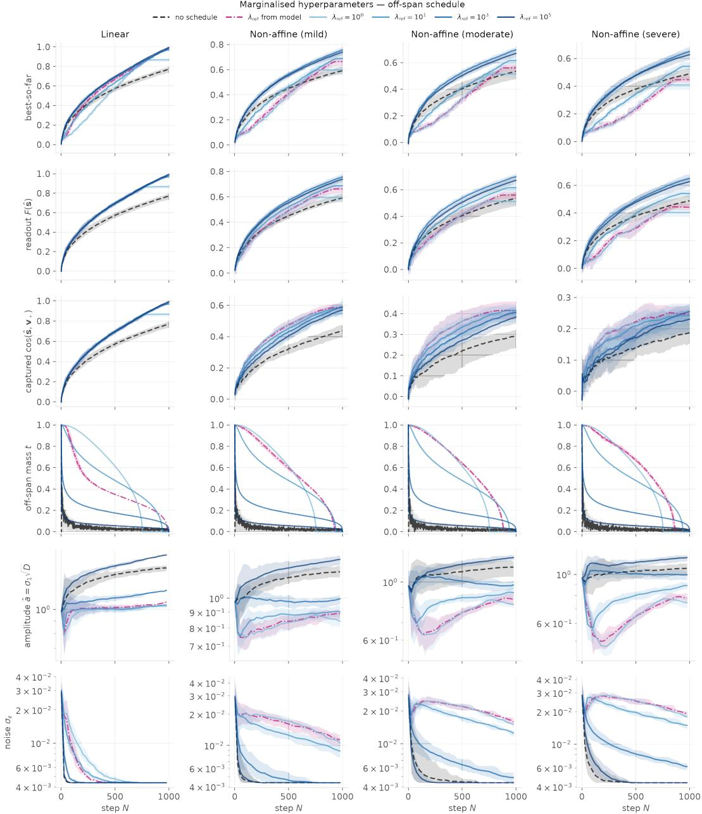  
Figure 6: Per-step diagnostics, marginalised variance scales, noise-free. $N = D = 1 0 0 0$ uncapped posterior, ten paired seeds (mean and 5th–95th percentiles). Rows: best-so-far, value of the posterior-mean recommendation F(sˆ), degree-one recovery $\cos ( \hat { s } , v _ { \star } )$ , off-span norm t of the selected query, fitted amplitude $\hat { a } = \sqrt { D } \hat { \sigma } _ { 1 }$ , and fitted discrepancy scale $\hat { \sigma } _ { \varepsilon }$ . Columns: the affine control and the mild, moderate, and severe non-affine objectives. Curves: no schedule (dashed), the model-derived reference (dash-dotted), and the fixed ladder $\lambda _ { \mathrm { r e f } } \in \{ 1 0 ^ { 0 } , 1 0 ^ { 1 } , 1 0 ^ { 3 } , 1 0 ^ { 5 } \}$

Random search and orthogonal design. Random search draws queries uniformly on the sphere. The orthogonal design uses the columns of a Haar-random orthogonal frame scaled to the sphere, so every pair of queries is exactly orthogonal and the budget probes N distinct directions with no redundancy; it requires $N \leq D$

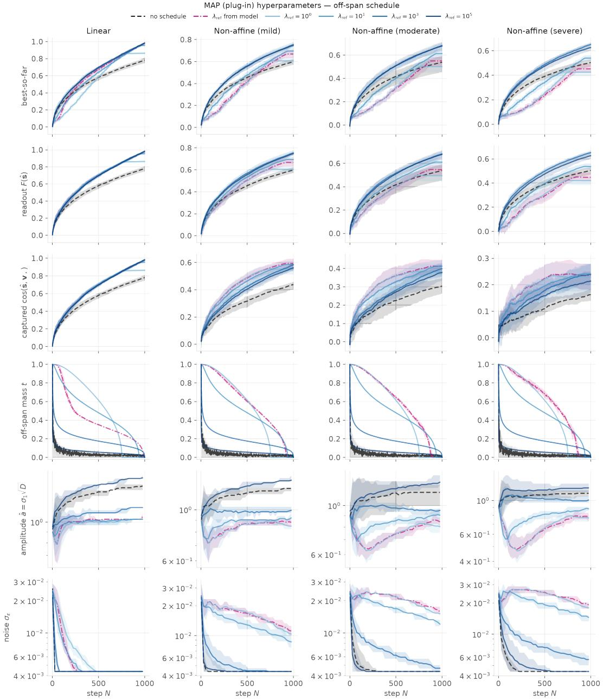  
Figure 7: Per-step diagnostics, MAP variance scales, noise-free. Layout as in Figure 6.

Design-then-fit. The random and orthogonal design-then-fit baselines of Figure 3 spend N − 1 evaluations on the corresponding non-adaptive design, fit the uncompressed affine model with marginalised variance scales to the result, and spend the final evaluation on the posterior-mean recommendation of Appendix A.5. Their first N − 1 queries coincide with the plain designs at the same seed.

Thompson sampling. Thompson sampling uses the same bounded-state posterior as SABLE (M = 300, marginalised variance scales): at each step a slope is drawn from the compressed posterior in the data-informed directions and from the prior in their complement, and the query is the sphere point maximising the sampled affine function. It prescribes no off-span norm.

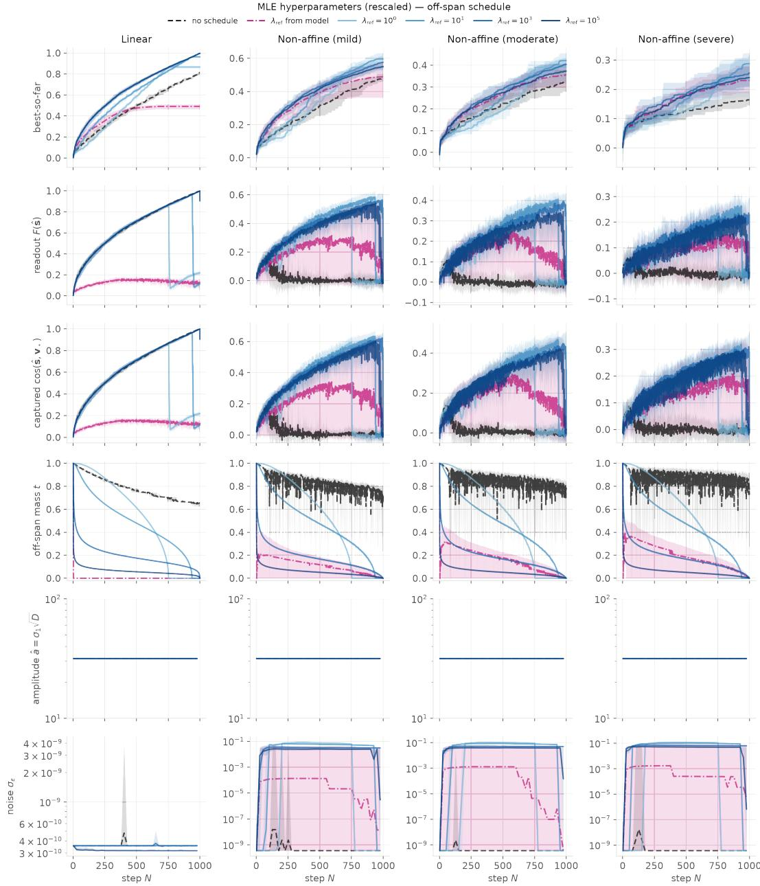  
Figure 8: Per-step diagnostics, maximum-likelihood variance scales, noise-free. Layout as in Figure 6. Without a schedule the fitted discrepancy scale collapses and the off-span norm stays near one for the whole run.

CMA-ES. Separable CMA-ES (Ros & Hansen, 2008) maintains a diagonal covariance and costs $\mathcal { O } ( D )$ per generation; full-covariance CMA-ES (Hansen & Ostermeier, 1996) is run where a dense $D \times D$ covariance fits in memory (turbulence and Calorimeter DS2). Both use the standard population size $4 + \left\lfloor 3 \ln D \right\rfloor$ and initial step size $\sigma _ { 0 } = 1$ in the ambient parameterisation, with the search mean initialised at the origin so that the first generation is a draw from $\mathcal { N } ( \mathbf { 0 } , I _ { D } )$ and lands on the typical shell. Members of a generation are evaluated together and yielded in a seed-shuffled order so that best-so-far curves carry no within-generation ordering bias. The sphere variants rescale each candidate to the sphere before evaluation; the ambient variants $( \mathbb { R } ^ { D } )$ evaluate the raw candidate and are free to leave the typical set.

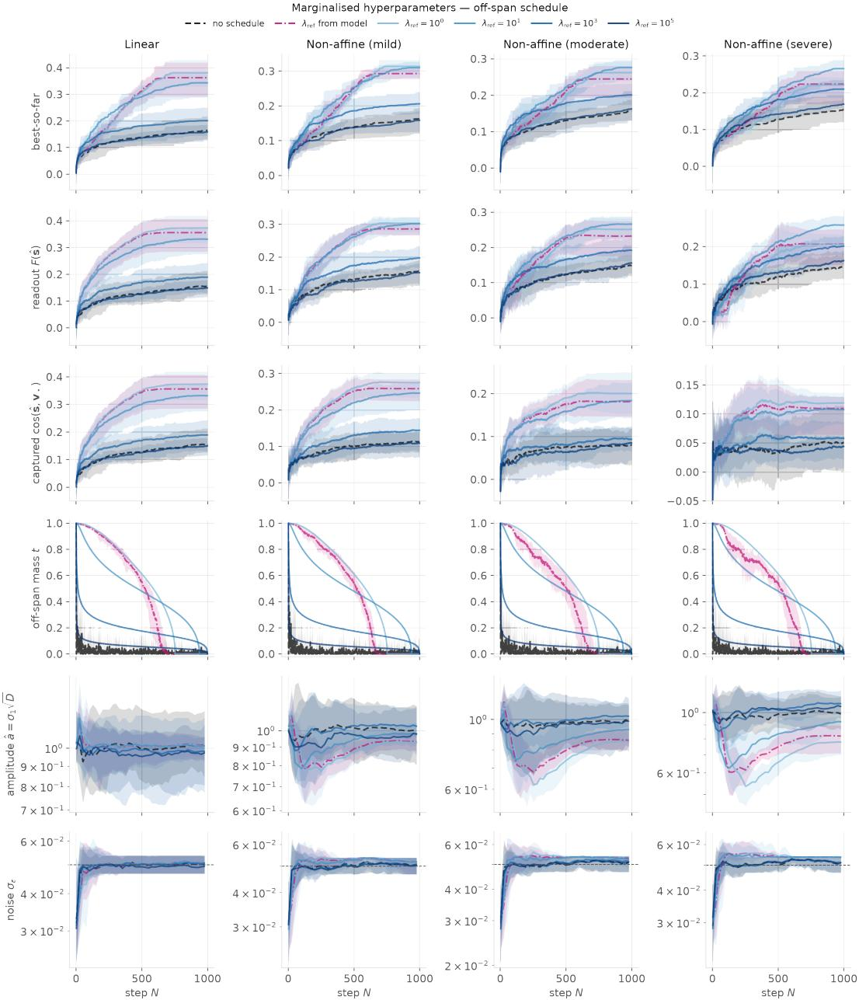  
Figure 9: Per-step diagnostics, marginalised variance scales, noisy observations $( \sigma _ { \varepsilon } = 0 . 0 5 )$ Layout as in Figure 6; best-so-far and the recommendation are scored on the noiseless objective.

Vanilla BO, Linear BO and TuRBO. Vanilla BO (Hvarfner et al., 2024), high-dimensional linear BO (Doumont et al., 2026), and TuRBO (Eriksson et al., 2019) follow their reference implementations in BoTorch (Balandat et al., 2020). Vanilla BO uses a single-task GP with an ARD RBF kernel, the dimension-scaled lengthscale prior of the reference, standardised targets, and LogEI optimised by multi-start L-BFGS-B. Linear BO uses the reference’s linear kernel on inverse-stereographically projected inputs with ARD lengthscales and LogEI. TuRBO uses a trust region with a Matern-´ 5/2 ARD kernel and Thompson sampling over 5000 Sobol candidates, each perturbing every coordinate independently with probability min(20/D, 1) (20 coordinates in expectation), with the reference hyperparameters. Each opens with a 30-point scrambled Sobol block. All three search the unit cube and decode candidates on the sphere. To make $N = 3 0 0 0$ feasible at $D \geq 6 0 0 0$ , hyperparameters are refit by L-BFGS-B whenever the data has grown by 5% since the last fit (about 94 fits over a run), warm-started from the previous values and capped at 200 iterations; between refits the model is conditioned exactly on all data under the last fitted hyperparameters. Vanilla BO and linear BO nevertheless cost minutes per decision by $N \approx 1 0 0 0$ , so their runs are read at 48 h of wall clock (Figure 4). These three baselines are omitted on Calorimeter DS3.

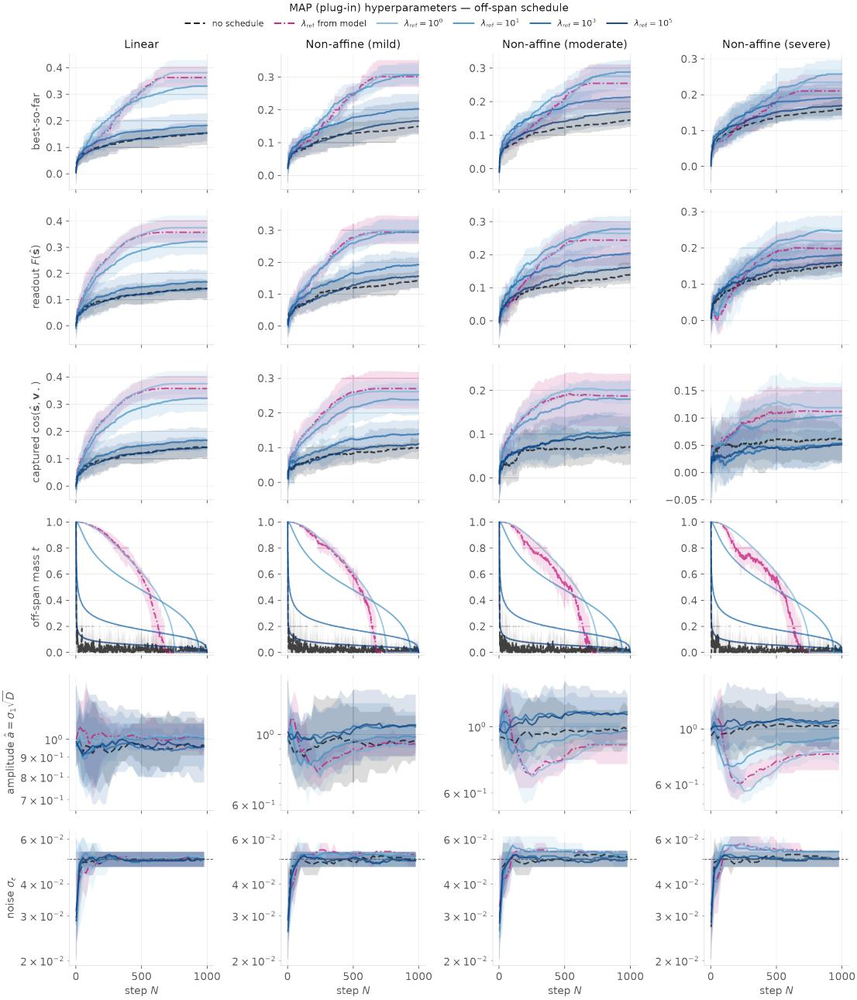  
Figure 10: Per-step diagnostics, MAP variance scales, noisy observations $( \sigma _ { \varepsilon } = 0 . 0 5 )$ . Layout as in Figure 6.

MSR and BAxUS. The two remaining GP baselines are run as their reference implementations prescribe: neither the 30-point Sobol opening block nor the refit-on-growth cadence of the paragraph above is imposed on them, and each keeps its own initial design and refits at every step. The only adaptation is the objective interface, which decodes each proposal on the sphere by the same map as the other GP baselines while the optimiser keeps its own coordinates and the value it received.

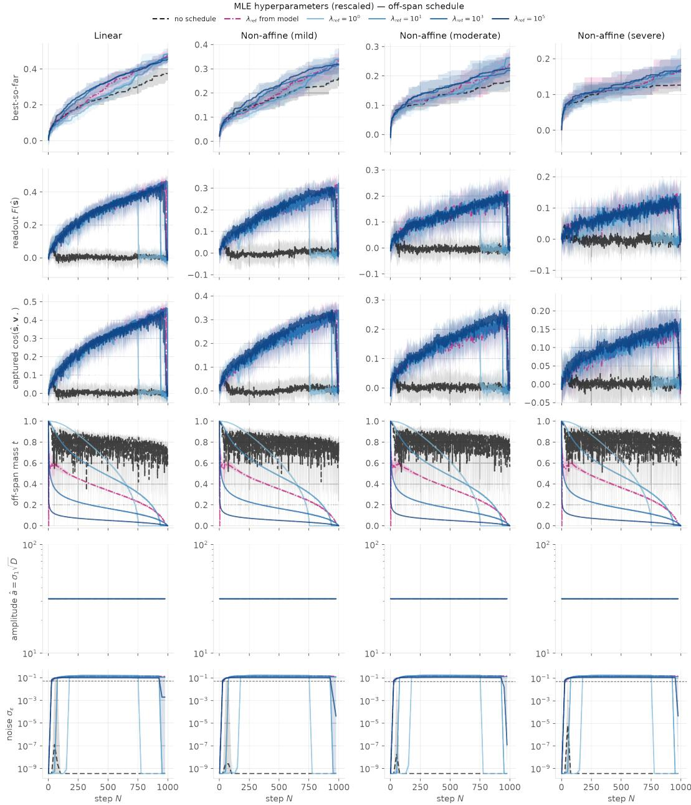  
Figure 11: Per-step diagnostics, maximum-likelihood variance scales, noisy observations $( { \sigma } _ { \varepsilon } =$ 0.05). Layout as in Figure 6.

MSR (Papenmeier et al., 2025) opens with $\lfloor 3 \sqrt { D } \rfloor$ scrambled Sobol points and at every step builds a fresh single-task GP with an ARD Matern-´ 5/2 kernel, no lengthscale prior, lengthscales initialised at ${ \sqrt { D } } / 1 0 .$ , the reference’s outputscale and noise priors and a learned noise level (its real-world benchmark setting), refits it from scratch by L-BFGS-B, and maximises LogEI from RAASP starts (the best observations perturbed on a random min(20/D, 1) fraction of coordinates, $\sigma = 1 0 ^ { - 3 } ;$ 5 restarts over 512 raw samples). Refitting after every observation makes its per-decision cost grow as $n ^ { 2 . 6 }$ , so its runs stop at 48 h between $N = 3 0 0$ and 800. It is omitted on Calorimeter DS3 due to cost. BAxUS (Papenmeier et al., 2022) uses the authors’ implementation at the paper’s settings: a sparse ±1 embedding whose target dimension starts at the adjusted $d _ { 0 } \in \{ 1 , 2 , 3 \}$ (1, 2, 3 and 2 on our four problems) and is split fourfold whenever the trust region collapses, a 10-point Latin hypercube design per trust region, the TuRBO trust region (initial length 0.8, bounds $0 . 5 ^ { 7 }$ and 1.6, success tolerance 3, the budget-derived failure tolerance of the reference) with Thompson sampling over min(100d, 5000) Sobol perturbations, and a Matern-´ 5/2 ARD GP refit at every step from 100 Latin-hypercube hyperparameter starts, the ten best refined by 50 Adam steps. Its ambient box is $[ 0 , 1 ] ^ { D }$ , so the projected-up point is decoded on the sphere as $\sqrt { D } S ^ { \top } y / \| S ^ { \top } y \|$ . One deviation from the reference: above 21,201 target dimensions, reached only on Calorimeter DS3, the candidate perturbations come from a Latin hypercube instead of the Sobol sequence, which has no direction numbers there. Its decisions cost 30–50 s once the embedding has grown to thousands of dimensions, so its runs stop at 48 h between N = 700 and 1,300; it runs on all four problems.

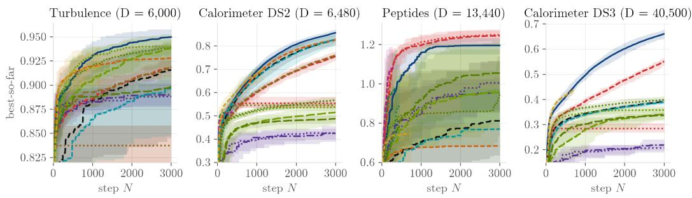  
Figure 12: Scientific latent-space optimisation against evaluation count. Best observed value against evaluation count for the runs of Figure 4; lines show means and bands 5th–95th percentiles over ten seeds. Standard BO and Linear BO timed out at 48 h of wall clock.

O3. O3 (Willis et al., 2025) spans a cone of $K = 9 0$ random latents of the generative prior and searches the resulting (K −1)-dimensional unit cube through its Knothe–Rosenblatt chart, decoding the rescaled combination on the sphere. We run the reference’s primary optimiser on top: fullcovariance CMA-ES with population 4 and σ<sub>0</sub> = 0.2. K = 90 is the largest setting of the reference; a sweep on the controlled objectives at $D = N = 1 0 0 0$ found a plateau over $K \in [ 2 4 , 9 0 ]$ and no gain at K = 300.

No-schedule ablations. The row labelled Fan et al. (2026) is that method in its published form: the affine model with MAP variance scales, the uncapped posterior, and unconstrained EI, which prescribes no off-span norm. The “no schedule” row under Ours applies our bounded-state compression (M = 300) and marginalised variance scales but likewise leaves the off-span norm to EI.

Hardware. Campaign runs execute on a shared SLURM cluster as CPU tasks with 4 cores each;   
cluster nodes are dual-socket AMD EPYC 9754 machines (256 cores, 768 GB to 1 TB RAM).